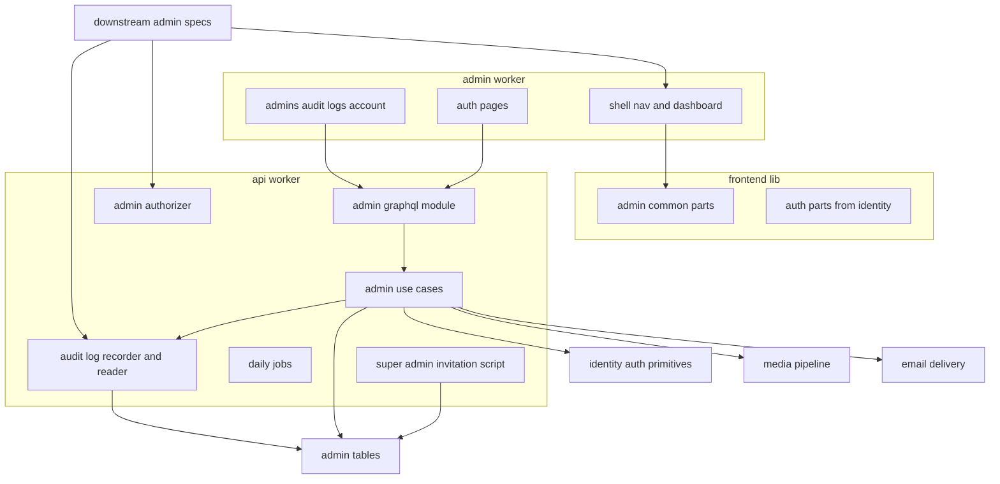
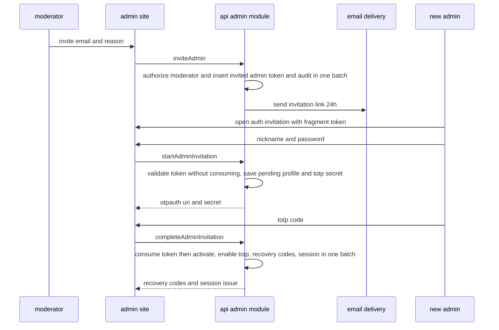
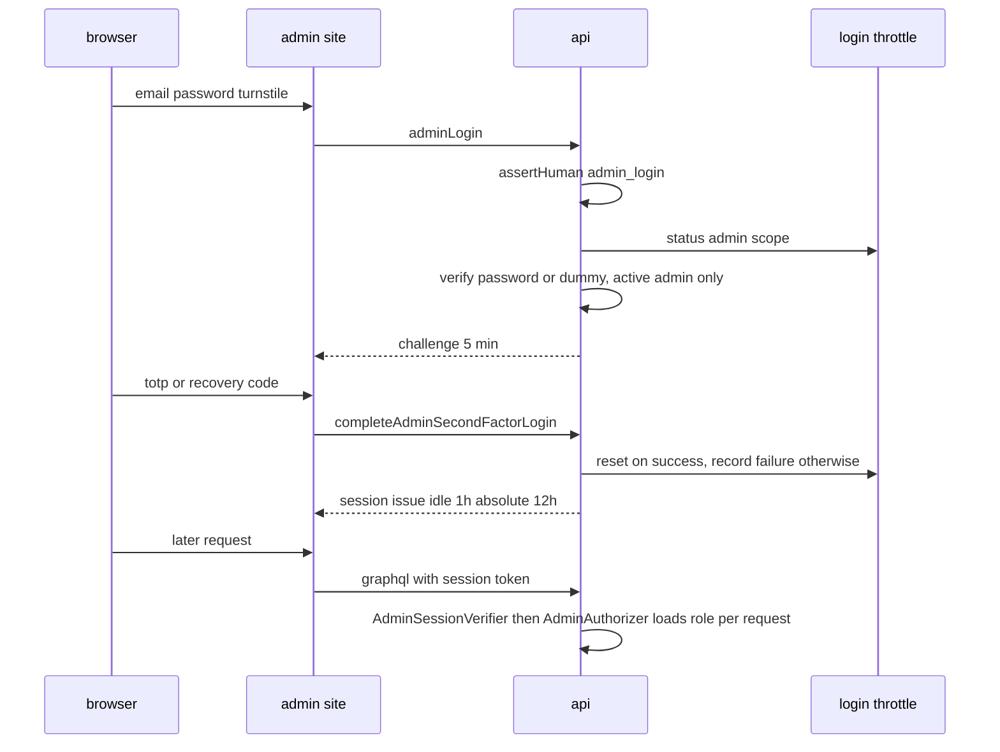
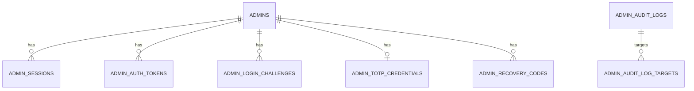
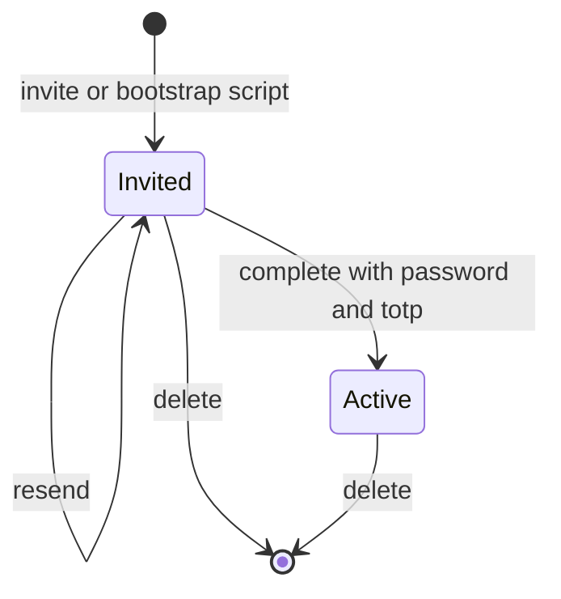
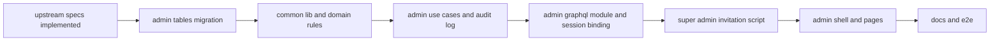

# Design Document

## Overview

**Purpose**: 管理者アカウント(招待・招待の完了・ログイン・セッション・パスワードのリセットと変更・メールアドレス変更・TOTPの再設定・プロフィール・一覧・削除・ロールの変更)を、APIサーバー(`apps/api`)・イベントサーバー(`apps/event`)・管理者側フロントエンドサーバー(`apps/admin`)にまたがって実装する。あわせて、後続specが使うロールと所有権のアクセス制御の部品、監査ログの記録の部品と閲覧画面、管理画面のシェル(メニューとダッシュボードの区画)と共通部品、最初の最上位管理者の招待の発行コマンドを提供する。

**Users**: 運営者は`/auth/*`でログイン・招待の完了・パスワードリセットを行い、`/`・`/accounts`・`/audit-logs`・`/account`を使う。開発者は招待の発行コマンドで最初の最上位管理者を用意する。後続の管理機能のspec(ugc-moderation・help-center・inquiry-chat・legal-pages・ultras-subscription・product-launch・notifications・tournament-year・sponsorship・content-reporting)は、`AdminAuthorizer`で必要なロールを宣言し、`AuditLogRecorder`で管理操作を記録し、`ADMIN_NAV_ITEMS`・`DASHBOARD_CARDS`へ画面を登録する。

**Impact**: backend-platform・api-gateway・email-delivery・frontend-platform・content-processing・media-pipeline・identity-authの骨格と部品(いずれも設計・タスクが承認済み)の登録箇所へ、本specのモジュール・スキーマモジュール・ジョブ・メール種別・テンプレート・用途・画面を追記する。上流のコードへの変更は次に限り、いずれも上流specが定めた差し替えの契約か、振る舞いを変えない追加である。

- identity-authの`composition/session.ts`の`AUTH_TYPES.AdminSessionVerifier`の束縛を、`InvalidSubjectSessionVerifier`から本specの`AdminSessionVerifier`へ差し替える(identity-auth 19.5の契約)。
- identity-authが利用者側に置いた`return-path.ts`・`fragment-token.ts`(純粋な関数)を`apps/frontend-lib/utilities/auth/`へ移し、利用者側と管理者側で共用する(振る舞いは変えない)。
- frontend-platformの`ADMIN_LAYOUT_SLOTS`の`navigation`・`headerAccount`を本specの部品へ差し替え、管理者側のトップページの仮のページを本specのダッシュボードへ置き換える(frontend-platformの契約)。
- media-pipelineの`UPLOAD_PURPOSES`へ管理者のプロフィール画像の用途`admin-avatar`を加える(media-pipelineの契約)。
- frontend-libの`components/ui`へshadcn/uiの`table`・`select`の部品を加える(既存の`radix-ui`の範囲で、新しいパッケージは無い)。

### Goals

- 4.20(FR-ADMAC-001〜022)の全機能が管理画面から動作し、E2Eテストで最初の最上位管理者の招待から各操作までを確かめられる。
- 後続specが、ロールの宣言・監査ログの記録・メニューとカードの登録だけで管理機能を載せられる。
- 監査ログが個人情報を含まず、管理操作と同時に確定し、3年で消える。
- 本specが追加・変更したコードの単体テスト・Workers統合テスト・ブラウザテストがカバレッジ80%を満たす。

### Non-Goals

- 統計グラフ(ugc-moderation)、未対応の問い合わせ・通報の件数のカード(inquiry-chat・content-reporting)。
- 12メニュー(ユーザー・プロダクト・コメント・評価・画像モデレーション・通報・問い合わせ・スポンサー広告・ヘルプ記事・カテゴリ・法務文書・設定)の画面と操作、その操作種別の登録と記録の呼び出し(各後続spec)。
- 各カテゴリマスタのデータと業務規則(利用するspec)。
- 管理者のセッションの一覧・個別の失効(要件に無い)、多要素認証の無効化(Q4・要件12.6)。
- 要件定義書の改訂(roadmapのOut。必要な改訂は[research.md](research.md)に記録した)。

## Boundary Commitments

### This Spec Owns

- 管理者のデータ: `admins`・`admin_sessions`・`admin_auth_tokens`・`admin_login_challenges`・`admin_totp_credentials`・`admin_recovery_codes`・`admin_audit_logs`・`admin_audit_log_targets`の8テーブル(`apps/db/schema/admin/`)。
- 管理者の業務処理(apiの`domain/admin`・`application/admin`・`infrastructure/admin`)と、GraphQLのスキーマモジュール`admin`(管理者側の許可リストにだけ載る)。
- アクセス制御の部品`AdminAuthorizer`と、リゾルバ向けの補助`requireAdmin`(`presentation/graphql/admin-guard.ts`)。
- 管理者の照会口`AdminDirectory`(`apps/backend-lib/workers/admin/`。apiとeventの両方で束縛する`ADMIN_PLATFORM_MODULE`を含む)。
- 監査ログの記録の部品`AuditLogRecorder`・照会`AuditLogReader`、操作種別の型と登録箇所(`apps/common-lib/admin/audit-actions/`)、ユーザーのメールアドレス検索の操作種別`user.email-search`。
- ロールの型と順序(`apps/common-lib/admin/admin-roles.ts`)、入力規則(`admin-input-rules.ts`)。
- メール種別6つ(`core/email/kinds/admin.ts`)とテンプレート(`apps/event/src/infrastructure/email/templates/admin/`)。
- 定期実行のジョブ2つ(業務時刻4:21、`order` 200・210)。
- 招待の発行コマンド(`apps/api/scripts/admin/`)。
- 管理画面: `/auth/*`の5画面、ログイン必須のレイアウト`_authenticated`、`/`(ダッシュボード)・`/accounts`・`/audit-logs`・`/account`、ヘッダーとメニューの区画の部品、登録箇所`ADMIN_NAV_ITEMS`・`DASHBOARD_CARDS`。
- 管理画面の共通部品(`apps/frontend-lib/components/admin/`)と、shadcn/uiの`table`・`select`(`components/ui/`)。
- 技術ドキュメント: `security/007`・`backend/008`・`frontend/009`・`operations/003`。サービス仕様のページ配置・文言規則・データ保持期間・日次タイムラインの追記。

### Out of Boundary

- 主体に依存しない認証部品(パスワード・秘密・セッションの有効期限の判定・ログイン試行の記録・TOTP・秘密鍵の暗号化・リカバリコード)と、認証の画面部品(`TotpQrCode`・`RecoveryCodeList`・`PasswordInput`)の実装(identity-auth)。本specは管理者用の値で使う。
- 利用者のアカウント・運営者による退会の操作口(identity-auth)と、その管理画面(ugc-moderation)。
- 12メニューの画面・操作・操作種別・記録の呼び出し・ダッシュボードのカード(各後続spec)。本specは登録口と部品だけを持つ。
- アップロードの受け付け・画像の保存と配信と自動判定・ファイルの削除(media-pipeline)。本specは用途の登録と紐付け・削除の呼び出しだけを行う。
- bot判定の検証・厳密なレート制限カウンタ・定期実行の仕組み(backend-platform)、セッションの受け渡しの契約(api-gateway)、Cookieの属性と発行・CSP・bot判定のウィジェット(frontend-platform)、メールの描画と送信(email-delivery)、書記素の数え方(content-processing)。
- staging・prodでの招待の発行コマンドの実行、シークレットと資源の用意(開発者の手作業・infra-delivery・launch-readiness)。AIエージェントはリモートのD1へ書き込めない(Claude設定のdeny)。

### Allowed Dependencies

- backend-platform: `apps/db`の共通カラム(`ulidPrimaryKey`・`timestamps`・`textNoCase`)と`Database`、`core`の`KeyedHasher`・`hashPurpose`・`hashRateLimitKey`・`AppError`・`Clock`・`IdGenerator`・`BusinessTime`・`ScheduledJobDefinition`・`getAppLogger`・`PLATFORM_TYPES`、`workers`の`RateLimitCounterClient`・`BotVerifier`・`PlatformEnv`。形を変えない。
- api-gateway: `Principal`・`AuthenticatedPrincipal`・`SessionVerification`・`GraphQLSchemaModule`・`defineSchemaModule`・`GraphQLContext`・`withValidatedArgs`・`SessionAccess`・`SessionView`(identity-authが加えたapplication層の型)。形を変えない。
- identity-auth: `AUTH_TYPES`と`auth`の全ポート・`PasswordPolicy`・`SecretIssuer`・`RecoveryCodeIssuer`・`createLoginThrottleKeys`・`LoginThrottleScope`(`'admin'`)・`SessionPolicy`と`newSessionTimes`・`evaluateSession`・`cookieMaxAgeSeconds`・`SecondFactorInput`・`normalizeTotpCode`・`SubjectSessionVerifierPort`、`frontend-lib/components/auth`の3部品。`identity`の各層(利用者の業務処理)には依存しない。束縛の差し替えは`AUTH_TYPES.AdminSessionVerifier`の1行だけ。
- email-delivery: `defineEmailKind`・`EMAIL_KINDS`・`EmailSender`・`defineEmailTemplate`・`EMAIL_TEMPLATES`・`formatUtcDateTime`・`toMatchingKey`。形を変えない。
- frontend-platform: `AdminLayoutSlots`・`executeGraphQL`・`graphqlQueryOptions`・`GraphQLClientError`・`useAppForm`・`applyServerFieldErrors`・`FormField`・`SubmitButton`・`useTurnstileToken`・`TurnstileWidget`・状態表示とトーストの部品・shadcn/uiの部品・`DateTime`・`runAxe`。`ADMIN_SECURITY_POLICY`は変えない(bot判定の許可先は`BASE_SECURITY_POLICY_SOURCES`が両アプリに入れる)。
- content-processing: `apps/common-lib`の`countGraphemes`と共有ディレクトリの配置。
- media-pipeline: `defineUploadPurpose`・`UPLOAD_PURPOSES`・`MediaFiles`(`claim`・`eraseNow`・`findMany`)・`MEDIA_TYPES`・`toMediaImage`・GraphQLの`MediaImage`・`ImageUploadField`・`MediaPicture`・`MediaPlaceholder`。形を変えない。
- npmパッケージ: 上流の版だけを使い、新規は無い(Q8)。

### Revalidation Triggers

- `AdminRole`の値と順序・`hasRole`、`AdminAuthorizer`・`requireAdmin`の形とエラーコード(管理機能を持つ全後続spec)。
- メニューごとの必要なロールの一覧(ページ配置)と、Q3の方針(全後続spec)。
- `AuditActionDefinition`・`AuditTargetKind`の値・`AuditLogRecorder`・`PreparedAuditEntry`・`buildAuditLogStatements`の形(操作と同じ一括の書き込みに含める規約)・`AuditLogReader.latestFor`・`latestForMany`の形と、テストの共有の偽物`createFakeAuditLogReader`の既定の振る舞いと差し替えの形(管理操作を持つ全後続spec。`latestFor`・`latestForMany`はcontent-reportingの対応期間の表示、仮7)。
- `user.email-search`の記録の形(ugc-moderation)。
- `ADMIN_NAV_ITEMS`・`DASHBOARD_CARDS`の形と`order`、管理画面のURL(仮6)(全後続spec。カードはugc-moderation・inquiry-chat・content-reporting)。
- `AdminDirectory`の形・削除済みの扱い・置き場所(`backend-lib/workers/admin`)とapi・eventでの束縛(help-center、inquiry-chat(返信した管理者の表示とデータエクスポートの`adminNickname`)、legal-pages(版の公開者と下書きの保存者)、ultras-subscription(機能フラグの変更者))。
- 共通部品(`apps/frontend-lib/components/admin/`)のprops(全後続spec、カテゴリマスタはinquiry-chat・help-center・product-launch・content-reporting)。
- `admin-avatar`の用途の上限(512,000バイト、仮2)と、product-launchのロゴの上限の解釈(product-launch)。この値はプロジェクト全体のバイトの単位の規則(1kB=1,024バイト、文言規則)に従う。
- E2Eの補助`e2e/support/admin-bootstrap.ts`・`e2e/support/local-d1.ts`の関数の形(管理画面のE2Eを持つ全後続spec(legal-pages・inquiry-chat・ultras-subscriptionなど))。
- `ADMIN_SITE_ORIGIN`の名前と3環境の値(infra-delivery)。
- 定期実行のジョブの名前と`order`(200・210)(4:21にジョブを登録する全spec、日次タイムラインの表)。
- identity-authの`auth`のポート・`LoginThrottleScope`・Durable Objectの名前の規則・`SubjectSessionVerifierPort`を変えたら、本specを確かめ直す。

### 上流への影響

| 上流spec           | 変更                                                                                                                                                     | 影響と再検証                                                                                                                                                                                                                       |
| ------------------ | -------------------------------------------------------------------------------------------------------------------------------------------------------- | ---------------------------------------------------------------------------------------------------------------------------------------------------------------------------------------------------------------------------------- |
| identity-auth      | `composition/session.ts`の`AUTH_TYPES.AdminSessionVerifier`を`ADMIN_TYPES.AdminSessionVerifier`への転送に差し替える                                      | identity-authが定めた差し替えの契約どおり                                                                                                                                                                                          |
| identity-auth      | `apps/client/src/components/auth/return-path.ts`・`fragment-token.ts`(と単体テスト)を`apps/frontend-lib/utilities/auth/`へ移し、利用者側の読み込みを直す | 関数の形と振る舞いは変えない。利用者側の画面のテストが通ることで確かめる。identity-authのファイルの置き場所の変更のため再検証を求める                                                                                              |
| frontend-platform  | `ADMIN_LAYOUT_SLOTS`の差し替え、`apps/admin/src/routes/index.tsx`の仮のページの置き換え、`__root.tsx`の`beforeLoad`での`adminViewer`の取得               | 契約どおり。管理者側でbot判定を使うため、`BASE_SECURITY_POLICY_SOURCES`のTurnstileの許可先が管理者側のCSPにも入り、`TURNSTILE_SITE_KEY`が管理者側の変数にあることを再検証の対象にする(Q7)。無ければ`ADMIN_SECURITY_POLICY`へ加える |
| frontend-platform  | `components/ui`に`table`・`select`の部品(部分ごとのファイル)を加える                                                                                     | 既存の`radix-ui` 1.6.7の範囲。frontend-platformの部品の一覧に加わる                                                                                                                                                                |
| media-pipeline     | `apps/api/src/composition/upload-purposes.ts`の`UPLOAD_PURPOSES`に`admin-avatar`を加える                                                                 | 契約どおり。管理者の中継の経路はmedia-pipelineが追加済み                                                                                                                                                                           |
| infra-delivery     | 「ホスト名から導かれる変数の値」の表にある、APIサーバーの`ADMIN_SITE_ORIGIN`(本specの所有)の3環境の値の行と、名前と値の一致を確かめる                    | 本specはWrangler設定と`docs/onboardings/project-values.md`に書き、infra-deliveryの表の行(spec横断レビューで追加済み)と名前と値が一致することを確かめる                                                                             |
| content-processing | 日次タイムラインの表に本specの2行を足す                                                                                                                  | 表が無ければ作る(identity-authと同じ扱い)                                                                                                                                                                                          |

## Architecture

### Existing Architecture Analysis

- 上流の7specは設計・タスクとも承認済みで、本specのタスクはそれらの実装の完了を前提にする(roadmapの順でidentity-authまでが先に実装される)。
- apiの層は`domain`・`application`・`infrastructure`・`presentation`・`composition`で、依存の方向は静的解析で強制される。application層は`presentation`の型を読み込まず、セッションは`SessionView`で受け取る。
- `SessionAccess`は呼び出し元が`admin`なら`subjectKind: 'admin'`で`SessionVerifier`を呼び、identity-authの`SubjectSessionVerifier`が`AUTH_TYPES.AdminSessionVerifier`へ振り分ける。
- 管理者側のレイアウトは`AdminLayoutSlots`(`navigation`・`headerAccount`)で区画を差し替える。Cookieは`__Host-ls_admin_session`。

### Architecture Pattern & Boundary Map



**Architecture Integration**:

- 選んだパターン: backend-platformの4層と合成ルートに従い、apiに`admin`モジュールを置く。認証の規則はidentity-authの`auth`の部品を管理者用の値で使い、利用者の`identity`には依存しない。
- 境界: 本specは管理者の状態・認可・監査ログを所有し、他ドメインのデータを変えない。後続specとの継ぎ目は`AdminAuthorizer`・`AuditLogRecorder`・`AdminDirectory`・2つの登録箇所だけである。
- 新規コンポーネントの理由: research.mdの「Design Decisions」を参照。

### Dependency Direction

- 共有コード: `apps/db/schema/admin` → `apps/common-lib/admin`(`countGraphemes`だけを読み込む) → アプリの`src`。`apps/backend-lib/workers/admin`は`apps/db/schema/admin`の`admins`と`core`の`Database`だけを読み込み、api・eventの`src`から読み込まれる。
- apiの`src`内: `domain/auth`(identity-auth) ← `domain/admin` ← `application/auth`(identity-auth) ← `application/admin` ← `infrastructure/admin`・`presentation/graphql/modules/admin`・`presentation/graphql/admin-guard.ts` ← `composition`。`admin`の各層は`identity`の各層を読み込まない。後続specのapplication層は`application/admin`の`AdminAuthorizer`・`AuditLogRecorder`と`backend-lib/workers/admin`の`AdminDirectory`を、infrastructure層は`infrastructure/admin/audit-log-statements.ts`を、presentation層は`admin-guard.ts`を読み込む。違反はapiの`eslint.config.ts`の`no-restricted-imports`で検出する。
- adminの`src`内: frontend-platformの規則(`composition` ← `components` ← `routes`)に従う。`frontend-lib/components/admin`はGraphQLとアプリの型に依存しない。

### Technology Stack

| Layer    | Choice / Version                                                                       | Role in Feature                                | Notes                                          |
| -------- | -------------------------------------------------------------------------------------- | ---------------------------------------------- | ---------------------------------------------- |
| 認証部品 | identity-authの`auth`(Web Crypto・otpauth 9.5.2・Durable Object`LoginAttemptThrottle`) | パスワード・秘密・セッション・試行の制限・TOTP | 既存。スコープ`admin`・HMACの用途`admin-*`     |
| 状態     | Cloudflare D1(drizzle-orm 1.0.0-rc.5)                                                  | 管理者・セッション・トークン・TOTP・監査ログ   | 新しいテーブル8つ                              |
| 定期     | Cron Triggers(api)                                                                     | 期限切れの削除・監査ログの保持期間             | backend-platformの基盤                         |
| メール   | email-deliveryの`EmailSender`・React Email                                             | 6種のトランザクションメール                    | 既存                                           |
| 画面     | TanStack Start・React・react-hook-form・zod・shadcn/ui・`@marsidev/react-turnstile`    | 認証画面・シェル・一覧・設定                   | frontend-platformの版。`table`・`select`を追加 |
| 画像     | media-pipelineの用途と部品                                                             | プロフィール画像のアップロードと表示           | 既存                                           |
| コマンド | Bun・Wrangler(`wrangler d1 execute`)                                                   | 最上位管理者の招待の発行                       | 既存。新しいパッケージは無い                   |
| テスト   | bun test・vitest 4.1.11(Workers・Browser)・Playwright 1.64.1・Mailpit                  | 単体・Workers統合・ブラウザ・E2E               | 上流の版                                       |

## File Structure Plan

### Directory Structure

```
apps/
├── db/schema/admin/                                    # 管理者のテーブル定義(各ファイルに同名の*.unit.test.ts)
│   ├── admins.ts · admin-sessions.ts · admin-auth-tokens.ts · admin-login-challenges.ts
│   ├── admin-totp-credentials.ts · admin-recovery-codes.ts
│   ├── admin-audit-logs.ts · admin-audit-log-targets.ts
│   └── index.ts                                        # adminのテーブルの集約(schema/index.tsから再エクスポート)
├── common-lib/admin/                                   # 4アプリ共通の純粋な定義(各ファイルに同名の*.unit.test.ts)
│   ├── admin-roles.ts                                  # AdminRole・ADMIN_ROLES(昇順)・hasRole・ADMIN_ROLE_LABELS
│   ├── admin-input-rules.ts                            # ニックネーム・肩書き・理由・カテゴリ名の上限と判定
│   ├── audit-action.ts                                 # AuditTargetKind・AuditActionDefinition・defineAuditAction・createAuditActionCatalog
│   └── audit-actions/
│       ├── admin-foundation.ts                         # admin-account.invite・delete・role-change、user.email-search
│       └── index.ts                                    # AUDIT_ACTIONS(後続specが自分のファイルを足して集約する)
├── backend-lib/core/email/kinds/admin.ts               # 管理者の6つのメール種別
├── backend-lib/workers/admin/                          # api・eventが共有する管理者の照会(apiのWorkers統合テスト、同名の*.worker.test.ts)
│   ├── admin-directory.ts                              # AdminProfileView・AdminDirectory・D1AdminDirectory(後続specも使う)
│   └── admin-platform-module.ts                        # ADMIN_PLATFORM_TYPES・ADMIN_PLATFORM_MODULE(両アプリ共通の束縛)
├── api/
│   ├── scripts/admin/
│   │   ├── issue-super-admin-invitation.ts             # 入口: 引数の解析→照会→SQLの生成→wrangler d1 execute→リンクの表示
│   │   ├── invitation-sql.ts                           # 純粋: 照会・書き込みのSQLとリテラルのエスケープ(単体テスト併置)
│   │   └── invitation-targets.ts                       # 純粋: 環境ごとのwranglerの引数と管理者側のオリジン(単体テスト併置)
│   └── src/
│       ├── domain/admin/                               # 純粋な規則(Bunの単体テスト)
│       │   ├── admin-account.ts                        # 状態・招待期限切れの判定・削除とロール変更とプロフィール編集の可否
│       │   ├── admin-session-policy.ts                 # ADMIN_SESSION_POLICY(3600・43200・300)
│       │   ├── admin-auth-token-purpose.ts             # 用途と有効期限・HMACの用途
│       │   └── audit-entry.ts                          # 記録の入力の検証(操作種別・理由・対象の形式・詳細)
│       ├── application/admin/                          # ポートとユースケース(Bunの単体テスト)
│       │   ├── admin-types.ts                          # ADMIN_TYPES
│       │   ├── ports.ts                                # 各ストア・メール・設定値
│       │   ├── admin-session-issuer.ts                 # 発行・操作端末への再発行
│       │   ├── admin-session-verifier.ts               # SubjectSessionVerifierPortの管理者の実装
│       │   ├── admin-authorizer.ts                     # AdminAuthorizer(後続specも使う)
│       │   ├── admin-login.ts                          # パスワードと第2要素のログイン、ログアウト
│       │   ├── admin-re-authenticator.ts               # 本人確認
│       │   ├── admin-mail-send-limits.ts               # 送信回数の制限
│       │   ├── admin-invitation.ts                     # 招待・再送・完了の2段階
│       │   ├── admin-password-reset.ts · admin-email-change.ts · admin-password-change.ts
│       │   ├── admin-totp-management.ts                # 再設定の2段階・リカバリコードの再発行
│       │   ├── admin-account-management.ts             # 一覧・削除・ロールの変更
│       │   ├── admin-profile.ts                        # プロフィールの更新
│       │   ├── audit-log-recorder.ts                   # AuditLogRecorder(検証済みの記録の準備と単独の記録。後続specも使う)
│       │   ├── audit-log-reader.ts                     # AuditLogReader
│       │   ├── test-support/fake-audit-log-reader.ts   # createFakeAuditLogReader(後続specの単体テストが共有する偽物、仮7。同名の*.unit.test.ts)
│       │   └── jobs/
│       │       ├── admin-credential-cleanup-job.ts     # 期限切れのセッション・トークン・待ち・保留(order 200)
│       │       └── audit-log-retention-job.ts          # 3年を過ぎた監査ログ(order 210)
│       ├── infrastructure/admin/                       # Workers統合テスト
│       │   ├── d1-admin-account-store.ts · d1-admin-session-store.ts · d1-admin-auth-token-store.ts
│       │   ├── d1-admin-login-challenge-store.ts · d1-admin-totp-credential-store.ts · d1-admin-recovery-code-store.ts
│       │   ├── audit-log-statements.ts                 # buildAuditLogStatements(後続specのストアも一括の書き込みに含める)
│       │   ├── d1-audit-log-store.ts                   # 単独の記録・検索・最新の照会(1件と複数)・保持期間の削除
│       │   └── email-admin-mailer.ts                   # 6種のメールの送信要求とリンクのURL
│       ├── presentation/graphql/
│       │   ├── admin-guard.ts                          # requireAdmin(後続specのリゾルバも使う)
│       │   └── modules/admin/                          # スキーマモジュール(Workers統合テスト)
│       │       ├── type-defs.ts · inputs.ts · errors.ts · resolver-support.ts
│       │       ├── auth-resolvers.ts                   # ログイン・第2要素・ログアウト・リセット・招待の完了・メール変更の確定
│       │       ├── account-resolvers.ts                # 一覧・招待・再送・削除・ロール・プロフィール
│       │       ├── self-resolvers.ts                   # adminViewer・メール変更の要求・パスワード変更・TOTP・リカバリコード
│       │       ├── audit-resolvers.ts                  # 監査ログの検索
│       │       └── index.ts                            # adminSchemaModule
│       └── composition/
│           └── admin-module.ts                         # ADMIN_TYPESの束縛とジョブのハンドラー(AppModule)
├── event/src/infrastructure/email/templates/admin/     # 6種のテンプレート(本文の*.tsxと定義の*-template.ts)
├── frontend-lib/
│   ├── utilities/auth/return-path.ts · fragment-token.ts   # identity-authから移す(単体テスト併置)
│   └── components/
│       ├── ui/table/*.tsx · ui/select/*.tsx            # shadcn/uiの部品(部分ごとのファイル)
│       └── admin/                                      # 管理画面の共通部品(*.browser.test.tsx・*.stories.tsxを併置)
│           ├── admin-page-header.tsx                   # 見出し・説明・操作の領域
│           ├── admin-data-table.tsx                    # 列定義の表・読み込み中・空・エラー・前後のページ
│           ├── admin-filter-bar.tsx                    # 絞り込みの入力欄の並びと適用・解除
│           ├── confirm-action-dialog.tsx               # 破壊的な操作の確認と理由
│           ├── reason-field.tsx                        # 500書記素の理由と個人情報の注意
│           ├── admin-avatar.tsx                        # MediaPictureと既定のアイコン
│           ├── category-master-editor.tsx              # カテゴリの一覧と操作
│           └── category-form-dialog.tsx                # カテゴリの追加・編集の入力
└── admin/src/
    ├── routes/
    │   ├── __root.tsx                                  # (変更)beforeLoadでadminViewerを取得
    │   ├── auth/login.tsx · invitation.tsx · email-change/confirm.tsx
    │   ├── auth/password-reset/index.tsx · confirm.tsx
    │   └── _authenticated/
    │       ├── route.tsx                               # ログインの確認、viewerの文脈、AdminViewerProvider
    │       ├── index.tsx                               # ダッシュボード(仮のroutes/index.tsxを置き換える)
    │       ├── accounts/index.tsx · audit-logs/index.tsx · account/index.tsx
    ├── components/
    │   ├── auth/login-form.tsx · second-factor-form.tsx · password-reset-request-form.tsx · new-password-form.tsx
    │   ├── auth/invitation-profile-step.tsx · invitation-totp-step.tsx · link-confirmation.tsx · auth-form-schemas.ts
    │   ├── layout/admin-navigation.tsx · admin-account-menu.tsx · admin-viewer-context.tsx · role-gate.tsx
    │   ├── dashboard/dashboard-grid.tsx · dashboard-card-frame.tsx
    │   ├── admins/admin-list.tsx · invite-admin-dialog.tsx · change-role-dialog.tsx · admin-profile-dialog.tsx
    │   ├── audit/audit-log-filters.tsx · audit-log-list.tsx · audit-period.ts
    │   └── account/profile-section.tsx · email-change-section.tsx · password-change-section.tsx
    │       · totp-section.tsx · totp-reset-dialog.tsx · recovery-codes-dialog.tsx · reauthentication-fields.tsx
    ├── composition/
    │   ├── admin-navigation.ts                         # ADMIN_NAV_ITEMS(後続specが追記)
    │   ├── dashboard-cards.ts                          # DASHBOARD_CARDS(後続specが追記、初版は空)
    │   └── layout-slots.ts                             # (変更)navigation・headerAccount
    └── graphql/operations/admin/
        ├── viewer.ts · auth-operations.ts · account-operations.ts · self-operations.ts · audit-operations.ts
e2e/
├── support/admin-bootstrap.ts                          # 指定したロールの管理者を招待・完了・ログインさせる補助(後続specのE2Eも使う)
├── support/local-d1.ts                                 # ローカルのD1へSQLを実行する補助(後続specのE2Eも使う)
└── admin/
    ├── admin-auth.e2e.test.ts · admin-accounts.e2e.test.ts · admin-self-service.e2e.test.ts · audit-logs.e2e.test.ts
docs/GUIDES/tech/
├── security/007-admin-authorization.md · backend/008-audit-logging.md
└── frontend/009-admin-console-shell.md · operations/003-first-administrator-bootstrap.md
```

テストファイルは同名の`*.unit.test.ts`(`domain`・`application`・`common-lib`・`db/schema`・`scripts`)、`*.worker.test.ts`(`infrastructure`・`presentation`・`composition`)、`*.browser.test.tsx`(画面部品)を対象ファイルの隣に置く。文書の番号は、roadmapの順でidentity-authの後の空き番号(`security/007`・`backend/008`・`frontend/009`・`operations/003`)に固定する。

### Modified Files

- `apps/db/schema/index.ts` — adminのテーブルを再エクスポートする。`apps/db/migrations/<日時>_admin_foundation/migration.sql`を生成する。mainの最新を取り込んでから生成し、衝突したら生成し直す。
- `apps/backend-lib/core/email/kinds/index.ts`・`apps/event/src/infrastructure/email/templates/index.ts` — 6つの種別とテンプレートを加える。
- `apps/api/src/composition/session.ts` — `AUTH_TYPES.AdminSessionVerifier`を`ADMIN_TYPES.AdminSessionVerifier`への転送に差し替える(他の束縛は変えない)。
- `apps/api/src/composition/modules.ts`・`graphql-modules.ts`・`scheduled-jobs.ts`・`upload-purposes.ts`・`env-schema.ts` — `ADMIN_PLATFORM_MODULE`・`ADMIN_MODULE`、`adminSchemaModule`、2つのジョブ、`admin-avatar`、`ADMIN_SITE_ORIGIN`の検証を加える。
- `apps/event/src/composition/modules.ts` — `ADMIN_PLATFORM_MODULE`を加える(後続specのデータエクスポートの部品が`AdminDirectory`を使うため)。
- `apps/api/wrangler.jsonc`・`worker-configuration.d.ts` — 3環境の`vars`に`ADMIN_SITE_ORIGIN`を加え、型を生成し直す。
- `apps/api/package.json` — `admin:invite-super-admin`(`bun scripts/admin/issue-super-admin-invitation.ts`)を加える。
- `apps/api/eslint.config.ts`・`test/config/layer-rules.unit.test.ts` — `admin`の各層から`identity`の各層への読み込みの禁止と違反例を加える。
- `apps/client/src/components/auth/*`(identity-auth) — `return-path.ts`・`fragment-token.ts`の読み込み先を`frontend-lib/utilities/auth/`へ直す。
- `apps/admin/src/routes/index.tsx` — 削除し、`_authenticated/index.tsx`のダッシュボードへ置き換える。`components/pages/placeholder-home.tsx`も削除する。
- `apps/admin/src/routes/__root.tsx`・`composition/layout-slots.ts` — `adminViewer`の取得と区画の差し替え。
- `docs/GUIDES/tech/{security,backend,frontend,operations}/README.md` — 新しい文書を1行ずつ追記する。
- `docs/GUIDES/service/design/002-page-layouts.md` — 管理者側のURL(仮6)・メニューごとの必要なロール(Q3)・ダッシュボードのカードの分担(Q2、「週毎の統計グラフ」の行を改める)・`/auth/*`の画面・自分のアカウントの構成を追記する。
- `docs/GUIDES/service/design/003-text-and-copy-rules.md` — 本specのエラーメッセージ・確認・状態の文言と、6種のメールの件名と本文の要点を追記する。
- `docs/GUIDES/service/legal/001-compliance-policy.md` — データ保持期間の一覧に管理者のセッション・認証系トークン・監査ログ(3年・日次バッチ)の削除方法を加える(既存の監査ログの行は形を確かめる)。
- `docs/GUIDES/service/overview/007-daily-timeline.md` — 日次バッチのジョブの表に本specの2行(200・210)を加える。表が無ければ作る。
- `docs/onboardings/project-values.md` — `ADMIN_SITE_ORIGIN`の3環境の値、ジョブの名前と順序、メール種別の名前、HMACの用途、TOTPの発行者名、招待の発行コマンドの引数を記載する。
- `docs/onboardings/README.md` — ローカルで最初の最上位管理者を用意する手順(招待の発行コマンド)と、staging・prodでは開発者が実行する旨を記載する。
- `CLAUDE.md` — 「技術規則の参照先」に、管理操作を書く前に読む文書(`security/007`・`backend/008`)へのリンクを加える。

## System Flows

### 招待と完了



- 招待の発行コマンドは、`inviteAdmin`の代わりに最上位管理者ロールの招待中の管理者とトークンをD1へ直接書き込み、メールを送らずにリンクを表示する(要件2)。以降の完了の流れは同じ。
- 招待中の管理者を再送するときは、トークンの置き換え・`invitation_expires_at`の更新・監査ログを1つの一括の書き込みにする(要件3.3)。

### ログインと権限の判定



### 削除・ロール変更の保護

- 削除とロールの変更は、先頭に監査ログの挿入を置いた1つの一括の書き込みで行う。挿入の`operator_admin_id`の値を「対象が存在し、操作者の権限で許され、最後の有効な最上位管理者を失わない」ときだけ値になり、それ以外はNULLになる`CASE`式にし、NOT NULL制約の違反で全体を取り消す(identity-authの`UserLifecycleCommitter`と同じ方式)。D1は書き込みを1つずつ処理するため、同時の操作でも有効な最上位管理者は0人にならない(要件15.9)。
- 取り消された場合は対象を読み直し、無ければ`not_found`、最後の最上位管理者なら`last_super_admin`、それ以外は`admin_state_conflict`を返す。

## Requirements Traceability

| Requirement | Summary                      | Components                                                                                                            | Interfaces / Flows                                |
| ----------- | ---------------------------- | --------------------------------------------------------------------------------------------------------------------- | ------------------------------------------------- |
| 1.1〜1.4    | 管理者・ロール・状態・一意   | AdminSchema・AdminRoles・AdminAccountRules                                                                            | `admins`・`hasRole`                               |
| 1.5         | 管理者の照会口               | AdminDirectory                                                                                                        | `findProfiles`                                    |
| 2.1〜2.7    | 招待の発行コマンド           | SuperAdminInvitationScript                                                                                            | `buildInvitationSql`・`invitationTargets`         |
| 3.1〜3.5    | 招待・再送・取り消し         | AdminInvitation・AdminAccountManagement・AuditLogRecorder                                                             | 招待と完了の流れ                                  |
| 4.1〜4.8    | 招待の完了                   | AdminInvitation・InvitationPages                                                                                      | `startAdminInvitation`・`completeAdminInvitation` |
| 5.1〜5.5    | パスワード                   | identity-authの`PasswordPolicy`・`PasswordHasher`                                                                     | 識別子はニックネームとメール                      |
| 6.1〜6.8    | ログイン・ログアウト         | AdminLogin・AdminSessionIssuer・AdminAuthPages                                                                        | ログインの流れ                                    |
| 7.1〜7.7    | ログイン試行の制限           | identity-authの`LoginThrottle`(スコープ`admin`)・AdminLogin・AdminReAuthenticator                                     | `login-email:admin:<キー>`                        |
| 8.1〜8.6    | セッション                   | AdminSessionPolicy・AdminSessionVerifier・AdminCredentialCleanupJob・AuthenticatedLayout                              | `ADMIN_SESSION_POLICY`                            |
| 9.1〜9.5    | パスワードリセット           | AdminPasswordReset・AdminMailSendLimits                                                                               | `requestAdminPasswordReset`                       |
| 10.1〜10.6  | メールアドレス変更           | AdminEmailChange・AdminSessionIssuer                                                                                  | `requestAdminEmailChange`                         |
| 11.1〜11.3  | パスワード変更               | AdminPasswordChange                                                                                                   | `changeAdminPassword`                             |
| 12.1〜12.8  | TOTPの再設定・リカバリコード | AdminTotpManagement・AccountPage                                                                                      | `startAdminTotpReset`                             |
| 13.1〜13.4  | 本人確認                     | AdminReAuthenticator                                                                                                  | `ReAuthenticationInput`                           |
| 14.1〜14.8  | トークン・通知メール         | AdminAuthTokenPurpose・AdminMailer・AdminEmailTemplates・AdminMailSendLimits・AdminCredentialCleanupJob               | `admin.*`のメール種別                             |
| 15.1〜15.10 | 一覧・削除・ロール           | AdminAccountManagement・D1AdminAccountStore・AdminsPage                                                               | 削除・ロール変更の保護                            |
| 16.1〜16.7  | プロフィール                 | AdminProfile・AdminAvatar・AdminProfileDialog                                                                         | `admin-avatar`                                    |
| 17.1〜17.6  | アクセス制御の部品           | AdminAuthorizer・AdminGuard・RoleGate・AdminViewerContext・ページ配置                                                 | `requireAdmin`・`hasRole`                         |
| 18.1〜18.9  | 監査ログの記録               | AuditActionCatalog・AuditEntryRules・AuditLogRecorder・AuditLogStatements・D1AuditLogStore・ReasonField               | `prepare`・`buildAuditLogStatements`              |
| 19.1〜19.7  | 監査ログの閲覧・保持         | AuditLogReader・AuditLogsPage・AuditLogRetentionJob                                                                   | `searchAuditLogs`・`latestFor`・`latestForMany`   |
| 20.1〜20.9  | シェル・ダッシュボード       | AdminNavigationRegistry・DashboardCardRegistry・AdminNavigation・AdminAccountMenu・DashboardGrid・AuthenticatedLayout | `ADMIN_NAV_ITEMS`・`DASHBOARD_CARDS`              |
| 21.1〜21.4  | 共通部品                     | AdminCommonParts                                                                                                      | `frontend-lib/components/admin`                   |
| 22.1〜22.6  | テスト・文書                 | AdminE2E・AdminDocs                                                                                                   | —                                                 |

## Components and Interfaces

| Component                                                                            | Domain/Layer        | Intent                           | Req Coverage                                 | Key Dependencies                       | Contracts |
| ------------------------------------------------------------------------------------ | ------------------- | -------------------------------- | -------------------------------------------- | -------------------------------------- | --------- |
| AdminSchema                                                                          | db                  | 8テーブル                        | 1.1〜1.4, 18.1, 19.6                         | drizzle (P0)                           | State     |
| AdminRoles・AdminInputRules                                                          | common-lib          | ロールの順序・入力の上限         | 1.2, 4.1, 16.1, 18.4, 21.3                   | countGraphemes (P0)                    | State     |
| AuditActionCatalog                                                                   | common-lib          | 操作種別の型と登録               | 18.3, 18.6, 18.7                             | —                                      | State     |
| SuperAdminInvitationScript                                                           | api/scripts         | 最初の最上位管理者の招待         | 2.1〜2.7                                     | wrangler (P0)・KeyedHasher (P0)        | Batch     |
| AdminAccountRules・AdminSessionPolicy・AdminAuthTokenPurpose・AuditEntryRules        | api/domain          | 純粋な規則                       | 1.4, 8.2, 14.2, 15.4〜15.8, 16.4, 18.4, 18.5 | —                                      | State     |
| AdminPorts                                                                           | api/application     | ストア・メール・設定             | 各ユースケース                               | —                                      | Service   |
| AdminSessionIssuer・AdminSessionVerifier                                             | api/application     | 発行・再発行・検証               | 6.1, 8.1〜8.4, 10.6, 11.2, 12.5              | identity-authの`auth` (P0)             | Service   |
| AdminAuthorizer                                                                      | api/application     | 認可(後続specも使う)             | 17.1〜17.4                                   | AdminAccountStore (P0)                 | Service   |
| AdminDirectory・AdminPlatformModule                                                  | backend-lib/workers | 照会(後続specがapi・eventで使う) | 1.5                                          | Database (P0)                          | Service   |
| AdminLogin・AdminReAuthenticator・AdminMailSendLimits                                | api/application     | ログイン・本人確認・送信回数     | 6.1〜6.4, 6.6, 7.1〜7.6, 13.1〜13.4, 14.4    | LoginThrottle (P0)・BotVerifier (P0)   | Service   |
| AdminInvitation                                                                      | api/application     | 招待・再送・完了                 | 3.1〜3.5, 4.2〜4.8                           | AuditLogRecorder (P0)                  | Service   |
| AdminPasswordReset・AdminEmailChange・AdminPasswordChange・AdminTotpManagement       | api/application     | 本人の手続き                     | 9.1〜12.8                                    | identity-authの`auth` (P0)             | Service   |
| AdminAccountManagement・AdminProfile                                                 | api/application     | 一覧・削除・ロール・プロフィール | 15.1〜15.10, 16.1〜16.5                      | MediaFiles (P0)・AuditLogRecorder (P0) | Service   |
| AuditLogRecorder・AuditLogReader                                                     | api/application     | 記録・検索・最新の照会           | 18.1〜18.8, 19.1〜19.5                       | AuditLogStore (P0)                     | Service   |
| AdminCredentialCleanupJob・AuditLogRetentionJob                                      | api/application     | 日次のジョブ                     | 8.6, 14.6, 19.6                              | CronRegistry (P0)                      | Batch     |
| D1AdminStores・AuditLogStatements・D1AuditLogStore・EmailAdminMailer                 | api/infrastructure  | D1とメールの実装・監査ログの文   | 18.2, 各ユースケース                         | Database (P0)・EmailSender (P0)        | Service   |
| AdminSchemaModule・AdminGuard                                                        | api/presentation    | GraphQLの型・リゾルバ・補助      | 6.7, 6.8, 17.3ほか各機能                     | api-gateway (P0)                       | API       |
| ApiAdminComposition                                                                  | api/composition     | 束縛・登録・環境                 | 8.6, 14.6, 16.2, 19.6                        | 上流の登録箇所 (P0)                    | State     |
| AdminEmailTemplates                                                                  | event               | 6種のテンプレート                | 14.7                                         | email-delivery (P0)                    | —         |
| AdminCommonParts                                                                     | frontend-lib        | 共通部品                         | 16.6, 18.9, 21.1〜21.4                       | shadcn/ui (P0)・media-pipeline (P1)    | State     |
| AdminAuthPages・InvitationPages                                                      | admin               | `/auth/*`の5画面                 | 4.1, 6.5, 9.4, 14.3, 20.1, 20.8              | useTurnstileToken (P0)                 | State     |
| AuthenticatedLayout・AdminViewerContext・RoleGate・AdminNavigation・AdminAccountMenu | admin               | ログイン必須の領域・区画         | 8.5, 17.5, 20.2, 20.3                        | AdminLayoutSlots (P0)                  | State     |
| AdminNavigationRegistry・DashboardCardRegistry・DashboardGrid                        | admin               | 登録箇所とダッシュボード         | 20.3〜20.7                                   | —                                      | State     |
| AdminsPage・AuditLogsPage・AccountPage                                               | admin               | 3つのページ                      | 12.7, 15.1, 15.10, 16.6, 19.1〜19.4          | AdminCommonParts (P0)                  | State     |
| AdminE2E・AdminDocs                                                                  | e2e・docs           | E2Eと文書                        | 22.1〜22.6                                   | Playwright・Mailpit (P0)               | —         |

### common-lib

#### AdminRoles・AdminInputRules・AuditActionCatalog

**Contracts**: State [x]

```typescript
// admin-roles.ts
export type AdminRole = 'viewer' | 'moderator' | 'super_admin';
export declare const ADMIN_ROLES: readonly AdminRole[]; // 昇順(viewer・moderator・super_admin)
export declare function hasRole(actual: AdminRole, minimum: AdminRole): boolean; // 順序の比較
export declare const ADMIN_ROLE_LABELS: Readonly<Record<AdminRole, string>>; // 閲覧のみ・モデレーター・最上位管理者

// admin-input-rules.ts(書記素はcountGraphemes、前後の空白を除いてから数える)
export declare const ADMIN_NICKNAME_MAX: 25;
export declare const ADMIN_TITLE_MAX: 50;
export declare const AUDIT_REASON_MAX: 500;
export declare const CATEGORY_NAME_MAX: 30;
export declare function checkAdminNickname(
  value: string,
): 'empty' | 'too-long' | undefined;
export declare function checkAdminTitle(value: string): 'too-long' | undefined; // 空を許す
export declare function checkAuditReason(value: string): 'too-long' | undefined;
export declare function checkCategoryName(
  value: string,
): 'empty' | 'too-long' | undefined;

// audit-action.ts
export type AuditTargetKind =
  | 'user'
  | 'admin'
  | 'product'
  | 'comment'
  | 'rating'
  | 'image'
  | 'report'
  | 'inquiry'
  | 'sponsorship'
  | 'help-article'
  | 'category'
  | 'legal-document'
  | 'setting';
export interface AuditActionDefinition {
  readonly name: string; // '<対象の領域>.<動詞句>'、/^[a-z][a-z0-9-]*\.[a-z][a-z0-9-]*$/
  readonly label: string; // 監査ログの画面の表示名
  readonly targetKind: AuditTargetKind | null; // nullは対象を取らない
  readonly reason: 'required' | 'optional' | 'none';
  readonly detailKeys: readonly string[]; // 詳細に使える鍵(個人情報を入れない値だけ)
  readonly maxTargets: number; // 1以上(メールアドレス検索は100)
}
export declare function defineAuditAction(
  definition: AuditActionDefinition,
): AuditActionDefinition; // 形式違反は例外
export interface AuditActionCatalog {
  find(name: string): AuditActionDefinition | undefined;
  list(): readonly AuditActionDefinition[];
}
export declare function createAuditActionCatalog(
  actions: readonly AuditActionDefinition[],
): AuditActionCatalog; // 名前の重複は例外
// audit-actions/index.ts
export declare const AUDIT_ACTIONS: readonly AuditActionDefinition[]; // 各specのファイルの配列を連結する
```

- 本specの操作種別: `admin-account.invite`(対象`admin`・理由`optional`)、`admin-account.delete`(`admin`・`optional`)、`admin-account.role-change`(`admin`・`optional`・詳細`fromRole`・`toRole`)、`user.email-search`(`user`・理由`none`・詳細なし・`maxTargets` 100。検索文字列を入れる欄を持たない、18.6)。
- 後続specは`audit-actions/<spec名>.ts`を足して`index.ts`の連結へ加える。要件が「理由付き」とする操作は`reason: 'required'`にする(Q6)。

### api/scripts

#### SuperAdminInvitationScript

**Contracts**: Batch [x]

```typescript
export type InvitationTarget = 'local' | 'staging' | 'prod';
export interface InvitationTargetConfig {
  readonly wranglerArgs: readonly string[]; // local: ['--local', '--persist-to', '/workspace/.wrangler/state']、staging・prod: ['--remote', '--env', <名前>]
  readonly adminOrigin: string; // ADMIN_SITE_ORIGINと同じ値
}
export declare function invitationTarget(
  target: InvitationTarget,
): InvitationTargetConfig;
export declare function sqlStringLiteral(value: string): string; // 'を''にして囲む。制御文字は例外
export declare function buildLookupSql(email: string): string; // SELECT id, status FROM admins WHERE email = ... COLLATE NOCASE
export declare function buildInvitationSql(input: {
  readonly existingInvitedAdminId: string | undefined;
  readonly newAdminId: string;
  readonly email: string;
  readonly tokenId: string;
  readonly tokenHash: string;
  readonly now: Date;
  readonly expiresAt: Date;
}): string; // 招待中があれば役割の更新と未使用の招待トークンの削除、無ければ挿入。続けてトークンを挿入
```

- 実行: `infisical --telemetry=false run --env <dev|staging|prod> -- bun run admin:invite-super-admin -- --target <local|staging|prod> --email <アドレス>`(`apps/api`で)。シークレット`HASH_PEPPER`はInfisicalの注入で受け取る(workerdではなくBunで動くコマンドのため、環境変数から読む)。
- 処理: 引数の検証(メールは前後の空白を除いて254文字以内・`z.regexes.html5Email`)→`wrangler d1 execute DB <wranglerArgs> --json --command <buildLookupSql>`→有効な管理者なら失敗(2.3)→トークン(32バイトのbase64url)とハッシュ(`KeyedHasher`、用途`admin-auth-token:invitation`)とULID→SQLを一時ファイルに書き`wrangler d1 execute DB <wranglerArgs> --file`→一時ファイルを消し、`<adminOrigin>/auth/invitation#token=<平文>`と有効期限を表示する(2.1・2.2・2.4)。
- `--target staging|prod`はリモートのD1へ書き込むため、開発者だけが実行する(AIエージェントはClaude設定のdenyで実行できない)。E2Eは`--target local`だけを使う(2.7)。

### api/domain

#### AdminAccountRules・AdminSessionPolicy・AdminAuthTokenPurpose・AuditEntryRules

**Contracts**: State [x]

```typescript
// admin-account.ts
export type AdminStatus = 'invited' | 'active';
export interface AdminSnapshot {
  readonly id: string;
  readonly role: AdminRole;
  readonly status: AdminStatus;
  readonly invitationExpiresAt: Date | null;
}
export type AdminDisplayStatus = 'active' | 'invited' | 'invitation_expired';
export declare function displayStatus(
  admin: AdminSnapshot,
  now: Date,
): AdminDisplayStatus;
export type AdminOperationDenial =
  'insufficient_role' | 'self' | 'super_admin_target';
export declare function checkDeletable(
  operator: AdminSnapshot,
  target: AdminSnapshot,
): AdminOperationDenial | undefined; // 自分→self、操作者がviewer→insufficient_role、対象がsuper_adminで操作者がsuper_adminでない→super_admin_target
export declare function checkRoleChangeable(
  operator: AdminSnapshot,
): AdminOperationDenial | undefined; // super_adminだけ
export declare function checkProfileEditable(
  operator: AdminSnapshot,
  targetId: string,
): AdminOperationDenial | undefined; // 本人またはsuper_admin
export declare function checkInvitable(
  operator: AdminSnapshot,
): AdminOperationDenial | undefined; // moderator以上

// admin-session-policy.ts
export declare const ADMIN_SESSION_POLICY: SessionPolicy; // idle 3600・absolute 43200・touch 300(identity-authのSessionPolicy)

// admin-auth-token-purpose.ts
export type AdminAuthTokenPurpose =
  'invitation' | 'email_change' | 'password_reset';
export declare const ADMIN_AUTH_TOKEN_TTL_SECONDS: Readonly<
  Record<AdminAuthTokenPurpose, number>
>; // 86400・86400・1800
export declare const ADMIN_HASH_PURPOSES: {
  readonly session: 'admin-session';
  readonly loginChallenge: 'admin-login-challenge';
  readonly recoveryCode: 'admin-recovery-code';
  readonly authToken: (purpose: AdminAuthTokenPurpose) => string; // 'admin-auth-token:<用途>'
};

// audit-entry.ts
export interface AuditEntryInput {
  readonly operatorAdminId: string;
  readonly action: string;
  readonly targetIds: readonly string[]; // 操作種別のtargetKindの識別子
  readonly reason?: string;
  readonly detail?: Readonly<Record<string, string>>;
  readonly occurredAt: Date;
}
export type AuditEntryViolation =
  | 'unknown_action'
  | 'reason_required'
  | 'reason_not_allowed'
  | 'reason_too_long'
  | 'invalid_target'
  | 'too_many_targets'
  | 'targets_not_allowed'
  | 'invalid_detail';
export declare function validateAuditEntry(
  entry: AuditEntryInput,
  catalog: AuditActionCatalog,
):
  | { readonly ok: true; readonly reason: string | null }
  | { readonly ok: false; readonly violation: AuditEntryViolation };
```

- `validateAuditEntry`: 理由は前後の空白を除き、空なら未入力として扱う。`required`で空なら`reason_required`、`none`で値があれば`reason_not_allowed`、500書記素超は`reason_too_long`(18.4)。`user`の対象はUUID(`z.uuid()`と同じ形)、それ以外は1〜64文字の`[A-Za-z0-9._:-]`(18.5)。詳細は`detailKeys`の鍵だけで、値は100文字以内。

### api/application

#### AdminPorts

**Contracts**: Service [x]

```typescript
export interface AdminRecord extends AdminSnapshot {
  readonly email: string;
  readonly passwordHash: string | null; // 招待の完了前はnull、仮の保存後は値
  readonly nickname: string | null;
  readonly title: string | null;
  readonly avatarFileId: string | null;
  readonly createdAt: Date;
  readonly activatedAt: Date | null;
}
export interface AdminAccountStore {
  findById(id: string): Promise<AdminRecord | undefined>;
  findByEmail(email: string): Promise<AdminRecord | undefined>; // 大文字小文字を区別しない
  list(): Promise<readonly AdminRecord[]>; // 登録の新しい順
  findProfiles(
    ids: readonly string[],
  ): Promise<ReadonlyMap<string, AdminRecord>>; // 100件ごと
  insertInvited(
    admin: {
      readonly id: string;
      readonly email: string;
      readonly invitedAt: Date;
    },
    token: NewAdminAuthToken,
    audit: PreparedAuditEntry,
  ): Promise<'created' | 'email-in-use'>;
  reissueInvitation(
    adminId: string,
    token: NewAdminAuthToken,
    audit: PreparedAuditEntry,
  ): Promise<'reissued' | 'not-invited'>;
  savePendingProfile(
    adminId: string,
    input: { readonly nickname: string; readonly passwordHash: string },
  ): Promise<void>;
  activate(
    adminId: string,
    input: {
      readonly at: Date;
      readonly step: number;
      readonly recoveryHashes: readonly string[];
      readonly session: NewAdminSessionRecord;
    },
  ): Promise<'activated' | 'not-invited'>;
  deleteGuarded(
    operator: AdminSnapshot,
    targetId: string,
    audit: PreparedAuditEntry,
  ): Promise<'deleted' | 'rejected'>;
  changeRoleGuarded(
    operator: AdminSnapshot,
    targetId: string,
    role: AdminRole,
    audit: PreparedAuditEntry,
  ): Promise<'changed' | 'rejected'>;
  updateProfile(
    adminId: string,
    input: {
      readonly nickname: string;
      readonly title: string | null;
      readonly avatarFileId: string | null;
    },
  ): Promise<void>;
  applyPasswordReset(adminId: string, passwordHash: string): Promise<void>; // 更新・全セッション・未使用のリセットのトークンを削除
  applyEmailChange(
    adminId: string,
    newEmail: string,
  ): Promise<'changed' | 'email-in-use'>; // 更新・全セッション・未使用の変更のトークンを削除
  applyPasswordChange(adminId: string, passwordHash: string): Promise<void>; // 更新・全セッションを削除
}
export interface AdminRequestMeta {
  readonly clientIp: string | undefined;
  readonly userAgent: string | undefined; // 512文字まで
  readonly now: Date;
} // identity-authのRequestMetaと同じ形を本specで定義する(identityの層に依存しないため)
export interface IssuedAdminSession {
  readonly sessionId: string;
  readonly token: string; // SESSION_TOKEN_PATTERNに合う
  readonly maxAgeSeconds: number;
}
export interface AdminTotpSetupView {
  readonly otpauthUri: string;
  readonly secret: string; // 手入力用(base32)
  readonly expiresAt: Date; // 開始から10分
}
// AdminSessionStore・AdminAuthTokenStore・AdminLoginChallengeStore・AdminTotpCredentialStore・AdminRecoveryCodeStoreは
// identity-authの同名の利用者のストアと同じ操作を、admin_*のテーブルと管理者のIDで持つ
// (TOTPは再設定のためpending_sealed_secret・pending_expires_atを別の列に持ち、savePending・commitPendingで現在の設定と入れ替える)
export interface AdminMailer {
  sendInvitation(to: string, token: string, expiresAt: Date): Promise<void>;
  sendEmailChangeConfirmation(
    admin: AdminRecord,
    newEmail: string,
    token: string,
    expiresAt: Date,
  ): Promise<void>;
  sendEmailChanged(
    previousEmail: string,
    admin: AdminRecord,
    at: Date,
  ): Promise<void>;
  sendPasswordReset(
    admin: AdminRecord,
    token: string,
    expiresAt: Date,
  ): Promise<void>;
  sendPasswordResetCompleted(admin: AdminRecord, at: Date): Promise<void>;
  sendPasswordChanged(admin: AdminRecord, at: Date): Promise<void>;
}
export interface AdminSettings {
  readonly adminOrigin: string; // ADMIN_SITE_ORIGIN
  readonly totpIssuer: string; // 'Launch Stadium Admin'・'Launch Stadium Admin staging'・'Launch Stadium Admin local'
}
export declare const ADMIN_TYPES: {
  /* 各ポート・ユースケース・ジョブ(Symbol.for('admin.<名前>')) */
};
```

#### AdminSessionIssuer・AdminSessionVerifier

- `issue(adminId, meta)`: `SecretGenerator.token()`→`SecretIssuer.hashOf('admin-session')`→`newSessionTimes(now, ADMIN_SESSION_POLICY)`→挿入。User-Agentは512文字で切る。`reissueForOperator(adminId, operator, meta)`は、操作者が同じ管理者のときだけ発行する(10.6)。
- `AdminSessionVerifier.verify(token)`: ハッシュで検索し、無い・管理者が無い・`status`が`invited`・`evaluateSession`が`expired`なら(行があれば削除して)`invalid`(8.2・8.4)。`touch`なら更新して`renewal`を返す(8.3)。主体は`{ subjectKind: 'admin', subjectId, sessionId }`。

#### AdminAuthorizer・AdminDirectory

**Contracts**: Service [x]

```typescript
export interface CurrentAdmin {
  readonly id: string;
  readonly role: AdminRole;
  readonly nickname: string;
  readonly sessionId: string;
}
export interface AdminAuthorizer {
  requireAdmin(
    session: SessionView,
    caller: string,
    minimum: AdminRole,
  ): Promise<CurrentAdmin>; // 管理者側でない・未ログインはunauthenticated/forbidden、ロール不足はforbidden
  requireSelfOrRole(
    session: SessionView,
    caller: string,
    ownerAdminId: string,
    minimum: AdminRole,
  ): Promise<CurrentAdmin>; // 本人なら許可(NFR-SECUR-008)
}
// apps/backend-lib/workers/admin/admin-directory.ts
export interface AdminProfileView {
  readonly id: string;
  readonly nickname: string;
  readonly title: string | null;
  readonly avatarFileId: string | null;
}
export interface AdminDirectory {
  findProfiles(
    ids: readonly string[],
  ): Promise<ReadonlyMap<string, AdminProfileView>>; // 削除済み・招待中は含めない
}
// apps/backend-lib/workers/admin/admin-platform-module.ts
export declare const ADMIN_PLATFORM_TYPES: { readonly AdminDirectory: symbol }; // Symbol.for('admin.AdminDirectory')
export declare const ADMIN_PLATFORM_MODULE: AppModule; // apiとeventのcomposition/modules.tsの両方へ入れる
```

- `D1AdminDirectory.findProfiles`: 重複を除いたIDを100件ずつに分け、`admins`から`status = 'active'`の行の`id`・`nickname`・`title`・`avatar_file_id`だけを読む(1.5)。apiの処理単位のコンテナで後続specのユースケースが使い、eventでは後続specのデータエクスポートの部品(inquiry-chatの`InquiryExport`)が使う。`AdminAccountStore`を経由しないのは、eventに管理者のストアの束縛を持ち込まないためである。

- `requireAdmin`: `caller`が`'admin'`でなければ`forbidden`(17.3)→`session.principal()`が認証済みで`subjectKind: 'admin'`でなければ`unauthenticated`→`AdminAccountStore.findById`で保存済みのロールを読み(要求ごとに1回、処理単位のコンテナで保持、17.4)→`hasRole`を満たさなければ`forbidden`(17.1)。`caller`はpresentation層の`CallerKind`を読み込まないため文字列で受ける(identity-authのR3-1と同じ)。
- 後続specのリゾルバは`requireAdmin(context, 'moderator')`(`admin-guard.ts`、`context.caller`と`context.session`を渡す補助)で使う。ロールの選び方はページ配置の一覧に従う(17.6)。

#### AdminLogin・AdminReAuthenticator・AdminMailSendLimits

- `AdminLogin.withPassword`: `assertHuman('admin_login')`(リゾルバ)→`createLoginThrottleKeys`→`LoginThrottle.status('admin', keys)`(ロック中は`login_throttled`)→`findByEmail`→無い・招待中なら`verifyAgainstDummy`して`recordFailure`・`invalid_credentials`、有効なら`verify`(不一致は`recordFailure`・`invalid_credentials`)→待ちの値(`admin-login-challenge`、5分)を返す(6.1・6.2)。有効な管理者は必ずTOTPを持つため、パスワードだけでセッションを発行する経路は無い。
- `withSecondFactor`: 待ちの値→管理者の現在のメールでキー→`status`→TOTPは`verify`と`advanceStep`、リカバリコードは`consume`→失敗は`recordFailure`・`invalid_second_factor`→成功は待ちを消し、`reset`して`AdminSessionIssuer.issue`(6.3・6.4・7.5)。
- `logout`: 自分のセッションを削除し、リゾルバが`session.clear()`(6.6)。
- `AdminReAuthenticator.verify(admin, { currentPassword, secondFactor }, meta)`: 第2要素は必須。ロック中は`login_throttled`(13.4)、誤りは`recordFailure`して`reauthentication_failed`(詳細`currentPassword`・`secondFactor`)、リカバリコードは消費する(13.1〜13.3・7.6)。
- `AdminMailSendLimits.consume(kind, address, meta)`: 規則`admin-auth-mail:<kind>:address`(3回/3600秒)と`admin-auth-mail:<kind>:ip`(5回/3600秒)で`RateLimitCounterClient.hit`し、超過は`rate_limit_exceeded`(14.4)。有無の判定より前に数える。

#### AdminInvitation

```typescript
export interface AdminInvitation {
  invite(
    current: CurrentAdmin,
    input: { readonly email: string; readonly reason?: string },
    meta: AdminRequestMeta,
  ): Promise<void>;
  resend(
    current: CurrentAdmin,
    input: { readonly adminId: string; readonly reason?: string },
    meta: AdminRequestMeta,
  ): Promise<void>;
  start(
    input: {
      readonly token: string;
      readonly nickname: string;
      readonly password: string;
    },
    meta: AdminRequestMeta,
  ): Promise<AdminTotpSetupView>;
  complete(
    input: { readonly token: string; readonly totpCode: string },
    meta: AdminRequestMeta,
  ): Promise<{
    readonly recoveryCodes: readonly string[];
    readonly session: IssuedAdminSession;
  }>;
}
```

- `invite`: `checkInvitable`→`AuditLogRecorder.prepare`(`admin-account.invite`)→`insertInvited`(監査ログの文を同じ一括の書き込みに含める)(`email-in-use`は`admin_email_in_use`、3.2)→メール(3.1)。`resend`は`reissueInvitation`(有効な管理者なら`not_found`)→メール(3.3)。
- `start`: `findValid('invitation')`(無効・有効な管理者は`invalid_link`、4.5)→ニックネームの規則→`PasswordPolicy`(識別子はニックネームとメール)→`savePendingProfile`→秘密鍵を生成して`seal(secret, 'admin:<ID>')`し`savePending`(10分)→URI(ラベル`管理者:<ニックネーム>`)を返す(4.2)。
- `complete`: 保留が無い・期限切れは`totp_setup_expired`(4.6)→`open`と`verify`(誤りは`invalid_second_factor`)→`consume('invitation')`(負けたら`invalid_link`)→`RecoveryCodeIssuer.issue('admin-recovery-code')`→`activate`(有効化・TOTPの確定・リカバリコード・セッションの挿入と、残りの招待トークンの削除を1つの一括の書き込み、4.3・4.4)。

#### AdminPasswordReset・AdminEmailChange・AdminPasswordChange・AdminTotpManagement

- `AdminPasswordReset.request`: `assertHuman('admin_password_reset')`(リゾルバ)→`consume('password_reset')`→有効な管理者だけにトークン(30分)を置き換えて送信。応答は常に`true`(9.1〜9.3)。`complete`: `findValid`→`PasswordPolicy`→`consume`→`applyPasswordReset`→完了メール(9.4)。TOTPは変えない(9.5)。
- `AdminEmailChange.request`: `AdminReAuthenticator`→`consume('email_change', newEmail)`→重複しなければトークン(24時間)を置き換えて送信。応答は常に`true`(10.1〜10.3)。`confirm`: `consume`→`applyEmailChange`(重複は`invalid_link`、10.5)→旧アドレスへ完了メール→`reissueForOperator`(10.4・10.6)。
- `AdminPasswordChange.change`: `AdminReAuthenticator`→`PasswordPolicy`→`applyPasswordChange`→完了メール→操作した端末へ再発行(11.1〜11.3)。
- `AdminTotpManagement.startReset`: 本人確認→新しい秘密鍵を`savePending`(現在の設定は有効なまま、12.1)。`completeReset(code)`: 保留の期限・誤りは拒否(12.3)→`commitPending`とリカバリコードの`replaceAll`→全セッション削除と再発行(12.2・12.5)。`regenerateRecoveryCodes`: 本人確認→`replaceAll`→再発行(12.4・12.5)。無効化の操作は持たない(12.6)。

#### AdminAccountManagement・AdminProfile

- `list(current)`: `viewer`以上。`displayStatus`を付けて返す(15.1)。
- `delete(current, { adminId, reason })`: `checkDeletable`(15.4・15.5)→`prepare`(`admin-account.delete`)→`deleteGuarded`(監査ログを先頭に、子の行と管理者の行の削除。15.2・15.3)→`rejected`なら読み直して`not_found`・`last_super_admin`・`forbidden`(15.8)→プロフィール画像があれば`MediaFiles.eraseNow`(失敗はmedia-pipelineの日次バッチが完了させるため記録だけ)。
- `changeRole(current, { adminId, role, reason })`: `checkRoleChangeable`(15.7)→`prepare`(`admin-account.role-change`・詳細`fromRole`・`toRole`)→`changeRoleGuarded`(15.6・15.8)。
- `AdminProfile.update(current, { adminId, nickname, title, avatarFileId })`: `checkProfileEditable`(16.3・16.4)→規則(16.7)→新しい画像があれば`MediaFiles.claim({ purpose: 'admin-avatar', owner: { kind: 'admin', id: current.id } })`(失敗は`invalid_upload`)→`updateProfile`→以前の画像を`eraseNow`(16.5)。保有者はアップロードした操作者で、削除は管理者の行の画像のIDで行う(保有者単位の削除を使わない)。

#### AuditLogRecorder・AuditLogReader

**Contracts**: Service [x]

```typescript
export interface AuditLogRecorder {
  prepare(entry: AuditEntryInput): PreparedAuditEntry; // 検証の違反はAppError(bad_request, validation_error, 詳細reason・targets)
  record(entry: AuditEntryInput): Promise<void>; // 単独で書く(読み取りの操作の記録、例: user.email-search)
}
export interface AuditLogEntryView {
  readonly id: string;
  readonly occurredAt: Date;
  readonly operatorAdminId: string;
  readonly action: string;
  readonly targetKind: AuditTargetKind | null;
  readonly targetIds: readonly string[];
  readonly reason: string | null;
  readonly detail: Readonly<Record<string, string>>;
}
export interface AuditLogFilter {
  readonly operatorAdminId?: string;
  readonly action?: string;
  readonly targetId?: string;
  readonly occurredFrom?: Date; // 含む
  readonly occurredBefore?: Date; // 含まない
}
export interface AuditLogReader {
  search(
    filter: AuditLogFilter,
    page: { readonly after?: string; readonly limit: 50 },
  ): Promise<{
    readonly entries: readonly AuditLogEntryView[];
    readonly nextCursor: string | null;
  }>;
  latestFor(input: {
    readonly action: string;
    readonly targetKind: AuditTargetKind;
    readonly targetId: string;
  }): Promise<Date | undefined>;
  latestForMany(input: {
    readonly action: string;
    readonly targetKind: AuditTargetKind;
    readonly targetIds: readonly string[];
  }): Promise<ReadonlyMap<string, Date>>; // 記録のある対象だけを含む(仮7)
}

// application/admin/test-support/fake-audit-log-reader.ts(後続specの単体テストが共有する偽物、仮7)
export declare function createFakeAuditLogReader(
  overrides?: Partial<AuditLogReader>,
): AuditLogReader; // 既定はsearchが空・latestForがundefined・latestForManyが空のMap
// PreparedAuditEntryは検証と正規化を済ませた値(ID・操作者・操作種別・対象の種類とID・理由・詳細・日時)。作れるのはprepareだけ
export interface PreparedAuditEntry {
  readonly brand: 'PreparedAuditEntry'; /* 以下の値は読み取り専用 */
}

// infrastructure/admin/audit-log-statements.ts(drizzleの型を扱うためinfrastructure層に置く)
export type AuditGuard =
  | {
      readonly kind: 'delete';
      readonly operator: AdminSnapshot;
      readonly targetId: string;
    }
  | {
      readonly kind: 'role-change';
      readonly operator: AdminSnapshot;
      readonly targetId: string;
      readonly role: AdminRole;
    };
export declare function buildAuditLogStatements(
  db: Database,
  entry: PreparedAuditEntry,
  guard?: AuditGuard,
): readonly BatchItem<'sqlite'>[];
```

- `prepare`: `validateAuditEntry`の結果からIDを採番した値を作る。application層のユースケースは、管理操作の前に`prepare`を呼び(違反なら操作を行わない、18.4)、その値を自分のストアへ渡す。
- `buildAuditLogStatements`: ログの挿入(`guard`があれば`operator_admin_id`を`CASE`式にする)→対象の挿入(1文あたり25行、バインド変数100個以内)。ストア(infrastructure層)は自分の文と同じ`db.batch()`に入れる(18.2)。
- 規約(`backend/008`): 管理操作は、application層で`prepare`し、infrastructure層のストアで操作の文と`buildAuditLogStatements`を同じ一括の書き込みにする。記録だけの操作(閲覧・検索)は`record`を操作の結果を返す前に呼び、失敗したら結果を返さない。
- `search`: `(occurred_at, id)`の降順のカーソル(`base64url('<ミリ秒>:<ID>')`)。対象の識別子は`admin_audit_log_targets`との`EXISTS`で絞る(19.2・19.3)。
- `latestForMany`(仮7、19.5): `latestFor`の複数の対象版。`targetIds`の重複を除き、空なら問い合わせずに空のMapを返す。`D1AuditLogStore`は対象のIDを90件ずつ(操作種別と対象の種類を含めてバインド変数100個以内)に分け、`admin_audit_log_targets`の`(target_kind, target_id, log_id)`の索引と`admin_audit_logs`の結合で`target_id`ごとの`MAX(occurred_at)`を1回の問い合わせで求め、結果を1つのMapにまとめる。記録の無い対象は含めない。`search`・`latestFor`の形は変えない。
- `createFakeAuditLogReader`(仮7): 後続specの単体テストが`AuditLogReader`の偽物を自分で書かずに使う共有の偽物。`overrides`に渡したメソッドだけを差し替え、残りは既定の振る舞いを返す。`AuditLogReader`にメソッドを足すときは本specがこの偽物の既定の振る舞いも足すため、後続specの偽物が型検査で壊れない。テストだけが読み込む。

#### AdminCredentialCleanupJob・AuditLogRetentionJob

- `admin-foundation.credential-cleanup`(4:21・200): 期限切れのセッション・認証系トークン・第2要素の待ち・TOTPの保留を、各500件まで削除する(8.6・14.6)。
- `admin-foundation.audit-log-retention`(4:21・210): `occurred_at`が実行時刻の3年前(UTCの暦の3年)以前のログを、対象の行から順に500件ずつ、最大20回削除する。残りは翌日に続ける(19.6)。

### api/presentation

#### AdminSchemaModule・AdminGuard

**Contracts**: API [x]

```graphql
enum AdminRole {
  VIEWER
  MODERATOR
  SUPER_ADMIN
}
enum AdminAccountStatus {
  ACTIVE
  INVITED
  INVITATION_EXPIRED
}
type AdminViewer {
  id: ID!
  nickname: String!
  title: String
  email: String!
  role: AdminRole!
  avatar: MediaImage
  remainingRecoveryCodes: Int!
}
type AdminAccount {
  id: ID!
  email: String!
  nickname: String
  title: String
  avatar: MediaImage
  role: AdminRole!
  status: AdminAccountStatus!
  createdAt: DateTime!
}
type AdminSecondFactorRequired {
  challenge: String!
  expiresAt: DateTime!
}
type AdminTotpSetup {
  otpauthUri: String!
  secret: String!
  expiresAt: DateTime!
}
type AdminRecoveryCodeSet {
  codes: [String!]!
}
type AdminConfirmationResult {
  viewer: AdminViewer
}
type AuditLogEntry {
  id: ID!
  occurredAt: DateTime!
  operator: AuditOperator!
  action: String!
  actionLabel: String!
  targetKind: String
  targetIds: [String!]!
  reason: String
  detail: [AuditDetail!]!
}
type AuditOperator {
  id: ID!
  nickname: String
}
type AuditDetail {
  key: String!
  value: String!
}
type AuditLogPage {
  entries: [AuditLogEntry!]!
  nextCursor: String
}
input AdminSecondFactorInput {
  totpCode: String
  recoveryCode: String
}
input AdminReAuthenticationInput {
  currentPassword: String!
  secondFactor: AdminSecondFactorInput!
}
input AuditLogFilterInput {
  operatorId: ID
  action: String
  targetId: String
  occurredFrom: DateTime
  occurredBefore: DateTime
}
type Query {
  "未ログイン・無効なセッションではnull"
  adminViewer: AdminViewer
  adminAccounts: [AdminAccount!]!
  auditLogs(filter: AuditLogFilterInput, after: String): AuditLogPage!
}
type Mutation {
  adminLogin(email: String!, password: String!): AdminSecondFactorRequired!
  completeAdminSecondFactorLogin(
    challenge: String!
    secondFactor: AdminSecondFactorInput!
  ): AdminViewer!
  adminLogout: Boolean!
  requestAdminPasswordReset(email: String!): Boolean!
  resetAdminPassword(token: String!, newPassword: String!): Boolean!
  startAdminInvitation(
    token: String!
    nickname: String!
    password: String!
  ): AdminTotpSetup!
  completeAdminInvitation(
    token: String!
    totpCode: String!
  ): AdminRecoveryCodeSet!
  inviteAdmin(email: String!, reason: String): AdminAccount!
  resendAdminInvitation(id: ID!, reason: String): AdminAccount!
  deleteAdmin(id: ID!, reason: String): Boolean!
  changeAdminRole(id: ID!, role: AdminRole!, reason: String): AdminAccount!
  updateAdminProfile(
    id: ID!
    nickname: String!
    title: String
    avatarFileId: ID
  ): AdminAccount!
  requestAdminEmailChange(
    newEmail: String!
    reAuthentication: AdminReAuthenticationInput!
  ): Boolean!
  confirmAdminEmailChange(token: String!): AdminConfirmationResult!
  changeAdminPassword(
    newPassword: String!
    reAuthentication: AdminReAuthenticationInput!
  ): Boolean!
  startAdminTotpReset(
    reAuthentication: AdminReAuthenticationInput!
  ): AdminTotpSetup!
  completeAdminTotpReset(totpCode: String!): AdminRecoveryCodeSet!
  regenerateAdminRecoveryCodes(
    reAuthentication: AdminReAuthenticationInput!
  ): AdminRecoveryCodeSet!
}
```

| 操作                                                                                           | bot判定のaction        | 必要なロール                       | セッションの指示                                                                                |
| ---------------------------------------------------------------------------------------------- | ---------------------- | ---------------------------------- | ----------------------------------------------------------------------------------------------- |
| `adminLogin`                                                                                   | `admin_login`          | 不要                               | なし                                                                                            |
| `completeAdminSecondFactorLogin`・`completeAdminInvitation`                                    | なし                   | 不要                               | 発行                                                                                            |
| `requestAdminPasswordReset`                                                                    | `admin_password_reset` | 不要                               | なし                                                                                            |
| `resetAdminPassword`・`startAdminInvitation`                                                   | なし                   | 不要                               | なし                                                                                            |
| `confirmAdminEmailChange`                                                                      | なし                   | 不要                               | 操作した端末が同じなら発行                                                                      |
| `adminViewer`・`adminAccounts`・`auditLogs`・`adminLogout`                                     | なし                   | 閲覧のみ以上(`adminViewer`は任意)  | `adminLogout`は削除                                                                             |
| `inviteAdmin`・`resendAdminInvitation`・`deleteAdmin`                                          | なし                   | モデレーター以上(削除は対象による) | なし                                                                                            |
| `changeAdminRole`                                                                              | なし                   | 最上位管理者                       | なし                                                                                            |
| `updateAdminProfile`                                                                           | なし                   | 本人または最上位管理者             | なし                                                                                            |
| `requestAdminEmailChange`・`changeAdminPassword`・`*TotpReset`・`regenerateAdminRecoveryCodes` | なし                   | 閲覧のみ以上(本人)                 | `changeAdminPassword`・`completeAdminTotpReset`・`regenerateAdminRecoveryCodes`は発行(入れ替え) |

- `ResolverSupport`: 呼び出し元が`admin`でなければ`forbidden`(6.8・17.3)。入力の検証は`withValidatedArgs`(ニックネーム・肩書き・理由は`common-lib/admin`の規則、メールは254文字以内の`html5Email`、パスワードは長さ)。`auditLogs`の`operator.nickname`は`AdminDirectory`で引き、削除済みは`null`(19.4)。`actionLabel`は`AUDIT_ACTIONS`の表示名。
- `admin-guard.ts`: `requireAdmin(context: GraphQLContext, minimum: AdminRole): Promise<CurrentAdmin>`と`requireSelfOrRole(context, ownerAdminId, minimum)`。`AdminAuthorizer`に`context.session`と`context.caller`を渡す。

### api/composition

#### ApiAdminComposition

- `admin-module.ts`: 各ストア・`AdminMailer`・`AdminSettings`(`ADMIN_SITE_ORIGIN`、TOTPの発行者名は`APP_ENVIRONMENT`から)・各ユースケース・`AdminAuthorizer`(処理単位で単一)・`AuditLogRecorder`(`AUDIT_ACTIONS`のカタログ)・`AuditLogReader`・2つのジョブ。`AdminDirectory`は`ADMIN_PLATFORM_MODULE`が束縛する。identity-authの`AUTH_TYPES`の束縛はそのまま使う。
- `session.ts`: `AUTH_TYPES.AdminSessionVerifier`→`ADMIN_TYPES.AdminSessionVerifier`。`upload-purposes.ts`: `defineUploadPurpose({ name: 'admin-avatar', storage: 'images', uploaderKinds: ['admin'], allowedTypes: IMAGE_MEDIA_TYPES, maxBytes: 512000 })`(16.2・仮2)。
- `env-schema.ts`: `ADMIN_SITE_ORIGIN`(http・httpsのオリジンで`new URL(v).origin === v`)。Wrangler設定: ローカル`http://localhost:48045`、staging`https://genai-example-2-admin-staging.lab.kurachiweb.com`、prod`https://genai-example-2-admin.lab.kurachiweb.com`。

### event

#### AdminEmailTemplates

- `templates/admin/`に6種の本文(`*-body.tsx`)と定義(`*-template.ts`)。宛名はニックネーム(招待は宛名なし)、日時は`formatUtcDateTime`。招待・確認・リセットは行動ボタン(「招待を受けて設定する」「メールアドレスの変更を確定する」「パスワードを再設定する」)と有効期限、完了の3種は日時と、心当たりが無い場合に他の管理者へ連絡する旨。リンクは`<ADMIN_SITE_ORIGIN>/auth/invitation#token=`・`/auth/email-change/confirm#token=`・`/auth/password-reset/confirm#token=`。

### frontend-lib

#### AdminCommonParts

**Contracts**: State [x]

```typescript
export interface AdminDataTableColumn<Row> {
  readonly key: string;
  readonly header: string;
  readonly cell: (row: Row) => ReactNode;
  readonly className?: string;
}
export interface AdminDataTableProps<Row> {
  readonly caption: string; // 支援技術向けの表の名前
  readonly columns: readonly AdminDataTableColumn<Row>[];
  readonly rows: readonly Row[] | undefined; // undefinedは読み込み中
  readonly rowKey: (row: Row) => string;
  readonly error?: { readonly message: string; readonly onRetry: () => void };
  readonly emptyMessage: string;
  readonly pagination?: {
    readonly hasPrevious: boolean;
    readonly hasNext: boolean;
    readonly onPrevious: () => void;
    readonly onNext: () => void;
  };
}
export interface ConfirmActionDialogProps {
  readonly open: boolean;
  readonly onOpenChange: (open: boolean) => void;
  readonly title: string;
  readonly description: string;
  readonly confirmLabel: string;
  readonly reason: 'required' | 'optional' | 'none'; // 'none'以外はReasonFieldを表示
  readonly audited: boolean; // 監査ログに記録される旨の表示
  readonly onConfirm: (input: {
    readonly reason: string | undefined;
  }) => Promise<void>;
}
export interface CategoryMasterEditorProps {
  readonly title: string;
  readonly categories:
    | readonly {
        readonly id: string;
        readonly name: string;
        readonly handle?: string;
        readonly systemDefault: boolean;
      }[]
    | undefined;
  readonly withHandle: boolean; // プロダクトカテゴリだけ真
  readonly canEdit: boolean; // ロールによる
  readonly onCreate: (input: {
    readonly name: string;
    readonly handle?: string;
  }) => Promise<void>;
  readonly onUpdate: (
    id: string,
    input: { readonly name: string; readonly handle?: string },
  ) => Promise<void>;
  readonly onDelete: (id: string) => Promise<void>; // 拒否の理由はGraphQLClientErrorの文言をそのまま表示
}
```

- `AdminPageHeader({ title, description?, actions? })`、`AdminFilterBar({ children, onApply, onReset })`、`ReasonField({ required, ...fieldProps })`(500書記素・個人情報の注意、18.9)、`AdminAvatar({ image, nickname, size })`(`MediaPicture`で、画像が無い・表示できないときは`MediaPlaceholder`、16.6)、`CategoryFormDialog`(名前1〜30書記素・ハンドルの形式は呼び出す側が渡す検証)。
- いずれもGraphQLとアプリの型に依存せず、Storybookに載せる(21.4)。日時は`DateTime`(`<time datetime>`)で表示する。

### admin

#### AdminNavigationRegistry・DashboardCardRegistry

**Contracts**: State [x]

```typescript
// composition/admin-navigation.ts
export interface AdminNavItem {
  readonly to: string;
  readonly label: string;
  readonly order: number;
}
export declare const ADMIN_NAV_ITEMS: readonly AdminNavItem[]; // 初版はダッシュボード(/、10)・管理者アカウント(/accounts、140)・監査ログ(/audit-logs、150)・自分のアカウント(/account、160)
// composition/dashboard-cards.ts
export interface DashboardCard {
  readonly id: string; // '<spec名>.<名詞句>'
  readonly order: number; // ugc-moderationの統計 10・inquiry-chatの未対応の問い合わせ 20・content-reportingの未対応の通報 30
  readonly width: 'full' | 'half';
  readonly component: ComponentType; // 自分でデータを取得し、DashboardCardFrameで枠と状態を表示する
}
export declare const DASHBOARD_CARDS: readonly DashboardCard[]; // 初版は空
```

- メニューの`order`とURL(仮6、ページ配置の順): ダッシュボード`/`10・ユーザー`/users`20・プロダクト`/products`30・コメント`/comments`40・評価`/ratings`50・画像モデレーション`/media-moderation`60・通報`/reports`70・問い合わせ`/inquiries`80・スポンサー広告`/sponsorships`90・ヘルプ記事`/help-articles`100・カテゴリ`/categories`110・法務文書`/legal-documents`120・設定`/settings`130・管理者アカウント`/accounts`140・監査ログ`/audit-logs`150・自分のアカウント`/account`160。全ロールが全メニューを参照できるため、項目はロールで隠さない(Q3)。
- `DashboardGrid`: `DASHBOARD_CARDS`を`order`順に並べ、各カードを個別のエラー境界で包む(20.7)。空なら`EmptyState`(「表示できる項目はまだありません。」、20.5)。`DashboardCardFrame({ title, href?, state, children })`は読み込み中・エラー・本文を切り替える。

#### AuthenticatedLayout・AdminViewerContext・RoleGate・AdminNavigation・AdminAccountMenu

- `__root.tsx`の`beforeLoad`: `adminViewer`を取得して文脈に入れる(失敗は未ログイン)。`_authenticated/route.tsx`: `viewer`が無ければ`redirect({ to: '/auth/login', search: { redirect } })`(8.5)。`AdminViewerProvider`でロールを配る。ログイン中に`/auth/login`を開いたら`/`へ移動する(20.8)。
- `RoleGate({ minimum, fallback?, children })`と`useAdminRole()`: `hasRole`で判定する(17.5)。
- `AdminNavigation`(`navigation`の区画): PCは左の縦の一覧、768px未満は`Sheet`。現在の項目は`aria-current="page"`(20.3)。`AdminAccountMenu`(`headerAccount`): `AdminAvatar`・ニックネーム・ロールの表示名、自分のアカウント・ログアウト(20.2)。

#### AdminAuthPages・InvitationPages・AdminsPage・AuditLogsPage・AccountPage

| 経路                               | 画面                                                                                                                                 |
| ---------------------------------- | ------------------------------------------------------------------------------------------------------------------------------------ |
| `/auth/login`                      | メール・パスワード・bot判定→同じ画面で認証コードかリカバリコード。クエリ`redirect`(`toSafeReturnPath`)                               |
| `/auth/password-reset`・`/confirm` | メールとbot判定(送信後は常に同じ案内)・新しいパスワードの確定                                                                        |
| `/auth/invitation`                 | ニックネーム・パスワード→QRコードと手入力用の文字列→認証コード→リカバリコードの表示→ダッシュボードへ                                 |
| `/auth/email-change/confirm`       | 「メールアドレスの変更を確定する」                                                                                                   |
| `/accounts`                        | 一覧(`AdminDataTable`)、招待(モデレーター以上)、再送・削除(権限による)、ロールの変更(最上位管理者)、プロフィールの編集(最上位管理者) |
| `/audit-logs`                      | 絞り込み(操作者の選択・操作種別の選択・対象の識別子・開始日と終了日の`<input type="date">`)と一覧                                    |
| `/account`                         | プロフィール・メールアドレス変更・パスワード変更・TOTPの再設定・リカバリコードの再発行と残数                                         |

- メールのリンクの画面は、フラグメントのトークンを`readFragmentToken`で読み、開いただけでは何もしない。
- `audit-period.ts`: 入力の日付(閲覧者の地域の暦)を、開始日の0時を`occurredFrom`、終了日の翌日0時を`occurredBefore`とするUTCの時刻に変換する(19.2)。
- 削除・ロールの変更・招待は`ConfirmActionDialog`(理由は任意、監査ログに記録される旨、15.10)。リカバリコードの表示では、両方を失うと復旧できない旨を示す(12.7)。

### e2e・docs

#### AdminE2E・AdminDocs

- E2Eの補助(テストではないファイル。後続specの管理画面のE2Eもこれを使い、同等の補助を作らない):

```typescript
// e2e/support/local-d1.ts
export declare function executeLocalD1(
  sql: string,
): Promise<readonly Record<string, unknown>[]>; // wrangler d1 execute DB <invitationTarget('local').wranglerArgs> --json --command <sql>の結果の行
export { sqlStringLiteral } from '<apps/api/scripts/admin/invitation-sql.ts>'; // 値は必ずこれでリテラルにする

// e2e/support/admin-bootstrap.ts
export interface BootstrappedAdmin {
  readonly adminId: string;
  readonly email: string; // e2e-<乱数>@test.example
  readonly password: string;
  readonly nickname: string;
  readonly role: AdminRole;
  readonly totpSecret: string; // 招待の完了の画面の手入力用の文字列
}
export declare function issueSuperAdminInvitation(
  email: string,
): Promise<{ readonly link: string; readonly expiresAt: string }>;
export declare function signInAsNewAdmin(
  page: Page,
  options: { readonly role: AdminRole },
): Promise<BootstrappedAdmin>;
export declare function signInAdmin(
  page: Page,
  admin: BootstrappedAdmin,
): Promise<void>;
export declare function currentTotpCode(secret: string, at?: Date): string;
```

- `issueSuperAdminInvitation`: `bun run admin:invite-super-admin -- --target local --email <アドレス>`を実行し、表示されたリンクと有効期限を返す。
- `signInAsNewAdmin`: 乱数のアドレスで`issueSuperAdminInvitation`→`page`でリンクを開き、ニックネームとパスワード→手入力用の文字列から`currentTotpCode`で認証コード→リカバリコードの確認→ダッシュボードの表示を待つ→`executeLocalD1`で管理者のIDを読む→`role`が`super_admin`以外なら`UPDATE admins SET role = <role> WHERE id = <ID>`を実行する(ロールは要求ごとに読み直されるため、同じ`page`のまま次の要求から反映される、17.4)。返したときの`page`はそのロールでログインしたダッシュボードにある。
- `signInAdmin`: `/auth/login`でメールとパスワードとbot判定(ローカルのテスト用のキー)→`currentTotpCode`の認証コードでログインする(再ログイン・ログアウト後の確認に使う)。同じ時間窓の認証コードは再使用できないため、前回の時間窓を過ぎるまで待つ。
- `executeLocalD1`は、利用者の停止など画面から作れない状態の用意に後続specも使う。リモートのD1には書き込めない(Claude設定のdeny)。メールはMailpitの補助(identity-auth)で読む。
- `security/007-admin-authorization.md`: 管理者の主体と利用者の主体の分離、ロールの順序と最低限のロールの宣言、所有権の判定、要求ごとのロールの読み込み、最後の最上位管理者の保護の書き込みの方式、管理者のセッションの期限、本人確認、bot判定の適用範囲。
- `backend/008-audit-logging.md`: 操作種別の登録、記録の文を操作と同じ一括の書き込みに含める規約、個人情報を含めない規則(利用者は仮名化ID、検索文字列を残さない)、理由の要否、保持期間の削除、最新の日時の照会(1件と複数の対象、複数の対象はバインド変数の上限に合わせた分割)、利用側の単体テストが照会の偽物を自分で書かずに共有の偽物を使う規約(仮7)。
- `frontend/009-admin-console-shell.md`: メニューとダッシュボードのカードの登録、カードの状態表示とエラーの分離、ロールによる操作の出し分け、共通部品の使い方。
- `operations/003-first-administrator-bootstrap.md`: 招待の発行コマンドの目的・実行者・環境ごとの手順・リンクの扱い・最後の最上位管理者が締め出された場合の手順(仮3)。プロジェクト名と固有の値はプレースホルダーにし、値は`docs/onboardings/project-values.md`へのリンクにする。

## Data Models

### Domain Model





- 集約: 管理者(`admins`を根に、セッション・トークン・待ち・TOTP・リカバリコード)。監査ログは管理者と外部キーを持たない別の集約で、管理者の削除後も残る。
- 不変条件: メールアドレスは全管理者で大文字小文字を区別せずに一意。有効な管理者はパスワードのハッシュ・ニックネーム・有効なTOTPを持つ。有効な最上位管理者は1人以上(要件15.8・15.9)。トークン・セッション・待ち・リカバリコードの平文を保存しない。

### Physical Data Model

すべてのテーブルは`ulidPrimaryKey()`・`timestamps()`を持つ。日時はUTCのエポックミリ秒の整数。

| テーブル                  | 列(共通カラム以外)                                                                                                                                                                                               | 制約・索引                                                                             |
| ------------------------- | ---------------------------------------------------------------------------------------------------------------------------------------------------------------------------------------------------------------- | -------------------------------------------------------------------------------------- |
| `admins`                  | `email` text collate nocase・`password_hash` text?・`nickname` text?・`title` text?・`avatar_file_id` text?(外部キーなし)・`role` text・`status` text・`invitation_expires_at` integer?・`activated_at` integer? | `email`一意、`role`・`status`のCHECK、`(role, status)`の索引                           |
| `admin_sessions`          | `admin_id`(→`admins.id`)・`token_hash`・`user_agent`?・`last_used_at`・`absolute_expires_at`                                                                                                                     | `token_hash`一意、`admin_id`・`last_used_at`・`absolute_expires_at`の索引              |
| `admin_auth_tokens`       | `admin_id`(→`admins.id`)・`purpose`・`token_hash`・`expires_at`・`new_email` collate nocase?                                                                                                                     | `token_hash`一意、`(admin_id, purpose)`・`expires_at`の索引、`purpose`のCHECK          |
| `admin_login_challenges`  | `admin_id`(→`admins.id`)・`token_hash`・`expires_at`                                                                                                                                                             | `token_hash`一意、`expires_at`の索引                                                   |
| `admin_totp_credentials`  | `admin_id`(→`admins.id`)・`sealed_secret`?・`enabled_at`?・`last_used_step`?・`pending_sealed_secret`?・`pending_expires_at`?                                                                                    | `admin_id`一意、`pending_expires_at`の索引                                             |
| `admin_recovery_codes`    | `admin_id`(→`admins.id`)・`code_hash`                                                                                                                                                                            | `code_hash`一意、`admin_id`の索引                                                      |
| `admin_audit_logs`        | `operator_admin_id` text(外部キーなし、NOT NULL)・`action` text・`target_kind` text?・`reason` text?・`detail` text(JSON、既定`{}`)・`occurred_at` integer                                                       | `(occurred_at, id)`・`(operator_admin_id, occurred_at)`・`(action, occurred_at)`の索引 |
| `admin_audit_log_targets` | `log_id`(→`admin_audit_logs.id`)・`target_kind` text・`target_id` text                                                                                                                                           | `(target_kind, target_id, log_id)`の索引、`log_id`の索引                               |

- 外部キーは`ON DELETE`を指定せず、削除は子の行から順に行う。監査ログの対象のIDは他のテーブルを参照しない(利用者の物理削除後も仮名化IDが残る)。
- 列と制約はDrizzleのスキーマで表し、生成したマイグレーションに含まれることを確かめる(`db/001`)。

### Data Contracts & Integration

- GraphQL: 「AdminSchemaModule」のSDLが契約で、管理者側の許可リストにだけ載る。
- メール: `admin.invitation`・`admin.email-change-confirmation`・`admin.email-changed`・`admin.password-reset`・`admin.password-reset-completed`・`admin.password-changed`(すべてトランザクションメール、期限付きの3種は`deadline`にトークンの期限)。
- アップロード: 用途`admin-avatar`(media-pipelineの中継の経路`/_bff/media/uploads/admin-avatar`)。

## Error Handling

### Error Strategy

- 想定内の失敗は`AppError`で表し、api-gatewayの方針で`extensions.code`と状態コードになる。文言は`AppError.message`に入れる。
- 応答の同一化(NFR-SECUR-043): パスワードリセットの要求・メールアドレス変更の要求は、有無・重複で応答を変えない。ログインの失敗は、未登録・招待中・パスワードの誤りを区別しない(ダミーの計算で時間もそろえる)。
- 監査ログの検証の違反は、管理操作の前に`validation_error`で返し、操作を行わない(18.4)。

### Error Categories and Responses

| エラーコード                                                                         | 種類(状態コード)     | 文言                                                                                              | 主な発生箇所                       |
| ------------------------------------------------------------------------------------ | -------------------- | ------------------------------------------------------------------------------------------------- | ---------------------------------- |
| `validation_error`                                                                   | bad_request(400)     | 欄ごとの詳細(理由の未入力は「理由を入力してください。」)                                          | 全入力・監査ログの検証             |
| `invalid_credentials`                                                                | unauthenticated(401) | メールアドレスまたはパスワードが正しくありません。                                                | ログイン(6.2)                      |
| `invalid_second_factor`・`login_challenge_expired`                                   | unauthenticated(401) | identity-authと同じ文言                                                                           | 第2要素・招待の完了・再設定        |
| `login_throttled`・`rate_limit_exceeded`                                             | rate_limited(429)    | identity-authと同じ文言(`Retry-After`)                                                            | ログイン・本人確認・送信回数       |
| `reauthentication_failed`・`invalid_link`・`password_rejected`・`totp_setup_expired` | unprocessable(422)   | identity-authと同じ文言(招待のリンクの無効は「招待した管理者に再送を依頼してください。」を添える) | 本人確認・リンク・パスワード・TOTP |
| `admin_email_in_use`                                                                 | conflict(409)        | このメールアドレスは既に管理者として登録されています。                                            | 招待(3.2)                          |
| `last_super_admin`                                                                   | conflict(409)        | 最上位管理者が1人だけのため、この操作はできません。                                               | 削除・ロールの変更(15.8)           |
| `self_deletion_forbidden`                                                            | forbidden(403)       | 自分自身のアカウントは削除できません。                                                            | 削除(15.5、仮1)                    |
| `admin_state_conflict`                                                               | conflict(409)        | 処理が重なりました。時間をおいて再度お試しください。                                              | 削除・ロールの変更の競合           |
| `invalid_upload`                                                                     | unprocessable(422)   | 画像を確認できませんでした。もう一度アップロードしてください。                                    | プロフィール画像の紐付け           |
| `unauthenticated`・`forbidden`・`not_found`                                          | 401・403・404        | ログインが必要です。・この操作はできません。・対象が見つかりません。                              | 認可(17.1・17.3)・対象             |
| `bot_verification_failed`・`bot_verification_unavailable`                            | 403・503             | backend-platformの定型                                                                            | ログイン・リセットの要求(6.7)      |

### Monitoring

- ログ(カテゴリ`['api', 'admin', <機能>]`): ログインの成否と理由、ロック、権限の拒否(操作名と必要なロール)、監査ログの検証の違反、日次のジョブの件数。メールアドレス・IP・トークン・パスワード・理由の本文を属性に入れない。
- Sentry: 漏洩照合の不能はidentity-authの`AuthIncidentReporter`、プロフィール画像の削除の失敗は`warning`。

## Testing Strategy

- **Unit Tests**(Bun):
  - `admin-roles`・`admin-input-rules`: 順序の比較、25・26書記素のニックネーム、50・51書記素の肩書き、500・501書記素の理由、30・31書記素のカテゴリ名(1.2・16.1・18.4・21.3)。
  - `audit-action`・`audit-entry`: 名前の形式と重複の拒否、`required`で空・`none`で値あり・501書記素、`user`の対象のUUIDでない値、`maxTargets`超、未登録の操作種別、`user.email-search`が理由と詳細を受け付けないこと(18.3〜18.6)。
  - `admin-account`: 削除の可否(自分・viewer・moderatorから最上位管理者・最上位管理者から最上位管理者)、ロール変更とプロフィール編集の可否、招待期限切れの表示(15.2〜15.7・16.3・16.4)。
  - `admin-session-policy`: アイドル1時間・絶対12時間の境界、5分未満は更新しない(8.2・8.3)。
  - 各ユースケース(ポートを偽物にする): 招待の重複の拒否と監査ログの文の同梱(3.1・3.2)、招待の完了の2段階とトークンを`start`では消費しないこと(4.2・4.3)、招待中・未登録のログインが同じ失敗になること(6.2)、本人確認の失敗の記録(7.6・13.2)、パスワードリセットの要求の同一の結果(9.1)、メール変更の重複時の不送信(10.3)、TOTPの再設定で保留が期限切れなら現在の設定が残ること(12.3)、`AdminAuthorizer`の呼び出し元・主体・ロールの拒否(17.1・17.3)と`requireSelfOrRole`の本人の許可(17.2)、`AuditLogReader.latestForMany`のストアへの受け渡し(19.5)。
  - `createFakeAuditLogReader`: 既定の振る舞い(空の検索・`undefined`・空のMap)と、渡したメソッドだけが差し替わること(仮7)。
  - `scripts/admin`: `sqlStringLiteral`の`'`の二重化と制御文字の拒否、招待中の有無で生成されるSQL、環境ごとの引数とオリジン(2.1〜2.5)。
- **Integration Tests**(Workers統合テスト):
  - D1のストア: メールの大文字小文字を区別しない一意(1.3)、`deleteGuarded`・`changeRoleGuarded`が最後の有効な最上位管理者で全体を取り消し監査ログも残らないこと、2人の最上位管理者が互いを同時に降格しても1人が残ること(15.8・15.9・18.2)、`activate`の一括の書き込み(4.3・4.4)、トークンの2回目の消費の失敗(14.2)、監査ログの検索のカーソルと各条件(19.2・19.3)、最新の照会の1件と複数(対象ごとの最新の日時、記録の無い対象を含めないこと、操作種別と対象の種類で絞ること、90件を超える入力の分割と重複したID、空の入力、19.5・仮7)、保持期間の削除の境界(19.6)。
  - `AdminSessionVerifier`: 期限切れ・招待中・削除済みで`invalid`、`touch`で`renewal`(8.2〜8.4)。identity-authの`SubjectSessionVerifier`経由で管理者側のGraphQLが管理者の主体を得ること。
  - `D1AdminDirectory`: 有効な管理者だけを返し、削除済み・招待中・存在しないIDを含めないこと、101件のIDを2回の照会に分けること、`ADMIN_PLATFORM_MODULE`がapiとeventの両方のコンテナで解決できること(1.5)。
  - GraphQLの`admin`モジュール(`AdminGateway`から): ログインの2段階とCookieの指示、bot判定の失敗の403(6.7)、利用者側の呼び出し元の拒否(6.8)、閲覧のみの`inviteAdmin`の403(3.5)、モデレーターの最上位管理者の削除の403(15.4)、`auditLogs`の削除済みの操作者(19.4)。
  - 結合: 6種のテンプレートが`createEmailTemplateRegistry`に通る(14.7)。`admin-avatar`の用途で512,001バイトが413になる(16.2)。
- **E2E/UI Tests**(Playwright、ローカルで起動したapi・event・adminとMailpit):
  - 招待の発行コマンド→リンク→ニックネームとパスワード→TOTP→リカバリコード→ダッシュボード(空状態)(2.1・4.3・20.5)。
  - ログアウト→認証コードでのログイン→リカバリコードでのログイン、誤ったパスワードの文言(6.1〜6.6)。
  - 最上位管理者がモデレーターを招待(Mailpitのリンク)→完了→最上位管理者がロールを変更→最後の最上位管理者の自己降格の拒否→削除(3.1・15.6・15.8・15.2)。
  - プロフィールの編集と画像の登録・既定のアイコン、パスワードリセット、メールアドレス変更、パスワード変更、TOTPの再設定(16.1・9.4・10.4・11.2・12.2)。
  - 監査ログで招待・ロール変更・削除が表示され、操作種別と期間で絞り込める(19.1・19.2)。
  - E2Eの補助の確認: `signInAsNewAdmin`で閲覧のみ・モデレーター・最上位管理者を用意し、それぞれのロールでヘッダーのロールの表示とロールによる操作の出し分けが変わること、`signInAdmin`で再ログインできること(17.5・20.2)。
- **ブラウザテスト**(Vitest Browser Mode): 共通部品(表の状態、確認のダイアログの理由の必須、カテゴリマスタの編集とシステム標準の削除不可、`ReasonField`の文字数と注意)、`RoleGate`、`DashboardGrid`の空状態と1つのカードの失敗の分離(20.7)、`AdminNavigation`の`aria-current`、各フォームの検証、`runAxe`の違反0件(20.9・21.4)。

## Security Considerations

- 権限の奪取: 管理者のログインはTOTP必須で、パスワードだけではセッションを発行しない。bot判定・指数的なクールダウン・漏洩パスワードの拒否・短いセッション(アイドル1時間・絶対12時間)。
- 権限昇格: ロールは要求ごとに保存済みの値から判定し、ロールの変更は最上位管理者だけ。招待は常に閲覧のみ。最上位管理者の招待は、D1へ書き込める開発者が招待の発行コマンドで行うだけで、公開された入口は無い。
- 締め出し: 最後の有効な最上位管理者は、ロールの変更と削除を一括の書き込みの条件で拒否する。自分自身の削除を拒否する(仮1)。最後の最上位管理者が認証の手段を失っても、招待の発行コマンドで新しい最上位管理者を用意できる(仮3)。
- 監査ログの改ざん・漏洩: 変更・削除の操作を持たず、保持期間の削除だけを日次で行う。個人情報(メールアドレス・ニックネーム・検索文字列)を保存しない。理由の個人情報は機械的に判定できないため、入力欄の注意で抑える。
- メールのリンクと端末への表示: 短い有効期限・単回・再発行での失効、フラグメントでの受け渡し。招待の発行コマンドはトークンを一時ファイル(SQL)に書くため、実行後に削除する。

## Performance & Scalability

- 権限の判定は要求ごとにD1の主キーの検索1回(処理単位のコンテナで保持)。セッションの最終利用の更新は5分に1回までに間引く。
- 監査ログの検索は索引付きのカーソルで1ページ50件。対象の絞り込みは`(target_kind, target_id, log_id)`の索引を使う。`latestForMany`は90件ごとに1回の問い合わせで、後続specの一覧の1ページ(50件)なら1回で済む(NFR-PERF-008)。
- 日次のジョブは件数の上限で区切り、Workersのcpu時間に収める。

## Migration Strategy



- テーブルは新規のため、Expand/Contractの段階は1つ(追加だけ)。デプロイ後、stagingとprodでは開発者が招待の発行コマンドを実行するまで管理者はいない。
- `AdminSessionVerifier`の差し替えまでは、管理者側のセッションは常に無効(identity-authの既定)で、管理画面はログイン画面だけが動く。

## Supporting References

### 本specが定める固有の値

| 項目                   | 値                                                                                                                                                                                    |
| ---------------------- | ------------------------------------------------------------------------------------------------------------------------------------------------------------------------------------- |
| セッション             | アイドル3600秒・絶対43200秒・更新の間引き300秒、Cookie`__Host-ls_admin_session`(frontend-platform)                                                                                    |
| トークンの有効期限     | 招待86400秒・メールアドレス変更86400秒・パスワードリセット1800秒、第2要素の待ち300秒、TOTPの保留600秒                                                                                 |
| HMACの用途             | `admin-session`・`admin-auth-token:<用途>`・`admin-login-challenge`・`admin-recovery-code`(`password-prehash`は共用)                                                                  |
| ログイン試行・送信回数 | `login-email:admin:<キー>`・`login-ip:<キー>`(共有)、`admin-auth-mail:<email_change\|password_reset>:<address\|ip>`                                                                   |
| bot判定のaction        | `admin_login`・`admin_password_reset`                                                                                                                                                 |
| TOTP                   | 発行者prod`Launch Stadium Admin`・staging`Launch Stadium Admin staging`・ローカル`Launch Stadium Admin local`、ラベル`管理者:<ニックネーム>`、秘密鍵の文脈`admin:<ID>`                |
| 変数                   | `ADMIN_SITE_ORIGIN`(api): ローカル`http://localhost:48045`・staging`https://genai-example-2-admin-staging.lab.kurachiweb.com`・prod`https://genai-example-2-admin.lab.kurachiweb.com` |
| 定期実行のジョブ       | `admin-foundation.credential-cleanup`(4:21・200)・`admin-foundation.audit-log-retention`(4:21・210)                                                                                   |
| 用途                   | `admin-avatar`(images・管理者・画像5形式・512000バイト)                                                                                                                               |
| 技術ドキュメントの番号 | `security/007`・`backend/008`・`frontend/009`・`operations/003`                                                                                                                       |
| コマンド               | `bun run admin:invite-super-admin -- --target <local\|staging\|prod> --email <アドレス>`(`apps/api`、Infisicalの注入付き)                                                             |
