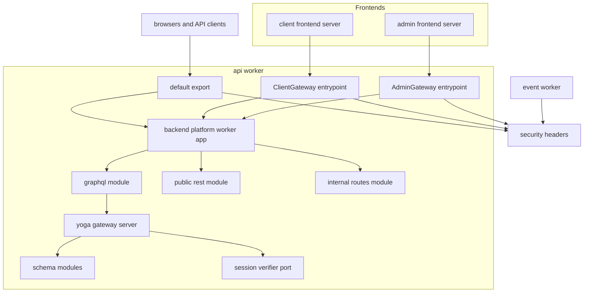
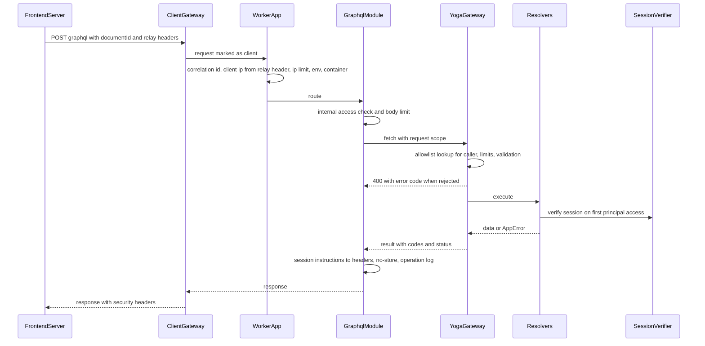
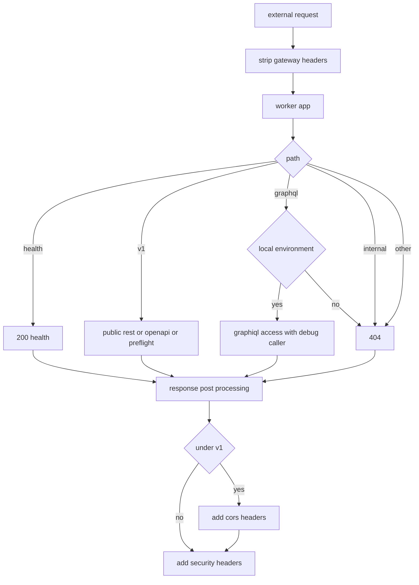
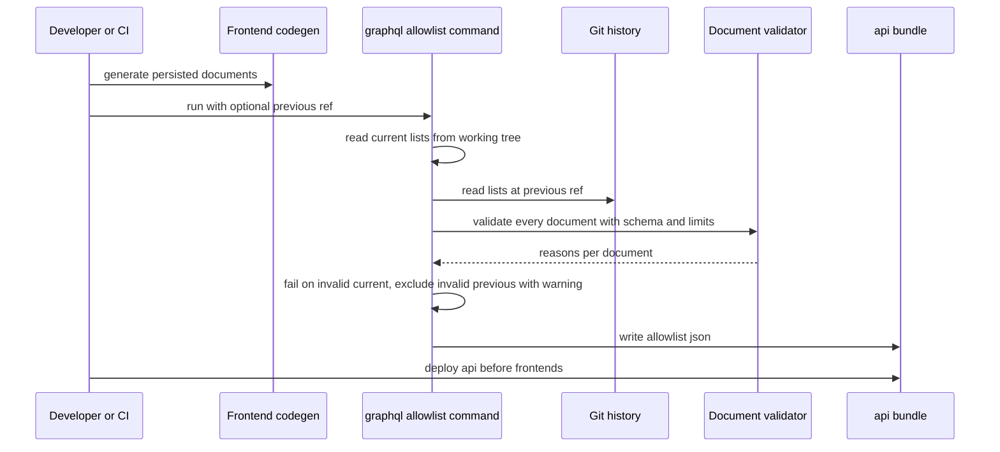
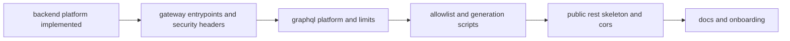

# Design Document

## Overview

**Purpose**: 利用者側・管理者側のフロントエンドサーバーとAPIサーバー(`apps/api`)の間に、共通の通信基盤を置く。GraphQLはService Bindingsの名前付きエントリポイントだけで受け付け、呼び出し元ごとの許可リスト・上限・エラー応答をサーバー側で強制する。公開REST APIは`/v1`の下に`@hono/zod-openapi`の骨格を置き、OpenAPI仕様の配信とCORSを提供する。あわせて、APIサーバーとイベントサーバー(`apps/event`)の全応答にセキュリティヘッダーを付ける。

**Users**: 後続のドメインspecの開発者とAIエージェントは、スキーマモジュール(型定義・リゾルバ)を登録箇所へ1つ追加するだけでGraphQLに機能を載せる。frontend-platformは本specのエントリポイント名・ヘッダー・スキーマファイル・操作の一覧の契約に従って中継とコード生成を作る。identity-auth・admin-foundationはセッションの検証のポートを実装し、public-apiは基準パスの下に経路を登録し、media-pipelineは内部RESTの経路を追加する。infra-deliveryは生成と検査のコマンドをCIから呼ぶ。

**Impact**: backend-platformが作る`apps/api`の骨格に、GraphQL・REST・内部経路のモジュールとエントリポイントを加える。共有コード(`apps/backend-lib`)には、セキュリティヘッダーの部品を新設し、Sentryのイベントから除くヘッダーを追記する。`apps/event`のエクスポートをセキュリティヘッダーの部品で包む。ルートの一括検査(dev-toolingの`scripts/tooling/run-all.ts`)に、GraphQLの生成物の検査の段階を加える(承認後の改訂2)。

### Goals

- GraphQLが内部経路だけで動き、許可リスト・上限・introspectionの無効化・エラーのマスキングがサーバー側で強制される。
- ドメインspecは、スキーマモジュールの追加と生成コマンドの実行だけでGraphQLに機能を載せられ、N+1を避ける部品と引数の検証の部品をそのまま使える。
- 公開REST APIの経路を、要求・応答の検証規則とともに登録するだけで、OpenAPI仕様とCORSに反映される。
- 両サーバーの単体テストとWorkers統合テストがカバレッジ80%を満たし、一括検査に参加する。

### Non-Goals

- ドメインの型・操作・RESTの経路、APIキーの認証、公開APIのレート制限ルール、Swagger UIの画面。
- フロントエンドのGraphQLクライアント・BFFの中継処理・Cookieの属性(frontend-platform)。
- セッションの発行・保存・有効期限・失効とログイン(identity-auth・admin-foundation)。
- CIのワークフロー、直前のリリースの特定、デプロイの順序の実行(infra-delivery)。
- GraphQLの購読、マルチパートのアップロード、APQの自動登録。

## Boundary Commitments

### This Spec Owns

- 外部経路と内部経路の境界: 既定のエクスポート(内部経路用のヘッダーの除去・CORS・セキュリティヘッダー)、名前付きエントリポイント`ClientGateway`・`AdminGateway`、呼び出し元の判定、元のクライアントIPアドレスの解決(`ClientIpResolver`の差し替え)、内部経路だけで受け付けるミドルウェアと内部RESTの登録箇所(`/internal`)。
- GraphQL基盤: `/graphql`の経路、Yogaの組み立て、上限(Armor)、呼び出し元別の許可リスト、introspection・GraphiQLの扱い、エラーコードとマスキング、操作ログとトレース、GraphQLの文脈(セッションの参照・関連データの一括読み込み・bot判定の呼び出し)。
- スキーマモジュールの規約: `GraphQLSchemaModule`、合成と重複検査、基盤の型定義(`DateTime`・`PageInfo`・`OffsetPageInfo`)、`defineLoader`、`withValidatedArgs`、ページングの補助関数、疎通確認の`systemStatus`(参照実装)。
- セッションの受け渡しの契約: `SessionVerifier`ポートと既定の実装(常に未ログイン)、要求・応答のヘッダー、Cookieの発行・削除の指示。
- 生成物と生成・検査のコマンド: スキーマファイル・リゾルバの型・許可リスト(`generated/`)、`graphql:generate`・`graphql:allowlist`・`graphql:check`、ルートの一括検査の段階「GraphQLの生成物の検査」(承認後の改訂2)。
- 公開RESTの骨格: 基準パス`/v1`、`PublicApiApp`と経路の登録箇所、検証失敗の応答、成功・エラー応答のスキーマ部品、認証方式の宣言、OpenAPI仕様の配信、プリフライト、CORSの方針。
- セキュリティヘッダー: 共有コードの部品と、apiとeventへの適用。
- 技術ドキュメント: `backend/004`〜`006`・`coding/004`と各索引、`docs/onboardings`の更新。

### Out of Boundary

- `createWorkerApp`のミドルウェアの順序、共通のエラー形式、`AppError`、IP制限・bot判定の検証・処理単位のコンテナの実装(backend-platformのものを変えずに使う)。
- フロントエンドのWrangler設定のService Bindings、中継処理、Cookieの発行、操作の一覧の生成(frontend-platform)。
- `SessionVerifier`の本実装、セッションの発行・失効の業務処理(identity-auth・admin-foundation)。
- 公開APIの業務の経路・APIキーの認証・FR-RLMIT-007〜008の適用(public-api)。
- `/internal`の下のファイルの中継先の経路、画像配信のCSPの値(media-pipeline)。
- 直前のリリースのコミットの特定、CIでのコマンドの呼び出し、APIサーバーを先にデプロイする順序の実行(infra-delivery)。
- GraphQLのクライアント観測の応答時間の計測(frontend-platform・launch-readiness)。

### Allowed Dependencies

- 上流(backend-platform): `createWorkerApp`・`createWorkerHandler`・`AppModule`・`PlatformHonoEnv`・`PLATFORM_TYPES`・`AppError`と`toErrorResponse`・`ClientIpResolver`と`resolveConnectingIp`・`BotVerifier`・`validateEnv`・ログのカテゴリ規約。形を変えない。
- 上流(dev-tooling): 基底設定、`workerTestPreset`、テストの命名と生成コードの命名(`**/generated/**`)の契約、アプリのスクリプト契約。
- npmパッケージ: Technology Stackの表に挙げた版に限る。
- 共有コードへの変更は、`workers/http/security-headers.ts`の新設と、`core/observability/scrub-event.ts`の除外ヘッダーの追記に限る。
- dev-toolingの一括検査への変更は、`CHECK_STEPS`への段階`graphql:check`の追加と、その単体テスト・補助・`coding/001`の記載に限る。段階の順序の規則と、スクリプトを持たないアプリを飛ばす扱いは変えない(承認後の改訂2)。
- backend-platformが作るapi・eventのエントリ・登録箇所・設定ファイル(`src/index.ts`・`composition/modules.ts`・`composition/env-schema.ts`・`wrangler.jsonc`・`eslint.config.ts`・`package.json`)には追記だけを行い、既存の束縛・経路・設定値を変えない。
- 依存の方向は「Dependency Direction」に従う。

### Revalidation Triggers

- 名前付きエントリポイントの名前、内部経路のヘッダーの名前と形式、セッションの指示のヘッダー(frontend-platform・identity-auth・admin-foundation)。
- GraphQLの要求の形式(`documentId`)、エラーコードの一覧、状態コードを429・503・400にする条件(frontend-platform・全ドメインspec)。
- 操作の一覧の場所・形式・識別子の形式、スキーマファイルの場所(frontend-platform)。
- `GraphQLSchemaModule`・`GraphQLContext`・`defineLoader`・`withValidatedArgs`・ページングの型、上限値(全ドメインspec)。
- `SessionVerifier`・`Principal`・`SessionIssue`の形と、発行できる有効期間の上限`MAX_SESSION_MAX_AGE_SECONDS`(identity-auth・admin-foundation、frontend-platformの同名の定数と同じ値、承認後の改訂4)。
- 基準パス、`PublicRestRoutes`・応答のスキーマ部品・認証方式の名前、`createRestModule`の`options.info`の形、仕様書の相対の`servers`(public-api)。
- `/internal`の接頭辞、`InternalRoutes`の形、`createSessionAccess`の形(media-pipeline)。
- セキュリティヘッダーの値とCSPの置き換えの規則(media-pipeline・launch-readiness)。
- `graphql:allowlist --previous-ref`の引数とデプロイの順序(infra-delivery)。
- 一括検査の段階`graphql:check`の位置と名前(dev-tooling)(承認後の改訂2)。
- Sentry SDK(`@sentry/cloudflare`・`@sentry/hono`)の版の更新。Honoの計装が応答の時点でルートのスパンの名前を`<メソッド> <経路>`へ書き戻す挙動が変わったら、OperationObservabilityのトレースの付け方を見直す(承認後の改訂2)。

## Architecture

### Existing Architecture Analysis

- `apps/api`・`apps/event`・`apps/backend-lib`はbackend-platformの実装前で、本specのタスクはbackend-platformの実装の完了を前提にする。
- backend-platformの`createWorkerApp`は、Sentry→相関IDとクライアントIP(`resolveClientIp`)→Worker単位のIP制限→`/health`→環境の検証→処理単位のコンテナ→各モジュールの経路→`notFound`・`onError`の順に処理する。モジュールの経路より前で返る応答(IP制限の429・環境の検証失敗の500)があるため、CORSとセキュリティヘッダーはWorkerのエクスポートの後処理で付ける。
- backend-platformの`ClientIpResolver`は要求だけを受け取る。内部経路かどうかは、名前付きエントリポイントが付けるヘッダーで判定する。外部経路の既定のエクスポートは同名のヘッダーを必ず取り除く。
- 層の配置とテストの分担(`domain`・`application`はBunの単体テスト、`infrastructure`・`presentation`・`composition`はWorkers統合テスト)、生成コードの命名(`**/generated/**`は整形・静的解析・カバレッジの対象外)はdev-tooling・backend-platformに従う。

### Architecture Pattern & Boundary Map



**Architecture Integration**:

- 選んだパターン: 呼び出し元ごとの名前付きエントリポイントで到達経路を分け、内側はbackend-platformの1つのHonoアプリと`AppModule`で処理する。GraphQLはスキーマファーストのモジュールを合成し、Yogaのプラグインで上限・許可リスト・エラーを強制する。
- 境界: エントリポイント(Hono外の前処理・後処理)、GraphQLモジュール、RESTモジュール、内部RESTモジュールの4つの入口を本specが持ち、ドメインspecは登録箇所(`graphql-modules.ts`・`rest-routes.ts`・`internal-routes.ts`・`session.ts`)だけに追記する。
- 既存パターンの維持: 4層と合成ルート、処理単位のコンテナ、`@inject`の明示、共通のエラー形式、生成コードの命名。
- 新規コンポーネントの理由: research.mdの「Generalization・Build vs Adopt・Simplification」を参照。

### Dependency Direction

アプリの`src`内は、backend-platformの規則どおり`domain` ← `application` ← `infrastructure`・`presentation` ← `composition` ← `index.ts`の向きにだけ参照する。本specが加える追加の規則は次のとおりである。

- `presentation/gateway` ← `presentation/graphql`・`presentation/rest`(GraphQLとRESTはゲートウェイの型・関数を使い、逆は禁止)。
- `presentation/graphql/modules/**`・`schema-module.ts`・`schema-composer.ts`・`platform-type-defs.ts`・`date-time-scalar.ts`・`query-limits.ts`・`error-codes.ts`と`composition/graphql-modules.ts`は、`cloudflare:*`・`@sentry/*`・`infrastructure`を読み込まない(生成コマンドと単体テストがBunで読み込むため)。apiの`eslint.config.ts`の`no-restricted-imports`で強制する。ESLintのflat configでは、同じファイルに当たる後の設定の`no-restricted-imports`が前の設定のオプションを置き換えるため、この規則には`createBackendLayerRules`のプレゼンテーション層・合成ルートの規則のパターン(`**/composition/**`の禁止)も含め直す。`test/config/layer-rules.unit.test.ts`で、対象のファイルから合成ルートを読み込む違反例も報告されることを確かめる(承認後の改訂2)。
- `scripts/graphql/**`は`src/composition/graphql-modules.ts`・`src/presentation/graphql/`の上記のファイル・`src/presentation/gateway/gateway-headers.ts`だけを読み込む。`src`から`scripts`を読み込まない。
- Bunの単体テストが読み込む`src`のファイル(`query-limits.ts`・`error-codes.ts`・`gateway-headers.ts`)は、Bunのカバレッジの分母にも入るため、単体テストで全関数を通る小さな純粋なファイルに保つ。
- 共有コードは`backend-lib/core` → `backend-lib/workers` → アプリの`src`の向きを保つ。`security-headers.ts`は`workers`に置く。

### Technology Stack

| Layer        | Choice / Version                                                                                                                          | Role in Feature                                     | Notes                                                                                                                                                                                                                             |
| ------------ | ----------------------------------------------------------------------------------------------------------------------------------------- | --------------------------------------------------- | --------------------------------------------------------------------------------------------------------------------------------------------------------------------------------------------------------------------------------- |
| ランタイム   | Cloudflare Workers(`compatibility_date` 2026-08-04)、Service Bindingsの名前付きエントリポイント                                           | 外部経路と内部経路の分離                            | 呼び出し側の設定はfrontend-platform                                                                                                                                                                                               |
| GraphQL      | graphql 16.14.2・graphql-yoga 5.24.6・@graphql-yoga/plugin-persisted-operations 3.24.6・@graphql-yoga/plugin-disable-introspection 2.25.6 | スキーマの実行、GraphiQL、許可リスト、introspection | tech-stack記載済み。`graphql`はArmorの依存に合わせて16系に固定(Q1)。Yogaは6系がArmorの依存(`@envelop/core` ^5)と合わないため5系に固定し、プラグインは`graphql-yoga` ^5.24.6を相手依存に持つため3つを同時に更新する(承認後の改訂2) |
| 上限         | @escape.tech/graphql-armor 3.2.0                                                                                                          | 深さ・コスト・エイリアス・字句・ディレクティブ      | tech-stack記載済み                                                                                                                                                                                                                |
| 一括読み込み | dataloader 2.2.3                                                                                                                          | N+1の回避                                           | tech-stack記載済み                                                                                                                                                                                                                |
| 型生成       | @graphql-codegen/cli 7.4.6・@graphql-codegen/typescript 6.1.2・@graphql-codegen/typescript-resolvers 6.1.1                                | リゾルバの型の生成と検査                            | typescript・typescript-resolversは新規(Q1)。cliはclient・adminと版をそろえる(frontend-platformの版も7.4.6、承認後の改訂2)                                                                                                         |
| REST         | @hono/zod-openapi 1.6.3・hono 4.13.13・zod 4.6.5                                                                                          | 経路と検証規則とOpenAPI 3.1仕様の一体化             | tech-stack記載済み。hono・zodはbackend-platformの版                                                                                                                                                                               |
| 観測         | @sentry/cloudflare 11.4.0・@logtape/logtape 2.3.11                                                                                        | 想定外の例外の送信、操作名のトレース、操作ログ      | backend-platformの版                                                                                                                                                                                                              |
| 開発・テスト | wrangler 4.124.0・vitest 4.1.11・@cloudflare/vitest-pool-workers 0.22.0・@vitest/coverage-istanbul 4.1.11                                 | Workers統合テスト、型生成                           | backend-platformの版                                                                                                                                                                                                              |

## File Structure Plan

### Directory Structure

```
apps/
├── backend-lib/
│   └── workers/http/
│       ├── security-headers.ts                  # SECURITY_HEADERS・DEFAULT_CONTENT_SECURITY_POLICY・applySecurityHeaders・withSecurityHeaders
│       └── security-headers.worker.test.ts
├── api/
│   ├── codegen.config.ts                        # リゾルバの型の生成設定(入力はスキーマファイル)
│   ├── scripts/graphql/
│   │   ├── generate.ts                          # 入口: 登録箇所からスキーマを合成して印字し、リゾルバの型を生成する
│   │   ├── check.ts                             # 入口: スキーマファイル・リゾルバの型・許可リストの食い違いを検査する
│   │   ├── build-allowlist.ts                   # 入口: 操作の一覧(現行と--previous-refの版)から許可リストを生成する
│   │   ├── allowlist-sources.ts                 # 操作の一覧の場所の契約と、作業ツリー・Gitの履歴からの読み出し
│   │   ├── allowlist-builder.ts                 # 純粋: 識別子の照合・和集合・検証失敗の扱い・整列と直列化
│   │   ├── document-validator.ts                # 合成したスキーマ・上限・introspectionの禁止・ルートの型で操作の本文を検証する関数の組み立て
│   │   ├── cli-args.ts                          # 純粋: --previous-refなどの引数の解析
│   │   └── *.unit.test.ts                       # 上の4ファイル(入口を除く)の単体テスト
│   ├── src/
│   │   ├── index.ts                             # (変更) 既定のエクスポートとClientGateway・AdminGateway・RateLimitCounter
│   │   ├── application/
│   │   │   ├── session/session-verifier.ts      # SessionVerifierポート・Principal・SessionIssue・SESSION_TYPES・SESSION_TOKEN_PATTERN・MAX_SESSION_MAX_AGE_SECONDS(新規、承認後の改訂4)
│   │   │   ├── session/anonymous-session-verifier.ts  # 既定の実装(常に無効)
│   │   │   └── system/system-status-query.ts    # 疎通確認のユースケース・DatabaseProbeポート・SYSTEM_TYPES
│   │   ├── infrastructure/system/d1-database-probe.ts  # DatabaseProbeのD1実装(SELECT 1)
│   │   ├── presentation/
│   │   │   ├── gateway/
│   │   │   │   ├── gateway-headers.ts           # CallerKind・ヘッダー名の契約・AppEnvironment
│   │   │   │   ├── internal-request.ts          # 呼び出し元の付与・除去・読み取り、クライアントIPの解決
│   │   │   │   ├── internal-only.ts             # internalOnlyミドルウェアと内部RESTのAppModule(/internal)
│   │   │   │   ├── session-access.ts            # createSessionAccess・Cookieの指示の応答ヘッダーへの反映
│   │   │   │   ├── public-entrypoint.ts         # 既定のエクスポートの包み(除去・CORS・セキュリティヘッダー)
│   │   │   │   └── gateway-entrypoint.ts        # 呼び出し元を固定した名前付きエントリポイントのクラスの生成
│   │   │   ├── graphql/
│   │   │   │   ├── graphql-module.ts            # AppModule: POST・GET /graphql(受付経路の判定・本文の上限・後処理)
│   │   │   │   ├── gateway-server.ts            # Yogaの組み立てと環境ごとのisolate内キャッシュ
│   │   │   │   ├── query-limits.ts              # 上限値・Armorの設定・拒否の種類の記録
│   │   │   │   ├── operation-allowlist.ts       # 許可リストの読み込み・照会・documentIdの抽出・未登録のエラー
│   │   │   │   ├── error-codes.ts               # GatewayErrorCode・上限の拒否の記録・実行前のエラーの分類(純粋)
│   │   │   │   ├── error-policy.ts              # エラーコードの付与・マスキング・状態コードとRetry-After
│   │   │   │   ├── graphql-context.ts           # GraphQLContextの型と要求ごとの生成
│   │   │   │   ├── loaders.ts                   # defineLoader・LoaderRegistry
│   │   │   │   ├── validated-args.ts            # withValidatedArgs(Zodによる引数の検証)
│   │   │   │   ├── pagination.ts                # カーソル・オフセットの引数スキーマと結果の組み立て
│   │   │   │   ├── operation-observability.ts   # 操作ログとSentryのトレース名・タグのプラグイン
│   │   │   │   ├── schema-module.ts             # GraphQLSchemaModule型とdefineSchemaModule
│   │   │   │   ├── schema-composer.ts           # 重複検査・合成・正規化した印字
│   │   │   │   ├── platform-type-defs.ts        # DateTime・PageInfo・OffsetPageInfoの型定義
│   │   │   │   ├── date-time-scalar.ts          # DateTimeのスカラーの実装
│   │   │   │   ├── modules/system/              # 疎通確認のスキーマモジュール(参照実装)
│   │   │   │   │   ├── type-defs.ts             # Query.systemStatus・SystemStatus
│   │   │   │   │   ├── resolvers.ts             # SystemStatusQueryを呼ぶリゾルバ
│   │   │   │   │   └── index.ts                 # systemSchemaModule
│   │   │   │   └── generated/                   # 生成物(コミットする。整形・静的解析・カバレッジの対象外)
│   │   │   │       ├── schema.graphql           # 合成したスキーマ(フロントエンドのコード生成の入力)
│   │   │   │       ├── resolvers-types.ts       # リゾルバの型
│   │   │   │       └── allowlist.json           # 呼び出し元別の許可リスト(コミット時は現行の操作だけ)
│   │   │   └── rest/
│   │   │       ├── public-api-app.ts            # PUBLIC_API_BASE_PATH・PublicApiApp・defaultHook・認証方式
│   │   │       ├── responses.ts                 # 成功応答(単体・オフセット・カーソル)とエラー応答のスキーマ部品
│   │   │       ├── route-table.ts               # 登録済み経路の表と、パスに対するメソッドの算出
│   │   │       ├── cors-policy.ts               # 公開APIのCORSのヘッダーの算出
│   │   │       └── rest-module.ts               # AppModule: /v1(経路・OpenAPI仕様・プリフライト)と経路表
│   │   └── composition/
│   │       ├── api-worker.ts                    # Workerの組み立て(apiHandler・publicEntrypoint・公開RESTの経路表)。テストからも読み込む
│   │       ├── graphql-modules.ts               # スキーマモジュールの登録箇所(初版はsystemだけ)
│   │       ├── rest-routes.ts                   # 公開RESTの経路の登録箇所(初版は空)
│   │       ├── internal-routes.ts               # 内部RESTの経路の登録箇所(初版は空)
│   │       └── session.ts                       # SessionVerifierの束縛(初版はAnonymousSessionVerifier)
│   └── test/
│       ├── support/gateway-test-harness.ts      # 環境・呼び出し元を指定してエントリを呼ぶテスト補助
│       ├── support/graphql-request.ts           # documentIdの要求の組み立て
│       ├── fixtures/graphql/                    # テスト用のスキーマモジュール・操作の一覧・許可リスト
│       └── types/graphql-raw.d.ts               # `*.graphql?raw`のモジュール宣言
docs/
├── GUIDES/tech/
│   ├── backend/004-graphql-server.md            # GraphQL基盤(受付・上限・許可リスト・エラー・スキーマモジュール規約・生成)
│   ├── backend/005-public-rest-api.md           # 公開RESTの骨格(基準パス・経路の登録・応答形式・OpenAPI・CORS)
│   ├── backend/006-internal-gateway.md          # 内部経路(エントリポイント・クライアントIP・セッションの受け渡し・内部REST)とセキュリティヘッダー
│   ├── coding/004-graphql-communication.md      # GraphQL通信のサーバー側の契約(frontend-platformがクライアント側を追記)
│   └── backend・coding のREADME.md               # 文書一覧へ追記
└── onboardings/ README.md · tech-stack.md · project-values.md
```

テストファイルは、同名の`*.unit.test.ts`(`application`・`scripts`)と`*.worker.test.ts`(`presentation`・`infrastructure`・`composition`・`backend-lib/workers`)を対象ファイルの隣に置く(上の木では一部を省略した)。

### Modified Files

- `apps/api/src/index.ts`: Workerの組み立てを`composition/api-worker.ts`へ移し、`index.ts`は既定のエクスポート(`publicEntrypoint`)・`ClientGateway`・`AdminGateway`・backend-platformの`RateLimitCounter`だけをエクスポートする(Workerのメインモジュールに実行基盤が扱わない値を出さない)。
- `apps/api/src/composition/modules.ts`: GraphQL・公開REST・内部RESTのモジュール、セッションの束縛、疎通確認の束縛(`SystemStatusQuery`・`DatabaseProbe`)を`MODULES`へ加える。
- `apps/api/src/composition/env-schema.ts`: `APP_ENVIRONMENT`(`local`・`staging`・`prod`)を加える。
- `apps/api/wrangler.jsonc`・`worker-configuration.d.ts`: ルート・staging・prodの`vars`に`APP_ENVIRONMENT`を加え、型を再生成する。
- `apps/api/package.json`・`bun.lock`: Technology Stackの依存を版を固定して加え、`graphql:generate`・`graphql:allowlist`・`graphql:check`を加える。
- `apps/api/eslint.config.ts`: 「Dependency Direction」のimport制限を加える。
- `apps/api/tsconfig.json`: `test/types`を含める(既存の`include`の範囲なら変更しない)。
- `apps/api/test/config/wrangler-config.unit.test.ts`: apiの`vars`の期待値に、ルート・staging・prodの`APP_ENVIRONMENT`を加える(既存のテストは`vars`を`toStrictEqual`で比べるため、変数の追加と同時に更新が要る)(承認後の改訂2)。
- `apps/api/test/config/layer-rules.unit.test.ts`: 「Dependency Direction」のimport制限の違反例(`cloudflare:*`・`@sentry/*`・`infrastructure`・合成ルート)を加える(承認後の改訂2)。
- `scripts/tooling/run-all.ts`・`run-all.unit.test.ts`・`run-all.step-errors.unit.test.ts`・`test-support/run-all-fixtures.ts`(dev-tooling、承認後の改訂2): 一括検査(`check`)の型生成の検査(`cf-typegen:check`)と型検査の間に、アプリだけを対象にする段階「GraphQLの生成物の検査」(`graphql:check`)を加える。生成し直し忘れたリゾルバの型は型検査のエラーとして現れるため、型検査の前に確認して原因を先に表示する。`graphql:check`を持たないアプリは既存の規則どおり「飛ばした(スクリプト未定義)」になる。
- `docs/GUIDES/tech/coding/001-javascript-typescript-conventions.md`(dev-tooling、承認後の改訂2): スクリプト契約の表と一括検査の段階・出力例に`graphql:check`を加える。
- `apps/backend-lib/core/observability/scrub-event.ts`・同`unit.test.ts`: 除くヘッダーに`x-original-client-ip`・`x-session-token`・`cf-turnstile-response`を加える。
- `apps/event/src/index.ts`・`index.worker.test.ts`: 既定のエクスポートを`withSecurityHeaders`で包み、応答のヘッダーを確かめる。
- `docs/onboardings/tech-stack.md`: `@graphql-codegen/typescript`・`@graphql-codegen/typescript-resolvers`(サーバー側のリゾルバの型生成)を追記する(14.6)。
- `docs/GUIDES/tech/coding/002-dependency-versions.md`: `graphql`・`@graphql-codegen/cli`を「api・client・adminで版をそろえる」一覧に、その他のGraphQL関連の依存をapiの一覧に加える。
- `docs/onboardings/project-values.md`: エントリポイント名・経路・ヘッダー名・生成物と操作の一覧の場所・`APP_ENVIRONMENT`の値・ローカルのGraphiQLのURLを記載する(14.5)。
- `docs/onboardings/README.md`: 生成・許可リスト・検査のコマンド、フロントエンドの操作の追加後の手順、ローカルのGraphiQLの使い方を記載する(14.7)。
- `CLAUDE.md`: 「技術規則の参照先」に、スキーマモジュール・公開REST・内部RESTを追加する前の参照先を追記する。

## System Flows

### 内部経路のGraphQL要求



- 呼び出し元のヘッダーは`ClientGateway`・`AdminGateway`だけが付け、外部経路の既定のエクスポートは取り除く。Honoの中の判定はこのヘッダーだけを見る(1.3・1.4)。
- 許可リストの照会は呼び出し元の一覧だけを対象にする(5.1・5.4)。上限・構文・検証の拒否はリゾルバの実行前に400で返す(4.7・7.4)。
- セッションの検証は、リゾルバが最初に`principal()`を呼んだときに1回だけ行う(3.1)。

### 外部経路の要求



- IP制限の429・環境の検証失敗の500もHonoの外の後処理を通るため、`/v1`の下ならCORSのヘッダーが付く(11.1)。
- ローカル環境の`/graphql`はGraphiQLの経路として、任意の操作とintrospectionを許す。呼び出し元は`x-debug-caller`(既定は`client`)、セッションは`x-session-token`の手入力で指定し、クライアントIPは接続元のものを使う(6.3・6.4)。

### 許可リストの生成とデプロイ



- コミットする`allowlist.json`は現行の操作だけで作る。CIのデプロイでは、infra-deliveryがその環境へ直前にデプロイしたコミットを`--previous-ref`で渡し、和集合で上書きしてからAPIをデプロイする(5.5〜5.7)。
- 直前のリリースの操作のうち現行のスキーマで検証に通らないものは除外し、一覧を警告として表示する。現行の操作が検証に通らなければ失敗する(4.9・5.8)。

## Requirements Traceability

| Requirement | Summary                                          | Components                                                  | Interfaces                                                    | Flows      |
| ----------- | ------------------------------------------------ | ----------------------------------------------------------- | ------------------------------------------------------------- | ---------- |
| 1.1         | GraphQLは1経路・内部経路だけ                     | GraphqlModule・GatewayEntrypoint                            | `POST /graphql`・`ClientGateway`・`AdminGateway`              | 内部経路   |
| 1.2         | 外部経路のGraphQL・内部経路は404                 | GraphqlModule・InternalOnly                                 | `AppError(not_found)`                                         | 外部経路   |
| 1.3         | 実行基盤の設定で呼び出し元を識別                 | GatewayEntrypoint・InternalRequest                          | `markInternalRequest`・`readInternalCaller`                   | 内部経路   |
| 1.4         | 名乗るヘッダーを信頼しない                       | PublicEntrypoint・InternalRequest                           | `stripGatewayHeaders`                                         | 外部経路   |
| 1.5         | 外部経路の経路を限定                             | PublicEntrypoint・GraphqlModule・InternalOnly               | 経路の一覧                                                    | 外部経路   |
| 1.6         | 内部RESTの追加規約                               | InternalOnly                                                | `InternalRoutes`・`internal-routes.ts`                        | —          |
| 2.1         | 引き継いだIPを送信元に使う                       | InternalRequest                                             | `resolveGatewayClientIp`                                      | 内部経路   |
| 2.2         | 外部経路のIPヘッダーは無視                       | InternalRequest・PublicEntrypoint                           | `stripGatewayHeaders`・`resolveConnectingIp`                  | 外部経路   |
| 2.3         | IPが無い・不正なら不明と警告                     | InternalRequest・InternalOnly・GraphqlModule                | `parseClientIp`・警告ログ                                     | 内部経路   |
| 2.4         | ヘッダーの契約の文書化                           | GatewayHeaders・技術ドキュメント群                          | `GATEWAY_HEADERS`                                             | —          |
| 3.1         | セッションの値を検証へ渡し結果を提供             | SessionAccess・GraphQLContext                               | `SessionAccess.principal`                                     | 内部経路   |
| 3.2         | 呼び出し元の種類のセッションだけ                 | SessionAccess                                               | `subjectKindOf`                                               | —          |
| 3.3         | 実装が無ければ未ログイン                         | AnonymousSessionVerifier・ApiCompositionUpdates             | `SESSION_TYPES.SessionVerifier`                               | —          |
| 3.4         | 形式不正は問い合わせない                         | SessionAccess                                               | `SESSION_TOKEN_PATTERN`                                       | —          |
| 3.5         | 発行は本文に含めず指示で返す                     | SessionAccess                                               | `issue`・`x-session-issue`                                    | 内部経路   |
| 3.6         | 失効・無効は削除の指示                           | SessionAccess                                               | `clear`・`x-session-clear`                                    | 内部経路   |
| 3.7         | 識別子をログ等に含めない                         | SessionAccess・OperationObservability・SentryScrubAdditions | 伏せ字・除外ヘッダー                                          | —          |
| 3.8         | 受け渡しの契約(有効期間の上限を含む)の文書化     | 技術ドキュメント群                                          | `coding/004`・`backend/006`                                   | —          |
| 3.9         | 有効期間が400日を超える発行を拒否(承認後の改訂4) | SessionAccess・SessionVerifierPort                          | `assertIssuable`・`MAX_SESSION_MAX_AGE_SECONDS`               | 内部経路   |
| 4.1         | 深さ8                                            | QueryLimits                                                 | `QUERY_LIMITS.maxDepth`                                       | 内部経路   |
| 4.2         | コストの算出方法                                 | QueryLimits                                                 | `objectCost`・`scalarCost`・`depthCostFactor`                 | —          |
| 4.3         | コスト5000                                       | QueryLimits                                                 | `QUERY_LIMITS.maxCost`                                        | 内部経路   |
| 4.4         | エイリアス15                                     | QueryLimits                                                 | `QUERY_LIMITS.maxAliases`                                     | 内部経路   |
| 4.5         | バッチ拒否                                       | GatewayServer・ErrorPolicy                                  | `batching: false`・`graphql_request_invalid`                  | —          |
| 4.6         | 字句1000・ディレクティブ50                       | QueryLimits                                                 | `maxTokens`・`maxDirectives`                                  | —          |
| 4.7         | 上限の種類のコードと実行しない                   | QueryLimits・ErrorPolicy                                    | `query_*_exceeded`                                            | 内部経路   |
| 4.8         | デプロイ先では値を含めない                       | QueryLimits                                                 | `exposeLimits`                                                | —          |
| 4.9         | 登録済み操作の上限の検査                         | GraphQLScripts・GraphqlModule                               | `graphql:allowlist`・`graphql:check`                          | 許可リスト |
| 5.1         | 内部経路は許可リストの操作だけ                   | OperationAllowlist・GatewayServer                           | `getPersistedOperation`                                       | 内部経路   |
| 5.2         | 本文だけは拒否                                   | OperationAllowlist                                          | `persisted_operation_required`                                | —          |
| 5.3         | 未登録は拒否                                     | OperationAllowlist                                          | `persisted_operation_not_found`                               | —          |
| 5.4         | 他方の呼び出し元の操作は拒否                     | OperationAllowlist                                          | `find(caller, documentId)`                                    | 内部経路   |
| 5.5         | 現行と直前のリリース                             | GraphQLScripts                                              | `buildAllowlist`の和集合                                      | 許可リスト |
| 5.6         | 一覧からの生成コマンド                           | GraphQLScripts                                              | `graphql:allowlist --previous-ref`                            | 許可リスト |
| 5.7         | 直前が無ければ現行だけ                           | GraphQLScripts                                              | 引数なしの実行                                                | 許可リスト |
| 5.8         | 識別子の不一致・衝突で失敗                       | GraphQLScripts                                              | `hash_mismatch`・`conflicting_document`                       | 許可リスト |
| 5.9         | 直前の参照方法と場所・形式の文書化               | GraphQLScripts・技術ドキュメント群                          | `ALLOWLIST_SOURCES`・`coding/004`                             | —          |
| 6.1         | デプロイ先はintrospection・GraphiQLなし          | GatewayServer                                               | `useDisableIntrospection`・`graphiql: false`                  | —          |
| 6.2         | 候補を含めない                                   | QueryLimits                                                 | `blockFieldSuggestion`                                        | —          |
| 6.3         | ローカルのGraphiQLの経路                         | GraphqlModule・GatewayServer                                | `allowArbitraryOperations`                                    | 外部経路   |
| 6.4         | GraphiQLではIPを信頼せずヘッダーで指定           | GraphqlModule・InternalRequest                              | `x-debug-caller`・`x-session-token`                           | 外部経路   |
| 6.5         | GraphiQLにも上限                                 | QueryLimits・GatewayServer                                  | 共通のプラグイン                                              | —          |
| 6.6         | デプロイ先のGraphiQLの経路は404                  | GraphqlModule                                               | `GET /graphql`                                                | 外部経路   |
| 7.1         | AppErrorのコード・メッセージ・詳細               | ErrorPolicy                                                 | `maskError`                                                   | 内部経路   |
| 7.2         | 想定外は定型で伏せて送る                         | ErrorPolicy                                                 | `internal_error`・`captureException`                          | —          |
| 7.3         | 429・503とRetry-After                            | ErrorPolicy                                                 | `extensions.http`                                             | —          |
| 7.4         | 実行前の拒否のコード                             | ErrorPolicy・QueryLimits・OperationAllowlist                | エラーコード表                                                | 内部経路   |
| 7.5         | キャッシュ禁止                                   | GraphqlModule                                               | `Cache-Control: no-store`                                     | —          |
| 7.6         | AppErrorは送らない                               | ErrorPolicy                                                 | 分類                                                          | —          |
| 7.7         | エラーコードの文書化                             | 技術ドキュメント群                                          | `coding/004`                                                  | —          |
| 8.1         | 登録で1スキーマへ合成                            | SchemaComposer・ApiCompositionUpdates                       | `GRAPHQL_SCHEMA_MODULES`・`composeGatewaySchema`              | —          |
| 8.2         | 重複・過剰なリゾルバで失敗                       | SchemaComposer                                              | `SchemaCompositionError`                                      | —          |
| 8.3         | 処理単位の一括読み込み                           | Loaders                                                     | `defineLoader`・`LoaderRegistry`                              | —          |
| 8.4         | コンテナからユースケースを取得                   | GraphQLContext・技術ドキュメント群                          | `GraphQLContext.resolve`                                      | —          |
| 8.5         | Zodによる引数の検証                              | ValidatedArgs                                               | `withValidatedArgs`                                           | —          |
| 8.6         | 日時のスカラーとページングの型                   | PlatformTypeDefs・DateTimeScalar・Pagination                | `DateTime`・`PageInfo`・`OffsetPageInfo`                      | —          |
| 8.7         | bot判定の呼び出し                                | GraphQLContext                                              | `assertHuman`                                                 | —          |
| 8.8         | 疎通確認のクエリだけ                             | SystemModule・SystemStatusQuery・D1DatabaseProbe            | `Query.systemStatus`                                          | —          |
| 9.1         | 正規化したスキーマファイルと型の生成             | GraphQLScripts・SchemaComposer                              | `graphql:generate`・`printGatewaySchema`                      | —          |
| 9.2         | 再実行で内容が変わらない                         | SchemaComposer・GraphQLScripts                              | `lexicographicSortSchema`                                     | —          |
| 9.3         | 食い違いで検査とテストが失敗                     | GraphQLScripts・SchemaComposer                              | `graphql:check`(一括検査の段階)・スキーマファイルの比較テスト | —          |
| 9.4         | スキーマファイルの契約とCIからの呼び出し         | 技術ドキュメント群・GraphQLScripts                          | `coding/004`                                                  | —          |
| 10.1        | 版付きの基準パス                                 | PublicApiApp                                                | `PUBLIC_API_BASE_PATH`(`/v1`)                                 | —          |
| 10.2        | 経路の登録とOpenAPIの生成                        | RestModule・PublicApiApp                                    | `PublicRestRoutes`・`rest-routes.ts`                          | —          |
| 10.3        | 認証なしのOpenAPI仕様                            | RestModule                                                  | `GET /v1/openapi.json`                                        | 外部経路   |
| 10.4        | 検証失敗は400と詳細                              | PublicApiApp                                                | `defaultHook`                                                 | —          |
| 10.5        | 未登録は404                                      | RestModule                                                  | backend-platformの`notFound`                                  | —          |
| 10.6        | 成功応答の共通の型                               | Responses                                                   | `dataEnvelope`・`offsetListEnvelope`・`cursorListEnvelope`    | —          |
| 10.7        | Bearer認証の宣言                                 | PublicApiApp・Responses                                     | `API_KEY_SECURITY`                                            | —          |
| 10.8        | 仕様の配信経路だけ                               | RestModule・ApiCompositionUpdates                           | 空の`REST_ROUTES`                                             | —          |
| 10.9        | 相対のサーバーで基準パスを示す                   | RestModule                                                  | `doc31`の`servers: [{ url: '/v1' }]`                          | 外部経路   |
| 10.10       | 登録箇所からの題名・版・説明の指定               | RestModule                                                  | `createRestModule`の`options.info`                            | —          |
| 11.1        | 全応答にACAO・ACAM・ACAH                         | CorsPolicy・PublicEntrypoint・RouteTable                    | `headersFor`                                                  | 外部経路   |
| 11.2        | 更新系はContent-Type                             | CorsPolicy                                                  | 本文を受け取るメソッドの判定                                  | —          |
| 11.3        | プリフライトは204                                | RestModule                                                  | `OPTIONS /v1/*`                                               | 外部経路   |
| 11.4        | Credentialsを付けない                            | CorsPolicy                                                  | ヘッダーの一覧                                                | —          |
| 11.5        | 他の経路にCORSなし                               | CorsPolicy・PublicEntrypoint                                | `/v1`の判定                                                   | 外部経路   |
| 12.1        | 全応答のセキュリティヘッダー                     | SecurityHeaders・PublicEntrypoint・GatewayEntrypoint        | `applySecurityHeaders`・`withSecurityHeaders`                 | 外部経路   |
| 12.2        | Permissions-Policyで無効化                       | SecurityHeaders                                             | `SECURITY_HEADERS`                                            | —          |
| 12.3        | 経路のCSPで置き換え                              | SecurityHeaders・GraphqlModule                              | CSPがあれば保つ規則                                           | —          |
| 12.4        | 値と置き換え方の文書化                           | 技術ドキュメント群                                          | `backend/006`                                                 | —          |
| 13.1        | 操作ログ                                         | OperationObservability・GraphqlModule                       | `['api', 'graphql', 'operation']`                             | 内部経路   |
| 13.2        | トレースに操作名と呼び出し元                     | OperationObservability                                      | ルートのスパンの属性・実行の子のスパン                        | —          |
| 13.3        | 合成と許可リストは最初の要求で1回                | GatewayServer・OperationAllowlist                           | `getGatewayServer`                                            | —          |
| 14.1        | カバレッジ80%                                    | 全コンポーネントのテスト                                    | `coverage.include`の分担                                      | —          |
| 14.2        | 内部・外部経路を再現するWorkers統合テスト        | GatewayTestHarness                                          | `exports.ClientGateway`・`exports.default`                    | —          |
| 14.3        | backendの文書                                    | 技術ドキュメント群                                          | `backend/004`〜`006`                                          | —          |
| 14.4        | codingの文書                                     | 技術ドキュメント群                                          | `coding/004`                                                  | —          |
| 14.5        | 固有値を含めない                                 | 技術ドキュメント群                                          | `project-values.md`                                           | —          |
| 14.6        | tech-stack.mdの更新                              | 技術ドキュメント群                                          | `tech-stack.md`                                               | —          |
| 14.7        | オンボーディングの更新                           | 技術ドキュメント群                                          | `docs/onboardings/README.md`                                  | —          |

## Components and Interfaces

| Component                                                      | Domain/Layer                              | Intent                                                 | Req Coverage                                  | Key Dependencies (P0/P1)                         | Contracts      |
| -------------------------------------------------------------- | ----------------------------------------- | ------------------------------------------------------ | --------------------------------------------- | ------------------------------------------------ | -------------- |
| GatewayHeaders                                                 | presentation/gateway                      | 呼び出し元の型・ヘッダー名・環境の型                   | 2.4, 3.8                                      | —                                                | State          |
| InternalRequest                                                | presentation/gateway                      | 呼び出し元の付与・除去・読み取り、クライアントIPの解決 | 1.3, 1.4, 2.1, 2.2, 2.3, 6.4                  | backend-platformの`ClientIpResolver` (P0)        | Service        |
| GatewayEntrypoint                                              | presentation/gateway                      | 呼び出し元を固定した名前付きエントリポイント           | 1.1, 1.3, 12.1                                | WorkerHandler (P0)、SecurityHeaders (P0)         | API            |
| PublicEntrypoint                                               | presentation/gateway                      | 外部経路の前処理と後処理                               | 1.4, 1.5, 2.2, 11.1, 11.5, 12.1               | WorkerHandler (P0)、CorsPolicy (P0)              | API            |
| InternalOnly                                                   | presentation/gateway                      | 内部経路だけで受け付ける経路と内部RESTの登録           | 1.2, 1.5, 1.6, 2.3                            | AppModule (P0)                                   | API            |
| SessionAccess                                                  | presentation/gateway                      | セッションの検証呼び出しとCookieの指示                 | 3.1〜3.7, 3.9                                 | SessionVerifier (P0)                             | Service        |
| GraphqlModule                                                  | presentation/graphql                      | `/graphql`の受付・後処理                               | 1.1, 1.2, 1.5, 6.3, 6.4, 6.6, 7.5, 12.3, 13.1 | GatewayServer (P0)、InternalOnly (P0)            | API            |
| GatewayServer                                                  | presentation/graphql                      | Yogaの組み立てと環境ごとのキャッシュ                   | 4.5, 5.1, 6.1, 6.3, 6.5, 13.3                 | graphql-yoga (P0)、QueryLimits・ErrorPolicy (P0) | Service        |
| QueryLimits                                                    | presentation/graphql                      | 上限値とArmorの設定、拒否の種類                        | 4.1〜4.8, 6.2, 6.5                            | graphql-armor (P0)                               | Service        |
| OperationAllowlist                                             | presentation/graphql                      | 呼び出し元別の許可リスト                               | 5.1〜5.4, 13.3                                | persisted-operations (P0)                        | Service, State |
| ErrorPolicy・ErrorCodes                                        | presentation/graphql                      | エラーコード・分類・マスキング・状態コード             | 4.5, 4.7, 7.1〜7.4, 7.6                       | AppError (P0)、Sentry (P1)                       | Service        |
| GraphQLContext・Loaders・ValidatedArgs・Pagination             | presentation/graphql                      | リゾルバに渡す文脈と部品                               | 3.1, 8.3〜8.7                                 | Inversify (P0)、dataloader (P0)、zod (P0)        | Service        |
| OperationObservability                                         | presentation/graphql                      | 操作ログとトレース                                     | 3.7, 13.1, 13.2                               | LogTape (P1)、Sentry (P1)                        | Service        |
| SchemaModule・SchemaComposer・PlatformTypeDefs・DateTimeScalar | presentation/graphql                      | モジュールの契約・合成・印字                           | 8.1, 8.2, 8.6, 9.1, 9.2, 9.3                  | graphql (P0)                                     | Service, State |
| SystemModule・SystemStatusQuery・D1DatabaseProbe               | presentation・application・infrastructure | 疎通確認(参照実装)                                     | 8.4, 8.8                                      | Database (P0)                                    | API, Service   |
| SessionVerifierPort・AnonymousSessionVerifier                  | application                               | セッションの検証のポートと既定の実装                   | 3.1〜3.4, 3.9                                 | —                                                | Service        |
| PublicApiApp・Responses・RouteTable・CorsPolicy・RestModule    | presentation/rest                         | 公開RESTの骨格とCORS                                   | 10.1〜10.10, 11.1〜11.5                       | @hono/zod-openapi (P0)                           | API, Service   |
| SecurityHeaders                                                | backend-lib/workers                       | セキュリティヘッダーの付与                             | 12.1〜12.3                                    | —                                                | Service        |
| SentryScrubAdditions                                           | backend-lib/core                          | 追加ヘッダーのSentryからの除去                         | 2.2, 3.7                                      | backend-platformの`scrubEvent` (P0)              | Service        |
| GraphQLScripts                                                 | scripts                                   | 生成・検査・許可リスト                                 | 4.9, 5.5〜5.9, 9.1〜9.4                       | Git (P1)、GraphQL Code Generator (P0)            | Batch          |
| ApiCompositionUpdates                                          | composition・index                        | 登録箇所・エントリ・設定                               | 1.6, 3.3, 8.1, 10.2, 13.3                     | backend-platformの合成 (P0)                      | State          |
| GatewayTestHarness                                             | test                                      | 環境・呼び出し元を指定したWorkers統合テスト            | 14.1, 14.2                                    | `cloudflare:workers`の`exports` (P0)             | —              |
| 技術ドキュメント群                                             | docs                                      | 規約と契約の文書化                                     | 2.4, 3.8, 5.9, 7.7, 9.4, 12.4, 14.3〜14.7     | —                                                | —              |

### presentation/gateway

#### GatewayHeaders

| Field        | Detail                                           |
| ------------ | ------------------------------------------------ |
| Intent       | 内部経路の契約(呼び出し元・ヘッダー名・環境)の型 |
| Requirements | 2.4, 3.8                                         |

**Contracts**: State [x]

##### State Management

```typescript
export type CallerKind = 'client' | 'admin';
export declare const CALLER_KINDS: readonly CallerKind[];

export type AppEnvironment = 'local' | 'staging' | 'prod';
export declare const APP_ENVIRONMENTS: readonly AppEnvironment[];
export declare function isDeployedEnvironment(
  environment: AppEnvironment,
): boolean; // staging・prodで真

export declare const GATEWAY_HEADERS: {
  readonly caller: 'x-internal-caller'; // エントリポイントだけが付ける。外部経路では除去
  readonly clientIp: 'x-original-client-ip'; // フロントエンドが付ける。内部経路でだけ信頼
  readonly sessionToken: 'x-session-token'; // ブラウザのセッションCookieの値
  readonly botToken: 'cf-turnstile-response'; // bot判定のトークン
  readonly debugCaller: 'x-debug-caller'; // ローカルのGraphiQLの経路でだけ読む
};
export declare const SESSION_RESPONSE_HEADERS: {
  readonly issue: 'x-session-issue'; // 新しいセッション識別子。フロントエンドはCookieに設定して除去する
  readonly maxAge: 'x-session-max-age'; // Cookieの有効期間(秒)
  readonly clear: 'x-session-clear'; // 値は"1"。フロントエンドはCookieを削除して除去する
};
```

- ヘッダー名は小文字で扱う(HTTPヘッダーは大文字小文字を区別しない)。値と意味の一覧は`coding/004`に載せる(2.4・3.8)。

#### InternalRequest

| Field        | Detail                                                     |
| ------------ | ---------------------------------------------------------- |
| Intent       | 呼び出し元の付与・除去・読み取りと、送信元IPアドレスの解決 |
| Requirements | 1.3, 1.4, 2.1, 2.2, 2.3, 6.4                               |

**Contracts**: Service [x]

##### Service Interface

```typescript
import type { ClientIpResolver } from '../../../lib/workers/rate-limit/client-ip.ts';

export declare function markInternalRequest(
  request: Request,
  caller: CallerKind,
): Request; // x-internal-callerを上書き
export declare function stripGatewayHeaders(request: Request): Request; // x-internal-caller・x-original-client-ipを除去
export declare function readInternalCaller(
  request: Request,
): CallerKind | undefined;
export declare function parseClientIp(value: string | null): string | undefined; // IPv4・IPv6として解釈できる値だけ返す
export declare const resolveGatewayClientIp: ClientIpResolver;
```

- `resolveGatewayClientIp`: 呼び出し元のヘッダーがあれば`parseClientIp(x-original-client-ip)`(解釈できなければ`undefined`)、無ければbackend-platformの`resolveConnectingIp`の結果を返す。`undefined`はbackend-platformのIP制限で`ip:unknown`として数えられる(2.1〜2.3)。
- 外部経路の要求は`stripGatewayHeaders`を必ず通るため、`x-internal-caller`の存在が内部経路の証拠になる(1.3・1.4)。
- IPの検証はZodの`z.ipv4()`・`z.ipv6()`で行う。警告ログはこの関数では出さず、InternalOnlyとGraphqlModuleが出す(関数を純粋に保つ)。

#### GatewayEntrypoint

| Field        | Detail                                       |
| ------------ | -------------------------------------------- |
| Intent       | 呼び出し元を固定した名前付きエントリポイント |
| Requirements | 1.1, 1.3, 12.1                               |

**Contracts**: API [x]

##### API Contract

```typescript
import type { WorkerEntrypoint } from 'cloudflare:workers';

export declare function createGatewayEntrypointClass<E>(
  caller: CallerKind,
  handler: ExportedHandler<E>,
): new (ctx: ExecutionContext, env: E) => WorkerEntrypoint<E>;
```

- `fetch(request)`は`markInternalRequest(request, caller)`の結果を`handler.fetch(marked, this.env, this.ctx)`へ渡し、応答に`applySecurityHeaders`を適用する。RPCのメソッドは持たない。
- `src/index.ts`は`export class ClientGateway extends createGatewayEntrypointClass('client', handler) {}`と`AdminGateway`を宣言する。クラス名はfrontend-platformのService Bindingsの`entrypoint`の値になる(契約)。

#### PublicEntrypoint

| Field        | Detail                                   |
| ------------ | ---------------------------------------- |
| Intent       | 外部経路の要求の前処理と、全応答の後処理 |
| Requirements | 1.4, 1.5, 2.2, 11.1, 11.5, 12.1          |

**Contracts**: API [x]

##### API Contract

```typescript
// CORSの方針の契約。実装はpresentation/restのcreatePublicApiCorsPolicy(rest → gatewayの向きを保つ)
export interface CorsPolicy {
  headersFor(url: URL): Readonly<Record<string, string>> | undefined; // 対象外のパスならundefined
}
export interface PublicEntrypointOptions {
  readonly cors: CorsPolicy;
}
export declare function createPublicEntrypoint<E>(
  handler: ExportedHandler<E>,
  options: PublicEntrypointOptions,
): ExportedHandler<E>;
```

- `fetch`: `stripGatewayHeaders`→`handler.fetch`→`cors.headersFor(url)`があれば付与→`applySecurityHeaders`。`scheduled`はそのまま委ねる。
- 外部経路で応じる経路(1.5): `/health`(backend-platform)、`/v1`の下(RestModule)、ローカル環境の`/graphql`(GraphqlModule)。GraphQL・`/internal`はデプロイ先環境では404、それ以外の経路はbackend-platformの404になる。

#### InternalOnly

| Field        | Detail                                       |
| ------------ | -------------------------------------------- |
| Intent       | 内部経路だけで受け付ける経路と内部RESTの登録 |
| Requirements | 1.2, 1.5, 1.6, 2.3                           |

**Contracts**: API [x]

##### API Contract

```typescript
import type { Hono, MiddlewareHandler } from 'hono';

export declare const INTERNAL_ROUTE_PREFIX: '/internal';
export type InternalHonoEnv<E> = {
  readonly Bindings: E;
  readonly Variables: PlatformHonoEnv<E>['Variables'] & {
    readonly session: SessionAccess;
  };
}; // 改訂3
export type InternalRoutes<E> = (app: Hono<InternalHonoEnv<E>>) => void;

export declare function internalOnly(): MiddlewareHandler; // 外部経路ならAppError(not_found)
export declare function warnOnMissingClientIp(request: Request): void; // 内部経路でIPが無い・不正なら警告
export declare function createInternalRoutesModule<E extends PlatformEnv>(
  routes: readonly InternalRoutes<E>[],
): AppModule<Hono<PlatformHonoEnv<E>>>;
```

| Method | Endpoint      | Request            | Response           | Errors                                  |
| ------ | ------------- | ------------------ | ------------------ | --------------------------------------- |
| 任意   | `/internal/*` | 登録した経路の定義 | 登録した経路の定義 | 404 `not_found`(外部経路・未登録の経路) |

- `createInternalRoutesModule`は`/internal`のサブアプリに`internalOnly()`・`warnOnMissingClientIp`・セッションの提供を先に適用し、登録された経路をその後に追加する。セッションの提供は要求ごとに`createSessionAccess`で参照を作って`c.var.session`で経路へ渡し、経路の後(共通エラー・想定外の例外の応答を含む)に`finishSessionResponse`で`Cache-Control: no-store`(経路が付けた値は上書きする)とセッションの指示を付ける(1.6・3.5・3.6・7.5、改訂3)。経路は`createSessionAccess`を作り直さない(作り直した参照の指示は応答に載らない)。外部経路の404は`internalOnly`で先に終わり、検証も指示も付かない。
- 警告ログ(2.3): カテゴリ`['api', 'gateway', 'client-ip']`、レベル`warning`、属性`reason`(`missing`・`invalid`)・`caller`。IPの値は記録しない。

#### SessionAccess

| Field        | Detail                                       |
| ------------ | -------------------------------------------- |
| Intent       | セッションの検証呼び出しとCookieの指示の集約 |
| Requirements | 3.1, 3.2, 3.3, 3.4, 3.5, 3.6, 3.7, 3.9       |

**Contracts**: Service [x]

##### Service Interface

```typescript
import type { Container } from 'inversify';
import type {
  AuthenticatedPrincipal,
  Principal,
  SessionIssue,
} from '../../application/session/session-verifier.ts';

export interface SessionAccess {
  principal(): Promise<Principal>; // 最初の呼び出しで1回だけ検証する
  requireAuthenticated(): Promise<AuthenticatedPrincipal>; // 未ログインならAppError(unauthenticated)
  issue(session: SessionIssue): void; // 発行・更新の指示(最後の指示が有効)
  clear(): void; // 削除の指示
}
export interface SessionAccessInput {
  readonly container: Container;
  readonly caller: CallerKind;
  readonly token: string | undefined; // x-session-tokenの値
}
export declare function createSessionAccess(
  input: SessionAccessInput,
): SessionAccess;
export declare function applySessionInstructions(
  access: SessionAccess,
  headers: Headers,
): void;
export declare function finishSessionResponse(
  c: Context,
  access: SessionAccess,
): void; // 改訂3
```

- 呼び出し元から検証の種類を決める(利用者側→`user`、管理者側→`admin`、3.2)。
- トークンが無い、または`SESSION_TOKEN_PATTERN`に合わなければ、`SessionVerifier`を呼ばずに未ログインとする(3.4)。
- `verify`の結果が`invalid`なら未ログインとし、削除の指示を記録する(3.6)。`valid`で`renewal`があれば発行の指示を記録する。
- `applySessionInstructions`: 発行は`x-session-issue`・`x-session-max-age`、削除は`x-session-clear: 1`。発行の値が`SESSION_TOKEN_PATTERN`に合わなければ設定せず例外にする(ヘッダーへの注入を防ぐ)。有効期間が1以上`MAX_SESSION_MAX_AGE_SECONDS`(34,560,000秒、400日)以下の整数でなければ、同じく設定せず値を含めない`RangeError`にする(`assertIssuable`、3.9、承認後の改訂4)。上限はブラウザがCookieの`Max-Age`を400日で切り詰めることに合わせた値で、フロントエンドサーバーは上限を超える指示を無視する。例外は想定外の失敗として共通の後処理(`onError`)が500にする。トークンは応答本文・ログ・Sentryに出さない(3.5・3.7)。
- `finishSessionResponse`(改訂3): `c.res`のヘッダーを複製して`Cache-Control: no-store`と`applySessionInstructions`の指示を書いた応答を作り、`c.res = undefined`の後に代入する(Honoの`c.res`のsetterが古い応答のヘッダーを書き戻すため)。GraphQLの経路と内部RESTの共通の後処理が使う。

### presentation/graphql

#### GraphqlModule

| Field        | Detail                                               |
| ------------ | ---------------------------------------------------- |
| Intent       | `/graphql`の受付経路の判定・本文の上限・応答の後処理 |
| Requirements | 1.1, 1.2, 1.5, 6.3, 6.4, 6.6, 7.5, 12.3, 13.1        |

**Contracts**: API [x]

##### API Contract

| Method | Endpoint   | Request                                                                    | Response                                        | Errors                                                                          |
| ------ | ---------- | -------------------------------------------------------------------------- | ----------------------------------------------- | ------------------------------------------------------------------------------- |
| POST   | `/graphql` | `application/json`の`{ documentId, operationName?, variables? }`(1MiB以下) | `application/graphql-response+json`・`no-store` | 404 `not_found`(デプロイ先の外部経路)、413 `payload_too_large`、GraphQLのエラー |
| GET    | `/graphql` | なし                                                                       | ローカル環境ではGraphiQLのHTML                  | 404 `not_found`(デプロイ先環境)                                                 |

```typescript
export interface GraphQLModuleOptions {
  readonly schemaModules: readonly GraphQLSchemaModule[];
  readonly allowlist: unknown; // allowlist.jsonの内容。最初の要求でOperationAllowlistが検証する
}
export declare function createGraphQLModule<
  E extends PlatformEnv & { readonly APP_ENVIRONMENT: AppEnvironment },
>(options: GraphQLModuleOptions): AppModule<Hono<PlatformHonoEnv<E>>>;
```

- 受付経路: `readInternalCaller`があれば`internal`(呼び出し元はその値)。無ければ、ローカル環境なら`graphiql`(呼び出し元は`x-debug-caller`、既定`client`)、それ以外は`AppError(not_found)`(1.2・6.6)。
- 内部経路では`warnOnMissingClientIp`を呼ぶ。`graphiql`のクライアントIPは接続元の値(backend-platformの解決結果)を使う(6.4)。
- 本文が1MiBを超えたら`AppError`(`payload_too_large`)を投げ、基盤の例外の変換が413と共通のエラー形式で応答する(改訂3)。
- `getGatewayServer`のYogaへ、要求と`GatewayRequestScope`(受付経路・コンテナ・相関ID・クライアントIP・セッション・bot判定のトークン・観測の記録)を渡す。
- 後処理: `finishSessionResponse`(`Cache-Control: no-store`(7.5)とセッションの指示。内部RESTと共有する、改訂3)、`logOperation`(13.1)。GraphiQLのHTMLの応答には、unpkgのスクリプト・スタイルとインラインを許すCSPを付けて既定のCSPを置き換える(12.3、ローカル環境だけ)。

#### GatewayServer

| Field        | Detail                                |
| ------------ | ------------------------------------- |
| Intent       | Yogaの組み立てとisolate内のキャッシュ |
| Requirements | 4.5, 5.1, 6.1, 6.3, 6.5, 13.3         |

**Contracts**: Service [x]

##### Service Interface

```typescript
import type { YogaServerInstance } from 'graphql-yoga';

export type GraphQLAccess =
  | { readonly kind: 'internal'; readonly caller: CallerKind }
  | { readonly kind: 'graphiql'; readonly caller: CallerKind };

export interface GatewayRequestScope {
  readonly access: GraphQLAccess;
  readonly container: Container;
  readonly correlationId: string;
  readonly clientIp: string | undefined;
  readonly session: SessionAccess;
  readonly botToken: string | undefined;
  readonly observation: OperationObservation;
}
export interface GatewayServerOptions {
  readonly environment: AppEnvironment;
  readonly schemaModules: readonly GraphQLSchemaModule[];
  readonly allowlist: unknown;
}
export declare function getGatewayServer(
  options: GatewayServerOptions,
): YogaServerInstance<{ readonly scope: GatewayRequestScope }, GraphQLContext>;
```

- isolateごとに環境の値をキーとして1回だけ組み立てる。モジュールの読み込み時には組み立てない(13.3)。
- 設定: `graphqlEndpoint: '/graphql'`、`batching: false`(4.5)、`multipart: false`、`landingPage: false`、`extraParamNames: ['documentId']`、`graphiql`はローカル環境だけ真(6.1)、`maskedErrors.maskError`はErrorPolicy。
- プラグインの順: QueryLimits→デプロイ先環境だけ`useDisableIntrospection`(6.1)→OperationAllowlist(5.1)→ErrorPolicyの分類→OperationObservability。GraphiQLの経路にも同じ上限を適用する(6.5)。
- `context`は`createGraphQLContext(scope)`。

#### QueryLimits

| Field        | Detail                                      |
| ------------ | ------------------------------------------- |
| Intent       | 上限値・Armorの設定・拒否の種類の記録       |
| Requirements | 4.1, 4.2, 4.3, 4.4, 4.6, 4.7, 4.8, 6.2, 6.5 |

**Contracts**: Service [x]

##### Service Interface

```typescript
import type { GraphQLError } from 'graphql';
import type { Plugin } from 'graphql-yoga';

export declare const QUERY_LIMITS: {
  readonly maxDepth: 8;
  readonly maxCost: 5000;
  readonly objectCost: 2;
  readonly scalarCost: 1;
  readonly depthCostFactor: 1.5;
  readonly maxAliases: 15;
  readonly maxTokens: 1000;
  readonly maxDirectives: 50;
};
export declare function createQueryLimitPlugins(options: {
  readonly exposeLimits: boolean; // ローカル環境だけ真(4.8)
  readonly blockFieldSuggestion: boolean; // デプロイ先環境だけ真(6.2)
}): readonly Plugin[];

// error-codes.ts
export type QueryLimitKind =
  'depth' | 'cost' | 'aliases' | 'tokens' | 'directives';
export declare function recordLimitRejection(
  error: GraphQLError,
  kind: QueryLimitKind,
): void;
export declare function limitKindOf(
  error: GraphQLError,
): QueryLimitKind | undefined;
```

- `EnvelopArmorPlugin`に`QUERY_LIMITS`を渡し、各保護の`onReject`で`recordLimitRejection`を呼んで、拒否のエラーと種類を`error-codes.ts`の`WeakMap<GraphQLError, QueryLimitKind>`へ記録する。`limitKindOf`はErrorPolicyと`classifyDocumentErrors`が分類に使う(4.7)。
- コストは4.2の方法(Armorの既定)で算出する。操作の直下の項目には係数を掛けない。

#### OperationAllowlist

| Field        | Detail                                   |
| ------------ | ---------------------------------------- |
| Intent       | 呼び出し元別の許可リストの読み込みと照会 |
| Requirements | 5.1, 5.2, 5.3, 5.4, 13.3                 |

**Contracts**: Service [x] / State [x]

##### Service Interface

```typescript
export type DocumentId = `sha256:${string}`; // 64桁の小文字16進
export interface AllowlistData {
  readonly version: 1;
  readonly operations: Readonly<
    Record<CallerKind, Readonly<Record<DocumentId, string>>>
  >;
}
export interface OperationAllowlist {
  find(caller: CallerKind, documentId: string): string | undefined;
}
export declare function createOperationAllowlist(
  data: unknown,
): OperationAllowlist; // 形をZodで検証し、不正なら例外
export declare function createPersistedOperationsPlugin(
  allowlist: OperationAllowlist,
  options: { readonly allowArbitrary: (request: Request) => boolean },
): Plugin;
```

- `extractPersistedOperationId`は本文の`documentId`(`sha256:`付き)を返す。`getPersistedOperation`は呼び出し元(内部経路は`x-internal-caller`、GraphiQLは`x-debug-caller`)の一覧だけを照会する(5.4)。
- `allowArbitrary`はローカル環境かつ`x-internal-caller`が無い要求(GraphiQL)だけ真(6.3)。
- `customErrors`: 本文だけの要求は`persisted_operation_required`、識別子が無い・未登録は`persisted_operation_not_found`。いずれも`extensions.http.status: 400`(5.2・5.3・7.4)。
- `allowlist.json`はバンドルに含め、最初の要求でZodの検証を1回だけ行う(13.3)。

#### ErrorPolicy

| Field        | Detail                                     |
| ------------ | ------------------------------------------ |
| Intent       | エラーコードの付与・マスキング・状態コード |
| Requirements | 4.5, 4.7, 7.1, 7.2, 7.3, 7.4, 7.6          |

**Contracts**: Service [x]

##### Service Interface

```typescript
import type { Plugin } from 'graphql-yoga';

// error-codes.ts(純粋。DocumentValidatorと共用)
export type GatewayErrorCode =
  | 'persisted_operation_required'
  | 'persisted_operation_not_found'
  | 'query_depth_exceeded'
  | 'query_cost_exceeded'
  | 'query_aliases_exceeded'
  | 'query_tokens_exceeded'
  | 'query_directives_exceeded'
  | 'graphql_parse_failed'
  | 'graphql_validation_failed'
  | 'graphql_request_invalid'
  | 'internal_error';
export declare function classifyDocumentErrors(
  errors: readonly GraphQLError[],
): readonly GatewayErrorCode[]; // 解析・検証の失敗の分類

// error-policy.ts
export interface ErrorPolicyOptions {
  readonly reportUnexpected: (error: unknown) => void; // errorログとSentryへの送信
}
export declare function createErrorPolicy(options: ErrorPolicyOptions): {
  readonly maskError: (error: unknown, message: string) => Error;
  readonly plugin: Plugin; // onParse・onValidateの拒否にclassifyDocumentErrorsのコードと400を付ける
};
```

- 分類の規則:
  - `AppError`(原因を含む): `extensions.code`は`AppError.code`、`details`があれば`extensions.details`。`rate_limited`・`unavailable`は`extensions.http`に`status`(429・503)と`Retry-After`を付ける(7.1・7.3)。Sentryへ送らない(7.6)。
  - 構文の誤り: `graphql_parse_failed`、字句の上限なら`query_tokens_exceeded`。検証の失敗: `limitKindOf`があれば`query_<種類>_exceeded`、無ければ`graphql_validation_failed`(introspectionの無効化を含む)。いずれも400(4.7・7.4)。
  - `path`も原因も持たない`GraphQLError`(バッチ・変数の型の不一致・本文の形式): `graphql_request_invalid`と400(4.5)。
  - それ以外(原因が`AppError`でない例外、`path`を持つ実行時のエラー): `reportUnexpected`を呼び、`internal_error`と定型の文言で返す(7.2)。
- Yogaは`extensions.http.status`の最大値を応答の状態コードにする。データが無く想定外のエラーだけの場合は500になる。

#### GraphQLContext・Loaders・ValidatedArgs・Pagination

| Field        | Detail                                                   |
| ------------ | -------------------------------------------------------- |
| Intent       | リゾルバに渡す文脈と、一括読み込み・引数検証・ページング |
| Requirements | 3.1, 8.3, 8.4, 8.5, 8.6, 8.7                             |

**Contracts**: Service [x]

##### Service Interface

```typescript
import type DataLoader from 'dataloader';
import type { GraphQLResolveInfo } from 'graphql';
import type { z } from 'zod';

export interface GraphQLContext {
  readonly caller: CallerKind;
  readonly correlationId: string;
  readonly clientIp: string | undefined;
  readonly session: SessionAccess;
  readonly loaders: LoaderRegistry;
  resolve<T>(identifier: symbol): T; // 処理単位のコンテナから取得(8.4)
  assertHuman(expectedAction?: string): Promise<void>; // PLATFORM_TYPES.BotVerifierのassertHuman(8.7)
}
export declare function createGraphQLContext(
  scope: GatewayRequestScope,
): GraphQLContext;

export interface LoaderScope {
  resolve<T>(identifier: symbol): T;
}
export interface LoaderDefinition<K, V, C = K> {
  readonly name: string;
  readonly batch: (
    keys: readonly K[],
    scope: LoaderScope,
  ) => Promise<readonly (V | Error)[]>;
  readonly cacheKey?: (key: K) => C;
  readonly maxBatchSize?: number; // 既定50(D1のバインド変数100個の制約)
}
export declare function defineLoader<K, V, C = K>(
  definition: LoaderDefinition<K, V, C>,
): LoaderDefinition<K, V, C>;
export interface LoaderRegistry {
  get<K, V, C>(definition: LoaderDefinition<K, V, C>): DataLoader<K, V, C>; // 処理単位で1つ
}

export declare function withValidatedArgs<
  TSchema extends z.ZodType,
  TParent,
  TResult,
>(
  schema: TSchema,
  resolve: (
    parent: TParent,
    args: z.infer<TSchema>,
    context: GraphQLContext,
    info: GraphQLResolveInfo,
  ) => Promise<TResult> | TResult,
): (
  parent: TParent,
  args: unknown,
  context: GraphQLContext,
  info: GraphQLResolveInfo,
) => Promise<TResult>;

export declare const CURSOR_PAGE_ARGS: z.ZodType<{
  readonly first: number;
  readonly after?: string;
}>; // firstは1〜100
export declare const OFFSET_PAGE_ARGS: z.ZodType<{
  readonly page: number;
  readonly perPage: number;
}>; // pageは1以上、perPageは1〜100
export declare function encodeCursor(
  position: Readonly<Record<string, string | number>>,
): string; // base64url(JSON)
export declare function decodeCursor<T>(
  schema: z.ZodType<T>,
  cursor: string,
): T; // 不正ならAppError(bad_request, invalid_cursor)
export declare function toConnection<T>(
  rows: readonly T[], // first+1件まで取得したもの
  first: number,
  cursorOf: (row: T) => string,
): {
  readonly nodes: readonly T[];
  readonly pageInfo: {
    readonly hasNextPage: boolean;
    readonly endCursor: string | null;
  };
};
export declare function toOffsetPage<T>(
  rows: readonly T[],
  totalCount: number,
  page: number,
  perPage: number,
): {
  readonly nodes: readonly T[];
  readonly pageInfo: {
    readonly page: number;
    readonly perPage: number;
    readonly totalCount: number;
    readonly totalPages: number;
  };
};
```

- `createGraphQLContext`は要求ごとに新しい`LoaderRegistry`を作り、処理単位をまたいで読み込み結果を共有しない(8.3)。
- `withValidatedArgs`は`safeParse`の失敗を`AppError({ kind: 'bad_request', code: 'validation_error', details })`に変換する。`details`の`field`は引数のパスを`.`で連結した値(8.5)。
- `assertHuman`は、内部経路で引き継がれた`cf-turnstile-response`とクライアントIPを、backend-platformの`BotVerifier.assertHuman`へ渡す(8.7)。
- ページングの命名規約: カーソル型は`<型>Connection { nodes, pageInfo: PageInfo! }`と引数`first`・`after`、オフセット型は`<型>Page { nodes, pageInfo: OffsetPageInfo! }`と引数`page`・`perPage`(8.6)。

#### OperationObservability

| Field        | Detail                   |
| ------------ | ------------------------ |
| Intent       | 操作ログとトレースの付与 |
| Requirements | 3.7, 13.1, 13.2          |

**Contracts**: Service [x]

##### Service Interface

```typescript
export interface OperationObservation {
  operationName: string | undefined;
  operationType: 'query' | 'mutation' | undefined;
  readonly errorCodes: string[];
}
export declare function createOperationObservation(): OperationObservation;
export declare function createOperationObservabilityPlugin(): Plugin; // 操作名・種類・エラーコードを記録しトレースへ付与
export declare function logOperation(input: {
  readonly caller: CallerKind;
  readonly observation: OperationObservation;
  readonly durationMs: number;
  readonly status: number;
}): void;
```

- ログ(13.1): カテゴリ`['api', 'graphql', 'operation']`、レベル`info`(エラーコードがあれば`warning`)、属性`operationName`・`operationType`・`caller`・`outcome`(`ok`・`error`)・`errorCodes`・`status`・`durationMs`。変数・セッション識別子・bot判定のトークンは属性に入れない(3.7)。
- トレース(13.2、承認後の改訂2): `@sentry/hono`の計装は応答の時点でルートのスパンの名前を`<メソッド> <経路>`(`POST /graphql`)へ書き戻し、Sentryの中間処理は`createWorkerApp`の最も外側にあるため、ルートのスパンの名前は変えない。代わりに次の2つを行う。
  - ルートのスパン(`getRootSpan(getActiveSpan())`)に、属性`graphql.operation.name`・`graphql.operation.type`・`graphql.caller`を付ける。実行前に拒否した操作にも、分かった範囲(呼び出し元と、解析できれば操作名・種類)で付ける。
  - GraphQLの実行の段階を、`@sentry/cloudflare`の子のスパン(名前`graphql <種類> <操作名>`、`op`は`graphql.execute`、同じ3つの属性)で覆う。操作名が無ければ名前は`graphql <種類>`とする。実行前に拒否した操作では子のスパンを作らない。
  - 属性と名前の値は操作名・種類・呼び出し元だけとし、変数・本文・トークンは入れない。backend-platformの`scrubSpan`を通った後もそのまま届く値である(伏せ字のパターンに当たらない)。

#### SchemaModule・SchemaComposer・PlatformTypeDefs・DateTimeScalar

| Field        | Detail                                         |
| ------------ | ---------------------------------------------- |
| Intent       | スキーマモジュールの契約・合成・正規化した印字 |
| Requirements | 8.1, 8.2, 8.6, 9.1, 9.2, 9.3                   |

**Contracts**: Service [x] / State [x]

##### Service Interface

```typescript
import type { GraphQLScalarType, GraphQLSchema } from 'graphql';
import type { createSchema } from 'graphql-yoga';

// Yogaの`createSchema`が受け付けるリゾルバの表(配列でない1つ分)。生成したリゾルバの型(`Resolvers`)を代入できる
export type SchemaResolvers = Exclude<
  NonNullable<Parameters<typeof createSchema>[0]['resolvers']>,
  readonly unknown[]
>;

export interface GraphQLSchemaModule {
  readonly name: string; // 例: 'system'。重複は合成時にエラー
  readonly typeDefs: string; // `/* GraphQL */`を付けたテンプレート文字列のSDL
  readonly resolvers?: SchemaResolvers; // 各モジュールは生成した`Resolvers`型で注釈した表を渡す
}
export declare function defineSchemaModule(
  module: GraphQLSchemaModule,
): GraphQLSchemaModule;

export declare class SchemaCompositionError extends Error {
  readonly conflicts: readonly string[]; // 例: 'Query.systemStatus(system, other)'
}
export declare function composeGatewaySchema(
  modules: readonly GraphQLSchemaModule[],
): GraphQLSchema;
export declare function printGatewaySchema(schema: GraphQLSchema): string; // lexicographicSortSchema→printSchema→末尾改行
export declare const PLATFORM_TYPE_DEFS: string; // DateTime・PageInfo・OffsetPageInfo
export declare const dateTimeScalar: GraphQLScalarType;
```

- 重複検査(8.2): 各モジュールのSDLを解析し、モジュール名の重複、ルート型(`Query`・`Mutation`)以外の型の複数モジュールでの定義、型と項目の組(列挙型の値・入力型の項目を含む)の重複を検出したら`SchemaCompositionError`を投げる。
- 合成(8.1): `PLATFORM_TYPE_DEFS`と`dateTimeScalar`を先頭に置き、`createSchema({ typeDefs, resolvers })`へ渡す。各モジュールは`type Query { ... }`・`type Mutation { ... }`をそのまま書き(`extend`は使わない)、同名のルート型の結合はYogaに任せる。スキーマに無い型・項目のリゾルバは`createSchema`の既定の検査で失敗する。
- `DateTime`(8.6): 出力はUnixエポックミリ秒の数値または`Date`を、UTCのRFC 3339(`toISOString`)の文字列にする。入力はオフセット付きのRFC 3339の文字列をエポックミリ秒へ変換し、不正なら`validation_error`。
- 印字(9.1・9.2): 型と項目を名前順に並べ、同じ定義からは同じ文字列にする。
- 契約・合成・印字のファイルは生成物を読み込まない。生成物が無い状態でも型検査が通り、生成コマンドが最初のスキーマファイルを作れる。

```graphql
"UTCのRFC 3339形式の日時"
scalar DateTime

type PageInfo {
  hasNextPage: Boolean!
  endCursor: String
}

type OffsetPageInfo {
  page: Int!
  perPage: Int!
  totalCount: Int!
  totalPages: Int!
}
```

#### SystemModule・SystemStatusQuery・D1DatabaseProbe

| Field        | Detail                                         |
| ------------ | ---------------------------------------------- |
| Intent       | 疎通確認のクエリ(スキーマモジュールの参照実装) |
| Requirements | 8.4, 8.8                                       |

**Contracts**: API [x] / Service [x]

##### API Contract

```graphql
type Query {
  "APIサーバーの時刻とデータベースへの到達可否"
  systemStatus: SystemStatus!
}

type SystemStatus {
  serverTime: DateTime!
  databaseReachable: Boolean!
}
```

##### Service Interface

```typescript
export declare const SYSTEM_TYPES: {
  readonly SystemStatusQuery: unique symbol;
  readonly DatabaseProbe: unique symbol;
};
export interface DatabaseProbe {
  isReachable(): Promise<boolean>; // 例外を投げない
}
export interface SystemStatus {
  readonly serverTime: number; // エポックミリ秒
  readonly databaseReachable: boolean;
}
export interface SystemStatusQuery {
  execute(): Promise<SystemStatus>;
}
```

- `SystemStatusQuery`(application)は`PLATFORM_TYPES.Clock`と`SYSTEM_TYPES.DatabaseProbe`を`@inject`で受け取る。`D1DatabaseProbe`(infrastructure)は`PLATFORM_TYPES.Database`で`select 1`を実行し、失敗したら`warning`ログを出して偽を返す。
- リゾルバは`context.resolve<SystemStatusQuery>(SYSTEM_TYPES.SystemStatusQuery).execute()`だけを呼ぶ(8.4の手本)。frontend-platformの疎通確認の画面はこのクエリを使う。

### application/session

#### SessionVerifierPort・AnonymousSessionVerifier

| Field        | Detail                               |
| ------------ | ------------------------------------ |
| Intent       | セッションの検証のポートと既定の実装 |
| Requirements | 3.1, 3.2, 3.3, 3.4, 3.9              |

**Contracts**: Service [x]

##### Service Interface

```typescript
export type SessionSubjectKind = 'user' | 'admin';
export interface AuthenticatedPrincipal {
  readonly kind: 'authenticated';
  readonly subjectKind: SessionSubjectKind;
  readonly subjectId: string; // 利用者または管理者のID(ULID)
  readonly sessionId: string; // 保存済みセッションのレコードのID(識別子そのものではない)
}
export type Principal = { readonly kind: 'anonymous' } | AuthenticatedPrincipal;
export interface SessionIssue {
  readonly token: string; // SESSION_TOKEN_PATTERNに合う値
  readonly maxAgeSeconds: number; // 1以上MAX_SESSION_MAX_AGE_SECONDS以下の整数
}
export type SessionVerification =
  | {
      readonly status: 'valid';
      readonly principal: AuthenticatedPrincipal;
      readonly renewal?: SessionIssue;
    }
  | { readonly status: 'invalid' };
export interface SessionVerifier {
  verify(input: {
    readonly subjectKind: SessionSubjectKind;
    readonly token: string;
  }): Promise<SessionVerification>;
}
export declare const SESSION_TYPES: { readonly SessionVerifier: unique symbol };
export declare const SESSION_TOKEN_PATTERN: RegExp; // /^[A-Za-z0-9_-]{43}$/(32バイトの乱数のbase64url、NFR-SECUR-002)
export declare const MAX_SESSION_MAX_AGE_SECONDS: 34_560_000; // 400日。発行・更新の有効期間の上限(3.9、承認後の改訂4)
```

- `AnonymousSessionVerifier`は常に`invalid`を返す。`composition/session.ts`が束縛し、identity-authが同ファイルの束縛を本実装へ差し替える(3.3)。
- 識別子の生成・保存・ハッシュ化・有効期限はidentity-authが実装する。本specは形式とポートだけを定める。

### presentation/rest

#### PublicApiApp・Responses・RouteTable・CorsPolicy・RestModule

| Field        | Detail                            |
| ------------ | --------------------------------- |
| Intent       | 公開RESTの骨格・OpenAPI仕様・CORS |
| Requirements | 10.1〜10.10, 11.1〜11.5           |

**Contracts**: API [x] / Service [x]

##### API Contract

| Method  | Endpoint             | Request        | Response                                 | Errors                                                                                |
| ------- | -------------------- | -------------- | ---------------------------------------- | ------------------------------------------------------------------------------------- |
| GET     | `/v1/openapi.json`   | なし(認証不要) | 200 OpenAPI 3.1のJSON                    | 429(IP制限)                                                                           |
| OPTIONS | `/v1/*`              | プリフライト   | 204とCORSのヘッダー                      | 429(IP制限)                                                                           |
| 任意    | `/v1/<登録した経路>` | 経路の検証規則 | 経路の定義(`{ data }`・`{ data, meta }`) | 400 `validation_error`、404 `not_found`、415 `unsupported_media_type`、他は経路の定義 |

```typescript
import type { OpenAPIHono, z } from '@hono/zod-openapi';

export declare const PUBLIC_API_BASE_PATH: '/v1';
export declare const OPENAPI_DOCUMENT_PATH: '/openapi.json'; // 基準パスからの相対
export declare const API_KEY_SECURITY_SCHEME: 'ApiKeyAuth'; // type: http、scheme: bearer
export declare const API_KEY_SECURITY: readonly [
  { readonly ApiKeyAuth: readonly [] },
];
export type PublicApiApp<E> = OpenAPIHono<PlatformHonoEnv<E>>;
export type PublicRestRoutes<E> = (api: PublicApiApp<E>) => void;
export declare function createPublicApiApp<E>(): PublicApiApp<E>; // defaultHookで検証失敗をAppErrorへ

export declare const ErrorEnvelopeSchema: z.ZodType<ErrorEnvelope>;
export declare function dataEnvelope<T extends z.ZodType>(
  item: T,
): z.ZodObject<{ data: T }>;
export declare function offsetListEnvelope<T extends z.ZodType>(
  item: T,
): z.ZodObject<{
  data: z.ZodArray<T>;
  meta: z.ZodObject<{
    total: z.ZodNumber;
    page: z.ZodNumber;
    per_page: z.ZodNumber;
    total_pages: z.ZodNumber;
  }>;
}>;
export declare function cursorListEnvelope<T extends z.ZodType>(
  item: T,
): z.ZodObject<{
  data: z.ZodArray<T>;
  meta: z.ZodObject<{
    has_next: z.ZodBoolean;
    next_cursor: z.ZodNullable<z.ZodString>;
  }>;
}>;
export type ErrorStatus =
  400 | 401 | 403 | 404 | 409 | 413 | 415 | 422 | 429 | 503;
export declare function errorResponses(
  statuses: readonly ErrorStatus[],
): Readonly<
  Record<
    `${ErrorStatus}`,
    {
      readonly description: string;
      readonly content: {
        readonly 'application/json': {
          readonly schema: typeof ErrorEnvelopeSchema;
        };
      };
    }
  >
>;

export type HttpMethod = 'GET' | 'POST' | 'PUT' | 'PATCH' | 'DELETE';
export interface PublicRouteTable {
  methodsFor(pathname: string): readonly HttpMethod[]; // 基準パスを含むパス
}
export declare function createRouteTable<E>(
  api: PublicApiApp<E>,
): PublicRouteTable; // openAPIRegistry.definitionsと仕様の経路
export declare function createPublicApiCorsPolicy(
  table: PublicRouteTable,
): CorsPolicy; // CorsPolicyはpresentation/gatewayの契約。基準パスの外ならundefined
export declare function createRestModule<E extends PlatformEnv>(
  routes: readonly PublicRestRoutes<E>[],
  options?: {
    readonly info?: {
      readonly title: string;
      readonly version: string;
      readonly description?: string;
    };
  },
): {
  readonly module: AppModule<Hono<PlatformHonoEnv<E>>>;
  readonly routeTable: PublicRouteTable;
};
```

- `createRestModule`は、`createPublicApiApp`へ登録箇所の経路を追加し、`API_KEY_SECURITY_SCHEME`を登録し、`doc31`で仕様の経路を加え、`OPTIONS /*`(204)を加えてから、親のアプリの`/v1`へマウントする(10.1〜10.3・11.3)。経路の追加は`composition/rest-routes.ts`への追記だけで行う(10.2)。初版は空で、仕様の配信だけを公開する(10.8)。
- 仕様書の設定(10.9・10.10): `doc31`へ`{ openapi: '3.1.0', info: options?.info ?? 既定の情報, servers: [{ url: PUBLIC_API_BASE_PATH }] }`を渡す。経路は`/v1`にマウントした子のアプリに登録されるため、仕様書の`paths`は基準パスを含まない。相対のサーバー`/v1`により、Swagger UIの試行や外部のコード生成が`<オリジン>/v1/<経路>`を呼ぶ。既定の情報は`title`: `Launch Stadium Public API`、`version`: `1.0.0`(説明なし)で、`options.info`を渡すとその値で置き換える(項目ごとの合成はしない)。`options.info`は後続spec(public-api)が`composition/api-worker.ts`の呼び出しで渡す。
- 検証失敗(10.4): `defaultHook`は`AppError({ kind: 'bad_request', code: 'validation_error', message, details })`を投げ、backend-platformの`onError`が400と共通のエラー形式にする。`details`の`field`はZodの`path`を`.`で連結した値。
- 未登録の経路(10.5)はbackend-platformの`notFound`が404にする。
- CORSの値(11.1・11.2・11.4): `Access-Control-Allow-Origin: *`。`Access-Control-Allow-Methods`は`methodsFor`の結果と`OPTIONS`(未登録のパスは`OPTIONS`だけ)。`Access-Control-Allow-Headers`は`Authorization`に、`POST`・`PUT`・`PATCH`のいずれかがあれば`Content-Type`を加える。`Access-Control-Max-Age: 600`。`Access-Control-Expose-Headers`は付けない。`Access-Control-Allow-Credentials`は付けない。基準パスの外では`undefined`を返す(11.5)。
- 公開REST APIの応答のキーはsnake_case(`ecc:api-design`)、GraphQLはcamelCaseとする。

### backend-lib

#### SecurityHeaders

| Field        | Detail                                     |
| ------------ | ------------------------------------------ |
| Intent       | 両サーバーの全応答へのセキュリティヘッダー |
| Requirements | 12.1, 12.2, 12.3                           |

**Contracts**: Service [x]

##### Service Interface

```typescript
export declare const SECURITY_HEADERS: Readonly<Record<string, string>>;
export declare const DEFAULT_CONTENT_SECURITY_POLICY: string;
export declare function applySecurityHeaders(response: Response): Response; // ヘッダーが不変なら複製する
export declare function withSecurityHeaders<E>(
  handler: ExportedHandler<E>,
): ExportedHandler<E>; // fetchの応答に適用
```

| ヘッダー                    | 値                                                                                                                                                                                                                                                                      |
| --------------------------- | ----------------------------------------------------------------------------------------------------------------------------------------------------------------------------------------------------------------------------------------------------------------------- |
| `Strict-Transport-Security` | `max-age=31536000; includeSubDomains`                                                                                                                                                                                                                                   |
| `X-Content-Type-Options`    | `nosniff`                                                                                                                                                                                                                                                               |
| `Referrer-Policy`           | `same-origin`                                                                                                                                                                                                                                                           |
| `Permissions-Policy`        | `accelerometer=(), autoplay=(), camera=(), display-capture=(), encrypted-media=(), fullscreen=(), geolocation=(), gyroscope=(), magnetometer=(), microphone=(), midi=(), payment=(), publickey-credentials-get=(), screen-wake-lock=(), usb=(), xr-spatial-tracking=()` |
| `Content-Security-Policy`   | `default-src 'none'; base-uri 'none'; form-action 'none'; frame-ancestors 'none'`(応答がCSPを持てば置き換えない)                                                                                                                                                        |

- `Content-Security-Policy`以外は常に上書きする。CSPは応答が既に持っていればそのまま残す(12.3)。経路を追加するspecは、自分の応答にCSPを設定するだけで既定のCSPを置き換えられる。置き換えたCSPにも`frame-ancestors 'none'`を含めることを`backend/006`で推奨する。
- 適用箇所: apiの既定のエクスポートと名前付きエントリポイント、eventの既定のエクスポート(`withSecurityHeaders`)。`scheduled`・`queue`はそのまま委ねる。

#### SentryScrubAdditions

| Field        | Detail                                         |
| ------------ | ---------------------------------------------- |
| Intent       | 本specの要求ヘッダーをSentryのイベントから除く |
| Requirements | 2.2, 3.7                                       |

- backend-platformの`scrubEvent`が`request.headers`から除く一覧に、`x-original-client-ip`・`x-session-token`・`cf-turnstile-response`を加え、単体テストに3つのヘッダーの除去を加える。関数の形は変えない。

### scripts

#### GraphQLScripts

| Field        | Detail                                                       |
| ------------ | ------------------------------------------------------------ |
| Intent       | スキーマファイルと型の生成、許可リストの生成、食い違いの検査 |
| Requirements | 4.9, 5.5, 5.6, 5.7, 5.8, 5.9, 9.1, 9.2, 9.3, 9.4             |

**Contracts**: Batch [x]

##### Batch / Job Contract

| スクリプト(apps/api) | コマンド                                                               | 振る舞い                                                                                                                                                                                                  |
| -------------------- | ---------------------------------------------------------------------- | --------------------------------------------------------------------------------------------------------------------------------------------------------------------------------------------------------- |
| `graphql:generate`   | `bun ./scripts/graphql/generate.ts`                                    | `GRAPHQL_SCHEMA_MODULES`を合成して`generated/schema.graphql`へ印字し、`graphql-codegen --config codegen.config.ts`で`resolvers-types.ts`を生成する                                                        |
| `graphql:allowlist`  | `bun ./scripts/graphql/build-allowlist.ts [--previous-ref <コミット>]` | 現行(作業ツリー)と指定コミットの操作の一覧から`generated/allowlist.json`を生成する                                                                                                                        |
| `graphql:check`      | `bun ./scripts/graphql/check.ts`                                       | スキーマファイルの比較、`graphql-codegen --check`、現行だけで生成した許可リストとの比較を行い、1つでも食い違えば終了コード1。ルートの一括検査の段階「GraphQLの生成物の検査」からも呼ばれる(承認後の改訂2) |

```typescript
export type PersistedDocuments = Readonly<Record<string, string>>; // client-presetのpersisted-documents.json
export declare const ALLOWLIST_SOURCES: Readonly<
  Record<CallerKind, { readonly repoPath: string }>
>;
// client: 'apps/client/src/graphql/generated/persisted-documents.json'
// admin:  'apps/admin/src/graphql/generated/persisted-documents.json'
export declare function readWorkingTreeSources(
  repoRoot: string,
): Promise<Readonly<Record<CallerKind, PersistedDocuments>>>; // ファイルが無ければ空
export declare function readGitSources(
  repoRoot: string,
  ref: string,
): Promise<Readonly<Record<CallerKind, PersistedDocuments>>>; // そのコミットに無ければ空、refが不正なら失敗

export type DocumentValidator = (
  document: string,
) => readonly GatewayErrorCode[]; // 空なら合格
export declare function createDocumentValidator(
  schema: GraphQLSchema,
): DocumentValidator;

export interface AllowlistBuildInput {
  readonly current: Readonly<Record<CallerKind, PersistedDocuments>>;
  readonly previous:
    Readonly<Record<CallerKind, PersistedDocuments>> | undefined;
  readonly validate: DocumentValidator;
}
export type AllowlistBuildError =
  | {
      readonly kind: 'invalid_id';
      readonly caller: CallerKind;
      readonly documentId: string;
    }
  | {
      readonly kind: 'hash_mismatch';
      readonly caller: CallerKind;
      readonly documentId: string;
    }
  | {
      readonly kind: 'conflicting_document';
      readonly caller: CallerKind;
      readonly documentId: string;
    }
  | {
      readonly kind: 'current_invalid';
      readonly caller: CallerKind;
      readonly documentId: string;
      readonly reasons: readonly GatewayErrorCode[];
    };
export interface ExcludedOperation {
  readonly caller: CallerKind;
  readonly documentId: string;
  readonly reasons: readonly GatewayErrorCode[];
}
export type AllowlistBuildResult =
  | {
      readonly ok: true;
      readonly allowlist: AllowlistData;
      readonly excluded: readonly ExcludedOperation[];
    }
  | { readonly ok: false; readonly errors: readonly AllowlistBuildError[] };
export declare function buildAllowlist(
  input: AllowlistBuildInput,
): Promise<AllowlistBuildResult>;
export declare function serializeAllowlist(allowlist: AllowlistData): string; // キーを整列した2スペースのJSONと末尾改行
export declare function parseCliArgs(argv: readonly string[]): {
  readonly previousRef: string | undefined;
};
```

- 識別子(5.8): `^sha256:[0-9a-f]{64}$`に合い、本文のSHA-256(Web Crypto)の16進と一致すること。現行と直前で同じ識別子に異なる本文があれば`conflicting_document`。
- 検証(4.9): 現行の操作が理由を返したら`current_invalid`で失敗する。直前のリリースの操作が理由を返したら除外し、`excluded`として表示する(破壊的変更の検出)。
- 生成(5.5〜5.7): 呼び出し元ごとに、現行と(指定があれば)直前の一覧の和集合を作る。`--previous-ref`が無い場合は現行だけで作り、直前のリリースを指定していない旨を表示する。
- `createDocumentValidator`は、`createQueryLimitPlugins({ exposeLimits: false, blockFieldSuggestion: false })`と、graphqlの`NoSchemaIntrospectionCustomRule`を加えるプラグインを組み込んだYogaの`getEnveloped`で解析と検証だけを行い、`classifyDocumentErrors`で分類する(実行はしない)。検証に通った文書では、スキーマにルートの型が無い操作(`Subscription`型の無いスキーマへの`subscription`など)ごとに`graphql_request_invalid`を返す。実行時に必ず拒否される操作を許可リストに入れないためで、コードは実行時と同じにする。1つの文書の複数の操作は、実行時に`operationName`で選ばれるため通す(改訂3)。
- `generate.ts`・`check.ts`・`build-allowlist.ts`は入口で、ファイルの読み書きと外部コマンドの起動だけを行う。判定は純粋関数に置き、単体テストで確かめる。入口はテストから読み込まない(Bunのカバレッジは読み込んだファイルだけを分母にする)。
- `codegen.config.ts`: 入力`src/presentation/graphql/generated/schema.graphql`、出力`src/presentation/graphql/generated/resolvers-types.ts`、プラグイン`typescript`・`typescript-resolvers`、設定`useTypeImports: true`・`contextType: '../graphql-context.ts#GraphQLContext'`・`scalars: { DateTime: { input: 'number', output: 'number | Date' } }`・`strictScalars: true`・`enumsAsTypes: true`。

### composition・index

#### ApiCompositionUpdates

| Field        | Detail                         |
| ------------ | ------------------------------ |
| Intent       | 登録箇所・エントリ・環境の設定 |
| Requirements | 1.6, 3.3, 8.1, 10.2, 13.3      |

**Contracts**: State [x]

##### State Management

```typescript
// composition/graphql-modules.ts
export declare const GRAPHQL_SCHEMA_MODULES: readonly GraphQLSchemaModule[]; // 初版は[systemSchemaModule]
// composition/rest-routes.ts
export declare const REST_ROUTES: readonly PublicRestRoutes<ApiEnv>[]; // 初版は空
// composition/internal-routes.ts
export declare const INTERNAL_ROUTES: readonly InternalRoutes<ApiEnv>[]; // 初版は空
// composition/session.ts
export declare const SESSION_BINDINGS: ContainerModule; // SESSION_TYPES.SessionVerifier → AnonymousSessionVerifier
```

- `modules.ts`の`MODULES`へ、`{ name: 'session', bindings: SESSION_BINDINGS }`、`{ name: 'system', bindings: SYSTEM_BINDINGS }`、`createGraphQLModule({ schemaModules: GRAPHQL_SCHEMA_MODULES, allowlist })`、`createRestModule(REST_ROUTES).module`、`createInternalRoutesModule(INTERNAL_ROUTES)`を加える。
- `api-worker.ts`: `createRestModule(REST_ROUTES)`(本specの段階では`options`を渡さず既定の情報を使う。public-apiが`{ info }`を加える)→`createWorkerApp({ ..., modules: MODULES, resolveClientIp: resolveGatewayClientIp })`→`createWorkerHandler`で`apiHandler`を作り、`publicEntrypoint = createPublicEntrypoint(apiHandler, { cors: createPublicApiCorsPolicy(rest.routeTable) })`をエクスポートする。いずれもモジュールの読み込み時は組み立てだけで、I/Oと初期化は最初の要求まで遅らせる(backend-platformの規則)。
- `index.ts`: `export default publicEntrypoint`、`export class ClientGateway extends createGatewayEntrypointClass('client', apiHandler) {}`、`AdminGateway`、backend-platformの`RateLimitCounter`だけをエクスポートする。
- `env-schema.ts`: `APP_ENVIRONMENT: z.enum(APP_ENVIRONMENTS)`。Wrangler設定の`vars`はルート`local`・`env.staging`は`staging`・`env.prod`は`prod`。
- `graphql-modules.ts`と、そこから読み込むファイルは`cloudflare:*`・`@sentry/*`・`infrastructure`を読み込まない(生成コマンドがBunで読み込む)。

### test

#### GatewayTestHarness

| Field        | Detail                                       |
| ------------ | -------------------------------------------- |
| Intent       | 環境・呼び出し元を指定してエントリを呼ぶ補助 |
| Requirements | 14.1, 14.2                                   |

- `callInternal(caller, request, envOverrides?)`・`callPublic(request, envOverrides?)`: 上書きが無ければ`cloudflare:workers`の`exports.ClientGateway`・`exports.AdminGateway`・`exports.default`を呼ぶ。上書きがあれば、`src/composition/api-worker.ts`の`apiHandler`・`publicEntrypoint`と`markInternalRequest`・`applySecurityHeaders`へ、上書きした`env`を渡して呼ぶ。ルートのWrangler設定はローカル環境のため、デプロイ先環境の振る舞いはこの方法で確かめる。
- `graphqlRequest(documentId, variables?)`: `documentId`の要求を組み立てる。テスト用のスキーマモジュール・操作の一覧・許可リストは`test/fixtures/graphql/`に置き、テスト用のGraphQLモジュールを組み立てて使う。

### docs

#### 技術ドキュメント群

| Field        | Detail                                                      |
| ------------ | ----------------------------------------------------------- |
| Intent       | 規約と契約の文書化                                          |
| Requirements | 2.4, 3.8, 5.9, 7.7, 9.4, 12.4, 14.3, 14.4, 14.5, 14.6, 14.7 |

- `backend/004-graphql-server.md`: 受付経路、上限と算出方法、許可リスト(呼び出し元別・現行と直前のリリース)、introspection・GraphiQL、エラーの分類と状態コード、スキーマモジュールの規約(合成・`extend`を使わない・重複の禁止・リゾルバに業務ロジックを置かない・`defineLoader`の使い方と件数の上限・`withValidatedArgs`・ページングの型と命名・日時のスカラー・`assertHuman`)、生成と検査のコマンド、操作ログ。
- `backend/005-public-rest-api.md`: 基準パスと版、経路の登録、検証失敗の応答、成功応答の形式とページング、認証方式の宣言、OpenAPI仕様の配信(相対の`servers`で基準パスを示す理由、登録箇所からの`info`の指定)、CORSの規則とHonoの外で付ける理由。
- `backend/006-internal-gateway.md`: 名前付きエントリポイントによる内部認証、呼び出し元の判定、元のクライアントIPの扱い、セッションの受け渡しと指示(発行の有効期間の上限400日、承認後の改訂4)、内部RESTの追加規約、Hono内の順序とHono外の前処理・後処理の2段、セキュリティヘッダーの値とCSPの置き換え方。
- `coding/004-graphql-communication.md`: サーバー側の契約(要求の形式、ヘッダーの一覧、応答の指示のヘッダー(`x-session-max-age`の範囲1〜34,560,000秒)、エラーコード表、状態コード、スキーマファイルの場所、操作の一覧の場所・形式・識別子、許可リストの生成とデプロイの順序、直前のリリースの渡し方)。「クライアント側」の節は見出しだけを置き、frontend-platformが書く。
- 記述規則: `docs/GUIDES/tech`にはプロジェクト名と固有値を書かない。アプリのディレクトリ・エントリポイント名・経路などの固有値は`project-values.md`に置く(14.5)。

## Data Models

### Domain Model

- 本specは業務の集約を持たない。値オブジェクトとして`CallerKind`・`Principal`・`SessionIssue`・`DocumentId`・`SystemStatus`を定義する。
- 不変条件: 内部経路の要求は必ず1つの呼び出し元を持つ。外部経路の要求は呼び出し元を持たない(ローカル環境のGraphiQLの経路は、デバッグ用の呼び出し元を持つ)。

### Logical Data Model

**許可リスト(`generated/allowlist.json`)**

```json
{
  "version": 1,
  "operations": {
    "admin": {},
    "client": {
      "sha256:<64桁の16進>": "query SystemStatus { systemStatus { serverTime databaseReachable } }"
    }
  }
}
```

- 呼び出し元ごとに識別子から本文への対応を持つ。キーは辞書順に並べる。コミットする内容は現行の操作だけで、デプロイ時に直前のリリースの操作を加えた内容で上書きする。

**操作の一覧(frontend-platformが出力する`persisted-documents.json`)**

- 形式: `{ "sha256:<64桁の16進>": "<正規化した操作の本文>" }`。GraphQL Code Generatorのclient-presetの`persistedDocuments`(既定のハッシュ`sha256`)の出力そのもの。
- 場所: `apps/client/src/graphql/generated/persisted-documents.json`・`apps/admin/src/graphql/generated/persisted-documents.json`(契約。変更はRevalidation Triggers)。

**スキーマファイル(`generated/schema.graphql`)**

- `printGatewaySchema`の出力。型と項目は名前順、末尾は改行1つ。frontend-platformのコード生成の`schema`に指定する。

### Data Contracts & Integration

**GraphQLの要求と応答(内部経路)**

| 項目           | 内容                                                                                               |
| -------------- | -------------------------------------------------------------------------------------------------- |
| メソッド・経路 | `POST /graphql`(Service Bindingsの`ClientGateway`・`AdminGateway`経由。URLのホスト名は任意)        |
| 要求ヘッダー   | `Content-Type: application/json`、`Accept: application/graphql-response+json`、下表の中継ヘッダー  |
| 要求本文       | `{ "documentId": "sha256:<16進>", "operationName"?: string, "variables"?: object }`(1MiB以下)      |
| 応答ヘッダー   | `Cache-Control: no-store`、セキュリティヘッダー、セッションの指示(下表)、429・503では`Retry-After` |
| 応答本文       | GraphQLの結果(`data`・`errors`)。エラーは`extensions.code`、入力不正は`extensions.details`         |

| 中継ヘッダー(要求)      | 付ける側              | 値                                      | APIでの扱い                                          |
| ----------------------- | --------------------- | --------------------------------------- | ---------------------------------------------------- |
| `x-original-client-ip`  | フロントエンド        | ブラウザの接続元のIPアドレス            | 内部経路でだけ送信元として使う(2.1)                  |
| `x-session-token`       | フロントエンド        | セッションのCookieの値(あれば)          | 呼び出し元の種類のセッションとして検証する(3.1・3.2) |
| `cf-turnstile-response` | フロントエンド        | ブラウザから受け取ったbot判定のトークン | `assertHuman`で検証する(8.7)                         |
| `x-internal-caller`     | APIのエントリポイント | `client`・`admin`                       | フロントエンドが付けても上書きされる(1.3・1.4)       |

| 指示ヘッダー(応答)  | 値                        | フロントエンドの処理                                                    |
| ------------------- | ------------------------- | ----------------------------------------------------------------------- |
| `x-session-issue`   | 新しいセッション識別子    | Cookieに設定し、ブラウザへの応答から除く                                |
| `x-session-max-age` | 1〜34,560,000の整数の秒数 | Cookieの`Max-Age`に使い、ブラウザへの応答から除く。範囲外の値は無視する |
| `x-session-clear`   | `1`                       | Cookieを削除し、ブラウザへの応答から除く                                |

## Error Handling

### Error Strategy

- 実行前の拒否(要求の形式・許可リスト・上限・構文・検証)は、リゾルバを実行せずに独自のエラーコードと400で返す。
- リゾルバの想定内の失敗は`AppError`で表し、コードとメッセージ(と詳細)を返す。レート制限と依存先の一時的な障害だけ状態コード(429・503)と`Retry-After`を付ける。
- 想定外の例外は文言を定型にして伏せ、ログとSentryへ送る。
- 経路の外側(外部経路の拒否・本文の上限)はbackend-platformの共通のエラー形式で返す。

### Error Categories and Responses

| 状況                                           | エラーコード                                | 状態コード               | 備考                                            |
| ---------------------------------------------- | ------------------------------------------- | ------------------------ | ----------------------------------------------- |
| 外部経路からのGraphQL・内部REST(デプロイ先)    | `not_found`(共通のエラー形式)               | 404                      | 経路の存在を明かさない                          |
| 本文が1MiB超                                   | `payload_too_large`(共通のエラー形式)       | 413                      | —                                               |
| 識別子なしで本文だけ                           | `persisted_operation_required`              | 400                      | GraphiQLの経路を除く                            |
| 識別子が無い・未登録・他方の呼び出し元の操作   | `persisted_operation_not_found`             | 400                      | —                                               |
| 深さ・コスト・エイリアス・字句・ディレクティブ | `query_<種類>_exceeded`                     | 400                      | デプロイ先では上限値と実測値を含めない          |
| 構文の誤り                                     | `graphql_parse_failed`                      | 400                      | —                                               |
| スキーマとの不一致・introspectionの無効化      | `graphql_validation_failed`                 | 400                      | デプロイ先では項目の候補を含めない              |
| バッチ・変数の型の不一致・本文の形式           | `graphql_request_invalid`                   | 400                      | —                                               |
| 引数の検証の失敗                               | `validation_error`                          | 200                      | `extensions.details`に項目ごとの詳細            |
| レート制限の超過                               | `rate_limit_exceeded`など`AppError`のコード | 429                      | `Retry-After`                                   |
| 依存先の一時的な障害                           | `bot_verification_unavailable`など          | 503                      | `Retry-After`                                   |
| その他の想定内の失敗                           | `AppError`のコード                          | 200                      | `unauthenticated`・`forbidden`・`not_found`など |
| 想定外の例外                                   | `internal_error`                            | 200(データが無ければ500) | ログとSentryへ送る                              |
| 公開RESTの検証の失敗                           | `validation_error`                          | 400                      | 共通のエラー形式と`details`                     |
| 公開RESTの本文の`Content-Type`の不一致         | `unsupported_media_type`                    | 415                      | 共通のエラー形式(改訂3)                         |
| 公開RESTの未登録の経路                         | `not_found`                                 | 404                      | CORSのヘッダー付き                              |

### Monitoring

- 操作ログ(`['api', 'graphql', 'operation']`)で、操作名・呼び出し元・エラーコード・処理時間を相関IDとともに追える。
- 想定外の例外はSentryへ送り、トレースのルートのスパンに操作名・種類・呼び出し元の属性を、実行の子のスパンに操作名入りの名前を付ける(承認後の改訂2)。NFR-PERF-007の計測はfrontend-platformのブラウザ側のトレースで行い、API側のスパンと結び付ける。
- 元のクライアントIPの付与漏れは`['api', 'gateway', 'client-ip']`の警告で検知する。

## Testing Strategy

TDDで進め、各部品のテストを先に書く。単体テスト(Bun)とWorkers統合テスト(Vitest)の両方で、ファイルごとの行と関数のカバレッジ80%を満たす(14.1)。

- **Unit Tests**(Bun)
  - `allowlist-builder.unit.test.ts`: 現行と直前の和集合、直前だけの検証失敗は除外され`excluded`に出ること、現行の検証失敗・識別子の形式不正・ハッシュの不一致・同じ識別子の本文の衝突で失敗すること、出力がキーの順で同じ文字列になること(4.9・5.5〜5.8)。
  - `document-validator.unit.test.ts`: テスト用のスキーマで、深さ9・エイリアス16・コスト5000超・字句1000超・ディレクティブ51の操作がそれぞれの`query_*_exceeded`に、構文の誤りと存在しない項目が`graphql_parse_failed`・`graphql_validation_failed`になり、上限以内の操作が合格すること(4.1〜4.7・4.9)。introspection(`__schema`・`__type`)が`graphql_validation_failed`に、ルートの型の無い操作が`graphql_request_invalid`になり、`__typename`と複数の操作を持つ文書が合格すること(改訂3)。`test/graphql/document-validator-runtime.worker.test.ts`: 拒否する文書の検証のコードが、`createGatewayServer`の内部経路(ローカル・デプロイ先)で実行した時のコードと一致すること(改訂3)。
  - `allowlist-sources.unit.test.ts`: 一時的なGitリポジトリで、作業ツリーのファイルが無い場合の空、指定コミットに無い場合の空、存在しないコミットでの失敗を確かめる(5.6・5.7)。
  - `cli-args.unit.test.ts`: `--previous-ref`の有無と値の欠落(5.6・5.7)。
  - `session-verifier.unit.test.ts`・`anonymous-session-verifier.unit.test.ts`: `SESSION_TOKEN_PATTERN`が43文字のbase64urlだけを受け付けること、既定の実装が常に`invalid`を返すこと(3.3・3.4)。
  - `system-status-query.unit.test.ts`: 時計の値と到達可否をそのまま返すこと(8.8)。
  - `scrub-event.unit.test.ts`(追記): 3つのヘッダーが除かれること(2.2・3.7)。
- **Integration Tests**(Workers統合テスト、workerd)
  - `gateway-entrypoint.worker.test.ts`・`public-entrypoint.worker.test.ts`: `exports.ClientGateway`・`exports.AdminGateway`が呼び出し元を付け、外部経路で`x-internal-caller`・`x-original-client-ip`を付けた要求が内部経路として扱われないこと。全応答にセキュリティヘッダーが付くこと(1.1〜1.5・12.1)。
  - `internal-request.worker.test.ts`・`internal-only.worker.test.ts`: 内部経路の引き継ぎIPでIP制限が数えられ、外部経路の偽のIPヘッダーが無視され、欠落・不正で`ip:unknown`と警告になること。`/internal`の経路が外部経路で404になること(1.2・1.6・2.1〜2.3)。
  - `graphql-module.worker.test.ts`: 許可リストの操作の実行、本文だけ・未登録・他方の呼び出し元の操作の拒否、バッチの拒否、各上限の拒否とコード、デプロイ先でのintrospection・GraphiQLの拒否と候補の非表示・上限値の非表示、ローカルのGraphiQLの経路での任意の操作とintrospection、デプロイ先の外部経路での404、本文の上限の413、`no-store`(1.1・1.2・4.1〜4.8・5.1〜5.4・6.1〜6.6・7.4・7.5)。
  - `error-policy.worker.test.ts`: `AppError`のコードと詳細、429・503と`Retry-After`、想定外の例外の定型化とSentryへの1回の送信、`AppError`を送らないこと(7.1〜7.3・7.6)。
  - `session-access.worker.test.ts`: 呼び出し元の種類で検証の種類が決まり、形式不正のトークンでは検証を呼ばず、`invalid`で削除の指示、`renewal`と`issue`で発行の指示が応答ヘッダーに出て、本文とログにトークンが出ないこと(3.1〜3.7)。有効期間が34,560,000秒は発行され、34,560,001秒・0・小数は指示が付かずに例外になり、例外のメッセージに値が出ないこと(3.9、承認後の改訂4)。
  - `schema-composer.worker.test.ts`: モジュールの合成、型・項目・モジュール名の重複での`SchemaCompositionError`、スキーマに無い項目のリゾルバでの失敗、登録箇所から合成した印字結果が`generated/schema.graphql`と一致すること(8.1・8.2・9.2・9.3)。
  - `loaders.worker.test.ts`: 同じ処理単位の3件の読み込みが1回の一括読み込みになり、別の処理単位では読み込み結果を共有せず、`maxBatchSize`で分割されること(8.3)。
  - `validated-args.worker.test.ts`・`pagination.worker.test.ts`・`date-time-scalar.worker.test.ts`: 検証失敗の`validation_error`と詳細、`toConnection`の`hasNextPage`、不正なカーソルの`invalid_cursor`、`toOffsetPage`の`totalPages`、日時の出力形式と不正な入力(8.5・8.6)。
  - `system`モジュールと`d1-database-probe.worker.test.ts`: `systemStatus`がD1に到達できる場合に真、失敗を差し込んだ場合に偽を返すこと(8.8)。
  - `operation-observability.worker.test.ts`: 操作ログの属性と、変数・トークンが含まれないこと(13.1)。Sentryの送信を差し替えたトランスポートで、ルートのスパンの名前が`POST /graphql`のまま3つの属性を持つこと、実行した操作だけに子のスパン`graphql <種類> <操作名>`があること、どちらも`scrubSpan`を通った後に値が残ることを確かめる(13.2、承認後の改訂2)。
  - `gateway-server.worker.test.ts`: エントリの読み込みだけではYogaとスキーマが組み立てられず、最初の要求で1回だけ組み立てられること(13.3)。
  - `rest-module.worker.test.ts`・`cors-policy.worker.test.ts`・`route-table.worker.test.ts`: OpenAPI仕様の配信と認証方式、仕様書の`servers`が`[{ url: '/v1' }]`であること、`options.info`の未指定で既定の情報・指定でその値になること、テスト用の経路の検証失敗の400と詳細、未登録の404、プリフライトの204、IP制限の429を含む全応答のCORSヘッダー、更新系の`Content-Type`、他の経路にCORSが無いこと(10.1〜10.10・11.1〜11.5)。
  - `security-headers.worker.test.ts`(backend-lib): 既定の値の付与、応答のCSPを置き換えないこと、不変のヘッダーの応答の複製(12.1〜12.3)。
  - eventの`index.worker.test.ts`(追記): `/health`と404にセキュリティヘッダーが付くこと(12.1)。
- **生成・手順の検証**(実装時)
  - `bun run graphql:generate`の後に`bun run graphql:check`が成功し、スキーマファイルまたは型を手で変えると失敗すること(9.1〜9.3)。
  - `bun run graphql:allowlist`(引数なし)の後に`graphql:check`が成功すること(5.7)。
  - `wrangler deploy --dry-run --outdir <一時ディレクトリ>`(デプロイしない)で実際の入口`src/index.ts`がバンドルでき、Yogaを含むバンドルの大きさがWorkerのサイズの上限に十分収まること(承認後の改訂2)。backend-platformの`bun run test:smoke`はDIの変換経路の確認用の専用の入口だけをバンドルするため、本specの変更の確認には使わない(回帰の確認として成功し続けることだけを確かめる)。
  - 一括検査(`bun run check`)の段階「GraphQLの生成物の検査」が、生成直後は成功し、生成物を手で変えると失敗すること(9.3、承認後の改訂2)。
  - `wrangler dev`で起動し、ブラウザから`http://localhost:<APIのポート>/graphql`のGraphiQLで`systemStatus`を実行できること(6.3)。
- **Performance**
  - 名前付きエントリポイント経由の`systemStatus`の処理時間を操作ログで確かめる。デプロイ時の起動時間(Worker Startup Time)はinfra-deliveryのデプロイ出力で確かめる。

## Security Considerations

- 内部認証: 呼び出し元は名前付きエントリポイント(実行基盤の接続設定)で決まり、要求のヘッダーでは決まらない。既定のエクスポートは`x-internal-caller`・`x-original-client-ip`を必ず取り除き、エントリポイントは`x-internal-caller`を必ず上書きする。
- 情報の秘匿: デプロイ先ではintrospection・GraphiQL・項目の候補・上限値を出さない。外部経路のGraphQLと内部RESTは404で存在を明かさない。想定外の例外の文言は定型にする。
- 許可リスト: 内部経路はローカル環境でも登録済みの操作だけを実行する。利用者側の経路から管理者側の操作は実行できない。直前のリリースより古い操作は自動で外れる。
- セッション: トークンは形式を検証してからポートへ渡し、応答本文・ログ・Sentryへ出さない。発行の値も形式を検証してからヘッダーに設定する。
- CORS: `*`は公開REST APIとOpenAPI仕様の配信に限り、`Access-Control-Allow-Credentials`を付けない。公開REST APIはCookieを使わない。
- セキュリティヘッダー: 両サーバーの全応答に付け、CSPの置き換えは経路の応答が自らCSPを設定した場合に限る。ローカル環境のGraphiQLの画面だけ、unpkgとインラインを許すCSPを付ける。
- 依存の版: `graphql`をArmorの依存に合わせて16.14.2に固定し、二重読み込みによる検査のすり抜けを防ぐ。

## Performance & Scalability

- グローバルスコープの1秒以内: Yoga・スキーマ・許可リストの検証は、isolateごとに最初の要求で組み立てる。
- セッションの検証は認証を要するリゾルバが`principal()`を呼んだときだけ行う。
- 一括読み込みは1回あたり最大50件に分け、D1のバインド変数の上限を超えない。
- 許可リストは数百件の操作でも数十KBであり、バンドルの大きさに影響しない(現在の構成で縮小済み約1MB)。

## Migration Strategy



- 本specのタスクは、backend-platformの全タスクの完了を前提にする。
- 既存のデータは無い。データベースのテーブルは追加しない。
- 新しいシークレットは無い。`APP_ENVIRONMENT`はWrangler設定の`vars`に書く。
- デプロイの順序(APIを先、フロントエンドを後)と`--previous-ref`の指定は、infra-deliveryがCIで実現する。AIエージェントはデプロイを実行しない。

## Supporting References

### 本specが定める固有の値

| 項目                           | 値                                                                                                       |
| ------------------------------ | -------------------------------------------------------------------------------------------------------- |
| 名前付きエントリポイント       | `ClientGateway`(利用者側)・`AdminGateway`(管理者側)                                                      |
| GraphQLの経路                  | `/graphql`                                                                                               |
| 内部RESTの接頭辞               | `/internal`                                                                                              |
| 公開RESTの基準パス・仕様の経路 | `/v1`・`/v1/openapi.json`                                                                                |
| `APP_ENVIRONMENT`              | ルート`local`、`env.staging`は`staging`、`env.prod`は`prod`                                              |
| ローカルのGraphiQL             | `http://localhost:48042/graphql`(APIのポートはbackend-platformの`dev`スクリプト)                         |
| 生成物                         | `apps/api/src/presentation/graphql/generated/{schema.graphql,resolvers-types.ts,allowlist.json}`         |
| 操作の一覧                     | `apps/{client,admin}/src/graphql/generated/persisted-documents.json`                                     |
| 本文の上限                     | 1MiB                                                                                                     |
| 一括読み込みの件数の上限(既定) | 50                                                                                                       |
| OpenAPI仕様の`info`(既定)      | `title`: `Launch Stadium Public API`、`version`: `1.0.0`(`createRestModule`の`options.info`で置き換え可) |
| OpenAPI仕様の`servers`         | `[{ url: '/v1' }]`(相対)                                                                                 |

- これらの値は`docs/onboardings/project-values.md`に記載し、`docs/GUIDES/tech`には書かない(14.5)。
