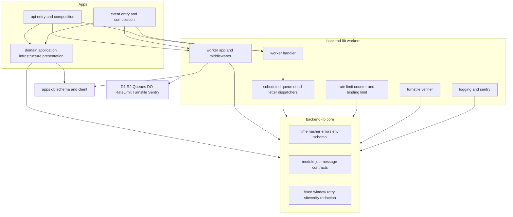
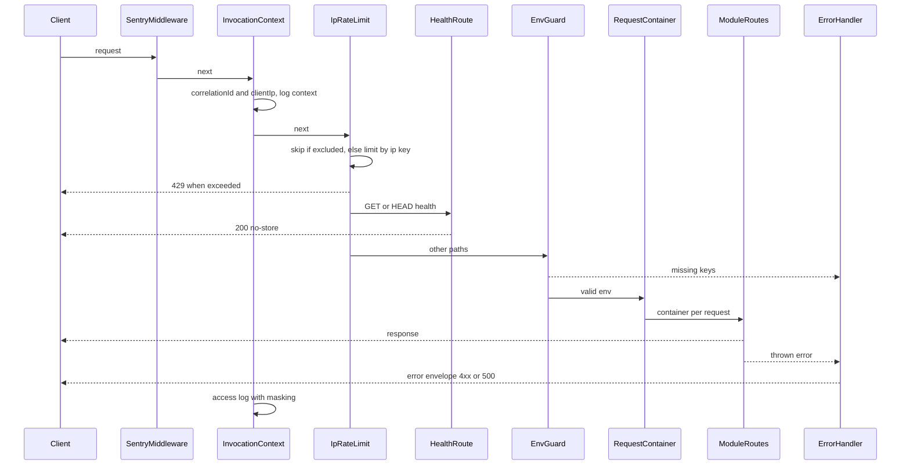
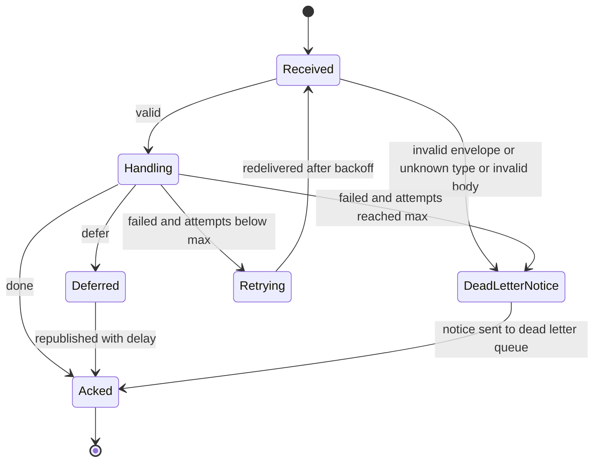
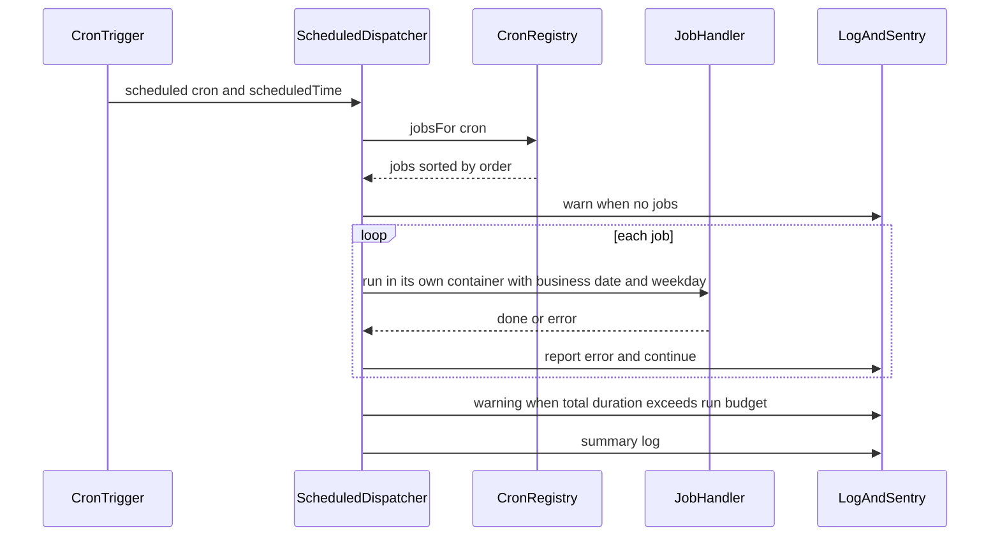
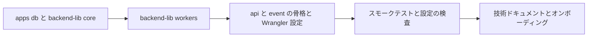

# Design Document

## Overview

**Purpose**: APIサーバー(`apps/api`)とイベントサーバー(`apps/event`)に、全ドメインが共通で使うバックエンドの骨格を提供する。具体的には、データベースの共通規約とマイグレーション、業務時刻・ハッシュ化・共通エラーの部品、Hono+Inversifyによる4層の骨格と処理単位ごとのDIコンテナ、実行環境の設定、構造化ログとエラートラッキング、定期実行と非同期メッセージのディスパッチャ、レート制限、bot判定の検証を整える。

**Users**: 後続specの開発者とAIエージェントは、`src/composition`の登録箇所へモジュール・ジョブ・メッセージ種別・除外規則を追記するだけで機能を組み込む。api-gatewayは本specのアプリ骨格の上にGraphQL・RESTを載せ、frontend-platformは本specが文書化したIP制限の規約をclient・adminへ適用し、infra-deliveryは本specのWrangler設定が参照するリソースを作る。

**Impact**: 空ディレクトリの`apps/api`・`apps/event`・`apps/db`・`apps/backend-lib`にプロジェクトを新設する。dev-toolingの一括検査・一括テストは、`APPS`に登録済みのapi・eventを「プロジェクト未作成」として飛ばしていたが、本specの完了後は実際に検査する。

### Goals

- 両サーバーが同じ層構成・同じ依存性の組み立て方で動き、3つの変換経路(Bun・Vitest/Oxc・Wrangler/esbuild)で同じ依存を解決する。
- 後続specは、登録箇所への追記だけで、ルート・依存・定期実行のジョブ・非同期メッセージの種別・IP制限の除外を組み込める。
- ログとエラーレポートから個人情報が除かれ(DR-013・NFR-OBLOG-004)、想定外のエラーはSentryで検知できる。
- 両サーバーの単体テスト・Workers統合テストがカバレッジ80%を満たし、一括検査に参加する。

### Non-Goals

- GraphQL・REST・内部認証・中継されたクライアントIPの信頼判定(api-gateway)。
- client・adminへのIP制限の実装(frontend-platform)。
- 業務テーブル・業務のジョブ・メッセージ種別・個別のレート制限ルールの適用(各ドメインspec)。
- リソースの作成、staging・prodのリソース識別子の確定、CIとデプロイ(infra-delivery)。
- 画像配信のキャッシュ有効化と画像変換の利用(media-pipeline)。

## Boundary Commitments

### This Spec Owns

- `apps/db`: 共通カラムの部品(`ulidPrimaryKey`・`timestamps`・`softDelete`・`notDeleted`)、`textNoCase`、スキーマの集約点`schema/index.ts`、`createDatabase`、`drizzle.config.ts`、マイグレーションの保存先`migrations/`。
- `apps/backend-lib/core`: 業務時刻、`KeyedHasher`、`AppError`と共通のエラー形式、DIの識別子と`AppModule`契約、環境の検証、ログの整形と伏せ字の規則、Sentryイベントの除去規則、cron登録表、メッセージの封筒・契約・再試行規則、固定期間カウンタ、siteverify応答の解釈、定期実行の起動時刻ごとの時間の予算の表(承認後の改訂2)。
- `apps/backend-lib/workers`: Honoアプリの組み立て(ミドルウェアの順序)、処理単位のコンテナ、ログ設定、Sentryの計装、Workerハンドラーの組み立て、定期実行・非同期メッセージ・デッドレターのディスパッチャ、メッセージの送信、厳密カウンタのDurable Objectとクライアント、Rate Limitingバインディングのミドルウェア、IP制限、Turnstileの検証。
- `e2e/support/scheduled-trigger.ts`(承認後の改訂2): ローカルの定期実行を業務日付と業務時刻で起こすE2Eの共有の補助`triggerScheduled`と、業務日付の補助(`businessDateOf`・`addBusinessDays`・`isNearBusinessDayBoundary`)。定期実行をローカルで起こすE2E・統合の手順を持つ全specはこれを使い、同等の補助を作らない。
- `apps/api`・`apps/event`: エントリ、`src/composition`の登録箇所(apiの定期実行の時間の予算の登録を含む)、4層の配置規約と静的解析による依存方向の強制、Wrangler設定(全環境のバインディング・変数・シークレットのキー名)、`worker-configuration.d.ts`、アプリの品質ツール設定、マイグレーションの検出確認スクリプト、DIのスモークテスト。
- 契約: 共通のエラー形式、`AppModule`、`ScheduledJobDefinition`、`ScheduledRunBudget`と予算の超過の警告の形(レベル`warning`・タグ`cron`・所要時間)、`triggerScheduled`、`MessageContract`と`QueueEnvelope`、`RateLimitExclusion`、`ClientIpResolver`、`BotVerifier`、`RateLimitCounterClient`、IP制限の規約(バインディング名・上限・キー・応答)、ヘルスチェックの経路、apiのWorker名。
- 技術ドキュメント: `backend/002`・`backend/003`・`db/003`・`infra/003`・`infra/004`・`security/002`と各索引、`docs/onboardings`の更新。

### Out of Boundary

- GraphQL Yoga・`@hono/zod-openapi`の導入、公開REST APIのベースパスとCORS、内部認証、元のクライアントIPの信頼判定(api-gatewayが`ClientIpResolver`を差し替える)。
- client・adminのWrangler設定とIP制限、frontend→apiのService Bindingsの定義(frontend-platform)。
- 業務テーブル、業務のジョブ・メッセージ種別・ハンドラー、Stripe Webhook・RFC 8058配信停止・画像配信の経路とその除外規則の登録(payments・notifications・media-pipeline)。
- D1・R2・Queues・Turnstileウィジェットのクラウド上の作成、staging・prodの`database_id`の確定、CIでの`db:migrations:check`・スモークテスト・マイグレーション適用の呼び出し(infra-delivery)。
- eventの`cache.enabled`の有効化と画像変換の処理(media-pipeline)。
- 外部の死活監視サービスの設定(launch-readiness)。

### Allowed Dependencies

- 上流: dev-toolingの基底設定(`tsconfig.base.json`・`eslint.config.base.ts`・`prettier.config.ts`・`bunfig.toml`)、`config/vitest/worker.ts`の`workerTestPreset`、`config/workspace-layout.ts`の`APPS`・`SHARED_DIRS`(変更しない)、アプリのスクリプト契約、主要パッケージの版。
- npmパッケージ: Technology Stackの表に挙げた版に限る。
- 依存の方向(後述): `apps/db` → `backend-lib/core` → `backend-lib/workers` → アプリの`src`。逆方向のimportを禁止する。`apps/db`は`drizzle-orm`・`ulid`以外を読み込まない。`backend-lib/core`は`cloudflare:*`・Hono・`backend-lib/workers`・`apps/db`を読み込まない。
- アプリの`src`内では`domain` ← `application` ← `infrastructure`・`presentation` ← `composition`の向きにだけ参照できる。

### Revalidation Triggers

- 共通のエラー形式、`AppError`の種類と状態コードの対応の変更(api-gateway・全ドメイン)。
- `AppModule`・`ScheduledJobDefinition`・`MessageContract`・`QueueEnvelope`・`RateLimitExclusion`・`ClientIpResolver`・`BotVerifier`・`RateLimitCounterClient`の形の変更。
- バインディング名・Queue名・バケット名・D1名・Worker名・Rate Limitingの`namespace_id`・シークレットと変数のキー名の変更(infra-delivery・frontend-platform)。
- IP制限の上限・キー・応答の変更(frontend-platform)。
- 共通カラムの型(日時の保持形式・IDの形式)、列名の変換方式(`snakeCase.table`)の変更(全ドメインのスキーマ)。
- 再試行の上限・間隔、デッドレターの扱いの変更(email-deliveryなどのメッセージ利用者)。本体のconsumerの`max_retries`を変える場合は`QUEUE_MAX_RETRIES`を同じ値にし、登録ごとの`retry.maxAttempts`がその値以下に収まるかを利用者のspecで確かめる(承認後の改訂8)。
- ヘルスチェックの経路の変更(launch-readiness)。
- 定期実行の時間の予算の値、予算の超過の警告の形(レベル`warning`・タグ`cron`・所要時間)、要約のログの項目の変更(launch-readiness)。逆向きに、launch-readinessの仮1の値が変われば、本specの`SCHEDULED_RUN_BUDGETS`と`infra/003`・`project-values.md`の値を合わせる。
- `triggerScheduled`の入力の形と、ローカルの定期実行の経路(`/cdn-cgi/local/scheduled`。固定したWranglerの版の経路)の変更(定期実行をローカルで起こすE2E・統合の手順を持つ全spec)。
- ログの伏せ字の値のパターンの変更(全ドメイン)。承認後の改訂3で、値のパターンの置き換え後の文字列を`[REDACTED]`に統一した(ログに既製の置き換えの文字列を期待するテストは合わせる)。Sentryの伏せ字の対象の項目(例外の値と種類・メッセージ・パンくず・トランザクションとスパン、承認後の改訂3)の変更(launch-readinessのチェックリストA-09のstagingでの確認)。逆向きに、public-apiが公開APIのキーの形式(`API_KEY_TOKEN_PATTERN`)を変えた場合は、本specの`REDACTION_PATTERNS`のキーのパターンを合わせる。
- Sentry SDK(`@sentry/cloudflare`・`@sentry/hono`・`@sentry/core`)の版の更新。`dataCollection`の既定値と項目、既定の`requestDataIntegration`がイベントとトランザクションに付ける項目、IPアドレスの取得に使うヘッダーの一覧(`getClientIPAddress`)が変わっていないかを確かめ、`buildSentryOptions`の収集設定と`SentryScrubber`の削除するヘッダーを合わせる(承認後の改訂4)。あわせて、`traceLifecycle`の既定値、逐次送信のスパンの形(`StreamedSpanJSON`)と共通の属性(`captureSpan`が付ける`user.*`など)、`beforeSendSpan`が呼ばれる条件が変わっていないかを確かめ、`scrubSpan`の削除する属性を合わせる(承認後の改訂6)。

## Architecture

### Existing Architecture Analysis

- `apps/api`・`apps/event`はnode_modulesの名前付きボリュームだけを持ち、`db`・`lib`の配置先にbind mountで共有ディレクトリが置かれる。`apps/db`のnode_modulesはその場で動かすツール(drizzle-kit)専用で、配置先には見せない(dev-toolingの配置方式)。
- `config/workspace-layout.ts`は`api`・`event`をアプリとして、`apps/db`・`apps/backend-lib`を検査担当`api`の共有ディレクトリとして登録済みである。検査担当でないeventは、配置先`db/`・`lib/`を静的解析とテストから外し、型検査には含める。
- 技術ドキュメントには、DIの`@inject`明示(`backend/001`)、マイグレーションの生成と検出設定(`db/001`)、D1の制約(`db/002`)、Wranglerの規約(`infra/001`)、環境種別(`infra/002`)、シークレットの注入(`security/001`)が既にある。本specはこれらを前提にし、重複して書かない。

### Architecture Pattern & Boundary Map



**Architecture Integration**:

- 選んだパターン: 4層のクリーンアーキテクチャと合成ルート(`src/composition`)。共有コードは実行環境に依存しない`core`と、Workersに依存する`workers`に分ける。分け方はテストの種別とカバレッジの`include`の分担に一致させる(`core`・`domain`・`application`はBunの単体テスト、`workers`・`infrastructure`・`presentation`・`composition`はWorkers統合テスト)。
- 境界: 本specは骨格・契約・登録箇所を所有し、業務の中身を所有しない。後続specは登録箇所と契約だけを通じて本specに依存する。
- 既存パターンの維持: bind mountによる共有ディレクトリの配置、利用側アプリでの依存解決、基底設定の継承、`@inject`の明示。
- 新規コンポーネントの理由: research.mdの「Generalization・Build vs Adopt・Simplification」を参照。

### Dependency Direction

`apps/db`(スキーマと接続) → `backend-lib/core`(純粋な部品と契約) → `backend-lib/workers`(実行環境の部品) → アプリの`src`(`domain` → `application` → `infrastructure`・`presentation` → `composition` → `index.ts`)の順にのみimportする。

- `backend-lib/core`は`apps/db`を読み込まない(データベースの型が必要な契約は`workers`に置く)。
- `apps/db`は`drizzle-orm`・`ulid`と自身のファイルだけを読み込む。drizzle-kitが`apps/db`の位置でスキーマを読み込むため、他の共有ディレクトリへの相対importは配置元で解決できない。
- 違反はapiの`eslint.config.ts`の`no-restricted-imports`で検出する(eventの`src`も同じ規則を持つ)。

### Technology Stack

| Layer                 | Choice / Version                                                                                                                           | Role in Feature                                     | Notes                                                              |
| --------------------- | ------------------------------------------------------------------------------------------------------------------------------------------ | --------------------------------------------------- | ------------------------------------------------------------------ |
| ランタイム            | Cloudflare Workers(`compatibility_date` 2026-08-04)                                                                                        | 両サーバーの実行                                    | Node.js互換は互換性日付で既定有効。`compatibility_flags`は書かない |
| Webフレームワーク     | hono 4.13.13                                                                                                                               | ルーティングとミドルウェア                          | tech-stack記載済み                                                 |
| DI                    | inversify 8.2.3・reflect-metadata 0.2.2                                                                                                    | 処理単位のコンテナ、`@inject`による注入             | reflect-metadataは新規(Q3)。`jitless`は既定の`true`のまま          |
| ORM・マイグレーション | drizzle-orm 1.0.0-rc.5・drizzle-kit 1.0.0-rc.5                                                                                             | スキーマ・型付きクエリ・マイグレーション生成        | 主要パッケージ一覧どおり完全固定                                   |
| ID                    | ulid 3.0.2                                                                                                                                 | ULIDの採番                                          | tech-stack記載済み                                                 |
| 検証                  | zod 4.6.5                                                                                                                                  | 環境・メッセージ本文の検証                          | tech-stack記載済み                                                 |
| ログ                  | @logtape/logtape 2.3.11・@logtape/redaction 2.3.11                                                                                         | JSONログ・処理単位の文脈・伏せ字                    | redactionは新規(Q4)                                                |
| エラートラッキング    | @sentry/cloudflare 11.4.0・@sentry/hono 11.4.0                                                                                             | 例外の送信とトレース                                | tech-stack記載済み                                                 |
| データ                | Cloudflare D1・R2(画像・ファイル・隔離)・Durable Objects(SQLite)                                                                           | 永続化、厳密カウンタ                                | D1名とバケット名は「Supporting References」                        |
| 非同期                | Cloudflare Queues(本体とデッドレター)・Cron Triggers                                                                                       | 非同期メッセージと定期実行                          | consumerとCron Triggersの置き場所は後述                            |
| レート制限・bot対策   | Rate Limitingバインディング・Turnstile siteverify                                                                                          | FR-RLMIT-009、SW-018                                | Turnstileは`fetch`で直接呼ぶ                                       |
| 開発・テスト          | wrangler 4.124.0・vitest 4.1.11・@vitest/coverage-istanbul 4.1.11・@cloudflare/vitest-pool-workers 0.22.0・@types/bun 1.4.3・品質ツール6種 | ローカル起動、型生成、Workers統合テスト、単体テスト | dev-toolingの主要パッケージ一覧の版                                |

## File Structure Plan

### Directory Structure

```
apps/
├── db/                                      # 共有ディレクトリ(配置先: apps/{api,event}/db、検査担当: api)。直下にtsconfig.jsonを置かない
│   ├── package.json                         # drizzle-kit・drizzle-orm・ulid(生成ツールの実行専用)と`db:generate`スクリプト
│   ├── bun.lock
│   ├── drizzle.config.ts                    # dialect sqlite、schema、out
│   ├── client.ts                            # createDatabase(d1)・Database型
│   ├── client.worker.test.ts                # D1上での共通カラム・論理削除・大文字小文字・一括実行の検証
│   ├── schema/
│   │   ├── index.ts                         # 全テーブル定義の集約点(初版はテーブル無し)
│   │   └── _shared/
│   │       ├── columns.ts                   # ulidPrimaryKey・timestamps・softDelete・notDeleted
│   │       ├── text-no-case.ts              # textNoCase
│   │       └── *.unit.test.ts               # 列定義(型・NOT NULL・既定値・更新時の値)の検証
│   └── migrations/.gitkeep                  # drizzle-kitの出力先(<日時>_<名前>/migration.sql)
├── backend-lib/                             # 共有ディレクトリ(配置先: apps/{api,event}/lib、検査担当: api)。package.jsonとtsconfig.jsonを持たない
│   ├── core/                                # Workersの実行環境に依存しない部品(Bunの単体テスト)。各ファイルに同名の*.unit.test.tsを併置
│   │   ├── di/identifiers.ts                # PLATFORM_TYPES(基盤が束縛する依存の識別子)
│   │   ├── di/app-module.ts                 # AppModule契約
│   │   ├── errors/app-error.ts              # AppError・AppErrorKind・状態コードの対応
│   │   ├── errors/error-envelope.ts         # 共通のエラー形式の組み立てと内部エラーの定型
│   │   ├── time/business-time.ts            # 業務時刻の変換・週・cron式
│   │   ├── time/clock.ts                    # Clockポートとシステム時計
│   │   ├── ids/id-generator.ts              # IdGeneratorポートとULIDの実装
│   │   ├── crypto/keyed-hasher.ts           # HMAC-SHA512(ペッパー鍵)のハッシュ化と照合
│   │   ├── env/env-schema.ts                # 環境の検証と、欠けたキー名だけを返す失敗
│   │   ├── logging/log-record.ts            # LogRecordからJSONオブジェクトへの変換
│   │   ├── logging/redaction.ts             # 伏せ字の対象フィールド名と値のパターン(IPv4・IPv6を含む)
│   │   ├── logging/app-logger.ts            # カテゴリ規約付きのロガー取得
│   │   ├── logging/log-level.ts             # 環境変数で指定できるログレベルの列挙と判定(承認後の改訂8)
│   │   ├── observability/scrub-event.ts     # Sentryイベントとスパンの個人情報除去と想定内エラーの除外
│   │   ├── scheduling/cron-registry.ts      # ジョブ定義の検証、業務時刻→cron式、起動時刻ごとの順序
│   │   ├── scheduling/run-budget.ts         # 起動時刻ごとの時間の予算の表と超過の判定(承認後の改訂2)
│   │   ├── messaging/envelope.ts            # QueueEnvelope・DeadLetterNoticeの型と解析
│   │   ├── messaging/message-contract.ts    # defineMessageContract・MessageHandler・登録の型
│   │   ├── messaging/retry-policy.ts        # 失敗時の再試行間隔とデッドレター移送の判定
│   │   ├── messaging/contracts/index.ts     # 全メッセージ契約の集約点(初版は空)
│   │   ├── rate-limit/fixed-window.ts       # 固定期間カウンタの状態遷移
│   │   ├── rate-limit/rate-limit-key.ts     # ハッシュ化済みキーの型と生成
│   │   └── bot-protection/siteverify-result.ts  # siteverify応答とエラーコードの分類
│   └── workers/                             # workerdのAPI・バインディング・Honoに依存する部品(Workers統合テスト)。各ファイルに同名の*.worker.test.tsを併置
│       ├── env/platform-env.ts              # 両サーバー共通のバインディング・変数・シークレットの型とスキーマ断片
│       ├── di/invocation-container.ts       # 処理単位のコンテナ生成とプラットフォームの束縛
│       ├── http/hono-env.ts                 # Honoの変数(相関ID・クライアントIP・コンテナ)の型
│       ├── http/create-worker-app.ts        # Honoアプリの組み立て(ミドルウェアの順序の唯一の定義)
│       ├── http/invocation-context.ts       # 相関IDとログの文脈、アクセスログ
│       ├── http/error-handler.ts            # onErrorとnotFound
│       ├── http/health-route.ts             # GET・HEAD /health
│       ├── http/env-guard.ts                # 環境の検証ミドルウェア
│       ├── logging/configure-logging.ts     # LogTapeの設定(コンソールシンク・伏せ字・AsyncLocalStorage)
│       ├── observability/sentry.ts          # Sentryの初期化オプション、Honoとscheduled・queueの計装
│       ├── handler/create-worker-handler.ts # fetch・scheduled・queueのエクスポートの組み立て
│       ├── scheduling/scheduled-dispatcher.ts
│       ├── messaging/queue-publisher.ts     # MessagePublisher(検証・封筒・遅延送信)
│       ├── messaging/queue-consumer.ts      # 本体Queueのconsumer
│       ├── messaging/dead-letter-consumer.ts
│       ├── rate-limit/rate-limit-counter.ts # Durable Objectクラス
│       ├── rate-limit/rate-limit-counter-client.ts
│       ├── rate-limit/binding-rate-limit.ts # Rate Limitingバインディングの汎用ミドルウェア
│       ├── rate-limit/ip-rate-limit.ts      # FR-RLMIT-009
│       ├── rate-limit/client-ip.ts          # ClientIpResolverと既定の実装
│       ├── rate-limit/exclusions.ts         # RateLimitExclusionと生成関数
│       ├── bot-protection/turnstile-verifier.ts
│       └── bot-protection/turnstile-guard.ts
├── api/
│   ├── package.json                         # スクリプト契約+dev・cf-typegen・cf-typegen:check・db:migrate:local・db:migrations:check・test:smoke
│   ├── bun.lock
│   ├── tsconfig.json                        # 基底設定の継承、lib ES2024、types、include(src・test・scripts・db・lib・*.ts)
│   ├── eslint.config.ts                     # createBaseConfig+層の依存方向の規則
│   ├── vitest.worker.config.ts              # workerTestPresetの取り込み、テスト用バインディング、マイグレーションの適用
│   ├── wrangler.jsonc                       # ルート(ローカル)・env.staging・env.prod
│   ├── worker-configuration.d.ts            # wrangler typesの出力(コミット)
│   ├── src/
│   │   ├── index.ts                         # Workerハンドラーと RateLimitCounter のエクスポート
│   │   ├── composition/
│   │   │   ├── env-schema.ts                # apiの環境の検証スキーマ
│   │   │   ├── modules.ts                   # AppModuleの登録箇所
│   │   │   ├── scheduled-jobs.ts            # 定期実行ジョブの登録箇所(初版は空)と起動時刻ごとの時間の予算(SCHEDULED_RUN_BUDGETS)
│   │   │   └── rate-limit-exclusions.ts     # IP制限の除外規則の登録箇所(初版は空)
│   │   └── (domain|application|infrastructure|presentation)/  # 各層。最初のファイルを追加するspecが作る
│   ├── scripts/
│   │   ├── check-migrations.ts              # 入口: 一時ディレクトリでwrangler d1 migrations listを実行し、判定結果を表示
│   │   ├── migration-check/compare-migrations.ts  # 保存先のマイグレーションとWranglerの一覧の突き合わせ(純粋関数)
│   │   ├── migration-check/compare-migrations.unit.test.ts
│   │   └── smoke-wrangler-bundle.ts         # Wranglerのバンドルで起動したWorkerでDIを解決するスモークテスト
│   └── test/
│       ├── setup/apply-migrations.ts        # Workers統合テストのsetupFiles(マイグレーションの適用)
│       ├── smoke/fixtures/greeting.ts       # @inject付きのスモーク用クラス
│       ├── smoke/di-resolution.unit.test.ts     # Bunでの解決
│       ├── smoke/di-resolution.worker.test.ts   # workerd(Oxc)での解決
│       ├── smoke/wrangler-bundle-entry.ts   # Wranglerのバンドル用のエントリ
│       ├── smoke/wrangler.smoke.jsonc
│       └── config/
│           ├── wrangler-config.unit.test.ts # 両アプリのWrangler設定の整合
│           ├── cron-sync.unit.test.ts       # ジョブの業務時刻とtriggers.cronsの一致
│           └── layer-rules.unit.test.ts     # 層の依存方向の静的解析規則
└── event/
    ├── package.json                         # スクリプト契約(test:unitで配置先db・libを除外)+dev・cf-typegen・cf-typegen:check
    ├── bun.lock
    ├── bunfig.unit.toml                     # test:unitの設定(ルートのbunfig.tomlの書き写しに、カバレッジの分母からdb/・lib/を外す除外を加える。email-deliveryの実装の反映)
    ├── tsconfig.json · eslint.config.ts(ignoresにdb/・lib/) · vitest.worker.config.ts(excludeにdb/・lib/)
    ├── wrangler.jsonc · worker-configuration.d.ts
    └── src/
        ├── index.ts                         # Workerハンドラー(fetch・queue)のエクスポート
        ├── index.worker.test.ts             # ヘルスチェック・IP制限・Queue→デッドレターの経路
        └── composition/
            ├── env-schema.ts · modules.ts · rate-limit-exclusions.ts
            └── message-handlers.ts          # メッセージ種別の処理の登録箇所(初版は空)
config/eslint/                               # 承認後の改訂8
├── backend-layers.ts                        # api・eventのsrcの4層の禁止import(createBackendLayerRules)
└── backend-layers.unit.test.ts              # 規則の名前の接頭辞と、アプリ間で同じ内容であること
config/vitest/                               # dev-toolingのプリセットの置き場所(email-deliveryの実装の反映で1ファイルを追加)
├── read-nested-d1-migrations.ts             # 入れ子のマイグレーションの読み込み(api・eventのVitest設定が共有)
└── read-nested-d1-migrations.unit.test.ts
e2e/support/                                 # dev-toolingのE2Eの補助の置き場所(承認後の改訂2で1ファイルを追加)
├── scheduled-trigger.ts                     # ローカルの定期実行を業務日付と業務時刻で起こす(ScheduledTriggerHelper)
└── scheduled-trigger.unit.test.ts           # 要求のURL・cron式・時刻、入力の検証、失敗の例外、業務日付の補助
docs/
├── GUIDES/tech/
│   ├── backend/002-layered-architecture-on-workers.md   # 層構成・依存方向・処理単位のコンテナ・登録箇所・共通エラー
│   ├── backend/003-rate-limiting-and-bot-verification.md # 厳密カウンタ・バインディング制限・Worker単位のIP制限の規約・Turnstile
│   ├── db/003-schema-conventions.md          # ID・共通カラム・論理削除・日時・列名の変換・接続と一括実行
│   ├── infra/003-async-processing.md         # 定期実行・非同期メッセージ・再試行・デッドレター・冪等性
│   ├── infra/004-logging-and-error-tracking.md  # ログの形式・相関ID・伏せ字・呼び出しログ無効化・保持期間・Sentry
│   ├── security/002-keyed-hashing.md          # 高エントロピーの秘密情報のHMACハッシュ化と照合
│   └── backend・db・infra・security のREADME.md   # 文書一覧へ1行ずつ追記
└── onboardings/
    ├── README.md · tech-stack.md · project-values.md
```

テストファイルは、同名の`*.unit.test.ts`・`*.worker.test.ts`を対象ファイルの隣に置く(上の木では一部を省略した)。

### Modified Files

- `docs/onboardings/tech-stack.md`: `reflect-metadata`(Inversifyの相手依存)と`@logtape/redaction`(ログの伏せ字)を追記する。
- `docs/onboardings/project-values.md`: Worker名・D1名・バケット名・Queue名・バインディング名・Rate Limitingの`namespace_id`・シークレットと変数のキー名・ヘルスチェックの経路・ポート、定期実行の時間の予算を適用する起動時刻とその値(4:21の予算300,000ms・上限600,000ms・各ジョブの目安30,000ms、承認後の改訂2)を追記する。
- `docs/onboardings/README.md`: api・event・dbの依存の導入、マイグレーションの生成と適用、`--test-scheduled`付きの起動と`/cdn-cgi/local/scheduled`による定期実行の手動起動、シークレット(`HASH_PEPPER`・`TURNSTILE_SECRET_KEY`)のInfisicalへの登録、テストとスモークテストの手順を更新する。
- `docs/GUIDES/tech/coding/002-dependency-versions.md`: api・eventと共有ディレクトリで版をそろえるパッケージ(hono・inversify・reflect-metadata・ulid・zod・LogTape・Sentry)を一覧に追記する。
- `docs/GUIDES/tech/{backend,db,infra,security}/README.md`: 新しい文書を1行ずつ追記する。
- `CLAUDE.md`: 「技術規則の参照先」に、新しい技術ドキュメントへのリンクを作業の種類とともに追記する。
- `scripts/tooling/run-all.ts`・`test-support/run-all-fixtures.ts`(dev-tooling、承認後の改訂8): 一括検査(`check`)の静的解析と型検査の間に、アプリだけを対象にする段階「型生成の検査」(`cf-typegen:check`)を加える(7.7)。設定を変えて型を生成し直し忘れると型検査のエラーとして現れるため、型検査の前に原因を示す。ルートは実行時の型を生成しないため対象にしない。
- `docs/GUIDES/tech/coding/001-javascript-typescript-conventions.md`(dev-tooling、承認後の改訂8): 一括検査の段階とスクリプト契約に`cf-typegen:check`を加える。

## System Flows

### HTTPリクエストの処理



- ミドルウェアの順序は`createWorkerApp`だけが定義し、アプリは変えない。
- ヘルスチェックはIP制限の後、環境の検証の前に置く。設定が欠けていてもWorkerの生存は200で返す(6.2)。
- `ErrorHandler`は`AppError`を共通のエラー形式に、それ以外を500の定型に変換する。Sentryへの送信は`AppError`以外だけである。

### 非同期メッセージの処理と再試行



- バッチ内のメッセージは1件ずつ処理し、1件の失敗は他のメッセージの`ack`・`retry`に影響しない(11.5)。
- デッドレター通知の送信に失敗した場合は元のメッセージを`retry`し、本文を失わない。consumer自体が落ちた場合は、Queuesの`max_retries`(6)を超えた時点で元のメッセージが自動でデッドレターへ移る。
- デッドレターのconsumerは、通知と元のメッセージのどちらも本文を読まずに通知して`ack`する(11.8)。

### 定期実行の振り分け



- 予算の表に起動時刻がある場合だけ、全ジョブの合計の所要時間を予算と比べる(10.9、承認後の改訂2)。警告は要約のログの前に送り、ジョブの実行と結果を変えない。

## Requirements Traceability

| Requirement | Summary                                                       | Components                                                                                              | Interfaces                                                                                  | Flows            |
| ----------- | ------------------------------------------------------------- | ------------------------------------------------------------------------------------------------------- | ------------------------------------------------------------------------------------------- | ---------------- |
| 1.1         | ULIDの主キー部品                                              | CommonColumns・IdGenerator                                                                              | `ulidPrimaryKey`                                                                            | —                |
| 1.2         | 全文検索用は連番の規約                                        | SchemaConventionsDoc                                                                                    | `db/003`                                                                                    | —                |
| 1.3         | 作成・更新日時の自動設定                                      | CommonColumns                                                                                           | `timestamps`                                                                                | —                |
| 1.4         | 論理削除の列と絞り込み                                        | CommonColumns                                                                                           | `softDelete`・`notDeleted`                                                                  | —                |
| 1.5         | 大文字小文字を区別しない列                                    | TextNoCase                                                                                              | `textNoCase`                                                                                | —                |
| 1.6         | 配置と命名の規約                                              | SchemaConventionsDoc・DrizzleConfig                                                                     | `schema/index.ts`・`snakeCase.table`                                                        | —                |
| 1.7         | 業務テーブル無し・検証用テーブルで確認                        | CommonColumns・DatabaseClient                                                                           | テスト内のテーブル定義                                                                      | —                |
| 2.1         | 差分のマイグレーション生成                                    | DrizzleConfig                                                                                           | `db:generate`                                                                               | —                |
| 2.2         | 変更なしなら生成しない                                        | DrizzleConfig                                                                                           | `db:generate`                                                                               | —                |
| 2.3         | 手書きのマイグレーションの手順                                | SchemaConventionsDoc                                                                                    | `drizzle-kit generate --custom`                                                             | —                |
| 2.4         | apiで1回適用し両サーバーで参照                                | WranglerConfigs                                                                                         | `db:migrate:local`・同一`database_id`・`--persist-to`                                       | —                |
| 2.5         | 検出確認のコマンド                                            | MigrationCheck                                                                                          | `db:migrations:check`                                                                       | —                |
| 2.6         | 型付きクエリとパラメータ化                                    | DatabaseClient                                                                                          | `createDatabase`・`Database`                                                                | —                |
| 2.7         | 一括実行と取り消し                                            | DatabaseClient                                                                                          | `Database.batch`                                                                            | —                |
| 3.1         | UTC→業務時刻                                                  | BusinessTime                                                                                            | `toBusinessDateTime`                                                                        | —                |
| 3.2         | 業務時刻→UTC                                                  | BusinessTime                                                                                            | `fromBusinessDateTime`                                                                      | —                |
| 3.3         | UTC 8:00の日境界・夏時間なし                                  | BusinessTime                                                                                            | 固定オフセット                                                                              | —                |
| 3.4         | ISO週と週の開始・終了                                         | BusinessTime                                                                                            | `businessWeekOf`                                                                            | —                |
| 3.5         | 日時の保持規約の文書                                          | SchemaConventionsDoc                                                                                    | `db/003`                                                                                    | —                |
| 4.1         | ペッパー鍵のHMAC-SHA512                                       | KeyedHasher                                                                                             | `KeyedHasher.hash`                                                                          | —                |
| 4.2         | 時間が内容に依存しない照合                                    | KeyedHasher                                                                                             | `KeyedHasher.verify`                                                                        | —                |
| 4.3         | ペッパー無しで失敗                                            | KeyedHasher・EnvSchema                                                                                  | `createKeyedHasher`                                                                         | —                |
| 4.4         | 共通エラー型と状態コード                                      | AppError                                                                                                | `AppErrorKind`・`STATUS_BY_KIND`                                                            | —                |
| 4.5         | 共通のエラー形式で応答                                        | ErrorEnvelope・ErrorHandler                                                                             | `toErrorResponse`                                                                           | HTTPリクエスト   |
| 4.6         | 想定外の例外は500で詳細なし                                   | ErrorHandler・ErrorEnvelope                                                                             | `INTERNAL_ERROR_ENVELOPE`                                                                   | HTTPリクエスト   |
| 5.1         | 4層と依存方向                                                 | AppLayerRules                                                                                           | `eslint.config.ts`の`no-restricted-imports`                                                 | —                |
| 5.2         | 処理単位専用の依存                                            | InvocationContainer                                                                                     | `createInvocationContainer`                                                                 | HTTPリクエスト   |
| 5.3         | 識別子の明示と経路非依存の解決                                | InvocationContainer・PlatformIdentifiers                                                                | `PLATFORM_TYPES`・`@inject`                                                                 | —                |
| 5.4         | 3経路のスモークテスト                                         | DiSmokeTests                                                                                            | `test:unit`・`test:worker`・`test:smoke`                                                    | —                |
| 5.5         | モジュールの追加と登録だけで組み込む                          | AppModuleContract・AppComposition                                                                       | `AppModule`・登録箇所4ファイル                                                              | —                |
| 5.6         | 404の共通形式                                                 | ErrorHandler                                                                                            | `notFound`                                                                                  | HTTPリクエスト   |
| 5.7         | グローバルスコープ1秒以内                                     | WorkerHandler・AppComposition                                                                           | 遅延初期化                                                                                  | —                |
| 6.1         | 認証なしで200                                                 | HealthRoute                                                                                             | `GET /health`                                                                               | HTTPリクエスト   |
| 6.2         | 依存先を確かめない                                            | HealthRoute・WorkerApp                                                                                  | 環境の検証より前に配置                                                                      | HTTPリクエスト   |
| 6.3         | 内部情報なし・キャッシュ禁止                                  | HealthRoute                                                                                             | `Cache-Control: no-store`                                                                   | —                |
| 6.4         | apiでも外部から到達                                           | HealthRoute・ProjectValuesDoc                                                                           | 経路の契約                                                                                  | —                |
| 7.1         | 全接続の3環境定義                                             | WranglerConfigs                                                                                         | `wrangler.jsonc`                                                                            | —                |
| 7.2         | 同一リソース識別子と保存先の共有                              | WranglerConfigs                                                                                         | `wrangler-config.unit.test.ts`                                                              | —                |
| 7.3         | 共通の互換性日付・フラグなし                                  | WranglerConfigs                                                                                         | `compatibility_date`                                                                        | —                |
| 7.4         | シークレットのキー名と変数                                    | WranglerConfigs                                                                                         | `secrets.required`・`vars`                                                                  | —                |
| 7.5         | 欠けたキー名で失敗                                            | EnvSchema・EnvGuard・WorkerHandler                                                                      | `validateEnv`・`EnvValidationError`                                                         | HTTPリクエスト   |
| 7.6         | apiの前段キャッシュ無効                                       | WranglerConfigs                                                                                         | `cache.enabled: false`                                                                      | —                |
| 7.7         | 環境の型の生成と食い違いの検出                                | WranglerConfigs                                                                                         | `cf-typegen`・`cf-typegen:check`(一括検査の段階、改訂8)                                     | —                |
| 7.8         | シークレットを実行時注入で起動                                | AppPackageScripts・OnboardingUpdates                                                                    | `infisical run`+`dev`(infra-deliveryの改訂1の後は`run-with-secrets --scope local --worker`) | —                |
| 8.1         | JSON形式のログ                                                | LoggingSetup・LogRecordFormat                                                                           | `toLogObject`                                                                               | —                |
| 8.2         | 相関ID                                                        | InvocationContext・WorkerHandler                                                                        | `withContext`                                                                               | HTTPリクエスト   |
| 8.3         | 個人情報・秘密情報の伏せ字                                    | LogRedaction・LoggingSetup                                                                              | `redactByField`・`redactByPattern`                                                          | —                |
| 8.4         | 呼び出しログの無効化                                          | WranglerConfigs                                                                                         | `observability.logs.invocation_logs: false`                                                 | —                |
| 8.5         | アクセスログ                                                  | InvocationContext                                                                                       | `accessLog`                                                                                 | HTTPリクエスト   |
| 8.6         | 定期実行・メッセージの結果ログ                                | ScheduledDispatcher・QueueConsumer                                                                      | 要約ログ                                                                                    | 定期実行・非同期 |
| 8.7         | 環境ごとのログレベル                                          | LoggingSetup                                                                                            | `LOG_LEVEL`                                                                                 | —                |
| 8.8         | 7日保持・長期出力先なし                                       | LoggingSetup・WranglerConfigs                                                                           | コンソールシンクのみ                                                                        | —                |
| 9.1         | 想定外の例外を送信                                            | SentryInstrumentation                                                                                   | `sentry(app)`・`withSentry`                                                                 | HTTPリクエスト   |
| 9.2         | IP・Cookie・認証ヘッダー・本文を除き、値の形式で伏せる(改訂3) | SentryScrubber・SentryInstrumentation・LoggingDoc                                                       | `scrubEvent`・`scrubSpan`・`buildSentryOptions`・`infra/004`                                | —                |
| 9.3         | 想定内の失敗を送らない                                        | SentryScrubber・SentryInstrumentation                                                                   | `shouldHandleError`・`scrubEvent`                                                           | —                |
| 9.4         | 割合でのトレース                                              | SentryInstrumentation                                                                                   | `SENTRY_TRACES_SAMPLE_RATE`                                                                 | —                |
| 9.5         | 送信先が無ければ送らない                                      | SentryInstrumentation                                                                                   | `buildSentryOptions`(`enabled`)                                                             | —                |
| 9.6         | 送信失敗で結果を変えない                                      | SentryInstrumentation                                                                                   | SDKの非同期送信                                                                             | —                |
| 10.1        | 業務時刻でのジョブ登録                                        | CronRegistry・AppComposition                                                                            | `ScheduledJobDefinition`                                                                    | 定期実行         |
| 10.2        | cron式とWrangler設定の一致検査                                | CronRegistry・CronSyncTest                                                                              | `toUtcCronExpression`・`cron-sync.unit.test.ts`                                             | —                |
| 10.3        | 登録順の逐次実行と業務日付・曜日                              | ScheduledDispatcher・CronRegistry                                                                       | `ScheduledJobContext`                                                                       | 定期実行         |
| 10.4        | 失敗を通知して続行                                            | ScheduledDispatcher                                                                                     | ジョブごとのtry                                                                             | 定期実行         |
| 10.5        | 未登録の起動時刻は警告                                        | ScheduledDispatcher                                                                                     | `jobsFor`が空                                                                               | 定期実行         |
| 10.6        | ジョブからのメッセージ送信                                    | MessagePublisher・InvocationContainer                                                                   | `PLATFORM_TYPES.MessagePublisher`                                                           | —                |
| 10.7        | ローカルでの手動起動                                          | AppPackageScripts・AsyncProcessingDoc・ScheduledTriggerHelper                                           | `--test-scheduled`・`/cdn-cgi/local/scheduled`・`triggerScheduled`                          | —                |
| 10.8        | ジョブ0件でも失敗しない                                       | ScheduledDispatcher                                                                                     | 空の登録表                                                                                  | —                |
| 10.9        | 予算の超過の警告(改訂2)                                       | RunBudgetTable・ScheduledDispatcher・AppComposition・CronSyncTest・AsyncProcessingDoc・ProjectValuesDoc | `ScheduledRunBudget`・`SCHEDULED_RUN_BUDGETS`・`captureEvent`                               | 定期実行         |
| 11.1        | 種別ごとの振り分け                                            | QueueConsumer・MessageContracts                                                                         | `MessageHandlerRegistration`                                                                | 非同期           |
| 11.2        | 検証して封筒を付けて送信                                      | MessagePublisher・Envelope                                                                              | `MessagePublisher.publish`                                                                  | —                |
| 11.3        | 不正・未登録は送信しない                                      | MessagePublisher                                                                                        | `MessagePublishError`                                                                       | —                |
| 11.4        | 成功で完了                                                    | QueueConsumer                                                                                           | `message.ack()`                                                                             | 非同期           |
| 11.5        | 間隔を伸ばして再試行・他を継続                                | QueueConsumer・RetryPolicy                                                                              | `decideOnFailure`・`message.retry({ delaySeconds })`                                        | 非同期           |
| 11.6        | 未登録・不正本文は即デッドレター                              | QueueConsumer・Envelope                                                                                 | `DeadLetterNotice`                                                                          | 非同期           |
| 11.7        | 上限超過でデッドレター                                        | QueueConsumer・RetryPolicy・WranglerConfigs                                                             | `maxAttempts`・`max_retries`・`dead_letter_queue`                                           | 非同期           |
| 11.8        | デッドレターは通知して破棄・本文なし                          | DeadLetterConsumer                                                                                      | `handleDeadLetterBatch`                                                                     | 非同期           |
| 11.9        | 重複配信と冪等性の規約                                        | AsyncProcessingDoc                                                                                      | `infra/003`                                                                                 | —                |
| 12.1        | 回数・残り・リセット時刻を返す                                | RateLimitCounter・FixedWindow                                                                           | `RateLimitCounterClient.hit`・`CounterDecision`                                             | —                |
| 12.2        | 同時要求を正確に数える                                        | RateLimitCounter                                                                                        | キーごとのDurable Object                                                                    | —                |
| 12.3        | 最初の要求で開始し期間経過で0                                 | FixedWindow・RateLimitCounter                                                                           | `applyHit`・`alarm`                                                                         | —                |
| 12.4        | 上限到達は拒否し期間を変えない                                | FixedWindow                                                                                             | `applyHit`                                                                                  | —                |
| 12.5        | 途中でのリセット                                              | RateLimitCounter                                                                                        | `RateLimitCounterClient.reset`                                                              | —                |
| 12.6        | 0に戻ったら記録を残さない                                     | RateLimitCounter                                                                                        | `deleteAll`                                                                                 | —                |
| 12.7        | ハッシュ化済みキーだけを保持                                  | RateLimitKey・RateLimitCounterClient                                                                    | `HashedRateLimitKey`                                                                        | —                |
| 12.8        | 429・再試行秒数・共通形式                                     | RateLimitCounterClient・ErrorHandler                                                                    | `assertWithinLimit`                                                                         | —                |
| 13.1        | IP単位・Worker単位で10秒100回                                 | IpRateLimit・WranglerConfigs                                                                            | `IP_RATE_LIMITER`・`ip:<IP>`                                                                | HTTPリクエスト   |
| 13.2        | 超過で429                                                     | IpRateLimit・BindingRateLimit                                                                           | `rate_limit_exceeded`・`Retry-After: 10`                                                    | HTTPリクエスト   |
| 13.3        | Webhook・配信停止・画像配信の除外                             | RateLimitExclusions・AppComposition                                                                     | `RateLimitExclusion`                                                                        | HTTPリクエスト   |
| 13.4        | 経路・ホスト名での除外登録                                    | RateLimitExclusions                                                                                     | `excludePath`・`excludeHostname`                                                            | —                |
| 13.5        | 中継時は信頼済みの元IP                                        | ClientIp・WorkerApp                                                                                     | `ClientIpResolver`(api-gatewayが差し替え)                                                   | —                |
| 13.6        | 規約の文書化                                                  | RateLimitingDoc・ProjectValuesDoc                                                                       | `backend/003`                                                                               | —                |
| 13.7        | 汎用の部品                                                    | BindingRateLimit                                                                                        | `bindingRateLimit`                                                                          | —                |
| 14.1        | トークンとIPで検証し成功だけ許可                              | TurnstileVerifier・SiteverifyResult                                                                     | `BotVerifier.verify`                                                                        | —                |
| 14.2        | 無効・期限切れ・使用済みは403                                 | TurnstileVerifier・SiteverifyResult                                                                     | `bot_verification_failed`                                                                   | —                |
| 14.3        | 到達不能・時間切れは503                                       | TurnstileVerifier                                                                                       | `bot_verification_unavailable`                                                              | —                |
| 14.4        | 操作名・ホスト名の照合                                        | SiteverifyResult                                                                                        | `expectedAction`・`TURNSTILE_EXPECTED_HOSTNAMES`                                            | —                |
| 14.5        | ミドルウェアとサービスの両方                                  | TurnstileGuard・TurnstileVerifier                                                                       | `turnstileGuard`・`PLATFORM_TYPES.BotVerifier`                                              | —                |
| 14.6        | テスト用の鍵                                                  | TurnstileVerifier・OnboardingUpdates                                                                    | テスト用シークレット                                                                        | —                |
| 14.7        | 失敗理由は記録しトークンは記録しない                          | TurnstileVerifier・LogRedaction                                                                         | ログの属性                                                                                  | —                |
| 15.1        | スクリプト契約と一括検査                                      | AppPackageScripts                                                                                       | `lint`・`typecheck`・`test:unit`・`test:worker`                                             | —                |
| 15.2        | カバレッジ80%                                                 | AppPackageScripts・VitestConfigs                                                                        | `coverage.include`の分担                                                                    | —                |
| 15.3        | backendの文書                                                 | ArchitectureDoc・RateLimitingDoc                                                                        | `backend/002`・`backend/003`                                                                | —                |
| 15.4        | dbの文書                                                      | SchemaConventionsDoc                                                                                    | `db/003`                                                                                    | —                |
| 15.5        | infraの文書                                                   | AsyncProcessingDoc・LoggingDoc                                                                          | `infra/003`・`infra/004`                                                                    | —                |
| 15.6        | 固有値をproject-valuesへ                                      | ProjectValuesDoc・全tech文書                                                                            | 記述規則                                                                                    | —                |
| 15.7        | tech-stack.mdへの記載                                         | OnboardingUpdates                                                                                       | `reflect-metadata`・`@logtape/redaction`                                                    | —                |
| 15.8        | オンボーディングの更新                                        | OnboardingUpdates                                                                                       | `docs/onboardings/README.md`                                                                | —                |

## Components and Interfaces

| Component                                                         | Domain/Layer | Intent                                                | Req Coverage                                                    | Key Dependencies (P0/P1)                                | Contracts      |
| ----------------------------------------------------------------- | ------------ | ----------------------------------------------------- | --------------------------------------------------------------- | ------------------------------------------------------- | -------------- |
| CommonColumns・TextNoCase                                         | db           | 共通カラムと大文字小文字を区別しない列                | 1.1, 1.3, 1.4, 1.5, 1.7                                         | drizzle-orm (P0)・ulid (P0)                             | State          |
| DatabaseClient・DrizzleConfig                                     | db           | 接続・型付きクエリ・マイグレーション生成              | 1.6, 2.1, 2.2, 2.6, 2.7                                         | drizzle-orm・drizzle-kit (P0)                           | Service        |
| MigrationCheck                                                    | api/scripts  | マイグレーションの検出確認                            | 2.5                                                             | wrangler (P0)                                           | Batch          |
| BusinessTime                                                      | core         | 業務時刻の計算                                        | 3.1-3.4                                                         | なし                                                    | Service        |
| KeyedHasher                                                       | core         | ペッパー鍵のHMACとその照合                            | 4.1-4.3, 12.7                                                   | Web Crypto (P0)                                         | Service        |
| AppError・ErrorEnvelope                                           | core         | 想定内の失敗と共通のエラー形式                        | 4.4-4.6, 5.6, 12.8, 13.2, 14.2, 14.3                            | なし                                                    | State          |
| PlatformIdentifiers・AppModuleContract                            | core         | 依存の識別子とモジュール登録の契約                    | 5.3, 5.5                                                        | inversify (P0)                                          | State          |
| EnvSchema                                                         | core         | 環境の検証と欠けたキー名                              | 4.3, 7.5                                                        | zod (P0)                                                | Service        |
| LogRecordFormat・LogRedaction                                     | core         | ログのJSON化と伏せ字の規則                            | 8.1, 8.3, 14.7                                                  | @logtape/logtape・@logtape/redaction (P0)               | Service        |
| SentryScrubber                                                    | core         | エラーレポートの個人情報除去と想定内の除外            | 9.2, 9.3                                                        | LogRedaction (P0)                                       | Service        |
| CronRegistry                                                      | core         | ジョブ定義の検証と起動時刻ごとの順序                  | 10.1-10.3, 10.5                                                 | BusinessTime (P0)                                       | Service        |
| RunBudgetTable                                                    | core         | 起動時刻ごとの時間の予算と超過の判定(改訂2)           | 10.9                                                            | BusinessTime (P0)・CronRegistry (P1)                    | Service        |
| Envelope・MessageContracts・RetryPolicy                           | core         | メッセージの封筒・契約・再試行判定                    | 11.1-11.3, 11.5-11.7                                            | zod (P0)                                                | Event          |
| FixedWindow・RateLimitKey                                         | core         | 固定期間の状態遷移とハッシュ化済みキー                | 12.1, 12.3, 12.4, 12.7                                          | KeyedHasher (P0)                                        | State          |
| SiteverifyResult                                                  | core         | siteverify応答の分類                                  | 14.1-14.4                                                       | なし                                                    | Service        |
| PlatformEnv                                                       | workers      | 両サーバー共通の環境の型とスキーマ断片                | 7.4, 7.5                                                        | EnvSchema (P0)                                          | State          |
| InvocationContainer                                               | workers      | 処理単位のコンテナとプラットフォームの束縛            | 5.2, 5.3, 10.6                                                  | inversify (P0)・DatabaseClient (P0)                     | Service        |
| WorkerApp(InvocationContext・EnvGuard・HealthRoute・ErrorHandler) | workers      | Honoアプリとミドルウェアの順序                        | 4.5, 4.6, 5.6, 6.1-6.4, 7.5, 8.2, 8.5                           | hono (P0)・IpRateLimit (P0)・SentryInstrumentation (P1) | API            |
| LoggingSetup                                                      | workers      | LogTapeの設定                                         | 8.1-8.3, 8.7, 8.8                                               | @logtape/* (P0)                                         | Service        |
| SentryInstrumentation                                             | workers      | Sentryの初期化と計装                                  | 9.1-9.6                                                         | @sentry/hono・@sentry/cloudflare (P0)                   | Service        |
| WorkerHandler                                                     | workers      | fetch・scheduled・queueの組み立て                     | 5.2, 5.7, 7.5, 8.2                                              | WorkerApp・Dispatchers (P0)                             | Service        |
| ScheduledDispatcher                                               | workers      | 定期実行の振り分けと予算の超過の警告                  | 8.6, 10.3-10.5, 10.8, 10.9                                      | CronRegistry (P0)・RunBudgetTable (P0)                  | Batch          |
| MessagePublisher                                                  | workers      | メッセージの検証と送信                                | 10.6, 11.2, 11.3                                                | Queues (P0)・MessageContracts (P0)                      | Service        |
| QueueConsumer・DeadLetterConsumer                                 | workers      | 本体とデッドレターのconsumer                          | 8.6, 11.1, 11.4-11.8                                            | RetryPolicy (P0)・Queues (P0)                           | Batch, Event   |
| RateLimitCounter・RateLimitCounterClient                          | workers      | 厳密カウンタ                                          | 12.1-12.8                                                       | Durable Objects (P0)・FixedWindow (P0)                  | Service, State |
| BindingRateLimit・IpRateLimit・ClientIp・RateLimitExclusions      | workers      | バインディングによる制限とIP制限                      | 13.1-13.5, 13.7                                                 | Rate Limitingバインディング (P0)                        | API            |
| TurnstileVerifier・TurnstileGuard                                 | workers      | bot判定の検証                                         | 14.1-14.7                                                       | siteverify (P0)・SiteverifyResult (P0)                  | Service, API   |
| AppComposition(api・event)                                        | apps         | エントリと登録箇所                                    | 5.5, 5.7, 10.1, 10.9, 13.3                                      | WorkerHandler (P0)                                      | State          |
| AppLayerRules                                                     | apps         | 層の依存方向の静的解析                                | 5.1                                                             | ESLint (P0)                                             | State          |
| WranglerConfigs                                                   | apps         | 全環境のバインディング・変数・シークレットのキー名    | 2.4, 7.1-7.4, 7.6, 7.7, 8.4, 8.8, 11.7, 13.1                    | wrangler (P0)                                           | State          |
| AppPackageScripts・VitestConfigs                                  | apps         | スクリプト契約とテスト設定                            | 7.8, 10.7, 15.1, 15.2                                           | dev-toolingのプリセット (P0)                            | API            |
| DiSmokeTests・CronSyncTest                                        | apps/test    | 3経路のDI解決とcronの一致                             | 5.4, 10.2, 10.9                                                 | Bun・Vitest・Wrangler (P0)                              | Batch          |
| ScheduledTriggerHelper                                            | e2e support  | ローカルの定期実行を業務日付と業務時刻で起こす(改訂2) | 10.7                                                            | BusinessTime (P0)・apiのローカルの定期実行 (P0)         | Service        |
| 技術ドキュメント群・OnboardingUpdates                             | docs         | 規約と手順の文書化                                    | 1.2, 1.6, 2.3, 3.5, 6.4, 9.2, 10.7, 10.9, 11.9, 13.6, 15.3-15.8 | なし                                                    | —              |

### db

#### CommonColumns・TextNoCase

| Field        | Detail                                                   |
| ------------ | -------------------------------------------------------- |
| Intent       | 全テーブルが使うID・日時・論理削除の列と大文字小文字の列 |
| Requirements | 1.1, 1.3, 1.4, 1.5, 1.7                                  |

**Responsibilities & Constraints**

- `apps/db/schema/_shared/`に置き、`drizzle-orm`と`ulid`以外を読み込まない。
- 日時はUTCのUnixエポックミリ秒を整数で保持する(Drizzleの`integer({ mode: 'timestamp_ms' })`)。比較と範囲検索が整数で済み、I18N-002を満たす。
- 列名はTypeScriptのキーをキャメルケースで書き、データベースではスネークケースにする。drizzle-orm v1は接続の設定と`drizzle.config.ts`に列名の変換の指定を持たないため、テーブルは`drizzle-orm/sqlite-core`の`snakeCase.table`で定義する。変換はテーブル定義に含まれ、生成SQLと実行時のクエリが同じ列名になる。
- `sqliteTable`・`sqliteTableCreator`で定義すると列名がキーのまま(キャメルケース)になるため、使わない(AppLayerRulesで禁止する)。
- 列名を明示した列(`text('source_id')`など)は、`snakeCase.table`の中でも明示した名前になる。変換結果が意図と異なるキー(大文字に続く数字の前でも区切られる`totpSecretV2`→`totp_secret_v_2`など)は、列名を明示する。
- 更新日時の自動設定はDrizzleの更新クエリでだけ働く。生のSQLで更新する場合は呼び出し側が設定する(`db/003`に記載)。

**Contracts**: State [x]

##### State Management

```typescript
import type { SQL } from 'drizzle-orm';
import type { SQLiteColumn } from 'drizzle-orm/sqlite-core';

// 戻り値はDrizzleの列ビルダー(型はDrizzleの推論に任せ、宣言では書き下さない)
export declare function ulidPrimaryKey(): ColumnBuilder; // text().primaryKey().$defaultFn(ulid)
export declare function timestamps(): {
  readonly createdAt: ColumnBuilder; // integer({ mode: 'timestamp_ms' }).notNull().$defaultFn(now)
  readonly updatedAt: ColumnBuilder; // 同上+$onUpdateFn(now)
};
export declare function softDelete(): {
  readonly deletedAt: ColumnBuilder; // integer({ mode: 'timestamp_ms' })
};
export declare function notDeleted(deletedAt: SQLiteColumn): SQL;
export declare const textNoCase: CustomColumnBuilderFactory<string>; // customTypeによる'text collate nocase'
```

利用側のテーブル定義は次の形になる(`db/003`に記載する)。

```typescript
export const articles = snakeCase.table('articles', {
  id: ulidPrimaryKey(),
  slug: textNoCase().notNull().unique(),
  ...timestamps(),
  ...softDelete(),
});

const visible = await db
  .select()
  .from(articles)
  .where(notDeleted(articles.deletedAt));
```

- `ulidPrimaryKey()`: `id TEXT PRIMARY KEY`。追加時に値が無ければULIDを採番する。
- `timestamps()`: `created_at INTEGER NOT NULL`・`updated_at INTEGER NOT NULL`。追加時は両方に現在時刻、Drizzleの更新時は`updated_at`に現在時刻を入れる。
- `softDelete()`: `deleted_at INTEGER`(NULLは未削除)。`notDeleted(table.deletedAt)`は`deleted_at IS NULL`を返す。
- `textNoCase`: SQL型`text collate nocase`(既存の`db/001`の定義をこの位置に置く)。
- 全文検索用のテーブル(FTS5の外部コンテンツ)は`INTEGER PRIMARY KEY`の連番を主キーにする規約とし、部品は提供しない(1.2、`db/003`)。

**Implementation Notes**

- Validation: 単体テストで`getTableConfig`により列名(スネークケース)・列の型・NOT NULL・既定値の有無を確かめる。`client.worker.test.ts`で、テスト内で定義した検証用テーブルを生のSQLで作り、D1上で追加・更新・論理削除の絞り込み・大文字小文字の一意判定を確かめる(1.7)。

#### DatabaseClient・DrizzleConfig

| Field        | Detail                                         |
| ------------ | ---------------------------------------------- |
| Intent       | D1への型付き接続と、マイグレーションの生成設定 |
| Requirements | 1.6, 2.1, 2.2, 2.6, 2.7                        |

**Contracts**: Service [x]

##### Service Interface

```typescript
import type { DrizzleD1Database } from 'drizzle-orm/d1';

export type Database = DrizzleD1Database;
export declare function createDatabase(d1: D1Database): Database;
```

- Postconditions: `Database`はDrizzleのクエリビルダだけを公開し、値は常にパラメータとして送られる(2.6、NFR-SECUR-021)。`Database.batch([...])`は途中の失敗で全体を取り消す(2.7)。`db.transaction()`は使わない(`db/002`)。
- `createDatabase`はテーブル定義を接続に渡さない。drizzle-orm 1.0.0-rc.5は接続の設定から旧方式のリレーショナルクエリ用の`schema`を廃止し、`DrizzleD1Database`の型引数はリレーションの定義を取る。本specはクエリビルダと`sql`だけを使い、リレーショナルクエリ(`db.query`)を使わない。後続specで必要になった場合は、`defineRelations`で定義したリレーションを`relations`として渡し、`Database`を`DrizzleD1Database<typeof relations>`にする。その場合、`where`の項目に`undefined`を渡すと例外になるため、条件を省く項目には`drizzle-orm/relations`の`EmptyFilter`を渡す。
- `drizzle.config.ts`: `dialect: 'sqlite'`・`schema: './schema/index.ts'`・`out: './migrations'`。`drizzle-kit migrate`・`push`は使わない(`db/001`)。
- `schema/index.ts`は全テーブル定義の集約点で、各ドメインspecは`schema/<ドメイン>/<テーブル>.ts`(1テーブル1ファイル、`db/003`)を追加してここから再エクスポートする(1.6)。
- `apps/db/package.json`の`db:generate`は`drizzle-kit generate`。同じ版の`drizzle-orm`・`drizzle-kit`・`ulid`を`apps/db`に導入する(生成ツールがスキーマを読み込むため)。

**Implementation Notes**

- Risks: `apps/db/drizzle.config.ts`は`apps/api/db/drizzle.config.ts`としてapi・eventの型検査に含まれるため、両アプリも`drizzle-kit`を開発用に同じ版で導入する。

#### MigrationCheck

| Field        | Detail                                                                   |
| ------------ | ------------------------------------------------------------------------ |
| Intent       | 生成済みのマイグレーションがWranglerに未適用分として検出されることの確認 |
| Requirements | 2.5                                                                      |

**Contracts**: Batch [x]

##### Batch / Job Contract

- Trigger: apiの`bun run db:migrations:check`(CIからも同じコマンドを呼ぶ)。
- Input: `db/migrations/*/migration.sql`の件数。
- 処理: 一時ディレクトリを`--persist-to`に指定して`wrangler d1 migrations list <ローカルのD1名> --local`を実行し、出力の未適用の一覧の件数と名前を、保存先の件数・ディレクトリ名と突き合わせる。共有のローカル状態は変更しない。
- Output: 一致すれば終了コード0。食い違えば、検出されなかったマイグレーションの名前を表示して終了コード1。マイグレーションが0件のときは、Wranglerが0件と表示することを確かめて成功する。
- 判定ロジックは`scripts/migration-check/compare-migrations.ts`の純粋関数に置き、単体テストで確かめる。入口の`check-migrations.ts`はWranglerの起動と表示だけを行い、テストから読み込まない(Bunのカバレッジは読み込まれたファイルだけを分母にする)。

```typescript
export interface MigrationComparison {
  readonly ok: boolean;
  readonly undetected: readonly string[]; // 保存先にあるがWranglerが検出しなかった名前
  readonly unexpected: readonly string[]; // Wranglerが検出したが保存先に無い名前
}
export declare function listMigrationNames(
  migrationDirEntries: readonly string[],
): readonly string[]; // <日時>_<名前>
export declare function parseMigrationsListOutput(
  stdout: string,
): readonly string[]; // 未適用の名前。0件の表示は空配列
export declare function compareMigrations(
  stored: readonly string[],
  listed: readonly string[],
): MigrationComparison;
```

### core

#### BusinessTime

| Field        | Detail                        |
| ------------ | ----------------------------- |
| Intent       | 業務時刻(UTC-08:00固定)の計算 |
| Requirements | 3.1, 3.2, 3.3, 3.4            |

**Contracts**: Service [x]

##### Service Interface

```typescript
export type BusinessDate = string & { readonly __brand: 'BusinessDate' }; // YYYY-MM-DD
export type IsoWeekday = 1 | 2 | 3 | 4 | 5 | 6 | 7; // 1が月曜日
export interface BusinessTimeOfDay {
  readonly hour: number; // 0-23
  readonly minute: number; // 0-59
}
export interface BusinessDateTime extends BusinessTimeOfDay {
  readonly date: BusinessDate;
  readonly weekday: IsoWeekday;
}
export interface BusinessWeek {
  readonly isoYear: number;
  readonly isoWeek: number;
  readonly start: BusinessDate; // 月曜日
  readonly end: BusinessDate; // 日曜日
}

export declare const BUSINESS_UTC_OFFSET_MINUTES: -480;
export declare function toBusinessDateTime(instant: Date): BusinessDateTime;
export declare function fromBusinessDateTime(
  date: BusinessDate,
  time: BusinessTimeOfDay,
): Date;
export declare function businessWeekOf(date: BusinessDate): BusinessWeek;
export declare function parseBusinessDate(value: string): BusinessDate; // 不正なら例外
export declare function toUtcCronExpression(time: BusinessTimeOfDay): string; // 例: 23:45 → "45 7 * * *"
```

- 不変条件: オフセットは常に-480分で、夏時間の補正をしない(3.3)。UTCの8:00ちょうどは新しい業務日付の0:00になる。
- `toUtcCronExpression`の曜日・日の欄は常に`*`とする。曜日に依存するジョブ(毎週月曜日23:45など)は、`ScheduledJobContext.business.weekday`で判定する。

#### KeyedHasher

| Field        | Detail                                                  |
| ------------ | ------------------------------------------------------- |
| Intent       | 高エントロピーの秘密情報とレート制限のキーのHMAC-SHA512 |
| Requirements | 4.1, 4.2, 4.3, 12.7                                     |

**Contracts**: Service [x]

##### Service Interface

```typescript
export type HashPurpose = string & { readonly __brand: 'HashPurpose' };
export declare function hashPurpose(name: string): HashPurpose; // 例: 'rate-limit-key'

export interface KeyedHasher {
  hash(purpose: HashPurpose, value: string): Promise<string>; // base64url(パディングなし、86文字)
  verify(
    purpose: HashPurpose,
    value: string,
    expectedHash: string,
  ): Promise<boolean>;
}

export declare class HasherConfigurationError extends Error {}
export declare function createKeyedHasher(
  pepper: string | undefined,
): KeyedHasher; // 空・未定義で例外
```

- 鍵はシークレット`HASH_PEPPER`をUTF-8で`crypto.subtle.importKey('raw', ..., { name: 'HMAC', hash: 'SHA-512' })`したもの。HMACの入力は`<purpose>\u0000<value>`とし、用途の異なるハッシュ値が一致しないようにする。
- `verify`は保存済みのハッシュ値をデコードし、`crypto.subtle.verify('HMAC', ...)`で照合する。比較時間が一致した位置に依存しない(4.2)。デコードできない値は`false`を返す。
- Web Crypto APIだけを使うため、Bunの単体テストでもworkerdでも同じ結果になる。

#### AppError・ErrorEnvelope

| Field        | Detail                                     |
| ------------ | ------------------------------------------ |
| Intent       | 想定内の失敗の型と共通のエラー形式         |
| Requirements | 4.4, 4.5, 4.6, 5.6, 12.8, 13.2, 14.2, 14.3 |

**Contracts**: State [x]

##### State Management

```typescript
export type AppErrorKind =
  | 'bad_request' // 400 入力の形式不正・検証失敗
  | 'unauthenticated' // 401
  | 'forbidden' // 403
  | 'not_found' // 404
  | 'conflict' // 409
  | 'unprocessable' // 422 形式は正しいが意味的に不正
  | 'payload_too_large' // 413 本文が大きすぎる(api-gatewayの改訂3)
  | 'unsupported_media_type' // 415 本文の形式を受け付けない(api-gatewayの改訂3)
  | 'rate_limited' // 429
  | 'unavailable'; // 503 依存先の一時的な障害

export declare const STATUS_BY_KIND: Readonly<
  Record<
    AppErrorKind,
    400 | 401 | 403 | 404 | 409 | 413 | 415 | 422 | 429 | 503
  >
>;

export interface FieldErrorDetail {
  readonly field: string;
  readonly message: string;
  readonly code: string;
}

export interface AppErrorInit {
  readonly kind: AppErrorKind;
  readonly code: string; // 機械可読なsnake_case(例: validation_error・rate_limit_exceeded)
  readonly message: string; // 利用者に見せてよい文
  readonly details?: readonly FieldErrorDetail[];
  readonly retryAfterSeconds?: number; // 429・503のときRetry-Afterに使う
}

export declare class AppError extends Error {
  readonly kind: AppErrorKind;
  readonly code: string;
  readonly details: readonly FieldErrorDetail[] | undefined;
  readonly retryAfterSeconds: number | undefined;
  constructor(init: AppErrorInit);
}

export interface ErrorEnvelope {
  readonly error: {
    readonly code: string;
    readonly message: string;
    readonly details?: readonly FieldErrorDetail[];
  };
}

export interface ErrorResponseParts {
  readonly status: number;
  readonly body: ErrorEnvelope;
  readonly headers: Readonly<Record<string, string>>; // Retry-After・Cache-Control: no-store
}

export declare function toErrorResponse(error: AppError): ErrorResponseParts;
export declare const INTERNAL_ERROR_RESPONSE: ErrorResponseParts; // 500・internal_error
export declare const NOT_FOUND_RESPONSE: ErrorResponseParts; // 404・not_found
```

- 共通のエラー形式は`ecc:api-design`スキルの`{ "error": { "code", "message", "details" } }`に従う。api-gatewayも同じ形式を使う(契約)。
- 基盤が使うエラーコード: `internal_error`(500)、`not_found`(404)、`rate_limit_exceeded`(429)、`bot_verification_failed`(403)、`bot_verification_unavailable`(503)、`configuration_error`(500。環境の検証失敗。本文は`internal_error`と同じ定型で返し、詳細はログだけに出す)。
- 応答には常に`Cache-Control: no-store`を付ける。

#### PlatformIdentifiers・AppModuleContract

| Field        | Detail                                     |
| ------------ | ------------------------------------------ |
| Intent       | 基盤の依存の識別子と、モジュール登録の契約 |
| Requirements | 5.3, 5.5                                   |

**Contracts**: State [x]

##### State Management

```typescript
import type { ContainerModule } from 'inversify';
import type { Hono } from 'hono';

export declare const PLATFORM_TYPES: {
  readonly Env: unique symbol;
  readonly InvocationScope: unique symbol;
  readonly Database: unique symbol;
  readonly Clock: unique symbol;
  readonly IdGenerator: unique symbol;
  readonly KeyedHasher: unique symbol;
  readonly MessagePublisher: unique symbol;
  readonly BotVerifier: unique symbol; // apiのみ束縛
  readonly RateLimitCounterClient: unique symbol; // apiのみ束縛
};

export interface InvocationScopeInfo {
  readonly kind: 'fetch' | 'scheduled' | 'queue';
  readonly correlationId: string;
  readonly clientIp: string | undefined; // fetchのみ
}

// Honoは環境の型引数について不変なため、型制約は任意の環境のHonoにする(承認後の改訂8)
export interface AppModule<THono extends Hono<any, any, any> = Hono> {
  readonly name: string;
  readonly bindings?: ContainerModule; // 処理単位のコンテナへ読み込む
  readonly routes?: (app: THono) => void; // isolateごとに1回登録
}

// core/time/clock.ts(承認後の改訂8)
export interface Clock {
  now(): Date;
}
export declare const systemClock: Clock;

// core/ids/id-generator.ts(承認後の改訂8)
export interface IdGenerator {
  generate(): string;
}
export declare function createUlidGenerator(clock: Clock): IdGenerator; // ulidのmonotonicFactory
```

- 識別子は`Symbol.for('platform.<名前>')`で作る。ドメインの識別子は各アプリの`src`にドメインごとに定義する。
- `AppModule`の`HonoEnv`の具体型は`workers/http/hono-env.ts`の`PlatformHonoEnv`である(`core`はHonoの型だけを`import type`で参照する)。

#### EnvSchema

| Field        | Detail                       |
| ------------ | ---------------------------- |
| Intent       | 処理単位の開始前の環境の検証 |
| Requirements | 4.3, 7.5                     |

**Contracts**: Service [x]

##### Service Interface

```typescript
import type { z } from 'zod';

export declare class EnvValidationError extends Error {
  readonly missingKeys: readonly string[]; // 値は含めない
  readonly invalidKeys: readonly string[];
}
export declare function validateEnv<TSchema extends z.ZodType>(
  schema: TSchema,
  env: unknown,
): z.infer<TSchema>;

// 承認後の改訂8
export interface EnvFailureLogger {
  error(message: string, properties: Record<string, unknown>): void;
}
export declare function logEnvValidationFailure(
  logger: EnvFailureLogger,
  error: EnvValidationError,
): void;
```

- 失敗時は`EnvValidationError`を投げ、キー名だけを持つ(値・Zodの入力値を保持しない)。
- `logEnvValidationFailure`は、HTTPの`envGuard`と、定期実行・非同期メッセージの`WorkerHandler`が共通で使う失敗のログで、`missingEnvNames`・`invalidEnvNames`の属性だけを`error`で1件出す(属性名に`key`を含めると、属性名による伏せ字の既定の規則で値ごと伏せられるため)(承認後の改訂8)。
- 検証結果は環境オブジェクトごとに`WeakMap`で覚え、同じisolateの2回目以降は検証しない。

#### LogRecordFormat・LogRedaction

| Field        | Detail                                                    |
| ------------ | --------------------------------------------------------- |
| Intent       | ログ1件をJSONオブジェクトにし、個人情報と秘密情報を伏せる |
| Requirements | 8.1, 8.3, 14.7                                            |

**Contracts**: Service [x]

##### Service Interface

```typescript
import type { LogRecord, ConsoleFormatter } from '@logtape/logtape';
import type { FieldPatterns, RedactionPatterns } from '@logtape/redaction';

export interface LogObject {
  readonly time: string; // ISO 8601(UTC)
  readonly level: 'trace' | 'debug' | 'info' | 'warning' | 'error' | 'fatal';
  readonly category: string; // 例: "api.application.rate-limit"
  readonly message: string;
  readonly [property: string]: unknown; // 構造化した属性と文脈(correlationIdなど)
}

export declare function toLogObject(record: LogRecord): LogObject;
export declare const objectConsoleFormatter: ConsoleFormatter; // [LogObject]を返す
export declare const REDACTED_FIELD_PATTERNS: FieldPatterns;
export declare const REDACTION_PATTERNS: RedactionPatterns;
export declare const REDACTED: '[REDACTED]';
export declare function getAppLogger(
  category: readonly [app: string, ...rest: string[]],
): import('@logtape/logtape').Logger;
```

- `REDACTED_FIELD_PATTERNS`: `@logtape/redaction`の`DEFAULT_REDACT_FIELDS`に、`ip`・`ipAddress`・`clientIp`・`remoteIp`・`email`・`mail`・`cookie`・`set-cookie`・`authorization`・`token`・`turnstileToken`・`pepper`・`secret`を表すパターン(大文字小文字を区別しない)を加える。
- `REDACTION_PATTERNS`: `EMAIL_ADDRESS_PATTERN`・`JWT_PATTERN`・`CREDIT_CARD_NUMBER_PATTERN`と独自のIPv4・IPv6・`Bearer <値>`・公開APIのキー(`lsk_[A-Za-z0-9_-]{43}`)のパターン。独自のパターンは`@logtape/redaction`の規則どおり`g`フラグ付きの正規表現とし、置き換え後の文字列は定数`REDACTED`(`[REDACTED]`)とする。`@logtape/redaction`の既製のパターンは置き換え後の文字列が異なる(カード番号は`XXXX-XXXX-XXXX-XXXX`、メールアドレスは`REDACTED@EMAIL.ADDRESS`、JWTは`[JWT REDACTED]`)ため、正規表現を保ったまま置き換えを`REDACTED`へ包み直し、全パターンの出力を`[REDACTED]`に統一する。`CREDIT_CARD_NUMBER_PATTERN`はLuhnの検査の関数を保ち、その結果に含まれる既製の置き換えの文字列だけを`REDACTED`に替える(検査を通らない数字の並びと、隣の数字の区切りは元のまま残す)(承認後の改訂3)。公開APIのキーのパターンは、`Authorization`以外の場所(ログのメッセージ・属性の値)に紛れたキーも伏せるためのもので、キーの形式はpublic-apiの`API_KEY_TOKEN_PATTERN`(`lsk_`と32バイトのbase64url)に合わせる(承認後の改訂1)。`redactByPattern`は配列の順に置き換えるため、キーの一部が他のパターン(カード番号など)に先に当たって形が崩れないよう、公開APIのキーのパターンを配列の先頭に置く。Sentryでは、`SentryScrubber`が同じ`REDACTION_PATTERNS`を、パンくずの`data`の値に加えて、例外の値と種類・イベントのメッセージ(`logentry`を含む)・パンくずの`message`・トランザクションの名前・リクエストのURLと、逐次送信のスパンの名前と文字列の属性の値に適用する(承認後の改訂3・改訂6。項目の一覧は`SentryScrubber`の節を正とする)。
- ログはコンソールへオブジェクトとして渡し、Workers Logsがフィールドを索引化する。カテゴリは`[アプリ名, 層, モジュール]`の規約とする。

#### SentryScrubber

| Field        | Detail                                                                 |
| ------------ | ---------------------------------------------------------------------- |
| Intent       | 送信前のSentryイベントとスパンから個人情報を除き、想定内の失敗を落とす |
| Requirements | 9.2, 9.3                                                               |

**Contracts**: Service [x]

##### Service Interface

```typescript
import type { ErrorEvent, EventHint, StreamedSpanJSON } from '@sentry/core';

export declare function scrubEvent(
  event: ErrorEvent,
  hint: EventHint,
): ErrorEvent | null;
export declare function scrubSpan(span: StreamedSpanJSON): StreamedSpanJSON; // 承認後の改訂6
```

- `hint.originalException`が`AppError`なら`null`(送らない)。
- 利用者とリクエストの個人情報の除去(`scrubEvent`の処理。逐次送信のスパンの属性の除去は下の`scrubSpan`、承認後の改訂6): `user.ip_address`・`user.email`を削除し、`request.cookies`・`request.data`・`request.query_string`を削除し、`request.url`に`REDACTION_PATTERNS`を適用する。`request.headers`から、`cookie`・`authorization`と、Sentryが利用者のIPアドレスの取得に使う12種のヘッダー(`@sentry/core`の`getClientIPAddress`の`x-client-ip`・`x-forwarded-for`・`fly-client-ip`・`cf-connecting-ip`・`fastly-client-ip`・`true-client-ip`・`x-real-ip`・`x-cluster-client-ip`・`x-forwarded`・`forwarded-for`・`forwarded`・`x-vercel-forwarded-for`)を、大文字小文字を区別せずに削除する(ヘッダーの列挙は承認後の改訂4)。SDKの既定の`requestDataIntegration`はイベントに`request`と`user.ip_address`を付け、スパンにも同じ情報を属性として付け得るため、`SentryInstrumentation`の`dataCollection`で集めない設定にしたうえで、除去処理を最後の防御としてイベントとスパンの両方に適用する(承認後の改訂4・改訂6)。
- パンくずの`data`の値にも`REDACTION_PATTERNS`を適用する。
- 値の形式による伏せ字(9.2、承認後の改訂3。2026-10-24に開発者が決定): `scrubEvent`は、`REDACTION_PATTERNS`を配列の順に(公開APIのキーを先に)次の文字列へ適用し、当たった部分を`[REDACTED]`に置き換える。
  - 例外の値(`exception.values[].value`)と種類(`exception.values[].type`)。種類は通常はクラス名だが、`Error.name`はコードから任意の文字列を設定できるため対象に含める。
  - イベントのメッセージ(`message`)と`logentry`の`message`・`formatted`・文字列の`params`。`@sentry/core`の型は`formatted`を持たないが、イベントの形式は`formatted`を定めているため、`logentry`の中の文字列を全て対象にする。`logentry.params`はSentryの正規化(`normalizeEvent`)の対象外で循環参照を含み得るため、入れ子をたどる伏せ字は祖先にあるオブジェクトを`[Circular ~]`に置き換えて打ち切る(承認後の改訂4)。
  - パンくずの`message`と`data`の値(既存)。
  - トランザクションの名前(`transaction`)。エラーイベントにもトランザクションの名前が付くため対象に含める。
  - リクエストのURL(`request.url`)。SDKの設定によってはクエリ文字列やトークンを含む経路がURLに残り得るため対象に含める(`request.query_string`の削除は既存)。
- `scrubSpan`(承認後の改訂6。2026-10-25に開発者が決定): Sentry 11.4.0の既定の`traceLifecycle: 'stream'`では、パフォーマンスのデータはトランザクションのイベントではなく逐次送信のスパン(`StreamedSpanJSON`。エンベロープの項目`span`)として送られ、スパンごとに`beforeSendSpan`が呼ばれる。`scrubSpan`はスパンを書き換えずに新しいスパンを返し、次を行う。
  - スパンの名前(`name`)と、属性(`attributes`)の文字列の値に`REDACTION_PATTERNS`を同じく適用する。スパンの説明は属性(`sentry.description`)にあるため属性の伏せ字で対象になる。属性の値は文字列・数値・真偽値・それらの配列・`{ value, unit }`の形を取り得るため、入れ子をたどって文字列だけを伏せ、文字列以外は変えない。外部へのHTTPの呼び出しのスパンの名前・URLや経路の属性(`url.full`・`url.path`)に、トークン・キーを含むURLが入り得るため。
  - 最後の防御として、利用者と接続元を表す属性(`user.ip_address`・`user.email`・`client.address`・`network.peer.address`)、クエリ文字列(`url.query`)、本文(`http.request.body.data`)、応答の`http.response.header.set-cookie`と、`http.request.header.<名前>`のうち`scrubEvent`が削除するヘッダー(`cookie`・`authorization`と12種)の属性を、大文字小文字を区別せずに削除する。SDKは`captureSpan`で`user.ip_address`などの共通の属性をスパンに付けたうえで`beforeSendSpan`を呼ぶため、除去処理で削除できる。
  - スパンを送らない判断はしない(`beforeSendSpan`は`null`を返せない)。
  - トランザクションのイベントの除去処理は置かない。逐次送信では`beforeSendTransaction`が呼ばれず、`beforeSendTransaction`は非推奨でSDK v12で削除されるため。
- スタックトレースのフレーム(ファイル名・関数名・行の内容)は、アプリのソースの情報で利用者の値を含まないため対象にしない。アプリが付けるタグ・コンテキストには秘密情報と個人情報を入れない規則とし(`infra/004`)、伏せ字の対象にしない。
- 例外の値などを書き換えても、Sentryのグループ化はスタックトレースと種類で行われるため、置き換えで大きく変わらない。

#### CronRegistry

| Field        | Detail                                     |
| ------------ | ------------------------------------------ |
| Intent       | ジョブ定義の検証と、起動時刻ごとの実行順序 |
| Requirements | 10.1, 10.2, 10.3, 10.5                     |

**Contracts**: Service [x]

##### Service Interface

```typescript
import type { ServiceIdentifier } from 'inversify';

export interface ScheduledJobContext {
  readonly scheduledTime: Date;
  readonly cron: string;
  readonly business: BusinessDateTime; // 予定時刻の業務日付・曜日・時刻
}
export interface ScheduledJobHandler {
  run(context: ScheduledJobContext): Promise<void>;
}
export interface ScheduledJobDefinition {
  readonly name: string; // 一意。ログとSentryのタグに使う
  readonly at: BusinessTimeOfDay;
  readonly order: number; // 同じ時刻の中での実行順(昇順)
  readonly handler: ServiceIdentifier<ScheduledJobHandler>;
}
export interface CronRegistry {
  cronExpressions(): readonly string[]; // 昇順・重複なし
  jobsFor(cron: string): readonly ScheduledJobDefinition[]; // order昇順。未登録は空
}
export declare class CronRegistryError extends Error {}
export declare function createCronRegistry(
  definitions: readonly ScheduledJobDefinition[],
): CronRegistry;
```

- `createCronRegistry`は、名前の重複、時・分の範囲外、同じ時刻での`order`の重複を`CronRegistryError`にする。

#### RunBudgetTable

| Field        | Detail                                                 |
| ------------ | ------------------------------------------------------ |
| Intent       | 起動時刻ごとの1回の起動の時間の予算と超過の判定(改訂2) |
| Requirements | 10.9                                                   |

**Contracts**: Service [x]

##### Service Interface

```typescript
export interface ScheduledRunBudget {
  readonly at: BusinessTimeOfDay; // 予算を適用する起動時刻(業務時刻)
  readonly maxTotalDurationMs: number; // 1回の起動の全ジョブの合計の所要時間の予算(正の整数)
}
export interface RunBudgetTable {
  budgetFor(cron: string): ScheduledRunBudget | undefined; // 予算の無い式はundefined
}
export declare function createRunBudgetTable(
  budgets: readonly ScheduledRunBudget[],
): RunBudgetTable;
export declare function exceedsRunBudget(
  budget: ScheduledRunBudget,
  totalDurationMs: number,
): boolean; // 合計が予算より大きいときだけ真(予算ちょうどは偽)
```

- `createRunBudgetTable`は、時・分の範囲外、同じ時刻の重複、正の整数でない予算を`CronRegistryError`にする。式との対応は`toUtcCronExpression`で求める。
- 予算はジョブの登録と独立に持つ。ジョブの無い時刻の予算は使われないだけで誤りにしない。

#### Envelope・MessageContracts・RetryPolicy

| Field        | Detail                                             |
| ------------ | -------------------------------------------------- |
| Intent       | メッセージの封筒・契約・再試行とデッドレターの判定 |
| Requirements | 11.1, 11.2, 11.3, 11.5, 11.6, 11.7                 |

**Contracts**: Event [x]

##### Event Contract

```typescript
import type { z } from 'zod';
import type { ServiceIdentifier } from 'inversify';

export interface QueueEnvelope {
  readonly v: 1;
  readonly type: string;
  readonly id: string; // ULID
  readonly sentAt: string; // ISO 8601(UTC)
  readonly body: unknown;
}

export type DeadLetterReason =
  | 'invalid-envelope'
  | 'unknown-type'
  | 'invalid-body'
  | 'handler-failed'
  | 'auto-moved'; // Queuesによる自動の移送(consumerの異常終了)

export interface DeadLetterNotice {
  readonly v: 1;
  readonly kind: 'dead-letter-notice';
  readonly messageId: string | undefined;
  readonly type: string | undefined;
  readonly attempts: number;
  readonly reason: DeadLetterReason;
  readonly errorName: string | undefined; // 例外のクラス名だけ。メッセージ本文や例外の文言を含めない
  readonly failedAt: string;
}

export interface MessageContract<TType extends string, TBody> {
  readonly type: TType;
  readonly schema: z.ZodType<TBody>;
}
export declare function defineMessageContract<TType extends string, TBody>(
  type: TType,
  schema: z.ZodType<TBody>,
): MessageContract<TType, TBody>;

export interface MessageMeta {
  readonly id: string;
  readonly type: string;
  readonly attempts: number;
  readonly sentAt: Date;
}
export type MessageHandlingResult =
  | { readonly kind: 'done' }
  | { readonly kind: 'defer'; readonly delaySeconds: number }; // 試行回数を数えずに遅らせて再送する
export interface MessageHandler<TBody> {
  handle(body: TBody, meta: MessageMeta): Promise<MessageHandlingResult>;
}

export interface RetryPolicy {
  readonly maxAttempts: number; // 既定5
  readonly baseDelaySeconds: number; // 既定30
  readonly maxDelaySeconds: number; // 既定3600
}
export interface MessageHandlerRegistration<TBody> {
  readonly contract: MessageContract<string, TBody>;
  readonly handler: ServiceIdentifier<MessageHandler<TBody>>;
  readonly retry?: Partial<RetryPolicy>;
}

export declare const DEFAULT_RETRY_POLICY: RetryPolicy;
export declare const QUEUE_MAX_RETRIES: 6; // 本体のconsumerのmax_retriesと一致させる(承認後の改訂8)
export declare function assertRetryPolicy(policy: RetryPolicy): void; // 承認後の改訂8
export type FailureDecision =
  | { readonly kind: 'retry'; readonly delaySeconds: number }
  | { readonly kind: 'dead-letter' };
export declare function decideOnFailure(
  policy: RetryPolicy,
  attempts: number,
): FailureDecision;
export type ParsedMessage =
  | { readonly ok: true; readonly envelope: QueueEnvelope }
  | { readonly ok: false; readonly reason: 'invalid-envelope' };
export declare function parseEnvelope(raw: unknown): ParsedMessage;
export declare function isDeadLetterNotice(
  raw: unknown,
): raw is DeadLetterNotice;
export declare const MESSAGE_CONTRACTS: readonly MessageContract<
  string,
  unknown
>[]; // contracts/index.ts
```

- 配送保証: Queuesは少なくとも1回の配送で、重複配信があり得る。順序は保証しない。各ハンドラーは冪等にする(11.9、`infra/003`)。
- 再試行間隔: `min(baseDelaySeconds × 2^(attempts-1), maxDelaySeconds)`(30秒・60秒・120秒・240秒)。`attempts >= maxAttempts`なら`dead-letter`。
- 試行回数の上限(承認後の改訂8): Queuesは`max_retries`+1回まで配信し、それを超えて失敗したメッセージを自動でデッドレターへ移す(理由が`auto-moved`になり、失敗の理由が失われる)。最後の試行で通知の送信に失敗しても再配信で送り直せるよう、`assertRetryPolicy`は`maxAttempts`を1以上`QUEUE_MAX_RETRIES`以下の整数に限り、範囲外を`RangeError`にする。`createQueueDispatcher`は登録の`retry`を既定の方針に併合した結果を組み立て時に検査する。`QUEUE_MAX_RETRIES`とWranglerの`max_retries`の一致は、設定の整合の単体テストで確かめる。
- `defer`の`delaySeconds`はQueuesの上限(43200秒)以下とし、超える値は例外にする。
- 契約(種別と検証規則)は送信側(api・event)と受信側(event)の両方が読むため、共有の`core/messaging/contracts/`に置き、`contracts/index.ts`の`MESSAGE_CONTRACTS`へ集約する。種別名は`<ドメイン>.<動詞句>`(例: `email.send`)とし、重複は単体テストで検出する。

#### FixedWindow・RateLimitKey

| Field        | Detail                                         |
| ------------ | ---------------------------------------------- |
| Intent       | 固定期間カウンタの状態遷移とハッシュ化済みキー |
| Requirements | 12.1, 12.3, 12.4, 12.7                         |

**Contracts**: State [x]

##### State Management

```typescript
export interface CounterRule {
  readonly name: string; // 例: 'email-resend-by-address'
  readonly limit: number; // 1以上
  readonly windowSeconds: number; // 1以上
}
export interface WindowState {
  readonly count: number;
  readonly windowStartedAt: number; // ミリ秒
  readonly windowSeconds: number;
}
export interface CounterDecision {
  readonly allowed: boolean;
  readonly count: number;
  readonly remaining: number;
  readonly resetAt: number; // ミリ秒
}
export interface HitOutcome {
  readonly next: WindowState | undefined; // undefinedなら保存しない(拒否で変化なし)
  readonly decision: CounterDecision;
  readonly scheduleAlarmAt: number | undefined; // 新しい期間を始めたとき
}
export declare function applyHit(
  state: WindowState | undefined,
  now: number,
  rule: CounterRule,
): HitOutcome;
// windowStartedAt + windowSeconds×1000。RateLimitCounterのalarmも同じ関数で期間の終わりを求める(承認後の改訂8)
export declare function windowEndsAt(state: WindowState): number;

export type HashedRateLimitKey = string & {
  readonly __brand: 'HashedRateLimitKey';
};
export declare function hashRateLimitKey(
  hasher: KeyedHasher,
  ...parts: readonly string[]
): Promise<HashedRateLimitKey>;
```

- 状態遷移: 状態が無い、または`now >= windowStartedAt + windowSeconds×1000`なら新しい期間を始めて`count=1`とし、Alarmを予約する(12.3)。期間内で`count < limit`なら`count+1`。`count >= limit`なら拒否し、状態と`resetAt`を変えない(12.4)。
- `HashedRateLimitKey`は`hashRateLimitKey`でしか作れない型で、`RateLimitCounterClient`はこの型だけを受け取る(12.7)。用途は`hashPurpose('rate-limit-key')`。

#### SiteverifyResult

| Field        | Detail                         |
| ------------ | ------------------------------ |
| Intent       | siteverify応答と通信結果の分類 |
| Requirements | 14.1, 14.2, 14.3, 14.4         |

**Contracts**: Service [x]

##### Service Interface

```typescript
export type BotVerificationFailure =
  | 'missing-token'
  | 'invalid-token'
  | 'expired-or-duplicate'
  | 'action-mismatch'
  | 'hostname-mismatch'
  | 'unavailable'
  | 'misconfigured';
export type BotVerificationResult =
  | {
      readonly ok: true;
      readonly hostname: string;
      readonly action: string | undefined;
      readonly challengeTs: string;
    }
  | {
      readonly ok: false;
      readonly failure: BotVerificationFailure;
      readonly errorCodes: readonly string[];
    };
export interface VerificationExpectations {
  readonly action?: string;
  readonly hostnames: readonly string[]; // 空なら照合しない
}
export type SiteverifyOutcome =
  | {
      readonly kind: 'response';
      readonly status: number;
      readonly json: unknown;
    }
  | { readonly kind: 'network-error' }
  | { readonly kind: 'timeout' };
export declare function interpretSiteverify(
  outcome: SiteverifyOutcome,
  expectations: VerificationExpectations,
): BotVerificationResult;
export declare const MAX_TOKEN_LENGTH: 2048;
```

- 分類: `missing-input-response`・`invalid-input-response`→`invalid-token`、`timeout-or-duplicate`→`expired-or-duplicate`、`missing-input-secret`・`invalid-input-secret`・`bad-request`→`misconfigured`、`internal-error`・ネットワーク失敗・時間切れ・2xx以外・JSONでない応答→`unavailable`。
- 成功応答でも、`expectations.action`と`action`、`expectations.hostnames`と`hostname`が一致しなければ`action-mismatch`・`hostname-mismatch`(14.4)。

### workers

#### PlatformEnv

| Field        | Detail                                                 |
| ------------ | ------------------------------------------------------ |
| Intent       | 両サーバー共通のバインディング・変数・シークレットの型 |
| Requirements | 7.4, 7.5                                               |

**Contracts**: State [x]

##### State Management

```typescript
export interface PlatformEnv {
  readonly DB: D1Database;
  readonly IMAGES_BUCKET: R2Bucket;
  readonly FILES_BUCKET: R2Bucket;
  readonly QUARANTINE_BUCKET: R2Bucket;
  readonly JOBS_QUEUE: Queue<QueueEnvelope>;
  readonly IP_RATE_LIMITER: RateLimit;
  readonly HASH_PEPPER: string;
  readonly LOG_LEVEL: 'debug' | 'info' | 'warning' | 'error';
  readonly SENTRY_ENVIRONMENT: string;
  readonly SENTRY_TRACES_SAMPLE_RATE: string; // 0〜1
  readonly SENTRY_DSN?: string;
}
export declare const platformEnvShape: import('zod').ZodRawShape; // アプリのスキーマが拡張する
```

- apiの環境: `PlatformEnv`+`RATE_LIMIT_COUNTER: DurableObjectNamespace<RateLimitCounter>`・`TURNSTILE_SECRET_KEY`・`TURNSTILE_EXPECTED_HOSTNAMES`(カンマ区切り、空なら照合しない)。
- eventの環境: `PlatformEnv`+`JOBS_DLQ: Queue<DeadLetterNotice>`・`IMAGES: ImagesBinding`・`JOBS_QUEUE_NAME`・`JOBS_DLQ_NAME`。
- `wrangler types`が生成する各アプリの`Env`が`PlatformEnv`を満たすことを、アプリの型検査で確かめる(`src/composition/env-schema.ts`に`satisfies`の型検査を置く)。あわせて、各アプリの検証スキーマに`satisfies z.ZodType<アプリの環境の型>`(apiは`ApiEnv`、eventは`EventPlatformEnv`)を付け、環境の型にキーを足してスキーマに足し忘れたら型検査で失敗させる(承認後の改訂8)。

#### InvocationContainer

| Field        | Detail                   |
| ------------ | ------------------------ |
| Intent       | 処理単位ごとのDIコンテナ |
| Requirements | 5.2, 5.3, 10.6           |

**Contracts**: Service [x]

##### Service Interface

```typescript
import type { Container } from 'inversify';

export interface InvocationScope<E extends PlatformEnv> {
  readonly env: E;
  readonly executionCtx: ExecutionContext;
  readonly info: InvocationScopeInfo;
}
// 環境を指定したAppModuleは既定のAppModuleへ代入できないため、コンテナに必要なbindingsだけを受け取る(承認後の改訂8)
export declare function createInvocationContainer<E extends PlatformEnv>(
  scope: InvocationScope<E>,
  modules: readonly Pick<AppModule, 'bindings'>[],
): Container;
```

- `modules`の形は、HTTPの`requestContainer`・`ScheduledDispatcher`・`QueueDispatcher`のすべてで同じ`readonly Pick<AppModule, 'bindings'>[]`にそろえる。環境を指定した`AppModule`の配列もそのまま渡せる(承認後の改訂8)。

- 毎回`new Container({ defaultScope: 'Transient' })`を作る。`jitless`は指定しない(既定の`true`を保つ。workerdは実行時のコード生成を禁止する)。
- プラットフォームの束縛: `Env`・`InvocationScope`(定数)、`Database`(`createDatabase(env.DB)`、処理単位で単一)、`Clock`(システム時計)、`IdGenerator`(ULID、単調増加)、`KeyedHasher`(`env.HASH_PEPPER`)、`MessagePublisher`(`env.JOBS_QUEUE`)。続けて各モジュールの`bindings`を同期の`load`で読み込む。
- 不変条件: 処理単位をまたいでインスタンスを共有しない。isolateをまたぐ状態(モジュールスコープの変数)はHonoのアプリとルート登録、ログ設定だけとする。

#### WorkerApp(InvocationContext・EnvGuard・HealthRoute・ErrorHandler)

| Field        | Detail                                           |
| ------------ | ------------------------------------------------ |
| Intent       | 両サーバー共通のHonoアプリとミドルウェアの順序   |
| Requirements | 4.5, 4.6, 5.6, 6.1, 6.2, 6.3, 6.4, 7.5, 8.2, 8.5 |

**Contracts**: API [x]

##### API Contract

| Method    | Endpoint     | Request | Response                                            | Errors                                             |
| --------- | ------------ | ------- | --------------------------------------------------- | -------------------------------------------------- |
| GET・HEAD | `/health`    | なし    | 200 `{ "status": "ok" }`・`Cache-Control: no-store` | 429(IP制限)                                        |
| 任意      | 未登録の経路 | 任意    | —                                                   | 404 `not_found`                                    |
| 任意      | 全経路       | 任意    | —                                                   | 500 `internal_error`(環境の検証失敗・想定外の例外) |

```typescript
import type { Hono } from 'hono';

export interface PlatformHonoEnv<E extends PlatformEnv> {
  readonly Bindings: E;
  readonly Variables: {
    readonly correlationId: string;
    readonly clientIp: string | undefined;
    readonly container: import('inversify').Container;
  };
}
export interface WorkerAppOptions<E extends PlatformEnv> {
  readonly appName: 'api' | 'event';
  // 検証の結果ではなく元の環境を使い続けるため、スキーマの出力の型は問わない(承認後の改訂8)
  readonly envSchema: import('zod').ZodType;
  readonly modules: readonly AppModule<Hono<PlatformHonoEnv<E>>>[];
  readonly rateLimitExclusions: readonly RateLimitExclusion<E>[];
  readonly resolveClientIp?: ClientIpResolver; // 既定はresolveConnectingIp
  // 環境の検証より前に呼ばれるため、受け取る環境にはキーが欠けていることがある。アプリは(env) => buildSentryOptions(readSentryRuntimeOptions(env))を渡す(承認後の改訂8)
  readonly sentry: SentryOptionsFactory<E>;
}
export declare function createWorkerApp<E extends PlatformEnv>(
  options: WorkerAppOptions<E>,
): Hono<PlatformHonoEnv<E>>;
```

- 順序: Sentryの`sentry(app, ...)` → `invocationContext`(相関IDの採番、クライアントIPの解決、LogTapeの`withContext`、終了時のアクセスログ) → `ipRateLimit` → `/health` → `envGuard` → `requestContainer` → 各モジュールの`routes` → `notFound`・`onError`。
- 相関IDは`crypto.randomUUID()`。Sentryのタグ`correlation_id`にも付ける。
- アクセスログ(8.5): レベル`info`、カテゴリ`[アプリ名, 'http', 'access']`、属性は`method`・`path`(クエリ文字列を除く)・`status`・`durationMs`。`clientIp`は記録しない。
- `envGuard`: `validateEnv`が失敗したら、`EnvValidationError`のキー名だけを`logEnvValidationFailure`で`error`に記録し、500の定型を返す(7.5)。検証の結果は使わず、元の`c.env`を使い続ける(`platformEnvShape`を`z.object`で使うと未宣言のキーを落とすため)(承認後の改訂8)。
- `onError`: `AppError`は`toErrorResponse`、それ以外は`error`ログ(例外名と伏せ字済みのメッセージ)と`INTERNAL_ERROR_RESPONSE`(4.6)。
- ヘルスチェックは`/health`。apiでもこの経路を外部に公開する(6.4)。api-gatewayは公開REST APIを別のベースパスに置き、この経路と衝突させない(契約)。

#### LoggingSetup

| Field        | Detail                  |
| ------------ | ----------------------- |
| Intent       | LogTapeの設定           |
| Requirements | 8.1, 8.2, 8.3, 8.7, 8.8 |

**Contracts**: Service [x]

##### Service Interface

```typescript
// core/logging/log-level.ts。PlatformEnvのLOG_LEVELと環境の検証スキーマも同じ列挙を使う(承認後の改訂8)
export declare const LOG_LEVELS: readonly ['debug', 'info', 'warning', 'error'];
export type LogLevel = (typeof LOG_LEVELS)[number];
export declare function isLogLevel(level: string): level is LogLevel;

export interface LoggingOptions {
  readonly appName: 'api' | 'event';
  readonly level: LogLevel;
  readonly console?: Console; // テストで出力を受け取る(承認後の改訂5)。既定はグローバルの`console`
}
export declare function ensureLoggingConfigured(options: LoggingOptions): void; // isolateごとに1回。レベルが変われば再設定
```

- `configureSync`で、シンクを`redactByField(getConsoleSink({ console, formatter: redactByPattern(objectConsoleFormatter, REDACTION_PATTERNS) }), { fieldPatterns: REDACTED_FIELD_PATTERNS, action: () => REDACTED })`とし、`contextLocalStorage`に`node:async_hooks`の`AsyncLocalStorage`を渡す。
- 出力先はコンソールだけで、Workers Logs(保持7日)に保存される(8.8)。外部へのログ転送(Logpush・Tail Worker)は設けない。
- `LOG_LEVEL`が不正な場合も、ログの設定は`info`で続け、環境の検証で失敗させる。

#### SentryInstrumentation

| Field        | Detail                               |
| ------------ | ------------------------------------ |
| Intent       | Sentryの初期化と、全ハンドラーの計装 |
| Requirements | 9.1, 9.2, 9.3, 9.4, 9.5, 9.6         |

**Contracts**: Service [x]

##### Service Interface

```typescript
import type { CloudflareOptions } from '@sentry/cloudflare';

export interface SentryRuntimeOptions {
  readonly dsn: string | undefined;
  readonly environment: string;
  readonly tracesSampleRate: number;
}
// Honoの計装は環境の検証より前に動くため、全キー任意の環境を受け取る。PlatformEnvはSentryEnvへ代入できる(承認後の改訂8)
export interface SentryEnv {
  readonly SENTRY_DSN?: string | undefined;
  readonly SENTRY_ENVIRONMENT?: string | undefined;
  readonly SENTRY_TRACES_SAMPLE_RATE?: string | undefined;
}
export declare function readSentryRuntimeOptions(
  env: SentryEnv,
): SentryRuntimeOptions;
export declare function buildSentryOptions(
  runtime: SentryRuntimeOptions,
): CloudflareOptions;

// 承認後の改訂8
export type SentryOptionsFactory<E> = (env: E) => CloudflareOptions;
export declare function createSentryMiddleware<E extends import('hono').Env>(
  app: import('hono').Hono<E>,
  options: SentryOptionsFactory<E['Bindings']>,
): import('hono').MiddlewareHandler; // AppErrorをshouldHandleErrorで除く
export declare function withSentryForScheduledAndQueue<E, Q = unknown>(
  options: SentryOptionsFactory<E>,
  handler: ExportedHandler<E, Q>,
): ExportedHandler<E, Q>; // scheduled・queueだけをwithSentryで包み、fetchは元の参照のまま
```

- `buildSentryOptions`: `dsn`が無ければ`enabled: false`(9.5)。`dataCollection`(下記、9.2)、`beforeSend: scrubEvent`、`beforeSendSpan: scrubSpan`、`tracesSampleRate`(9.4)、`environment`。
- トレースの送り方(承認後の改訂6。2026-10-25に開発者が決定): `traceLifecycle`は指定せず、Sentry 11.4.0の既定の`'stream'`(スパンの逐次送信)のままにする。逐次送信ではトランザクションのイベントは作られず、`beforeSendTransaction`は呼ばれない(型定義でも非推奨で、SDK v12で削除される)。このため`beforeSendTransaction`は使わず、スパンの除去処理を`beforeSendSpan`につなぐ。`traceLifecycle: 'static'`で`beforeSendTransaction`を使い続ける案は、非推奨のAPIに依存しSDK v12への更新で作り直しになるため採らない。
- 個人情報を集めない収集設定(9.2、承認後の改訂4。2026-10-25に開発者が決定): Sentry 11.4.0には`sendDefaultPii`が無く、収集は`dataCollection`(`@sentry/core`の`DataCollection`型)で決まる。その既定値(`resolveDataCollectionOptions`)は`userInfo: true`・`cookies: true`・`httpHeaders: { request: true, response: true }`・`httpBodies`に4種全て・`urlQueryParams: true`などで、既定の`requestDataIntegration`はエラーイベントとトランザクションに`user.ip_address`・`request.headers`・`request.query_string`を付け、ルートのスパンの属性にも`http.request.header.*`・`user.ip_address`・`http.request.body.data`を付け得る。このため次の値を明示し、SDKの段階で集めない。除去処理(`SentryScrubber`の`scrubSpan`)も、それらの代表的な属性を最後の防御として削除する(承認後の改訂6)。
  - `userInfo: false`(`user.ip_address`などを自動で付けない)
  - `cookies: false`
  - `httpHeaders: false`(リクエストとレスポンスの両方)
  - `httpBodies: []`
  - `urlQueryParams: false`
  - `graphQL: { document: false, variables: false }`(操作の本文と変数に利用者の入力が入り得る)
  - `genAI: { inputs: false, outputs: false }`
  - `databaseQueryData: false`(クエリのバインド値と結果)
  - `queues: false`(メッセージの本文。デッドレターの通知に本文を含めない方針と合わせる)
  - `stackFrameVariables: false`(ローカル変数の値)
  - `frameContextLines`は既定のまま(アプリのソースの行で利用者の値を含まない)
- Honoの経路は`@sentry/hono/cloudflare`の`sentry(app, (env) => buildSentryOptions(readSentryRuntimeOptions(env)))`で計装し、`shouldHandleError`で`AppError`を除く(9.3)。
- scheduled・queueは`@sentry/cloudflare`の`withSentry`で計装する。fetchを二重に計装しない。
- 送信はSDKが`ctx.waitUntil`で非同期に行い、送信の失敗は応答と処理結果を変えない(9.6)。

#### WorkerHandler

| Field        | Detail                                          |
| ------------ | ----------------------------------------------- |
| Intent       | fetch・scheduled・queueのエクスポートの組み立て |
| Requirements | 5.2, 5.7, 7.5, 8.2                              |

**Contracts**: Service [x]

##### Service Interface

```typescript
// modulesを持たない。コンテナはHonoのrequestContainerと各ディスパッチャーが作るため、アプリはMODULESをcreateWorkerApp・createScheduledDispatcher・createQueueDispatcherにだけ渡す(承認後の改訂8)
export interface WorkerHandlerOptions<E extends PlatformEnv> {
  readonly appName: 'api' | 'event';
  readonly app: Hono<PlatformHonoEnv<E>>;
  readonly envSchema: import('zod').ZodType; // 検証の結果は使わない(承認後の改訂8)
  readonly scheduled?: ScheduledDispatcher<E>;
  readonly queue?: QueueDispatcher<E>;
  readonly sentry: SentryOptionsFactory<E>; // scheduled・queueの計装に使う(承認後の改訂8)
  readonly console?: Console; // テストで出力を受け取る(承認後の改訂8)
}
export declare function createWorkerHandler<E extends PlatformEnv>(
  options: WorkerHandlerOptions<E>,
): ExportedHandler<E>;
```

- エントリは`createWorkerHandler({ appName, app, envSchema, sentry, scheduled | queue })`の形で組み立てる(承認後の改訂8)。
- 各呼び出しの最初に`ensureLoggingConfigured`を呼び、scheduled・queueでは相関IDを採番してSentryのタグ`correlation_id`と`withContext`に入れて処理する(8.2)。環境の検証の失敗は`logEnvValidationFailure`でキー名だけを記録して例外にし、queueではバッチ全体をQueuesの再試行に任せる。`withSentryForScheduledAndQueue`で計装する。
- グローバルスコープではimportと定数の定義、Honoのルート登録だけを行い、ネットワーク・I/O・暗号鍵の生成を行わない(5.7)。

#### ScheduledDispatcher

| Field        | Detail                               |
| ------------ | ------------------------------------ |
| Intent       | 定期実行の振り分けと予算の超過の警告 |
| Requirements | 8.6, 10.3, 10.4, 10.5, 10.8, 10.9    |

**Contracts**: Batch [x]

##### Batch / Job Contract

```typescript
export interface ScheduledDispatcher<E extends PlatformEnv> {
  dispatch(
    controller: ScheduledController,
    env: E,
    ctx: ExecutionContext,
  ): Promise<void>;
}
export interface ScheduledDispatcherOptions {
  readonly budgets?: RunBudgetTable; // 既定は予算なし
  readonly now?: () => number; // 所要時間の計測に使う時計(ミリ秒)。テストで差し替える。既定はDate.now
}
export declare function createScheduledDispatcher<E extends PlatformEnv>(
  registry: CronRegistry,
  modules: readonly Pick<AppModule, 'bindings'>[], // 承認後の改訂8
  options?: ScheduledDispatcherOptions,
): ScheduledDispatcher<E>;
```

- Trigger: apiのCron Triggers(`triggers.crons`)。Cron Triggersはapiだけに置く(tech-stack)。重い処理はジョブが`MessagePublisher`でeventへ委ねる。
- 処理: `registry.jobsFor(controller.cron)`の順に、ジョブごとに新しいコンテナで`handler.run`を呼ぶ。失敗は`error`ログとSentryの`captureException`(タグ`job`)に送り、次のジョブを続ける(10.4)。未登録の式は`warning`ログだけで終える(10.5)。最後にジョブごとの結果と所要時間、全ジョブの合計の所要時間(`totalDurationMs`)の要約を`info`で出す(8.6)。
- 予算の超過(10.9、承認後の改訂2): `budgets.budgetFor(controller.cron)`があり、最初のジョブの開始から最後のジョブの終了までの所要時間が`exceedsRunBudget`で真なら、要約の前に`warning`ログ(`cron`・`totalDurationMs`・`maxTotalDurationMs`)と、Sentryの`captureEvent`(レベル`warning`、`logentry`の文言、`fingerprint`に`cron`(式)を含む、タグ`cron`(式)、コンテキスト`scheduled_run`に`totalDurationMs`・`maxTotalDurationMs`・ジョブの数)を送る(承認後の改訂7)。予算ちょうどは送らない。ジョブの失敗の有無に関わらず合計で判定し、警告の送信は後続の処理と結果を変えない。
- 計測: Workersの時計はI/Oの間にだけ進むため、所要時間はD1・Queuesなどの待ちを含む実時間の近似である。予算の判定と要約の所要時間は同じ時計で計る。
- Idempotency: 再実行の安全はジョブの責任とする(`infra/003`)。

#### MessagePublisher

| Field        | Detail                             |
| ------------ | ---------------------------------- |
| Intent       | 契約で検証してから封筒を付けて送る |
| Requirements | 10.6, 11.2, 11.3                   |

**Contracts**: Service [x]

##### Service Interface

```typescript
export interface PublishOptions {
  readonly delaySeconds?: number; // 0〜43200
}
export interface MessagePublisher {
  publish<TType extends string, TBody>(
    contract: MessageContract<TType, TBody>,
    body: TBody,
    options?: PublishOptions,
  ): Promise<string>; // 送ったID
}
export declare class MessagePublishError extends Error {
  readonly reason: 'unknown-type' | 'invalid-body' | 'invalid-delay';
}
export declare function createMessagePublisher(
  queue: Queue<QueueEnvelope>,
  contracts: readonly MessageContract<string, unknown>[],
  ids: IdGenerator,
  clock: Clock,
): MessagePublisher;
```

- `contracts`に無い種別、検証に失敗する本文は送らずに`MessagePublishError`(11.3)。例外のメッセージにも本文を含めない。

#### QueueConsumer・DeadLetterConsumer

| Field        | Detail                                  |
| ------------ | --------------------------------------- |
| Intent       | 本体Queueとデッドレターのconsumer       |
| Requirements | 8.6, 11.1, 11.4, 11.5, 11.6, 11.7, 11.8 |

**Contracts**: Batch [x] / Event [x]

##### Batch / Job Contract

```typescript
export interface QueueDispatcher<E extends PlatformEnv> {
  dispatch(
    batch: MessageBatch<unknown>,
    env: E,
    ctx: ExecutionContext,
  ): Promise<void>;
}
export declare function createQueueDispatcher<
  E extends PlatformEnv & {
    readonly JOBS_DLQ: Queue<DeadLetterNotice>;
    readonly JOBS_QUEUE_NAME: string;
    readonly JOBS_DLQ_NAME: string;
  },
>(
  registrations: readonly MessageHandlerRegistration<unknown>[],
  modules: readonly Pick<AppModule, 'bindings'>[], // 承認後の改訂8
): QueueDispatcher<E>;
```

- Trigger: eventの`queue`ハンドラー。`batch.queue`が`JOBS_QUEUE_NAME`なら本体、`JOBS_DLQ_NAME`ならデッドレターとして扱う。どちらでもなければ`error`ログを出して例外にする。
- 本体の処理(1件ずつ): `parseEnvelope`→契約の検索→`schema.safeParse`→新しいコンテナでハンドラーを解決して`handle`。
  - `done`は`ack`(11.4)。`defer`は同じIDの封筒を`delaySeconds`で再送してから`ack`。
  - 例外は`decideOnFailure(policy, message.attempts)`で、`retry`なら`message.retry({ delaySeconds })`(11.5)、`dead-letter`なら`DeadLetterNotice`を`JOBS_DLQ`へ送ってから`ack`(11.7)。
  - 封筒の不正・未登録の種別・本文の検証失敗は、再試行せずに`DeadLetterNotice`を送って`ack`(11.6)。
  - 通知の送信に失敗したら`retry`する。
  - 1件ごとに相関ID(封筒のID)で`withContext`し、結果(`done`・`deferred`・`retried`・`dead-lettered`)と所要時間を`info`で記録する(8.6)。
  - 1件ごとにSentryの`withScope`でスコープを分け、タグ`correlation_id`を封筒のIDにする。`WorkerHandler`がバッチ全体に付けた相関IDを、処理単位であるメッセージの相関IDで置き換え、そのメッセージのログとエラーレポートを結び付ける(9.1、承認後の改訂8)。
  - ハンドラーの外で起きた想定外の例外(バグ)は、同じメッセージの文脈とスコープの中で`error`ログと`captureException`に送り、そのメッセージだけを`retry`して後続のメッセージを続ける(承認後の改訂8)。
  - `defer`の遅延の判定と範囲外の文言は、`MessagePublisher`の`isValidDelaySeconds`・`invalidDelayMessage`を使う(承認後の改訂8)。
- デッドレターの処理: `isDeadLetterNotice`なら通知の内容を、そうでなければ元のメッセージとして`parseEnvelope`で得たIDと種別(読めなければ`undefined`)と`reason: 'auto-moved'`を、`error`ログとSentryの`captureEvent`(レベル`error`、`logentry`の文言、`fingerprint`に理由と種別、タグ`message_type`・`dead_letter_reason`、コンテキスト`dead_letter`)へ送り、`ack`する(11.8、承認後の改訂7)。本文(`body`)は読まない・記録しない。
- Wrangler設定: 本体のconsumerは`max_batch_size: 10`・`max_batch_timeout: 5`・`max_retries: 6`・`dead_letter_queue: <DLQ名>`・`retry_delay: 30`。デッドレターのconsumerは`max_batch_size: 10`・`max_retries: 3`。

#### RateLimitCounter・RateLimitCounterClient

| Field        | Detail                                         |
| ------------ | ---------------------------------------------- |
| Intent       | キーごとの厳密な回数制限                       |
| Requirements | 12.1, 12.2, 12.3, 12.4, 12.5, 12.6, 12.7, 12.8 |

**Contracts**: Service [x] / State [x]

##### Service Interface

```typescript
import { DurableObject } from 'cloudflare:workers';

export declare class RateLimitCounter extends DurableObject {
  hit(rule: CounterRule): Promise<CounterDecision>;
  reset(): Promise<void>;
  alarm(): Promise<void>;
}

export interface RateLimitCounterClient {
  hit(rule: CounterRule, key: HashedRateLimitKey): Promise<CounterDecision>;
  reset(
    rule: Pick<CounterRule, 'name'>,
    key: HashedRateLimitKey,
  ): Promise<void>;
  assertWithinLimit(decision: CounterDecision, now: number): void; // 拒否ならAppError(rate_limited, retryAfterSeconds)
}
export declare function createRateLimitCounterClient(
  namespace: DurableObjectNamespace<RateLimitCounter>,
): RateLimitCounterClient;
```

##### State Management

- State model: Durable Object 1つにつき`WindowState` 1件を、SQLiteを使うストレージの同期KV(`ctx.storage.kv`)に保持する。オブジェクト名は`<rule.name>:<HashedRateLimitKey>`(`idFromName`)。
- Persistence & consistency: `applyHit`の結果を保存し、新しい期間を始めたときは`setAlarm(windowStartedAt + windowSeconds×1000)`。`alarm`と`reset`は`deleteAlarm`と`deleteAll`で記録を残さない(12.5・12.6)。
- Concurrency strategy: Durable Objectは要求を1つずつ処理するため、同じキーへの同時要求を正確に数える(12.2)。
- Wrangler設定: apiの`durable_objects.bindings`に`RATE_LIMIT_COUNTER`、`migrations`に`{ tag: 'v1', new_sqlite_classes: ['RateLimitCounter'] }`。クラスはapiのエントリからエクスポートする。eventは本specでは束縛しない。

#### BindingRateLimit・IpRateLimit・ClientIp・RateLimitExclusions

| Field        | Detail                                                    |
| ------------ | --------------------------------------------------------- |
| Intent       | Rate Limitingバインディングによる制限とWorker単位のIP制限 |
| Requirements | 13.1, 13.2, 13.3, 13.4, 13.5, 13.7                        |

**Contracts**: API [x]

##### API Contract

```typescript
import type { MiddlewareHandler } from 'hono';

export type ClientIpResolver = (request: Request) => string | undefined;
export declare const resolveConnectingIp: ClientIpResolver; // CF-Connecting-IPヘッダー

export type RateLimitExclusion<E> = (request: Request, env: E) => boolean;
export declare function excludePath<E>(
  pathPrefix: string,
  method?: string,
): RateLimitExclusion<E>;
export declare function excludeHostname<E>(
  hostname: (env: E) => string | undefined,
): RateLimitExclusion<E>;

export interface BindingRateLimitOptions<E> {
  readonly binding: (env: E) => RateLimit;
  readonly key: (request: Request, clientIp: string | undefined) => string;
  readonly periodSeconds: 10 | 60; // Retry-Afterに使う
  readonly exclusions?: readonly RateLimitExclusion<E>[];
}
export declare function bindingRateLimit<E>(
  options: BindingRateLimitOptions<E>,
): MiddlewareHandler;
// IP制限に要るバインディングだけを型制約にする。PlatformEnvはこれを満たす(承認後の改訂8)
export declare function ipRateLimit<
  E extends { readonly IP_RATE_LIMITER: RateLimit },
>(exclusions: readonly RateLimitExclusion<E>[]): MiddlewareHandler;
export declare const IP_RATE_LIMIT_KEY_PREFIX: 'ip:';
export declare const UNKNOWN_CLIENT_IP: 'unknown';
```

- `ipRateLimit`は`bindingRateLimit({ binding: (env) => env.IP_RATE_LIMITER, key: (_, ip) => 'ip:' + (ip ?? 'unknown'), periodSeconds: 10, exclusions })`。クライアントIPは`invocationContext`が`resolveClientIp`で求めた値を使う。
- 超過時: 429、`Retry-After: 10`、本文`{ "error": { "code": "rate_limit_exceeded", "message": ... } }`(13.2)。
- 除外規則は各アプリの`src/composition/rate-limit-exclusions.ts`に登録する(13.4)。初版は空で、payments(Stripe Webhookの経路)・notifications(RFC 8058配信停止の経路)・media-pipeline(画像配信のホスト名)が追記する(13.3)。
- 中継リクエストの元のIP(13.5): api-gatewayが、内部認証を伴う場合だけ引き継がれたIPを返し、それ以外は`resolveConnectingIp`へ委ねる`ClientIpResolver`をapiの`createWorkerApp`に渡す。本specの既定は`resolveConnectingIp`である。
- Worker単位のIP制限の規約(frontend-platformもclient・adminに同じ値で適用する、13.6):

| 項目             | 値                                                                                                    |
| ---------------- | ----------------------------------------------------------------------------------------------------- |
| バインディング名 | `IP_RATE_LIMITER`                                                                                     |
| 上限             | `simple: { limit: 100, period: 10 }`                                                                  |
| 名前空間         | Worker・環境ごとに別の`namespace_id`(値は`docs/onboardings/project-values.md`)                        |
| キー             | `ip:<送信元IPアドレス>`(ブラウザから直接受けるWorkerは`CF-Connecting-IP`)、不明なら`ip:unknown`       |
| 対象             | Workerが受け付ける全HTTPリクエスト。除外は登録した経路・ホスト名だけ                                  |
| 超過時の応答     | 状態コード429と`Retry-After: 10`。APIは共通のエラー形式、画面を返すWorkerは表示の形式を各specが決める |

#### TurnstileVerifier・TurnstileGuard

| Field        | Detail                                                 |
| ------------ | ------------------------------------------------------ |
| Intent       | bot判定のトークンの検証(サービスとミドルウェアの2形態) |
| Requirements | 14.1, 14.2, 14.3, 14.4, 14.5, 14.6, 14.7               |

**Contracts**: Service [x] / API [x]

##### Service Interface

```typescript
export interface BotVerificationInput {
  readonly token: string | undefined;
  readonly remoteIp: string | undefined;
  readonly expectedAction?: string;
}
export interface BotVerifier {
  verify(input: BotVerificationInput): Promise<BotVerificationResult>;
  assertHuman(input: BotVerificationInput): Promise<void>; // 失敗時にAppErrorを投げる
}
export type HttpFetch = (
  input: Request | string,
  init?: RequestInit,
) => Promise<Response>;
export interface TurnstileVerifierOptions {
  readonly secretKey: string;
  readonly expectedHostnames: readonly string[];
  readonly fetch: HttpFetch; // テストで差し替える
  readonly timeoutMs?: number; // 既定5000
}
export declare function createTurnstileVerifier(
  options: TurnstileVerifierOptions,
): BotVerifier;

export interface TurnstileGuardOptions {
  readonly action?: string;
  readonly token?: (request: Request) => string | undefined; // 既定はCF-Turnstile-Responseヘッダー
}
export declare function turnstileGuard(
  options?: TurnstileGuardOptions,
): MiddlewareHandler;
```

- `verify`: トークンが無い・空なら通信せず`missing-token`。2048文字を超えたら通信せず`invalid-token`。それ以外は`https://challenges.cloudflare.com/turnstile/v0/siteverify`へJSONで`secret`・`response`・`remoteip`をPOSTし、`AbortSignal.timeout(timeoutMs)`で打ち切る。結果は`interpretSiteverify`で分類する。
- `assertHuman`: `missing-token`・`invalid-token`・`expired-or-duplicate`・`action-mismatch`・`hostname-mismatch`は`AppError({ kind: 'forbidden', code: 'bot_verification_failed' })`(14.2)。`unavailable`・`misconfigured`は`AppError({ kind: 'unavailable', code: 'bot_verification_unavailable', retryAfterSeconds: 5 })`(14.3)。`misconfigured`はSentryにも`error`で送る(設定の誤りは想定外として扱う)。
- 設定の誤りのSentryへの送信は`captureEvent`(レベル`error`、`logentry`の文言、`fingerprint`、extraの`errorCodes`)とする(承認後の改訂7)。
- ログ(14.7): 失敗時に`warning`で`failure`と`errorCodes`を記録する。トークンは属性に入れない(フィールドの伏せ字の対象にも含める)。
- apiのモジュールが`PLATFORM_TYPES.BotVerifier`へ`createTurnstileVerifier({ secretKey: env.TURNSTILE_SECRET_KEY, expectedHostnames: TURNSTILE_EXPECTED_HOSTNAMESの分割, fetch: globalThis.fetch })`を束縛する。api-gatewayのリゾルバはコンテナから取得して`assertHuman`を呼ぶ(14.5)。
- ローカル環境は、Infisicalの`dev`環境の`TURNSTILE_SECRET_KEY`にTurnstileの「常に成功」のテスト用シークレットを置く(14.6)。テストは`fetch`を差し替え、外部へ通信しない。

### apps

#### AppComposition(api・event)

| Field        | Detail                     |
| ------------ | -------------------------- |
| Intent       | エントリと登録箇所         |
| Requirements | 5.5, 5.7, 10.1, 10.9, 13.3 |

**Responsibilities & Constraints**

- `src/index.ts`(api): `createWorkerApp`・`createScheduledDispatcher(createCronRegistry(SCHEDULED_JOBS), MODULES, { budgets: createRunBudgetTable(SCHEDULED_RUN_BUDGETS) })`・`createWorkerHandler`を組み合わせて`export default`し、`RateLimitCounter`を名前付きでエクスポートする。
- `scheduled-jobs.ts`(api)の`SCHEDULED_RUN_BUDGETS`(10.9、承認後の改訂2): `[{ at: { hour: 4, minute: 21 }, maxTotalDurationMs: 300_000 }]`。値はlaunch-readinessの仮1(予算5分。上限10分と各ジョブの目安30秒は`infra/003`と`project-values.md`に記し、判定はlaunch-readinessの検証が行う)に従う。4:21のジョブは各ドメインspecが登録し、本specの初版では無い。
- `src/index.ts`(event): `createWorkerApp`・`createQueueDispatcher(MESSAGE_HANDLERS, MODULES)`・`createWorkerHandler`を組み合わせる。eventはCron Triggersを持たない。
- 登録箇所(5.5): `modules.ts`(`MODULES`)、`scheduled-jobs.ts`(`SCHEDULED_JOBS`、api)、`message-handlers.ts`(`MESSAGE_HANDLERS`、event)、`rate-limit-exclusions.ts`(`RATE_LIMIT_EXCLUSIONS`)。初版はapiの`MODULES`に`BotVerifier`・`RateLimitCounterClient`を束縛する基盤モジュールだけを置き、他は空配列とする。
- `scheduled-jobs.ts`・`message-handlers.ts`は、Bunの単体テストから読み込めるよう`cloudflare:*`を読み込まない。

#### AppLayerRules

| Field        | Detail                           |
| ------------ | -------------------------------- |
| Intent       | 層の依存方向を静的解析で強制する |
| Requirements | 5.1                              |

- 各アプリの`eslint.config.ts`に、ファイルの位置ごとの`no-restricted-imports`を加える。`src`の4層の規則は、api・eventで同じ内容を持つため`config/eslint/backend-layers.ts`の`createBackendLayerRules(appName)`に1つだけ定義し、両アプリから読み込む(規則の名前の接頭辞だけがアプリ名で変わる)。共有ディレクトリとDBスキーマの規則は検査担当のapiの設定にだけ置く(承認後の改訂8)。

| 対象のファイル                                     | 禁止するimport                                                                                                                                                  |
| -------------------------------------------------- | --------------------------------------------------------------------------------------------------------------------------------------------------------------- |
| `src/domain/**`                                    | `**/application/**`・`**/infrastructure/**`・`**/presentation/**`・`**/composition/**`・`hono`・`drizzle-orm*`・`cloudflare:*`・`**/lib/workers/**`・`**/db/**` |
| `src/application/**`                               | `**/infrastructure/**`・`**/presentation/**`・`**/composition/**`・`hono`・`cloudflare:*`・`**/lib/workers/**`・`**/db/client*`                                 |
| `src/infrastructure/**`・`src/presentation/**`     | `**/composition/**`                                                                                                                                             |
| `lib/core/**`(apiのみ。共有ディレクトリの検査担当) | `**/workers/**`・`hono`・`cloudflare:*`・`**/db/**`・`**/src/**`(改訂8)                                                                                         |
| `lib/workers/**`(apiのみ、改訂8)                   | `**/src/**`(利用側アプリの層に依存すると、他のアプリへ配置したときに解決できない)                                                                               |
| `db/**`(apiのみ)                                   | `**/lib/**`・`**/src/**`(改訂8)・`hono`・`cloudflare:*`・`drizzle-orm/sqlite-core`の`sqliteTable`・`sqliteTableCreator`(`snakeCase.table`を使う)                |

- `test/config/layer-rules.unit.test.ts`は、ESLintのNode APIで各層の違反例が報告されることを確かめる。共有コードの`lib/core`・`lib/workers`とDBスキーマから利用側アプリの`src`へのimportが報告されることも確かめる(承認後の改訂8)。`config/eslint/backend-layers.unit.test.ts`は、規則の名前の接頭辞と、アプリが違っても名前以外の規則が同じであることを確かめる。

#### WranglerConfigs

| Field        | Detail                                                  |
| ------------ | ------------------------------------------------------- |
| Intent       | 両サーバーのWrangler設定(ローカル・staging・prod)       |
| Requirements | 2.4, 7.1, 7.2, 7.3, 7.4, 7.6, 7.7, 8.4, 8.8, 11.7, 13.1 |

**Contracts**: State [x]

##### State Management

| 項目                                   | api                                                                                            | event                                                                                              |
| -------------------------------------- | ---------------------------------------------------------------------------------------------- | -------------------------------------------------------------------------------------------------- |
| `name`(envで`-staging`・`-prod`が付く) | `genai-example-2-api`                                                                          | `genai-example-2-event`                                                                            |
| `main`                                 | `src/index.ts`                                                                                 | `src/index.ts`                                                                                     |
| `compatibility_date`                   | `2026-08-04`(フラグは書かない)                                                                 | 同左                                                                                               |
| `cache.enabled`                        | `false`(7.6)                                                                                   | `false`(media-pipelineが変更)                                                                      |
| `observability`                        | `enabled: true`・`logs.invocation_logs: false`(8.4)                                            | 同左                                                                                               |
| D1 `DB`                                | `migrations_dir: db/migrations`・`migrations_pattern: db/migrations/*/migration.sql`           | 同じ`database_name`・`database_id`(マイグレーションの設定は持たない)                               |
| R2                                     | `IMAGES_BUCKET`・`FILES_BUCKET`・`QUARANTINE_BUCKET`                                           | 同左(同じバケット名)                                                                               |
| Queues producer                        | `JOBS_QUEUE`                                                                                   | `JOBS_QUEUE`・`JOBS_DLQ`                                                                           |
| Queues consumer                        | なし                                                                                           | 本体(`dead_letter_queue`付き)・デッドレター                                                        |
| Durable Objects                        | `RATE_LIMIT_COUNTER`・`migrations` v1                                                          | なし                                                                                               |
| `ratelimits`                           | `IP_RATE_LIMITER`(`limit: 100`・`period: 10`)                                                  | 同左(別の`namespace_id`)                                                                           |
| Images                                 | なし                                                                                           | `IMAGES`                                                                                           |
| `triggers.crons`                       | 登録ジョブから導いた式(初版は`[]`)                                                             | 書かない                                                                                           |
| `vars`                                 | `LOG_LEVEL`・`SENTRY_ENVIRONMENT`・`SENTRY_TRACES_SAMPLE_RATE`・`TURNSTILE_EXPECTED_HOSTNAMES` | `LOG_LEVEL`・`SENTRY_ENVIRONMENT`・`SENTRY_TRACES_SAMPLE_RATE`・`JOBS_QUEUE_NAME`・`JOBS_DLQ_NAME` |
| `secrets.required`(ルート)             | `HASH_PEPPER`・`TURNSTILE_SECRET_KEY`                                                          | `HASH_PEPPER`                                                                                      |
| `secrets.required`(staging・prod)      | 上記+`SENTRY_DSN`                                                                              | 上記+`SENTRY_DSN`                                                                                  |

- バインディング・`vars`・`secrets`は継承されないキーであるため、ルート・`env.staging`・`env.prod`のそれぞれに書く。`compatibility_date`・`observability`・`cache`は`env`で上書きしない。
- リソースの名前と識別子は「Supporting References」の表に従う。staging・prodの`database_id`は仮の値で、infra-deliveryが置き換える。
- `worker-configuration.d.ts`は`bun run cf-typegen`(`wrangler types`)で生成してコミットし、`wrangler types --check`で食い違いを検出する(7.7)。食い違いの検査は`cf-typegen:check`として定義し、一括検査(`bun run check`)の段階「型生成の検査」で毎回実行する(承認後の改訂8)。
- `test/config/wrangler-config.unit.test.ts`(apiに置き、eventの設定も読む)が次を確かめる(7.1〜7.4・7.6・8.4・11.7・13.1)。
  - 3環境すべてに必要なバインディング名があり、名前が両アプリで一致する。
  - D1の`database_name`・`database_id`とR2のバケット名が、環境ごとに両アプリで一致する(7.2)。
  - `compatibility_date`が`2026-08-04`で、`compatibility_flags`に`nodejs_compat`系が無い(7.3)。
  - `vars`・`secrets.required`に「シークレットの値」らしき項目が無く、必須キーが揃っている(7.4)。
  - apiの`cache.enabled`が`false`、両アプリの呼び出しログが無効(7.6・8.4)。
  - consumerの`max_retries`が`QUEUE_MAX_RETRIES`(6)と一致し、`DEFAULT_RETRY_POLICY.maxAttempts`がそれ以下で、`dead_letter_queue`が設定されている(11.7、承認後の改訂8)。
  - `IP_RATE_LIMITER`が`limit: 100`・`period: 10`で、`namespace_id`がWorker・環境ごとに異なる(13.1)。
- 設定の読み込みはWranglerの`unstable_readConfig`を使い、環境ごとの実効値で検査する。

#### AppPackageScripts・VitestConfigs

| Field        | Detail                               |
| ------------ | ------------------------------------ |
| Intent       | スクリプト契約・起動手順・テスト設定 |
| Requirements | 7.8, 10.7, 15.1, 15.2                |

**Contracts**: API [x]

##### API Contract

| スクリプト            | api                                                                                                | event                                                                                                        |
| --------------------- | -------------------------------------------------------------------------------------------------- | ------------------------------------------------------------------------------------------------------------ |
| `lint`                | `bun --bun eslint .`                                                                               | 同左(ignoresで`db/`・`lib/`を除外)                                                                           |
| `typecheck`           | `tsc -p tsconfig.json`                                                                             | 同左(`db/`・`lib/`を含める)                                                                                  |
| `test:unit`           | `bun test --config=../../bunfig.toml --pass-with-no-tests unit.test`                               | `--config=bunfig.unit.toml`(後述)を指し、`--path-ignore-patterns`で`db/**`・`lib/**`とbunfigの除外を書き写す |
| `test:worker`         | `vitest run --config vitest.worker.config.ts`                                                      | 同左(`exclude`に`db/**`・`lib/**`)                                                                           |
| `dev`                 | `wrangler dev --port 48042 --ip 0.0.0.0 --persist-to /workspace/.wrangler/state --test-scheduled`  | `wrangler dev --port 48043 --ip 0.0.0.0 --persist-to /workspace/.wrangler/state --inspector-port 9230`       |
| `cf-typegen`          | `wrangler types`                                                                                   | 同左                                                                                                         |
| `cf-typegen:check`    | `wrangler types --check`(一括検査の段階「型生成の検査」、承認後の改訂8)                            | 同左                                                                                                         |
| `db:migrate:local`    | `wrangler d1 migrations apply genai-example-2-dev --local --persist-to /workspace/.wrangler/state` | なし(apiで1回適用、2.4)                                                                                      |
| `db:migrations:check` | `bun ./scripts/check-migrations.ts`                                                                | なし                                                                                                         |
| `test:smoke`          | `bun ./scripts/smoke-wrangler-bundle.ts`                                                           | なし                                                                                                         |

- `dev`はシークレットが要るため、実行時に注入して起動する(7.8)。infra-deliveryの改訂1の実装の後は、Workerごとのフォルダ(`/workers/api`・`/workers/event`)を`/`に重ねる`bun /workspace/scripts/delivery/cli.ts run-with-secrets --scope local --worker api -- bun run dev`(eventは`--worker event`)で起動する(`WORKER_SCOPED_SECRETS`のキー(`STRIPE_API_KEY`)は`/`からは渡らず、素の`infisical run`ではpaymentsの起動時の検査が失敗するため)。それより前(本specの実装の時点)は`infisical --telemetry=false run --env dev -- bun run dev`で起動する。定期実行の手動起動は`curl "http://localhost:48042/cdn-cgi/local/scheduled?cron=<式>&time=<UTCのミリ秒>"`、E2Eからは`e2e/support/scheduled-trigger.ts`の`triggerScheduled`(10.7)。eventは定期実行を持たないため`--test-scheduled`を付けない。
- `test:unit`(event)の`bunfig.unit.toml`は、ルートの`bunfig.toml`を書き写し、`coveragePathIgnorePatterns`に`lib/**`・`db/**`を加えたもの。`--path-ignore-patterns`はテストファイルの選択にだけ効き、テストが読み込んだ`lib/core`などのファイルをカバレッジの分母から外さないため(email-deliveryの実装の反映)。ルートの`bunfig.toml`との同期はdev-toolingの`check-test-names.unit.test.ts`が検査する。
- Vitest(api): `workerTestPreset`を取り込み、`coverage.include`を`src/{infrastructure,presentation,composition}/**`・`src/index.ts`・`lib/workers/**`・`db/client.ts`に絞る。`cloudflareTest`の`miniflare.bindings`にテスト用の`HASH_PEPPER`・`TURNSTILE_SECRET_KEY`と`TEST_MIGRATIONS`(`config/vitest/read-nested-d1-migrations.ts`の`readNestedD1Migrations`の結果)を渡し、`setupFiles`の`apply-migrations.ts`が`applyD1Migrations`で適用する。`lib/workers`のQueue関連のテスト用に、`miniflare.queueProducers`で`JOBS_DLQ`を追加する。
- Vitest(event): `coverage.include`を`src/{infrastructure,presentation,composition}/**/*.{ts,tsx}`・`src/index.ts`に絞り(`.tsx`はemail-deliveryのメールの描画とテンプレート)、`db/**`・`lib/**`を`exclude`する。D1を使うテストのため、apiと同じく`miniflare.bindings`に`TEST_MIGRATIONS`(`readNestedD1Migrations`の結果)を渡し、D1を使うテストファイルの`beforeAll`で`applyD1Migrations`により適用する。`setupFiles`で適用すると既存の`index.worker.test.ts`の`vi.mock`が効かなくなるため、apiの`apply-migrations.ts`の形を採らない(email-deliveryの実装の反映)。
- Bunの単体テストは読み込まれたファイルだけを分母にするため、`core`・`domain`・`application`・`db/schema`・`scripts`の単体テストと重ならない(15.2)。
- 依存(api・event共通、`dependencies`): hono・inversify・reflect-metadata・drizzle-orm・ulid・zod・@logtape/logtape・@logtape/redaction・@sentry/cloudflare・@sentry/hono。`devDependencies`: wrangler・vitest・@vitest/coverage-istanbul・@cloudflare/vitest-pool-workers・drizzle-kit・品質ツール6種・@types/bun。すべて版を完全に固定する。

#### DiSmokeTests・CronSyncTest

| Field        | Detail                              |
| ------------ | ----------------------------------- |
| Intent       | 3経路のDI解決と、cron式の一致の検査 |
| Requirements | 5.4, 10.2, 10.9                     |

**Contracts**: Batch [x]

##### Batch / Job Contract

- `test/smoke/fixtures/greeting.ts`: `@injectable()`と`@inject(識別子)`のコンストラクタ引数を持つクラス。
- Bun(5.4): `di-resolution.unit.test.ts`がコンテナからフィクスチャを解決する。
- Vitest/Oxc(5.4): `di-resolution.worker.test.ts`がworkerd上でフィクスチャと`PLATFORM_TYPES.KeyedHasher`を`createInvocationContainer`経由で解決する。
- Wrangler/esbuild(5.4): `smoke-wrangler-bundle.ts`が`test/smoke/wrangler.smoke.jsonc`(`main: wrangler-bundle-entry.ts`)をWranglerの`unstable_startWorker`で起動し、エントリがフィクスチャを解決した結果をHTTPで返すことを確かめて終了コードで示す。
- `test/config/cron-sync.unit.test.ts`(10.2): `createCronRegistry(SCHEDULED_JOBS).cronExpressions()`と、apiの3環境の`triggers.crons`が一致することを確かめる。あわせて、`createRunBudgetTable(SCHEDULED_RUN_BUDGETS).budgetFor('21 12 * * *')`の予算が300,000msであることを確かめる(10.9、承認後の改訂2)。

### e2e support

#### ScheduledTriggerHelper

| Field        | Detail                                                               |
| ------------ | -------------------------------------------------------------------- |
| Intent       | ローカルの定期実行を業務日付と業務時刻で起こすE2Eの共有の補助(改訂2) |
| Requirements | 10.7                                                                 |

**Contracts**: Service [x]

##### Service Interface

```typescript
// e2e/support/scheduled-trigger.ts
export interface ScheduledTriggerInput {
  readonly worker: 'api' | 'event';
  readonly businessDate: string; // YYYY-MM-DD(業務日付、UTC-08:00)
  readonly businessTime: string; // HH:mm(業務時刻)
}
export declare function triggerScheduled(
  input: ScheduledTriggerInput,
): Promise<void>; // 2xx以外・通信の失敗は例外
export declare function buildScheduledTriggerURL(
  input: ScheduledTriggerInput,
  env: Readonly<Record<string, string | undefined>>,
): URL; // 要求のURL(純粋関数)
export declare function businessDateOf(at: Date): string; // YYYY-MM-DD
export declare function addBusinessDays(date: string, days: number): string; // YYYY-MM-DD
export declare function isNearBusinessDayBoundary(now: Date): boolean; // UTCの7:40以上8:00未満
```

- `buildScheduledTriggerURL`: `businessDate`を`parseBusinessDate`で、`businessTime`を`HH:mm`の形と時・分の範囲で検証し(不正なら例外)、`toUtcCronExpression`で式を、`fromBusinessDateTime`でUTCの時点を求め、`<Workerのオリジン>/cdn-cgi/local/scheduled?cron=<式>&time=<UTCのミリ秒>`を返す。式と時点は`apps/backend-lib/core/time/business-time.ts`を読み込んで求め、業務時刻の規則を複製しない。
- Workerのオリジン: apiは`E2E_API_URL`、eventは`E2E_EVENT_URL`(空文字は未設定と同じ)。既定はapiが`http://localhost:48042`、eventが`http://localhost:48043`(`resolveE2ETargets`と同じ扱い)。
- `triggerScheduled`: `process.env`で`buildScheduledTriggerURL`を呼び、`fetch`でGETする。2xx以外は、Worker・式・状態コードを含む例外にする。eventは定期実行のハンドラーと`--test-scheduled`の起動を持たないため、`worker: 'event'`の呼び出しはeventがそれらを持つまで例外になる。
- `businessDateOf`・`addBusinessDays`・`isNearBusinessDayBoundary`: E2Eが業務日付を指定し、業務日付の境界の直前(定期実行の起動と実際の時刻の業務日付がずれ得る20分)のテストを対象外にするための補助。`toBusinessDateTime`・`fromBusinessDateTime`で求める。
- ローカルの定期実行の経路と`time`の引数はWranglerの版で異なり得るため、この補助の1箇所に閉じ込め、実装時に固定したWranglerの版で確かめる。
- テスト: `scheduled-trigger.unit.test.ts`(ルートの単体テスト)で、4:21・23:45(UTCの翌日の7:45)・0:00のURLの式と時刻、環境変数による上書きと空文字の扱い、不正な日付・時刻の例外、差し替えた`fetch`での2xx以外の例外、業務日付の補助(UTCの7:59と8:00、7:39と7:40、月またぎの加算)を確かめる。`business-time.ts`もルートの単体テストの分母に入るため、ルートのカバレッジ付きの単体テストがファイルごとの閾値を満たすことを確かめる。満たさない場合は、共有ディレクトリのファイルを利用側のアプリの計測に任せてルートの分母から外す変更(dev-toolingの`bunfig.toml`とその照合の単体テスト、`testing/001`)をdev-toolingへの依頼として開発者へ報告し、承認まで7.4の完了を保留する。

### docs

#### 技術ドキュメント群・OnboardingUpdates

| Field        | Detail                                                                                   |
| ------------ | ---------------------------------------------------------------------------------------- |
| Intent       | 規約・部品の使い方・手順の文書化                                                         |
| Requirements | 1.2, 1.6, 2.3, 3.5, 6.4, 9.2, 10.7, 10.9, 11.9, 13.6, 15.3, 15.4, 15.5, 15.6, 15.7, 15.8 |

- ArchitectureDoc(`backend/002-layered-architecture-on-workers.md`): 4層と合成ルート、依存方向と静的解析、処理単位のコンテナ(`jitless`の注意)、登録箇所、共通エラーと共通のエラー形式、ミドルウェアの順序、ヘルスチェック、層とテスト種別・カバレッジの分担。
- RateLimitingDoc(`backend/003-rate-limiting-and-bot-verification.md`): 厳密カウンタ(ルール・キーのハッシュ化・リセット)、バインディングの制限、Worker単位のIP制限の規約表(13.6)、除外規則、クライアントIPの解決の差し替え、bot判定の検証(2形態・失敗の分類・テスト用の鍵)。
- SchemaConventionsDoc(`db/003-schema-conventions.md`): 主キー(ULID・全文検索用の連番、1.2)、共通カラムと日時の保持(3.5)、論理削除、列名の変換(`snakeCase.table`)、テーブル定義の配置(1.6)、手書きのマイグレーション(2.3、`db/001`への参照)、接続と一括実行。
- AsyncProcessingDoc(`infra/003-async-processing.md`): 定期実行(業務時刻での登録・cron式との一致・ローカルでの起動(`--test-scheduled`と`/cdn-cgi/local/scheduled?cron=<式>&time=<ミリ秒>`、E2Eからは`triggerScheduled`))、非同期メッセージ(契約・封筒・送信・再試行・`defer`・デッドレター)、重複配信と冪等性(11.9)、ジョブとメッセージの使い分け。同じ時刻に直列で動くジョブ群の時間の予算(10.9、承認後の改訂2): 実行基盤の上限から導く規則(1日1回の起動の上限は実時間の上限15分の3分の2の10分、予算は上限の半分の5分、各ジョブの実時間の目安はHTTPの処理のCPU時間の上限と同じ値の30秒)、予算の超過で`warning`(タグ`cron`・所要時間)が送られること、目安を超えるジョブはメッセージ処理へ分割すること、予算の登録の方法(`ScheduledRunBudget`)。予算を適用する起動時刻と本プロジェクトが採用した旨は書かず、`project-values.md`への参照とする(15.6)。
- LoggingDoc(`infra/004-logging-and-error-tracking.md`): ログの形式・カテゴリ・相関ID、伏せ字の規則(サービス固有のトークンの形式の値のパターンは、固有の値を書かずに「他のパターンより先に当たるよう先頭に置く」という一般的な規則として示す)、呼び出しログの無効化と保持期間、エラートラッキングの送信規則とトレースの割合、エラートラッキングで値の形式の伏せ字を適用する項目(例外の値と種類・メッセージ・パンくず・トランザクションとスパン)と、タグ・コンテキストに秘密情報と個人情報を入れない規則(承認後の改訂3)。SDKの収集設定(`dataCollection`)で個人情報を集めない設定と、除去処理をエラーイベントとスパンの両方に適用する2層の防御(承認後の改訂4・改訂6)。トレースはスパンの逐次送信のまま`beforeSendSpan`で除去し、非推奨の`beforeSendTransaction`を使わない規則(承認後の改訂6)。
- KeyedHashingDoc(`security/002-keyed-hashing.md`): 高エントロピーの秘密情報とレート制限キーのHMAC化、用途の分離、照合の方法、ペッパーの管理。
- ProjectValuesDoc: 「Supporting References」の固有値とヘルスチェックの経路(6.4)、定期実行の時間の予算を適用する起動時刻と値(4:21、予算300,000ms・上限600,000ms・各ジョブの目安30,000ms、10.9)を`docs/onboardings/project-values.md`へ記載する(15.6)。
- OnboardingUpdates: tech-stack.md(15.7)、オンボーディングの手順(15.8)、依存の版の一覧、CLAUDE.mdの参照先。
- 記述規則: `docs/GUIDES/tech`にはプロジェクト名・サービス固有の仕様・固有値を書かない(15.6)。

## Data Models

### Domain Model

- 本specは業務の集約を持たない。共通の値オブジェクトとして`BusinessDate`・`BusinessDateTime`・`HashedRateLimitKey`・`QueueEnvelope`・`DeadLetterNotice`を定義する。

### Physical Data Model

**共通カラム(D1)**

| 列           | SQL型                 | 制約          | 値                              |
| ------------ | --------------------- | ------------- | ------------------------------- |
| `id`         | `TEXT`                | `PRIMARY KEY` | ULID(26文字、Crockford Base32)  |
| `created_at` | `INTEGER`             | `NOT NULL`    | UTCのUnixエポックミリ秒         |
| `updated_at` | `INTEGER`             | `NOT NULL`    | 同上。Drizzleの更新時に自動更新 |
| `deleted_at` | `INTEGER`             | NULL可        | 論理削除の日時。NULLは未削除    |
| 任意の列     | `TEXT COLLATE NOCASE` | 任意          | `textNoCase`                    |

- 全文検索用のテーブルは`INTEGER PRIMARY KEY`の連番(DR-014)。仮想テーブルとトリガーは手書きのマイグレーション(`db/002`)。

**厳密カウンタ(Durable Object、SQLiteストレージのKV)**

| キー     | 値                                                         |
| -------- | ---------------------------------------------------------- |
| `window` | `WindowState`(`count`・`windowStartedAt`・`windowSeconds`) |

- Alarmで全削除する。ハッシュ化前のキーは保存しない。

### Data Contracts & Integration

- `QueueEnvelope`はJSONで送る(Queuesの`contentType`は既定の`json`)。`v`を版とし、形を変えるときは`v: 2`を加えて両方を受け付ける期間を設ける。
- 本文の後方互換は各契約の責任とし、項目の追加は任意項目で行う。

## Error Handling

### Error Strategy

- 想定内の失敗は`AppError`で表し、`onError`が共通のエラー形式に変換する。想定外の例外は500の定型で応答し、ログとSentryへ送る。
- 処理単位を始める前の失敗(環境の検証)はフェイルファストで、欠けたキー名だけを記録する。
- 外部依存(Turnstile)の障害は、保護対象の操作を許可しない(フェイルクローズ、FR-USER-012ほかの「成功した場合のみ」)。

### Error Categories and Responses

| 状況                           | 応答・振る舞い                                                             |
| ------------------------------ | -------------------------------------------------------------------------- |
| 存在しない経路                 | 404 `not_found`                                                            |
| Worker単位のIP制限の超過       | 429 `rate_limit_exceeded`・`Retry-After: 10`                               |
| 厳密カウンタの超過             | 429 `rate_limit_exceeded`・`Retry-After: <リセットまでの秒数>`             |
| bot判定の失敗                  | 403 `bot_verification_failed`。理由をwarningで記録                         |
| 判定サービスの障害・設定の誤り | 503 `bot_verification_unavailable`・`Retry-After: 5`。設定の誤りはSentryへ |
| 環境の検証失敗                 | 500 `internal_error`。欠けたキー名をerrorで記録                            |
| 想定外の例外(HTTP)             | 500 `internal_error`。ログとSentry                                         |
| ジョブの失敗                   | ログとSentry、後続のジョブは継続                                           |
| メッセージ処理の失敗           | 間隔を伸ばして再試行、上限でデッドレター通知                               |
| デッドレターの受信             | 種別・ID・試行回数・理由をerrorログとSentryへ送り破棄                      |
| メッセージ送信時の検証失敗     | `MessagePublishError`(呼び出し側の不具合として扱い、送信しない)            |

### Monitoring

- ログはWorkers Logs(7日)だけに保存する。相関IDでログとSentryのイベントを結び付ける。
- 外部の死活監視は`/health`を監視する(設定はlaunch-readiness)。
- デッドレターの発生はSentryの`error`イベントとして通知される。
- 予算を定めた起動時刻の定期実行の合計の所要時間が予算を超えると、Sentryの`warning`イベント(タグ`cron`)として通知される(10.9)。アラートの規則はlaunch-readinessが定める。

## Testing Strategy

TDDで進め、各部品のテストを先に書く。単体テスト(Bun)とWorkers統合テスト(Vitest)の両方で、カバレッジ80%を満たす(15.2)。

- **Unit Tests**(Bun)
  - `business-time.unit.test.ts`: UTCの7:59と8:00が別の業務日付になり、23:45がcron式`45 7 * * *`になる。ISO週の年またぎ(12月29日〜1月4日)で週番号と開始・終了日が正しい(3.1〜3.4)。
  - `keyed-hasher.unit.test.ts`: 同じ入力は同じ86文字のbase64urlになり、用途が違えば一致しない。`verify`は正しい値で真、1文字違いと不正な形式で偽。ペッパーが空なら`HasherConfigurationError`(4.1〜4.3)。
  - `app-error.unit.test.ts`・`error-envelope.unit.test.ts`: 種類ごとの状態コード、`Retry-After`と`no-store`、500の定型が内部の詳細を含まない(4.4〜4.6)。
  - `cron-registry.unit.test.ts`: 同時刻のジョブが`order`順に並び、名前・順序の重複と範囲外の時刻を拒否する(10.1〜10.3・10.5)。
  - `run-budget.unit.test.ts`: 4:21の予算が式`21 12 * * *`で引け、予算の無い式は`undefined`になる。`exceedsRunBudget`は300,000msで偽、300,001msで真。同じ時刻の重複・範囲外の時刻・0と小数の予算を拒否する(10.9)。
  - `scheduled-trigger.unit.test.ts`(ルート): ScheduledTriggerHelperの項目(10.7)。
  - `retry-policy.unit.test.ts`・`envelope.unit.test.ts`・`message-contract.unit.test.ts`: 30・60・120・240秒の後に`dead-letter`になる。封筒の不正を検出する。`MESSAGE_CONTRACTS`に種別の重複が無い(11.5〜11.7)。`assertRetryPolicy`が`maxAttempts`の0・`QUEUE_MAX_RETRIES`+1・小数・`NaN`を拒否する(承認後の改訂8)。
  - `fixed-window.unit.test.ts`: 最初の要求で期間が始まりAlarmが予約される。上限で拒否され状態が変わらない。期限切れ後の要求で新しい期間になる(12.1・12.3・12.4)。
  - `siteverify-result.unit.test.ts`: エラーコードごとの分類、操作名・ホスト名の不一致、時間切れ・ネットワーク失敗・JSONでない応答が`unavailable`になる(14.1〜14.4)。
  - `redaction.unit.test.ts`・`log-record.unit.test.ts`: IPv4・IPv6・メールアドレス・JWT・Bearer・公開APIのキー(`lsk_`と43文字)・Cookie・`token`のフィールドが伏せ字になり、通常の値と`lsk_`で始まるがキーの形式に合わない短い値は残る。キーの43文字の中に、前後を数字以外の文字で挟んだLuhnの検査を通る16桁の数字の並び(`CREDIT_CARD_NUMBER_PATTERN`に当たる形)を含めた値が1つの`[REDACTED]`になり、キーの断片が残らない。パターンの順序を入れ替えるとこのテストが失敗する(パターンを先頭に置く理由の確認)(8.1・8.3)。メッセージ中のLuhnの検査を通る16桁の数字の並び・メールアドレス・JWTがそれぞれ`[REDACTED]`になり、Luhnの検査を通らない16桁の数字は残る(承認後の改訂3)。
  - `scrub-event.unit.test.ts`: IPアドレス・Cookie・認証ヘッダー・本文が除かれ、パンくずの`data`の公開APIのキーが伏せ字になり、`AppError`のイベントが落ちる(9.2・9.3)。公開APIのキー(`lsk_`と43文字)と、前後を数字以外の文字で挟んだLuhnの検査を通る16桁の数字の並び(カード番号の形)を、例外の値・例外の種類・イベントの`message`・`logentry`の`message`と`formatted`と`params`・パンくずの`message`・リクエストのURL・トランザクションの名前にそれぞれ入れると`[REDACTED]`になり、周りの文字列は残る。パターンに当たらない値(通常の例外のメッセージ・クラス名)は変わらない(9.2、承認後の改訂3)。Sentryが利用者のIPアドレスの取得に使う12種のヘッダーと`cookie`・`authorization`が、`scrubEvent`で大文字小文字を区別せずに除かれる(承認後の改訂4)。`scrubSpan`で、スパンの名前・説明(`sentry.description`)と文字列の属性の値(配列と`{ value, unit }`の形を含む)に入れたキーとカード番号の形が`[REDACTED]`になり、周りの文字列と文字列以外の属性は変わらない。利用者のIPアドレス・メールアドレス・接続元のアドレス・クエリ文字列・本文の属性と、12種のヘッダーと`cookie`・`authorization`の`http.request.header.*`の属性・`http.response.header.set-cookie`が大文字小文字を区別せずに除かれ、元のスパンを書き換えない(9.2、承認後の改訂6)。`logentry.params`の循環するオブジェクトで無限に再帰せず、循環の位置が`[Circular ~]`になる(9.2、承認後の改訂4)。
  - `env-schema.unit.test.ts`: 欠けたキーと不正なキーの名前だけが返り、値が例外に含まれない(7.5)。
  - `columns.unit.test.ts`・`text-no-case.unit.test.ts`: 列の型・NOT NULL・既定値・更新時の値(1.1・1.3〜1.5)。
  - `compare-migrations.unit.test.ts`: 保存先とWranglerの一覧の一致・不一致・0件の判定と、一覧の出力の解析(2.5)。
  - `config/vitest/read-nested-d1-migrations.unit.test.ts`(ルートの単体テスト): 一時ディレクトリの`<日時>_<名前>/migration.sql`を名前順に読み、`--> statement-breakpoint`で文に分ける。
  - `wrangler-config.unit.test.ts`・`cron-sync.unit.test.ts`・`layer-rules.unit.test.ts`: WranglerConfigs・CronSyncTest(`SCHEDULED_RUN_BUDGETS`の4:21の予算を含む)・AppLayerRulesの項目(5.1・7.1〜7.4・7.6・8.4・10.2・10.9・11.7・13.1)。
  - `di-resolution.unit.test.ts`: Bunでの`@inject`の解決(5.3・5.4)。
- **Integration Tests**(Workers統合テスト、workerd)
  - `create-worker-app.worker.test.ts`: `/health`が環境の欠けた状態でも200と`no-store`を返す。未登録の経路が404、`AppError`と想定外の例外が共通のエラー形式になる。アクセスログに1件、クエリ文字列とIPを含まずに出る。相関IDが同じ処理の全ログに付く(4.5・4.6・5.6・6.1〜6.3・7.5・8.2・8.5)。
  - `invocation-container.worker.test.ts`: 2つの同時リクエストが別の`Database`・単一インスタンスを受け取る(5.2)。
  - `ip-rate-limit.worker.test.ts`・`binding-rate-limit.worker.test.ts`: 同じIPの101回目が429・`Retry-After: 10`になり、別のIPは影響を受けない。除外規則に当たるリクエストは数えない。差し替えたリゾルバの値で数える(13.1〜13.5・13.7)。
  - `rate-limit-counter.worker.test.ts`: 並行した`hit`が正確に数えられ、`runDurableObjectAlarm`の後に記録が消え、`reset`で途中から0に戻る。拒否時に`assertWithinLimit`が429と残り秒数を返す(12.1〜12.8)。
  - `scheduled-dispatcher.worker.test.ts`: 2つのジョブのうち1つ目が失敗しても2つ目が実行され、未登録の式で警告だけになり、0件で成功する(8.6・10.3〜10.5・10.8)。差し替えた時計とトランスポートで、予算のある式の合計が予算を1ms超えると`warning`のログとSentryの`warning`(タグ`cron`、コンテキストの所要時間)が1回送られ、予算ちょうど・予算の無い式・失敗したジョブを含む予算以内の起動では送られず、要約に`totalDurationMs`が出る(10.9)。
  - `queue-consumer.worker.test.ts`・`dead-letter-consumer.worker.test.ts`: `createMessageBatch`で、成功の`ack`、失敗の`retry`と遅延、上限到達・未登録の種別・不正な本文でのデッドレター通知、`defer`の再送、1件の失敗が他に影響しないこと、デッドレターのログとSentryに本文が含まれないことを確かめる(11.1〜11.8)。ハンドラーの外の想定外の例外のエラーログとSentryのイベントに封筒のIDの相関ID(タグ`correlation_id`)が付き、後続のメッセージのイベントには後続のIDが付くこと、登録の`retry.maxAttempts`が`QUEUE_MAX_RETRIES`を超えると組み立て時に`RangeError`になることを確かめる(9.1、承認後の改訂8)。
  - `queue-publisher.worker.test.ts`: 封筒の付与と遅延送信、未登録・不正な本文の拒否(11.2・11.3)。
  - `turnstile-verifier.worker.test.ts`・`turnstile-guard.worker.test.ts`: 差し替えた`fetch`で、成功・各失敗の状態コード、5秒の打ち切り、トークンがログに出ないこと(14.1〜14.7)。
  - `sentry.worker.test.ts`: 差し替えたトランスポートで、想定外の例外が1回だけ送られ、`AppError`は送られず、DSNが無ければ送らず、トランスポートの失敗が応答を変えない(9.1・9.3〜9.6)。メッセージに公開APIのキーを含む想定外の例外が`[REDACTED]`になって届き、`buildSentryOptions`の`beforeSend`・`beforeSendSpan`に`scrubEvent`・`scrubSpan`がつながり、`traceLifecycle`を指定せず`beforeSendTransaction`を持たない(9.2、承認後の改訂3・改訂6)。`CF-Connecting-IP`付きのリクエストで、届いたイベントとスパン(エンベロープの項目`span`)に利用者のIPアドレスとIPアドレスを表すヘッダーが含まれない(9.2、承認後の改訂4・改訂6)。URLのパスに入れた公開APIのキーと、スパンの名前に入れたキーが、届いたスパンの名前・属性で`[REDACTED]`になる(9.2、承認後の改訂6)。
  - `client.worker.test.ts`(db): 共通カラム・論理削除の絞り込み・大文字小文字の一意判定・`batch`の途中失敗での取り消し(1.3〜1.5・1.7・2.6・2.7)。
  - eventの`index.worker.test.ts`: `/health`、IP制限、本体Queueからデッドレターのconsumerまでの経路(6.1・11.6〜11.8・13.1)。
  - `di-resolution.worker.test.ts`: workerd(Oxc)での解決(5.3・5.4)。
- **スモーク・手順の検証**(実装時)
  - `bun run test:smoke`: Wranglerのバンドル(esbuild)で起動したWorkerでの解決(5.4)。
  - `bun run db:migrations:check`: 0件で成功する(2.5)。手書きの仮マイグレーションを一時的に置いて検出されることを確かめ、確認後に削除する。
  - `wrangler dev`での起動とヘルスチェック、`triggerScheduled`(`/cdn-cgi/local/scheduled`)での手動起動、apiから送ったメッセージがeventのconsumerへ届くか(research.mdのRisk)。
- **Performance**
  - `create-worker-handler.worker.test.ts`で、ハンドラーを組み立てただけではログ設定とコンテナ生成が行われず、最初の呼び出しで初めて行われることを確かめる(グローバルスコープの規則、5.7)。デプロイ時の起動時間(Worker Startup Time)はinfra-deliveryのデプロイ出力で確かめる。

## Security Considerations

- 個人情報: ログはフィールド名と値のパターンの二段で伏せ字にし、呼び出しログを無効にする(DR-013)。Sentryは、SDKの収集設定(`dataCollection`)で利用者の情報・Cookie・ヘッダー・URLのクエリ文字列・HTTPの本文を集めず、最後の防御としてエラーイベント(`beforeSend`)とスパン(`beforeSendSpan`)の両方の除去処理でIPアドレス・Cookie・認証ヘッダー・本文を除く2層で防ぐ(承認後の改訂4・改訂6)。例外の値・メッセージ・パンくず・スパンの名前と属性に紛れた秘密情報も値の形式で伏せる(NFR-OBLOG-004、承認後の改訂3・改訂6)。デッドレターの通知に本文を含めない。
- 秘密情報: `HASH_PEPPER`・`TURNSTILE_SECRET_KEY`・`SENTRY_DSN`はInfisicalで管理し、`secrets.required`でキー名だけを宣言する。ローカルでも`.dev.vars`を作らない。
- レート制限キー: Durable Objectsに保存するキーは`HashedRateLimitKey`型で強制し、元のIPアドレス・メールアドレスを保存しない(FR-RLMIT-020)。
- IP制限の除外は、署名・トークンで真正性を確かめる経路と、エッジキャッシュの後ろの画像配信に限る(Q1)。除外の登録は各specのコードレビューの対象とする。
- bot判定はフェイルクローズで、判定サービスの障害時も保護対象の操作を通さない。
- 中継された元のクライアントIPは、api-gatewayの内部認証を伴う場合だけ信頼する(NFR-SECUR-015)。本specの既定のリゾルバは任意のヘッダーを信頼しない。

## Performance & Scalability

- グローバルスコープ1秒以内(2.5節): 初期化はすべて最初の呼び出しまで遅らせる。
- 処理単位のコンテナの生成は束縛の登録だけで、I/Oを伴わない。
- 定期実行は実時間・CPU時間の上限(日次の式は15分)に収まるよう、1日1回の起動の全ジョブの合計の実時間の予算を5分・上限を10分、各ジョブの目安を30秒とし、目安を超える重い処理をメッセージへ分割する(`infra/003`、承認後の改訂2)。予算を適用する起動時刻(4:21)は`SCHEDULED_RUN_BUDGETS`と`project-values.md`に置き、超過は`warning`(タグ`cron`)で知らせる(10.9)。予算と上限の実測による確認はlaunch-readinessが行う。
- メッセージのconsumerはバッチ10件を1件ずつ処理し、1件の処理時間がCPU時間30秒を超えないことを各ハンドラーの責任とする。

## Migration Strategy



- 既存データは無い。マイグレーションは0件で始まる。
- 開発者の手作業: InfisicalのdevにHASH_PEPPER(十分な長さの乱数)とTURNSTILE_SECRET_KEY(Turnstileの常に成功するテスト用シークレット)を登録する。staging・prodの値とSENTRY_DSNはinfra-delivery・launch-readinessで登録する。AIエージェントはInfisicalへ書き込まない。

## Supporting References

### リソースの名前と識別子

| リソース                          | ローカル(ルート)                                            | staging                                                                                              | prod                                                                                 |
| --------------------------------- | ----------------------------------------------------------- | ---------------------------------------------------------------------------------------------------- | ------------------------------------------------------------------------------------ |
| apiのWorker名                     | `genai-example-2-api`                                       | `genai-example-2-api-staging`                                                                        | `genai-example-2-api-prod`                                                           |
| eventのWorker名                   | `genai-example-2-event`                                     | `genai-example-2-event-staging`                                                                      | `genai-example-2-event-prod`                                                         |
| D1 `database_name`                | `genai-example-2-dev`                                       | `genai-example-2-staging`                                                                            | `genai-example-2-prod`                                                               |
| D1 `database_id`                  | `00000000-0000-4000-8000-000000000001`                      | `00000000-0000-0000-0000-000000000000`(仮)                                                           | `00000000-0000-0000-0000-000000000000`(仮)                                           |
| R2(画像・ファイル・隔離)          | `genai-example-2-{images,files,quarantine}-dev`             | `genai-example-2-{images,files,quarantine}-staging`                                                  | `genai-example-2-{images,files,quarantine}-prod`                                     |
| Queue(本体・デッドレター)         | `genai-example-2-jobs-dev`・`genai-example-2-jobs-dlq-dev`  | `genai-example-2-jobs-staging`・`genai-example-2-jobs-dlq-staging`                                   | `genai-example-2-jobs-prod`・`genai-example-2-jobs-dlq-prod`                         |
| `IP_RATE_LIMITER`の`namespace_id` | api `1001`・event `1002`(client `1003`・admin `1004`を予約) | api `2001`・event `2002`(client `2003`・admin `2004`)                                                | api `3001`・event `3002`(client `3003`・admin `3004`)                                |
| `LOG_LEVEL`                       | `debug`                                                     | `info`                                                                                               | `info`                                                                               |
| `SENTRY_ENVIRONMENT`              | `local`                                                     | `staging`                                                                                            | `prod`                                                                               |
| `SENTRY_TRACES_SAMPLE_RATE`       | `0`                                                         | `1`                                                                                                  | `0.1`                                                                                |
| `TURNSTILE_EXPECTED_HOSTNAMES`    | 空(照合しない)                                              | `genai-example-2-client-staging.lab.kurachiweb.com,genai-example-2-admin-staging.lab.kurachiweb.com` | `genai-example-2-client.lab.kurachiweb.com,genai-example-2-admin.lab.kurachiweb.com` |

- staging・prodの`database_id`はinfra-deliveryがOpenTofuで作成したD1の値に置き換える(両アプリ同時に)。
- prodの`SENTRY_TRACES_SAMPLE_RATE`は、フロントエンドのNFR-PERF-007(10回に1回)に合わせた。
