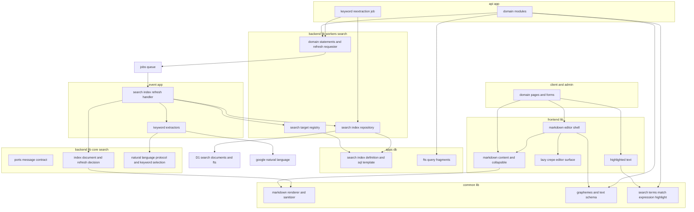
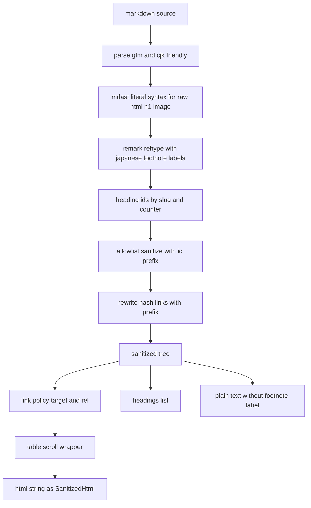
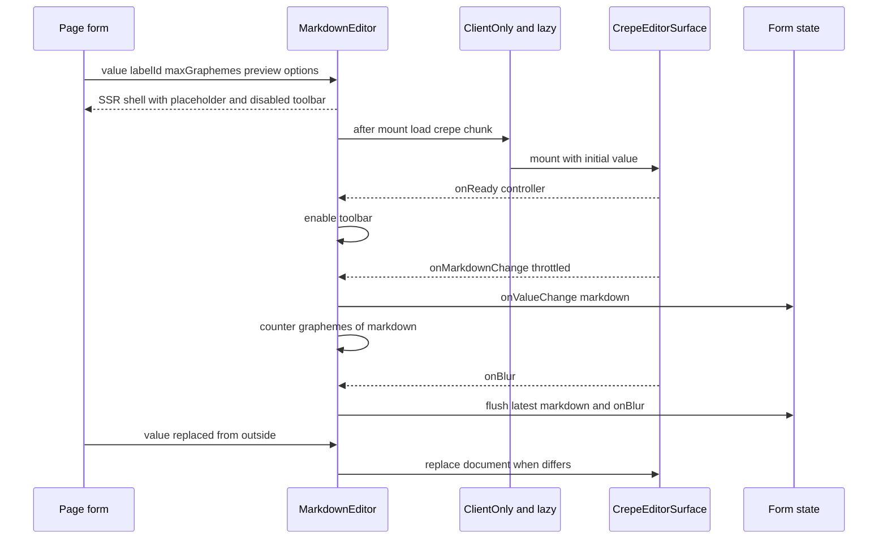
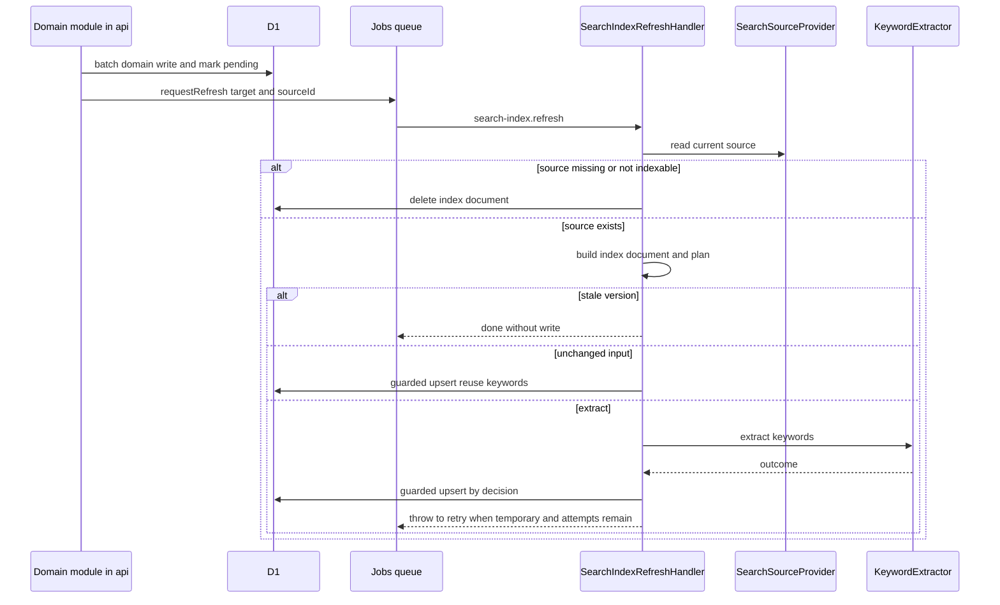
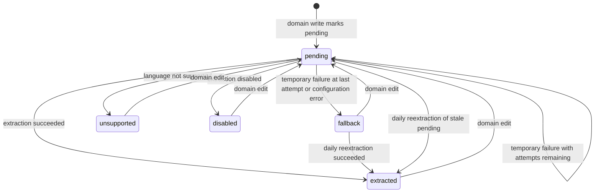
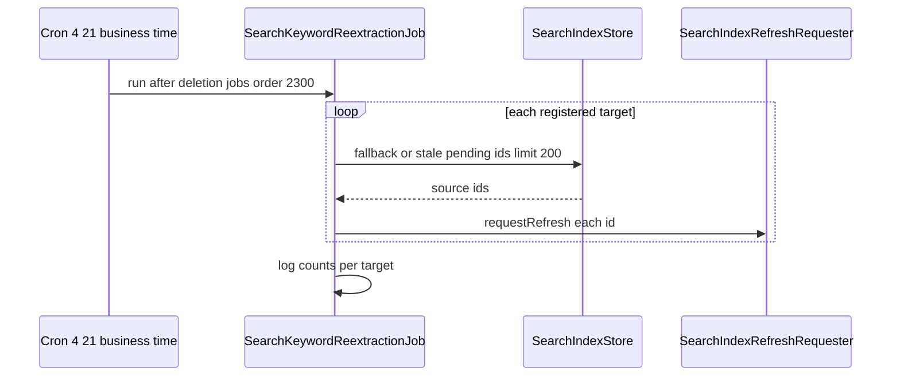
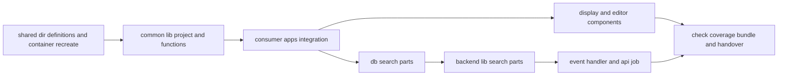

# Design Document

## Overview

**Purpose**: マークダウンの入力・描画・サニタイズと、全文検索の索引・正規化・照合を、全ドメインが共通で使う1つの基盤として提供する。画面を持たない純粋な処理(描画・書記素の文字数・入力の検証規則・検索語の処理)は新しい共有ディレクトリ`apps/common-lib`に置き、利用者側・管理者側のフロントエンド(ページの描画とブラウザ)・APIサーバー・イベントサーバーの4アプリが同じ定義を使う。画面部品(入力欄・表示・強調表示)は`apps/frontend-lib`、索引の部品は`apps/db`・`apps/backend-lib`、索引の更新の処理はイベントサーバー、再抽出の定期実行はAPIサーバーに置く。

**Users**: legal-pages・help-center・user-profile-social・product-launch・engagementの開発者とAIエージェントは、マークダウンの入力欄と表示部品を画面に置き、APIサーバーで本specの検証規則を使ってマークダウンの原文を保存する。directory-discovery・help-centerは、検索対象を登録し、本specのひな形で索引のテーブルを作り、元データの作成・編集・削除の処理で本specの手段を呼び、検索の画面で検索式・関連度・強調表示の部品を使う。media-pipeline・identity-authは、本specが新設する`apps/common-lib`の配置と読み込みの境界の上に自分の共有定義(`common-lib/media`・`common-lib/identity`)を置き、identity-authは`countGraphemes`を使う。infra-deliveryは、本specが加えるシークレットと変数をInfisicalの表・変数の一覧に載せてstaging・prodへ反映する(シークレットのキーの一覧の正は`docs/onboardings/project-values.md`で、本specが自分のキーの行を加える)。

**Impact**: dev-toolingの共有ディレクトリの定義(`config/workspace-layout.ts`・`compose.yaml`・`.gitignore`)と開発コンテナ(`Dockerfile`)に4つ目の共有ディレクトリを加え、4アプリの品質ツール設定・依存・型検査の対象・単体テストの設定を更新する。frontend-platformの静的解析の規則・Vite設定・環境の検証に、エディタの読み込みの制限・Vueの機能フラグ・利用者側のオリジンの変数を加える。backend-platformのメッセージ契約・メッセージの処理・定期実行・イベントサーバーの環境の登録箇所へ、検索の索引の更新を追記する。

### Goals

- 4アプリが同じ描画部品と検証規則を使い、ページの描画・ブラウザ・APIサーバー・イベントサーバーで同じ結果になる。
- マークダウンを経由したXSSを、許可リスト方式のサニタイズと型と静的解析で防ぎ、生のHTMLの挿入は表示部品の1箇所に限る。
- 入力欄が、見出しレベル1と画像を挿入させずに書式を適用した見た目で編集でき、WCAG 2.2 AAの自動検査に違反0件で通り、編集領域の実装はページの最初の読み込みとサーバー側の描画に入らない。
- ドメインが検索対象を登録するだけで、索引の作成・更新・縮退・再抽出・削除が働き、外部APIの障害時も書き込みと検索を止めない。
- 追加した全ファイルがカバレッジ80%を満たし、一括検査に参加する。

### Non-Goals

- ドメインごとの入力欄の上限値・`rel`の値・折りたたみの高さ・検索対象の登録・索引のテーブル・検索の画面とクエリ(各ドメインspec)。
- ヘルプ記事の目次の画面(help-center)、検索語の50文字の上限の検証(各ドメインspec)。
- マークダウンへの画像の添付、コードのシンタックスハイライト、全件の再索引の仕組み。
- Google Cloudのプロジェクト・APIキーの発行と制限・Infisicalの`staging`への登録(開発者の手作業)、Infisicalの`prod`への登録(launch-readiness)、Workerへのシークレットの反映とCIのワークフロー(infra-delivery)。

## Boundary Commitments

### This Spec Owns

- `apps/common-lib`(新しい共有ディレクトリ兼アプリ、検査担当`self`): 描画(`renderMarkdown`・`extractSearchText`・`RenderedMarkdown`・`SanitizedHtml`・`MarkdownRenderOptions`)、見出しのスラッグ、書記素の文字数と禁止文字の判定、マークダウンの入力の検証規則(`markdownTextSchema`)、検索語の正規化と検索式(`normalizeSearchTerms`・`buildFtsMatchExpression`)、索引用のテキストの正規化(`normalizeIndexText`)、強調表示の範囲(`findHighlightRanges`)、攻撃パターン集。
- `apps/frontend-lib`の追加部分: 表示部品(`MarkdownContent`・`CollapsibleMarkdownContent`・`useRenderedMarkdown`・`useMarkdownOptions`)、入力欄(`MarkdownEditor`と固定ツールバー・リンクのダイアログ・カウンター・仮表示)、遅延読み込みの編集領域(`components/markdown-editor/crepe/`)、強調表示部品(`HighlightedText`)、本文の文字組みのスタイル、エディタの読み込みの静的解析の規則、生のHTMLの例外の検査、遅延読み込みの分離の検査。
- `apps/db`の追加部分: 索引文書の共通の列(`searchDocumentColumns`・`searchTextColumn`・`KEYWORD_STATUSES`)、索引の定義と検証(`defineSearchIndex`)、全文検索の索引のSQLのひな形・トリガーの作り直し・再構築(`renderSearchIndexSql`など)、検索のSQL断片(`ftsRankedSources`・`bm25Rank`)、索引の定義の集約点(`SEARCH_INDEXES`)とSQLの出力スクリプト、マイグレーションとの突き合わせの検査。
- `apps/backend-lib`の追加部分: `core/search`(検索対象の型・ポート・DIの識別子・索引文書の組み立て・更新の計画と抽出結果の判定・自然言語APIの要求と応答の解釈・キーワードの選別)、`core/messaging/contracts/search-index-refresh.ts`(メッセージ`search-index.refresh`と再試行の方針)、`workers/search`(検索対象の定義と集約点`SEARCH_TARGETS`・索引の保存・ドメイン向けの文・更新の要求・共通の束縛)。
- `apps/event`の追加部分: 索引の更新の処理(`SearchIndexRefreshHandler`)、キーワード抽出の実装(Google Cloud Natural Language・無効化)、環境の変数とシークレット、登録、疎通確認のスクリプト。
- `apps/api`の追加部分: 日次の再抽出のジョブ(`SearchKeywordReextractionJob`)と登録。
- 契約: `MarkdownRenderOptions`・`RenderedMarkdown`・`SanitizedHtml`、`MarkdownEditorProps`、`markdownTextSchema`の文言、`SearchTargetDefinition`・`SearchIndexDefinition`・`SearchIndexStatements`・`SearchIndexRefreshRequester`、メッセージ`search-index.refresh`、索引文書の共通の列と状態の値、全文検索の索引の名前の規約、変数`KEYWORD_EXTRACTOR`・`CLIENT_SITE_ORIGIN`、シークレット`GOOGLE_NL_API_KEY`。
- 技術ドキュメント: `external/002-natural-language-keyword-extraction.md`・`db/004-full-text-search.md`・`frontend/008-markdown-editor-and-content.md`・`security/004-markdown-sanitization.md`と各索引(番号はroadmapの順で割り当てた固定の番号)。`coding/002`・`coding/003`・CLAUDE.md・tech-stack.md・`docs/onboardings`・サービス仕様(日次タイムライン・文言規則・ページ構成・準拠方針)の該当箇所の更新。backend-platformの`infra/003-async-processing.md`へのジョブとメッセージ種別の名前の規約の追記(16.8)。プライバシーポリシーの大枠と準拠方針の国外移転の記載事項のうち、委託先Google Cloud(Natural Language API)の項(16.9)。

### Out of Boundary

- 各ドメインの検索対象の登録(`backend-lib/workers/search/targets/<ドメイン>.ts`)・索引文書のテーブル(`apps/db/schema/<ドメイン>/<テーブル>.ts`)・カスタムマイグレーション・検索の画面とクエリ・論理削除や非公開の元データの扱い(directory-discovery・help-center)。
- 各入力欄の上限値と必須の別・表示場所の`rel`・折りたたみの高さ・本文の識別子の選び方・マークダウンを保存するGraphQLの操作(各ドメインspec)。
- ヘルプ記事の目次の画面(help-center)、検索語の50文字の上限(各ドメインspec)。
- 共有ディレクトリの配置と配置確認の仕組みそのもの(dev-tooling。本specは定義への追記だけを行う)。
- メッセージの封筒・再試行の判定・デッドレター・定期実行の振り分け・一括の書き込み・ログとSentryの設定(backend-platform。本specは登録箇所への追記だけを行う)。
- 中継・CSP・セキュリティヘッダー・フォーム部品・デザイントークン(frontend-platform。本specは静的解析の規則への追記・Vite設定の機能フラグ・変数1つ・コードブロックの色のトークン2つの追加だけを行う)。
- Google Cloudのプロジェクト・APIの有効化・キーの発行と制限、Infisicalの`staging`への登録(開発者の手作業)、Infisicalの`prod`への登録(launch-readiness)、staging・prodのWorkerへのシークレットの反映とCI(infra-delivery)。
- `apps/common-lib`の下のmedia-pipeline・identity-authの共有定義(`common-lib/media`・`common-lib/identity`)と、APIサーバーの変数`CLIENT_SITE_ORIGIN`(identity-auth)。
- プライバシーポリシー・準拠方針の法務文書の本文(開発者が用意する)と、国外移転の記載事項のうちGoogle Cloud以外の委託先の項(Cloudflareはinfra-delivery、AWSはmedia-pipeline。委託先単位の分担)。

### Allowed Dependencies

- 上流(dev-tooling): 基底設定(`tsconfig.base.json`・`eslint.config.base.ts`・`prettier.config.ts`・`bunfig.toml`)、スクリプト契約、テストの命名、`config/workspace-layout.ts`と`shared-dirs`の仕組み(定義への追記だけ)、`config/vitest`のプリセット。
- 上流(backend-platform): `apps/db`の`Database`・`createDatabase`・テーブル定義の`snakeCase.table`、`core`の`defineMessageContract`・`MessageContract`・`MessageHandler`・`MessageMeta`・`MessageHandlingResult`・`RetryPolicy`・`DEFAULT_RETRY_POLICY`・`ScheduledJobDefinition`・`ScheduledJobHandler`・`AppModule`・`PLATFORM_TYPES`・`Clock`・`getAppLogger`・`AppError`、`workers`の`MessagePublisher`・`PlatformEnv`、登録箇所(`MESSAGE_CONTRACTS`・`MESSAGE_HANDLERS`・`SCHEDULED_JOBS`・`MODULES`・`env-schema.ts`)。
- 上流(frontend-platform): `components/ui`のボタン・タブ・ダイアログ・テキスト入力・ラベル、`components/state`の状態表示、`utilities/class-names.ts`の`cn`、`test/a11y.ts`の`runAxe`、`config/frontend-lint.ts`、`styles/tokens.css`・`base.css`、ルーターの文脈の`PublicRuntimeConfig`、`components/form`の`FormField`・`FormControlProps`(`labelId`は本specが列挙しない値として加える)、`start/preload-recovery.ts`、`start/observability/report-error.ts`の`reportUnexpectedError`、Storybookの設定。
- npmパッケージ: Technology Stackの表に挙げた版に限る。
- 依存の方向: 「Dependency Direction」に従う。`apps/common-lib`は他のアプリのコードを読み込まない。`@milkdown/*`・`vue`・`@vue/*`を読み込めるのは`apps/frontend-lib/components/markdown-editor/crepe/**`だけである。

### Revalidation Triggers

- `renderMarkdown`・`MarkdownRenderOptions`(`siteOrigin`・`externalLinkRel`・`sameOriginLinkRel`・`idScope`)・`RenderedMarkdown`(`html`・`headings`・`plainText`)の形、見出しのIDの変換・接頭辞・連番の規則、入れ子の深さ・解析の負荷・スタックあふれによる原文の1段落への縮退(help-center・user-profile-social・product-launch・engagement・legal-pages)。
- `MarkdownEditorProps`・`MarkdownContentProps`・`CollapsibleMarkdownContentProps`・`HighlightedTextProps`の形(画面を持つ全下流spec)。
- frontend-platformの`FormControlProps.labelId`(本specが加える列挙しない値で、`{...control}`の展開では写らない)と、`preload-recovery.ts`が通知の全ての聞き手の後にマイクロタスクで`defaultPrevented`を確かめ、止められた出来事で再読み込みしない規則(`FormField`の子で独自の入力欄を作るspec、遅延読み込みを使う全画面)。
- `createSearchPlatformModule(targets, appName)`の引数と、ロガーのカテゴリーの先頭をアプリ名にする形(`[<アプリ名>, 'search', 'refresh' | 'index' | 'reextraction']`)(検索対象を登録するdirectory-discovery・help-center、ログを監視する運用)。
- `SearchIndexRefreshRequester.requestRefresh`が、未登録の検索対象で`SearchTargetRegistryError`、契約に合わない本文で`MessagePublishError`を投げ、それ以外の送信の失敗を記録して例外にしない規則(要求を出すdirectory-discovery・help-center)。
- `markdownTextSchema`の引数と文言、書記素の数え方と`countGraphemes`の形(入力欄を持つ全下流spec・identity-auth)。
- `SearchTargetDefinition`・`SearchIndexDefinition`・`SearchIndexStatements`・`SearchIndexRefreshRequester`の形、索引文書の共通の列と`KEYWORD_STATUSES`、全文検索の索引とトリガーの名前の規約、`ftsRankedSources`・`bm25Rank`の返す列(directory-discovery・help-center)。
- メッセージ`search-index.refresh`の本文と再試行の方針、再抽出のジョブの名前・時刻・順序・件数の上限(運用・infra-delivery・4:21にジョブを足すmedia-pipeline・identity-auth)。
- 日次タイムラインの「日次バッチ(4:21)の内容」のジョブの名前と順序の表の形(4:21にジョブを足すmedia-pipeline・identity-authと後続spec)。
- `infra/003-async-processing.md`へ追記するジョブ・波及処理とメッセージ種別の名前の規約(ジョブや波及処理を登録する全下流spec。identity-authの`backend/007`の名前の規約の記述)。
- プライバシーポリシーの大枠の国外移転の記載事項のGoogle Cloudの項(送る情報・処理する場所・移転の根拠・措置)。委託先の項の形(移転先・移転の根拠・委託先が講じる措置)と根拠の種類(DPFを主、委託先のDPAのSCCを予備)は、Cloudflareの項(infra-delivery)・AWSの項(media-pipeline)とそろえる。外部APIの接続先(処理のリージョン)や送る項目を変えたら、この項を改める(infra-delivery・media-pipeline・launch-readiness)。
- `buildFtsMatchExpression`の照合規則(前方一致)と`findHighlightRanges`の一致規則(FTS5の`unicode61 remove_diacritics 2`の実際の折りたたみ・語の区切りに合わせ、記号を含む検索語は語の並びとして最後の語だけ前方一致にする)(directory-discovery・help-center)。
- 変数`KEYWORD_EXTRACTOR`・`CLIENT_SITE_ORIGIN`、シークレット`GOOGLE_NL_API_KEY`の名前と環境ごとの値(infra-delivery・launch-readiness)。`CLIENT_SITE_ORIGIN`の名前と値は、identity-authがAPIサーバーに置く同名の変数と同じにする(identity-auth)。
- 共有ディレクトリの数・配置先・検査担当、frontend-lib・backend-libからの参照方法(兄弟の相対パス、仮決定P4)、common-libの読み込みの境界の規則、frontend-libの`components/**`・`server/**`・`utilities/**`からcommon-libを読み込む許可と`validation/**`の制限(dev-tooling・全アプリ・infra-deliveryのCI・`common-lib/media`を置くmedia-pipeline・`common-lib/identity`を置くidentity-auth)。

本specの実装では、上の項目のうち次が発火した。上流・並行・下流specの設計の該当の記述は、2026-10-31にこの形へ直した(frontend-platform・help-center・legal-pages・user-profile-social・product-launch・engagement、4:21の順序の一覧はidentity-auth・payments・ultras-subscription・user-profile-social)。

- `FormControlProps.labelId`は列挙しない値で、子は`control.labelId`で読んで渡す(「MarkdownEditor(外枠)」)。
- `preload-recovery.ts`はマイクロタスクで`defaultPrevented`を判定し、入力欄の読み込み関数は通常の段階の聞き手で既定の動作を止める(「LoadCrepeEditor」)。
- `createSearchPlatformModule(targets, appName)`とロガーのカテゴリー`[<アプリ名>, 'search', …]`(「SearchPlatformModule」)。
- `requestRefresh`が投げる例外(`SearchTargetRegistryError`・`MessagePublishError`)(「SearchIndexRefreshRequester」)。
- `findHighlightRanges`の折りたたみ・語の区切り・記号を含む検索語の照合(「HighlightRanges」)。
- `renderMarkdown`・`extractSearchText`の原文の1段落への縮退(「MarkdownProcessor」)。
- 静的解析の設定名`frontend/restricted-syntax`と、エディタの実装の動的`import()`の検出。
- 入力欄の部品の想定外の失敗の送信は、ブラウザ用の入口`start/observability/browser-error-reporting.ts`の`reportUnexpectedErrorInBrowser`を使う(frontend-platformの所有物に加えた)。
- 4:21の再抽出のジョブの順序2300(roadmapの帯の割り当て。4:21のジョブの順序の一覧を持つspecの設計を直した)。

#### 本specのタスクを前提にする下流spec

`apps/common-lib`の新設は本specが行い、media-pipeline・identity-authはその上に自分の共有定義を置く。roadmapの順では本spec全体の完了を待ってから両specに着手する。本spec全体を待たずに着手する場合の最小の区切りは、次のタスクの完了とする。

| spec           | 前提にする本specのタスク                                                                                                                                                                                                                                                                                                                                                                   | 使うもの                                                                                                                                                                          |
| -------------- | ------------------------------------------------------------------------------------------------------------------------------------------------------------------------------------------------------------------------------------------------------------------------------------------------------------------------------------------------------------------------------------------ | --------------------------------------------------------------------------------------------------------------------------------------------------------------------------------- |
| media-pipeline | 1.1(共有ディレクトリの定義と配置)、1.2(共用部品のプロジェクトと読み込みの境界)、4.1・4.2(利用側アプリの依存・型検査の対象・静的解析とテストの除外、frontend-libからの参照)、6.1(frontend-libの`server/**`からcommon-libを読み込む許可と`validation/**`の禁止の静的解析の規則)、11.3のうち`coding/003`への`server/**`の許可の記述、11.4のうち日次タイムラインのジョブの名前と順序の表の作成 | `common-lib/media`の置き場所、`frontend-lib`の`utilities/media`・`server/media`と`backend-lib`からの兄弟の相対パスでの参照、`server/**`からの読み込みの規則、日次タイムラインの表 |
| identity-auth  | 上のタスクに加えて2.1(書記素の数え方)                                                                                                                                                                                                                                                                                                                                                      | `countGraphemes`、`common-lib/identity`の置き場所、APIサーバーと同名・同値の`CLIENT_SITE_ORIGIN`、日次タイムラインの表                                                            |

- `server/**`の許可の確かめ方: frontend-platformの静的解析はfrontend-libの外への相対パスの読み込みを禁止しないため、4.2の後は`server/**`から`../common-lib/**`を読み込んでも静的解析で拒否されない。6.1で`components/**`・`server/**`からの`common-lib/validation/**`の禁止が入り、その他のモジュールの読み込みが報告されないことをESLintのNode APIの単体テストで確かめる。11.3で`coding/003`に読み込める範囲を書く。下流specは、6.1の単体テストの成功と`coding/003`の記述で許可を確かめる。
- 日次タイムラインの表: 「日次バッチ(4:21)の内容」のジョブの名前と順序の表は、最初に4:21のジョブを足すspecが作り(上流のemail-deliveryの`email-delivery.cleanup`・900を含める)、後のspecは行を足す。想定の順序では本specの11.4が作る。下流specは、表が無いことを理由に止めず、表が無ければ同じ形で作って自分の行を足す。その場合、本specの11.4は既存の表へ行を足すだけにする。
- launch-readinessは、Infisicalの`prod`への`GOOGLE_NL_API_KEY`の登録を、本specのタスク12の引き継ぎ事項として受け取る。

#### 上流・並行specへの変更(本specが行う)

| spec              | 変更                                                                                                                                                                                                                                                                                                                                                                                                                                                                                                                                                                                                                                                                                                                                                                                                                                                                                                                                                                                                                                                                                                                                                                                                                                   | 再確認の要否                                                     |
| ----------------- | -------------------------------------------------------------------------------------------------------------------------------------------------------------------------------------------------------------------------------------------------------------------------------------------------------------------------------------------------------------------------------------------------------------------------------------------------------------------------------------------------------------------------------------------------------------------------------------------------------------------------------------------------------------------------------------------------------------------------------------------------------------------------------------------------------------------------------------------------------------------------------------------------------------------------------------------------------------------------------------------------------------------------------------------------------------------------------------------------------------------------------------------------------------------------------------------------------------------------------------- | ---------------------------------------------------------------- |
| dev-tooling       | `AppName`・`APPS`・`SHARED_DIRS`に`common-lib`を加え、`compose.yaml`のbind mountと名前付きボリューム、`.gitignore`の配置先、`workspace-layout.unit.test.ts`の期待値を更新する。開発コンテナ(`Dockerfile`)でcommon-libの`node_modules`を作って所有者を変え、`APPS`の順序に従う配布のスクリプトの単体テスト(`scripts/delivery`・`scripts/tooling/shared-dirs`)の期待値を更新する。Workers統合テストのカバレッジから単体テストで検査するソースを外す`config/vitest/unit-tested-sources.ts`を加える。`coding/001`・`coding/002`・`coding/003`・`testing/001`に追記する                                                                                                                                                                                                                                                                                                                                                                                                                                                                                                                                                                                                                                                                     | 要(共有ディレクトリが4つになる)                                  |
| backend-platform  | api・eventの依存・型検査の対象・静的解析とテストの除外に`common-lib/`を加える(apiは`bunfig.unit.toml`を新設し、event・client・adminは既存の`bunfig.unit.toml`のカバレッジの除外へ加える)。`MESSAGE_CONTRACTS`・`MESSAGE_HANDLERS`・`SCHEDULED_JOBS`・`MODULES`・eventの`env-schema.ts`・Wrangler設定に追記する。apiの設定の検査の補助(`test/support/wrangler-config.ts`の`SEARCH_CONFIG_KEY_PATTERN`)とその単体テスト、4:21のジョブが増えても成り立つメールの定期実行のテスト(`email-module.worker.test.ts`)を改める。`infra/003-async-processing.md`の定期実行の説明に、ジョブ・波及処理とメッセージ種別の名前の規約を、`infra/004`のカテゴリーの表に検索の行を、`db/001`〜`db/003`に全文検索との関係を追記する                                                                                                                                                                                                                                                                                                                                                                                                                                                                                                                       | 不要(登録箇所と文書への追記の範囲)                               |
| frontend-platform | `frontend-lint.ts`の`no-restricted-imports`にMilkdownの制限と、common-libの読み込みの許可(`components/**`・`server/**`・`utilities/**`)と`validation/**`の制限、`components/**`からの`start/observability/report-error.ts`の読み込みの禁止を加え、生のHTMLとエディタの動的`import()`の設定を`frontend/restricted-syntax`とする。ブラウザ用の送信の入口`start/observability/browser-error-reporting.ts`を加え、`report-error.ts`の`.client`の実装をそれへ寄せる。client・admin・frontend-libの依存・型検査の対象・Vite設定(`config/vue-feature-flags.ts`のVueの機能フラグ・`server.fs.allow`)、ブラウザテストとStorybookの事前バンドルの一覧(`PREBUNDLED_DEPENDENCIES`・`config/editor-prebundled-dependencies.ts`)、`styles/base.css`の取り込み、`styles/tokens.css`のコードブロックの色のトークン、変数`CLIENT_SITE_ORIGIN`と`PublicRuntimeConfig.clientSiteOrigin`(公開する設定を組み立てるテストの補助・Storybookの設定を含む)を加える。`FormField`の`Label`に`id`を付けて`FormControlProps.labelId`(列挙しない値)で子へ渡す。`start/preload-recovery.ts`を、通知の全ての聞き手の後に既定の動作が止められたかを確かめ、止められた`vite:preloadError`では再読み込みしないように改める。`frontend/003`・`004`・`005`・`007`に追記する | 要(環境の検証と公開する設定の形、`FormControlProps`の形が変わる) |
| infra-delivery    | eventの`GOOGLE_NL_API_KEY`を、Infisicalのキーの表(infra-deliveryが所有)に載せる。実装後のキーの一覧の正は`docs/onboardings/project-values.md`のWorkerのシークレットのキーの一覧の節で、本specが行を加える。client・adminの`CLIENT_SITE_ORIGIN`の3環境の値を、infra-deliveryの一覧の値と一致させる。CIは`APPS`に従って`apps/common-lib`の依存を導入し、`shared-dirs:place`で配置する                                                                                                                                                                                                                                                                                                                                                                                                                                                                                                                                                                                                                                                                                                                                                                                                                                                    | 要(キーと値の一覧への追加はinfra-deliveryが行う)                 |
| email-delivery    | 業務時刻4:21のcron式`21 12 * * *`を共有する(順序2300で後に並ぶ)。email-deliveryはroadmapの依存ではないため、実装の有無はタスク1.1で確かめ、無ければ開発者へ報告して進める。cron式が無ければタスク10で加える                                                                                                                                                                                                                                                                                                                                                                                                                                                                                                                                                                                                                                                                                                                                                                                                                                                                                                                                                                                                                            | 不要                                                             |

## Architecture

### Existing Architecture Analysis

- 上流のdev-tooling・backend-platform・api-gateway・email-delivery・frontend-platform・infra-deliveryは実装済みで、本specはその契約(登録箇所・メッセージ・定期実行・層の規則・共通部品・静的解析の設定・シークレットの宣言)を前提にする。email-deliveryは4:21の定期実行(`21 12 * * *`、`email-delivery.cleanup`・900)と4:21の時間の予算(`SCHEDULED_RUN_BUDGETS`の300,000ms、各ジョブの目安30秒)を登録済みである。上流の実装との照合の結果はresearch.mdの「実装済みの上流specとの差分の分析(2026-10-30)」に記録した。
- frontend-platformの`FormField`は、子へ入力の要素のID・`aria-invalid`・`aria-describedby`・`ref`を渡し、`Label`は`htmlFor`で入力の要素と関連付ける。編集領域のような`contenteditable`の要素は`htmlFor`で名前が付かないため、本specが`Label`の`id`を`FormControlProps.labelId`として渡すよう改める。`labelId`はDOMの属性に無いため、子が`{...control}`で入力の要素へ展開しても要素へ出力されない列挙しない値にする。`AppForm`は、サーバーが欄ごとのエラーを返すと、`FormField`が渡す`ref`の`focus`で最初のエラーの欄へフォーカスを移す(`frontend/004`)。
- frontend-platformの`start/preload-recovery.ts`は、`vite:preloadError`を受けるとセッションで1回だけページを再読み込みする。Viteの読み込みの補助は遅延読み込みの`import()`の失敗でもこの出来事を送る(Vite 8.3.5で確認)。
- frontend-lib・client・adminの`vitest.browser.config.ts`は、テストの実行中に依存の事前バンドルをやり直すとページが再読み込みされReactが2つ読み込まれるため、画面部品の依存を`optimizeDeps.include`(`PREBUNDLED_DEPENDENCIES`)に列挙している。Storybookの設定は列挙していない。
- `config/workspace-layout.ts`の`SHARED_DIRS`は、`apps/db`・`apps/backend-lib`(検査担当api)と`apps/frontend-lib`(検査担当`self`)の3つで、フロントエンドとバックエンドの両方へ配置される共有ディレクトリが無い。`scripts/tooling/shared-dirs.ts`は定義を読むだけの汎用の仕組みで、定義の追加で新しい共有ディレクトリを扱える。
- `docs/GUIDES/tech/db/002`は、FTS5のexternal contentとトリガーによる同期、カスタムマイグレーション、Time Travelによるバックアップを定めている。backend-platformは全文検索用のテーブルの主キーを連番とする規約だけを持ち、部品を提供しない。
- frontend-platformは、`@eslint-react/dom-no-dangerously-set-innerhtml`を全体で禁止し、本specのサニタイズ済みHTMLの部品だけが理由のコメント付きで1行だけ無効化できる規約(`frontend/003`)を置いている。CSPはスクリプトにnonceと`'self'`、スタイルに`'unsafe-inline'`を許可する。
- Cron Triggersはapiだけに置き、重い処理はeventのQueueのconsumerへ委ねる(backend-platform)。email-deliveryが業務時刻4:21(`21 12 * * *`)の定期実行を登録する。

### Architecture Pattern & Boundary Map



**Architecture Integration**:

- 選んだパターン: 画面を持たない純粋な処理を共用部品に集め、画面部品と索引の処理はそれを使う側に置く。索引の判断(計画・抽出結果の判定・キーワードの選別)は`core/search`の純粋関数に置き、D1・Queues・外部APIはポートの実装として`workers/search`と各アプリの`infrastructure`に置く(ポートとアダプタ)。
- 境界: 共用部品は「入力から出力を返すだけ」の関数に限る。どの項目を検索するか・いつ索引を消すかの業務判断はドメインの登録と呼び出しに委ねる。
- 既存パターンの維持: 共有ディレクトリの配置と利用側アプリでの依存解決、`AppModule`と登録箇所、`MessageContract`と再試行の方針、`ScheduledJobDefinition`、`@inject`の明示、1ファイル1コンポーネント、`*.unit.test.ts`・`*.browser.test.tsx`・`*.worker.test.ts`の命名。
- 新規コンポーネントの理由: research.mdの「Generalization・Build vs Adopt・Simplification」を参照。

### Dependency Direction

- `apps/common-lib`: 自身のファイルと、unified系・`zod`だけを読み込む。他のアプリ・共有ディレクトリ、`react`・`@tanstack/*`・`hono`・`cloudflare:*`・`drizzle-orm`・`@milkdown/*`・`@sentry/*`・`node:*`・`bun:*`を読み込まない(単体テストの`bun:test`と、FTS5の検索式を確かめる`bun:sqlite`を除く)。違反は`apps/common-lib/eslint.config.ts`の`no-restricted-imports`と`config/import-boundary.unit.test.ts`で検出する。読み込みの境界の単体テストは型だけの読み込みも走査するため、静的解析の`consistent-type-imports`で型の位置の`import()`を禁止する。
- `apps/frontend-lib`: frontend-platformの向き(`utilities` ← `server` ← `start` ← `components` ← アプリ)を保ったまま、`components/**`・`server/**`・`utilities/**`から`../common-lib/**`(兄弟の相対パス)を読み込める(`server/**`はmedia-pipelineの中継の定義が`common-lib/media`を読む)。`components/**`と`server/**`は、common-libのうちZodを使うモジュール(`validation/**`)を読み込まない。`@milkdown/*`・`vue`・`@vue/*`は`components/markdown-editor/crepe/**`だけが読み込み、`crepe/**`を外から読み込めるのは`components/markdown-editor/load-crepe-editor.ts`の`import()`だけとする。読み込み関数自身も`@milkdown/*`・`vue`を動的importしない。
- `apps/db`: `drizzle-orm`・`ulid`と自身のファイルだけを読み込む(backend-platformの規則)。`search/**`も同じである。
- `apps/backend-lib`: `apps/db` → `core` → `workers` → アプリの`src`の向き(backend-platform)。`core/search/**`は`../../../common-lib/**`を読み込めるが、`apps/db`を読み込まない(`KEYWORD_STATUSES`の値の一致は`workers/search`の型で保証する)。
- アプリの`src`: `domain` ← `application` ← `infrastructure`・`presentation` ← `composition`(backend-platform)。`application/search/**`は`lib/core/search`のポートと`common-lib`だけを読み込む。

### Technology Stack

| Layer            | Choice / Version                                                                                                                                                                                                             | Role in Feature                                      | Notes                                                                                                                                                               |
| ---------------- | ---------------------------------------------------------------------------------------------------------------------------------------------------------------------------------------------------------------------------- | ---------------------------------------------------- | ------------------------------------------------------------------------------------------------------------------------------------------------------------------- |
| 描画             | unified 11.0.5・remark-parse 11.0.0・remark-gfm 4.0.1・remark-cjk-friendly 2.3.2・remark-cjk-friendly-gfm-strikethrough 2.3.1・remark-rehype 11.1.2・rehype-sanitize 6.0.0・rehype-stringify 10.0.1・hast-util-to-text 4.0.2 | 解析・文字列化・サニタイズ・HTMLとテキストの出力     | tech-stack記載済み。common-libと4アプリで版をそろえる。rehype-slugは使わない(仮決定P2)                                                                              |
| 検証             | zod 4.6.7                                                                                                                                                                                                                    | マークダウンの入力の検証規則                         | 上流の現在の版(実装時に上流が更新していればそれに従う)                                                                                                              |
| エディタ         | @milkdown/crepe 7.22.3・@milkdown/kit 7.22.3・@milkdown/react 7.22.3                                                                                                                                                         | 編集領域(遅延読み込み)                               | 調査は7.22.2で行い、2週間の規則を満たした7.22.3へ上げた(2026-10-30の開発者の決定)。`@milkdown/kit`の明示の宣言は仮決定P3。frontend-lib・client・adminで版をそろえる |
| 文字組み         | @tailwindcss/typography 0.5.20                                                                                                                                                                                               | 本文の`prose`の文字組み                              | 新規(Q6)。frontend-lib・client・adminで版をそろえる                                                                                                                 |
| 標準API          | `Intl.Segmenter`・`String.prototype.normalize`・`String.prototype.isWellFormed`・Web Crypto(`crypto.subtle.digest`)・`fetch`・`AbortSignal.timeout`                                                                          | 書記素・NFKC・不正なUnicodeの判定・ハッシュ・外部API | workerd・ブラウザ・Bunの標準。パッケージを追加しない                                                                                                                |
| データ           | Cloudflare D1(SQLite FTS5)・drizzle-orm 1.0.0-rc.5                                                                                                                                                                           | 索引文書のテーブル・全文検索の索引・トリガー         | backend-platformの版                                                                                                                                                |
| 非同期・定期実行 | Cloudflare Queues(`JOBS_QUEUE`)・Cron Triggers(api)                                                                                                                                                                          | 索引の更新・日次の再抽出                             | backend-platformの基盤。新しいQueueは作らない                                                                                                                       |
| 外部API          | Google Cloud Natural Language v2 `documents:analyzeEntities`                                                                                                                                                                 | キーワード抽出                                       | tech-stack記載済み。`fetch`でRESTを呼ぶ                                                                                                                             |
| テスト           | bun test(bun:sqlite)・vitest 4.1.12(Browser Mode・`@cloudflare/vitest-pool-workers` 0.23.0)・vitest-browser-react 2.3.0・axe-core 4.14.0                                                                                     | 単体・ブラウザ・Workers統合テスト                    | 上流の現在の版(実装時に上流が更新していればそれに従う)                                                                                                              |

- common-libのコードが実行時に使うパッケージ(描画の9つとzod)は、api・event・client・adminも同じ版で宣言する(共有ディレクトリの規約)。エディタの3つと`@tailwindcss/typography`・remark-cjk-friendlyの2つは、frontend-lib・client・adminが宣言する。版をそろえるパッケージの一覧を`coding/002`に加える。
- hast・mdastの型パッケージは宣言せず、変換で触る節点だけの構造的な型を`markdown/hast-types.ts`に置く(推移的な型パッケージに頼らない)。

## File Structure Plan

### Directory Structure

```
apps/
├── common-lib/                                    # 新しい共有ディレクトリ兼アプリ(配置先: apps/{api,event,client,admin}/common-lib、検査担当: self)
│   ├── package.json · bun.lock                    # 描画の9パッケージ・zod(実行時)、品質ツール6種・@types/bun(開発時)。スクリプト契約(lint・typecheck・test:unit)
│   ├── tsconfig.json                              # extendsを持たない自己完結の設定(lib ES2024・types bun)
│   ├── eslint.config.ts                           # createBaseConfig+読み込みの境界の規則
│   ├── config/
│   │   ├── tsconfig-sync.unit.test.ts             # 基底設定と差分(lib・types・include)以外で一致すること
│   │   └── import-boundary.unit.test.ts           # 全ソースのimportが共用部品の外を指さず、許可したパッケージだけであること
│   ├── text/
│   │   ├── graphemes.ts                           # countGraphemes
│   │   ├── text-safety.ts                         # hasForbiddenCharacters(孤立サロゲート・タブ改行以外のC0制御文字・DEL・C1制御文字)
│   │   └── white-space.ts                         # trimWhiteSpace(\p{White_Space}による前後の空白の除去。入力の長さに対して線形)
│   ├── validation/
│   │   └── markdown-text-schema.ts                # markdownTextSchema・MarkdownTextRule・文言
│   ├── markdown/
│   │   ├── hast-types.ts                          # 変換で触る節点だけの構造的な型
│   │   ├── markdown-options.ts                    # MarkdownRenderOptions・LinkRelToken・検証・idPrefixFor
│   │   ├── heading-slug.ts                        # slugifyHeading・normalizeAnchorFragment(FR-MDOWN-006)
│   │   ├── sanitize-schema.ts                     # 許可リスト(要素・属性・スキーム)
│   │   ├── markdown-processor.ts                  # 解析からサニタイズ・接頭辞までの共通の処理(SanitizedTree)、入れ子の深さの上限による縮退
│   │   ├── parse-guard.ts                         # 解析の前の線形の走査による負荷の見積もりと、過大な負荷・スタックあふれでの縮退(parseWithGuard)
│   │   ├── stack-overflow.ts                      # 実行環境ごとのスタックあふれの例外の判定
│   │   ├── plugins/literal-syntax.ts              # mdast: Raw HTML・見出しレベル1・画像を文字列へ
│   │   ├── plugins/heading-ids.ts                 # hast: 見出しのIDと連番
│   │   ├── plugins/anchor-prefix.ts               # hast: #の参照の正規化と接頭辞
│   │   ├── plugins/link-policy.ts                 # hast: 許可外の参照のリンクの解除・target・rel
│   │   ├── plugins/table-scroll.ts                # hast: 表を横スクロールの枠で包む
│   │   ├── plugins/task-list-label.ts             # hast: タスクリストのチェックボックスへ項目の文字列からaria-labelを付ける
│   │   ├── extract-headings.ts                    # 見出しの一覧(脚注を除く)
│   │   ├── plain-text.ts                          # plainTextOf(サニタイズ済みの木から脚注の見出し・戻りリンクを除いたテキスト)
│   │   ├── extract-search-text.ts                 # extractSearchText(processMarkdownとplainTextOfの組み合わせ)
│   │   ├── render-markdown.ts                     # renderMarkdown・RenderedMarkdown・SanitizedHtml
│   │   └── fixtures/                              # テスト専用(単体テストとテスト専用のファイルだけが読み込む)
│   │       ├── xss-payloads.ts                    # 攻撃パターン集
│   │       ├── pathological-markdown.ts           # 解析の負荷が2乗になる入力の集
│   │       ├── representative-markdown.ts         # 性能の計測に使う20,000文字の代表的な文書
│   │       ├── cross-runtime-samples.ts           # 実行環境の間の照合の入力と固定の期待値
│   │       └── cross-runtime-cases.ts             # 照合の項目(CROSS_RUNTIME_CASES)と結果の要約(digestOfMarkdownResults)
│   └── search/
│       ├── search-terms.ts                        # normalizeSearchTerms・buildFtsMatchExpression
│       ├── index-text.ts                          # normalizeIndexText(NFKC・絵文字の区切り・空白の畳み込み)
│       ├── emoji-separator.ts                     # separateEmoji(絵文字の並びを構成する文字を区切りの空白にする)
│       └── highlight-ranges.ts                    # findHighlightRanges・HighlightRange
├── frontend-lib/
│   ├── styles/markdown.css                        # @plugin '@tailwindcss/typography'と本文の補助のスタイル(表の枠・脚注の見出し・列揃え)
│   ├── config/
│   │   ├── markdown-lint-rules.unit.test.ts       # Milkdownの読み込み・crepeの静的import・動的import・バレル・生のHTMLの違反例が報告されること
│   │   ├── raw-html-exception.ts                  # findRawHtmlExceptions(生のHTMLの規則の無効化とas SanitizedHtmlの位置の走査)
│   │   ├── raw-html-exception.unit.test.ts        # frontend-libではmarkdown-content.tsxの1箇所だけであること
│   │   ├── vue-feature-flags.ts                   # VUE_FEATURE_FLAGS(6つのVite・Storybookの設定が共有するVueの機能フラグ)
│   │   ├── editor-prebundled-dependencies.ts      # EDITOR_PREBUNDLED_DEPENDENCIES(3つのブラウザテストの設定とStorybookが事前バンドルするエディタの入口)
│   │   └── common-lib-reference.{unit,browser}.test.ts  # 自身の位置で兄弟の相対パスの共用部品を読み込めること(依存の解決・開発サーバーの配信)
│   ├── scripts/
│   │   ├── check-editor-chunks.ts                 # 入力欄を静的に読み込む検査用の入口をクライアント・SSRでビルドし、結果を判定する(実行部分)
│   │   └── editor-chunk-isolation.ts              # Rolldownの出力のチャンク情報から、入口の静的な読み込みにMilkdown・Vue・ProseMirrorが無いことを判定する純粋関数
│   ├── test/
│   │   ├── bundle/editor-entry.tsx                # 上の検査用の入口(テストではないファイル)
│   │   └── lint-statements.ts                     # 静的解析の規則の単体テストの補助(ファイルの位置ごとの文の報告の有無)
│   ├── utilities/messages/markdown-messages.ts    # 入力欄・表示部品の文言(文言規則003)
│   └── components/
│       ├── markdown/
│       │   ├── use-rendered-markdown.ts           # renderMarkdownのメモ化
│       │   ├── use-markdown-options.ts            # ルーターの文脈のclientSiteOriginを補ったMarkdownRenderOptions
│       │   ├── markdown-content.tsx               # 表示部品(生のHTMLの唯一の挿入箇所)
│       │   └── collapsible-markdown-content.tsx   # 折りたたみ付きの表示部品
│       ├── markdown-editor/
│       │   ├── editor-controller.ts               # EditorAction・EditorController・EditorSurfaceProps(Milkdownの型を含まない)
│       │   ├── editor-actions.ts                  # ツールバーの項目(名前・アイコン・操作)の一覧
│       │   ├── markdown-editor.tsx                # 外枠: タブ・ツールバー・編集領域の遅延読み込み・カウンター・プレビュー
│       │   ├── markdown-toolbar.tsx               # 固定ツールバー
│       │   ├── markdown-link-dialog.tsx           # リンクのURLの入力
│       │   ├── markdown-length-counter.tsx        # 書記素のカウンターと超過の読み上げ
│       │   ├── editor-placeholder.tsx             # サーバー側の描画・読み込み中・読み込み失敗の表示
│       │   ├── editor-load-boundary.tsx           # 読み込み・描画の失敗を受けて再試行させるエラーの境界(onFailure)
│       │   ├── editor-load-error.ts               # EditorLoadError(チャンクの読み込みの失敗。エラートラッキングへ送らない)
│       │   ├── load-crepe-editor.ts               # crepe/への唯一のimport()(loadCrepeEditor(importSurface?)のReact.lazy)
│       │   └── crepe/                             # @milkdown/*・vue・@vue/*を読み込める唯一のディレクトリ(遅延読み込みの別チャンク)
│       │       ├── crepe-editor-surface.tsx       # CrepeBuilderの組み立て・@milkdown/reactでのマウント・制御器の提供
│       │       ├── editor-features.ts             # 機能の選択と設定(選択時のツールバーの日本語のラベル)、プラグインの除外、キーマップの変更、Mod-k、Mod-[・Mod-]の既定の動作の抑止
│       │       ├── heading-input-rule.ts          # 見出しレベル2〜6だけの入力規則
│       │       ├── forbidden-node-normalizer.ts   # 見出しレベル1・画像を文字列に置き換えるProseMirrorのプラグイン
│       │       ├── file-transfer-guard.ts         # ファイルの貼り付け・ドロップをエディタのviewのハンドラーで止める
│       │       ├── task-item-state.ts             # タスク項目の状態を視覚的に隠した「完了」「未完了」で伝える装飾
│       │       ├── editor-commands.ts             # EditorActionからMilkdownのコマンドへの対応・選択中の書式の判定・リンクの設定と解除のトランザクション
│       │       ├── editor-accessibility.ts        # 編集領域のrole・aria属性
│       │       ├── cjk-remark-plugins.ts          # remark-cjk-friendlyの登録
│       │       ├── surface-test-harness.ts        # 編集領域のブラウザテストの補助(テストではないファイル)
│       │       └── crepe-theme.css                # 使う機能のCrepeのCSSの取り込み・素のリストの整形と--crepe-*のデザイントークンへの対応
│       └── search/
│           └── highlighted-text.tsx               # 強調表示部品
├── db/
│   ├── schema/_shared/search-documents.ts         # searchDocumentColumns・searchTextColumn・searchDocumentStatusIndex・KEYWORD_STATUSES
│   ├── search/
│   │   ├── search-index-definition.ts             # defineSearchIndex・SearchIndexDefinition(ブランド型)・SearchIndexDefinitionInput・検証・SEARCH_DOCUMENT_COLUMN_NAMES・KEYWORDS_COLUMN_NAME
│   │   ├── sqlite-keywords.ts                     # SQLITE_KEYWORDS(列名で拒否するSQLiteの予約語)
│   │   ├── search-index-sql.ts                    # renderSearchIndexSql・renderSearchIndexTriggersSql・renderSearchIndexDropSql・renderSearchIndexRebuildSql
│   │   ├── fts-query.ts                           # ftsRankedSources・bm25Rank
│   │   ├── search-indexes.ts                      # SEARCH_INDEXES(全索引の定義の集約点、初版は空)
│   │   ├── migration-coverage.ts                  # 集約点の定義のSQLがマイグレーションに残っているかの判定(純粋関数)
│   │   └── search-index-migrations.unit.test.ts   # 集約点の全定義の判定(初版は定義0件)
│   └── scripts/print-search-index-sql.ts          # 集約点の定義からカスタムマイグレーションに貼るSQLを出力する(runPrintSearchIndexSql)
├── backend-lib/
│   ├── core/
│   │   ├── messaging/contracts/search-index-refresh.ts  # SEARCH_INDEX_REFRESH_MESSAGE・SEARCH_INDEX_REFRESH_RETRY
│   │   └── search/
│   │       ├── identifiers.ts                     # SEARCH_TYPES(DIの識別子)
│   │       ├── keyword-status.ts                  # KeywordStatus(apps/dbの値と同じ5つ)
│   │       ├── search-target.ts                   # SearchFieldSpec・SearchSource・SearchTargetInfo・名前の検証
│   │       ├── ports.ts                           # SearchIndexStore・SearchSourceProvider・SearchTargetCatalog・SearchIndexRefreshRequester・KeywordExtractor
│   │       ├── index-document.ts                  # buildIndexDocument(正規化・抽出の入力・ハッシュ)
│   │       ├── refresh-decision.ts                # planRefresh・decideAfterExtraction
│   │       ├── natural-language-protocol.ts       # 要求の組み立て・応答の検証と分類(Google Cloud Natural Language v2)
│   │       └── keyword-selection.ts               # エンティティの種類の除外・正規化・重複除去・結合
│   └── workers/search/
│       ├── search-target-definition.ts           # SearchTargetDefinition・defineSearchTarget・createSearchTargetRegistry・requireSearchTargetDefinition・SEARCH_KEYWORD_STATUSES
│       ├── targets/index.ts                       # SEARCH_TARGETS(全検索対象の集約点、初版は空)
│       ├── search-index-repository.ts             # SearchIndexStoreの実装(条件付きの追加・更新、削除、再抽出の候補)
│       ├── search-index-statements.ts             # ドメインの一括の書き込みに含める文(更新待ちの印・削除)
│       ├── search-source-provider.ts              # SearchSourceProviderの実装(定義のreadへ委譲)
│       ├── search-index-refresh-requester.ts      # MessagePublisherで送る。未登録の検索対象と契約に合わない本文は投げ、それ以外の送信の失敗はログとSentryにして投げない
│       ├── search-platform-module.ts              # createSearchPlatformModule(targets, appName)(両アプリ共通の束縛)
│       └── testing/fixture-search-target.ts       # Workers統合テスト専用の検索対象とテーブル作成のSQL
├── event/
│   ├── scripts/smoke-keyword-extraction.ts        # 実際のAPIへの疎通確認(開発者が手元で実行)
│   └── src/
│       ├── application/search/search-index-refresh-handler.ts  # search-index.refreshの処理
│       ├── application/search/search-index-refresh-handler.fixtures.ts  # 上の単体テストの偽のポートと検索対象(テストではないファイル)
│       ├── application/search/ports.ts            # SearchIncidentReporter・SearchIncident(email-deliveryのEmailIncidentReporterと同じ置き方)
│       ├── application/search/search-types.ts     # EVENT_SEARCH_TYPES(SearchIncidentReporterのDIの識別子)
│       ├── infrastructure/search/sentry-search-incident-reporter.ts  # captureEventでlogentryとfingerprintを送る実装
│       ├── infrastructure/search/google-natural-language-extractor.ts
│       ├── infrastructure/search/disabled-keyword-extractor.ts
│       ├── infrastructure/search/create-keyword-extractor.ts   # 環境の値による実装の選択
│       └── composition/search-module.ts           # eventの検索のAppModule
└── api/
    ├── bunfig.unit.toml                           # 単体テストの設定(ルートのbunfig.tomlにカバレッジの除外common-lib/**を加えた写し)
    ├── test/config/search-wrangler-config.unit.test.ts  # eventのKEYWORD_EXTRACTOR・GOOGLE_NL_API_KEYの環境ごとの宣言の検査
    └── src/
        ├── application/search/search-keyword-reextraction-job.ts   # 日次の再抽出
        └── composition/search-module.ts           # apiの検索のAppModule
config/vitest/unit-tested-sources.ts               # listUnitTestedSources(隣に*.unit.test.tsを持つソースをWorkers統合テストのカバレッジの分母から外す)
docs/
├── GUIDES/tech/external/002-natural-language-keyword-extraction.md  # 自然言語APIによるキーワード抽出
├── GUIDES/tech/db/004-full-text-search.md                         # 全文検索の索引の設計・ひな形・同期・照合・再構築
├── GUIDES/tech/frontend/008-markdown-editor-and-content.md        # 入力欄と表示部品の使い方・遅延読み込み・アクセシビリティ
├── GUIDES/tech/security/004-markdown-sanitization.md              # サニタイズの規約・生のHTMLの例外・攻撃パターン
└── GUIDES/tech/{external,db,frontend,security}/README.md          # 文書一覧へ1行ずつ追記
```

テストファイルは、同名の`*.unit.test.ts`(common-lib・`apps/db`・`core`・アプリの`application`・設定)・`*.browser.test.tsx`(frontend-libの画面部品)・`*.worker.test.ts`(`workers`・アプリの`infrastructure`・`composition`)を対象ファイルの隣に置く(上の木では一部を省略した)。画面部品には`*.stories.tsx`も併置する。技術ドキュメントの番号は、roadmapの順で同じ時期のspec(infra-delivery・media-pipeline・identity-auth)と重ならないように割り当てた固定の番号である。

### Modified Files

- `config/workspace-layout.ts`・`config/workspace-layout.unit.test.ts` — `AppName`に`common-lib`を加え、`APPS`の先頭に`{ name: 'common-lib', dir: 'apps/common-lib' }`、`SHARED_DIRS`に`apps/common-lib`(配置先`apps/{api,event,client,admin}/common-lib`、検査担当`self`)を加え、期待値を更新する。
- `compose.yaml` — 4つのbind mount(`./apps/common-lib:/workspace/apps/<アプリ>/common-lib`)と名前付きボリューム`node_modules_common_lib:/workspace/apps/common-lib/node_modules`を加える。
- `.gitignore` — 「共通ディレクトリのエイリアス」に4つの配置先を加える。
- `Dockerfile` — `apps/common-lib/node_modules`を作り、所有者を`bun`にする(名前付きボリュームのマウント先を利用者が書き込めるようにする)。
- `scripts/delivery/commands/install.unit.test.ts`・`scripts/delivery/core/install-targets.unit.test.ts`・`scripts/delivery/core/lcov.unit.test.ts`・`scripts/tooling/shared-dirs.unit.test.ts`・`config/vitest/test-kind-preset.unit.test.ts` — `APPS`と`SHARED_DIRS`にcommon-libが加わった期待値と、`config/vitest`の新しいファイルを反映する。
- `apps/api`・`apps/event`の`package.json`・`bun.lock`(描画の9パッケージ、`test:unit`は`bunfig.unit.toml`を使い`--path-ignore-patterns='common-lib/**'`で除外)、`bunfig.unit.toml`(apiは新設、eventは既存。カバレッジの除外に`common-lib/**`)、`tsconfig.json`(`include`に`common-lib/**/*.ts`、`exclude`に`common-lib/**/*.test.ts`・`common-lib/config/**`・`common-lib/markdown/fixtures/**`・`common-lib/*.config.ts`)、`eslint.config.ts`(`ignores`に`common-lib/`)、`vitest.worker.config.ts`(`exclude`に`common-lib/**`、カバレッジの除外に`listUnitTestedSources(…, 'lib/workers')`)。
- `apps/api/test/support/wrangler-config.ts`・`apps/api/test/config/wrangler-config.unit.test.ts` — キーワード抽出の2つのキーを`SEARCH_CONFIG_KEY_PATTERN`で基底の設定の検査から外し、`test/config/search-wrangler-config.unit.test.ts`(新規)が受け持つ。
- `apps/api/src/composition/email-module.worker.test.ts` — 4:21の起動の要約の`jobs`に`email-delivery.cleanup`の成功が含まれることだけを確かめる(同じ時刻に再抽出のジョブが並ぶため)。
- `apps/client`・`apps/admin`の`package.json`・`bun.lock`(描画の9パッケージ・エディタの3パッケージ・`@tailwindcss/typography`、`test:unit`の除外)、`bunfig.unit.toml`(カバレッジの除外に`common-lib/**`)、`tsconfig.json`(api・eventと同じ`include`・`exclude`)、`eslint.config.ts`(`ignores`に`common-lib/`)、`vitest.browser.config.ts`(`exclude`に`common-lib/**`、`PREBUNDLED_DEPENDENCIES`に描画の9パッケージと`EDITOR_PREBUNDLED_DEPENDENCIES`、`define`に`VUE_FEATURE_FLAGS`)、`vite.config.ts`(`define`に`VUE_FEATURE_FLAGS`)、`wrangler.jsonc`・`worker-configuration.d.ts`(3環境の`vars.CLIENT_SITE_ORIGIN`)、`test/page-router.tsx`(公開する設定の`clientSiteOrigin`)、`test/config/wrangler-config.unit.test.ts`(変数の検査)、`test/config/raw-html-exception.unit.test.ts`(新規。自身の`src`に生のHTMLの例外が0箇所であること)。
- `apps/frontend-lib/package.json`・`bun.lock` — エディタの3パッケージ・remark-cjk-friendlyの2つ・`@tailwindcss/typography`と、スクリプト`check:editor-chunks`。
- `apps/frontend-lib/config/frontend-lint.ts`・同名の単体テスト — `no-restricted-imports`へ、`@milkdown/*`・`vue`・`@vue/*`の`crepe/`以外での禁止(`frontend/editor-isolation`)、`crepe`のディレクトリを含む相対パスの静的importとexport-fromの禁止、`components/**`・`server/**`での`common-lib/validation/**`の禁止を、既存の依存の方向の規則と同じ設定へ統合する。生のHTMLの規則と動的`import()`の制限を設定`frontend/restricted-syntax`にまとめ、`no-restricted-syntax`で`crepe/`への`import()`(文字列とテンプレートリテラル)を読み込み関数以外で禁止し、読み込み関数には`editor-loader`、遅延読み込みのモジュールの中には`editor-module`の設定を掛ける。
- `apps/frontend-lib/vitest.browser.config.ts`・`.storybook/main.ts` — `server.fs.allow`に配置元の`../common-lib`を加え、`VUE_FEATURE_FLAGS`を`define`する。`vitest.browser.config.ts`の`PREBUNDLED_DEPENDENCIES`に描画の9パッケージと`EDITOR_PREBUNDLED_DEPENDENCIES`を、`.storybook/main.ts`の`optimizeDeps.include`に`EDITOR_PREBUNDLED_DEPENDENCIES`を加える(実行中に初めて読み込まれた入口で事前バンドルがやり直されると、ページが再読み込みされReactが2つ読み込まれるため)。
- `apps/frontend-lib/.storybook/preview.tsx`・`test/server-entry-fixtures.ts`・`test/start-request-fixtures.ts`と、公開する設定を組み立てるテスト(`app-document`・`turnstile-widget`のブラウザテスト、`server-sentry-options`・`router-context`・`create-frontend-server-entry`の単体テスト) — `clientSiteOrigin`・`CLIENT_SITE_ORIGIN`の値を加える。
- `apps/frontend-lib/config/storybook-catalog.unit.test.ts` — ストーリーを持たない`editor-load-boundary.tsx`を、親の`markdown-editor.tsx`で確かめる部品として網羅性の検査の例外に加える。
- `apps/frontend-lib/components/form/form-field.tsx`・`form`のブラウザテスト・`docs/GUIDES/tech/frontend/005-shared-components.md` — `Label`に`useId`から作った`id`を付け、`FormControlProps`に列挙しない値`labelId`を加えて子へ渡す。既存の欄は`{...control}`の展開で受け取る値が変わらず、振る舞いを変えない。カタログの`FormField`の行の「子の関数が受け取る値」に`labelId`を加える。`005`には、部品の一覧への本specの部品と、「配色ごとのストーリーは作らない」の例外(本文の文字組みのように配色で文字色と背景色の組み合わせが大きく変わる部品)も加える。
- `apps/frontend-lib/start/preload-recovery.ts`・同名の単体テスト — `vite:preloadError`を受けたら、通知の全ての聞き手が終わった後にマイクロタスクで`defaultPrevented`を確かめ、真なら再読み込みせず、印も書かない(windowへの通知では捕捉の段階の聞き手も加えた順に呼ばれ得るため)。既定の動作を止めるのは入力欄の読み込み関数だけである(「LoadCrepeEditor」)。
- `apps/frontend-lib/styles/base.css` — `@import './markdown.css'`を加える。
- `apps/frontend-lib/styles/tokens.css` — コードブロックの色のトークン`--code-block`・`--code-block-foreground`(ライト・ダーク)と、Tailwindの`--color-code-block`・`--color-code-block-foreground`を加える。
- `apps/frontend-lib/server/env/frontend-env.ts`・同名の単体テスト — `ValidatedFrontendEnv.CLIENT_SITE_ORIGIN`(URLのオリジン)と`PublicRuntimeConfig.clientSiteOrigin`を加える。
- `apps/db/package.json` — スクリプト`db:search-index-sql`(`bun ./scripts/print-search-index-sql.ts`)を加える。
- `apps/backend-lib/core/messaging/contracts/index.ts`・同名の単体テスト — `SEARCH_INDEX_REFRESH_MESSAGE`を`MESSAGE_CONTRACTS`へ加える。
- `apps/event/src/composition/env-schema.ts`・同名のWorkers統合テスト・`modules.ts`・`message-handlers.ts` — `KEYWORD_EXTRACTOR`・`GOOGLE_NL_API_KEY`の検証、`EVENT_SEARCH_PLATFORM_MODULE`(`createSearchPlatformModule(SEARCH_TARGETS, 'event')`)と`EVENT_SEARCH_MODULE`、`search-index.refresh`の処理と再試行の方針を登録する。
- `apps/event/wrangler.jsonc`・`worker-configuration.d.ts`・`vitest.worker.config.ts`・`package.json` — 3環境の`vars.KEYWORD_EXTRACTOR`、staging・prodの`secrets.required`への`GOOGLE_NL_API_KEY`、テスト用の値、スクリプト`smoke:keyword-extraction`を加える。
- `apps/api/src/composition/modules.ts`・`scheduled-jobs.ts` — 共通の束縛(`createSearchPlatformModule(SEARCH_TARGETS, 'api')`)とapiの検索のモジュール、再抽出のジョブ`content-processing.keyword-reextraction`(業務時刻4:21・順序2300)を登録する。`apps/api/wrangler.jsonc`の3環境の`triggers.crons`の`21 12 * * *`は、既にあれば変更せず、無ければ加える(email-deliveryの実装の有無によらず、backend-platformのcron式の一致の検査を通す)。
- `docs/GUIDES/tech/coding/002-dependency-versions.md` — common-libと4アプリで版をそろえるパッケージ(描画の9つ・zod)、frontend-lib・client・adminでそろえるパッケージ(エディタの3つ・`@tailwindcss/typography`)を一覧へ加える。
- `docs/GUIDES/tech/coding/003-shared-directories.md` — 共有ディレクトリから別の共有ディレクトリを兄弟の相対パスで参照する規則(配置先の名前を配置元と同じにする、検査担当`self`の位置では配置元のnode_modulesから解決される、Viteの`server.fs.allow`、同じパッケージが2つの実体になり得るモジュールを読み込まない)と、frontend-libのどのディレクトリ(`components/**`・`server/**`・`utilities/**`)からcommon-libを読み込めるかを追記する。
- `docs/GUIDES/tech/infra/003-async-processing.md`(backend-platformが作成) — 定期実行の説明に、ジョブとイベントの波及処理の名前を`<spec名>.<名詞句>`、メッセージ種別を`<ドメイン>.<動詞句>`とする規約を追記する。メッセージ種別の規約が既にあれば重複して書かず、ジョブの規約を並べる。本プロジェクトのジョブの名前・時刻・順序は列挙しない(正は日次タイムラインと`project-values.md`)(16.8)。
- `docs/GUIDES/tech/frontend/003`(frontend-platformが作成) — 生のHTMLの例外の箇所を`components/markdown/markdown-content.tsx`と明記し、`security/004-markdown-sanitization.md`へリンクする。
- `docs/GUIDES/tech/coding/001-javascript-typescript-conventions.md` — 静的解析の設定の名前の表(`frontend/restricted-syntax`・`frontend/editor-isolation`)、同じ規則の後の設定が前の選択肢を置き換えることと動的`import()`の制限の書き方、共用部品の配置先の型検査の対象と除外を加える。
- `docs/GUIDES/tech/db/001`〜`003`(backend-platformが作成) — マイグレーションの文の区切り`--> statement-breakpoint`と全文検索のSQLの出力(`db/001`)、版と元データの存在を条件にした追加か更新とFTS5の索引の同期(`db/002`)、全文検索用のテーブルの連番の主キーと共通の列の要約と`db/004`へのリンク(`db/003`)を加える。
- `docs/GUIDES/tech/frontend/004-accessibility-rules.md`・`007-frontend-observability.md`(frontend-platformが作成) — 状態の伝え方の表に本文の折りたたみと入力欄の読み込みの行を(`004`)、想定外の失敗の送信の入口の表に編集領域の描画の失敗(`reportUnexpectedErrorInBrowser(error, 'render')`)の行を(`007`)加える。
- `docs/GUIDES/tech/infra/004-logging-and-error-tracking.md`(backend-platformが作成) — ロガーのカテゴリーの表に`[<アプリ名>, 'search', 'refresh']`(要求の送信の失敗)の行を、エラートラッキングへ送る失敗の表に全文検索の索引の更新の要求の送信の失敗と未登録の検索対象の行を加える。
- `docs/GUIDES/tech/testing/001-test-strategy.md`(dev-toolingが作成) — Workers統合テストのカバレッジから単体テストで検査するソースを外す`listUnitTestedSources`の使い方を加える。
- `docs/GUIDES/service/design/001-design-principles.md` — 検索語の一致箇所の強調(`<mark>`)の塗りと文字色の規則を加える。
- `docs/onboardings/tech-stack.md` — `@tailwindcss/typography`と`@milkdown/kit`を追記し、マークダウンエディタの記述にbuilderと遅延読み込みを、マークダウン処理からrehype-slugを外す(仮決定P2・P3)。導入するタスクの中で行う。
- `docs/onboardings/project-values.md`・`docs/onboardings/README.md` — 変数・シークレットの名前と値、IDの接頭辞、再抽出の時刻と件数、`apps/common-lib`の依存の導入、開発コンテナの再作成、疎通確認のスクリプトの使い方を追記する。シークレットのキーは、`project-values.md`のWorkerのシークレットのキーの一覧の節(キーの一覧の正。infra-deliveryが作る)へ、`secrets.required`に加える変更と同じ変更で`GOOGLE_NL_API_KEY`の行(環境・フォルダ・使うWorker・宣言したspec・必須・登録の時期)を加え、技術ドキュメントには写さない。既に行があれば食い違いを確かめるだけにし、節が無ければ作らない(infra-deliveryが節を作る時にmainのWrangler設定から載せる)。
- `CLAUDE.md` — ディレクトリ構成に`apps/common-lib`と各アプリの`common-lib`(配置先)を加え、「技術規則の参照先」に4つの技術ドキュメント(`external/002`・`db/004`・`frontend/008`・`security/004`)へのリンクを作業の種類とともに加え、ディレクトリ構成の`docs/GUIDES/tech`の説明に全文検索・マークダウンの入力欄と表示部品・サニタイズ・外部の自然言語APIを含める。
- `README.md`(ルート)・`docs/GUIDES/tech/README.md` — 技術ドキュメントの索引の要約に、全文検索・マークダウンの入力欄と表示部品・サニタイズ・外部の自然言語APIを含める。
- `docs/GUIDES/service/overview/007-daily-timeline.md` — 「日次バッチ(4:21)の内容」に、ジョブの名前と順序の表が無ければ作り(上流のemail-deliveryの`email-delivery.cleanup`・900を含める)、既に下流specが作っていれば行だけを加える。検索のキーワードの再抽出(`content-processing.keyword-reextraction`・2300)の行を順序どおりに加える(仮決定P6)。同じ時刻にジョブを足す他のspecも同じ表へ行を加え、表が無ければ同じ形で作る(「本specのタスクを前提にする下流spec」)。
- `docs/GUIDES/service/design/003-text-and-copy-rules.md` — マークダウンの入力の検証の文言(必須・禁止文字)、リンクのURLの形式違反、エディタの読み込み失敗、プレビューの空、文字数の超過と戻りの読み上げの文言を加える。
- `docs/GUIDES/service/design/002-page-layouts.md` — 「コメント」の投稿欄の記述に、書く側が書式を適用した見た目で編集すること、ツールバーの項目に表を含めることを加える。
- `docs/GUIDES/service/legal/001-compliance-policy.md` — データ保持期間の一覧に「検索索引(索引文書)」(元データの削除と同時に物理削除、FR-FTS-009)の行を加える。「データの保存場所(DR-012)」に委託先Google Cloudの項として、キーワード抽出の対象のテキストをNatural Language APIへ一時送信し、Google側では保存されないこと、処理する場所はGoogleが保証しないこと、その移転の根拠はプライバシーポリシーの大枠の国外移転の記載事項(Google Cloudの項)を正とすることを加える(16.9、N-1)。Cloudflareの資源の保存先の表と記述(infra-delivery)とAWSの項(media-pipeline)は書き換えない。
- `docs/GUIDES/service/legal/003-privacy-policy-outline.md` — 「国外移転の記載事項」に委託先Google Cloud(Natural Language API)の項を加える(16.9、N-1)。項の形は、Cloudflareの項(infra-delivery)・AWSの項(media-pipeline)と同じ「移転先・移転の根拠・委託先が講じる措置」の3つにする。
  - 移転先: 送る情報は、検索対象が登録したキーワード抽出の対象の項目の公開用のテキスト(プロダクト名・タグライン・説明文、ヘルプ記事の本文)だけで、利用者の識別子などを送らない(15.3)。APIは処理のリージョンを指定しないグローバルのエンドポイント(`ANALYZE_ENTITIES_ENDPOINT`)で呼ぶため、Googleは処理する場所を保証せず、委託先の所在国である米国以外の国でも処理され得る旨を記す。
  - 移転の根拠: EU-USデータプライバシーフレームワーク(DPF)を主とし、DPFが無効になった場合は、Google CloudのDPA(Cloud Data Processing Addendum)に含まれる標準契約条項(SCC)に拠る。
  - 委託先が講じる措置: 既存の共通の記述(データ処理条項・暗号化通信と保存・アクセス制御)を参照し、送ったテキストはメモリ上で処理されて保存されず、サービスの提供以外(学習を含む)に使われないこと(GoogleのData Usage FAQ。要求の時刻・大きさなどのメタデータだけが一時的に記録される)と、Natural Language APIだけに制限した専用のAPIキーを加える。
  - 共通の「移転先の国」の行は、Google Cloudの記述だけをこの項への参照に改める。Cloudflareの項(infra-delivery)・AWSの項(media-pipeline)、他の委託先の記述、全委託先に共通の記載(当該国の制度・本人の求めへの対応)は書き換えない。
  - 法務文書の本文は開発者が用意するため、本specは骨子の記載事項に留める。

## System Flows

### 描画の処理の順序



- 「sanitized tree」までは`markdown-processor.ts`の共通の処理で、`renderMarkdown`と`extractSearchText`の両方が使う。`extractSearchText`はリンクの方針と表の枠を通らず、テキストだけを返す。
- サニタイズの後の変換は、許可済みの要素への属性の追加(`target`・`rel`・`tabindex`・`role`・`aria-label`・`class`)と、要素の除去(リンクの解除)・包み(表の枠)に限る。

### 入力欄の読み込みと値の流れ



- 読み込みに失敗した場合は、`EditorLoadBoundary`が「エディタを読み込めませんでした。」と再試行のボタンを出し、再試行で新しい読み込みを始める。値はフォームの状態にあるため失われない。読み込み関数は自身の`import()`が未決の間に送られた`vite:preloadError`の既定の動作を止め、frontend-platformの`preload-recovery.ts`によるページの再読み込み(同じフォームの未保存の値が失われる)を起こさせない(要件2.12、2026-10-30の開発者の決定)。`preload-recovery.ts`は通知の全ての聞き手が終わった後にマイクロタスクで`defaultPrevented`を確かめるため、聞き手を加えた順序によらず再読み込みしない。
- 編集領域の変更は約150msの間隔で間引いてフォームへ渡し、フォーカスが外れた時に`readMarkdown()`で読んだ最新の値を必ず渡す(Milkdownの変更の通知は入力が止まってから遅れて届くため)。送信ボタンの押下はフォーカスを外すため、送信時の値は最新である。フォームへ渡す値は、Milkdownの文字列化が末尾に付ける改行1つを除いたものにする。
- 読み込みの後の編集領域の描画の失敗も`EditorLoadBoundary`が捕まえ、`onFailure`で古い制御器を捨て、`reportUnexpectedErrorInBrowser(error, 'render')`で想定外の失敗として送る。チャンクの読み込みの失敗(`EditorLoadError`)は利用者の再試行で回復するため送らない。

### 索引の更新



- 書き込みは「版が保存済み以上」かつ「元データが存在し索引の対象」の条件付きの1文で、条件を満たさなければ何も書かない。
- 例外による再試行は、backend-platformの再試行の方針(5回、30・60・120・240秒)に従う。最後の試行では例外にせず、縮退索引を書いて完了する。

### キーワードの状態



- `fallback`と、1時間以上`pending`のままの索引文書が、日次の再抽出の対象である。`unsupported`・`disabled`は対象にしない。

### 日次の再抽出



## Requirements Traceability

| Requirement                  | Summary                                                 | Components                                                                                      | Interfaces                                              | Flows            |
| ---------------------------- | ------------------------------------------------------- | ----------------------------------------------------------------------------------------------- | ------------------------------------------------------- | ---------------- |
| 1.1, 1.2                     | 4アプリで同じ定義・同じ結果                             | CommonLibProject、MarkdownRenderer、Graphemes、MarkdownTextSchema、SearchTerms、HighlightRanges | `renderMarkdown`・`countGraphemes`ほか                  | 描画の処理の順序 |
| 1.3                          | 共用部品の依存の境界                                    | CommonLibProject                                                                                | `import-boundary.unit.test.ts`                          | —                |
| 1.4                          | 配置と品質ゲートへの参加                                | WorkspaceLayoutUpdate                                                                           | `SHARED_DIRS`                                           | —                |
| 1.5, 1.6                     | 依存の宣言と型検査、同じ参照の書き方                    | ConsumerAppIntegration                                                                          | 兄弟の相対パス`../common-lib`                           | —                |
| 2.1, 2.2                     | ツールバーと挿入の除外                                  | MarkdownToolbar、EditorFeatures、EditorCommands                                                 | `EditorAction`・`EditorController`                      | 入力欄の読み込み |
| 2.3, 2.4                     | 見出しレベル1・画像・ファイルの扱い                     | ForbiddenNodeNormalizer、EditorFeatures、HeadingInputRule、FileTransferGuard                    | ProseMirrorのプラグイン                                 | —                |
| 2.5, 2.9, 2.10, 2.14, 2.15   | 編集領域・値の受け渡し・外部の置き換え・無効・CJKの強調 | CrepeEditorSurface、MarkdownEditor、CjkRemarkPlugins                                            | `EditorSurfaceProps`・`MarkdownEditorProps`             | 入力欄の読み込み |
| 2.6, 2.7                     | プレビュー                                              | MarkdownEditor、MarkdownContent                                                                 | `MarkdownEditorProps.preview`                           | —                |
| 2.8                          | 書記素のカウンター                                      | MarkdownLengthCounter、Graphemes                                                                | `countGraphemes`                                        | —                |
| 2.11, 2.12, 2.13             | 仮の表示・読み込み失敗・遅延読み込み                    | EditorPlaceholder、EditorLoadBoundary、LoadCrepeEditor、MarkdownLintRules、EditorBundleCheck    | `loadCrepeEditor`                                       | 入力欄の読み込み |
| 3.1, 3.4                     | ツールバーとリンクのダイアログのキーボード操作          | MarkdownToolbar、MarkdownLinkDialog                                                             | —                                                       | —                |
| 3.2, 3.3                     | 編集領域の関連付けとTabキー                             | EditorAccessibility、EditorFeatures                                                             | `EditorSurfaceProps`                                    | —                |
| 3.5                          | 超過の読み上げ                                          | MarkdownLengthCounter                                                                           | —                                                       | —                |
| 3.6                          | アクセシビリティの自動検査                              | 全画面部品のブラウザテスト                                                                      | `runAxe`                                                | —                |
| 4.1, 4.2, 4.3, 4.11          | GFM・Raw HTML・見出しレベル1・画像・脚注の文言          | MarkdownProcessor、LiteralSyntax                                                                | `renderMarkdown`                                        | 描画の処理の順序 |
| 4.4, 4.5, 4.6, 4.7           | 見出しのID・接頭辞・`#`の参照・本文由来のID             | HeadingSlug、HeadingIds、SanitizeSchema、AnchorPrefix                                           | `slugifyHeading`・`idPrefixFor`                         | 描画の処理の順序 |
| 4.8, 4.9, 4.10               | リンクの開き方と`rel`                                   | LinkPolicy、MarkdownOptions                                                                     | `MarkdownRenderOptions`                                 | 描画の処理の順序 |
| 4.12, 4.13                   | 文字組みと表の横スクロール                              | MarkdownContent、MarkdownStyles、TableScroll                                                    | `MarkdownContentProps`                                  | —                |
| 4.14                         | 折りたたみ                                              | CollapsibleMarkdownContent                                                                      | `CollapsibleMarkdownContentProps`                       | —                |
| 4.15                         | ページの描画とブラウザで同じHTML                        | useRenderedMarkdown、MarkdownRenderer                                                           | `useRenderedMarkdown`                                   | —                |
| 5.1, 5.2, 5.3                | 許可リスト・参照先の制限・危険な出力の禁止              | SanitizeSchema、LinkPolicy                                                                      | —                                                       | 描画の処理の順序 |
| 5.4                          | サニタイズ済みの型                                      | MarkdownRenderer                                                                                | `SanitizedHtml`                                         | —                |
| 5.5                          | 生のHTMLの挿入の1箇所化                                 | MarkdownLintRules、RawHtmlExceptionCheck、MarkdownContent                                       | —                                                       | —                |
| 5.6                          | 攻撃パターン集                                          | XssPayloads                                                                                     | —                                                       | —                |
| 6.1, 6.2                     | 見出しの一覧                                            | ExtractHeadings                                                                                 | `RenderedMarkdown.headings`                             | 描画の処理の順序 |
| 6.3, 6.4                     | プレーンテキスト                                        | MarkdownSearchText                                                                              | `extractSearchText`・`RenderedMarkdown.plainText`       | 描画の処理の順序 |
| 7.1                          | 書記素                                                  | Graphemes                                                                                       | `countGraphemes`                                        | —                |
| 7.2, 7.3, 7.4, 7.5, 7.6      | 検証規則と文言                                          | MarkdownTextSchema、TextSafety                                                                  | `markdownTextSchema`                                    | —                |
| 7.7                          | 原文を保存する規約                                      | TechDocs                                                                                        | —                                                       | —                |
| 8.1, 8.2, 8.3, 8.4, 8.5, 8.6 | 索引の構造・ひな形・同期・重み・再構築                  | SearchDocumentColumns、SearchIndexDefinition、SearchIndexSql、SearchIndexAggregation            | `defineSearchIndex`・`renderSearchIndexSql`             | —                |
| 8.7                          | Time Travelの規約                                       | TechDocs                                                                                        | —                                                       | —                |
| 9.1                          | 書き込みを待たせない非同期の更新                        | SearchIndexStatements、SearchIndexRefreshRequester、SearchIndexRefreshHandler                   | `markPending`・`requestRefresh`・`search-index.refresh` | 索引の更新       |
| 9.2, 9.3                     | 元データの読み直しと対象外の削除                        | SearchIndexRefreshHandler、SearchSourceProvider、SearchIndexRepository                          | `SearchSourceProvider.read`                             | 索引の更新       |
| 9.4, 9.5                     | 構文の除去・NFKC・キーワード抽出                        | IndexDocumentBuilder、MarkdownSearchText、NaturalLanguageProtocol、KeywordSelection             | `buildIndexDocument`・`selectKeywords`                  | 索引の更新       |
| 9.6                          | 変わっていない入力の再利用                              | RefreshDecision                                                                                 | `planRefresh`                                           | 索引の更新       |
| 9.7, 9.8, 9.9                | 古い版・削除との競合・重複の配送                        | SearchIndexRepository、SearchIndexRefreshHandler                                                | `SearchIndexStore.upsert`                               | 索引の更新       |
| 9.10                         | 要求の送信の失敗の回復                                  | SearchIndexRefreshRequester、SearchIndexStatements、SearchKeywordReextractionJob                | `requestRefresh`                                        | 日次の再抽出     |
| 10.1, 10.2, 10.3, 10.4, 10.5 | 再試行・縮退・非対応言語・設定の誤り                    | RefreshDecision、SearchIndexRefreshHandler、NaturalLanguageProtocol                             | `decideAfterExtraction`・`SEARCH_INDEX_REFRESH_RETRY`   | キーワードの状態 |
| 10.6                         | 日次の再抽出                                            | SearchKeywordReextractionJob、SearchIndexRepository                                             | `findSourceIdsForReextraction`                          | 日次の再抽出     |
| 10.7                         | 障害時も書き込みと検索を止めない                        | SearchIndexRefreshRequester、FtsQuery                                                           | —                                                       | 索引の更新       |
| 10.8                         | 抽出を無効にした環境                                    | KeywordExtractors                                                                               | `DisabledKeywordExtractor`                              | キーワードの状態 |
| 11.1, 11.2                   | 削除の文と分割                                          | SearchIndexStatements                                                                           | `deleteSources`                                         | —                |
| 11.3                         | 削除後の要求で作り直さない                              | SearchIndexRepository、SearchIndexRefreshHandler                                                | 条件付きの追加・更新                                    | 索引の更新       |
| 12.1, 12.2, 12.3, 12.4       | 検索語の正規化と検索式                                  | SearchTerms                                                                                     | `normalizeSearchTerms`・`buildFtsMatchExpression`       | —                |
| 12.5                         | 一致と関連度の部品                                      | FtsQuery                                                                                        | `ftsRankedSources`・`bm25Rank`                          | —                |
| 12.6                         | 大文字小文字・全角半角・発音区別符号の無視              | SearchIndexSql、SearchTerms                                                                     | `tokenize='unicode61 remove_diacritics 2'`・NFKC        | —                |
| 13.1, 13.2, 13.3, 13.5       | 強調表示の範囲                                          | HighlightRanges                                                                                 | `findHighlightRanges`                                   | —                |
| 13.4                         | `<mark>`の表示                                          | HighlightedText                                                                                 | `HighlightedTextProps`                                  | —                |
| 14.1, 14.4, 14.5             | 検索対象の登録と検証                                    | SearchTargetRegistry                                                                            | `defineSearchTarget`・`createSearchTargetRegistry`      | —                |
| 14.2                         | ドメイン向けの手段                                      | SearchIndexStatements、SearchIndexRefreshRequester                                              | `SearchIndexStatements`・`SearchIndexRefreshRequester`  | 索引の更新       |
| 14.3                         | 未登録の検索対象                                        | SearchIndexRefreshHandler                                                                       | —                                                       | —                |
| 15.1                         | 処理のログ                                              | SearchIndexRefreshHandler                                                                       | ログのカテゴリ`['event','search','index']`              | —                |
| 15.2, 15.3                   | キーの管理と送る情報の限定                              | EventSearchComposition、IndexDocumentBuilder                                                    | `GOOGLE_NL_API_KEY`                                     | —                |
| 15.4                         | 要求の打ち切り                                          | KeywordExtractors                                                                               | `GoogleNaturalLanguageExtractor`                        | —                |
| 15.5                         | 疎通確認の手順                                          | KeywordExtractionSmoke                                                                          | `smoke:keyword-extraction`                              | —                |
| 15.6                         | 再抽出のログ                                            | SearchKeywordReextractionJob                                                                    | —                                                       | 日次の再抽出     |
| 16.1, 16.2                   | カバレッジとD1上のテスト                                | 全コンポーネントのテスト                                                                        | —                                                       | —                |
| 16.3, 16.4                   | 技術ドキュメント                                        | TechDocs                                                                                        | —                                                       | —                |
| 16.5, 16.6                   | tech-stack.mdと開発者向け文書                           | DeveloperDocs                                                                                   | —                                                       | —                |
| 16.7                         | サービス仕様                                            | ServiceDocs                                                                                     | —                                                       | —                |
| 16.8                         | ジョブとメッセージ種別の名前の規約                      | TechDocs                                                                                        | `infra/003-async-processing.md`                         | —                |
| 16.9                         | 国外移転の記載事項のGoogle Cloudの項                    | ServiceDocs                                                                                     | `legal/001`・`legal/003`の「国外移転の記載事項」        | —                |

## Components and Interfaces

| Component                                                                                                                                                                          | Domain/Layer                       | Intent                                                 | Req Coverage                              | Key Dependencies (P0/P1)                                | Contracts      |
| ---------------------------------------------------------------------------------------------------------------------------------------------------------------------------------- | ---------------------------------- | ------------------------------------------------------ | ----------------------------------------- | ------------------------------------------------------- | -------------- |
| CommonLibProject                                                                                                                                                                   | common-lib                         | プロジェクト・自己完結の型検査設定・読み込みの境界     | 1.1, 1.2, 1.3                             | dev-toolingの基底設定 (P0)                              | State          |
| MarkdownOptions・HeadingSlug                                                                                                                                                       | common-lib/markdown                | 描画の指定の検証とFR-MDOWN-006の変換                   | 4.4, 4.5, 4.6, 4.8, 4.9, 4.10             | —                                                       | Service        |
| MarkdownProcessor(LiteralSyntax・HeadingIds・SanitizeSchema・AnchorPrefix・ParseGuard)                                                                                             | common-lib/markdown                | 解析からサニタイズ・接頭辞までの共通の処理             | 4.1〜4.7, 4.11, 5.1, 5.3                  | unified系 (P0)                                          | Service        |
| MarkdownRenderer(LinkPolicy・TableScroll・TaskListLabel・ExtractHeadings)                                                                                                          | common-lib/markdown                | 表示用のHTMLと見出しの一覧                             | 4.8〜4.10, 4.13, 5.2, 5.4, 6.1, 6.2       | MarkdownProcessor (P0)                                  | Service        |
| MarkdownSearchText                                                                                                                                                                 | common-lib/markdown                | 索引用のプレーンテキスト                               | 6.3, 6.4, 9.4                             | MarkdownProcessor (P0)、hast-util-to-text (P0)          | Service        |
| XssPayloads                                                                                                                                                                        | common-lib/markdown                | 攻撃パターン集とその全件の検査                         | 5.6                                       | MarkdownRenderer (P0)                                   | —              |
| Graphemes・TextSafety                                                                                                                                                              | common-lib/text                    | 書記素の数と禁止文字の判定                             | 2.8, 7.1, 7.5                             | `Intl.Segmenter` (P0)                                   | Service        |
| MarkdownTextSchema                                                                                                                                                                 | common-lib/validation              | フロントとAPIで共用する検証規則                        | 7.2〜7.6                                  | zod (P0)                                                | Service        |
| SearchTerms                                                                                                                                                                        | common-lib/search                  | 検索語の正規化・検索式・索引用テキストの正規化         | 9.4, 12.1〜12.4, 12.6                     | —                                                       | Service        |
| HighlightRanges                                                                                                                                                                    | common-lib/search                  | 強調表示の範囲                                         | 13.1, 13.2, 13.3, 13.5                    | `Intl.Segmenter` (P0)                                   | Service        |
| MarkdownContent・useRenderedMarkdown・useMarkdownOptions                                                                                                                           | frontend-lib                       | 表示部品とメモ化・サイトのオリジンの補完               | 2.6, 4.12, 4.13, 4.15, 5.5                | MarkdownRenderer (P0)、PublicRuntimeConfig (P1)         | State          |
| CollapsibleMarkdownContent                                                                                                                                                         | frontend-lib                       | 折りたたみ付きの表示                                   | 4.14                                      | MarkdownContent (P0)                                    | —              |
| MarkdownStyles                                                                                                                                                                     | frontend-lib/styles                | `prose`の文字組みと本文の補助のスタイル                | 4.12, 4.13                                | @tailwindcss/typography (P0)                            | —              |
| MarkdownEditor(外枠)                                                                                                                                                               | frontend-lib                       | タブ・ツールバー・遅延読み込み・カウンター・プレビュー | 2.1, 2.6〜2.14, 3.1, 3.5                  | CrepeEditorSurface (P0)、MarkdownContent (P0)           | Service, State |
| MarkdownToolbar・MarkdownLinkDialog・MarkdownLengthCounter・EditorPlaceholder・EditorLoadBoundary・LoadCrepeEditor                                                                 | frontend-lib                       | 外枠の部品                                             | 2.1, 2.8, 2.11, 2.12, 2.13, 3.1, 3.4, 3.5 | frontend-platformのUI部品 (P0)                          | —              |
| CrepeEditorSurface(EditorFeatures・HeadingInputRule・ForbiddenNodeNormalizer・FileTransferGuard・TaskItemState・EditorCommands・EditorAccessibility・CjkRemarkPlugins・CrepeTheme) | frontend-lib/crepe                 | 遅延読み込みの編集領域                                 | 2.1〜2.5, 2.9, 2.10, 2.14, 2.15, 3.2, 3.3 | @milkdown/crepe・kit・react (P0)                        | Service        |
| HighlightedText                                                                                                                                                                    | frontend-lib                       | `<mark>`による強調表示                                 | 13.4                                      | HighlightRanges (P0)                                    | —              |
| MarkdownLintRules・RawHtmlExceptionCheck・EditorBundleCheck                                                                                                                        | frontend-lib/config                | 静的解析の規則・例外の箇所の検査・分離の検査           | 2.13, 5.5                                 | frontend-platformの`frontend-lint.ts` (P0)、Vite (P1)   | Batch          |
| SiteOriginConfig                                                                                                                                                                   | frontend-lib/server・client・admin | 変数`CLIENT_SITE_ORIGIN`の検証と公開                   | 4.8, 4.9                                  | frontend-platformの環境の検証 (P0)                      | State          |
| SearchDocumentColumns                                                                                                                                                              | db/schema                          | 索引文書の共通の列と状態の値                           | 8.2, 9.7, 10.3, 10.4                      | drizzle-orm (P0)                                        | State          |
| SearchIndexDefinition・SearchIndexSql                                                                                                                                              | db/search                          | 索引の定義の検証とSQLのひな形・作り直し・再構築        | 8.1, 8.3〜8.6, 12.6                       | drizzle-orm (P0)                                        | Service        |
| FtsQuery                                                                                                                                                                           | db/search                          | 一致と関連度のSQL断片                                  | 10.7, 12.5                                | drizzle-orm (P0)                                        | Service        |
| SearchIndexAggregation(SEARCH_INDEXES・SQLの出力・マイグレーションの突き合わせ)                                                                                                    | db/search                          | 集約点とマイグレーションの漏れの検出                   | 8.4, 8.6                                  | SearchIndexSql (P0)                                     | Batch          |
| SearchContracts(SEARCH_TYPES・KeywordStatus・SearchTarget・ports)                                                                                                                  | core/search                        | 検索の型・ポート・識別子                               | 14.1, 14.2                                | —                                                       | Service        |
| SearchIndexRefreshContract                                                                                                                                                         | core/messaging                     | メッセージ`search-index.refresh`と再試行の方針         | 9.1, 10.1                                 | backend-platformの`defineMessageContract` (P0)          | Event          |
| IndexDocumentBuilder                                                                                                                                                               | core/search                        | 正規化・抽出の入力・ハッシュ                           | 9.4, 9.6, 15.3                            | MarkdownSearchText (P0)、SearchTerms (P0)               | Service        |
| RefreshDecision                                                                                                                                                                    | core/search                        | 更新の計画と抽出結果の判定                             | 9.6, 9.7, 10.2〜10.5, 10.8                | —                                                       | Service        |
| NaturalLanguageProtocol・KeywordSelection                                                                                                                                          | core/search                        | 外部APIの要求・応答の解釈・キーワードの選別            | 9.5, 10.1, 10.4, 10.5                     | zod (P0)                                                | Service        |
| SearchTargetRegistry                                                                                                                                                               | workers/search                     | 検索対象の定義・検証・集約点                           | 14.1, 14.4, 14.5                          | SearchIndexDefinition (P0)、Database (P0)               | Service        |
| SearchIndexRepository                                                                                                                                                              | workers/search                     | 条件付きの追加・更新・削除・再抽出の候補               | 9.2, 9.3, 9.7, 9.8, 10.6, 11.3, 16.2      | Database (P0)、SearchTargetRegistry (P0)                | Service        |
| SearchIndexStatements                                                                                                                                                              | workers/search                     | ドメインの一括の書き込みに含める文                     | 9.1, 9.10, 11.1, 11.2, 14.2               | Database (P0)                                           | Service        |
| SearchIndexRefreshRequester・SearchSourceProvider・SearchPlatformModule                                                                                                            | workers/search                     | 更新の要求・元データの読み取り・共通の束縛             | 9.1, 9.10, 10.7, 14.2                     | MessagePublisher (P0)                                   | Service        |
| SearchIndexRefreshHandler                                                                                                                                                          | event/application                  | 索引の更新の処理                                       | 9.1〜9.10, 10.1〜10.5, 11.3, 14.3, 15.1   | ports (P0)、SearchIncidentReporter (P0)、Clock (P1)     | Batch          |
| SearchIncidentReporter                                                                                                                                                             | event/application・infrastructure  | 運用者へ知らせる異常の通知                             | 10.5, 14.3                                | `@sentry/cloudflare`の`captureEvent` (P0)               | Service        |
| KeywordExtractors                                                                                                                                                                  | event/infrastructure               | Google Cloud Natural Language・無効化・選択            | 9.5, 10.1, 10.4, 10.5, 10.8, 15.4         | fetch (P0)、NaturalLanguageProtocol (P0)                | Service        |
| EventSearchComposition                                                                                                                                                             | event/composition                  | 環境・束縛・メッセージの登録                           | 9.1, 15.2                                 | backend-platformの登録箇所 (P0)                         | State          |
| KeywordExtractionSmoke                                                                                                                                                             | event/scripts                      | 実際のAPIへの疎通確認                                  | 15.5                                      | NaturalLanguageProtocol (P0)                            | Batch          |
| SearchKeywordReextractionJob・ApiSearchComposition                                                                                                                                 | api                                | 日次の再抽出とその登録                                 | 9.10, 10.6, 15.6                          | SearchIndexStore (P0)、SearchIndexRefreshRequester (P0) | Batch          |
| WorkspaceLayoutUpdate                                                                                                                                                              | dev-tooling                        | 共有ディレクトリの定義・マウント・Git管理外            | 1.4                                       | `shared-dirs`の仕組み (P0)                              | State          |
| ConsumerAppIntegration                                                                                                                                                             | 4アプリ・frontend-lib              | 依存・型検査・除外・Viteの設定                         | 1.5, 1.6                                  | WorkspaceLayoutUpdate (P0)                              | State          |
| TechDocs・DeveloperDocs・ServiceDocs                                                                                                                                               | docs                               | 技術ドキュメント・開発者向け文書・サービス仕様         | 7.7, 8.7, 16.3〜16.9                      | —                                                       | —              |

### common-lib

#### CommonLibProject

| Field        | Detail                                                 |
| ------------ | ------------------------------------------------------ |
| Intent       | 共用部品のプロジェクトと、依存の境界・型検査設定の保証 |
| Requirements | 1.1, 1.2, 1.3                                          |

**Responsibilities & Constraints**

- `package.json`はスクリプト契約(`lint`・`typecheck`・`test:unit`)だけを持つ。ブラウザテスト・Workers統合テストは持たない(全ファイルを`bun test`で検査し、4つの実行環境で同じ結果になることは、各アプリのテストが共用部品を使う箇所で確かめる)。
- `tsconfig.json`は`extends`を持たず、基底設定(`tsconfig.base.json`)の値を書き写す。差分は`lib: ["ES2024"]`・`types: ["bun"]`・`include`だけで、`config/tsconfig-sync.unit.test.ts`が基底設定との一致を確かめる。DOMの型を持たないことで、ブラウザだけのAPIの使用を型検査で検出する。
- `eslint.config.ts`は`createBaseConfig`の後に、`no-restricted-imports`で`react`・`react-dom`・`@tanstack/*`・`hono`・`cloudflare:*`・`drizzle-orm`・`@milkdown/*`・`vue`・`@sentry/*`・`@logtape/*`・`node:*`・`bun`・`bun:*`を禁止する(`*.unit.test.ts`は`bun:test`・`bun:sqlite`を許す)。`consistent-type-imports`で型の位置の`import()`を禁止し、型だけの読み込みも`import type`の文として書かせる。
- `config/import-boundary.unit.test.ts`は、全ソースの静的なimportとexport-fromを読み、相対パスが`apps/common-lib`の外を指さないこと、bare importが許可リスト(描画の9パッケージ・`zod`・単体テストの`bun:test`・`bun:sqlite`)に限られることを確かめる。走査は`Bun.Transpiler.scanImports`で行い、型だけの読み込みは修飾子を外してから走査する。

**Contracts**: State [x]

##### State Management

- 共用部品は状態を持たない純粋な関数だけを公開する。モジュールのトップレベルで副作用(通信・時刻の取得・乱数)を持たない。
- `markdown/fixtures/**`はテスト専用で、単体テストとテスト専用のファイル以外から読み込まない(利用側アプリの型検査の`exclude`に入れる)。

#### MarkdownOptions・HeadingSlug

| Field        | Detail                                 |
| ------------ | -------------------------------------- |
| Intent       | 描画の指定の検証と、FR-MDOWN-006の変換 |
| Requirements | 4.4, 4.5, 4.6, 4.8, 4.9, 4.10          |

**Contracts**: Service [x]

##### Service Interface

```typescript
export type LinkRelToken =
  'noopener' | 'noreferrer' | 'nofollow' | 'ugc' | 'sponsored';

export interface MarkdownRenderOptions {
  readonly siteOrigin: string; // 同一オリジンの判定の基準。URLのオリジン(例: https://client.example)
  readonly externalLinkRel: readonly LinkRelToken[]; // 別オリジンのリンクに付けるrel
  readonly sameOriginLinkRel?: readonly LinkRelToken[]; // 同一オリジンのリンクに付けるrel。既定は無し
  readonly idScope?: string; // 本文の識別子。/^[a-z0-9]{1,32}$/
}

export declare const DEFAULT_ID_PREFIX: 'user-content-';
export declare class MarkdownOptionsError extends Error {
  readonly field:
    'siteOrigin' | 'externalLinkRel' | 'sameOriginLinkRel' | 'idScope';
}
export declare function validateRenderOptions(
  options: MarkdownRenderOptions,
): void; // 不正ならMarkdownOptionsError
export declare function idPrefixFor(idScope: string | undefined): string; // 'user-content-' または 'user-content-<idScope>-'

export declare function slugifyHeading(text: string): string;
export declare function normalizeAnchorFragment(fragment: string): string;
```

- `slugifyHeading`(4.4): 前後の空白を除いた文字列をコードポイントごとに、ASCIIの英字は小文字へ、数字・`-`・`_`はそのまま、空白(U+0020)は`-`へ、それ以外はUTF-8のバイト列を大文字の`%XX`へ変換して連結する。結果が空なら`heading`を返す。
- `normalizeAnchorFragment`(4.6): `#`を除いたフラグメントを`decodeURIComponent`し(失敗したら元のまま)、`slugifyHeading`で変換する。空のフラグメントは`heading`になる。
- 前後の空白の除去は`text/white-space.ts`の`trimWhiteSpace`(`\p{White_Space}`による判定)で行う。`\s`・`trim`はU+FEFFを含みNELを含まないため使わず、前後に固定した量指定子の正規表現は途中の長い空白で処理時間が2乗になるため使わない。利用者の入力の長さで2乗になる処理(後読み、`reduce`での配列の作り直し)を避け、20,000文字の回帰テストを置く。
- `validateRenderOptions`: `siteOrigin`が`new URL(siteOrigin).origin`と一致する`http`・`https`のオリジンであること、`rel`の値が重複せず許可した値であること、`idScope`が形式に合うことを確かめる。

#### MarkdownProcessor

| Field        | Detail                                                  |
| ------------ | ------------------------------------------------------- |
| Intent       | 解析からサニタイズ・接頭辞までを1つの処理として定義する |
| Requirements | 4.1, 4.2, 4.3, 4.4, 4.5, 4.6, 4.7, 4.11, 5.1, 5.3       |

**Responsibilities & Constraints**

- 処理の順序は「System Flows」の描画の処理の順序のとおりで、`markdown-processor.ts`だけが定義する。
- 縮退: 解析の前に`parse-guard.ts`が線形の走査で解析の負荷(行頭のコンテナの記号・行内の範囲ごとの強調の記号・角括弧の入れ子と対応の無い`]`・遅延継続行・setextの下線・項目の中でコンテナを開くリストの項目・`www.`などの9種)を見積もり、上限を超える入力を解析しない。解析した木の入れ子の深さが100(`MAX_NESTING_DEPTH`)を超える文書と、解析がスタックあふれ(`stack-overflow.ts`の`isStackOverflowError`。V8・JavaScriptCoreの`RangeError`とFirefoxの`InternalError`)した文書も含め、原文を1つの段落の文字列として扱う(remark-parseの解析が攻撃的な入力で2乗になり、スタックの深さが実行環境で異なるため、どの実行環境でも同じ結果にする)。コードブロックの中も負荷に数える(フェンスの判定はHTMLブロックや字下げしたフェンスでmicromarkとずれるため)。
- `LiteralSyntax`(mdast): `html`の節点を`text`に置き換え、親がブロックを持つ節点(ルート・引用・リストの項目・脚注の定義)なら段落で包む。深さ1の`heading`は、先頭に`# `の`text`を加えた`paragraph`にする。`image`は``、`imageReference`は入力の形(`![<alt>][<label>]`・`![<alt>][]`・`![<alt>]`)の`text`にする(4.2・4.3)。
- remark-rehypeは`allowDangerousHtml: false`・`clobberPrefix: ''`・`footnoteLabel: '脚注'`・`footnoteBackLabel: '本文の参照位置へ戻る'`・`footnoteLabelProperties: { className: ['sr-only'] }`で使う(4.11)。
- `HeadingIds`(hast): 既にIDを持つ要素(脚注)のIDを`normalizeAnchorFragment`で正規化してから使用済みとして集め、IDの無い`h2`〜`h6`に`slugifyHeading(toText(見出し))`を付ける。使用済みなら`-1`・`-2`…を付けて一意にする(4.4)。
- `SanitizeSchema`(5.1・5.3): 許可する要素は`p`・`h2`〜`h6`・`strong`・`em`・`del`・`a`・`code`・`pre`・`blockquote`・`ul`・`ol`・`li`・`input`・`table`・`thead`・`tbody`・`tr`・`th`・`td`・`hr`・`br`・`sup`・`section`だけとする(`h1`・`img`・`picture`・`source`・`div`・`span`ほかは許可しない)。属性はGitHubの既定のスキーマのうち、上の要素の`href`・`id`・`align`・`checked`・`disabled`・`type`(checkboxのみ)・`ol`の`start`・`aria-describedby`・`aria-label`・`data-footnotes`・`data-footnote-ref`・`data-footnote-backref`と、`className`の固定値(`language-*`・`task-list-item`・`contains-task-list`・`footnotes`・`sr-only`・`data-footnote-backref`)だけとする。`href`の許可スキームは`http`・`https`・`mailto`。`clobber`は`id`・`name`・`ariaDescribedBy`・`ariaLabelledBy`、`clobberPrefix`は`idPrefixFor(idScope)`(4.5・4.7)。
- `AnchorPrefix`(hast、サニタイズの後): `href`が`#`で始まり空でないフラグメントを持つ`a`の参照を`#` + 接頭辞 + `normalizeAnchorFragment(フラグメント)`へ書き換える(4.6)。空の`#`はページの先頭の意味として書き換えない。
- 既知の制限: 正規化の後に同じになる脚注のラベル(`[^a!b]`と`[^a%21b]`)はIDが重複する。

**Contracts**: Service [x]

##### Service Interface

```typescript
import type { HastRoot } from './hast-types';

declare const sanitizedTreeBrand: unique symbol;
export type SanitizedTree = HastRoot & { readonly [sanitizedTreeBrand]: true };

export declare function processMarkdown(
  markdown: string,
  idPrefix: string,
): SanitizedTree;
```

- 事前条件: `idPrefix`は`idPrefixFor`の戻り値。
- 事後条件: 戻り値の木は許可リストの要素・属性だけを持ち、IDはすべて`idPrefix`で始まり、空でないフラグメントの`#`の参照は同じ接頭辞を持つ。縮退した文書は原文の文字列を持つ1つの段落である。
- 不変条件: 同じ入力から同じ木を返す(時刻・乱数・環境に依存しない)。

#### MarkdownRenderer

| Field        | Detail                                         |
| ------------ | ---------------------------------------------- |
| Intent       | 表示用のサニタイズ済みHTMLと見出しの一覧を返す |
| Requirements | 4.8, 4.9, 4.10, 4.13, 5.2, 5.4, 6.1, 6.2       |

**Responsibilities & Constraints**

- `LinkPolicy`(サニタイズの後): `a`の`href`が無い、または`#`で始まらず`new URL(href)`(基準のURL無し)で解釈できないか、スキームが`http:`・`https:`・`mailto:`以外のもの、`http:`・`https:`でスキームの後に`//`が無いもの(`https:evil.example`はブラウザが相対URLとして解釈する)は、`a`を外して子だけを残す(5.2)。`#`と`mailto:`は同じタブ、`http`・`https`は`new URL(href).origin === siteOrigin`なら同じタブで`sameOriginLinkRel`、異なれば`target="_blank"`と`externalLinkRel`を付ける(4.8〜4.10)。`rel`が空なら属性を付けない。
- `TableScroll`: `table`を`<div class="markdown-table-scroll" tabindex="0" role="region" aria-label="表(横にスクロールできます)">`で包む(4.13)。
- `ExtractHeadings`: `section[data-footnotes]`の外の`h2`〜`h6`を順に`{ depth, id, text }`で返す(6.1・6.2)。
- `TaskListLabel`(`plugins/task-list-label.ts`、サニタイズの後): タスクリストのチェックボックスへ、項目の文字列から`aria-label`を付ける(名前の無いチェックボックスはaxeの`label`違反になるため)。
- HTMLは`rehype-stringify`で文字列化し、`SanitizedHtml`として返す。`SanitizedHtml`の値を作れるのは`render-markdown.ts`だけとする。型の主張(`as SanitizedHtml`・`<SanitizedHtml>`)と、主張の検出を逃れる抜け道になる`SanitizedHtml`の別名の付与は、共用部品では`config/import-boundary.unit.test.ts`が`render-markdown.ts`の1箇所だけにあることを、frontend-lib・client・adminでは`RawHtmlExceptionCheck`が0箇所であることを、ソースの走査で確かめる(`security/004`の規約)。

**Contracts**: Service [x]

##### Service Interface

```typescript
declare const sanitizedHtmlBrand: unique symbol;
export type SanitizedHtml = string & { readonly [sanitizedHtmlBrand]: true };

export interface MarkdownHeading {
  readonly depth: 2 | 3 | 4 | 5 | 6;
  readonly id: string; // 接頭辞を含む最終的なID
  readonly text: string;
}

export interface RenderedMarkdown {
  readonly html: SanitizedHtml;
  readonly headings: readonly MarkdownHeading[];
  readonly plainText: string; // extractSearchTextと同じ規則のテキスト
}

export declare function renderMarkdown(
  markdown: string,
  options: MarkdownRenderOptions,
): RenderedMarkdown; // 指定が不正ならMarkdownOptionsError
```

- 事後条件: `html`は`processMarkdown`の木にリンクの方針と表の枠とタスクリストのチェックボックスの名前を適用したものだけを含む。
- 性能: 20,000文字の代表的な文書を、開発コンテナのBunで300ms以内に描画する(`render-markdown.unit.test.ts`で計測し、劣化を検出する)。

#### MarkdownSearchText

| Field        | Detail                                 |
| ------------ | -------------------------------------- |
| Intent       | 表示と同じ解釈の、構文を除いたテキスト |
| Requirements | 6.3, 6.4, 9.4                          |

**Contracts**: Service [x]

##### Service Interface

```typescript
export declare function extractSearchText(markdown: string): string;
```

- `extractSearchText`は`processMarkdown(markdown, DEFAULT_ID_PREFIX)`の木を`plain-text.ts`の`plainTextOf`へ渡すだけである。`plainTextOf`は脚注の見出し(`h2.sr-only`)と戻りリンク(`a[data-footnote-backref]`)を除いて`hast-util-to-text`でテキストにし、`renderMarkdown`の`plainText`も同じ関数で作る。NFKC正規化は行わない(呼び出し側が`normalizeIndexText`を使う)。

#### Graphemes・TextSafety・MarkdownTextSchema

| Field        | Detail                                                      |
| ------------ | ----------------------------------------------------------- |
| Intent       | 書記素の数・禁止文字の判定・フロントとAPIで共用する検証規則 |
| Requirements | 2.8, 7.1, 7.2, 7.3, 7.4, 7.5, 7.6                           |

**Contracts**: Service [x]

##### Service Interface

```typescript
import type { z } from 'zod';

export declare function countGraphemes(text: string): number; // Intl.Segmenter('und', { granularity: 'grapheme' })
export declare function hasForbiddenCharacters(text: string): boolean; // !isWellFormed() またはTAB・LF・CR以外のC0制御文字・DEL・C1制御文字U+0080〜U+009F

export interface MarkdownTextRule {
  readonly label: string; // 文言の<項目名>(例: 'コメント')
  readonly maxGraphemes: number; // 1以上の整数
  readonly required: boolean;
}
export declare function markdownTextSchema(
  rule: MarkdownTextRule,
): z.ZodType<string>;
```

- 検証の順序と文言(7.3〜7.5): 文字列でなければZodの既定の失敗。`hasForbiddenCharacters`なら「<項目名>に使用できない文字が含まれています。」、必須で空白だけなら「<項目名>を入力してください。」、`countGraphemes`が上限を超えれば「<項目名>は<上限>文字以内で入力してください。」(上限は`Intl.NumberFormat('ja-JP')`で3桁区切り)。値は変換せず、そのまま返す。
- 見出しレベル1・画像・Raw HTMLは検査しない(7.6)。
- 利用側: フロントは`useAppForm`のスキーマの一部に、APIサーバーはapi-gatewayの`withValidatedArgs`の引数のスキーマの一部に使う。frontend-libの画面部品からは読み込まない(Dependency Direction)。

#### SearchTerms

| Field        | Detail                                         |
| ------------ | ---------------------------------------------- |
| Intent       | 検索語の正規化・検索式・索引用テキストの正規化 |
| Requirements | 9.4, 12.1, 12.2, 12.3, 12.4, 12.6              |

**Contracts**: Service [x]

##### Service Interface

```typescript
export declare function normalizeSearchTerms(input: string): readonly string[];
export declare function buildFtsMatchExpression(
  terms: readonly string[],
): string | undefined;
export declare function normalizeIndexText(text: string): string;
```

- `normalizeSearchTerms`(12.1): NFKC正規化し(全角空白はU+0020になる)、絵文字の並びを構成する文字を空白に置き換え(`separateEmoji`)、Unicodeの空白の連続で分割し、空の語を除く。
- `buildFtsMatchExpression`(12.2・12.3): 語が無ければ`undefined`。各語の`"`を`""`にして`"<語>"*`とし、半角スペースで結合する(暗黙のAND)。演算子・列の指定・記号だけの語も引用符の中で文字列になる(12.4)。
- `normalizeIndexText`(9.4): NFKC正規化し、絵文字の並びを構成する文字を空白に置き換え(`separateEmoji`)、空白の連続を1つの半角スペースにして前後の空白を除く。
- 絵文字の区切り(2026-10-31に開発者が決定): unicode61はUnicode 6.1の表を使い、6.1より後の絵文字(🦄・🤣など)と肌色の修飾を語の文字とするため、そのままでは「🦄Unicorn」が`unicorn`で見つからない。索引と検索語の正規化は、NFKCの後に絵文字・肌色の修飾・地域指示記号・ゼロ幅接合子・キーキャップ・異体字セレクタ(U+FE0E・U+FE0F)・タグ文字を1文字ずつ半角スペースにする(キーキャップの土台の数字・`#`・`*`は残す)。NFKCの後に行うのは、互換分解で文字になる絵文字(™・ℹ・㊗など)を文字として残すためである。
- 大文字小文字・発音区別符号の無視はFTS5の`unicode61 remove_diacritics 2`が行う(12.6)。

#### HighlightRanges

| Field        | Detail                           |
| ------------ | -------------------------------- |
| Intent       | 名称・タグラインの強調表示の範囲 |
| Requirements | 13.1, 13.2, 13.3, 13.5           |

**Contracts**: Service [x]

##### Service Interface

```typescript
export interface HighlightRange {
  readonly start: number; // UTF-16の位置(書記素の境界)
  readonly end: number;
}
export declare function findHighlightRanges(
  text: string,
  terms: readonly string[],
): readonly HighlightRange[];
```

- 照合はFTS5の`unicode61 remove_diacritics 2`の実際の振る舞いに合わせる。文字列を書記素に分け、書記素ごとに「NFKC→小文字化→NFD→ラテン文字の後のU+0300〜U+036Fの除去→NFC→残りのU+0300〜U+036Fの除去」で折りたたむ(13.1)。濁点・半濁点、ギリシャ文字・キリル文字の合成済みの符号、異体字セレクタは区別する(unicode61が除かないため)。
- 語の区切りは折りたたんだ後の文字の単位で、文字・数字・私用文字(`\p{L}`・`\p{N}`・`\p{Co}`)を語の文字とし、それ以外の文字で区切る(空白の判定は`\p{White_Space}`)。語の位置は、その文字を含む元の書記素の境界で表す。
- 各検索語を同じ規則で折りたたんで語の並びに分け、その並びが連続して現れ、最後の語だけが前方一致し、それ以外の語が完全に一致する位置を採る(13.2。記号を含む検索語`"<語>"*`の照合と同じ)。一致の範囲を元の書記素の境界へ戻し(13.3)、重なる・隣り合う範囲を併合して昇順で返す(13.5)。
- 強調表示の語の文字は`\p{L}`・`\p{N}`・`\p{Co}`に限るため、絵文字はもともと区切りになり、索引と検索語の絵文字の区切りと同じ位置で語が分かれる。
- 既知の制限: Unicode 6.1より後に加わった絵文字でない記号(⮕ U+2B95・₿ U+20BFなど)は、unicode61が語の文字とする一方で強調表示は区切りにするため、「₿coin」は`coin`で全文検索に一致しないが、強調表示の照合では一致する。

### frontend-lib

#### MarkdownContent・useRenderedMarkdown・useMarkdownOptions

| Field        | Detail                                                                     |
| ------------ | -------------------------------------------------------------------------- |
| Intent       | サニタイズ済みHTMLの唯一の挿入箇所と、描画のメモ化・サイトのオリジンの補完 |
| Requirements | 2.6, 4.12, 4.13, 4.15, 5.5                                                 |

**Contracts**: State [x]

##### State Management

```typescript
export interface MarkdownContentProps {
  readonly rendered: RenderedMarkdown;
  readonly size?: 'sm' | 'base'; // 既定'base'(コメント・プレビューは'sm')
  readonly className?: string;
}
export declare function useRenderedMarkdown(
  markdown: string,
  options: MarkdownRenderOptions,
): RenderedMarkdown; // markdownとoptionsの値が同じ間は再計算しない
export declare function useMarkdownOptions(input: {
  readonly externalLinkRel: readonly LinkRelToken[];
  readonly sameOriginLinkRel?: readonly LinkRelToken[];
  readonly idScope?: string;
}): MarkdownRenderOptions; // siteOriginをルーターの文脈のPublicRuntimeConfig.clientSiteOriginから補う
```

- `MarkdownContent`は`<div>`にモックアップの`prose`のクラス(`prose max-w-none wrap-anywhere dark:prose-invert`、見出し・リンク・コード・コードブロック・引用・表の調整、`size`による`prose-sm`・`sm:prose-base`)を付け、`dangerouslySetInnerHTML={{ __html: rendered.html }}`で挿入する。この1行だけが`@eslint-react/dom-no-dangerously-set-innerhtml`を理由のコメント付きで無効化する(5.5)。
- `useRenderedMarkdown`は、値の等しい`options`を派生状態のパターン(前回の指定を状態に持ち、値が変わった時だけ置き換える)で同じ参照に保ち、`markdown`とその参照を`useMemo`の依存にする。ページのサーバー側の描画とブラウザの初期化で同じHTMLになる(4.15)。
- コードブロックの色は、frontend-platformの`styles/tokens.css`に加えるデザイントークン`--code-block`・`--code-block-foreground`を使う。

#### CollapsibleMarkdownContent

| Field        | Detail                             |
| ------------ | ---------------------------------- |
| Intent       | 指定の高さを超える本文の折りたたみ |
| Requirements | 4.14                               |

- `MarkdownContentProps`に`collapsedHeight: number`と`fadeClassName?: string`を加える。初めから`max-height`で折りたたみ、マウント後に`ResizeObserver`で高さを測って、あふれる場合だけ下端のぼかしと「続きを読む」(`aria-expanded`・`aria-controls`)を表示し、押すと「折りたたむ」に変わる。あふれない場合はボタンを出さない。「続きを読む」「折りたたむ」の文言は`utilities/messages/markdown-messages.ts`に置く。
- 折りたたんだ部分へフォーカスが移った時と、ページ内の移動(脚注・見出しのアンカー・ハッシュ付きのURL)で本文の中がスクロールした時は展開し、移動先を見える位置へ戻す(WCAG 2.4.11。初期化の前にスクロールした状態も初期化の時に確かめる)。

#### MarkdownStyles

- `styles/markdown.css`: `@plugin '@tailwindcss/typography';`、`.markdown-table-scroll`の`overflow-x: auto`とフォーカスの輪郭、表の単語の途中で折り返さない規則(モックアップの`wrap-normal`・`min-w-28`・`whitespace-nowrap`)、`.sr-only`の確実な定義、タスクリストのチェックボックスの余白、GFMの列揃え(`[align]`の規則でtypographyの`text-align`を上書きする)。`styles/base.css`から読み込む。

#### MarkdownEditor(外枠)

| Field        | Detail                                                                              |
| ------------ | ----------------------------------------------------------------------------------- |
| Intent       | 「書く/プレビュー」・固定ツールバー・遅延読み込みの編集領域・カウンター・プレビュー |
| Requirements | 2.1, 2.6, 2.7, 2.8, 2.9, 2.10, 2.11, 2.12, 2.13, 2.14, 3.1, 3.5                     |

**Responsibilities & Constraints**

- 外枠は常に描く(サーバー側の描画を含む)。編集領域は`<ClientOnly fallback={<EditorPlaceholder state="loading" />}>`の中で、`load-crepe-editor.ts`の`React.lazy`を`Suspense`と`EditorLoadBoundary`で包んで描く(2.11〜2.13)。
- タブは「書く」「プレビュー」(frontend-platformのタブ部品)。「プレビュー」では`useRenderedMarkdown(value, preview)`の結果を`MarkdownContent size="sm"`で表示し、空白だけなら「プレビューする内容がありません。」を表示する(2.6・2.7)。プレビューの間はツールバーの項目を`aria-disabled`にする(フォーカスできるまま操作だけを止める。`frontend/004`の用途「処理中」とは別の用途)。
- キー操作の説明(`EDITOR_KEYBOARD_HINT`。リストの階層・表のセルの移動の`Mod-]`・`Mod-[`)を編集領域の`aria-describedby`で関連付ける。
- 制御器(`EditorController`)を受け取るまで、ツールバーは操作できない状態で描く。
- 編集領域からの変更は約150msで間引いて`onValueChange`へ渡し、`onBlur`の前に`readMarkdown()`で読んだ最新の値を渡す(2.9)。渡す値はMilkdownが付ける末尾の改行1つを除く。`value`が直前に渡した値と異なる場合は、編集領域へ置き換えを指示する(2.10)。
- `disabled`のとき、編集領域を読み取り専用にし、ツールバーを無効にする(2.14)。

**Contracts**: Service [x] / State [x]

##### Service Interface

```typescript
export type EditorAction =
  | 'heading'
  | 'bold'
  | 'italic'
  | 'link'
  | 'bulletList'
  | 'orderedList'
  | 'blockquote'
  | 'inlineCode'
  | 'codeBlock'
  | 'table';

export interface EditorController {
  run(action: Exclude<EditorAction, 'link'>): void;
  currentLink(): { readonly href: string } | undefined;
  applyLink(href: string | undefined): void; // undefinedは解除
  replaceMarkdown(markdown: string): void;
  readMarkdown(): string;
  focus(): void;
}

export interface EditorSurfaceProps {
  readonly initialValue: string;
  readonly editableId: string;
  readonly labelledBy: string;
  readonly describedBy: string | undefined;
  readonly invalid: boolean;
  readonly disabled: boolean;
  readonly placeholder: string;
  readonly onReady: (controller: EditorController) => void;
  readonly onMarkdownChange: (markdown: string) => void;
  readonly onActiveActionsChange: (active: ReadonlySet<EditorAction>) => void;
  readonly onBlur: () => void;
  readonly onRequestLink: () => void; // 選択時のツールバーのリンク・ショートカットから
}

export interface MarkdownEditorProps {
  readonly value: string;
  readonly onValueChange: (markdown: string) => void;
  readonly onBlur: () => void;
  readonly ref?: Ref<MarkdownEditorFocusTarget>; // FormFieldが渡すref(AppFormがエラーの欄へフォーカスを移す)
  readonly labelId: string; // 表示しているラベルの要素のID(FormFieldのFormControlProps.labelId)
  readonly describedById?: string; // 説明・エラーの要素のID
  readonly invalid?: boolean;
  readonly disabled?: boolean;
  readonly maxGraphemes: number;
  readonly placeholder: string;
  readonly preview: MarkdownRenderOptions; // 表示場所と同じ指定(idScopeは'preview'を推奨)
  readonly className?: string;
}

export interface MarkdownEditorFocusTarget {
  focus(): void;
}
```

- `ref`へは`useImperativeHandle`で`focus`だけを持つ値を渡す。React Hook Formの`Controller`の`ref`は、受け取った値の`focus`が関数なら呼ぶだけで、要素であることを求めない。`focus`は、制御器を受け取っていれば`EditorController.focus()`を呼び、読み込み前・読み込み失敗の間は要求を保留して、制御器を受け取った時にフォーカスする。
- 利用側は、`AppForm`の中に置いたfrontend-platformの`FormField`(`AppForm`の外では使わない)の子の関数が受け取る値から、`value`・`onValueChange`(`onChange`)・`onBlur`・`ref`・`labelId`・`aria-describedby`・`aria-invalid`を渡し(`labelId`は列挙しない値のため`{...control}`では渡らず、`control.labelId`で読む)、検証規則には`markdownTextSchema`を使う。`labelId`の要素を押すと、`<label for>`と同じく編集領域へフォーカスを移す(ラベルの文字を選択している時と無効の時は移さない。2026-10-31に開発者が決定)。欄を無効にする時は`FormField`の`disabled`で無効にし、子へ渡る`disabled`を`MarkdownEditor`の`disabled`へ渡す(`MarkdownEditor`の`disabled`だけを指定すると、React Hook Formが欄を無効と扱わず、送信の値と検証から外れない)。

#### MarkdownToolbar・MarkdownLinkDialog・MarkdownLengthCounter・EditorPlaceholder・EditorLoadBoundary・LoadCrepeEditor

- `MarkdownToolbar`(2.1・3.1): `role="toolbar"`・`aria-label="書式"`・`aria-controls`(編集領域のID。制御器を受け取るまでは出さない)。項目は`editor-actions.ts`の「見出し・太字・斜体・リンク・箇条書き・番号付きリスト・引用・コード・コードブロック・表」で、各ボタンは日本語の`aria-label`と`title`・lucide-reactのアイコンを持つ。項目は`kind`(`toggle`・`insert`・`dialog`)で区別し、切り替えの8項目(見出し・太字・斜体・箇条書き・番号付きリスト・引用・コード・コードブロック)だけが選択中の書式を`aria-pressed`で示す。表(`insert`)は`aria-pressed`を持たず、リンク(`dialog`)は`aria-haspopup="dialog"`を持つ。押下中の箇条書き・番号付きリスト・引用・コードブロックを押すと解除する。矢印キーで項目を移り、Tabキーで抜けるロービングタブインデックスにする。押下は`click`で処理し、キーボードでも動く。
- `MarkdownLinkDialog`(3.4): frontend-platformのダイアログで、ラベル「URL」の入力欄と「設定」「リンクを解除」(既存のリンクがある場合)「キャンセル」。値は`http://`・`https://`・`mailto:`・`#`で始まるものだけを受け付け(http・httpsは`URL.canParse`とホストが空でないことも求める)、違えば「"https://"・"http://"・"mailto:"で始まるURLか、"#"で始まるページ内のリンクを入力してください。」を欄の近くに表示する。閉じたらフォーカスを編集領域へ戻す(ツールバー・選択時のツールバー・`Mod-k`のどこから開いても同じ戻り先にする。`frontend/004`の「開いた元の要素へ戻す」の例外)。
- `MarkdownLengthCounter`(2.8・3.5): 「1,234 / 2,000」(`Intl.NumberFormat('ja-JP')`)を表示し、超過で注意色にする。視覚的に隠したライブリージョン(`aria-live="polite"`)は、超過した時に「文字数が上限の2,000文字を超えています。」、上限以内に戻った時に「文字数が上限以内に戻りました。」だけを読み上げる。
- `EditorPlaceholder`(2.11・2.12): 状態`loading`は、編集領域と同じ最小の高さの枠に現在の値の描画結果(空ならプレースホルダーの文)と、視覚的に隠した「エディタを読み込んでいます」を`aria-busy="true"`で表示する。状態`failed`は「エディタを読み込めませんでした。」と「再試行」のボタンを`role="alert"`で表示する。
- `EditorLoadBoundary`: TanStack Routerの`CatchBoundary`で子の読み込みと描画の例外を捕まえ、`onFailure`(外枠が古い制御器を捨てる)を呼んで`failed`を表示し、「再試行」で`key`を変えて新しい`React.lazy`を作り直す(同じ失敗した読み込みを再利用しない)。`EditorLoadError`以外の例外は`reportUnexpectedErrorInBrowser(error, 'render')`で送る。
- `EditorLoadError`(`editor-load-error.ts`): チャンクの読み込みの失敗を表す例外。通信や配信の失敗で利用者の再試行により回復するため、エラートラッキングへ送らない。
- `LoadCrepeEditor`: `loadCrepeEditor(importSurface = importCrepeEditorSurface)`(`React.lazy`を返す)と、`crepe/`への唯一の参照`importCrepeEditorSurface`を持つ(引数はテストで読み込みを差し替えるため)。`lazy`の読み込み関数は、読み込みの前に`window`へ`vite:preloadError`の聞き手を通常の段階で加え、受けた出来事の`preventDefault()`を呼び、読み込みが決着したら(成功・失敗とも)外す(2.12)。windowへの通知では捕捉の段階の聞き手も加えた順に呼ばれ得るため(Chromium)、聞き手の順序には頼らず、`preload-recovery.ts`が全ての聞き手の後にマイクロタスクで`defaultPrevented`を見て再読み込みしない。読み込みの例外と、既定の動作を止めた失敗でViteの読み込みの補助が返す値の無いモジュールは、`EditorLoadError`として`lazy`の例外になり`EditorLoadBoundary`へ届く。未決の間に別の遅延読み込み(画面遷移のチャンクなど)が失敗した場合も再読み込みしないが、その失敗はその読み込みの例外として既存の扱いに届く。

#### CrepeEditorSurface

| Field        | Detail                                                                |
| ------------ | --------------------------------------------------------------------- |
| Intent       | Crepeの編集領域を組み立てて制御器を提供する、遅延読み込みの別チャンク |
| Requirements | 2.1, 2.2, 2.3, 2.4, 2.5, 2.9, 2.10, 2.14, 2.15, 3.2, 3.3              |

**Responsibilities & Constraints**

- `@milkdown/react`の`MilkdownProvider`・`useEditor`で、`CrepeBuilder({ root, defaultValue: initialValue })`をマウントし、破棄する(2.5)。
- `EditorFeatures`(2.2・2.4・3.3): `addFeature`は`placeholder`(文は`placeholder`、`mode: 'doc'`)・`cursor`・`toolbar`(ラベルを`markdown-messages.ts`の「太字」「斜体」「取り消し線」「コード」「リンク」にし、`buildToolbar`でリンクの項目の処理を`onRequestLink`に置き換える)だけとする。Crepeのリスト機能(`listItem`)は`ul>div>li`の構造を作りaxeの`list`・`listitem`違反になるため組み込まず、素の`ul`・`ol`・`li`を`crepe-theme.css`で整形する(仮決定P1の変更)。`builder.editor.remove`で`wrapInHeadingInputRule`・`upload`・`indent`のプラグインを外し(`insertImageInputRule`は7.22.3で登録されていない)、`headingKeymap`の`TurnIntoH1`を空にし、リストの`SinkListItem`・`LiftListItem`と表の`NextCell`・`PrevCell`を`Mod-]`・`Mod-[`だけに割り当てる。`Mod-k`でリンクのダイアログを要求し、編集領域の中の`Mod-[`・`Mod-]`は、割り当てが処理しない時も既定の動作(macOSのブラウザの戻る・進む)を止める。
- `HeadingInputRule`: 行頭の`#`2〜6個と空白で、同じ数のレベルの見出しにする入力規則を加える。
- `ForbiddenNodeNormalizer`(2.3): ProseMirrorの`appendTransaction`で、文書が変わった取引の後に、レベル1の見出しを先頭に「# 」を付けた段落へ、画像を「」の文字列へ置き換える。編集領域の作成直後にも1回適用する(既存の値の読み込み)。保存される原文は`\# …`・`!\[alt]\(…)`になる。
- `FileTransferGuard`(`file-transfer-guard.ts`、2.4): ファイルの貼り付け・ドロップを、エディタのviewのハンドラーで止める(Crepeのdrop-indicatorがプラグインより先に挿入するため)。
- `TaskItemState`(`task-item-state.ts`): タスク項目の状態を、装飾で視覚的に隠した「完了」「未完了」として支援技術へ伝える。
- `EditorCommands`(2.1): `EditorAction`を`@milkdown/kit/preset/commonmark`・`gfm`のコマンド(見出しはレベル2との切り替え、表は既定の大きさの挿入)へ対応付け、選択中の書式の集合を求める。リンクの設定・解除は、リンクの範囲全体に掛ける独自のトランザクションで行う。
- `EditorAccessibility`(3.2): `editorViewOptionsCtx`の`attributes`で、編集領域の要素に`id`・`role="textbox"`・`aria-multiline="true"`・`aria-labelledby`・`aria-describedby`・`aria-invalid`・`aria-disabled`(無効のとき)を付け、値が変わったら`view.setProps`で更新する。
- `CjkRemarkPlugins`(2.15): `$remark`でremark-cjk-friendlyの`/parseOnly`(Milkdownが強調の書き戻しを上書きするため)とremark-cjk-friendly-gfm-strikethroughの`/bidi`を登録する。
- `CrepeTheme`: `@milkdown/crepe/theme/common/`の`prosemirror.css`・`reset.css`・`cursor.css`・`placeholder.css`・`toolbar.css`だけと、`@milkdown/kit/prose/tables/style/tables.css`を取り込み、`--crepe-color-*`・`--crepe-font-*`をデザイントークン(ライト・ダーク)とOSのフォントの並びに対応付ける。プレースホルダーの色は`muted-foreground`にする。Crepeの`reset.css`がレイヤーの外で要素の余白を消し`prose`のクラスが効かないため、仮表示(`prose-sm`)と同じ文字の大きさ・行の高さ・余白を編集領域の要素へ書き写し、読み込みの前後の高さの差を2px以内にする(2.11、2026-10-31に開発者が決定)。`theme/common/style.css`・テーマのCSS(KaTeX・Webフォントを含む)は取り込まない。
- 変更の通知は`builder.on((listener) => listener.markdownUpdated(...))`、外部の値の置き換えは`@milkdown/kit/utils`の`replaceAll`、読み取り専用は`setReadonly`で行う(2.9・2.10・2.14)。

**Contracts**: Service [x]

##### Service Interface

```typescript
export default function CrepeEditorSurface(
  props: EditorSurfaceProps,
): ReactElement;
```

- `React.lazy`のため既定のエクスポートとする(1ファイル1コンポーネント)。Milkdown・Vue・CrepeのCSSはこのディレクトリの外へ出さない。

**Implementation Notes**

- Integration: `config/vue-feature-flags.ts`の`VUE_FEATURE_FLAGS`(`__VUE_OPTIONS_API__`・`__VUE_PROD_DEVTOOLS__`・`__VUE_PROD_HYDRATION_MISMATCH_DETAILS__`を`false`)を、client・adminの`vite.config.ts`・`vitest.browser.config.ts`とfrontend-libの`vitest.browser.config.ts`・`.storybook/main.ts`の`define`で共有する。編集領域が読み込むパッケージの入口を`config/editor-prebundled-dependencies.ts`の`EDITOR_PREBUNDLED_DEPENDENCIES`に集約し、client・admin・frontend-libの`vitest.browser.config.ts`の`PREBUNDLED_DEPENDENCIES`(描画の9パッケージと合わせて)と`.storybook/main.ts`の`optimizeDeps.include`が読む。
- Test support: 編集領域のブラウザテストの補助は`crepe/surface-test-harness.ts`に置く。Vitestのブラウザテストの設定はTanStack Startのコンパイルを通さず、`start/observability/report-error.ts`はサーバー専用の依存を読み込む。このため入力欄の部品は`report-error.ts`を読み込まず、ブラウザ用の送信の入口`start/observability/browser-error-reporting.ts`の`reportUnexpectedErrorInBrowser`を使う(2026-10-31に開発者が決定し、frontend-platformの所有物に入口を加えた)。テストは`vi.mock(path, { spy: true })`で実物のまま呼び出しを記録する。
- Validation: ブラウザテストで、ツールバーの各操作、`# `の入力と見出しレベル1の貼り付けが「# 」付きの段落になること、画像の記法の入力・画像を含むHTMLの貼り付け・ファイルの貼り付けとドロップで画像が入らないこと、`**太字。**の`が強調になり往復で保たれること、Tabキーで次の要素へ移ること、外部の値の置き換え、読み取り専用、`runAxe`の違反0件を確かめる。
- Risks: Milkdownの文字列化は記法を統一・エスケープするため、保存される原文は利用者の入力した記法と異なり得る(research.mdのRisks)。`prosemirror-drop-indicator`は破棄の時に30msのタイマーを消さず、ドラッグの直後30ms以内に入力欄を破棄するとエラートラッキングに誤報が1件届く(ライブラリの更新時に再確認する)。

#### HighlightedText

- `HighlightedTextProps { readonly text: string; readonly terms: readonly string[] }`。`findHighlightRanges`の範囲を`<mark>`で囲み、それ以外をそのまま描く(13.4)。`<mark>`の色はデザイントークンで、コントラストはWCAG 2.2 AAを満たす。

#### MarkdownLintRules・RawHtmlExceptionCheck・EditorBundleCheck

- `MarkdownLintRules`(2.13): `frontend-lint.ts`の既存の`no-restricted-imports`(依存の方向)の設定へ、`patterns`として`@milkdown/*`・`vue`・`@vue/*`(`components/markdown-editor/crepe/**`以外。設定名`frontend/editor-isolation`)、`crepe`のディレクトリを含む相対パス全般(`./crepe/…`を含む。`crepe/`の外からの静的import・export-from)、`**/common-lib/validation/**`(`components/**`・`server/**`から)を統合する。`components/**`・`server/**`・`utilities/**`からの`common-lib`のその他のモジュールの読み込みは報告しない。ESLintのフラットな設定では、同じ規則を後の設定で再定義すると前の選択肢が置き換わるため、同じファイルの組に対する規則は1つの設定にまとめる。型だけの読み込みを区別する`@typescript-eslint/no-restricted-imports`の設定は、frontend-platformの`restrictValueImports`が常に`ZOD_VALUE_RESTRICTION`(Zodの値は`utilities/validation/zod.ts`の`z`からだけ読む)を含めて組み立てるため、本specの制限をそちらへ加える場合も`restrictValueImports`を通し、Zodの制限を落とさない。`ZOD_VALUE_RESTRICTION`はfrontend-lib・client・adminのファイルの規則で、`zod`を直接読む`apps/common-lib`(自身の`eslint.config.ts`で検査する)には掛からない。生のHTMLの規則と動的`import()`の制限は設定`frontend/restricted-syntax`にまとめ、`no-restricted-syntax`で`crepe/`を指す`import()`(文字列の指定とテンプレートリテラル)を`load-crepe-editor.ts`以外で禁止し、`@milkdown/*`・`vue`・`@vue/*`の動的importを遅延読み込みのモジュールの外(読み込み関数を含む)で禁止する。読み込み関数には設定`frontend/restricted-syntax/editor-loader`、遅延読み込みのモジュールの中には`frontend/restricted-syntax/editor-module`を掛ける。client・adminにも同じ規則が適用される。規則の単体テストは`test/lint-statements.ts`の補助で、ファイルの位置ごとに文が報告されるかを確かめる。
- `RawHtmlExceptionCheck`(5.5): `config/raw-html-exception.ts`の純粋関数`findRawHtmlExceptions(rootDir)`が、指定したディレクトリのソースから、生のHTMLの規則(`@eslint-react/dom-no-dangerously-set-innerhtml`)の無効化のコメント・`innerHTML`への代入の規則の無効化・`as SanitizedHtml`の位置を返す。frontend-libの`config/raw-html-exception.unit.test.ts`は、frontend-libでは`components/markdown/markdown-content.tsx`の1箇所だけであることを、client・adminの`test/config/raw-html-exception.unit.test.ts`は自身の`src`で0箇所であることを確かめる。
- `EditorBundleCheck`(2.13): `scripts/check-editor-chunks.ts`が、`test/bundle/editor-entry.tsx`(`MarkdownEditor`を静的に読み込む入口)をViteのAPIでクライアント用とSSR用にメモリ上でビルドし、`scripts/editor-chunk-isolation.ts`の`inspectEditorChunks`がRolldownの出力のチャンク情報(`moduleIds`・`imports`・`dynamicImports`)から、入口の静的な読み込みをたどった範囲に`@milkdown`・`vue`・`prosemirror`のモジュールが無く、動的な読み込みの先にあることを判定して終了コードで示す(マニフェストにはチャンク内のモジュールの一覧が無く、SSR用のマニフェストも無いため)。検査のビルドはTanStack Startのコンパイラを通らないため、クライアント用では`*.server.ts`とNodeの組み込みモジュールを外部化する。Viteはビルドを始める時に動的に読み込む(単体テストの一括実行の中でトップレベルで読み込むと初期化に失敗するため)。frontend-libのスクリプト`check:editor-chunks`で手動で実行し、ルートの一括検査とCIには組み込まない。

#### SiteOriginConfig

| Field        | Detail                                                 |
| ------------ | ------------------------------------------------------ |
| Intent       | 利用者側のオリジンを両フロントエンドで同じ値として持つ |
| Requirements | 4.8, 4.9                                               |

**Contracts**: State [x]

##### State Management

- `ValidatedFrontendEnv.CLIENT_SITE_ORIGIN: string`(`new URL(v).origin === v`のhttp・httpsのオリジン)を必須に加え、`PublicRuntimeConfig.clientSiteOrigin`として両アプリのブラウザへ渡す(公開してよい値)。欠落・不正はfrontend-platformの環境の検証の失敗(500)に含まれる。
- 値は「Supporting References」の表のとおりで、client・adminで同じ値にする。APIサーバーの同名の変数はidentity-authが所有し、名前と3環境の値を本specと同じにする。3環境の値はinfra-deliveryの一覧の値とも一致させる。

### db

#### SearchDocumentColumns

| Field        | Detail                                 |
| ------------ | -------------------------------------- |
| Intent       | 索引文書のテーブルの共通の列と状態の値 |
| Requirements | 8.2, 9.7, 10.3, 10.4                   |

**Contracts**: State [x]

##### State Management

```typescript
export declare const KEYWORD_STATUSES: readonly [
  'pending',
  'extracted',
  'fallback',
  'unsupported',
  'disabled',
];
export type KeywordStatus = (typeof KEYWORD_STATUSES)[number];

// DBの列名を明示する(snakeCase.tableの変換に頼らない)
export declare function searchDocumentColumns(): {
  readonly id: ColumnBuilder; // integer('id').primaryKey() → INTEGER PRIMARY KEY(連番、DR-014)
  readonly sourceId: ColumnBuilder; // text('source_id').notNull().unique()(元データのULID)
  readonly sourceVersion: ColumnBuilder; // integer('source_version').notNull().default(0)
  readonly keywords: ColumnBuilder; // text('keywords').notNull().default('')
  readonly keywordStatus: ColumnBuilder; // text('keyword_status', { enum: KEYWORD_STATUSES }).notNull().default('pending')
  readonly extractionInputHash: ColumnBuilder; // text('extraction_input_hash')
  readonly statusChangedAt: ColumnBuilder; // integer('status_changed_at', { mode: 'timestamp_ms' }).notNull()
};
export declare function searchTextColumn(name: string): ColumnBuilder; // text(name).notNull().default('')
export declare function searchDocumentStatusIndex(
  tableName: string,
  table: { keywordStatus: SQLiteColumn; statusChangedAt: SQLiteColumn },
): IndexBuilder; // <table>_status_idx(keyword_status, status_changed_at)
```

- 利用側の定義は次の形になる(`db/004`に記載する)。

```typescript
export const productSearchDocuments = snakeCase.table(
  'product_search_documents',
  {
    ...searchDocumentColumns(),
    name: searchTextColumn('name'),
    tagline: searchTextColumn('tagline'),
  },
  (table) => [searchDocumentStatusIndex('product_search_documents', table)],
);
```

#### SearchIndexDefinition・SearchIndexSql

| Field        | Detail                                                    |
| ------------ | --------------------------------------------------------- |
| Intent       | 索引の定義の検証と、全文検索の索引・トリガー・再構築のSQL |
| Requirements | 8.1, 8.3, 8.4, 8.5, 8.6, 12.6                             |

**Contracts**: Service [x]

##### Service Interface

```typescript
import type { SQLiteColumn, SQLiteTable } from 'drizzle-orm/sqlite-core';

export interface SearchIndexColumnInput {
  readonly column: SQLiteColumn; // 索引文書のテーブルのsearchTextColumn
  readonly weight: number; // BM25の重み(0より大きい)
}
export declare const SEARCH_DOCUMENT_COLUMN_NAMES: readonly [
  'id',
  'source_id',
  'source_version',
  'keywords',
  'keyword_status',
  'extraction_input_hash',
  'status_changed_at',
];
export declare const KEYWORDS_COLUMN_NAME: 'keywords';

declare const validatedSearchIndex: unique symbol;
export interface SearchIndexDefinition {
  readonly [validatedSearchIndex]: true; // defineSearchIndexだけが作れる
  readonly documentsTableName: string; // /^[a-z][a-z0-9_]*_search_documents$/
  readonly ftsTableName: string; // `${documentsTableName}_fts`
  readonly textColumns: readonly {
    readonly name: string;
    readonly weight: number;
  }[]; // DBの列名
  readonly keywordsWeight: number;
  readonly prefixLengths: readonly number[]; // 既定[2, 3]
}
export interface SearchIndexDefinitionInput {
  readonly documents: SQLiteTable; // searchDocumentColumnsを含むテーブル
  readonly textColumns: readonly SearchIndexColumnInput[]; // 1つ以上
  readonly keywordsWeight: number;
  readonly prefixLengths?: readonly number[];
}
export declare class SearchIndexDefinitionError extends Error {}
export declare function defineSearchIndex(
  input: SearchIndexDefinitionInput,
): SearchIndexDefinition;

export declare function renderSearchIndexSql(
  definition: SearchIndexDefinition,
): string;
export declare function renderSearchIndexTriggersSql(
  definition: SearchIndexDefinition,
): string;
export declare function renderSearchIndexDropSql(
  definition: SearchIndexDefinition,
): string;
export declare function renderSearchIndexRebuildSql(
  definition: SearchIndexDefinition,
): string;
export declare const STATEMENT_SEPARATOR: '\n--> statement-breakpoint\n';
```

- `defineSearchIndex`は、テーブル名の形式、共通の列があること、`textColumns`の列がそのテーブルのものであり重複しないこと、重みが正の有限数であること、`prefixLengths`が1〜4の昇順の整数であることを確かめ、違反は`SearchIndexDefinitionError`にする(8.4・8.5)。`SearchIndexDefinition`は検証を通した値だけを表すブランド型で、SQLのひな形は検証を通さずに組み立てた値を型で拒否する。
- `renderSearchIndexSql`(8.1・8.3): 次の全文検索の索引と、`renderSearchIndexTriggersSql`の3つのトリガーを返す。文の間には`STATEMENT_SEPARATOR`(`--> statement-breakpoint`の行)を入れる(Workers統合テストのマイグレーションの読み込みがこの区切りで1文ずつ実行するため)。

```sql
CREATE VIRTUAL TABLE <fts> USING fts5(
  <text1>, <text2>, keywords,
  content='<documents>', content_rowid='id',
  tokenize='unicode61 remove_diacritics 2', prefix='2 3'
);
CREATE TRIGGER <documents>_fts_ai AFTER INSERT ON <documents> BEGIN
  INSERT INTO <fts>(rowid, <text1>, <text2>, keywords) VALUES (new.id, new.<text1>, new.<text2>, new.keywords);
END;
CREATE TRIGGER <documents>_fts_ad AFTER DELETE ON <documents> BEGIN
  INSERT INTO <fts>(<fts>, rowid, <text1>, <text2>, keywords) VALUES ('delete', old.id, old.<text1>, old.<text2>, old.keywords);
END;
CREATE TRIGGER <documents>_fts_au AFTER UPDATE OF <text1>, <text2>, keywords ON <documents> BEGIN
  INSERT INTO <fts>(<fts>, rowid, <text1>, <text2>, keywords) VALUES ('delete', old.id, old.<text1>, old.<text2>, old.keywords);
  INSERT INTO <fts>(rowid, <text1>, <text2>, keywords) VALUES (new.id, new.<text1>, new.<text2>, new.keywords);
END;
```

- 更新のトリガーは索引する列の変更だけで動き、状態の列だけの更新では全文検索の索引を書き換えない。
- `renderSearchIndexTriggersSql`(8.6): `DROP TRIGGER IF EXISTS`の後に3つのトリガーを作る。索引文書のテーブルの列を変えてdrizzle-kitがテーブルを作り直した場合に、続くカスタムマイグレーションで使う。`renderSearchIndexDropSql`は全文検索の索引と3つのトリガーの`DROP … IF EXISTS`を返す(索引する列を削除する前のカスタムマイグレーションで使う)。`renderSearchIndexRebuildSql`は区切りの無い1文`INSERT INTO <fts>(<fts>) VALUES('rebuild');`を返す。更新に`REPLACE`と`id`の更新は使わない(external contentの索引を壊すため)。
- 名前は定義の検証で英小文字・数字・`_`に限り、列名はSQLiteの予約語(`sqlite-keywords.ts`の`SQLITE_KEYWORDS`)とFTS5の予約の列名(`rank`・`rowid`)を拒否するため、SQLへの埋め込みで引用符を要しない。

#### FtsQuery

| Field        | Detail                                  |
| ------------ | --------------------------------------- |
| Intent       | ドメインの検索のクエリに組み込むSQL断片 |
| Requirements | 10.7, 12.5                              |

**Contracts**: Service [x]

##### Service Interface

```typescript
import type { SQL } from 'drizzle-orm';

// SELECT d.source_id AS source_id, bm25(<fts>, w1, …, wk) AS rank
// FROM <fts> JOIN <documents> AS d ON d.id = <fts>.rowid WHERE <fts> MATCH ?
export declare function ftsRankedSources(
  definition: SearchIndexDefinition,
  matchExpression: string,
): SQL;
export declare function bm25Rank(
  definition: SearchIndexDefinition,
): SQL<number>; // 小さいほど関連度が高い
```

- 検索式は必ずバインド変数で渡す(`sql`のパラメータ)。ドメインは`ftsRankedSources`を副問い合わせとして元データと結合し、可視性の条件とページングを加え、`rank`の昇順で並べる。検索の索引が古くても検索は動く(10.7)。

#### SearchIndexAggregation

- `search/search-indexes.ts`: `export const SEARCH_INDEXES: readonly SearchIndexDefinition[] = [];`(各ドメインspecが追記する)。
- `scripts/print-search-index-sql.ts`: `runPrintSearchIndexSql(args, definitions, output)`が、引数の名前(`documentsTableName`)の定義の`renderSearchIndexSql`(`--triggers`で`renderSearchIndexTriggersSql`、`--rebuild`で`renderSearchIndexRebuildSql`、`--drop`で`renderSearchIndexDropSql`、`--recreate`で削除・作成・再構築)を区切りを挟んで標準出力へ出す。引数の誤りは使い方を示して終了コードで示す。ドメインは`drizzle-kit generate --custom`で作った空のマイグレーションに貼る。変更の種類ごとの手順は`db/004`に書く。
- `search/migration-coverage.ts`: `findMissingSearchIndexSql(definitions, migrationSqlTexts)`が、マイグレーションを名前順(適用順)に読み、空白を正規化した上で、各定義の全文検索の索引と3つのトリガーの作成文が、後の`DROP TRIGGER`・仮想テーブルの`DROP TABLE`・索引文書の`DROP TABLE`より後に現れるか(全マイグレーションの適用後に残っているか)を判定し、欠けている定義と文を返す。`search-index-migrations.unit.test.ts`が`migrations/*/migration.sql`を読み、集約点の全定義で欠けが無いことを確かめる(トリガーの消失の検出)。

### backend-lib/core

#### SearchContracts

| Field        | Detail                       |
| ------------ | ---------------------------- |
| Intent       | 検索の型・ポート・DIの識別子 |
| Requirements | 14.1, 14.2                   |

**Contracts**: Service [x]

##### Service Interface

```typescript
export type KeywordStatus =
  'pending' | 'extracted' | 'fallback' | 'unsupported' | 'disabled';

export type SearchFieldFormat = 'plain' | 'markdown';
export interface SearchFieldSpec {
  readonly format: SearchFieldFormat;
  readonly textColumn: boolean; // 同名の元テキストの列へ保存する
  readonly extract: boolean; // キーワード抽出の対象に含める
}
export interface SearchTargetInfo<TField extends string = string> {
  readonly name: string; // /^[a-z][a-z0-9-]{0,39}$/
  readonly fields: Readonly<Record<TField, SearchFieldSpec>>;
}
export interface SearchSource<TField extends string = string> {
  readonly version: number; // 元データごとに単調増加する整数(更新日時のミリ秒など)
  readonly fields: Readonly<Record<TField, string>>;
}

export interface StoredIndexState {
  readonly sourceVersion: number;
  readonly keywordStatus: KeywordStatus;
  readonly extractionInputHash: string | undefined;
}
export interface IndexWrite {
  readonly sourceVersion: number;
  readonly texts: Readonly<Record<string, string>>;
  readonly keywords:
    | { readonly kind: 'set'; readonly value: string }
    | { readonly kind: 'keep' };
  readonly keywordStatus: KeywordStatus;
  readonly extractionInputHash: string | null;
  readonly statusChangedAt: Date;
}
export interface SearchIndexStore {
  findState(
    target: string,
    sourceId: string,
  ): Promise<StoredIndexState | undefined>;
  upsert(
    target: string,
    sourceId: string,
    write: IndexWrite,
  ): Promise<'written' | 'skipped'>;
  delete(target: string, sourceId: string): Promise<void>;
  findSourceIdsForReextraction(
    target: string,
    pendingBefore: Date,
    limit: number,
  ): Promise<readonly string[]>;
}
export interface SearchSourceProvider {
  read(target: string, sourceId: string): Promise<SearchSource | undefined>;
}
export interface SearchTargetCatalog {
  find(name: string): SearchTargetInfo | undefined;
  names(): readonly string[];
}
export interface SearchIndexRefreshRequester {
  requestRefresh(target: string, sourceId: string): Promise<void>; // 未登録の検索対象はSearchTargetRegistryError、契約に合わない本文はMessagePublishError。それ以外の送信の失敗は記録して例外にしない
}
export interface KeywordExtractor {
  extract(text: string): Promise<KeywordExtractionOutcome>;
}
export type KeywordExtractionOutcome =
  | { readonly kind: 'extracted'; readonly keywords: string }
  | {
      readonly kind: 'unsupported-language';
      readonly languageCode: string | undefined;
    }
  | {
      readonly kind: 'temporary-failure';
      readonly reason: 'network' | 'timeout' | 'rate-limited' | 'server-error';
    }
  | { readonly kind: 'configuration-error'; readonly status: number }
  | { readonly kind: 'disabled' };

export declare const SEARCH_TYPES: {
  readonly TargetCatalog: unique symbol;
  readonly SourceProvider: unique symbol;
  readonly IndexStore: unique symbol;
  readonly RefreshRequester: unique symbol;
  readonly IndexStatements: unique symbol; // SearchIndexStatements(処理単位ごと)
  readonly KeywordExtractor: unique symbol; // eventのみ束縛
  readonly RefreshHandler: unique symbol; // eventのみ束縛
  readonly ReextractionJob: unique symbol; // apiのみ束縛
};
```

- 識別子は`Symbol.for('search.<名前>')`で作る。

#### SearchIndexRefreshContract

| Field        | Detail                               |
| ------------ | ------------------------------------ |
| Intent       | 索引の更新のメッセージと再試行の方針 |
| Requirements | 9.1, 10.1                            |

**Contracts**: Event [x]

##### Event Contract

```typescript
export interface SearchIndexRefreshBody {
  readonly target: string; // /^[a-z][a-z0-9-]{0,39}$/
  readonly sourceId: string; // 1〜64文字
}
export declare const SEARCH_INDEX_REFRESH_MESSAGE: MessageContract<
  'search-index.refresh',
  SearchIndexRefreshBody
>;
export declare const SEARCH_INDEX_REFRESH_RETRY: RetryPolicy; // DEFAULT_RETRY_POLICYと同じ値(5回・30秒・上限3600秒)を明示
```

- Published events: `search-index.refresh`(APIサーバーのドメインの処理と再抽出のジョブが送る)。
- Subscribed events: イベントサーバーの`SearchIndexRefreshHandler`。
- Ordering / delivery guarantees: 少なくとも1回で順序は保証しない。処理は処理時点の元データを読み直し、版と存在の条件付きの書き込みで冪等にする。本文に元データの内容を含めない。

#### IndexDocumentBuilder

| Field        | Detail                             |
| ------------ | ---------------------------------- |
| Intent       | 項目の正規化・抽出の入力・ハッシュ |
| Requirements | 9.4, 9.6, 15.3                     |

**Contracts**: Service [x]

##### Service Interface

```typescript
export interface IndexDocument {
  readonly sourceVersion: number;
  readonly texts: Readonly<Record<string, string>>; // textColumnの項目の正規化テキスト
  readonly extractionInput: string; // extractの項目の正規化テキストのうち空でないものを宣言順に"\n\n"で結合
  readonly extractionInputHash: string; // SHA-256の16進(KEYWORD_SELECTION_VERSIONとNUL文字と入力の連結から計算)
}
export declare const KEYWORD_SELECTION_VERSION: string; // 選別の規則を変えたら上げる
export declare const MAX_EXTRACTION_INPUT_BYTES: number; // 900000(APIの上限1,000,000バイト未満)
export declare function buildIndexDocument(
  target: SearchTargetInfo,
  source: SearchSource,
): Promise<IndexDocument>;
```

- 各項目は、`markdown`なら`extractSearchText`、`plain`ならそのままの文字列を`normalizeIndexText`で正規化する(9.4)。抽出の入力がUTF-8で`MAX_EXTRACTION_INPUT_BYTES`を超える場合は、書記素の境界で切り詰める。正規化して空になった抽出の対象の項目は結合から外し、全項目が空なら抽出の入力は空になる(`store-empty`)。宣言した項目の文字列が元データに無ければ`TypeError`にする(登録の誤りとして再試行の上限の後にデッドレターへ移る)。外部APIへ送るのは`extractionInput`だけである(15.3)。選別の規則を変えたら`KEYWORD_SELECTION_VERSION`を上げる。絵文字の区切りの追加は抽出の入力の正規化の変更で、選別の結果が変わる文書は入力(とハッシュ)も変わり次の更新で抽出し直されるため、版を上げない。

#### RefreshDecision

| Field        | Detail                                             |
| ------------ | -------------------------------------------------- |
| Intent       | 更新の計画と、抽出結果から書き込みと再試行を決める |
| Requirements | 9.6, 9.7, 10.2, 10.3, 10.4, 10.5, 10.8             |

**Contracts**: Service [x]

##### Service Interface

```typescript
export type RefreshPlan =
  | { readonly kind: 'skip-stale' } // 保存済みの版が新しい
  | { readonly kind: 'store-empty' } // 抽出の入力が空
  | {
      readonly kind: 'reuse-keywords';
      readonly status: 'extracted' | 'unsupported';
    } // ハッシュが同じ
  | { readonly kind: 'extract' };
export declare function planRefresh(
  current: StoredIndexState | undefined,
  document: IndexDocument,
): RefreshPlan;

export interface ExtractionDecision {
  readonly write: IndexWrite;
  readonly retry: boolean; // 例外で再試行させる
  readonly notify: boolean; // 運用者へエラーとして通知する
}
export declare function decideAfterExtraction(input: {
  readonly outcome: KeywordExtractionOutcome;
  readonly document: IndexDocument;
  readonly attempts: number; // MessageMeta.attempts(1から)
  readonly maxAttempts: number;
  readonly now: Date;
}): ExtractionDecision;
```

| 抽出の結果                          | キーワードの列             | 状態          | 再試行 | 通知   |
| ----------------------------------- | -------------------------- | ------------- | ------ | ------ |
| `extracted`                         | 抽出したキーワード         | `extracted`   | しない | しない |
| `unsupported-language`              | 抽出の入力(正規化テキスト) | `unsupported` | しない | しない |
| `disabled`                          | 抽出の入力                 | `disabled`    | しない | しない |
| `temporary-failure`(試行が上限未満) | 前回のまま(`keep`)         | `pending`     | する   | しない |
| `temporary-failure`(上限の試行)     | 抽出の入力                 | `fallback`    | しない | しない |
| `configuration-error`               | 抽出の入力                 | `fallback`    | しない | する   |

- 元テキストの列はどの場合も最新の値を書く(10.2)。ハッシュは`extracted`・`unsupported`の場合だけ保存し、それ以外は`null`にする(次回に抽出をやり直す)。試行が上限未満の一時的な失敗も`statusChangedAt`を現在時刻にする。
- `planRefresh`は`pending`で同じハッシュの文書を`reuse-keywords`(状態`extracted`)にする。`markPending`はハッシュを残すため、非対応言語の文書を編集して入力が変わらなかった場合は状態が`extracted`へ付け替わる(キーワードの列と再抽出しないことは変わらない)。
- `store-empty`の書き込みはキーワード`''`・状態`extracted`・文書のハッシュ・現在時刻、`reuse-keywords`の書き込みはキーワード`keep`・文書のハッシュ・計画の状態・現在時刻とする。

#### NaturalLanguageProtocol・KeywordSelection

| Field        | Detail                                                      |
| ------------ | ----------------------------------------------------------- |
| Intent       | 外部APIの要求の組み立て・応答の検証と分類・キーワードの選別 |
| Requirements | 9.5, 10.1, 10.4, 10.5                                       |

**Contracts**: Service [x]

##### Service Interface

```typescript
export declare const ANALYZE_ENTITIES_ENDPOINT: 'https://language.googleapis.com/v2/documents:analyzeEntities';
export declare function buildAnalyzeEntitiesRequest(text: string): {
  readonly document: { readonly type: 'PLAIN_TEXT'; readonly content: string };
  readonly encodingType: 'UTF8';
};
export declare function interpretAnalyzeEntitiesResponse(
  status: number,
  body: unknown,
): KeywordExtractionOutcome;

export declare const EXCLUDED_ENTITY_TYPES: readonly [
  'PHONE_NUMBER',
  'ADDRESS',
  'DATE',
  'NUMBER',
  'PRICE',
];
export declare const MAX_KEYWORDS: 500;
export declare function selectKeywords(
  entities: readonly { readonly name: string; readonly type: string }[],
): string;
```

- 分類(10.1・10.4・10.5): 200で応答の形(Zod)が合い`languageSupported`が`true`なら`extracted`(`selectKeywords(entities)`)、`false`または項目が無ければ`unsupported-language`(proto3のJSONは既定値の`false`を省き、`true`は省かないため)。400で`error.status`が`INVALID_ARGUMENT`かつ`error.message`が言語に触れていれば`unsupported-language`、それ以外の400と401・403・404は`configuration-error`。429は`rate-limited`、500以上は`server-error`の`temporary-failure`。200で応答の形が合わない場合は`configuration-error`(状態200)とする。表に無い状態コード(200以外の2xx・3xx・405・408・409・413・499など)は、その状態コードの`configuration-error`とする。
- `selectKeywords`(9.5): 除外する種類を除き、名前をNFKCと空白の畳み込みで正規化し、小文字にした値で重複を除いて出現順に最大500件を半角スペースで結合する(仮決定P8)。

### backend-lib/workers

#### SearchTargetRegistry

| Field        | Detail                       |
| ------------ | ---------------------------- |
| Intent       | 検索対象の定義・検証・集約点 |
| Requirements | 14.1, 14.4, 14.5             |

**Contracts**: Service [x]

##### Service Interface

```typescript
import type { SQL } from 'drizzle-orm';
import type { SQLiteTable } from 'drizzle-orm/sqlite-core';
import type { Database } from '../../../db/client';

export interface SearchTargetDefinition<
  TField extends string = string,
> extends SearchTargetInfo<TField> {
  readonly index: SearchIndexDefinition;
  readonly documents: SQLiteTable; // indexの索引文書のテーブル
  read(
    db: Database,
    sourceId: string,
  ): Promise<SearchSource<TField> | undefined>; // 削除済み・対象外はundefined
  isIndexable(sourceId: string): SQL; // 元データが存在し索引の対象であることの条件(EXISTSの中身)
}
export declare function defineSearchTarget<TField extends string>(
  definition: SearchTargetDefinition<TField>,
): SearchTargetDefinition<TField>;

export interface SearchTargetRegistry extends SearchTargetCatalog {
  definition(name: string): SearchTargetDefinition | undefined;
}
export declare class SearchTargetRegistryError extends Error {}
export declare function createSearchTargetRegistry(
  definitions: readonly SearchTargetDefinition[],
): SearchTargetRegistry;
export declare function requireSearchTargetDefinition(
  registry: SearchTargetRegistry,
  target: string,
): SearchTargetDefinition; // 未登録ならSearchTargetRegistryError
export declare const SEARCH_KEYWORD_STATUSES: typeof KEYWORD_STATUSES; // coreのKeywordStatusとの一致をsatisfiesで保証した値

export declare const SEARCH_TARGETS: readonly SearchTargetDefinition[]; // targets/index.ts。初版は空
```

- `createSearchTargetRegistry`は、名前の形式と重複、`textColumn: true`の項目と`index.textColumns`の列名の一致(項目名=列名)、`extract: true`の項目が1つ以上あること、`documents`のテーブル名と`index.documentsTableName`の一致、2つの検索対象が同じ索引文書のテーブルを使わないことを確かめ、違反を`SearchTargetRegistryError`にする(14.4)。`targets/index.unit.test.ts`(apiの単体テスト)が集約点の全定義で例外にならないことと、各対象の`index`が`SEARCH_INDEXES`にある(同じ参照である)ことを確かめる。元テキストの列の項目名はDBの列名(`short_description`など)と一致させる。
- 何を対象にするか(論理削除・非公開の扱い)は`read`と`isIndexable`の中身としてドメインが決める(14.5)。
- `workers/search`の`SEARCH_KEYWORD_STATUSES`の型で、`apps/db`の`KEYWORD_STATUSES`と`core`の`KeywordStatus`が同じであることを`satisfies`で保証する。

#### SearchIndexRepository

| Field        | Detail                                                     |
| ------------ | ---------------------------------------------------------- |
| Intent       | 索引文書の条件付きの追加・更新・削除と、再抽出の候補の検索 |
| Requirements | 9.2, 9.3, 9.7, 9.8, 10.6, 11.3, 16.2                       |

**Contracts**: Service [x]

##### Service Interface

```typescript
@injectable()
export declare class D1SearchIndexRepository implements SearchIndexStore {
  constructor(
    @inject(PLATFORM_TYPES.Database) db: Database,
    @inject(SEARCH_TYPES.TargetCatalog) registry: SearchTargetRegistry,
  );
}
```

- `upsert`(9.7・9.8・11.3): 1文の`INSERT INTO <documents>(…) SELECT <値> WHERE EXISTS(<isIndexable(sourceId)>) ON CONFLICT(source_id) DO UPDATE SET … WHERE excluded.source_version >= <documents>.source_version`。`keywords`が`keep`なら更新の`SET`に含めない(新規の行では`''`)。変更行数0なら`'skipped'`を返す。
- `delete`(9.3): `source_id`での削除(トリガーが全文検索の索引を消す)。
- `findSourceIdsForReextraction`(10.6): `keyword_status = 'fallback' OR (keyword_status = 'pending' AND status_changed_at < ?)`を`status_changed_at`の昇順(同時刻は`id`の昇順)で`limit`件。
- 不明な検索対象は`SearchTargetRegistryError`(呼び出し側の誤り)。保存済みの行のテキスト列の値が欠けていれば`TypeError`にする。

#### SearchIndexStatements

| Field        | Detail                                                   |
| ------------ | -------------------------------------------------------- |
| Intent       | ドメインの一括の書き込みに含める、更新待ちの印と削除の文 |
| Requirements | 9.1, 9.10, 11.1, 11.2, 14.2                              |

**Contracts**: Service [x]

##### Service Interface

```typescript
import type { BatchItem } from 'drizzle-orm/batch';

export interface SearchIndexStatements {
  markPending(target: string, sourceId: string, now: Date): BatchItem<'sqlite'>;
  deleteSources(
    target: string,
    sourceIds: readonly string[],
  ): readonly BatchItem<'sqlite'>[];
}
export declare function createSearchIndexStatements(
  db: Database,
  registry: SearchTargetRegistry,
): SearchIndexStatements;
```

- `markPending`: 行が無ければ`source_version = 0`・`keyword_status = 'pending'`の空の行を追加し、あれば`keyword_status = 'pending'`と`status_changed_at`だけを更新する(9.10)。元データの存在は確かめない(対象外の行は索引の更新の処理が削除する)。
- `markPending`・`deleteSources`は、空または64文字を超える識別子を`RangeError`にし、未登録の検索対象を`SearchTargetRegistryError`にする。
- `deleteSources`(11.1・11.2): `source_id IN (…)`を90件ずつに分けた削除の文を返す(D1のバインド変数の上限100)。
- ドメインは、作成・編集では自身の書き込みと`markPending`を、削除では自身の削除と`deleteSources`を、同じ`db.batch()`に入れる。

#### SearchIndexRefreshRequester・SearchSourceProvider・SearchPlatformModule

- `QueueSearchIndexRefreshRequester`(9.1・9.10・10.7): `MessagePublisher.publish(SEARCH_INDEX_REFRESH_MESSAGE, { target, sourceId })`。未登録の検索対象は呼び出し側の誤りとして`SearchTargetRegistryError`を投げる。契約に合わない本文などの送信前の検証の失敗(`MessagePublishError`)も、日次の再抽出で要求し直しても同じ結果になる呼び出し側の誤りのため投げる。それ以外の送信の失敗は`error`ログ(カテゴリ`[<アプリ名>, 'search', 'refresh']`、検索対象とIDだけ)とSentryの`captureException`(タグ`search_target`)に送り、例外にしない(更新待ちの印が残るため、日次の再抽出が要求し直す)。
- `RegistrySearchSourceProvider`: `registry.definition(target).read(db, sourceId)`へ委ねる。
- `createSearchPlatformModule(targets, appName)`: `TargetCatalog`(`createSearchTargetRegistry(targets)`)・`IndexStore`・`SourceProvider`・`RefreshRequester`・`IndexStatements`(`createSearchIndexStatements`)を処理単位のコンテナへ束縛する`AppModule`を返す。`appName`は要求の部品のロガーのカテゴリーの先頭に使う(`infra/004`の規則で、先頭がアプリ名でないカテゴリーは出力されないため)。登録の検証はモジュールを作る時(isolateの起動時)に行う。apiは`createSearchPlatformModule(SEARCH_TARGETS, 'api')`、eventは`createSearchPlatformModule(SEARCH_TARGETS, 'event')`を登録し、テストは固定の検索対象で作る。`createSearchIndexStatements`も公開する。

### event

#### SearchIndexRefreshHandler

| Field        | Detail                                  |
| ------------ | --------------------------------------- |
| Intent       | `search-index.refresh`の処理            |
| Requirements | 9.1〜9.10, 10.1〜10.5, 11.3, 14.3, 15.1 |

**Contracts**: Batch [x]

##### Batch / Job Contract

- Trigger: backend-platformの`QueueConsumer`が`search-index.refresh`を本文の検証の後に渡す。
- 処理(「System Flows」の索引の更新):
  1. `catalog.find(target)`が無ければ、`error`ログ(結果`skipped`・`reason: 'unregistered-target'`)と`SearchIncidentReporter`への`unregistered-target`の通知を送り、`done`(14.3。再試行しない)。
  2. `provider.read`が`undefined`なら`store.delete`して`done`(9.3)。
  3. `buildIndexDocument`→`store.findState`→`planRefresh`。`skip-stale`は書かずに`done`(9.7)。`store-empty`・`reuse-keywords`は抽出せずに書く(9.6)。
  4. `extract`なら`extractor.extract(document.extractionInput)`→`decideAfterExtraction`(`maxAttempts`は`SEARCH_INDEX_REFRESH_RETRY.maxAttempts`)→`store.upsert`。`notify`なら`SearchIncidentReporter`へ`extractor-misconfigured`を通知する(10.5)。`retry`なら書いた後に`SearchKeywordExtractionRetryError`(本文・キーワードを含まない)を投げ、backend-platformの再試行に委ねる(10.1)。
  5. `upsert`が`skipped`なら、元データの削除・対象外・新しい版のいずれかとして`done`(11.3)。
- Idempotency & recovery: 同じ本文を何度処理しても、処理時点の元データから同じ書き込みになる(9.9)。
- ログ(15.1): 1件ごとにカテゴリ`['event','search','index']`で`target`・`sourceId`・結果(`extracted`・`reused`・`fallback`・`unsupported`・`disabled`・`removed`・`stale`・`skipped`・`retrying`)・送った文字数(抽出した場合)を出す。レベルは通常`info`、縮退と再試行は`warning`、設定の誤りと未登録の検索対象は`error`とする(「Monitoring」)。抽出の入力が空の文書は抽出を無効にした環境でも`extracted`、前回のキーワードの再利用は`reused`とする。本文とキーワードは出さない。
- 束縛: `SEARCH_TYPES.KeywordExtractor`・`EVENT_SEARCH_TYPES.SearchIncidentReporter`(`application/search/search-types.ts`)・`SEARCH_TYPES.RefreshHandler`。単体テストの偽のポートは`search-index-refresh-handler.fixtures.ts`に置く。

#### SearchIncidentReporter

| Field        | Detail                                                       |
| ------------ | ------------------------------------------------------------ |
| Intent       | 運用者へ知らせる索引の更新の異常を、エラートラッキングへ送る |
| Requirements | 10.5, 14.3                                                   |

```typescript
// event/src/application/search/ports.ts
export type SearchIncident =
  | { readonly kind: 'unregistered-target'; readonly target: string }
  | {
      readonly kind: 'extractor-misconfigured';
      readonly target: string;
      readonly status: number; // 外部APIの状態コード(応答の形の不一致は200)
    };
export interface SearchIncidentReporter {
  report(incident: SearchIncident): void;
}
```

- email-deliveryの`EmailIncidentReporter`と同じく、ポートを`application`に、Sentryの実装`SentrySearchIncidentReporter`を`infrastructure/search`に置き、処理はSentryを直接呼ばない。
- 実装は`infra/004`の「同じ文言を繰り返し送る通知」に従い、`captureMessage`ではなく`captureEvent`で送る。レベルは`error`、`logentry.message`は種類ごとの定型の文言(「検索対象が登録されていません」「キーワード抽出の外部APIの設定に誤りがあります」)、`fingerprint`は`['search-unregistered-target', target]`・`['search-extractor-misconfigured', String(status)]`、タグは`search_target`(と`status`)とする。本文・キーワード・APIキーを含めない。
- `workers/search`の`QueueSearchIndexRefreshRequester`の送信の失敗は、例外の値を持つため`captureException`(タグ`search_target`)のままとする(スタックトレースを持つイベントは重複の除外の対象外)。

#### KeywordExtractors

| Field        | Detail                                                          |
| ------------ | --------------------------------------------------------------- |
| Intent       | Google Cloud Natural Languageの呼び出しと、抽出を無効にした実装 |
| Requirements | 9.5, 10.1, 10.4, 10.5, 10.8, 15.4                               |

**Contracts**: Service [x]

##### Service Interface

```typescript
export declare class GoogleNaturalLanguageExtractor implements KeywordExtractor {
  constructor(apiKey: string, fetcher: typeof fetch, timeoutMs?: number); // 既定は10000ms
}
export declare class DisabledKeywordExtractor implements KeywordExtractor {} // 常に{ kind: 'disabled' }
export declare function createKeywordExtractor(
  env: {
    readonly KEYWORD_EXTRACTOR: 'google-natural-language' | 'disabled';
    readonly GOOGLE_NL_API_KEY?: string;
  },
  fetcher: typeof fetch,
): KeywordExtractor;
```

- email-deliveryの`createEmailProvider(env, fetcher)`と同じく、`fetch`は引数で受け取り、`composition/search-module.ts`が束縛の時に大域の`fetch`を渡す。workerdの`fetch`は別のオブジェクトのメソッドとして呼ぶと不正な呼び出しになるため、受け取った関数は保持したフィールドのメソッドとして呼ばず(`this.fetcher(...)`としない)、変数に取り出して呼ぶ。

- `GoogleNaturalLanguageExtractor`は`POST ANALYZE_ENTITIES_ENDPOINT`に`content-type: application/json`・`x-goog-api-key`と`buildAnalyzeEntitiesRequest(text)`を送り、`AbortSignal.timeout(timeoutMs)`で打ち切る(15.4)。時間切れ(打ち切りの信号が打ち切られた状態の例外。本文の読み取り中を含む)は`timeout`、それ以外の通信の例外は`network`の`temporary-failure`、応答は`interpretAnalyzeEntitiesResponse`で分類する。APIキーをログ・例外に含めない。

#### EventSearchComposition

| Field        | Detail                              |
| ------------ | ----------------------------------- |
| Intent       | eventの環境・束縛・メッセージの登録 |
| Requirements | 9.1, 15.2                           |

**Contracts**: State [x]

##### State Management

- `env-schema.ts`: `KEYWORD_EXTRACTOR`(`google-natural-language`・`disabled`)を必須にし、`google-natural-language`のとき`GOOGLE_NL_API_KEY`(空でない文字列)を必須にする(15.2)。
- `composition/search-module.ts`: 共通の束縛`EVENT_SEARCH_PLATFORM_MODULE`(`createSearchPlatformModule(SEARCH_TARGETS, 'event')`)と、`KeywordExtractor`(`createKeywordExtractor(env, fetch)`)・`SearchIncidentReporter`(`SentrySearchIncidentReporter`)・`RefreshHandler`を束縛するeventの検索のモジュール`EVENT_SEARCH_MODULE`をexportする。
- `message-handlers.ts`: `{ contract: SEARCH_INDEX_REFRESH_MESSAGE, handler: SEARCH_TYPES.RefreshHandler, retry: SEARCH_INDEX_REFRESH_RETRY }`を加える。
- Wrangler設定は「Supporting References」の表のとおりで、継承されないキーは環境ごとに書く。`wrangler dev`は`secrets.required`のキーだけを`env`へ渡すため、ローカルで`KEYWORD_EXTRACTOR`を`google-natural-language`に変えてもキーは届かない(実際のAPIの確かめは疎通確認のスクリプトで行う)。

#### KeywordExtractionSmoke

- `apps/event/scripts/smoke-keyword-extraction.ts`(15.5): `process.env.GOOGLE_NL_API_KEY`(`infisical run`で注入)が無ければ登録の手順を案内して終了コード2で終える。あれば固定の日本語と英語の短文で`GoogleNaturalLanguageExtractor`を呼び、分類の結果・言語・キーワードの数を表示し、全件が`extracted`なら終了コード0、抽出できない短文があれば1で終える。スクリプト`smoke:keyword-extraction`で実行する。Workersのコードではないため`process.env`を使う。

### api

#### SearchKeywordReextractionJob・ApiSearchComposition

| Field        | Detail                 |
| ------------ | ---------------------- |
| Intent       | 日次の再抽出とその登録 |
| Requirements | 9.10, 10.6, 15.6       |

**Contracts**: Batch [x]

##### Batch / Job Contract

- Trigger: 業務時刻4:21(`21 12 * * *`)、`order: 2300`(roadmapの帯の割り当てで全specの削除のジョブの帯より後。2026-10-31に開発者が決定)、名前`content-processing.keyword-reextraction`。ジョブの名前は`<spec名>.<名詞句>`(email-deliveryの`email-delivery.cleanup`と同じ規約)、メッセージ種別は`<ドメイン>.<動詞句>`(backend-platformの規約)とする。この規約は本specが`infra/003-async-processing.md`へ追記する(16.8)。`triggers.crons`に`21 12 * * *`が無ければ加える。
- 処理: `catalog.names()`の各検索対象で、`store.findSourceIdsForReextraction(target, now - 1時間, 200)`(`now`は`Clock`の現在時刻)の各IDに`requester.requestRefresh`する。検索対象ごとの件数を`info`ログ(カテゴリ`['api','search','reextraction']`)に出す(15.6)。候補の取得に失敗した検索対象は、要約の状態を`lookup-failed`にする。
- Idempotency & recovery: 同じ日に2回動いても、同じIDの更新を重ねて要求するだけで、処理は冪等である。要求と候補の取得の例外(要求の部品が投げる呼び出し側の誤りを含む)は1件ごとに捕まえて残りを続け、全件の処理と要約のログの後に`SearchKeywordReextractionError`を1件投げる(backend-platformの定期実行がジョブの失敗として記録する)。要約の`failed`はジョブまで届いた例外だけを数え、要求の部品が記録して握るQueueの送信の失敗は`[<アプリ名>, 'search', 'refresh']`のログに出る。
- `composition/search-module.ts`は`ReextractionJob`を束縛し、`scheduled-jobs.ts`に登録する。

### workspace

#### WorkspaceLayoutUpdate

| Field        | Detail                                             |
| ------------ | -------------------------------------------------- |
| Intent       | 4つ目の共有ディレクトリの定義・マウント・Git管理外 |
| Requirements | 1.4                                                |

**Contracts**: State [x]

##### State Management

```typescript
export type AppName =
  'common-lib' | 'api' | 'event' | 'frontend-lib' | 'client' | 'admin';

// APPSの先頭に { name: 'common-lib', dir: 'apps/common-lib' } を加える
// SHARED_DIRSに次を加える
const COMMON_LIB: SharedDirDefinition = {
  source: 'apps/common-lib',
  mounts: [
    { consumer: 'api', target: 'apps/api/common-lib' },
    { consumer: 'event', target: 'apps/event/common-lib' },
    { consumer: 'client', target: 'apps/client/common-lib' },
    { consumer: 'admin', target: 'apps/admin/common-lib' },
  ],
  checkedBy: 'self',
};
```

- `compose.yaml`は4つのbind mountと`node_modules_common_lib`(配置元の`node_modules`だけにマウントし、配置先へは見せない)を持ち、`Dockerfile`はマウント先の`node_modules`を作って所有者を変える。`workspace-layout.unit.test.ts`の既存の検査(compose.yamlとの一致・配置先がGit管理外・配置先が利用側アプリの配下)が新しい定義でも成り立つ。
- コンテナの再作成(ホストでの`docker compose up -d --build`)は開発者の手作業である。再作成の後は`apps/common-lib`で`bun install`し直す。

#### ConsumerAppIntegration

| Field        | Detail                                                          |
| ------------ | --------------------------------------------------------------- |
| Intent       | 4アプリとfrontend-libがcommon-libを同じ書き方で使えるようにする |
| Requirements | 1.5, 1.6                                                        |

- 4アプリ: 依存の宣言(Technology Stack)、型検査の`include`・`exclude`、静的解析とテストの除外は「Modified Files」のとおり(検査担当でないアプリの規約)。
- frontend-lib(1.6): コードは`../../../common-lib/…`のように兄弟の相対パスで参照する(仮決定P4)。自身の位置の検査では配置元を直接読み込み、依存はcommon-libのnode_modulesから解決される。ブラウザテストとStorybookのViteは`server.fs.allow`に配置元を加える。frontend-libはcommon-libの描画パッケージを宣言しない(自身の位置ではcommon-libの依存、client・adminではアプリの依存で解決される)。
- backend-libは`lib/`に配置されるため、`../common-lib/…`(深さに応じた相対パス)でapi・eventの配置先を参照する。

### docs

#### TechDocs・DeveloperDocs・ServiceDocs

- `external/002-natural-language-keyword-extraction.md`(16.3): エンティティ分析の要求と応答、APIキーの渡し方と制限(APIの制限を掛けたキー)、料金と上限、失敗の分類と再試行・縮退、対応言語、送る情報の範囲、手元の疎通確認の手順。シークレットのキーと変数の名前はプレースホルダーで書き、値と名前は`project-values.md`へのリンクにする。
- `db/004-full-text-search.md`(7.7・8.7・16.3): 索引文書のテーブルと全文検索の索引の構成(連番の主キー・external content・トリガー・`prefix`)、ひな形の使い方(集約点とSQLの出力)、検索式と関連度の組み込み、条件付きの書き込み、更新待ちの印と削除の一括の書き込み、列を変えた後のトリガーの作り直しと`rebuild`、Time Travelでのバックアップ、マークダウンの原文を保存してHTMLを保存しない規約。
- `frontend/008-markdown-editor-and-content.md`(16.3): 入力欄の使い方(フォームとの結合・検証規則)、遅延読み込みとMilkdownの読み込みの制限、表示部品と折りたたみ、目次の作り方、文字数のカウンターと保存される原文の関係、アクセシビリティの規約(Tabキー・リンクのダイアログ)、強調表示部品。
- `security/004-markdown-sanitization.md`(16.3): 許可リスト、参照先の制限、処理の順序とサニタイズの後の変換の限定、接頭辞とDOM clobbering、生のHTMLの例外の1箇所と検査、攻撃パターン集の追加の手順。
- `infra/003-async-processing.md`への追記(16.8): 定期実行の説明に、ジョブとイベントの波及処理の名前`<spec名>.<名詞句>`とメッセージ種別の名前`<ドメイン>.<動詞句>`の規約を、プレースホルダーだけで書く。backend-platformが所有する文書への追記であり、本specの再抽出のジョブとメッセージ`search-index.refresh`はこの規約に合う。
- 記述規則(16.4): プロジェクト名・サービス固有の仕様・固有値を書かず、固有値は`project-values.md`に置く。シークレットのキーの一覧も固有の値として`project-values.md`を正とし、技術ドキュメントにはキーの名前を列挙しない。
- DeveloperDocs(16.5・16.6)とServiceDocs(16.7・16.9)は「Modified Files」のとおり。

## Data Models

### Domain Model

- 本specは業務の集約を持たない。値オブジェクトとして、`RenderedMarkdown`・`MarkdownHeading`・`SanitizedHtml`・`HighlightRange`・`SearchSource`・`IndexDocument`・`KeywordStatus`を定義する。
- 索引文書は元データ1件に対して高々1行で、元データの識別子(`source_id`)で一意である。索引文書の寿命は元データに従属し、元データの削除と同時に消える(FR-FTS-009)。

### Physical Data Model

索引文書のテーブル(各ドメインが`searchDocumentColumns`と`searchTextColumn`で定義し、drizzle-kitで生成する):

| 列                      | 型                          | 制約・既定値            | 用途                                             |
| ----------------------- | --------------------------- | ----------------------- | ------------------------------------------------ |
| `id`                    | INTEGER                     | PRIMARY KEY             | 連番(DR-014)。全文検索の索引の`content_rowid`    |
| `source_id`             | TEXT                        | NOT NULL・UNIQUE        | 元データのULID                                   |
| `source_version`        | INTEGER                     | NOT NULL・既定0         | 古い版の上書きの防止                             |
| `<元テキストの列>`      | TEXT                        | NOT NULL・既定`''`      | 正規化した名称・タグラインなど(ドメインが決める) |
| `keywords`              | TEXT                        | NOT NULL・既定`''`      | キーワード、または縮退時の正規化テキスト         |
| `keyword_status`        | TEXT                        | NOT NULL・既定`pending` | `KEYWORD_STATUSES`のいずれか                     |
| `extraction_input_hash` | TEXT                        | NULL可                  | 抽出の入力のハッシュ(再利用の判定)               |
| `status_changed_at`     | INTEGER(UNIXエポックミリ秒) | NOT NULL                | 状態を変えた日時(再抽出の判定)                   |

- 索引: `<table>_status_idx(keyword_status, status_changed_at)`。全文検索の索引`<table>_fts`とトリガー3つはカスタムマイグレーション(`renderSearchIndexSql`)で作る。
- 容量: 前方一致の`prefix='2 3'`で索引は大きくなるが、プロダクトとヘルプ記事の件数ではD1の容量の上限に対して問題にならない。

### Data Contracts & Integration

- メッセージ`search-index.refresh`: 本文は`{ target, sourceId }`だけ(「SearchIndexRefreshContract」)。
- 外部API: 要求は`{ document: { type: 'PLAIN_TEXT', content }, encodingType: 'UTF8' }`、応答は`entities[].name`・`entities[].type`・`languageCode`・`languageSupported`だけを読む(Zodで検証し、他の項目は無視する)。
- GraphQL: 本specはGraphQLの型を追加しない。マークダウンの項目は各ドメインのスキーマで文字列として扱い、入力の検証に`markdownTextSchema`を使う。

## Error Handling

### Error Strategy

- 描画: 入力のマークダウンは常に描画できる(解析の負荷が過大な入力・入れ子が深すぎる入力・解析がスタックあふれした入力は、原文の1段落に縮退する)。指定の誤り(`siteOrigin`・`rel`・`idScope`)は呼び出し側の誤りとして`MarkdownOptionsError`を投げ、単体テストで検出する。
- 入力欄: 編集領域の読み込みの失敗は`EditorLoadBoundary`で再試行させる。編集中の例外は編集領域の外へ伝えず、frontend-platformの想定外の失敗としてエラートラッキングへ送る。
- 索引: 想定内の失敗(非対応言語・一時的な失敗・設定の誤り・古い版・削除済み)は`KeywordExtractionOutcome`と`RefreshPlan`の`kind`で表し、例外は「再試行させる」合図(`SearchKeywordExtractionRetryError`)にだけ使う。D1の失敗などの想定外の例外は、backend-platformの再試行とデッドレターに任せる(再抽出が回復する)。

### Error Categories and Responses

| 種類                     | 発生箇所              | 応答                                                                                             |
| ------------------------ | --------------------- | ------------------------------------------------------------------------------------------------ |
| 入力の検証の失敗         | フォーム・APIサーバー | `markdownTextSchema`の文言。APIは`validation_error`(api-gatewayの`withValidatedArgs`)            |
| 描画の指定の誤り         | 呼び出し側のコード    | `MarkdownOptionsError`(開発時に検出)                                                             |
| エディタの読み込みの失敗 | ブラウザ              | 「エディタを読み込めませんでした。」と再試行。値は保持                                           |
| 外部APIの一時的な失敗    | イベントサーバー      | 書き込み後に再試行(最大5回)、上限で縮退索引                                                      |
| 外部APIの非対応言語      | イベントサーバー      | 縮退索引(`unsupported`)、再試行しない                                                            |
| 外部APIの設定の誤り      | イベントサーバー      | 縮退索引(`fallback`)と`SearchIncidentReporter`(`captureEvent`)への通知、日次で再抽出             |
| 未登録の検索対象         | イベントサーバー      | `error`ログと`SearchIncidentReporter`(`captureEvent`)、処理しない                                |
| 要求の送信の失敗         | APIサーバー           | `error`ログとSentryの`captureException`、ドメインの書き込みは成功のまま、日次で更新待ちを回復    |
| 要求の呼び出し側の誤り   | APIサーバー           | 未登録の検索対象は`SearchTargetRegistryError`、契約に合わない本文は`MessagePublishError`を投げる |
| 検索対象の登録の誤り     | 単体テスト            | `SearchTargetRegistryError`・`SearchIndexDefinitionError`                                        |

### Monitoring

- Sentry: 外部APIの設定の誤り(タグ`search_target`・`status`)と未登録の検索対象は`SearchIncidentReporter`が`captureEvent`(`logentry`と`fingerprint`、`infra/004`の「同じ文言を繰り返し送る通知」)で、要求の送信の失敗は`captureException`で送る。一時的な失敗と縮退は`warning`ログだけにし、Sentryへ送らない(障害時の通知の洪水を避ける)。
- ログ: 索引の更新の結果と送った文字数(料金の目安)、再抽出の件数。本文・キーワード・APIキーを含めない。

## Testing Strategy

- 単体テスト(Bun):
  - 描画(`render-markdown.unit.test.ts`ほか): GFMの各記法、Raw HTMLのブロックとインラインの文字列化、見出しレベル1と画像(参照形式を含む)の文字列化、FR-MDOWN-006の変換(英字・数字・記号・CJK・空白・空)と連番、接頭辞と本文の識別子、脚注のIDと参照、`#`の参照の正規化(`!`を含む・デコードできない値)、同一オリジン・別オリジン・`mailto:`・`#`のリンクと`rel`、相対URL・プロトコル相対URL・`javascript:`のリンクの解除、表の枠、見出しの一覧(脚注を除く)、プレーンテキスト(脚注の見出しと戻りリンクを除く)、日本語の脚注の文言、指定の誤りの例外、同じ入力で同じHTML、20,000文字で300ms以内。
  - 攻撃パターン集(`xss-payloads.unit.test.ts`): 全件の出力の木に許可リスト外の要素・属性・`on*`属性・`style`・`src`が無く、全ての`href`が許可した形であることを確かめる(5.6)。
  - 書記素・禁止文字・検証規則: 絵文字のZWJの並び・結合文字・国旗・CRLF、孤立サロゲート・NUL・DEL・C1制御文字、文言と3桁区切り、見出しレベル1などを含んでも成功すること。
  - 検索語・強調表示: NFKC・全角空白・引用符のエスケープ・演算子と列の指定・語が無い場合、全角半角と発音区別符号と大文字小文字を無視した語の先頭からの一致、語の途中の不一致、正規化で長さが変わる文字(半角カナの濁音・合字)の位置、範囲の併合。
  - `apps/db`(bun:sqlite): `renderSearchIndexSql`で作った索引が追加・更新・削除で同期し`integrity-check`に通ること、状態の列だけの更新で全文検索の索引を書き換えないこと、前方一致・列の重み・`rebuild`・トリガーの作り直し、条件付きの追加・更新(版と存在)、`defineSearchIndex`の検証、`findMissingSearchIndexSql`。
  - `core/search`: 項目の正規化と抽出の入力・ハッシュの安定性、`planRefresh`の全分岐、`decideAfterExtraction`の表の全行、応答の分類(各状態コードと`languageSupported`)、キーワードの選別。
  - アプリ: `SearchIndexRefreshHandler`の全分岐(偽のポート)、`SearchKeywordReextractionJob`、検索対象の集約点の検証。
  - frontend-platformの`preload-recovery.unit.test.ts`: 既定の動作が止められた`vite:preloadError`では再読み込みせず印も書かないこと(後から加えた聞き手が止めた場合を含む)、止められていなければ1回だけ再読み込みすること。
  - 描画の縮退と性能: 解析の負荷が2乗になる入力の集(`fixtures/pathological-markdown.ts`)の全件が縮退するか時間の上限内に描画されること、代表的な文書(`fixtures/representative-markdown.ts`)で300ms以内であること、スタックあふれの縮退(解析の関数を差し替えて確かめる)。
- Workers統合テスト(D1・Queues):
  - `workers/search`: 固定の検索対象で、条件付きの追加・更新(古い版・削除済み・対象外は書かない)、`keep`のキーワード、削除と全文検索の索引の連動、再抽出の候補、`markPending`と`deleteSources`(91件以上の分割)を`db.batch()`に入れた場合、`ftsRankedSources`・`bm25Rank`の結果と並び順(16.2)。
  - event: `GoogleNaturalLanguageExtractor`(`vi.fn`で作った`fetch`の代わりを注入して200・`languageSupported: false`・言語の400・その他の400・401・429・500・時間切れ)、Queueから`search-index.refresh`を送って索引文書が作られること、再試行と最後の試行での縮退、環境の検証(キーの欠落)、`SentrySearchIncidentReporter`が`captureEvent`で種類ごとの`fingerprint`を送ること。Queueからの結合では、email-deliveryの`email-module.worker.test.ts`と同じく`vi.spyOn(globalThis, 'fetch')`で外部への通信を差し替える(`@cloudflare/vitest-pool-workers` 0.23.0の`cloudflare:test`は`fetchMock`を持たない)。
  - api: 要求の部品がQueueへ送ること、送信の失敗で例外にならず、未登録の検索対象と契約に合わない本文で例外になること、cronの一致の検査(backend-platform)に再抽出の式が含まれること。
  - テスト専用の検索対象(`workers/search/testing/fixture-search-target.ts`)の結合テスト: eventはテストファイルの中だけ`vi.mock`で集約点`targets/index.ts`を差し替えて本物のエントリを通す。apiのエントリはDurable Objectを公開するためテストより先に読み込まれ`vi.mock`で差し替えられないため、本物の`SCHEDULED_JOBS`と検索の共通の束縛だけを差し替えた`MODULES`から`createWorkerHandler`を組み立てる。
  - カバレッジ: `lib/workers`の単体テストだけで覆うソースは、`config/vitest/unit-tested-sources.ts`の`listUnitTestedSources`でapi・eventのWorkers統合テストのカバレッジの分母から外す。
- ブラウザテスト(Vitest Browser Mode・`runAxe`):
  - `MarkdownContent`: 文字組み・ライトとダーク・表の枠のキーボードでのフォーカス・違反0件。`CollapsibleMarkdownContent`: あふれる場合とあふれない場合、`aria-expanded`。`HighlightedText`: `<mark>`の範囲。
  - `MarkdownEditor`: サーバー側の描画相当(読み込み前)の仮の表示と操作できないツールバー、読み込み後のツールバーの全操作(キーボード)、リンクのダイアログ(設定・解除・取り消し・形式違反・フォーカスの戻り)、見出しレベル1と画像の入力・貼り付け・ファイルの貼り付け、CJKの強調、Tabキーで抜けること、カウンターと超過の読み上げ、フォーカスアウトと間引きの値の受け渡し、外部の値の置き換え、無効、読み込み失敗と再試行(読み込みの`vite:preloadError`の既定の動作が止められ、ページが再読み込みされないこと)、`FormField`の`labelId`による編集領域の名前とラベルの押下でのフォーカス(ラベルの文字を選択している時は移さない、ラベルの外の選択では移す。`markdown-editor-label-focus.browser.test.tsx`)、読み込みの前後の高さの差2px以内(`markdown-editor-layout.browser.test.tsx`)、インラインコード・コードブロック・引用を含むライトとダークの違反0件(`markdown-editor-color-schemes.browser.test.tsx`)、`ref`の`focus`による読み込み前後のフォーカス(読み込み前は保留)、プレビュー(空・表示場所と同じHTML)、「書く」「プレビュー」の両方で違反0件(3.6)。frontend-platformの`FormField`のブラウザテストに`Label`の`id`と`labelId`の一致を加える。
- 実行環境の間の照合(1.2): `markdown/fixtures/cross-runtime-cases.ts`の同じ項目(描画・見出し・検索用テキスト・書記素・禁止文字・検索語・強調表示)を、固定の期待値(大きい結果はSHA-256の要約)と、Bun(`markdown/cross-runtime-samples.unit.test.ts`)・Chromium(frontend-libの`config/cross-runtime-samples.browser.test.ts`)・workerd(apiの`test/cross-runtime/cross-runtime-samples.worker.test.ts`)で比べる。
- 静的解析・ビルド: `markdown-lint-rules.unit.test.ts`(違反例の報告)、`raw-html-exception.unit.test.ts`、`check:editor-chunks`(遅延読み込みの分離)。
- E2E: 本specは画面の経路を持たない。入力欄と検索を使う画面のE2Eは、engagement・directory-discovery・help-centerが書く。

## Security Considerations

- XSS: 生のHTMLの挿入は表示部品の1箇所だけで、渡せるのは`SanitizedHtml`だけである。サニタイズは許可リストで、サニタイズの後は本specのコードが許可済みの要素に属性を加えるだけに限る。攻撃パターン集の全件を単体テストで検査する。
- DOM clobbering: 本文由来の`id`・`name`・`aria-describedby`・`aria-labelledby`はすべて`user-content-`(と本文の識別子)で始まり、画面側のID(`main`など)やグローバル変数を上書きしない。
- 参照先: `http`・`https`・`mailto`と`#`だけを許し、相対URL・プロトコル相対URLを含む他の参照はリンクを外す。別オリジンのリンクは`target="_blank"`と表示場所の`rel`(既定で`noopener`)を持つ。
- エディタ: 編集領域の中のHTMLはProseMirrorの文書から生成され、保存されるのはマークダウンの原文だけで、表示は常に描画部品を通る。Crepeのアイコンの`innerHTML`は固定のSVGをDOMPurifyに通したライブラリ内部の処理で、利用者の入力ではない。
- 外部API: APIキーはeventのシークレットだけに置き、ログ・例外・Sentryに含めない。Google Cloud側でキーにNatural Language APIだけのAPIの制限を掛ける(開発者の手作業、`external/002`)。送るのは登録されたキーワード抽出の対象の項目の公開用のテキストだけである(DR-001、プライバシーポリシーの委託先の一覧と一致)。処理のリージョンを指定しないため処理する場所は保証されず、EU域内の利用者のテキストの移転の根拠は、DPFを主とし、無効になった場合はGoogle CloudのDPAに含まれるSCCに拠る(プライバシーポリシーの大枠のGoogle Cloudの項、16.9)。
- 検索式の注入: 検索語は引用符で囲み、`"`をエスケープし、バインド変数で渡す。

## Performance & Scalability

- 描画: 20,000文字で300ms以内(Bun、単体テストで計測)。表示は入力と指定でメモ化し、ページのサーバー側の描画とブラウザの初期化でそれぞれ1回だけ描画する。
- 入力欄: 編集領域の別チャンクは約786KB(gzip約250KB、計測値)で、入力欄を表示した後にだけ読み込む。外枠とプレビューの描画部品(gzip約66KB)はページのチャンクに含まれる。
- 索引: 1件の更新は外部APIの1要求(10秒で打ち切り)とD1の数文で、consumerのバッチ(10件)の中で1件ずつ処理する。毎分600要求の上限に対し、日次の再抽出は検索対象ごとに200件までに抑える。抽出の入力が前回と同じなら外部APIを呼ばない。
- 検索: 全文検索の索引の照合はD1内で完結し、外部APIに依存しない。`prefix='2 3'`で短い語の前方一致を速くする。

## Migration Strategy



- 新規のテーブルは本specでは作らない(索引文書のテーブルは各ドメインspecが作る)。そのためデータの移行は無い。
- 共有ディレクトリの定義を変えた後は、開発者がコンテナを作り直すまでbind mountが無く、配置確認が`missing`を報告する(CI相当環境では`shared-dirs:place`でコピーされる)。

## Supporting References

### 本specが定める固有の値

| 項目                 | 値                                                                                                                                               |
| -------------------- | ------------------------------------------------------------------------------------------------------------------------------------------------ |
| 共有ディレクトリ     | 配置元`apps/common-lib`、配置先`apps/{api,event,client,admin}/common-lib`、検査担当`self`、node_modulesのボリューム`node_modules_common_lib`     |
| 見出しのIDの接頭辞   | `user-content-`(本文の識別子があれば`user-content-<識別子>-`)                                                                                    |
| メッセージ種別       | `search-index.refresh`(再試行は5回・30秒から倍・上限3600秒)                                                                                      |
| 再抽出の定期実行     | 名前`content-processing.keyword-reextraction`、業務時刻4:21(`21 12 * * *`)・順序2300、更新待ちの判定1時間、検索対象ごとに200件                   |
| 外部APIの打ち切り    | 10秒                                                                                                                                             |
| 全文検索の索引の名前 | `<ドメイン>_search_documents`・`<ドメイン>_search_documents_fts`、トリガー`<テーブル>_fts_ai`・`_fts_ad`・`_fts_au`、索引`<テーブル>_status_idx` |
| ログのカテゴリ       | `['event','search','index']`・`[<アプリ名>,'search','refresh']`(`'api'`・`'event'`)・`['api','search','reextraction']`                           |

| 変数・シークレット                       | ローカル(ルート)                   | staging                                                     | prod                                                |
| ---------------------------------------- | ---------------------------------- | ----------------------------------------------------------- | --------------------------------------------------- |
| `KEYWORD_EXTRACTOR`(event)               | `disabled`                         | `google-natural-language`                                   | `google-natural-language`                           |
| `GOOGLE_NL_API_KEY`(eventのシークレット) | 無し(`secrets.required`に含めない) | Infisicalの`staging`(`secrets.required`に含める)            | Infisicalの`prod`(`secrets.required`に含める)       |
| `CLIENT_SITE_ORIGIN`(client・admin)      | `http://localhost:48044`           | `https://genai-example-2-client-staging.lab.kurachiweb.com` | `https://genai-example-2-client.lab.kurachiweb.com` |

- `GOOGLE_NL_API_KEY`は、Infisicalの各環境のフォルダ`/`に置く(eventだけが使う`EMAIL_SMOKE_TOKEN`・`MEDIA_SMOKE_TOKEN`と同じ扱いで、`WORKER_SCOPED_SECRETS`には加えない)。staging・prodで必須のため`secrets.required`で宣言し、`OPTIONAL_WORKER_SECRETS`には加えない。キーは、infra-deliveryのInfisicalのキーの表に載る。実装後のキーの一覧の正は`docs/onboardings/project-values.md`のWorkerのシークレットのキーの一覧の節で、本specが`secrets.required`へ加える変更(タスク9.1)と同じ変更で行を加える(技術ドキュメントには写さない)。stagingの値は、`secrets.required`に加える変更をmainへマージする前に開発者がInfisicalの`staging`へ登録する(未登録のままマージすると、以後のstagingのデプロイがシークレットの欠落で止まる)。prodの値の登録はlaunch-readinessがリリース時に行う。
- `CLIENT_SITE_ORIGIN`の3環境の値は、identity-authがapiに置く同名の変数と、infra-deliveryの一覧の値と同じにする。
- eventのWorkers統合テストでは`KEYWORD_EXTRACTOR`を`google-natural-language`、`GOOGLE_NL_API_KEY`をテスト用の固定値にし、`fetch`の代わりの注入か`vi.spyOn(globalThis, 'fetch')`で外部への通信を止める。
