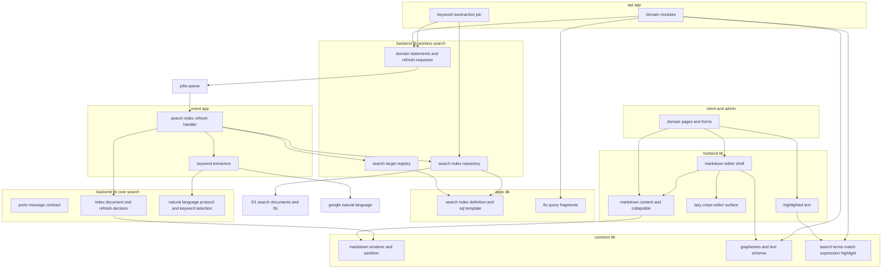
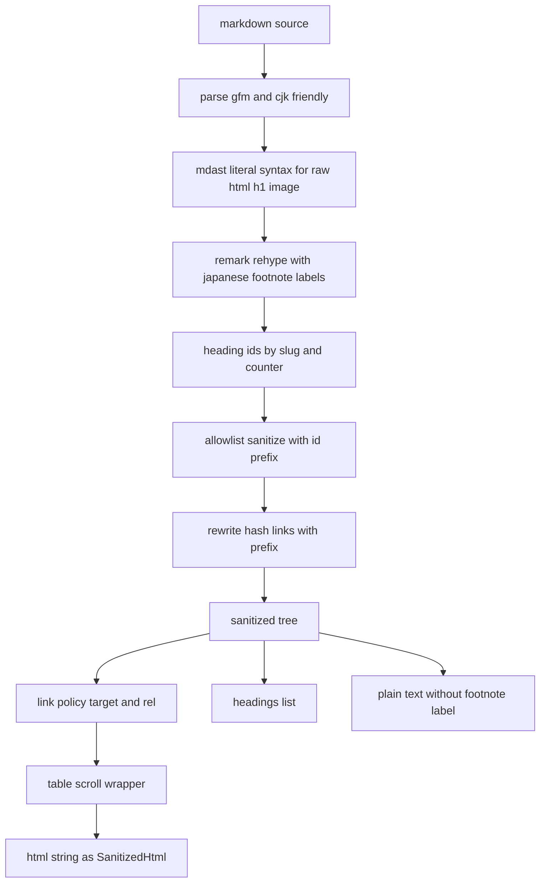
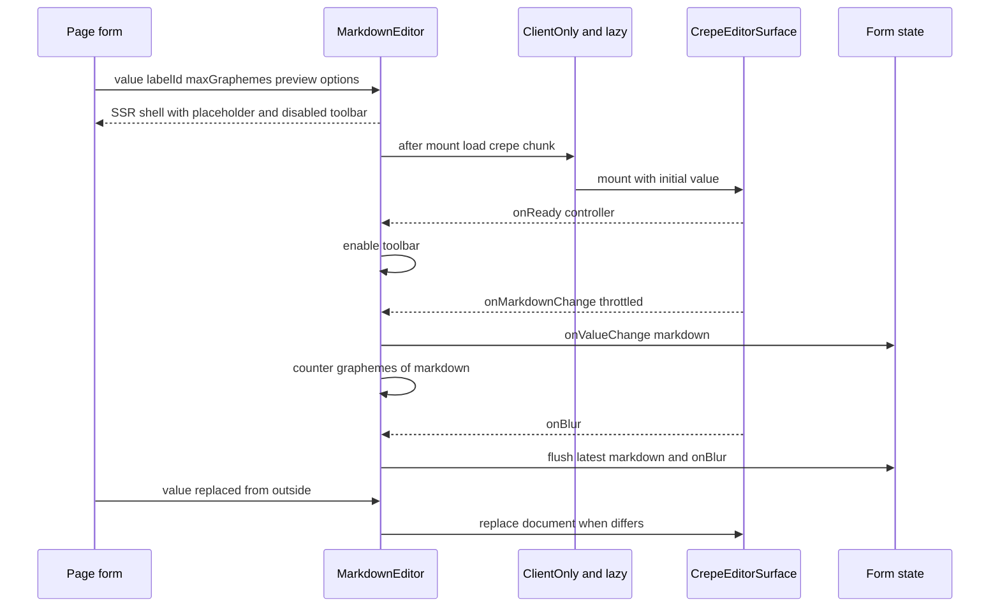
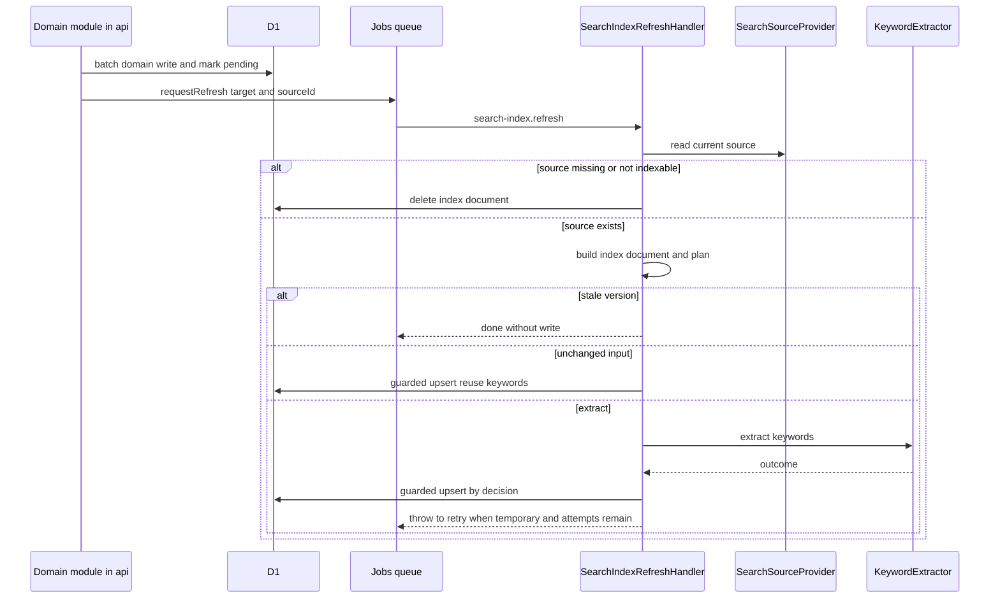
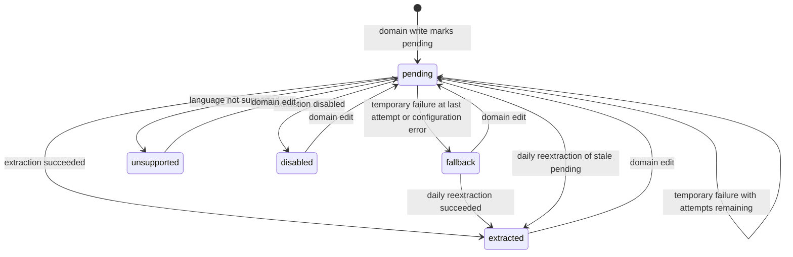
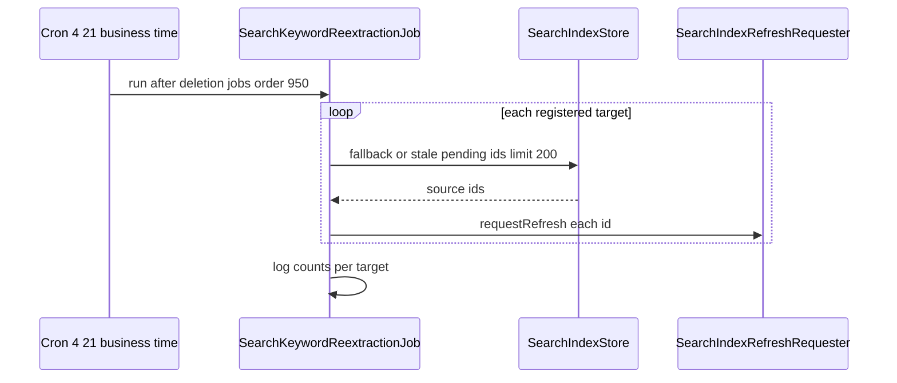
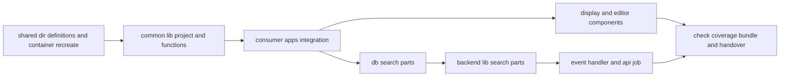

# Design Document

## Overview

**Purpose**: マークダウンの入力・描画・サニタイズと、全文検索の索引・正規化・照合を、全ドメインが共通で使う1つの基盤として提供する。画面を持たない純粋な処理(描画・書記素の文字数・入力の検証規則・検索語の処理)は新しい共有ディレクトリ`apps/common-lib`に置き、利用者側・管理者側のフロントエンド(ページの描画とブラウザ)・APIサーバー・イベントサーバーの4アプリが同じ定義を使う。画面部品(入力欄・表示・強調表示)は`apps/frontend-lib`、索引の部品は`apps/db`・`apps/backend-lib`、索引の更新の処理はイベントサーバー、再抽出の定期実行はAPIサーバーに置く。

**Users**: legal-pages・help-center・user-profile-social・product-launch・engagementの開発者とAIエージェントは、マークダウンの入力欄と表示部品を画面に置き、APIサーバーで本specの検証規則を使ってマークダウンの原文を保存する。directory-discovery・help-centerは、検索対象を登録し、本specのひな形で索引のテーブルを作り、元データの作成・編集・削除の処理で本specの手段を呼び、検索の画面で検索式・関連度・強調表示の部品を使う。media-pipeline・identity-authは、本specが新設する`apps/common-lib`の配置と読み込みの境界の上に自分の共有定義(`common-lib/media`・`common-lib/identity`)を置き、identity-authは`countGraphemes`を使う。infra-deliveryは、本specが加えるシークレットと変数をInfisicalの表・変数の一覧に載せてstaging・prodへ反映する(シークレットのキーの一覧の正は`docs/onboardings/project-values.md`で、本specが自分のキーの行を加える)。

**Impact**: dev-toolingの共有ディレクトリの定義(`config/workspace-layout.ts`・`compose.yaml`・`.gitignore`)に5つ目の共有ディレクトリを加え、4アプリの品質ツール設定・依存・型検査の対象を更新する。frontend-platformの静的解析の規則・Vite設定・環境の検証に、エディタの読み込みの制限・Vueの機能フラグ・利用者側のオリジンの変数を加える。backend-platformのメッセージ契約・メッセージの処理・定期実行・イベントサーバーの環境の登録箇所へ、検索の索引の更新を追記する。

### Goals

- 4アプリが同じ描画部品と検証規則を使い、ページの描画・ブラウザ・APIサーバー・イベントサーバーで同じ結果になる。
- マークダウンを経由したXSSを、許可リスト方式のサニタイズと型と静的解析で防ぎ、生のHTMLの挿入は表示部品の1箇所に限る。
- 入力欄が、見出しレベル1と画像を挿入させずに書式を適用した見た目で編集でき、WCAG 2.2 AAの自動検査に違反0件で通り、編集領域の実装はページの最初の読み込みとサーバー側の描画に入らない。
- ドメインが検索対象を登録するだけで、索引の作成・更新・縮退・再抽出・削除が働き、外部APIの障害時も書き込みと検索を止めない。
- 追加した全ファイルがカバレッジ80%を満たし、一括検査に参加する。

### Non-Goals

- ドメインごとの入力欄の上限値・`rel`の値・折りたたみの高さ・検索対象の登録・索引のテーブル・検索の画面とクエリ(各ドメインspec)。
- ヘルプ記事の目次の画面(help-center)、検索語の50文字の上限の検証(各ドメインspec)。
- マークダウンへの画像の添付、コードのシンタックスハイライト、全件の再索引の仕組み。
- Google Cloudのプロジェクト・APIキーの発行と制限・Infisicalの`staging`への登録(開発者の手作業)、Infisicalの`prod`への登録(launch-readiness)、Workerへのシークレットの反映とCIのワークフロー(infra-delivery)。

## Boundary Commitments

### This Spec Owns

- `apps/common-lib`(新しい共有ディレクトリ兼アプリ、検査担当`self`): 描画(`renderMarkdown`・`extractSearchText`・`RenderedMarkdown`・`SanitizedHtml`・`MarkdownRenderOptions`)、見出しのスラッグ、書記素の文字数と禁止文字の判定、マークダウンの入力の検証規則(`markdownTextSchema`)、検索語の正規化と検索式(`normalizeSearchTerms`・`buildFtsMatchExpression`)、索引用のテキストの正規化(`normalizeIndexText`)、強調表示の範囲(`findHighlightRanges`)、攻撃パターン集。
- `apps/frontend-lib`の追加部分: 表示部品(`MarkdownContent`・`CollapsibleMarkdownContent`・`useRenderedMarkdown`・`useMarkdownOptions`)、入力欄(`MarkdownEditor`と固定ツールバー・リンクのダイアログ・カウンター・仮表示)、遅延読み込みの編集領域(`components/markdown-editor/crepe/`)、強調表示部品(`HighlightedText`)、本文の文字組みのスタイル、エディタの読み込みの静的解析の規則、生のHTMLの例外の検査、遅延読み込みの分離の検査。
- `apps/db`の追加部分: 索引文書の共通の列(`searchDocumentColumns`・`searchTextColumn`・`KEYWORD_STATUSES`)、索引の定義と検証(`defineSearchIndex`)、全文検索の索引のSQLのひな形・トリガーの作り直し・再構築(`renderSearchIndexSql`など)、検索のSQL断片(`ftsRankedSources`・`bm25Rank`)、索引の定義の集約点(`SEARCH_INDEXES`)とSQLの出力スクリプト、マイグレーションとの突き合わせの検査。
- `apps/backend-lib`の追加部分: `core/search`(検索対象の型・ポート・DIの識別子・索引文書の組み立て・更新の計画と抽出結果の判定・自然言語APIの要求と応答の解釈・キーワードの選別)、`core/messaging/contracts/search-index-refresh.ts`(メッセージ`search-index.refresh`と再試行の方針)、`workers/search`(検索対象の定義と集約点`SEARCH_TARGETS`・索引の保存・ドメイン向けの文・更新の要求・共通の束縛)。
- `apps/event`の追加部分: 索引の更新の処理(`SearchIndexRefreshHandler`)、キーワード抽出の実装(Google Cloud Natural Language・無効化)、環境の変数とシークレット、登録、疎通確認のスクリプト。
- `apps/api`の追加部分: 日次の再抽出のジョブ(`SearchKeywordReextractionJob`)と登録。
- 契約: `MarkdownRenderOptions`・`RenderedMarkdown`・`SanitizedHtml`、`MarkdownEditorProps`、`markdownTextSchema`の文言、`SearchTargetDefinition`・`SearchIndexDefinition`・`SearchIndexStatements`・`SearchIndexRefreshRequester`、メッセージ`search-index.refresh`、索引文書の共通の列と状態の値、全文検索の索引の名前の規約、変数`KEYWORD_EXTRACTOR`・`CLIENT_SITE_ORIGIN`、シークレット`GOOGLE_NL_API_KEY`。
- 技術ドキュメント: `external/002-natural-language-keyword-extraction.md`・`db/004-full-text-search.md`・`frontend/008-markdown-editor-and-content.md`・`security/004-markdown-sanitization.md`と各索引(番号はroadmapの順で割り当てた固定の番号)。`coding/002`・`coding/003`・CLAUDE.md・tech-stack.md・`docs/onboardings`・サービス仕様(日次タイムライン・文言規則・ページ構成・準拠方針)の該当箇所の更新。backend-platformの`infra/003-async-processing.md`へのジョブとメッセージ種別の名前の規約の追記(16.8)。

### Out of Boundary

- 各ドメインの検索対象の登録(`backend-lib/workers/search/targets/<ドメイン>.ts`)・索引文書のテーブル(`apps/db/schema/<ドメイン>.ts`)・カスタムマイグレーション・検索の画面とクエリ・論理削除や非公開の元データの扱い(directory-discovery・help-center)。
- 各入力欄の上限値と必須の別・表示場所の`rel`・折りたたみの高さ・本文の識別子の選び方・マークダウンを保存するGraphQLの操作(各ドメインspec)。
- ヘルプ記事の目次の画面(help-center)、検索語の50文字の上限(各ドメインspec)。
- 共有ディレクトリの配置と配置確認の仕組みそのもの(dev-tooling。本specは定義への追記だけを行う)。
- メッセージの封筒・再試行の判定・デッドレター・定期実行の振り分け・一括の書き込み・ログとSentryの設定(backend-platform。本specは登録箇所への追記だけを行う)。
- 中継・CSP・セキュリティヘッダー・フォーム部品・デザイントークン(frontend-platform。本specは静的解析の規則への追記・Vite設定の機能フラグ・変数1つの追加だけを行う)。
- Google Cloudのプロジェクト・APIの有効化・キーの発行と制限、Infisicalの`staging`への登録(開発者の手作業)、Infisicalの`prod`への登録(launch-readiness)、staging・prodのWorkerへのシークレットの反映とCI(infra-delivery)。
- `apps/common-lib`の下のmedia-pipeline・identity-authの共有定義(`common-lib/media`・`common-lib/identity`)と、APIサーバーの変数`CLIENT_SITE_ORIGIN`(identity-auth)。

### Allowed Dependencies

- 上流(dev-tooling): 基底設定(`tsconfig.base.json`・`eslint.config.base.ts`・`prettier.config.ts`・`bunfig.toml`)、スクリプト契約、テストの命名、`config/workspace-layout.ts`と`shared-dirs`の仕組み(定義への追記だけ)、`config/vitest`のプリセット。
- 上流(backend-platform): `apps/db`の`Database`・`createDatabase`・`DATABASE_CASING`、`core`の`defineMessageContract`・`MessageContract`・`MessageHandler`・`MessageMeta`・`MessageHandlingResult`・`RetryPolicy`・`DEFAULT_RETRY_POLICY`・`ScheduledJobDefinition`・`ScheduledJobHandler`・`AppModule`・`PLATFORM_TYPES`・`Clock`・`getAppLogger`・`AppError`、`workers`の`MessagePublisher`・`PlatformEnv`、登録箇所(`MESSAGE_CONTRACTS`・`MESSAGE_HANDLERS`・`SCHEDULED_JOBS`・`MODULES`・`env-schema.ts`)。
- 上流(frontend-platform): `components/ui`のボタン・タブ・ダイアログ・テキスト入力・ラベル、`components/state`の状態表示、`utilities/class-names.ts`の`cn`、`test/a11y.ts`の`runAxe`、`config/frontend-lint.ts`、`styles/tokens.css`・`base.css`、ルーターの文脈の`PublicRuntimeConfig`、Storybookの設定。
- npmパッケージ: Technology Stackの表に挙げた版に限る。
- 依存の方向: 「Dependency Direction」に従う。`apps/common-lib`は他のアプリのコードを読み込まない。`@milkdown/*`と`vue`を読み込めるのは`apps/frontend-lib/components/markdown-editor/crepe/**`だけである。

### Revalidation Triggers

- `renderMarkdown`・`MarkdownRenderOptions`(`siteOrigin`・`externalLinkRel`・`sameOriginLinkRel`・`idScope`)・`RenderedMarkdown`(`html`・`headings`・`plainText`)の形、見出しのIDの変換・接頭辞・連番の規則(help-center・user-profile-social・product-launch・engagement・legal-pages)。
- `MarkdownEditorProps`・`MarkdownContentProps`・`CollapsibleMarkdownContentProps`・`HighlightedTextProps`の形(画面を持つ全下流spec)。
- `markdownTextSchema`の引数と文言、書記素の数え方と`countGraphemes`の形(入力欄を持つ全下流spec・identity-auth)。
- `SearchTargetDefinition`・`SearchIndexDefinition`・`SearchIndexStatements`・`SearchIndexRefreshRequester`の形、索引文書の共通の列と`KEYWORD_STATUSES`、全文検索の索引とトリガーの名前の規約、`ftsRankedSources`・`bm25Rank`の返す列(directory-discovery・help-center)。
- メッセージ`search-index.refresh`の本文と再試行の方針、再抽出のジョブの名前・時刻・順序・件数の上限(運用・infra-delivery・4:21にジョブを足すmedia-pipeline・identity-auth)。
- 日次タイムラインの「日次バッチ(4:21)の内容」のジョブの名前と順序の表の形(4:21にジョブを足すmedia-pipeline・identity-authと後続spec)。
- `infra/003-async-processing.md`へ追記するジョブ・波及処理とメッセージ種別の名前の規約(ジョブや波及処理を登録する全下流spec。identity-authの`backend/007`の名前の規約の記述)。
- `buildFtsMatchExpression`の照合規則(前方一致)と`findHighlightRanges`の一致規則(directory-discovery・help-center)。
- 変数`KEYWORD_EXTRACTOR`・`CLIENT_SITE_ORIGIN`、シークレット`GOOGLE_NL_API_KEY`の名前と環境ごとの値(infra-delivery・launch-readiness)。`CLIENT_SITE_ORIGIN`の名前と値は、identity-authがAPIサーバーに置く同名の変数と同じにする(identity-auth)。
- 共有ディレクトリの数・配置先・検査担当、frontend-lib・backend-libからの参照方法(兄弟の相対パス、仮決定P4)、common-libの読み込みの境界の規則、frontend-libの`components/**`・`server/**`・`utilities/**`からcommon-libを読み込む許可と`validation/**`の制限(dev-tooling・全アプリ・infra-deliveryのCI・`common-lib/media`を置くmedia-pipeline・`common-lib/identity`を置くidentity-auth)。

#### 本specのタスクを前提にする下流spec

`apps/common-lib`の新設は本specが行い、media-pipeline・identity-authはその上に自分の共有定義を置く。roadmapの順では本spec全体の完了を待ってから両specに着手する。本spec全体を待たずに着手する場合の最小の区切りは、次のタスクの完了とする。

| spec           | 前提にする本specのタスク                                                                                                                         | 使うもの                                                                                                                         |
| -------------- | ------------------------------------------------------------------------------------------------------------------------------------------------ | -------------------------------------------------------------------------------------------------------------------------------- |
| media-pipeline | 1.1(共有ディレクトリの定義と配置)、1.2(共用部品のプロジェクトと読み込みの境界)、4.1・4.2(利用側アプリの依存・型検査の対象・静的解析とテストの除外、frontend-libからの参照)、6.1(frontend-libの`server/**`からcommon-libを読み込む許可と`validation/**`の禁止の静的解析の規則)、11.3のうち`coding/003`への`server/**`の許可の記述、11.4のうち日次タイムラインのジョブの名前と順序の表の作成 | `common-lib/media`の置き場所、`frontend-lib`の`utilities/media`・`server/media`と`backend-lib`からの兄弟の相対パスでの参照、`server/**`からの読み込みの規則、日次タイムラインの表 |
| identity-auth  | 上のタスクに加えて2.1(書記素の数え方)                                                                                                          | `countGraphemes`、`common-lib/identity`の置き場所、APIサーバーと同名・同値の`CLIENT_SITE_ORIGIN`、日次タイムラインの表               |

- `server/**`の許可の確かめ方: frontend-platformの静的解析はfrontend-libの外への相対パスの読み込みを禁止しないため、4.2の後は`server/**`から`../common-lib/**`を読み込んでも静的解析で拒否されない。6.1で`components/**`・`server/**`からの`common-lib/validation/**`の禁止が入り、その他のモジュールの読み込みが報告されないことをESLintのNode APIの単体テストで確かめる。11.3で`coding/003`に読み込める範囲を書く。下流specは、6.1の単体テストの成功と`coding/003`の記述で許可を確かめる。
- 日次タイムラインの表: 「日次バッチ(4:21)の内容」のジョブの名前と順序の表は、最初に4:21のジョブを足すspecが作り(上流のemail-deliveryの`email-delivery.cleanup`・900を含める)、後のspecは行を足す。想定の順序では本specの11.4が作る。下流specは、表が無いことを理由に止めず、表が無ければ同じ形で作って自分の行を足す。その場合、本specの11.4は既存の表へ行を足すだけにする。
- launch-readinessは、Infisicalの`prod`への`GOOGLE_NL_API_KEY`の登録を、本specのタスク12の引き継ぎ事項として受け取る。

#### 上流・並行specへの変更(本specが行う)

| spec              | 変更                                                                                                                                                                                                                                                                     | 再確認の要否                                          |
| ----------------- | ------------------------------------------------------------------------------------------------------------------------------------------------------------------------------------------------------------------------------------------------------------------------ | ----------------------------------------------------- |
| dev-tooling       | `AppName`・`APPS`・`SHARED_DIRS`に`common-lib`を加え、`compose.yaml`のbind mountと名前付きボリューム、`.gitignore`の配置先、`workspace-layout.unit.test.ts`の期待値を更新する。`coding/002`・`coding/003`に追記する                                                     | 要(共有ディレクトリが5つになる)                       |
| backend-platform  | api・eventの依存・型検査の対象・静的解析とテストの除外に`common-lib/`を加える。`MESSAGE_CONTRACTS`・`MESSAGE_HANDLERS`・`SCHEDULED_JOBS`・`MODULES`・eventの`env-schema.ts`・Wrangler設定に追記する。`infra/003-async-processing.md`の定期実行の説明に、ジョブ・波及処理とメッセージ種別の名前の規約を追記する                                                                        | 不要(登録箇所と文書への追記の範囲)                    |
| frontend-platform | `frontend-lint.ts`の`no-restricted-imports`にMilkdownの制限と、common-libの読み込みの許可(`components/**`・`server/**`・`utilities/**`)と`validation/**`の制限を加える。client・admin・frontend-libの依存・型検査の対象・Vite設定(Vueの機能フラグ・`server.fs.allow`)、`styles/base.css`の取り込み、変数`CLIENT_SITE_ORIGIN`と`PublicRuntimeConfig.clientSiteOrigin`を加える | 要(環境の検証と公開する設定の形が変わる)              |
| infra-delivery    | eventの`GOOGLE_NL_API_KEY`を、Infisicalのキーの表(infra-deliveryが所有)に載せる。実装後のキーの一覧の正は`docs/onboardings/project-values.md`のWorkerのシークレットのキーの一覧の節で、本specが行を加える。client・adminの`CLIENT_SITE_ORIGIN`の3環境の値を、infra-deliveryの一覧の値と一致させる。CIは`APPS`に従って`apps/common-lib`の依存を導入し、`shared-dirs:place`で配置する                     | 要(キーと値の一覧への追加はinfra-deliveryが行う)      |
| email-delivery    | 業務時刻4:21のcron式`21 12 * * *`を共有する(順序950で後に並ぶ)。email-deliveryはroadmapの依存ではないため、実装の有無はタスク1.1で確かめ、無ければ開発者へ報告して進める。cron式が無ければタスク10で加える                                                              | 不要                                                  |

## Architecture

### Existing Architecture Analysis

- `apps`配下は未実装で、dev-toolingの品質ゲート・共有ディレクトリの配置の仕組みだけが実装済みである。backend-platform・api-gateway・email-delivery・frontend-platformは設計まで承認済みで、本specはその契約(登録箇所・メッセージ・定期実行・層の規則・共通部品・静的解析の設定)を前提にする。roadmapの依存(frontend-platformと、その上流のbackend-platform・api-gateway)の実装の完了後に着手する。email-deliveryはroadmapの依存ではなく、共有するのは4:21の定期実行だけのため、実装が無くても止めずに開発者へ報告する。
- `config/workspace-layout.ts`の`SHARED_DIRS`は、`apps/db`・`apps/backend-lib`(検査担当api)と`apps/frontend-lib`(検査担当`self`)の3つで、フロントエンドとバックエンドの両方へ配置される共有ディレクトリが無い。`scripts/tooling/shared-dirs.ts`は定義を読むだけの汎用の仕組みで、定義の追加で新しい共有ディレクトリを扱える。
- `docs/GUIDES/tech/db/002`は、FTS5のexternal contentとトリガーによる同期、カスタムマイグレーション、Time Travelによるバックアップを定めている。backend-platformは全文検索用のテーブルの主キーを連番とする規約だけを持ち、部品を提供しない。
- frontend-platformは、`@eslint-react/dom/no-dangerously-set-innerhtml`を全体で禁止し、本specのサニタイズ済みHTMLの部品だけが理由のコメント付きで1行だけ無効化できる規約(`frontend/003`)を置いている。CSPはスクリプトにnonceと`'self'`、スタイルに`'unsafe-inline'`を許可する。
- Cron Triggersはapiだけに置き、重い処理はeventのQueueのconsumerへ委ねる(backend-platform)。email-deliveryが業務時刻4:21(`21 12 * * *`)の定期実行を登録する。

### Architecture Pattern & Boundary Map



**Architecture Integration**:

- 選んだパターン: 画面を持たない純粋な処理を共用部品に集め、画面部品と索引の処理はそれを使う側に置く。索引の判断(計画・抽出結果の判定・キーワードの選別)は`core/search`の純粋関数に置き、D1・Queues・外部APIはポートの実装として`workers/search`と各アプリの`infrastructure`に置く(ポートとアダプタ)。
- 境界: 共用部品は「入力から出力を返すだけ」の関数に限る。どの項目を検索するか・いつ索引を消すかの業務判断はドメインの登録と呼び出しに委ねる。
- 既存パターンの維持: 共有ディレクトリの配置と利用側アプリでの依存解決、`AppModule`と登録箇所、`MessageContract`と再試行の方針、`ScheduledJobDefinition`、`@inject`の明示、1ファイル1コンポーネント、`*.unit.test.ts`・`*.browser.test.tsx`・`*.worker.test.ts`の命名。
- 新規コンポーネントの理由: research.mdの「Generalization・Build vs Adopt・Simplification」を参照。

### Dependency Direction

- `apps/common-lib`: 自身のファイルと、unified系・`zod`だけを読み込む。他のアプリ・共有ディレクトリ、`react`・`@tanstack/*`・`hono`・`cloudflare:*`・`drizzle-orm`・`@milkdown/*`・`@sentry/*`・`node:*`を読み込まない(テストの`bun:test`を除く)。違反は`apps/common-lib/eslint.config.ts`の`no-restricted-imports`と`config/import-boundary.unit.test.ts`で検出する。
- `apps/frontend-lib`: frontend-platformの向き(`utilities` ← `server` ← `start` ← `components` ← アプリ)を保ったまま、`components/**`・`server/**`・`utilities/**`から`../common-lib/**`(兄弟の相対パス)を読み込める(`server/**`はmedia-pipelineの中継の定義が`common-lib/media`を読む)。`components/**`と`server/**`は、common-libのうちZodを使うモジュール(`validation/**`)を読み込まない。`@milkdown/*`・`vue`は`components/markdown-editor/crepe/**`だけが読み込み、`crepe/**`を外から読み込めるのは`components/markdown-editor/load-crepe-editor.ts`の`import()`だけとする。
- `apps/db`: `drizzle-orm`・`ulid`と自身のファイルだけを読み込む(backend-platformの規則)。`search/**`も同じである。
- `apps/backend-lib`: `apps/db` → `core` → `workers` → アプリの`src`の向き(backend-platform)。`core/search/**`は`../../../common-lib/**`を読み込めるが、`apps/db`を読み込まない(`KEYWORD_STATUSES`の値の一致は`workers/search`の型で保証する)。
- アプリの`src`: `domain` ← `application` ← `infrastructure`・`presentation` ← `composition`(backend-platform)。`application/search/**`は`lib/core/search`のポートと`common-lib`だけを読み込む。

### Technology Stack

| Layer                  | Choice / Version                                                                                                                                                                                                    | Role in Feature                                         | Notes                                                                                                                                 |
| ---------------------- | ------------------------------------------------------------------------------------------------------------------------------------------------------------------------------------------------------------------- | ------------------------------------------------------- | ------------------------------------------------------------------------------------------------------------------------------------- |
| 描画                   | unified 11.0.5・remark-parse 11.0.0・remark-gfm 4.0.1・remark-cjk-friendly 2.3.2・remark-cjk-friendly-gfm-strikethrough 2.3.1・remark-rehype 11.1.2・rehype-sanitize 6.0.0・rehype-stringify 10.0.1・hast-util-to-text 4.0.2 | 解析・文字列化・サニタイズ・HTMLとテキストの出力         | tech-stack記載済み。common-libと4アプリで版をそろえる。rehype-slugは使わない(仮決定P2)                                                |
| 検証                   | zod 4.6.5                                                                                                                                                                                                           | マークダウンの入力の検証規則                            | backend-platform・frontend-platformと同じ版                                                                                           |
| エディタ               | @milkdown/crepe 7.22.2・@milkdown/kit 7.22.2・@milkdown/react 7.22.2                                                                                                                                                | 編集領域(遅延読み込み)                                  | 7.22.3は公開から2週間未満(Q2)。`@milkdown/kit`の明示の宣言は仮決定P3。frontend-lib・client・adminで版をそろえる                       |
| 文字組み               | @tailwindcss/typography 0.5.20                                                                                                                                                                                      | 本文の`prose`の文字組み                                 | 新規(Q6)。frontend-lib・client・adminで版をそろえる                                                                                   |
| 標準API                | `Intl.Segmenter`・`String.prototype.normalize`・`String.prototype.isWellFormed`・Web Crypto(`crypto.subtle.digest`)・`fetch`・`AbortSignal.timeout`                                                                 | 書記素・NFKC・不正なUnicodeの判定・ハッシュ・外部API     | workerd・ブラウザ・Bunの標準。パッケージを追加しない                                                                                 |
| データ                 | Cloudflare D1(SQLite FTS5)・drizzle-orm 1.0.0-rc.4                                                                                                                                                                  | 索引文書のテーブル・全文検索の索引・トリガー            | backend-platformの版                                                                                                                  |
| 非同期・定期実行       | Cloudflare Queues(`JOBS_QUEUE`)・Cron Triggers(api)                                                                                                                                                                 | 索引の更新・日次の再抽出                                | backend-platformの基盤。新しいQueueは作らない                                                                                         |
| 外部API                | Google Cloud Natural Language v2 `documents:analyzeEntities`                                                                                                                                                        | キーワード抽出                                          | tech-stack記載済み。`fetch`でRESTを呼ぶ                                                                                               |
| テスト                 | bun test(bun:sqlite)・vitest 4.1.11(Browser Mode・`@cloudflare/vitest-pool-workers` 0.22.0)・vitest-browser-react 2.3.0・axe-core 4.13.0                                                                            | 単体・ブラウザ・Workers統合テスト                       | 上流の版                                                                                                                              |

- common-libのコードが実行時に使うパッケージ(描画の9つとzod)は、api・event・client・adminも同じ版で宣言する(共有ディレクトリの規約)。エディタの3つと`@tailwindcss/typography`・remark-cjk-friendlyの2つは、frontend-lib・client・adminが宣言する。版をそろえるパッケージの一覧を`coding/002`に加える。
- hast・mdastの型パッケージは宣言せず、変換で触る節点だけの構造的な型を`markdown/hast-types.ts`に置く(推移的な型パッケージに頼らない)。

## File Structure Plan

### Directory Structure

```
apps/
├── common-lib/                                    # 新しい共有ディレクトリ兼アプリ(配置先: apps/{api,event,client,admin}/common-lib、検査担当: self)
│   ├── package.json · bun.lock                    # 描画の9パッケージ・zod(実行時)、品質ツール6種・@types/bun(開発時)。スクリプト契約(lint・typecheck・test:unit)
│   ├── tsconfig.json                              # extendsを持たない自己完結の設定(lib ES2024・types bun)
│   ├── eslint.config.ts                           # createBaseConfig+読み込みの境界の規則
│   ├── config/
│   │   ├── tsconfig-sync.unit.test.ts             # 基底設定と差分(lib・types・include)以外で一致すること
│   │   └── import-boundary.unit.test.ts           # 全ソースのimportが共用部品の外を指さず、許可したパッケージだけであること
│   ├── text/
│   │   ├── graphemes.ts                           # countGraphemes
│   │   └── text-safety.ts                         # hasForbiddenCharacters(孤立サロゲート・タブ改行以外の制御文字)
│   ├── validation/
│   │   └── markdown-text-schema.ts                # markdownTextSchema・MarkdownTextRule・文言
│   ├── markdown/
│   │   ├── hast-types.ts                          # 変換で触る節点だけの構造的な型
│   │   ├── markdown-options.ts                    # MarkdownRenderOptions・LinkRelToken・検証・idPrefixFor
│   │   ├── heading-slug.ts                        # slugifyHeading・normalizeAnchorFragment(FR-MDOWN-006)
│   │   ├── sanitize-schema.ts                     # 許可リスト(要素・属性・スキーム)
│   │   ├── markdown-processor.ts                  # 解析からサニタイズ・接頭辞までの共通の処理(SanitizedTree)
│   │   ├── plugins/literal-syntax.ts              # mdast: Raw HTML・見出しレベル1・画像を文字列へ
│   │   ├── plugins/heading-ids.ts                 # hast: 見出しのIDと連番
│   │   ├── plugins/anchor-prefix.ts               # hast: #の参照の正規化と接頭辞
│   │   ├── plugins/link-policy.ts                 # hast: 許可外の参照のリンクの解除・target・rel
│   │   ├── plugins/table-scroll.ts                # hast: 表を横スクロールの枠で包む
│   │   ├── extract-headings.ts                    # 見出しの一覧(脚注を除く)
│   │   ├── extract-search-text.ts                 # extractSearchText・プレーンテキスト(脚注の見出し・戻りリンクを除く)
│   │   ├── render-markdown.ts                     # renderMarkdown・RenderedMarkdown・SanitizedHtml
│   │   └── fixtures/xss-payloads.ts               # 攻撃パターン集(テスト専用、*.unit.test.tsだけが読み込む)
│   └── search/
│       ├── search-terms.ts                        # normalizeSearchTerms・buildFtsMatchExpression
│       ├── index-text.ts                          # normalizeIndexText(NFKC・空白の畳み込み)
│       └── highlight-ranges.ts                    # findHighlightRanges・HighlightRange
├── frontend-lib/
│   ├── styles/markdown.css                        # @plugin '@tailwindcss/typography'と本文の補助のスタイル(表の枠・脚注の見出し)
│   ├── config/
│   │   ├── markdown-lint-rules.unit.test.ts       # Milkdownの読み込み・crepeの静的import・バレル・生のHTMLの違反例が報告されること
│   │   ├── raw-html-exception.ts                  # findRawHtmlExceptions(生のHTMLの規則の無効化とas SanitizedHtmlの位置の走査)
│   │   └── raw-html-exception.unit.test.ts        # frontend-libではmarkdown-content.tsxの1箇所だけであること
│   ├── scripts/check-editor-chunks.ts             # 入力欄を静的に読み込む検査用の入口をクライアント・SSRでビルドし、入口からの静的な読み込みにMilkdown・Vueが無いことを確かめる
│   ├── test/bundle/editor-entry.tsx               # 上の検査用の入口(テストではないファイル)
│   └── components/
│       ├── markdown/
│       │   ├── use-rendered-markdown.ts           # renderMarkdownのメモ化
│       │   ├── use-markdown-options.ts            # ルーターの文脈のclientSiteOriginを補ったMarkdownRenderOptions
│       │   ├── markdown-content.tsx               # 表示部品(生のHTMLの唯一の挿入箇所)
│       │   └── collapsible-markdown-content.tsx   # 折りたたみ付きの表示部品
│       ├── markdown-editor/
│       │   ├── editor-controller.ts               # EditorAction・EditorController・EditorSurfaceProps(Milkdownの型を含まない)
│       │   ├── editor-actions.ts                  # ツールバーの項目(名前・アイコン・操作)の一覧
│       │   ├── markdown-editor.tsx                # 外枠: タブ・ツールバー・編集領域の遅延読み込み・カウンター・プレビュー
│       │   ├── markdown-toolbar.tsx               # 固定ツールバー
│       │   ├── markdown-link-dialog.tsx           # リンクのURLの入力
│       │   ├── markdown-length-counter.tsx        # 書記素のカウンターと超過の読み上げ
│       │   ├── editor-placeholder.tsx             # サーバー側の描画・読み込み中・読み込み失敗の表示
│       │   ├── editor-load-boundary.tsx           # 読み込みの失敗を受けて再試行させるエラーの境界
│       │   ├── load-crepe-editor.ts               # crepe/への唯一のimport()(React.lazy)
│       │   └── crepe/                             # @milkdown/*・vueを読み込める唯一のディレクトリ(遅延読み込みの別チャンク)
│       │       ├── crepe-editor-surface.tsx       # CrepeBuilderの組み立て・@milkdown/reactでのマウント・制御器の提供
│       │       ├── editor-features.ts             # 機能の選択と設定(選択時のツールバーの日本語のラベル)、uploadとindentの除外、キーマップの変更
│       │       ├── heading-input-rule.ts          # 見出しレベル2〜6だけの入力規則
│       │       ├── forbidden-node-normalizer.ts   # 見出しレベル1・画像を文字列に置き換えるProseMirrorのプラグイン
│       │       ├── editor-commands.ts             # EditorActionからMilkdownのコマンドへの対応・選択中の書式の判定
│       │       ├── editor-accessibility.ts        # 編集領域のrole・aria属性
│       │       ├── cjk-remark-plugins.ts          # remark-cjk-friendlyの登録
│       │       └── crepe-theme.css                # 使う機能のCrepeのCSSの取り込みと--crepe-*のデザイントークンへの対応
│       └── search/
│           └── highlighted-text.tsx               # 強調表示部品
├── db/
│   ├── schema/_shared/search-documents.ts         # searchDocumentColumns・searchTextColumn・searchDocumentStatusIndex・KEYWORD_STATUSES
│   ├── search/
│   │   ├── search-index-definition.ts             # defineSearchIndex・SearchIndexDefinition・検証
│   │   ├── search-index-sql.ts                    # renderSearchIndexSql・renderSearchIndexTriggersSql・renderSearchIndexRebuildSql
│   │   ├── fts-query.ts                           # ftsRankedSources・bm25Rank
│   │   ├── search-indexes.ts                      # SEARCH_INDEXES(全索引の定義の集約点、初版は空)
│   │   ├── migration-coverage.ts                  # 集約点の定義のSQLがマイグレーションに含まれるかの判定(純粋関数)
│   │   └── search-index-migrations.unit.test.ts   # 集約点の全定義の判定(初版は定義0件)
│   └── scripts/print-search-index-sql.ts          # 集約点の定義からカスタムマイグレーションに貼るSQLを出力する
├── backend-lib/
│   ├── core/
│   │   ├── messaging/contracts/search-index-refresh.ts  # SEARCH_INDEX_REFRESH_MESSAGE・SEARCH_INDEX_REFRESH_RETRY
│   │   └── search/
│   │       ├── identifiers.ts                     # SEARCH_TYPES(DIの識別子)
│   │       ├── keyword-status.ts                  # KeywordStatus(apps/dbの値と同じ5つ)
│   │       ├── search-target.ts                   # SearchFieldSpec・SearchSource・SearchTargetInfo・名前の検証
│   │       ├── ports.ts                           # SearchIndexStore・SearchSourceProvider・SearchTargetCatalog・SearchIndexRefreshRequester・KeywordExtractor
│   │       ├── index-document.ts                  # buildIndexDocument(正規化・抽出の入力・ハッシュ)
│   │       ├── refresh-decision.ts                # planRefresh・decideAfterExtraction
│   │       ├── natural-language-protocol.ts       # 要求の組み立て・応答の検証と分類(Google Cloud Natural Language v2)
│   │       └── keyword-selection.ts               # エンティティの種類の除外・正規化・重複除去・結合
│   └── workers/search/
│       ├── search-target-definition.ts           # SearchTargetDefinition・defineSearchTarget・createSearchTargetRegistry
│       ├── targets/index.ts                       # SEARCH_TARGETS(全検索対象の集約点、初版は空)
│       ├── search-index-repository.ts             # SearchIndexStoreの実装(条件付きの追加・更新、削除、再抽出の候補)
│       ├── search-index-statements.ts             # ドメインの一括の書き込みに含める文(更新待ちの印・削除)
│       ├── search-source-provider.ts              # SearchSourceProviderの実装(定義のreadへ委譲)
│       ├── search-index-refresh-requester.ts      # MessagePublisherで送り、失敗はログとSentryにして投げない
│       ├── search-platform-module.ts              # createSearchPlatformModule(targets)(両アプリ共通の束縛)
│       └── testing/fixture-search-target.ts       # Workers統合テスト専用の検索対象とテーブル作成のSQL
├── event/
│   ├── scripts/smoke-keyword-extraction.ts        # 実際のAPIへの疎通確認(開発者が手元で実行)
│   └── src/
│       ├── application/search/search-index-refresh-handler.ts  # search-index.refreshの処理
│       ├── infrastructure/search/google-natural-language-extractor.ts
│       ├── infrastructure/search/disabled-keyword-extractor.ts
│       ├── infrastructure/search/create-keyword-extractor.ts   # 環境の値による実装の選択
│       └── composition/search-module.ts           # eventの検索のAppModule
└── api/src/
    ├── application/search/search-keyword-reextraction-job.ts   # 日次の再抽出
    └── composition/search-module.ts               # apiの検索のAppModule
docs/
├── GUIDES/tech/external/002-natural-language-keyword-extraction.md  # 自然言語APIによるキーワード抽出
├── GUIDES/tech/db/004-full-text-search.md                         # 全文検索の索引の設計・ひな形・同期・照合・再構築
├── GUIDES/tech/frontend/008-markdown-editor-and-content.md        # 入力欄と表示部品の使い方・遅延読み込み・アクセシビリティ
├── GUIDES/tech/security/004-markdown-sanitization.md              # サニタイズの規約・生のHTMLの例外・攻撃パターン
└── GUIDES/tech/{external,db,frontend,security}/README.md          # 文書一覧へ1行ずつ追記
```

テストファイルは、同名の`*.unit.test.ts`(common-lib・`apps/db`・`core`・アプリの`application`・設定)・`*.browser.test.tsx`(frontend-libの画面部品)・`*.worker.test.ts`(`workers`・アプリの`infrastructure`・`composition`)を対象ファイルの隣に置く(上の木では一部を省略した)。画面部品には`*.stories.tsx`も併置する。技術ドキュメントの番号は、roadmapの順で同じ時期のspec(infra-delivery・media-pipeline・identity-auth)と重ならないように割り当てた固定の番号である。

### Modified Files

- `config/workspace-layout.ts`・`config/workspace-layout.unit.test.ts` — `AppName`に`common-lib`を加え、`APPS`の先頭に`{ name: 'common-lib', dir: 'apps/common-lib' }`、`SHARED_DIRS`に`apps/common-lib`(配置先`apps/{api,event,client,admin}/common-lib`、検査担当`self`)を加え、期待値を更新する。
- `compose.yaml` — 4つのbind mount(`./apps/common-lib:/workspace/apps/<アプリ>/common-lib`)と名前付きボリューム`node_modules_common_lib:/workspace/apps/common-lib/node_modules`を加える。
- `.gitignore` — 「共通ディレクトリのエイリアス」に4つの配置先を加える。
- `apps/api`・`apps/event`の`package.json`・`bun.lock`(描画の9パッケージ、`test:unit`の`--path-ignore-patterns='common-lib/**'`)、`tsconfig.json`(`include`に`common-lib/**/*.ts`、`exclude`に`common-lib/**/*.test.ts`・`common-lib/config/**`・`common-lib/markdown/fixtures/**`・`common-lib/*.config.ts`)、`eslint.config.ts`(`ignores`に`common-lib/`)、`vitest.worker.config.ts`(`exclude`に`common-lib/**`)。
- `apps/client`・`apps/admin`の`package.json`・`bun.lock`(描画の9パッケージ・エディタの3パッケージ・`@tailwindcss/typography`、`test:unit`の除外)、`tsconfig.json`(api・eventと同じ`include`・`exclude`)、`eslint.config.ts`(`ignores`に`common-lib/`)、`vitest.browser.config.ts`(`exclude`に`common-lib/**`)、`vite.config.ts`(Vueの機能フラグの`define`)、`wrangler.jsonc`(3環境の`vars.CLIENT_SITE_ORIGIN`)、`test/config/wrangler-config.unit.test.ts`(変数の検査)、`test/config/raw-html-exception.unit.test.ts`(新規。自身の`src`に生のHTMLの例外が0箇所であること)。
- `apps/frontend-lib/package.json`・`bun.lock` — エディタの3パッケージ・remark-cjk-friendlyの2つ・`@tailwindcss/typography`と、スクリプト`check:editor-chunks`。
- `apps/frontend-lib/config/frontend-lint.ts` — `no-restricted-imports`へ、`@milkdown/*`・`vue`の`crepe/`以外での禁止、`crepe/**`の静的importとexport-fromの禁止、`components/**`・`server/**`での`common-lib/validation/**`の禁止を、既存の依存の方向の規則と同じ設定へ統合する。`no-restricted-syntax`に`crepe/`への`import()`を`load-crepe-editor.ts`以外で禁止する規則を加える。
- `apps/frontend-lib/vitest.browser.config.ts`・`.storybook/main.ts` — `server.fs.allow`に配置元の`../common-lib`を加え、Vueの機能フラグを`define`する。
- `apps/frontend-lib/styles/base.css` — `@import './markdown.css'`を加える。
- `apps/frontend-lib/server/env/frontend-env.ts`・同名の単体テスト — `ValidatedFrontendEnv.CLIENT_SITE_ORIGIN`(URLのオリジン)と`PublicRuntimeConfig.clientSiteOrigin`を加える。
- `apps/db/package.json` — スクリプト`db:search-index-sql`(`bun ./scripts/print-search-index-sql.ts`)を加える。
- `apps/backend-lib/core/messaging/contracts/index.ts` — `SEARCH_INDEX_REFRESH_MESSAGE`を`MESSAGE_CONTRACTS`へ加える。
- `apps/event/src/composition/env-schema.ts`・`modules.ts`・`message-handlers.ts` — `KEYWORD_EXTRACTOR`・`GOOGLE_NL_API_KEY`の検証、`createSearchPlatformModule(SEARCH_TARGETS)`とeventの検索のモジュール、`search-index.refresh`の処理と再試行の方針を登録する。
- `apps/event/wrangler.jsonc`・`worker-configuration.d.ts`・`vitest.worker.config.ts`・`package.json` — 3環境の`vars.KEYWORD_EXTRACTOR`、staging・prodの`secrets.required`への`GOOGLE_NL_API_KEY`、テスト用の値、スクリプト`smoke:keyword-extraction`を加える。
- `apps/api/src/composition/modules.ts`・`scheduled-jobs.ts` — 共通の束縛とapiの検索のモジュール、再抽出のジョブ`content-processing.keyword-reextraction`(業務時刻4:21・順序950)を登録する。`apps/api/wrangler.jsonc`の3環境の`triggers.crons`の`21 12 * * *`は、既にあれば変更せず、無ければ加える(email-deliveryの実装の有無によらず、backend-platformのcron式の一致の検査を通す)。
- `docs/GUIDES/tech/coding/002-dependency-versions.md` — common-libと4アプリで版をそろえるパッケージ(描画の9つ・zod)、frontend-lib・client・adminでそろえるパッケージ(エディタの3つ・`@tailwindcss/typography`)を一覧へ加える。
- `docs/GUIDES/tech/coding/003-shared-directories.md` — 共有ディレクトリから別の共有ディレクトリを兄弟の相対パスで参照する規則(配置先の名前を配置元と同じにする、検査担当`self`の位置では配置元のnode_modulesから解決される、Viteの`server.fs.allow`、同じパッケージが2つの実体になり得るモジュールを読み込まない)と、frontend-libのどのディレクトリ(`components/**`・`server/**`・`utilities/**`)からcommon-libを読み込めるかを追記する。
- `docs/GUIDES/tech/infra/003-async-processing.md`(backend-platformが作成) — 定期実行の説明に、ジョブとイベントの波及処理の名前を`<spec名>.<名詞句>`、メッセージ種別を`<ドメイン>.<動詞句>`とする規約を追記する。メッセージ種別の規約が既にあれば重複して書かず、ジョブの規約を並べる。本プロジェクトのジョブの名前・時刻・順序は列挙しない(正は日次タイムラインと`project-values.md`)(16.8)。
- `docs/GUIDES/tech/frontend/003`(frontend-platformが作成) — 生のHTMLの例外の箇所を`components/markdown/markdown-content.tsx`と明記し、`security/004-markdown-sanitization.md`へリンクする。
- `docs/onboardings/tech-stack.md` — `@tailwindcss/typography`と`@milkdown/kit`を追記し、マークダウンエディタの記述にbuilderと遅延読み込みを、マークダウン処理からrehype-slugを外す(仮決定P2・P3)。導入するタスクの中で行う。
- `docs/onboardings/project-values.md`・`README.md` — 変数・シークレットの名前と値、IDの接頭辞、再抽出の時刻と件数、`apps/common-lib`の依存の導入、開発コンテナの再作成、疎通確認のスクリプトの使い方を追記する。シークレットのキーは、`project-values.md`のWorkerのシークレットのキーの一覧の節(キーの一覧の正。infra-deliveryが作る)へ、`secrets.required`に加える変更と同じ変更で`GOOGLE_NL_API_KEY`の行(環境・フォルダ・使うWorker・宣言したspec・必須・登録の時期)を加え、技術ドキュメントには写さない。既に行があれば食い違いを確かめるだけにし、節が無ければ作らない(infra-deliveryが節を作る時にmainのWrangler設定から載せる)。
- `CLAUDE.md` — ディレクトリ構成に`apps/common-lib`と各アプリの`common-lib`(配置先)を加え、「技術規則の参照先」に4つの技術ドキュメント(`external/002`・`db/004`・`frontend/008`・`security/004`)へのリンクを作業の種類とともに加える。
- `docs/GUIDES/service/overview/007-daily-timeline.md` — 「日次バッチ(4:21)の内容」に、ジョブの名前と順序の表が無ければ作り(上流のemail-deliveryの`email-delivery.cleanup`・900を含める)、既に下流specが作っていれば行だけを加える。検索のキーワードの再抽出(`content-processing.keyword-reextraction`・950)の行を順序どおりに加える(仮決定P6)。同じ時刻にジョブを足す他のspecも同じ表へ行を加え、表が無ければ同じ形で作る(「本specのタスクを前提にする下流spec」)。
- `docs/GUIDES/service/design/003-text-and-copy-rules.md` — マークダウンの入力の検証の文言(必須・禁止文字)、リンクのURLの形式違反、エディタの読み込み失敗、プレビューの空、文字数の超過と戻りの読み上げの文言を加える。
- `docs/GUIDES/service/design/002-page-layouts.md` — 「コメント」の投稿欄の記述に、書く側が書式を適用した見た目で編集すること、ツールバーの項目に表を含めることを加える。
- `docs/GUIDES/service/legal/001-compliance-policy.md` — データ保持期間の一覧に「検索索引(索引文書)」(元データの削除と同時に物理削除、FR-FTS-007)の行を加える。

## System Flows

### 描画の処理の順序



- 「sanitized tree」までは`markdown-processor.ts`の共通の処理で、`renderMarkdown`と`extractSearchText`の両方が使う。`extractSearchText`はリンクの方針と表の枠を通らず、テキストだけを返す。
- サニタイズの後の変換は、許可済みの要素への属性の追加(`target`・`rel`・`tabindex`・`role`・`aria-label`・`class`)と、要素の除去(リンクの解除)・包み(表の枠)に限る。

### 入力欄の読み込みと値の流れ



- 読み込みに失敗した場合は、`EditorLoadBoundary`が「エディタを読み込めませんでした。」と再試行のボタンを出し、再試行で新しい読み込みを始める。値はフォームの状態にあるため失われない。
- 編集領域の変更は約150msの間隔で間引いてフォームへ渡し、フォーカスが外れた時に最新の値を必ず渡す。送信ボタンの押下はフォーカスを外すため、送信時の値は最新である。

### 索引の更新



- 書き込みは「版が保存済み以上」かつ「元データが存在し索引の対象」の条件付きの1文で、条件を満たさなければ何も書かない。
- 例外による再試行は、backend-platformの再試行の方針(5回、30・60・120・240秒)に従う。最後の試行では例外にせず、縮退索引を書いて完了する。

### キーワードの状態



- `fallback`と、1時間以上`pending`のままの索引文書が、日次の再抽出の対象である。`unsupported`・`disabled`は対象にしない。

### 日次の再抽出



## Requirements Traceability

| Requirement                         | Summary                                                       | Components                                                                                   | Interfaces                                                       | Flows                    |
| ----------------------------------- | ------------------------------------------------------------- | -------------------------------------------------------------------------------------------- | ---------------------------------------------------------------- | ------------------------ |
| 1.1, 1.2                            | 4アプリで同じ定義・同じ結果                                   | CommonLibProject、MarkdownRenderer、Graphemes、MarkdownTextSchema、SearchTerms、HighlightRanges | `renderMarkdown`・`countGraphemes`ほか                            | 描画の処理の順序         |
| 1.3                                 | 共用部品の依存の境界                                          | CommonLibProject                                                                             | `import-boundary.unit.test.ts`                                   | —                        |
| 1.4                                 | 配置と品質ゲートへの参加                                      | WorkspaceLayoutUpdate                                                                        | `SHARED_DIRS`                                                    | —                        |
| 1.5, 1.6                            | 依存の宣言と型検査、同じ参照の書き方                          | ConsumerAppIntegration                                                                       | 兄弟の相対パス`../common-lib`                                    | —                        |
| 2.1, 2.2                            | ツールバーと挿入の除外                                        | MarkdownToolbar、EditorFeatures、EditorCommands                                              | `EditorAction`・`EditorController`                               | 入力欄の読み込み         |
| 2.3, 2.4                            | 見出しレベル1・画像・ファイルの扱い                           | ForbiddenNodeNormalizer、EditorFeatures、HeadingInputRule                                    | ProseMirrorのプラグイン                                          | —                        |
| 2.5, 2.9, 2.10, 2.14, 2.15          | 編集領域・値の受け渡し・外部の置き換え・無効・CJKの強調       | CrepeEditorSurface、MarkdownEditor、CjkRemarkPlugins                                         | `EditorSurfaceProps`・`MarkdownEditorProps`                      | 入力欄の読み込み         |
| 2.6, 2.7                            | プレビュー                                                    | MarkdownEditor、MarkdownContent                                                              | `MarkdownEditorProps.preview`                                    | —                        |
| 2.8                                 | 書記素のカウンター                                            | MarkdownLengthCounter、Graphemes                                                             | `countGraphemes`                                                 | —                        |
| 2.11, 2.12, 2.13                    | 仮の表示・読み込み失敗・遅延読み込み                          | EditorPlaceholder、EditorLoadBoundary、LoadCrepeEditor、MarkdownLintRules、EditorBundleCheck | `loadCrepeEditor`                                                | 入力欄の読み込み         |
| 3.1, 3.4                            | ツールバーとリンクのダイアログのキーボード操作                | MarkdownToolbar、MarkdownLinkDialog                                                          | —                                                                | —                        |
| 3.2, 3.3                            | 編集領域の関連付けとTabキー                                   | EditorAccessibility、EditorFeatures                                                          | `EditorSurfaceProps`                                             | —                        |
| 3.5                                 | 超過の読み上げ                                                | MarkdownLengthCounter                                                                        | —                                                                | —                        |
| 3.6                                 | アクセシビリティの自動検査                                    | 全画面部品のブラウザテスト                                                                   | `runAxe`                                                         | —                        |
| 4.1, 4.2, 4.3, 4.11                 | GFM・Raw HTML・見出しレベル1・画像・脚注の文言                | MarkdownProcessor、LiteralSyntax                                                             | `renderMarkdown`                                                 | 描画の処理の順序         |
| 4.4, 4.5, 4.6, 4.7                  | 見出しのID・接頭辞・`#`の参照・本文由来のID                   | HeadingSlug、HeadingIds、SanitizeSchema、AnchorPrefix                                        | `slugifyHeading`・`idPrefixFor`                                  | 描画の処理の順序         |
| 4.8, 4.9, 4.10                      | リンクの開き方と`rel`                                         | LinkPolicy、MarkdownOptions                                                                  | `MarkdownRenderOptions`                                          | 描画の処理の順序         |
| 4.12, 4.13                          | 文字組みと表の横スクロール                                    | MarkdownContent、MarkdownStyles、TableScroll                                                 | `MarkdownContentProps`                                           | —                        |
| 4.14                                | 折りたたみ                                                    | CollapsibleMarkdownContent                                                                   | `CollapsibleMarkdownContentProps`                                | —                        |
| 4.15                                | ページの描画とブラウザで同じHTML                              | useRenderedMarkdown、MarkdownRenderer                                                        | `useRenderedMarkdown`                                            | —                        |
| 5.1, 5.2, 5.3                       | 許可リスト・参照先の制限・危険な出力の禁止                    | SanitizeSchema、LinkPolicy                                                                   | —                                                                | 描画の処理の順序         |
| 5.4                                 | サニタイズ済みの型                                            | MarkdownRenderer                                                                             | `SanitizedHtml`                                                  | —                        |
| 5.5                                 | 生のHTMLの挿入の1箇所化                                       | MarkdownLintRules、RawHtmlExceptionCheck、MarkdownContent                                    | —                                                                | —                        |
| 5.6                                 | 攻撃パターン集                                                | XssPayloads                                                                                  | —                                                                | —                        |
| 6.1, 6.2                            | 見出しの一覧                                                  | ExtractHeadings                                                                              | `RenderedMarkdown.headings`                                      | 描画の処理の順序         |
| 6.3, 6.4                            | プレーンテキスト                                              | MarkdownSearchText                                                                           | `extractSearchText`・`RenderedMarkdown.plainText`                | 描画の処理の順序         |
| 7.1                                 | 書記素                                                        | Graphemes                                                                                    | `countGraphemes`                                                 | —                        |
| 7.2, 7.3, 7.4, 7.5, 7.6             | 検証規則と文言                                                | MarkdownTextSchema、TextSafety                                                               | `markdownTextSchema`                                             | —                        |
| 7.7                                 | 原文を保存する規約                                            | TechDocs                                                                                     | —                                                                | —                        |
| 8.1, 8.2, 8.3, 8.4, 8.5, 8.6        | 索引の構造・ひな形・同期・重み・再構築                        | SearchDocumentColumns、SearchIndexDefinition、SearchIndexSql、SearchIndexAggregation         | `defineSearchIndex`・`renderSearchIndexSql`                      | —                        |
| 8.7                                 | Time Travelの規約                                             | TechDocs                                                                                     | —                                                                | —                        |
| 9.1                                 | 書き込みを待たせない非同期の更新                              | SearchIndexStatements、SearchIndexRefreshRequester、SearchIndexRefreshHandler                | `markPending`・`requestRefresh`・`search-index.refresh`          | 索引の更新               |
| 9.2, 9.3                            | 元データの読み直しと対象外の削除                              | SearchIndexRefreshHandler、SearchSourceProvider、SearchIndexRepository                       | `SearchSourceProvider.read`                                      | 索引の更新               |
| 9.4, 9.5                            | 構文の除去・NFKC・キーワード抽出                              | IndexDocumentBuilder、MarkdownSearchText、NaturalLanguageProtocol、KeywordSelection          | `buildIndexDocument`・`selectKeywords`                           | 索引の更新               |
| 9.6                                 | 変わっていない入力の再利用                                    | RefreshDecision                                                                              | `planRefresh`                                                    | 索引の更新               |
| 9.7, 9.8, 9.9                       | 古い版・削除との競合・重複の配送                              | SearchIndexRepository、SearchIndexRefreshHandler                                             | `SearchIndexStore.upsert`                                        | 索引の更新               |
| 9.10                                | 要求の送信の失敗の回復                                        | SearchIndexRefreshRequester、SearchIndexStatements、SearchKeywordReextractionJob             | `requestRefresh`                                                 | 日次の再抽出             |
| 10.1, 10.2, 10.3, 10.4, 10.5        | 再試行・縮退・非対応言語・設定の誤り                          | RefreshDecision、SearchIndexRefreshHandler、NaturalLanguageProtocol                          | `decideAfterExtraction`・`SEARCH_INDEX_REFRESH_RETRY`            | キーワードの状態         |
| 10.6                                | 日次の再抽出                                                  | SearchKeywordReextractionJob、SearchIndexRepository                                          | `findSourceIdsForReextraction`                                   | 日次の再抽出             |
| 10.7                                | 障害時も書き込みと検索を止めない                              | SearchIndexRefreshRequester、FtsQuery                                                        | —                                                                | 索引の更新               |
| 10.8                                | 抽出を無効にした環境                                          | KeywordExtractors                                                                            | `DisabledKeywordExtractor`                                       | キーワードの状態         |
| 11.1, 11.2                          | 削除の文と分割                                                | SearchIndexStatements                                                                        | `deleteSources`                                                  | —                        |
| 11.3                                | 削除後の要求で作り直さない                                    | SearchIndexRepository、SearchIndexRefreshHandler                                             | 条件付きの追加・更新                                             | 索引の更新               |
| 12.1, 12.2, 12.3, 12.4              | 検索語の正規化と検索式                                        | SearchTerms                                                                                  | `normalizeSearchTerms`・`buildFtsMatchExpression`                | —                        |
| 12.5                                | 一致と関連度の部品                                            | FtsQuery                                                                                     | `ftsRankedSources`・`bm25Rank`                                   | —                        |
| 12.6                                | 大文字小文字・全角半角・発音区別符号の無視                    | SearchIndexSql、SearchTerms                                                                  | `tokenize='unicode61 remove_diacritics 2'`・NFKC                 | —                        |
| 13.1, 13.2, 13.3, 13.5              | 強調表示の範囲                                                | HighlightRanges                                                                              | `findHighlightRanges`                                            | —                        |
| 13.4                                | `<mark>`の表示                                                | HighlightedText                                                                              | `HighlightedTextProps`                                           | —                        |
| 14.1, 14.4, 14.5                    | 検索対象の登録と検証                                          | SearchTargetRegistry                                                                         | `defineSearchTarget`・`createSearchTargetRegistry`               | —                        |
| 14.2                                | ドメイン向けの手段                                            | SearchIndexStatements、SearchIndexRefreshRequester                                           | `SearchIndexStatements`・`SearchIndexRefreshRequester`           | 索引の更新               |
| 14.3                                | 未登録の検索対象                                              | SearchIndexRefreshHandler                                                                    | —                                                                | —                        |
| 15.1                                | 処理のログ                                                    | SearchIndexRefreshHandler                                                                    | ログのカテゴリ`['search','index']`                               | —                        |
| 15.2, 15.3                          | キーの管理と送る情報の限定                                    | EventSearchComposition、IndexDocumentBuilder                                                 | `GOOGLE_NL_API_KEY`                                              | —                        |
| 15.4                                | 要求の打ち切り                                                | KeywordExtractors                                                                            | `GoogleNaturalLanguageExtractor`                                 | —                        |
| 15.5                                | 疎通確認の手順                                                | KeywordExtractionSmoke                                                                       | `smoke:keyword-extraction`                                       | —                        |
| 15.6                                | 再抽出のログ                                                  | SearchKeywordReextractionJob                                                                 | —                                                                | 日次の再抽出             |
| 16.1, 16.2                          | カバレッジとD1上のテスト                                      | 全コンポーネントのテスト                                                                     | —                                                                | —                        |
| 16.3, 16.4                          | 技術ドキュメント                                              | TechDocs                                                                                     | —                                                                | —                        |
| 16.5, 16.6                          | tech-stack.mdと開発者向け文書                                 | DeveloperDocs                                                                                | —                                                                | —                        |
| 16.7                                | サービス仕様                                                  | ServiceDocs                                                                                  | —                                                                | —                        |
| 16.8                                | ジョブとメッセージ種別の名前の規約                            | TechDocs                                                                                     | `infra/003-async-processing.md`                                  | —                        |

## Components and Interfaces

| Component                                                  | Domain/Layer          | Intent                                                         | Req Coverage                                  | Key Dependencies (P0/P1)                                  | Contracts      |
| ---------------------------------------------------------- | --------------------- | -------------------------------------------------------------- | --------------------------------------------- | --------------------------------------------------------- | -------------- |
| CommonLibProject                                           | common-lib            | プロジェクト・自己完結の型検査設定・読み込みの境界             | 1.1, 1.2, 1.3                                 | dev-toolingの基底設定 (P0)                                | State          |
| MarkdownOptions・HeadingSlug                               | common-lib/markdown   | 描画の指定の検証とFR-MDOWN-006の変換                           | 4.4, 4.5, 4.6, 4.8, 4.9, 4.10                 | —                                                         | Service        |
| MarkdownProcessor(LiteralSyntax・HeadingIds・SanitizeSchema・AnchorPrefix) | common-lib/markdown | 解析からサニタイズ・接頭辞までの共通の処理                      | 4.1〜4.7, 4.11, 5.1, 5.3                      | unified系 (P0)                                            | Service        |
| MarkdownRenderer(LinkPolicy・TableScroll・ExtractHeadings) | common-lib/markdown   | 表示用のHTMLと見出しの一覧                                     | 4.8〜4.10, 4.13, 5.2, 5.4, 6.1, 6.2           | MarkdownProcessor (P0)                                    | Service        |
| MarkdownSearchText                                         | common-lib/markdown   | 索引用のプレーンテキスト                                       | 6.3, 6.4, 9.4                                 | MarkdownProcessor (P0)、hast-util-to-text (P0)            | Service        |
| XssPayloads                                                | common-lib/markdown   | 攻撃パターン集とその全件の検査                                 | 5.6                                           | MarkdownRenderer (P0)                                     | —              |
| Graphemes・TextSafety                                      | common-lib/text       | 書記素の数と禁止文字の判定                                     | 2.8, 7.1, 7.5                                 | `Intl.Segmenter` (P0)                                     | Service        |
| MarkdownTextSchema                                         | common-lib/validation | フロントとAPIで共用する検証規則                                | 7.2〜7.6                                      | zod (P0)                                                  | Service        |
| SearchTerms                                                | common-lib/search     | 検索語の正規化・検索式・索引用テキストの正規化                 | 9.4, 12.1〜12.4, 12.6                         | —                                                         | Service        |
| HighlightRanges                                            | common-lib/search     | 強調表示の範囲                                                 | 13.1, 13.2, 13.3, 13.5                        | `Intl.Segmenter` (P0)                                     | Service        |
| MarkdownContent・useRenderedMarkdown・useMarkdownOptions   | frontend-lib          | 表示部品とメモ化・サイトのオリジンの補完                       | 2.6, 4.12, 4.13, 4.15, 5.5                    | MarkdownRenderer (P0)、PublicRuntimeConfig (P1)           | State          |
| CollapsibleMarkdownContent                                 | frontend-lib          | 折りたたみ付きの表示                                           | 4.14                                          | MarkdownContent (P0)                                      | —              |
| MarkdownStyles                                             | frontend-lib/styles   | `prose`の文字組みと本文の補助のスタイル                        | 4.12, 4.13                                    | @tailwindcss/typography (P0)                              | —              |
| MarkdownEditor(外枠)                                       | frontend-lib          | タブ・ツールバー・遅延読み込み・カウンター・プレビュー         | 2.1, 2.6〜2.14, 3.1, 3.5                      | CrepeEditorSurface (P0)、MarkdownContent (P0)             | Service, State |
| MarkdownToolbar・MarkdownLinkDialog・MarkdownLengthCounter・EditorPlaceholder・EditorLoadBoundary・LoadCrepeEditor | frontend-lib | 外枠の部品                                        | 2.1, 2.8, 2.11, 2.12, 2.13, 3.1, 3.4, 3.5     | frontend-platformのUI部品 (P0)                            | —              |
| CrepeEditorSurface(EditorFeatures・HeadingInputRule・ForbiddenNodeNormalizer・EditorCommands・EditorAccessibility・CjkRemarkPlugins・CrepeTheme) | frontend-lib/crepe | 遅延読み込みの編集領域             | 2.1〜2.5, 2.9, 2.10, 2.14, 2.15, 3.2, 3.3     | @milkdown/crepe・kit・react (P0)                          | Service        |
| HighlightedText                                            | frontend-lib          | `<mark>`による強調表示                                         | 13.4                                          | HighlightRanges (P0)                                      | —              |
| MarkdownLintRules・RawHtmlExceptionCheck・EditorBundleCheck | frontend-lib/config   | 静的解析の規則・例外の箇所の検査・分離の検査                   | 2.13, 5.5                                     | frontend-platformの`frontend-lint.ts` (P0)、Vite (P1)     | Batch          |
| SiteOriginConfig                                           | frontend-lib/server・client・admin | 変数`CLIENT_SITE_ORIGIN`の検証と公開                 | 4.8, 4.9                                      | frontend-platformの環境の検証 (P0)                        | State          |
| SearchDocumentColumns                                      | db/schema             | 索引文書の共通の列と状態の値                                   | 8.2, 9.7, 10.3, 10.4                          | drizzle-orm (P0)                                          | State          |
| SearchIndexDefinition・SearchIndexSql                      | db/search             | 索引の定義の検証とSQLのひな形・作り直し・再構築               | 8.1, 8.3〜8.6, 12.6                           | drizzle-orm (P0)                                          | Service        |
| FtsQuery                                                   | db/search             | 一致と関連度のSQL断片                                          | 10.7, 12.5                                    | drizzle-orm (P0)                                          | Service        |
| SearchIndexAggregation(SEARCH_INDEXES・SQLの出力・マイグレーションの突き合わせ) | db/search | 集約点とマイグレーションの漏れの検出                      | 8.4, 8.6                                      | SearchIndexSql (P0)                                       | Batch          |
| SearchContracts(SEARCH_TYPES・KeywordStatus・SearchTarget・ports) | core/search      | 検索の型・ポート・識別子                                       | 14.1, 14.2                                    | —                                                         | Service        |
| SearchIndexRefreshContract                                 | core/messaging        | メッセージ`search-index.refresh`と再試行の方針                 | 9.1, 10.1                                     | backend-platformの`defineMessageContract` (P0)            | Event          |
| IndexDocumentBuilder                                       | core/search           | 正規化・抽出の入力・ハッシュ                                   | 9.4, 9.6, 15.3                                | MarkdownSearchText (P0)、SearchTerms (P0)                 | Service        |
| RefreshDecision                                            | core/search           | 更新の計画と抽出結果の判定                                     | 9.6, 9.7, 10.2〜10.5, 10.8                    | —                                                         | Service        |
| NaturalLanguageProtocol・KeywordSelection                  | core/search           | 外部APIの要求・応答の解釈・キーワードの選別                    | 9.5, 10.1, 10.4, 10.5                         | zod (P0)                                                  | Service        |
| SearchTargetRegistry                                       | workers/search        | 検索対象の定義・検証・集約点                                   | 14.1, 14.4, 14.5                              | SearchIndexDefinition (P0)、Database (P0)                 | Service        |
| SearchIndexRepository                                      | workers/search        | 条件付きの追加・更新・削除・再抽出の候補                       | 9.2, 9.3, 9.7, 9.8, 10.6, 11.3, 16.2          | Database (P0)、SearchTargetRegistry (P0)                  | Service        |
| SearchIndexStatements                                      | workers/search        | ドメインの一括の書き込みに含める文                             | 9.1, 9.10, 11.1, 11.2, 14.2                   | Database (P0)                                             | Service        |
| SearchIndexRefreshRequester・SearchSourceProvider・SearchPlatformModule | workers/search | 更新の要求・元データの読み取り・共通の束縛                | 9.1, 9.10, 10.7, 14.2                         | MessagePublisher (P0)                                     | Service        |
| SearchIndexRefreshHandler                                  | event/application     | 索引の更新の処理                                               | 9.1〜9.10, 10.1〜10.5, 11.3, 14.3, 15.1       | ports (P0)、Clock (P1)                                    | Batch          |
| KeywordExtractors                                          | event/infrastructure  | Google Cloud Natural Language・無効化・選択                    | 9.5, 10.1, 10.4, 10.5, 10.8, 15.4             | fetch (P0)、NaturalLanguageProtocol (P0)                  | Service        |
| EventSearchComposition                                     | event/composition     | 環境・束縛・メッセージの登録                                   | 9.1, 15.2                                     | backend-platformの登録箇所 (P0)                           | State          |
| KeywordExtractionSmoke                                     | event/scripts         | 実際のAPIへの疎通確認                                          | 15.5                                          | NaturalLanguageProtocol (P0)                              | Batch          |
| SearchKeywordReextractionJob・ApiSearchComposition         | api                   | 日次の再抽出とその登録                                         | 9.10, 10.6, 15.6                              | SearchIndexStore (P0)、SearchIndexRefreshRequester (P0)   | Batch          |
| WorkspaceLayoutUpdate                                      | dev-tooling           | 共有ディレクトリの定義・マウント・Git管理外                    | 1.4                                           | `shared-dirs`の仕組み (P0)                                | State          |
| ConsumerAppIntegration                                     | 4アプリ・frontend-lib | 依存・型検査・除外・Viteの設定                                 | 1.5, 1.6                                      | WorkspaceLayoutUpdate (P0)                                | State          |
| TechDocs・DeveloperDocs・ServiceDocs                       | docs                  | 技術ドキュメント・開発者向け文書・サービス仕様                 | 7.7, 8.7, 16.3〜16.8                          | —                                                         | —              |

### common-lib

#### CommonLibProject

| Field        | Detail                                                       |
| ------------ | ------------------------------------------------------------ |
| Intent       | 共用部品のプロジェクトと、依存の境界・型検査設定の保証       |
| Requirements | 1.1, 1.2, 1.3                                                |

**Responsibilities & Constraints**

- `package.json`はスクリプト契約(`lint`・`typecheck`・`test:unit`)だけを持つ。ブラウザテスト・Workers統合テストは持たない(全ファイルを`bun test`で検査し、4つの実行環境で同じ結果になることは、各アプリのテストが共用部品を使う箇所で確かめる)。
- `tsconfig.json`は`extends`を持たず、基底設定(`tsconfig.base.json`)の値を書き写す。差分は`lib: ["ES2024"]`・`types: ["bun"]`・`include`だけで、`config/tsconfig-sync.unit.test.ts`が基底設定との一致を確かめる。DOMの型を持たないことで、ブラウザだけのAPIの使用を型検査で検出する。
- `eslint.config.ts`は`createBaseConfig`の後に、`no-restricted-imports`で`react`・`react-dom`・`@tanstack/*`・`hono`・`cloudflare:*`・`drizzle-orm`・`@milkdown/*`・`vue`・`@sentry/*`・`@logtape/*`・`node:*`・`bun`を禁止する(`*.unit.test.ts`は`bun:test`を許す)。
- `config/import-boundary.unit.test.ts`は、全ソースの静的なimportとexport-fromを読み、相対パスが`apps/common-lib`の外を指さないこと、bare importが許可リスト(描画の9パッケージ・`zod`・テストの`bun:test`)に限られることを確かめる。

**Contracts**: State [x]

##### State Management

- 共用部品は状態を持たない純粋な関数だけを公開する。モジュールのトップレベルで副作用(通信・時刻の取得・乱数)を持たない。
- `markdown/fixtures/**`はテスト専用で、`*.unit.test.ts`以外から読み込まない(利用側アプリの型検査の`exclude`に入れる)。

#### MarkdownOptions・HeadingSlug

| Field        | Detail                                                     |
| ------------ | ---------------------------------------------------------- |
| Intent       | 描画の指定の検証と、FR-MDOWN-006の変換                     |
| Requirements | 4.4, 4.5, 4.6, 4.8, 4.9, 4.10                              |

**Contracts**: Service [x]

##### Service Interface

```typescript
export type LinkRelToken = 'noopener' | 'noreferrer' | 'nofollow' | 'ugc' | 'sponsored';

export interface MarkdownRenderOptions {
  readonly siteOrigin: string; // 同一オリジンの判定の基準。URLのオリジン(例: https://client.example)
  readonly externalLinkRel: readonly LinkRelToken[]; // 別オリジンのリンクに付けるrel
  readonly sameOriginLinkRel?: readonly LinkRelToken[]; // 同一オリジンのリンクに付けるrel。既定は無し
  readonly idScope?: string; // 本文の識別子。/^[a-z0-9]{1,32}$/
}

export declare const DEFAULT_ID_PREFIX: 'user-content-';
export declare class MarkdownOptionsError extends Error {
  readonly field: 'siteOrigin' | 'externalLinkRel' | 'sameOriginLinkRel' | 'idScope';
}
export declare function validateRenderOptions(options: MarkdownRenderOptions): void; // 不正ならMarkdownOptionsError
export declare function idPrefixFor(idScope: string | undefined): string; // 'user-content-' または 'user-content-<idScope>-'

export declare function slugifyHeading(text: string): string;
export declare function normalizeAnchorFragment(fragment: string): string;
```

- `slugifyHeading`(4.4): 前後の空白を除いた文字列をコードポイントごとに、ASCIIの英字は小文字へ、数字・`-`・`_`はそのまま、空白(U+0020)は`-`へ、それ以外はUTF-8のバイト列を大文字の`%XX`へ変換して連結する。結果が空なら`heading`を返す。
- `normalizeAnchorFragment`(4.6): `#`を除いたフラグメントを`decodeURIComponent`し(失敗したら元のまま)、`slugifyHeading`で変換する。
- `validateRenderOptions`: `siteOrigin`が`new URL(siteOrigin).origin`と一致する`http`・`https`のオリジンであること、`rel`の値が重複せず許可した値であること、`idScope`が形式に合うことを確かめる。

#### MarkdownProcessor

| Field        | Detail                                                                           |
| ------------ | -------------------------------------------------------------------------------- |
| Intent       | 解析からサニタイズ・接頭辞までを1つの処理として定義する                          |
| Requirements | 4.1, 4.2, 4.3, 4.4, 4.5, 4.6, 4.7, 4.11, 5.1, 5.3                                |

**Responsibilities & Constraints**

- 処理の順序は「System Flows」の描画の処理の順序のとおりで、`markdown-processor.ts`だけが定義する。
- `LiteralSyntax`(mdast): `html`の節点を`text`に置き換え、親がブロックを持つ節点(ルート・引用・リストの項目・脚注の定義)なら段落で包む。深さ1の`heading`は、先頭に`# `の`text`を加えた`paragraph`にする。`image`・`imageReference`は``・`![<alt>][<識別子>]`の`text`にする(4.2・4.3)。
- remark-rehypeは`allowDangerousHtml: false`・`clobberPrefix: ''`・`footnoteLabel: '脚注'`・`footnoteBackLabel: '本文の参照位置へ戻る'`・`footnoteLabelProperties: { className: ['sr-only'] }`で使う(4.11)。
- `HeadingIds`(hast): 既にIDを持つ要素(脚注)のIDを使用済みとして集め、IDの無い`h2`〜`h6`に`slugifyHeading(toText(見出し))`を付ける。使用済みなら`-1`・`-2`…を付けて一意にする(4.4)。
- `SanitizeSchema`(5.1・5.3): 許可する要素は`p`・`h2`〜`h6`・`strong`・`em`・`del`・`a`・`code`・`pre`・`blockquote`・`ul`・`ol`・`li`・`input`・`table`・`thead`・`tbody`・`tr`・`th`・`td`・`hr`・`br`・`sup`・`section`だけとする(`h1`・`img`・`picture`・`source`・`div`・`span`ほかは許可しない)。属性はGitHubの既定のスキーマのうち、上の要素の`href`・`id`・`align`・`checked`・`disabled`・`type`(checkboxのみ)・`aria-describedby`・`aria-label`・`data-footnotes`・`data-footnote-ref`・`data-footnote-backref`と、`className`の固定値(`language-*`・`task-list-item`・`contains-task-list`・`footnotes`・`sr-only`・`data-footnote-backref`)だけとする。`href`の許可スキームは`http`・`https`・`mailto`。`clobber`は`id`・`name`・`ariaDescribedBy`・`ariaLabelledBy`、`clobberPrefix`は`idPrefixFor(idScope)`(4.5・4.7)。
- `AnchorPrefix`(hast、サニタイズの後): `href`が`#`で始まる`a`の参照を`#` + 接頭辞 + `normalizeAnchorFragment(フラグメント)`へ書き換える(4.6)。

**Contracts**: Service [x]

##### Service Interface

```typescript
import type { HastRoot } from './hast-types';

declare const sanitizedTreeBrand: unique symbol;
export type SanitizedTree = HastRoot & { readonly [sanitizedTreeBrand]: true };

export declare function processMarkdown(
  markdown: string,
  idPrefix: string,
): SanitizedTree;
```

- 事前条件: `idPrefix`は`idPrefixFor`の戻り値。
- 事後条件: 戻り値の木は許可リストの要素・属性だけを持ち、IDはすべて`idPrefix`で始まり、`#`の参照は同じ接頭辞を持つ。
- 不変条件: 同じ入力から同じ木を返す(時刻・乱数・環境に依存しない)。

#### MarkdownRenderer

| Field        | Detail                                                       |
| ------------ | ------------------------------------------------------------ |
| Intent       | 表示用のサニタイズ済みHTMLと見出しの一覧を返す               |
| Requirements | 4.8, 4.9, 4.10, 4.13, 5.2, 5.4, 6.1, 6.2                     |

**Responsibilities & Constraints**

- `LinkPolicy`(サニタイズの後): `a`の`href`が無い、または`#`で始まらず`new URL(href)`(基準のURL無し)で解釈できないか、スキームが`http:`・`https:`・`mailto:`以外のものは、`a`を外して子だけを残す(5.2)。`#`と`mailto:`は同じタブ、`http`・`https`は`new URL(href).origin === siteOrigin`なら同じタブで`sameOriginLinkRel`、異なれば`target="_blank"`と`externalLinkRel`を付ける(4.8〜4.10)。`rel`が空なら属性を付けない。
- `TableScroll`: `table`を`<div class="markdown-table-scroll" tabindex="0" role="region" aria-label="表(横にスクロールできます)">`で包む(4.13)。
- `ExtractHeadings`: `section[data-footnotes]`の外の`h2`〜`h6`を順に`{ depth, id, text }`で返す(6.1・6.2)。
- HTMLは`rehype-stringify`で文字列化し、`SanitizedHtml`として返す。`SanitizedHtml`の値を作れるのは`render-markdown.ts`だけとする。型の主張(`as SanitizedHtml`)は、共用部品では`config/import-boundary.unit.test.ts`が`render-markdown.ts`の1箇所だけにあることを、frontend-lib・client・adminでは`RawHtmlExceptionCheck`が0箇所であることを、ソースの走査で確かめる(`security/004`の規約)。

**Contracts**: Service [x]

##### Service Interface

```typescript
declare const sanitizedHtmlBrand: unique symbol;
export type SanitizedHtml = string & { readonly [sanitizedHtmlBrand]: true };

export interface MarkdownHeading {
  readonly depth: 2 | 3 | 4 | 5 | 6;
  readonly id: string; // 接頭辞を含む最終的なID
  readonly text: string;
}

export interface RenderedMarkdown {
  readonly html: SanitizedHtml;
  readonly headings: readonly MarkdownHeading[];
  readonly plainText: string; // extractSearchTextと同じ規則のテキスト
}

export declare function renderMarkdown(
  markdown: string,
  options: MarkdownRenderOptions,
): RenderedMarkdown; // 指定が不正ならMarkdownOptionsError
```

- 事後条件: `html`は`processMarkdown`の木にリンクの方針と表の枠を適用したものだけを含む。
- 性能: 20,000文字の代表的な文書を、開発コンテナのBunで300ms以内に描画する(`render-markdown.unit.test.ts`で計測し、劣化を検出する)。

#### MarkdownSearchText

| Field        | Detail                                       |
| ------------ | -------------------------------------------- |
| Intent       | 表示と同じ解釈の、構文を除いたテキスト       |
| Requirements | 6.3, 6.4, 9.4                                |

**Contracts**: Service [x]

##### Service Interface

```typescript
export declare function extractSearchText(markdown: string): string;
```

- `processMarkdown(markdown, DEFAULT_ID_PREFIX)`の木から、脚注の見出し(`h2.sr-only`)と戻りリンク(`a[data-footnote-backref]`)を除いて`hast-util-to-text`でテキストにする。NFKC正規化は行わない(呼び出し側が`normalizeIndexText`を使う)。

#### Graphemes・TextSafety・MarkdownTextSchema

| Field        | Detail                                                       |
| ------------ | ------------------------------------------------------------ |
| Intent       | 書記素の数・禁止文字の判定・フロントとAPIで共用する検証規則  |
| Requirements | 2.8, 7.1, 7.2, 7.3, 7.4, 7.5, 7.6                            |

**Contracts**: Service [x]

##### Service Interface

```typescript
import type { z } from 'zod';

export declare function countGraphemes(text: string): number; // Intl.Segmenter('und', { granularity: 'grapheme' })
export declare function hasForbiddenCharacters(text: string): boolean; // !isWellFormed() またはTAB・LF・CR以外のC0制御文字とDEL

export interface MarkdownTextRule {
  readonly label: string; // 文言の<項目名>(例: 'コメント')
  readonly maxGraphemes: number; // 1以上の整数
  readonly required: boolean;
}
export declare function markdownTextSchema(rule: MarkdownTextRule): z.ZodType<string>;
```

- 検証の順序と文言(7.3〜7.5): 文字列でなければZodの既定の失敗。`hasForbiddenCharacters`なら「<項目名>に使用できない文字が含まれています。」、必須で空白だけなら「<項目名>を入力してください。」、`countGraphemes`が上限を超えれば「<項目名>は<上限>文字以内で入力してください。」(上限は`Intl.NumberFormat('ja-JP')`で3桁区切り)。値は変換せず、そのまま返す。
- 見出しレベル1・画像・Raw HTMLは検査しない(7.6)。
- 利用側: フロントは`useAppForm`のスキーマの一部に、APIサーバーはapi-gatewayの`withValidatedArgs`の引数のスキーマの一部に使う。frontend-libの画面部品からは読み込まない(Dependency Direction)。

#### SearchTerms

| Field        | Detail                                                         |
| ------------ | -------------------------------------------------------------- |
| Intent       | 検索語の正規化・検索式・索引用テキストの正規化                 |
| Requirements | 9.4, 12.1, 12.2, 12.3, 12.4, 12.6                              |

**Contracts**: Service [x]

##### Service Interface

```typescript
export declare function normalizeSearchTerms(input: string): readonly string[];
export declare function buildFtsMatchExpression(
  terms: readonly string[],
): string | undefined;
export declare function normalizeIndexText(text: string): string;
```

- `normalizeSearchTerms`(12.1): NFKC正規化し(全角空白はU+0020になる)、Unicodeの空白の連続で分割し、空の語を除く。
- `buildFtsMatchExpression`(12.2・12.3): 語が無ければ`undefined`。各語の`"`を`""`にして`"<語>"*`とし、半角スペースで結合する(暗黙のAND)。演算子・列の指定・記号だけの語も引用符の中で文字列になる(12.4)。
- `normalizeIndexText`(9.4): NFKC正規化し、空白の連続を1つの半角スペースにして前後の空白を除く。
- 大文字小文字・発音区別符号の無視はFTS5の`unicode61 remove_diacritics 2`が行う(12.6)。

#### HighlightRanges

| Field        | Detail                                       |
| ------------ | -------------------------------------------- |
| Intent       | 名称・タグラインの強調表示の範囲             |
| Requirements | 13.1, 13.2, 13.3, 13.5                       |

**Contracts**: Service [x]

##### Service Interface

```typescript
export interface HighlightRange {
  readonly start: number; // UTF-16の位置(書記素の境界)
  readonly end: number;
}
export declare function findHighlightRanges(
  text: string,
  terms: readonly string[],
): readonly HighlightRange[];
```

- 文字列を書記素に分け、書記素ごとに「NFKC→NFD→結合文字(`\p{M}`)の除去→小文字化」で折りたたむ(13.1)。折りたたんだ文字が文字・数字(`\p{L}`・`\p{N}`)を含む書記素を語の文字とし、語の文字の連続を語とする(unicode61の区切りに合わせる)。
- 各検索語を同じ規則で折りたたみ、折りたたんだ文字列の中で語の先頭から始まる一致だけを採る(13.2)。一致の範囲を元の書記素の境界へ戻し(13.3)、重なる・隣り合う範囲を併合して昇順で返す(13.5)。

### frontend-lib

#### MarkdownContent・useRenderedMarkdown・useMarkdownOptions

| Field        | Detail                                                                   |
| ------------ | ------------------------------------------------------------------------ |
| Intent       | サニタイズ済みHTMLの唯一の挿入箇所と、描画のメモ化・サイトのオリジンの補完 |
| Requirements | 2.6, 4.12, 4.13, 4.15, 5.5                                               |

**Contracts**: State [x]

##### State Management

```typescript
export interface MarkdownContentProps {
  readonly rendered: RenderedMarkdown;
  readonly size?: 'sm' | 'base'; // 既定'base'(コメント・プレビューは'sm')
  readonly className?: string;
}
export declare function useRenderedMarkdown(
  markdown: string,
  options: MarkdownRenderOptions,
): RenderedMarkdown; // markdownとoptionsの値が同じ間は再計算しない
export declare function useMarkdownOptions(input: {
  readonly externalLinkRel: readonly LinkRelToken[];
  readonly sameOriginLinkRel?: readonly LinkRelToken[];
  readonly idScope?: string;
}): MarkdownRenderOptions; // siteOriginをルーターの文脈のPublicRuntimeConfig.clientSiteOriginから補う
```

- `MarkdownContent`は`<div>`にモックアップの`prose`のクラス(`prose max-w-none wrap-anywhere dark:prose-invert`、見出し・リンク・コード・コードブロック・引用・表の調整、`size`による`prose-sm`・`sm:prose-base`)を付け、`dangerouslySetInnerHTML={{ __html: rendered.html }}`で挿入する。この1行だけが`@eslint-react/dom/no-dangerously-set-innerhtml`を理由のコメント付きで無効化する(5.5)。
- `useRenderedMarkdown`は`useMemo`で、`markdown`と`options`の各値(`rel`は結合した文字列)を依存にする。ページのサーバー側の描画とブラウザの初期化で同じHTMLになる(4.15)。

#### CollapsibleMarkdownContent

| Field        | Detail                         |
| ------------ | ------------------------------ |
| Intent       | 指定の高さを超える本文の折りたたみ |
| Requirements | 4.14                           |

- `MarkdownContentProps`に`collapsedHeight: number`と`fadeClassName?: string`を加える。初めから`max-height`で折りたたみ、マウント後に`ResizeObserver`で高さを測って、あふれる場合だけ下端のぼかしと「続きを読む」(`aria-expanded`・`aria-controls`)を表示し、押すと「折りたたむ」に変わる。あふれない場合はボタンを出さない。

#### MarkdownStyles

- `styles/markdown.css`: `@plugin '@tailwindcss/typography';`、`.markdown-table-scroll`の`overflow-x: auto`とフォーカスの輪郭、表の単語の途中で折り返さない規則(モックアップの`wrap-normal`・`min-w-28`・`whitespace-nowrap`)、`.sr-only`の確実な定義、タスクリストのチェックボックスの余白。`styles/base.css`から読み込む。

#### MarkdownEditor(外枠)

| Field        | Detail                                                                                   |
| ------------ | ---------------------------------------------------------------------------------------- |
| Intent       | 「書く/プレビュー」・固定ツールバー・遅延読み込みの編集領域・カウンター・プレビュー       |
| Requirements | 2.1, 2.6, 2.7, 2.8, 2.9, 2.10, 2.11, 2.12, 2.13, 2.14, 3.1, 3.5                          |

**Responsibilities & Constraints**

- 外枠は常に描く(サーバー側の描画を含む)。編集領域は`<ClientOnly fallback={<EditorPlaceholder state="loading" />}>`の中で、`load-crepe-editor.ts`の`React.lazy`を`Suspense`と`EditorLoadBoundary`で包んで描く(2.11〜2.13)。
- タブは「書く」「プレビュー」(frontend-platformのタブ部品)。「プレビュー」では`useRenderedMarkdown(value, preview)`の結果を`MarkdownContent size="sm"`で表示し、空白だけなら「プレビューする内容がありません。」を表示する(2.6・2.7)。プレビューの間はツールバーを`aria-disabled`にする。
- 制御器(`EditorController`)を受け取るまで、ツールバーは操作できない状態で描く。
- 編集領域からの変更は約150msで間引いて`onValueChange`へ渡し、`onBlur`の前に最新の値を渡す(2.9)。`value`が直前に渡した値と異なる場合は、編集領域へ置き換えを指示する(2.10)。
- `disabled`のとき、編集領域を読み取り専用にし、ツールバーを無効にする(2.14)。

**Contracts**: Service [x] / State [x]

##### Service Interface

```typescript
export type EditorAction =
  | 'heading'
  | 'bold'
  | 'italic'
  | 'link'
  | 'bulletList'
  | 'orderedList'
  | 'blockquote'
  | 'inlineCode'
  | 'codeBlock'
  | 'table';

export interface EditorController {
  run(action: Exclude<EditorAction, 'link'>): void;
  currentLink(): { readonly href: string } | undefined;
  applyLink(href: string | undefined): void; // undefinedは解除
  replaceMarkdown(markdown: string): void;
  readMarkdown(): string;
  focus(): void;
}

export interface EditorSurfaceProps {
  readonly initialValue: string;
  readonly editableId: string;
  readonly labelledBy: string;
  readonly describedBy: string | undefined;
  readonly invalid: boolean;
  readonly disabled: boolean;
  readonly placeholder: string;
  readonly onReady: (controller: EditorController) => void;
  readonly onMarkdownChange: (markdown: string) => void;
  readonly onActiveActionsChange: (active: ReadonlySet<EditorAction>) => void;
  readonly onBlur: () => void;
  readonly onRequestLink: () => void; // 選択時のツールバーのリンク・ショートカットから
}

export interface MarkdownEditorProps {
  readonly value: string;
  readonly onValueChange: (markdown: string) => void;
  readonly onBlur: () => void;
  readonly labelId: string; // 表示しているラベルの要素のID(FormFieldが持つ)
  readonly describedById?: string; // 説明・エラーの要素のID
  readonly invalid?: boolean;
  readonly disabled?: boolean;
  readonly maxGraphemes: number;
  readonly placeholder: string;
  readonly preview: MarkdownRenderOptions; // 表示場所と同じ指定(idScopeは'preview'を推奨)
}
```

- 利用側は、frontend-platformの`FormField`の中でReact Hook Formの`Controller`から`value`・`onValueChange`・`onBlur`・`invalid`を渡し、検証規則には`markdownTextSchema`を使う。

#### MarkdownToolbar・MarkdownLinkDialog・MarkdownLengthCounter・EditorPlaceholder・EditorLoadBoundary・LoadCrepeEditor

- `MarkdownToolbar`(2.1・3.1): `role="toolbar"`・`aria-label="書式"`・`aria-controls`(編集領域のID)。項目は`editor-actions.ts`の「見出し・太字・斜体・リンク・箇条書き・番号付きリスト・引用・コード・コードブロック・表」で、各ボタンは日本語の`aria-label`と`title`・lucide-reactのアイコンを持ち、選択中の書式は`aria-pressed`で示す。矢印キーで項目を移り、Tabキーで抜けるロービングタブインデックスにする。押下は`click`で処理し、キーボードでも動く。
- `MarkdownLinkDialog`(3.4): frontend-platformのダイアログで、ラベル「URL」の入力欄と「設定」「リンクを解除」(既存のリンクがある場合)「キャンセル」。値は`http://`・`https://`・`mailto:`・`#`で始まるものだけを受け付け、違えば「"https://"・"http://"・"mailto:"で始まるURLか、"#"で始まるページ内のリンクを入力してください。」を欄の近くに表示する。閉じたらフォーカスを編集領域へ戻す。
- `MarkdownLengthCounter`(2.8・3.5): 「1,234 / 2,000」(`Intl.NumberFormat('ja-JP')`)を表示し、超過で注意色にする。視覚的に隠したライブリージョン(`aria-live="polite"`)は、超過した時に「文字数が上限の2,000文字を超えています。」、上限以内に戻った時に「文字数が上限以内に戻りました。」だけを読み上げる。
- `EditorPlaceholder`(2.11・2.12): 状態`loading`は、編集領域と同じ最小の高さの枠に現在の値の描画結果(空ならプレースホルダーの文)と、視覚的に隠した「エディタを読み込んでいます」を`aria-busy="true"`で表示する。状態`failed`は「エディタを読み込めませんでした。」と「再試行」のボタンを`role="alert"`で表示する。
- `EditorLoadBoundary`: 子の読み込みの例外を捕まえて`failed`を表示し、「再試行」で`key`を変えて新しい`React.lazy`を作り直す(同じ失敗した読み込みを再利用しない)。
- `LoadCrepeEditor`: `export const loadCrepeEditor = () => lazy(() => import('./crepe/crepe-editor-surface'))`だけを持ち、`crepe/`への唯一の参照とする。

#### CrepeEditorSurface

| Field        | Detail                                                                          |
| ------------ | ------------------------------------------------------------------------------- |
| Intent       | Crepeの編集領域を組み立てて制御器を提供する、遅延読み込みの別チャンク            |
| Requirements | 2.1, 2.2, 2.3, 2.4, 2.5, 2.9, 2.10, 2.14, 2.15, 3.2, 3.3                        |

**Responsibilities & Constraints**

- `@milkdown/react`の`MilkdownProvider`・`useEditor`で、`CrepeBuilder({ root, defaultValue: initialValue })`をマウントし、破棄する(2.5)。
- `EditorFeatures`(2.2・2.4・3.3): `addFeature`は`listItem`・`placeholder`(文は`placeholder`)・`cursor`・`toolbar`(ラベルを「太字」「斜体」「取り消し線」「コード」「リンク」にし、`buildToolbar`でリンクの項目の処理を`onRequestLink`に置き換える)だけとする(仮決定P1)。`builder.editor.remove`で`wrapInHeadingInputRule`・`insertImageInputRule`・`upload`・`indent`を外し、`headingKeymap`の`TurnIntoH1`を空にし、リストの`SinkListItem`・`LiftListItem`と表のセル移動の割り当てから`Tab`・`Shift-Tab`を外す(`Mod-]`・`Mod-[`は残す)。
- `HeadingInputRule`: 行頭の`#`2〜6個と空白で、同じ数のレベルの見出しにする入力規則を加える。
- `ForbiddenNodeNormalizer`(2.3): ProseMirrorの`appendTransaction`で、文書が変わった取引の後に、レベル1の見出しを先頭に「# 」を付けた段落へ、画像を「」の文字列へ置き換える。編集領域の作成直後にも1回適用する(既存の値の読み込み)。
- `EditorCommands`(2.1): `EditorAction`を`@milkdown/kit/preset/commonmark`・`gfm`のコマンド(見出しはレベル2との切り替え、表は既定の大きさの挿入)へ対応付け、選択中の書式の集合を求める。リンクは`toggleLinkCommand`・`updateLinkCommand`で設定・解除する。
- `EditorAccessibility`(3.2): `editorViewOptionsCtx`の`attributes`で、編集領域の要素に`id`・`role="textbox"`・`aria-multiline="true"`・`aria-labelledby`・`aria-describedby`・`aria-invalid`を付け、値が変わったら`view.setProps`で更新する。
- `CjkRemarkPlugins`(2.15): `$remark`でremark-cjk-friendlyとremark-cjk-friendly-gfm-strikethroughを登録する。
- `CrepeTheme`: `@milkdown/crepe/theme/common/`の`prosemirror.css`・`reset.css`・`cursor.css`・`list-item.css`・`placeholder.css`・`toolbar.css`だけと、`@milkdown/kit/prose/tables/style/tables.css`を取り込み、`--crepe-color-*`・`--crepe-font-*`をデザイントークン(ライト・ダーク)とOSのフォントの並びに対応付ける。`theme/common/style.css`・テーマのCSS(KaTeX・Webフォントを含む)は取り込まない。
- 変更の通知は`builder.on((listener) => listener.markdownUpdated(...))`、外部の値の置き換えは`@milkdown/kit/utils`の`replaceAll`、読み取り専用は`setReadonly`で行う(2.9・2.10・2.14)。

**Contracts**: Service [x]

##### Service Interface

```typescript
export default function CrepeEditorSurface(props: EditorSurfaceProps): ReactElement;
```

- `React.lazy`のため既定のエクスポートとする(1ファイル1コンポーネント)。Milkdown・Vue・CrepeのCSSはこのディレクトリの外へ出さない。

**Implementation Notes**

- Integration: client・admin・frontend-libのVite設定で`__VUE_OPTIONS_API__`・`__VUE_PROD_DEVTOOLS__`・`__VUE_PROD_HYDRATION_MISMATCH_DETAILS__`を`false`に定義する。
- Validation: ブラウザテストで、ツールバーの各操作、`# `の入力と見出しレベル1の貼り付けが「# 」付きの段落になること、画像の記法の入力・画像を含むHTMLの貼り付け・ファイルの貼り付けで画像が入らないこと、`**太字。**の`が強調になり往復で保たれること、Tabキーで次の要素へ移ること、外部の値の置き換え、読み取り専用、`runAxe`の違反0件を確かめる。
- Risks: Milkdownの文字列化は記法を統一・エスケープするため、保存される原文は利用者の入力した記法と異なり得る(research.mdのRisks)。

#### HighlightedText

- `HighlightedTextProps { readonly text: string; readonly terms: readonly string[] }`。`findHighlightRanges`の範囲を`<mark>`で囲み、それ以外をそのまま描く(13.4)。`<mark>`の色はデザイントークンで、コントラストはWCAG 2.2 AAを満たす。

#### MarkdownLintRules・RawHtmlExceptionCheck・EditorBundleCheck

- `MarkdownLintRules`(2.13): `frontend-lint.ts`の既存の`no-restricted-imports`(依存の方向)の設定へ、`patterns`として`@milkdown/*`・`vue`(`components/markdown-editor/crepe/**`以外)、`**/markdown-editor/crepe/**`(`crepe/`の外からの静的import・export-from)、`**/common-lib/validation/**`(`components/**`・`server/**`から)を統合する。`components/**`・`server/**`・`utilities/**`からの`common-lib`のその他のモジュールの読み込みは報告しない。ESLintのフラットな設定では、同じ規則を後の設定で再定義すると前の選択肢が置き換わるため、同じファイルの組に対する規則は1つの設定にまとめる。`no-restricted-syntax`で`ImportExpression[source.value=/markdown-editor\/crepe/]`を`load-crepe-editor.ts`以外で禁止する。client・adminにも同じ規則が適用される。
- `RawHtmlExceptionCheck`(5.5): `config/raw-html-exception.ts`の純粋関数`findRawHtmlExceptions(rootDir)`が、指定したディレクトリのソースから、生のHTMLの規則(`@eslint-react/dom/no-dangerously-set-innerhtml`)の無効化のコメント・`innerHTML`への代入の規則の無効化・`as SanitizedHtml`の位置を返す。frontend-libの`config/raw-html-exception.unit.test.ts`は、frontend-libでは`components/markdown/markdown-content.tsx`の1箇所だけであることを、client・adminの`test/config/raw-html-exception.unit.test.ts`は自身の`src`で0箇所であることを確かめる。
- `EditorBundleCheck`(2.13): `scripts/check-editor-chunks.ts`が、`test/bundle/editor-entry.tsx`(`MarkdownEditor`を静的に読み込む入口)をViteのAPIでクライアント用とSSR用にビルドし、マニフェストの静的な読み込み(`imports`)をたどった範囲に`@milkdown`・`vue`・`prosemirror`のモジュールが無く、動的な読み込み(`dynamicImports`)の先にあることを確かめて終了コードで示す。frontend-libのスクリプト`check:editor-chunks`で実行する。

#### SiteOriginConfig

| Field        | Detail                                                   |
| ------------ | -------------------------------------------------------- |
| Intent       | 利用者側のオリジンを両フロントエンドで同じ値として持つ   |
| Requirements | 4.8, 4.9                                                 |

**Contracts**: State [x]

##### State Management

- `ValidatedFrontendEnv.CLIENT_SITE_ORIGIN: string`(`new URL(v).origin === v`のhttp・httpsのオリジン)を必須に加え、`PublicRuntimeConfig.clientSiteOrigin`として両アプリのブラウザへ渡す(公開してよい値)。欠落・不正はfrontend-platformの環境の検証の失敗(500)に含まれる。
- 値は「Supporting References」の表のとおりで、client・adminで同じ値にする。APIサーバーの同名の変数はidentity-authが所有し、名前と3環境の値を本specと同じにする。3環境の値はinfra-deliveryの一覧の値とも一致させる。

### db

#### SearchDocumentColumns

| Field        | Detail                                      |
| ------------ | ------------------------------------------- |
| Intent       | 索引文書のテーブルの共通の列と状態の値      |
| Requirements | 8.2, 9.7, 10.3, 10.4                        |

**Contracts**: State [x]

##### State Management

```typescript
export declare const KEYWORD_STATUSES: readonly [
  'pending',
  'extracted',
  'fallback',
  'unsupported',
  'disabled',
];
export type KeywordStatus = (typeof KEYWORD_STATUSES)[number];

// DBの列名を明示する(casingの変換に頼らない)
export declare function searchDocumentColumns(): {
  readonly id: ColumnBuilder; // integer('id').primaryKey() → INTEGER PRIMARY KEY(連番、DR-009)
  readonly sourceId: ColumnBuilder; // text('source_id').notNull().unique()(元データのULID)
  readonly sourceVersion: ColumnBuilder; // integer('source_version').notNull().default(0)
  readonly keywords: ColumnBuilder; // text('keywords').notNull().default('')
  readonly keywordStatus: ColumnBuilder; // text('keyword_status', { enum: KEYWORD_STATUSES }).notNull().default('pending')
  readonly extractionInputHash: ColumnBuilder; // text('extraction_input_hash')
  readonly statusChangedAt: ColumnBuilder; // integer('status_changed_at', { mode: 'timestamp_ms' }).notNull()
};
export declare function searchTextColumn(name: string): ColumnBuilder; // text(name).notNull().default('')
export declare function searchDocumentStatusIndex(tableName: string, table: { keywordStatus: SQLiteColumn; statusChangedAt: SQLiteColumn }): IndexBuilder; // <table>_status_idx(keyword_status, status_changed_at)
```

- 利用側の定義は次の形になる(`db/004`に記載する)。

```typescript
export const productSearchDocuments = sqliteTable(
  'product_search_documents',
  {
    ...searchDocumentColumns(),
    name: searchTextColumn('name'),
    tagline: searchTextColumn('tagline'),
  },
  (table) => [searchDocumentStatusIndex('product_search_documents', table)],
);
```

#### SearchIndexDefinition・SearchIndexSql

| Field        | Detail                                                                   |
| ------------ | ------------------------------------------------------------------------ |
| Intent       | 索引の定義の検証と、全文検索の索引・トリガー・再構築のSQL                |
| Requirements | 8.1, 8.3, 8.4, 8.5, 8.6, 12.6                                            |

**Contracts**: Service [x]

##### Service Interface

```typescript
import type { SQLiteColumn, SQLiteTable } from 'drizzle-orm/sqlite-core';

export interface SearchIndexColumnInput {
  readonly column: SQLiteColumn; // 索引文書のテーブルのsearchTextColumn
  readonly weight: number; // BM25の重み(0より大きい)
}
export interface SearchIndexDefinition {
  readonly documentsTableName: string; // /^[a-z][a-z0-9_]*_search_documents$/
  readonly ftsTableName: string; // `${documentsTableName}_fts`
  readonly textColumns: readonly { readonly name: string; readonly weight: number }[]; // DBの列名
  readonly keywordsWeight: number;
  readonly prefixLengths: readonly number[]; // 既定[2, 3]
}
export declare class SearchIndexDefinitionError extends Error {}
export declare function defineSearchIndex(input: {
  readonly documents: SQLiteTable; // searchDocumentColumnsを含むテーブル
  readonly textColumns: readonly SearchIndexColumnInput[]; // 1つ以上
  readonly keywordsWeight: number;
  readonly prefixLengths?: readonly number[];
}): SearchIndexDefinition;

export declare function renderSearchIndexSql(definition: SearchIndexDefinition): string;
export declare function renderSearchIndexTriggersSql(definition: SearchIndexDefinition): string;
export declare function renderSearchIndexRebuildSql(definition: SearchIndexDefinition): string;
```

- `defineSearchIndex`は、テーブル名の形式、共通の列があること、`textColumns`の列がそのテーブルのものであり重複しないこと、重みが正の有限数であること、`prefixLengths`が1〜4の昇順の整数であることを確かめ、違反は`SearchIndexDefinitionError`にする(8.4・8.5)。
- `renderSearchIndexSql`(8.1・8.3): 次の全文検索の索引と、`renderSearchIndexTriggersSql`の3つのトリガーを返す。

```sql
CREATE VIRTUAL TABLE <fts> USING fts5(
  <text1>, <text2>, keywords,
  content='<documents>', content_rowid='id',
  tokenize='unicode61 remove_diacritics 2', prefix='2 3'
);
CREATE TRIGGER <documents>_fts_ai AFTER INSERT ON <documents> BEGIN
  INSERT INTO <fts>(rowid, <text1>, <text2>, keywords) VALUES (new.id, new.<text1>, new.<text2>, new.keywords);
END;
CREATE TRIGGER <documents>_fts_ad AFTER DELETE ON <documents> BEGIN
  INSERT INTO <fts>(<fts>, rowid, <text1>, <text2>, keywords) VALUES ('delete', old.id, old.<text1>, old.<text2>, old.keywords);
END;
CREATE TRIGGER <documents>_fts_au AFTER UPDATE OF <text1>, <text2>, keywords ON <documents> BEGIN
  INSERT INTO <fts>(<fts>, rowid, <text1>, <text2>, keywords) VALUES ('delete', old.id, old.<text1>, old.<text2>, old.keywords);
  INSERT INTO <fts>(rowid, <text1>, <text2>, keywords) VALUES (new.id, new.<text1>, new.<text2>, new.keywords);
END;
```

- 更新のトリガーは索引する列の変更だけで動き、状態の列だけの更新では全文検索の索引を書き換えない。
- `renderSearchIndexTriggersSql`(8.6): `DROP TRIGGER IF EXISTS`の後に3つのトリガーを作る。索引文書のテーブルの列を変えてdrizzle-kitがテーブルを作り直した場合に、続くカスタムマイグレーションで使う。`renderSearchIndexRebuildSql`は`INSERT INTO <fts>(<fts>) VALUES('rebuild');`を返す。
- 名前は定義の検証で英小文字・数字・`_`に限るため、SQLへの埋め込みで引用符を要しない。

#### FtsQuery

| Field        | Detail                                       |
| ------------ | -------------------------------------------- |
| Intent       | ドメインの検索のクエリに組み込むSQL断片      |
| Requirements | 10.7, 12.5                                   |

**Contracts**: Service [x]

##### Service Interface

```typescript
import type { SQL } from 'drizzle-orm';

// SELECT d.source_id AS source_id, bm25(<fts>, w1, …, wk) AS rank
// FROM <fts> JOIN <documents> AS d ON d.id = <fts>.rowid WHERE <fts> MATCH ?
export declare function ftsRankedSources(
  definition: SearchIndexDefinition,
  matchExpression: string,
): SQL;
export declare function bm25Rank(definition: SearchIndexDefinition): SQL<number>; // 小さいほど関連度が高い
```

- 検索式は必ずバインド変数で渡す(`sql`のパラメータ)。ドメインは`ftsRankedSources`を副問い合わせとして元データと結合し、可視性の条件とページングを加え、`rank`の昇順で並べる。検索の索引が古くても検索は動く(10.7)。

#### SearchIndexAggregation

- `search/search-indexes.ts`: `export const SEARCH_INDEXES: readonly SearchIndexDefinition[] = [];`(各ドメインspecが追記する)。
- `scripts/print-search-index-sql.ts`: 引数の名前(`documentsTableName`)の定義の`renderSearchIndexSql`(`--triggers`で`renderSearchIndexTriggersSql`、`--rebuild`で`renderSearchIndexRebuildSql`)を標準出力へ出す。ドメインは`drizzle-kit generate --custom`で作った空のマイグレーションに貼る。
- `search/migration-coverage.ts`: `findMissingSearchIndexSql(definitions, migrationSqlTexts)`が、空白を正規化した上で、各定義の全文検索の索引と3つのトリガーの作成文がどれかのマイグレーションに含まれるかを判定し、欠けている定義と文を返す。`search-index-migrations.unit.test.ts`が`migrations/*/migration.sql`を読み、集約点の全定義で欠けが無いことを確かめる(トリガーの消失の検出)。

### backend-lib/core

#### SearchContracts

| Field        | Detail                                       |
| ------------ | -------------------------------------------- |
| Intent       | 検索の型・ポート・DIの識別子                 |
| Requirements | 14.1, 14.2                                   |

**Contracts**: Service [x]

##### Service Interface

```typescript
export type KeywordStatus = 'pending' | 'extracted' | 'fallback' | 'unsupported' | 'disabled';

export type SearchFieldFormat = 'plain' | 'markdown';
export interface SearchFieldSpec {
  readonly format: SearchFieldFormat;
  readonly textColumn: boolean; // 同名の元テキストの列へ保存する
  readonly extract: boolean; // キーワード抽出の対象に含める
}
export interface SearchTargetInfo<TField extends string = string> {
  readonly name: string; // /^[a-z][a-z0-9-]{0,39}$/
  readonly fields: Readonly<Record<TField, SearchFieldSpec>>;
}
export interface SearchSource<TField extends string = string> {
  readonly version: number; // 元データごとに単調増加する整数(更新日時のミリ秒など)
  readonly fields: Readonly<Record<TField, string>>;
}

export interface StoredIndexState {
  readonly sourceVersion: number;
  readonly keywordStatus: KeywordStatus;
  readonly extractionInputHash: string | undefined;
}
export interface IndexWrite {
  readonly sourceVersion: number;
  readonly texts: Readonly<Record<string, string>>;
  readonly keywords: { readonly kind: 'set'; readonly value: string } | { readonly kind: 'keep' };
  readonly keywordStatus: KeywordStatus;
  readonly extractionInputHash: string | null;
  readonly statusChangedAt: Date;
}
export interface SearchIndexStore {
  findState(target: string, sourceId: string): Promise<StoredIndexState | undefined>;
  upsert(target: string, sourceId: string, write: IndexWrite): Promise<'written' | 'skipped'>;
  delete(target: string, sourceId: string): Promise<void>;
  findSourceIdsForReextraction(target: string, pendingBefore: Date, limit: number): Promise<readonly string[]>;
}
export interface SearchSourceProvider {
  read(target: string, sourceId: string): Promise<SearchSource | undefined>;
}
export interface SearchTargetCatalog {
  find(name: string): SearchTargetInfo | undefined;
  names(): readonly string[];
}
export interface SearchIndexRefreshRequester {
  requestRefresh(target: string, sourceId: string): Promise<void>; // 送信の失敗は記録して例外にしない
}
export interface KeywordExtractor {
  extract(text: string): Promise<KeywordExtractionOutcome>;
}
export type KeywordExtractionOutcome =
  | { readonly kind: 'extracted'; readonly keywords: string }
  | { readonly kind: 'unsupported-language'; readonly languageCode: string | undefined }
  | { readonly kind: 'temporary-failure'; readonly reason: 'network' | 'timeout' | 'rate-limited' | 'server-error' }
  | { readonly kind: 'configuration-error'; readonly status: number }
  | { readonly kind: 'disabled' };

export declare const SEARCH_TYPES: {
  readonly TargetCatalog: unique symbol;
  readonly SourceProvider: unique symbol;
  readonly IndexStore: unique symbol;
  readonly RefreshRequester: unique symbol;
  readonly KeywordExtractor: unique symbol; // eventのみ束縛
  readonly RefreshHandler: unique symbol; // eventのみ束縛
  readonly ReextractionJob: unique symbol; // apiのみ束縛
};
```

- 識別子は`Symbol.for('search.<名前>')`で作る。

#### SearchIndexRefreshContract

| Field        | Detail                                       |
| ------------ | -------------------------------------------- |
| Intent       | 索引の更新のメッセージと再試行の方針         |
| Requirements | 9.1, 10.1                                    |

**Contracts**: Event [x]

##### Event Contract

```typescript
export interface SearchIndexRefreshBody {
  readonly target: string; // /^[a-z][a-z0-9-]{0,39}$/
  readonly sourceId: string; // 1〜64文字
}
export declare const SEARCH_INDEX_REFRESH_MESSAGE: MessageContract<
  'search-index.refresh',
  SearchIndexRefreshBody
>;
export declare const SEARCH_INDEX_REFRESH_RETRY: RetryPolicy; // DEFAULT_RETRY_POLICYと同じ値(5回・30秒・上限3600秒)を明示
```

- Published events: `search-index.refresh`(APIサーバーのドメインの処理と再抽出のジョブが送る)。
- Subscribed events: イベントサーバーの`SearchIndexRefreshHandler`。
- Ordering / delivery guarantees: 少なくとも1回で順序は保証しない。処理は処理時点の元データを読み直し、版と存在の条件付きの書き込みで冪等にする。本文に元データの内容を含めない。

#### IndexDocumentBuilder

| Field        | Detail                                         |
| ------------ | ---------------------------------------------- |
| Intent       | 項目の正規化・抽出の入力・ハッシュ             |
| Requirements | 9.4, 9.6, 15.3                                 |

**Contracts**: Service [x]

##### Service Interface

```typescript
export interface IndexDocument {
  readonly sourceVersion: number;
  readonly texts: Readonly<Record<string, string>>; // textColumnの項目の正規化テキスト
  readonly extractionInput: string; // extractの項目の正規化テキストを宣言順に"\n\n"で結合
  readonly extractionInputHash: string; // SHA-256の16進(KEYWORD_SELECTION_VERSIONと入力を連結して計算)
}
export declare const KEYWORD_SELECTION_VERSION: string; // 選別の規則を変えたら上げる
export declare const MAX_EXTRACTION_INPUT_BYTES: number; // 900000(APIの上限1,000,000バイト未満)
export declare function buildIndexDocument(
  target: SearchTargetInfo,
  source: SearchSource,
): Promise<IndexDocument>;
```

- 各項目は、`markdown`なら`extractSearchText`、`plain`ならそのままの文字列を`normalizeIndexText`で正規化する(9.4)。抽出の入力がUTF-8で`MAX_EXTRACTION_INPUT_BYTES`を超える場合は、書記素の境界で切り詰める。外部APIへ送るのは`extractionInput`だけである(15.3)。

#### RefreshDecision

| Field        | Detail                                                     |
| ------------ | ---------------------------------------------------------- |
| Intent       | 更新の計画と、抽出結果から書き込みと再試行を決める         |
| Requirements | 9.6, 9.7, 10.2, 10.3, 10.4, 10.5, 10.8                     |

**Contracts**: Service [x]

##### Service Interface

```typescript
export type RefreshPlan =
  | { readonly kind: 'skip-stale' } // 保存済みの版が新しい
  | { readonly kind: 'store-empty' } // 抽出の入力が空
  | { readonly kind: 'reuse-keywords'; readonly status: 'extracted' | 'unsupported' } // ハッシュが同じ
  | { readonly kind: 'extract' };
export declare function planRefresh(
  current: StoredIndexState | undefined,
  document: IndexDocument,
): RefreshPlan;

export interface ExtractionDecision {
  readonly write: IndexWrite;
  readonly retry: boolean; // 例外で再試行させる
  readonly notify: boolean; // 運用者へエラーとして通知する
}
export declare function decideAfterExtraction(input: {
  readonly outcome: KeywordExtractionOutcome;
  readonly document: IndexDocument;
  readonly attempts: number; // MessageMeta.attempts(1から)
  readonly maxAttempts: number;
  readonly now: Date;
}): ExtractionDecision;
```

| 抽出の結果                                  | キーワードの列         | 状態          | 再試行 | 通知 |
| ------------------------------------------- | ---------------------- | ------------- | ------ | ---- |
| `extracted`                                 | 抽出したキーワード     | `extracted`   | しない | しない |
| `unsupported-language`                      | 抽出の入力(正規化テキスト) | `unsupported` | しない | しない |
| `disabled`                                  | 抽出の入力             | `disabled`    | しない | しない |
| `temporary-failure`(試行が上限未満)          | 前回のまま(`keep`)     | `pending`     | する   | しない |
| `temporary-failure`(上限の試行)              | 抽出の入力             | `fallback`    | しない | しない |
| `configuration-error`                       | 抽出の入力             | `fallback`    | しない | する |

- 元テキストの列はどの場合も最新の値を書く(10.2)。ハッシュは`extracted`・`unsupported`の場合だけ保存し、それ以外は`null`にする(次回に抽出をやり直す)。

#### NaturalLanguageProtocol・KeywordSelection

| Field        | Detail                                                               |
| ------------ | -------------------------------------------------------------------- |
| Intent       | 外部APIの要求の組み立て・応答の検証と分類・キーワードの選別         |
| Requirements | 9.5, 10.1, 10.4, 10.5                                                |

**Contracts**: Service [x]

##### Service Interface

```typescript
export declare const ANALYZE_ENTITIES_ENDPOINT: 'https://language.googleapis.com/v2/documents:analyzeEntities';
export declare function buildAnalyzeEntitiesRequest(text: string): {
  readonly document: { readonly type: 'PLAIN_TEXT'; readonly content: string };
  readonly encodingType: 'UTF8';
};
export declare function interpretAnalyzeEntitiesResponse(
  status: number,
  body: unknown,
): KeywordExtractionOutcome;

export declare const EXCLUDED_ENTITY_TYPES: readonly ['PHONE_NUMBER', 'ADDRESS', 'DATE', 'NUMBER', 'PRICE'];
export declare const MAX_KEYWORDS: 500;
export declare function selectKeywords(
  entities: readonly { readonly name: string; readonly type: string }[],
): string;
```

- 分類(10.1・10.4・10.5): 200で応答の形(Zod)が合い`languageSupported`が`false`でなければ`extracted`(`selectKeywords(entities)`)、`false`なら`unsupported-language`。400で`error.status`が`INVALID_ARGUMENT`かつ`error.message`が言語に触れていれば`unsupported-language`、それ以外の400と401・403・404は`configuration-error`。429は`rate-limited`、500以上は`server-error`の`temporary-failure`。200で応答の形が合わない場合は`configuration-error`(状態200)とする。
- `selectKeywords`(9.5): 除外する種類を除き、名前をNFKCと空白の畳み込みで正規化し、小文字にした値で重複を除いて出現順に最大500件を半角スペースで結合する(仮決定P8)。

### backend-lib/workers

#### SearchTargetRegistry

| Field        | Detail                                         |
| ------------ | ---------------------------------------------- |
| Intent       | 検索対象の定義・検証・集約点                   |
| Requirements | 14.1, 14.4, 14.5                               |

**Contracts**: Service [x]

##### Service Interface

```typescript
import type { SQL } from 'drizzle-orm';
import type { SQLiteTable } from 'drizzle-orm/sqlite-core';
import type { Database } from '../../../db/client';

export interface SearchTargetDefinition<TField extends string = string>
  extends SearchTargetInfo<TField> {
  readonly index: SearchIndexDefinition;
  readonly documents: SQLiteTable; // indexの索引文書のテーブル
  read(db: Database, sourceId: string): Promise<SearchSource<TField> | undefined>; // 削除済み・対象外はundefined
  isIndexable(sourceId: string): SQL; // 元データが存在し索引の対象であることの条件(EXISTSの中身)
}
export declare function defineSearchTarget<TField extends string>(
  definition: SearchTargetDefinition<TField>,
): SearchTargetDefinition<TField>;

export interface SearchTargetRegistry extends SearchTargetCatalog {
  definition(name: string): SearchTargetDefinition | undefined;
}
export declare class SearchTargetRegistryError extends Error {}
export declare function createSearchTargetRegistry(
  definitions: readonly SearchTargetDefinition[],
): SearchTargetRegistry;

export declare const SEARCH_TARGETS: readonly SearchTargetDefinition[]; // targets/index.ts。初版は空
```

- `createSearchTargetRegistry`は、名前の形式と重複、`textColumn: true`の項目と`index.textColumns`の列名の一致(項目名=列名)、`extract: true`の項目が1つ以上あること、`documents`のテーブル名と`index.documentsTableName`の一致を確かめ、違反を`SearchTargetRegistryError`にする(14.4)。`targets/index.unit.test.ts`(apiの単体テスト)が集約点の全定義で例外にならないことを確かめる。
- 何を対象にするか(論理削除・非公開の扱い)は`read`と`isIndexable`の中身としてドメインが決める(14.5)。
- `workers/search`の型で、`apps/db`の`KEYWORD_STATUSES`と`core`の`KeywordStatus`が同じであることを`satisfies`で保証する。

#### SearchIndexRepository

| Field        | Detail                                                             |
| ------------ | ------------------------------------------------------------------ |
| Intent       | 索引文書の条件付きの追加・更新・削除と、再抽出の候補の検索         |
| Requirements | 9.2, 9.3, 9.7, 9.8, 10.6, 11.3, 16.2                               |

**Contracts**: Service [x]

##### Service Interface

```typescript
export declare class D1SearchIndexRepository implements SearchIndexStore {
  constructor(
    @inject(PLATFORM_TYPES.Database) db: Database,
    @inject(SEARCH_TYPES.TargetCatalog) registry: SearchTargetRegistry,
  );
}
```

- `upsert`(9.7・9.8・11.3): 1文の`INSERT INTO <documents>(…) SELECT <値> WHERE EXISTS(<isIndexable(sourceId)>) ON CONFLICT(source_id) DO UPDATE SET … WHERE excluded.source_version >= <documents>.source_version`。`keywords`が`keep`なら更新の`SET`に含めない(新規の行では`''`)。変更行数0なら`'skipped'`を返す。
- `delete`(9.3): `source_id`での削除(トリガーが全文検索の索引を消す)。
- `findSourceIdsForReextraction`(10.6): `keyword_status = 'fallback' OR (keyword_status = 'pending' AND status_changed_at < ?)`を`status_changed_at`の昇順で`limit`件。
- 不明な検索対象は`SearchTargetRegistryError`(呼び出し側の誤り)。

#### SearchIndexStatements

| Field        | Detail                                                         |
| ------------ | -------------------------------------------------------------- |
| Intent       | ドメインの一括の書き込みに含める、更新待ちの印と削除の文       |
| Requirements | 9.1, 9.10, 11.1, 11.2, 14.2                                    |

**Contracts**: Service [x]

##### Service Interface

```typescript
import type { BatchItem } from 'drizzle-orm/batch';

export interface SearchIndexStatements {
  markPending(target: string, sourceId: string, now: Date): BatchItem<'sqlite'>;
  deleteSources(target: string, sourceIds: readonly string[]): readonly BatchItem<'sqlite'>[];
}
export declare function createSearchIndexStatements(
  db: Database,
  registry: SearchTargetRegistry,
): SearchIndexStatements;
```

- `markPending`: 行が無ければ`source_version = 0`・`keyword_status = 'pending'`の空の行を追加し、あれば`keyword_status = 'pending'`と`status_changed_at`だけを更新する(9.10)。
- `deleteSources`(11.1・11.2): `source_id IN (…)`を90件ずつに分けた削除の文を返す(D1のバインド変数の上限100)。
- ドメインは、作成・編集では自身の書き込みと`markPending`を、削除では自身の削除と`deleteSources`を、同じ`db.batch()`に入れる。

#### SearchIndexRefreshRequester・SearchSourceProvider・SearchPlatformModule

- `QueueSearchIndexRefreshRequester`(9.1・9.10・10.7): `MessagePublisher.publish(SEARCH_INDEX_REFRESH_MESSAGE, { target, sourceId })`。未登録の検索対象は呼び出し側の誤りとして`SearchTargetRegistryError`を投げる。送信の失敗は`error`ログ(カテゴリ`['search','refresh']`、検索対象とIDだけ)とSentryの`captureException`(タグ`search_target`)に送り、例外にしない。
- `RegistrySearchSourceProvider`: `registry.definition(target).read(db, sourceId)`へ委ねる。
- `createSearchPlatformModule(targets)`: `TargetCatalog`(`createSearchTargetRegistry(targets)`)・`IndexStore`・`SourceProvider`・`RefreshRequester`と、`SearchIndexStatements`の生成関数を処理単位のコンテナへ束縛する`AppModule`を返す。api・eventの`modules.ts`は`createSearchPlatformModule(SEARCH_TARGETS)`を登録し、テストは固定の検索対象で作る。

### event

#### SearchIndexRefreshHandler

| Field        | Detail                                                               |
| ------------ | -------------------------------------------------------------------- |
| Intent       | `search-index.refresh`の処理                                         |
| Requirements | 9.1〜9.10, 10.1〜10.5, 11.3, 14.3, 15.1                              |

**Contracts**: Batch [x]

##### Batch / Job Contract

- Trigger: backend-platformの`QueueConsumer`が`search-index.refresh`を本文の検証の後に渡す。
- 処理(「System Flows」の索引の更新):
  1. `catalog.find(target)`が無ければ、`error`ログとSentryの`captureMessage`(タグ`search_target`)を送り、`done`(14.3。再試行しない)。
  2. `provider.read`が`undefined`なら`store.delete`して`done`(9.3)。
  3. `buildIndexDocument`→`store.findState`→`planRefresh`。`skip-stale`は書かずに`done`(9.7)。`store-empty`・`reuse-keywords`は抽出せずに書く(9.6)。
  4. `extract`なら`extractor.extract(document.extractionInput)`→`decideAfterExtraction`(`maxAttempts`は`SEARCH_INDEX_REFRESH_RETRY.maxAttempts`)→`store.upsert`。`notify`ならSentryへ設定の誤りを送る(10.5)。`retry`なら書いた後に`SearchKeywordExtractionRetryError`(本文・キーワードを含まない)を投げ、backend-platformの再試行に委ねる(10.1)。
  5. `upsert`が`skipped`なら、元データの削除・対象外・新しい版のいずれかとして`done`(11.3)。
- Idempotency & recovery: 同じ本文を何度処理しても、処理時点の元データから同じ書き込みになる(9.9)。
- ログ(15.1): 1件ごとに`info`(カテゴリ`['search','index']`)で`target`・`sourceId`・結果(`extracted`・`reused`・`fallback`・`unsupported`・`disabled`・`removed`・`stale`・`skipped`・`retrying`)・送った文字数(抽出した場合)を出す。本文とキーワードは出さない。

#### KeywordExtractors

| Field        | Detail                                                                   |
| ------------ | ------------------------------------------------------------------------ |
| Intent       | Google Cloud Natural Languageの呼び出しと、抽出を無効にした実装          |
| Requirements | 9.5, 10.1, 10.4, 10.5, 10.8, 15.4                                        |

**Contracts**: Service [x]

##### Service Interface

```typescript
export declare class GoogleNaturalLanguageExtractor implements KeywordExtractor {
  constructor(apiKey: string, fetcher?: typeof fetch, timeoutMs?: number); // 既定はグローバルのfetchと10000ms
}
export declare class DisabledKeywordExtractor implements KeywordExtractor {} // 常に{ kind: 'disabled' }
export declare function createKeywordExtractor(env: {
  readonly KEYWORD_EXTRACTOR: 'google-natural-language' | 'disabled';
  readonly GOOGLE_NL_API_KEY?: string;
}): KeywordExtractor;
```

- `GoogleNaturalLanguageExtractor`は`POST ANALYZE_ENTITIES_ENDPOINT`に`content-type: application/json`・`x-goog-api-key`と`buildAnalyzeEntitiesRequest(text)`を送り、`AbortSignal.timeout(timeoutMs)`で打ち切る(15.4)。時間切れは`timeout`、通信の例外は`network`の`temporary-failure`、応答は`interpretAnalyzeEntitiesResponse`で分類する。APIキーをログ・例外に含めない。

#### EventSearchComposition

| Field        | Detail                                              |
| ------------ | --------------------------------------------------- |
| Intent       | eventの環境・束縛・メッセージの登録                 |
| Requirements | 9.1, 15.2                                           |

**Contracts**: State [x]

##### State Management

- `env-schema.ts`: `KEYWORD_EXTRACTOR`(`google-natural-language`・`disabled`)を必須にし、`google-natural-language`のとき`GOOGLE_NL_API_KEY`(空でない文字列)を必須にする(15.2)。
- `composition/search-module.ts`: `KeywordExtractor`(`createKeywordExtractor(env)`)と`RefreshHandler`を束縛する。
- `message-handlers.ts`: `{ contract: SEARCH_INDEX_REFRESH_MESSAGE, handler: SEARCH_TYPES.RefreshHandler, retry: SEARCH_INDEX_REFRESH_RETRY }`を加える。
- Wrangler設定は「Supporting References」の表のとおりで、継承されないキーは環境ごとに書く。

#### KeywordExtractionSmoke

- `apps/event/scripts/smoke-keyword-extraction.ts`(15.5): `process.env.GOOGLE_NL_API_KEY`(`infisical run`で注入)が無ければ登録の手順を案内して終了コード2で終える。あれば固定の日本語と英語の短文で`GoogleNaturalLanguageExtractor`を呼び、分類の結果・言語・キーワードの数を表示する。スクリプト`smoke:keyword-extraction`で実行する。Workersのコードではないため`process.env`を使う。

### api

#### SearchKeywordReextractionJob・ApiSearchComposition

| Field        | Detail                                           |
| ------------ | ------------------------------------------------ |
| Intent       | 日次の再抽出とその登録                           |
| Requirements | 9.10, 10.6, 15.6                                 |

**Contracts**: Batch [x]

##### Batch / Job Contract

- Trigger: 業務時刻4:21(`21 12 * * *`)、`order: 950`(email-deliveryの900の後)、名前`content-processing.keyword-reextraction`。ジョブの名前は`<spec名>.<名詞句>`(email-deliveryの`email-delivery.cleanup`と同じ規約)、メッセージ種別は`<ドメイン>.<動詞句>`(backend-platformの規約)とする。この規約は本specが`infra/003-async-processing.md`へ追記する(16.8)。`triggers.crons`に`21 12 * * *`が無ければ加える。
- 処理: `catalog.names()`の各検索対象で、`store.findSourceIdsForReextraction(target, now - 1時間, 200)`の各IDに`requester.requestRefresh`する。検索対象ごとの件数を`info`ログ(カテゴリ`['search','reextraction']`)に出す(15.6)。
- Idempotency & recovery: 同じ日に2回動いても、同じIDの更新を重ねて要求するだけで、処理は冪等である。1件の要求の失敗は要求の部品が記録し、残りを続ける。
- `composition/search-module.ts`は`ReextractionJob`を束縛し、`scheduled-jobs.ts`に登録する。

### workspace

#### WorkspaceLayoutUpdate

| Field        | Detail                                                   |
| ------------ | -------------------------------------------------------- |
| Intent       | 5つ目の共有ディレクトリの定義・マウント・Git管理外       |
| Requirements | 1.4                                                      |

**Contracts**: State [x]

##### State Management

```typescript
export type AppName = 'common-lib' | 'api' | 'event' | 'frontend-lib' | 'client' | 'admin';

// APPSの先頭に { name: 'common-lib', dir: 'apps/common-lib' } を加える
// SHARED_DIRSに次を加える
const COMMON_LIB: SharedDirDefinition = {
  source: 'apps/common-lib',
  mounts: [
    { consumer: 'api', target: 'apps/api/common-lib' },
    { consumer: 'event', target: 'apps/event/common-lib' },
    { consumer: 'client', target: 'apps/client/common-lib' },
    { consumer: 'admin', target: 'apps/admin/common-lib' },
  ],
  checkedBy: 'self',
};
```

- `compose.yaml`は4つのbind mountと`node_modules_common_lib`(配置元の`node_modules`だけにマウントし、配置先へは見せない)を持つ。`workspace-layout.unit.test.ts`の既存の検査(compose.yamlとの一致・配置先がGit管理外・配置先が利用側アプリの配下)が新しい定義でも成り立つ。
- コンテナの再作成(ホストでの`docker compose up -d`)は開発者の手作業である。

#### ConsumerAppIntegration

| Field        | Detail                                                         |
| ------------ | -------------------------------------------------------------- |
| Intent       | 4アプリとfrontend-libがcommon-libを同じ書き方で使えるようにする |
| Requirements | 1.5, 1.6                                                       |

- 4アプリ: 依存の宣言(Technology Stack)、型検査の`include`・`exclude`、静的解析とテストの除外は「Modified Files」のとおり(検査担当でないアプリの規約)。
- frontend-lib(1.6): コードは`../../../common-lib/…`のように兄弟の相対パスで参照する(仮決定P4)。自身の位置の検査では配置元を直接読み込み、依存はcommon-libのnode_modulesから解決される。ブラウザテストとStorybookのViteは`server.fs.allow`に配置元を加える。frontend-libはcommon-libの描画パッケージを宣言しない(自身の位置ではcommon-libの依存、client・adminではアプリの依存で解決される)。
- backend-libは`lib/`に配置されるため、`../common-lib/…`(深さに応じた相対パス)でapi・eventの配置先を参照する。

### docs

#### TechDocs・DeveloperDocs・ServiceDocs

- `external/002-natural-language-keyword-extraction.md`(16.3): エンティティ分析の要求と応答、APIキーの渡し方と制限(APIの制限を掛けたキー)、料金と上限、失敗の分類と再試行・縮退、対応言語、送る情報の範囲、手元の疎通確認の手順。シークレットのキーと変数の名前はプレースホルダーで書き、値と名前は`project-values.md`へのリンクにする。
- `db/004-full-text-search.md`(7.7・8.7・16.3): 索引文書のテーブルと全文検索の索引の構成(連番の主キー・external content・トリガー・`prefix`)、ひな形の使い方(集約点とSQLの出力)、検索式と関連度の組み込み、条件付きの書き込み、更新待ちの印と削除の一括の書き込み、列を変えた後のトリガーの作り直しと`rebuild`、Time Travelでのバックアップ、マークダウンの原文を保存してHTMLを保存しない規約。
- `frontend/008-markdown-editor-and-content.md`(16.3): 入力欄の使い方(フォームとの結合・検証規則)、遅延読み込みとMilkdownの読み込みの制限、表示部品と折りたたみ、目次の作り方、文字数のカウンターと保存される原文の関係、アクセシビリティの規約(Tabキー・リンクのダイアログ)、強調表示部品。
- `security/004-markdown-sanitization.md`(16.3): 許可リスト、参照先の制限、処理の順序とサニタイズの後の変換の限定、接頭辞とDOM clobbering、生のHTMLの例外の1箇所と検査、攻撃パターン集の追加の手順。
- `infra/003-async-processing.md`への追記(16.8): 定期実行の説明に、ジョブとイベントの波及処理の名前`<spec名>.<名詞句>`とメッセージ種別の名前`<ドメイン>.<動詞句>`の規約を、プレースホルダーだけで書く。backend-platformが所有する文書への追記であり、本specの再抽出のジョブとメッセージ`search-index.refresh`はこの規約に合う。
- 記述規則(16.4): プロジェクト名・サービス固有の仕様・固有値を書かず、固有値は`project-values.md`に置く。シークレットのキーの一覧も固有の値として`project-values.md`を正とし、技術ドキュメントにはキーの名前を列挙しない。
- DeveloperDocs(16.5・16.6)とServiceDocs(16.7)は「Modified Files」のとおり。

## Data Models

### Domain Model

- 本specは業務の集約を持たない。値オブジェクトとして、`RenderedMarkdown`・`MarkdownHeading`・`SanitizedHtml`・`HighlightRange`・`SearchSource`・`IndexDocument`・`KeywordStatus`を定義する。
- 索引文書は元データ1件に対して高々1行で、元データの識別子(`source_id`)で一意である。索引文書の寿命は元データに従属し、元データの削除と同時に消える(FR-FTS-007)。

### Physical Data Model

索引文書のテーブル(各ドメインが`searchDocumentColumns`と`searchTextColumn`で定義し、drizzle-kitで生成する):

| 列                       | 型                            | 制約・既定値         | 用途                                         |
| ------------------------ | ----------------------------- | -------------------- | -------------------------------------------- |
| `id`                     | INTEGER                       | PRIMARY KEY          | 連番(DR-009)。全文検索の索引の`content_rowid` |
| `source_id`              | TEXT                          | NOT NULL・UNIQUE     | 元データのULID                               |
| `source_version`         | INTEGER                       | NOT NULL・既定0      | 古い版の上書きの防止                         |
| `<元テキストの列>`       | TEXT                          | NOT NULL・既定`''`   | 正規化した名称・タグラインなど(ドメインが決める) |
| `keywords`               | TEXT                          | NOT NULL・既定`''`   | キーワード、または縮退時の正規化テキスト     |
| `keyword_status`         | TEXT                          | NOT NULL・既定`pending` | `KEYWORD_STATUSES`のいずれか              |
| `extraction_input_hash`  | TEXT                          | NULL可               | 抽出の入力のハッシュ(再利用の判定)           |
| `status_changed_at`      | INTEGER(UNIXエポックミリ秒)   | NOT NULL             | 状態を変えた日時(再抽出の判定)               |

- 索引: `<table>_status_idx(keyword_status, status_changed_at)`。全文検索の索引`<table>_fts`とトリガー3つはカスタムマイグレーション(`renderSearchIndexSql`)で作る。
- 容量: 前方一致の`prefix='2 3'`で索引は大きくなるが、プロダクトとヘルプ記事の件数ではD1の容量の上限に対して問題にならない。

### Data Contracts & Integration

- メッセージ`search-index.refresh`: 本文は`{ target, sourceId }`だけ(「SearchIndexRefreshContract」)。
- 外部API: 要求は`{ document: { type: 'PLAIN_TEXT', content }, encodingType: 'UTF8' }`、応答は`entities[].name`・`entities[].type`・`languageCode`・`languageSupported`だけを読む(Zodで検証し、他の項目は無視する)。
- GraphQL: 本specはGraphQLの型を追加しない。マークダウンの項目は各ドメインのスキーマで文字列として扱い、入力の検証に`markdownTextSchema`を使う。

## Error Handling

### Error Strategy

- 描画: 入力のマークダウンは常に描画できる(解析は失敗しない)。指定の誤り(`siteOrigin`・`rel`・`idScope`)は呼び出し側の誤りとして`MarkdownOptionsError`を投げ、単体テストで検出する。
- 入力欄: 編集領域の読み込みの失敗は`EditorLoadBoundary`で再試行させる。編集中の例外は編集領域の外へ伝えず、frontend-platformの想定外の失敗としてエラートラッキングへ送る。
- 索引: 想定内の失敗(非対応言語・一時的な失敗・設定の誤り・古い版・削除済み)は`KeywordExtractionOutcome`と`RefreshPlan`の`kind`で表し、例外は「再試行させる」合図(`SearchKeywordExtractionRetryError`)にだけ使う。D1の失敗などの想定外の例外は、backend-platformの再試行とデッドレターに任せる(再抽出が回復する)。

### Error Categories and Responses

| 種類                         | 発生箇所                | 応答                                                                                                   |
| ---------------------------- | ----------------------- | ------------------------------------------------------------------------------------------------------ |
| 入力の検証の失敗             | フォーム・APIサーバー   | `markdownTextSchema`の文言。APIは`validation_error`(api-gatewayの`withValidatedArgs`)                  |
| 描画の指定の誤り             | 呼び出し側のコード      | `MarkdownOptionsError`(開発時に検出)                                                                   |
| エディタの読み込みの失敗     | ブラウザ                | 「エディタを読み込めませんでした。」と再試行。値は保持                                                 |
| 外部APIの一時的な失敗        | イベントサーバー        | 書き込み後に再試行(最大5回)、上限で縮退索引                                                           |
| 外部APIの非対応言語          | イベントサーバー        | 縮退索引(`unsupported`)、再試行しない                                                                  |
| 外部APIの設定の誤り          | イベントサーバー        | 縮退索引(`fallback`)とSentryへの通知、日次で再抽出                                                     |
| 未登録の検索対象             | イベントサーバー        | `error`ログとSentry、処理しない                                                                        |
| 要求の送信の失敗             | APIサーバー             | `error`ログとSentry、ドメインの書き込みは成功のまま、日次で更新待ちを回復                              |
| 検索対象の登録の誤り         | 単体テスト              | `SearchTargetRegistryError`・`SearchIndexDefinitionError`                                              |

### Monitoring

- Sentry: 外部APIの設定の誤り(タグ`search_target`・`status`)、未登録の検索対象、要求の送信の失敗。一時的な失敗と縮退は`warning`ログだけにし、Sentryへ送らない(障害時の通知の洪水を避ける)。
- ログ: 索引の更新の結果と送った文字数(料金の目安)、再抽出の件数。本文・キーワード・APIキーを含めない。

## Testing Strategy

- 単体テスト(Bun):
  - 描画(`render-markdown.unit.test.ts`ほか): GFMの各記法、Raw HTMLのブロックとインラインの文字列化、見出しレベル1と画像(参照形式を含む)の文字列化、FR-MDOWN-006の変換(英字・数字・記号・CJK・空白・空)と連番、接頭辞と本文の識別子、脚注のIDと参照、`#`の参照の正規化(`!`を含む・デコードできない値)、同一オリジン・別オリジン・`mailto:`・`#`のリンクと`rel`、相対URL・プロトコル相対URL・`javascript:`のリンクの解除、表の枠、見出しの一覧(脚注を除く)、プレーンテキスト(脚注の見出しと戻りリンクを除く)、日本語の脚注の文言、指定の誤りの例外、同じ入力で同じHTML、20,000文字で300ms以内。
  - 攻撃パターン集(`xss-payloads.unit.test.ts`): 全件の出力の木に許可リスト外の要素・属性・`on*`属性・`style`・`src`が無く、全ての`href`が許可した形であることを確かめる(5.6)。
  - 書記素・禁止文字・検証規則: 絵文字のZWJの並び・結合文字・国旗・CRLF、孤立サロゲート・NUL・DEL、文言と3桁区切り、見出しレベル1などを含んでも成功すること。
  - 検索語・強調表示: NFKC・全角空白・引用符のエスケープ・演算子と列の指定・語が無い場合、全角半角と発音区別符号と大文字小文字を無視した語の先頭からの一致、語の途中の不一致、正規化で長さが変わる文字(半角カナの濁音・合字)の位置、範囲の併合。
  - `apps/db`(bun:sqlite): `renderSearchIndexSql`で作った索引が追加・更新・削除で同期し`integrity-check`に通ること、状態の列だけの更新で全文検索の索引を書き換えないこと、前方一致・列の重み・`rebuild`・トリガーの作り直し、条件付きの追加・更新(版と存在)、`defineSearchIndex`の検証、`findMissingSearchIndexSql`。
  - `core/search`: 項目の正規化と抽出の入力・ハッシュの安定性、`planRefresh`の全分岐、`decideAfterExtraction`の表の全行、応答の分類(各状態コードと`languageSupported`)、キーワードの選別。
  - アプリ: `SearchIndexRefreshHandler`の全分岐(偽のポート)、`SearchKeywordReextractionJob`、検索対象の集約点の検証。
- Workers統合テスト(D1・Queues):
  - `workers/search`: 固定の検索対象で、条件付きの追加・更新(古い版・削除済み・対象外は書かない)、`keep`のキーワード、削除と全文検索の索引の連動、再抽出の候補、`markPending`と`deleteSources`(91件以上の分割)を`db.batch()`に入れた場合、`ftsRankedSources`・`bm25Rank`の結果と並び順(16.2)。
  - event: `GoogleNaturalLanguageExtractor`(`fetchMock`で200・`languageSupported: false`・言語の400・その他の400・401・429・500・時間切れ)、Queueから`search-index.refresh`を送って索引文書が作られること、再試行と最後の試行での縮退、環境の検証(キーの欠落)。
  - api: 要求の部品がQueueへ送ること、送信の失敗で例外にならないこと、cronの一致の検査(backend-platform)に再抽出の式が含まれること。
- ブラウザテスト(Vitest Browser Mode・`runAxe`):
  - `MarkdownContent`: 文字組み・ライトとダーク・表の枠のキーボードでのフォーカス・違反0件。`CollapsibleMarkdownContent`: あふれる場合とあふれない場合、`aria-expanded`。`HighlightedText`: `<mark>`の範囲。
  - `MarkdownEditor`: サーバー側の描画相当(読み込み前)の仮の表示と操作できないツールバー、読み込み後のツールバーの全操作(キーボード)、リンクのダイアログ(設定・解除・取り消し・形式違反・フォーカスの戻り)、見出しレベル1と画像の入力・貼り付け・ファイルの貼り付け、CJKの強調、Tabキーで抜けること、カウンターと超過の読み上げ、フォーカスアウトと間引きの値の受け渡し、外部の値の置き換え、無効、読み込み失敗と再試行、プレビュー(空・表示場所と同じHTML)、「書く」「プレビュー」の両方で違反0件(3.6)。
- 静的解析・ビルド: `markdown-lint-rules.unit.test.ts`(違反例の報告)、`raw-html-exception.unit.test.ts`、`check:editor-chunks`(遅延読み込みの分離)。
- E2E: 本specは画面の経路を持たない。入力欄と検索を使う画面のE2Eは、engagement・directory-discovery・help-centerが書く。

## Security Considerations

- XSS: 生のHTMLの挿入は表示部品の1箇所だけで、渡せるのは`SanitizedHtml`だけである。サニタイズは許可リストで、サニタイズの後は本specのコードが許可済みの要素に属性を加えるだけに限る。攻撃パターン集の全件を単体テストで検査する。
- DOM clobbering: 本文由来の`id`・`name`・`aria-describedby`・`aria-labelledby`はすべて`user-content-`(と本文の識別子)で始まり、画面側のID(`main`など)やグローバル変数を上書きしない。
- 参照先: `http`・`https`・`mailto`と`#`だけを許し、相対URL・プロトコル相対URLを含む他の参照はリンクを外す。別オリジンのリンクは`target="_blank"`と表示場所の`rel`(既定で`noopener`)を持つ。
- エディタ: 編集領域の中のHTMLはProseMirrorの文書から生成され、保存されるのはマークダウンの原文だけで、表示は常に描画部品を通る。Crepeのアイコンの`innerHTML`は固定のSVGをDOMPurifyに通したライブラリ内部の処理で、利用者の入力ではない。
- 外部API: APIキーはeventのシークレットだけに置き、ログ・例外・Sentryに含めない。Google Cloud側でキーにNatural Language APIだけのAPIの制限を掛ける(開発者の手作業、`external/002`)。送るのは登録されたキーワード抽出の対象の項目の公開用のテキストだけである(DR-001、プライバシーポリシーの委託先の一覧と一致)。
- 検索式の注入: 検索語は引用符で囲み、`"`をエスケープし、バインド変数で渡す。

## Performance & Scalability

- 描画: 20,000文字で300ms以内(Bun、単体テストで計測)。表示は入力と指定でメモ化し、ページのサーバー側の描画とブラウザの初期化でそれぞれ1回だけ描画する。
- 入力欄: 編集領域の別チャンクは約786KB(gzip約250KB、計測値)で、入力欄を表示した後にだけ読み込む。外枠とプレビューの描画部品(gzip約66KB)はページのチャンクに含まれる。
- 索引: 1件の更新は外部APIの1要求(10秒で打ち切り)とD1の数文で、consumerのバッチ(10件)の中で1件ずつ処理する。毎分600要求の上限に対し、日次の再抽出は検索対象ごとに200件までに抑える。抽出の入力が前回と同じなら外部APIを呼ばない。
- 検索: 全文検索の索引の照合はD1内で完結し、外部APIに依存しない。`prefix='2 3'`で短い語の前方一致を速くする。

## Migration Strategy



- 新規のテーブルは本specでは作らない(索引文書のテーブルは各ドメインspecが作る)。そのためデータの移行は無い。
- 共有ディレクトリの定義を変えた後は、開発者がコンテナを作り直すまでbind mountが無く、配置確認が`missing`を報告する(CI相当環境では`shared-dirs:place`でコピーされる)。

## Supporting References

### 本specが定める固有の値

| 項目                               | 値                                                                                                                                                       |
| ---------------------------------- | -------------------------------------------------------------------------------------------------------------------------------------------------------- |
| 共有ディレクトリ                   | 配置元`apps/common-lib`、配置先`apps/{api,event,client,admin}/common-lib`、検査担当`self`、node_modulesのボリューム`node_modules_common_lib`               |
| 見出しのIDの接頭辞                 | `user-content-`(本文の識別子があれば`user-content-<識別子>-`)                                                                                           |
| メッセージ種別                     | `search-index.refresh`(再試行は5回・30秒から倍・上限3600秒)                                                                                              |
| 再抽出の定期実行                   | 名前`content-processing.keyword-reextraction`、業務時刻4:21(`21 12 * * *`)・順序950、更新待ちの判定1時間、検索対象ごとに200件                           |
| 外部APIの打ち切り                  | 10秒                                                                                                                                                     |
| 全文検索の索引の名前               | `<ドメイン>_search_documents`・`<ドメイン>_search_documents_fts`、トリガー`<テーブル>_fts_ai`・`_fts_ad`・`_fts_au`、索引`<テーブル>_status_idx`          |
| ログのカテゴリ                     | `['search','index']`・`['search','refresh']`・`['search','reextraction']`                                                                                |

| 変数・シークレット                         | ローカル(ルート)          | staging                                                     | prod                                                |
| ------------------------------------------ | ------------------------- | ----------------------------------------------------------- | --------------------------------------------------- |
| `KEYWORD_EXTRACTOR`(event)                 | `disabled`                | `google-natural-language`                                   | `google-natural-language`                           |
| `GOOGLE_NL_API_KEY`(eventのシークレット)    | 無し(`secrets.required`に含めない) | Infisicalの`staging`(`secrets.required`に含める)     | Infisicalの`prod`(`secrets.required`に含める)       |
| `CLIENT_SITE_ORIGIN`(client・admin)        | `http://localhost:48044`  | `https://genai-example-2-client-staging.lab.kurachiweb.com` | `https://genai-example-2-client.lab.kurachiweb.com` |

- `GOOGLE_NL_API_KEY`は、infra-deliveryのInfisicalのキーの表に載る。実装後のキーの一覧の正は`docs/onboardings/project-values.md`のWorkerのシークレットのキーの一覧の節で、本specが`secrets.required`へ加える変更(タスク9.1)と同じ変更で行を加える(技術ドキュメントには写さない)。stagingの値は、`secrets.required`に加える変更をmainへマージする前に開発者がInfisicalの`staging`へ登録する(未登録のままマージすると、以後のstagingのデプロイがシークレットの欠落で止まる)。prodの値の登録はlaunch-readinessがリリース時に行う。
- `CLIENT_SITE_ORIGIN`の3環境の値は、identity-authがapiに置く同名の変数と、infra-deliveryの一覧の値と同じにする。
- eventのWorkers統合テストでは`KEYWORD_EXTRACTOR`を`google-natural-language`、`GOOGLE_NL_API_KEY`をテスト用の固定値にし、`fetchMock`で外部への通信を止める。
