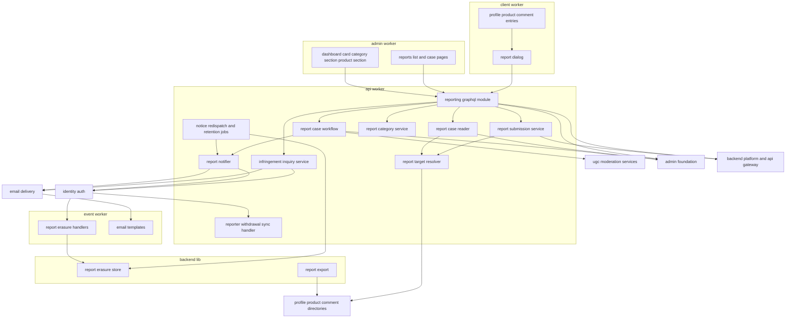
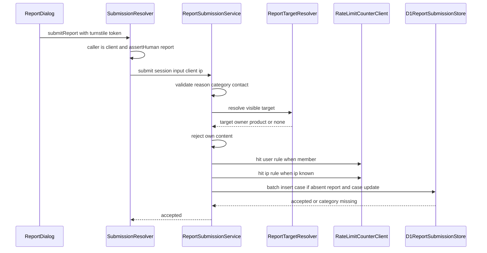
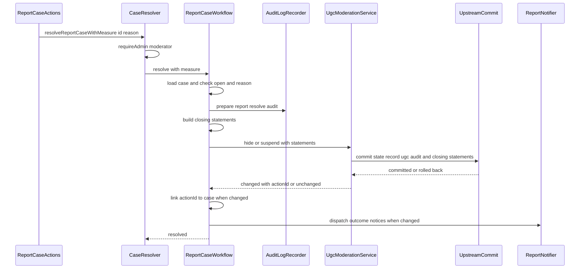
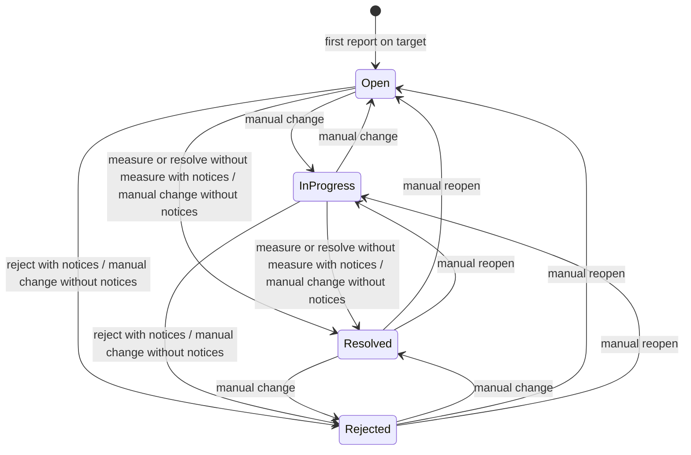
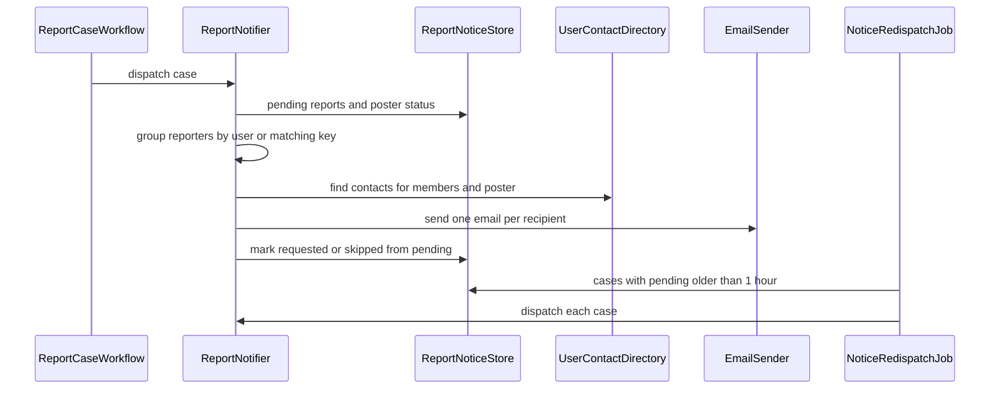
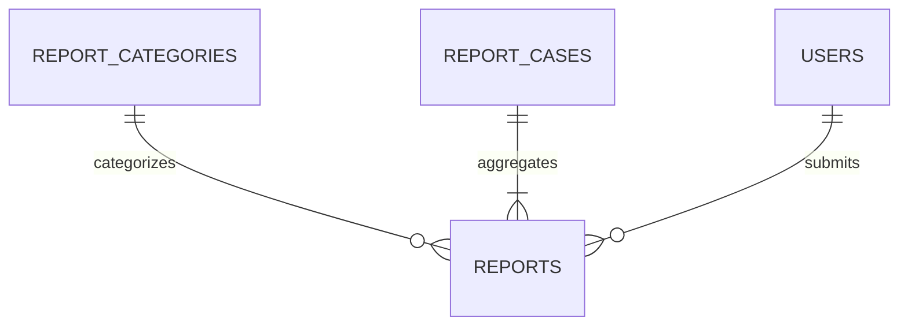

# Design Document

## Overview

**Purpose**: 通報を、APIサーバー(`apps/api`)・イベントサーバー(`apps/event`)・利用者側フロントエンドサーバー(`apps/client`)・管理者側フロントエンドサーバー(`apps/admin`)にまたがって実装する。利用者は公開プロフィール・プロダクト詳細・コメントから、ログイン状態を問わず通報のダイアログで通報する。通報はbot判定と送信元IPアドレス・利用者ごとの回数制限を通り、同じ対象の未完了の案件へ集約される。運営は管理画面の通報管理で案件を一覧・絞り込みし、対応ステータスを管理し、ugc-moderationの措置のユースケースで非公開化・停止して案件を閉じるか、却下する。本specは案件の完了と監査ログを措置と同じ一括の書き込みで確定し、申出者への対応結果・却下の投稿者への通知・権利侵害の照会のメールを送り、権利侵害の案件の対応期間を監査ログの完了の日時から示す。

**Users**: 閲覧者(未ログイン・ログイン中・停止中)は`/@{handle}`・`/p/{handle}`・コメントの「…」メニューから通報する。モデレーター以上の管理者は`/reports`・`/reports/$caseId`で案件を扱い、`/categories`の通報カテゴリの区画でカテゴリを管理する。閲覧のみの管理者は各ページを参照する。全ロールの管理者はダッシュボード(`/`)の未対応の通報のカードと、プロダクトの詳細(`/products/$productId`)の通報の件数を見る。申出者と投稿者はメールで知らせを受け取る。後続のdata-exportは本specの`ReportExport`で利用者の通報を読む。

**Impact**: D1に3テーブル(通報カテゴリ・案件・通報)と標準カテゴリの初期データを足す。`apps/common-lib/reporting`・`apps/backend-lib/core/reporting`・`workers/reporting`(apiとeventの両方に束縛)を新設する。apiにスキーマモジュール`reporting`・受け付け・照会・対応のユースケース・通知・同期の処理1つ・ジョブ2つを、eventに物理削除の時期の処理2つ(通報の削除と対象への参照の消去)と3つのメールのテンプレートを、clientに通報のダイアログと3つの登録を、adminに2ページ・ダッシュボードのカード・カテゴリの区画・プロダクト詳細の区画を足す。上流の公開の契約は変えず、admin-foundationが所有・実装する`AuditLogReader.latestForMany`(admin-foundationの仮7)とテストの共有の偽物、ugc-moderationの措置の結果の`ModerationOutcome.actionId`を使う(「上流への影響」)。新しいシークレット・パッケージ・メッセージ種別・Cronの式・Durable Objectのクラスは無い。

### Goals

- FR-REPOT-001〜006・FR-ADMUG-008(通報件数)・015〜022・FR-ADMCF-019〜021・FR-RLMIT-004・016・LR-004・DR-022が、要件と仮1〜仮8の決定に一致する。
- 措置による対応済では、ugc-moderationの状態の変更・措置の記録・案件の完了・2つの監査ログが1つの一括の書き込みで確定し、競合や既に措置済みのときに何も残らない。
- 通報の受け付けと集約が1つの一括の書き込みで確定し、1つの対象に未完了の案件が2つできない。
- 本specが追加・変更したコードの単体テスト・Workers統合テスト・ブラウザテストがカバレッジ80%を満たす。

### Non-Goals

- 非公開化・停止の実処理とその波及、投稿者への措置の通知、画像の隔離・評価の無効化の操作(ugc-moderation)。
- 照会への投稿者の回答の受け付け(inquiry-chatの問い合わせ)。
- 監査ログの保存と閲覧画面・管理者の認可の部品・管理画面のシェル(admin-foundation)、カテゴリのページの枠(inquiry-chat)。
- データエクスポートのZIPの生成(data-export)。
- 要件定義書の改訂(roadmapのOut。必要な改訂は[research.md](research.md)の「要件定義書の改訂が必要な箇所」に記録した)。(2026-10-25に要件定義書へ適用済み)

## Boundary Commitments

### This Spec Owns

- 本specのデータ: `report_categories`(通報カテゴリと標準カテゴリの初期データ)・`report_cases`(案件・対応ステータス・完了と措置の記録のID・照会・投稿者への通知の状態)・`reports`(通報・通報者・連絡先メールアドレス・申出者への通知の状態)(`apps/db/schema/reporting/`)。
- 通報の規則(`apps/common-lib/reporting/`): 対象の種類・理由の上限・連絡先の要否・標準カテゴリのIDと並び順・対応ステータスと遷移・対象の種類ごとの措置・照会の上限・表示名。監査ログの操作種別`apps/common-lib/admin/audit-actions/content-reporting.ts`(7種)。
- 対応期間の規則(`apps/backend-lib/core/reporting/`)と、3つのメール種別`content-reporting.report-outcome`・`content-reporting.rejection-to-poster`・`content-reporting.infringement-inquiry`(`core/email/kinds/content-reporting.ts`)。
- 共有部品(`apps/backend-lib/workers/reporting/`): `ReportErasureStore`・`ReportExport`と`REPORTING_PLATFORM_MODULE`。
- apiのスキーマモジュール`reporting`、`ReportTargetResolver`・`ReportSubmissionService`・`ReportCaseReader`・`ReportCaseWorkflow`・`InfringementInquiryService`・`ReportNotifier`・`ReportCategoryService`、同期の処理`content-reporting.reporter-withdrawal`、ジョブ`content-reporting.notice-redispatch`(4:21、2000)・`content-reporting.report-retention`(4:21、2010)、回数制限の規則`report:ip`・`report:user`。
- eventの処理`content-reporting.user-report-erasure`(ユーザーの`purge_due`、2000)・`content-reporting.product-report-erasure`(プロダクトの`purge_due`、2000)と3つのテンプレート。
- clientの通報のダイアログと、`PUBLIC_PROFILE_MENU_ITEMS`の`content-reporting.user-report`(10)・`PRODUCT_PAGE_SECTIONS`の`content-reporting.product-report`(`bottom` 10)・`COMMENT_ACTIONS`の`content-reporting.comment-report`(10)。
- adminの`/reports`・`/reports/$caseId`、`ADMIN_NAV_ITEMS`の`/reports`(70)、`DASHBOARD_CARDS`の`content-reporting.unhandled-reports`(30)、`CATEGORY_SECTIONS`の`content-reporting.report-categories`(40)、`ADMIN_PRODUCT_DETAIL_SECTIONS`の`content-reporting.product-reports`(10)。
- 技術ドキュメント`backend/022-submission-aggregation-and-case-resolution.md`・`security/011-mixed-identity-submission-limits.md`・`frontend/021-registered-action-dialogs.md`の新規作成と、サービス仕様(ページ配置・文言規則・準拠方針・日次タイムライン・削除請求フロー・データエクスポート)の追記と`features/007-content-reporting.md`の新規作成、オンボーディングの追記。

### Out of Boundary

- 利用者・プロダクト・コメントの状態の遷移とその波及、措置の記録の作成、投稿者への措置の通知(ugc-moderation・identity-auth・product-launch・engagementと各機能)。本specは`MODERATION_TYPES`の`ProductModerationService`・`CommentModerationService`・`UserModerationService`を呼び、上流のテーブルへ書き込まず、措置の入力・記録の型も変えない。措置と案件の結び付きは、結果の`actionId`を本specの`report_cases.resolution_action_id`に残して表す。
- 画像の隔離・評価の無効化(ugc-moderationの各管理画面)。本specは導線を示すだけである(仮2)。
- 監査ログのテーブル・記録の部品・閲覧画面と、`AuditLogReader.latestForMany`とその保存の照会・テストの共有の偽物(admin-foundation、仮7)。本specは`AuditLogRecorder.prepare`・`buildAuditLogStatements`・`AuditLogReader`を使い、監査ログのテーブルを直接読まない。
- カテゴリのページの枠とエラーの分離(inquiry-chat)、メニュー・ダッシュボードの枠(admin-foundation)、プロダクト詳細の区画の枠(ugc-moderation)、利用者側の各ページと置き場所(user-profile-social・directory-discovery・engagement)。
- 照会への投稿者の回答(inquiry-chatの問い合わせ)。データエクスポートのZIPの生成と`reports.json`の書き出し(data-export)。
- bot判定の検証・厳密カウンタのDurable Object・クライアントIPの引き継ぎ(backend-platform・api-gateway)、メールの送信の基盤(email-delivery)。

### Allowed Dependencies

- backend-platform: `AppModule`・`PLATFORM_TYPES`(`Database`・`Clock`・`IdGenerator`・`KeyedHasher`)・`AppError`・`getAppLogger`・`captureMessage`の規約・`ulidPrimaryKey`・`timestamps`・`textNoCase`・`ScheduledJobDefinition`・`hashRateLimitKey`・`HashedRateLimitKey`・`CounterRule`・`RateLimitCounterClient`。形を変えない。
- api-gateway: `defineSchemaModule`・`GraphQLContext`(`resolve`・`session`・`caller`・`clientIp`・`assertHuman`)・`withValidatedArgs`・`CURSOR_PAGE_ARGS`・`encodeCursor`・`decodeCursor`・`toConnection`・`DateTime`・`SessionView`・`CallerKind`。
- admin-foundation: `requireAdmin`・`CurrentAdmin`・`AuditLogRecorder.prepare`・`PreparedAuditEntry`・`buildAuditLogStatements`・`defineAuditAction`・`AUDIT_ACTIONS`・`AUDIT_REASON_MAX`・`checkAuditReason`・`checkCategoryName`・`CATEGORY_NAME_MAX`・`AuditLogReader`(`latestFor`とadmin-foundationの仮7の`latestForMany`)とテストの共有の偽物`createFakeAuditLogReader`、adminの`ADMIN_NAV_ITEMS`・`DASHBOARD_CARDS`・`DashboardCard`・`DashboardCardFrame`・`RoleGate`・`useAdminRole`、frontend-libの`AdminPageHeader`・`AdminDataTable`・`AdminFilterBar`・`ConfirmActionDialog`・`ReasonField`・`CategoryMasterEditor`、E2Eの`e2e/support/admin-bootstrap.ts`(`signInAsNewAdmin`)・`e2e/support/local-d1.ts`(`executeLocalD1`・`sqlStringLiteral`)。
- ugc-moderation: apiの`MODERATION_TYPES`の`ProductModerationService.hide`・`CommentModerationService.hide`・`UserModerationService.suspend`、`ModerationCommand`(`statements`)・`ModerationOutcome`(`changed`・`actionId`)、adminの`ADMIN_PRODUCT_DETAIL_SECTIONS`・`AdminProductDetailContext`、ugc-moderationの各管理画面のURLと検索パラメータ(導線だけ)。
- identity-auth: `IDENTITY_TYPES.AccountGuard`(`currentUser`)・`IDENTITY_PLATFORM_TYPES.UserContactDirectory`・`UserLifecycleSyncHandler`・`UserLifecycleSyncRegistration`・`USER_LIFECYCLE_SYNC_HANDLERS`・`UserLifecycleAsyncHandler`・`UserLifecycleAsyncRegistration`・`USER_LIFECYCLE_ASYNC_HANDLERS`・`LifecycleHandlerOutcome`・`users`テーブル(外部キーだけ)、clientの`ClientViewer`(`__root`の`viewer`の`status`)、E2Eの`e2e/support/mailpit.ts`。
- user-profile-social: `PROFILE_PLATFORM_TYPES.UserProfileDirectory`(`findSummaries`・`resolveHandle`)・`HANDLE_PATTERN`、clientの`PUBLIC_PROFILE_MENU_ITEMS`・`PublicProfileMenuItem`・`PublicProfileSectionContext`(登録の追記だけ)。
- product-launch: `PRODUCT_PLATFORM_TYPES.ProductDirectory`(`findSummaries`)・`ProductSummaryRecord`・`ProductLifecycleAsyncHandler`・`ProductLifecycleAsyncRegistration`・`PRODUCT_LIFECYCLE_ASYNC_HANDLERS`。
- directory-discovery: clientの`PRODUCT_PAGE_SECTIONS`・`ProductPageSection`・`ProductPageContext`(登録の追記だけ)、E2Eの`directory-fixtures.ts`。
- engagement: `ENGAGEMENT_PLATFORM_TYPES.CommentStore`(`findByIds`)・`CommentRecord`、clientの`COMMENT_ACTIONS`・`CommentAction`・`CommentActionContext`(登録の追記だけ)。
- inquiry-chat: adminの`CATEGORY_SECTIONS`・`CategorySection`(登録の追記だけ)。
- email-delivery: `defineEmailKind`・`EMAIL_KINDS`・`EmailSender`・`EMAIL_TYPES`・`defineEmailTemplate`・`EMAIL_TEMPLATES`・`formatUtcDateTime`・`toMatchingKey`。
- content-processing: `countGraphemes`。
- frontend-platform: `executeGraphQL`(`turnstileToken`)・`graphqlQueryOptions`・`GraphQLClientError`・`useAppForm`・`applyServerFieldErrors`・`FormField`・`SubmitButton`・`useTurnstileToken`・`TurnstileWidget`・`notify`・`DateTime`・`EmptyState`・`PartialErrorState`・`LoadingSkeleton`・`NotFoundView`・shadcn/uiの部品(ボタン・ダイアログ・ドロップダウンメニュー・ラジオグループ・テキストエリア・入力欄・バッジ・セレクト・テーブル)・`runAxe`・`AppForm`・`errorMessageOf`・各アプリの`src/composition/app-profile.ts`のプロファイル(`CLIENT_PROFILE`・`ADMIN_PROFILE`)・`utilities/validation/zod.ts`の`z`。
  - GraphQLの操作は各アプリの`src/graphql/operations/reporting/`に1ファイル1操作の`*.graphql`で書き、操作名を利用者側は`Client`、管理者側は`Admin`で始める。画面は`src/graphql/generated/graphql.ts`の`<操作名>Document`と型を読み、`graphql()`と`gql.ts`・`index.ts`を使わない(frontend-platformの「操作の追加手順」)。
  - フォームは`useAppForm<TInput, TOutput>(schema, { defaultValues })`(`defaultValues`は全欄)と、必須の`onSubmitError`・任意の`serverFieldPrefix`(`input`を取るmutationは`"input"`)を受ける`AppForm`で作る。フォームと検索パラメータのスキーマの`zod`の値は`utilities/validation/zod.ts`から読み、`zod`を直接読み込むのは型だけにする。
  - 失敗の文言: `GraphQLClientError`でない例外に代えて画面に出す文言(`ErrorState`・`PartialErrorState`の`message`、`AppForm`の`onSubmitError`で示す文言、トースト)は`errorMessageOf(error, <プロファイル>.contactAvailable)`で選び、例外の`message`を直接出さない。管理者側は`ADMIN_PROFILE`を使い、`ErrorState`・`UnexpectedErrorView`に`contactHref`を渡さない(問い合わせの画面が無いため、問い合わせの導線と問い合わせを促す文を出さない)。
  - bot判定の`TurnstileWidget`は非表示のウィジェットで場所を取らないため、通報のフォームに判定の枠の表示と場所を設けない。
- npmパッケージ: 新規なし。
- 後続spec(data-export)は、`REPORTING_PLATFORM_TYPES.ReportExport`だけに依存し、本specのテーブルを直接読まない。

### Revalidation Triggers

- `reports`・`report_cases`・`report_categories`の列と状態の値、標準カテゴリの固定のID(data-export)。
- `ReportExport`の形と`reports.json`の対象の参照の規則(data-export)。
- 監査ログの操作種別7種の名前・対象の種類・理由の要否・詳細の鍵(admin-foundationの閲覧画面)。
- ジョブ・処理の名前と`order`(4:21の2000・2010、`purge_due`の2000)(日次タイムラインの表)。
- 登録の`id`と`order`(`PUBLIC_PROFILE_MENU_ITEMS` 10・`PRODUCT_PAGE_SECTIONS`の`bottom` 10・`COMMENT_ACTIONS` 10・`ADMIN_NAV_ITEMS` 70・`DASHBOARD_CARDS` 30・`CATEGORY_SECTIONS` 40・`ADMIN_PRODUCT_DETAIL_SECTIONS` 10)。sponsorshipの`bottom` 20は本specの10の後に並ぶ。
- 仮1〜仮8は2026-10-24に開発者が確定した(仮3・仮5・仮7は推奨と異なる案B)。手での状態の変更の規則(仮3)・対応期間の判定(仮5)・対象への参照の消去と3年の保持(仮7)を変える場合は、監査ログの記録・保持期間の起点・データエクスポートの対象の参照・準拠方針の保持期間を確かめ直す。
- 上流の`ProductModerationService`・`CommentModerationService`・`UserModerationService`の入力(`statements`)と結果(`changed`・`actionId`の意味)、上流の確定が呼び出し側の文の違反で全体を取り消す規則、`AuditLogReader.latestFor`・`latestForMany`(admin-foundationの仮7)とテストの共有の偽物、`buildAuditLogStatements`、`UserContactDirectory`・`UserProfileDirectory`・`ProductDirectory`・`CommentStore.findByIds`の形と可視の判定、`RateLimitCounterClient`・`assertHuman`、各登録口の形を変えたら、本specを確かめ直す。

### 上流への影響

| 上流spec            | 変更                                                                                                                                                                                                                                                                                                                                                                                                                                                                                                                                | 影響と再検証                                                                                                                                                                                                                  |
| ------------------- | ----------------------------------------------------------------------------------------------------------------------------------------------------------------------------------------------------------------------------------------------------------------------------------------------------------------------------------------------------------------------------------------------------------------------------------------------------------------------------------------------------------------------------------- | ----------------------------------------------------------------------------------------------------------------------------------------------------------------------------------------------------------------------------- |
| admin-foundation    | (1)変更なし。apiの`AuditLogReader.latestForMany(input: { readonly action: string; readonly targetKind: AuditTargetKind; readonly targetIds: readonly string[] }): Promise<ReadonlyMap<string, Date>>`と監査ログの保存の照会(90件ずつ、対象ごとの最新の日時)と、テストの共有の偽物`createFakeAuditLogReader`は、admin-foundationが仮7で所有・実装し、本specは使うだけである。(2)`audit-actions/content-reporting.ts`と`index.ts`の連結、adminの`composition/admin-navigation.ts`に1件(70)、`composition/dashboard-cards.ts`に1件(30) | (1)admin-foundationの仮7の契約どおり。一覧の対応期間を1回の照会で求める(NFR-PERF-008)。本specの単体テストは共有の偽物を使うため、`AuditLogReader`へのメソッドの追加で壊れない。(2)は契約どおり(仮6のURLと`order`、Q2のカード) |
| ugc-moderation      | adminの`composition/admin-product-detail-sections.ts`に1件(10)。apiの措置のユースケースを`statements`付きで呼び、結果の`ModerationOutcome.actionId`を本specの`report_cases.resolution_action_id`に残す。ugc-moderationの入力・記録の型・テーブルは変えない                                                                                                                                                                                                                                                                          | 契約どおり(ugc-moderationのData Contractsの「結果の`actionId`で自分の記録と結べる」)。ugc-moderationの再検証は要らない                                                                                                        |
| inquiry-chat        | adminの`composition/category-sections.ts`に1件(40)                                                                                                                                                                                                                                                                                                                                                                                                                                                                                  | 契約どおり(仮4の`order`)                                                                                                                                                                                                      |
| directory-discovery | clientの`composition/product-page-sections.ts`に1件(`bottom` 10)                                                                                                                                                                                                                                                                                                                                                                                                                                                                    | 契約どおり(予約の値)                                                                                                                                                                                                          |
| user-profile-social | clientの`composition/public-profile-sections.ts`の`PUBLIC_PROFILE_MENU_ITEMS`に1件(10)                                                                                                                                                                                                                                                                                                                                                                                                                                              | 契約どおり                                                                                                                                                                                                                    |
| engagement          | clientの`composition/comment-actions.ts`の`COMMENT_ACTIONS`に1件(10)                                                                                                                                                                                                                                                                                                                                                                                                                                                                | 契約どおり                                                                                                                                                                                                                    |
| identity-auth       | apiの`composition/user-lifecycle-sync-handlers.ts`に`content-reporting.reporter-withdrawal`、eventの`composition/user-lifecycle-async-handlers.ts`に`content-reporting.user-report-erasure`(`purge_due`、2000)                                                                                                                                                                                                                                                                                                                      | 契約どおり                                                                                                                                                                                                                    |
| product-launch      | eventの`composition/product-lifecycle-async-handlers.ts`に`content-reporting.product-report-erasure`(`purge_due`、2000)                                                                                                                                                                                                                                                                                                                                                                                                             | 契約どおり                                                                                                                                                                                                                    |
| backend-platform    | apiの`composition/scheduled-jobs.ts`に2件(4:21の式は上流で追加済み)、api・eventの`composition/modules.ts`に`REPORTING_PLATFORM_MODULE`、apiに`REPORTING_MODULE`、eventに`EVENT_REPORTING_MODULE`                                                                                                                                                                                                                                                                                                                                    | 契約どおり                                                                                                                                                                                                                    |
| api-gateway         | apiの`composition/graphql-modules.ts`に`reportingSchemaModule`、client・adminの許可リストの再生成                                                                                                                                                                                                                                                                                                                                                                                                                                   | 契約どおり                                                                                                                                                                                                                    |
| email-delivery      | `core/email/kinds/index.ts`に3種別、eventの`infrastructure/email/templates/index.ts`に3テンプレート                                                                                                                                                                                                                                                                                                                                                                                                                                 | 契約どおり                                                                                                                                                                                                                    |

- roadmapの帯の割り当ての表の本specの「使用中の値」は「4:21は2000・2010、波及処理は2000」になる(ユーザー・プロダクトの`purge_due`の2000)。本specはroadmapを編集しないため、コントローラーへ報告する。

## Architecture

### Existing Architecture Analysis

- 上流の26specは設計・タスクとも承認済みで、本specのタスクはそれらの実装の完了を前提にする。実装済みはdev-toolingだけである。
- apiはクリーンアーキテクチャ(`domain`→`application`→`infrastructure`・`presentation`→`composition`)と処理単位(HTTPの要求ごと)のDIコンテナ、D1の`db.batch()`による1トランザクションの書き込み、`CASE`式のNOT NULL制約の違反による取り消しを使う。
- ugc-moderationの`ProductModerationService`・`UserModerationService`は、呼び出し側の`statements`を要求単位の保留中の措置に置き、上流のライフサイクルの確定(イベント→状態→同期の処理)の一括の書き込みに入れる。`CommentModerationService`は`statements`をengagementの`CommentModerationControl`へ渡す。いずれも呼び出し側の文がNOT NULL制約に違反すれば全体が取り消される。認可は行わず、呼び出し側のリゾルバが`requireAdmin`で行う。
- inquiry-chatの未ログインの送信は、リゾルバの`assertHuman`→入力と状態の検証→ハッシュ化したキーの`RateLimitCounterClient.hit`→書き込みの順で、カテゴリの削除は監査ログ・付け替え・削除を1つの一括の書き込みにする。本specは同じ形を通報に使う。

### Architecture Pattern & Boundary Map



**Architecture Integration**:

- Selected pattern: クリーンアーキテクチャ。通報と案件の規則は`common-lib`・`core`の純粋な関数、通報・案件・カテゴリの読み書きはapiのインフラ層のストア、案件の削除とエクスポートは`workers/reporting`(apiとeventの両方に束縛)、受け付け・照会・対応・通知はapiのアプリケーション層、措置は上流のユースケース越しに行う。
- Domain/feature boundaries: 本specのテーブルは通報・案件・カテゴリだけで、対象の状態は上流が持つ。措置と案件の完了は、上流の措置のユースケースの`statements`に本specの文を載せて一体にする。監査ログは記録の部品と照会だけで使う。
- Existing patterns preserved: `backend-lib/workers/<ドメイン>`の共有の束縛、`<spec名>.<名詞句>`の名前、帯の`order`、登録箇所への追記、`buildAuditLogStatements`を操作と同じ一括の書き込みに含める規約(admin-foundationの`backend/008`)、未ログインの送信の順序とハッシュ化したキー(inquiry-chatの`security/008`)、依頼待ちの通知と日次の送り直し(ugc-moderation)、カテゴリの削除と付け替えの一括の書き込み(inquiry-chat)。
- New components rationale: `ReportTargetResolver`は受け付けの可視の判定と管理画面の表示名を1つの部品にまとめ、利用者・プロダクト・コメントの照会を各1回にするため。`ReportCaseWorkflow`は措置・措置なしの対応済・却下・状態の変更が同じ「検証→監査ログの準備→完了の文→確定→通知」の形であるため。`ReportNotifier`は完了の直後と日次の送り直しの両方から同じ宛先のまとめ方で送るため。admin-foundationの`latestForMany`(仮7)を使うのは一覧の対応期間を1回の照会で求めるため、措置の結果の`actionId`を案件に残すのはugc-moderationの形を変えずに措置の記録と案件を結ぶため。
- Steering compliance: `@inject`の明示、D1の制約(`db.batch()`・バインド変数100個以内・`transaction()`を使わない)、800行以内のファイル、1ファイル1コンポーネント、日時の`<time datetime>`、ログに個人情報を含めない。

**Dependency direction**: `apps/common-lib/reporting` → `apps/db/schema/reporting` → `backend-lib/core/reporting` → `backend-lib/workers/reporting` → 各アプリの`src`(`application` → `infrastructure`・`presentation` → `composition`)。`common-lib/reporting`は`common-lib/admin`(`AUDIT_REASON_MAX`)と`zod`だけを読み込む。`core/reporting`は`common-lib/reporting`だけを読み込む。`workers/reporting`は本specのテーブルと、上流の共有ディレクトリの公開の照会(`UserProfileDirectory`・`ProductDirectory`)だけを読み込み、上流のテーブル定義を読み込まない。apiの`application/reporting`は`infrastructure`(`buildAuditLogStatements`を含む)を読み込まず、ポート越しに使う。apiの`application/reporting`はugc-moderationの`application/moderation`の公開のユースケースと型、admin-foundationの`application/admin`の`AuditLogRecorder`・`AuditLogReader`・`CurrentAdmin`、identity-authの`application/identity`の`AccountGuard`だけを読み込む。clientとadminはGraphQLの操作と上流の部品だけを読み込む。違反はレビューで誤りとして扱う。

### Technology Stack

| Layer     | Choice / Version                                                 | Role in Feature                                                   | Notes                                                              |
| --------- | ---------------------------------------------------------------- | ----------------------------------------------------------------- | ------------------------------------------------------------------ |
| Frontend  | TanStack Start・Router・Query・shadcn/ui・Turnstile(上流)        | 通報のダイアログ、管理画面の2ページ・カード・2区画                | 既存。新しいパッケージなし                                         |
| Backend   | Hono・Inversify・GraphQL Yoga(上流)                              | スキーマモジュール・ユースケース・同期の処理・ジョブ・eventの処理 | 既存                                                               |
| Data      | Cloudflare D1(Drizzle)                                           | 3テーブル、部分一意索引、標準カテゴリの初期データ                 | 新規のマイグレーション1つと初期データのカスタムマイグレーション1つ |
| Messaging | Cron Triggers・Queues(上流)                                      | 4:21のジョブ、ライフサイクルの`purge_due`、メールの送信の依頼     | 新しいメッセージ種別・Cronの式なし                                 |
| Runtime   | Durable Objects(backend-platformの`RateLimitCounter`)・Turnstile | 回数制限とbot判定                                                 | 既存のクラスと束縛を使い、新しいクラスは無い                       |

## File Structure Plan

### Directory Structure

```
apps/
├── common-lib/reporting/                                   # 4アプリ共通(各ファイルに同名の*.unit.test.ts)
│   ├── report-rules.ts                                     # 対象の種類・理由・連絡先の要否・標準カテゴリ・並び順
│   ├── report-case-rules.ts                                # 対応ステータス・遷移・措置・照会の上限
│   └── report-labels.ts                                    # 表示名(対象の種類・状態・措置・目標の超過)
├── common-lib/admin/audit-actions/content-reporting.ts     # 監査ログの操作種別7種
├── db/schema/reporting/                                    # テーブル定義(同名の*.unit.test.ts)
│   ├── report-categories.ts
│   ├── report-cases.ts
│   ├── reports.ts
│   └── index.ts
├── backend-lib/
│   ├── core/reporting/response-time.ts                     # 対応期間・目標の超過・照会の期限(*.unit.test.ts)
│   ├── core/email/kinds/content-reporting.ts               # 3つのメール種別(入力のzodスキーマ)
│   └── workers/reporting/                                  # api・event共通(Workers統合テスト)
│       ├── reporting-platform-types.ts                     # REPORTING_PLATFORM_TYPES(テストなし)
│       ├── report-erasure-store.ts                         # ReportErasureStore(型とD1の実装)
│       ├── report-export.ts                                # ReportExport(型とD1の実装)
│       └── reporting-platform-module.ts                    # REPORTING_PLATFORM_MODULE
├── api/src/
│   ├── application/reporting/                              # ユースケース(Bunの単体テスト)
│   │   ├── reporting-types.ts                              # REPORTING_TYPES(テストなし)
│   │   ├── ports.ts                                        # 各ストアと文のポート・入力と結果の型
│   │   ├── report-target-resolver.ts                       # 受け付けの可視の判定と表示名
│   │   ├── report-submission-service.ts                    # 受け付け・回数制限の規則
│   │   ├── report-case-reader.ts                           # 一覧・詳細・件数・プロダクトの件数
│   │   ├── report-case-workflow.ts                         # 状態の変更・措置・措置なしの対応済・却下
│   │   ├── infringement-inquiry-service.ts                 # 照会
│   │   ├── report-notifier.ts                              # 申出者と投稿者への通知の組み立てと依頼
│   │   ├── report-category-service.ts                      # カテゴリの一覧と操作
│   │   └── jobs/
│   │       ├── report-notice-redispatch-job.ts             # 4:21(order 2000)
│   │       └── report-retention-job.ts                     # 4:21(order 2010)
│   ├── infrastructure/reporting/                           # Workers統合テスト
│   │   ├── d1-report-submission-store.ts                   # 通報と集約の一括の書き込み
│   │   ├── d1-report-case-store.ts                         # 案件の検索・詳細・件数
│   │   ├── d1-report-case-statements.ts                    # 状態の変更・完了・照会の文と単独の確定
│   │   ├── d1-report-category-store.ts                     # カテゴリの読み書きと付け替え
│   │   ├── d1-report-notice-store.ts                       # 通知の状態
│   │   └── reporter-withdrawal-sync-handler.ts             # content-reporting.reporter-withdrawal
│   ├── presentation/graphql/modules/reporting/             # スキーマモジュール(Workers統合テスト)
│   │   ├── type-defs.ts
│   │   ├── inputs.ts                                       # 引数の検証(withValidatedArgs)
│   │   ├── errors.ts                                       # エラーコードと文言
│   │   ├── submission-resolvers.ts                         # reportCategories・submitReport
│   │   ├── case-resolvers.ts                               # 案件の照会と操作
│   │   ├── category-resolvers.ts                           # 管理画面のカテゴリ
│   │   └── index.ts                                        # reportingSchemaModule
│   └── composition/reporting-module.ts                     # REPORTING_MODULE(apiの束縛・同期の処理・ジョブ)
├── event/src/
│   ├── application/reporting/                              # Bunの単体テスト
│   │   ├── event-reporting-types.ts
│   │   ├── user-report-erasure-handler.ts                  # ユーザーのpurge_due 2000
│   │   └── product-report-erasure-handler.ts               # プロダクトのpurge_due 2000
│   ├── infrastructure/email/templates/content-reporting/   # 本文の*-body.tsxと定義の*-template.ts(3種)
│   └── composition/reporting-module.ts                     # EVENT_REPORTING_MODULE
├── client/src/
│   ├── components/reporting/                               # 1ファイル1コンポーネント(browser testを併置)
│   │   ├── report-form-schema.ts                           # フォームの検証(*.unit.test.ts)
│   │   ├── use-submit-report.ts                            # 送信・bot判定のトークン・エラーの振り分け
│   │   ├── report-dialog.tsx                               # ダイアログの枠とフォーカスの戻り
│   │   ├── report-form.tsx                                 # カテゴリ・理由・連絡先・bot判定(非表示のウィジェット)
│   │   ├── product-report-link.tsx                         # PRODUCT_PAGE_SECTIONSのbottom 10
│   │   ├── comment-report-menu-item.tsx                    # COMMENT_ACTIONSの10
│   │   └── user-report-menu-item.tsx                       # PUBLIC_PROFILE_MENU_ITEMSの10
│   └── graphql/operations/reporting/                       # 1ファイル1操作の*.graphql(操作名はClientで始める)
│       └── report-categories.graphql · submit-report.graphql   # ClientReportCategories・ClientSubmitReport
└── admin/src/
    ├── routes/_authenticated/reports/index.tsx · $caseId.tsx
    ├── components/reporting/                               # 1ファイル1コンポーネント(browser testを併置)
    │   ├── report-search.ts                                # 検索パラメータのスキーマと変換(*.unit.test.ts)
    │   ├── use-report-case-mutation.ts                     # 操作の実行・通知・照会の無効化
    │   ├── report-case-filters.tsx · report-case-table.tsx · report-target-cell.tsx
    │   ├── category-breakdown.tsx · response-time-cell.tsx · report-case-status-badge.tsx
    │   ├── report-case-actions.tsx                         # 措置・措置なしの対応済・却下の操作
    │   ├── report-case-action-dialog.tsx                   # ConfirmActionDialogに影響と通知の説明を添える
    │   ├── report-case-status-control.tsx                  # 4状態の間の手での変更(完了と再開を含む)
    │   ├── infringement-inquiry-dialog.tsx                 # 照会の内容・理由・期限の案内
    │   ├── report-case-detail-view.tsx · report-list.tsx · report-inquiry-panel.tsx
    │   ├── unhandled-reports-card.tsx                      # DASHBOARD_CARDSの30
    │   ├── product-reports-section.tsx                     # ADMIN_PRODUCT_DETAIL_SECTIONSの10
    │   └── report-category-section.tsx                     # CATEGORY_SECTIONSの40
    └── graphql/operations/reporting/                       # 1ファイル1操作の*.graphql(操作名はAdminで始める)
        ├── cases/*.graphql · categories/*.graphql · summaries/*.graphql   # 照会
        └── mutations/*.graphql                             # 案件の5つの操作とカテゴリの3つの操作
e2e/
├── support/report-fixtures.ts                              # ローカルD1に案件と通報を作る補助
├── client/report-submission.e2e.test.ts
└── admin/
    ├── report-handling.e2e.test.ts · report-rejection.e2e.test.ts · report-categories.e2e.test.ts
docs/
├── GUIDES/tech/backend/022-submission-aggregation-and-case-resolution.md
├── GUIDES/tech/security/011-mixed-identity-submission-limits.md
├── GUIDES/tech/frontend/021-registered-action-dialogs.md
└── GUIDES/service/features/007-content-reporting.md
```

テストは各ファイルの隣に置く(`*.unit.test.ts`・`*.worker.test.ts`・`*.browser.test.tsx`)。`latestForMany`のテストはadmin-foundationが持ち、本specの単体テストは`AuditLogReader`の偽物をadmin-foundationの共有の偽物`createFakeAuditLogReader`で作る。技術ドキュメントの番号は、上流のspecのdesign.mdが使う番号(`backend`001〜021・`frontend`001〜020・`security`001〜008)と、本specより先に番号を取ったlaunch-readinessの`security/009`・notificationsの`security/010`の後の最小の空き番号`backend/022`・`frontend/021`・`security/011`に固定する。サービス仕様の`features`は001〜006の後の`007`を使う。

### Modified Files

- `apps/db/schema/index.ts`・`apps/db/migrations/<日時>_content_reporting/migration.sql`・`<日時>_content_reporting_seed`(カスタムマイグレーション) — 3テーブルの再エクスポート、生成したマイグレーション(CHECK・部分一意索引・索引)、標準カテゴリ2件の挿入。mainの最新を取り込んでから生成する。
- `apps/common-lib/admin/audit-actions/index.ts` — 連結に`content-reporting`を加える。
- `apps/backend-lib/core/email/kinds/index.ts`・`apps/event/src/infrastructure/email/templates/index.ts` — 3種別と3テンプレート。
- `apps/api/src/composition/modules.ts`・`graphql-modules.ts`・`scheduled-jobs.ts`・`user-lifecycle-sync-handlers.ts` — モジュール・スキーマモジュール・2つのジョブ・同期の処理。
- `apps/event/src/composition/modules.ts`・`user-lifecycle-async-handlers.ts`・`product-lifecycle-async-handlers.ts` — モジュール・2つの物理削除の処理。
- `apps/client/src/composition/product-page-sections.ts`・`comment-actions.ts`・`public-profile-sections.ts` — 3つの登録。
- `apps/admin/src/composition/admin-navigation.ts`・`dashboard-cards.ts`・`category-sections.ts`・`admin-product-detail-sections.ts` — メニュー・カード・カテゴリの区画・プロダクト詳細の区画。
- clientとadminの`src/graphql/generated/`(各アプリの`bun run graphql:generate`)と、apiの許可リスト(`bun run graphql:allowlist`)。
- `docs/GUIDES/tech/backend/README.md`・`security/README.md`・`frontend/README.md` — 文書一覧の行。
- `docs/onboardings/project-values.md` — ジョブ・処理・同期の処理・登録の名前と`order`、回数制限の規則の名前と値、メール種別、監査ログの操作種別、標準カテゴリの固定のID。
- `docs/GUIDES/service/design/002-page-layouts.md` — 通報のダイアログ、管理者側の通報の一覧と案件の詳細、ダッシュボードのカード、プロダクトの詳細の通報の区画、カテゴリのページの通報カテゴリの区画。
- `docs/GUIDES/service/design/003-text-and-copy-rules.md` — 本specの文言(ダイアログ・エラー・状態・確認・成功)と、3つのメールの本文の要点。
- `docs/GUIDES/service/legal/001-compliance-policy.md` — データ保持期間の一覧にログイン中の利用者の通報(退会から14日)・案件(通報が無くなるまで)・対象の物理削除で対象への参照を消した案件と通報(参照の消去から3年、申出者の理由は書き換えない、仮7)、未ログインの通報の行に停止中の利用者の通報を含む旨(仮6)と、完了から戻した案件は再び完了してから14日を数える旨(仮3)。
- `docs/GUIDES/service/legal/003-privacy-policy-outline.md` — 通報の対象のユーザー・プロダクトが削除された後も、通報と案件を対象への参照を消して3年保持する旨(仮7)。
- `docs/GUIDES/service/legal/005-rights-infringement-takedown-flow.md` — 案件への集約(仮1)、措置の範囲と措置なしの対応済(仮2)、手での状態の変更と通知の分担・完了から戻す扱い(仮3)、照会の内容と再送(仮4)、1営業日を土日を含む24時間とする目標の超過の判定(仮5)、対象の物理削除後の案件の扱い(仮7)。
- `docs/GUIDES/service/features/001-user-data-export.md` — `reports.json`の`targetRef`を「解決できない(退会・物理削除済み)対象と、対象の物理削除で対象への参照を消した通報は`null`」、`category`を「通報時点の通報カテゴリ名(カテゴリの削除で付け替えられても変わらない)」に改める。
- `docs/GUIDES/service/overview/007-daily-timeline.md` — 4:21の表に`content-reporting.notice-redispatch`(2000)・`content-reporting.report-retention`(2010)。
- `CLAUDE.md` — 「技術規則の参照先」に「利用者の申告を集約して対応の状態を管理する前に: `backend/022`」。

## System Flows

### 通報の受け付け



- 停止中の利用者は未ログインとして扱う(`AccountGuard.currentUser(session)`が停止中なら通報者を記録せず、連絡先の要否と回数制限も未ログインと同じにする、仮6)。本人の判定は停止中でも行う。
- 回数は入力の検証・bot判定・対象の確認を通った後に数える(4.6)。利用者の規則で拒否されたらIPアドレスの規則は数えない。IPアドレスの規則で拒否されたとき、先に数えた利用者の回数は戻さない(1回分を余分に数えることを受け入れる)。IPアドレスが不明なら警告`report-ip-missing`を残して数えない(4.7)。
- 一括の書き込み: (1)`INSERT INTO report_cases ... ON CONFLICT (target_kind, target_id) WHERE closed_at IS NULL DO NOTHING`、(2)`INSERT INTO reports`の`case_id`を「同じ対象の未完了の案件のID」の副問い合わせ、`category_name`を「カテゴリの名前」の副問い合わせにする(どちらもNOT NULLで、カテゴリが同時に削除されたら全体が取り消される)、(3)未完了の案件の`last_reported_at`と、権利侵害なら`infringement_reported_at`(未設定のときだけ)を更新する。同時の通報でも案件は1つになる(5.2)。

### 措置による対応済



- 完了の文は、案件の`status`を「現在が未対応・対応中なら対応済、そうでなければNULL」とする`CASE`式の更新(NOT NULL制約の違反で上流の確定ごと取り消す)・`resolution`・`closing_reason`・`closed_at`の設定、通報の申出者への通知の状態の`pending`(宛先の無い未ログインの通報は`none`)、`buildAuditLogStatements`(`report.resolve`、詳細`resolution`)である。上流が`changed: true`を返したら、結果の`actionId`を`ReportCaseStatements.linkResolutionAction(caseId, actionId)`で案件の`resolution_action_id`に残す(9.3)。`actionId`は上流の確定の中で採番されるため、確定の後の単独の条件付きの更新(措置の対応済で`resolution_action_id`が未設定の案件だけ)で書く。この更新の例外または`false`(更新した行が無い)は措置と完了を取り消さず、`captureMessage`(`resolution-action-link-failed`、案件と措置の記録のID)で知らせ、結果は成功とする。
- 上流が`changed: false`(既に非公開化・停止)を返したら、上流は書き込まないため本specの文も書かれない。`report_measure_already_applied`を返し、画面は措置なしの対応済を案内する(9.5)。上流の`*_not_found`は`report_target_unavailable`に変える(9.7)。上流の確定が失敗したら案件を読み直し、完了済みなら`report_case_state_conflict`、そうでなければ上流のエラーをそのまま返す(9.8)。
- 措置なしの対応済と却下は、同じ完了の文(`resolution`は`none`・null、却下は投稿者がいれば投稿者への通知の状態も`pending`、対象への参照を消した案件なら`skipped`)を`ReportCaseStatements.commit`の単独の一括の書き込みで確定する。

### 対応ステータス



- 管理者は4つの状態の間を手で自由に変えられる(仮3)。手での変更は当事者へ通知せず、措置も行わない。通知は措置・措置なしの対応済・却下の操作でだけ送り、これらの操作は未対応・対応中の案件でだけ行える(完了した案件に通知を伴う判断をするときは、先に手で戻す)。
- 理由は未対応⇄対応中では任意、完了(対応済・却下)への変更と完了からの変更では必須(500書記素)とする。完了と再開は、保持期間の起点・対応期間の終点・措置の記録との結び付きを動かすため、説明の記録を残す。
- 手で完了へ変える(完了どうしの変更を含む)と、`closed_at`を変更の日時に、`resolution`を対応済なら`none`・却下ならnullに、`resolution_action_id`をnullに、`closing_reason`を理由にし、監査ログは`report.resolve`・`report.reject`(詳細`mode`は`manual`)にする。依頼待ち(`pending`)の申出者と投稿者への通知は`none`へ戻して取りやめる(前の操作による完了の通知が送れずに残っていても、手での変更の後に送らない、11.9)。依頼済み・送らなかった記録は残す。監査ログの最後の完了の日時が対応期間の終点、`closed_at`が保持期間の起点になる。
- 手で完了から戻す(再開)と、`closed_at`・`resolution`・`resolution_action_id`・`closing_reason`を消し、依頼待ち(`pending`)の申出者と投稿者への通知を`none`へ戻して取りやめる(依頼済み・送らなかった記録は残す)。行った措置(非公開化・停止)は取り消さず、画面でugc-moderationの管理画面での取り消しを案内する。監査ログは`report.status-change`。保持期間の削除は、再び完了するまで止まり、再び完了した時点から14日を数え直す。対応期間は起点を変えずに現在までの対応中として示し、再び完了すれば最後の完了までを示す。
- 同じ対象に未完了の別の案件がある(再開の間に届いた通報で新しい案件ができた)ときは、未完了の案件を対象ごとに1つにする部分一意索引の違反として再開を取り消し、`report_case_open_exists`を返す(仮1・8.8)。参照を消した案件(仮7)は対象のIDを持たないため、この違反にならない。
- 同じ対象への次の通報は、完了した案件へは集約せず新しい案件になる(仮1)。照会は対応中の権利侵害の案件でだけ送れる(12.1)。

### 通知と照会



- 申出者は、ログイン中の通報を利用者のID、未ログインの通報を連絡先メールアドレスの照合キー(`toMatchingKey`)でまとめ、宛先ごとに1通送る(11.4)。送信の成功の後に、その宛先の通報だけを`pending`→`requested`へ条件付きで進め、宛先が無ければ`skipped`にする(11.5・11.8)。送信の例外は`pending`のまま残し、ジョブが送り直す。
- 照会(`InfringementInquiryService`)は、宛先を引いて`EmailSender.send`を先に行い、依頼できた後に案件の照会の日時と内容の更新と監査ログ(`report.inquire`)を1つの一括の書き込みで確定する。記録が回答の期限の起算点より前になることを避けるためである(12.3)。送信の失敗は何も記録せず`report_inquiry_send_failed`を返す(12.8)。送信の後の記録の失敗は`captureMessage`(`inquiry-record-failed`)で知らせ、`report_case_state_conflict`を返す(管理者は読み直して再送できる)。

## Requirements Traceability

| Requirement                                                 | Summary              | Components                                                                                                                                                   | Interfaces                                                                                                           | Flows            |
| ----------------------------------------------------------- | -------------------- | ------------------------------------------------------------------------------------------------------------------------------------------------------------ | -------------------------------------------------------------------------------------------------------------------- | ---------------- |
| 1.1, 1.2, 1.3, 1.4, 1.5                                     | 通報の導線           | ProductReportLink、CommentReportMenuItem、UserReportMenuItem、ReportDialog、ClientRegistrations                                                              | `PRODUCT_PAGE_SECTIONS`・`COMMENT_ACTIONS`・`PUBLIC_PROFILE_MENU_ITEMS`                                              | —                |
| 2.1, 2.2, 2.3, 2.4, 2.5, 2.6, 2.7, 2.8, 2.9, 2.10, 2.11     | 通報フォーム         | ReportForm、ReportFormSchema、UseSubmitReport、ReportRules、ReportCategoryService                                                                            | `reportCategories`・`submitReport`・`useTurnstileToken`                                                              | 通報の受け付け   |
| 3.1, 3.2, 3.3, 3.4, 3.5, 3.6, 3.7, 3.8, 3.9                 | 通報の受け付け       | ReportingSchemaModule、ReportSubmissionService、ReportTargetResolver、D1ReportSubmissionStore                                                                | `assertHuman`・`CallerKind`・`AccountGuard.currentUser`                                                              | 通報の受け付け   |
| 4.1, 4.2, 4.3, 4.4, 4.5, 4.6, 4.7                           | 回数制限             | ReportSubmissionService                                                                                                                                      | `REPORT_IP_RATE_RULE`・`REPORT_USER_RATE_RULE`・`RateLimitCounterClient`・`hashRateLimitKey`                         | 通報の受け付け   |
| 5.1, 5.2, 5.3, 5.4, 5.5, 5.6                                | 集約と案件           | D1ReportSubmissionStore、D1ReportCaseStore、ReportingSchema                                                                                                  | 部分一意索引・`ReportCaseStore.search`                                                                               | 通報の受け付け   |
| 6.1, 6.2, 6.3, 6.4, 6.5, 6.6, 6.7, 6.8, 6.9                 | 通報一覧             | ReportCaseReader、ReportTargetResolver、ReportsPage(ReportCaseFilters・ReportCaseTable・ReportTargetCell・CategoryBreakdown・ResponseTimeCell)、ReportSearch | `adminReportCases`                                                                                                   | —                |
| 7.1, 7.2, 7.3, 7.4, 7.5, 7.6                                | 案件の詳細           | ReportCaseReader、ReportCasePage(ReportCaseDetailView・ReportList・ReportInquiryPanel)                                                                       | `adminReportCase`                                                                                                    | —                |
| 8.1, 8.2, 8.3, 8.4, 8.5, 8.6, 8.7, 8.8                      | 対応ステータス       | ReportCaseRules、ReportCaseWorkflow、D1ReportCaseStatements、ReportCaseStatusControl                                                                         | `changeReportCaseStatus`・部分一意索引                                                                               | 対応ステータス   |
| 9.1, 9.2, 9.3, 9.4, 9.5, 9.6, 9.7, 9.8, 9.9                 | 通報からの措置       | ReportCaseWorkflow、D1ReportCaseStatements、ReportCaseActions、ReportCaseActionDialog                                                                        | `resolveReportCaseWithMeasure`・`resolveReportCaseWithoutMeasure`・`ModerationCommand`・`ModerationOutcome.actionId` | 措置による対応済 |
| 10.1, 10.2, 10.3, 10.4                                      | 却下                 | ReportCaseWorkflow、D1ReportCaseStatements、ReportCaseActions、ReportCaseActionDialog                                                                        | `rejectReportCase`                                                                                                   | 対応ステータス   |
| 11.1, 11.2, 11.3, 11.4, 11.5, 11.6, 11.7, 11.8, 11.9, 11.10 | 当事者への通知       | ReportNotifier、D1ReportNoticeStore、ReportingEmailKinds、ReportingEmailTemplates、ReportNoticeRedispatchJob                                                 | 2つのメール種別・`EmailSender`・`UserContactDirectory`                                                               | 通知と照会       |
| 12.1, 12.2, 12.3, 12.4, 12.5, 12.6, 12.7, 12.8, 12.9        | 権利侵害の照会       | InfringementInquiryService、D1ReportCaseStatements、InfringementInquiryDialog、ReportInquiryPanel、ResponseTime                                              | `sendInfringementInquiry`・`content-reporting.infringement-inquiry`                                                  | 通知と照会       |
| 13.1, 13.2, 13.3, 13.4, 13.5, 13.6                          | 対応期間             | ResponseTime、ReportCaseReader、ResponseTimeCell                                                                                                             | `computeResponseTime`・`latestFor`・`latestForMany`(admin-foundationの仮7)                                           | —                |
| 14.1, 14.2, 14.3, 14.4, 14.5, 14.6, 14.7, 14.8, 14.9, 14.10 | 通報カテゴリ         | ReportCategoryService、D1ReportCategoryStore、ReportRules、ReportCategorySection、ReportingSchema                                                            | `adminReportCategories`・カテゴリの3操作・`CATEGORY_SECTIONS`                                                        | —                |
| 15.1, 15.2, 15.3, 15.4, 15.5                                | カードと区画         | UnhandledReportsCard、ProductReportsSection、ReportCaseReader                                                                                                | `adminUnhandledReportSummary`・`adminProductReportSummary`・`DASHBOARD_CARDS`・`ADMIN_PRODUCT_DETAIL_SECTIONS`       | —                |
| 16.1, 16.2, 16.3, 16.4, 16.5                                | 監査ログ             | ReportingAuditActions、D1ReportCaseStatements、D1ReportCategoryStore、ReportCaseWorkflow                                                                     | `buildAuditLogStatements`                                                                                            | 措置による対応済 |
| 17.1, 17.2, 17.3, 17.4, 17.5, 17.6, 17.7, 17.8, 17.9, 17.10 | 保持と削除           | ReportErasureStore、ReportRetentionJob、ReporterWithdrawalSyncHandler、ReportErasureHandlers、ReportExport                                                   | `purge_due`・`withdrawn`・`ReportExport.listPage`                                                                    | —                |
| 18.1, 18.2, 18.3, 18.4, 18.5, 18.6, 18.7, 18.8              | 権限と共通の振る舞い | ReportingSchemaModule、AdminRegistrations、ReportCaseActionDialog、UseReportCaseMutation                                                                     | `requireAdmin`・`ADMIN_NAV_ITEMS`                                                                                    | —                |
| 19.1, 19.2, 19.3, 19.4, 19.5, 19.6                          | 連携と運用           | ReportCaseWorkflow、ReportingModule、ジョブと処理の登録、ReportCaseReader                                                                                    | 各登録口・`ModerationCommand.statements`                                                                             | —                |
| 20.1, 20.2, 20.3, 20.4, 20.5, 20.6                          | ドキュメントとテスト | 全コンポーネントのテスト、ReportingE2E、ReportingTechDocs、ReportingServiceSpecs                                                                             | —                                                                                                                    | —                |

## Components and Interfaces

| Component                                                                                                      | Domain/Layer        | Intent                                   | Req Coverage                                                                                                                         | Key Dependencies (P0/P1)                                  | Contracts      |
| -------------------------------------------------------------------------------------------------------------- | ------------------- | ---------------------------------------- | ------------------------------------------------------------------------------------------------------------------------------------ | --------------------------------------------------------- | -------------- |
| ReportRules・ReportCaseRules・ReportLabels                                                                     | common-lib          | 通報と案件の規則・表示名                 | 2.1, 2.2, 2.3, 2.4, 3.5, 8.2, 8.3, 8.4, 9.1, 12.2, 14.4, 14.8                                                                        | AUDIT_REASON_MAX (P0)                                     | State          |
| ReportingAuditActions                                                                                          | common-lib/admin    | 監査ログの操作種別7種                    | 16.1, 16.2, 8.5, 14.7                                                                                                                | defineAuditAction (P0)                                    | State          |
| ReportingSchema                                                                                                | db                  | 3テーブルと標準カテゴリ                  | 5.1, 5.2, 8.8, 14.4, 17.1, 17.5, 17.10                                                                                               | Drizzle (P0)                                              | State          |
| ResponseTime                                                                                                   | backend-lib/core    | 対応期間・目標の超過・照会の期限         | 13.1, 13.2, 13.4, 13.6, 12.6                                                                                                         | なし(純粋な関数)                                          | Service        |
| ReportingEmailKinds                                                                                            | backend-lib/core    | 3つのメール種別                          | 11.1, 11.2, 11.6, 11.7, 12.2, 12.4                                                                                                   | defineEmailKind (P0)                                      | Event          |
| ReportErasureStore                                                                                             | backend-lib/workers | 保持期間・退会の削除と対象への参照の消去 | 17.1, 17.2, 17.4, 17.5, 17.6, 17.9, 17.10                                                                                            | D1 (P0)                                                   | Service        |
| ReportExport                                                                                                   | backend-lib/workers | データエクスポートの通報                 | 17.7, 17.8                                                                                                                           | UserProfileDirectory (P0)・ProductDirectory (P0)          | Service        |
| ReportTargetResolver                                                                                           | api/application     | 受け付けの可視の判定と表示名             | 3.3, 3.4, 6.2, 6.7, 7.1                                                                                                              | UserProfileDirectory・ProductDirectory・CommentStore (P0) | Service        |
| ReportSubmissionService                                                                                        | api/application     | 検証・本人・回数制限・書き込み           | 3.4, 3.5, 3.6, 3.7, 3.8, 3.9, 4.1〜4.7                                                                                               | AccountGuard (P0)・RateLimitCounterClient (P0)            | Service        |
| ReportCaseReader                                                                                               | api/application     | 一覧・詳細・件数・プロダクトの件数       | 5.4, 5.6, 6.1, 6.2, 6.7, 7.1〜7.6, 13.1〜13.6, 15.1, 15.3, 19.6                                                                      | ReportCaseStore (P0)・AuditLogReader (P0)                 | Service        |
| ReportCaseWorkflow                                                                                             | api/application     | 状態の変更・措置・措置なしの対応済・却下 | 8.2〜8.8, 9.2〜9.8, 10.2, 10.3, 11.9, 16.4, 16.5, 19.1                                                                               | ugc-moderationの措置(P0)・AuditLogRecorder (P0)           | Service        |
| InfringementInquiryService                                                                                     | api/application     | 照会の送信と記録                         | 12.1〜12.5, 12.7, 12.8                                                                                                               | UserContactDirectory (P0)・EmailSender (P0)               | Service        |
| ReportNotifier                                                                                                 | api/application     | 申出者と投稿者への通知                   | 11.1〜11.10                                                                                                                          | EmailSender (P0)・UserContactDirectory (P0)               | Service        |
| ReportCategoryService                                                                                          | api/application     | カテゴリの一覧と操作                     | 2.1, 14.1〜14.10                                                                                                                     | ReportCategoryStore (P0)                                  | Service        |
| D1ReportSubmissionStore・D1ReportCaseStore・D1ReportCaseStatements・D1ReportCategoryStore・D1ReportNoticeStore | api/infrastructure  | 本specのテーブルの読み書き               | 3.8, 5.1〜5.6, 8.3〜8.6, 8.8, 9.2, 9.3, 10.2, 12.3, 14.3, 14.5, 14.7, 14.9, 16.4, 16.5                                               | buildAuditLogStatements (P0)                              | Service, State |
| ReporterWithdrawalSyncHandler                                                                                  | api/infrastructure  | 退会の確定と同じ書き込みでの論理削除     | 17.3                                                                                                                                 | USER_LIFECYCLE_SYNC_HANDLERS (P0)                         | Event          |
| ReportNoticeRedispatchJob・ReportRetentionJob                                                                  | api/application     | 通知の送り直し・保持期間の削除           | 11.8, 17.1, 17.2, 17.6, 17.9, 17.10, 19.2, 19.5                                                                                      | ReportNotifier (P0)・ReportErasureStore (P0)              | Batch          |
| ReportingSchemaModule                                                                                          | api/presentation    | GraphQLの照会と操作・認可                | 3.1, 3.2, 18.2, 18.3, 18.4                                                                                                           | requireAdmin (P0)・assertHuman (P0)                       | API            |
| ReportErasureHandlers                                                                                          | event               | 物理削除の時期の削除と参照の消去         | 17.4, 17.5, 17.6                                                                                                                     | ReportErasureStore (P0)                                   | Event          |
| ReportingEmailTemplates                                                                                        | event               | 3つの本文                                | 11.1, 11.2, 11.6, 11.7, 12.2, 12.4                                                                                                   | defineEmailTemplate (P0)                                  | —              |
| client画面の部品                                                                                               | client              | 通報の導線とダイアログ                   | 1.1〜1.5, 2.1〜2.11                                                                                                                  | GraphQLの操作(P0)・useTurnstileToken (P0)                 | State          |
| admin画面の部品                                                                                                | admin               | 2ページ・カード・2区画・操作             | 6.3〜6.9, 7.1〜7.6, 8.2〜8.4, 8.8, 9.1, 9.6, 9.9, 10.1, 10.4, 12.6, 12.9, 13.4, 14.1, 14.6, 14.8, 15.1〜15.5, 16.3, 18.1, 18.5〜18.8 | GraphQLの操作(P0)                                         | State          |

### common-lib

#### ReportRules・ReportCaseRules・ReportLabels

**Contracts**: State [x]

```typescript
// report-rules.ts
export declare const REPORT_TARGET_KINDS: readonly [
  'user',
  'product',
  'comment',
];
export type ReportTargetKind = (typeof REPORT_TARGET_KINDS)[number];
export declare const REPORT_REASON_MAX: 1000; // 書記素
export declare const REPORT_CONTACT_EMAIL_MAX: 254;
export type ReportReasonCheck = 'ok' | 'empty' | 'too-long';
export declare function checkReportReason(value: string): ReportReasonCheck; // 前後の空白を除いた書記素で数える
export declare const REPORT_CATEGORY_INFRINGEMENT_ID: '01JE0000000000000000000001'; // 初期データの固定ULID「権利侵害」
export declare const REPORT_CATEGORY_OTHER_ID: '01JE0000000000000000000002'; // 「その他」
export declare const REPORT_CATEGORY_INFRINGEMENT_NAME: '権利侵害';
export declare const REPORT_CATEGORY_OTHER_NAME: 'その他';
export declare function isInfringementCategory(categoryId: string): boolean;
export declare function requiresContactEmail(input: {
  readonly reporterKind: 'member' | 'guest'; // 停止中の利用者はguest(仮6)
  readonly categoryId: string;
}): boolean; // guestかつ権利侵害だけ真
export declare function sortReportCategories<
  T extends {
    readonly id: string;
    readonly systemDefault: boolean;
    readonly createdAt: Date;
  },
>(categories: readonly T[]): readonly T[]; // 追加の順、標準は権利侵害・その他の順で末尾(仮8)

// report-case-rules.ts
export declare const REPORT_CASE_STATUSES: readonly [
  'open',
  'in_progress',
  'resolved',
  'rejected',
];
export type ReportCaseStatus = (typeof REPORT_CASE_STATUSES)[number];
export type OpenReportCaseStatus = 'open' | 'in_progress';
export declare function isClosedStatus(status: ReportCaseStatus): boolean;
export declare function canChangeStatusManually(
  from: ReportCaseStatus,
  to: ReportCaseStatus,
): boolean; // fromとtoが異なれば4状態の全ての組で真(仮3)
export type ManualStatusChangeKind = 'progress' | 'close' | 'reopen';
export declare function manualStatusChangeKind(
  from: ReportCaseStatus,
  to: ReportCaseStatus,
): ManualStatusChangeKind; // toが完了ならclose(完了どうしを含む)、fromが完了でtoが未完了ならreopen、他はprogress
export type ReportResolution =
  'product.hide' | 'comment.hide' | 'user.suspend' | 'none';
export declare function measureFor(
  kind: ReportTargetKind,
): Exclude<ReportResolution, 'none'>; // product→product.hide、comment→comment.hide、user→user.suspend(仮2)
export declare const INQUIRY_MESSAGE_MAX: 1000; // 書記素
export declare const INQUIRY_RESPONSE_DAYS: 7;
export declare const REPORT_LIST_PAGE_SIZE: 50;
export declare const REPORT_LIST_EXCERPT_MAX: 200; // 一覧のコメントの抜粋の文字数
export declare const REPORT_NOTICE_EXCERPT_MAX: 100; // 通知のコメントの抜粋の書記素
export type ReportAdminAction =
  | 'status-progress'
  | 'status-close'
  | 'status-reopen'
  | 'resolve'
  | 'reject'
  | 'inquire';
export declare function checkReportAdminReason(
  action: ReportAdminAction,
  reason: string | undefined,
): 'ok' | 'required' | 'too-long'; // status-close・status-reopen・resolve・rejectは必須、他は任意。上限はAUDIT_REASON_MAX(500)

// report-labels.ts
export declare const REPORT_TARGET_KIND_LABELS: Readonly<
  Record<ReportTargetKind, string>
>; // ユーザー・プロダクト・コメント
export declare const REPORT_CASE_STATUS_LABELS: Readonly<
  Record<ReportCaseStatus, string>
>; // 未対応・対応中・対応済・却下
export declare const REPORT_RESOLUTION_LABELS: Readonly<
  Record<ReportResolution, string>
>; // プロダクトの非公開化・コメントの非公開化・ユーザーの停止・措置なし
export declare const RESPONSE_TIME_ALERT_LABELS: Readonly<
  Record<'start-overdue' | 'decision-overdue', string>
>;
```

- 対応ステータスの値と表示名は、inquiry-chatの`InquiryStatus`(`open`・`in_progress`・`resolved`・`rejected`、未対応・対応中・対応済・却下)と同じにする(FR-ADMAG-024の「同様の方式」)。型は共有せず、単体テストで値と表示名の一致を確かめる。
- カテゴリ名の規則はadmin-foundationの`checkCategoryName`(1〜30書記素)を使い、本specでは定義しない。

#### ReportingAuditActions

| 操作種別                 | 対象       | 理由       | 詳細の鍵                           | 表示名                     |
| ------------------------ | ---------- | ---------- | ---------------------------------- | -------------------------- |
| `report.status-change`   | `report`   | `optional` | `fromStatus`・`toStatus`           | 通報の対応ステータスの変更 |
| `report.resolve`         | `report`   | `required` | `resolution`・`mode`・`fromStatus` | 通報への対応(対応済)       |
| `report.reject`          | `report`   | `required` | `mode`・`fromStatus`               | 通報の却下                 |
| `report.inquire`         | `report`   | `optional` | なし                               | 権利侵害の照会             |
| `report-category.create` | `category` | `optional` | なし                               | 通報カテゴリの追加         |
| `report-category.rename` | `category` | `optional` | なし                               | 通報カテゴリの名前の変更   |
| `report-category.delete` | `category` | `optional` | `reassignedCount`                  | 通報カテゴリの削除         |

- `defineAuditAction`で定義し、`maxTargets`は1。対象のIDは案件のID・カテゴリのIDで、利用者を対象にしない(申出者・投稿者の個人情報を監査ログに入れない、16.2)。照会の内容・申出者の理由・メールアドレスを詳細に入れない。
- `report.status-change`は未対応⇄対応中と完了からの再開に使い、再開の理由の必須はアプリケーション層の`checkReportAdminReason`で課す。完了への変更は、操作でも手でも`report.resolve`・`report.reject`に記録し、詳細`mode`(`operation`・`manual`)で区別する(手での完了は通知を伴わない)。これにより、対応期間の終点は`report.resolve`・`report.reject`の最新の日時だけで求まる(13.3)。
- 措置による対応済では、ugc-moderationの措置の操作種別(`product.hide`・`comment.hide`・`user.suspend`)と`report.resolve`の2件が同じ一括の書き込みで記録される(16.5)。

### db

#### ReportingSchema

**Contracts**: State [x]

- 列と索引は「Physical Data Model」に示す。`reports.reporter_user_id`は`users.id`へ、`reports.case_id`は`report_cases.id`へ、`reports.category_id`は`report_categories.id`へ外部キーを張る(連鎖の削除なし。削除は本specの処理が順に行う)。対象(利用者・プロダクト・コメント)のIDと`target_owner_user_id`・`product_id`には外部キーを張らない(上流の物理削除を止めないため。対象の物理削除の時期に、本specの処理がこの3列をnullにして`target_detached_at`を記録する、仮7)。
- 初期データは、カスタムマイグレーションで「権利侵害」「その他」を固定のIDと同じ`created_at`で挿入する(`system_default = 1`)。

### backend-lib/core

#### ResponseTime

**Contracts**: Service [x]

```typescript
export type ResponseTimeAlert = 'start-overdue' | 'decision-overdue';
export interface ResponseTimeInput {
  readonly startedAt: Date; // 最初の権利侵害の通報の受付日時
  readonly status: ReportCaseStatus;
  readonly completedAt: Date | undefined; // 完了した案件で監査ログから得た最後の完了の日時。得られなければundefined
  readonly now: Date;
}
export interface ResponseTime {
  readonly startedAt: Date;
  readonly completedAt: Date | null;
  readonly elapsedMs: number | null; // 完了した案件で完了の日時が得られなければnull(13.6)
  readonly alerts: readonly ResponseTimeAlert[];
}
export declare const START_TARGET_MS: 86_400_000; // 1営業日=土日を含む単純な24時間(仮5)
export declare const DECISION_TARGET_MS: 777_600_000; // 9日
export declare function computeResponseTime(
  input: ResponseTimeInput,
): ResponseTime;
export declare function inquiryDeadline(sentAt: Date): Date; // 送信から7×24時間
export declare function isInquiryOverdue(sentAt: Date, now: Date): boolean;
```

- `start-overdue`は`status = 'open'`かつ`now − startedAt > START_TARGET_MS`。`decision-overdue`は、未完了なら`now − startedAt > DECISION_TARGET_MS`、完了なら`completedAt − startedAt > DECISION_TARGET_MS`(13.4)。完了から戻した案件は未完了として扱い、起点は変えない(13.2)。
- 純粋な関数で、日時の差だけを使う。土日・祝日を区別しない(仮5)。

#### ReportingEmailKinds

| 種別の名前                               | 分類          | 入力                                                                                                                                                                    | 件名(文言規則)                                 |
| ---------------------------------------- | ------------- | ----------------------------------------------------------------------------------------------------------------------------------------------------------------------- | ---------------------------------------------- |
| `content-reporting.report-outcome`       | transactional | `{ recipientName: string \| null, outcome: 'resolved' \| 'rejected', targetKind, targetLabel: string \| null, excerpt: string \| null, reason, decidedAt, contactUrl }` | 通報の対応結果についてのお知らせ               |
| `content-reporting.rejection-to-poster`  | transactional | `{ nickname, targetKind, targetLabel: string \| null, excerpt: string \| null, reason, decidedAt, contactUrl }`                                                         | 通報の対応結果についてのお知らせ               |
| `content-reporting.infringement-inquiry` | transactional | `{ nickname, targetKind, targetLabel: string \| null, excerpt: string \| null, targetUrl, message, sentAt, deadline, contactUrl }`                                      | 投稿内容の権利侵害についてご確認をお願いします |

- 日時はISO 8601(UTC)の文字列で、本文は`formatUtcDateTime`でUTCを明記する。`contactUrl`は`<CLIENT_SITE_ORIGIN>/contact`、`targetUrl`はプロダクト(とコメント)が`<CLIENT_SITE_ORIGIN>/p/<ハンドル>`、ユーザーが`<CLIENT_SITE_ORIGIN>/@<ハンドル>`。`recipientName`がnull(未ログインの申出者)なら宛名を省く(文言規則の本文の構成)。理由・照会の内容は改行を保ったプレーンテキストで差し込み、HTMLとして解釈しない。配信停止のリンクを持たない(トランザクションメール)。
- 申出者を特定できる情報(ニックネーム・ハンドル・メールアドレス・申出者の理由)は、投稿者向けの2種別の入力に存在しない(11.6・12.4)。

### backend-lib/workers/reporting

#### ReportErasureStore

**Contracts**: Service [x]

```typescript
export interface ReportErasureStore {
  logicalDeleteByReporterStatement(
    userId: string,
    at: Date,
  ): BatchItem<'sqlite'>; // UPDATE reports SET deleted_at = ? WHERE reporter_user_id = ? AND deleted_at IS NULL
  eraseByReporter(
    userId: string,
    limit: number,
  ): Promise<{ readonly remaining: boolean }>;
  detachCasesByOwner(
    userId: string,
    at: Date,
    limit: number,
  ): Promise<{ readonly remaining: boolean }>; // target_owner_user_idが一致する案件の対象への参照を消す
  detachCasesByProduct(
    productId: string,
    at: Date,
    limit: number,
  ): Promise<{ readonly remaining: boolean }>; // product_idが一致する案件(プロダクトとそのコメント)の対象への参照を消す
  eraseGuestReportsClosedBefore(
    threshold: Date,
    limit: number,
  ): Promise<number>; // closed_at <= thresholdの案件の、reporter_user_id IS NULLの通報
  eraseDetachedCasesBefore(threshold: Date, limit: number): Promise<number>; // target_detached_at <= thresholdの案件とその通報(仮7)
  eraseEmptyCases(limit: number): Promise<number>; // 通報が1件も無い案件
}
```

- 参照の消去(17.5、仮7)は`UPDATE report_cases SET target_id = NULL, target_owner_user_id = NULL, product_id = NULL, target_detached_at = ?, updated_at = ? WHERE id IN (SELECT id FROM report_cases WHERE <条件> LIMIT ?)`で、案件・通報・申出者の理由・状態・完了の記録は変えない。件数が上限に達したら`remaining: true`。条件の列がnullになるため、2回目の実行は同じ案件を選ばない。
- 参照を消した案件と通報の保持: 通常の規則(未ログインの通報は最後の完了から14日、ログイン中の通報は申出者の退会と物理削除まで、通報が無くなった案件の削除)に加えて、`target_detached_at`から3年(監査ログの保持期間と同じ、DR-017)で案件を通報ごと削除する(17.10)。3年は、参照を消した案件に対応した操作の監査ログが残る期間で、判断の記録として案件と通報を突き合わせられる期間に合わせた。起点は対象の物理削除(参照の消去)の日時で、案件の状態によらない。
- 申出者の理由は書き換えない。理由は申出者自身の申告で、データエクスポートで申出者へ返す記録でもあり、投稿者を指す記述を機械的に判別して消すことはできないためである。参照を消した案件は削除された投稿者の識別子(利用者・プロダクト・コメントのID)を持たず、理由をその利用者の記録と結び付けられない。理由は管理画面(全ロールの管理者)と申出者自身のデータエクスポートにだけ示し、3年で削除する。この扱いはプライバシーポリシーの骨子・準拠方針のデータ保持期間に記す(タスク1.6)。
- 案件の削除は、`id IN (SELECT id FROM report_cases WHERE ... LIMIT ?)`で選んだ案件の通報→案件の順に1つの一括の書き込みで行い、件数が上限に達したら`remaining: true`。どれも処理の時点の行だけを対象にし、何度実行しても結果が変わらない(17.9)。
- 論理削除の文は同期の処理が返し、利用者の退会の確定と同じ一括の書き込みに入る(17.3)。

#### ReportExport

**Contracts**: Service [x]

```typescript
export interface ReportExportRecord {
  readonly id: string;
  readonly targetType: ReportTargetKind;
  readonly targetRef: string | null; // ユーザー・プロダクトは現在のハンドル、コメントはコメントのID。解決できない、または対象への参照が消されていればnull
  readonly category: string; // 受付時点のカテゴリ名
  readonly reason: string;
  readonly createdAt: Date;
}
export interface ReportExport {
  listPage(input: {
    readonly userId: string;
    readonly after?: string; // 直前のページの最後のID
    readonly limit: number; // 1〜20
  }): Promise<{
    readonly records: readonly ReportExportRecord[];
    readonly nextAfter: string | null;
  }>; // IDの昇順、論理削除済みを除く
}
```

- ハンドルは1ページにつき`UserProfileDirectory.findSummaries(ids, 'not-withdrawn')`と`ProductDirectory.findSummaries(ids, 'not-deleted')`を各1回で引く(17.7・17.8)。対応ステータス・案件・連絡先メールアドレスを返さない。
- `REPORTING_PLATFORM_MODULE`がapiとeventの`composition/modules.ts`の両方へ入る。DIの識別子は`REPORTING_PLATFORM_TYPES`(`Symbol.for('reporting.<名前>')`)。eventではdata-exportが`ReportExport`を解決する。

### 上流の契約の利用(本specは実装しない)

- `AuditLogReader.latestForMany`(admin-foundationの仮7): `latestForMany(input: { readonly action: string; readonly targetKind: AuditTargetKind; readonly targetIds: readonly string[] }): Promise<ReadonlyMap<string, Date>>`。記録のある対象だけを含み、保存の照会は重複を除いて90件ずつ問い合わせる。契約・実装・テストはadmin-foundationが持つ。本specの`ReportCaseReader`の単体テストは、admin-foundationのテストの共有の偽物`createFakeAuditLogReader`に`latestFor`・`latestForMany`の振る舞いだけを差し替えて渡し、`AuditLogReader`にメソッドが増えても本specの偽物を直さない。
- `ModerationOutcome`(ugc-moderation): `{ changed: boolean; actionId: string | null }`。`changed: true`のときの`actionId`(措置の記録のID)を、`ReportCaseStatements.linkResolutionAction`で案件の`resolution_action_id`に残す(9.3)。ugc-moderationの`ModerationCommand`・`NewModerationRecord`・`moderation_actions`は変えない。

### api/application

#### ReportTargetResolver

**Contracts**: Service [x]

```typescript
export interface ResolvedReportTarget {
  readonly kind: ReportTargetKind;
  readonly targetId: string;
  readonly ownerUserId: string; // 投稿者(ユーザーは本人)
  readonly productId: string | null; // プロダクトとコメントの対象のプロダクト
}
export interface ReportTargetKey {
  readonly kind: ReportTargetKind;
  readonly targetId: string | null; // 対象への参照を消した案件はnull(仮7)
  readonly productId: string | null;
}
export interface ReportTargetView {
  readonly available: boolean; // 退会・削除・物理削除で読めなければfalse
  readonly handle: string | null; // ユーザー・プロダクトのハンドル
  readonly label: string | null; // ユーザーはニックネーム、プロダクトは名称
  readonly excerpt: string | null; // コメントの本文の先頭(一覧200文字)
  readonly productName: string | null; // コメントの対象のプロダクト
  readonly productHandle: string | null;
}
export interface ReportTargetResolver {
  resolveForSubmission(
    kind: ReportTargetKind,
    ref: string, // ユーザーはハンドル、プロダクト・コメントはID
  ): Promise<ResolvedReportTarget | undefined>;
  describe(
    keys: readonly ReportTargetKey[],
  ): Promise<ReadonlyMap<string, ReportTargetView>>; // 鍵は'<kind>:<targetId>'。targetIdがnullの鍵は照会せずavailable: falseを返す
}
```

- `resolveForSubmission`(3.3): ユーザーは`HANDLE_PATTERN`の検査→`UserProfileDirectory.resolveHandle`(現在・旧のハンドル)で、停止中なら`undefined`。プロダクトは`ProductDirectory.findSummaries([id], 'visible')`の`listed`が真のものだけ(他者に表示されるのは掲載中だけ、ページ配置のプロダクト詳細の公開範囲)。コメントは`CommentStore.findByIds`で`deletedAt`・`hiddenAt`・`anonymizedAt`が無く投稿者がいて、`UserProfileDirectory.findSummaries([author], 'visible')`に含まれ、対象のプロダクトが`listed`のものだけ。
- `describe`(6.2・6.7・7.1): プロダクト(とコメントのプロダクト)は`findSummaries(ids, 'not-deleted')`、ユーザーは`UserProfileDirectory.findSummaries(ids, 'not-withdrawn')`、コメントは`CommentStore.findByIds`を、それぞれ1回で引く(19.6)。匿名化・削除・非公開化のコメントも抜粋を返す(管理者の判断のため)。引けない対象と、対象への参照を消した案件(`targetId`がnull、仮7)は`available: false`。

#### ReportSubmissionService

**Contracts**: Service [x]

```typescript
export interface ReportSubmissionInput {
  readonly targetKind: ReportTargetKind;
  readonly targetRef: string;
  readonly categoryId: string;
  readonly reason: string;
  readonly contactEmail: string | undefined;
}
export interface ReportRequestMeta {
  readonly clientIp: string | undefined;
  readonly now: Date;
}
export interface ReportSubmissionService {
  submit(
    session: SessionView,
    input: ReportSubmissionInput,
    meta: ReportRequestMeta,
  ): Promise<void>;
}
export declare const REPORT_IP_RATE_RULE: {
  readonly name: 'report:ip';
  readonly limit: 10;
  readonly windowSeconds: 3600;
};
export declare const REPORT_USER_RATE_RULE: {
  readonly name: 'report:user';
  readonly limit: 10;
  readonly windowSeconds: 3600;
};
```

- 前提: リゾルバが`context.caller === 'client'`を確かめ(違反は`forbidden`、3.2)、`context.assertHuman('report')`を呼ぶ(3.1)。
- 手順: `AccountGuard.currentUser(session)`で通報者の種類を決める(停止していない利用者は`member`、それ以外は`guest`、仮6)→`checkReportReason`(`validation_error`、詳細`reason`)→カテゴリの存在(`ReportCategoryStore.find`、無ければ`validation_error`の`categoryId`)→`requiresContactEmail`が真なら連絡先(前後の空白を除き1〜254文字の`html5Email`の形式、`validation_error`の`contactEmail`)、偽なら値を捨てる(2.4・3.6)→`ReportTargetResolver.resolveForSubmission`(`report_target_not_found`)→ログインの利用者(停止中を含む)が投稿者なら`report_own_content`(3.4)→回数制限(「通報の受け付け」の流れ)→`ReportSubmissionStore.submit`(`category-missing`なら`validation_error`の`categoryId`)。
- キー: `hashRateLimitKey(hasher, 'report', clientIp)`・`hashRateLimitKey(hasher, 'report-user', userId)`(4.5)。超過は`assertWithinLimit`の`rate_limited`(429、`retryAfterSeconds`)。
- ログは対象の種類・カテゴリのID・通報者の種類・結果だけ(19.4)。

#### ReportCaseReader

**Contracts**: Service [x]

```typescript
export interface ReportCaseSummaryView {
  readonly caseId: string;
  readonly target: ReportTargetKey & { readonly view: ReportTargetView };
  readonly status: ReportCaseStatus;
  readonly reportCount: number;
  readonly categoryCounts: readonly {
    readonly categoryId: string;
    readonly name: string;
    readonly count: number;
  }[];
  readonly firstReportedAt: Date;
  readonly lastReportedAt: Date;
  readonly infringement: boolean;
  readonly responseTime: ResponseTime | null; // 権利侵害の案件だけ
}
export interface ReportCaseDetailView extends ReportCaseSummaryView {
  readonly statusChangedAt: Date;
  readonly resolution: ReportResolution | null;
  readonly closingReason: string | null;
  readonly closedAt: Date | null;
  readonly lastInquiry: {
    readonly sentAt: Date;
    readonly message: string;
    readonly deadline: Date;
    readonly overdue: boolean; // 対応中で期限を過ぎていれば真
  } | null;
  readonly inquiryAvailable: boolean; // 権利侵害・対応中・投稿者がいる
  readonly reports: readonly {
    readonly reportId: string;
    readonly categoryName: string; // 現在のカテゴリ名
    readonly reason: string;
    readonly reportedAt: Date;
    readonly reporter:
      | {
          readonly kind: 'member';
          readonly nickname: string | null;
          readonly handle: string | null;
        }
      | { readonly kind: 'guest'; readonly hasContact: boolean };
  }[];
}
export interface ReportCaseReader {
  list(
    filter: ReportCaseFilter,
    page: { readonly after?: string; readonly first: number },
    now: Date,
  ): Promise<{
    readonly items: readonly ReportCaseSummaryView[];
    readonly nextCursor: string | null;
  }>;
  detail(caseId: string, now: Date): Promise<ReportCaseDetailView | undefined>;
  unhandledSummary(): Promise<{
    readonly open: number;
    readonly infringementOpen: number;
  }>;
  productSummary(productId: string): Promise<{
    readonly reportCount: number;
    readonly openCase: {
      readonly caseId: string;
      readonly status: OpenReportCaseStatus;
    } | null;
  }>;
}
```

- `list`: `ReportCaseStore.search`(1回)→`ReportTargetResolver.describe`(1回)→完了した権利侵害の案件について`AuditLogReader.latestForMany`(admin-foundationの仮7)を`report.resolve`・`report.reject`で各1回→`computeResponseTime`(13.1〜13.4・19.6)。
- `detail`: `ReportCaseStore.find`・`listReports`→申出者の`UserProfileDirectory.findSummaries(ids, 'not-withdrawn')`→`describe`→完了なら`AuditLogReader.latestFor`(`report.resolve`・`report.reject`の新しい方を最後の完了とする)→照会の期限は`inquiryDeadline`。連絡先メールアドレスを読まない(7.3)。`inquiryAvailable`は投稿者の`UserContactDirectory.findContact`の有無を含めて判定する。

#### ReportCaseWorkflow

**Contracts**: Service [x]

```typescript
export interface ReportCaseCommand {
  readonly caseId: string;
  readonly operator: { readonly adminId: string };
  readonly at: Date;
}
export interface ReportCaseWorkflow {
  changeStatus(
    command: ReportCaseCommand & {
      readonly from: ReportCaseStatus;
      readonly to: ReportCaseStatus;
      readonly reason: string | undefined; // 完了への変更と再開では必須
    },
  ): Promise<{ readonly status: ReportCaseStatus }>;
  resolveWithMeasure(
    command: ReportCaseCommand & { readonly reason: string },
  ): Promise<{ readonly status: 'resolved' }>;
  resolveWithoutMeasure(
    command: ReportCaseCommand & { readonly reason: string },
  ): Promise<{ readonly status: 'resolved' }>;
  reject(
    command: ReportCaseCommand & { readonly reason: string },
  ): Promise<{ readonly status: 'rejected' }>;
}
```

- 操作(措置・措置なしの対応済・却下)の共通の手順: `checkReportAdminReason`(違反は`validation_error`、詳細`reason`)→`ReportCaseStore.find`(無ければ`report_case_not_found`)→完了済みなら`report_case_closed`→`AuditLogRecorder.prepare`(詳細`mode`は`operation`)→文の組み立て→確定→通知。
- `changeStatus`(仮3): `canChangeStatusManually(from, to)`でなければ`validation_error`(詳細`status`)→`manualStatusChangeKind(from, to)`で種類を決め、`checkReportAdminReason`(`status-progress`は任意、`status-close`・`status-reopen`は必須、詳細`reason`)→`find`(無ければ`report_case_not_found`)→現在が`from`でなければ`report_case_state_conflict`→`prepare`(`progress`・`reopen`は`report.status-change`、詳細`fromStatus`・`toStatus`。`close`は`to`に応じて`report.resolve`(詳細`resolution`は`none`)・`report.reject`、詳細`mode`は`manual`と`fromStatus`)→`forStatusChange`を`commit`する。`conflict`なら`report_case_state_conflict`(8.6)、`open-case-exists`なら`report_case_open_exists`(8.8)。完了済みの案件も変更でき(`report_case_closed`にしない)、措置のユースケースを呼ばず、`ReportNotifier`を呼ばない(8.3・8.4・11.9)。
- `resolveWithMeasure`: 案件の`targetId`がnull(対象への参照を消した案件、仮7)なら上流を呼ばずに`report_target_unavailable`(9.7)。そうでなければ`measureFor(kind)`のugc-moderationのユースケースを`{ targetId, reason, operator, at, statements: forClosing(...) }`で呼ぶ(「措置による対応済」の流れ)。結果の振り分けは流れの節のとおり。`changed: true`なら`linkResolutionAction(caseId, outcome.actionId)`で案件に措置の記録のIDを残し(例外または`false`は`captureMessage`の`resolution-action-link-failed`で知らせて握る、9.3)、その後に`ReportNotifier.dispatch(caseId)`(例外は`warning`のログで握り、結果は成功)。
- `resolveWithoutMeasure`・`reject`: `forClosing`を`commit`する。却下は`target_owner_user_id`があれば投稿者への通知を`pending`、対象への参照を消した案件なら`skipped`(送らなかった記録、11.5)にする。成功の後に`dispatch`。
- 全ユースケースは`requireAdmin`を行わない。認可はリゾルバが行う(18.3)。

#### InfringementInquiryService

**Contracts**: Service [x]

```typescript
export interface InfringementInquiryService {
  send(
    command: ReportCaseCommand & {
      readonly message: string;
      readonly reason: string | undefined;
    },
  ): Promise<{ readonly sentAt: Date; readonly deadline: Date }>;
}
```

- 手順: 内容の検証(前後の空白を除き1〜1,000書記素、`validation_error`の`message`)と理由(任意・500書記素)→`find`→権利侵害の案件で`in_progress`で`target_owner_user_id`があることを確かめる(無ければ`report_inquiry_not_applicable`)→`UserContactDirectory.findContact(owner)`(`undefined`なら`report_inquiry_not_applicable`)→`ReportTargetResolver.describe`で表示名と利用者側のURL→`prepare`(`report.inquire`)→`EmailSender.send('content-reporting.infringement-inquiry')`(失敗は`report_inquiry_send_failed`)→`forInquiry`を`commit`(`conflict`・例外は`captureMessage`の`inquiry-record-failed`と`report_case_state_conflict`)(「通知と照会」の流れ)。

#### ReportNotifier

**Contracts**: Service [x]

```typescript
export interface ReportNotifier {
  dispatch(
    caseId: string,
  ): Promise<{ readonly requested: number; readonly skipped: number }>;
}
```

- 案件が完了していなければ何もしない。申出者: `ReportNoticeStore.listPendingOutcome(caseId)`を宛先でまとめ(ログイン中は利用者のID、未ログインは`toMatchingKey(contactEmail)`)、ログイン中は`UserContactDirectory.findContact`(`undefined`は`skipped`)で宛先とニックネームを引き、`content-reporting.report-outcome`を宛先ごとに1回送り、`markOutcome(reportIds, 'requested')`。投稿者(却下だけ): 案件の投稿者への通知が`pending`なら`findContact(target_owner_user_id)`(`undefined`は`skipped`)で`content-reporting.rejection-to-poster`を送り`markPoster(caseId, 'requested')`(11.1〜11.5・11.10)。
- 表示名・抜粋は`ReportTargetResolver.describe`(1回)。コメントの抜粋は先頭100書記素(`countGraphemes`の分割)。対象が引けなければ`targetLabel`をnullにし、本文は「通報いただいた内容」と書く。
- 送信の例外は呼び出し元へ投げ、残りの宛先の状態は`pending`のまま残る(ジョブが送り直す、11.8)。

#### ReportCategoryService

**Contracts**: Service [x]

```typescript
export interface ReportCategoryView {
  readonly id: string;
  readonly name: string;
  readonly systemDefault: boolean;
  readonly infringement: boolean;
  readonly reportCount: number; // 管理画面だけ。紐付く通報の件数(論理削除を含む)
}
export interface ReportCategoryService {
  listForForm(): Promise<
    readonly Omit<ReportCategoryView, 'reportCount' | 'systemDefault'>[]
  >; // sortReportCategoriesの順
  listForAdmin(): Promise<readonly ReportCategoryView[]>;
  create(
    current: CurrentAdmin,
    input: { readonly name: string; readonly reason?: string },
  ): Promise<ReportCategoryView>;
  rename(
    current: CurrentAdmin,
    input: {
      readonly id: string;
      readonly name: string;
      readonly reason?: string;
    },
  ): Promise<ReportCategoryView>;
  delete(
    current: CurrentAdmin,
    input: { readonly id: string; readonly reason?: string },
  ): Promise<{ readonly reassignedCount: number }>;
}
```

- 名前は`checkCategoryName`(`validation_error`の`name`)。重複は一意索引の違反を`report_category_name_taken`、標準カテゴリの名前の変更・削除は`report_category_protected`、不在は`report_category_not_found`(14.3・14.4・14.10)。削除は付け替える件数を数えてから`prepare`(`report-category.delete`、詳細`reassignedCount`)→`deleteAndReassign`(監査ログ→`UPDATE reports SET category_id = <その他> WHERE category_id = ?`→`DELETE FROM report_categories WHERE id = ? AND system_default = 0`を1つの一括の書き込み、14.5・14.7)。`category_name`(受付時点の名前)は変えない(14.9)。

#### ReportNoticeRedispatchJob・ReportRetentionJob

**Contracts**: Batch [x]

| ジョブの名前                          | 時刻 | `order` | 処理                                                                                                                                                                                                                                                        |
| ------------------------------------- | ---- | ------- | ----------------------------------------------------------------------------------------------------------------------------------------------------------------------------------------------------------------------------------------------------------- |
| `content-reporting.notice-redispatch` | 4:21 | 2000    | `listCasesWithPendingNotices({ closedBefore: 実行時刻 − 1時間, limit: 100 })`の各案件を`dispatch`し、失敗の件数が1以上なら`captureMessage`(`notice-redispatch-failed`)(11.8・19.5)                                                                          |
| `content-reporting.report-retention`  | 4:21 | 2010    | `eraseGuestReportsClosedBefore(実行時刻 − 14日, 500)`を最大20回、`eraseDetachedCasesBefore(実行時刻 − 3年(UTCの暦の3年), 100)`を最大20回、続けて`eraseEmptyCases(500)`を最大20回。残りは翌日に続ける。件数を`info`で記録する(17.1・17.2・17.6・17.9・17.10) |

- Trigger: apiのCron Triggers(`21 12 * * *`、上流で追加済み)。どちらも2回実行しても結果が変わらない。送り直しを保持期間の削除より先に動かし、削除の前に最後の送信を試みる。上流の値より前に動く必要は無い。

### api/infrastructure

#### D1ReportSubmissionStore・D1ReportCaseStore・D1ReportCaseStatements・D1ReportCategoryStore・D1ReportNoticeStore

**Contracts**: Service [x] / State [x]

```typescript
// application/reporting/ports.ts(各ストアのポート)
export interface ReportSubmissionRecord {
  readonly reportId: string;
  readonly newCaseId: string; // 未完了の案件が無いときに使うID
  readonly target: ResolvedReportTarget;
  readonly reporterUserId: string | null;
  readonly contactEmail: string | null;
  readonly categoryId: string;
  readonly reason: string;
  readonly infringement: boolean;
  readonly at: Date;
}
export interface ReportSubmissionStore {
  submit(
    record: ReportSubmissionRecord,
  ): Promise<'accepted' | 'category-missing'>;
}
export interface ReportCaseFilter {
  readonly status?: ReportCaseStatus;
  readonly targetKind?: ReportTargetKind;
  readonly categoryId?: string; // そのカテゴリの通報を含む案件
  readonly reportedFrom?: Date; // 含む。その期間に受け付けた通報を含む案件
  readonly reportedBefore?: Date; // 含まない
}
export interface ReportCaseRecord {
  readonly caseId: string;
  readonly targetKind: ReportTargetKind;
  readonly targetId: string | null; // 対象への参照を消した案件はnull(仮7)
  readonly targetDetachedAt: Date | null;
  readonly targetOwnerUserId: string | null;
  readonly productId: string | null;
  readonly status: ReportCaseStatus;
  readonly statusChangedAt: Date;
  readonly infringementReportedAt: Date | null;
  readonly closedAt: Date | null;
  readonly resolution: ReportResolution | null;
  readonly closingReason: string | null;
  readonly lastInquiredAt: Date | null;
  readonly lastInquiryMessage: string | null;
  readonly reportCount: number; // 論理削除を除く
  readonly firstReportedAt: Date;
  readonly lastReportedAt: Date;
  readonly categoryCounts: readonly {
    readonly categoryId: string;
    readonly name: string;
    readonly count: number;
  }[];
}
export interface ReportCaseStore {
  search(
    filter: ReportCaseFilter,
    page: { readonly after?: string; readonly limit: number },
  ): Promise<{
    readonly items: readonly ReportCaseRecord[];
    readonly nextCursor: string | null;
  }>; // 論理削除を除く通報が1件以上ある案件、(last_reported_at, id)の降順
  find(caseId: string): Promise<ReportCaseRecord | undefined>; // 表示する通報が無い案件はundefined
  listReports(caseId: string): Promise<
    readonly {
      readonly reportId: string;
      readonly categoryId: string;
      readonly categoryName: string;
      readonly reason: string;
      readonly reportedAt: Date;
      readonly reporterUserId: string | null;
      readonly hasContact: boolean;
    }[]
  >; // 受付日時の昇順、論理削除を除く
  countUnhandled(): Promise<{
    readonly open: number;
    readonly infringementOpen: number;
  }>;
  productSummary(productId: string): Promise<{
    readonly reportCount: number;
    readonly openCase: {
      readonly caseId: string;
      readonly status: OpenReportCaseStatus;
    } | null;
  }>; // 対象がそのプロダクトの案件
}
export interface CaseClosing {
  readonly caseId: string;
  readonly to: 'resolved' | 'rejected';
  readonly resolution: ReportResolution | null; // 却下はnull
  readonly reason: string;
  readonly posterNotice: 'pending' | 'skipped' | 'none'; // 却下で投稿者がいればpending、却下で対象への参照を消した案件はskipped(11.5)、対応済はnone
  readonly at: Date;
  readonly audit: PreparedAuditEntry;
}
export interface ReportCaseStatements {
  forStatusChange(input: {
    readonly caseId: string;
    readonly from: ReportCaseStatus;
    readonly to: ReportCaseStatus;
    readonly reason: string | undefined;
    readonly at: Date;
    readonly audit: PreparedAuditEntry;
  }): readonly BatchItem<'sqlite'>[];
  forClosing(input: CaseClosing): readonly BatchItem<'sqlite'>[];
  forInquiry(input: {
    readonly caseId: string;
    readonly message: string;
    readonly at: Date;
    readonly audit: PreparedAuditEntry;
  }): readonly BatchItem<'sqlite'>[];
  commit(
    statements: readonly BatchItem<'sqlite'>[],
  ): Promise<'committed' | 'conflict' | 'open-case-exists'>; // NOT NULL制約の違反をconflictに、未完了の案件の部分一意索引の違反をopen-case-existsに
  linkResolutionAction(caseId: string, actionId: string): Promise<boolean>; // 措置の対応済でresolution_action_idが未設定の案件だけ更新し、更新したら真
}
export interface ReportCategoryStore {
  list(): Promise<
    readonly (ReportCategoryRecord & { readonly reportCount: number })[]
  >;
  find(id: string): Promise<ReportCategoryRecord | undefined>;
  countReports(id: string): Promise<number>;
  insert(
    category: { readonly id: string; readonly name: string; readonly at: Date },
    audit: PreparedAuditEntry,
  ): Promise<'created' | 'name-taken'>;
  rename(
    id: string,
    name: string,
    at: Date,
    audit: PreparedAuditEntry,
  ): Promise<'renamed' | 'name-taken' | 'not-found'>;
  deleteAndReassign(
    id: string,
    at: Date,
    audit: PreparedAuditEntry,
  ): Promise<'deleted' | 'not-found'>;
}
export interface ReportCategoryRecord {
  readonly id: string;
  readonly name: string;
  readonly systemDefault: boolean;
  readonly createdAt: Date;
}
export interface ReportNoticeStore {
  listPendingOutcome(caseId: string): Promise<
    readonly {
      readonly reportId: string;
      readonly reporterUserId: string | null;
      readonly contactEmail: string | null;
    }[]
  >;
  markOutcome(
    reportIds: readonly string[],
    to: 'requested' | 'skipped',
    at: Date,
  ): Promise<number>; // pendingの行だけ
  markPoster(
    caseId: string,
    to: 'requested' | 'skipped',
    at: Date,
  ): Promise<boolean>; // pendingのときだけ
  posterNoticePending(caseId: string): Promise<boolean>;
  listCasesWithPendingNotices(input: {
    readonly closedBefore: Date;
    readonly limit: number;
  }): Promise<readonly string[]>;
}
```

- `search`: 絞り込みは`status`・`target_kind`の列、カテゴリと受付日時は`EXISTS (SELECT 1 FROM reports WHERE case_id = report_cases.id AND deleted_at IS NULL AND ...)`。件数・最初の受付日時・カテゴリごとの件数は、ページの案件のID(50件)について`reports`の`GROUP BY case_id, category_id`を1回で読み、カテゴリの現在の名前を結合する。カーソルは`base64url('<ミリ秒>:<ID>')`。
- `countUnhandled`・`productSummary`も、論理削除を除く通報が1件以上ある案件だけを数える(5.6)。`productSummary`の件数は対象がそのプロダクトの案件の論理削除を除く通報の累計である(15.3)。
- `forStatusChange`(仮3): どの種類も`status = CASE WHEN status = <from> THEN <to> ELSE NULL END`の条件付きの更新と`buildAuditLogStatements`を1つの一括の書き込みにする。
  - `progress`(未対応⇄対応中): `status`・`status_changed_at`・`updated_at`だけを更新する。
  - `close`(完了への変更、完了どうしを含む): あわせて`closed_at = <at>`・`resolution = <対応済なら'none'、却下ならNULL>`・`resolution_action_id = NULL`・`closing_reason = <理由>`にし、`reopen`と同じく依頼待ちの申出者と投稿者への通知を`none`へ戻す(8.3・11.9)。
  - `reopen`(完了からの再開): あわせて`closed_at`・`resolution`・`resolution_action_id`・`closing_reason`をNULLにし、`poster_notice_status = CASE WHEN poster_notice_status = 'pending' THEN 'none' ELSE poster_notice_status END`、続けて`UPDATE reports SET outcome_notice_status = 'none' WHERE case_id = ? AND outcome_notice_status = 'pending'`(8.4)。同じ対象に未完了の案件があれば、`closed_at IS NULL`の部分一意索引の違反で全体が取り消され、`commit`は`open-case-exists`を返す(8.8)。
- `forClosing`: `UPDATE report_cases SET status = CASE WHEN status IN ('open', 'in_progress') THEN ? ELSE NULL END, status_changed_at = ?, closed_at = ?, resolution = ?, closing_reason = ?, poster_notice_status = ?, updated_at = ? WHERE id = ?`→`UPDATE reports SET outcome_notice_status = CASE WHEN reporter_user_id IS NOT NULL OR contact_email IS NOT NULL THEN 'pending' ELSE 'none' END WHERE case_id = ? AND deleted_at IS NULL`→`buildAuditLogStatements`。
- `forInquiry`: `UPDATE report_cases SET status = CASE WHEN status = 'in_progress' THEN status ELSE NULL END, last_inquired_at = ?, last_inquiry_message = ?, updated_at = ? WHERE id = ?`と`buildAuditLogStatements`。
- `linkResolutionAction`: `UPDATE report_cases SET resolution_action_id = ?, updated_at = ? WHERE id = ? AND status = 'resolved' AND resolution IN ('product.hide', 'comment.hide', 'user.suspend') AND resolution_action_id IS NULL`を単独で実行し、変更した行の数で真偽を返す(9.3)。
- `D1ReportCategoryStore.insert`・`rename`は一意索引の違反を`name-taken`に変換する。`rename`・`deleteAndReassign`は`system_default = 0`を条件にし、標準カテゴリの判定はサービスが先に行う。

#### ReporterWithdrawalSyncHandler

**Contracts**: Event [x]

- `statementsFor(event)`: `[ReportErasureStore.logicalDeleteByReporterStatement(event.userId, event.occurredAt)]`。登録は`USER_LIFECYCLE_SYNC_HANDLERS`に`{ name: 'content-reporting.reporter-withdrawal', events: ['withdrawn'], handler: REPORTING_TYPES.ReporterWithdrawalSyncHandler }`(17.3)。

### api/presentation

#### ReportingSchemaModule

**Contracts**: API [x]

```graphql
enum ReportTargetKind {
  USER
  PRODUCT
  COMMENT
}
enum ReportCaseStatus {
  OPEN
  IN_PROGRESS
  RESOLVED
  REJECTED
}
enum ReportResolution {
  PRODUCT_HIDE
  COMMENT_HIDE
  USER_SUSPEND
  NONE
}
enum ResponseTimeAlert {
  START_OVERDUE
  DECISION_OVERDUE
}
type ReportCategory {
  id: ID!
  name: String!
  infringement: Boolean!
}
input SubmitReportInput {
  targetKind: ReportTargetKind!
  targetRef: String!
  categoryId: ID!
  reason: String!
  contactEmail: String
}
type SubmitReportPayload {
  accepted: Boolean!
}
type AdminReportCategory {
  id: ID!
  name: String!
  systemDefault: Boolean!
  infringement: Boolean!
  reportCount: Int!
}
type AdminReportTarget {
  kind: ReportTargetKind!
  id: ID
  detached: Boolean!
  available: Boolean!
  handle: String
  label: String
  excerpt: String
  productId: ID
  productName: String
  productHandle: String
}
type AdminReportCategoryCount {
  categoryId: ID!
  name: String!
  count: Int!
}
type AdminReportResponseTime {
  startedAt: DateTime!
  completedAt: DateTime
  elapsedSeconds: Int
  alerts: [ResponseTimeAlert!]!
}
type AdminReportCase {
  id: ID!
  target: AdminReportTarget!
  status: ReportCaseStatus!
  reportCount: Int!
  categoryCounts: [AdminReportCategoryCount!]!
  firstReportedAt: DateTime!
  lastReportedAt: DateTime!
  infringement: Boolean!
  responseTime: AdminReportResponseTime
}
type AdminReporter {
  kind: String!
  nickname: String
  handle: String
  hasContact: Boolean!
}
type AdminReport {
  id: ID!
  categoryName: String!
  reason: String!
  reportedAt: DateTime!
  reporter: AdminReporter!
}
type AdminReportInquiry {
  sentAt: DateTime!
  message: String!
  deadline: DateTime!
  overdue: Boolean!
}
type AdminReportCaseDetail {
  case: AdminReportCase!
  statusChangedAt: DateTime!
  resolution: ReportResolution
  closingReason: String
  closedAt: DateTime
  lastInquiry: AdminReportInquiry
  inquiryAvailable: Boolean!
  reports: [AdminReport!]!
}
type AdminUnhandledReportSummary {
  open: Int!
  infringementOpen: Int!
}
type AdminOpenReportCaseRef {
  id: ID!
  status: ReportCaseStatus!
}
type AdminProductReportSummary {
  reportCount: Int!
  openCase: AdminOpenReportCaseRef
}
type ReportCaseOutcome {
  status: ReportCaseStatus!
}
type InfringementInquiryOutcome {
  sentAt: DateTime!
  deadline: DateTime!
}
type ReportCategoryDeletion {
  reassignedCount: Int!
}
input AdminReportCaseFilter {
  status: ReportCaseStatus
  targetKind: ReportTargetKind
  categoryId: ID
  reportedFrom: DateTime
  reportedBefore: DateTime
}
type Query {
  reportCategories: [ReportCategory!]!
  adminReportCases(
    filter: AdminReportCaseFilter
    first: Int!
    after: String
  ): AdminReportCaseConnection!
  adminReportCase(id: ID!): AdminReportCaseDetail
  adminUnhandledReportSummary: AdminUnhandledReportSummary!
  adminProductReportSummary(productId: ID!): AdminProductReportSummary!
  adminReportCategories: [AdminReportCategory!]!
}
type Mutation {
  submitReport(input: SubmitReportInput!): SubmitReportPayload!
  changeReportCaseStatus(
    id: ID!
    from: ReportCaseStatus!
    to: ReportCaseStatus!
    reason: String
  ): ReportCaseOutcome!
  resolveReportCaseWithMeasure(id: ID!, reason: String!): ReportCaseOutcome!
  resolveReportCaseWithoutMeasure(id: ID!, reason: String!): ReportCaseOutcome!
  rejectReportCase(id: ID!, reason: String!): ReportCaseOutcome!
  sendInfringementInquiry(
    id: ID!
    message: String!
    reason: String
  ): InfringementInquiryOutcome!
  createReportCategory(name: String!, reason: String): AdminReportCategory!
  renameReportCategory(
    id: ID!
    name: String!
    reason: String
  ): AdminReportCategory!
  deleteReportCategory(id: ID!, reason: String): ReportCategoryDeletion!
}
```

- `AdminReportTarget`の`id`は対象への参照を消した案件(`detached: true`、仮7)でnull。
- `*Connection`はapi-gatewayの`toConnection`の形。型の拡張は`Query`・`Mutation`だけで上流の型を変えない。`AdminReporter.kind`は`member`・`guest`。
- 認可: `reportCategories`は誰でも、`submitReport`は`caller === 'client'`と`assertHuman('report')`、`admin*`の照会は`requireAdmin(context, 'viewer')`、案件とカテゴリの操作は`requireAdmin(context, 'moderator')`(18.2〜18.4)。`requireAdmin`は呼び出し元が管理者側でない要求を拒否する。
- 入力の検証(`withValidatedArgs`): `first`は1〜50、`targetRef`は1〜100文字、理由は1,000書記素以内(要否はユースケース)、連絡先は254文字以内、管理者の理由は500書記素以内、照会の内容は1,000書記素以内、カテゴリ名は30書記素以内、期間は`reportedFrom < reportedBefore`。
- 許可リスト: `reportCategories`・`submitReport`はclientだけ、`admin*`と案件・カテゴリの操作はadminだけ。
- エラーコード: `validation_error`(詳細`categoryId`・`reason`・`contactEmail`・`status`・`message`・`name`)、`report_target_not_found`(`not_found`)、`report_own_content`(`unprocessable`)、`rate_limited`(429)、`report_case_not_found`・`report_category_not_found`(`not_found`)、`report_case_closed`・`report_measure_already_applied`・`report_target_unavailable`・`report_inquiry_not_applicable`・`report_category_protected`(`unprocessable`)、`report_case_state_conflict`・`report_case_open_exists`・`report_category_name_taken`(`conflict`)、`report_inquiry_send_failed`(`unavailable`)、上流の`bot_verification_failed`・`bot_verification_unavailable`・`forbidden`・`unauthenticated`。文言は文言規則に載せる。

### event

#### ReportErasureHandlers

**Contracts**: Event [x]

| 処理の名前                                 | 種類                    | `order` | 処理                                                                                                                                                                  |
| ------------------------------------------ | ----------------------- | ------- | --------------------------------------------------------------------------------------------------------------------------------------------------------------------- |
| `content-reporting.user-report-erasure`    | ユーザーの`purge_due`   | 2000    | `eraseByReporter(userId, 500)`→`detachCasesByOwner(userId, 実行時刻, 500)`→`eraseEmptyCases(500)`。いずれかに残りがあれば`continue`、無ければ`done`(17.4・17.5・17.6) |
| `content-reporting.product-report-erasure` | プロダクトの`purge_due` | 2000    | `detachCasesByProduct(productId, 実行時刻, 500)`。残りがあれば`continue`(17.5、仮7)                                                                                   |

- 対象の物理削除では案件と通報を消さず、対象への参照だけを消す(仮7)。参照を消した案件は「ReportErasureStore」の保持の規則で消える。
- 冪等(対象を毎回求め直す)。例外は上流の再試行の方針に任せる。上流の値より前に動く必要は無い(ユーザーの`purge_due`ではidentity-authの最後の`users`の削除(10000)の前に本specの通報の削除が終わり、`reports.reporter_user_id`の外部キーは取り残しの検出に働く)。

#### ReportingEmailTemplates

- 3種の本文は文言規則の本文の構成(宛名・本文・問い合わせへのボタン・送信者情報)に従う。`report-outcome`は「対応しました」「却下しました」と理由と対象、`rejection-to-poster`は通報が却下されたことと理由と対象(申出者の情報なし)、`infringement-inquiry`は照会の内容・対象のURL・回答の方法(問い合わせフォームで対象のURLを明記する)・回答の期限(UTC)・期限内に回答が無い場合は公開の停止を判断し得る旨を記載する。

### client

画面の部品はGraphQLの操作と上流の部品だけを使う、新しい境界を持たない部品である。

| 部品                    | 内容                                                                                                                                                                                                                                                                                                                                                                                                                                                                                                                                                                                                                                                                                                                                                                                                                                                                                                                                                                                                                                                                                                                                                                                                |
| ----------------------- | --------------------------------------------------------------------------------------------------------------------------------------------------------------------------------------------------------------------------------------------------------------------------------------------------------------------------------------------------------------------------------------------------------------------------------------------------------------------------------------------------------------------------------------------------------------------------------------------------------------------------------------------------------------------------------------------------------------------------------------------------------------------------------------------------------------------------------------------------------------------------------------------------------------------------------------------------------------------------------------------------------------------------------------------------------------------------------------------------------------------------------------------------------------------------------------------------- |
| 登録                    | `PRODUCT_PAGE_SECTIONS`に`{ id: 'content-reporting.product-report', placement: 'bottom', order: 10, component: ProductReportLink }`、`COMMENT_ACTIONS`に`{ id: 'content-reporting.comment-report', order: 10, component: CommentReportMenuItem }`、`PUBLIC_PROFILE_MENU_ITEMS`に`{ id: 'content-reporting.user-report', order: 10, Item: UserReportMenuItem }`                                                                                                                                                                                                                                                                                                                                                                                                                                                                                                                                                                                                                                                                                                                                                                                                                                      |
| `ProductReportLink`     | `viewer.isOwner`なら何も描かない(1.2)。控えめなリンク「このプロダクトを通報」で`ReportDialog`(`targetKind: 'product'`、`targetRef: product.id`)を開く                                                                                                                                                                                                                                                                                                                                                                                                                                                                                                                                                                                                                                                                                                                                                                                                                                                                                                                                                                                                                                               |
| `CommentReportMenuItem` | `DropdownMenuItem`「通報」。選択でメニューを閉じてから`ReportDialog`(`'comment'`、`comment.id`)を開く。engagementの`CommentMenu`は他者の表示中のコメントにだけ登録を描く                                                                                                                                                                                                                                                                                                                                                                                                                                                                                                                                                                                                                                                                                                                                                                                                                                                                                                                                                                                                                            |
| `UserReportMenuItem`    | `DropdownMenuItem`「このユーザーを通報」。`isOwner`なら描かない。`ReportDialog`(`'user'`、`handle`)                                                                                                                                                                                                                                                                                                                                                                                                                                                                                                                                                                                                                                                                                                                                                                                                                                                                                                                                                                                                                                                                                                 |
| `ReportDialog`          | shadcn/uiの`Dialog`(題「このユーザーを通報」など、説明「通報内容は運営チームが確認します。通報者の情報が投稿者に伝わることはありません。」)。閉じると入力を破棄し、開いた操作(メニューは「…」のボタン)へフォーカスを戻す(1.3・1.4)。開いたときに`reportCategories`を取得し、失敗はダイアログの中の`PartialErrorState`(文言は`errorMessageOf(error, CLIENT_PROFILE.contactAvailable)`)と再試行(2.10)                                                                                                                                                                                                                                                                                                                                                                                                                                                                                                                                                                                                                                                                                                                                                                                                 |
| `ReportForm`            | `useAppForm<ReportFormInput, ReportFormOutput>(schema, { defaultValues })`(`defaultValues`は全欄)と`AppForm`(`onSubmitError`は`UseSubmitReport`の振り分け、`serverFieldPrefix="input"`)。`schema`は条件ごとに分けた定数のスキーマから選んで渡すだけにし(描画ごとに作らない)、連絡先の欄を描く間(`__root`の`viewer`が無いか`status === 'SUSPENDED'`で、権利侵害が選ばれた時。`requiresContactEmail`が真)は連絡先を含む`ReportFormWithContactSchema`を、それ以外は連絡先を含まない`ReportFormSchema`を渡す(選ぶ条件のカテゴリは、カテゴリの欄の変更で`field.onChange`とともに状態に持つ)。切り替えの後の検証のし直しは`useAppForm`が、描かれていない連絡先の欄に付くサーバーの詳細(フォーム全体の失敗にする)は`applyServerFieldErrors`が扱う。連絡先を含まないスキーマは残った値を出力に含めないため、描かない間は送信の値に連絡先を入れない。対象の種類と参照(`targetKind`・`targetRef`)はスキーマの入力に含めず`onSubmit`で足す。カテゴリのラジオグループ(`fieldset`・`legend`)、理由の`Textarea`と書記素の数「n / 1,000」、権利侵害の案内、連絡先の欄、`TurnstileWidget`(`action: 'report'`、非表示のウィジェットで場所を取らず、失敗の文言だけを出す)、「通報する」「キャンセル」(2.1〜2.7・2.11) |
| `ReportFormSchema`      | `utilities/validation/zod.ts`の`z`による検証。`ReportFormSchema`はカテゴリ(必須)と理由(1〜1,000書記素)だけを持ち、`ReportFormWithContactSchema`はそれに連絡先(`html5Email`と254文字)を加える。どちらを使うかは`requiresContactEmail`で決め、理由は`checkReportReason`で数える                                                                                                                                                                                                                                                                                                                                                                                                                                                                                                                                                                                                                                                                                                                                                                                                                                                                                                                       |
| `UseSubmitReport`       | `submitReport`を`executeGraphQL({ turnstileToken: consume() })`で送り、成功で`notify`「通報を受け付けました。ご協力ありがとうございます。」とダイアログを閉じる(2.8)。`validation_error`は`AppForm`が`applyServerFieldErrors`で欄に示し、他のコードと欄に対応しない詳細は`onSubmitError`で文言規則の文言をフォームの上部に示し入力を保つ(2.9)。`GraphQLClientError`でない例外の文言は`errorMessageOf(error, CLIENT_PROFILE.contactAvailable)`で選ぶ                                                                                                                                                                                                                                                                                                                                                                                                                                                                                                                                                                                                                                                                                                                                                 |

### admin

| 部品                        | 内容                                                                                                                                                                                                                                                                                                                                                                                                                                                                                                                                                                                                                                                                                                                                                                                                                                                                                                                                                          |
| --------------------------- | ------------------------------------------------------------------------------------------------------------------------------------------------------------------------------------------------------------------------------------------------------------------------------------------------------------------------------------------------------------------------------------------------------------------------------------------------------------------------------------------------------------------------------------------------------------------------------------------------------------------------------------------------------------------------------------------------------------------------------------------------------------------------------------------------------------------------------------------------------------------------------------------------------------------------------------------------------------- |
| 登録                        | `ADMIN_NAV_ITEMS`に`{ to: '/reports', label: '通報', order: 70 }`、`DASHBOARD_CARDS`に`{ id: 'content-reporting.unhandled-reports', order: 30, width: 'half', component: UnhandledReportsCard }`、`CATEGORY_SECTIONS`に`{ id: 'content-reporting.report-categories', order: 40, title: '通報カテゴリ', component: ReportCategorySection }`、`ADMIN_PRODUCT_DETAIL_SECTIONS`に`{ id: 'content-reporting.product-reports', order: 10, component: ProductReportsSection }`                                                                                                                                                                                                                                                                                                                                                                                                                                                                                       |
| `ReportSearch`              | `/reports`の検索パラメータのスキーマ(`utilities/validation/zod.ts`の`z`、空文字は未指定、ページは`after`)とGraphQLの絞り込みへの変換。TanStack Routerの`validateSearch`に渡す(6.4)                                                                                                                                                                                                                                                                                                                                                                                                                                                                                                                                                                                                                                                                                                                                                                            |
| `/reports`の部品            | `ReportCaseFilters`(`AdminFilterBar`。状態・対象の種類・カテゴリ(`adminReportCategories`)・受付の開始日と終了日)、`ReportCaseTable`(`AdminDataTable`、`caption`「通報の案件」)、`ReportTargetCell`(種類・表示・引けなければ「表示できない対象」、対象への参照を消した案件は「削除された対象」、抜粋は文字列)、`CategoryBreakdown`(カテゴリ名と件数の列)、`ResponseTimeCell`(経過を「3日4時間」、対応中は「対応中 …」、超過は強調と文言、不明は「不明」)、`ReportCaseStatusBadge`、`ReportCaseActions`                                                                                                                                                                                                                                                                                                                                                                                                                                                         |
| `ReportCaseActions`         | `RoleGate minimum="moderator"`で、未対応・対応中の案件に「非公開にする」(プロダクト・コメント)・「停止する」(ユーザー)・「措置なしで対応済にする」・「却下する」を出し、`ReportCaseActionDialog`を開く(6.5・9.1・9.6・10.1)                                                                                                                                                                                                                                                                                                                                                                                                                                                                                                                                                                                                                                                                                                                                   |
| `ReportCaseActionDialog`    | `ConfirmActionDialog`(`reason`は`required`、`audited: true`、`failureMessageOf`は`(error) => errorMessageOf(error, ADMIN_PROFILE.contactAvailable)`。失敗はダイアログの中にその文言で示し理由の入力を保つ)に、措置の影響の説明(文言規則のugc-moderationの確認と同じ内容)・投稿者と申出者へ通知が送られること・送った通知は取り消せないことを添え、理由の欄に「投稿者と申出者への通知に載ります」を注記する(9.9・10.4・16.3)。`report_measure_already_applied`では「措置なしで対応済にする」への切り替えを示す(9.5)                                                                                                                                                                                                                                                                                                                                                                                                                                            |
| `/reports/$caseId`の部品    | `ReportCaseDetailView`(対象・状態と変更日時・件数と内訳・対応期間・完了の種類と理由と日時・対象の利用者側のページとugc-moderationの管理画面への導線(プロダクトは`/products/<ID>`、ユーザーは`/users`のハンドルの検索、コメントは`/comments`のプロダクトのハンドルの絞り込み))、`ReportList`(通報の古い順、理由は文字列)、`ReportCaseStatusControl`(完了した案件を含め、現在と異なる3つの状態を選べる。理由は未対応⇄対応中で任意、完了への変更と再開で必須。確認に「手での変更では投稿者と申出者へ通知しません」と、完了への変更では「通知するには措置・措置なしの対応済・却下の操作を使ってください」、再開では「完了の日時・措置の種類・完了の理由を消し、まだ送っていない通知を取りやめます。行った措置は取り消されません」を示す。`report_case_open_exists`では未完了の別の案件で対応するよう示す、8.2〜8.4・8.8)、`ReportInquiryPanel`(最後の照会・期限・超過、`InfringementInquiryDialog`を開く)、`ReportCaseActions`。存在しなければ`NotFoundView`(7.6) |
| `InfringementInquiryDialog` | 照会の内容の`Textarea`(1〜1,000書記素と数、個人情報を含めない旨)、任意の理由の`ReasonField`、送信日時から7日の期限の案内。失敗は入力を保つ(12.2・12.8・12.9)                                                                                                                                                                                                                                                                                                                                                                                                                                                                                                                                                                                                                                                                                                                                                                                                  |
| `UseReportCaseMutation`     | 操作を実行し、成功で`notify`(「対応中にしました。」など)と`adminReportCases`・`adminReportCase`・`adminUnhandledReportSummary`・`adminProductReportSummary`の無効化(18.6)。失敗は例外として呼び出し元へ返し、`ConfirmActionDialog`から呼ぶ操作はダイアログが`failureMessageOf`(`errorMessageOf(error, ADMIN_PROFILE.contactAvailable)`、`GraphQLClientError`はAPIの`code`ごとの文言)の文言を示して入力を保ち、照会のダイアログも同じ文言を示して入力を保つ(18.7)                                                                                                                                                                                                                                                                                                                                                                                                                                                                                              |
| `UnhandledReportsCard`      | `adminUnhandledReportSummary`を取得し、`DashboardCardFrame`(題「未対応の通報」、`href`は`/reports?status=OPEN`)で「n件(うち権利侵害m件)」、0件は「未対応の通報はありません。」。取得の失敗は`DashboardCardFrame`のエラー(文言は`errorMessageOf(error, ADMIN_PROFILE.contactAvailable)`、15.1・15.2)                                                                                                                                                                                                                                                                                                                                                                                                                                                                                                                                                                                                                                                           |
| `ProductReportsSection`     | `adminProductReportSummary(productId)`で「受け付けた通報」と件数・未完了の案件の状態・「案件を開く」。失敗は区画の中の`PartialErrorState`(文言は`errorMessageOf(error, ADMIN_PROFILE.contactAvailable)`、15.3・15.4)                                                                                                                                                                                                                                                                                                                                                                                                                                                                                                                                                                                                                                                                                                                                          |
| `ReportCategorySection`     | `CategoryMasterEditor`(`withHandle: false`、`canEdit`は`useAdminRole`がモデレーター以上、`systemDefault`は2つの標準カテゴリ)。削除の確認に`reportCount`(付け替える件数)を示す。拒否・失敗は`CategoryMasterEditor`の`failureMessageOf`に渡す`errorMessageOf(error, ADMIN_PROFILE.contactAvailable)`の文言で表示する(`GraphQLClientError`はAPIの文言、14.1・14.2・14.6)                                                                                                                                                                                                                                                                                                                                                                                                                                                                                                                                                                                         |

## Data Models

### Domain Model



- **案件(ReportCase)**: 1つの対象への未完了の通報の集まり(集約の根)。対象・投稿者・対象のプロダクト・対応ステータス・完了(措置・措置の記録のID・理由・日時)・照会・投稿者への通知の状態を持つ。対象ごとに未完了の案件は高々1つ。完了と未完了の間は手で行き来でき(仮3)、完了の記録(日時・措置・理由)は最後の完了のものだけを持つ。完了の後は通知の状態が`pending`→`requested`・`skipped`へ進み、手での完了(完了どうしを含む)と再開で`pending`だけが`none`へ戻る。対象の物理削除の後は対象への参照を持たない(仮7)。
- **通報(Report)**: 案件に属する1件の申告。通報者(ログイン中の利用者、または未ログインと任意の連絡先)・カテゴリと受付時点の名前・理由・受付日時・申出者への通知の状態を持つ。退会で論理削除される。
- **通報カテゴリ(ReportCategory)**: 別の集約。標準の2件は削除・名前の変更ができない。削除で通報を「その他」へ付け替える。
- **不変条件**: (1)対象ごとに`closed_at IS NULL`の案件は1つ。(2)案件は`status`が対応済・却下のときだけ`closed_at`を持つ。(3)通報はログイン中の利用者と連絡先メールアドレスを同時に持たない。(4)案件の完了・状態の変更と監査ログは同時にだけ存在する。(5)通知の依頼は1つの通報(と案件の投稿者)につき、操作による1回の完了ごとに高々1回(`pending`からの条件付きの更新)。(6)最後の完了から14日を過ぎた完了した案件に未ログインの通報は残らない(日次の削除の後)。(7)対象への参照を消した案件は`target_detached_at`を持ち、そこから3年を過ぎて残らない(日次の削除の後)。

### Physical Data Model

すべて`snake_case`、日時はエポックミリ秒の整数、IDはULID(`ulidPrimaryKey()`)、`timestamps()`を持つ。

| テーブル            | 列(共通カラム以外)                                                                                                                                                                                                                                                                                                                                                                                                                                                 | 制約・索引                                                                                                                                                                                                                                                                                                                                                                                                                                                                                                                                                            |
| ------------------- | ------------------------------------------------------------------------------------------------------------------------------------------------------------------------------------------------------------------------------------------------------------------------------------------------------------------------------------------------------------------------------------------------------------------------------------------------------------------ | --------------------------------------------------------------------------------------------------------------------------------------------------------------------------------------------------------------------------------------------------------------------------------------------------------------------------------------------------------------------------------------------------------------------------------------------------------------------------------------------------------------------------------------------------------------------- |
| `report_categories` | `name` text(`textNoCase`)・`system_default` integer(0・1)                                                                                                                                                                                                                                                                                                                                                                                                          | `name`の一意索引(大文字小文字を区別しない)、`system_default`のCHECK                                                                                                                                                                                                                                                                                                                                                                                                                                                                                                   |
| `report_cases`      | `target_kind` text・`target_id` text?・`target_owner_user_id` text?・`product_id` text?・`target_detached_at` integer?・`status` text・`status_changed_at` integer・`last_reported_at` integer・`infringement_reported_at` integer?・`closed_at` integer?・`resolution` text?・`resolution_action_id` text?・`closing_reason` text?・`poster_notice_status` text・`poster_notice_requested_at` integer?・`last_inquired_at` integer?・`last_inquiry_message` text? | `target_kind`・`status`・`resolution`・`poster_notice_status`のCHECK、`(status IN ('resolved','rejected')) = (closed_at IS NOT NULL)`のCHECK、`(target_id IS NULL) = (target_detached_at IS NOT NULL)`のCHECK、`resolution_action_id IS NULL OR (status = 'resolved' AND resolution IN ('product.hide','comment.hide','user.suspend'))`のCHECK、`(target_kind, target_id) WHERE closed_at IS NULL`の部分一意索引、`(last_reported_at, id)`・`(status, last_reported_at)`・`target_owner_user_id`・`product_id`・`closed_at`・`target_detached_at`の索引。外部キーなし |
| `reports`           | `case_id` text(→`report_cases.id`)・`reporter_user_id` text?(→`users.id`)・`contact_email` text?・`category_id` text(→`report_categories.id`)・`category_name` text・`reason` text・`reported_at` integer・`deleted_at` integer?・`outcome_notice_status` text・`outcome_notice_requested_at` integer?                                                                                                                                                             | `NOT (reporter_user_id IS NOT NULL AND contact_email IS NOT NULL)`・`outcome_notice_status`のCHECK、`(case_id, reported_at)`・`reporter_user_id`・`category_id`・`(outcome_notice_status, case_id)`の索引                                                                                                                                                                                                                                                                                                                                                             |

- 通知の状態の値は`none`・`pending`・`requested`・`skipped`(ugc-moderationの`NoticeStatus`の部分集合)。`resolution`の値は`product.hide`・`comment.hide`・`user.suspend`・`none`。`resolution_action_id`はugc-moderationの措置の記録(`moderation_actions.id`)のIDで、外部キーを持たない(措置の記録は上流の規則で物理削除され得る)。
- `reason`は1,000書記素、`closing_reason`は500書記素、`last_inquiry_message`は1,000書記素以内で、検証はアプリケーション層。送信元IPアドレスは保存しない(3.9)。
- 部分一意索引と`ON CONFLICT ... WHERE closed_at IS NULL DO NOTHING`はD1(SQLite)が扱える。Drizzleで生成できない場合は、索引をカスタムマイグレーションで作る(`db/001`の手順)。

### Data Contracts & Integration

- GraphQL: 「ReportingSchemaModule」のSDLが契約。`reportCategories`・`submitReport`は利用者側、他は管理者側の許可リストにだけ載る。
- メール: 「ReportingEmailKinds」の3種(すべてトランザクションメール)。
- 後続spec: data-exportは`REPORTING_PLATFORM_TYPES.ReportExport`の`listPage`を呼び、`reports.json`の各項目にそのまま書く。

## Error Handling

### Error Strategy

- 受け付けは検証→対象→本人→回数制限→書き込みの順で、違反は書き込みの前に返す。回数は検証を通った送信だけを数える。
- 案件の操作は検証→案件の確認→監査ログの準備→確定の順で、確定の条件の違反(同時の変更)は何も残さず`report_case_state_conflict`にする。措置は上流の確定ごと取り消される。
- 通知の失敗は案件の完了を取り消さず、`pending`のまま日次で送り直す。照会は送信の依頼に失敗したら記録しない。
- 一覧・詳細・カード・区画の一部の失敗は、その部分だけを縮退させる(上流の`PartialErrorState`と区画のエラー境界)。
- 画面に出す失敗の文言は`errorMessageOf(error, <プロファイル>.contactAvailable)`で選ぶ(利用者側は`CLIENT_PROFILE`、管理者側は`ADMIN_PROFILE`)。管理者側の画面は`ErrorState`・`UnexpectedErrorView`に`contactHref`を渡さず、問い合わせの導線と問い合わせを促す文を出さない。

### Error Categories and Responses

| 種類               | 例                                                                                                                                       | 応答                                                                                                                                              |
| ------------------ | ---------------------------------------------------------------------------------------------------------------------------------------- | ------------------------------------------------------------------------------------------------------------------------------------------------- |
| 利用者の誤り       | 理由が空・1,001書記素、権利侵害で連絡先が無い                                                                                            | `validation_error`と詳細(欄ごとの文言)                                                                                                            |
| 対象               | 非公開化・停止・未掲載・削除の対象、自分のコンテンツ                                                                                     | `report_target_not_found`・`report_own_content`                                                                                                   |
| 回数制限・bot      | 1時間に11回目、bot判定の失敗                                                                                                             | `rate_limited`(429・`Retry-After`)・`bot_verification_failed`・`bot_verification_unavailable`                                                     |
| 管理者の誤り       | 理由が空・501書記素、手での完了・再開で理由が無い、同じ状態への変更、照会の内容が空                                                      | `validation_error`と詳細                                                                                                                          |
| 権限               | 閲覧のみの操作、管理者側以外・未ログイン、利用者側以外の通報                                                                             | `forbidden`・`unauthenticated`                                                                                                                    |
| 対象なし           | 案件・カテゴリが無い                                                                                                                     | `report_case_not_found`・`report_category_not_found`                                                                                              |
| 業務の規則         | 完了済みの案件の操作(措置・措置なしの対応済・却下・照会)、措置済み、対象が消えた・対象への参照を消した、照会の条件外、標準カテゴリの変更 | `report_case_closed`・`report_measure_already_applied`・`report_target_unavailable`・`report_inquiry_not_applicable`・`report_category_protected` |
| 競合               | 同時の状態の変更・完了、同じ対象に未完了の案件がある再開、カテゴリ名の重複                                                               | `report_case_state_conflict`(画面は読み直しの案内)・`report_case_open_exists`・`report_category_name_taken`                                       |
| 外部の一時的な失敗 | メールの送信の依頼・D1・Queue                                                                                                            | 通知は`pending`のまま送り直し、照会は`report_inquiry_send_failed`、ジョブは`captureMessage`                                                       |

### Monitoring

- ログは`getAppLogger`で、操作の種類・案件と対象と操作者のID・結果・件数だけを記録し、メールアドレス・申出者の理由・照会の内容・ハンドル・ニックネーム・名称・送信元IPアドレスを含めない(19.4)。`captureMessage`のタグは`job`・理由(`notice-redispatch-failed`・`inquiry-record-failed`・`resolution-action-link-failed`)。送信元IPアドレスが不明な通報は`warning`の`report-ip-missing`。

## Testing Strategy

- 単体テスト(`*.unit.test.ts`):
  - `report-rules`: 理由の空白だけ・1,000書記素と1,001書記素(結合文字・絵文字)、連絡先の要否(guestと権利侵害だけ)、カテゴリの並び順(追加の順・権利侵害・その他)、固定のIDの判定(20.2)。
  - `report-case-rules`・`report-labels`: 手での遷移の可否(4×4で同じ状態だけ不可)と種類(`progress`・`close`・`reopen`、完了どうしは`close`)、対象の種類ごとの措置、管理者の理由の要否(手での完了と再開は必須、未対応⇄対応中は任意)と500・501書記素、状態の値と表示名がinquiry-chatの`InquiryStatus`と一致すること(20.2)。
  - `response-time`: 起点から24時間の前後(土日をまたいでも同じ24時間)、9日の境界の前後(未完了と完了)、完了から戻した案件を未完了として扱うこと、完了の日時が無いときの不明、照会の期限と超過(20.2)。
  - 監査の操作種別: 7種の検証と集約の重複の検査。
  - アプリケーション層: `ReportSubmissionService`(停止中のguestの扱い・本人の拒否・連絡先を捨てる・回数制限の順序と不明なIP・ログに個人情報を出さない)、`ReportTargetResolver`(可視の判定の各条件・旧ハンドル・describeの照会が各1回)、`ReportCaseWorkflow`(手での状態の変更の種類ごとの監査ログの操作種別と`mode`・理由の要否・完了した案件も変更できること・通知も措置も呼ばないこと・`open-case-exists`の変換、各操作の検証・完了済み・参照を消した案件の措置の拒否・措置の種類・`changed: false`・上流の`*_not_found`・上流の確定の失敗の振り分け・`actionId`の連結と連結の失敗のエラートラッキングへの通知・通知の例外を握る。`ReportCaseReader`とともに`AuditLogReader`の偽物はadmin-foundationの共有の偽物`createFakeAuditLogReader`で作る)、`InfringementInquiryService`(条件外・宛先なし・送信の失敗で記録しない・記録の失敗)、`ReportNotifier`(宛先のまとめ方・宛先なし・却下の投稿者・抜粋の100書記素・送信の失敗で`pending`のまま)、`ReportCategoryService`、2つのジョブ、eventの2つの処理。
  - clientの`report-form-schema`、adminの`report-search`。
- Workers統合テスト(`*.worker.test.ts`):
  - 受け付け: 通報と案件の一体の確定、未完了の案件への集約、完了後の新しい案件、同じ対象への同時の2件で案件が1つ、カテゴリの同時の削除で何も残らない、受付時点の名前、権利侵害の起点(5.1〜5.5・3.8)。
  - 回数制限: IPと利用者の11回目の429、1時間後の0、キーがハッシュ化されていること、未ログインと停止中は利用者の規則を使わないこと(4.1〜4.5)。
  - 案件の操作: 手での状態の変更の3種類(未対応⇄対応中、完了への変更と完了どうしの変更で`closed_at`・`resolution`・`closing_reason`と`report.resolve`・`report.reject`(`mode`は`manual`)が入り依頼待ちの通知だけが`none`になること、再開で完了の記録が消えて依頼待ちの通知だけが`none`になること)と監査ログの一体の確定と競合、同じ対象に未完了の案件があるときの再開の取り消し(`open-case-exists`)、措置(本物のugc-moderationの3つのユースケースを通して、上流の状態・措置の記録・2つの監査ログ・案件の完了が1回の一括の書き込みで確定し、案件の`resolution_action_id`が上流の措置の記録のIDと一致する)、既に措置済み・完了済みで何も残らない、措置なし・却下と通知の状態、再開の後の操作による完了で通知が依頼待ちに戻ること(8.3〜8.6・8.8・9.2・9.3・9.5・9.8・10.2・16.4・16.5)。
  - カテゴリ: 名前の大文字小文字を区別しない重複、標準の保護、削除の付け替えと件数と監査ログ、受付時点の名前が変わらないこと(14.3〜14.5・14.7・14.9)。
  - 照会: 送信の後の記録と監査ログ、対応中でない・権利侵害でないときの拒否(12.3・12.7)。
  - 通知の送り直し: 1時間以上前の`pending`だけ、宛先ごとに1回、2回目は送らない、宛先なしの`skipped`(11.4・11.5・11.8)。
  - 保持と削除: 14日の境界(13日・14日)、未完了の案件(完了から戻した案件を含む)の未ログインの通報を消さない、再び完了した日時から14日を数えること、退会の同期の処理が退会の確定と一体で論理削除する、利用者・プロダクトの`purge_due`で案件と通報と理由を残して対象への参照だけを消すことと`continue`、参照の消去から3年の境界で案件と通報を削除すること、通報が無くなった案件の削除(17.1〜17.6・17.9・17.10)。
  - `linkResolutionAction`: 措置の対応済で未設定の案件だけを1回更新し、措置なしの対応済・却下・未完了・設定済みの案件を変えない(9.3)。`latestForMany`の保存の照会はadmin-foundationのWorkers統合テストが確かめる。
  - `ReportExport`: 項目と順序・ハンドルの解決とnull・論理削除の除外(17.7・17.8)。
  - GraphQL: ロールごとの許可と拒否、利用者側以外からの`submitReport`の拒否、各エラーコード、接続の形(3.2・18.2〜18.4)。
- ブラウザテスト(`*.browser.test.tsx`、`runAxe`の違反0件): `ReportDialog`(開閉・入力の破棄・フォーカスの戻り)、`ReportForm`(カテゴリの順・連絡先の出し分け(未ログイン・停止中・ログイン中×権利侵害・その他)・連絡先を描かない間に送信の値へ連絡先を入れないこと・権利侵害で連絡先に誤りを入れてから他のカテゴリへ変えると連絡先を含まないスキーマの結果で送信ボタンが有効になること・描かれていない連絡先の欄へのサーバーの詳細がフォーム全体の失敗になり送信ボタンが無効のまま残らないこと・文字数・欄の誤り・サーバーの誤りで入力を保つ・カテゴリの取得の失敗)、3つの登録の部品(本人には描かない)、`/reports`の絞り込みとURLの保持・表・空の状態・対象を表示できない項目、`ResponseTimeCell`(経過・超過・不明)、`ReportCaseActionDialog`(理由の必須・上限・措置済みの案内)、`ReportCaseStatusControl`(完了した案件を含む3つの選択肢・理由の要否の切り替え・通知しない旨と再開の注記・`report_case_open_exists`の表示)、`ReportTargetCell`(削除された対象)、`InfringementInquiryDialog`、`ReportCaseDetailView`、`UnhandledReportsCard`・`ProductReportsSection`(値・0件・失敗の縮退)、`ReportCategorySection`(閲覧のみで操作なし・削除の件数)。
- E2E(管理者は`signInAsNewAdmin`のモデレーター。利用者は`mailpit.ts`で登録し、掲載中のプロダクトはdirectory-discoveryの`directory-fixtures.ts`、コメントはugc-moderationの`moderation-fixtures.ts`、案件と通報は`report-fixtures.ts`で作る。未ログインの送信は実行ごとに文書用のIPアドレス範囲の`CF-Connecting-IP`を付ける):
  - `e2e/client/report-submission.e2e.test.ts`: 未ログインでプロダクトを「権利侵害」で通報すると連絡先が必須になり受け付けられる。ログイン中の利用者が公開プロフィールと他者のコメントを通報できる。自分のプロフィール・プロダクト・コメントに通報の操作が無い(1.1・1.2・2.3・2.8)。
  - `e2e/admin/report-handling.e2e.test.ts`: 未ログインの「権利侵害」の通報の案件を一覧で権利侵害の絞り込みで見つけ、対応中にして照会を送ると投稿者へ照会のメールが届き、詳細に期限が出る。非公開化で対応済にすると利用者側のプロダクト詳細が他者に404になり、申出者の連絡先に対応結果、投稿者に非公開化の通知が届き、`/audit-logs`に「通報への対応(対応済)」と「プロダクトの非公開化」が出る。ダッシュボードのカードとプロダクトの詳細の区画の件数が変わる(20.4)。
  - `e2e/admin/report-rejection.e2e.test.ts`: ログイン中の利用者のコメントの通報を却下すると、申出者と投稿者に却下の通知が届き、案件が却下になる。その案件を理由付きで手で対応中へ戻すと完了の表示が消え、メールが増えない(20.4・8.4・11.9)。
  - `e2e/admin/report-categories.e2e.test.ts`: カテゴリを追加すると通報のダイアログに出て、そのカテゴリの通報を作ってから削除すると案件の内訳が「その他」になる。標準カテゴリに削除の操作が無い(20.4)。

## Security Considerations

- 通報は利用者側からだけ受け付け(`caller`)、bot判定と送信元IPアドレス・利用者ごとの厳密な回数制限を通す。キーはハッシュ化し、送信元IPアドレスを保存しない。停止中の利用者はIPアドレスの制限だけを受ける(仮6)が、bot判定で守る。
- 管理者側の照会と操作はサーバー側の`requireAdmin`で認可し(照会は閲覧のみ以上、操作はモデレーター以上)、画面の`RoleGate`は補助である。ugc-moderationの措置のユースケースは認可を行わないため、本specのリゾルバの認可が唯一の門である。
- 未ログインの申出者の連絡先メールアドレスは、通知の宛先にだけ使い、管理画面・監査ログ・ログに出さず、最後の完了から14日で削除する(DR-022)。申出者の理由とニックネームは投稿者へのメールに載せない(11.6・12.4)。
- 対象の物理削除の後も残す案件と通報は、削除された投稿者・プロダクト・コメントの識別子を持たず、申出者の理由を書き換えずに参照の消去から3年で削除する(仮7)。理由は管理画面と申出者自身のデータエクスポートにだけ示す。
- 理由・照会の内容は通知メールに差し込むため、入力欄で個人情報を含めない旨を注記し、テンプレートはHTMLとして解釈しない。通報の理由・コメントの抜粋は管理画面で文字列として扱う(6.9)。
- 通報の対象は表示中のコンテンツに限るため、非公開のコンテンツの存在を通報の応答で探ることはできない(どの理由でも`report_target_not_found`)。

## Performance & Scalability

- 一覧は1ページ50件で、案件の検索・件数と内訳・対象の表示名・対応期間(`latestForMany`を2回)をそれぞれ1回の照会にまとめる(19.6)。詳細は通報の一覧・申出者の表示名・対象・完了の日時を各1回にする。
- 受け付けは対象の照会・カテゴリ・回数制限(最大2回のDurable Objectの呼び出し)・1回の一括の書き込みで、要求ごとの問い合わせの数は一定である。
- 日次のジョブは件数の上限(送り直し100案件、削除は通報500件・参照を消した案件100案件・空の案件500件をそれぞれ最大20回)で4:21の直列の予算に収める。

## Migration Strategy

- 新しいテーブルを足すマイグレーション1つと、標準カテゴリを挿入するカスタムマイグレーション1つ。既存のデータの移行は無い。上流のテーブルは変えない。

## Supporting References

### 本specが定める固有の値

| 項目          | 値                                                                                                                                                                                                                                                                                                                                                                                                                                                     |
| ------------- | ------------------------------------------------------------------------------------------------------------------------------------------------------------------------------------------------------------------------------------------------------------------------------------------------------------------------------------------------------------------------------------------------------------------------------------------------------ |
| ジョブ        | `content-reporting.notice-redispatch`(4:21、2000)・`content-reporting.report-retention`(4:21、2010)                                                                                                                                                                                                                                                                                                                                                    |
| 同期の処理    | `content-reporting.reporter-withdrawal`(`withdrawn`)                                                                                                                                                                                                                                                                                                                                                                                                   |
| 非同期の処理  | `content-reporting.user-report-erasure`(ユーザーの`purge_due`、2000)・`content-reporting.product-report-erasure`(プロダクトの`purge_due`、2000)                                                                                                                                                                                                                                                                                                        |
| 回数制限      | `report:ip`(10回/3600秒、キー`hashRateLimitKey(hasher, 'report', <IP>)`)・`report:user`(10回/3600秒、キー`hashRateLimitKey(hasher, 'report-user', <利用者のID>)`)                                                                                                                                                                                                                                                                                      |
| bot判定の操作 | `report`                                                                                                                                                                                                                                                                                                                                                                                                                                               |
| 画面の登録    | `PUBLIC_PROFILE_MENU_ITEMS`の`content-reporting.user-report`(10)、`PRODUCT_PAGE_SECTIONS`の`content-reporting.product-report`(`bottom` 10)、`COMMENT_ACTIONS`の`content-reporting.comment-report`(10)、`ADMIN_NAV_ITEMS`の`/reports`(70)、`DASHBOARD_CARDS`の`content-reporting.unhandled-reports`(30、半幅)、`CATEGORY_SECTIONS`の`content-reporting.report-categories`(40)、`ADMIN_PRODUCT_DETAIL_SECTIONS`の`content-reporting.product-reports`(10) |
| メール種別    | `content-reporting.report-outcome`・`content-reporting.rejection-to-poster`・`content-reporting.infringement-inquiry`(トランザクション)                                                                                                                                                                                                                                                                                                                |
| 監査ログ      | `report.status-change`・`report.resolve`・`report.reject`・`report.inquire`(対象`report`)、`report-category.create`・`report-category.rename`・`report-category.delete`(対象`category`)                                                                                                                                                                                                                                                                |
| 標準カテゴリ  | 「権利侵害」`01JE0000000000000000000001`・「その他」`01JE0000000000000000000002`                                                                                                                                                                                                                                                                                                                                                                       |
| 件数・期間    | 一覧50件、理由1,000書記素、管理者の理由500書記素、照会の内容1,000書記素、回答の期限7日、目標の超過は土日を含む24時間と9日、通知の抜粋100書記素、一覧の抜粋200文字、送り直し100案件、未ログインの通報の保持期間は最後の完了から14日、対象への参照を消した案件と通報の保持期間は3年                                                                                                                                                                      |

文言規則に追加する文言:

- 利用者側: 操作「このユーザーを通報」「このプロダクトを通報」「通報」、ダイアログの題「このユーザーを通報」「このプロダクトを通報」「このコメントを通報」と説明「通報内容は運営チームが確認します。通報者の情報が投稿者に伝わることはありません。」、「カテゴリ」「理由(必須)」「連絡先メールアドレス(必須)」と「権利侵害の申出への対応結果をお知らせするために使います。」、権利侵害の案内「侵害されている権利、権利者との関係、対象の箇所を書いてください。」、「通報する」「キャンセル」、成功「通報を受け付けました。ご協力ありがとうございます。」、カテゴリの取得の失敗「カテゴリを読み込めませんでした。」。
- 利用者側のエラー: 「カテゴリを選んでください。」・「理由を入力してください。」・「理由は1,000文字以内で入力してください。」・「連絡先メールアドレスを入力してください。」(`validation_error`)、「通報の対象が見つかりません。ページを読み込み直してください。」(`report_target_not_found`)、「自分のコンテンツは通報できません。」(`report_own_content`)、回数制限・bot判定は既存の文言。
- 管理者側の見出しと状態: 「通報」と説明、「通報の案件」、状態「未対応」「対応中」「対応済」「却下」、対象の種類「ユーザー」「プロダクト」「コメント」、措置「プロダクトの非公開化」「コメントの非公開化」「ユーザーの停止」「措置なし」、「表示できない対象」、「未ログイン」「連絡先あり」「連絡先なし」、対応期間「対応期間 <経過>」「対応中 <経過>」「不明」、目標の超過「確認開始の目標(1営業日)を超えています」「判断の目標(9日)を超えています」、照会「最後の照会」「回答の期限」「回答の期限を過ぎています」、カード「未対応の通報」「<n>件(うち権利侵害<m>件)」「未対応の通報はありません。」、区画「受け付けた通報」「案件を開く」、カテゴリの区画「通報カテゴリ」、空の状態「該当する通報はありません。」。
- 管理者側の確認: 措置「<対象>を非公開にしますか?」「<ニックネーム>を停止しますか?」にugc-moderationの確認と同じ影響の文と「案件を対応済にし、申出者へ対応結果を通知します。」、措置なし「措置をせずに対応済にしますか?申出者へ対応結果を通知します。」、却下「この通報を却下しますか?投稿者と申出者へ却下を通知します。送った通知は取り消せません。」、手での状態の変更「対応ステータスを<状態>にしますか?手での変更では投稿者と申出者へ通知しません。」と、完了への変更の注記「通知するには、措置・措置なしで対応済にする・却下の操作を使ってください。」、完了からの再開の注記「完了の日時・措置の種類・完了の理由を消し、まだ送っていない通知を取りやめます。行った措置(非公開化・停止)は取り消されません。取り消す場合は各管理画面で行ってください。」、照会「投稿者へ照会のメールを送りますか?回答の期限は送信から7日です。」と注記「申出者や第三者の個人情報を含めないでください。」、理由の注記「理由は投稿者と申出者への通知に載ります。個人情報を含めないでください。」、カテゴリの削除「<名前>を削除しますか?このカテゴリの通報<n>件は「その他」へ付け替えます。」。
- 管理者側の成功とエラー: 「対応中にしました。」「未対応に戻しました。」「対応済にしました。」「却下しました。」「照会を送りました。」、「通報の案件が見つかりません。」(`report_case_not_found`)、「この案件は対応が完了しています。操作するには先に対応ステータスを戻してください。」(`report_case_closed`)、「対象は既に非公開(停止中)です。措置なしで対応済にしてください。」(`report_measure_already_applied`)、「対象が見つかりません。措置なしで対応済にするか、却下してください。」(`report_target_unavailable`)、「この案件では照会を送れません。」(`report_inquiry_not_applicable`)、「照会を送れませんでした。時間をおいてやり直してください。」(`report_inquiry_send_failed`)、「他の操作で状態が変わりました。最新の内容を読み込んでからやり直してください。」(`report_case_state_conflict`)、「この対象には未完了の別の案件があります。その案件で対応してください。」(`report_case_open_exists`)、「同じ名前のカテゴリがあります。」(`report_category_name_taken`)、「標準のカテゴリは変更・削除できません。」(`report_category_protected`)、「カテゴリが見つかりません。」(`report_category_not_found`)。対象への参照を消した案件の対象の表示「削除された対象」。
- 通知メール: 件名(「ReportingEmailKinds」)と本文の要点(「ReportingEmailTemplates」)。
