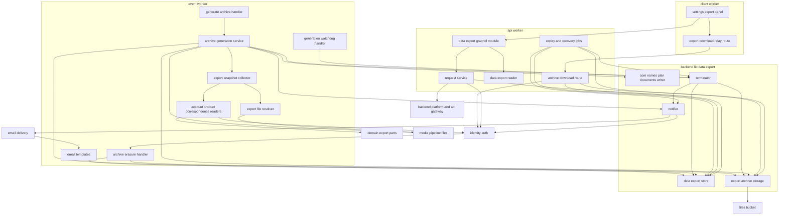
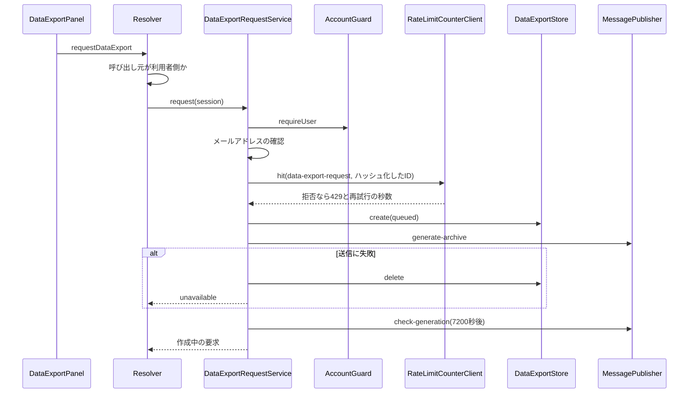
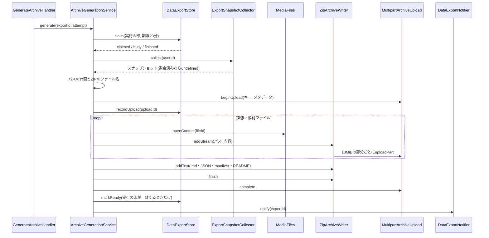
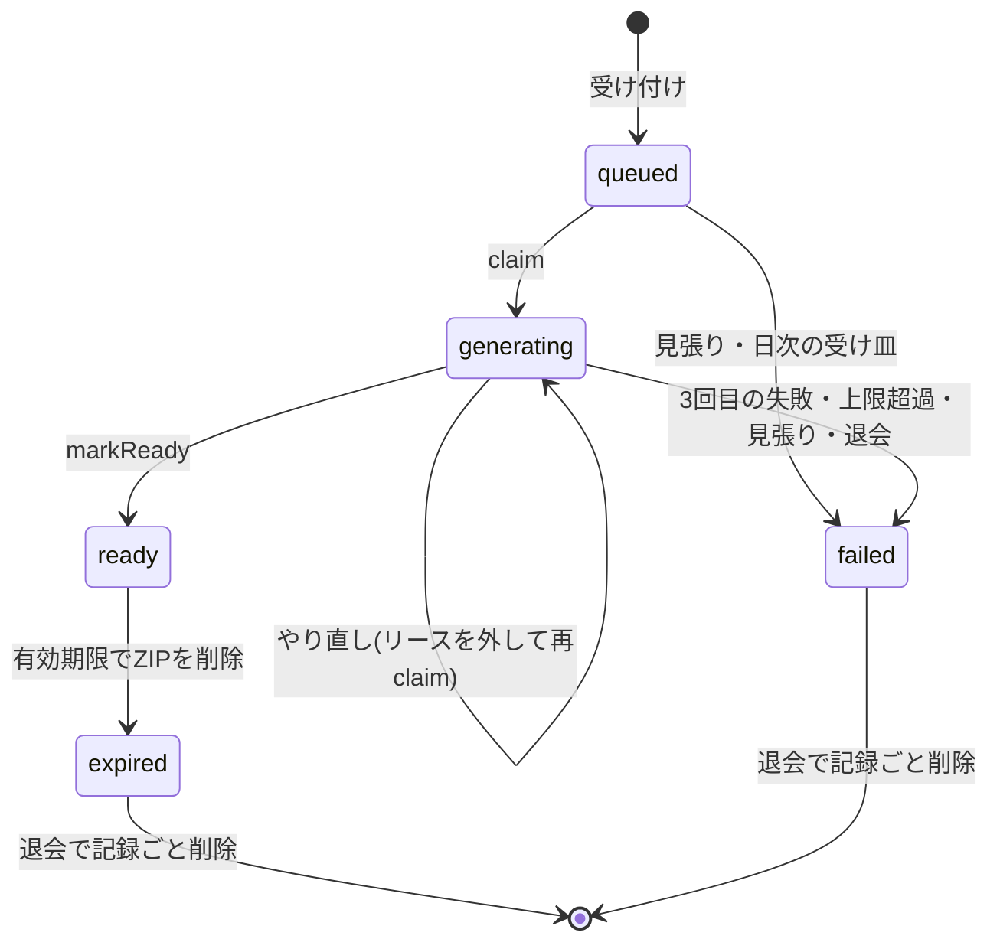
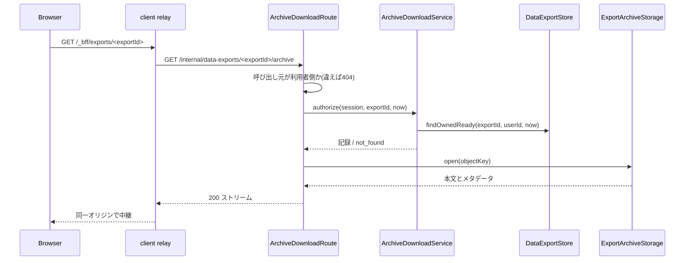

# Design Document

## Overview

**Purpose**: データエクスポートを、APIサーバー(`apps/api`)・イベントサーバー(`apps/event`)・利用者側フロントエンドサーバー(`apps/client`)にまたがって実装する。利用者は設定ページ`/settings/export`からエクスポートを要求し、APIサーバーが本人とメールアドレスの確認と利用者ごとの回数制限(24時間に3回)を確かめて要求を記録し、生成のメッセージを送って即時に応答する。イベントサーバーは13のドメインspecの出力用の部品からデータを集め、データエクスポートの文書の構造の画像・添付ファイル・マークダウン本文・JSONを、fflateの同期のストリーミングでZIPへ書き出し、10MiBの均一な部分に区切ってファイル用非公開バケットへマルチパートアップロードする。完了・失敗はメールで知らせ、ZIPは本人だけが利用者側のサイトの同一オリジンの中継でダウンロードでき、生成完了から7日で日次の定期実行が削除する。

**Users**: メールアドレスを確認済みの利用者(停止中を含む、仮1)が`/settings/export`で要求・確認・ダウンロードし、メールで完了と失敗を受け取る。運用者はログとエラートラッキングで生成の所要時間・大きさ・失敗を確かめる。

**Impact**: D1に1テーブル(`data_exports`)を足す。`apps/common-lib/data-export`・`apps/backend-lib/core/data-export`・`workers/data-export`(apiとeventの両方に束縛)を新設する。apiにスキーマモジュール`data-export`・内部RESTのダウンロードの経路・要求と照会のユースケース・ジョブ2つを、eventに生成と見張りのメッセージの処理・物理削除の処理1つ・メールのテンプレート2つを、clientに設定ページの区画・ナビゲーションの登録・中継の経路を足す。メッセージ種別2つ(`data-export.generate-archive`・`data-export.check-generation`)を加え、apiとeventに`fflate` 0.8.3を版固定で加える(tech-stack.mdに記載済み。`apps/backend-lib`の検査とテストはapiが行い(`config/workspace-layout.ts`の`checkedBy: 'api'`)、`workers/data-export`が`core/data-export`の書き込み先の型を読み込むため、apiでも解決できる必要がある)。評価の無効化の有無は、engagementがその仮5として`RatingExportRecord`に加える`invalidatedByAdmin`で受け取る(「上流への影響」、本specの仮2)。新しいシークレット・Cronの式・Durable Objectのクラス・R2のバケットは無い。

### Goals

- FR-UDATA-001〜009・FR-RLMIT-006・018・DR-005と、データエクスポートの文書の構造が、要件と仮1〜仮5の決定に一致する。
- ZIPの生成はメモリに全体を持たず、1つの要求につきZIPと通知が1つだけ確定し、consumerの異常終了でも2時間で失敗が確定して通知される。
- 本specは各ドメインの出力用の部品だけを読み、他のドメインのテーブルを直接読まない。
- 本specが追加・変更したコードの単体テスト・Workers統合テスト・ブラウザテストがカバレッジ80%を満たし、生成したZIPを展開した結果が文書の構造と一致することをテストで確かめる。

### Non-Goals

- 各ドメインの出力用の部品の実装(各spec。評価の`invalidatedByAdmin`はengagementが仮5として提供する)と、エクスポートに含めるデータの範囲の判断(文書を正とする)。
- 他のサービスへの直接の転送、管理者による代行・閲覧、回数の残りの表示。
- ZIP64・複数のZIPへの分割・生成の途中からの再開(仮5、research.mdの比較)。
- 要件定義書の改訂(roadmapのOut。必要な改訂は[research.md](research.md)の「要件定義書の改訂が必要な箇所」に記録した)。(2026-10-25に要件定義書へ適用済み)

## Boundary Commitments

### This Spec Owns

- 本specのデータ: `data_exports`(要求・状態・リース・アップロード中のID・ZIPのキーとファイル名と大きさ・完了と期限と失敗の日時・通知の状態)(`apps/db/schema/data-export/`)と、ファイル用非公開バケットの`data-exports/`で始まるキーのオブジェクト。
- 共有定義(`apps/common-lib/data-export/`): 状態と失敗の種類と表示名、回数の上限・期間・有効期限の日数、ダウンロードの経路の接頭辞とパスの組み立て。
- 純粋な規則(`apps/backend-lib/core/data-export/`): メッセージ種別2つと時間の定数、ZIPの上限と部分の大きさ、ZIP内のファイル名とZIPのファイル名の規則、スナップショットの型とZIP内のパスの計画、12のJSON・manifest・READMEの組み立て、部分の区切り、fflateを包む`ZipArchiveWriter`。メール種別`data-export.archive-ready`・`data-export.archive-failed`(`core/email/kinds/data-export.ts`)。
- 共有部品(`apps/backend-lib/workers/data-export/`): `DataExportStore`・`ExportArchiveStorage`(R2のマルチパートを含む)・`DataExportNotifier`・`DataExportTerminator`と`DATA_EXPORT_PLATFORM_MODULE`。
- apiのスキーマモジュール`data-export`(`myDataExports`・`requestDataExport`)、`DataExportRequestService`・`DataExportReader`・`ArchiveDownloadService`、内部REST`GET /internal/data-exports/:exportId/archive`、ジョブ`data-export.archive-expiry`(4:21、2100)・`data-export.generation-recovery`(4:21、2110)、回数制限の規則`data-export-request`。
- eventの`AccountSourceReader`・`ProductActivitySourceReader`・`CorrespondenceSourceReader`・`ExportFileResolver`・`ExportSnapshotCollector`・`ArchiveGenerationService`、メッセージの処理2つ、ユーザーの`withdrawn`・`purge_due`の処理`data-export.archive-erasure`(2100)、2つのメールのテンプレート。
- clientの`/settings/export`の区画、`SETTINGS_NAV_ITEMS`の`/settings/export`(100)、中継の経路`/_bff/exports/*`。
- 技術ドキュメント`backend/023-streaming-archive-exports.md`・`security/012-owner-scoped-generated-downloads.md`の新規作成と、サービス仕様(データエクスポートの文書・ページ配置・文言規則・準拠方針・日次タイムライン)の更新、オンボーディングの追記。

### Out of Boundary

- 各ドメインの出力用の部品とそのテーブル(identity-auth・user-profile-social・product-launch・match-engine・tournament-week・tournament-year・engagement・ultras-subscription・notifications・public-api・content-reporting・inquiry-chat・sponsorship・payments)。本specは部品を呼ぶだけで、上流のテーブルを読み書きしない。部品の不足は所有するspecへの追加として扱う(engagementの`invalidatedByAdmin`)。
- 画像・添付ファイルの記録と保存・隔離(media-pipeline)。本specは`MediaFiles.findMany`・`openContent`を呼ぶだけで、`media_files`を読まない。
- 退会とその他の機能のデータの削除、ユーザーライフサイクルの発火(identity-authと各機能)。本specは`withdrawn`・`purge_due`の処理を登録するだけである。
- 厳密カウンタのDurable Object・メッセージの配送と再試行・定期実行の仕組み(backend-platform)、GraphQLと内部RESTの基盤(api-gateway)、中継の共通処理(frontend-platform)、メールの送信の基盤(email-delivery)、設定ページのシェル(identity-auth)。
- eventの`limits.cpu_ms`と専用のQueue(必要になればbackend-platform・infra-deliveryの変更として開発者が判断する)。

### Allowed Dependencies

- backend-platform: `AppModule`・`PLATFORM_TYPES`(`Env`・`Database`・`Clock`・`IdGenerator`・`KeyedHasher`・`MessagePublisher`・`RateLimitCounterClient`)・`AppError`・`getAppLogger`・`captureMessage`の規約・`Database`・`PlatformEnv`の型・`ulidPrimaryKey`・`timestamps`・`BusinessTime`・`ScheduledJobDefinition`・`defineMessageContract`・`MessageContract`・`MESSAGE_CONTRACTS`・`MessageHandler`・`MessageHandlerRegistration`・`MessageMeta`・`hashRateLimitKey`・`CounterRule`。形を変えない。
- api-gateway: `defineSchemaModule`・`GraphQLContext`(`resolve`・`session`・`caller`)・`DateTime`・`withValidatedArgs`・`CURSOR_PAGE_ARGS`・`encodeCursor`・`decodeCursor`・`toConnection`・`PageInfo`・`createInternalRoutesModule`・`InternalRoutes`・`InternalHonoEnv`(`c.var.session`)・`SessionView`・`CallerKind`。
- identity-auth: `IDENTITY_TYPES.AccountGuard`(`requireUser`)・`IDENTITY_PLATFORM_TYPES.AccountExport`・`IDENTITY_PLATFORM_TYPES.UserContactDirectory`・`UserLifecycleAsyncHandler`・`UserLifecycleAsyncRegistration`・`USER_LIFECYCLE_ASYNC_HANDLERS`・`LifecycleHandlerOutcome`・`users`テーブル(外部キーだけ)、clientの`SETTINGS_NAV_ITEMS`・`SettingsNavItem`・`_authenticated`の`viewer`、E2Eの`e2e/support/mailpit.ts`。
- 出力用の部品(research.mdのResearch Logの表): `ULTRAS_TYPES.UltrasPlanExport`、`NOTIFICATIONS_PLATFORM_TYPES.NotificationSettingsExport`、`PUBLIC_API_PLATFORM_TYPES.ApiKeyExport`、`PROFILE_PLATFORM_TYPES.ProfileExport`・`FollowExport`、`PRODUCT_PLATFORM_TYPES.ProductExport`・`LaunchExport`・`ProductDirectory`(`findSummaries`)、`MATCH_PLATFORM_TYPES.MatchExport`・`UpvoteExport`、`WEEK_TOURNAMENT_TYPES.WeekAwardExport`、`YEAR_TOURNAMENT_TYPES.YearAwardExport`、`ENGAGEMENT_PLATFORM_TYPES.CommentExport`・`RatingExport`、`REPORTING_PLATFORM_TYPES.ReportExport`、`INQUIRY_EXPORT_TYPES.InquiryExport`、`SPONSORSHIP_PLATFORM_TYPES.SponsorshipExport`、`PAYMENTS_TYPES.PaymentHistoryExport`。いずれもeventのアプリケーション層の3つの読み取りの部品(とその単体テスト・`apps/event/test/data-export/`の契約と結合のテスト)だけが読み込む。
- media-pipeline: `MEDIA_TYPES.MediaFiles`(`findMany`・`openContent`)・`MediaFileView`・`attachmentDisposition`。
- email-delivery: `defineEmailKind`・`EMAIL_KINDS`・`EmailSender`・`EMAIL_TYPES`・`defineEmailTemplate`・`EMAIL_TEMPLATES`・`formatUtcDateTime`。
- frontend-platform: `RelayRoute`・`relay-routes.ts`・`executeGraphQL`・`graphqlQueryOptions`・`GraphQLClientError`・`notify`・`DateTime`・`EmptyState`・`PartialErrorState`・`LoadingSkeleton`・shadcn/uiの部品(ボタン・バッジ・カード)・`runAxe`。
- npmパッケージ: `zod`・`inversify`・`drizzle-orm`(上流で採用済み)と、`fflate` 0.8.3(apiとevent、tech-stack.mdに記載済み。ZIPを書くのはeventだけで、apiは`backend-lib`の型検査とテストのために依存する)。テストでは同パッケージの`unzipSync`を使う。

### Revalidation Triggers

- `data_exports`の列と状態・通知の状態の値、オブジェクトのキーの接頭辞`data-exports/`(media-pipelineのキーは32文字の16進で衝突しない)。
- メッセージ種別2つの名前と本文、ジョブ・処理の名前と`order`(4:21の2100・2110、`withdrawn`・`purge_due`の2100)。
- 中継の経路`/_bff/exports/*`と内部RESTのパス、GraphQLの`DataExport`の形。
- ZIPの構造・JSONの項目・ファイル名の規則・`schemaVersion`(データエクスポートの文書)。
- 上流の出力用の部品の形・並び・`undefined`と`null`の意味・束縛の範囲(各specのRevalidation Triggersの「エクスポートの部品の形」)、`MediaFiles.openContent`の対象、`AccountGuard.requireUser`の停止中の扱い、`UserContactDirectory`の停止中の扱い、`RateLimitCounterClient`・`MessagePublisher`の`delaySeconds`・`MessageMeta.attempts`の意味、`RelayRoute.timeoutMs`の効き方を変えたら、本specを確かめ直す。
- 仮1〜仮5は2026-10-24に開発者が確定した(仮4は推奨と異なる「要求の記録を退会まで残す」)。決定を改める場合は、該当する規則(停止中の扱い・評価の無効化・`null`の規則・記録の保持と一覧・上限)を確かめ直す。

### 上流への影響

| 上流spec          | 変更                                                                                                                                                                                                                                                                                      | 影響と再検証                                                                                                                                                                                                              |
| ----------------- | ----------------------------------------------------------------------------------------------------------------------------------------------------------------------------------------------------------------------------------------------------------------------------------------- | ------------------------------------------------------------------------------------------------------------------------------------------------------------------------------------------------------------------------- |
| engagement        | engagementの仮5(2026-10-24に開発者が確定)により提供される: `apps/backend-lib/workers/engagement/engagement-export.ts`の`RatingExportRecord`の`readonly invalidatedByAdmin: boolean;`と、評価の行の無効化の印から値を返す`RatingExport.listByUser`。本specは変更せず、提供された項目を使う | engagementの仮5として同specに取り込まれ、本specの仮2と対になる(どちらも2026-10-24に開発者が確定)。本specはタスク2で、イベントサーバーのコンテナから解決した`RatingExport`が無効化の有無を返すことを契約のテストで確かめる |
| identity-auth     | clientの`composition/settings-navigation.ts`に1件(100)、eventの`composition/user-lifecycle-async-handlers.ts`に`data-export.archive-erasure`(`withdrawn`・`purge_due`、2100)                                                                                                              | 契約どおり(設定ページの登録順、帯の値)                                                                                                                                                                                    |
| backend-platform  | `core/messaging/contracts/index.ts`に2種別、eventの`message-handlers.ts`に2つの処理、apiの`scheduled-jobs.ts`に2件(4:21の式は上流で追加済み)、api・eventの`modules.ts`に`DATA_EXPORT_PLATFORM_MODULE`、apiに`DATA_EXPORT_MODULE`、eventに`EVENT_DATA_EXPORT_MODULE`                       | 契約どおり                                                                                                                                                                                                                |
| api-gateway       | apiの`composition/graphql-modules.ts`に`dataExportSchemaModule`、`internal-routes.ts`に1経路、APIサーバーの許可リスト(`apps/api/src/presentation/graphql/generated/allowlist.json`)の`graphql:allowlist`による再生成とclientの型の生成                                                    | 契約どおり                                                                                                                                                                                                                |
| frontend-platform | clientの`composition/relay-routes.ts`に`DATA_EXPORT_DOWNLOAD_RELAY_ROUTE`                                                                                                                                                                                                                 | 契約どおり(2.14の追加の手順)                                                                                                                                                                                              |
| email-delivery    | `core/email/kinds/index.ts`に2種別、eventの`infrastructure/email/templates/index.ts`に2テンプレート                                                                                                                                                                                       | 契約どおり                                                                                                                                                                                                                |

- roadmapの帯の割り当ての表の本specの「使用中の値」は「4:21は2100・2110、波及処理は2100」になる。本specはroadmapを編集しないため、コントローラーへ報告する。

## Architecture

### Existing Architecture Analysis

- 上流の27specは設計・タスクとも承認済みで、本specのタスクはそれらの実装の完了を前提にする。実装済みはdev-toolingだけである。
- apiはクリーンアーキテクチャ(`domain`→`application`→`infrastructure`・`presentation`→`composition`)と処理単位のDIコンテナ、eventはQueueのconsumerが種別ごとの処理を呼び、`done`・`defer`・例外(再試行・DLQ)で結果を返す。
- 各ドメインの出力用の部品は`apps/backend-lib/workers/<ドメイン>`に置かれ、`*_PLATFORM_MODULE`でapiとeventの両方に束縛される(inquiry-chatの`InquiryExport`だけはeventの`inquiry-module.ts`)。ファイルの読み出しはmedia-pipelineの`MediaFiles`、宛先はidentity-authの`UserContactDirectory`で行う。
- ファイル用非公開バケット`FILES_BUCKET`はapi・eventの両方に束縛済みで、media-pipelineはエクスポートのZIPを扱わない(同specのOut of Boundary)。

### Architecture Pattern & Boundary Map



**Architecture Integration**:

- Selected pattern: クリーンアーキテクチャ。ZIPとJSONの規則は`core`の純粋な関数、要求の記録・ZIPの保存先・通知・失敗の確定は`workers/data-export`(apiとeventの両方に束縛)、要求と照会とダウンロードの認可はapiのアプリケーション層、データの収集とZIPの組み立てはeventのアプリケーション層、上流のデータは出力用の部品越しに読む。
- Domain/feature boundaries: 本specのテーブルは要求の記録だけで、エクスポートの中身はすべて上流の部品の値である。上流の部品の値は3つの読み取りの部品が本spec固有のスナップショットへ写し、それより内側は上流の型に依存しない。
- Existing patterns preserved: `backend-lib/workers/<ドメイン>`の共有の束縛、`<spec名>.<名詞句>`の名前、帯の`order`、登録箇所への追記、ハッシュ化したキーの`RateLimitCounterClient.hit`(inquiry-chat・content-reportingの規約)、依頼待ちの通知と日次の送り直し(content-reporting・ugc-moderation)、同一オリジンの中継(media-pipelineの`FILE_DOWNLOAD_RELAY_ROUTE`と同じ形)、`attachmentDisposition`。
- New components rationale: `ExportSnapshotCollector`と3つの読み取りの部品は19の部品(`AccountExport`とAllowed Dependenciesの出力用の部品の18)の注入を責務ごとに分け、上流の形の違いを写しに閉じ込めるため。`ZipArchiveWriter`と`PartChunker`はfflateとR2の制約(同期の出力・均一な部分)をメモリの上限の中で結ぶため。`DataExportTerminator`は生成の3回目の失敗・見張り・日次の受け皿の3経路が同じ失敗の確定と通知を行うため。
- Steering compliance: `@inject`の明示、D1の制約(`db.batch()`・バインド変数100個以内・`transaction()`を使わない)、800行以内のファイル、1ファイル1コンポーネント、日時の`<time datetime>`、ログに個人情報を含めない、環境の値は`env`バインディングから読む。

**Dependency direction**: `apps/common-lib/data-export` → `backend-lib/core/data-export` → `backend-lib/workers/data-export` → 各アプリの`src`(`application` → `infrastructure`・`presentation` → `composition`)。`apps/db/schema/data-export`は`drizzle-orm`・backend-platformの共通カラム・identity-authの`users`(外部キー)だけを読み込み、`common-lib`を読み込まない(状態などの値はCHECKに直接書き、`common-lib/data-export`の定数との一致は`workers/data-export`のテストで確かめる)。`common-lib/data-export`は他のどの層も読み込まない。`core/data-export`は`common-lib/data-export`・`BusinessTime`・backend-platformの`defineMessageContract`・`MessageContract`・`zod`(メッセージの本文の検証)・email-deliveryの`defineEmailKind`(`core/email/kinds/data-export.ts`)・`fflate`だけを読み込み、`cloudflare:*`・`apps/db`・`workers`を読み込まない。`workers/data-export`は本specのテーブル・`common-lib/data-export`・`core/data-export`(`core/email/kinds/data-export.ts`を含む)・`inversify`(`injectable`・`inject`・`ContainerModule`)・`drizzle-orm`・backend-platformの`PLATFORM_TYPES`と各識別子の型(`Database`・`PlatformEnv`など)・`AppModule`・`getAppLogger`・`captureMessage`・identity-authの`IDENTITY_PLATFORM_TYPES`と`UserContactDirectory`・email-deliveryの`EMAIL_TYPES`と`EmailSender`・media-pipelineの`attachmentDisposition`だけを読み込む。`DataExportNotifier`は`PLATFORM_TYPES.Env`を本ファイルの中の型`PlatformEnv & { readonly CLIENT_SITE_ORIGIN: string }`として受け取る(`CLIENT_SITE_ORIGIN`はapiはidentity-auth、eventはpaymentsが変数として持つ)。上流の出力用の部品の型を読み込むのは、eventの`application/data-export/sources/`と、その隣の単体テストと、契約と結合のテスト(`apps/event/test/data-export/`)だけである。clientは`common-lib/data-export`とGraphQLの操作と上流の部品だけを読み込む。テストは、これらに加えてテストの実行環境(`cloudflare:test`・Vitest・Bunのテスト)と、データの用意のためのidentity-authの`users`テーブル・上流のテストの補助を読み込める。違反はレビューで誤りとして扱う。

### Technology Stack

| Layer     | Choice / Version                                      | Role in Feature                                                                  | Notes                                                         |
| --------- | ----------------------------------------------------- | -------------------------------------------------------------------------------- | ------------------------------------------------------------- |
| Frontend  | TanStack Start・Router・Query・shadcn/ui(上流)        | 設定ページの区画、一覧の自動の取得し直し                                         | 既存。新しいパッケージなし                                    |
| Backend   | Hono・Inversify・GraphQL Yoga(上流)、fflate 0.8.3     | スキーマモジュール・内部REST・ジョブ、eventのZIPの書き出し                       | fflateは同期の`Zip`・`ZipPassThrough`・`ZipDeflate`だけを使う |
| Data      | Cloudflare D1(Drizzle)、R2(`FILES_BUCKET`)            | 要求の記録、ZIPのマルチパートアップロード                                        | 新規のマイグレーション1つ。キーの接頭辞`data-exports/`        |
| Messaging | Queues・Cron Triggers(上流)                           | 生成・見張りのメッセージ、4:21のジョブ、ライフサイクルの`withdrawn`・`purge_due` | メッセージ種別2つを追加。Cronの式は追加しない                 |
| Runtime   | Durable Objects(backend-platformの`RateLimitCounter`) | 利用者ごとの24時間3回の回数制限                                                  | 既存のクラスと束縛を使う                                      |

## File Structure Plan

### Directory Structure

```
apps/
├── common-lib/data-export/
│   └── data-export-rules.ts                                 # 状態・失敗の種類・表示名・上限・期間・ダウンロードのパス(*.unit.test.ts)
├── db/schema/data-export/                                   # テーブル定義(同名の*.unit.test.ts)
│   ├── data-exports.ts
│   └── index.ts
├── backend-lib/
│   ├── core/data-export/                                    # 純粋な規則(各ファイルに同名の*.unit.test.ts)
│   │   ├── data-export-messages.ts                          # 2つのメッセージ契約と時間の定数
│   │   ├── archive-limits.ts                                # 上限・部分の大きさ・ArchiveTooLargeError
│   │   ├── archive-names.ts                                 # ZIP内のファイル名の変換と衝突の連番・ZIPのファイル名・README
│   │   ├── export-snapshot.ts                               # ExportSnapshot・ExportFileView(型だけ、テストなし)
│   │   ├── export-plan.ts                                   # ZIP内のパスの計画(画像・添付・.md・プロダクトのディレクトリ)
│   │   ├── documents/
│   │   │   ├── export-formats.ts                            # 日時(ミリ秒付きのUTC)と基準時刻の日付の書式
│   │   │   ├── account-documents.ts                         # account.json・profile.json
│   │   │   ├── product-documents.ts                         # products.json・launches.json
│   │   │   ├── activity-documents.ts                        # comments・upvotes・ratings・follows・reports
│   │   │   ├── exchange-documents.ts                        # inquiries・sponsorships・payments
│   │   │   └── build-export-documents.ts                    # 12のJSON・manifest・.mdの組み立てと直列化
│   │   ├── part-chunker.ts                                  # 均一な大きさの部分への区切り
│   │   └── zip-archive-writer.ts                            # fflateの同期のZipを包む書き出し
│   ├── core/email/kinds/data-export.ts                      # 2つのメール種別(入力のzodスキーマ)
│   └── workers/data-export/                                 # api・event共通(Workers統合テスト)
│       ├── data-export-platform-types.ts                    # DATA_EXPORT_PLATFORM_TYPES(テストなし)
│       ├── data-export-store.ts                             # DataExportStore(型とD1の実装)
│       ├── export-archive-storage.ts                        # ExportArchiveStorage(型とR2の実装、マルチパートの書き込み先)
│       ├── data-export-notifier.ts                          # 完了・失敗のメールの依頼と通知の状態
│       ├── data-export-terminator.ts                        # 失敗の確定・アップロードの破棄・通知
│       └── data-export-platform-module.ts                   # DATA_EXPORT_PLATFORM_MODULE
├── api/src/
│   ├── application/data-export/                             # Bunの単体テスト
│   │   ├── data-export-types.ts                             # DATA_EXPORT_TYPES(テストなし)
│   │   ├── data-export-request-service.ts                   # 本人・確認・回数制限・記録・メッセージ
│   │   ├── data-export-reader.ts                            # 一覧とダウンロードのパス
│   │   ├── archive-download-service.ts                      # ダウンロードの認可
│   │   └── jobs/
│   │       ├── archive-expiry-job.ts                        # 4:21(order 2100)
│   │       └── generation-recovery-job.ts                   # 4:21(order 2110)
│   ├── presentation/graphql/modules/data-export/            # Workers統合テスト
│   │   ├── type-defs.ts
│   │   ├── resolvers.ts                                     # myDataExports・requestDataExport
│   │   └── index.ts                                         # dataExportSchemaModule
│   ├── presentation/internal/data-export/archive-download-route.ts  # GET /internal/data-exports/:exportId/archive
│   └── composition/data-export-module.ts                    # DATA_EXPORT_MODULE(apiの束縛・ジョブ)
├── event/src/
│   ├── application/data-export/                             # Bunの単体テスト(偽の部品で)
│   │   ├── event-data-export-types.ts                       # EVENT_DATA_EXPORT_TYPES(テストなし)
│   │   ├── sources/
│   │   │   ├── account-source-reader.ts                     # identity・ultras・notifications・public-api・profile・follows
│   │   │   ├── product-activity-source-reader.ts            # product・match・week・year・engagement・ProductDirectory
│   │   │   └── correspondence-source-reader.ts              # reports・inquiries・sponsorship・payments
│   │   ├── export-file-resolver.ts                          # MediaFiles.findManyのまとめ引き
│   │   ├── export-snapshot-collector.ts                     # 3つの読み取りとファイルの照会からスナップショット
│   │   ├── archive-generation-service.ts                    # リース・収集・書き出し・完了・やり直し
│   │   ├── generate-archive-handler.ts                      # data-export.generate-archive
│   │   ├── generation-watchdog-handler.ts                   # data-export.check-generation
│   │   └── archive-erasure-handler.ts                       # ユーザーのwithdrawn・purge_due 2100
│   ├── infrastructure/email/templates/data-export/          # 本文の*-body.tsxと定義の*-template.ts(2種)
│   └── composition/data-export-module.ts                    # EVENT_DATA_EXPORT_MODULE
└── client/src/
    ├── routes/_authenticated/settings/export.tsx
    ├── components/data-export/                              # 1ファイル1コンポーネント(browser testを併置)
    │   ├── data-export-errors.ts                            # エラーの文言の対応付け(*.unit.test.ts)
    │   ├── use-request-data-export.ts                       # 要求・結果の通知・一覧の無効化
    │   ├── data-export-panel.tsx                            # 説明・要求の操作・一覧の枠
    │   ├── data-export-request-button.tsx
    │   ├── data-export-list.tsx                             # 一覧と自動の取得し直し
    │   ├── data-export-item.tsx                             # 状態・日時・ダウンロード・失敗の案内
    │   └── data-export-status-badge.tsx
    ├── composition/data-export-relay-route.ts               # DATA_EXPORT_DOWNLOAD_RELAY_ROUTE(*.unit.test.ts)
    └── graphql/operations/data-export/data-export.ts        # myDataExports・requestDataExport
e2e/
└── client/data-export.e2e.test.ts
docs/
├── GUIDES/tech/backend/023-streaming-archive-exports.md
└── GUIDES/tech/security/012-owner-scoped-generated-downloads.md
```

テストは各ファイルの隣に置く(`*.unit.test.ts`・`*.worker.test.ts`・`*.browser.test.tsx`)。技術ドキュメントの番号は、全ての完了済みspecのdesign.mdが使う番号(`backend`001〜022・`security`001〜011など)の後の最小の空き番号`backend/023`・`security/012`に固定する。サービス仕様の`features`は既存の`001-user-data-export.md`を更新し、新しい番号を取らない。

### Modified Files

- `apps/db/schema/index.ts`・`apps/db/migrations/<日時>_data_export/migration.sql` — 1テーブルの再エクスポートと生成したマイグレーション(CHECK・索引)。mainの最新を取り込んでから生成する。
- `apps/backend-lib/core/messaging/contracts/index.ts` — 2種別。
- `apps/backend-lib/core/email/kinds/index.ts`・`apps/event/src/infrastructure/email/templates/index.ts` — 2種別と2テンプレート。
- `apps/event/test/data-export/upstream-export-bindings.worker.test.ts`(新規) — 上流の19の部品(`AccountExport`と出力用の部品の18)とファイルの照会(`MediaFiles`)がイベントサーバーのコンテナから解決でき、`RatingExport`がengagementの仮5の`invalidatedByAdmin`を返すことの契約のテスト。engagementのファイルは変更しない。
- `apps/api/src/composition/modules.ts`・`graphql-modules.ts`・`internal-routes.ts`・`scheduled-jobs.ts` — モジュール・スキーマモジュール・内部REST・2つのジョブ。
- `apps/event/src/composition/modules.ts`・`message-handlers.ts`・`user-lifecycle-async-handlers.ts` — モジュール・2つの処理と再試行の方針・物理削除の処理。
- `apps/api/package.json`・`apps/event/package.json`・各`bun.lock` — `fflate` 0.8.3を版固定で加える(apiは`backend-lib`の検査とテストのため)。
- `apps/client/src/composition/settings-navigation.ts`・`relay-routes.ts` — ナビゲーションの1件と中継の経路。
- APIサーバーの許可リスト(`apps/api/src/presentation/graphql/generated/allowlist.json`、`graphql:allowlist`で再生成)と、APIサーバーのスキーマのファイル・clientの生成した型。
- `docs/GUIDES/tech/backend/README.md`・`security/README.md` — 文書一覧の行。
- `docs/onboardings/project-values.md` — メッセージ種別・ジョブ・処理の名前と`order`、回数制限の規則の名前と値、メール種別、オブジェクトのキーの接頭辞、部分の大きさ・リース・見張りの遅延・再試行の回数、中継の経路と`timeoutMs`。
- `docs/onboardings/tech-stack.md` — 「アーカイブ生成」のfflateに、同期のストリーミングのAPIだけを使う旨を追記する。
- `docs/GUIDES/service/features/001-user-data-export.md` — `null`の規則(仮3)、`ratings.json`の`invalidatedByAdmin`を保つ旨(仮2)、プロダクトのディレクトリ名の衝突の連番、ZIPの上限(仮5)、項目の順(画像・添付が先)、生成と提供の流れ(見張り・停止中の利用者・要求の記録の保持)。
- `docs/GUIDES/service/design/002-page-layouts.md` — `/settings/export`の構成と状態の表現。
- `docs/GUIDES/service/design/003-text-and-copy-rules.md` — 設定ページの文言と2つのメールの本文の要点。
- `docs/GUIDES/service/legal/001-compliance-policy.md` — データ保持期間の一覧に要求の記録の行(退会まで保持し、退会の時点で物理削除する。ZIPは生成完了から7日のまま、仮4)、利用者の権利の表に停止中も行使できる旨(仮1)。
- `docs/GUIDES/service/overview/007-daily-timeline.md` — 4:21の表に`data-export.archive-expiry`(2100)・`data-export.generation-recovery`(2110)。
- `CLAUDE.md` — 「技術規則の参照先」に「利用者のデータのアーカイブを生成・配信する前に: `backend/023`」。

## System Flows

### 要求の受け付け



- 確認の失敗は`email_not_verified`(403)、未ログインは`unauthenticated`で、どちらも`hit`の前に返すため数えない(要件2.6)。`hit`の後の失敗は回数を戻さない(要件2.5)。見張りのメッセージの送信の失敗は`warning`のログに留める。

### ZIPの生成



- `claim`が`busy`(他の実行のリースが有効)なら処理は`defer`(1200秒)を返し、`finished`(完了・期限切れ・失敗)なら`done`を返す。
- `claim`で得た記録に前の実行の`upload_id`が残っていれば(前の実行が異常終了した)、先に`abortUpload`する。`recordUpload`の前に異常終了したアップロードはR2が7日後に破棄する。
- 収集の結果が`undefined`(退会済み・物理削除済み)なら、`DataExportTerminator.fail`を通知なしで呼ぶ(要件3.7)。アップロードの`complete`の後、`markReady`の前にも`AccountSourceReader.exists`で確かめ、退会済みならZIPを削除して通知なしで失敗にする。
- `ArchiveTooLargeError`ならアップロードを破棄し、`fail(too_large)`で通知して`done`(やり直さない、要件7.4)。それ以外の例外はアップロードを破棄してリースを外し、試行が3回未満なら投げ直し(backend-platformの再試行)、3回目なら`fail(error)`で通知して`done`にする。
- `markReady`が実行の印の不一致(見張りが先に失敗を確定した、または退会の削除の処理が記録を消した)で更新されなければ、作ったZIPを削除して`done`を返す。`recordUpload`が同じ理由で更新されなければ、始めたアップロードを破棄して`superseded`を返す。

### 要求の状態



- 完了から期限切れへの変更だけが完了の後の遷移で、期限切れと失敗は最終の状態である。どの遷移も条件付きの更新で1回だけ起きる(要件3.8)。記録は退会まで残る(仮4)。通知の状態は完了・失敗の確定と同じ更新で`pending`(退会済みの中止は`skipped`)になる。

### ダウンロード



- 未ログインは401、本人以外・存在しない・作成中・失敗・期限切れ・オブジェクトが無いは404(要件9.3〜9.5)。

### 削除と受け皿

- `data-export.archive-expiry`(4:21・2100): ZIPだけを削除し、記録は削除しない(仮4)。`listExpired({ now, limit: 100 })`で期限を過ぎた完了を読み、オブジェクトを削除して(無くても成功)`markExpired`で期限切れにする。続けて`listFailedWithUpload({ limit: 100 })`で途中のアップロードが残る失敗を読み、アップロードを破棄して`clearUpload`する。それぞれ100件ずつ最大10回繰り返す(要件10.1・10.2・10.4・10.5)。
- `data-export.generation-recovery`(4:21・2110): 要求から3時間を過ぎた作成中の要求に`DataExportTerminator.fail(error)`を、30分を過ぎた依頼待ちの通知に`DataExportNotifier.notify`を、それぞれ100件ずつ最大10回行う(要件3.6・8.6)。
- `data-export.archive-erasure`(ユーザーの`withdrawn`と`purge_due`・2100): その利用者の記録を100件読み、アップロードの破棄・オブジェクトの削除・記録の削除を行い、100件あれば`continue`を返す。退会の時点で記録を消し(仮4)、物理削除の時期の実行はその後に作られた記録や消し残しの受け皿である(要件10.3)。

## Requirements Traceability

| Requirement            | Summary                  | Components                                                                                      | Interfaces                                                          | Flows          |
| ---------------------- | ------------------------ | ----------------------------------------------------------------------------------------------- | ------------------------------------------------------------------- | -------------- |
| 1.1                    | 設定ページと登録         | DataExportPage、DataExportPanel、SETTINGS_NAV_ITEMS                                             | `/settings/export`                                                  | —              |
| 1.2, 1.6               | 即時の受け付けと並行     | DataExportRequestService、DataExportSchemaModule、DataExportStore                               | `requestDataExport`                                                 | 要求の受け付け |
| 1.3, 1.4               | 未確認・未ログインの拒否 | DataExportRequestService、DataExportPanel                                                       | `email_not_verified`・`unauthenticated`                             | 要求の受け付け |
| 1.5                    | 停止中の利用者(仮1)      | DataExportRequestService、ArchiveDownloadService、DataExportReader                              | `AccountGuard.requireUser`                                          | —              |
| 1.7, 1.8               | 本人と利用者側だけ       | DataExportSchemaModule、DataExportReader                                                        | 引数なしの操作、`caller`                                            | —              |
| 2.1, 2.2, 2.4, 2.7     | 24時間3回と429           | DataExportRequestService、DataExportRules                                                       | `DATA_EXPORT_REQUEST_RULE`・`hashRateLimitKey`・`assertWithinLimit` | 要求の受け付け |
| 2.3                    | 上限の表示               | DataExportErrors、DataExportPanel                                                               | `retryAfterSeconds`                                                 | —              |
| 2.5, 2.6               | 数える範囲               | DataExportRequestService                                                                        | 処理の順序                                                          | 要求の受け付け |
| 3.1                    | 非同期の依頼             | DataExportRequestService、DataExportMessages                                                    | `data-export.generate-archive`                                      | 要求の受け付け |
| 3.2, 3.3               | ストリーミングとメモリ   | ZipArchiveWriter、PartChunker、ExportArchiveStorage、ArchiveGenerationService                   | `ArchiveByteSink`・`MultipartArchiveUpload`                         | ZIPの生成      |
| 3.4                    | やり直し                 | GenerateArchiveHandler、ArchiveGenerationService、DataExportTerminator                          | `retry`・`MessageMeta.attempts`                                     | ZIPの生成      |
| 3.5                    | 重複の生成               | DataExportStore、ArchiveGenerationService                                                       | `claim`・`markReady`                                                | 要求の状態     |
| 3.6                    | 2時間の見張り            | GenerationWatchdogHandler、GenerationRecoveryJob、DataExportTerminator                          | `data-export.check-generation`                                      | 削除と受け皿   |
| 3.7                    | 退会による中止           | ArchiveGenerationService、AccountSourceReader、ArchiveErasureHandler                            | `AccountExport.find`                                                | ZIPの生成      |
| 3.8                    | 状態                     | DataExportStore、DataExportRules                                                                | 条件付きの更新                                                      | 要求の状態     |
| 4.1, 4.3, 4.11         | 構造・空配列・項目名     | ExportPlan、BuildExportDocuments                                                                | `planArchive`・`buildExportDocuments`                               | —              |
| 4.2                    | UTF-8・LF・日時          | BuildExportDocuments、ExportFormats                                                             | `serializeJson`・`toIsoUtc`・`toBusinessDate`                       | —              |
| 4.4, 4.5               | 圧縮とUTF-8の印          | ZipArchiveWriter                                                                                | `addText`・`addStream`                                              | —              |
| 4.6, 4.7               | ZIP内のファイル名        | ArchiveNames、ExportPlan                                                                        | `toPortableFileName`・`createEntryNameAllocator`                    | —              |
| 4.8                    | ZIPのファイル名          | ArchiveNames                                                                                    | `archiveFileName`                                                   | —              |
| 4.9, 4.10              | manifest・README         | BuildExportDocuments、ArchiveNames                                                              | `EXPORT_SCHEMA_VERSION`・`README_TEXT`                              | —              |
| 5.1                    | account.json             | AccountSourceReader、AccountDocuments                                                           | `buildAccountDocument`                                              | —              |
| 5.2                    | profile.json             | AccountSourceReader、AccountDocuments、ExportPlan                                               | `buildProfileDocument`                                              | —              |
| 5.3, 5.4               | products・launches       | ProductActivitySourceReader、ProductDocuments、ExportPlan                                       | `buildProductsDocument`・`buildLaunchesDocument`                    | —              |
| 5.5, 5.6, 5.7          | 活動のJSON               | ProductActivitySourceReader、AccountSourceReader、CorrespondenceSourceReader、ActivityDocuments | `buildCommentsDocument`ほか                                         | —              |
| 5.8, 5.9               | 問い合わせと取引         | CorrespondenceSourceReader、ExchangeDocuments、ExportPlan                                       | `buildInquiriesDocument`ほか                                        | —              |
| 5.10, 5.11, 5.12       | 削除・非公開・隔離・null | 各Documents、ExportPlan、ExportFileResolver                                                     | `ExportFileView.quarantined`                                        | ZIPの生成      |
| 5.13, 5.14             | 含めないデータ           | ExportSnapshot、各Documents                                                                     | スナップショットの型                                                | —              |
| 6.1                    | 部品だけを読む           | AccountSourceReader、ProductActivitySourceReader、CorrespondenceSourceReader                    | 出力用の部品の識別子                                                | —              |
| 6.2                    | ファイルの照会           | ExportFileResolver、ArchiveGenerationService                                                    | `MediaFiles.findMany`・`openContent`                                | ZIPの生成      |
| 6.3                    | 仮名化ID                 | AccountSourceReader、CorrespondenceSourceReader                                                 | `PaymentHistoryExport.listAll`                                      | —              |
| 6.4                    | ページの取得             | CorrespondenceSourceReader                                                                      | `ReportExport.listPage`・`InquiryExport.listPage`                   | —              |
| 6.5                    | 取得の失敗               | GenerateArchiveHandler                                                                          | 例外の再試行                                                        | ZIPの生成      |
| 6.6                    | 文書に無いデータ         | ExportSnapshot                                                                                  | スナップショットの型                                                | —              |
| 7.1, 7.2, 7.3          | 保存とメタデータと破棄   | ExportArchiveStorage、ArchiveGenerationService                                                  | `beginUpload`・`abortUpload`                                        | ZIPの生成      |
| 7.4                    | 上限(仮5)                | ArchiveLimits、ZipArchiveWriter、ArchiveGenerationService                                       | `ArchiveTooLargeError`                                              | ZIPの生成      |
| 7.5                    | 完了の記録               | DataExportStore                                                                                 | `markReady`                                                         | ZIPの生成      |
| 8.1, 8.2, 8.7, 8.8     | 2つのメール              | DataExportEmailKinds、DataExportEmailTemplates、DataExportNotifier                              | `data-export.archive-ready`・`archive-failed`                       | —              |
| 8.3, 8.6               | 1通と送り直し            | DataExportNotifier、DataExportStore、GenerationRecoveryJob                                      | `notice_status`                                                     | 削除と受け皿   |
| 8.4, 8.5               | 宛先                     | DataExportNotifier                                                                              | `UserContactDirectory.findContact`                                  | —              |
| 9.1                    | 一覧の項目               | DataExportItem、DataExportReader                                                                | `DataExport.downloadPath`                                           | —              |
| 9.2, 9.6               | 同一オリジンの配信       | ArchiveDownloadRoute、DataExportRelayRoute、ExportArchiveStorage                                | `GET /internal/data-exports/:exportId/archive`・`/_bff/exports/*`   | ダウンロード   |
| 9.3, 9.4, 9.5          | 401・404                 | ArchiveDownloadRoute、ArchiveDownloadService                                                    | `findOwnedReady`                                                    | ダウンロード   |
| 10.1, 10.2, 10.4, 10.5 | ZIPの削除と期限切れ(仮4) | ArchiveExpiryJob、DataExportStore、ExportArchiveStorage                                         | `listExpired`・`markExpired`・`listFailedWithUpload`・`delete`      | 削除と受け皿   |
| 10.3                   | 退会と物理削除の削除     | ArchiveErasureHandler                                                                           | `USER_LIFECYCLE_ASYNC_HANDLERS`(`withdrawn`・`purge_due`)           | 削除と受け皿   |
| 11.1, 11.2, 11.7, 11.9 | 一覧と説明               | DataExportPanel、DataExportList、DataExportItem、DataExportStatusBadge                          | `myDataExports`                                                     | —              |
| 11.3                   | 自動の取得し直し         | DataExportList                                                                                  | `refetchInterval`                                                   | —              |
| 11.4, 11.5             | 二重の要求と誤り         | DataExportRequestButton、useRequestDataExport、DataExportErrors                                 | `requestDataExport`                                                 | —              |
| 11.6                   | 取得の誤り               | DataExportList                                                                                  | `PartialErrorState`                                                 | —              |
| 11.8                   | 失敗の案内               | DataExportItem                                                                                  | `failureKind`                                                       | —              |
| 12.1, 12.2, 12.3       | ログと検知               | 全コンポーネント(ログの規約)、ArchiveGenerationService                                          | `getAppLogger`                                                      | —              |
| 12.4, 12.5             | 帯と登録                 | ArchiveExpiryJob、GenerationRecoveryJob、ArchiveErasureHandler、EventDataExportModule           | `order` 2100・2110、`MessageHandlerRegistration.retry`              | —              |
| 13.1, 13.2, 13.3, 13.4 | テスト                   | Testing Strategy                                                                                | —                                                                   | —              |
| 13.5, 13.6             | 文書                     | DataExportTechDocs、DataExportServiceSpecs                                                      | —                                                                   | —              |

## Components and Interfaces

| Component                                                                                                                               | Domain/Layer         | Intent                          | Req Coverage                           | Key Dependencies                               | Contracts      |
| --------------------------------------------------------------------------------------------------------------------------------------- | -------------------- | ------------------------------- | -------------------------------------- | ---------------------------------------------- | -------------- |
| DataExportRules                                                                                                                         | common-lib           | 状態・上限・パス                | 2.1, 3.8, 9.1, 11.1                    | なし                                           | State          |
| DataExportSchema                                                                                                                        | db                   | `data_exports`                  | 3.5, 3.8, 7.5, 8.3                     | identity-authの`users`(外部キー)               | State          |
| DataExportMessages・ArchiveLimits・ArchiveNames                                                                                         | backend-lib/core     | メッセージ・上限・ファイル名    | 3.1, 3.6, 4.6〜4.10, 7.4               | backend-platform (P0)                          | Event, Service |
| ExportSnapshot・ExportPlan・ExportDocuments                                                                                             | backend-lib/core     | スナップショット・パス・JSON    | 4.1〜4.3, 4.7, 4.9, 4.11, 5.\*, 6.6    | ArchiveNames (P0)                              | Service        |
| PartChunker・ZipArchiveWriter                                                                                                           | backend-lib/core     | 均一な部分とストリーミングのZIP | 3.2, 3.3, 4.4, 4.5, 7.4                | fflate (P0)                                    | Service        |
| DataExportEmailKinds                                                                                                                    | backend-lib/core     | 2つのメール種別                 | 8.1, 8.2, 8.8                          | email-delivery (P0)                            | Event          |
| DataExportStore                                                                                                                         | backend-lib/workers  | 要求の記録                      | 1.2, 3.5, 3.8, 7.5, 8.3, 10.\*         | D1 (P0)                                        | State          |
| ExportArchiveStorage                                                                                                                    | backend-lib/workers  | ZIPの保存・読み出し・削除       | 3.2, 3.3, 7.1〜7.3, 9.2, 10.5          | R2 (P0)、PartChunker (P0)                      | Service        |
| DataExportNotifier・DataExportTerminator                                                                                                | backend-lib/workers  | 通知と失敗の確定                | 3.4, 3.6, 8.\*                         | UserContactDirectory (P0)、EmailSender (P0)    | Service        |
| DataExportRequestService・DataExportReader・ArchiveDownloadService                                                                      | api/application      | 要求・一覧・認可                | 1.\*, 2.\*, 3.1, 9.3〜9.5              | AccountGuard (P0)、RateLimitCounterClient (P0) | Service        |
| ArchiveExpiryJob・GenerationRecoveryJob                                                                                                 | api/application/jobs | 期限の削除と受け皿              | 3.6, 8.6, 10.1, 10.2, 10.4, 10.5, 12.4 | DataExportStore (P0)                           | Batch          |
| DataExportSchemaModule・ArchiveDownloadRoute                                                                                            | api/presentation     | GraphQLと内部REST               | 1.2, 1.7, 1.8, 9.2〜9.6                | api-gateway (P0)                               | API            |
| AccountSourceReader・ProductActivitySourceReader・CorrespondenceSourceReader                                                            | event/application    | 部品の値の写し                  | 3.7, 5.\*, 6.1, 6.3, 6.4               | 上流の出力用の部品 (P0)                        | Service        |
| ExportFileResolver・ExportSnapshotCollector                                                                                             | event/application    | ファイルの照会と収集            | 5.11, 5.12, 6.2                        | MediaFiles (P0)                                | Service        |
| ArchiveGenerationService・GenerateArchiveHandler・GenerationWatchdogHandler                                                             | event/application    | 生成・再試行・見張り            | 3.\*, 6.5, 7.\*, 12.2                  | 上記 (P0)                                      | Event          |
| ArchiveErasureHandler                                                                                                                   | event/application    | 退会と物理削除の時期の削除      | 10.3, 10.4                             | identity-auth (P0)                             | Event          |
| DataExportEmailTemplates                                                                                                                | event/infrastructure | 2つのメールの本文               | 8.1, 8.2, 8.7, 8.8                     | email-delivery (P0)                            | —              |
| DataExportPanel・DataExportRequestButton・DataExportList・DataExportItem・DataExportStatusBadge・useRequestDataExport・DataExportErrors | client               | 設定ページの区画                | 1.1, 1.3, 2.3, 9.1, 11.\*              | frontend-platform (P0)                         | State          |
| DataExportRelayRoute                                                                                                                    | client/composition   | 中継の経路                      | 9.2                                    | frontend-platform (P0)                         | API            |

### common-lib・db

#### DataExportRules

```typescript
// apps/common-lib/data-export/data-export-rules.ts
export declare const DATA_EXPORT_STATUSES: readonly [
  'queued',
  'generating',
  'ready',
  'expired',
  'failed',
];
export type DataExportStatus = (typeof DATA_EXPORT_STATUSES)[number];
export declare const DATA_EXPORT_FAILURE_KINDS: readonly ['error', 'too_large'];
export type DataExportFailureKind = (typeof DATA_EXPORT_FAILURE_KINDS)[number];
export type DataExportDisplayStatus =
  'pending' | 'ready' | 'expired' | 'failed'; // queued・generatingはpending(作成中)
export declare function toDisplayStatus(
  status: DataExportStatus,
): DataExportDisplayStatus;
export declare const DATA_EXPORT_DISPLAY_STATUS_LABELS: Readonly<
  Record<DataExportDisplayStatus, string>
>; // 作成中・完了・期限切れ・失敗
export declare const DATA_EXPORT_REQUEST_LIMIT: 3;
export declare const DATA_EXPORT_REQUEST_WINDOW_SECONDS: 86400;
export declare const DATA_EXPORT_RETENTION_DAYS: 7;
export declare const DATA_EXPORT_LIST_PAGE_SIZE: 20;
export declare const DATA_EXPORT_DOWNLOAD_PREFIX: '/_bff/exports/';
export declare function dataExportDownloadPathOf(exportId: string): string; // /_bff/exports/<exportId>
```

#### DataExportSchema(`data_exports`)

| 列                         | 型                    | 制約・意味                                                                                                     |
| -------------------------- | --------------------- | -------------------------------------------------------------------------------------------------------------- |
| `id`                       | text                  | ULIDの主キー                                                                                                   |
| `user_id`                  | text                  | NOT NULL、`users.id`への外部キー(削除の連鎖なし。退会の`withdrawn`の処理が消し、`purge_due`の処理が残りを消す) |
| `status`                   | text                  | NOT NULL、CHECK(`queued`・`generating`・`ready`・`expired`・`failed`)                                          |
| `requested_at`             | integer(timestamp_ms) | NOT NULL                                                                                                       |
| `run_token`                | text                  | NULL可。生成中の実行の印                                                                                       |
| `lease_expires_at`         | integer(timestamp_ms) | NULL可                                                                                                         |
| `attempts`                 | integer               | NOT NULL、既定0。`claim`のたびに1増える(ログ用)                                                                |
| `upload_id`                | text                  | NULL可。未完了のマルチパートアップロード                                                                       |
| `object_key`               | text                  | NULL可。`data-exports/<id>.zip`                                                                                |
| `file_name`                | text                  | NULL可。ZIPのファイル名                                                                                        |
| `byte_size`                | integer               | NULL可                                                                                                         |
| `completed_at`             | integer(timestamp_ms) | NULL可                                                                                                         |
| `expires_at`               | integer(timestamp_ms) | NULL可(完了から7日)                                                                                            |
| `failed_at`                | integer(timestamp_ms) | NULL可                                                                                                         |
| `failure_kind`             | text                  | NULL可、CHECK(`error`・`too_large`)                                                                            |
| `notice_status`            | text                  | NOT NULL、既定`none`、CHECK(`none`・`pending`・`requested`・`skipped`)                                         |
| `created_at`・`updated_at` | integer(timestamp_ms) | 共通カラム                                                                                                     |

- CHECK: `status = 'ready'`なら`object_key`・`file_name`・`byte_size`・`completed_at`・`expires_at`がNOT NULLで`upload_id`がNULL。`status = 'expired'`なら`file_name`・`byte_size`・`completed_at`・`expires_at`がNOT NULLで`object_key`・`upload_id`がNULL(ZIPを削除した後も履歴として残す、仮4)。`status = 'failed'`なら`failed_at`・`failure_kind`がNOT NULL。
- 索引: `(user_id, requested_at)`・`(status, expires_at)`・`(status, upload_id)`(失敗に残る途中のアップロードの破棄)・`(status, requested_at)`・`(notice_status, updated_at)`。記録は退会まで残る(仮4)。

### backend-lib/core

#### DataExportMessages・ArchiveLimits・ArchiveNames

```typescript
// data-export-messages.ts
export declare const DATA_EXPORT_GENERATE_MESSAGE: MessageContract<
  'data-export.generate-archive',
  { readonly exportId: string }
>;
export declare const DATA_EXPORT_WATCHDOG_MESSAGE: MessageContract<
  'data-export.check-generation',
  { readonly exportId: string }
>;
export declare const GENERATION_WATCHDOG_DELAY_SECONDS: 7200;
export declare const GENERATION_STALL_SECONDS: 10800; // 日次の受け皿の閾値(3時間)
export declare const GENERATION_LEASE_SECONDS: 1200;
export declare const GENERATION_MAX_ATTEMPTS: 3;
export declare const GENERATION_RETRY_POLICY: {
  readonly maxAttempts: 3;
  readonly baseDelaySeconds: 60;
  readonly maxDelaySeconds: 600;
};
export declare const BUSY_DEFER_SECONDS: 1200;
// archive-limits.ts
export declare const ARCHIVE_MAX_BYTES: 4294967295;
export declare const ARCHIVE_MAX_ENTRIES: 65535;
export declare const ARCHIVE_PART_BYTES: 10485760; // 10MiB
export declare class ArchiveTooLargeError extends Error {
  readonly limit: 'bytes' | 'entries';
}
// archive-names.ts
export declare function toPortableFileName(name: string): string; // 禁止文字→-、拡張子を除く部分の末尾の.と空白の除去、予約名に_
export interface EntryNameAllocator {
  allocate(directory: string, name: string): string;
} // ディレクトリごとに大文字小文字を区別せず-2から連番
export declare function createEntryNameAllocator(): EntryNameAllocator;
export declare function archiveFileName(
  handle: string,
  requestedAt: Date,
): string; // launch-stadium-export-<handle>-<基準時刻のYYYYMMDD>.zip
export declare const README_TEXT: string;
export declare const EXPORT_SCHEMA_VERSION: 1;
```

- `toPortableFileName`は文書の順(置換→末尾の除去→予約名)に適用し、結果が空なら`file`とする。拡張子は最後の`.`の後ろとし、先頭の`.`はFR-FILEU-020で除かれている前提にしない(空の拡張子も扱う)。
- `allocate`は衝突しなくなるまで`-2`・`-3`…を拡張子の前へ付け、付けた後の名前も既存の名前と比べる(文書の例`shot.png`・`shot-2.png`)。

#### ExportSnapshot・ExportPlan・ExportDocuments

```typescript
// export-snapshot.ts(上流の型に依存しない本spec固有の型)
export interface ExportFileView {
  readonly fileId: string;
  readonly originalFileName: string;
  readonly contentType: string;
  readonly byteSize: number;
  readonly quarantined: boolean;
}
export interface ExportProductRef {
  readonly name: string;
  readonly handle: string;
}
export interface ExportSnapshot {
  readonly requestedAt: Date;
  readonly account: {
    readonly email: string;
    readonly emailVerifiedAt: Date | null;
    readonly registeredAt: Date;
    readonly mfaEnabled: boolean;
    readonly plan: {
      readonly status: string;
      readonly startedAt: Date;
      readonly currentPeriodEndsAt: Date | null;
      readonly canceledAt: Date | null;
    } | null;
    readonly notificationSettings: {
      readonly matchPreview: boolean;
      readonly matchResult: boolean;
      readonly followedUserMatch: boolean;
      readonly followedUserAward: boolean;
      readonly suppressedReason: string | null;
    } | null;
    readonly apiKeys: readonly {
      readonly name: string;
      readonly scopes: Readonly<Record<string, string>>;
      readonly createdAt: Date;
    }[];
  };
  readonly profile: {
    readonly handle: string;
    readonly nickname: string;
    readonly headline: string | null;
    readonly bioMarkdown: string | null;
    readonly avatarFileId: string | null;
    readonly websites: readonly {
      readonly name: string;
      readonly url: string;
    }[];
    readonly updatedAt: Date;
  };
  readonly products: readonly ExportProduct[]; // 作成の順、論理削除済みを含む
  readonly launches: readonly ExportLaunch[]; // ローンチ日の古い順、matches・awardsを含む
  readonly comments: readonly ExportComment[]; // product: ExportProductRef | null
  readonly upvotes: readonly ExportUpvote[];
  readonly ratings: readonly ExportRating[]; // invalidatedByAdmin(仮2)
  readonly follows: readonly {
    readonly handle: string;
    readonly nickname: string;
    readonly followedAt: Date;
  }[];
  readonly reports: readonly ExportReport[]; // IDの昇順(ReportExport.listPageの順)
  readonly inquiries: readonly ExportInquiry[]; // 添付はfileIdとoriginalFileNameを持つ
  readonly sponsorships: readonly ExportSponsorship[];
  readonly payments: readonly ExportPayment[];
  readonly files: ReadonlyMap<string, ExportFileView>; // avatar・logo・screenshots・添付のfileId → 照会の結果(無ければ含めない)
}
// content-reportingのReportExportRecord(REPORTING_PLATFORM_TYPES.ReportExport.listPageのrecords)と同じ項目を写す
export interface ExportReport {
  readonly id: string;
  readonly targetType: 'user' | 'product' | 'comment'; // content-reportingのREPORT_TARGET_KINDSと同じ値。core/data-exportは上流の型を読み込まないため値を写し、上流で種類が増えたら合わせる
  readonly targetRef: string | null; // ユーザー・プロダクトは現在のハンドル、コメントはコメントのID。解決できない、または対象への参照が消されていればnull
  readonly category: string; // 受付時点の通報カテゴリ名
  readonly reason: string;
  readonly createdAt: Date;
}
// export-plan.ts
export interface PlannedBinary {
  readonly fileId: string;
  readonly path: string;
}
export interface ArchivePlan {
  readonly binaries: readonly PlannedBinary[]; // 隔離中・記録の無いファイルを除く、profile→products→inquiriesの順
  readonly productDirectories: ReadonlyMap<string, string>; // productId → products/<名前>
  readonly markdown: readonly {
    readonly path: string;
    readonly text: string;
  }[]; // bio・description・comments
}
export declare function planArchive(snapshot: ExportSnapshot): ArchivePlan;
// documents/build-export-documents.ts
export interface ExportTextFile {
  readonly path: string;
  readonly text: string;
}
export interface ExportDocuments {
  readonly files: readonly ExportTextFile[];
} // 12のJSON・manifest.json・README.txt・.md
export declare function buildExportDocuments(input: {
  readonly snapshot: ExportSnapshot;
  readonly plan: ArchivePlan;
  readonly stored: ReadonlySet<string>;
}): ExportDocuments;
export declare function serializeJson(value: unknown): string; // 2スペースの字下げ・LF・末尾の改行・BOMなし
```

- `documents/export-formats.ts`(ExportFormats)は`toIsoUtc(date)`(ミリ秒付きのISO 8601のUTC)と`toBusinessDate(date)`(基準時刻の`YYYY-MM-DD`)を持ち、各`documents/*.ts`が読み込む。
- 各`documents/*.ts`は文書の1ファイルずつの関数(`buildAccountDocument`・`buildProfileDocument`・`buildProductsDocument`・`buildLaunchesDocument`・`buildCommentsDocument`・`buildUpvotesDocument`・`buildRatingsDocument`・`buildFollowsDocument`・`buildReportsDocument`・`buildInquiriesDocument`・`buildSponsorshipsDocument`・`buildPaymentsDocument`)を持ち、日時は`toISOString()`、日付は基準時刻の`YYYY-MM-DD`で書く。
- パスの規則: `stored`に無いファイル(隔離中・記録の無い・`openContent`で読めなかった)のパスは`null`。隔離の印は`files`の`quarantined`、記録の無いファイルは元のファイル名・形式・バイト数・隔離の印を`null`にする(仮3)。添付は`inquiries/<inquiryId>/<messageId>/<変換後の名前>`、記録が無いか読めない添付は`path: null`で残す。
- `null`の規則(仮3): コメント・Upvote・評価の`product`は、自分のプロダクト(`products`、論理削除済みを含む)にあればその名称とハンドル、無ければ`ProductDirectory`の結果、それも無ければ`null`。`matches[].result`は未確定で`null`。コメントの`updatedAt`は`editedAt ?? createdAt`。 通報の`targetRef`は`ReportExport`が返した値をそのまま書き(要件5.7、content-reportingの要件17.8)、`ReportExport`が対象を解決できない、または案件の対象への参照が消されていれば`null`になる(content-reportingの仮7で、対象の物理削除の後も案件と通報が残り参照だけが消えるため、利用者の通報は`targetRef: null`で`reports.json`に残る)。
- manifestの`files`は12のJSONを文書の順に並べ、`count`は配列の要素数(`account`・`profile`は1)。`user.handle`はプロフィールのハンドル。

#### PartChunker・ZipArchiveWriter

```typescript
// part-chunker.ts
export interface PartChunker {
  push(chunk: Uint8Array): readonly Uint8Array[]; // 満ちた部分(ちょうどpartBytes)を返す。内部のバッファを再利用しない新しい配列
  flush(): Uint8Array | undefined; // 最後の部分(partBytes以下、空なら無し)
}
export declare function createPartChunker(partBytes: number): PartChunker;
// zip-archive-writer.ts
export interface ArchiveByteSink {
  write(chunk: Uint8Array): Promise<void>;
}
export interface ArchiveSummary {
  readonly entries: number;
  readonly bytes: number;
}
export interface ZipArchiveWriter {
  addText(path: string, text: string, modifiedAt: Date): Promise<void>; // ZipDeflate(level 6)
  addStream(
    path: string,
    body: ReadableStream<Uint8Array>,
    modifiedAt: Date,
  ): Promise<number>; // ZipPassThrough、格納したバイト数
  finish(): Promise<ArchiveSummary>;
}
export declare function createZipArchiveWriter(
  sink: ArchiveByteSink,
  limits: { readonly maxBytes: number; readonly maxEntries: number },
): ZipArchiveWriter;
```

- `Zip`の出力の関数は断片を配列に積むだけにし、各`push`の後に積んだ断片を`sink.write`へ順に`await`で流してから次の入力を読む(背圧)。出力の累計が`maxBytes`を超える、または項目が`maxEntries`を超える時点で`ArchiveTooLargeError`を投げる。fflateの非同期のAPI(`AsyncZipDeflate`・`zip`)は使わない。
- ファイル名はfflateがUTF-8で符号化し、非ASCIIの名前でフラグのビット11が立つことを単体テストで確かめる。

#### DataExportEmailKinds

- `data-export.archive-ready`(`transactional`): 入力は`nickname`・`requestedAt`・`expiresAt`(ISO文字列)・`pageUrl`(`CLIENT_SITE_ORIGIN` + `/settings/export`)。
- `data-export.archive-failed`(`transactional`): 入力は`nickname`・`requestedAt`・`reason`(`error`・`too_large`)・`pageUrl`・`contactUrl`(`CLIENT_SITE_ORIGIN` + `/contact`)。

### backend-lib/workers

#### DataExportStore

```typescript
export interface DataExportRecord {
  readonly id: string;
  readonly userId: string;
  readonly status: DataExportStatus;
  readonly requestedAt: Date;
  readonly runToken: string | null;
  readonly leaseExpiresAt: Date | null;
  readonly attempts: number;
  readonly uploadId: string | null;
  readonly objectKey: string | null;
  readonly fileName: string | null;
  readonly byteSize: number | null;
  readonly completedAt: Date | null;
  readonly expiresAt: Date | null;
  readonly failedAt: Date | null;
  readonly failureKind: DataExportFailureKind | null;
  readonly noticeStatus: 'none' | 'pending' | 'requested' | 'skipped';
  readonly updatedAt: Date;
}
export type ClaimResult =
  | { readonly kind: 'claimed'; readonly record: DataExportRecord }
  | { readonly kind: 'busy' }
  | { readonly kind: 'finished' }
  | { readonly kind: 'not_found' };
export interface DataExportStore {
  create(input: {
    readonly id: string;
    readonly userId: string;
    readonly requestedAt: Date;
  }): Promise<DataExportRecord>;
  remove(id: string): Promise<void>;
  find(id: string): Promise<DataExportRecord | undefined>;
  findOwnedReady(input: {
    readonly id: string;
    readonly userId: string;
    readonly now: Date;
  }): Promise<DataExportRecord | undefined>; // ready・expires_at > now
  claim(input: {
    readonly id: string;
    readonly runToken: string;
    readonly now: Date;
    readonly leaseUntil: Date;
  }): Promise<ClaimResult>;
  recordUpload(input: {
    readonly id: string;
    readonly runToken: string;
    readonly uploadId: string;
    readonly objectKey: string;
  }): Promise<boolean>;
  releaseLease(input: {
    readonly id: string;
    readonly runToken: string;
  }): Promise<void>; // run_token・lease・upload_idを外す
  markReady(input: {
    readonly id: string;
    readonly runToken: string;
    readonly fileName: string;
    readonly byteSize: number;
    readonly completedAt: Date;
    readonly expiresAt: Date;
  }): Promise<boolean>;
  markFailed(input: {
    readonly id: string;
    readonly kind: DataExportFailureKind;
    readonly failedAt: Date;
    readonly notice: 'pending' | 'skipped';
  }): Promise<DataExportRecord | undefined>; // queued・generatingからだけ。更新後の記録
  advanceNotice(input: {
    readonly id: string;
    readonly to: 'requested' | 'skipped';
  }): Promise<boolean>; // pendingからだけ
  listStalled(input: {
    readonly requestedBefore: Date;
    readonly limit: number;
  }): Promise<readonly DataExportRecord[]>;
  listPendingNotices(input: {
    readonly updatedBefore: Date;
    readonly limit: number;
  }): Promise<readonly DataExportRecord[]>;
  listExpired(input: {
    readonly now: Date;
    readonly limit: number;
  }): Promise<readonly DataExportRecord[]>;
  markExpired(id: string): Promise<boolean>; // readyからだけ。object_keyを外しexpiredにする
  listFailedWithUpload(input: {
    readonly limit: number;
  }): Promise<readonly DataExportRecord[]>; // upload_idが残る失敗
  clearUpload(id: string): Promise<void>; // 失敗のupload_idを外す
  listByUserPage(input: {
    readonly userId: string;
    readonly afterId: string | undefined; // 直前のページの最後の要求のID(カーソルを復号した値)
    readonly limit: number; // 1〜20
  }): Promise<readonly DataExportRecord[]>; // 要求日時の新しい順(IDの降順)で最大limit + 1件(toConnectionが続きの有無を判定する)
  listForUser(input: {
    readonly userId: string;
    readonly limit: number;
  }): Promise<readonly DataExportRecord[]>;
  removeMany(ids: readonly string[]): Promise<void>; // 90件ずつ
}
```

- `claim`: `UPDATE ... SET status = 'generating', run_token = ?, lease_expires_at = ?, attempts = attempts + 1 WHERE id = ? AND status IN ('queued', 'generating') AND (lease_expires_at IS NULL OR lease_expires_at <= ?) RETURNING *`。更新が無ければ記録を読み、無ければ`not_found`、完了・期限切れ・失敗なら`finished`、それ以外は`busy`。
- `markReady`・`recordUpload`は`run_token = ? AND status = 'generating'`の条件付き。`markReady`は`notice_status = 'pending'`・`upload_id = NULL`・`run_token = NULL`を同じ更新で書く。`markFailed`は`notice_status`も同じ更新で書く。`markExpired`は`status = 'ready'`の条件付きで`status = 'expired'`・`object_key = NULL`にし、他の列(ファイル名・大きさ・完了と期限の日時)を履歴として残す。`listByUserPage`は`user_id`で絞りIDの降順(ULIDのため要求の順)で`afterId`より前を最大`limit + 1`件読む。

#### ExportArchiveStorage

```typescript
export interface MultipartArchiveUpload extends ArchiveByteSink {
  readonly uploadId: string;
  complete(): Promise<{ readonly byteSize: number }>;
  abort(): Promise<void>;
}
export interface StoredArchive {
  readonly body: ReadableStream<Uint8Array>;
  readonly size: number;
  readonly httpMetadata: R2HTTPMetadata;
}
export interface ExportArchiveStorage {
  objectKeyOf(exportId: string): string; // data-exports/<exportId>.zip
  beginUpload(input: {
    readonly objectKey: string;
    readonly fileName: string;
  }): Promise<MultipartArchiveUpload>;
  abortUpload(objectKey: string, uploadId: string): Promise<void>; // 既に無いアップロードは成功扱い
  open(objectKey: string): Promise<StoredArchive | undefined>;
  delete(objectKeys: readonly string[]): Promise<void>; // 無いキーは成功扱い、1,000件ごと
}
```

- `beginUpload`は`env.FILES_BUCKET.createMultipartUpload(key, { httpMetadata: { contentType: 'application/zip', contentDisposition: attachmentDisposition(fileName), cacheControl: 'private, no-store' } })`。書き込み先は`createPartChunker(ARCHIVE_PART_BYTES)`の満ちた部分を順に`uploadPart`し、`complete`で最後の部分を送ってから`complete(parts)`する(要件7.1・7.2)。
- `abortUpload`は`resumeMultipartUpload(key, uploadId).abort()`。

#### DataExportNotifier・DataExportTerminator

```typescript
export interface DataExportNotifier {
  notify(exportId: string): Promise<'requested' | 'skipped' | 'not_pending'>;
}
export interface DataExportTerminator {
  fail(input: {
    readonly exportId: string;
    readonly kind: DataExportFailureKind;
    readonly now: Date;
    readonly notify: boolean;
  }): Promise<'failed' | 'already_finished'>;
}
```

- `notify`: 記録の`notice_status`が`pending`でなければ`not_pending`。`UserContactDirectory.findContact(userId)`が`undefined`なら`advanceNotice(skipped)`と`info`のログ(要件8.5)。あれば完了・失敗に応じた種別で`EmailSender.send`し、成功後に`advanceNotice(requested)`。送信の失敗は例外のまま投げ、呼び出し元が日次の送り直しに任せる(要件8.6)。停止中の利用者にも送る(仮1)。
- `fail`: 記録を読み、`upload_id`があれば`abortUpload`(失敗は`warning`のログで続ける)、`markFailed`(`notice: notify ? 'pending' : 'skipped'`)。更新が無ければ`already_finished`。`notify`なら`DataExportNotifier.notify`を呼び、その失敗は`warning`のログに留める(日次の送り直しに任せる)。

### api

#### DataExportRequestService・DataExportReader・ArchiveDownloadService

```typescript
export interface DataExportView {
  readonly record: DataExportRecord;
  readonly downloadPath: string | null;
} // readyで期限内だけパス
export interface DataExportRequestService {
  request(session: SessionView): Promise<DataExportView>;
}
export interface DataExportReader {
  listMine(
    session: SessionView,
    page: { readonly first: number; readonly afterId: string | undefined },
  ): Promise<readonly DataExportView[]>; // 要求日時の新しい順で最大first + 1件(続きの有無はリゾルバのtoConnectionが判定する)
}
export interface ArchiveDownloadService {
  authorize(session: SessionView, exportId: string): Promise<DataExportRecord>;
} // 未ログインはunauthenticated、それ以外はnot_found
export declare const DATA_EXPORT_REQUEST_RULE: CounterRule; // { name: 'data-export-request', limit: 3, windowSeconds: 86400 }
```

- `request`の順: `AccountGuard.requireUser`(停止中も通す、仮1)→`user.emailVerifiedAt`が無ければ`AppError({ kind: 'forbidden', code: 'email_not_verified' })`→`hashRateLimitKey(hasher, 'data-export', userId)`で`hit`と`assertWithinLimit`→`create`→`publish(DATA_EXPORT_GENERATE_MESSAGE)`(失敗なら`remove`して`AppError(unavailable)`)→`publish(DATA_EXPORT_WATCHDOG_MESSAGE, { delaySeconds: 7200 })`(失敗は`warning`)。
- `listMine`・`authorize`は`requireUser`で本人に絞り、他人の記録を返さない。`listMine`は`DataExportStore.listByUserPage`で、期限切れ・失敗を含む退会までの全ての記録を20件ずつ返す(仮4)。`authorize`はULIDの形でないID・`findOwnedReady`が無いものを`not_found`にする。

#### ArchiveExpiryJob・GenerationRecoveryJob

- `data-export.archive-expiry`(`at` 4:21、`order` 2100): 「削除と受け皿」のとおり。オブジェクトの削除が失敗した記録は残し、`error`のログとSentryに送り、次の記録へ進む(再実行で同じ結果)。
- `data-export.generation-recovery`(`at` 4:21、`order` 2110): 「削除と受け皿」のとおり。3回目以降も残る失敗はSentryに送る。

#### DataExportSchemaModule・ArchiveDownloadRoute

```graphql
enum DataExportStatus {
  PENDING
  READY
  EXPIRED
  FAILED
}
enum DataExportFailureKind {
  ERROR
  TOO_LARGE
}
type DataExport {
  id: ID!
  status: DataExportStatus!
  requestedAt: DateTime!
  completedAt: DateTime
  expiresAt: DateTime
  failedAt: DateTime
  failureKind: DataExportFailureKind
  fileName: String
  byteSize: Float
  downloadPath: String
}
type DataExportConnection {
  nodes: [DataExport!]!
  pageInfo: PageInfo!
}
type Query {
  myDataExports(first: Int = 20, after: String): DataExportConnection!
}
type Mutation {
  requestDataExport: DataExport!
}
```

- リゾルバの冒頭で`context.caller`が利用者側でなければ`forbidden`(要件1.8)。エラーコード: `unauthenticated`・`email_not_verified`(403)・`rate_limited`(429、`retryAfterSeconds`)・`unavailable`(503)。`byteSize`は4GiB未満の整数を`Float`で返す(GraphQLの`Int`は32ビット)。`myDataExports`はapi-gatewayのページングの規約に従う。引数は`CURSOR_PAGE_ARGS`を`first`の上限20に狭めたスキーマで`withValidatedArgs`により検証し、20を超える`first`は`validation_error`にする。`after`は`decodeCursor`で要求のIDへ戻し(不正なら`invalid_cursor`)、`DataExportReader.listMine`の最大`first + 1`件を`toConnection`(カーソルは`encodeCursor`)へ渡す。`EXPIRED`の項目は完了日時・有効期限・ファイル名・大きさを返し`downloadPath`を`null`にする(仮4)。
- `GET /internal/data-exports/:exportId/archive`(`createInternalRoutesModule`に登録): 呼び出し元が利用者側でなければ404→`c.var.session`(サブアプリが渡す参照。api-gatewayの改訂3)で`authorize`→`ExportArchiveStorage.open`(無ければ`warning`のログと404)→200。応答のヘッダーは保存時のメタデータ(`writeHttpMetadata`)に`Content-Length`・`X-Content-Type-Options: nosniff`を加える(要件9.6)。

| Method | Endpoint                                   | Request | Response                                                                                                                                                                         | Errors        |
| ------ | ------------------------------------------ | ------- | -------------------------------------------------------------------------------------------------------------------------------------------------------------------------------- | ------------- |
| GET    | `/internal/data-exports/:exportId/archive` | なし    | 200。本文はZIP。`Content-Type: application/zip`・`Content-Disposition: attachment`・`Content-Length`・`Cache-Control: no-store`(共通の後処理)・`X-Content-Type-Options: nosniff` | 401・404・503 |

### event

#### 読み取りの部品(sources)

- `AccountSourceReader.exists(userId)`: `AccountExport.find`が`undefined`でなければ真。`ArchiveGenerationService`がアップロードの完了の後の退会の確かめに使い、上流の型を読み込まない。
- `AccountSourceReader.read(userId, now)`: `AccountExport.find`(`undefined`なら`undefined`を返す)・`UltrasPlanExport.find(userId, now)`・`NotificationSettingsExport.find`・`ApiKeyExport.listByUser`・`ProfileExport.find`・`FollowExport.listFollowing`を呼び、スナップショットの`account`・`profile`・`follows`と`pseudonymousId`(スナップショットに入れない)を返す。`ProfileExport.find`が`undefined`なら退会済みとして`undefined`。
- `ProductActivitySourceReader.read(userId, now)`: `ProductExport.listByUser`・`LaunchExport.listByUser`、ローンチのIDで`MatchExport.listForLaunches`・`WeekAwardExport.listForLaunches`・`YearAwardExport.listForLaunches`(IDは90件ずつ)、`CommentExport.listByUser`・`RatingExport.listByUser`・`UpvoteExport.listByUser`、自分のプロダクトに無いプロダクトのIDを`ProductDirectory.findSummaries(ids, 'not-deleted')`で引く。
- `CorrespondenceSourceReader.read(userId, pseudonymousId, now)`: `ReportExport.listPage({ userId, after, limit: 20 })`と`InquiryExport.listPage(userId, after)`を`nextAfter`・`nextCursor`が`null`になるまで繰り返し、`SponsorshipExport.listByUser(userId, now)`・`PaymentHistoryExport.listAll(pseudonymousId)`を呼ぶ。inquiry-chatの文字列の日時は`Date`へ写す。
- 3つとも部品の例外をそのまま投げる(要件6.5)。上流の型を読み込むのは、この3ファイルとその隣の単体テストと、`apps/event/test/data-export/`の契約と結合のテストだけである。

#### ExportFileResolver・ExportSnapshotCollector

- `ExportFileResolver.resolve(fileIds)`: 重複を除き90件ずつ`MediaFiles.findMany`を呼び、`ExportFileView`(`quarantined`は`MediaFileView.quarantined`)の写しを返す。
- `ExportSnapshotCollector.collect(userId, requestedAt, now)`: 3つの読み取りを順に呼び(アカウントが`undefined`なら即座に`undefined`)、画像と添付のファイルIDを集めて`resolve`し、`ExportSnapshot`を返す。

#### ArchiveGenerationService・GenerateArchiveHandler・GenerationWatchdogHandler

```typescript
export type GenerationOutcome =
  'ready' | 'busy' | 'finished' | 'canceled' | 'too_large' | 'superseded';
export interface ArchiveGenerationService {
  generate(input: {
    readonly exportId: string;
    readonly now: Date;
  }): Promise<GenerationOutcome>; // 一時的な失敗は例外(アップロードの破棄とリースの解放の後)
}
```

- 手順は「ZIPの生成」のとおり。画像・添付ファイルは`openContent`が`undefined`なら飛ばして`stored`に入れない。完了・失敗の時点で`info`のログに要求のID・バイト数・項目数・所要時間・試行回数を記録する(要件12.2)。
- `GenerateArchiveHandler`(再試行の方針`GENERATION_RETRY_POLICY`): `busy`→`defer`(1200秒)、それ以外の結果→`done`。例外は`meta.attempts < 3`なら投げ直し、3回目なら`DataExportTerminator.fail(error, notify: true)`を呼んで`done`にし、エラーをSentryに送る(要件3.4)。
- `GenerationWatchdogHandler`: 記録が作成中なら`DataExportTerminator.fail(error, notify: true)`(要件3.6)、それ以外は何もしない。どちらも`done`。

#### ArchiveErasureHandler

- 登録: `USER_LIFECYCLE_ASYNC_HANDLERS`に`{ name: 'data-export.archive-erasure', events: ['withdrawn', 'purge_due'], order: 2100, handler: EVENT_DATA_EXPORT_TYPES.ArchiveErasureHandler }`。`listForUser(userId, 100)`の各記録のアップロードの破棄とオブジェクトの削除の後に`removeMany`し、100件なら`continue`、それ未満なら`done`。`withdrawn`では退会の時点で記録を消し(仮4)、`purge_due`ではその後の消し残しを消す(要件10.3)。

#### DataExportEmailTemplates

- `templates/data-export/`に2種の本文(宛名はニックネーム、日時は`formatUtcDateTime`)と定義。完了は「データエクスポートの準備ができました」、要求日時・有効期限(UTC)・行動ボタン「ダウンロードページを開く」。失敗は「データエクスポートに失敗しました」、要求日時・失敗した旨・設定ページから再び要求できる旨(失敗した要求も24時間に3回の回数に含まれる旨)・`too_large`では大きすぎるため問い合わせを求める旨・問い合わせへのリンク。配信停止のリンクは付けない(要件8.7・8.8)。

### client

- `/settings/export`(`routes/_authenticated/settings/export.tsx`)が`DataExportPanel`を表示する。`SETTINGS_NAV_ITEMS`に`{ to: '/settings/export', label: 'データエクスポート', order: 100 }`を加える。
- `DataExportPanel`: 説明(含まれるデータの概要・24時間に3回・7日・メールで知らせる)、`viewer`のメールアドレスが未確認なら要求の操作を無効にして確認の案内(要件1.3)、`DataExportRequestButton`、`DataExportList`。
- `useRequestDataExport`: `requestDataExport`を送り、成功で「エクスポートを受け付けました。準備ができたらメールでお知らせします。」を`notify`し`myDataExports`を無効化する。`DataExportErrors`が`rate_limited`(再試行の秒数から再び要求できる日時を求めて表示)・`email_not_verified`・通信の失敗を文言へ対応付ける(要件2.3・11.5)。送信中はボタンを無効にする(要件11.4)。
- `DataExportList`: `myDataExports`を20件ずつ表示し、続きがあれば「さらに表示」で次のページを読み込む(`useInfiniteQuery`、仮4)。作成中が1件でもあれば読み込んだページを10秒ごとに取得し直す(`refetchInterval`、無くなれば止める)。取得の失敗は区画の中の`PartialErrorState`、0件は`EmptyState`(要件11.1・11.3・11.6・11.7)。
- `DataExportItem`: 要求日時、`DataExportStatusBadge`(作成中・完了・期限切れ・失敗を文言で示し、色だけに頼らない)、完了は完了日時・有効期限・ファイル名・大きさ(1,024基数)と`<a href={downloadPath}>`(`download`属性は付けずサーバーの`Content-Disposition`に任せる)、失敗は失敗の日時と案内(`TOO_LARGE`は問い合わせへのリンク)。日時は`DateTime`(`<time datetime>`)(要件9.1・11.1・11.8・11.9)。 期限切れは完了日時・有効期限・ファイル名・大きさと「有効期限を過ぎたため削除しました」の案内を示し、ダウンロードのリンクを出さない(要件11.8、仮4)。
- `DATA_EXPORT_DOWNLOAD_RELAY_ROUTE`: `path: '/_bff/exports/*'`、`methods: ['GET']`、`upstreamPath: /internal/data-exports/<exportId(百分率符号化)>/archive`、`timeoutMs: 900000`。adminの`relay-routes.ts`には加えない。

## Data Models

### Domain Model

- 集約は「要求」1つで、状態(待ち→生成中→完了→期限切れ、または失敗)と通知の状態(なし→依頼待ち→依頼済み・送らない)を持つ。ZIPは完了した要求に1つだけ結び付く(`object_key`)。
- 不変条件: 期限切れ・失敗は最終の状態で、完了から動けるのは期限切れだけである。完了ならZIPのキー・名前・大きさ・完了と期限の日時があり、期限切れならキーが無く名前・大きさ・日時が残る。記録は退会まで残る(仮4)。生成中に動くのは実行の印を持つ1つの実行だけ。通知の状態が依頼待ちになるのは完了・失敗の確定の更新の中だけ。

### Data Contracts & Integration

- エクスポートの中身の正はデータエクスポートの文書(`schemaVersion` 1)で、本specが文書を更新する(仮2・仮3・仮5、プロダクトのディレクトリ名の衝突)。
- メッセージの本文は`{ exportId }`だけで、利用者のIDや内容を載せない。
- オブジェクトのキーは`data-exports/<exportId>.zip`で、利用者を表す値を含めない。

## Error Handling

### Error Strategy

- 要求: `unauthenticated`(401)・`email_not_verified`(403)・`forbidden`(管理者側)・`rate_limited`(429)・`unavailable`(503、記録は残さない)。
- 生成: 一時的な失敗(D1・R2・上流の部品・メディアの読み出し)は例外で3回まで再試行し、途中のアップロードは破棄する。上限超過は再試行せず失敗。退会は通知なしで失敗。consumerの異常終了は見張り(2時間)と日次の受け皿(3時間)で失敗。
- ダウンロード: 401・404(存在を明かさない)・503(R2の失敗)。
- 削除: 1件の失敗は記録を残して次へ進み、次の実行で同じ処理をやり直す。

### Monitoring

- ログのカテゴリは`['data-export', <処理>]`。属性は要求のID・件数・バイト数・所要時間・試行回数・結果だけで、メールアドレス・ハンドル・ニックネーム・ファイル名・JSONの内容・オブジェクトのキーに含まれない値を記録しない(要件12.1)。
- Sentryへ送るもの: 生成の3回目の失敗、見張り・受け皿による失敗の確定(`warning`)、削除・送り直しの失敗(`error`)、オブジェクトの無い完了の記録へのダウンロード(`warning`)。

## Testing Strategy

- **Unit Tests**(Bun):
  - `archive-names`: 禁止文字7種の置換、拡張子を除く末尾の`.`と空白の除去(`a. .png`)、予約名(`con.txt`・`LPT9.png`・`Com1`)への`_`、拡張子の無い名前、空になる名前、同じディレクトリの大文字小文字を区別しない衝突の`-2`・`-3`と、付けた名前と既存の名前の衝突(`shot.png`・`shot-2.png`・`SHOT.png`)、ディレクトリごとに独立すること、ZIPのファイル名の基準時刻の日付(UTCの8:00の前後)(要件4.6〜4.8)。
  - `export-plan`・`documents/*`: 文書の各JSONの例と同じ入力から同じ項目名・値・順の出力、0件の空配列、隔離・記録の無い・読めなかったファイルの`null`と印、自分の論理削除済みのプロダクトの名称の補完と他人のプロダクトの`null`、未確定のマッチの`null`、`updatedAt`の補完、manifestの件数、`serializeJson`のLF・BOMなし、秘密情報と仮名化IDが出力に無いこと、プロダクトのディレクトリ名の衝突(要件4.1〜4.3・4.9〜4.11・5.\*)。
  - `part-chunker`: 10MiBちょうど・1バイト超・複数の部分をまたぐ断片で、最後以外の部分が全て同じ大きさになること(要件3.3・7.1)。
  - `zip-archive-writer`: メモリ上の書き込み先へ書いたZIPを`unzipSync`で展開でき、テキストが圧縮(方式8)で画像が格納(方式0)、非ASCIIの名前のビット11、上限の境界(項目数・バイト数を小さくした設定で上限ちょうどと1超え)(要件4.4・4.5・7.4)。
  - api・eventのアプリケーション層(偽の部品): 要求の処理の順と数えない拒否・送信の失敗での削除、ダウンロードの認可、生成の結果ごとの`done`・`defer`・3回目の失敗の確定、見張り、受け皿、物理削除の`continue`、通知の宛先(`undefined`で送らない)。
  - `data-export-errors`・中継の経路・共有定義。
- **Integration Tests**(Workers):
  - `DataExportStore`: `claim`の競合(2つの実行で1つだけ`claimed`)、期限切れのリースの取り直し、`markReady`・`recordUpload`の実行の印の不一致、`markFailed`の最終の状態からの不更新、CHECK制約、一覧の並びと他人の除外、`listExpired`の境界、`markExpired`が完了だけを期限切れにして履歴の列を残すこと、`listByUserPage`の最大`limit + 1`件の区切りとIDより前からの続き、期限切れ・失敗の記録が削除されないこと(要件3.5・3.8・10.2・11.1)。
  - `ExportArchiveStorage`: ローカルのR2で15MiBのZIPを書き、部分の大きさ・完了・保存のメタデータ・`open`の本文、`abortUpload`の後にオブジェクトが無いこと(要件7.1〜7.3)。
  - 生成の統合: 上流の部品の実装とローカルのD1・R2に、プロフィール画像・隔離されたロゴ・スクリーンショット2枚(同名)・日本語のファイル名の添付・論理削除済みのプロダクト・コメント・評価(無効化を含む)・通報・決済履歴を用意して生成し、ZIPを展開して、パスの一覧・12のJSONと文書の項目・圧縮の方式・UTF-8の印・メタデータ・manifestの件数が期待と一致することを確かめる(要件4.\*・5.\*・6.\*・13.3)。
  - 要求とダウンロード: GraphQLで3回の受け付けと4回目の429・`Retry-After`、Durable Objectのアラームで0に戻ること、未確認の403、停止中の受け付け、内部RESTの本人の200とヘッダー・他人と管理者側と期限切れの404・未ログインの401(要件1.\*・2.\*・9.\*)。
  - 再試行と遅延: 同じメッセージの重複で`defer`、3回目の失敗で失敗と依頼待ち、見張りによる失敗の後の完了でZIPが削除されること、退会済みの利用者で通知なし(要件3.4〜3.7・8.3)。
  - ジョブと処理: ZIPの削除と期限切れへの変更(記録は残る)とオブジェクトの無い記録、失敗に残るアップロードの破棄、受け皿の失敗の確定と送り直し、`withdrawn`・`purge_due`の記録とZIPの削除、各登録の`order`(要件8.6・10.\*・12.4)。
  - 上流の出力用の部品の束縛と契約: イベントサーバーのコンテナから19の部品(`AccountExport`と出力用の部品の18)と`MediaFiles`を解決でき、`RatingExport`が無効化した評価で`invalidatedByAdmin`を真で返す(engagementの仮5、要件5.6・6.1)。
- **Browser Tests**(Vitest Browser Mode): `DataExportPanel`の未確認の案内と無効化、送信中の無効化、429の日時の表示、一覧の4つの状態(作成中・完了・期限切れ・失敗)と期限・大きさ・ダウンロードのリンク(期限切れには出さない)、20件ずつの表示と「さらに表示」、失敗の`TOO_LARGE`の案内、0件と取得の失敗、`runAxe`の違反0件(要件11.\*)。
- **E2E Tests**(Playwright、ローカルのapi・event・clientとMailpit): 確認済みの利用者がプロフィールとプロダクトを用意して`/settings/export`で要求→一覧が作成中→完了のメールが届きリンクが`/settings/export`→一覧のダウンロードで`Content-Disposition`のファイル名と、本文がZIPの署名で始まり`manifest.json`と`products.json`の名前を含むこと→別の利用者で同じ`/_bff/exports/<id>`が404(要件13.4)。
- **Performance**(staging、開発者の作業): 画像と添付の多い利用者(合計数百MB)の生成のCPU時間・メモリ・実時間をWorkers Logsで確かめ、技術ドキュメントに記録する。

## Security Considerations

- 認可: 要求・一覧・ダウンロードはすべてサーバー側で本人に絞り、利用者側の呼び出し元に限る。ダウンロードは存在を明かさない404にする。ZIPはファイル用非公開バケットに置き、公開のURLを持たない。
- 個人データの最小化: ZIPは生成完了から7日で消す。要求の記録(日時・状態・ファイル名・大きさ)は利用者の履歴として退会まで残し、退会の時点でZIPとともに消す(仮4)。オブジェクトのキー・メッセージ・ログに利用者を表す値を含めない。回数制限のキーはハッシュ化する。
- 応答のヘッダー: `attachment`・`no-store`(内部RESTの共通の後処理が付ける)・`nosniff`で、ブラウザでの解釈とキャッシュを防ぐ。
- 秘密情報: 出力用の部品が秘密情報を返さないことに加え、スナップショットの型に秘密情報の項目を持たない。仮名化IDは決済履歴の照会にだけ使う。

## Performance & Scalability

- 1回の生成で保持するのは、スナップショット(テキスト)・1つの部分のバッファ(10MiB)・読み出しの断片だけである。上流の照会はまとめて引き(ファイル・プロダクトの名称・マッチは90件ずつ)、項目の数に比例した問い合わせをしない。
- CPU時間の大半はCRC32の計算とテキストの圧縮で、通常のZIPでは数秒の見込みである。stagingの実測で上限に近ければ、eventの`limits.cpu_ms`か専用のQueueを開発者に確認する。

## Supporting References

### 設定ページとメールの文言(文言規則へ記載する)

| 場面               | 文言                                                                                                                                |
| ------------------ | ----------------------------------------------------------------------------------------------------------------------------------- |
| ページの説明       | プロフィール・プロダクト・コメント・決済履歴・問い合わせなど、あなたのデータを1つのZIPファイルにまとめてダウンロードできます。      |
| 規則の説明         | 要求は24時間に3回までです。準備ができたらメールでお知らせします。ダウンロードできる期間は準備ができてから7日間です。                |
| 要求のボタン       | エクスポートを要求                                                                                                                  |
| 受け付け(トースト) | エクスポートを受け付けました。準備ができたらメールでお知らせします。                                                                |
| 未確認             | データエクスポートはメールアドレスの確認後に利用できます。                                                                          |
| 回数の上限         | 要求の上限(24時間に3回)に達しました。{日時}以降に再度お試しください。                                                               |
| 通信の失敗         | 要求を受け付けられませんでした。時間をおいて再度お試しください。                                                                    |
| 状態               | 作成中 / 完了 / 期限切れ / 失敗                                                                                                     |
| 完了の項目         | {日時}までダウンロードできます / ダウンロード({大きさ})                                                                             |
| 失敗の項目         | エクスポートに失敗しました。もう一度要求してください。 / データが大きすぎるためエクスポートできませんでした。お問い合わせください。 |
| 0件                | まだエクスポートを要求していません。                                                                                                |
| 期限切れの項目     | 有効期限を過ぎたため削除しました。必要な場合はもう一度要求してください。                                                            |
| 続きの読み込み     | さらに表示                                                                                                                          |
