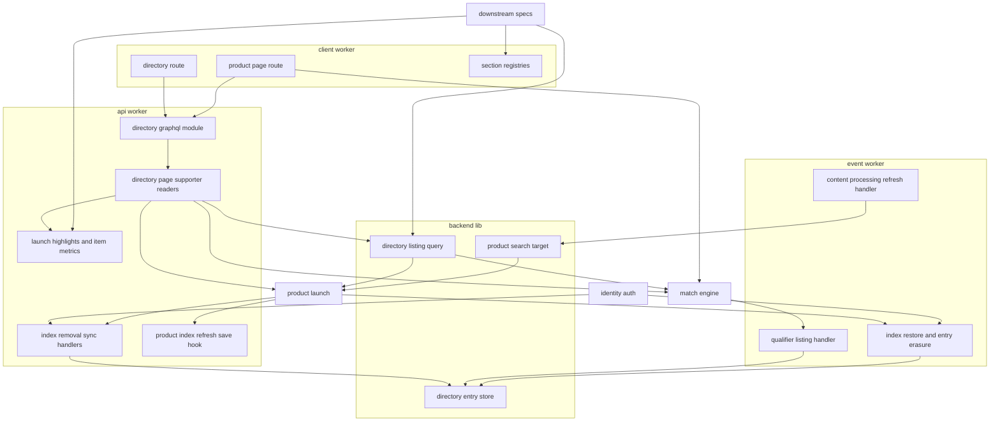
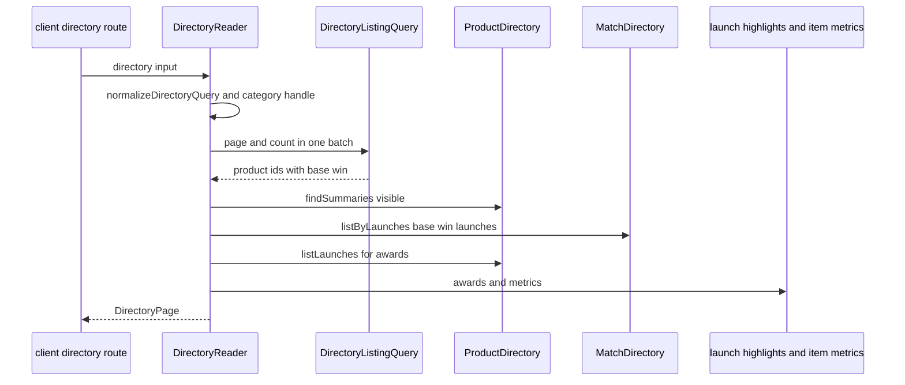
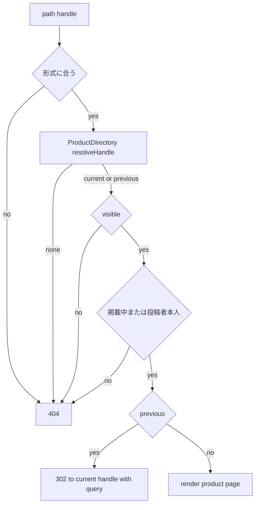
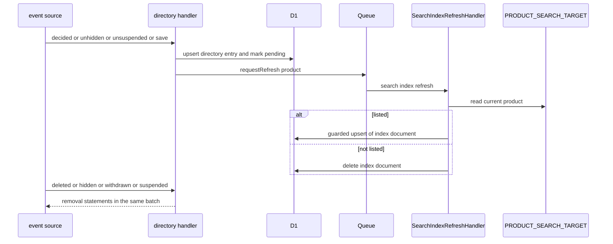
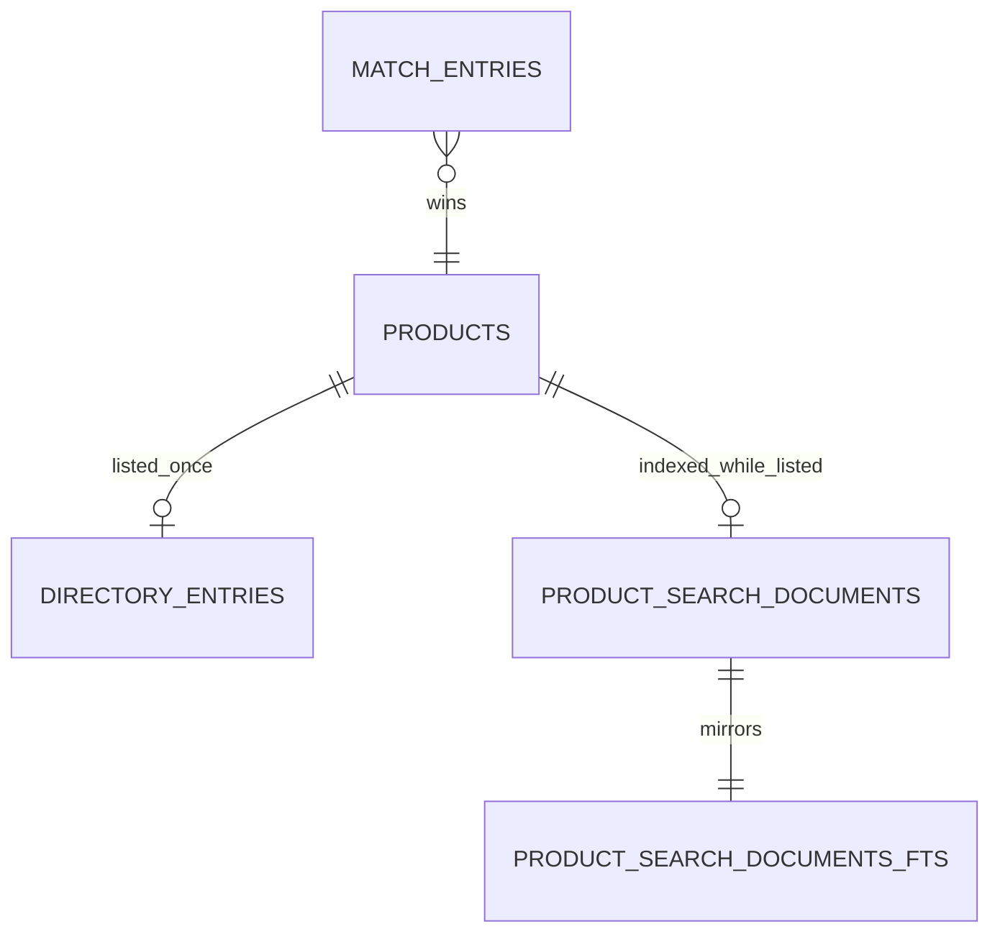

# Design Document

## Overview

**Purpose**: 予選で勝利したプロダクトだけを並べるディレクトリ(`/p`)と、プロダクト詳細ページ(`/p/{handle}`)と、掲載中のプロダクトの検索索引を実装する。ディレクトリは、product-launchの可視と勝利済みの条件・match-engineの予選の勝利の部品・content-processingの全文検索の部品を1回の問い合わせに結合し、プロダクトごとの基準勝利(期間内の最新の勝利、仮1・仮2)の値で並べ、20件ずつのオフセット方式で返す。詳細ページは、公開範囲の判定(掲載中は誰にでも、未掲載は投稿者本人だけ、非公開・停止・退会・削除は常に404)と旧ハンドルの302の後に、ヘッダー・開催中のマッチ・スクリーンショット・説明文・ローンチごとのマッチ履歴とサポーター・投稿者本人向けの操作を描き、評価・コメント・受賞・広告・通報の区画を登録口で受け付ける。索引は、勝利・編集・削除・非公開化・停止・復元・物理削除の各イベントへの処理で、掲載の条件に合わせて作り直す。

**Users**: 閲覧者はディレクトリで検索・絞り込み・並べ替え・ページの移動を行い、詳細ページでプロダクトの説明とマッチの実績とサポーターを見て、開催中のマッチにUpvoteする。投稿者は自分のプロダクトの詳細ページで進行状況を確かめ、編集と次回の予約へ進む。後続spec(engagement・tournament-week・tournament-year・sponsorship・content-reporting・public-api・ugc-moderation)の開発者は、区画と項目の値の登録口・一覧の照会の部品を使う。

**Impact**: D1に2テーブル(検索索引の文書・勝利したプロダクトの記録)と全文検索の索引を足す。`apps/common-lib/directory`にURLのクエリの規則、`apps/backend-lib/workers/directory`に一覧の照会と記録の部品、`apps/backend-lib/workers/search/targets/product.ts`に検索対象を新設する。apiにスキーマモジュール`directory`・読み取りのユースケース・2つの同期の処理・保存の登録(仮4)を、eventに4つの非同期の処理を、clientにディレクトリ・プロダクト詳細ページと区画の登録口を足す。上流のファイルは、契約で定められた登録箇所への追記(product-launchが仮11として提供する保存の登録口`PRODUCT_SAVE_HOOKS`への1行を含む)だけを変える。新しいシークレット・パッケージは無い。

### Goals

- FR-DIR-001〜014・FR-ADMUG-011が動作し、勝利→掲載と索引→編集→非公開化→復元、停止→解除、退会、物理削除のどの経路でも、一覧・検索・詳細ページ・索引が要件と仮1〜仮5の決定に一致する。
- 後続specが本specのファイルを変えずに、詳細ページ・ディレクトリの区画と一覧の項目の値を加えられる。
- 本specが追加・変更したコードの単体テスト・Workers統合テスト・ブラウザテストがカバレッジ80%を満たす。

### Non-Goals

- コメント・評価・受賞のトロフィー・参加費の決済・広告・通報の区画の中身(engagement・tournament-week・tournament-year・sponsorship・content-reporting)。
- マッチの進行とUpvoteの受け付け(match-engine)、プロダクトの保存と予約の判定(product-launch)、全文検索の基盤(content-processing)、公開APIの経路(public-api)。
- 掲載の写しのテーブル、ディレクトリの4:21のジョブ、要件定義書の改訂(必要な改訂は[research.md](research.md)の「要件定義書の改訂が必要な箇所」に記録した)。(2026-10-25に要件定義書へ適用済み)

## Boundary Commitments

### This Spec Owns

- ディレクトリのデータ: `product_search_documents`と全文検索の索引`product_search_documents_fts`・トリガー、`directory_entries`(`apps/db/schema/directory/`)と、索引の定義`PRODUCT_SEARCH_INDEX`。
- URLのクエリの規則(`apps/common-lib/directory/`): ページの大きさ・検索語の上限・並び順の値・クエリの正規化・期間のプリセットの展開。
- 共有部品(`apps/backend-lib/workers/directory/`): 一覧の照会`DirectoryListingQuery`、勝利したプロダクトの記録`DirectoryEntryStore`、索引の削除の文`productIndexRemovalStatements`、両アプリ共通の束縛`DIRECTORY_PLATFORM_MODULE`。検索対象`PRODUCT_SEARCH_TARGET`(`backend-lib/workers/search/targets/product.ts`)。
- apiの読み取りのユースケース(ディレクトリ・カテゴリの選択肢・プロダクト詳細・サポーター・ローンチの要約・項目の値)、スキーマモジュール`directory`、項目の値の供給元の登録口`DIRECTORY_ITEM_METRIC_SOURCES`、同期の処理`directory-discovery.account-index-removal`・`directory-discovery.product-index-removal`、保存の登録`directory-discovery.product-index-refresh`(仮4)。
- eventの処理`directory-discovery.qualifier-listing`(マッチイベント)・`directory-discovery.product-index-restore`・`directory-discovery.entry-erasure`(プロダクト)・`directory-discovery.account-index-restore`(ユーザー)。
- clientの`/p`・`/p/$handle`のルートと画面、区画の登録口`DIRECTORY_PAGE_SECTIONS`・`DIRECTORY_LIST_INSERTS`・`DIRECTORY_ITEM_METRICS`・`PRODUCT_PAGE_SECTIONS`・`PRODUCT_LAUNCH_SECTIONS`・`PRODUCT_OWNER_ACTIONS`。
- 技術ドキュメント`db/007-latest-row-per-group-listing.md`・`frontend/014-url-state-listing.md`の新規作成と、サービス仕様(ページ配置・文言規則)とオンボーディングの追記。

### Out of Boundary

- `products`・`product_launches`・`product_categories`などプロダクトのデータ、ハンドルの規則、保存と予約の判定(product-launch・user-profile-social)。本specは照会口・`visibleProducts()`・`wonLaunchExists()`・`productInCategory()`(product-launchの仮11)と、それらで絞った`products.id`・`products.category_id`だけを使い、プロダクトのテーブルへ書き込まない。
- マッチ・側・Upvoteのデータと規則(match-engine)。本specは`MatchDirectory`・`SupporterDirectory`・`qualifierWins()`・`matchViewLoader`・対戦カードの部品だけを使い、マッチのテーブルへ書き込まない。
- 索引の文書の書き込み・キーワードの抽出・日次の再抽出(content-processing)。本specは検索対象の定義と、更新待ちの印・削除の文・更新の要求を使う。
- 区画と項目の値の中身(engagement・tournament-week・tournament-year・sponsorship・content-reporting)、公開APIの経路(public-api)、非公開化・停止の操作(ugc-moderation)。

### Allowed Dependencies

- backend-platform: `AppModule`・`PLATFORM_TYPES`(`Database`・`Clock`)・`AppError`・`getAppLogger`・`ulidPrimaryKey`・`timestamps`・`BusinessTime`(`toBusinessDateTime`・`parseBusinessDate`・`BusinessDate`)、E2Eの`e2e/support/scheduled-trigger.ts`(`triggerScheduled`、backend-platformの改訂2)。形を変えない。
- api-gateway: `defineSchemaModule`・`GraphQLContext`(`resolve`・`caller`・`session`・`loaders`)・`withValidatedArgs`・`encodeCursor`・`decodeCursor`・`defineLoader`・`DateTime`・`PageInfo`。
- identity-auth: `AccountGuard.currentUser`・`CurrentUser`・`IDENTITY_TYPES`・`UserLifecycleEvent`・`UserLifecycleSyncHandler`・`USER_LIFECYCLE_SYNC_HANDLERS`・`UserLifecycleAsyncHandler`・`USER_LIFECYCLE_ASYNC_HANDLERS`・`LifecycleHandlerOutcome`・`LIFECYCLE_CONTINUE_DELAY_SECONDS`・`viewerQueryOptions`・`users`(`visibleProducts()`の結合だけ)・E2Eの`e2e/support/mailpit.ts`。
- product-launch: `PRODUCT_PLATFORM_TYPES`の`ProductDirectory`(`findSummaries`・`resolveHandle`・`findDetail`・`listLaunches`)・`ProductCategoryDirectory`(`list`・`findByHandle`)・`D1ProductDirectory`(検索対象の`read`での直接の生成)、`visibleProducts()`・`wonLaunchExists()`・`productInCategory()`(product-launchの仮11。これらで絞った`products.id`・`products.category_id`を並べ替えと集計に使う)、`products`への外部キー、`ProductLifecycleEvent`・`ProductLifecycleSyncHandler`・`PRODUCT_LIFECYCLE_SYNC_HANDLERS`・`ProductLifecycleAsyncHandler`・`PRODUCT_LIFECYCLE_ASYNC_HANDLERS`、`ProductSaveHook`・`ProductSaveHookRegistration`・`PRODUCT_SAVE_HOOKS`(product-launchの仮11)、`LaunchSummarySource`・`LAUNCH_SUMMARY_SOURCES`・`DecisionSourceRegistration`、`fallbackLaunchSummary`・`groupAwards`(`backend-lib/core/product/launch-summary.ts`)、`PRODUCT_HANDLE_RULE`、GraphQLの`ProductCategory`・`productCategoryLoader`・`LaunchSummary`・`LaunchStatus`・`ProductAward`・`productOwnerStatus`、E2Eの製品登録の画面。
- match-engine: `MATCH_PLATFORM_TYPES`の`MatchDirectory`(`listByLaunches`・`findMatches`)・`SupporterDirectory`、`MatchRecord`・`EntryResult`・`MatchDecision`・`isWinningResult`、`qualifierWins()`、`MatchEvent`・`MatchEventHandler`・`MATCH_EVENT_HANDLERS`、GraphQLの`Match`・`MatchKind`・`MatchStage`・`MatchEntryResult`・`MatchDecision`・`matchViewLoader`、clientの`MatchCard`・`useUpvote`・`match-labels.ts`・`stadium.css`、`TurnstileWidget`の`match_upvote`、E2Eの`e2e/support/match-fixtures.ts`。
- content-processing: `searchDocumentColumns`・`searchTextColumn`・`searchDocumentStatusIndex`・`defineSearchIndex`・`SEARCH_INDEXES`・`ftsRankedSources`・`bm25Rank`・`print-search-index-sql.ts`、`defineSearchTarget`・`SEARCH_TARGETS`・`SEARCH_TYPES`・`SearchIndexStatements`・`SearchIndexRefreshRequester`、`normalizeSearchTerms`・`buildFtsMatchExpression`・`countGraphemes`、`HighlightedText`・`CollapsibleMarkdownContent`・`useMarkdownOptions`。
- user-profile-social: `checkHandleFormat`・`checkExternalUrl`・GraphQLの`UserSummary`・`userSummaryLoader`・`publicProfile`(`viewerRelation`)・`FollowButton`・`UserAvatar`。
- media-pipeline: `mediaFileLoader`・`toMediaImage`・GraphQLの`MediaImage`・`MediaPicture`。
- frontend-platform: `executeGraphQL`・`graphqlQueryOptions`・`GraphQLClientError`・`buildPageHead`・`NotFoundView`・`ErrorState`・`PartialErrorState`・`EmptyState`・`LoadingSkeleton`・`notify`・日時の表示部品・shadcn/uiの部品(ボタン・バッジ・ツールチップ・カード・シート・ポップオーバー・セレクト・入力欄)・`runAxe`・デザイントークン。identity-authの`LoginRequiredDialog`。
- admin-foundation: E2Eの`e2e/support/local-d1.ts`(`executeLocalD1`・`sqlStringLiteral`)。
- npmパッケージ: 新規なし。
- 後続specは、`common-lib/directory`・`workers/directory`の公開の契約、apiの`DIRECTORY_ITEM_METRIC_SOURCES`と`DirectoryItemMetricSource`、clientの6つの登録口と区画の文脈の型だけに依存し、本specのテーブルへ書き込まない。

### Revalidation Triggers

- `DirectoryListingQuery`の入力と返す列、基準勝利と並べ替えの規則(public-api、仮1・仮2の決定)。
- `DIRECTORY_PAGE_SECTIONS`・`DIRECTORY_LIST_INSERTS`・`DIRECTORY_ITEM_METRICS`・`PRODUCT_PAGE_SECTIONS`・`PRODUCT_LAUNCH_SECTIONS`・`PRODUCT_OWNER_ACTIONS`の置き場所・文脈の型・本specの`order`(engagement・tournament-week・tournament-year・sponsorship・content-reporting)。
- `DirectoryItemMetricSource`の形(engagement)。
- 索引の対象の条件(掲載中)と、処理の名前・`order`(1200)(ugc-moderation・運用)。
- 上流の`qualifierWins()`・`MatchDirectory`・`SupporterDirectory`・`MATCH_EVENT_HANDLERS`の`order`の規則、`ProductDirectory`・`visibleProducts()`・`wonLaunchExists()`・`productInCategory()`・`PRODUCT_SAVE_HOOKS`の`ProductSaveHook`・`fallbackLaunchSummary`・`groupAwards`・`LAUNCH_SUMMARY_SOURCES`・`productOwnerStatus`(product-launchの仮11を含む)、`SearchTargetDefinition`・`ftsRankedSources`・`buildFtsMatchExpression`、`FollowButton`・`publicProfile`、`MatchCard`・`useUpvote`の形を変えたら、本specを確かめ直す。
- backend-platformの改訂2の`triggerScheduled`の引数(`worker`・`businessDate`・`businessTime`)を変えたら、E2Eの23:40の確定の起動(9.1・9.2)を確かめ直す。

### 上流への影響

| 上流spec           | 変更                                                                                                                                                                                                                                                                                                                                                                                                                                   | 影響と再検証                                                                             |
| ------------------ | -------------------------------------------------------------------------------------------------------------------------------------------------------------------------------------------------------------------------------------------------------------------------------------------------------------------------------------------------------------------------------------------------------------------------------------- | ---------------------------------------------------------------------------------------- |
| product-launch     | 登録箇所への追記: `composition/product-save-hooks.ts`に`directory-discovery.product-index-refresh`、`product-lifecycle-sync-handlers.ts`に`directory-discovery.product-index-removal`、`product-lifecycle-async-handlers.ts`に`directory-discovery.product-index-restore`・`directory-discovery.entry-erasure`(1200)。保存の登録口・`productInCategory()`・`launch-summary.ts`はproduct-launchが仮11として提供する(本specの依頼による) | 契約どおり。`createProductSaveHooks`の名前の検証と、各ライフサイクルの登録口の検証を通る |
| match-engine       | `apps/event/src/composition/match-event-handlers.ts`に`directory-discovery.qualifier-listing`(1200)                                                                                                                                                                                                                                                                                                                                    | 契約どおり。`createMatchEventRegistry`の検証を通る                                       |
| identity-auth      | `apps/api/src/composition/user-lifecycle-sync-handlers.ts`に`directory-discovery.account-index-removal`、`apps/event/src/composition/user-lifecycle-async-handlers.ts`に`directory-discovery.account-index-restore`(1200)                                                                                                                                                                                                              | 契約どおり                                                                               |
| content-processing | `apps/db/search/search-indexes.ts`の`SEARCH_INDEXES`に`PRODUCT_SEARCH_INDEX`、`apps/backend-lib/workers/search/targets/index.ts`の`SEARCH_TARGETS`に`PRODUCT_SEARCH_TARGET`                                                                                                                                                                                                                                                            | 契約どおり。`targets/index.unit.test.ts`・`search-index-migrations.unit.test.ts`を通る   |

- roadmapの帯の割り当ての表の本specの「使用中の値」は「波及処理は1200」になる(本specはroadmapを編集しないため、コントローラーへ報告する)。

## Architecture

### Existing Architecture Analysis

- 上流の18specは設計・タスクとも承認済みで、本specのタスクはそれらの実装の完了を前提にする。実装済みはdev-toolingだけである。
- apiはクリーンアーキテクチャ(`domain`→`application`→`infrastructure`・`presentation`→`composition`)、処理単位のDIコンテナ、D1の`db.batch()`を使う。ライフサイクルの同期の処理は確定と同じ一括の書き込みに入る集合の更新の文、非同期の処理とマッチイベントの処理はeventの実行器で`order`の昇順に少なくとも1回動く。
- 索引の文書はcontent-processingの`search-index.refresh`の処理が、検索対象の`read`で元データを読み直して条件付きで書く。ドメインは更新待ちの印・削除の文を自分の書き込みに入れ、確定の後に更新を要求する。

### Architecture Pattern & Boundary Map



**Architecture Integration**:

- Selected pattern: クリーンアーキテクチャ。URLのクエリの正規化・公開範囲・マッチ履歴の写像は純粋な関数、ユースケースはポート越しにproduct-launch・match-engine・本specの部品を使う。一覧は上流の条件の部品を結合した1回の問い合わせで、写しのテーブルを持たない(research.mdの比較)。
- Domain/feature boundaries: 掲載の条件・一覧・索引の対象は本spec、プロダクトのデータと可視性の条件はproduct-launch、マッチと勝敗はmatch-engine、索引の書き込みはcontent-processing、区画の中身は後続spec。
- Existing patterns preserved: `backend-lib/workers/<ドメイン>`の共有の束縛、`<spec名>.<名詞句>`の処理の名前、帯の`order`、登録箇所への追記による拡張(`TOP_PAGE_SECTIONS`・`LAUNCH_SUMMARY_SOURCES`と同じ形)、user-profile-socialの公開プロフィールの解決と302、help-centerの検索対象の登録。
- New components rationale: `directory_entries`は利用者単位の索引の削除と作り直しを、product-launchのテーブルを読まずに行うため。区画の登録口は詳細ページの所有の規則(roadmapの画面シェル)のもとで後続specが区画を加えるため。
- Steering compliance: Inversifyの`@inject`の明示、D1の制約(`db.batch()`・バインド変数100個以内・FTS5はカスタムマイグレーション)、800行以内のファイル、1ファイル1コンポーネント、日時の`<time datetime>`、新しいパッケージなし。

**Dependency direction**: `apps/common-lib/directory` → `apps/db/schema/directory` → `backend-lib/workers/directory`・`backend-lib/workers/search/targets/product.ts` → 各アプリの`src`(`domain` → `application` → `infrastructure`・`presentation` → `composition`)。`common-lib`は他の層を読み込まない。clientは`common-lib`とGraphQLの操作と上流の画面部品だけを読み込む。

### Technology Stack

| Layer     | Choice / Version                                                     | Role in Feature                                  | Notes                                            |
| --------- | -------------------------------------------------------------------- | ------------------------------------------------ | ------------------------------------------------ |
| Frontend  | TanStack Start・Router・Query・shadcn/ui・lucide-react・sonner(上流) | ディレクトリ・詳細ページ・区画の登録口           | 日付入力はブラウザの入力欄、新規パッケージなし   |
| Backend   | Hono・Inversify・GraphQL Yoga(上流)                                  | スキーマモジュール・読み取りのユースケース・処理 | 既存                                             |
| Data      | Cloudflare D1(Drizzle・SQLite FTS5・窓関数)                          | 2テーブル・全文検索の索引・一覧の問い合わせ      | 新規のマイグレーションとカスタムマイグレーション |
| Messaging | Cloudflare Queues(上流)                                              | `search-index.refresh`(content-processing)の要求 | 新しいメッセージ種別なし                         |
| External  | Google Cloud Natural Language(content-processing経由)                | 説明文のキーワード抽出                           | 本specは直接呼ばない                             |

## File Structure Plan

### Directory Structure

```
apps/
├── common-lib/directory/                                      # 4アプリ共通(各ファイルに同名の*.unit.test.ts)
│   ├── directory-query-rules.ts                               # 定数・並び順・normalizeDirectoryQuery・withConditions
│   └── directory-period.ts                                    # 期間のプリセットの展開と判定・期間の表示の文言
├── db/
│   ├── schema/directory/                                      # テーブル定義(各ファイルに同名の*.unit.test.ts)
│   │   ├── product-search-documents.ts                        # 索引文書(name・tagline)
│   │   ├── product-search-index.ts                            # PRODUCT_SEARCH_INDEX(重み10・5・1)
│   │   ├── directory-entries.ts                               # 勝利したプロダクトと投稿者
│   │   └── index.ts
│   └── search/search-indexes.ts                               # (変更)PRODUCT_SEARCH_INDEXを追記
├── backend-lib/workers/
│   ├── search/targets/product.ts                              # PRODUCT_SEARCH_TARGET(*.worker.test.ts)
│   ├── search/targets/index.ts                                # (変更)SEARCH_TARGETSに追記
│   └── directory/                                             # api・event共通(Workers統合テスト)
│       ├── directory-platform-types.ts                        # DIRECTORY_PLATFORM_TYPES(テストなし)
│       ├── directory-listing.ts                               # DirectoryListingQuery・入出力の型
│       ├── d1-directory-listing.ts                            # 一覧・件数・カテゴリごとの掲載数の問い合わせ
│       ├── directory-entry-store.ts                           # DirectoryEntryStore(型とD1の実装)
│       ├── product-index-removal-statements.ts                # 利用者・プロダクト単位の索引の削除の文
│       └── directory-platform-module.ts                       # DIRECTORY_PLATFORM_MODULE
├── api/src/
│   ├── domain/directory/                                      # 純粋な規則(Bunの単体テスト)
│   │   ├── product-page-access.ts                             # 公開範囲・302・404の判定
│   │   ├── base-win.ts                                        # 基準勝利の種類(勝利・不戦勝・早期の不戦勝)
│   │   └── match-history.ts                                   # マッチ履歴の行・対戦相手の公開範囲・通算成績
│   ├── application/directory/                                 # ユースケース(Bunの単体テスト)
│   │   ├── directory-types.ts                                 # DIRECTORY_TYPES
│   │   ├── item-metric-sources.ts                             # DirectoryItemMetricSource・登録の型
│   │   ├── directory-reader.ts                                # 一覧の1ページの組み立て
│   │   ├── directory-category-reader.ts                       # カテゴリの選択肢の並び
│   │   ├── product-page-reader.ts                             # 詳細ページの組み立て
│   │   ├── supporter-list-reader.ts                           # サポーターの一覧
│   │   ├── launch-highlights-reader.ts                        # LAUNCH_SUMMARY_SOURCESの呼び出しと縮退
│   │   └── item-metrics-reader.ts                             # DIRECTORY_ITEM_METRIC_SOURCESの呼び出しと縮退
│   ├── infrastructure/directory/                              # Workers統合テスト
│   │   ├── account-index-removal-sync-handler.ts              # directory-discovery.account-index-removal
│   │   ├── product-index-removal-sync-handler.ts              # directory-discovery.product-index-removal
│   │   └── product-index-refresh-save-hook.ts                 # directory-discovery.product-index-refresh(仮4)
│   ├── presentation/graphql/modules/directory/                # スキーマモジュール(Workers統合テスト)
│   │   ├── type-defs.ts
│   │   ├── inputs.ts
│   │   ├── directory-views.ts                                 # 項目のリゾルバ(logo・category・owner・liveMatch)
│   │   ├── directory-resolvers.ts                             # directory・directoryCategories
│   │   ├── product-page-resolvers.ts                          # productPage
│   │   ├── supporter-resolvers.ts                             # matchSupporters
│   │   └── index.ts                                           # directorySchemaModule
│   └── composition/
│       ├── directory-module.ts                                # DIRECTORY_MODULE(apiの束縛)
│       └── directory-item-metric-sources.ts                   # DIRECTORY_ITEM_METRIC_SOURCES(初版は空)
├── event/src/
│   ├── application/directory/                                 # Bunの単体テスト
│   │   ├── event-directory-types.ts                           # EVENT_DIRECTORY_TYPES
│   │   ├── qualifier-listing-handler.ts                       # マッチのdecided 1200
│   │   ├── product-index-restore-handler.ts                   # プロダクトのunhidden 1200
│   │   ├── entry-erasure-handler.ts                           # プロダクトのpurge_due 1200
│   │   └── account-index-restore-handler.ts                   # ユーザーのunsuspended 1200
│   └── composition/directory-module.ts
├── client/src/
│   ├── routes/p/index.tsx                                     # /p
│   ├── routes/p/$handle.tsx                                   # /p/{handle}(302・404の分岐)
│   ├── composition/directory-sections.ts                      # DIRECTORY_PAGE_SECTIONS・DIRECTORY_LIST_INSERTS・DIRECTORY_ITEM_METRICS(初版は空)
│   ├── composition/product-page-sections.ts                   # PRODUCT_PAGE_SECTIONS(初版は本specの4件)・PRODUCT_LAUNCH_SECTIONS・PRODUCT_OWNER_ACTIONS(初版は空)
│   ├── components/directory/                                  # 1ファイル1コンポーネント(browser testを併置)
│   │   ├── directory-section-types.ts                         # 登録の型(テストなし)
│   │   ├── directory-page.tsx                                 # 見出し・条件・件数・一覧・区画の枠
│   │   ├── search-form.tsx
│   │   ├── filter-toolbar.tsx                                 # 768px以上の横並び
│   │   ├── filter-sheet.tsx                                   # 768px未満の下部のシート
│   │   ├── category-picker.tsx
│   │   ├── period-filter.tsx
│   │   ├── period-range-form.tsx
│   │   ├── sort-select.tsx
│   │   ├── result-count.tsx
│   │   ├── directory-item.tsx
│   │   ├── win-summary.tsx
│   │   ├── award-badges.tsx
│   │   ├── directory-pagination.tsx
│   │   ├── directory-empty-state.tsx                          # 条件あり・なし・範囲外
│   │   ├── directory-list-skeleton.tsx
│   │   ├── launch-cta.tsx
│   │   └── use-directory-navigation.ts                        # 条件の変更・ページの移動・フォーカス
│   ├── components/product-page/
│   │   ├── product-page-section-types.ts                      # 登録の型と文脈(テストなし)
│   │   ├── product-page.tsx                                   # 2カラムの枠と区画の描画
│   │   ├── product-breadcrumbs.tsx
│   │   ├── unlisted-banner.tsx
│   │   ├── product-header.tsx
│   │   ├── owner-follow.tsx                                   # フォロー中かの照会とFollowButton
│   │   ├── copy-link-button.tsx
│   │   ├── live-match-section.tsx
│   │   ├── screenshot-gallery.tsx
│   │   ├── screenshot-lightbox.tsx
│   │   ├── product-description.tsx
│   │   ├── match-history-section.tsx
│   │   ├── launch-block.tsx
│   │   ├── match-history-row.tsx
│   │   ├── supporters-panel.tsx
│   │   ├── empty-matches.tsx
│   │   ├── owner-card.tsx
│   │   └── product-page-skeleton.tsx
│   └── graphql/operations/directory/
│       ├── directory.ts                                       # directory・directoryCategories
│       ├── product-page.ts                                    # productPage
│       ├── supporters.ts                                      # matchSupporters
│       ├── owner-follow-status.ts                             # publicProfileのviewerRelation
│       └── product-owner-status.ts                            # productOwnerStatus(投稿者本人向けの操作)
e2e/
├── client/directory.e2e.test.ts                               # 一覧・検索・絞り込み・並べ替え・ページ・詳細・302
└── support/directory-fixtures.ts                              # ローカルD1に確定した予選と掲載中のプロダクトを作る補助
docs/GUIDES/tech/
├── db/007-latest-row-per-group-listing.md
└── frontend/014-url-state-listing.md
```

テストは各ファイルの隣に置く(`*.unit.test.ts`・`*.worker.test.ts`・`*.browser.test.tsx`)。技術ドキュメントの番号は、全ての完了済みspecのdesign.mdが使う番号の後の、各ディレクトリで最も小さい空き番号`db/007`・`frontend/014`に固定する(並行して作成中のnotificationsと重なれば、コントローラーの調整に従う)。

### Modified Files

- `apps/db/schema/index.ts`・`apps/db/migrations/<日時>_directory_discovery/migration.sql`・`apps/db/migrations/<日時>_directory_discovery_fts/migration.sql` — 2テーブルの再エクスポート、生成したマイグレーション、`print-search-index-sql.ts product_search_documents`の出力を貼ったカスタムマイグレーション。mainの最新を取り込んでから生成する。
- `apps/db/search/search-indexes.ts`・`apps/backend-lib/workers/search/targets/index.ts` — 索引の定義と検索対象。
- `apps/api/src/composition/modules.ts`・`graphql-modules.ts`・`user-lifecycle-sync-handlers.ts`・`product-lifecycle-sync-handlers.ts`・`product-save-hooks.ts` — `DIRECTORY_PLATFORM_MODULE`・`DIRECTORY_MODULE`・`directorySchemaModule`・2つの同期の処理・保存の登録。
- `apps/event/src/composition/modules.ts`・`match-event-handlers.ts`・`product-lifecycle-async-handlers.ts`・`user-lifecycle-async-handlers.ts` — `DIRECTORY_PLATFORM_MODULE`・eventの束縛・4つの処理。
- `docs/GUIDES/tech/db/README.md`・`frontend/README.md` — 文書一覧の行。
- `docs/onboardings/project-values.md` — 処理の名前と`order`、検索対象の名前と重み、区画の登録口の`order`。
- `docs/GUIDES/service/design/002-page-layouts.md` — ディレクトリの区画(仮3)・詳細ページの区画の構成・サポーターの数(仮5)・仮1・仮2の注記。
- `docs/GUIDES/service/design/003-text-and-copy-rules.md` — 本specのエラー・状態・トーストの文言。
- `CLAUDE.md` — 「技術規則の参照先」に「グループごとの最新の行で並べる一覧を作る前に: `db/007`」。

## System Flows

### 一覧の問い合わせ



- 問い合わせの形(`d1-directory-listing.ts`):

```sql
WITH wins AS (
  SELECT w.product_id, w.launch_id, w.match_date, w.upvote_count,
         ROW_NUMBER() OVER (PARTITION BY w.product_id ORDER BY w.match_date DESC) AS rn
  FROM (<qualifierWins()>) AS w
  WHERE (?1 IS NULL OR w.match_date >= ?1) AND (?2 IS NULL OR w.match_date <= ?2)
)
SELECT products.id, wins.launch_id, wins.match_date, wins.upvote_count [, f.rank]
FROM products
JOIN users ON users.id = products.user_id
JOIN wins ON wins.product_id = products.id AND wins.rn = 1
[JOIN (<ftsRankedSources(PRODUCT_SEARCH_INDEX, ?)>) AS f ON f.source_id = products.id]
WHERE <visibleProducts()> AND <wonLaunchExists()> [AND <productInCategory(?)>]
ORDER BY <並び順> LIMIT 20 OFFSET ?
```

- 件数は同じ`WITH`と条件の`COUNT(*)`の文で、ページの文と1つの`db.batch()`で読む(6.1)。並び順は`newest`が`match_date DESC, products.id DESC`、`oldest`が`match_date ASC, products.id ASC`、`upvotes`が`upvote_count DESC, match_date DESC, products.id DESC`、`relevance`が`rank ASC, match_date DESC, products.id DESC`(5.2・5.4・5.5)。
- 期間の条件を窓関数の前に掛けるため、期間内に勝利の無いプロダクトは`rn = 1`の行を持たず除かれ、期間内の最新が基準勝利になる(3.6、仮2)。
- 基準勝利の種類は`MatchDirectory.listByLaunches`の予選のマッチの側の`result`と`endedEarly`から`classifyBaseWin`で決める(2.7〜2.9)。

### プロダクト詳細ページの解決



- `decideProductPageAccess({ resolution, viewerUserId })`が`render`(`ownerView`・`unlisted`)・`redirect`(現在のハンドル)・`not-found`を返す(8.2〜8.7)。`visible`はproduct-launchの`visibleProducts()`(非公開化・論理削除・投稿者の退会や停止を除く)と同じ判定である。

### 索引の更新



| 契機                           | 処理                                        | 種類                                   | 内容                                                                                                                                                     |
| ------------------------------ | ------------------------------------------- | -------------------------------------- | -------------------------------------------------------------------------------------------------------------------------------------------------------- |
| 予選の勝利の確定               | `directory-discovery.qualifier-listing`     | マッチイベント`decided`・予選、1200    | `findMatches`で勝った側(`isWinningResult`、紐付けあり)の`directory_entries`を作り(`onConflictDoNothing`)、`markPending`の後に`requestRefresh`(1.5・12.2) |
| 編集(登録・編集・説明文の更新) | `directory-discovery.product-index-refresh` | `PRODUCT_SAVE_HOOKS`(仮4)              | `directory_entries`があれば`markPending`を保存の一括の書き込みに入れ、確定の後に`requestRefresh`(12.3)                                                   |
| 論理削除・非公開化             | `directory-discovery.product-index-removal` | プロダクトの同期`deleted`・`hidden`    | `deleteSources('product', [productId])`(12.4・12.5)                                                                                                      |
| 退会・停止                     | `directory-discovery.account-index-removal` | ユーザーの同期`withdrawn`・`suspended` | `DELETE FROM product_search_documents WHERE source_id IN (SELECT product_id FROM directory_entries WHERE owner_user_id = ?)`(12.4・12.5)                 |
| 復元                           | `directory-discovery.product-index-restore` | プロダクトの非同期`unhidden`、1200     | `directory_entries`があれば`markPending`と`requestRefresh`。`done`(12.6)                                                                                 |
| 停止の解除                     | `directory-discovery.account-index-restore` | ユーザーの非同期`unsuspended`、1200    | 投稿者の`directory_entries`を1回の実行で全件、100件ずつ`markPending`と`requestRefresh`。`done`(12.6)                                                     |
| 物理削除                       | `directory-discovery.entry-erasure`         | プロダクトの非同期`purge_due`、1200    | 索引文書と`directory_entries`の行を1つの一括の書き込みで削除。`done`(12.7)                                                                               |

- 索引の作成と更新は常にcontent-processingの処理が、`PRODUCT_SEARCH_TARGET.read`で処理の時点のプロダクトを読み、掲載中でなければ索引を消す(12.1・12.9)。削除は確定と同じ一括の書き込みで行う(12.4・12.5)。`requestRefresh`の送信の失敗は例外にならず、`pending`の索引文書は1時間後以降の日次の再抽出が再処理する(12.8)。
- `directory-discovery.entry-erasure`はproduct-launchの最後の物理削除より前に動くため、`directory_entries.product_id`の外部キーで物理削除を止めない(12.7)。

## Requirements Traceability

| Requirement                                 | Summary                    | Components                                                                                           | Interfaces                                                        | Flows                      |
| ------------------------------------------- | -------------------------- | ---------------------------------------------------------------------------------------------------- | ----------------------------------------------------------------- | -------------------------- |
| 1.1, 1.2, 1.3, 1.4, 1.6, 1.7, 1.8           | 掲載の条件                 | DirectoryListingQuery、ProductPageAccess                                                             | `qualifierWins()`・`visibleProducts()`・`wonLaunchExists()`       | 一覧の問い合わせ           |
| 1.5                                         | 確定から数分以内の掲載     | DirectoryListingQuery、QualifierListingHandler                                                       | `MATCH_EVENT_HANDLERS`                                            | 索引の更新                 |
| 2.1, 2.2, 2.3, 2.4, 2.5, 2.6, 2.13          | 項目の表示と操作           | DirectoryItem、DirectoryViews、DirectoryReader                                                       | `DirectoryItem`                                                   | —                          |
| 2.7, 2.8, 2.9, 2.10                         | 勝利した予選マッチ         | BaseWin、WinSummary、DirectoryReader                                                                 | `classifyBaseWin`                                                 | 一覧の問い合わせ           |
| 2.11                                        | 受賞バッジ                 | LaunchHighlightsReader、AwardBadges                                                                  | `LAUNCH_SUMMARY_SOURCES`                                          | —                          |
| 2.12                                        | 項目の値の登録口           | ItemMetricSources、ItemMetricsReader、DirectorySections                                              | `DIRECTORY_ITEM_METRIC_SOURCES`・`DIRECTORY_ITEM_METRICS`         | —                          |
| 3.1, 3.2                                    | カテゴリ                   | CategoryPicker、DirectoryCategoryReader、DirectoryListingQuery                                       | `directoryCategories`・`productInCategory()`                      | —                          |
| 3.3, 3.4, 3.5                               | 期間                       | DirectoryPeriod、PeriodFilter、PeriodRangeForm                                                       | `presetRange`・`periodKeyOf`                                      | —                          |
| 3.6                                         | 期間の基準                 | DirectoryListingQuery                                                                                | 窓関数                                                            | 一覧の問い合わせ           |
| 3.7, 3.8                                    | 正規化と1ページ目          | DirectoryQueryRules、UseDirectoryNavigation                                                          | `normalizeDirectoryQuery`・`withConditions`                       | —                          |
| 3.9, 3.10                                   | 横並びとシート             | FilterToolbar、FilterSheet                                                                           | —                                                                 | —                          |
| 4.1, 4.2, 4.7, 4.8                          | 検索の対象と照合           | DirectoryReader、DirectoryListingQuery、ProductSearchSchema、ProductSearchTarget                     | `buildFtsMatchExpression`・`ftsRankedSources`                     | 一覧の問い合わせ           |
| 4.3, 4.4, 4.5                               | 検索欄                     | SearchForm                                                                                           | `countGraphemes`                                                  | —                          |
| 4.6                                         | 強調表示                   | DirectoryItem                                                                                        | `HighlightedText`                                                 | —                          |
| 5.1, 5.2, 5.3, 5.4, 5.5, 5.6                | 並べ替え                   | SortSelect、DirectoryQueryRules、DirectoryListingQuery                                               | `DIRECTORY_SORTS`                                                 | 一覧の問い合わせ           |
| 6.1, 6.2, 6.3, 6.4, 6.5, 6.6                | ページ分け                 | DirectoryListingQuery、ResultCount、DirectoryPagination、UseDirectoryNavigation、DirectoryEmptyState | `DIRECTORY_PAGE_SIZE`                                             | —                          |
| 7.1, 7.2, 7.3, 7.4, 7.5, 7.6, 7.7, 7.8, 7.9 | 画面の構成と状態           | DirectoryRoute、DirectoryPage、DirectoryListSkeleton、DirectoryEmptyState、LaunchCta                 | `ensureQueryData`・`keepPreviousData`                             | —                          |
| 7.10                                        | ディレクトリの区画         | DirectorySections、DirectoryPage                                                                     | `DIRECTORY_PAGE_SECTIONS`・`DIRECTORY_LIST_INSERTS`               | —                          |
| 8.1, 8.2, 8.3, 8.4, 8.5, 8.6, 8.7           | 公開範囲・302・404         | ProductPageAccess、ProductPageReader、ProductPageRoute                                               | `productPage`・`ProductPageRedirect`                              | プロダクト詳細ページの解決 |
| 8.8, 8.9, 8.10                              | 描画とエラーと検索エンジン | ProductPageRoute                                                                                     | `buildPageHead`                                                   | —                          |
| 9.1, 9.2, 9.3, 9.9, 9.10, 9.11              | 構成と区画                 | ProductPage、ProductPageSections、UnlistedBanner、ProductBreadcrumbs                                 | `PRODUCT_PAGE_SECTIONS`                                           | —                          |
| 9.4, 9.5, 9.12                              | ヘッダーと成績             | ProductHeader、OwnerFollow、CopyLinkButton、MatchHistory                                             | `ProductPageRecord`                                               | —                          |
| 9.6                                         | 開催中のマッチ             | LiveMatchSection、DirectoryViews                                                                     | `matchViewLoader`・`MatchCard`・`useUpvote`                       | —                          |
| 9.7                                         | スクリーンショット         | ScreenshotGallery、ScreenshotLightbox                                                                | —                                                                 | —                          |
| 9.8                                         | 説明文                     | ProductDescription                                                                                   | `CollapsibleMarkdownContent`                                      | —                          |
| 10.1                                        | ローンチのブロックと要約   | LaunchBlock、LaunchHighlightsReader                                                                  | `LAUNCH_SUMMARY_SOURCES`                                          | —                          |
| 10.2, 10.3, 10.4, 10.5, 10.6, 10.7          | マッチ履歴                 | MatchHistory、MatchHistoryRow、ProductPageReader                                                     | `toHistoryRows`                                                   | —                          |
| 10.8, 10.9, 10.10, 10.11                    | サポーター                 | MatchHistoryRow、SupportersPanel、SupporterListReader                                                | `matchSupporters`・`SupporterDirectory`                           | —                          |
| 10.12, 10.13                                | マッチが無いブロック       | EmptyMatches                                                                                         | —                                                                 | —                          |
| 10.14                                       | ローンチの区画             | LaunchBlock、ProductPageSections                                                                     | `PRODUCT_LAUNCH_SECTIONS`                                         | —                          |
| 11.1, 11.2, 11.3, 11.4, 11.5, 11.6, 11.7    | 投稿者本人向けの操作       | OwnerCard、ProductPageSections                                                                       | `productOwnerStatus`・`PRODUCT_OWNER_ACTIONS`                     | —                          |
| 12.1, 12.9                                  | 索引の対象と冪等           | ProductSearchTarget、ProductSearchSchema                                                             | `PRODUCT_SEARCH_TARGET`                                           | 索引の更新                 |
| 12.2                                        | 勝利で索引                 | QualifierListingHandler、DirectoryEntryStore                                                         | `MATCH_EVENT_HANDLERS`                                            | 索引の更新                 |
| 12.3                                        | 編集で索引                 | ProductIndexRefreshSaveHook                                                                          | `PRODUCT_SAVE_HOOKS`                                              | 索引の更新                 |
| 12.4, 12.5                                  | 削除・非公開化・退会・停止 | ProductIndexRemovalSyncHandler、AccountIndexRemovalSyncHandler、ProductIndexRemovalStatements        | `PRODUCT_LIFECYCLE_SYNC_HANDLERS`・`USER_LIFECYCLE_SYNC_HANDLERS` | 索引の更新                 |
| 12.6                                        | 復元・停止の解除           | ProductIndexRestoreHandler、AccountIndexRestoreHandler                                               | 非同期の登録口                                                    | 索引の更新                 |
| 12.7                                        | 物理削除                   | EntryErasureHandler                                                                                  | `PRODUCT_LIFECYCLE_ASYNC_HANDLERS`                                | 索引の更新                 |
| 12.8, 12.10                                 | 非同期・回復・個人情報     | 各処理、ProductSearchTarget                                                                          | `requestRefresh`                                                  | 索引の更新                 |
| 13.1, 13.2                                  | 帯の値と順                 | QualifierListingHandler、各処理                                                                      | `order` 1200                                                      | 索引の更新                 |
| 13.3                                        | ログ                       | 全コンポーネント                                                                                     | `getAppLogger`                                                    | —                          |
| 13.4                                        | まとめた照会               | DirectoryReader、ProductPageReader                                                                   | `findSummaries`・`listByLaunches`・`userSummaryLoader`            | 一覧の問い合わせ           |
| 13.5                                        | 公開APIの部品              | DirectoryListingQuery、DirectoryPlatformModule                                                       | `DirectoryListingQuery.page`                                      | —                          |
| 14.1, 14.2, 14.3                            | テスト                     | Testing Strategy                                                                                     | —                                                                 | —                          |
| 14.4                                        | 技術ドキュメント           | DirectoryTechDocs                                                                                    | —                                                                 | —                          |
| 14.5                                        | サービス仕様               | DirectoryServiceSpecs                                                                                | —                                                                 | —                          |

## Components and Interfaces

| Component                                                                                                                                                                                                                                                                                                                         | Domain/Layer          | Intent                                   | Req Coverage                                           | Key Dependencies                                           | Contracts |
| --------------------------------------------------------------------------------------------------------------------------------------------------------------------------------------------------------------------------------------------------------------------------------------------------------------------------------- | --------------------- | ---------------------------------------- | ------------------------------------------------------ | ---------------------------------------------------------- | --------- |
| DirectoryQueryRules・DirectoryPeriod                                                                                                                                                                                                                                                                                              | common-lib            | クエリの規則と期間                       | 3.3〜3.5, 3.7, 3.8, 4.3, 5.1, 5.3, 6.2                 | —                                                          | Service   |
| ProductSearchSchema(ProductSearchDocuments・ProductSearchIndex)・DirectoryEntriesSchema                                                                                                                                                                                                                                           | db                    | 索引文書・索引・勝利したプロダクト       | 4.1, 12.1, 12.7                                        | content-processing (P0)、product-launch (P0)               | State     |
| ProductSearchTarget                                                                                                                                                                                                                                                                                                               | backend-lib/search    | 検索対象                                 | 4.1, 12.1, 12.9, 12.10                                 | ProductDirectory (P0)                                      | Service   |
| DirectoryListingQuery・DirectoryEntryStore・ProductIndexRemovalStatements・DirectoryPlatformModule                                                                                                                                                                                                                                | backend-lib/directory | 一覧の照会・記録・削除の文               | 1.1〜1.4, 1.6〜1.8, 3.6, 4.1, 4.2, 5.2〜5.5, 6.1, 13.5 | match-engine (P0)、product-launch (P0)、D1 (P0)            | Service   |
| ProductPageAccess・BaseWin・MatchHistory                                                                                                                                                                                                                                                                                          | api/domain            | 公開範囲・基準勝利・マッチ履歴           | 2.7〜2.10, 8.2〜8.7, 9.5, 10.2〜10.7                   | —                                                          | Service   |
| DirectoryReader・DirectoryCategoryReader・ProductPageReader・SupporterListReader・LaunchHighlightsReader・ItemMetricsReader・ItemMetricSources                                                                                                                                                                                    | api/application       | 読み取りのユースケースと供給元の呼び出し | 2.\*, 3.1, 3.2, 4.7, 8.\*, 9.4〜9.6, 10.\*, 13.4       | ProductDirectory (P0)、MatchDirectory (P0)                 | Service   |
| AccountIndexRemovalSyncHandler・ProductIndexRemovalSyncHandler・ProductIndexRefreshSaveHook                                                                                                                                                                                                                                       | api/infrastructure    | 同期の削除と編集の更新待ち               | 12.3, 12.4, 12.5                                       | identity-auth (P0)、product-launch (P0)                    | Event     |
| DirectorySchemaModule(DirectoryViews・DirectoryResolvers・ProductPageResolvers・SupporterResolvers)                                                                                                                                                                                                                               | api/presentation      | GraphQLの型と操作                        | 2.\*, 3.\*, 4.\*, 5.\*, 6.\*, 8.\*, 9.6, 10.\*         | api-gateway (P0)                                           | API       |
| QualifierListingHandler・ProductIndexRestoreHandler・EntryErasureHandler・AccountIndexRestoreHandler                                                                                                                                                                                                                              | event                 | 掲載・作り直し・物理削除                 | 1.5, 12.2, 12.6, 12.7, 13.1, 13.2                      | DirectoryEntryStore (P0)、SearchIndexRefreshRequester (P0) | Event     |
| DirectoryRoute・DirectoryPage・SearchForm・FilterToolbar・FilterSheet・CategoryPicker・PeriodFilter・PeriodRangeForm・SortSelect・ResultCount・DirectoryItem・WinSummary・AwardBadges・DirectoryPagination・DirectoryEmptyState・DirectoryListSkeleton・LaunchCta・UseDirectoryNavigation・DirectorySections                      | client                | ディレクトリの画面と区画                 | 2.\*, 3.\*, 4.3〜4.6, 5.1, 5.3, 6.3〜6.6, 7.\*         | directory (P0)                                             | State     |
| ProductPageRoute・ProductPage・ProductBreadcrumbs・UnlistedBanner・ProductHeader・OwnerFollow・CopyLinkButton・LiveMatchSection・ScreenshotGallery・ScreenshotLightbox・ProductDescription・MatchHistorySection・LaunchBlock・MatchHistoryRow・SupportersPanel・EmptyMatches・OwnerCard・ProductPageSkeleton・ProductPageSections | client                | 詳細ページと区画                         | 8.\*, 9.\*, 10.\*, 11.\*                               | productPage (P0)、MatchCard (P0)、FollowButton (P1)        | State     |
| DirectoryTechDocs・DirectoryServiceSpecs                                                                                                                                                                                                                                                                                          | docs                  | 技術ドキュメントとサービス仕様           | 14.4, 14.5                                             | —                                                          | —         |

### common-lib

#### DirectoryQueryRules・DirectoryPeriod

**Contracts**: Service [x]

```typescript
// directory-query-rules.ts
export declare const DIRECTORY_PAGE_SIZE: 20;
export declare const DIRECTORY_SEARCH_MAX_GRAPHEMES: 50;
export declare const DIRECTORY_SEARCH_COUNTER_FROM: 40;
export declare const DIRECTORY_SORTS: readonly [
  'relevance',
  'newest',
  'oldest',
  'upvotes',
];
export type DirectorySort = (typeof DIRECTORY_SORTS)[number];
export interface DirectoryQuery {
  readonly q?: string; // 前後の空白を除き、空なら無し。50書記素へ切り詰め
  readonly category?: string; // カテゴリのハンドル(存在の確認はapi)
  readonly from?: BusinessDateString; // YYYY-MM-DD
  readonly to?: BusinessDateString;
  readonly sort?: DirectorySort; // 既定(qがあればrelevance、なければnewest)は省く
  readonly page?: number; // 2以上の整数だけ。1は省く
}
export declare function normalizeDirectoryQuery(
  raw: Readonly<Record<string, unknown>>,
): DirectoryQuery; // 3.7
export declare function effectiveSort(query: DirectoryQuery): DirectorySort;
export declare function withConditions(
  query: DirectoryQuery,
  patch: Partial<Omit<DirectoryQuery, 'page'>>,
): DirectoryQuery; // pageを外す(3.8)
export declare function changedConditionCount(query: DirectoryQuery): number; // カテゴリ・期間・並び順(3.10)

// directory-period.ts
export declare const PERIOD_PRESETS: readonly [
  'yesterday',
  'week',
  'month',
  'year',
  'all',
];
export type PeriodPreset = (typeof PERIOD_PRESETS)[number];
export declare function presetRange(
  preset: PeriodPreset,
  today: BusinessDateString,
): { readonly from?: BusinessDateString; readonly to?: BusinessDateString }; // 週は月曜日始まり(3.3)
export declare function periodKeyOf(
  range: { readonly from?: string; readonly to?: string },
  today: BusinessDateString,
): PeriodPreset | 'custom'; // 3.4
export declare function validateCustomRange(input: {
  readonly from?: string;
  readonly to?: string;
  readonly today: BusinessDateString;
}): {
  readonly from?: 'future';
  readonly to?: 'future';
  readonly order?: 'reversed';
}; // 3.5
```

- `normalizeDirectoryQuery`は不正な値をエラーにせず落とす(実在しない日付、`from > to`は両方、検索語が無いときの`relevance`、既定と同じ並び順、2未満・整数でない`page`)。`BusinessDateString`は`YYYY-MM-DD`の文字列の型で、`BusinessTime`を読み込まずに判定する(common-libは他の層を読み込まない)。
- 期間の表示の文言(「9月14日〜9月20日」「9月1日以降」「9月20日以前」)は`formatPeriodLabel`として同じファイルに置き、今年は年を省く。

### db

#### ProductSearchSchema・DirectoryEntriesSchema

**Contracts**: State [x]

```typescript
// product-search-documents.ts
export const productSearchDocuments = snakeCase.table(
  'product_search_documents',
  {
    ...searchDocumentColumns(),
    name: searchTextColumn('name'),
    tagline: searchTextColumn('tagline'),
  },
  (table) => [searchDocumentStatusIndex('product_search_documents', table)],
);
// product-search-index.ts
export declare const PRODUCT_SEARCH_INDEX: SearchIndexDefinition; // defineSearchIndex({ documents, textColumns: [name 10, tagline 5], keywordsWeight: 1 })
// directory-entries.ts: directory_entries(idはULID・product_idはproducts.idへの外部キーで一意・owner_user_idは外部キーなしのtext・first_won_atはinteger・timestamps)、owner_user_idの索引
```

- 全文検索の索引とトリガーは`print-search-index-sql.ts product_search_documents`の出力をカスタムマイグレーションに貼り、`search-index-migrations.unit.test.ts`が欠けを検出する(`db/004`)。
- `owner_user_id`は外部キーを持たない(identity-authの物理削除を妨げないため。行はプロダクトの`purge_due`で消える)。

### backend-lib/workers

#### ProductSearchTarget

**Contracts**: Service [x]

```typescript
export declare const PRODUCT_SEARCH_TARGET: SearchTargetDefinition<
  'name' | 'tagline' | 'description'
>;
// name 'product'
// fields: name・tagline { format: 'plain', textColumn: true, extract: false }、description { format: 'markdown', textColumn: false, extract: true }
// read(db, id): new D1ProductDirectory(db)のfindSummaries([id], 'visible')がlistedのときだけ、findDetailの説明文と合わせて返す。versionは読み取りの時刻(ミリ秒)
// isIndexable(id): EXISTS(SELECT 1 FROM products JOIN users ON users.id = products.user_id WHERE products.id = ? AND visibleProducts() AND wonLaunchExists())
```

- 版を読み取りの時刻にするのは、`ProductDirectory`の記録に更新日時が無く、`read`が常に処理の時点の値を返すためである。古い読み取りの書き込みは新しい読み取りの版に負けて捨てられる(content-processingの条件付きの書き込み、12.9)。
- 索引には名称・タグライン・説明文から抽出したキーワードだけを入れる(12.10)。

#### DirectoryListingQuery・DirectoryEntryStore・ProductIndexRemovalStatements

**Contracts**: Service [x]

```typescript
// directory-listing.ts
export interface DirectoryListingInput {
  readonly matchExpression: string | undefined; // buildFtsMatchExpressionの結果
  readonly categoryId: string | undefined;
  readonly from: BusinessDate | undefined;
  readonly to: BusinessDate | undefined;
  readonly sort: DirectorySort; // matchExpressionが無いときrelevanceは渡さない
  readonly page: number; // 1以上
}
export interface DirectoryListingRow {
  readonly productId: string;
  readonly baseWin: {
    readonly launchId: string;
    readonly matchDate: BusinessDate;
    readonly upvoteCount: number;
  };
}
export interface DirectoryListingQuery {
  page(input: DirectoryListingInput): Promise<{
    readonly totalCount: number;
    readonly rows: readonly DirectoryListingRow[];
  }>; // 1回のdb.batch
  countByCategory(): Promise<ReadonlyMap<string, number>>; // カテゴリID → 掲載中の数
}

// directory-entry-store.ts
export interface DirectoryEntryStore {
  record(
    entries: readonly {
      readonly productId: string;
      readonly ownerUserId: string;
    }[],
    at: Date,
  ): Promise<void>; // onConflictDoNothing
  exists(productId: string): Promise<boolean>;
  listProductIdsByOwner(
    ownerUserId: string,
    after: string | undefined,
    limit: number,
  ): Promise<readonly string[]>; // product_idの昇順
  erase(productId: string): Promise<void>; // 索引文書と記録を1つのdb.batchで削除
}

// product-index-removal-statements.ts
export declare function accountIndexRemovalStatement(
  db: Database,
  ownerUserId: string,
): BatchItem<'sqlite'>;
```

- `DIRECTORY_PLATFORM_MODULE`は`DirectoryListingQuery`・`DirectoryEntryStore`を処理単位で束縛し、apiとeventの`composition/modules.ts`の両方へ入れる。DIの識別子は`DIRECTORY_PLATFORM_TYPES`(`Symbol.for('directory.<名前>')`)。public-apiは`DirectoryListingQuery`を使う(13.5)。
- 問い合わせの形は「System Flows」の一覧の問い合わせに示す。`countByCategory`は`visibleProducts() AND wonLaunchExists()`のプロダクトを`products.category_id`で数える(3.1。product-launchの仮11で、これらの条件で絞った`products.id`・`products.category_id`の集計が許されている)。

### api/domain

#### ProductPageAccess・BaseWin・MatchHistory

**Contracts**: Service [x]

```typescript
// product-page-access.ts
export type ProductPageAccess =
  | {
      readonly kind: 'render';
      readonly productId: string;
      readonly ownerView: boolean;
      readonly unlisted: boolean;
    }
  | { readonly kind: 'redirect'; readonly handle: string }
  | { readonly kind: 'not-found' };
export declare function decideProductPageAccess(input: {
  readonly resolution: ProductHandleResolution;
  readonly viewerUserId: string | undefined;
}): ProductPageAccess;

// base-win.ts
export type BaseWinKind = 'victory' | 'bye' | 'early';
export declare function classifyBaseWin(
  match: MatchRecord | undefined,
  launchId: string,
): BaseWinKind; // won→victory、bye・開始時点のwalkover→bye、endedEarlyのwalkover→early

// match-history.ts
export type OpponentView =
  | { readonly kind: 'none' } // 対戦相手なし
  | { readonly kind: 'private' }
  | { readonly kind: 'unlisted' | 'listed'; readonly productId: string };
export interface HistoryRow {
  readonly matchId: string;
  readonly entryId: string;
  readonly kind: MatchKind;
  readonly round: number | null;
  readonly stage: MatchStage | null;
  readonly matchDate: BusinessDate;
  readonly result: EntryResult;
  readonly decision: MatchDecision;
  readonly endedEarly: boolean;
  readonly ownUpvoteCount: number;
  readonly opponentUpvoteCount: number | null; // 不戦勝・早期の不戦勝はnull
  readonly opponent: OpponentView;
}
export declare function toHistoryRows(input: {
  readonly productId: string;
  readonly matches: readonly MatchRecord[];
  readonly opponents: ReadonlyMap<string, ProductSummaryRecord>; // not-deletedで引いたもの
}): readonly HistoryRow[]; // finishedだけ、実施日の新しい順
export declare function summarizeRecord(input: {
  readonly rows: readonly HistoryRow[];
  readonly launches: readonly LaunchRecord[];
}): {
  readonly firstLaunchDate: BusinessDate | null;
  readonly launchCount: number;
  readonly wins: number;
  readonly losses: number;
};
```

- `decideProductPageAccess`は「System Flows」の判定の順に従う(8.2〜8.7)。
- `toHistoryRows`の対戦相手: 側が1つ→`none`。開始時点の`walkover`(`endedEarly`でない)で相手の側がある→`private`。相手の`productId`がnull・`opponents`に無い・`visible`が偽→`private`。`listed`→`listed`、それ以外→`unlisted`(10.3・10.5)。早期の`walkover`は相手を`private`、相手の数をnullにする(10.6)。勝ちと負けの数え方は`isWinningResult`(9.5)。
- 予選の結果からの要約と受賞のまとめは、product-launchの`backend-lib/core/product/launch-summary.ts`の`fallbackLaunchSummary`・`groupAwards`を直接読み込んで使い、本specは同じ規則を持たない(ローンチ履歴と文言がずれないため、product-launchの仮11)。

### api/application

#### DirectoryReader・DirectoryCategoryReader・LaunchHighlightsReader・ItemMetricsReader

**Contracts**: Service [x]

```typescript
// item-metric-sources.ts
export interface DirectoryItemMetricSource {
  metrics(input: {
    readonly productIds: readonly string[];
    readonly at: Date;
  }): Promise<ReadonlyMap<string, number>>; // productId → 値
}
export interface DirectoryItemMetricRegistration {
  readonly key: string; // '<名詞>'(例: 'comments')。clientのDIRECTORY_ITEM_METRICSのkeyと一致させる
  readonly name: string; // '<spec名>.<名詞句>'
  readonly order: number;
  readonly source: ServiceIdentifier<DirectoryItemMetricSource>;
}
// composition/directory-item-metric-sources.ts(後続specが追記、初版は空)
export declare const DIRECTORY_ITEM_METRIC_SOURCES: readonly DirectoryItemMetricRegistration[];

// directory-reader.ts
export interface DirectoryItemView {
  readonly product: ProductSummaryRecord;
  readonly isViewerOwn: boolean;
  readonly baseWin: {
    readonly launchDate: BusinessDate;
    readonly kind: BaseWinKind;
    readonly upvoteCount: number | null;
  }; // byeはnull
  readonly awards: ReturnType<typeof groupAwards>;
  readonly metrics: readonly { readonly key: string; readonly value: number }[];
}
export interface DirectoryPageView {
  readonly applied: DirectoryQuery; // サーバーが解決したカテゴリと正規化の後の条件
  readonly searchTerms: readonly string[];
  readonly businessToday: BusinessDate;
  readonly totalCount: number;
  readonly page: number;
  readonly pageCount: number;
  readonly items: readonly DirectoryItemView[];
}
export interface DirectoryReader {
  read(input: {
    readonly raw: Readonly<Record<string, unknown>>;
    readonly viewer: CurrentUser | undefined;
    readonly now: Date;
  }): Promise<DirectoryPageView>;
}
export interface DirectoryCategoryReader {
  list(): Promise<readonly ProductCategoryRecord[]>; // 掲載数の多い順・同数は名称順・その他を末尾(3.1)
}
export interface LaunchHighlightsReader {
  read(input: {
    readonly launches: readonly LaunchRecord[];
    readonly at: Date;
  }): Promise<{
    readonly summaries: ReadonlyMap<
      string,
      { readonly label: string; readonly inMatch: boolean }
    >;
    readonly awards: ReadonlyMap<string, ReturnType<typeof groupAwards>>; // productId → 受賞
  }>;
}
export interface ItemMetricsReader {
  read(
    productIds: readonly string[],
    at: Date,
  ): Promise<
    ReadonlyMap<
      string,
      readonly { readonly key: string; readonly value: number }[]
    >
  >;
}
```

- `DirectoryReader.read`の手順: (1)`normalizeDirectoryQuery`。(2)カテゴリのハンドルを`ProductCategoryDirectory.findByHandle`で解決し、無ければ外す(3.2)。(3)`normalizeSearchTerms`→`buildFtsMatchExpression`。語が無ければ検索なし(4.7)。(4)`DirectoryListingQuery.page`。`page`が総ページ数を超えれば空の`items`と総件数を返す(6.6)。(5)ページのIDで`ProductDirectory.findSummaries(ids, 'visible')`・`MatchDirectory.listByLaunches(基準勝利のローンチ)`・`ProductDirectory.listLaunches(ids)`を並行に1回ずつ呼び(13.4)、`LaunchHighlightsReader`(受賞)・`ItemMetricsReader`を呼ぶ。(6)問い合わせとの間に可視でなくなった行は除く(件数は問い合わせの値のまま)。
- `LaunchHighlightsReader`は`LAUNCH_SUMMARY_SOURCES`を`order`順に1回ずつ呼び、`rank`の大きい要約を採り、供給の無いローンチと供給元の失敗(`warn`のログ)は`fallbackLaunchSummary`で縮退する(product-launchの`backend/013`の表示の縮退、10.1・2.11)。`ItemMetricsReader`も同じく供給元の失敗をその値だけの欠落にする(2.12)。

#### ProductPageReader・SupporterListReader

**Contracts**: Service [x]

```typescript
export interface ProductPageLaunchView extends LaunchRecord {
  readonly summary: { readonly label: string; readonly inMatch: boolean };
  readonly kickedOff: boolean; // statusがin_progress・finished
  readonly latestKickedOff: boolean;
  readonly rows: readonly HistoryRow[];
}
export interface ProductPageView {
  readonly product: ProductSummaryRecord;
  readonly detail: ProductDetailRecord;
  readonly ownerView: boolean;
  readonly unlisted: boolean;
  readonly record: ReturnType<typeof summarizeRecord>;
  readonly awards: ReturnType<typeof groupAwards>;
  readonly liveMatchId: string | null; // live・tallyingの最も新しいマッチ
  readonly launches: readonly ProductPageLaunchView[]; // 取消を除く新しい順
  readonly opponents: ReadonlyMap<string, ProductSummaryRecord>;
}
export type ProductPageResult =
  | { readonly kind: 'page'; readonly view: ProductPageView }
  | { readonly kind: 'redirect'; readonly handle: string }
  | { readonly kind: 'not-found' };
export interface ProductPageReader {
  read(input: {
    readonly handle: string;
    readonly viewer: CurrentUser | undefined;
    readonly now: Date;
  }): Promise<ProductPageResult>;
}
export interface SupporterListReader {
  list(input: {
    readonly productHandle: string;
    readonly matchId: string;
    readonly entryId: string;
    readonly viewer: CurrentUser | undefined;
    readonly first: number; // 1〜20
    readonly after: string | undefined;
  }): Promise<{
    readonly userIds: readonly string[];
    readonly endCursor: string | null;
    readonly hasNextPage: boolean;
  } | null>;
}
```

- `ProductPageReader.read`の手順: (1)`checkHandleFormat(PRODUCT_HANDLE_RULE)`の違反は`not-found`(8.7)。(2)`ProductDirectory.resolveHandle`→`decideProductPageAccess`(8.2〜8.6)。(3)`findDetail`・`listLaunches`を並行に読み、取消を除いたローンチのIDで`MatchDirectory.listByLaunches`を1回読む。(4)対戦相手のプロダクトのIDで`findSummaries(ids, 'not-deleted')`を1回読む。(5)`toHistoryRows`・`summarizeRecord`・`LaunchHighlightsReader`(要約と受賞)。(6)`liveMatchId`は`phase`が`live`・`tallying`のマッチ。
- `SupporterListReader.list`: (1)プロダクトを`ProductPageReader`と同じ判定で解決し、表示できなければ`null`。(2)`MatchDirectory.findMatches([matchId])`で、側がそのプロダクトのもので、マッチが`finished`であることを確かめ、違えば`null`(10.10)。(3)`SupporterDirectory.listSupporters({ entryId, after, limit: first })`(退会・停止を除く、10.9・10.10)。カーソルは`encodeCursor({ upvotedAt, upvoteId })`。
- 利用者はセッションではなく引数で受け取る。閲覧者は`AccountGuard.currentUser`をリゾルバが渡す。

### api/infrastructure

#### AccountIndexRemovalSyncHandler・ProductIndexRemovalSyncHandler・ProductIndexRefreshSaveHook

**Contracts**: Event [x]

- 登録: `USER_LIFECYCLE_SYNC_HANDLERS`に`{ name: 'directory-discovery.account-index-removal', events: ['withdrawn', 'suspended'], handler: DIRECTORY_TYPES.AccountIndexRemovalSyncHandler }`(`accountIndexRemovalStatement`)。`PRODUCT_LIFECYCLE_SYNC_HANDLERS`に`{ name: 'directory-discovery.product-index-removal', events: ['deleted', 'hidden'], handler: DIRECTORY_TYPES.ProductIndexRemovalSyncHandler }`(`SearchIndexStatements.deleteSources('product', [productId])`)。いずれも読み取りをせず、集合の削除の文だけを返す(12.4・12.5)。
- 仮4: product-launchが仮11として提供する`PRODUCT_SAVE_HOOKS`(`apps/api/src/composition/product-save-hooks.ts`)に`{ name: 'directory-discovery.product-index-refresh', hook: DIRECTORY_TYPES.ProductIndexRefreshSaveHook }`を追記する。契約は`apps/api/src/application/product/product-save-hooks.ts`の`ProductSaveHook`(`statementsFor({ productId, at }, db)`・`afterCommit({ productId })`)と`ProductSaveHookRegistration`(`name`・`hook`)。product-launchは登録(`registerProduct`)・編集(`updateProduct`、次回の予約とローンチ日の変更を含む)・公開APIの説明文の更新(`ProductDescriptionEditor`)の一括の書き込みの末尾に`statementsFor`の文を加え、確定の後に`afterCommit`を呼ぶ。`statementsFor`の文の失敗は保存ごと取り消され、`afterCommit`の例外は`warn`のログで保存を失敗させない。復元・停止の解除では呼ばれない(本specはライフサイクルの登録口で扱う)。

- 本specの実装: `statementsFor`は`DirectoryEntryStore.exists`が真なら`markPending('product', productId, at)`を返す。`afterCommit`は同じ条件で`requestRefresh('product', productId)`(12.3)。

### api/presentation

#### DirectorySchemaModule

**Contracts**: API [x]

```graphql
enum DirectorySort {
  RELEVANCE
  NEWEST
  OLDEST
  UPVOTES
}
enum DirectoryWinKind {
  VICTORY
  BYE
  EARLY
}
type DirectoryWin {
  launchDate: String!
  kind: DirectoryWinKind!
  "byeはnull"
  upvoteCount: Int
}
type DirectoryItemMetric {
  key: String!
  value: Int!
}
type DirectoryItem {
  handle: String!
  name: String!
  tagline: String!
  category: ProductCategory!
  websiteUrl: String!
  logo: MediaImage
  "表示できなければnull"
  owner: UserSummary
  isViewerOwn: Boolean!
  awards: [ProductAward!]!
  win: DirectoryWin!
  metrics: [DirectoryItemMetric!]!
}
type DirectoryAppliedQuery {
  q: String
  category: String
  from: String
  to: String
  sort: DirectorySort
  page: Int
}
type DirectoryPage {
  applied: DirectoryAppliedQuery!
  searchTerms: [String!]!
  businessToday: String!
  totalCount: Int!
  page: Int!
  pageCount: Int!
  items: [DirectoryItem!]!
}
input DirectoryInput {
  q: String
  category: String
  from: String
  to: String
  sort: String
  page: String
}
enum ProductPageOpponentKind {
  NONE
  PRIVATE
  UNLISTED
  LISTED
}
type ProductPageOpponent {
  kind: ProductPageOpponentKind!
  handle: String
  name: String
  logo: MediaImage
}
type ProductPageMatch {
  id: ID!
  entryId: ID!
  kind: MatchKind!
  round: Int
  stage: MatchStage
  date: String!
  result: MatchEntryResult!
  decision: MatchDecision!
  endedEarly: Boolean!
  ownUpvoteCount: Int!
  opponentUpvoteCount: Int
  opponent: ProductPageOpponent!
}
type ProductPageLaunch {
  id: ID!
  number: Int!
  launchDate: String!
  kickoffAt: DateTime!
  status: LaunchStatus!
  summary: LaunchSummary!
  kickedOff: Boolean!
  latestKickedOff: Boolean!
  matches: [ProductPageMatch!]!
}
type ProductPageRecord {
  firstLaunchDate: String
  launchCount: Int!
  wins: Int!
  losses: Int!
}
type ProductPageScreenshot {
  fileId: ID!
  image: MediaImage
}
type ProductPage {
  id: ID!
  handle: String!
  name: String!
  tagline: String!
  category: ProductCategory!
  websiteUrl: String!
  logo: MediaImage
  description: String!
  screenshots: [ProductPageScreenshot!]!
  owner: UserSummary!
  viewerIsOwner: Boolean!
  listed: Boolean!
  awards: [ProductAward!]!
  record: ProductPageRecord!
  liveMatch: Match
  launches: [ProductPageLaunch!]!
}
type ProductPageRedirect {
  handle: String!
}
union ProductPageResult = ProductPage | ProductPageRedirect
type SupporterConnection {
  nodes: [UserSummary!]!
  pageInfo: PageInfo!
}
type Query {
  directory(input: DirectoryInput!): DirectoryPage!
  directoryCategories: [ProductCategory!]!
  "表示できなければnull(404)"
  productPage(handle: String!): ProductPageResult
  "表示できないプロダクト・確定していないマッチはnull"
  matchSupporters(
    productHandle: String!
    matchId: ID!
    entryId: ID!
    first: Int!
    after: String
  ): SupporterConnection
}
```

| 操作                               | 呼び出し元 | ログイン・権限 | bot対策 | エラー                                                         |
| ---------------------------------- | ---------- | -------------- | ------- | -------------------------------------------------------------- |
| `directory`・`directoryCategories` | client     | 不要           | なし    | —(不正な入力は正規化して返す、3.7)                             |
| `productPage`                      | client     | 不要           | なし    | —(null・リダイレクトで表す)                                    |
| `matchSupporters`                  | client     | 不要           | なし    | `validation_error`(`first`は1〜20、IDはULID)・`invalid_cursor` |

- 呼び出し元が`client`でなければ`forbidden`。`DirectoryInput`は全ての項目を文字列で受け、検証の違反をエラーにせず`normalizeDirectoryQuery`へ渡す(3.7)。
- `DirectoryViews`(`directory-views.ts`): `logo`・`ProductPageScreenshot.image`・`ProductPageOpponent.logo`は`mediaFileLoader`→`toMediaImage`、`category`は`productCategoryLoader`、`owner`・`SupporterConnection.nodes`は`userSummaryLoader`、`liveMatch`は`matchViewLoader`(閲覧者は処理単位の`AccountGuard.currentUser`、9.6)、`websiteUrl`は`checkExternalUrl`が`ok`でなければ空文字(2.6)。`ProductAward`・`LaunchSummary`はproduct-launchの型を、値の形(`kind`・`count`・`labels`、`label`・`inMatch`)をそろえて返す。

### event

#### QualifierListingHandler・ProductIndexRestoreHandler・EntryErasureHandler・AccountIndexRestoreHandler

**Contracts**: Event [x] / Batch [x]

| 名前                                        | 登録口                                   | 種類          | `order` | 処理                                                                                                                                                  |
| ------------------------------------------- | ---------------------------------------- | ------------- | ------- | ----------------------------------------------------------------------------------------------------------------------------------------------------- |
| `directory-discovery.qualifier-listing`     | `MATCH_EVENT_HANDLERS`(kinds: qualifier) | `decided`     | 1200    | `findMatches`→勝った側(`isWinningResult`・`productId`と`ownerUserId`あり)を`record`→`markPending`の一括の書き込み→`requestRefresh`。`done`(1.5・12.2) |
| `directory-discovery.product-index-restore` | `PRODUCT_LIFECYCLE_ASYNC_HANDLERS`       | `unhidden`    | 1200    | `exists`なら`markPending`と`requestRefresh`。`done`(12.6)                                                                                             |
| `directory-discovery.entry-erasure`         | `PRODUCT_LIFECYCLE_ASYNC_HANDLERS`       | `purge_due`   | 1200    | `erase(productId)`。`done`(12.7)                                                                                                                      |
| `directory-discovery.account-index-restore` | `USER_LIFECYCLE_ASYNC_HANDLERS`          | `unsuspended` | 1200    | `listProductIdsByOwner(userId, after, 100)`を最後まで読み、100件ずつ`markPending`の一括の書き込みと`requestRefresh`を行う。`done`(12.6)               |

- `account-index-restore`は1回の実行で投稿者の全ての記録を処理する(1人の投稿者のプロダクトは多くても数百件)。途中で失敗して再試行されても、`markPending`と更新の要求は冪等である(content-processingの処理が処理の時点の状態から書く、12.9)。
- `qualifier-listing`はmatch-engineの`match-engine.qualifier-outcome`(1100)の後に動くため、`wonLaunchExists()`が真になった後に索引が作られる(13.2)。結果を記録できなかったローンチは`read`が掲載中でないと判断し、索引を作らない。
- 例外はそれぞれの登録口の再試行の方針で再試行され、上限でSentryに通知される。ログはカテゴリ`['event', 'directory']`、属性はプロダクト・マッチ・利用者のIDと件数だけ(13.3)。

### client

```typescript
// components/directory/directory-section-types.ts
export type DirectoryPlacement = 'banner' | 'aside' | 'bottom';
export interface DirectorySectionContext {
  readonly viewer: { readonly signedIn: boolean };
  readonly query: DirectoryQuery;
}
export interface DirectorySection {
  readonly id: string;
  readonly placement: DirectoryPlacement;
  readonly order: number;
  readonly component: ComponentType<DirectorySectionContext>;
}
export interface DirectoryListInsert {
  readonly id: string;
  readonly order: number;
  readonly every: number;
  readonly component: ComponentType<{ readonly position: number }>;
}
export interface DirectoryItemMetric {
  readonly key: string;
  readonly order: number;
  readonly component: ComponentType<{
    readonly value: number;
    readonly productHandle: string;
    readonly productName: string;
  }>;
}
// composition/directory-sections.ts(初版はいずれも空、仮3)
export declare const DIRECTORY_PAGE_SECTIONS: readonly DirectorySection[];
export declare const DIRECTORY_LIST_INSERTS: readonly DirectoryListInsert[];
export declare const DIRECTORY_ITEM_METRICS: readonly DirectoryItemMetric[]; // engagementがcomments(10)を追記

// components/product-page/product-page-section-types.ts
export type ProductPagePlacement = 'banner' | 'main' | 'aside' | 'bottom';
export interface ProductPageContext {
  readonly product: {
    readonly id: string;
    readonly handle: string;
    readonly name: string;
    readonly listed: boolean;
    readonly ownerHandle: string;
  };
  readonly viewer: { readonly signedIn: boolean; readonly isOwner: boolean };
  readonly page: ProductPageFragment; // 本specの区画が使う取得の結果
}
export interface ProductPageSection {
  readonly id: string;
  readonly placement: ProductPagePlacement;
  readonly order: number;
  readonly component: ComponentType<ProductPageContext>;
}
export interface ProductLaunchSectionContext extends Omit<
  ProductPageContext,
  'page'
> {
  readonly launch: {
    readonly id: string;
    readonly number: number;
    readonly kickedOff: boolean;
    readonly latestKickedOff: boolean;
  };
}
export interface ProductLaunchSection {
  readonly id: string;
  readonly order: number;
  readonly component: ComponentType<ProductLaunchSectionContext>;
}
export interface ProductOwnerAction {
  readonly id: string;
  readonly order: number;
  readonly component: ComponentType<Omit<ProductPageContext, 'page'>>;
}
// composition/product-page-sections.ts
export declare const PRODUCT_PAGE_SECTIONS: readonly ProductPageSection[];
// 初版: directory-discovery.screenshots(main 20)・directory-discovery.description(main 30)・directory-discovery.match-history(main 40)・directory-discovery.owner(aside 10)
// 予約: トロフィーはmainの10(tournament)、評価はasideの20(engagement)、通報はbottomの10(content-reporting)、広告はbanner・asideの30・bottomの20(sponsorship)
export declare const PRODUCT_LAUNCH_SECTIONS: readonly ProductLaunchSection[]; // 初版は空。engagementのコメント(10)
export declare const PRODUCT_OWNER_ACTIONS: readonly ProductOwnerAction[]; // 初版は空。Week 10・Year 20
```

#### DirectoryRoute・DirectoryPageと部品

- `routes/p/index.tsx`: `validateSearch`は`normalizeDirectoryQuery`(3.7)、`loaderDeps`は正規化した条件、`loader`で`directory`と`directoryCategories`を`ensureQueryData`(サーバーで描画、7.2)。`head`は`buildPageHead({ title: 'ディレクトリ', description, canonicalUrl })`。サーバーが返した`applied`が正規化の結果と違えば(存在しないカテゴリなど)、`navigate({ replace: true })`でURLを合わせる。
- `DirectoryPage`: 見出し・`SearchForm`・`FilterToolbar`(768px以上)または「絞り込み・並び順」と`FilterSheet`(768px未満、3.9・3.10)・`ResultCount`・一覧と`DirectoryPagination`・`LaunchCta`(7.1・7.8)。`DIRECTORY_PAGE_SECTIONS`を置き場所ごとに区画のエラー境界で描き(7.10)、`DIRECTORY_LIST_INSERTS`を`every`件ごとに差し込む。`useQuery`の`placeholderData: keepPreviousData`で、条件の変更の読み込み中は直前の一覧を`aria-busy`と薄い表示で残し、上端に進捗のバーを出し、件数欄を「読み込み中…」にする(7.4)。初回はスケルトン(7.3)、失敗は`ErrorState`(7.5)、0件は`DirectoryEmptyState`(7.6・7.7)、範囲外は「このページにはプロダクトがありません。」と全ページ数と「1ページ目へ」(6.6)。演出は使わない(7.9)。
- `SearchForm`: `role="search"`、ラベル付きの入力欄、消去のボタン、40書記素を超えたら`aria-live="polite"`の「45/50」、50を超えたらフォーカスアウトと送信でエラー(`aria-invalid`・`aria-describedby`)にして送らない。Enterと検索のボタンでだけ`withConditions`で遷移する(4.3〜4.5)。
- `CategoryPicker`: ポップオーバーの中の入力欄で絞り込むリストボックス(`role="combobox"`・`aria-activedescendant`、上下キーとEnter)。選択肢は`directoryCategories`の順に「全て」を先頭に足す(3.1)。読み込み中は無効(7.3)。
- `PeriodFilter`・`PeriodRangeForm`: プリセットの選択と「期間を指定…」のポップオーバー(768px未満はシート内)の2つの日付入力(`type="date"`、`max`は`businessToday`)。`validateCustomRange`の結果で文言と適用のボタンの無効化(3.3〜3.5)。プリセットの範囲は`presetRange(preset, businessToday)`、表示は`periodKeyOf`と`formatPeriodLabel`(3.4)。
- `SortSelect`: 4つの選択肢。検索語が無ければ「関連度」を`aria-disabled`にし「検索キーワードを入力すると選べます」を併記する(5.1・5.3)。
- `ResultCount`: 「1,234件中21〜40件」・「3件」・読み込み中は「読み込み中…」(6.3)。
- `DirectoryItem`: `<article aria-labelledby>`、名称のリンクを項目全体に広げ(`after:absolute`)、内側の操作は前面に出す(2.2)。名称・タグラインは`HighlightedText`(`searchTerms`、4.6)。カテゴリは`withConditions(query, { category })`のリンク(2.3)、投稿者は`UserAvatar`(20)とニックネームで`/@<ハンドル>`(2.4)、本人は「あなたのプロダクト」と「編集」(`/my/products/<ハンドル>/edit`、2.5)、「サイトを開く」は`target="_blank" rel="noopener"`(2.6)、`DIRECTORY_ITEM_METRICS`を`order`順に値のあるものだけ描く(2.12)。3・2・1列の配置は2.13。
- `WinSummary`: 「予選勝利」・`<time datetime>`のローンチ日(今年は年を省く)・`kind`ごとの表示(`VICTORY`は「1,234票」、`BYE`は「不戦勝」と「対戦相手がいないため」、`EARLY`は「不戦勝」と「確定時点で{n}票」、2.7〜2.10)。
- `AwardBadges`: 賞の種類ごとに1つのゴールドのバッジ、Year先頭、「×3」、ツールチップに`labels`(2.11)。product-launchのローンチ履歴と同じ見た目にする。
- `DirectoryPagination`: 768px以上は番号付き(先頭・末尾・前後1つ・「…」)、未満は「前へ」「5 / 62」「次へ」。`<nav aria-label="ページ">`、現在のページに`aria-current="page"`(6.4)。`useDirectoryNavigation`がページの移動の後に一覧の先頭へスクロールし見出しへフォーカスを移す(視差効果を減らす設定では`behavior: 'auto'`、6.5)。

#### ProductPageRoute・ProductPageと部品

- `routes/p/$handle.tsx`: `loader`は`checkHandleFormat`の違反で`notFound()`、`productPage`を`ensureQueryData`で読み、`null`なら`notFound()`、`ProductPageRedirect`なら`redirect({ to: '/p/$handle', params: { handle }, search: 現在の検索パラメーター, statusCode: 302 })`(8.3〜8.7)。`head`は`buildPageHead({ title: <名称>, description: <タグライン>, canonicalUrl: clientSiteOrigin + '/p/' + <現在のハンドル>, noIndex: !listed })`(8.1・8.8・8.10)。404はfrontend-platformの`NotFoundView`(トップページとディレクトリへの導線、8.4)、`errorComponent`は`ErrorState`(8.9)、`pendingComponent`は`ProductPageSkeleton`。
- `ProductPage`: 1024px以上は本文とサイドバー(幅320〜352px、`sticky`)の2カラム、それ未満は1カラムでサイドバーをヘッダーの直後に置く(9.1)。`banner`の区画→`ProductBreadcrumbs`→`UnlistedBanner`(本人の未掲載、9.3)→`ProductHeader`→`LiveMatchSection`→`main`の区画(`order`順)→`bottom`の区画、サイドバーに`aside`の区画(9.2)。区画ごとのエラー境界(9.11)。`TurnstileWidget`(`match_upvote`)を開催中のマッチがあるときだけ1つ置く。
- `ProductHeader`: ロゴ(`square-md`)・カテゴリのリンク(`/p?category=<ハンドル>`)・受賞回数(受賞の合計、1以上)・`h1`の名称・タグライン・投稿者(`UserAvatar`・ニックネーム・`@ハンドル`、`/@<ハンドル>`)・`OwnerFollow`(本人以外)・`CopyLinkButton`・「サイトを開く」(`rel="noopener"`)・初ローンチ日(`<time datetime>`)・ローンチ回数・「◯勝◯敗」(9.4・9.5)。
- `OwnerFollow`: ログイン中で本人でない閲覧者のとき、`owner-follow-status.ts`(`publicProfile(handle)`の`viewerRelation`)をクライアントで読み、`FollowButton`の`initialFollowing`に渡す。未ログインは`FollowButton`の未ログインの表示をそのまま使う。照会の失敗はボタンを描かない(縮退)。
- `CopyLinkButton`: 正規のURLを`navigator.clipboard.writeText`で写し、成功と失敗を`notify`で知らせる(9.12)。
- `LiveMatchSection`: `liveMatch`があるとき見出し(`id="live-match-heading"`)と`MatchCard`・`useUpvote`(`onUpdated`で`productPage`のキャッシュの`liveMatch`を差し替える)。残り時間と演出はトップページと同じ(9.6)。
- `ScreenshotGallery`・`ScreenshotLightbox`(`main` 20): `screenshot-thumb`を高さをそろえて横スクロール、押すとダイアログで`screenshot-full`、前後のボタン・左右キー・スワイプ(ポインターの移動量)、「3 / 10」、0枚は描かない(9.7)。
- `ProductDescription`(`main` 30): `CollapsibleMarkdownContent`(480px)と`useMarkdownOptions({ externalLinkRel: ['noopener'], idScope: 'product' })`(9.8)。
- `MatchHistorySection`(`main` 40)・`LaunchBlock`: 見出し「マッチ履歴とコメント」(`id="launches-heading"`)、ローンチごとに「第◯回ローンチ」・`<time datetime>`の日付・要約のチップ(10.1)、行の一覧または`EmptyMatches`(10.12・10.13)、`PRODUCT_LAUNCH_SECTIONS`を区画のエラー境界で`order`順に描く(10.14)。
- `MatchHistoryRow`: 種別とラウンドの印(match-engineの`match-labels.ts`)・日付・対戦相手(`kind`ごと、10.3)・比率のバー(`role="img"`と「Upvote数の比率: 12対9」、相手の数があるときだけ)・スコア「12対9」・勝敗のチップ(勝利・不戦勝・敗北・両者敗北、10.2・10.5〜10.7)。`decision`が`LAST_UPVOTE`なら枠を強調し「接戦」と注記(10.4)。`ownUpvoteCount`が1以上なら「サポーター{n}人」の`aria-expanded`のボタン(10.8、仮5)。
- `SupportersPanel`: `useInfiniteQuery`で`matchSupporters`を`first: 20`、`max-h-72`の枠の中の末尾の番兵を`IntersectionObserver`で見て続きを読む(10.9)。注記(10.10)、各行は`UserAvatar`(28)・ニックネーム・`/@<ハンドル>`、失敗は取得済みを保って「サポーター一覧を読み込めませんでした。」と再試行(10.11)。
- `EmptyMatches`: `kickedOff`で開催中なら「予選マッチが行われています。勝敗はフルタイム後にここへ表示されます。」と`#live-match-heading`への「マッチを見る」(10.12)。キックオフ前は日付と文言、本人は「リンクをコピーして応援を呼びかける」、他者は「トップページで本日のマッチを見る」(10.13)。
- `OwnerCard`(`aside` 10、本人だけ描く): 破線の枠の「あなたのプロダクト」、直近のローンチの`summary`の見出し、「編集」(`/my/products/<ハンドル>/edit`)、「再ローンチを予約」(同じ編集の画面)。`product-owner-status.ts`(`productOwnerStatus(productHandle)`)をクライアントで読み、`plan.mode`が`BLOCKED`なら無効と`blocks`の`message`・`releaseAt`(11.2)、`window.relaunchIntervalDays`があれば「このプロダクトは◯日以降のローンチ日を選べます。」(11.3)、`locked`なら固定の注記(11.4)、照会の失敗は無効と「再ローンチの予約の状態を確かめられませんでした。時間をおいて再度お試しください。」(11.6)。`PRODUCT_OWNER_ACTIONS`を描く(11.5)。予約と保存の可否はproduct-launchの保存が判定する(11.7)。

### docs

#### DirectoryTechDocs・DirectoryServiceSpecs

- `db/007-latest-row-per-group-listing.md`(14.4): グループごとの最新の行で並べる一覧の問い合わせの規約(条件を窓関数の前に掛ける、`ROW_NUMBER()`の並びを一意にする、同順位の決まった順、件数とページを同じ一括の読み取りにする、オフセット方式の読み取りの費用と上限、全文検索の副問い合わせとの結合、写しのテーブルへ移る判断の目安)。
- `frontend/014-url-state-listing.md`(14.4): URLのクエリで状態を表す検索・絞り込み・ページ分けの画面の規約(クエリの正規化を共有の関数にする、不正な値の黙った既定化、既定の値の省略、条件の変更で1ページ目、サーバーの解決の結果へのURLの合わせ込み、直前の結果を残す再読み込みの状態、ページの移動のスクロールとフォーカス、送信でだけ検索する入力欄と文字数の表示)。
- サービス仕様(14.5): ページ配置(ディレクトリの区画の置き場所と仮3の注記・詳細ページの区画の置き場所と順・仮1・仮2・仮5の注記)、文言規則(Error Handlingの文言)、`docs/onboardings/project-values.md`(処理の名前と`order`、検索対象`product`と重み、区画の`order`)。

## Data Models

### Domain Model

- **掲載中のプロダクト**: product-launchのプロダクトのうち`visibleProducts() AND wonLaunchExists()`のもの。本specは写しを持たない。
- **基準勝利**: 掲載中のプロダクトの予選の勝利のうち、期間の条件を満たす実施日が最大のもの(仮2)。問い合わせの中で導く。
- **勝利したプロダクトの記録(DirectoryEntry)**: 勝利したことのあるプロダクトと投稿者。利用者単位の索引の操作の手がかり。プロダクトの物理削除で消える。
- **索引文書(ProductSearchDocument)**: content-processingの索引文書の形。掲載中のプロダクトに1つまで。
- **不変条件**: (1)索引文書は掲載中のプロダクトにだけ作られる(`isIndexable`)。(2)削除・非公開化・退会・停止の確定の後に、そのプロダクトの索引文書は残らない。(3)`directory_entries`はプロダクトに1つ。



### Physical Data Model

すべて`snake_case`、日時はエポックミリ秒の整数、IDはULID(`ulidPrimaryKey()`)。索引文書の主キーはcontent-processingの規約どおり連番。外部キーは`ON DELETE`を指定しない。

| テーブル                       | 列(共通カラム以外)                                                                                                                                                | 制約・索引                                             |
| ------------------------------ | ----------------------------------------------------------------------------------------------------------------------------------------------------------------- | ------------------------------------------------------ |
| `product_search_documents`     | `searchDocumentColumns()`(`id`連番・`source_id`・`source_version`・`keywords`・`keyword_status`・`extraction_input_hash`・`status_changed_at`)・`name`・`tagline` | `source_id`一意、`product_search_documents_status_idx` |
| `product_search_documents_fts` | FTS5(`name`・`tagline`・`keywords`、external content、`unicode61 remove_diacritics 2`、`prefix='2 3'`)                                                            | トリガー3つ(カスタムマイグレーション)                  |
| `directory_entries`            | `product_id`(→`products.id`)・`owner_user_id` text・`first_won_at` integer                                                                                        | `product_id`一意、`owner_user_id`の索引                |

- 一覧の問い合わせはmatch-engineの`match_entries`の`(match_kind, match_date)`・`product_id`の索引と、product-launchの`products`の主キーを使い、本specは上流のテーブルに索引を足さない。

### Data Contracts & Integration

- GraphQL: 「DirectorySchemaModule」のSDLが契約。利用者側の許可リストに本specの操作と、`publicProfile`の`viewerRelation`・`productOwnerStatus`を読む操作が載る。
- 検索対象`product`: 本文に名称・タグライン・説明文の抽出のキーワードだけを含む。`search-index.refresh`の本文はIDだけ(content-processing)。

## Error Handling

### Error Strategy

- ディレクトリの入力の誤りはエラーにせず正規化する(3.7)。詳細ページの不在・閲覧不可はnull(404)、旧ハンドルはリダイレクトの型で返す。
- 供給元(要約・受賞・項目の値)の失敗は、その値だけを欠いて縮退する(2.12・10.1)。プロダクト・マッチの照会の失敗はページの取得エラーにする(部分的な一覧や履歴を出さない、7.5・8.9)。
- 詳細ページの区画・ディレクトリの区画の失敗は区画のエラー境界に閉じ込める(7.10・9.11)。投稿者本人向けの操作の照会とフォロー中の照会の失敗はその部品だけを縮退させる(11.6)。
- 索引の処理の失敗は、イベントの実行器の再試行と、content-processingの日次の再抽出で回復する(12.8)。

### Error Categories and Responses

| コード                        | 種類(状態コード) | 場面                           | 文言(文言規則に追加・既存) |
| ----------------------------- | ---------------- | ------------------------------ | -------------------------- |
| `validation_error`            | bad_request(400) | `matchSupporters`の`first`・ID | 既存                       |
| `invalid_cursor`・`forbidden` | 既存             | 既存                           | 既存                       |

- 状態・トーストの文言(文言規則に追加): 「プロダクト一覧を読み込めませんでした。…」(既存)、「条件に一致するプロダクトはありません。…」(既存)、「ディレクトリに掲載されたプロダクトはまだありません。」(既存)、「このページにはプロダクトがありません。」(既存)、「開始日は終了日以前の日付を選んでください。」(既存)、「未来の日付は選べません。」(既存)、「検索キーワードは50文字以内で入力してください。」、「検索キーワードを入力すると選べます」、「読み込み中…」、「予選マッチに勝利したプロダクトだけが並ぶカタログです。」、「このページはあなたにだけ表示されています。…」(既存)、「プロダクト情報を読み込めませんでした。…」(既存)、「リンクをコピーしました。」・「リンクをコピーできませんでした。」、「サポーター一覧を読み込めませんでした。」、「Upvoteした日時が早い順。退会・停止したユーザーは表示されません。」、「予選マッチが行われています。勝敗はフルタイム後にここへ表示されます。」、「にキックオフします。」と本人・他者の案内、「同点・最終Upvote時間が早く勝利」・「同点・最終Upvote時間の差で敗北」、「対戦相手なし」・「対戦相手がいないため」・「確定時点で{n}票」、「再ローンチの予約の状態を確かめられませんでした。時間をおいて再度お試しください。」。

### Monitoring

- `getAppLogger(['api'|'event', 'application', 'directory'])`で、プロダクト・マッチ・利用者のIDと件数・結果の種類だけを記録する(13.3)。検索語・名称・説明文・ハンドルは記録しない。
- 供給元の失敗は`warn`(登録の名前とプロダクトの件数)。索引の処理の再試行の上限は各登録口の方針でSentryへ通知される。

## Testing Strategy

- Unit Tests(Bun、`*.unit.test.ts`):
  - `directory-query-rules`: 不正なクエリの既定化(実在しない日付・逆順・検索語なしの関連度・既定の並び順・`page`の0・1・小数・文字列)、50書記素の切り詰め(絵文字の結合文字)、`withConditions`の1ページ目、`changedConditionCount`(3.7・3.8・3.10・4.3)。
  - `directory-period`: 基準時刻の今日からの各プリセット(月曜日・日曜日・月末・年末)、`periodKeyOf`の一致と`custom`、`validateCustomRange`の未来と逆順、期間の表示の文言(3.3〜3.5)。
  - `product-page-access`: `none`・可視でない(非公開・停止・退会)・未掲載の他者と本人・`previous`の転送・`current`(8.2〜8.6)。
  - `base-win`・`match-history`: 勝利・不戦勝・開始時点の`walkover`・早期の`walkover`の分類、対戦相手の4つの見え方(紐付けの解除を含む)、接戦、両者敗北、確定前のマッチの除外、通算成績と初ローンチ日(2.7〜2.10・9.5・10.2〜10.7)。
  - ユースケース(模擬のポート): product-launchの`fallbackLaunchSummary`への縮退と`rank`の選択、受賞のまとめ(Year先頭)、`DirectoryReader`の手順(存在しないカテゴリ・空白だけの検索語・範囲外のページ・問い合わせ後に可視でなくなった行)、`ProductPageReader`の`liveMatchId`と取消の除外、`SupporterListReader`の他のプロダクトの側・確定前のnull、供給元の失敗の縮退(2.11・2.12・4.7・6.6・10.1・10.10)。
  - event: `QualifierListingHandler`の勝った側だけ・紐付けの無い側の除外、`AccountIndexRestoreHandler`の100件ずつ(12.2・12.6)。
- Integration Tests(Vitestのworkerd、`*.worker.test.ts`、ローカルD1):
  - `DirectoryListingQuery`: 掲載の条件(退会・停止・非公開化・論理削除・敗北と両者敗北だけ・トーナメントの勝利だけ)、2回勝利したプロダクトが1項目で直近が基準勝利、期間の開始日・終了日と同じ日の勝利・期間外の勝利だけのプロダクトの除外、期間内の古い勝利が基準勝利になること、4つの並び順と同順位、20件目と21件目のページの境界と件数、カテゴリの絞り込み、検索の前方一致・大文字小文字・全角半角・発音区別符号・構文の文字列化・関連度の順、`countByCategory`(1.1〜1.4・1.6〜1.8・3.6・4.1・4.2・5.2〜5.5・6.1・14.2)。
  - 検索対象: 掲載中だけを`read`し、未掲載・非公開・停止で`undefined`と`isIndexable`が偽、content-processingの処理で索引が作られ名称の前方一致で検索でき、説明文のキーワードでも一致すること(抽出は固定の結果の偽物)(4.1・12.1)。
  - 同期の処理: product-launchの非公開化・削除の確定で索引文書が同じ書き込みで消え、確定の失敗で文も取り消されること、identity-authの退会・停止の確定で投稿者の全ての索引文書が消えること(12.4・12.5)。
  - 非同期の処理とマッチイベント: match-engineの`decided`の処理の後に`directory_entries`ができ索引が作られること、復元・停止の解除で作り直されること、プロダクトの`purge_due`で記録と索引文書が消えproduct-launchの物理削除が外部キーで失敗しないこと(1.5・12.2・12.6・12.7・13.2)。
  - 保存の登録(仮4): 掲載中のプロダクトの編集で同じ書き込みに更新待ちが入り、確定の後に要求が送られ、未掲載のプロダクトでは入らないこと(12.3)。
  - スキーマモジュール: `directory`の正規化と`applied`、`productPage`の404・302・本人の未掲載・`liveMatch`、`matchSupporters`の退会・停止の除外とUpvoteの日時の順と21件目のカーソル、`client`以外の拒否(6.\*・8.\*・10.9・10.10)。
- E2E/UI Tests:
  - ブラウザテスト(`*.browser.test.tsx`、`runAxe`の違反0件): `SearchForm`(カウンター・50超の拒否・Enter)、`CategoryPicker`(キーボード・絞り込み)、`PeriodRangeForm`(未来・逆順・片方だけ)、`SortSelect`(関連度の無効と併記)、`DirectoryItem`・`WinSummary`(本人・強調・3種の勝利・項目の値の登録)、`DirectoryPagination`(省略の規則・768px未満)、`DirectoryPage`(初回・再読み込み・エラー・0件2種・範囲外・区画の失敗の閉じ込め)、`ProductPage`(区画の順と失敗の閉じ込め・1カラム)、`ProductHeader`(成績・本人にフォローなし)、`ScreenshotLightbox`(左右キー・位置表示)、`MatchHistoryRow`(接戦・不戦勝・早期・非公開のプロダクト)、`SupportersPanel`(続きの読み込み・失敗)、`EmptyMatches`、`OwnerCard`(禁止・間隔・固定・照会の失敗)。
  - E2E(`e2e/client/directory.e2e.test.ts`): identity-authの`e2e/support/mailpit.ts`で確認済みの利用者を3人登録し(メールアドレスのドメインは`.example`)、2人がproduct-launchの画面でプロダクトを登録する。`e2e/support/directory-fixtures.ts`(admin-foundationの`executeLocalD1`)で2つのローンチのマッチ中の予選(終了の日時を過去)を作り、backend-platformの改訂2の`triggerScheduled({ worker: 'api', businessDate: <当日の業務日付>, businessTime: '23:40' })`で23:40の確定のジョブを動かして(独自の定期実行の起動の補助は作らない)、確定のイベント・予選の結果の記録・本specの掲載と索引の処理を実際の経路で動かす。一覧のページのために、可視の投稿者・プロダクト・確定したマッチとローンチの結果を直接作る補助で21件の掲載中のプロダクトを追加する。ディレクトリで勝ったプロダクトが表示されること、名称の検索(索引の作成を待つ)・カテゴリの絞り込み・「Upvote数が多い順」・2ページ目への移動と`page`のクエリ、詳細ページのマッチ履歴とサポーター(3人目のUpvote)、敗けたプロダクトが他者には404で投稿者本人には未掲載の案内付きで見えること、プロダクトのハンドルを変えた後に旧ハンドルのURLが現在のURLへ転送されることを確かめる(14.3)。

## Security Considerations

- 公開範囲: 詳細ページ・サポーターの一覧は同じ判定(`decideProductPageAccess`)で返し、未掲載のプロダクトの情報は投稿者本人にだけ返す。404は理由を区別しない(8.4)。旧ハンドルは表示できるときだけ転送し、非公開のプロダクトの現在のハンドルを漏らさない(8.6)。
- 検索の構文注入: 検索式は`buildFtsMatchExpression`で語ごとに引用符で囲み、バインド変数で渡す(4.2、FR-FTS-002)。並び順・カテゴリは列挙とIDの解決を経てから問い合わせに入れる。
- XSS: 説明文はcontent-processingの描画とサニタイズを経る。外部WebサイトURLは`checkExternalUrl`が`ok`のものだけをリンクにする(2.6)。名称・タグラインはReactのテキストとして描く。
- 情報の推測の防止: マッチ履歴の対戦相手の非公開・削除は「非公開のプロダクト」として理由を出さない(10.3)。サポーターの一覧に退会・停止の利用者を出さない(10.10)。
- データ最小化: 索引文書は掲載中のプロダクトだけで、公開を止めると同じ書き込みで消える(12.4・12.5)。ログに検索語・名称・ハンドルを含めない(13.3)。

## Performance & Scalability

- ディレクトリの1回の取得は、一覧と件数の一括の読み取り1回・カテゴリの解決1回・プロダクトの照会1回・マッチの照会1回・ローンチの照会1回・供給元の呼び出し・利用者と画像とカテゴリのローダー1回ずつで、項目の数に比例した問い合わせをしない(13.4)。
- 一覧の問い合わせは予選の勝利の数に比例して読み取りが増える。期間の条件を窓関数の前に掛け、launch-readinessの性能の検証で10万件の勝利の合成データでNFR-PERF-007(95パーセンタイル300ms)を確かめる(research.mdのRisks)。
- 詳細ページは、プロダクト・詳細・ローンチ・マッチ・対戦相手の照会を各1回で読む。サポーターの一覧は20件ずつで、側の索引の範囲だけを読む(match-engine)。
- 初回の表示はサーバーで描画し(NFR-PERF-001)、ディレクトリの条件の変更は直前の結果を残したまま取り直す。

## Migration Strategy

- 新しいテーブルと全文検索の索引を足すだけのExpandの変更で、既存のデータの移行は無い。
- 一覧は上流のデータを問い合わせで結合するため、本specのデプロイの前に勝利したプロダクトもそのまま一覧に載る。ただしstagingでデプロイの前に勝利したプロダクトは`directory_entries`と索引文書を持たず、編集・復元・停止の解除まで検索にかからない。stagingのデータは検証用のため移行の処理を作らず、運用の報告に載せる。本番は全spec完了後の初回のリリースでデータが無いため影響しない。
- 新しいシークレット・変数・パッケージは無い。

## Supporting References

### 本specが定める固有の値

| 項目                   | 値                                                                                                                                                                                                   |
| ---------------------- | ---------------------------------------------------------------------------------------------------------------------------------------------------------------------------------------------------- |
| ユーザーの波及処理     | `directory-discovery.account-index-removal`(同期、`withdrawn`・`suspended`)、`directory-discovery.account-index-restore`(`unsuspended`、1200)                                                        |
| プロダクトの処理       | `directory-discovery.product-index-removal`(同期、`deleted`・`hidden`)、`directory-discovery.product-index-restore`(`unhidden`、1200)、`directory-discovery.entry-erasure`(`purge_due`、1200)        |
| マッチイベントの処理   | `directory-discovery.qualifier-listing`(`decided`・予選、1200)                                                                                                                                       |
| 保存の登録(仮4)        | `directory-discovery.product-index-refresh`                                                                                                                                                          |
| 検索対象               | `product`(索引文書`product_search_documents`、重みは名称10・タグライン5・キーワード1)                                                                                                                |
| 登録口と`order`        | `PRODUCT_PAGE_SECTIONS`の`directory-discovery.screenshots`(main 20)・`directory-discovery.description`(main 30)・`directory-discovery.match-history`(main 40)・`directory-discovery.owner`(aside 10) |
| 上限                   | 1ページ20件、検索語50書記素(40からカウンター)、サポーター20件ずつ、停止の解除の作り直し100件ずつ(1回の実行で全件)                                                                                    |
| 技術ドキュメントの番号 | `db/007-latest-row-per-group-listing.md`・`frontend/014-url-state-listing.md`                                                                                                                        |
