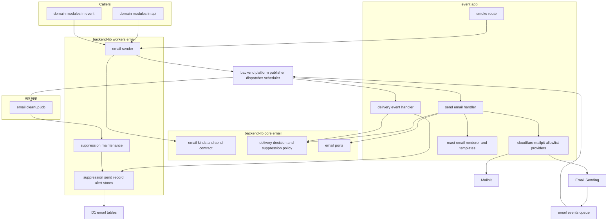
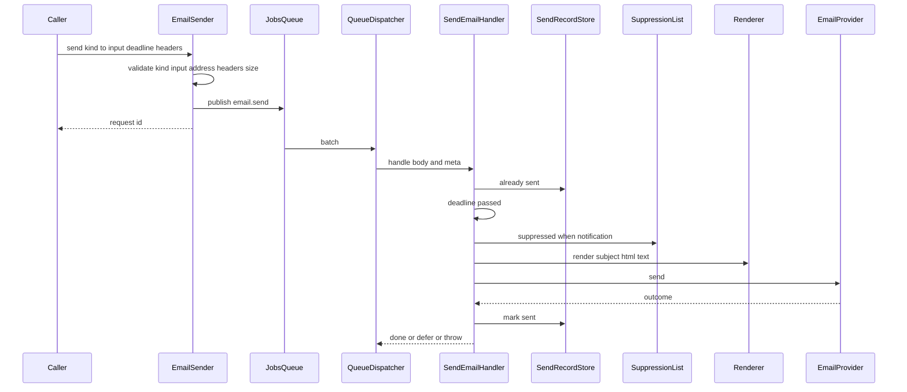
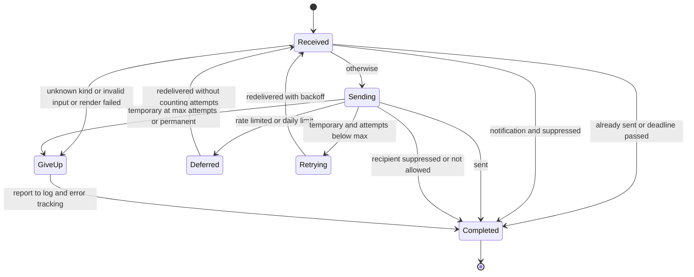
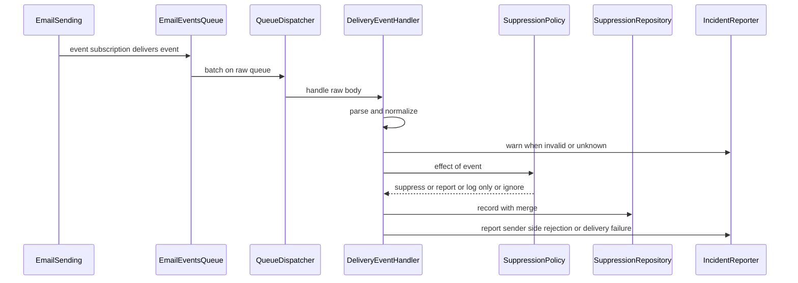
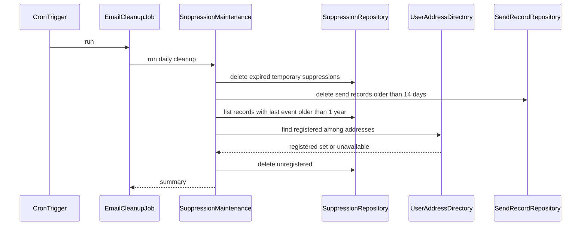
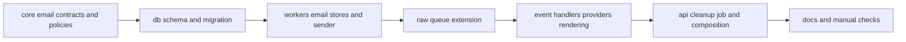

# Design Document

## Overview

**Purpose**: メールを送る全ドメインspecに、送信要求の受付・非同期の送信・送信上限による待機・再試行・送信不能の検知・配信不能イベントの抑止リストへの記録・テンプレートの描画を、1つの経路として提供する。呼び出し側はメール種別・宛先・テンプレート入力を渡すだけで送信を依頼し、送信プロバイダ(本番・stagingはCloudflare Email ServiceのEmail Sending、ローカルはMailpit)の違いと障害を意識しない。

**Users**: identity-auth・admin-foundation・notifications・inquiry-chat・sponsorship・ugc-moderation・content-reporting・data-exportの開発者とAIエージェントは、`apps/backend-lib/core/email/kinds/`にメール種別の契約を、`apps/event/src/infrastructure/email/templates/`にテンプレートを追加し、`EmailSender`で送信を依頼する。notificationsは抑止リストを照会し、送信者情報の提供元を差し替える。identity-authは退会時の抑止記録の削除と、メールアドレスが利用者に登録済みかの照会口を実装する。infra-deliveryは本設計が示す名前で送信ドメイン・Queue・イベントの購読を用意する。

**Impact**: backend-platformが設計した骨格(未実装)の上に、`apps/backend-lib`の`core/email`・`workers/email`、`apps/db/schema/email`、`apps/event`・`apps/api`のメール関連の層と登録を新設する。backend-platformの非同期メッセージの受信部へ、封筒を持たないメッセージを受け取る追加のQueueの登録口を、既存の振る舞いを変えずに加える(Q8)。テンプレートのパッケージをJSX emailからReact Emailへ置き換える(Q5)。

### Goals

- すべてのメールが「送信要求の検証→Queue→eventのconsumerで描画・送信」の1経路で送られ、送信上限では破棄せず待機し、一時的な障害は約30分再試行してから送信不能として検知される。
- 恒久バウンス・苦情・受信者側の拒否が抑止リストに記録され、notificationsが照会でき、抑止中の宛先へ通知メールが送られない。
- 共通レイアウトにより、日本語の件名とHTML・テキストの両パートを持つメールが、文言規則の本文構成どおりに描画される。
- 後続specは、種別の契約とテンプレートの追加、登録箇所への追記だけでメールを送れる。

### Non-Goals

- 個々のメールの件名・本文と、その送信を起こす業務の処理(各ドメインspec)。
- 通知の対象者・受信設定・集約、配信停止のトークンと受付、送信者情報の設定と保存、抑止状態の画面表示(notifications)。
- 退会の発火と、利用者のメールアドレスの保持(identity-auth)。
- 送信ドメインの登録とDNS、Queueとイベントの購読のクラウド上の作成、stagingの宛先の検証、送信内容のプレビューの無効化(infra-delivery・開発者の手作業)。
- 添付ファイル、複数の宛先、開封・クリックの計測、送信履歴の閲覧。

## Boundary Commitments

### This Spec Owns

- メール種別の契約の形と集約点(`EmailKind`・`defineEmailKind`・`EMAIL_KINDS`)、種別の命名規約`<ドメイン>.<名詞句>`、疎通確認用の種別`email-delivery.smoke`。
- 送信要求の受付(`EmailSender`)と、非同期メッセージ`email.send`の契約、追加ヘッダーの許可リスト、宛先の検証と照合キー。
- 送信処理(`SendEmailHandler`): 重複の防止・送信期限の判定・通知メールの抑止の適用・描画・送信・送信上限での待機・再試行・送信不能の検知と記録。
- 送信プロバイダの抽象(`EmailProvider`)と実装(Email Sending・Mailpit・stagingの宛先制限)、送信プロバイダの失敗の分類。
- 配信不能イベントの解釈と抑止の方針(`DeliveryEventHandler`・`SuppressionPolicy`)、抑止リストのデータ(`email_suppressions`)と照会・記録・削除・日次の後始末。
- 送信済みの記録(`email_send_records`)と警告の間引き(`email_alert_throttles`)。
- テンプレート基盤(`EmailTemplate`・共通レイアウトと部品・`ReactEmailRenderer`・UTC表記の部品)。
- 送信者情報の取得口(`SenderInfoProvider`)と未設定の既定実装、利用者のメールアドレスの照会口(`UserAddressDirectory`)と未提供の既定実装、それぞれの登録箇所。
- 疎通確認用の経路`POST /internal/email/smoke`。
- backend-libの非同期メッセージの受信部への、封筒を持たないQueueの登録口(`RawQueueRegistration`)の追加。
- 技術ドキュメント`external/001-email-sending.md`と`infra/003`への追記、サービス仕様のデータ保持期間の追記、`tech-stack.md`のテンプレートの置き換え。

### Out of Boundary

- 各ドメインのメール種別・テンプレート・送信の契機(各ドメインspec)。
- 通知メールの対象者の決定と抑止リストによる絞り込み、配信停止のヘッダーの値・本文のリンクのURL・トークン・受付、送信者情報の保存と設定画面、抑止状態の表示(notifications)。本specは配信停止のURLを受け取って表示する区画だけを持つ。
- 退会時に`SuppressionMaintenance.deleteByAddress`を呼ぶこと、`UserAddressDirectory`の実装(identity-auth)。
- 送信ドメイン・DNS・メールイベント用Queue・イベントの購読の作成、`database_id`などのクラウドの識別子(infra-delivery)。
- 共通の封筒・再試行の判定・デッドレターの通知・ログとSentryの設定・定期実行の振り分け(backend-platform。本specは登録口の追加以外を変えない)。
- E2EテストからMailpitを読む補助部品(必要になった下流specが作る)。

### Allowed Dependencies

- 上流: backend-platformの`apps/db`共通カラム(`ulidPrimaryKey`・`timestamps`・`textNoCase`)、`core`の`Clock`・`IdGenerator`・`RetryPolicy`・`decideOnFailure`・`MessageContract`・`defineMessageContract`・`getAppLogger`・`ScheduledJobDefinition`・`AppModule`・`AppError`、`workers`の`MessagePublisher`・`createQueueDispatcher`・`PlatformEnv`・`Database`。dev-toolingのスクリプト契約・テストの命名・基底設定。
- npmパッケージ: 既存の版(hono・inversify・drizzle-orm・zod・@logtape/logtape・@sentry/cloudflare)と、Technology Stackに挙げる新規のreact・react-dom・@react-email/components・@react-email/render(eventだけ)。
- 依存の方向: `apps/db/schema/email` → `backend-lib/core/email` → `backend-lib/workers/email` → アプリの`src`(`domain` → `application` → `infrastructure`・`presentation` → `composition`)。`core/email`はzodと`core`の他の部品だけを読み込み、Reactを読み込まない。Reactを読み込むのは`apps/event/src/infrastructure/email/`だけとする。
- アプリの`application/email`は`lib/core/email`のポートだけを参照し、`lib/workers`・`db`・React・`cloudflare:*`を読み込まない(backend-platformの層の規則)。

### Revalidation Triggers

- `EmailKind`・`EmailSendRequest`・`EmailSender`・`EmailSendError`の形、種別の命名規約の変更(全下流spec)。
- `EmailTemplate`の形と共通レイアウトの区画(宛名・行動ボタン・配信停止・送信者情報)の変更(全下流spec・notifications)。
- `SuppressionList`・`SuppressionStatus`の形、抑止の方針(7日・期限なし・1年)の変更(notifications・サービス仕様の保持期間)。
- `SuppressionMaintenance.deleteByAddress`・`UserAddressDirectory`・`SenderInfoProvider`の形と登録箇所の変更(identity-auth・notifications)。
- 再試行の回数と間隔、待機の間隔の変更(運用・技術ドキュメント)。
- Queue名・バインディング名・変数とシークレットのキー名・送信ドメイン・送信元アドレスの変更(infra-delivery)。
- `RawQueueRegistration`と`createQueueDispatcher`の追加引数の変更(backend-platformの部品を使う全spec)。
- eventのReactの版の変更(frontend-platformと版をそろえる)。

## Architecture

### Existing Architecture Analysis

- backend-platformは設計・タスクとも承認済みで、実装は未着手である。本specはその契約(処理単位のコンテナ・`AppModule`・`MessagePublisher`・`MESSAGE_CONTRACTS`・`MESSAGE_HANDLERS`・`SCHEDULED_JOBS`・`DeadLetterNotice`・層の規則)を前提にし、backend-platformの実装完了後に着手する。
- backend-platformの受信部は、`batch.queue`が本体(`JOBS_QUEUE_NAME`)・デッドレター(`JOBS_DLQ_NAME`)以外なら例外にする。配信不能イベントはCloudflareが決めた形式で届き封筒を持たないため、追加のQueueとして受ける登録口を加える(後述「RawQueueDispatch」)。
- Cron Triggersはapiだけに置く規約のため、抑止記録の日次の後始末はapiのジョブとして登録する。
- `apps/backend-lib`は`api`が検査担当で、`core`はBunの単体テスト、`workers`はapiのWorkers統合テストで検査する。eventの`application`はBunの単体テスト、`infrastructure`・`presentation`・`composition`はeventのWorkers統合テストで検査する。単体テストの命名は`*.unit.test.ts`だけで`.tsx`を持てないため、Reactを含む描画はWorkers統合テスト(`*.worker.test.tsx`)で確かめる。

### Architecture Pattern & Boundary Map



**Architecture Integration**:

- 選んだパターン: ポートとアダプタ。判断(待機・再試行・送信不能・抑止)は`core/email`の純粋関数に置き、送信プロバイダ・描画・データの保存・エラートラッキングはポートの実装として差し替える。送信プロバイダの抽象化により、betaのAPI変更や代替サービスへの切り替えを`EmailProvider`の実装の追加で吸収する。
- 境界: 共有コードは、両アプリが使う部品(種別の契約・送信の受付・抑止リスト・送信済みの記録)だけに限る。描画と送信プロバイダはeventだけ、日次の後始末はapiだけに置く。
- 既存パターンの維持: 処理単位のコンテナ、`AppModule`による登録、`MessageContract`・`MESSAGE_HANDLERS`・`SCHEDULED_JOBS`の登録箇所、`@inject`の明示、bind mountの共有ディレクトリ、`textNoCase`による大文字小文字を区別しない照合。
- 新規コンポーネントの理由: research.mdの「Generalization・Build vs Adopt・Simplification」を参照。

### Dependency Direction

`apps/db/schema/email`(テーブル定義) → `backend-lib/core/email`(契約・方針・ポート。zodだけに依存) → `backend-lib/workers/email`(D1のストアと送信の受付) → アプリの`src`(`application/email` → `infrastructure/email`・`presentation/email` → `composition`)の順にのみimportする。

- `core/email`は`workers`・`apps/db`・`hono`・`cloudflare:*`・Reactを読み込まない(backend-platformの`lib/core/**`の規則に従う)。
- `application/email`は`lib/core/email`のポートと純粋関数だけを読み込む。
- Reactと`@react-email/*`を読み込むのは`apps/event/src/infrastructure/email/rendering/`と`templates/`だけで、apiは読み込まない。違反は静的解析(`no-restricted-imports`)で検出する。

### Technology Stack

| Layer               | Choice / Version                                                                  | Role in Feature                                  | Notes                                                                        |
| ------------------- | --------------------------------------------------------------------------------- | ------------------------------------------------ | ---------------------------------------------------------------------------- |
| テンプレート        | @react-email/components 1.0.12・@react-email/render 2.1.0                         | 共通レイアウトの部品、HTMLとテキストパートの生成 | 新規(Q5)。eventだけ。renderの`workerd`条件の出力を使う。`pretty`は使わない   |
| UIランタイム        | react 19.3.0・react-dom 19.3.0・@types/react 19.3.0・@types/react-dom 19.3.0(dev) | JSXの描画                                        | 新規。19.3.1は公開から2週間未満のため19.3.0。frontend-platformと版をそろえる |
| 送信(本番・staging) | Cloudflare Email Sending(`send_email`バインディング)                              | 構造化された`send()`による送信                   | public beta。`allowed_sender_addresses`で送信元を固定                        |
| 送信(ローカル)      | Mailpit 1.32.0のHTTP API(`POST /api/v1/send`)                                     | 開発用の受信箱への送信                           | 開発コンテナに常駐(ポート48041)。`fetch`で呼ぶ                               |
| 非同期              | Cloudflare Queues(本体`JOBS_QUEUE`、メールイベント用Queue)・Event Subscriptions   | 送信要求の受け渡し、配信不能イベントの受け取り   | 本体はbackend-platformのもの。メールイベント用Queueは新規                    |
| データ              | Cloudflare D1(drizzle-orm 1.0.0-rc.4)                                             | 抑止リスト・送信済みの記録・警告の間引き         | 新しいテーブル3つ                                                            |
| 定期実行            | Cron Triggers(api)                                                                | 抑止記録と送信済みの記録の日次の後始末           | 業務時刻4:21(日次バッチ)                                                     |
| 観測                | @logtape/logtape 2.3.11・@sentry/cloudflare 11.4.0                                | 送信結果のログ、送信不能・上限到達の通知         | 既存                                                                         |

## File Structure Plan

### Directory Structure

```
apps/
├── db/schema/email/                              # メール送信基盤のテーブル定義
│   ├── email-suppressions.ts                     # 抑止リスト(address・last_reason・last_event_at・expires_at)
│   ├── email-send-records.ts                     # 送信済みの記録(送信要求の識別子・種別・送信日時)
│   ├── email-alert-throttles.ts                  # 警告の間引き(name・last_reported_at)
│   └── *.unit.test.ts                            # 列の型・制約・既定値
├── backend-lib/
│   ├── core/email/                               # 純粋な契約と方針(Bunの単体テスト、各ファイルに同名の*.unit.test.ts)
│   │   ├── identifiers.ts                        # EMAIL_TYPES(共有ポートのDI識別子)
│   │   ├── ports.ts                              # EmailSender・SuppressionList・SuppressionRecorder・SuppressionMaintenance・UserAddressDirectory・SenderInfoProvider・SendRecordStore・AlertThrottleの型
│   │   ├── email-kind.ts                         # EmailCategory・EmailKind・defineEmailKind・createEmailKindRegistry
│   │   ├── kinds/index.ts                        # EMAIL_KINDS(全メール種別の集約点)
│   │   ├── kinds/email-delivery-smoke.ts         # 疎通確認用の種別
│   │   ├── email-address.ts                      # 宛先の形式検証と照合キー
│   │   ├── email-headers.ts                      # 追加ヘッダーの許可リストと値の検証
│   │   ├── send-message.ts                       # EMAIL_SEND_MESSAGE(email.send)と本文の上限
│   │   ├── provider-outcome.ts                   # EmailProviderOutcomeとEmail Sendingの失敗コードの分類
│   │   ├── delivery-decision.ts                  # 送信前の判定、送信結果からの行動、再試行の方針と待機の間隔
│   │   ├── delivery-event.ts                     # 配信不能イベントの検証と正規化
│   │   ├── delivery-event.fixtures.ts            # Cloudflareの文書の例に基づくイベントの標本(テスト用)
│   │   ├── suppression-policy.ts                 # イベントから抑止への効果、合成、有効判定、保持の定数
│   │   └── format-utc-date-time.ts               # 「9月15日07:40(UTC)」形式の日時表記
│   ├── core/messaging/raw-queue.ts               # RawQueueRegistration・RawMessageHandler・名前の検証(Q8)
│   └── workers/email/                            # D1と送信の受付(apiのWorkers統合テスト、各ファイルに同名の*.worker.test.ts)
│       ├── email-sender.ts                       # 送信要求の検証とemail.sendの送信
│       ├── suppression-repository.ts             # 抑止記録の照会・合成付きの記録・削除・後始末用の検索
│       ├── send-record-repository.ts             # 送信済みの記録と期限切れの削除
│       ├── alert-throttle-repository.ts          # 一定間隔に1回だけ真を返す間引き
│       ├── suppression-maintenance.ts            # 退会時の削除と日次の後始末
│       └── email-platform-module.ts              # 両アプリ共通の束縛(EMAIL_PLATFORM_MODULE)
├── event/src/
│   ├── application/email/                        # Bunの単体テスト(各ファイルに同名の*.unit.test.ts)
│   │   ├── email-types.ts                        # EVENT_EMAIL_TYPES(eventだけのDI識別子)
│   │   ├── ports.ts                              # EmailProvider・EmailRenderer・EmailIncidentReporter・EmailRuntimeConfigの型
│   │   ├── send-email-handler.ts                 # email.sendの処理
│   │   └── delivery-event-handler.ts             # 配信不能イベントの処理
│   ├── infrastructure/email/                     # eventのWorkers統合テスト
│   │   ├── providers/cloudflare-email-provider.ts    # sendバインディングの呼び出し・時間切れ・失敗の分類
│   │   ├── providers/mailpit-email-provider.ts       # MailpitのHTTP APIの呼び出し
│   │   ├── providers/recipient-allowlist-provider.ts # 許可された宛先以外を送らない包み
│   │   ├── providers/create-email-provider.ts        # 環境の値による実装の選択
│   │   ├── rendering/email-template.ts           # EmailTemplate・defineEmailTemplate・createEmailTemplateRegistry
│   │   ├── rendering/react-email-renderer.tsx    # レイアウトへの組み込みとHTML・テキストの生成
│   │   ├── rendering/email-layout.tsx            # 共通レイアウト
│   │   ├── rendering/email-greeting.tsx          # 宛名
│   │   ├── rendering/email-action-button.tsx     # 主要な行動へのボタン
│   │   ├── rendering/email-unsubscribe-link.tsx  # 配信停止リンクの区画
│   │   ├── rendering/email-sender-info.tsx       # 送信者情報の区画
│   │   ├── templates/index.ts                    # EMAIL_TEMPLATES(全テンプレートの集約点)
│   │   ├── templates/email-delivery/smoke-email-body.tsx   # 疎通確認メールの本文
│   │   ├── templates/email-delivery/smoke-template.ts      # 疎通確認メールのテンプレート定義
│   │   ├── sender-info/unset-sender-info-provider.ts       # 未設定として返す既定の送信者情報
│   │   └── sentry-email-incident-reporter.ts     # 送信不能・上限到達などのSentry通知
│   ├── presentation/email/email-smoke-route.ts   # POST /internal/email/smoke
│   └── composition/
│       ├── email-module.ts                       # eventのメールのAppModule(束縛と経路)
│       ├── email-registrations.ts                # EMAIL_SENDER_INFO_PROVIDER(送信者情報の提供元の登録箇所)
│       └── raw-queue-handlers.ts                 # RAW_QUEUE_HANDLERS(封筒を持たないQueueの登録箇所)
└── api/
    ├── src/application/email/email-cleanup-job.ts        # 日次の後始末のジョブ(単体テスト併置)
    ├── src/infrastructure/email/unavailable-user-address-directory.ts  # 未提供として返す既定の照会口
    ├── src/composition/email-module.ts                   # apiのメールのAppModule
    ├── src/composition/email-registrations.ts            # USER_ADDRESS_DIRECTORY(利用者のアドレスの照会口の登録箇所)
    └── test/config/email-wrangler-config.unit.test.ts    # メール関連のWrangler設定の検査
docs/
├── GUIDES/tech/external/001-email-sending.md      # メール送信サービスの仕様・上限・失敗の分類・再試行・配信不能イベント・抑止・ローカルの受信箱・管理画面の設定
└── GUIDES/tech/external/README.md                 # 文書一覧へ1行追記
```

テストファイルは、同名の`*.unit.test.ts`(純粋な部品)・`*.worker.test.ts`・`*.worker.test.tsx`(Workersの実行環境の部品と描画)を対象ファイルの隣に置く。

### Modified Files

- `apps/db/schema/index.ts` — メールの3テーブルを集約点に加える。`apps/db/migrations/<日時>_email_delivery/migration.sql`を生成する。
- `apps/backend-lib/core/messaging/contracts/index.ts` — `EMAIL_SEND_MESSAGE`を`MESSAGE_CONTRACTS`へ加える(backend-platformが定めた登録箇所)。
- `apps/backend-lib/workers/messaging/queue-consumer.ts`・同名の`*.worker.test.ts` — `createQueueDispatcher`に任意の第3引数`{ rawQueues }`を加える。既存の2つのQueueの処理と既存のテストは変えない(Q8)。
- `apps/event/package.json`・`bun.lock` — react・react-dom・@react-email/components・@react-email/render、devに@types/react・@types/react-domを版固定で加える。
- `apps/event/tsconfig.json` — `jsx: "react-jsx"`と`types`へのReactの型を加え、`include`に`*.tsx`を含める。
- `apps/event/eslint.config.ts` — `src/**`(`infrastructure/email/rendering`・`templates`以外)と`lib/**`で`react`・`react-dom`・`@react-email/*`のimportを禁止する。
- `apps/api/eslint.config.ts` — `src/**`・`lib/**`・`db/**`で同じimportを禁止する。
- `apps/event/wrangler.jsonc`・`worker-configuration.d.ts` — 3環境の`vars`(`EMAIL_PROVIDER`・`EMAIL_FROM_ADDRESS`・`EMAIL_RECIPIENT_POLICY`・`EMAIL_EVENTS_QUEUE_NAME`、ルートだけ`MAILPIT_API_URL`)、staging・prodの`send_email`(`EMAIL`、`allowed_sender_addresses`)、stagingの`secrets.required`への`EMAIL_ALLOWED_RECIPIENTS`、メールイベント用Queueのconsumerを加える。
- `apps/event/vitest.worker.config.ts` — テスト用の変数(Mailpitの宛先URL・送信元)と、メールイベント用Queueの名前を加える。
- `apps/event/src/composition/env-schema.ts` — メールの変数・シークレット・バインディングの検証を加える。
- `apps/event/src/composition/modules.ts`・`message-handlers.ts` — `EMAIL_PLATFORM_MODULE`とeventのメールモジュール、`email.send`の処理と再試行の方針を登録する。
- `apps/event/src/index.ts` — `createQueueDispatcher`へ`RAW_QUEUE_HANDLERS`を渡す。
- `apps/api/src/composition/modules.ts`・`scheduled-jobs.ts` — apiのメールモジュールと日次の後始末のジョブ(4:21)を登録する。
- `apps/api/wrangler.jsonc` — 3環境の`triggers.crons`に`21 12 * * *`を加える(既にあれば変更しない)。
- `docs/GUIDES/tech/infra/003-async-processing.md` — メール送信の経路、送信上限による待機と送信期限、封筒を持たないQueueの登録を追記する。
- `docs/GUIDES/tech/coding/002-dependency-versions.md` — react・react-dom・@types/react・@types/react-dom・@react-email/*を版をそろえる一覧に加える。
- `docs/GUIDES/service/legal/001-compliance-policy.md` — データ保持期間の一覧に抑止記録と送信済みの記録の行を加える。
- `docs/onboardings/tech-stack.md` — 「メール」のJSX emailをReact Email(`@react-email/components`・`@react-email/render`)へ置き換える(Q5)。
- `docs/onboardings/project-values.md` — 送信ドメイン・送信元アドレス・表示名・Queue名・変数とシークレットのキー名・疎通確認の経路を追記する。
- `docs/onboardings/README.md` — Mailpitでのメールの確認、疎通確認の経路の使い方、Infisicalへの登録(`EMAIL_SMOKE_TOKEN`・`EMAIL_SMOKE_RECIPIENT`・`EMAIL_ALLOWED_RECIPIENTS`)を追記する。
- `CLAUDE.md` — 「技術規則の参照先」に「メールを送る処理を書く前に」として`external/001-email-sending.md`へのリンクを加える。

## System Flows

### 送信要求から送信まで



- 受付で検証に失敗した要求は送らずに`EmailSendError`で呼び出し側へ返す(1.3)。受付は送信プロバイダを呼ばない(1.4)。
- 送信処理は、送信済み・期限切れ・抑止中(通知メールだけ)のいずれかなら送らずに完了する(6.7・5.5・8.4)。

### 送信処理の判定



- 待機(`defer`)は試行回数に数えない(5.3)。送信レートの上限は60秒、日次上限は3600秒ごとに試し直す。日次上限のリセット時刻は公開されていないため、時刻を計算せず一定の間隔で試す(5.2)。
- 一時的な障害は120・240・480・960秒の間隔で再試行し、5回目の試行でも失敗したら送信不能として通知して完了する。最初の失敗から送信不能となるまでは約30分である(6.1・6.2・6.9)。
- 再試行しても結果が変わらない失敗と描画の失敗は、再試行せずに送信不能として通知する(6.3)。宛先の抑止(トランザクションメール)とstagingの宛先制限は、ログだけに記録して完了する(6.4・4.4)。

### 配信不能イベントの取り込み



- 抑止の合成は「期限なしが期限付きに勝つ・期限付きは遅い方・最後の契機は日時の遅い方」で、同じイベントを何回受け取っても、届く順序が入れ替わっても結果が同じになる(7.6・7.7)。合成は1つのSQL文の`ON CONFLICT DO UPDATE`で行い、同時の記録でも取りこぼさない。
- D1の失敗などで処理が例外になった場合は、backend-platformの再試行に任せ、上限で`DeadLetterNotice`(種別`raw:email-delivery-events`)を送る。

### 日次の後始末(業務時刻4:21)



- 照会口が未提供(identity-authの実装前など)なら、利用者に紐づかない記録の削除を行わず、警告をログに出す(9.4)。期限切れの記録と送信済みの記録の削除は続ける。

## Requirements Traceability

| Requirement | Summary                                    | Components                                                                   | Interfaces                                               | Flows                      |
| ----------- | ------------------------------------------ | ---------------------------------------------------------------------------- | -------------------------------------------------------- | -------------------------- |
| 1.1         | 両サーバーでの送信依頼                     | EmailSender・EmailPlatformModule・ApiEmailComposition・EventEmailComposition | `EmailSender.send`                                       | 送信要求から送信まで       |
| 1.2         | 検証して非同期へ渡し識別子を返す           | EmailSender・EmailSendContract                                               | `EMAIL_SEND_MESSAGE`                                     | 送信要求から送信まで       |
| 1.3         | 未登録・入力不正・宛先不正の拒否           | EmailSender・EmailKindRegistry・EmailSendContract                            | `EmailSendError`                                         | 送信要求から送信まで       |
| 1.4         | 送信完了を待たない                         | EmailSender                                                                  | `EmailSender.send`                                       | 送信要求から送信まで       |
| 1.5         | 全種別をeventの非同期処理で送る            | EmailSender・SendEmailHandler・EventEmailComposition                         | `MESSAGE_HANDLERS`                                       | 送信要求から送信まで       |
| 1.6         | 送信期限の引き継ぎ                         | EmailSendContract・EmailSender                                               | `EmailSendBody.deadline`                                 | 送信要求から送信まで       |
| 1.7         | 許可されたヘッダーだけ付与                 | EmailSendContract・EmailSender・EmailProviders                               | `validateExtraHeaders`                                   | 送信要求から送信まで       |
| 1.8         | 宛先は1件                                  | EmailSendContract                                                            | `EmailSendBody.to`                                       | —                          |
| 2.1         | 登録だけで種別を追加                       | EmailKindRegistry・EmailRendering                                            | `defineEmailKind`・`defineEmailTemplate`                 | —                          |
| 2.2         | 重複・欠けた登録の検出                     | EmailKindRegistry・EmailRendering                                            | `createEmailKindRegistry`・`createEmailTemplateRegistry` | —                          |
| 2.3         | 配信停止の区画は通知メールだけ             | EmailRendering                                                               | `EmailTemplate.unsubscribeUrl`                           | —                          |
| 2.4         | ログと通知に種別と分類                     | SendEmailHandler・EmailIncidentReporter                                      | `EmailIncident`                                          | 送信処理の判定             |
| 3.1         | 本文構成の順の共通レイアウト               | EmailRendering                                                               | `EmailLayout`                                            | —                          |
| 3.2         | HTMLとテキストの両パート                   | EmailRendering                                                               | `ReactEmailRenderer.render`                              | —                          |
| 3.3         | 日本語の件名・本文と言語指定               | EmailRendering・EmailProviders・EmailSmokeRoute                              | `RenderedEmail`                                          | —                          |
| 3.4         | 入力文字列のエスケープ                     | EmailRendering                                                               | `ReactEmailRenderer.render`                              | —                          |
| 3.5         | 宛名の省略                                 | EmailRendering                                                               | `EmailTemplate.greeting`                                 | —                          |
| 3.6         | 送信者情報の区画                           | EmailRendering・SenderInfoDefault                                            | `SenderInfoProvider`                                     | —                          |
| 3.7         | 未設定なら区画を省略                       | EmailRendering・SenderInfoDefault                                            | `SenderInfoProvider.get`                                 | —                          |
| 3.8         | UTC表記の部品                              | UtcDateTimeFormat                                                            | `formatUtcDateTime`                                      | —                          |
| 3.9         | 接頭辞の無い件名                           | EmailRendering                                                               | `EmailTemplate.subject`                                  | —                          |
| 3.10        | 計測と外部スクリプトを含めない             | EmailRendering                                                               | `EmailLayout`                                            | —                          |
| 4.1         | 表示名・noreply・返信先なし                | EmailProviders・EventEmailComposition                                        | `EmailRuntimeConfig`                                     | —                          |
| 4.2         | 環境別の送信ドメイン                       | EventEmailComposition・EmailConfigChecks                                     | `EMAIL_FROM_ADDRESS`                                     | —                          |
| 4.3         | ローカルは開発用の受信箱                   | EmailProviders                                                               | `MailpitEmailProvider`                                   | —                          |
| 4.4         | stagingは検証済みの宛先だけ                | EmailProviders・DeliveryDecision                                             | `RecipientAllowlistProvider`                             | 送信処理の判定             |
| 4.5         | 送信プロバイダの差し替え                   | EmailProviders・SendEmailHandler                                             | `EmailProvider`                                          | —                          |
| 4.6         | 外部へ送らないテスト                       | EmailProviders・SendEmailHandler                                             | `EmailProvider`・注入する`fetch`                         | —                          |
| 5.1         | 送信レート上限で待機                       | DeliveryDecision・SendEmailHandler                                           | `decideAfterOutcome`                                     | 送信処理の判定             |
| 5.2         | 日次上限でリセット後に送信                 | DeliveryDecision・SendEmailHandler                                           | `decideAfterOutcome`                                     | 送信処理の判定             |
| 5.3         | 待機を試行回数に数えない                   | DeliveryDecision・SendEmailHandler                                           | `MessageHandlingResult.defer`                            | 送信処理の判定             |
| 5.4         | 上限到達の警告を1つの問題に                | SendEmailHandler・AlertThrottleRepository・EmailIncidentReporter             | `AlertThrottle`・fingerprint                             | 送信処理の判定             |
| 5.5         | 期限切れは送らず記録                       | DeliveryDecision・SendEmailHandler                                           | `decideBeforeSend`                                       | 送信処理の判定             |
| 5.6         | 期限なしは上限が解けた後に送る             | DeliveryDecision                                                             | `decideAfterOutcome`                                     | 送信処理の判定             |
| 6.1         | 一時的な障害の再試行                       | DeliveryDecision・EmailProviders・SendEmailHandler                           | `EMAIL_SEND_RETRY_POLICY`                                | 送信処理の判定             |
| 6.2         | 再試行の上限で送信不能を通知               | DeliveryDecision・SendEmailHandler・EmailIncidentReporter                    | `EmailIncident`                                          | 送信処理の判定             |
| 6.3         | 恒久的な失敗と描画失敗は再試行しない       | ProviderOutcomeClassifier・DeliveryDecision・SendEmailHandler                | `classifyCloudflareSendError`                            | 送信処理の判定             |
| 6.4         | トランザクションメールの抑止拒否はログだけ | ProviderOutcomeClassifier・DeliveryDecision                                  | `recipient-suppressed`                                   | 送信処理の判定             |
| 6.5         | 受付後のバウンス以外の配送失敗の通知       | DeliveryEventParser・SuppressionPolicy・DeliveryEventHandler                 | `SuppressionEffect.report`                               | 配信不能イベントの取り込み |
| 6.6         | 成功時のログ                               | SendEmailHandler                                                             | `providerMessageId`                                      | 送信要求から送信まで       |
| 6.7         | 重複して届いても再送しない                 | SendRecordRepository・SendEmailHandler                                       | `SendRecordStore`                                        | 送信要求から送信まで       |
| 6.8         | ログと通知に個人情報を含めない             | SendEmailHandler・DeliveryEventHandler・EmailIncidentReporter                | `EmailIncident`                                          | —                          |
| 6.9         | 再試行の回数・間隔・最長時間の文書化       | EmailDocs                                                                    | —                                                        | —                          |
| 7.1         | 恒久バウンスは期限なし                     | SuppressionPolicy・SuppressionRepository・DeliveryEventHandler               | `decideSuppressionEffect`                                | 配信不能イベントの取り込み |
| 7.2         | 苦情は期限なし                             | SuppressionPolicy・SuppressionRepository                                     | `decideSuppressionEffect`                                | 配信不能イベントの取り込み |
| 7.3         | 受信者側の拒否は7日                        | SuppressionPolicy                                                            | `REJECTION_SUPPRESSION_DAYS`                             | 配信不能イベントの取り込み |
| 7.4         | 送信側・不明の拒否は記録せず通知           | SuppressionPolicy・DeliveryEventHandler                                      | `SuppressionEffect.report`                               | 配信不能イベントの取り込み |
| 7.5         | ソフトバウンスはログだけ                   | SuppressionPolicy                                                            | `SuppressionEffect.log-only`                             | 配信不能イベントの取り込み |
| 7.6         | 既存の抑止との合成                         | SuppressionPolicy・SuppressionRepository                                     | `mergeSuppression`                                       | 配信不能イベントの取り込み |
| 7.7         | 重複イベントで結果を変えない               | SuppressionPolicy・SuppressionRepository                                     | `mergeSuppression`                                       | 配信不能イベントの取り込み |
| 7.8         | 不正・未知のイベントの警告                 | DeliveryEventParser・DeliveryEventHandler                                    | `parseDeliveryEvent`                                     | 配信不能イベントの取り込み |
| 7.9         | 配信成功・再試行中は変更しない             | DeliveryEventParser・SuppressionPolicy                                       | `SuppressionEffect.ignore`                               | 配信不能イベントの取り込み |
| 7.10        | eventで受け取り既存の処理を変えない        | RawQueueContract・RawQueueDispatch・EventEmailComposition                    | `RawQueueRegistration`                                   | 配信不能イベントの取り込み |
| 8.1         | 抑止状態の照会                             | SuppressionRepository                                                        | `SuppressionList.getStatus`                              | —                          |
| 8.2         | 大文字小文字を区別しない照合               | EmailSendContract・EmailSchema・SuppressionRepository                        | `toMatchingKey`・`textNoCase`                            | —                          |
| 8.3         | 期限切れは抑止中として扱わない             | SuppressionPolicy・SuppressionRepository                                     | `isSuppressionActive`                                    | —                          |
| 8.4         | 通知メールは抑止中なら送らない             | SendEmailHandler                                                             | `SuppressionList.getStatus`                              | 送信処理の判定             |
| 8.5         | トランザクションメールは止めない           | SendEmailHandler                                                             | `EmailCategory`                                          | 送信処理の判定             |
| 8.6         | 必要な項目だけ保持                         | EmailSchema・SuppressionRepository                                           | `email_suppressions`                                     | —                          |
| 9.1         | 退会時の削除                               | SuppressionMaintenance                                                       | `SuppressionMaintenance.deleteByAddress`                 | —                          |
| 9.2         | 紐づかない記録の1年後の削除                | SuppressionMaintenance・EmailCleanupJob                                      | `UserAddressDirectory`                                   | 日次の後始末               |
| 9.3         | 期限切れの記録の削除                       | SuppressionMaintenance・SuppressionRepository                                | `runDailyCleanup`                                        | 日次の後始末               |
| 9.4         | 照会口が使えなければ削除しない             | SuppressionMaintenance・ApiEmailComposition                                  | `UserAddressLookup.unavailable`                          | 日次の後始末               |
| 9.5         | 削除の冪等性                               | SuppressionMaintenance・SuppressionRepository                                | `deleteByAddress`                                        | —                          |
| 10.1        | 送信処理の結果のログ                       | SendEmailHandler                                                             | 結果ごとのログの属性                                     | 送信処理の判定             |
| 10.2        | 資格情報を平文で残さない                   | EventEmailComposition・EmailSmokeRoute・EmailConfigChecks                    | `secrets.required`                                       | —                          |
| 10.3        | 本文と入力を保存しない                     | SendRecordRepository・EmailSchema                                            | `email_send_records`                                     | —                          |
| 10.4        | 管理画面に送信内容を残さない手順           | EmailDocs                                                                    | —                                                        | —                          |
| 11.1        | スクリプト契約と一括検査                   | EventEmailComposition・ApiEmailComposition                                   | —                                                        | —                          |
| 11.2        | カバレッジ80%                              | 全コンポーネントのテスト                                                     | —                                                        | —                          |
| 11.3        | workerd上の描画テスト                      | EmailRendering                                                               | `*.worker.test.tsx`                                      | —                          |
| 11.4        | ローカルの到着確認の手順                   | EmailSmokeRoute・EmailDocs                                                   | `POST /internal/email/smoke`                             | —                          |
| 11.5        | stagingの到着確認の手順                    | EmailSmokeRoute・EmailDocs                                                   | `POST /internal/email/smoke`                             | —                          |
| 11.6        | `external`の文書                           | EmailDocs                                                                    | —                                                        | —                          |
| 11.7        | `infra`の文書への追記                      | EmailDocs                                                                    | —                                                        | —                          |
| 11.8        | 固有の値をproject-valuesへ                 | EmailDocs                                                                    | —                                                        | —                          |
| 11.9        | tech-stack.mdの置き換え                    | EmailDocs                                                                    | —                                                        | —                          |
| 11.10       | データ保持期間の追記                       | EmailDocs                                                                    | —                                                        | —                          |
| 11.11       | オンボーディングの更新                     | EmailDocs                                                                    | —                                                        | —                          |

## Components and Interfaces

| Component                 | Domain/Layer         | Intent                                           | Req Coverage                                        | Key Dependencies (P0/P1)                            | Contracts      |
| ------------------------- | -------------------- | ------------------------------------------------ | --------------------------------------------------- | --------------------------------------------------- | -------------- |
| EmailKindRegistry         | core/email           | メール種別の契約と集約・検査                     | 1.3, 2.1, 2.2                                       | zod(P0)                                             | Service, State |
| EmailSendContract         | core/email           | `email.send`の本文・宛先・ヘッダーの検証         | 1.2, 1.3, 1.6, 1.7, 1.8, 8.2                        | MessageContract(P0)                                 | Event          |
| ProviderOutcomeClassifier | core/email           | 送信プロバイダの結果と失敗コードの分類           | 5.1, 5.2, 6.1, 6.3, 6.4                             | —                                                   | Service        |
| DeliveryDecision          | core/email           | 送信前の判定と結果からの行動                     | 4.4, 5.1–5.3, 5.5, 5.6, 6.1–6.4                     | RetryPolicy(P0)                                     | Service        |
| DeliveryEventParser       | core/email           | 配信不能イベントの検証と正規化                   | 6.5, 7.8, 7.9                                       | zod(P0)                                             | Event          |
| SuppressionPolicy         | core/email           | イベントの効果・合成・有効判定                   | 7.1–7.7, 7.9, 8.3, 9.2, 9.3                         | —                                                   | Service, State |
| UtcDateTimeFormat         | core/email           | メール内の日時表記                               | 3.8                                                 | —                                                   | Service        |
| EmailPorts                | core/email           | 共有ポートとDI識別子                             | 1.1, 3.6, 8.1, 9.1, 9.2                             | —                                                   | Service        |
| RawQueueContract          | core/messaging       | 封筒を持たないQueueの登録の型と検証              | 7.10                                                | RetryPolicy(P0)                                     | Batch          |
| EmailSender               | workers/email        | 送信要求の検証と`email.send`の送信               | 1.1–1.4, 1.6–1.8                                    | MessagePublisher(P0), EmailKindRegistry(P0)         | Service        |
| SuppressionRepository     | workers/email        | 抑止記録の照会・合成付きの記録・削除             | 7.1–7.7, 8.1–8.3, 8.6, 9.1–9.3, 9.5                 | Database(P0)                                        | Service, State |
| SendRecordRepository      | workers/email        | 送信済みの記録                                   | 6.7, 10.3                                           | Database(P0)                                        | Service, State |
| AlertThrottleRepository   | workers/email        | 警告の間引き                                     | 5.4                                                 | Database(P0)                                        | Service, State |
| SuppressionMaintenance    | workers/email        | 退会時の削除と日次の後始末                       | 9.1–9.5                                             | SuppressionRepository(P0), UserAddressDirectory(P1) | Service, Batch |
| EmailPlatformModule       | workers/email        | 両アプリ共通の束縛                               | 1.1                                                 | inversify(P0)                                       | Service        |
| RawQueueDispatch          | workers/messaging    | 追加のQueueの振り分け(既存の受信部の拡張)        | 7.10                                                | QueueDispatcher(P0)                                 | Batch          |
| EmailSchema               | db/schema/email      | メールの3テーブル                                | 8.2, 8.6, 9.1–9.3, 10.3                             | 共通カラム(P0)                                      | State          |
| SendEmailHandler          | event/application    | `email.send`の処理                               | 1.5, 2.4, 5.1–5.6, 6.1–6.4, 6.6–6.8, 8.4, 8.5, 10.1 | ポート群(P0)                                        | Batch          |
| DeliveryEventHandler      | event/application    | 配信不能イベントの処理                           | 6.5, 6.8, 7.1–7.9                                   | SuppressionRecorder(P0)                             | Batch          |
| EmailProviders            | event/infrastructure | Email Sending・Mailpit・宛先制限の実装           | 1.7, 3.3, 4.1, 4.3–4.6, 6.1, 6.3                    | Email Sending(P0), Mailpit(P1)                      | Service        |
| EmailRendering            | event/infrastructure | テンプレートの定義・集約・レイアウト・描画       | 2.1–2.3, 3.1–3.7, 3.9, 3.10, 11.3                   | @react-email/render(P0)                             | Service        |
| SenderInfoDefault         | event/infrastructure | 未設定として返す送信者情報                       | 3.6, 3.7                                            | —                                                   | Service        |
| EmailIncidentReporter     | event/infrastructure | 送信不能・上限到達・イベント異常のSentry通知     | 2.4, 5.4, 6.2, 6.3, 6.5, 6.8, 7.4, 7.8              | @sentry/cloudflare(P0)                              | Service        |
| EmailSmokeRoute           | event/presentation   | 疎通確認メールの送信                             | 3.3, 10.2, 11.4, 11.5                               | EmailSender(P0)                                     | API            |
| EventEmailComposition     | event/composition    | eventの束縛・登録・環境・Wrangler設定            | 1.1, 1.5, 4.1, 4.2, 7.10, 10.2, 11.1                | backend-platformの骨格(P0)                          | State          |
| EmailCleanupJob           | api/application      | 日次の後始末の起動                               | 9.2–9.4                                             | SuppressionMaintenance(P0)                          | Batch          |
| ApiEmailComposition       | api/composition      | apiの束縛・登録・ジョブ・既定の照会口            | 1.1, 9.2, 9.4, 11.1                                 | backend-platformの骨格(P0)                          | State          |
| EmailConfigChecks         | api/test/config      | メール関連のWrangler設定の検査                   | 4.2, 7.10, 10.2                                     | Wranglerの設定読み込み(P1)                          | Batch          |
| EmailDocs                 | docs                 | 技術ドキュメント・サービス仕様・オンボーディング | 6.9, 10.4, 11.4–11.11                               | —                                                   | —              |

### core/email

#### EmailKindRegistry

| Field        | Detail                               |
| ------------ | ------------------------------------ |
| Intent       | メール種別の契約と集約点、登録の検査 |
| Requirements | 1.3, 2.1, 2.2                        |

**Responsibilities & Constraints**

- 種別は名前・分類・テンプレート入力の検証規則を持つ。名前は`<ドメイン>.<名詞句>`(小文字英数字とハイフン、ドットは1つ)とする。
- `EMAIL_KINDS`(`core/email/kinds/index.ts`)が全種別の唯一の集約点で、下流specは種別のファイルを`kinds/`に追加して集約点に1行足す。初版は`email-delivery.smoke`(トランザクション、入力は`{ requestedAt: string }`)だけを持つ。

**Contracts**: Service [x] / State [x]

##### Service Interface

```typescript
import type { z } from 'zod';

export type EmailCategory = 'transactional' | 'notification';

export interface EmailKind<TName extends string, TInput> {
  readonly name: TName;
  readonly category: EmailCategory;
  readonly inputSchema: z.ZodType<TInput>;
}
export type AnyEmailKind = EmailKind<string, unknown>;

export declare function defineEmailKind<TName extends string, TInput>(
  kind: EmailKind<TName, TInput>,
): EmailKind<TName, TInput>;

export interface EmailKindRegistry {
  get(name: string): AnyEmailKind | undefined;
  names(): readonly string[];
}
export declare class EmailKindRegistryError extends Error {}
export declare function createEmailKindRegistry(
  kinds: readonly AnyEmailKind[],
): EmailKindRegistry; // 名前の形式違反・重複でEmailKindRegistryError
export declare const EMAIL_KINDS: readonly AnyEmailKind[];
```

- 不変条件: `createEmailKindRegistry(EMAIL_KINDS)`は例外を投げない(単体テストで確かめる、2.2)。

#### EmailSendContract

| Field        | Detail                                             |
| ------------ | -------------------------------------------------- |
| Intent       | `email.send`の契約と、宛先・ヘッダー・大きさの検証 |
| Requirements | 1.2, 1.3, 1.6, 1.7, 1.8, 8.2                       |

**Contracts**: Event [x]

##### Event Contract

```typescript
export interface EmailSendBody {
  readonly kind: string;
  readonly to: string; // 1件(1.8)
  readonly input: unknown; // 種別のinputSchemaで検証済みのJSON
  readonly deadline?: string; // ISO 8601(UTC)
  readonly headers?: Readonly<Record<string, string>>;
}
export declare const EMAIL_SEND_MESSAGE: MessageContract<
  'email.send',
  EmailSendBody
>;
export declare const MAX_EMAIL_SEND_BODY_BYTES: 65536;

export declare function isValidEmailAddress(value: string): boolean; // 254文字以内、WHATWGのメールアドレス形式
export declare function toMatchingKey(address: string): string; // 前後の空白を除き小文字化

export type ExtraHeaders = Readonly<Record<string, string>>;
export type HeaderValidation =
  | { readonly ok: true }
  | {
      readonly ok: false;
      readonly reason:
        'not-allowed' | 'invalid-value' | 'too-many' | 'too-large';
    };
export declare const ALLOWED_EXTRA_HEADERS: readonly string[];
export declare function validateExtraHeaders(
  headers: ExtraHeaders,
): HeaderValidation;
```

- Published: `email.send`(`MESSAGE_CONTRACTS`へ登録)。Subscribed: eventの`SendEmailHandler`。
- `ALLOWED_EXTRA_HEADERS`はEmail Sendingの許可リストのうち`List-Unsubscribe`・`List-Unsubscribe-Post`・`List-Id`・`Auto-Submitted`・`Precedence`とする。値にCR・LFを含むもの、`List-Unsubscribe`が`<https://...>`を含まないもの、`List-Unsubscribe-Post`が`List-Unsubscribe=One-Click`以外のもの、1値2048バイト超・合計16KB超を拒否する(1.7)。
- 配送保証はbackend-platformの非同期メッセージに従い、重複配信がある。重複の防止は`SendRecordRepository`が担う。

#### ProviderOutcomeClassifier

| Field        | Detail                                     |
| ------------ | ------------------------------------------ |
| Intent       | 送信プロバイダの結果の型と失敗コードの分類 |
| Requirements | 5.1, 5.2, 6.1, 6.3, 6.4                    |

**Contracts**: Service [x]

##### Service Interface

```typescript
export type EmailProviderOutcome =
  | { readonly kind: 'sent'; readonly providerMessageId: string }
  | { readonly kind: 'rate-limited' }
  | { readonly kind: 'daily-limit' }
  | { readonly kind: 'temporary'; readonly code: string }
  | { readonly kind: 'recipient-suppressed' }
  | { readonly kind: 'recipient-not-allowed' } // 環境の宛先制限(staging)
  | { readonly kind: 'permanent'; readonly code: string };
export type EmailProviderFailure = Exclude<
  EmailProviderOutcome,
  { kind: 'sent' }
>;

export declare function classifyCloudflareSendError(
  code: string | undefined,
): EmailProviderFailure;
```

| Email Sendingのコード                                                                                                                          | 分類                   |
| ---------------------------------------------------------------------------------------------------------------------------------------------- | ---------------------- |
| `E_RATE_LIMIT_EXCEEDED`                                                                                                                        | `rate-limited`         |
| `E_DAILY_LIMIT_EXCEEDED`                                                                                                                       | `daily-limit`          |
| `E_INTERNAL_SERVER_ERROR`・`E_DELIVERY_FAILED`・未知のコード・コード無し                                                                       | `temporary`            |
| `E_RECIPIENT_SUPPRESSED`                                                                                                                       | `recipient-suppressed` |
| 検証系・ヘッダー系・`E_SENDER_NOT_VERIFIED`・`E_SENDER_DOMAIN_NOT_AVAILABLE`・`E_RECIPIENT_NOT_ALLOWED`・`E_CONTENT_TOO_LARGE`・`E_TOO_MANY_*` | `permanent`            |

- バインディングの`E_RECIPIENT_NOT_ALLOWED`は設定の誤りとして`permanent`にし、stagingの宛先制限(`recipient-not-allowed`)と区別する。未知のコードは再試行して上限で検知する安全側に倒す。

#### DeliveryDecision

| Field        | Detail                                           |
| ------------ | ------------------------------------------------ |
| Intent       | 送信前の判定と、送信結果から次の行動を決める     |
| Requirements | 4.4, 5.1, 5.2, 5.3, 5.5, 5.6, 6.1, 6.2, 6.3, 6.4 |

**Contracts**: Service [x]

##### Service Interface

```typescript
export declare const EMAIL_SEND_RETRY_POLICY: RetryPolicy; // { maxAttempts: 5, baseDelaySeconds: 120, maxDelaySeconds: 3600 }
export declare const RATE_LIMIT_DEFER_SECONDS: 60;
export declare const DAILY_LIMIT_DEFER_SECONDS: 3600;

export type PreSendDecision =
  | { readonly kind: 'proceed' }
  | { readonly kind: 'skip'; readonly reason: 'expired' };
export declare function decideBeforeSend(
  deadline: Date | undefined,
  now: Date,
): PreSendDecision;

export type DeliveryAction =
  | { readonly kind: 'completed'; readonly providerMessageId: string }
  | {
      readonly kind: 'defer';
      readonly delaySeconds: number;
      readonly cause: 'rate-limited' | 'daily-limit';
    }
  | { readonly kind: 'retry'; readonly code: string }
  | {
      readonly kind: 'give-up';
      readonly result:
        'undeliverable' | 'recipient-suppressed' | 'recipient-not-allowed';
      readonly code: string | undefined;
      readonly report: boolean; // エラートラッキングへ通知するか
    };
export declare function decideAfterOutcome(
  outcome: EmailProviderOutcome,
  attempts: number,
  policy?: RetryPolicy,
): DeliveryAction;
```

- `temporary`は`attempts < maxAttempts`なら`retry`、以上なら`give-up`(`undeliverable`・`report: true`)。`permanent`は`give-up`(`undeliverable`・`report: true`)。`recipient-suppressed`・`recipient-not-allowed`は`give-up`(`report: false`)。
- `EMAIL_SEND_RETRY_POLICY.maxAttempts`は、backend-platformのQueuesの`max_retries`(6)より小さく保ち、自動のデッドレター移送より先に本specが送信不能を判断する。
- `deadline`がちょうど`now`の場合は期限切れとする。

#### DeliveryEventParser

| Field        | Detail                                    |
| ------------ | ----------------------------------------- |
| Intent       | Email Sendingのイベントを検証し正規化する |
| Requirements | 6.5, 7.8, 7.9                             |

**Contracts**: Event [x]

##### Event Contract

```typescript
interface DeliveryEventBase {
  readonly eventId: string;
  readonly recipient: string; // toMatchingKey済み
  readonly occurredAt: Date; // metadata.eventTimestamp、無ければ受信時刻
}
export type DeliveryEvent =
  | (DeliveryEventBase & { readonly kind: 'hard-bounce' })
  | (DeliveryEventBase & { readonly kind: 'soft-bounce' })
  | (DeliveryEventBase & { readonly kind: 'complaint' })
  | (DeliveryEventBase & {
      readonly kind: 'rejected';
      readonly party: 'recipient' | 'other';
      readonly reason: string;
    })
  | (DeliveryEventBase & { readonly kind: 'failed'; readonly reason: string })
  | (DeliveryEventBase & {
      readonly kind: 'ignored';
      readonly type: 'delivered' | 'deferred';
    });
export type ParsedDeliveryEvent =
  | { readonly ok: true; readonly event: DeliveryEvent }
  | {
      readonly ok: false;
      readonly reason: 'invalid-format' | 'unknown-type';
      readonly type: string | undefined;
    };
export declare function parseDeliveryEvent(
  raw: unknown,
  receivedAt: Date,
): ParsedDeliveryEvent;
```

- Subscribed: `cf.email.sending.message.{bounced,complained,rejected,failed}`(購読する種類)。`delivered`・`deferred`は購読しないが、届いた場合は`ignored`にする(7.9)。
- `bounced`は`payload.bounce.type`が`hard`なら`hard-bounce`、それ以外は`soft-bounce`。`rejected`は`payload.rejection.party`が`recipient`のときだけ`party: 'recipient'`、それ以外と欠落は`other`。
- 件名(`payload.subject`)・SMTPの応答は正規化後の値に含めない(8.6)。`metadata.eventSchemaVersion`が1以外なら`invalid-format`にする。

#### SuppressionPolicy

| Field        | Detail                                                |
| ------------ | ----------------------------------------------------- |
| Intent       | イベントの効果・抑止の合成・有効判定・保持の定数      |
| Requirements | 7.1, 7.2, 7.3, 7.4, 7.5, 7.6, 7.7, 7.9, 8.3, 9.2, 9.3 |

**Contracts**: Service [x] / State [x]

##### Service Interface

```typescript
export type SuppressionReason = 'hard_bounce' | 'complaint' | 'rejected';
export interface SuppressionState {
  readonly lastReason: SuppressionReason;
  readonly lastEventAt: Date;
  readonly expiresAt: Date | null; // nullは期限なし
}
export type SuppressionEffect =
  | { readonly kind: 'suppress'; readonly state: SuppressionState }
  | {
      readonly kind: 'report';
      readonly category: 'sender-side-rejection' | 'delivery-failed';
      readonly reason: string;
    }
  | { readonly kind: 'log-only'; readonly category: 'soft-bounce' }
  | { readonly kind: 'ignore' };

export declare const REJECTION_SUPPRESSION_DAYS: 7;
export declare const UNLINKED_RETENTION_DAYS: 365;
export declare const SEND_RECORD_RETENTION_DAYS: 14;
export declare function decideSuppressionEffect(
  event: DeliveryEvent,
): SuppressionEffect;
export declare function mergeSuppression(
  existing: SuppressionState | undefined,
  incoming: SuppressionState,
): SuppressionState;
export declare function isSuppressionActive(
  state: SuppressionState,
  now: Date,
): boolean;
```

- 効果: `hard-bounce`→`suppress`(`hard_bounce`・期限なし)、`complaint`→`suppress`(`complaint`・期限なし)、`rejected`かつ`recipient`→`suppress`(`rejected`・`occurredAt`+7日)、`rejected`かつ`other`→`report`(`sender-side-rejection`)、`failed`→`report`(`delivery-failed`)、`soft-bounce`→`log-only`、`ignored`→`ignore`。
- 合成: `expiresAt`はどちらかが`null`なら`null`、それ以外は遅い方。`lastEventAt`は遅い方。`lastReason`は`lastEventAt`の遅い方の理由で、同時刻なら`complaint`・`hard_bounce`・`rejected`の順に強い方。この規則は冪等かつ可換で、同じイベントの重複と順序の入れ替わりで結果が変わらない(7.6・7.7)。
- 有効判定: `expiresAt`が`null`、または`now`より後(8.3)。

#### UtcDateTimeFormat

- `formatUtcDateTime(instant: Date): string`は「9月15日07:40(UTC)」、`formatUtcDate(instant: Date): string`は「9月15日(UTC)」を返す(3.8)。月日はゼロ埋めせず、時分は2桁にする。年をまたぐ文面が必要な種別のために`{ withYear: true }`で「2026年9月15日07:40(UTC)」を返す。

#### EmailPorts

| Field        | Detail                                   |
| ------------ | ---------------------------------------- |
| Intent       | 両アプリと下流specが使うポートとDI識別子 |
| Requirements | 1.1, 3.6, 8.1, 9.1, 9.2                  |

**Contracts**: Service [x]

##### Service Interface

```typescript
export interface EmailSendRequest<TInput> {
  readonly kind: EmailKind<string, TInput>;
  readonly to: string;
  readonly input: TInput;
  readonly deadline?: Date;
  readonly headers?: ExtraHeaders;
}
export interface EmailSender {
  send<TInput>(request: EmailSendRequest<TInput>): Promise<string>; // 送信要求の識別子(ULID)
}
export type EmailSendErrorReason =
  | 'unknown-kind'
  | 'invalid-input'
  | 'invalid-address'
  | 'invalid-headers'
  | 'invalid-deadline'
  | 'too-large';
export declare class EmailSendError extends Error {
  readonly reason: EmailSendErrorReason; // メッセージに宛先・入力の値を含めない
}

export type SuppressionStatus =
  | { readonly suppressed: false }
  | ({ readonly suppressed: true } & SuppressionState);
export interface SuppressionList {
  getStatus(address: string): Promise<SuppressionStatus>;
  findSuppressed(addresses: readonly string[]): Promise<ReadonlySet<string>>; // 抑止中の照合キーの集合
}
export interface SuppressionRecorder {
  record(address: string, state: SuppressionState): Promise<void>;
}
export interface EmailCleanupSummary {
  readonly expiredSuppressionsDeleted: number;
  readonly unlinkedSuppressionsDeleted: number;
  readonly sendRecordsDeleted: number;
  readonly unlinkedCheck: 'done' | 'skipped-directory-unavailable';
}
export interface SuppressionMaintenance {
  deleteByAddress(address: string): Promise<void>; // 対象が無くても成功(9.5)
  runDailyCleanup(now: Date): Promise<EmailCleanupSummary>;
}
export type UserAddressLookup =
  | { readonly kind: 'available'; readonly registered: ReadonlySet<string> } // 照合キーの集合
  | { readonly kind: 'unavailable' };
export interface UserAddressDirectory {
  findRegistered(addresses: readonly string[]): Promise<UserAddressLookup>; // 1回の呼び出しは最大90件
}
export interface SenderInfo {
  readonly businessName: string;
  readonly contactEmail: string;
  readonly postalAddress: string;
}
export interface SenderInfoProvider {
  get(): Promise<SenderInfo | undefined>; // 未設定はundefined
}
export interface SendRecordStore {
  hasSent(requestId: string): Promise<boolean>;
  markSent(requestId: string, kind: string, sentAt: Date): Promise<void>;
}
export interface AlertThrottle {
  tryAcquire(
    name: string,
    now: Date,
    intervalSeconds: number,
  ): Promise<boolean>;
}

export declare const EMAIL_TYPES: {
  readonly EmailKindRegistry: unique symbol;
  readonly EmailSender: unique symbol;
  readonly SuppressionList: unique symbol;
  readonly SuppressionRecorder: unique symbol;
  readonly SuppressionMaintenance: unique symbol;
  readonly UserAddressDirectory: unique symbol;
  readonly SenderInfoProvider: unique symbol;
  readonly SendRecordStore: unique symbol;
  readonly AlertThrottle: unique symbol;
};
```

- 識別子は`Symbol.for('email.<名前>')`で作る。`UserAddressDirectory`はidentity-authが、`SenderInfoProvider`はnotificationsが実装し、それぞれの登録箇所(apiの`USER_ADDRESS_DIRECTORY`、eventの`EMAIL_SENDER_INFO_PROVIDER`)を自分のクラスへ書き換える。

#### RawQueueContract

| Field        | Detail                                    |
| ------------ | ----------------------------------------- |
| Intent       | 封筒を持たないQueueの登録の型と名前の検証 |
| Requirements | 7.10                                      |

**Contracts**: Batch [x]

##### Batch / Job Contract

```typescript
import type { ServiceIdentifier } from 'inversify';

export interface RawMessageMeta {
  readonly id: string; // QueuesのメッセージID
  readonly attempts: number;
  readonly timestamp: Date;
}
export interface RawMessageHandler {
  handle(body: unknown, meta: RawMessageMeta): Promise<void>; // 正常終了でack、例外で再試行
}
export interface RawQueueRegistration<E> {
  readonly name: string; // ログとDeadLetterNoticeの種別(raw:<name>)に使う。小文字英数字とハイフン
  readonly queueName: (env: E) => string;
  readonly handler: ServiceIdentifier<RawMessageHandler>;
  readonly retry?: Partial<RetryPolicy>;
}
export declare class RawQueueRegistrationError extends Error {}
export declare function assertRawQueueRegistrations<E>(
  registrations: readonly RawQueueRegistration<E>[],
  reservedQueueNames: readonly string[],
  env: E,
): void; // 名前の重複・形式違反、本体とデッドレターのQueue名との重複で例外
```

### workers/email

#### EmailSender

| Field        | Detail                                   |
| ------------ | ---------------------------------------- |
| Intent       | 送信要求を検証して`email.send`として送る |
| Requirements | 1.1, 1.2, 1.3, 1.4, 1.6, 1.7, 1.8        |

**Dependencies**

- Inbound: 各ドメインのモジュール(api・event)、EmailSmokeRoute — 送信の依頼(P0)
- Outbound: MessagePublisher(backend-platform) — `email.send`の送信(P0)
- Outbound: EmailKindRegistry — 種別の検索(P0)

**Contracts**: Service [x]

##### Service Interface

```typescript
export declare function createEmailSender(
  publisher: MessagePublisher,
  registry: EmailKindRegistry,
): EmailSender;
```

- 事前条件: `request.kind`が`registry`に登録された同じ名前の種別であること。
- 処理: 種別の検索→`inputSchema.parse`→`isValidEmailAddress(to)`→`validateExtraHeaders`→`deadline`が有効な日時か→本文をJSONにして`MAX_EMAIL_SEND_BODY_BYTES`以下か→`publisher.publish(EMAIL_SEND_MESSAGE, body)`の戻り値を送信要求の識別子として返す。
- 失敗は理由ごとに`EmailSendError`。`MessagePublishError`は呼び出し側の不具合ではないため包まずにそのまま投げる(Queueの障害は呼び出し側の処理単位の失敗として扱う)。

#### SuppressionRepository

| Field        | Detail                                          |
| ------------ | ----------------------------------------------- |
| Intent       | 抑止記録の照会・合成付きの記録・削除・検索      |
| Requirements | 7.1–7.7, 8.1, 8.2, 8.3, 8.6, 9.1, 9.2, 9.3, 9.5 |

**Contracts**: Service [x] / State [x]

##### Service Interface

```typescript
export interface SuppressionStore {
  deleteByKeys(keys: readonly string[]): Promise<number>;
  deleteExpired(now: Date): Promise<number>;
  listLastEventBefore(
    cutoff: Date,
    limit: number,
    afterKey: string | undefined,
  ): Promise<readonly string[]>; // 照合キーの昇順
}
export declare function createSuppressionRepository(
  db: Database,
  clock: Clock,
): SuppressionList & SuppressionRecorder & SuppressionStore;
```

- `getStatus`・`findSuppressed`は`toMatchingKey`で正規化し、`expires_at IS NULL OR expires_at > now`の記録だけを抑止中とする(8.1〜8.3)。`findSuppressed`はバインド変数の上限(100)に合わせて90件ずつ問い合わせる。
- `record`は`INSERT ... ON CONFLICT(address) DO UPDATE`の1文で、`mergeSuppression`と同値の式により合成する(7.6・7.7)。
- 削除は物理削除(9.1〜9.3)。

#### SendRecordRepository

- `createSendRecordRepository(db: Database): SendRecordStore & { deleteSentBefore(cutoff: Date): Promise<number> }`。
- `markSent`は`onConflictDoNothing()`で挿入し、同じ識別子の2回目は何もしない。保存するのは送信要求の識別子・種別・送信日時だけで、宛先・本文・入力を保存しない(6.7・10.3)。

#### AlertThrottleRepository

- `createAlertThrottleRepository(db: Database): AlertThrottle`。`tryAcquire`は`INSERT ... ON CONFLICT(name) DO UPDATE SET last_reported_at = ? WHERE last_reported_at <= ? RETURNING name`の1文で、間隔内の2回目以降は偽を返す(5.4)。

#### SuppressionMaintenance

| Field        | Detail                     |
| ------------ | -------------------------- |
| Intent       | 退会時の削除と日次の後始末 |
| Requirements | 9.1, 9.2, 9.3, 9.4, 9.5    |

**Dependencies**

- Inbound: EmailCleanupJob(api)、identity-authの退会処理 — 呼び出し(P0)
- Outbound: SuppressionRepository・SendRecordRepository — 削除と検索(P0)
- Outbound: UserAddressDirectory — 利用者に登録済みかの照会(P1)

**Contracts**: Service [x] / Batch [x]

##### Batch / Job Contract

- Trigger: `EmailCleanupJob`(業務時刻4:21、`order: 900`)。
- 処理: (1)`deleteExpired(now)`(9.3)、(2)`deleteSentBefore(now − 14日)`、(3)`listLastEventBefore(now − 365日, 90, afterKey)`を最大20ページ繰り返し、各ページを`findRegistered`に渡して登録されていないキーを`deleteByKeys`する(9.2)。(3)で`unavailable`が返ったら以降のページを処理せず`warning`ログを出し、`unlinkedCheck: 'skipped-directory-unavailable'`を返す(9.4)。
- Idempotency: すべての削除は対象が無くても成功し、同じ日に2回実行しても結果は変わらない(9.5)。1回の処理件数を上限で区切り、残りは翌日に続ける。

#### EmailPlatformModule

- `EMAIL_PLATFORM_MODULE: AppModule`は、`EmailKindRegistry`(`createEmailKindRegistry(EMAIL_KINDS)`の定数)・`EmailSender`・`SuppressionList`・`SuppressionRecorder`・`SendRecordStore`・`AlertThrottle`を処理単位のコンテナへ束縛する。両アプリの`modules.ts`に登録する(1.1)。`SuppressionMaintenance`はapiのメールモジュールだけが束縛する。

### workers/messaging

#### RawQueueDispatch

| Field        | Detail                                                  |
| ------------ | ------------------------------------------------------- |
| Intent       | backend-platformの受信部に追加のQueueの振り分けを加える |
| Requirements | 7.10                                                    |

**Contracts**: Batch [x]

##### Batch / Job Contract

```typescript
export interface QueueDispatcherOptions<E> {
  readonly rawQueues?: readonly RawQueueRegistration<E>[];
}
export declare function createQueueDispatcher<
  E extends PlatformEnv & {
    readonly JOBS_DLQ: Queue<DeadLetterNotice>;
    readonly JOBS_QUEUE_NAME: string;
    readonly JOBS_DLQ_NAME: string;
  },
>(
  registrations: readonly MessageHandlerRegistration<unknown>[],
  modules: readonly AppModule[],
  options?: QueueDispatcherOptions<E>,
): QueueDispatcher<E>;
```

- 振り分け: `batch.queue`が本体・デッドレターなら従来どおり。`rawQueues`のいずれかの`queueName(env)`と一致すれば、メッセージを1件ずつ新しいコンテナで`handler.handle(message.body, meta)`に渡し、正常終了で`ack`する。どれにも一致しなければ従来どおり`error`ログと例外。
- 失敗: `decideOnFailure(policy, message.attempts)`で`retry`なら`message.retry({ delaySeconds })`、`dead-letter`なら`DeadLetterNotice`(`type: 'raw:<name>'`・`messageId: message.id`・`reason: 'handler-failed'`)を`JOBS_DLQ`へ送って`ack`する。本文はデッドレターへ送らない。
- 最初の`dispatch`で`assertRawQueueRegistrations`を呼び、本体・デッドレターの名前との重複を拒否する。
- 互換性: 第3引数を省略した場合の振る舞いは変わらず、backend-platformの既存のテストをそのまま通す。backend-platformの文書は変えず、本節を変更点の記録とする(Q8)。

### db/schema/email

#### EmailSchema

| Field        | Detail                             |
| ------------ | ---------------------------------- |
| Intent       | 抑止リスト・送信済みの記録・間引き |
| Requirements | 8.2, 8.6, 9.1, 9.2, 9.3, 10.3      |

**Contracts**: State [x]

- 3テーブルとも共通カラム(`id`のULID・`created_at`・`updated_at`)を持つ。詳細は「Data Models」。

### event/application

#### SendEmailHandler

| Field        | Detail                                                    |
| ------------ | --------------------------------------------------------- |
| Intent       | `email.send`を送信し、結果に応じて完了・待機・再試行する  |
| Requirements | 1.5, 2.4, 5.1–5.6, 6.1–6.4, 6.6, 6.7, 6.8, 8.4, 8.5, 10.1 |

**Dependencies**

- Inbound: QueueDispatcher(backend-platform) — `email.send`の配送(P0)
- Outbound: SendRecordStore・SuppressionList・SenderInfoProvider・EmailRenderer・EmailProvider・EmailIncidentReporter・AlertThrottle・Clock・EmailKindRegistry(P0)

**Contracts**: Batch [x]

##### Batch / Job Contract

```typescript
export interface EmailRuntimeConfig {
  readonly fromAddress: string; // 環境ごとのnoreply@<送信ドメイン>
  readonly fromName: 'Launch Stadium';
}
export interface OutgoingEmail {
  readonly from: { readonly address: string; readonly name: string };
  readonly to: string;
  readonly subject: string;
  readonly html: string;
  readonly text: string;
  readonly headers: ExtraHeaders;
}
export interface EmailProvider {
  send(email: OutgoingEmail): Promise<EmailProviderOutcome>; // 失敗も結果として返し、例外を投げない
}
export interface RenderedEmail {
  readonly subject: string;
  readonly html: string;
  readonly text: string;
}
export declare class EmailRenderError extends Error {}
export interface EmailRenderer {
  render(
    kind: AnyEmailKind,
    input: unknown,
    senderInfo: SenderInfo | undefined,
  ): Promise<RenderedEmail>;
}
export type EmailIncident =
  | {
      readonly kind: 'undeliverable';
      readonly emailKind: string;
      readonly category: EmailCategory;
      readonly requestId: string;
      readonly code: string;
    }
  | { readonly kind: 'daily-limit' }
  | {
      readonly kind: 'sender-side-rejection' | 'delivery-failed';
      readonly reason: string;
    }
  | {
      readonly kind: 'invalid-delivery-event';
      readonly type: string | undefined;
    };
export interface EmailIncidentReporter {
  report(incident: EmailIncident): void;
}
export declare class EmailTransientFailure extends Error {
  readonly code: string;
}
export declare class SendEmailHandler implements MessageHandler<EmailSendBody> {
  handle(
    body: EmailSendBody,
    meta: MessageMeta,
  ): Promise<MessageHandlingResult>;
}
```

- 処理の順序: (1)`hasSent(meta.id)`なら`duplicate`で完了(6.7)。(2)`decideBeforeSend`が`skip`なら`expired`で完了(5.5)。(3)種別が無い・入力が検証に合わないなら`undeliverable`を通知して完了(6.3)。(4)通知メールで`getStatus`が抑止中なら`suppressed`で完了(8.4)。トランザクションメールは照会しない(8.5)。(5)送信者情報を取得して描画し、`EmailRenderError`なら`undeliverable`(`code: 'render-failed'`)を通知して完了(6.3)。(6)`provider.send`→`decideAfterOutcome`。
- 行動: `completed`は`markSent`(失敗は`error`ログにとどめて完了し、再送を避ける)と`sent`のログ(6.6)。`defer`は`daily-limit`のとき`tryAcquire('email-daily-limit', now, 3600)`が真なら`daily-limit`を通知し、`{ kind: 'defer', delaySeconds }`を返す(5.1〜5.4)。`retry`は`EmailTransientFailure`を投げ、backend-platformの再試行(登録の`retry: EMAIL_SEND_RETRY_POLICY`)に任せる(6.1)。`give-up`は`report`なら`undeliverable`を通知し、結果をログに出して完了する(6.2〜6.4)。
- ログ(10.1): 結果`sent`・`deferred`・`expired`・`suppressed`・`duplicate`・`retrying`・`undeliverable`・`recipient-suppressed`・`recipient-not-allowed`と、種別・分類・送信要求の識別子・所要時間・試行回数。宛先・件名・本文・入力・URLを属性に入れない(6.8)。
- 送信要求の識別子は封筒のID(`meta.id`)である。`defer`は同じIDで再送されるため、待機をまたいでも重複の防止が効く。

#### DeliveryEventHandler

| Field        | Detail                                       |
| ------------ | -------------------------------------------- |
| Intent       | 配信不能イベントを抑止リストと通知へ反映する |
| Requirements | 6.5, 6.8, 7.1–7.9                            |

**Contracts**: Batch [x]

##### Batch / Job Contract

- Trigger: メールイベント用Queue(`RAW_QUEUE_HANDLERS`の`email-delivery-events`)。
- 処理: `parseDeliveryEvent`が失敗なら`invalid-delivery-event`を通知し`warning`ログを出して正常終了する(7.8)。成功なら`decideSuppressionEffect`の効果に従い、`suppress`は`SuppressionRecorder.record`、`report`は`EmailIncidentReporter.report`(6.5・7.4)、`log-only`は`info`ログ(7.5)、`ignore`は`debug`ログ(7.9)。
- Idempotency: 記録は合成で冪等(7.7)。通知は重複配信で2回送られ得るが、Sentryの同じ問題にまとまる。
- 失敗: D1の失敗は例外として再試行に任せる(既定の再試行の方針)。

### event/infrastructure

#### EmailProviders

| Field        | Detail                                           |
| ------------ | ------------------------------------------------ |
| Intent       | 送信プロバイダの実装と、環境による選択・宛先制限 |
| Requirements | 1.7, 3.3, 4.1, 4.3, 4.4, 4.5, 4.6, 6.1, 6.3      |

**Dependencies**

- External: Email Sending(`send_email`バインディング`EMAIL`) — 本番・stagingの送信(P0)
- External: MailpitのHTTP API — ローカルの送信(P1)

**Contracts**: Service [x]

##### Service Interface

```typescript
export interface SendEmailBindingLike {
  send(message: {
    readonly from: { readonly email: string; readonly name: string };
    readonly to: string;
    readonly subject: string;
    readonly html: string;
    readonly text: string;
    readonly headers?: Readonly<Record<string, string>>;
  }): Promise<{ readonly messageId: string }>;
}
export declare const PROVIDER_TIMEOUT_MILLISECONDS: 30000;
export declare function createCloudflareEmailProvider(
  binding: SendEmailBindingLike,
): EmailProvider;
export declare function createMailpitEmailProvider(
  apiUrl: string,
  fetcher: typeof fetch,
): EmailProvider;
export declare function createRecipientAllowlistProvider(
  inner: EmailProvider,
  allowedKeys: ReadonlySet<string>,
): EmailProvider;
export declare function createEmailProvider(
  env: EventEmailEnv,
  fetcher: typeof fetch,
): EmailProvider;
```

- Cloudflare: 構造化された`send()`で`from`(表示名「Launch Stadium」とnoreply)・`to`・`subject`・`html`・`text`・`headers`を渡し、`replyTo`は設定しない(4.1)。30秒で応答が無ければ`temporary`(`timeout`)。例外の`code`を`classifyCloudflareSendError`で分類する。
- Mailpit: `POST <MAILPIT_API_URL>/api/v1/send`へ`{ From, To, Subject, Text, HTML, Headers }`を送る。200は`sent`(応答の`ID`)、400は`permanent`(`mailpit-rejected`)、それ以外と通信の失敗は`temporary`(4.3)。
- 宛先制限: `EMAIL_RECIPIENT_POLICY`が`allowlist`なら、`EMAIL_ALLOWED_RECIPIENTS`(カンマ区切り、照合キー)に無い宛先を送らずに`recipient-not-allowed`を返す(4.4)。許可する宛先は個人のアドレスのため設定ファイルに書かずシークレットにする。
- 選択: `EMAIL_PROVIDER`が`mailpit`ならMailpit、`cloudflare`ならEmail Sending(4.5)。テストは`SendEmailBindingLike`の偽物と注入する`fetch`で、外部へ送らずに確かめる(4.6)。

#### EmailRendering

| Field        | Detail                                         |
| ------------ | ---------------------------------------------- |
| Intent       | テンプレートの定義・集約・共通レイアウト・描画 |
| Requirements | 2.1, 2.2, 2.3, 3.1–3.7, 3.9, 3.10, 11.3        |

**Dependencies**

- External: @react-email/components・@react-email/render — 部品とHTML・テキストの生成(P0)

**Contracts**: Service [x]

##### Service Interface

```typescript
import type { ComponentType } from 'react';

export interface EmailAction {
  readonly label: string;
  readonly url: string;
}
export interface EmailTemplate<TInput> {
  readonly kind: EmailKind<string, TInput>;
  subject(input: TInput): string; // 接頭辞を付けない(3.9)
  preview(input: TInput): string; // 受信一覧に出る冒頭の文
  greeting(input: TInput): string | undefined; // 宛名のニックネーム。undefinedで省略(3.5)
  action?(input: TInput): EmailAction | undefined;
  unsubscribeUrl?(input: TInput): string | undefined; // notificationの種別だけ表示(2.3)
  readonly Body: ComponentType<{ readonly input: TInput }>;
}
export declare function defineEmailTemplate<TInput>(
  template: EmailTemplate<TInput>,
): EmailTemplate<TInput>;
export interface EmailTemplateRegistry {
  get(kindName: string): EmailTemplate<unknown> | undefined;
}
export declare class EmailTemplateRegistryError extends Error {}
export declare function createEmailTemplateRegistry(
  templates: readonly EmailTemplate<unknown>[],
  kinds: readonly AnyEmailKind[],
): EmailTemplateRegistry; // 種別とテンプレートが1対1でなければ例外(2.2)
export declare const EMAIL_TEMPLATES: readonly EmailTemplate<unknown>[];
export declare class ReactEmailRenderer implements EmailRenderer {
  constructor(registry: EmailTemplateRegistry);
  render(
    kind: AnyEmailKind,
    input: unknown,
    senderInfo: SenderInfo | undefined,
  ): Promise<RenderedEmail>;
}
```

- レイアウト(3.1): `<Html lang="ja">`・`<Head>`・`<Preview>`・本文の領域に、宛名(`EmailGreeting`、「<ニックネーム>さん」)→`Body`→行動ボタン(`EmailActionButton`)→配信停止(`EmailUnsubscribeLink`、通知メールかつURLがあるときだけ)→送信者情報(`EmailSenderInfo`、未設定なら省略)の順に並べる(3.5〜3.7)。
- 描画: `render(element)`でHTML、`render(element, { plainText: true })`でテキストを同じ要素から生成し、両者に同じ文言とURLを含める(3.2)。テンプレート入力の文字列はJSXの子として渡し、HTMLとして解釈させない。`dangerouslySetInnerHTML`を使わない(3.4)。
- 計測・外部資源: 画像・外部スクリプト・計測用のURLを置かない。リンクは渡されたURLをそのまま使う(3.10)。
- 1つのファイルがエクスポートするReactコンポーネントは1つとする(CLAUDE.md)。`react-email-renderer.tsx`はコンポーネントをエクスポートしない。
- 疎通確認のテンプレート(`email-delivery.smoke`): 件名「メール送信の確認」、本文に受付日時(`formatUtcDateTime`)と日本語の段落、行動ボタン無し、宛名の省略。

#### SenderInfoDefault

- `UnsetSenderInfoProvider.get()`は常に`undefined`を返す。eventの`EMAIL_SENDER_INFO_PROVIDER`の初期値で、notificationsが設定値を返す実装へ書き換える(3.6・3.7)。

#### EmailIncidentReporter

| Field        | Detail                                   |
| ------------ | ---------------------------------------- |
| Intent       | メールの異常をSentryへ個人情報なしで送る |
| Requirements | 2.4, 5.4, 6.2, 6.3, 6.5, 6.8, 7.4, 7.8   |

- `@sentry/cloudflare`の`captureMessage`で、`undeliverable`・`sender-side-rejection`・`delivery-failed`・`invalid-delivery-event`は`error`、`daily-limit`は`warning`で送る。タグは`email_incident`・`email_kind`・`email_category`・`email_code`、fingerprintは`['email', <incidentの種類>, <code>]`とし、上限到達は`['email', 'daily-limit']`で1つの問題にまとめる(5.4)。
- 宛先・件名・本文・入力・URLを送らない(6.8)。backend-platformの`scrubEvent`も通る。

### event/presentation

#### EmailSmokeRoute

| Field        | Detail                  |
| ------------ | ----------------------- |
| Intent       | 疎通確認メールを1通送る |
| Requirements | 3.3, 10.2, 11.4, 11.5   |

**Contracts**: API [x]

##### API Contract

| Method | Endpoint              | Request                                               | Response                      | Errors        |
| ------ | --------------------- | ----------------------------------------------------- | ----------------------------- | ------------- |
| POST   | /internal/email/smoke | `Authorization: Bearer <EMAIL_SMOKE_TOKEN>`、本文なし | 202 `{ "requestId": string }` | 401, 404, 429 |

- `EMAIL_SMOKE_TOKEN`と`EMAIL_SMOKE_RECIPIENT`(いずれも任意のシークレット)が両方設定された環境でだけ有効で、無ければ404(`not_found`)を返す。prodには設定しない。
- トークンは、長さの違いを漏らさないよう両者のSHA-256を`crypto.subtle.timingSafeEqual`で比較し、不一致は401(`unauthenticated`)。宛先は`EMAIL_SMOKE_RECIPIENT`に固定し、要求から受け取らない。
- 送信は`EmailSender`で`email-delivery.smoke`を依頼するだけで、本番と同じ経路(Queue→consumer→描画→送信プロバイダ)を通る。ローカルではMailpit、stagingでは検証済みの宛先に届く(11.4・11.5)。

### event/composition

#### EventEmailComposition

| Field        | Detail                                      |
| ------------ | ------------------------------------------- |
| Intent       | eventの束縛・登録・環境の検証・Wrangler設定 |
| Requirements | 1.1, 1.5, 4.1, 4.2, 7.10, 10.2, 11.1        |

**Contracts**: State [x]

- `email-module.ts`: `EmailProvider`(`createEmailProvider(env, fetch)`)・`EmailRenderer`(`ReactEmailRenderer`)・`SenderInfoProvider`(`EMAIL_SENDER_INFO_PROVIDER`)・`EmailIncidentReporter`・`EmailRuntimeConfig`・`SendEmailHandler`・`DeliveryEventHandler`を束縛し、`EmailSmokeRoute`を登録する。
- `message-handlers.ts`: `{ contract: EMAIL_SEND_MESSAGE, handler: EVENT_EMAIL_TYPES.SendEmailHandler, retry: EMAIL_SEND_RETRY_POLICY }`。
- `raw-queue-handlers.ts`: `{ name: 'email-delivery-events', queueName: (env) => env.EMAIL_EVENTS_QUEUE_NAME, handler: EVENT_EMAIL_TYPES.DeliveryEventHandler }`。
- 環境の検証: `EMAIL_PROVIDER`(`mailpit`・`cloudflare`)、`EMAIL_FROM_ADDRESS`(メールアドレス)、`EMAIL_RECIPIENT_POLICY`(`any`・`allowlist`)、`EMAIL_EVENTS_QUEUE_NAME`は必須。`mailpit`なら`MAILPIT_API_URL`、`cloudflare`なら`EMAIL`バインディング、`allowlist`なら`EMAIL_ALLOWED_RECIPIENTS`を必須にし、欠けたキー名だけを返す。

| 項目                            | ルート(ローカル)                                                                                                                     | staging                                                   | prod                                              |
| ------------------------------- | ------------------------------------------------------------------------------------------------------------------------------------ | --------------------------------------------------------- | ------------------------------------------------- |
| `EMAIL_PROVIDER`                | `mailpit`                                                                                                                            | `cloudflare`                                              | `cloudflare`                                      |
| `EMAIL_FROM_ADDRESS`            | `noreply@local.example`                                                                                                              | `noreply@genai-example-2-mail-staging.lab.kurachiweb.com` | `noreply@genai-example-2-mail.lab.kurachiweb.com` |
| `MAILPIT_API_URL`               | `http://127.0.0.1:48041`                                                                                                             | なし                                                      | なし                                              |
| `EMAIL_RECIPIENT_POLICY`        | `any`                                                                                                                                | `allowlist`                                               | `any`                                             |
| `EMAIL_EVENTS_QUEUE_NAME`       | `genai-example-2-email-events-dev`                                                                                                   | `genai-example-2-email-events-staging`                    | `genai-example-2-email-events-prod`               |
| `send_email`                    | なし                                                                                                                                 | `EMAIL`・`allowed_sender_addresses`は上の送信元だけ       | 同左                                              |
| `secrets.required`への追加      | なし                                                                                                                                 | `EMAIL_ALLOWED_RECIPIENTS`                                | なし                                              |
| 任意のシークレット              | `EMAIL_SMOKE_TOKEN`・`EMAIL_SMOKE_RECIPIENT`                                                                                         | 同左                                                      | 設定しない                                        |
| メールイベント用Queueのconsumer | 上の名前、`max_batch_size: 10`・`max_batch_timeout: 5`・`max_retries: 6`・`dead_letter_queue`は本体のデッドレター・`retry_delay: 30` | 同左                                                      | 同左                                              |

### api

#### EmailCleanupJob

- `ScheduledJobHandler`。`SuppressionMaintenance.runDailyCleanup(context.scheduledTime)`を呼び、要約を`info`ログに出す(9.2〜9.4)。登録は`{ name: 'email-delivery.cleanup', at: { hour: 4, minute: 21 }, order: 900 }`(日次タイムラインの日次バッチ)。

#### ApiEmailComposition

- `email-module.ts`: `EMAIL_PLATFORM_MODULE`に加え、`SuppressionMaintenance`・`UserAddressDirectory`(`USER_ADDRESS_DIRECTORY`)・`EmailCleanupJob`を束縛する。`USER_ADDRESS_DIRECTORY`の初期値は`UnavailableUserAddressDirectory`(常に`unavailable`)で、identity-authが利用者のテーブルを引く実装へ書き換える(9.4)。
- `scheduled-jobs.ts`への登録とapiの`triggers.crons`への`21 12 * * *`は、backend-platformのcronの一致の検査で確かめる。

#### EmailConfigChecks

- `test/config/email-wrangler-config.unit.test.ts`(apiに置き、eventの設定を読む)が、環境ごとの実効値で次を確かめる(4.2・7.10・10.2)。
  - 上の表の`vars`があり、`EMAIL_FROM_ADDRESS`のドメインがstaging・prodで決定事項Q6の送信ドメインと一致する。
  - staging・prodに`send_email`の`EMAIL`があり、`allowed_sender_addresses`が`EMAIL_FROM_ADDRESS`だけ。ルートには無い。
  - stagingの`EMAIL_RECIPIENT_POLICY`が`allowlist`で、`secrets.required`に`EMAIL_ALLOWED_RECIPIENTS`がある。prodは`any`。
  - メールイベント用Queueのconsumerがあり、`max_retries`が`DEFAULT_RETRY_POLICY.maxAttempts`と`EMAIL_SEND_RETRY_POLICY.maxAttempts`より大きく、`dead_letter_queue`が本体のデッドレター。
  - `vars`にトークン・許可する宛先などシークレットにすべき項目が無い。

### docs

#### EmailDocs

- `external/001-email-sending.md`(11.6): 送信APIの使い方(構造化された送信・テキストパートを必ず付ける)、上限と料金の要点、失敗コードの分類表、待機と再試行の間隔と送信不能までの最長時間(約30分、6.9)、配信不能イベントの種類と購読、抑止の方針(期限なし・7日・1年)、ローカルの受信箱(HTTP送信APIとメッセージの検索API)、送信内容のプレビューを無効にする手順(10.4)、送信元の固定と宛先の制限、疎通確認の手順(11.4・11.5)。プロジェクト固有の値はプレースホルダーで書く(11.8)。
- `infra/003-async-processing.md`への追記(11.7): メール送信の経路、`defer`による待機と送信期限、封筒を持たないQueueの登録口。
- サービス仕様のデータ保持期間(11.10): 抑止記録(期限なしは登録した利用者の退会まで、利用者に紐づかないものは最後の契機から1年、拒否による期限付きは期限まで)と送信済みの記録(14日)。
- tech-stack.md(11.9)・project-values.md(11.8)・オンボーディング(11.11)・依存の版の一覧・CLAUDE.mdの参照先。

## Data Models

### Domain Model

- 抑止記録(集約): メールアドレスの照合キーごとに1件。最後の契機の種類・日時と期限を持つ。不変条件: 期限なしの記録は期限付きに戻らない。最後の契機の日時は減らない。
- 送信済みの記録: 送信要求の識別子ごとに1件。作成後に変わらない。
- 値オブジェクト: `EmailKind`・`EmailSendBody`・`EmailProviderOutcome`・`DeliveryEvent`・`SuppressionState`。

### Physical Data Model

**`email_suppressions`**

| 列                         | SQL型                 | 制約              | 値                                     |
| -------------------------- | --------------------- | ----------------- | -------------------------------------- |
| `id`                       | `TEXT`                | `PRIMARY KEY`     | ULID                                   |
| `address`                  | `TEXT COLLATE NOCASE` | `NOT NULL UNIQUE` | 照合キー(小文字)                       |
| `last_reason`              | `TEXT`                | `NOT NULL`        | `hard_bounce`・`complaint`・`rejected` |
| `last_event_at`            | `INTEGER`             | `NOT NULL`        | UTCのエポックミリ秒                    |
| `expires_at`               | `INTEGER`             | NULL可            | NULLは期限なし                         |
| `created_at`・`updated_at` | `INTEGER`             | `NOT NULL`        | 共通カラム                             |

- 索引: `last_event_at`(1年の判定)、`expires_at`(期限切れの削除)。
- メールアドレスを平文で持つ理由: 1年経過の判定で利用者に登録済みかを照会するため(Q3)。保存項目は照合と保持の判定に要るものだけで、件名・応答を持たない(8.6)。

**`email_send_records`**

| 列                         | SQL型     | 制約          | 値                           |
| -------------------------- | --------- | ------------- | ---------------------------- |
| `id`                       | `TEXT`    | `PRIMARY KEY` | 送信要求の識別子(封筒のULID) |
| `kind`                     | `TEXT`    | `NOT NULL`    | メール種別の名前             |
| `sent_at`                  | `INTEGER` | `NOT NULL`    | UTCのエポックミリ秒          |
| `created_at`・`updated_at` | `INTEGER` | `NOT NULL`    | 共通カラム                   |

- `id`は共通カラム`ulidPrimaryKey`を使い、採番せずに封筒のIDを明示して挿入する。
- 索引: `sent_at`。14日を過ぎた行を日次で削除する(Queuesのメッセージの保持期間の上限を超えて再配信されないため)。

**`email_alert_throttles`**

| 列                         | SQL型                 | 制約              | 値                      |
| -------------------------- | --------------------- | ----------------- | ----------------------- |
| `id`                       | `TEXT`                | `PRIMARY KEY`     | ULID                    |
| `name`                     | `TEXT COLLATE NOCASE` | `NOT NULL UNIQUE` | 例: `email-daily-limit` |
| `last_reported_at`         | `INTEGER`             | `NOT NULL`        | UTCのエポックミリ秒     |
| `created_at`・`updated_at` | `INTEGER`             | `NOT NULL`        | 共通カラム              |

### Data Contracts & Integration

- `email.send`の本文(`EmailSendBody`)はJSONで、`v: 1`の封筒に包まれる。項目の追加は任意項目で行う。種別の入力の後方互換は各種別の責任とし、Queueに残っている古い入力を受け付けられるようにする(検証に失敗すると送信不能になるため)。
- 配信不能イベントはCloudflareの形式(`metadata.eventSchemaVersion: 1`)をそのまま受け、`DeliveryEventParser`だけが解釈する。版が変わった場合は`invalid-format`として検知される。

## Error Handling

### Error Strategy

- 受付の失敗は呼び出し側の不具合として`EmailSendError`で即時に返す(フェイルファスト)。
- 送信処理の失敗は分類して、待機(上限)・再試行(一時的)・完了(期限切れ・抑止・重複・宛先制限)・送信不能(恒久・描画失敗・再試行の上限)のいずれかにする。送信プロバイダの実装は失敗を例外ではなく結果として返す。
- 配信不能イベントの不正は記録せずに警告し、Queueの再試行に回さない(再試行しても直らないため)。

### Error Categories and Responses

| 状況                                                             | 振る舞い                                                            |
| ---------------------------------------------------------------- | ------------------------------------------------------------------- |
| 種別の未登録・入力不正・宛先不正・ヘッダー不正・大きさ超過(受付) | `EmailSendError`。送らない                                          |
| 送信レートの上限                                                 | 60秒の`defer`。試行回数に数えない                                   |
| 日次上限                                                         | 3600秒の`defer`。1時間に1回`warning`をSentryへ(同じ問題)            |
| 一時的な障害・時間切れ                                           | 120・240・480・960秒で再試行。5回目で送信不能を`error`で通知        |
| 恒久的な失敗・描画失敗・消費時の入力不正                         | 送信不能を`error`で通知して完了                                     |
| 宛先の抑止(送信時の拒否)                                         | `info`ログで完了                                                    |
| stagingの宛先制限                                                | `info`ログで完了                                                    |
| 送信期限切れ・抑止中の通知メール・重複                           | `info`ログで完了                                                    |
| 送信者情報の取得失敗(D1)                                         | 例外で再試行                                                        |
| 不正・未知の配信不能イベント                                     | `warning`ログと`error`のSentry、記録せず完了                        |
| 送信側の拒否・受付後の配送失敗                                   | `error`のSentry、記録しない                                         |
| 抑止の記録の失敗(D1)                                             | 例外で再試行、上限で`DeadLetterNotice`(`raw:email-delivery-events`) |
| 利用者のアドレスの照会口が未提供                                 | 1年経過の削除を行わず`warning`ログ                                  |

### Monitoring

- 送信処理ごとの結果ログ(相関IDは封筒のID)と、backend-platformの受信部の結果ログで、待機・再試行・完了の推移を追える。
- Sentryの`email_incident`タグで、送信不能・上限到達・送信側の拒否・配送失敗・イベントの異常を分けて把握する。
- 送信量・到達率・バウンス率はCloudflareのダッシュボード(Email Serviceの分析)で確認する。

## Testing Strategy

TDDで進め、各部品のテストを先に書く。`core/email`・`event/application`・`api/application`はBunの単体テスト、`workers/email`・`workers/messaging`・`event/infrastructure`・`event/presentation`・`event/composition`はWorkers統合テストでカバレッジ80%を満たす(11.2)。

- **Unit Tests**(Bun)
  - `email-kind.unit.test.ts`・`kinds/index.unit.test.ts`: 名前の形式違反と重複が例外になり、`EMAIL_KINDS`が例外なく登録できる(2.1・2.2)。
  - `email-address.unit.test.ts`・`email-headers.unit.test.ts`・`send-message.unit.test.ts`: 255文字の宛先・改行入りのヘッダー・許可リスト外・`http://`の`List-Unsubscribe`・64KiB超の本文が拒否され、照合キーが小文字になる(1.3・1.7・1.8・8.2)。
  - `provider-outcome.unit.test.ts`: 表のすべてのコードと未知のコードの分類(5.1・5.2・6.1・6.3・6.4)。
  - `delivery-decision.unit.test.ts`: 試行1〜4の一時的な障害が`retry`、5で`give-up`、上限が`defer`(60・3600秒)、期限ちょうどが`skip`、抑止と宛先制限が通知なし(4.4・5.1〜5.6・6.1〜6.4)。
  - `delivery-event.unit.test.ts`: 文書の6種の例・`bounce.type`の欠落・`party`の欠落・版の違い・件名を含まないこと(6.5・7.8・7.9・8.6)。
  - `suppression-policy.unit.test.ts`: 効果の表、合成の冪等性と可換性(すべての組の順序入れ替え)、期限の境界(7.1〜7.7・8.3)。
  - `format-utc-date-time.unit.test.ts`: 「9月15日07:40(UTC)」、年をまたぐ表記、UTCの日付の境界(3.8)。
  - `send-email-handler.unit.test.ts`: 偽物のポートで、重複・期限切れ・未登録・入力不正・通知メールの抑止・トランザクションメールは照会しない・描画失敗・各結果の行動・上限警告の間引き・`markSent`の失敗・ログに宛先と件名が無いこと(1.5・2.4・5.x・6.1〜6.4・6.6〜6.8・8.4・8.5・10.1)。
  - `delivery-event-handler.unit.test.ts`: 効果ごとのポートの呼び出し、不正イベントで記録しないこと(6.5・7.1〜7.9)。
  - `email-cleanup-job.unit.test.ts`・`email-wrangler-config.unit.test.ts`: 要約のログ、Wrangler設定の項目(4.2・7.10・9.2〜9.4・10.2)。
- **Integration Tests**(Workers統合テスト)
  - `email-sender.worker.test.ts`: 封筒付きで`JOBS_QUEUE`へ送られ、識別子が返り、各拒否で送られない(1.1〜1.4・1.6〜1.8)。
  - `suppression-repository.worker.test.ts`: D1上での大文字小文字を区別しない照会、合成の1文の結果が`mergeSuppression`の表と一致、期限切れの扱い、101件以上の`findSuppressed`、削除の冪等性(7.6・7.7・8.1〜8.3・9.1・9.5)。
  - `send-record-repository.worker.test.ts`・`alert-throttle-repository.worker.test.ts`: 2回目の記録が無害、14日の削除、間隔内の2回目が偽(5.4・6.7)。
  - `suppression-maintenance.worker.test.ts`: 期限切れ・14日・1年の削除、照会口が`unavailable`なら1年の削除をしない、ページの区切り(9.2〜9.5)。
  - `queue-consumer.worker.test.ts`(追加分): 追加のQueueへの振り分け、例外での再試行、上限での`raw:<name>`の通知と本文を送らないこと、本体・デッドレターの既存の振る舞いが変わらないこと、名前の重複の拒否(7.10)。
  - `cloudflare-email-provider.worker.test.ts`・`mailpit-email-provider.worker.test.ts`・`recipient-allowlist-provider.worker.test.ts`・`create-email-provider.worker.test.ts`: 偽のバインディングと注入した`fetch`で、送信内容(表示名・noreply・返信先なし・ヘッダー)、各失敗の分類、30秒の時間切れ、許可外の宛先を送らないこと(1.7・4.1・4.3〜4.6・6.1・6.3)。
  - `react-email-renderer.worker.test.tsx`・`templates/index.worker.test.tsx`: workerd上で日本語の件名・本文、HTMLの`lang="ja"`、テキストパートに同じ文言とURL、`<script>`入りのニックネームのエスケープ、配置の順序、宛名と送信者情報の省略、通知メールだけの配信停止区画、``・`<script>`が無いこと、`EMAIL_KINDS`と`EMAIL_TEMPLATES`の1対1(2.1〜2.3・3.1〜3.7・3.9・3.10・11.3)。
  - `sentry-email-incident-reporter.worker.test.ts`: 差し替えたトランスポートで、タグとfingerprint、宛先と件名を含まないこと(5.4・6.8)。
  - `email-smoke-route.worker.test.ts`: 未設定で404、トークン不一致で401、成功で202と`email.send`の送信(10.2・11.4・11.5)。
  - `email-module.worker.test.ts`(event): `createMessageBatch`で`email.send`をeventのqueueハンドラーへ渡し、Mailpitの宛先への要求(テスト内で差し替えた`globalThis.fetch`が受ける)に日本語の件名と両パートが含まれる。メールイベント用Queueのバッチでhard bounceが`email_suppressions`へ記録され、同じバッチの再送で変わらない(1.5・3.3・7.1・7.7・7.10)。
- **手順の検証**(実装時)
  - ローカル: `infisical --telemetry=false run --env dev -- bun run dev`でeventを起動し、疎通確認の経路を呼んでMailpitのUIで日本語の件名・本文・両パートを確認する(11.4)。
  - staging: デプロイ後に開発者が疎通確認の経路を呼び、検証済みの宛先で受信を確認する(11.5)。
- **Performance**
  - 1件の描画と送信がCPU時間の上限に十分収まることを、`react-email-renderer.worker.test.tsx`で20件の描画の所要時間として記録する。

## Security Considerations

- 送信先の濫用: 送信は`EmailSender`経由のサーバー内の呼び出しだけで、外部から宛先を指定できる経路を設けない。疎通確認の経路は宛先を固定し、トークンを時間一定の比較で検証し、prodでは無効にする。
- ヘッダー注入: 追加ヘッダーは許可リストと値の検証(CR・LFの拒否)を通す。件名と宛先はバインディングの専用の項目で渡す。
- HTMLの注入: テンプレート入力はReactの子として描画しエスケープされる。生のHTMLの挿入を禁止する。
- 個人情報: ログ・Sentry・デッドレターの通知に宛先・件名・本文・入力・URLを含めない(DR-008)。抑止記録は照合と保持の判定に要る項目だけを持ち、保持期間を定める(DR-001・DR-002)。送信内容のプレビューを無効にし、平文のトークンを含む本文を管理画面に残さない(NFR-SECUR-034)。
- 送信元の固定: `allowed_sender_addresses`で、設定の誤りや不具合による別アドレスからの送信を防ぐ。
- stagingの宛先制限は個人のアドレスを含むため、シークレット(`EMAIL_ALLOWED_RECIPIENTS`)としてInfisicalで管理する。

## Performance & Scalability

- consumerはバッチ10件を1件ずつ処理する。1件の処理は描画(数十ミリ秒)と送信の呼び出し(最大30秒の待ち、CPU時間は消費しない)で、CPU時間30秒に十分収まる。
- 抑止の照会は照合キーの一意索引で1行、`findSuppressed`は90件ずつで、通知の対象者が多い場合も問い合わせ回数は対象者数/90に比例する。
- グローバルスコープではReactとテンプレートの定義の読み込みだけを行い、描画は処理単位の中で行う(起動1秒以内)。eventのバンドルはReact Emailで約1MB増える。

## Migration Strategy



- 既存データは無い。マイグレーションはメールの3テーブルを作るだけである。
- 前提: backend-platformの実装が完了していること。
- 開発者の手作業(AIエージェントは行わない): Email Sendingへのstaging・prodの送信ドメインの登録と送信内容のプレビューの無効化、メールイベント用Queue(staging・prod)とイベントの購読(`bounced`・`complained`・`rejected`・`failed`)の作成(infra-deliveryがOpenTofuへ取り込むまでの間)、stagingの宛先の検証と`EMAIL_ALLOWED_RECIPIENTS`のInfisical(staging)への登録、`EMAIL_SMOKE_TOKEN`・`EMAIL_SMOKE_RECIPIENT`のInfisical(dev・staging)への登録、stagingでの疎通確認。

## Supporting References

### リソースの名前と識別子

| リソース                   | ローカル(ルート)                         | staging                                                                    | prod                                                               |
| -------------------------- | ---------------------------------------- | -------------------------------------------------------------------------- | ------------------------------------------------------------------ |
| 送信ドメイン               | なし(Mailpit)                            | `genai-example-2-mail-staging.lab.kurachiweb.com`                          | `genai-example-2-mail.lab.kurachiweb.com`                          |
| 送信元                     | `Launch Stadium <noreply@local.example>` | `Launch Stadium <noreply@genai-example-2-mail-staging.lab.kurachiweb.com>` | `Launch Stadium <noreply@genai-example-2-mail.lab.kurachiweb.com>` |
| メールイベント用Queue      | `genai-example-2-email-events-dev`       | `genai-example-2-email-events-staging`                                     | `genai-example-2-email-events-prod`                                |
| `send_email`バインディング | なし                                     | `EMAIL`                                                                    | `EMAIL`                                                            |
| 日次の後始末のcron(api)    | `21 12 * * *`                            | 同左                                                                       | 同左                                                               |
| 疎通確認の経路(event)      | `POST /internal/email/smoke`             | 同左                                                                       | 無効(シークレットを設定しない)                                     |
