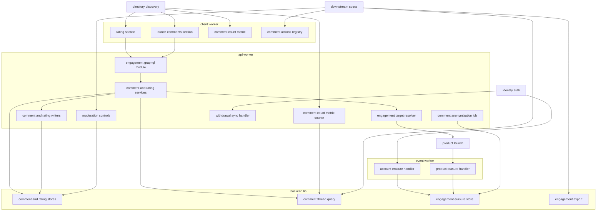
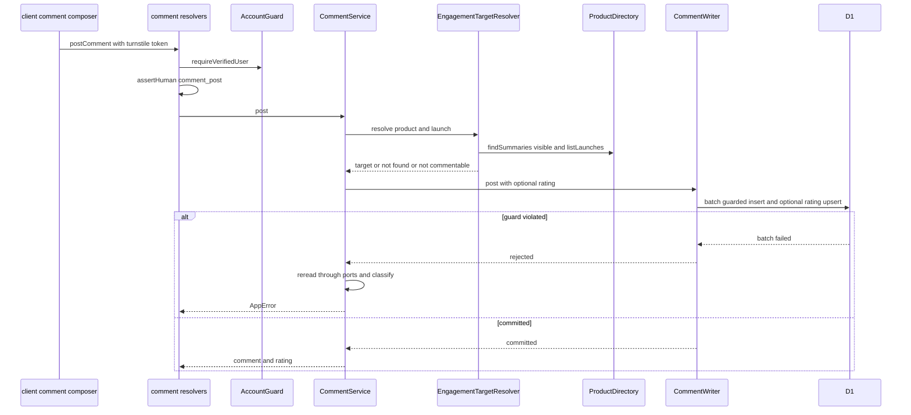
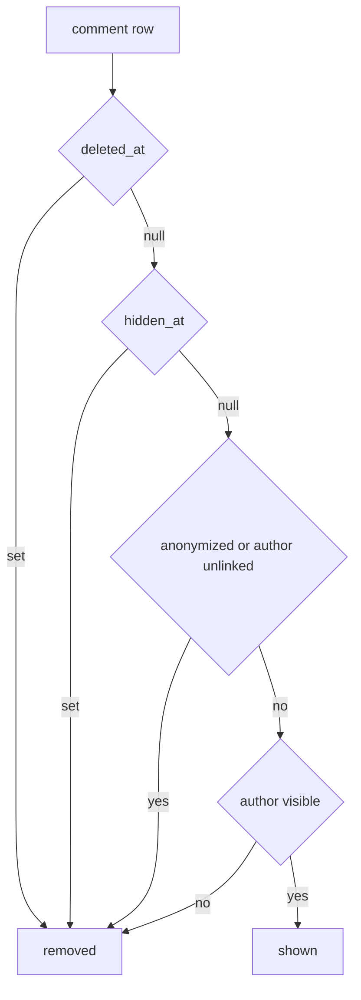
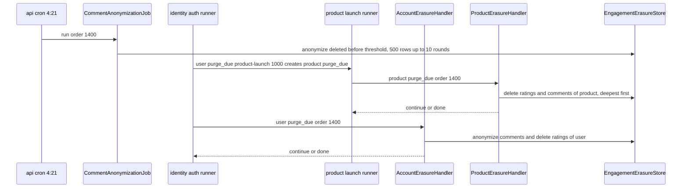
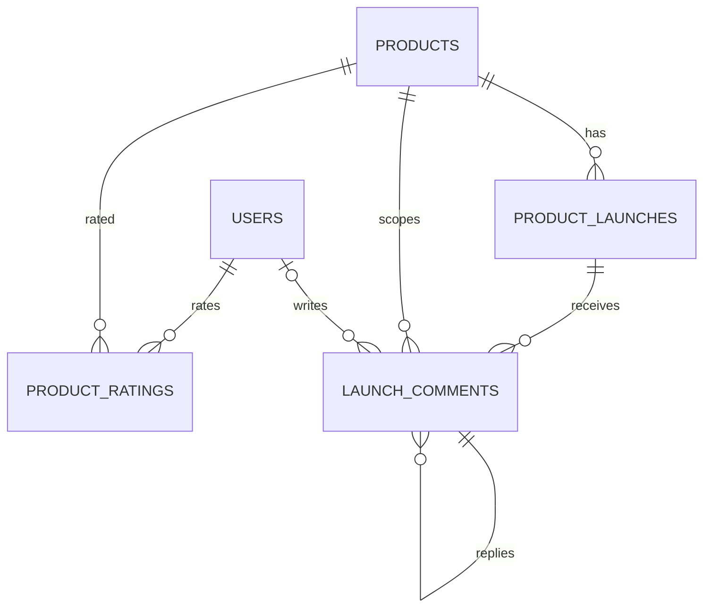

# Design Document

## Overview

**Purpose**: ローンチ単位のマークダウンのコメント(3階層までの返信・編集・削除・置き換え表示・14日後の匿名化)と、プロダクトの5段階評価(1人1件の上書き・取消・自身のプロダクトの拒否・コメントと同時の評価・有効な評価だけの集計)を実装する。コメントと評価は本specの2テーブルに持ち、表示できるかどうか(削除・非公開化・退会・停止・匿名化)と有効な評価かどうか(無効化・退会・停止)は、保存した状態とidentity-authの`visibleUsers()`の結合から読み取りの時点で求める。投稿先のプロダクトを閲覧できるかどうかは、directory-discoveryの公開範囲と同じ規則(掲載中は誰にでも、未掲載は投稿者本人だけ、非公開・停止・退会・削除は誰にも)を、product-launchの`ProductDirectory`の照会と、書き込みの文の条件(`visibleProducts()`・`wonLaunchExists()`)の両方で判定する。

**Users**: サポーター・探索者はプロダクト詳細ページのローンチのブロックでコメントを読み書きし、サイドバーで評価を付ける。投稿者は自分のプロダクトのローンチへコメントする。後続spec(ugc-moderation・content-reporting・data-export・public-api)の開発者は、状態の操作口・照会の部品・出力の部品・メニューの置き場所を使う。

**Impact**: D1に2テーブル(`launch_comments`・`product_ratings`)を足す。`apps/common-lib/engagement`に入力の規則、`apps/backend-lib/core/engagement`に共有部品(ストア・照会・物理削除と匿名化・出力)の契約とDIの識別子を、`apps/backend-lib/workers/engagement`にそのD1の実装・条件付きの書き込みの文の部品・共通の束縛を新設する。apiにスキーマモジュール`engagement`・ユースケース・書き込みの単位のポートとその実装・管理の操作口・項目の値の供給元・退会の同期の処理・4:21のジョブを、eventにユーザーとプロダクトの`purge_due`の処理を、clientに評価欄・コメント欄・コメント数の部品とメニューの登録口を足す。上流のファイルは、契約で定められた登録箇所への追記だけを変える。新しいシークレット・パッケージは無い。

### Goals

- FR-COMNT-001〜010・FR-RATNG-001〜012が動作し、投稿→返信→編集→削除→匿名化、評価→上書き→取消、退会・停止・非公開化・削除・物理削除のどの経路でも、表示・件数・平均値・データが要件と仮1〜仮6の決定に一致する。
- 後続specが本specのファイルを変えずに、コメントの非公開化・評価の無効化・通報の操作・データエクスポート・公開APIの読み取りを行える。
- 本specが追加・変更したコードの単体テスト・Workers統合テスト・ブラウザテストがカバレッジ80%を満たす。

### Non-Goals

- コメントの非公開化と評価の無効化の管理画面・理由・監査ログ・投稿者への通知(ugc-moderation)。管理画面が使う一覧の照会(`AdminCommentDirectory`・`AdminRatingDirectory`)は本specが所有・実装する(仮6)。
- コメントの通報の受け付けと通報の画面(content-reporting)、公開APIの経路(public-api)、エクスポートの生成(data-export)。
- 評価やコメントの集計の写しのテーブル、コメントの通知メール、返信のページ分け、要件定義書の改訂(必要な改訂は[research.md](research.md)の「要件定義書の改訂が必要な箇所」に記録した)。(2026-10-25に要件定義書へ適用済み)

## Boundary Commitments

### This Spec Owns

- エンゲージメントのデータ: `launch_comments`・`product_ratings`(`apps/db/schema/engagement/`)と、表示できるコメント・有効な評価の条件`displayableComment()`・`validRating()`。
- 入力の規則(`apps/common-lib/engagement/`): 本文の上限・階層の上限・1ページの件数・評価の値・bot対策の操作名・本文の検証の規則・見出しのアンカーの接頭辞・キックオフ前と自身のプロダクトの評価の文言。
- 共有部品の契約と識別子(`apps/backend-lib/core/engagement/`): `CommentStore`(識別子からの照会)・`CommentThreadQuery`・`RatingStore`(取消・自分の評価・集計)・`EngagementErasureStore`・`CommentExport`・`RatingExport`・管理画面の一覧の照会`AdminCommentDirectory`・`AdminRatingDirectory`(仮6、ugc-moderationが使う)の契約と入出力の型(`ports.ts`)と、DIの識別子`ENGAGEMENT_PLATFORM_TYPES`(`identifiers.ts`)。api・eventのapplication層と後続specが読み込む。
- 共有部品の実装(`apps/backend-lib/workers/engagement/`): 上の契約のD1の実装(`d1-*.ts`)、条件付きの書き込みの文を返す`CommentStatements`・`RatingStatements`(データベースの型を持つため`workers`に置き、infrastructure層だけが使う)と、api・event共通の束縛`ENGAGEMENT_PLATFORM_MODULE`。
- apiの書き込みの単位: application層のポート`CommentWriter`(投稿・編集・削除)・`RatingWriter`(評価の上書き)と、文を組み立てて一括の書き込みを実行するinfrastructure層の実装`D1CommentWriter`・`D1RatingWriter`。
- apiのユースケース(投稿先の解決・コメント・評価・コメント数の供給元・匿名化のジョブ)、管理の操作口(`CommentModerationControl`・`RatingModerationControl`。呼び出し側の文を状態の変更と同じ一括の書き込みに入れるため、infrastructure層に置く)、スキーマモジュール`engagement`、同期の処理`engagement.withdrawal`、4:21のジョブ`engagement.comment-anonymization`。
- eventの処理`engagement.account-erasure`(ユーザーの`purge_due`)・`engagement.product-erasure`(プロダクトの`purge_due`)。
- clientの評価欄・コメント欄・コメント数の部品と、他者のコメントの操作のメニューの登録口`COMMENT_ACTIONS`。
- 技術ドキュメント`backend/015-tombstoned-comment-threads.md`・`frontend/015-star-rating-and-threaded-composer.md`の新規作成と、サービス仕様(ページ配置・文言規則・日次タイムライン)とオンボーディングの追記。

### Out of Boundary

- プロダクト・ローンチのデータと可視性の条件(product-launch)。本specは`ProductDirectory`・`visibleProducts()`・`wonLaunchExists()`と、外部キーの`products.id`・`product_launches.id`だけを使い、プロダクトのテーブルの他の列を読まず、書き込まない。
- 詳細ページの公開範囲・構成・区画の登録口・ディレクトリの項目の値の登録口(directory-discovery)。本specは登録口へ区画と値を加えるだけである。
- 利用者のデータと状態(identity-auth・user-profile-social)。本specは`AccountGuard`・`visibleUsers()`・`verifiedUsers()`の条件の結合・`userSummaryLoader`だけを使い、`users`の他の列を読まない。
- マークダウンの入力欄・描画・サニタイズ・書記素の数え方(content-processing)。
- 管理の権限・理由・監査・通知(ugc-moderation)、通報の受け付け(content-reporting)、公開APIの経路(public-api)、エクスポートの生成(data-export)。

### Allowed Dependencies

- backend-platform: `AppModule`・`PLATFORM_TYPES`(`Database`・`Clock`)・`AppError`・`getAppLogger`・`ulidPrimaryKey`・`timestamps`・`snakeCase.table`・`BusinessTime`(`toBusinessDateTime`・`fromBusinessDateTime`)・`ScheduledJobDefinition`・`ScheduledJobHandler`・`SCHEDULED_JOBS`・`SCHEDULED_RUN_BUDGETS`(4:21の起動の合計の所要時間の予算。値は変えない)、E2Eの`e2e/support/scheduled-trigger.ts`(`triggerScheduled`、backend-platformの改訂2)。`BatchItem`は`drizzle-orm/batch`の型で、`workers/engagement`とapiのinfrastructure層だけが使う。形を変えない。
- api-gateway: `defineSchemaModule`・`GraphQLContext`(`resolve`・`caller`・`session`・`loaders`・`assertHuman`)・`withValidatedArgs`・`encodeCursor`・`decodeCursor`・`DateTime`・`PageInfo`。
- identity-auth: `AccountGuard`(`currentUser`・`requireVerifiedUser`・`requireWritableUser`)・`CurrentUser`・`IDENTITY_PLATFORM_TYPES.AccountGuard`(`core/identity/identifiers.ts`)・`visibleUsers()`・`verifiedUsers()`・`users`(条件の結合と外部キーだけ)・`UserLifecycleEvent`・`UserLifecycleSyncHandler`・`USER_LIFECYCLE_SYNC_HANDLERS`・`UserLifecycleAsyncHandler`・`USER_LIFECYCLE_ASYNC_HANDLERS`・`LifecycleHandlerOutcome`、clientの`viewer`の文脈(`ClientViewer`)・`LoginRequiredDialog`・GraphQLの`resendVerificationEmail`、E2Eの`e2e/support/mailpit.ts`。
- product-launch: `core/product`の`PRODUCT_PLATFORM_TYPES.ProductDirectory`(`findSummaries`・`listLaunches`)・`ProductSummaryRecord`・`LaunchRecord`・`LaunchStatus`(契約と識別子は`core/product`、D1の実装と束縛は`workers/product`)、`visibleProducts()`・`wonLaunchExists()`(書き込みの文の条件だけ)、`products`・`product_launches`への外部キー、`ProductLifecycleEvent`・`ProductLifecycleAsyncHandler`・`PRODUCT_LIFECYCLE_ASYNC_HANDLERS`、E2Eの`e2e/client/markdown-steps.ts`(`markdownEditable`)。
- directory-discovery: clientの`PRODUCT_PAGE_SECTIONS`・`PRODUCT_LAUNCH_SECTIONS`・`ProductPageContext`・`ProductLaunchSectionContext`・`DIRECTORY_ITEM_METRICS`・`DirectoryItemMetric`、apiの`DIRECTORY_ITEM_METRIC_SOURCES`・`DirectoryItemMetricSource`・`DirectoryItemMetricRegistration`、見出しのID`launches-heading`、E2Eの`e2e/support/directory-fixtures.ts`・`e2e/client/directory-steps.ts`(`productPagePath`)。
- content-processing: `countGraphemes`・`markdownTextSchema`・`MarkdownTextRule`、`MarkdownEditor`・`MarkdownContent`・`useRenderedMarkdown`・`useMarkdownOptions`・`LinkRelToken`。
- user-profile-social: GraphQLの`UserSummary`・`userSummaryLoader`、clientの`UserAvatar`。
- frontend-platform: `executeGraphQL`・`graphqlQueryOptions`・`requireData`・`GraphQLClientError`・`errorMessageOf`・`useAppForm<TInput, TOutput>(schema, { defaultValues })`・`AppForm`(必須の`onSubmitError`・任意の`serverFieldPrefix`)・`FormField`・`SubmitButton`・`notify`・`PartialErrorState`・`LoadingSkeleton`・`formatElapsed`・`DateTime`・`useTurnstileToken`・`TurnstileWidget`(非表示)・Zodの値の読み込み元(`utilities/validation/zod.ts`の`z`)・GraphQLの操作の追加手順(`src/graphql/operations/**/*.graphql`と生成物`src/graphql/generated/graphql.ts`)・shadcn/uiの部品(ボタン・ダイアログ・ドロップダウンメニュー・ツールチップ・バッジ・スケルトン)・`runAxe`・デザイントークン。
- admin-foundation: E2Eの`e2e/support/local-d1.ts`(`executeLocalD1`・`sqlStringLiteral`)。
- npmパッケージ: 新規なし。
- 後続specは、`common-lib/engagement`・`core/engagement`(契約と識別子)・`workers/engagement`(D1の実装と束縛)・`db/schema/engagement/engagement-conditions.ts`の公開の契約、apiのinfrastructure層の`CommentModerationControl`・`RatingModerationControl`、clientの`COMMENT_ACTIONS`と`CommentActionContext`だけに依存し、本specのテーブルへ直接書き込まない。

### Revalidation Triggers

- `CommentModerationControl`・`RatingModerationControl`の形と置き場所(apiのinfrastructure層。呼び出し側の文を受け取るため、呼び出し側もinfrastructure層から使う)と、非公開化・無効化の意味(ugc-moderation)。
- `core/engagement`の契約(`CommentStore`・`CommentThreadQuery`・`RatingStore`・`EngagementErasureStore`・`CommentExport`・`RatingExport`・`AdminCommentDirectory`・`AdminRatingDirectory`)と`ENGAGEMENT_PLATFORM_TYPES`の置き場所。application層が`**/lib/workers/**`を読み込めない規則(backend-platform)が変わっても、置き場所を`workers`へ戻さない(後続specのapplication層が読み込むため)。
- `COMMENT_ACTIONS`の`CommentActionContext`と描画の位置(content-reporting)。
- `CommentStore.findByIds`の`CommentRecord`、`CommentExport`・`RatingExport`の記録の形(ugc-moderation・content-reporting・data-export)。
- `CommentThreadQuery`・`RatingStore.summaries`の入力と返す形、`displayableComment()`・`validRating()`の条件(public-api)。
- 本specが所有・実装し、ugc-moderationが使う管理画面の照会`AdminCommentDirectory`・`AdminRatingDirectory`(仮6)。`AdminCommentState`・`AdminCommentRecord`・`AdminCommentSearchFilter`・`AdminRatingState`・`AdminRatingRecord`の形、絞り込みと並び順、カーソル、状態の優先の規則を変えたら、利用者のugc-moderation(コメント・評価の管理画面と措置の対象の確かめ)を確かめ直す。`launch_comments`・`product_ratings`の列と`displayableComment()`の条件の変更は、照会の契約を保つ形で本specが照会の実装も直す。
- 処理の名前と`order`(1400)、4:21のジョブの名前と`order`(1400)(運用・日次タイムライン)。4:21の`SCHEDULED_RUN_BUDGETS`の予算が変われば、匿名化の1回あたりの件数と回数を確かめ直す。
- 上流の`ProductDirectory`の`ProductSummaryRecord`(`ownerUserId`・`visible`・`listed`)・`listLaunches`の`status`、`visibleProducts()`・`wonLaunchExists()`・`visibleUsers()`・`verifiedUsers()`、ライフサイクルの登録口と`purge_due`の順序の規則、`PRODUCT_PAGE_SECTIONS`・`PRODUCT_LAUNCH_SECTIONS`の文脈の型、`DirectoryItemMetricSource`、`MarkdownEditor`・`markdownTextSchema`・`MarkdownRenderOptions`の`idScope`の規則、`UserSummary`を変えたら、本specを確かめ直す。
- 仮1〜仮6は2026-10-24に開発者が確定した。仮5(`RatingExportRecord.invalidatedByAdmin`)の形を変えたらdata-exportの`ratings.json`の組み立てを、仮6の照会の形を変えたらugc-moderationを確かめ直す。

### 上流への影響

| 上流spec            | 変更                                                                                                                                                                                                                                                                                                                                               | 影響と再検証                                               |
| ------------------- | -------------------------------------------------------------------------------------------------------------------------------------------------------------------------------------------------------------------------------------------------------------------------------------------------------------------------------------------------- | ---------------------------------------------------------- |
| identity-auth       | `apps/api/src/composition/user-lifecycle-sync-handlers.ts`に`engagement.withdrawal`、`apps/event/src/composition/user-lifecycle-async-handlers.ts`に`engagement.account-erasure`(1400)                                                                                                                                                             | 契約どおり。`createAsyncLifecycleRegistry`の検証を通る     |
| product-launch      | `apps/event/src/composition/product-lifecycle-async-handlers.ts`に`engagement.product-erasure`(`purge_due`、1400)                                                                                                                                                                                                                                  | 契約どおり。`createProductLifecycleRegistry`の検証を通る   |
| backend-platform    | `apps/api/src/composition/scheduled-jobs.ts`の`SCHEDULED_JOBS`に`COMMENT_ANONYMIZATION_JOB_DEFINITION`(`engagement.comment-anonymization`、4:21、1400)                                                                                                                                                                                             | 契約どおり。`createCronRegistry`の検証を通る               |
| directory-discovery | `apps/api/src/composition/directory-item-metric-sources.ts`に`engagement.comment-count`(`comments`、10)、`apps/client/src/composition/directory-sections.ts`の`DIRECTORY_ITEM_METRICS`に`comments`(10)、`apps/client/src/composition/product-page-sections.ts`に`engagement.rating`(aside 20)・`engagement.comments`(`PRODUCT_LAUNCH_SECTIONS` 10) | 契約どおり(directory-discoveryが予約した置き場所と`order`) |

- 上流specの公開の契約の変更は無い。roadmapの帯の割り当ての表の本specの「使用中の値」は「4:21は1400、波及処理は1400」になる(プロダクトライフサイクルの処理も1400。本specはroadmapを編集しないため、コントローラーへ報告する)。

## Architecture

### Existing Architecture Analysis

- 上流の20specは設計・タスクとも承認済みで、本specのタスクはそれらの実装の完了を前提にする。2026-11-15の時点で全て実装済みで、設計が前提にした契約の実在を[research.md](research.md)の「実装前のギャップ分析(2026-11-15)」で確かめた。
- apiはクリーンアーキテクチャ(`domain`→`application`→`infrastructure`・`presentation`→`composition`)、処理単位のDIコンテナ、D1の`db.batch()`を使う。書き込みの競合は、NOT NULLの列に`CASE WHEN <条件> THEN ? ELSE NULL END`を入れて一括の書き込みごと失敗させ、読み直して理由を分類する(product-launch・match-engineと同じ形)。
- ユーザーとプロダクトのライフサイクルの同期の処理は確定と同じ一括の書き込みに入る集合の更新の文、非同期の処理はeventの実行器で`order`の昇順に少なくとも1回動く。物理削除は全ての`purge_due`の処理の後に上流が行を消すため、本specは自分の行を先に消すか紐付けを解除する。

### Architecture Pattern & Boundary Map



**Architecture Integration**:

- Selected pattern: クリーンアーキテクチャ。閲覧の可否・投稿できるローンチ・スレッドの組み立ては純粋な関数、ユースケースはポート越しにproduct-launchと本specの部品を使う。表示の状態と有効な評価は読み取りの時点で求め、集計の写しを持たない(research.mdの比較)。
- Domain/feature boundaries: コメントと評価の行と表示・集計の規則は本spec、プロダクトの可視性と所有者はproduct-launch、利用者の状態はidentity-auth、区画の置き場所はdirectory-discovery、管理の判断と記録はugc-moderation。
- Existing patterns preserved: `backend-lib/core/<ドメイン>`の契約と識別子・`backend-lib/workers/<ドメイン>`の実装と共有の束縛(identity-authの`core/identity`・`workers/identity`と同じ配置)、書き込みの単位をinfrastructure層の一括の書き込みで確定させる形(identity-authの`UserLifecycleCommitter`と同じ)、`<spec名>.<名詞句>`の処理の名前、帯の`order`、登録箇所への追記による拡張、`CASE`式の条件付きの書き込み、呼び出し側の文を状態の変更と同じ一括の書き込みに入れる状態の操作口(ugc-moderationの`ControlEngagementModerationWriter`が使う形。product-launchの`ProductVisibilityControl`はapplication層にあり呼び出し側の文を受けないため、形は異なる)、identity-authの`AccountExport`と同じ形の出力の部品、match-engineの4:21の掃除のジョブ(500件ずつ・最大10回)。
- New components rationale: `EngagementTargetResolver`はコメントと評価の全ての操作で同じ閲覧の可否を判定するため。`EngagementErasureStore`は日次のジョブ(api)と`purge_due`の処理(event)が同じ匿名化と物理削除の文を使うため。`COMMENT_ACTIONS`は他者のコメントの通報(content-reporting)を、本specのファイルを変えずに加えるため。`CommentWriter`・`RatingWriter`は、application層がデータベースの接続・SQLの文・一括の書き込みを扱わない規則(`backend/002`)の下で、コメントと評価の同時の保存を1つの書き込みの単位として表すため。
- Steering compliance: Inversifyの`@inject`の明示、D1の制約(`db.batch()`・バインド変数100個以内・`db.transaction()`を使わない)、800行以内のファイル、1ファイル1コンポーネント、日時の`<time datetime>`、新しいパッケージなし。

**Dependency direction**: `apps/common-lib/engagement` → `apps/db/schema/engagement` → `backend-lib/core/engagement`(`core`の他の部品・`common-lib`・inversifyの型だけ) → `backend-lib/workers/engagement`(D1) → 各アプリの`src`(`domain` → `application` → `infrastructure`・`presentation` → `composition`)。api・eventのapplication層は`**/lib/workers/**`を型も含めて読み込めないため、application層と後続specが使う契約と識別子`ENGAGEMENT_PLATFORM_TYPES`は`core/engagement`に置き、`workers/engagement`にはD1の実装・文の部品(`CommentStatements`・`RatingStatements`)・束縛だけを置く。application層は書き込みの単位のポート(`CommentWriter`・`RatingWriter`)だけを受け取り、文の部品と`db.batch()`はinfrastructure層の実装だけが使う。`common-lib`は`common-lib`の他のディレクトリと`zod`だけを読み込む。clientは`common-lib/engagement`とGraphQLの操作と上流の画面部品だけを読み込み、`src/composition`は`src/routes`を読み込まない(frontend-platformの規則)。登録口の型は`components/engagement/comment-action-types.ts`に置き、`composition/comment-actions.ts`の`COMMENT_ACTIONS`はdirectory-discoveryの区画の登録口と同じ読み込みの形で`CommentMenu`が描く。

### Technology Stack

| Layer     | Choice / Version                                                     | Role in Feature                                 | Notes                          |
| --------- | -------------------------------------------------------------------- | ----------------------------------------------- | ------------------------------ |
| Frontend  | TanStack Start・Router・Query・shadcn/ui・lucide-react・sonner(上流) | 評価欄・コメント欄・コメント数                  | 新規パッケージなし             |
| Frontend  | Milkdown Crepe(content-processingの`MarkdownEditor`経由)             | コメントの投稿欄                                | 遅延読み込みは上流の部品が持つ |
| Backend   | Hono・Inversify・GraphQL Yoga(上流)                                  | スキーマモジュール・ユースケース・処理          | 既存                           |
| Data      | Cloudflare D1(Drizzle)                                               | 2テーブル・条件付きの書き込み・集計の問い合わせ | 新規のマイグレーション         |
| Messaging | Cloudflare Queues(上流のライフサイクルの実行器)                      | `purge_due`の処理                               | 新しいメッセージ種別なし       |
| Runtime   | Cron Triggers(backend-platformの4:21の直列のジョブ)                  | 匿名化の日次処理                                | 既存のcron式`21 12 * * *`      |

## File Structure Plan

### Directory Structure

```
apps/
├── common-lib/engagement/
│   └── engagement-rules.ts                          # 上限・階層・評価の値・bot対策の操作名・本文の規則・アンカーの接頭辞・共有の文言(*.unit.test.ts)
├── db/schema/engagement/                            # テーブル定義(各ファイルに同名の*.unit.test.ts)
│   ├── launch-comments.ts
│   ├── product-ratings.ts
│   ├── engagement-conditions.ts                     # displayableComment()・validRating()
│   └── index.ts
├── backend-lib/
│   ├── core/engagement/                             # api・eventと後続specのapplication層が読み込める契約と識別子(Bunの単体テスト)
│   │   ├── ports.ts                                 # CommentStore・CommentThreadQuery・RatingStore・EngagementErasureStore・CommentExport・RatingExport・AdminCommentDirectory・AdminRatingDirectoryの契約と入出力の型(型だけ)
│   │   └── identifiers.ts                           # ENGAGEMENT_PLATFORM_TYPES(api・event共通の識別子、identifiers.unit.test.ts)
│   └── workers/engagement/                          # D1の実装と束縛(Workers統合テスト、各ファイルに同名の*.worker.test.ts)
│       ├── comment-statements.ts                    # CommentStatements(型とD1の実装): 投稿・編集・削除の条件付きの文と非公開化(infrastructure層だけが使う)
│       ├── d1-comment-store.ts                      # CommentStoreのD1実装: 識別子からの照会
│       ├── d1-comment-thread-query.ts               # CommentThreadQueryのD1実装: スレッドのページ・ローンチごと・プロダクトごとの件数
│       ├── rating-statements.ts                     # RatingStatements(型とD1の実装): 上書きの文と無効化(infrastructure層だけが使う)
│       ├── d1-rating-store.ts                       # RatingStoreのD1実装: 取消・自分の評価・集計
│       ├── d1-engagement-erasure-store.ts           # 匿名化・利用者とプロダクト単位の物理削除
│       ├── d1-engagement-export.ts                  # CommentExport・RatingExportのD1実装
│       ├── d1-admin-comment-directory.ts            # AdminCommentDirectoryのD1実装(ugc-moderationが使う、仮6)
│       ├── d1-admin-rating-directory.ts             # AdminRatingDirectoryのD1実装(ugc-moderationが使う、仮6)
│       ├── admin-directory-page.ts                  # 管理画面の2つの照会が共有するカーソル(ミリ秒:IDのbase64url)と件数の検証(テストは2つの照会のテスト)
│       ├── engagement-guard.ts                      # guardedProductId()・isEngagementGuardViolation(): 投稿・編集・評価の条件の違反をproduct_idのNOT NULL制約の違反にする共有の判定
│       ├── engagement-platform-module.ts            # ENGAGEMENT_PLATFORM_MODULE
│       └── testing/                                 # テストの補助(engagement-fixtures.ts・engagement-platform-fixtures.ts)
├── api/src/
│   ├── domain/engagement/                           # 純粋な規則(Bunの単体テスト)
│   │   ├── engagement-access.ts                     # 閲覧の可否・コメントできるローンチ
│   │   └── comment-threads.ts                       # 行からスレッドへの組み立て・バッジ
│   ├── application/engagement/                      # ユースケース(Bunの単体テスト)
│   │   ├── engagement-types.ts                      # ENGAGEMENT_TYPES
│   │   ├── ports.ts                                 # CommentWriter・RatingWriter(書き込みの単位)と結果の型、EngagementIncidentReporter(期限超過の報告)
│   │   ├── engagement-errors.ts                     # ENGAGEMENT_ERRORS(本specのエラーコードと文言)とengagementError
│   │   ├── engagement-target-resolver.ts            # 投稿先のプロダクトとローンチの解決
│   │   ├── comment-thread-cursor.ts                 # スレッドのカーソルの符号化と復号(presentationのencodeCursorと同じ形)
│   │   ├── product-rating-view.ts                   # 評価欄の値の読み取り(コメントに添えた評価と評価の操作が共有する)
│   │   ├── comment-service.ts                       # 投稿・返信・編集・削除(評価の同時保存)
│   │   ├── comment-reader.ts                        # スレッドのページ・ローンチごとの件数
│   │   ├── rating-service.ts                        # 評価・取消・評価欄の値
│   │   ├── comment-count-metric-source.ts           # engagement.comment-count
│   │   ├── comment-anonymization-job.ts             # engagement.comment-anonymization(COMMENT_ANONYMIZATION_JOB_DEFINITIONを輸出)
│   │   └── testing/                                 # 模擬のポート(comment-fakes.ts・rating-fakes.ts・target-fakes.ts)
│   ├── infrastructure/engagement/                   # Workers統合テスト
│   │   ├── d1-comment-writer.ts                     # CommentWriterの実装(コメントと評価の文の一括の書き込み)
│   │   ├── d1-rating-writer.ts                      # RatingWriterの実装(評価の上書きの文の書き込み)
│   │   ├── comment-moderation-control.ts            # 非公開化・復元(ugc-moderationのinfrastructure層向け)
│   │   ├── rating-moderation-control.ts             # 無効化・取消(ugc-moderationのinfrastructure層向け)
│   │   ├── engagement-withdrawal-sync-handler.ts    # engagement.withdrawal
│   │   ├── sentry-engagement-incident-reporter.ts   # EngagementIncidentReporterの実装(errorのログとcaptureEvent)
│   │   └── testing/withdrawal-fixtures.ts           # 同期の処理のテストの補助
│   ├── presentation/graphql/modules/engagement/     # スキーマモジュール(Workers統合テスト)
│   │   ├── type-defs.ts
│   │   ├── inputs.ts
│   │   ├── resolver-support.ts                      # リゾルバが共有する呼び出し元の判定(clientOnly)と文脈からの取り出し(accountGuardOf・clockOf)
│   │   ├── engagement-views.ts                      # LaunchComment・ProductRatingの項目のリゾルバ
│   │   ├── comment-resolvers.ts
│   │   ├── rating-resolvers.ts
│   │   └── index.ts                                 # engagementSchemaModule
│   └── composition/engagement-module.ts             # ENGAGEMENT_MODULE(apiの束縛)
├── api/test/support/engagement-graphql-operations.ts # スキーマモジュールのWorkers統合テストが使うGraphQLの操作
├── event/src/
│   ├── application/engagement/                      # Bunの単体テスト
│   │   ├── event-engagement-types.ts                # EVENT_ENGAGEMENT_TYPES
│   │   ├── account-erasure-handler.ts               # ユーザーのpurge_due 1400
│   │   └── product-erasure-handler.ts               # プロダクトのpurge_due 1400
│   └── composition/engagement-module.ts
├── frontend-lib/components/datetime/
│   └── use-now.ts                                   # useNow(): RelativeTimeの共有のタイマーを取り出した現在時刻のフック(CommentTimeとRelativeTimeが使う)
├── client/src/
│   ├── composition/comment-actions.ts               # COMMENT_ACTIONS(初版は空)
│   ├── components/engagement/                       # 1ファイル1コンポーネント(browser testを併置)
│   │   ├── comment-action-types.ts                  # CommentAction・CommentActionContext(テストなし)
│   │   ├── engagement-viewer.ts                     # 閲覧者の状態の判定(engagementViewerKind、*.unit.test.ts)
│   │   ├── use-engagement-viewer.ts                 # useViewer()と区画の文脈から閲覧者の状態とIDを返すフック(useEngagementViewer、*.browser.test.tsx)
│   │   ├── comment-form-schema.ts                   # 投稿欄の検証(Zodの値はlib/utilities/validation/zod.tsのz、*.unit.test.ts)
│   │   ├── comment-tree.ts                          # スレッドの木の組み立てとキャッシュの更新(*.unit.test.ts)
│   │   ├── use-comment-mutations.ts                 # 投稿・返信・編集・削除とキャッシュの更新
│   │   ├── use-rating-mutations.ts                  # 評価・取消とキャッシュの更新
│   │   ├── rating-section.tsx                       # aside 20
│   │   ├── rating-summary.tsx
│   │   ├── star-rating-input.tsx
│   │   ├── launch-comments-section.tsx              # PRODUCT_LAUNCH_SECTIONS 10
│   │   ├── comment-thread.tsx
│   │   ├── comment-item.tsx
│   │   ├── comment-composer.tsx
│   │   ├── comment-gate.tsx
│   │   ├── comment-menu.tsx
│   │   ├── delete-comment-dialog.tsx
│   │   ├── comment-time.tsx
│   │   ├── comment-list-skeleton.tsx
│   │   ├── comment-count-metric.tsx                 # DIRECTORY_ITEM_METRICSのcomments
│   │   ├── comment-messages.ts・rating-messages.ts  # 画面の文言の定数(未確認の理由の文言の写しはconfig/engagement-contract-copies.unit.test.tsで照合)
│   │   └── comment-thread-testing.tsx               # スレッドの部品のブラウザテストの補助(テストのデータと応答の組み立て)
│   ├── graphql/engagement.ts                        # 取得の補助とキャッシュの更新(productRatingQueryOptions・replaceProductRating・launchCommentsQueryOptions・launchCommentCountsQueryOptions・launchCommentCountsKeyOf)
│   ├── graphql/fragments/engagement/                # 断片(LaunchComment・ProductRating、coding/004の前例)
│   │   ├── launch-comment.graphql
│   │   └── product-rating.graphql
│   └── graphql/operations/engagement/               # 1ファイル1操作(操作名はClientで始める。生成物はsrc/graphql/generated/)
│       ├── launch-comments.graphql                  # query ClientLaunchComments(launchComments)
│       ├── launch-comment-counts.graphql            # query ClientLaunchCommentCounts(launchCommentCounts)
│       ├── post-comment.graphql                     # mutation ClientPostComment(postComment)
│       ├── update-comment.graphql                   # mutation ClientUpdateComment(updateComment)
│       ├── delete-comment.graphql                   # mutation ClientDeleteComment(deleteComment)
│       ├── product-rating.graphql                   # query ClientProductRating(productRating)
│       ├── rate-product.graphql                     # mutation ClientRateProduct(rateProduct)
│       ├── cancel-product-rating.graphql            # mutation ClientCancelProductRating(cancelProductRating)
│       └── resend-verification-email.graphql        # mutation ClientEngagementResendVerificationEmail(未確認の案内、identity-authと異なる操作名)
e2e/
└── client/
    ├── engagement.e2e.test.ts                       # コメント・返信・編集・削除・評価・コメント数・4:21の匿名化
    └── engagement-steps.ts                          # コメント欄と評価欄の画面の操作の手順(入力欄はmarkdown-steps.tsを使う)
config/
└── engagement-contract-copies.unit.test.ts          # apps/dbの階層と評価のCHECKの写しとcommon-libの値の照合
docs/GUIDES/tech/
├── backend/015-tombstoned-comment-threads.md
└── frontend/015-star-rating-and-threaded-composer.md
```

`AdminCommentDirectory`・`AdminRatingDirectory`の契約(`core/engagement/ports.ts`)とD1の実装(`d1-admin-comment-directory.ts`・`d1-admin-rating-directory.ts`)、その`ENGAGEMENT_PLATFORM_TYPES`の識別子と`ENGAGEMENT_PLATFORM_MODULE`への束縛は、本specのタスクが作成・実装する(仮6)。契約の正は本specの設計(「AdminCommentDirectory・AdminRatingDirectory(仮6)」の節)で、ugc-moderationはそれを使う。

テストは各ファイルの隣に置く(`*.unit.test.ts`・`*.worker.test.ts`・`*.browser.test.tsx`)。技術ドキュメントの番号は、全ての完了済みspecのdesign.mdが使う番号の後の、各ディレクトリで最も小さい空き番号`backend/015`・`frontend/015`に固定する(並行して作成中のtournament-week・sponsorshipは次以降の空き番号を使う。重なればコントローラーの調整に従う)。

### Modified Files

- `apps/db/schema/index.ts`・`apps/db/migrations/<日時>_engagement/migration.sql` — 2テーブルの再エクスポートと生成したマイグレーション。mainの最新を取り込んでから生成する。
- `apps/api/src/composition/modules.ts`・`graphql-modules.ts`・`user-lifecycle-sync-handlers.ts`・`scheduled-jobs.ts`・`directory-item-metric-sources.ts` — `ENGAGEMENT_PLATFORM_MODULE`・`ENGAGEMENT_MODULE`・`engagementSchemaModule`・同期の処理・4:21のジョブ・コメント数の供給元。
- `apps/event/src/composition/modules.ts`・`user-lifecycle-async-handlers.ts`・`product-lifecycle-async-handlers.ts` — `ENGAGEMENT_PLATFORM_MODULE`・eventの束縛・2つの処理。
- `apps/client/src/composition/product-page-sections.ts`・`directory-sections.ts` — 評価欄・コメント欄・コメント数の登録。登録箇所が部品を読み込むため、`components/directory/directory-sections.unit.test.ts`を`.browser.test.ts`へ移す。
- `apps/client/src/components/auth/use-resend-verification.ts` — identity-authの`useResendVerification`に再送の操作の文書の引数を足す(既定は従来の操作)。`CommentGate`が`ClientEngagementResendVerificationEmailDocument`を渡す。
- `apps/client/test/product-page-route-fixtures.ts`・`product-page-route.browser.test.tsx` — 詳細ページの経路のテストの補助に、評価欄とコメント欄の取得の応答(`respondOtherSections`)を足す。
- `apps/frontend-lib/components/datetime/relative-time.tsx` — 共有のタイマーを`use-now.ts`の`useNow()`へ取り出し、`RelativeTime`はそれを使う。
- `apps/api/codegen.config.ts` — mappersで`LaunchComment`を`CommentView`に結ぶ。
- 既存の並びの検査(apiの`test/config/notifications-scheduled-jobs.unit.test.ts`・`composition/search-module*.worker.test.ts`、eventの`purge_due`の並びを確かめる`composition/*.worker.test.ts`)と`scripts/tooling/run-all.unit.test.ts`の`check:contract-copies`の期待値 — 本specの登録を加える。
- `docs/GUIDES/tech/README.md`・`backend/README.md`・`frontend/README.md` — 文書一覧の行。
- `docs/GUIDES/tech/frontend/005-shared-components.md` — `useNow`の行。
- `docs/GUIDES/tech/frontend/004-accessibility-rules.md`・`005-shared-components.md`・`006-data-fetching.md`・`008-markdown-editor-and-content.md` — `frontend/015`に記した例外(星の入力の自作・理由をツールチップで示す`aria-disabled`・続きの失敗の再試行への置き換え・`PartialErrorState`の固定の文言・`waitForToken()`で渡すトークン・視覚的に隠した本文のラベル)への参照。
- `docs/GUIDES/tech/backend/013-pluggable-decision-sources.md` — 0も示す値になる表示の供給元が0を返すこと。
- `docs/onboardings/README.md` — ローカルでのE2Eテストの段落。
- `README.md` — 文書の索引。
- `package.json` — ルートの`check:contract-copies`の引数に`./config/engagement-contract-copies.unit.test.ts`。
- `docs/onboardings/project-values.md` — 処理とジョブの名前と`order`、bot対策の操作名、区画と項目の値の登録の`order`、上限の値。
- `docs/GUIDES/service/design/002-page-layouts.md` — 評価欄とコメント欄の状態(ゲスト・未確認・本人・0件・失敗)と仮1〜仮4の注記。
- `docs/GUIDES/service/design/003-text-and-copy-rules.md` — 本specのエラー・状態・トーストの文言。
- `docs/GUIDES/service/overview/007-daily-timeline.md` — 4:21のジョブの表に`engagement.comment-anonymization`(1400)。
- `CLAUDE.md` — 「技術規則の参照先」に「削除しても返信を残すコメントや保持期間後の匿名化を設計する前に: `backend/015`」。

## System Flows

### コメントの投稿と返信



- `CommentService`(application層)は書き込みの単位`CommentWriter.post`だけを呼び、文の組み立てと`db.batch()`はinfrastructure層の`D1CommentWriter`が行う。条件付きの書き込みの文(`workers/engagement`の`CommentStatements.insertStatement`)は、`product_id`の値を`CASE WHEN <投稿先が閲覧できる> AND <投稿者が確認済みで可視> [AND <親が表示できる・同じローンチ・第2階層まで>] THEN ? ELSE NULL END`にする。投稿先が閲覧できる条件は、投稿者本人なら`visibleProducts()`、それ以外は`visibleProducts() AND wonLaunchExists()`のプロダクトの存在である(所有者はproduct-launchの照会で先に分かり、変わらない)。投稿者の条件は`verifiedUsers()`の利用者の存在、親の条件は本specのテーブルと`visibleUsers()`の結合である(1.9・2.3・2.4)。
- 評価を添えた場合(仮1)は、`D1CommentWriter`が`RatingStatements.upsertStatement`を同じ`db.batch()`に入れ、同じく`product_id`に条件を入れる。どちらかの違反で一括の書き込みごと取り消される(10.2・10.3)。
- 失敗の分類: `CommentWriter`が条件の違反を`rejected`で返し、`CommentService`が投稿先を読み直して閲覧できなければ`comment_target_not_found`、利用者の状態は`AccountGuard`の判定、親が表示できなければ`comment_parent_unavailable`。

### 表示の状態と有効な評価



- `displayableComment()`は`launch_comments.deleted_at IS NULL AND launch_comments.hidden_at IS NULL AND launch_comments.anonymized_at IS NULL AND launch_comments.author_user_id IS NOT NULL AND visibleUsers()`(`users`を`author_user_id`で外部結合)で、図の判定と同じである(5.1)。退会は`users.deleted_at`、停止は`users.status`で読み取りの時点に反映され、停止の解除・非公開化の取消で自然に戻る(5.4)。
- `validRating()`は`product_ratings.invalidated_at IS NULL AND product_ratings.deleted_at IS NULL AND visibleUsers()`(`users`を`user_id`で内部結合)である(11.1・11.2、仮2)。

### 匿名化と物理削除



| 契機                               | 処理                               | 種類                                | 内容                                                                                                                                                                                                                                                                                                               |
| ---------------------------------- | ---------------------------------- | ----------------------------------- | ------------------------------------------------------------------------------------------------------------------------------------------------------------------------------------------------------------------------------------------------------------------------------------------------------------------ |
| 退会                               | `engagement.withdrawal`            | ユーザーの同期`withdrawn`           | `UPDATE launch_comments SET deleted_at = ? WHERE author_user_id = ? AND deleted_at IS NULL`と、`product_ratings`の同じ形の論理削除(13.1)                                                                                                                                                                           |
| 削除から14日の直前                 | `engagement.comment-anonymization` | 4:21のジョブ、1400                  | `deleted_at < 業務日付(実行日−12日)の0:00`かつ未匿名化を500件ずつ最大10回、本文を空・投稿者を外す。論理削除の業務日付が実行日の14日前以前(`deleted_at < 業務日付(実行日−13日)の0:00`、前日までの実行で匿名化するはずだったもの)で未匿名化の行が残れば、14日の期限を過ぎるおそれとして件数を`error`のログ(6.1・6.5) |
| 利用者の物理削除                   | `engagement.account-erasure`       | ユーザーの非同期`purge_due`、1400   | 投稿者のコメントを500件ずつ匿名化し、評価を500件ずつ物理削除。残りがあれば`continue`、無ければ`done`(6.2・13.6)                                                                                                                                                                                                    |
| プロダクトの物理削除               | `engagement.product-erasure`       | プロダクトの非同期`purge_due`、1400 | プロダクトの評価と、コメントを階層の深い順に500件ずつ物理削除。残りがあれば`continue`(13.5)                                                                                                                                                                                                                        |
| 投稿者の退会・削除・非公開化・停止 | なし                               | —                                   | 閲覧の可否の判定(`ProductDirectory`の`visible`・`listed`)で、コメントと評価を返さず操作を拒否する。データは変えない(13.2〜13.4)                                                                                                                                                                                    |
| 利用者の停止・停止の解除           | なし                               | —                                   | `displayableComment()`・`validRating()`の`visibleUsers()`で読み取りの時点に反映する(5.1・5.4・11.2)                                                                                                                                                                                                                |

- 閾値`業務日付(実行日−12日)の0:00`はidentity-authの物理削除の選び方と同じで、削除の業務日付から13日目の4:21に匿名化され、14日の期限の前に終わる(6.1)。退会で論理削除したコメントも退会の日時を`deleted_at`に持つため、同じ日のジョブか`engagement.account-erasure`のどちらか早い方で匿名化される(6.2)。同じ日の再実行は未匿名化の行だけを対象にするため結果が変わらない(6.5)。
- プロダクトの`purge_due`は、利用者の物理削除ではproduct-launchの`product-launch.product-erasure`(1000)が作り、個別の削除ではproduct-launchの4:21のジョブが作る。本specの処理が`done`を返した後に上流がプロダクトとローンチの行を消すため、外部キーで物理削除を妨げない(13.5)。利用者の`purge_due`では1000の処理が利用者のプロダクトの物理削除を待つため、本specの1400の処理は他者のプロダクトへのコメントの匿名化と評価の削除だけを行う。
- 階層の深い順(`ORDER BY depth DESC`)の削除は、1回の文で消す親に子が残らないため、自己参照の外部キーの検査を通る。

## Requirements Traceability

| Requirement                                                   | Summary                      | Components                                                                                                            | Interfaces                                                | Flows                  |
| ------------------------------------------------------------- | ---------------------------- | --------------------------------------------------------------------------------------------------------------------- | --------------------------------------------------------- | ---------------------- |
| 1.1, 1.2, 1.3                                                 | 投稿と本文の規則             | CommentService、EngagementRules、CommentComposer、CommentFormSchema                                                   | `postComment`・`commentBodySchema`                        | コメントの投稿と返信   |
| 1.4, 1.5, 1.8                                                 | 投稿先の閲覧の可否とローンチ | EngagementTargetResolver、EngagementAccess                                                                            | `ProductDirectory.findSummaries`・`listLaunches`          | コメントの投稿と返信   |
| 1.6, 1.7                                                      | 利用者の状態とbot対策        | CommentResolvers                                                                                                      | `AccountGuard`・`assertHuman`                             | コメントの投稿と返信   |
| 1.9                                                           | 判定の後の変化               | CommentWriter、D1CommentWriter、CommentStatements                                                                     | `insertStatement`の条件                                   | コメントの投稿と返信   |
| 2.1, 2.2, 2.3, 2.4, 2.5                                       | 返信と階層                   | CommentService、CommentStore、CommentStatements、EngagementRules                                                      | `COMMENT_MAX_DEPTH`・親の条件                             | コメントの投稿と返信   |
| 3.1, 3.2, 3.3, 3.4, 3.7                                       | 一覧とページ分け             | CommentThreadQuery、CommentReader、CommentThreads、EngagementViews                                                    | `launchComments`・`userSummaryLoader`                     | —                      |
| 3.5                                                           | 閲覧できない一覧             | CommentReader、EngagementTargetResolver                                                                               | `launchComments`のnull                                    | —                      |
| 3.6                                                           | ローンチごとの件数           | CommentThreadQuery、CommentReader                                                                                     | `launchCommentCounts`                                     | —                      |
| 4.1, 4.2, 4.3, 4.4, 4.5, 4.6, 4.7                             | 編集と削除                   | CommentService、CommentWriter、D1CommentWriter、CommentStatements、CommentResolvers                                   | `updateComment`・`deleteComment`                          | —                      |
| 5.1, 5.2, 5.3, 5.4, 5.5                                       | 置き換え表示                 | EngagementConditions、CommentThreadQuery、CommentThreads、CommentItem                                                 | `displayableComment()`                                    | 表示の状態と有効な評価 |
| 6.1, 6.3, 6.4, 6.5, 6.6                                       | 日次の匿名化                 | CommentAnonymizationJob、EngagementErasureStore                                                                       | `SCHEDULED_JOBS`                                          | 匿名化と物理削除       |
| 6.2                                                           | 利用者の物理削除の匿名化     | AccountErasureHandler、EngagementErasureStore                                                                         | `USER_LIFECYCLE_ASYNC_HANDLERS`                           | 匿名化と物理削除       |
| 7.1, 7.2, 7.3, 7.4                                            | 本文の描画                   | CommentItem、EngagementRules                                                                                          | `useMarkdownOptions`・`commentIdScope`                    | —                      |
| 8.1, 8.2                                                      | 欄の置き場所と開閉           | LaunchCommentsSection、EngagementRules                                                                                | `PRODUCT_LAUNCH_SECTIONS`・`launchCommentCounts`          | —                      |
| 8.3, 8.4, 8.5                                                 | 投稿欄と案内                 | CommentComposer、CommentGate、EngagementViewer                                                                        | `MarkdownEditor`・`resendVerificationEmail`               | —                      |
| 8.6, 8.7, 8.8, 8.9                                            | コメントの表示と返信         | CommentItem、CommentTime、CommentComposer                                                                             | `UserAvatar`・`formatElapsed`・`LoginRequiredDialog`      | —                      |
| 8.10, 8.11                                                    | メニューと削除の確認         | CommentMenu、DeleteCommentDialog                                                                                      | `COMMENT_ACTIONS`                                         | —                      |
| 8.12, 8.13, 8.14, 8.17                                        | 続き・失敗・0件              | CommentThread、CommentListSkeleton                                                                                    | `useInfiniteQuery`・`PartialErrorState`                   | —                      |
| 8.15, 8.16                                                    | 操作の結果                   | UseCommentMutations、CommentTree                                                                                      | `notify`                                                  | —                      |
| 8.18                                                          | 支援技術と演出               | LaunchCommentsSection、CommentItem、CommentMenu、DeleteCommentDialog                                                  | `runAxe`                                                  | —                      |
| 9.1, 9.2, 9.3, 9.4, 9.5, 9.6, 9.7, 9.8, 9.9, 9.10             | 評価の受け付けと取消         | RatingService、RatingStore、RatingWriter、D1RatingWriter、RatingStatements、RatingResolvers、EngagementTargetResolver | `rateProduct`・`cancelProductRating`                      | —                      |
| 10.1, 10.2, 10.3, 10.4                                        | コメントと同時の評価         | CommentService、CommentWriter、D1CommentWriter、RatingStatements                                                      | `PostCommentInput.rating`・`UpdateCommentInput.rating`    | コメントの投稿と返信   |
| 10.5                                                          | 投稿欄の評価                 | CommentComposer、StarRatingInput                                                                                      | `productRating`                                           | —                      |
| 11.1, 11.2                                                    | 有効な評価の集計             | EngagementConditions、RatingStore                                                                                     | `validRating()`                                           | 表示の状態と有効な評価 |
| 11.3, 11.4, 11.5, 11.6, 11.7, 11.8, 11.9, 11.10, 11.12, 11.13 | 評価欄                       | RatingSection、RatingSummary、StarRatingInput、UseRatingMutations、EngagementRules                                    | `PRODUCT_PAGE_SECTIONS`・`productRating`                  | —                      |
| 11.11                                                         | 無効化の扱い(仮3)            | RatingStatements、RatingStore、RatingService                                                                          | `upsertStatement`・`viewerScore`                          | —                      |
| 12.1, 12.2, 12.3, 12.4                                        | 管理の操作口                 | CommentModerationControl、RatingModerationControl、CommentStatements、RatingStatements                                | `hide`・`unhide`・`invalidate`・`revalidate`              | —                      |
| 12.5                                                          | コメントの照会               | CommentStore                                                                                                          | `findByIds`                                               | —                      |
| 12.6                                                          | 管理画面の一覧の照会(仮6)    | AdminCommentDirectory、AdminRatingDirectory                                                                           | `search`・`findByIds`                                     | —                      |
| 13.1                                                          | 退会の論理削除               | EngagementWithdrawalSyncHandler                                                                                       | `USER_LIFECYCLE_SYNC_HANDLERS`                            | 匿名化と物理削除       |
| 13.2, 13.3, 13.4                                              | プロダクトの状態の反映       | EngagementTargetResolver、EngagementAccess                                                                            | `ProductSummaryRecord.visible`・`listed`                  | 匿名化と物理削除       |
| 13.5                                                          | プロダクトの物理削除         | ProductErasureHandler、EngagementErasureStore                                                                         | `PRODUCT_LIFECYCLE_ASYNC_HANDLERS`                        | 匿名化と物理削除       |
| 13.6                                                          | 利用者の物理削除             | AccountErasureHandler、EngagementErasureStore                                                                         | `USER_LIFECYCLE_ASYNC_HANDLERS`                           | 匿名化と物理削除       |
| 13.7, 13.8                                                    | 冪等と帯                     | 各処理、CommentAnonymizationJob                                                                                       | `order` 1400                                              | 匿名化と物理削除       |
| 14.1                                                          | コメント数                   | CommentCountMetricSource、CommentCountMetric、CommentThreadQuery                                                      | `DIRECTORY_ITEM_METRIC_SOURCES`・`DIRECTORY_ITEM_METRICS` | —                      |
| 14.2                                                          | 通報の置き場所               | CommentActionTypes、CommentActions、CommentMenu                                                                       | `COMMENT_ACTIONS`                                         | —                      |
| 14.3                                                          | エクスポートの部品(仮5)      | EngagementExport                                                                                                      | `CommentExport`・`RatingExport`                           | —                      |
| 14.4                                                          | 公開APIの部品                | CommentThreadQuery、RatingStore、EngagementConditions                                                                 | `page`・`summaries`                                       | —                      |
| 14.5                                                          | ログ                         | 全コンポーネント                                                                                                      | `getAppLogger`                                            | —                      |
| 14.6                                                          | 性能                         | CommentThreadQuery、RatingStore、CommentReader                                                                        | 1回の`db.batch()`・ローダー                               | —                      |
| 15.1, 15.2, 15.3                                              | テスト                       | Testing Strategy                                                                                                      | —                                                         | —                      |
| 15.4                                                          | 技術ドキュメント             | EngagementTechDocs                                                                                                    | —                                                         | —                      |
| 15.5                                                          | サービス仕様                 | EngagementServiceSpecs                                                                                                | —                                                         | —                      |

## Components and Interfaces

| Component                                                                                                                                                                                                                  | Domain/Layer                                                    | Intent                                                                           | Req Coverage                                                | Key Dependencies                                                                                                     | Contracts |
| -------------------------------------------------------------------------------------------------------------------------------------------------------------------------------------------------------------------------- | --------------------------------------------------------------- | -------------------------------------------------------------------------------- | ----------------------------------------------------------- | -------------------------------------------------------------------------------------------------------------------- | --------- |
| EngagementRules                                                                                                                                                                                                            | common-lib                                                      | 入力の規則と定数                                                                 | 1.2, 1.3, 2.2, 3.1, 7.3, 8.1, 9.5, 11.6                     | content-processing (P0)                                                                                              | Service   |
| EngagementSchema(LaunchComments・ProductRatings)・EngagementConditions                                                                                                                                                     | db                                                              | 2テーブルと表示・有効の条件                                                      | 2.2, 5.1, 9.2, 11.1, 14.4                                   | identity-auth (P0)、product-launch (P0)                                                                              | State     |
| CommentStore・CommentThreadQuery・RatingStore・EngagementErasureStore・EngagementExport                                                                                                                                    | backend-lib/core/engagement(契約)・workers/engagement(D1の実装) | 照会・匿名化・出力                                                               | 2.\*, 3.\*, 5.\*, 6.\*, 9.3, 11.\*, 12.5, 13.5, 13.6, 14.\* | D1 (P0)                                                                                                              | Service   |
| CommentStatements・RatingStatements・EngagementPlatformModule                                                                                                                                                              | backend-lib/workers/engagement                                  | 条件付きの書き込みの文と非公開化・無効化(infrastructure層だけが使う)、共通の束縛 | 1.9, 2.3, 2.4, 4.1, 4.3, 9.2, 9.10, 11.11, 12.2〜12.4       | D1 (P0)                                                                                                              | Service   |
| AdminCommentDirectory・AdminRatingDirectory                                                                                                                                                                                | backend-lib/core/engagement(契約)・workers/engagement(D1の実装) | 管理画面のコメントと評価の一覧の照会(仮6)                                        | 12.6                                                        | D1 (P0)、identity-auth (P0)                                                                                          | Service   |
| EngagementAccess・CommentThreads                                                                                                                                                                                           | api/domain                                                      | 閲覧の可否・コメントできるローンチ・木                                           | 1.4, 1.5, 3.2, 3.3, 5.2, 13.2〜13.4                         | —                                                                                                                    | Service   |
| EngagementTargetResolver・CommentService・CommentReader・RatingService                                                                                                                                                     | api/application                                                 | 投稿先の解決とコメント・評価のユースケース                                       | 1.\*, 2.\*, 3.\*, 4.\*, 9.\*, 10.\*, 11.11, 13.2〜13.4      | ProductDirectory (P0)、AccountGuard (P0)、CommentWriter (P0)、RatingWriter (P0)、CommentStore (P0)、RatingStore (P0) | Service   |
| CommentWriter・RatingWriter(ポート)・D1CommentWriter・D1RatingWriter                                                                                                                                                       | api/application(ポート)・api/infrastructure(実装)               | コメントと評価の書き込みの単位と一括の書き込み                                   | 1.9, 2.3, 2.4, 4.1〜4.3, 9.2, 9.10, 10.2, 10.3              | CommentStatements (P0)、RatingStatements (P0)、D1 (P0)                                                               | Service   |
| CommentModerationControl・RatingModerationControl                                                                                                                                                                          | api/infrastructure                                              | 管理の状態の操作口(呼び出し側の文を同じ一括の書き込みに入れる)                   | 12.1〜12.4                                                  | CommentStatements (P0)、RatingStatements (P0)                                                                        | Service   |
| CommentCountMetricSource                                                                                                                                                                                                   | api/application                                                 | ディレクトリのコメント数                                                         | 14.1                                                        | DirectoryItemMetricSource (P0)                                                                                       | Service   |
| CommentAnonymizationJob                                                                                                                                                                                                    | api/application                                                 | 4:21の匿名化                                                                     | 6.1, 6.4, 6.5, 6.6, 13.8                                    | EngagementErasureStore (P0)                                                                                          | Batch     |
| EngagementWithdrawalSyncHandler                                                                                                                                                                                            | api/infrastructure                                              | 退会の論理削除                                                                   | 13.1, 13.7                                                  | identity-auth (P0)                                                                                                   | Event     |
| EngagementSchemaModule(EngagementViews・CommentResolvers・RatingResolvers)                                                                                                                                                 | api/presentation                                                | GraphQLの型と操作                                                                | 1.6, 1.7, 3.\*, 4.5, 4.6, 9.7, 9.8, 9.9                     | api-gateway (P0)                                                                                                     | API       |
| AccountErasureHandler・ProductErasureHandler                                                                                                                                                                               | event                                                           | 物理削除の時期の匿名化と削除                                                     | 6.2, 13.5, 13.6, 13.7, 13.8                                 | EngagementErasureStore (P0)                                                                                          | Event     |
| RatingSection・RatingSummary・StarRatingInput・UseRatingMutations                                                                                                                                                          | client                                                          | 評価欄                                                                           | 10.5, 11.3〜11.10, 11.12, 11.13                             | productRating (P0)、PRODUCT_PAGE_SECTIONS (P0)                                                                       | State     |
| LaunchCommentsSection・CommentThread・CommentItem・CommentComposer・CommentGate・CommentMenu・DeleteCommentDialog・CommentTime・CommentListSkeleton・CommentTree・CommentFormSchema・UseCommentMutations・EngagementViewer | client                                                          | コメント欄                                                                       | 1.3, 7.\*, 8.\*, 10.5                                       | launchComments (P0)、MarkdownEditor (P0)                                                                             | State     |
| CommentCountMetric・CommentActionTypes・CommentActions                                                                                                                                                                     | client                                                          | コメント数と通報の置き場所                                                       | 14.1, 14.2                                                  | DIRECTORY_ITEM_METRICS (P0)                                                                                          | State     |
| EngagementTechDocs・EngagementServiceSpecs                                                                                                                                                                                 | docs                                                            | 技術ドキュメントとサービス仕様                                                   | 15.4, 15.5                                                  | —                                                                                                                    | —         |

### common-lib

#### EngagementRules

**Contracts**: Service [x]

```typescript
// engagement-rules.ts
export declare const COMMENT_MAX_GRAPHEMES: 2000;
export declare const COMMENT_PAGE_SIZE: 10;
export declare const COMMENT_MAX_DEPTH: 3;
export declare const RATING_SCORES: readonly [1, 2, 3, 4, 5];
export type RatingScore = (typeof RATING_SCORES)[number];
export declare const COMMENT_BODY_RULE: MarkdownTextRule; // { label: 'コメント', maxGraphemes: 2000, required: true }
export declare const commentBodySchema: () => z.ZodType<string>; // markdownTextSchema(COMMENT_BODY_RULE)。呼ばれた時に作る(coding/005)
export declare const ratingScoreSchema: () => z.ZodType<RatingScore>; // 1〜5の整数、違反は「評価は1〜5で選んでください。」。呼ばれた時に作る(coding/005)
export declare const COMMENT_BOT_ACTIONS: {
  readonly post: 'comment_post';
  readonly edit: 'comment_edit';
  readonly delete: 'comment_delete';
};
export declare function commentIdScope(commentId: string): string; // 'c' + ULIDの小文字(/^[a-z0-9]{1,32}$/を満たす)
export type CommentComposerMode = 'post' | 'reply' | 'edit';
export declare function commentComposerIdScope(
  mode: CommentComposerMode,
  targetId: string,
): string; // 'p'(投稿)・'r'(返信)・'e'(編集) + ULIDの小文字
export declare const LAUNCH_NOT_COMMENTABLE_MESSAGE: 'キックオフ後にコメントできるようになります。';
export declare const OWN_PRODUCT_RATING_MESSAGE: '自身のプロダクトは評価できません。';
```

- `commentBodySchema`はcontent-processingの`markdownTextSchema`をそのまま使い、使用できない文字・空白だけ・上限超過の文言と書記素の数え方を画面とサーバーで共有する(1.2・1.3)。
- `commentIdScope`は見出しのアンカーの接頭辞(`user-content-c<ULID>-`)をコメントごとに分け、説明文の`product`と衝突させない(7.3)。
- `commentComposerIdScope`は投稿欄のプレビューの見出しのアンカーの接頭辞を欄ごとに分ける。トップレベルの投稿欄は投稿先のローンチのID(`user-content-p<ULID>-`)、返信の投稿欄は返信先のコメントのID(`user-content-r<ULID>-`)、編集欄は編集するコメントのID(`user-content-e<ULID>-`)から作り、プロダクト詳細ページで複数のローンチのブロックの投稿欄・返信の投稿欄・編集欄のプレビューを同時に開いても重ならず、表示中のコメントの`c`・説明文の`product`とも衝突させない(7.3)。
- `LAUNCH_NOT_COMMENTABLE_MESSAGE`・`OWN_PRODUCT_RATING_MESSAGE`は、clientの区画が常に示す文言と、apiのエラー(`launch_not_commentable`・`rating_own_product`)の文言を兼ねる。clientとapiが同じ定数を読み込み、写しを持たない(8.1・11.6、2026-11-15に開発者が確定)。

### db

#### EngagementSchema・EngagementConditions

**Contracts**: State [x]

```typescript
// launch-comments.ts: launch_comments
//   id ULID、product_id → products.id、launch_id → product_launches.id、parent_id → launch_comments.id(null可)、
//   root_id text(トップレベルは自身のid)、depth integer CHECK 1〜3、author_user_id → users.id(null可)、
//   body text NOT NULL、edited_at・deleted_at・hidden_at・anonymized_at integer(null可)、timestamps
// product-ratings.ts: product_ratings
//   id ULID、product_id → products.id、user_id → users.id、score integer CHECK 1〜5、
//   invalidated_at・deleted_at integer(null可)、timestamps、(product_id, user_id)一意
// engagement-conditions.ts
export declare function displayableComment(): SQL; // users をauthor_user_idで外部結合した問い合わせで使う
export declare function validRating(): SQL; // users をuser_idで内部結合した問い合わせで使う
```

- 外部キーは`ON DELETE`を指定しない。`launch_comments.author_user_id`・`product_ratings.user_id`はユーザーの`purge_due`、`product_id`・`launch_id`・`parent_id`はプロダクトの`purge_due`で、上流の行の削除より前に外したり消したりする(13.5・13.6)。
- `product_id`はローンチからプロダクトを引く上流の照会口が無いため、投稿時に`listLaunches`で確かめた値を持つ。件数・物理削除・閲覧の可否の判定に使う。
- `depth`のCHECK(1〜3)と`score`のCHECK(1〜5)は、`apps/db`が`common-lib`を読み込めないため、テーブル定義のファイルに`COMMENT_MAX_DEPTH`・`RATING_SCORES`の写しの名前付きのリテラルの定数(階層の上限の数値と評価の値の配列)を置き、CHECKをその定数から組み立てる(マイグレーションにバインド変数を残さないため、値は文に埋め込む)。写しの側に元の場所と照合のテストのファイル名をコメントで示す。一致はルートの`config/engagement-contract-copies.unit.test.ts`が確かめる([アプリ間で写した値の照合](../../../docs/GUIDES/tech/testing/001-test-strategy.md#アプリ間で写した値の照合))。

### backend-lib/core/engagement・workers/engagement

- 契約と入出力の型は`core/engagement/ports.ts`、識別子は`core/engagement/identifiers.ts`、D1の実装と束縛は`workers/engagement`に置く。api・eventのapplication層と後続specは`core/engagement`だけを読み込む。条件付きの書き込みの文を返す`CommentStatements`・`RatingStatements`はデータベースの型を持つため`workers/engagement`に置き、apiのinfrastructure層(`D1CommentWriter`・`D1RatingWriter`・管理の操作口)だけが使う。

#### CommentStore・CommentStatements・CommentThreadQuery

**Contracts**: Service [x]

```typescript
// core/engagement/ports.ts
export interface CommentRecord {
  readonly commentId: string;
  readonly productId: string;
  readonly launchId: string;
  readonly parentId: string | null;
  readonly rootId: string;
  readonly depth: 1 | 2 | 3;
  readonly authorUserId: string | null; // 匿名化でnull
  readonly bodyMarkdown: string; // 匿名化で空
  readonly createdAt: Date;
  readonly editedAt: Date | null;
  readonly deletedAt: Date | null;
  readonly hiddenAt: Date | null;
  readonly anonymizedAt: Date | null;
}
export interface CommentInsert {
  readonly commentId: string;
  readonly productId: string;
  readonly launchId: string;
  readonly parent: {
    readonly commentId: string;
    readonly rootId: string;
    readonly depth: 1 | 2;
  } | null;
  readonly authorUserId: string;
  readonly bodyMarkdown: string;
  readonly requireListed: boolean; // 投稿者本人でなければtrue
  readonly at: Date;
}
export interface CommentBodyUpdate {
  readonly commentId: string;
  readonly authorUserId: string;
  readonly bodyMarkdown: string;
  readonly requireListed: boolean;
  readonly at: Date;
}
export interface CommentSoftDelete {
  readonly commentId: string;
  readonly authorUserId: string;
  readonly at: Date;
}
export interface CommentStore {
  findByIds(
    commentIds: readonly string[],
  ): Promise<ReadonlyMap<string, CommentRecord>>; // 90件ずつ
}

// workers/engagement/comment-statements.ts(データベースの型を持つため、apiのinfrastructure層だけが使う)
import type { BatchItem } from 'drizzle-orm/batch';

export interface CommentStatements {
  insertStatement(input: CommentInsert): BatchItem<'sqlite'>; // product_idのCASE条件(System Flows)
  updateBodyStatement(input: CommentBodyUpdate): BatchItem<'sqlite'>;
  softDeleteStatement(input: CommentSoftDelete): BatchItem<'sqlite'>;
  setHidden(input: {
    readonly commentId: string;
    readonly hidden: boolean;
    readonly at: Date;
    readonly statements?: readonly BatchItem<'sqlite'>[];
  }): Promise<'changed' | 'unchanged' | 'not-found'>;
}

// core/engagement/ports.ts(続き)
export type CommentRow =
  | {
      readonly kind: 'shown';
      readonly commentId: string;
      readonly parentId: string | null;
      readonly depth: 1 | 2 | 3;
      readonly authorUserId: string;
      readonly bodyMarkdown: string;
      readonly createdAt: Date;
      readonly edited: boolean;
    }
  | {
      readonly kind: 'removed';
      readonly commentId: string;
      readonly parentId: string | null;
      readonly depth: 1 | 2 | 3;
    };
export interface CommentThreadRows {
  readonly root: CommentRow;
  readonly replies: readonly CommentRow[];
} // 返信は作成の古い順
export interface CommentThreadQuery {
  page(input: {
    readonly launchId: string;
    readonly after:
      { readonly createdAt: number; readonly commentId: string } | undefined;
  }): Promise<{
    readonly threads: readonly CommentThreadRows[];
    readonly hasNextPage: boolean;
  }>; // 1回のdb.batch
  countsByLaunch(productId: string): Promise<ReadonlyMap<string, number>>; // launchId → 表示できる数
  countsByProduct(
    productIds: readonly string[],
  ): Promise<ReadonlyMap<string, number>>; // 90件ずつ
}
```

- `page`はトップレベル(`depth = 1`)を`(created_at, id)`の降順で11件読み、同じ`db.batch()`で11件目を除くルートの`root_id`の返信を`(created_at, id)`の昇順で読む(3.1・3.2・3.4・3.7)。表示の状態は`displayableComment()`を`CASE`で選択の列にし、`removed`の行は本文と投稿者と日時を選ばない(5.2)。置き換え表示のトップレベルも、子の有無によらず返す(5.3)。
- 件数は`displayableComment()`の行だけを`launch_id`・`product_id`で数える(3.6・5.5・14.1)。
- 条件付きの書き込みの`CASE`の条件は「System Flows」に示す。`updateBodyStatement`は`UPDATE ... SET product_id = CASE WHEN <自分の未削除・未非公開化・未匿名化のコメント> AND <投稿先が閲覧できる> AND <投稿者が確認済みで可視> THEN product_id ELSE NULL END, body = ?, edited_at = ?, updated_at = ? WHERE id = ?`とし(`engagement-guard.ts`の`guardedProductId()`)、違反は投稿・評価の文と同じ`product_id`のNOT NULL制約の違反になるため、`isEngagementGuardViolation()`の1つの判定で評価の文ごと取り消して`rejected`にする(4.1・10.3)。対象のコメントが存在しなければ変更が0行で失敗しないため、`D1CommentWriter.update`は`meta.changes`が0なら`not-found`を返す。`softDeleteStatement`は`UPDATE ... SET deleted_at = ? WHERE id = ? AND author_user_id = ? AND deleted_at IS NULL AND hidden_at IS NULL AND anonymized_at IS NULL`とし、変更が0行なら`D1CommentWriter`が`not-found`を返し、`CommentService`が`comment_not_found`にする(4.3・4.4)。`setHidden`は`hidden_at`の有無で`changed`・`unchanged`を返し、渡された文を同じ`db.batch()`に入れる(12.2〜12.4)。

#### RatingStore・RatingStatements

**Contracts**: Service [x]

```typescript
// core/engagement/ports.ts
export interface RatingSummary {
  readonly average: number | null;
  readonly count: number;
}
export interface RatingUpsert {
  readonly ratingId: string;
  readonly productId: string;
  readonly userId: string;
  readonly score: RatingScore;
  readonly at: Date;
}
export interface RatingStore {
  remove(input: {
    readonly productId: string;
    readonly userId: string;
  }): Promise<boolean>; // 物理削除、無ければfalse
  findScore(input: {
    readonly productId: string;
    readonly userId: string;
  }): Promise<
    { readonly ratingId: string; readonly score: RatingScore } | undefined
  >; // deleted_atの無い行(無効化を含む、仮3)
  summaries(
    productIds: readonly string[],
  ): Promise<ReadonlyMap<string, RatingSummary>>; // validRating()のAVG・COUNT、90件ずつ
}

// workers/engagement/rating-statements.ts(データベースの型を持つため、apiのinfrastructure層だけが使う)
export interface RatingStatements {
  upsertStatement(input: RatingUpsert): BatchItem<'sqlite'>; // product_idのCASE条件、ON CONFLICT(product_id, user_id) DO UPDATE SET score・updated_at(invalidated_atは変えない、仮3)
  setInvalidated(input: {
    readonly ratingId: string;
    readonly invalidated: boolean;
    readonly at: Date;
    readonly statements?: readonly BatchItem<'sqlite'>[];
  }): Promise<'changed' | 'unchanged' | 'not-found'>;
}
```

- `RatingStatements.upsertStatement`の`product_id`の条件は「評価者が`verifiedUsers()`の利用者で、プロダクトが`visibleProducts() AND wonLaunchExists()`」(9.10)。自身のプロダクトの拒否は、`products.user_id`を条件に使えないため、ユースケースが`ProductSummaryRecord.ownerUserId`で先に判定する(所有者は変わらない、9.4)。
- 平均値は丸めずに返し、表示の側で小数第1位にする(11.3)。

#### EngagementErasureStore・EngagementExport・EngagementPlatformModule

**Contracts**: Service [x]

```typescript
// core/engagement/ports.ts
export interface EngagementErasureStore {
  anonymizeDeletedBefore(input: {
    readonly threshold: Date;
    readonly at: Date;
    readonly limit: 500;
  }): Promise<number>; // 本文を空・author_user_idをnull・anonymized_atを入れた件数
  countOverdue(threshold: Date): Promise<number>; // deleted_atが閾値より前で未匿名化の件数
  eraseAccount(input: {
    readonly userId: string;
    readonly at: Date;
    readonly limit: 500;
  }): Promise<{ readonly remaining: boolean }>; // コメントの匿名化と評価の削除を1回のdb.batch
  eraseProduct(input: {
    readonly productId: string;
    readonly limit: 500;
  }): Promise<{ readonly remaining: boolean }>; // 評価とコメント(depthの降順)を1回のdb.batch
}
export interface CommentExportRecord {
  readonly id: string;
  readonly productId: string;
  readonly launchId: string;
  readonly parentId: string | null;
  readonly bodyMarkdown: string;
  readonly createdAt: Date;
  readonly editedAt: Date | null;
  readonly deletedAt: Date | null;
  readonly hiddenByAdmin: boolean;
}
export interface CommentExport {
  listByUser(userId: string): Promise<readonly CommentExportRecord[]>;
} // 未匿名化の自分のコメント、作成の古い順
export interface RatingExportRecord {
  readonly productId: string;
  readonly score: RatingScore;
  readonly invalidatedByAdmin: boolean;
  readonly createdAt: Date;
  readonly updatedAt: Date;
} // invalidatedByAdminは無効化の印の有無(仮5)
export interface RatingExport {
  listByUser(userId: string): Promise<readonly RatingExportRecord[]>;
} // deleted_atの無い自分の評価
// core/engagement/identifiers.ts
export declare const ENGAGEMENT_PLATFORM_TYPES: {
  readonly CommentStore: unique symbol;
  readonly CommentStatements: unique symbol;
  readonly CommentThreadQuery: unique symbol;
  readonly RatingStore: unique symbol;
  readonly RatingStatements: unique symbol;
  readonly EngagementErasureStore: unique symbol;
  readonly CommentExport: unique symbol;
  readonly RatingExport: unique symbol;
  readonly AdminCommentDirectory: unique symbol;
  readonly AdminRatingDirectory: unique symbol;
}; // Symbol.for('engagement.<名前>')の値を持つ凍結したオブジェクト
// workers/engagement/engagement-platform-module.ts
export declare const ENGAGEMENT_PLATFORM_MODULE: AppModule; // 上の10個のD1の実装を処理単位で束縛
```

- DIの識別子`ENGAGEMENT_PLATFORM_TYPES`は`core/engagement/identifiers.ts`に置き、`Symbol.for('engagement.<名前>')`の値を持つ凍結したオブジェクトにする(media-pipelineの`core/media/identifiers.ts`と同じ形で、`identifiers.unit.test.ts`で確かめる)。契約の型は`core/engagement/ports.ts`から読み込み、application層の各ファイルは`**/lib/workers/**`を読み込まない。`CommentStatements`・`RatingStatements`の識別子も同じオブジェクトに置くが、その型は`workers/engagement`にあり、apiのinfrastructure層だけが受け取る。`ENGAGEMENT_PLATFORM_MODULE`をapiとeventの`composition/modules.ts`の両方へ入れる(data-exportはeventで、public-apiはapiで使う、14.3・14.4)。
- 評価の出力は管理者による無効化の有無を`invalidatedByAdmin`で返す(data-exportの依頼による仮5。本人の請求によるデータエクスポートの`ratings.json`に載り、コメントの`hiddenByAdmin`と同じ扱いにする)。画面で本人に無効化を知らせない仮3は変えない(14.3)。D1の例外はそのまま投げる(data-exportの再試行に任せる)。

#### AdminCommentDirectory・AdminRatingDirectory(仮6)

**Contracts**: Service [x]

```typescript
// core/engagement/ports.ts(契約の正は本spec、ugc-moderationが使う。D1の実装はworkers/engagement/d1-admin-comment-directory.ts)
export type AdminCommentState =
  'hidden' | 'deleted' | 'anonymized' | 'author_unavailable' | 'shown';
export interface AdminCommentRecord {
  readonly commentId: string;
  readonly productId: string;
  readonly launchId: string;
  readonly authorUserId: string | null;
  readonly excerpt: string; // 本文の先頭200文字(匿名化は空)
  readonly createdAt: Date;
  readonly editedAt: Date | null;
  readonly state: AdminCommentState; // hidden_at>anonymized_at>deleted_at>投稿者が不可視>表示中の優先
}
export interface AdminCommentSearchFilter {
  readonly authorUserId?: string;
  readonly productId?: string;
  readonly postedFrom?: Date; // 含む
  readonly postedBefore?: Date; // 含まない
  readonly state?: AdminCommentState;
}
export interface AdminCommentDirectory {
  search(
    filter: AdminCommentSearchFilter,
    page: { readonly after?: string; readonly limit: number },
  ): Promise<{
    readonly comments: readonly AdminCommentRecord[];
    readonly nextCursor: string | null;
  }>; // (created_at, id)の降順
}
// core/engagement/ports.ts(契約の正は本spec、ugc-moderationが使う。D1の実装はworkers/engagement/d1-admin-rating-directory.ts)
export type AdminRatingState = 'valid' | 'invalidated';
export interface AdminRatingRecord {
  readonly ratingId: string;
  readonly productId: string;
  readonly userId: string;
  readonly score: RatingScore;
  readonly invalidatedAt: Date | null;
  readonly createdAt: Date;
  readonly updatedAt: Date;
}
export interface AdminRatingDirectory {
  search(
    filter: {
      readonly productId?: string;
      readonly userId?: string;
      readonly state?: AdminRatingState;
    },
    page: { readonly after?: string; readonly limit: number },
  ): Promise<{
    readonly ratings: readonly AdminRatingRecord[];
    readonly nextCursor: string | null;
  }>; // deleted_atの無い行、(updated_at, id)の降順
  findByIds(
    ratingIds: readonly string[],
  ): Promise<ReadonlyMap<string, AdminRatingRecord>>; // deleted_atの無い行
}
```

- 状態の`author_unavailable`は`displayableComment()`と同じ`visibleUsers()`の外部結合で判定し、状態は`hidden_at`・`anonymized_at`・`deleted_at`・投稿者が不可視・表示中の順に優先して1つに決める(12.6)。状態の絞り込みも同じ優先の規則で行い、プロダクトの可視性では絞らない(管理画面は非公開化・削除のプロダクトのコメントも扱う)。
- カーソルはproduct・identity-authの管理画面の照会(`d1-admin-product-directory.ts`・`d1-admin-user-directory.ts`)と同じ形式(並びの日時のミリ秒とIDをコロンでつないだ文字列の詰め物なしの`base64url`、`(created_at, id)`・`(updated_at, id)`。ugc-moderationは中身を読まない)を、コメントと評価の照会で共有する`workers/engagement/admin-directory-page.ts`に実装し、不正なカーソルは`AppError(bad_request, 'invalid_cursor')`。`limit`は呼び出し側が1〜100で渡す。`findByIds`は90件ずつ読む。絞り込みの無い一覧は管理者だけの少ない利用のため、並び順のための専用の索引を足さず、投稿者・プロダクト・評価者の絞り込みは既存の`author_user_id`・`product_id`・`user_id`の索引を使う。
- 匿名化は削除から保持期間の後に行う戻らない状態のため、削除より先に判定する。本人の削除と退会の論理削除(`deleted_at`)の後に4:21のジョブや利用者の物理削除の処理で匿名化したコメントは`anonymized`になり、`deleted`は匿名化の前の削除済みのコメントだけになる。ugc-moderationの絞り込みで「匿名化済み」を選ぶと、削除の後に匿名化したコメントも含まれる。
- 評価の`state`の`valid`・`invalidated`は`invalidated_at`の有無だけで決め、評価者の停止は含めない(平均から除く判定の`validRating()`とは別)。退会の論理削除(`deleted_at`)の行は返さない。
- 束縛: `ENGAGEMENT_PLATFORM_TYPES.AdminCommentDirectory`・`AdminRatingDirectory`を`ENGAGEMENT_PLATFORM_MODULE`に加える。ログは件数と結果の種類だけで、本文の抜粋を記録しない(14.5)。

### api/domain

#### EngagementAccess・CommentThreads

**Contracts**: Service [x]

```typescript
// engagement-access.ts
export declare function canViewProduct(
  product: ProductSummaryRecord | undefined,
  viewerUserId: string | undefined,
): boolean; // visible && (listed || ownerUserId === viewerUserId)
export declare function isCommentableLaunch(
  launch: LaunchRecord | undefined,
): boolean; // statusがin_progress・finished(scheduled・paired・canceledは偽)

// comment-threads.ts
export type CommentView =
  | {
      readonly kind: 'shown';
      readonly id: string;
      readonly parentId: string | null;
      readonly depth: 1 | 2 | 3;
      readonly authorUserId: string;
      readonly bodyMarkdown: string;
      readonly createdAt: Date;
      readonly edited: boolean;
      readonly byProductOwner: boolean;
      readonly viewerIsAuthor: boolean;
    }
  | {
      readonly kind: 'removed';
      readonly id: string;
      readonly parentId: string | null;
      readonly depth: 1 | 2 | 3;
    };
export declare function toCommentViews(input: {
  readonly threads: readonly CommentThreadRows[];
  readonly ownerUserId: string;
  readonly viewerUserId: string | undefined;
}): readonly {
  readonly comment: CommentView;
  readonly replies: readonly CommentView[];
}[];
```

- `canViewProduct`はdirectory-discoveryの公開範囲(8.2・8.3)と同じ判定である。`findSummaries(ids, 'visible')`は論理削除・非公開化・投稿者の停止と退会のプロダクトを`visibleProducts()`で除いて結果に含めないため、結果に無いプロダクトを閲覧できないとする(1.4・13.2〜13.4)。directory-discoveryの`decideProductPageAccess`はハンドルの解決を入力にするため共有せず、同じ規則を本specに持ち、単体テストの真理値表で揃える(2026-11-15に開発者が確定)。
- `toCommentViews`は`removed`のバッジと作者の判定を常に偽にし、事情を区別しない(5.2)。

### api/application

#### EngagementTargetResolver・CommentService・CommentReader・RatingService・CommentWriter・RatingWriter

**Contracts**: Service [x]

```typescript
export type EngagementTarget = {
  readonly product: ProductSummaryRecord;
  readonly launch: LaunchRecord | undefined;
  readonly viewerIsOwner: boolean;
};
export interface EngagementTargetResolver {
  resolve(input: {
    readonly productId: string;
    readonly launchId?: string;
    readonly viewerUserId: string | undefined;
    readonly now: Date;
  }): Promise<EngagementTarget | undefined>; // 閲覧できなければundefined
}
export interface CommentService {
  post(input: {
    readonly user: CurrentUser;
    readonly productId: string;
    readonly launchId: string;
    readonly parentId: string | undefined;
    readonly body: string;
    readonly rating: RatingScore | undefined;
    readonly now: Date;
  }): Promise<{
    readonly comment: CommentView;
    readonly rating: ProductRatingView | undefined;
  }>;
  update(input: {
    readonly user: CurrentUser;
    readonly commentId: string;
    readonly body: string;
    readonly rating: RatingScore | undefined;
    readonly now: Date;
  }): Promise<{
    readonly comment: CommentView;
    readonly rating: ProductRatingView | undefined;
  }>;
  remove(input: {
    readonly user: CurrentUser;
    readonly commentId: string;
    readonly now: Date;
  }): Promise<CommentView>; // removedの形
}
export interface CommentReader {
  page(input: {
    readonly productId: string;
    readonly launchId: string;
    readonly viewer: CurrentUser | undefined;
    readonly after: string | undefined;
    readonly now: Date;
  }): Promise<{
    readonly threads: readonly {
      readonly comment: CommentView;
      readonly replies: readonly CommentView[];
    }[];
    readonly endCursor: string | null;
    readonly hasNextPage: boolean;
  } | null>;
  counts(input: {
    readonly productId: string;
    readonly viewer: CurrentUser | undefined;
    readonly now: Date;
  }): Promise<
    readonly { readonly launchId: string; readonly count: number }[] | null
  >;
}
export interface ProductRatingView {
  readonly productId: string;
  readonly average: number | null;
  readonly count: number;
  readonly viewerScore: RatingScore | null;
}
export interface RatingService {
  read(input: {
    readonly productId: string;
    readonly viewer: CurrentUser | undefined;
    readonly now: Date;
  }): Promise<ProductRatingView | null>;
  rate(input: {
    readonly user: CurrentUser;
    readonly productId: string;
    readonly score: RatingScore;
    readonly now: Date;
  }): Promise<ProductRatingView>;
  cancel(input: {
    readonly user: CurrentUser;
    readonly productId: string;
    readonly now: Date;
  }): Promise<ProductRatingView>;
}

// application/engagement/ports.ts(書き込みの単位。実装はinfrastructure層のD1CommentWriter・D1RatingWriter)
export type WriteOutcome = 'committed' | 'rejected'; // rejectedは条件のCASE式の違反で一括の書き込みごと取り消されたこと
export interface CommentWriter {
  post(input: {
    readonly comment: CommentInsert;
    readonly rating: RatingUpsert | undefined;
  }): Promise<WriteOutcome>; // コメントの挿入と評価の上書きを1回の一括の書き込みで確定
  update(input: {
    readonly body: CommentBodyUpdate;
    readonly rating: RatingUpsert | undefined;
  }): Promise<WriteOutcome | 'not-found'>; // 本文の更新(edited_atを入れる)と評価の上書きを1回の一括の書き込みで確定。編集の文の変更が0行ならnot-found(実装の型名はCommentUpdateOutcome)
  remove(input: CommentSoftDelete): Promise<'deleted' | 'not-found'>; // 変更が0行ならnot-found
}
export interface RatingWriter {
  upsert(input: RatingUpsert): Promise<WriteOutcome>;
}
```

- `CommentInsert`・`CommentBodyUpdate`・`CommentSoftDelete`・`RatingUpsert`は`core/engagement/ports.ts`の型を使う。application層は文・データベースの接続・`db.batch()`を扱わず、`CommentWriter`・`RatingWriter`だけを`ENGAGEMENT_TYPES`の識別子で受け取る(`backend/002`の依存方向)。D1の例外のうち、条件の`CASE`式によるNOT NULL制約の違反だけを`rejected`に変換し、それ以外はそのまま投げる。
- `EngagementTargetResolver.resolve`: `ProductDirectory.findSummaries([productId], 'visible')`と、`launchId`があれば`listLaunches([productId], now)`を並行に読み、`canViewProduct`が偽ならundefined。ローンチは同じプロダクトの取消でないものだけを返す(1.4・3.5・9.6・13.2〜13.4)。
- `CommentService.post`の手順: (1)`resolve`がundefined、またはローンチが無ければ(別のプロダクトのもの・取消・存在しない)`comment_target_not_found`。取消のローンチは画面にコメント欄を持たず、照会(`launchComments`)もnullを返すため、投稿でも見つからない旨で拒否する(1.5)。(2)`isCommentableLaunch`が偽(キックオフ前)なら`launch_not_commentable`(1.5)。(3)返信なら`CommentStore.findByIds`で親を読み、同じローンチ・第2階層まで・表示できる(`deleted_at`・`hidden_at`・`anonymized_at`が無く、投稿者が可視であることは書き込みの条件で確かめる)でなければ`comment_parent_unavailable`(2.3・2.4)。(4)評価は返信なら`validation_error`(`rating`)、投稿者本人なら`rating_own_product`(10.2・仮1)。(5)`CommentWriter.post`にコメントと評価を渡して1回の書き込みの単位で確定し、`rejected`なら読み直して(1)〜(3)の分類と`AccountGuard`の判定で理由を返す(1.9・10.3)。
- `update`: `findByIds`で自分の`shown`のコメントでなければ`comment_not_found`。投稿先を`resolve`し、閲覧できなければ`comment_not_found`(4.4)。評価はトップレベルの編集だけ(仮1)。`CommentWriter.update`で本文(`edited_at`を入れる)と評価を1回の書き込みの単位で確定する(4.1・4.2)。
- `remove`: 同じ判定の後に`CommentWriter.remove`(4.3)。投稿からの経過時間やローンチの状態では制限しない(4.7)。
- `RatingService.rate`: `resolve`がundefinedなら`rating_target_not_found`、投稿者本人なら`rating_own_product`、`RatingWriter.upsert`が`rejected`なら読み直して分類する(9.1・9.2・9.4・9.6・9.10)。`cancel`は`resolve`の後に`RatingStore.remove`(無くても成功、9.3)。どちらも`summaries`と`findScore`で更新後の値を返す(11.9)。
- `RatingService.read`: `viewerScore`は`findScore`の値(無効化されていても返す、11.11・仮3)。投稿者本人と未ログインはnull。

#### CommentCountMetricSource・CommentAnonymizationJob

**Contracts**: Service [x] / Batch [x]

- `CommentCountMetricSource`はdirectory-discoveryの`DirectoryItemMetricSource`を実装し、`metrics({ productIds, at })`で`CommentThreadQuery.countsByProduct`の値を、コメントの無いプロダクトも0として返す(14.1)。登録: `DIRECTORY_ITEM_METRIC_SOURCES`に`{ key: 'comments', name: 'engagement.comment-count', order: 10, source: ENGAGEMENT_TYPES.CommentCountMetricSource }`。
- `CommentAnonymizationJob`(`ScheduledJobHandler`)。`comment-anonymization-job.ts`が`COMMENT_ANONYMIZATION_JOB_DEFINITION`(`{ name: 'engagement.comment-anonymization', at: { hour: 4, minute: 21 }, order: 1400, handler: ENGAGEMENT_TYPES.CommentAnonymizationJob }`を凍結した値)を輸出し、`SCHEDULED_JOBS`に並べる(product-launch・match-engine・notificationsのジョブの定義と同じ形):
  - Trigger: 4:21の直列のジョブ(cron`21 12 * * *`)。
  - Input: `context.business.date`から`threshold = fromBusinessDateTime(業務日付−12日, 0:00)`。
  - Output: `anonymizeDeletedBefore`を500件ずつ最大10回、件数が500未満になったら止める。匿名化の成否によらず(`try/finally`)最後に`countOverdue(fromBusinessDateTime(業務日付−13日, 0:00))`を数え、1以上なら`EngagementIncidentReporter`(`application/engagement/ports.ts`)へ種類`comment-anonymization-overdue`と件数で報告する。実装の`SentryEngagementIncidentReporter`(`infrastructure/engagement/sentry-engagement-incident-reporter.ts`)は、前例のincident reporterと同じ形で`error`のログ(コンソールへの出力)と`captureEvent`(指紋`['engagement', <種類>]`、文言は`logentry`)でSentryへ送る。最後に処理件数と期限超過の件数を`info`のログに出す(6.1・6.5)。
  - Idempotency & recovery: 未匿名化の行だけを対象にし、再実行で結果が変わらない。失敗はbackend-platformの方針で記録され再試行されず、残りは翌日に処理する(6.5)。
  - 管理者の非公開化だけのコメントは`deleted_at`を持たないため対象にならない(6.4)。
  - 時間の予算: 4:21の起動には`SCHEDULED_RUN_BUDGETS`の合計300秒の予算がある。本ジョブの1回の実行は、最大で匿名化の更新の文10回(各500件、削除の日時の索引)と期限を過ぎた件数の集計の文1回である。予算の値は変えず、超過はbackend-platformの警告で検知し、超えれば1回あたりの件数と回数を見直す。

### api/infrastructure

#### D1CommentWriter・D1RatingWriter

**Contracts**: Service [x]

```typescript
// infrastructure/engagement/d1-comment-writer.ts
export declare class D1CommentWriter implements CommentWriter {
  constructor(
    db: Database, // @inject(PLATFORM_TYPES.Database)
    comments: CommentStatements, // @inject(ENGAGEMENT_PLATFORM_TYPES.CommentStatements)
    ratings: RatingStatements, // @inject(ENGAGEMENT_PLATFORM_TYPES.RatingStatements)
  );
}
// infrastructure/engagement/d1-rating-writer.ts
export declare class D1RatingWriter implements RatingWriter {
  constructor(
    db: Database, // @inject(PLATFORM_TYPES.Database)
    ratings: RatingStatements, // @inject(ENGAGEMENT_PLATFORM_TYPES.RatingStatements)
  );
}
```

- `post`: [`insertStatement`、評価があれば`upsertStatement`]を1回の`db.batch()`で実行する。`update`: [`updateBodyStatement`、評価があれば`upsertStatement`]を同じく1回で実行する。条件の`CASE`式によるNOT NULL制約の違反は`rejected`、それ以外のD1の例外はそのまま投げる(1.9・4.1・10.2・10.3)。
- `remove`: `softDeleteStatement`を実行し、変更が0行なら`not-found`(4.3・4.4)。
- `D1RatingWriter.upsert`: `upsertStatement`を実行し、違反は`rejected`(9.2・9.10)。
- 束縛: `ENGAGEMENT_TYPES.CommentWriter`・`RatingWriter`を`ENGAGEMENT_MODULE`で処理単位に束縛する。application層のユースケースはポートだけを受け取る。

#### CommentModerationControl・RatingModerationControl

**Contracts**: Service [x]

```typescript
// infrastructure/engagement/comment-moderation-control.ts・rating-moderation-control.ts(呼び出し側の文を受け取るため、infrastructure層に置く)
import type { BatchItem } from 'drizzle-orm/batch';

export type ModerationChangeResult = 'changed' | 'unchanged';
export interface CommentModerationControl {
  hide(input: {
    readonly commentId: string;
    readonly at: Date;
    readonly statements?: readonly BatchItem<'sqlite'>[];
  }): Promise<ModerationChangeResult>; // 無ければAppError(not_found, 'comment_not_found')
  unhide(input: {
    readonly commentId: string;
    readonly at: Date;
    readonly statements?: readonly BatchItem<'sqlite'>[];
  }): Promise<ModerationChangeResult>;
}
export interface RatingModerationControl {
  invalidate(input: {
    readonly ratingId: string;
    readonly at: Date;
    readonly statements?: readonly BatchItem<'sqlite'>[];
  }): Promise<ModerationChangeResult>; // 無ければAppError(not_found, 'rating_not_found')
  revalidate(input: {
    readonly ratingId: string;
    readonly at: Date;
    readonly statements?: readonly BatchItem<'sqlite'>[];
  }): Promise<ModerationChangeResult>;
}
```

- 権限・理由・監査・通知は持たない。呼び出し側(ugc-moderation)は理由と監査の記録の文を`statements`で渡し、状態の変更と同じ一括の書き込みで確定できる(12.1)。操作口の意味(呼び出し元の主体を判定しない)はproduct-launchの`ProductVisibilityControl`と同じである。
- 置き場所: 呼び出し側の文(`BatchItem`)を受け取るため、契約と実装をapiのinfrastructure層に置く。application層は文を扱えないため(`backend/002`)、呼び出し側も自分のinfrastructure層の書き込みの単位(理由と監査の記録の文を組み立てる部品)からこの操作口を呼ぶ。識別子は`ENGAGEMENT_TYPES.CommentModerationControl`・`RatingModerationControl`のままで、`ENGAGEMENT_MODULE`で束縛する。
- 実装: `CommentStatements.setHidden`・`RatingStatements.setInvalidated`を呼び、`not-found`を`AppError`に変える。
- 非公開化の対象は論理削除・匿名化の後のコメントも受け付ける(表示は変わらない)。復元しても、削除・退会・停止・匿名化に当たれば置き換え表示のまま(12.3・5.4)。

#### EngagementWithdrawalSyncHandler

**Contracts**: Event [x]

- 登録: `USER_LIFECYCLE_SYNC_HANDLERS`に`{ name: 'engagement.withdrawal', events: ['withdrawn'], handler: ENGAGEMENT_TYPES.EngagementWithdrawalSyncHandler }`。読み取りをせず、`launch_comments`と`product_ratings`の利用者IDで絞った集合の論理削除の2文を返す(13.1)。退会の確定に失敗すれば文も取り消される。
- 2回目の退会は起きない(identity-authが拒否する)が、`deleted_at IS NULL`の条件で同じ結果になる(13.7)。

### api/presentation

#### EngagementSchemaModule

**Contracts**: API [x]

```graphql
enum LaunchCommentState {
  SHOWN
  REMOVED
}
type LaunchComment {
  id: ID!
  parentId: ID
  depth: Int!
  state: LaunchCommentState!
  "REMOVEDはnull"
  author: UserSummary
  "REMOVEDはnull"
  body: String
  "REMOVEDはnull"
  createdAt: DateTime
  edited: Boolean!
  byProductOwner: Boolean!
  viewerIsAuthor: Boolean!
}
type LaunchCommentThread {
  comment: LaunchComment!
  replies: [LaunchComment!]!
}
type LaunchCommentConnection {
  nodes: [LaunchCommentThread!]!
  pageInfo: PageInfo!
}
type LaunchCommentCount {
  launchId: ID!
  count: Int!
}
type ProductRating {
  productId: ID!
  average: Float
  count: Int!
  viewerScore: Int
}
type CommentMutationResult {
  comment: LaunchComment!
  rating: ProductRating
}
input PostCommentInput {
  productId: ID!
  launchId: ID!
  parentId: ID
  body: String!
  rating: Int
}
input UpdateCommentInput {
  commentId: ID!
  body: String!
  rating: Int
}
type Query {
  "閲覧できないプロダクト・別のプロダクトのローンチはnull"
  launchComments(
    productId: ID!
    launchId: ID!
    after: String
  ): LaunchCommentConnection
  launchCommentCounts(productId: ID!): [LaunchCommentCount!]
  productRating(productId: ID!): ProductRating
}
type Mutation {
  postComment(input: PostCommentInput!): CommentMutationResult!
  updateComment(input: UpdateCommentInput!): CommentMutationResult!
  deleteComment(commentId: ID!): LaunchComment!
  rateProduct(productId: ID!, score: Int!): ProductRating!
  cancelProductRating(productId: ID!): ProductRating!
}
```

| 操作                                                     | 呼び出し元 | ログイン・権限        | bot対策          | エラー                                                                                                                                                                                                             |
| -------------------------------------------------------- | ---------- | --------------------- | ---------------- | ------------------------------------------------------------------------------------------------------------------------------------------------------------------------------------------------------------------ |
| `launchComments`・`launchCommentCounts`・`productRating` | client     | 不要(`currentUser`)   | なし             | `validation_error`(IDは大文字のULID)・`invalid_cursor`                                                                                                                                                             |
| `postComment`                                            | client     | `requireVerifiedUser` | `comment_post`   | `unauthenticated`・`email_not_verified`・`account_unavailable`・`bot_verification_*`・`validation_error`・`comment_target_not_found`・`launch_not_commentable`・`comment_parent_unavailable`・`rating_own_product` |
| `updateComment`                                          | client     | `requireVerifiedUser` | `comment_edit`   | 同上の利用者の状態とbot対策・`validation_error`・`comment_not_found`・`rating_own_product`                                                                                                                         |
| `deleteComment`                                          | client     | `requireWritableUser` | `comment_delete` | `unauthenticated`・`account_unavailable`・`bot_verification_*`・`comment_not_found`                                                                                                                                |
| `rateProduct`                                            | client     | `requireVerifiedUser` | なし(仮4)        | `unauthenticated`・`email_not_verified`・`account_unavailable`・`validation_error`・`rating_target_not_found`・`rating_own_product`                                                                                |
| `cancelProductRating`                                    | client     | `requireWritableUser` | なし(仮4)        | `unauthenticated`・`account_unavailable`・`rating_target_not_found`                                                                                                                                                |

- リゾルバの順は「呼び出し元(`client`以外は`forbidden`)→`AccountGuard`→`context.assertHuman(COMMENT_BOT_ACTIONS.*)`→ユースケース」(match-engineの`upvote`と同じ、1.6・1.7・4.5・4.6・9.7〜9.9)。引数は`withValidatedArgs`で`commentBodySchema`・`ratingScoreSchema`・IDを検証する(1.2)。IDは`z.ulid({ error, abort: true }).regex(UPPERCASE_ULID_PATTERN, error)`で採番の表記(大文字のCrockford Base32の26文字)だけを通し、小文字やI・L・O・Uを含む値は対象が見つからない文言の`validation_error`にする。`abort`で欄ごとの詳細を1件にする。`launchComments`のカーソルのコメントのIDも`isUppercaseUlid`で同じ規則で確かめる。
- `launchComments`のカーソルは、application層の`comment-thread-cursor.ts`が`{ createdAt(ミリ秒), commentId }`を詰め物なしの`base64url`のJSON(`presentation/graphql/pagination.ts`の`encodeCursor`と同じ形。application層はpresentation層を読み込めないため、前例`my-products-cursor.ts`と同じく同じ形を持つ)に符号化して`CommentReader.page`の`endCursor`で返し、リゾルバは符号化し直さない。ページの最後のトップレベルが置き換え表示なら、`CommentThreadQuery.page`がその日時を返さないため`CommentStore.findByIds`で作成日時を読み(1ページに最大1回の追加の読み取り)、記録が無ければ(読み取りの間のプロダクトの物理削除)ページ全体をnullにする。カーソルは置き換え表示のコメントの作成日時を符号化するが、ULIDのIDが同じ時刻を持つため新たに明かす情報は無い。1ページは`COMMENT_PAGE_SIZE`で固定し、引数で変えさせない(3.1)。
- `EngagementViews`(`engagement-views.ts`): `LaunchComment.author`は`userSummaryLoader`(`SHOWN`だけ。ローダーがnullを返す競合はnullのまま返し、画面は置き換え表示にする)、`state`・`body`・`createdAt`は`CommentView`の`kind`から返す(3.3・5.2)。

### event

#### AccountErasureHandler・ProductErasureHandler

**Contracts**: Event [x]

| 名前                         | 登録口                             | 種類        | `order` | 処理                                                                                             |
| ---------------------------- | ---------------------------------- | ----------- | ------- | ------------------------------------------------------------------------------------------------ |
| `engagement.account-erasure` | `USER_LIFECYCLE_ASYNC_HANDLERS`    | `purge_due` | 1400    | `eraseAccount({ userId, at, limit: 500 })`。`remaining`なら`continue`、無ければ`done`(6.2・13.6) |
| `engagement.product-erasure` | `PRODUCT_LIFECYCLE_ASYNC_HANDLERS` | `purge_due` | 1400    | `eraseProduct({ productId, limit: 500 })`。`remaining`なら`continue`、無ければ`done`(13.5)       |

- どちらも処理の時点の行だけを対象にし、同じイベントで2回動いても結果が変わらない(13.7)。例外は各登録口の再試行の方針で再試行され、上限でSentryに通知される。`EngagementErasureStore`は件数を返さないため、処理は自身でログを出さず、各登録口の実行器(`user-lifecycle-runner.ts`・`product-lifecycle-runner.ts`)が記録するイベント・利用者・プロダクトのIDと処理の名前と結果(`continued`・`handler-completed`)に任せる(14.5)。
- 上流の値より前に動く必要は無い。ユーザーの`purge_due`では`product-launch.product-erasure`(1000)が利用者のプロダクトの物理削除を待ってから本specの処理が動き、プロダクトの`purge_due`では上流が全処理の`done`の後に行を消す(13.8)。

### client

```typescript
// components/engagement/comment-action-types.ts
export interface CommentActionContext {
  readonly comment: { readonly id: string; readonly authorNickname: string };
  readonly product: { readonly id: string; readonly handle: string };
  readonly launch: { readonly id: string };
}
export interface CommentActionItemProps extends CommentActionContext {
  readonly onSelect: () => void;
}
export interface CommentActionDialogProps extends CommentActionContext {
  readonly open: boolean;
  readonly onOpenChange: (open: boolean) => void;
  readonly returnFocusRef: RefObject<HTMLButtonElement | null>; // 「…」のボタン
}
export interface CommentAction {
  readonly id: string;
  readonly order: number;
  readonly Item: ComponentType<CommentActionItemProps>; // メニューの中に描く項目(DropdownMenuItem)。選択でonSelectを呼び、該当しなければnull
  readonly Dialog: ComponentType<CommentActionDialogProps>; // メニューの外に描くダイアログ。openの間だけ開き、閉じるとreturnFocusRefへフォーカスを戻す
}
// composition/comment-actions.ts(初版は空。content-reportingが通報(10)を追記)
export declare const COMMENT_ACTIONS: readonly CommentAction[];

// components/engagement/engagement-viewer.ts(useEngagementViewerはuse-engagement-viewer.ts)
export type EngagementViewerKind = 'guest' | 'unverified' | 'owner' | 'member';
export declare function engagementViewerKind(
  viewer: ClientViewer | null,
  isOwner: boolean,
): EngagementViewerKind;
export declare function useEngagementViewer(context: {
  readonly viewer: { readonly isOwner: boolean };
}): { readonly kind: EngagementViewerKind; readonly viewerId: string | null };
```

- 登録: `PRODUCT_PAGE_SECTIONS`に`{ id: 'engagement.rating', placement: 'aside', order: 20, component: RatingSection }`、`PRODUCT_LAUNCH_SECTIONS`に`{ id: 'engagement.comments', order: 10, component: LaunchCommentsSection }`、`DIRECTORY_ITEM_METRICS`に`{ key: 'comments', order: 10, component: CommentCountMetric }`(directory-discoveryの予約どおり)。
- 閲覧者の状態は、`useViewer()`(`components/auth/use-viewer.ts`。ルートの`beforeLoad`が入れた閲覧者の取得のキャッシュを読む前例の口)の`ClientViewer`(`emailVerified`)と区画の文脈の`viewer.isOwner`から`engagementViewerKind`で、未ログイン・未確認・本人・それ以外の順に決める。評価欄は本人なら未確認でも「自身のプロダクトは評価できません。」を優先する(11.6)。

#### RatingSection・RatingSummary・StarRatingInput・UseRatingMutations

- `RatingSection`(aside 20): frontend-libの`Card`(`ui/card`、投稿者本人向けの操作の`owner-card.tsx`と同じ枠)の中に`<section aria-labelledby>`と`h2`「5段階評価」。区画の文脈(`ProductPageContext`)の`autoRefresh`は読まず、定期の取り直しを持たないため`reportAutoUpdating`で申告しない。`productRating(productId)`を`useQuery`で読み、読み込み中はスケルトン、失敗は`PartialErrorState`「評価を読み込めませんでした。」と再試行(11.12)。`RatingSummary`で平均値(`Intl.NumberFormat`の小数第1位)と星の表示(`aria-hidden`、「(5段階中)」の視覚的に隠した文字)と「{件数}件の評価」、0件は「まだ評価がありません。」と評価できる閲覧者に「最初の評価をしてみませんか?」(11.3・11.4)。`kind`ごとに、`member`は「あなたの評価」と`StarRatingInput`と評価済みの「取り消す」、`owner`は`OWN_PRODUCT_RATING_MESSAGE`(「自身のプロダクトは評価できません。」)、`guest`は「星を選ぶとログインして評価できます。」と選ぶと`LoginRequiredDialog`、`unverified`は無効の入力と文言規則のメールアドレス未確認の文言(11.5〜11.8)。
- `StarRatingInput`: `role="radiogroup"`(ラベル付き)と5つの`role="radio"`(「5段階中{n}」)、ロービングタブインデックスと矢印キー、ホバーの予告、`size: 'sm' | 'lg'`、`disabled`・`aria-describedby`。星はプライマリの色(11.13)。モックアップの`star-rating-input.tsx`を移植して自作し、frontend-libの`RadioGroup`は使わない(`RadioGroupItem`が円の印を描いて星に置き換えられず、アプリがradix-uiを直接読み込む前例も無いため。2026-11-15に開発者が確定)。
- `UseRatingMutations`: `rateProduct`・`cancelProductRating`を呼び、成功で`productRating`のキャッシュを返り値で置き換え、「評価しました。」(評価が無かった場合)・「評価を変更しました。」・「評価を取り消しました。」を`notify`で示す。失敗は表示を戻し、`GraphQLClientError`の`code`に応じた文言規則の文言を示す(11.9・11.10)。投稿欄の評価の初期値も同じキャッシュを読む(10.5)。

#### LaunchCommentsSectionとコメントの部品

- `LaunchCommentsSection`(`PRODUCT_LAUNCH_SECTIONS` 10): `launch.kickedOff`が偽なら`LAUNCH_NOT_COMMENTABLE_MESSAGE`(「キックオフ後にコメントできるようになります。」)だけを描く(8.1)。区画の文脈(`ProductLaunchSectionContext`)は自動更新の状態を持たない。真なら`<section aria-label="第{n}回ローンチへのコメント">`、`launchCommentCounts(productId)`(同じプロダクトの全ブロックで1回の取得を共有し、区画ごとに`select`で自分の件数を取り出す。照会は閲覧できない閲覧者にnullを返し結果が閲覧者で変わるため、取得のキーは`graphql/engagement.ts`の`launchCommentCountsQueryOptions(viewerId, productId)`で末尾に閲覧者のID(未ログインは`guest`)を含め、無効化は閲覧者を除く前方部分の`launchCommentCountsKeyOf(productId)`で行う)の件数を添えた「コメント」の開閉のボタン(`aria-expanded`・`aria-controls`)、`launch.latestKickedOff`を既定の開閉にする(8.2)。開いたときだけ`CommentThread`を描く。件数の取得の失敗は件数を出さずにボタンを描く。
- `CommentThread`: `useInfiniteQuery`で`launchComments`を読み、`kind`が`member`・`owner`なら`CommentComposer`(「コメントする」、プレースホルダー「このローンチへのコメントを書く(マークダウン対応)」、`member`だけ評価の行を描き評価を含むスキーマで作る)、それ以外は`CommentGate`(8.3〜8.5)。スレッドは`CommentTree.buildTree`で`replies`を`parentId`の木にし、`<ol>`で`CommentItem`を描く。続きがあれば「さらに読み込む」(8.12)、読み込み中は`CommentListSkeleton`、続きの失敗は取得済みを保って「コメントを読み込めませんでした。」と再試行(8.13)、最初の失敗は欄の中だけの`PartialErrorState`(8.17)、0件は「まだコメントはありません。」と`kind`ごとの一言(8.14)。
- `CommentItem`: `<article aria-label="{ニックネーム}さんのコメント">`、`UserAvatar`(32)・ニックネーム(`/@<ハンドル>`)・「投稿者」(`byProductOwner`)または「あなた」(`viewerIsAuthor`)のバッジ・`CommentTime`・「(編集済み)」・`MarkdownContent size="sm"`(`useRenderedMarkdown`と`useMarkdownOptions({ externalLinkRel: ['noopener', 'ugc'], idScope: commentIdScope(id) })`)(7.1〜7.3・8.6)。`REMOVED`と作者がnullの`SHOWN`は「このコメントは削除されました。」だけを描き、`<article aria-label="削除されたコメント">`にする(5.1・5.2)。第3階層より浅ければ「返信」(未ログインは`LoginRequiredDialog`、未確認は無効と理由のツールチップ)で返信の`CommentComposer`(「返信する」「キャンセル」)を開く(8.5・8.8・8.9)。返信は`<ol aria-label="返信">`で左の罫線とインデントで描く(8.18)。
- `CommentTime`: `<time dateTime>`に`formatElapsed`(30日以上は`dateWeekday`で年を付けない)。非対話の要素に`tabIndex`を付けると静的解析(`jsx-a11y-x/no-noninteractive-tabindex`)が拒むため、前例`award-badge-list.tsx`と同じく`<button type="button">`の中に`<time>`を置いてツールチップの引き金にし、ツールチップの`longDateTime`を、閉じている間も隠した要素への`aria-describedby`で伝える。利用する側は`TooltipProvider`の内側に置く。ハイドレーションの前は月日と曜日で示す(8.7)。
- `CommentMenu`: 「…」(`aria-label="コメントの操作"`)のドロップダウンメニュー。自身の`SHOWN`のコメントには「編集」(その場の`CommentComposer`、「保存する」、投稿者本人以外のトップレベルの編集は評価付きで、返信と投稿者本人の編集は評価を含まないスキーマで作る)と「削除」、他者の`SHOWN`のコメントには`COMMENT_ACTIONS`の`Item`を`order`順にメニューの中へ描き、登録が無ければメニューを描かない(8.10・14.2)。全ての登録の`Item`がnullを描いてもボタンは出し、開いたメニューは空になる。メニューの中身はメニューが閉じると外れるため、登録の`Dialog`はメニューの外に描き、開いている登録の`id`を`CommentMenu`が状態で持つ。`Item`が`onSelect`を呼ぶと、「削除」と同じくメニューが閉じる時のボタンへのフォーカスの戻しを止めて、その登録の`Dialog`を開く(ダイアログが自分の中へフォーカスを移す)。`Dialog`には「…」のボタンを`returnFocusRef`として渡し、閉じるとそこへフォーカスを戻させる。
- `DeleteCommentDialog`: shadcn/uiの`Dialog`で「コメントを削除しますか?」・「削除したコメントは「このコメントは削除されました。」と表示され、付いている返信はそのまま残ります。」・「キャンセル」・「削除」(破壊的)。`useTurnstileToken`(`comment_delete`)のトークンが用意できるまで「削除」を待たせる(8.11)。
- `CommentComposer`: `useAppForm<TInput, TOutput>(schema, { defaultValues })`(`defaultValues`は使うスキーマの全欄。編集は現在の値)と`AppForm`(`serverFieldPrefix="input"`。投稿・編集の操作は`input`で引数を受けるため)で作る。`schema`は条件ごとに分けた定数から選んで渡し(描画ごとに作らない)、評価の行を描く投稿欄(投稿者本人以外のトップレベルの投稿欄と編集欄)は本文と評価を持つ`commentWithRatingFormSchema`、評価の行を描かない投稿欄(返信の投稿欄と編集欄、投稿者本人の投稿欄と編集欄)は本文だけの`commentFormSchema`を使う(条件は投稿欄を開く時に決まり、開いている間は変わらない)。投稿先(`productId`・`launchId`・`parentId`)と編集するコメントの`commentId`はスキーマの入力に含めず`onSubmit`で足し、本文だけのスキーマの投稿欄は`rating`を送らない。返信の評価の`validation_error`(詳細`rating`)は、返信の投稿欄が評価を描かず送らないため起きず、起きても`rating`の経路がフォームの値に無いため欄に対応しない詳細として`onSubmitError`でフォーム全体の失敗として示す。フォームの中に、`FormField`の中の`MarkdownEditor`(`maxGraphemes: 2000`、`preview`は本文と同じ描画の設定で`idScope`は`commentComposerIdScope`で欄ごとに分けた値(`target`の`launchId`・`parentId`・`commentId`から作る)、`labelId={control.labelId}`を明示的に渡す(ラベルとの関連付けとラベルの押下でのフォーカスのため))、評価を含むスキーマの時だけ評価の行(「評価(任意)」と`StarRatingInput size="sm"`)、`useTurnstileToken`(投稿は`comment_post`、編集は`comment_edit`)と`TurnstileWidget`(非表示で描くため、判定の枠と場所を設けない)、`SubmitButton`を置く。失敗は入力を保ったまま文言を示し(欄の詳細は`AppForm`が`applyServerFieldErrors`で欄へ移し、欄に対応しない詳細と想定外の失敗は`onSubmitError`で`errorMessageOf(error, CLIENT_PROFILE.contactAvailable)`の文言を示す)、成功で入力を空にする(1.3・8.3・8.16・10.5)。
- `CommentGate`: 未ログインは「ログインすると、コメントや返信を投稿できます。」と`/auth/login?redirect=<現在のパス>`への「ログインしてコメント」、未確認は文言規則のメールアドレス未確認の文言と「確認メールを再送」(`ClientEngagementResendVerificationEmail`、結果を「確認メールを再送しました。」・429の文言で通知)(8.4・8.5)。
- `UseCommentMutations`・`CommentTree`: 成功の後に`launchComments`の無限の取得のキャッシュを、投稿は最初のページの先頭へ、返信は親のスレッドの`replies`の末尾へ、編集は該当の項目の置き換え、削除は`REMOVED`への置き換えで更新し、`launchCommentCounts`を無効にして取り直す。書き込みの前に`cancelQueries`をしないため、書き込みの前に始まった続きの読み込みや取り直しが更新を上書きし得る(既知の限界、`frontend/015`の「無限の取得とキャッシュの更新」)。評価を添えた場合は`productRating`のキャッシュを返り値で置き換える。通知の文言は8.15のとおり(8.15)。
- `CommentCountMetric`: `DirectoryItemMetric`の部品。吹き出しのアイコンと数を`/p/$handle`の`#launches-heading`へのリンクにし、「コメント{n}件」を支援技術に伝える(14.1)。
- 演出のアニメーションは使わない。動きは開閉の矢印の回転(`transition-transform`、マッチ履歴のサポーターの開閉と同じ。視差効果を減らす設定では`base.css`が止める)などの操作に応える状態の変化だけにする(8.18)。

### docs

#### EngagementTechDocs・EngagementServiceSpecs

- `backend/015-tombstoned-comment-threads.md`(15.4): 削除しても返信の木を保つコメントの規約(論理削除と置き換え表示の印、表示の状態を読み取りの時点の結合で求める、置き換え表示の行は本文と投稿者を返さない、階層の上限とルートの識別の列、ルートのカーソル方式のページと返信のまとめ読み、保持期間の後の匿名化の閾値と日次の処理の冪等、親子の外部キーを持つ行の深い順の物理削除、利用者の物理削除での紐付けの解除)。
- `frontend/015-star-rating-and-threaded-composer.md`(15.4): 星の評価の入力(ラジオグループとロービングタブインデックス・矢印キー・ラベル・無効の理由)と、入れ子の投稿欄の画面(その場の返信と編集の投稿欄・操作ごとのbot対策のトークン・平たい返信の一覧から木を組む・無限の取得のキャッシュの更新・件数の取り直し・削除の確認のダイアログ)の規約。
- サービス仕様(15.5): ページ配置(評価欄の状態・コメント欄の状態と開閉・仮1〜仮4の注記)、文言規則(Error Handlingの文言)、日次タイムラインの4:21の表に`engagement.comment-anonymization`(1400)、`docs/onboardings/project-values.md`(処理とジョブの名前と`order`、bot対策の操作名、区画と値の登録の`order`、上限の値)。

## Data Models

### Domain Model

- **コメント(LaunchComment)**: ローンチに付く。トップレベルは`root_id`が自身、返信は親と同じローンチ・同じルート・親の階層+1(最大3)。状態は投稿者による削除(`deleted_at`)・管理者による非公開化(`hidden_at`)・匿名化(`anonymized_at`と`author_user_id`のnull)の印を持ち、表示できるかどうかは投稿者の可視性と合わせて読み取りの時点で決まる。
- **評価(ProductRating)**: 利用者とプロダクトの組に1つ。点数の上書きで行を保ち、取消で物理削除する。管理者の無効化(`invalidated_at`)と退会の論理削除(`deleted_at`)の印を持つ。有効かどうかは評価者の可視性と合わせて決まる。
- **不変条件**: (1)`depth`は1〜3で、返信の`depth`は親+1、`launch_id`・`root_id`は親と同じ。(2)評価は`(product_id, user_id)`に1つ。(3)匿名化したコメントは`body`が空で`author_user_id`がnull。(4)置き換え表示のコメントの本文と投稿者は読み取りで返さない。(5)物理削除の時期の後に、プロダクト・利用者への参照は残らない。



### Physical Data Model

すべて`snake_case`、日時はエポックミリ秒の整数、IDはULID(`ulidPrimaryKey()`)。外部キーは`ON DELETE`を指定しない。

| テーブル          | 列(共通カラム以外)                                                                                                                                                                                                              | 制約・索引                                                                                                                                  |
| ----------------- | ------------------------------------------------------------------------------------------------------------------------------------------------------------------------------------------------------------------------------- | ------------------------------------------------------------------------------------------------------------------------------------------- |
| `launch_comments` | `product_id`(→`products.id`)・`launch_id`(→`product_launches.id`)・`parent_id?`(→`launch_comments.id`)・`root_id`・`depth`・`author_user_id?`(→`users.id`)・`body`・`edited_at?`・`deleted_at?`・`hidden_at?`・`anonymized_at?` | `depth`のCHECK(1〜3)、`(launch_id, depth, created_at, id)`・`(root_id, created_at, id)`・`author_user_id`・`product_id`・`deleted_at`の索引 |
| `product_ratings` | `product_id`(→`products.id`)・`user_id`(→`users.id`)・`score`・`invalidated_at?`・`deleted_at?`                                                                                                                                 | `score`のCHECK(1〜5)、`(product_id, user_id)`一意、`user_id`の索引                                                                          |

- トップレベルの`root_id`は自身のIDで、外部キーを持たない(挿入の時点で自身を参照するため)。返信の`root_id`は親の`root_id`。
- 1つのローンチのトップレベルのページは`(launch_id, depth, created_at, id)`、返信のまとめ読みは`(root_id, created_at, id)`、退会と物理削除は`author_user_id`・`user_id`・`product_id`、匿名化は`deleted_at`の索引を使う。

### Data Contracts & Integration

- GraphQL: 「EngagementSchemaModule」のSDLが契約。利用者側の許可リストに本specの操作と`resendVerificationEmail`の操作が載る。
- 返信は平たい一覧(`parentId`・`depth`付き)で返し、木はクライアントで組む(GraphQLの深さの上限8に収める)。
- 本文はマークダウンの原文だけを保存し、描画の結果を保存しない(7.4)。

## Error Handling

### Error Strategy

- 入力の誤りは`withValidatedArgs`で`validation_error`(項目ごとの文言)にする。投稿先・コメントの不在と閲覧不可は理由を区別しない404の種類で返す(1.4・4.4・9.6)。
- 判定と書き込みの間の変化は、条件付きの書き込みの違反を読み直して分類する(1.9・9.10)。コメントと評価は1回の一括の書き込みで、片方だけを残さない(10.3)。
- 区画の取得の失敗は区画のエラー表示に閉じ込め(8.17・11.12)、操作の失敗は入力と表示を保ったまま文言を示す(8.16・11.10)。
- 匿名化と物理削除の失敗は、ジョブは翌日の実行、処理は各登録口の再試行で回復する(6.5・13.7)。

### Error Categories and Responses

| コード                                                                                                                                                   | 種類(状態コード)   | 場面                                                           | 文言(文言規則に追加・既存)                                                                                                      |
| -------------------------------------------------------------------------------------------------------------------------------------------------------- | ------------------ | -------------------------------------------------------------- | ------------------------------------------------------------------------------------------------------------------------------- |
| `validation_error`                                                                                                                                       | bad_request(400)   | 本文・評価の値・ID・返信への評価                               | 「コメントは2,000文字以内で入力してください。」など(既存)・「評価は1〜5で選んでください。」・「返信には評価を付けられません。」 |
| `comment_target_not_found`                                                                                                                               | not_found(404)     | 投稿先のプロダクトを閲覧できない・別のローンチ・取消のローンチ | 「コメント先のプロダクトが見つかりません。ページを再読み込みしてください。」                                                    |
| `launch_not_commentable`                                                                                                                                 | unprocessable(422) | キックオフ前のローンチ                                         | 「キックオフ後にコメントできるようになります。」(既存)                                                                          |
| `comment_parent_unavailable`                                                                                                                             | unprocessable(422) | 親が表示できない・第3階層・別のローンチ                        | 「返信先のコメントには返信できません。ページを再読み込みしてください。」                                                        |
| `comment_not_found`                                                                                                                                      | not_found(404)     | 編集・削除の対象が無い・他者・表示できない、操作口             | 「コメントが見つかりません。削除された可能性があります。」                                                                      |
| `rating_target_not_found`                                                                                                                                | not_found(404)     | 評価先のプロダクトを閲覧できない                               | 「評価先のプロダクトが見つかりません。ページを再読み込みしてください。」                                                        |
| `rating_own_product`                                                                                                                                     | unprocessable(422) | 自身のプロダクトの評価                                         | 「自身のプロダクトは評価できません。」(既存)                                                                                    |
| `rating_not_found`                                                                                                                                       | not_found(404)     | 操作口の対象が無い                                             | —(管理画面が扱う)                                                                                                               |
| `unauthenticated`・`email_not_verified`・`account_unavailable`・`bot_verification_failed`・`bot_verification_unavailable`・`forbidden`・`invalid_cursor` | 既存               | 既存                                                           | 既存                                                                                                                            |

- `launch_not_commentable`・`rating_own_product`の文言は、`common-lib/engagement`の`LAUNCH_NOT_COMMENTABLE_MESSAGE`・`OWN_PRODUCT_RATING_MESSAGE`を使い、clientの区画の表示と同じ定数にする。
- 状態・トーストの文言(文言規則に追加): 「コメントしました。」・「コメントと評価を投稿しました。」・「返信しました。」・「コメントを更新しました。」・「コメントを削除しました。」・「コメントを削除しますか?」とダイアログの説明、「まだコメントはありません。」と4つの一言、「ログインすると、コメントや返信を投稿できます。」、「評価しました。」・「評価を変更しました。」・「評価を取り消しました。」、「まだ評価がありません。」・「最初の評価をしてみませんか?」・「星を選ぶとログインして評価できます。」・「{件数}件の評価」、「評価を読み込めませんでした。」、「確認メールを再送しました。」。既存は「このコメントは削除されました。」・「キックオフ後にコメントできるようになります。」・「自身のプロダクトは評価できません。」・「コメントを読み込めませんでした。」・メールアドレス未確認の文言。

### Monitoring

- `getAppLogger(['api', 'application'|'infrastructure', 'engagement'])`で、コメント・プロダクト・ローンチ・利用者のIDと件数・結果の種類だけを記録する(14.5)。本文・ニックネーム・ハンドルは記録しない。eventの物理削除の2つの処理は自身でログを出さず、各登録口の実行器がイベント・利用者・プロダクトのIDと処理の名前と結果を記録する。
- 匿名化のジョブは処理件数と期限超過の件数を`info`で記録し、期限までに匿名化できないおそれのある件数を`EngagementIncidentReporter`が`error`のログと`captureEvent`でSentryへ送る(6.5)。処理の再試行の上限は各登録口の方針でSentryへ通知される。

## Testing Strategy

- Unit Tests(Bun、`*.unit.test.ts`):
  - `engagement-rules`: 2,000書記素の境界(結合文字を含む絵文字)・空白だけ・使用できない文字・評価の0と6と小数・`commentIdScope`と`commentComposerIdScope`の形と互いに衝突しないこと・キックオフ前と自身のプロダクトの評価の文言の定数が文言規則の文言と一致すること(1.2・1.3・7.3・8.1・9.5・11.6)。
  - `engagement-access`・`comment-threads`: 閲覧の可否(未掲載の他者と本人・非公開・停止・退会)、コメントできるローンチ(予定・組み合わせ済み・当日・終了・取消)、木の組み立てとバッジ、`removed`のバッジと作者の偽(1.4・1.5・3.2・5.2・13.2〜13.4)。
  - `core/engagement/identifiers`: `ENGAGEMENT_PLATFORM_TYPES`が`Symbol.for('engagement.<名前>')`の値を持ち凍結されていること(`core/media/identifiers.unit.test.ts`と同じ形)。
  - ユースケース(模擬のポート。`CommentWriter`・`RatingWriter`・`CommentStore`・`RatingStore`・`ProductDirectory`の偽物を使い、D1・文を使わない): `CommentService`の分類の順(投稿先・ローンチ・親・評価)、返信への評価の拒否、投稿者本人の評価の拒否、書き込みの単位が`rejected`を返したときの読み直しの分類、評価を添えた投稿と編集でコメントと評価が1回の書き込みの単位に渡ること、`RatingService`の初回と変更と取消の値、`viewerScore`の無効化の扱い(2.3・2.4・4.4・9.4・10.2・11.11)。
  - `CommentAnonymizationJob`: 閾値の計算(業務日付の切り替わり)、500件ずつ最大10回、期限を過ぎた残りの`error`、`COMMENT_ANONYMIZATION_JOB_DEFINITION`の名前・時刻・`order`(6.1・6.5・6.6)。event: 2つの処理の`continue`と`done`(13.5・13.6)。
  - client: `engagementViewerKind`(未確認の本人)、`commentFormSchema`・`commentWithRatingFormSchema`、`CommentTree`の組み立てとキャッシュの更新(8.15)。
  - 層の規則: api・eventの静的解析で、application層に`**/lib/workers/**`の読み込み(型だけの読み込みを含む)が無いこと。
  - 写しの照合(ルートの`config/engagement-contract-copies.unit.test.ts`): `launch-comments.ts`の階層の上限の写しの定数が`COMMENT_MAX_DEPTH`と、`product-ratings.ts`の評価の値の写しの定数が`RATING_SCORES`と一致すること(CHECKの`sql`のひな形は読まず、写しの定数の初期化子を比べる)。ソースを構文解析して比べ、他のアプリのファイルを`import`しない。
- Integration Tests(Vitestのworkerd、`*.worker.test.ts`、ローカルD1):
  - `CommentStatements`・`D1CommentStore`・`D1CommentThreadQuery`と`D1CommentWriter`: 投稿の条件(プロダクトの非公開化・投稿者の停止・未掲載の他者・投稿者の未確認で書き込まれないこと)、第3階層への返信と置き換え表示の親への返信の拒否、トップレベルの新しい順と返信の古い順、11件目の境界とカーソルの続き(間の投稿で重複・欠落しない)、5つの置き換え表示の事情で本文と投稿者を返さないこと、停止の解除と非公開化の取消で戻ること、件数が置き換え表示を数えないこと(1.9・2.3・2.4・3.1・3.2・3.4・5.1〜5.5・15.2)。
  - `D1CommentWriter`・`D1RatingWriter`: 評価を添えた投稿と編集が1回の一括の書き込みで確定し、評価の文の違反でコメントも残らず`rejected`になること、条件の違反以外のD1の例外がそのまま投げられること、削除の変更が0行で`not-found`になること(1.9・4.3・10.2・10.3)。
  - `RatingStatements`・`D1RatingStore`: 1人1件の上書き、取消の物理削除、無効化を保つ上書き、平均から無効化・退会・停止の評価を除くこと、停止の解除で戻ること(9.2・9.3・11.1・11.2・11.11・15.2)。
  - `EngagementErasureStore`と処理: 削除から13日目の4:21に匿名化され12日目には匿名化されないこと、非公開化だけのコメントを匿名化しないこと、`eraseAccount`で全てのコメントの紐付けが外れ評価が消えidentity-authの物理削除が外部キーで失敗しないこと、`eraseProduct`で返信を含むコメントと評価が消えproduct-launchの物理削除が失敗しないこと、同じイベントで2回動いて結果が同じこと(6.1〜6.4・13.5〜13.7・15.2)。
  - 同期の処理: identity-authの退会の確定でコメントと評価が論理削除され、確定の失敗で取り消されること(13.1)。
  - スキーマモジュール: `postComment`・`updateComment`・`deleteComment`・`rateProduct`・`cancelProductRating`の権限とbot対策の順、評価を添えた投稿の一括の書き込み(評価の違反でコメントも残らない)、`launchComments`のnull(閲覧できない・別のプロダクトのローンチ)、`client`以外の拒否(1.6・1.7・3.5・4.5・4.6・9.7〜9.9・10.1〜10.4)。
  - 操作口とコメント数: `hide`・`unhide`・`invalidate`・`revalidate`の`changed`・`unchanged`・不在と、渡した文が同じ一括の書き込みに入ること、`CommentCountMetricSource`の0の補完(12.1〜12.4・14.1)。出力の部品: 本人のコメントと評価だけ、匿名化の後は出さないこと、無効化した評価と無効化していない評価で`invalidatedByAdmin`がそれぞれ真と偽になること(14.3、仮5)。
  - 管理画面の一覧の照会(仮6): `AdminCommentDirectory.search`の投稿者・プロダクト・投稿期間(開始を含み終了を含まない境界)・5つの状態の絞り込みと状態の優先(非公開化かつ削除は`hidden`、停止中の投稿者は`author_unavailable`)、非公開化・削除のプロダクトのコメントも返すこと、200文字の抜粋と匿名化の空、`(created_at, id)`の降順とカーソルの続きと不正なカーソル、`AdminRatingDirectory.search`のプロダクト・評価者・状態の絞り込みと`(updated_at, id)`の降順、退会の論理削除の行を返さないこと、`findByIds`の不在の除外と91件以上の識別の90件ずつの読み取り(12.6)。
- E2E/UI Tests:
  - ブラウザテスト(`*.browser.test.tsx`、`runAxe`の違反0件): `StarRatingInput`(矢印キー・ラベル・無効)、`RatingSection`(4つの閲覧者・0件・失敗・取り消す)、`LaunchCommentsSection`(キックオフ前・既定の開閉・件数の失敗)、`CommentThread`(続き・続きの失敗・最初の失敗・0件の一言)、`CommentItem`(バッジ・編集済み・置き換え表示・第3階層の返信なし・未確認の無効)、`CommentMenu`(自身・他者の登録の有無・登録の項目を選ぶとダイアログが開いたまま残り閉じると「…」へフォーカスが戻る)、`DeleteCommentDialog`、`CommentComposer`(カウンター・上限超過・評価の行の有無・失敗で入力を保つ)、`CommentGate`、`CommentTime`(30日の境界)、`CommentCountMetric`。
  - E2E(`e2e/client/engagement.e2e.test.ts`と、画面の操作の手順の`e2e/client/engagement-steps.ts`。コメント欄の開閉・投稿・返信・編集・削除と評価欄の操作を手順のファイルに置き、マークダウンの入力欄はproduct-launchの`e2e/client/markdown-steps.ts`の`markdownEditable`で取り、書式のツールの有効化を待って本文を打つ手順は`engagement-steps.ts`に置く(上流の手順のファイルは変えない)。詳細ページの経路はdirectory-discoveryの`e2e/client/directory-steps.ts`の`productPagePath`を使う): directory-discoveryの`e2e/support/directory-fixtures.ts`で掲載中のプロダクトと確定した予選のローンチを作り、identity-authの`e2e/support/mailpit.ts`で確認済みの利用者2人(メールアドレスのドメインは`.example`)を登録する。利用者がコメントに評価を添えて投稿し、もう1人が第3階層まで返信して第3階層に「返信」が無いこと、編集で「(編集済み)」、削除で置き換え表示と返信の維持、評価欄での変更と取消で平均値と件数が変わること、投稿者本人に「自身のプロダクトは評価できません。」が出ること、ログアウトした閲覧者にログインへの導線が出ること、ディレクトリの項目にコメント数が出ることを確かめる(15.3)。あわせて、削除済みの2件のコメントの削除の日時をadmin-foundationの`executeLocalD1`で業務日付の13日前と12日前の0:00(業務時間)に書き換え、backend-platformの改訂2の`triggerScheduled({ worker: 'api', businessDate, businessTime: '04:21' })`で4:21のジョブを動かし、13日前の行だけが匿名化されることを確かめる(6.1)。独自の起動の補助を作らない。

## Security Considerations

- 認可: 編集・削除は投稿者本人のコメントだけで、条件(`author_user_id = ?`)を書き込みの文にも入れる。閲覧の可否はdirectory-discoveryの公開範囲と同じ判定で、未掲載のプロダクトのコメントと評価は投稿者本人にだけ返す(1.4・4.4・9.6)。
- 推測の防止: 置き換え表示は事情を区別せず、本文・投稿者・日時をAPIから返さない(5.2)。対象の不在と閲覧不可は同じエラーにする。
- XSS: 本文はcontent-processingの描画とサニタイズを経て、Raw HTMLを文字列として描く(7.1)。外部リンクに`rel="ugc noopener"`を付ける(7.2)。
- 不正な実績操作の防止(LR-003): 投稿・評価はメールアドレスの確認を要し、自身のプロダクトの評価を拒否し、評価は1人1件で、管理者の無効化と停止中の利用者の評価を平均から除く(9.2・9.4・11.1)。コメントの操作はbot対策を通る(1.7)。単独の評価にbot対策を課さないのは仮4である。
- データ最小化と保持: 削除と退会のコメントは14日以内に匿名化し、評価は利用者の物理削除で消す(6.1・6.2・13.6)。ログに本文と利用者の表示名を含めない(14.5)。

## Performance & Scalability

- コメントの1ページは、投稿先の解決(プロダクト1回・ローンチ1回)・スレッドの一括の読み取り1回・利用者のローダー1回で、コメントの数に比例した問い合わせをしない(3.7・14.6)。件数はプロダクトごとに1回の集計の文、評価欄は集計の文と自分の評価の2文である。
- 返信はページ分けせず、ルートの10件の全ての返信を1回で読む。1つのスレッドの返信が多い場合の読み取りの量はlaunch-readinessの性能の検証で確かめる(research.mdのRisks)。
- ディレクトリのコメント数は20件のプロダクトの1回の集計で、`product_id`の索引を使う。

## Migration Strategy

- 新しいテーブルを足すだけのExpandの変更で、既存のデータの移行は無い。
- 新しいシークレット・変数・パッケージは無い。

## Supporting References

### 本specが定める固有の値

| 項目                   | 値                                                                                                                                                                                                                                                                         |
| ---------------------- | -------------------------------------------------------------------------------------------------------------------------------------------------------------------------------------------------------------------------------------------------------------------------- |
| ユーザーの波及処理     | `engagement.withdrawal`(同期、`withdrawn`)、`engagement.account-erasure`(`purge_due`、1400)                                                                                                                                                                                |
| プロダクトの処理       | `engagement.product-erasure`(`purge_due`、1400)                                                                                                                                                                                                                            |
| 4:21のジョブ           | `engagement.comment-anonymization`(1400、500件ずつ最大10回)                                                                                                                                                                                                                |
| bot対策の操作名        | `comment_post`・`comment_edit`・`comment_delete`                                                                                                                                                                                                                           |
| 登録口と`order`        | `PRODUCT_PAGE_SECTIONS`の`engagement.rating`(aside 20)、`PRODUCT_LAUNCH_SECTIONS`の`engagement.comments`(10)、`DIRECTORY_ITEM_METRIC_SOURCES`の`engagement.comment-count`(`comments`、10)、`DIRECTORY_ITEM_METRICS`の`comments`(10)、`COMMENT_ACTIONS`(初版は空、通報は10) |
| 上限                   | 本文2,000書記素、3階層、トップレベル10件ずつ、評価1〜5、匿名化と物理削除は500件ずつ                                                                                                                                                                                        |
| 技術ドキュメントの番号 | `backend/015-tombstoned-comment-threads.md`・`frontend/015-star-rating-and-threaded-composer.md`                                                                                                                                                                           |
