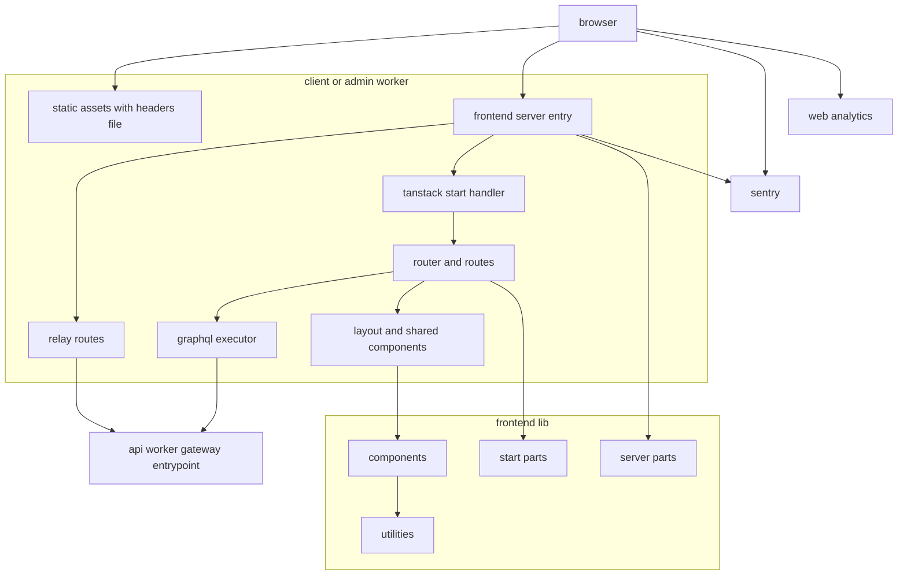
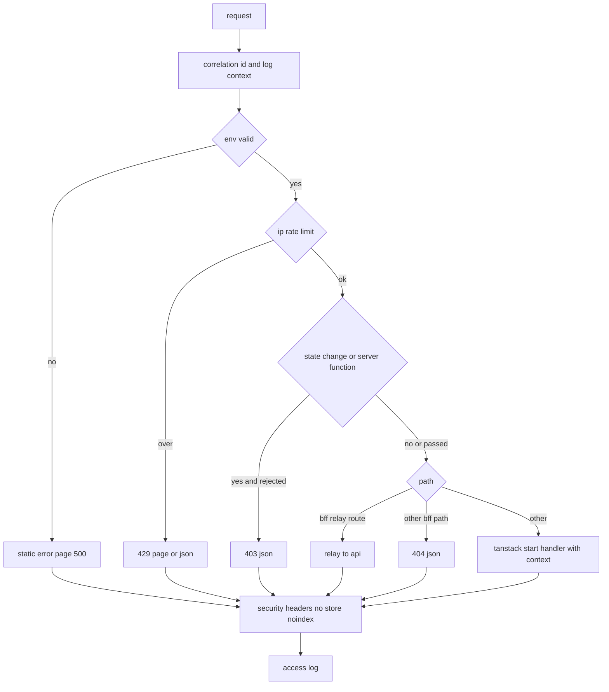
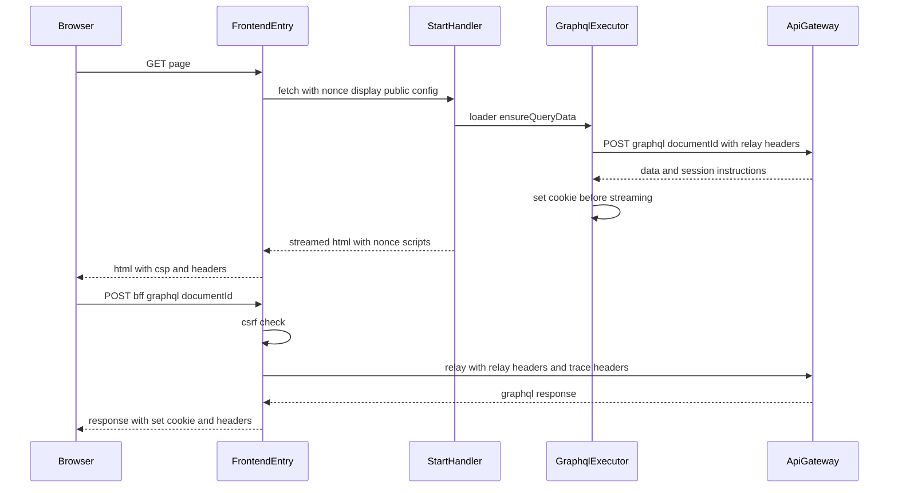
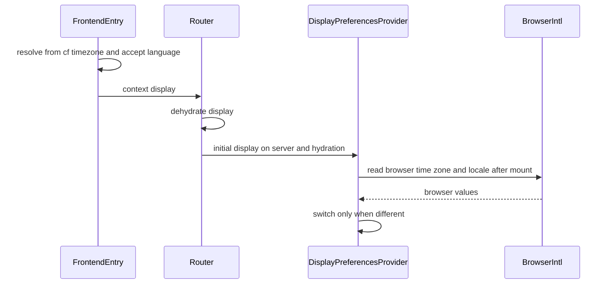
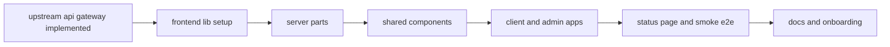

# Design Document

## Overview

**Purpose**: 利用者側(`apps/client`)と管理者側(`apps/admin`)のフロントエンドサーバーを、TanStack Startと`@cloudflare/vite-plugin`でCloudflare Workersに載せ、共通部品(`apps/frontend-lib`)にセキュリティ対策・APIサーバーへの中継・データ取得・デザインシステム・画面部品をまとめる。処理の順序(IP制限→CSRF→中継→描画→セキュリティヘッダー)は共通部品のサーバーのエントリ1箇所で定め、両アプリは呼び出し元の種類・登録箇所・画面シェルだけを持つ。

**Users**: 画面を持つ後続specの開発者とAIエージェントは、ルートのファイルとGraphQLの操作を追加し、登録箇所(レイアウトの区画・CSPの許可先・中継の経路)へ追記するだけで画面を載せる。identity-auth・admin-foundationはヘッダーとメニューの区画を差し込み、media-pipelineは中継の経路を追加し、演出を持つspecは停止の手段を用意する。infra-deliveryは本specのWrangler設定とコード生成の検査・スモークテストをCIで使う。

**Impact**: 空の`apps/client`・`apps/admin`・`apps/frontend-lib`に骨格を作る。ルートの`e2e/`にスモークテストを加え、`docs/GUIDES/tech`の`frontend`・`coding`、`docs/GUIDES/service`の`features`・`design`、`docs/onboardings`、CLAUDE.mdを更新する。上流のapi・event・backend-libのコードは変えない。

### Goals

- 両フロントエンドサーバーが`bun run dev`と`vite build && vite preview`で起動し、別プロセスのAPIサーバーへService Bindingsで中継できる。
- すべての応答にnonce付きCSPとセキュリティヘッダーが付き、状態変更の要求がCSRFの検証を通り、IP制限がbackend-platformと同じ値で働く。
- ドメインspecが、GraphQLの操作を書くだけで型付きの取得を得て、SSRとブラウザで同じ方法で使える。操作の一覧がapi-gatewayの許可リストの入力になる。
- 共通部品がStorybookで閲覧でき、ブラウザテストでアクセシビリティの自動検査に通り、各アプリのカバレッジが80%を満たす。

### Non-Goals

- 各ドメインの画面、ログイン・登録の画面とログイン中の表示、管理画面のメニューとRBAC。
- マークダウンの部品、ファイルのアップロード部品とファイルの中継の経路、決済のCSP。
- アニメーション演出の切替UI、通貨の表示形式、Storybookのデプロイ、E2Eでのアクセシビリティ検査。
- Cloudflare上のリソースの作成、CIのワークフロー、デプロイの実行。

## Boundary Commitments

### This Spec Owns

- 両フロントエンドサーバーの骨格: Vite・Wrangler設定(ローカル・staging・prod)、サーバーのエントリ、`src/start.ts`、ルーター、ルートのレイアウトの部品、仮のトップページ、404・エラーの画面、静的なファイルのヘッダー(`public/_headers`)。
- サーバーのエントリの処理の順序と各段階: 相関IDとアクセスログ、環境の検証、Worker単位のIP制限、CSRFの検証、中継の経路、nonce付きCSP・Permissions-Policy・セキュリティヘッダー・`no-store`・検索除外。
- APIサーバーへの中継: 中継の項目の組み立て、セッションのCookieの読み取り・発行・削除(Cookieの名前と属性)、中継の経路の定義(`RelayRoute`)と登録箇所、GraphQLの中継(`/_bff/graphql`)、サーバー側の描画のGraphQLの実行。
- GraphQLクライアント: コード生成の設定と生成物の場所(api-gatewayの契約)、操作の実行部品、応答の解析とエラーの型、QueryClientの既定値と再試行、要求ごとのQueryClientとJotaiのストア。
- デザインシステム: デザイントークン(ライト・ダーク)、基本のスタイル(視差効果の軽減・フォーカス表示)、ダークモードの保存と初回描画前の適用、shadcn/uiの部品。
- 共通部品: フォーム、状態表示、トースト、日時・数値の表示と表示設定、Turnstileのウィジェット、404・想定外のエラーの表示、疎通確認の表示、文書の外枠(スキップリンク・画面遷移の通知)。
- 画面シェル: 利用者側の共通レイアウト(ヘッダー・フッター・区画の登録箇所)、管理者側の基本レイアウト(区画の登録箇所)。
- 疎通確認の画面(`/system/status`、ローカル・stagingのみ)とスモークテスト(`e2e/client`・`e2e/admin`)。
- 観測: サーバー・ブラウザのSentryの設定と個人情報の除去、想定外の失敗の送信、利用者側のWeb Analyticsの計測スクリプト、フロントエンドのアクセスログ。
- 画面向けの静的解析の設定(`apps/frontend-lib/config/frontend-lint.ts`)、Storybookの設定、ブラウザテストの設定とアクセシビリティの検査の補助。
- 技術ドキュメント: `frontend/003`〜`007`、`coding/004`のクライアント側の節、`frontend/002`・`coding/002`・`coding/003`の追記、`service/features/003`、`service/design`の修正、`docs/onboardings`・CLAUDE.mdの更新。

### Out of Boundary

- APIサーバーの名前付きエントリポイント・内部認証・許可リストの生成・GraphQLのエラーコードの定義(api-gateway)。本specは契約として使う。
- Worker単位のIP制限の規約値(backend-platform)。本specは同じ値で適用する。
- セッションの発行・検証・失効の判断と、ログイン中の表示(identity-auth)。管理者のログイン・メニュー・RBAC(admin-foundation)。
- `/_bff/`の下のGraphQL以外の中継の経路の中身(media-pipeline)、決済などのCSP・Permissions-Policyの許可先(各spec)。
- 5秒を超えて自動で動き続ける演出の停止手段(演出を持つspec)。
- 通貨の表示形式(payments)、トップページ・ディレクトリ・ヘルプなどのページの中身(各spec)。
- Cloudflareのリソース(カスタムドメイン・Web Analyticsのサイト・Turnstileのウィジェット)、staging・prodの変数の実値、CIのワークフロー、デプロイの順序(infra-delivery)。Sentryのプロジェクトと値、FCPとアクセシビリティの全体の検証(launch-readiness)。

### Allowed Dependencies

- 上流(api-gateway): `ClientGateway`・`AdminGateway`、中継の項目(`x-original-client-ip`・`x-session-token`・`cf-turnstile-response`)と指示の項目(`x-session-issue`・`x-session-max-age`・`x-session-clear`)、`SESSION_TOKEN_PATTERN`の形式(43文字のbase64url)、`POST /graphql`の`{ documentId, operationName?, variables? }`、エラーコードと状態コードの規則、スキーマファイル`apps/api/src/presentation/graphql/generated/schema.graphql`、操作の一覧の場所。形を変えずに使う。
- 上流(backend-platform): Worker単位のIP制限の規約表、共通のエラー形式`{ error: { code, message, details? } }`と`FieldErrorDetail`、ログの形式とカテゴリの規約、Sentryのトレースの割合の値、リソースの名前の規約。コードは読み込まず、値と形をそろえる。
- 上流(dev-tooling): 基底設定、`browserTestPreset`・`browserOptionsPreset`・`resolveBrowserLaunchOptions`、テストの命名と生成コードの命名、スクリプト契約、共有ディレクトリの配置、E2Eの設定と対象の定義。
- npmパッケージ: Technology Stackの表に挙げた版に限る。
- `apps/frontend-lib/server/**`・`utilities/**`は`cloudflare:*`・`@tanstack/react-start`・`react`を読み込まない。`apps/frontend-lib/components/**`は`server/**`・`start/**`の`*.server.ts`を読み込まない。
- 依存の方向は「Dependency Direction」に従う。

### Revalidation Triggers

- サーバーのエントリの処理の順序、`FrontendRequestContext`・`FrontendAppProfile`の形(両アプリ・後続の全画面spec)。
- 中継の経路の接頭辞`/_bff/`、`RelayRoute`の形、中継で引き継ぐ項目の一覧、セッションのCookieの名前と属性(media-pipeline・identity-auth・admin-foundation)。
- `SecurityPolicySources`の形と既定の許可先、Permissions-Policyの既定値(payments・media-pipeline・launch-readiness)。
- レイアウトの区画の登録箇所(`SiteLayoutSlots`・`AdminLayoutSlots`)の形(identity-auth・admin-foundation・help-center・sponsorship)。
- `executeGraphQL`・`GraphQLClientError`・`GraphQLResult`・QueryClientの既定値と再試行の方針、生成物の場所(全ドメインspec・api-gateway)。
- デザイントークンの名前、`DisplayPreferences`・日時の書式の名前、フォーム部品と状態表示の部品の形(全画面spec)。
- 演出の停止手段の義務: 本specはアニメーション演出の切替UIを持たず、OSの「視差効果を減らす」設定に従う基本のスタイルだけを提供する。5秒を超えて自動で動き続ける演出・点滅・自動スクロールを含む区画を追加するspec(match-engineなど)は、WCAG 2.2の達成基準2.2.2に従い、その区画の近くに利用者が一時停止・停止・非表示にできる手段を用意する。この規約(`frontend/004`)を変える場合、または本specが切替UIを加える場合は、演出を持つspecを再確認する。
- 疎通確認の画面の経路と公開する環境(launch-readiness・infra-delivery)。
- 両アプリの変数名・バインディング名・Worker名・`namespace_id`(infra-delivery)。

## Architecture

### Existing Architecture Analysis

- `apps/client`・`apps/admin`・`apps/frontend-lib`は空である。`config/workspace-layout.ts`は3つをアプリとして、`apps/frontend-lib`を検査担当`self`の共有ディレクトリ(配置先`apps/{client,admin}/lib`)として登録済みである。compose.yamlは配置先へbind mountし、3つの`node_modules`を名前付きボリュームにしている。
- `e2e/support/targets.ts`は`client`(`http://localhost:48044`・`E2E_CLIENT_URL`)と`admin`(`http://localhost:48045`・`E2E_ADMIN_URL`)を定義済みである。オンボーディングはclient 48044・admin 48045・Storybook 48046のポートを定めている。
- `docs/GUIDES/tech/frontend`には日時の`<time>`の規約(`001`)とTanStack Startの起動(`002`)がある。本specはこれらを前提にし、重複して書かない。
- apiの`ClientGateway`・`AdminGateway`、スキーマファイル、許可リストの生成はapi-gatewayの実装の完了を前提にする。
- `mockups`の部品(shadcn/uiの部品・ヘッダー・フッター・状態表示・404・日時の整形)は移植の元にする。モックアップのshadcn/uiの部品は1ファイルに複数の部品をエクスポートしているため、CLAUDE.mdの規則(1ファイル1コンポーネント)に合わせて分割する。

### Architecture Pattern & Boundary Map



**Architecture Integration**:

- 選んだパターン: TanStack Startのハンドラーの外側に、共通部品の`createFrontendServerEntry`を置き、前処理(IP制限・CSRF・中継)と後処理(ヘッダー・アクセスログ)を一律に適用する。ページの描画のGraphQLとブラウザからの中継は、同じ中継の項目の組み立てとCookieの指示の処理を使う。
- 境界: 共通部品は`server`(純粋なサーバーの部品)・`start`(TanStack Startとの接続)・`utilities`(純粋な関数)・`components`(画面部品)の4つに分ける。アプリは`src/composition/`の登録箇所と、ルート・レイアウト・操作だけを持つ。
- 既存パターンの維持: 登録箇所(`composition/*.ts`)、共通のエラー形式、ログの形式、テストの命名と層の分担、生成コードの命名(`generated/`・`*.gen.ts`)。
- 新規コンポーネントの理由: research.mdの「Generalization・Build vs Adopt・Simplification」を参照。

### Dependency Direction

`apps/frontend-lib`の中は、次の向きにだけ参照する。逆向きのimportは`apps/frontend-lib/config/frontend-lint.ts`の`no-restricted-imports`で禁止する。

- `utilities` ← `server` ← `start` ← `components` ← アプリ(`src/composition` ← `src/components` ← `src/routes` ← `src/router.tsx`・`src/server.ts`・`src/start.ts`)
- `utilities/**`・`server/**`は`react`・`@tanstack/*`・`cloudflare:*`・`@sentry/cloudflare`・`@sentry/tanstackstart-react`を読み込まない(Bunの単体テストで読み込むため)。型だけのimport(`@sentry/core`の型など)は許す。
- `start/**`の`*.server.ts`は、同じディレクトリの`createIsomorphicFn().server()`からだけ読み込む。`components/**`から直接読み込まない。
- `components/**`は`start/**`の`*.server.ts`以外と`utilities/**`を読み込める。`server/**`は型だけを読み込める。
- アプリの`src/composition/**`はアプリの`src/routes/**`を読み込まない。アプリから共通部品へは`lib/`の相対パスで読み込む。
- GraphQLの操作(`graphql()`の呼び出し)はアプリの`src`にだけ置き、共通部品には置かない。

### Technology Stack

| Layer          | Choice / Version                                                                                                                                                                                                                                                                             | Role in Feature                                   | Notes                                                                                                            |
| -------------- | -------------------------------------------------------------------------------------------------------------------------------------------------------------------------------------------------------------------------------------------------------------------------------------------- | ------------------------------------------------- | ---------------------------------------------------------------------------------------------------------------- |
| ランタイム     | Cloudflare Workers(`compatibility_date` 2026-08-04)、Workers Static Assets、Service Bindings、Rate Limitingバインディング                                                                                                                                                                    | SSR・中継・静的なファイルの配信・IP制限           | `compatibility_flags`は書かない                                                                                  |
| フレームワーク | @tanstack/react-start 1.168.60(@tanstack/react-router 1.170.41)・react 19.3.0・react-dom 19.3.0                                                                                                                                                                                              | ルーティング・SSR・サーバー関数                   | tech-stack記載済み                                                                                               |
| ビルド         | vite 8.3.2・@vitejs/plugin-react 6.1.1・@cloudflare/vite-plugin 1.53.0・wrangler 4.124.0                                                                                                                                                                                                     | 開発サーバー・ビルド・プレビュー                  | vite-pluginは`wrangler` 4.124.0を持つ版(research.md)。`@vitejs/plugin-react`は新規(Q5)                           |
| データ取得     | @tanstack/react-query 5.104.1・@tanstack/react-router-ssr-query 1.167.3・jotai 3.0.1                                                                                                                                                                                                         | サーバーのデータのキャッシュ・SSR統合・画面の状態 | tech-stack記載済み                                                                                               |
| GraphQL        | graphql 16.14.2・@graphql-codegen/cli 7.4.6・@graphql-codegen/client-preset 6.2.3・@graphql-typed-document-node/core 3.2.0                                                                                                                                                                   | 型付きの操作と操作の一覧の生成                    | graphql・cliはapiと同じ版(cliはapi-gatewayの承認後の改訂2で7.4.6)。`@graphql-typed-document-node/core`は新規(Q5) |
| UI             | tailwindcss 4.3.3・@tailwindcss/vite 4.3.3・radix-ui 1.6.7・class-variance-authority 0.7.1・clsx 2.1.1・tailwind-merge 3.7.0・tw-animate-css 1.4.0・lucide-react 1.51.0・sonner 2.0.8                                                                                                        | デザインシステムと部品                            | Tailwind・shadcn/uiはtech-stack記載済み、他は新規(Q5)。shadcnのCLIは`bunx shadcn@4.21.1`で部品の生成にだけ使う   |
| フォーム       | react-hook-form 7.89.0・@hookform/resolvers 5.9.1・zod 4.6.5                                                                                                                                                                                                                                 | 入力と検証                                        | resolversは新規(Q5)。zodはbackend-platformと同じ版                                                               |
| bot対策        | @marsidev/react-turnstile 1.6.1                                                                                                                                                                                                                                                              | Turnstileのウィジェット                           | 新規(Q6)                                                                                                         |
| 観測           | @sentry/cloudflare 11.4.0・@sentry/tanstackstart-react 11.4.0・@logtape/logtape 2.3.11・@logtape/redaction 2.3.11・Cloudflare Web Analytics(計測スクリプト)                                                                                                                                  | エラー・トレース・アクセスログ・アクセス解析      | backend-platformと同じ版                                                                                         |
| カタログ       | storybook 10.6.1・@storybook/tanstack-react 10.6.1・@storybook/addon-a11y 10.6.1                                                                                                                                                                                                             | 部品のカタログと目視のアクセシビリティ確認        | addon-a11yは新規(Q8)                                                                                             |
| テスト         | vitest 4.1.11・@vitest/browser-playwright 4.1.11・@vitest/coverage-v8 4.1.11・playwright 1.64.1・vitest-browser-react 2.3.0・axe-core 4.13.0・@types/bun 1.4.3                                                                                                                               | 単体・ブラウザテスト・アクセシビリティの自動検査  | axe-coreは新規(Q8)。他は主要パッケージ一覧の版                                                                   |
| 静的解析・整形 | 品質ツール6種(主要パッケージ一覧の版)・@eslint-react/eslint-plugin 5.23.5・eslint-plugin-react-hooks 7.1.1・@tanstack/eslint-plugin-query 5.104.1・@tanstack/eslint-plugin-router 1.162.0・eslint-plugin-storybook 10.6.1・eslint-plugin-jsx-a11y-x 0.2.0・prettier-plugin-tailwindcss 0.8.1 | 画面向けの規則とクラス名の整列                    | 新規(Q7)                                                                                                         |

- `apps/frontend-lib`のコードが実行時に使うパッケージは、`apps/client`・`apps/admin`も同じ版で宣言する(共有ディレクトリの規約)。3つで版をそろえるパッケージの一覧を`coding/002`に加える。
- `@cloudflare/vite-plugin`・`wrangler`・`@cloudflare/vitest-pool-workers`は同じ`wrangler`の版の組で一括して更新する規則を`coding/002`に加える。
- `wrangler types`は使わない。環境はZodで検証し、バインディングは共通部品の構造的な型(`ServiceFetcher`・`RateLimiter`)で扱う。DOMの型とWorkersの実行時の型の衝突を避けるためである。

## File Structure Plan

### Directory Structure

```
apps/
├── frontend-lib/                                   # 共有ディレクトリ兼アプリ(配置先: apps/{client,admin}/lib、検査担当: self)
│   ├── package.json · bun.lock                     # 実行時の依存(アプリと同じ版)・Storybook・テスト・品質ツール
│   ├── tsconfig.json                               # extendsを持たない自己完結の型検査設定(基底設定の値を書き写す)
│   ├── eslint.config.ts · prettier.config.ts       # 基底設定+createFrontendLintConfig、ルート設定+Tailwindのプラグイン
│   ├── vitest.browser.config.ts                    # browserTestPresetを取り込み、coverage.includeはcomponents/**
│   ├── .storybook/main.ts · preview.tsx            # @storybook/tanstack-react、addon-a11y、ライト・ダークの切替
│   ├── config/
│   │   ├── frontend-lint.ts                        # 画面向けの静的解析の規則の組み立て(3アプリが使う)
│   │   └── tsconfig-sync.unit.test.ts              # tsconfig.jsonが基底設定と差分(jsx・lib・types・include)以外で一致すること
│   ├── test/a11y.ts                                # 描画した要素へaxe-coreを実行し、違反を読める形で返す補助
│   ├── styles/
│   │   ├── tokens.css                              # デザイントークン(ライト・ダーク・ブレークポイント・フォント)。mockups/src/styles.cssから移植
│   │   └── base.css                                # Tailwind・tw-animate-cssの取り込み、視差効果の軽減、フォーカス表示
│   ├── utilities/                                  # 純粋な関数(Bunの単体テスト。各ファイルに同名の*.unit.test.tsを併置)
│   │   ├── class-names.ts                          # cn
│   │   ├── graphql/graphql-result.ts               # GraphQLClientError・GraphQLResult・応答の解析・想定内の判定
│   │   ├── graphql/persisted-document.ts           # PersistedDocument・documentIdの取り出し
│   │   ├── datetime/display-preferences.ts         # DisplayPreferences・既定値・検証・ブラウザの値
│   │   ├── datetime/date-time-formats.ts           # 書式の名前と整形
│   │   ├── datetime/relative-time.ts               # 経過・残り時間の表現
│   │   ├── number/number-format.ts                 # ロケールに従う数値の整形
│   │   ├── theme/theme-preference.ts               # 保存キー・読み書き・初回描画前のスクリプトの文字列
│   │   ├── forms/server-field-errors.ts            # FieldErrorDetailとフォームの欄の対応付け
│   │   ├── system/system-status-availability.ts    # 疎通確認の画面を公開する環境の判定(ローカル・stagingだけ)
│   │   └── observability/sentry-scrub.ts           # イベントとスパンの除去・dataCollection・想定内の失敗の除外
│   ├── server/                                     # サーバーのエントリの部品(Bunの単体テスト。各ファイルに同名の*.unit.test.tsを併置)
│   │   ├── entry/app-profile.ts                    # FrontendAppProfile・CallerKind
│   │   ├── entry/request-context.ts                # FrontendRequestContext
│   │   ├── entry/create-frontend-server-entry.ts   # 処理の順序の唯一の定義
│   │   ├── env/frontend-env.ts                     # 環境の検証・PublicRuntimeConfig
│   │   ├── http/client-ip.ts                       # CF-Connecting-IPの解釈
│   │   ├── http/page-request.ts                    # ページの要求・サーバー関数の呼び出しの判定
│   │   ├── http/ip-rate-limit.ts                   # キーの組み立てと判定
│   │   ├── http/csrf.ts                            # CSRFの判定
│   │   ├── http/nonce.ts                           # 推測できないnonceの生成
│   │   ├── http/security-policy.ts                 # SecurityPolicySources・合成・CSP・Permissions-Policyの組み立て
│   │   ├── http/security-headers.ts                # 付与する値と付与・検索除外・no-store
│   │   ├── http/error-responses.ts                 # 共通のエラー形式と静的なエラー画面
│   │   ├── relay/relay-contract.ts                 # api-gatewayの契約の値(項目名・識別子の形式)
│   │   ├── relay/relay-headers.ts                  # 中継の項目の組み立て(許可した項目だけ)
│   │   ├── relay/session-cookie.ts                 # Cookieの読み取り・指示の解釈・Set-Cookieの組み立て
│   │   ├── relay/relay-route.ts                    # RelayRoute・GRAPHQL_RELAY_ROUTE・relayToApi
│   │   ├── display/request-display-preferences.ts  # cf.timezoneとAccept-Languageからの推定
│   │   ├── observability/logging.ts                # LogTapeの設定・伏せ字・アクセスログ
│   │   └── observability/server-sentry-options.ts  # withSentryへ渡すオプション
│   ├── start/                                      # TanStack Startとの接続。TanStack Startを読み込むファイルは薄く保ちスモークテストで、読み込まないファイルはBunの単体テストで確かめる
│   │   ├── start-options.ts                        # requestMiddleware・functionMiddleware(Sentry・CSRF)
│   │   ├── router-context.ts                       # 純粋: RouterContext・AppRuntimeHolder・dehydrate・hydrate
│   │   ├── request-context.ts                      # 同型の関数: readRequestNonce・readInitialRuntime(サーバーは*.server.ts)
│   │   ├── request-context.server.ts               # getGlobalStartContextからFrontendRequestContextを読む
│   │   ├── query-client.ts                         # 純粋: QueryClientの既定値と再試行の方針
│   │   ├── page-head.ts                            # 純粋: ページのタイトル・正規のURL・検索除外のhead定義
│   │   ├── graphql/browser-transport.ts            # 純粋: 中継の経路への要求の組み立てと応答の解析(fetchを注入)
│   │   ├── graphql/execute-graphql.ts              # 同型の関数: サーバーは*.server.ts、ブラウザはbrowser-transport
│   │   ├── graphql/execute-graphql.server.ts       # Service BindingsでのAPI呼び出しとCookieの指示の反映
│   │   ├── graphql/graphql-query-options.ts        # queryOptions・mutationの補助(キーはutilitiesのgraphqlQueryKey)
│   │   ├── observability/error-queue.ts            # 純粋: ブラウザの送信待ちの列(上限・重複・想定内の除外)
│   │   ├── observability/report-error.ts           # 同型の関数: サーバーは*.server.ts、ブラウザはerror-queue
│   │   ├── observability/report-error.server.ts
│   │   ├── observability/browser-observability.ts  # 初期化後のSentryの動的読み込み(読み込み関数を注入)
│   │   ├── observability/web-analytics.ts          # 純粋: 計測スクリプトのhead定義
│   │   └── preload-recovery.ts                     # 純粋: vite:preloadErrorで1回だけ再読み込みする(対象と保存先を注入)
│   └── components/                                 # 画面部品(ブラウザテスト・Storybook。1ファイル1コンポーネント、*.browser.test.tsx・*.stories.tsxを併置)
│       ├── ui/<部品>/<部分>.tsx                     # shadcn/uiの部品を部分ごとのファイルに分割(button・input・label・textarea・dialog・dropdown-menu・popover・radio-group・sheet・skeleton・switch・tabs・tooltip・badge)。variantsは*-variants.ts
│       ├── app-shell/app-document.tsx              # html・head・body・テーマの初回適用・トースト・画面遷移の通知
│       ├── app-shell/skip-link.tsx · route-announcer.tsx
│       ├── theme/theme-toggle.tsx · use-theme.ts
│       ├── form/use-app-form.ts · app-form.tsx · form-field.tsx · form-message.tsx · submit-button.tsx
│       ├── state/loading-skeleton.tsx · empty-state.tsx · error-state.tsx · partial-error-state.tsx · unavailable-notice.tsx
│       ├── feedback/toaster.tsx · notify.ts
│       ├── datetime/display-preferences-provider.tsx · use-display-preferences.ts · date-time.tsx · relative-time.tsx · number-text.tsx
│       ├── bot-protection/turnstile-widget.tsx · use-turnstile-token.ts
│       ├── error/not-found-view.tsx · unexpected-error-view.tsx
│       └── system/system-status-view.tsx           # 疎通確認の結果の表示(サーバー側とブラウザ側を区別)
├── client/
│   ├── package.json · bun.lock · tsconfig.json · eslint.config.ts · prettier.config.ts
│   ├── vite.config.ts                              # cloudflare(persistState)・tanstackStart・viteReact・tailwindcss
│   ├── wrangler.jsonc                              # ローカル・staging・prodのバインディングと変数(Supporting References)
│   ├── codegen.config.ts                           # 入力はapiのスキーマファイル、出力はsrc/graphql/generated/
│   ├── vitest.browser.config.ts                    # coverage.includeはsrc/components/**、lib/**を除外
│   ├── public/_headers · favicon.ico               # 静的なファイルのセキュリティヘッダーと/assets/*の長期キャッシュ
│   ├── test/config/
│   │   ├── wrangler-config.unit.test.ts            # 3環境のバインディング・変数・namespace_id・観測の設定
│   │   ├── static-headers.unit.test.ts             # _headersが共通部品の定数と一致すること
│   │   └── composition.unit.test.ts                # 登録箇所の既定値(中継の経路・CSPの許可先・プロファイル)
│   └── src/
│       ├── server.ts                               # Sentry.withSentry(createFrontendServerEntry(...))
│       ├── start.ts                                # createStart(createFrontendStartOptions())
│       ├── router.tsx                              # getRouter(nonce・QueryClient・Jotai・SSR統合・dehydrate)
│       ├── routeTree.gen.ts                        # 生成物
│       ├── styles.css                              # lib/styles/tokens.css・base.cssの取り込みと@source
│       ├── composition/
│       │   ├── app-profile.ts                      # CLIENT_PROFILE(Cookieの名前・検索除外・アクセス解析)
│       │   ├── layout-slots.ts                     # SITE_LAYOUT_SLOTS(後続specが追記)
│       │   ├── security-policy.ts                  # CLIENT_SECURITY_POLICY(Web Analytics。後続specが追記)
│       │   └── relay-routes.ts                     # RELAY_ROUTES(初版はGraphQLだけ。後続specが追記)
│       ├── routes/__root.tsx · index.tsx · system/status.tsx
│       ├── components/layout/site-layout.tsx · site-header.tsx · site-mobile-menu.tsx · site-footer.tsx · guest-account-links.tsx · launch-link.tsx
│       ├── components/pages/not-found-page.tsx · error-page.tsx · placeholder-home.tsx
│       └── graphql/operations/system-status.ts · generated/   # ClientSystemStatusの操作と生成物
└── admin/                                          # clientと同じ構成。違いは次のとおり
    └── src/
        ├── composition/app-profile.ts · layout-slots.ts · security-policy.ts · relay-routes.ts  # ADMIN_PROFILE・ADMIN_LAYOUT_SLOTS(Web Analyticsなし)
        ├── components/layout/admin-layout.tsx · admin-header.tsx
        ├── components/pages/not-found-page.tsx · error-page.tsx · placeholder-home.tsx
        └── graphql/operations/system-status.ts · generated/   # AdminSystemStatusの操作と生成物
e2e/
├── client/system-status.e2e.test.ts               # 疎通・再確認・ヘッダー・CSP・404・CSRFの拒否
├── admin/system-status.e2e.test.ts
└── support/security-assertions.ts                 # ヘッダーとCSPの違反の検査の補助(テストではないファイル)
docs/
├── GUIDES/tech/frontend/003-frontend-server-security.md   # 中継・CSRF・CSP・セキュリティヘッダー・no-store・IP制限の適用・検索除外
├── GUIDES/tech/frontend/004-accessibility-rules.md        # アクセシビリティ規則・自動検査・演出の停止手段の義務
├── GUIDES/tech/frontend/005-shared-components.md          # 共通化する部品と使い方・カタログ・1ファイル1コンポーネント
├── GUIDES/tech/frontend/006-data-fetching.md              # QueryClient・SSR統合・画面の状態・エラーの扱い・キャッシュ
├── GUIDES/tech/frontend/007-frontend-observability.md     # Sentry・除去・アクセス解析・アクセスログ
├── GUIDES/tech/coding/004-graphql-communication.md        # (追記)クライアント側の節
├── GUIDES/service/features/003-internationalization.md    # 国際化方針
└── onboardings/ README.md · tech-stack.md · project-values.md
```

### Modified Files

- `docs/GUIDES/tech/frontend/002-tanstack-start-on-workers.md`・`README.md`: 独自のサーバーのエントリ、`*.server.ts`と`createIsomorphicFn`、別プロセスのWorkerへのService Bindings、`CLOUDFLARE_ENV`のビルド時の指定、プレビューの手順を追記する。索引に`003`〜`007`を加える。
- `docs/GUIDES/tech/coding/002-dependency-versions.md`: `@cloudflare/vite-plugin`と`wrangler`・`@cloudflare/vitest-pool-workers`の版の組、client・admin・frontend-libで版をそろえるパッケージ、`graphql`・`@graphql-codegen/cli`をapiとそろえることを追記する。
- `docs/GUIDES/tech/coding/003-shared-directories.md`: 検査担当が`self`の共有ディレクトリの`tsconfig.json`は`extends`を持たない自己完結にする理由と検証の結果を、「注意」の節に追記する。
- `docs/GUIDES/tech/coding/README.md`・`frontend/README.md`: 文書一覧へ追記する。
- `docs/GUIDES/service/design/001-design-principles.md`: 「日時・数値の表示」の述語の欠けた箇条を「時刻の定義と日付の境界は原則として基準時刻(UTC-08:00)とする」に直し、国際化方針へのリンクを加える。
- `docs/GUIDES/service/design/002-page-layouts.md`: 「共通レイアウト(利用者側)」のヘッダーの項目にダークモードの切替ボタンを加える。管理者側の基本レイアウトの項目を加える。
- `docs/GUIDES/service/design/003-text-and-copy-rules.md`: 想定外のエラーの画面とCSRFの拒否の文言を加える。
- `docs/GUIDES/service/features/README.md`: 国際化方針を索引に加える。
- `docs/onboardings/tech-stack.md`: 本specで新しく導入したパッケージを、導入した実装タスクの中で追記する(15.7)。
- `docs/onboardings/project-values.md`: 「Supporting References」の固有値(Worker名・`namespace_id`・Cookieの名前・経路・変数の値・CSPの許可先)を記載する。
- `docs/onboardings/README.md`: 起動の順序(API→client・admin)、コード生成と許可リストの再生成、プレビュー、Storybook、スモークテストの手順を更新する。
- `CLAUDE.md`: 「技術規則の参照先」に、画面・中継・CSPの登録・データ取得・アクセシビリティの文書を追記し、ディレクトリ構成の`frontend-lib`に`server`・`start`・`styles`・`config`を加える。

## System Flows

### 1要求の処理の順序



- nonceと表示設定と公開してよい設定値は、TanStackのハンドラーへ渡す`context`で、ルーターの生成とルートの`loader`に届く。
- 静的なファイルはWorkerを通らず、`_headers`のヘッダーだけが付く。

### ページの描画とブラウザからの中継



- 中継の項目は、サーバー側の描画とブラウザからの中継の両方で`buildRelayHeaders`が組み立てる(2.2〜2.6)。
- Cookieの指示は、ページの描画では`loader`の取得(送り始める前)だけで反映する。送り始めた後に届いた指示は警告ログを出して捨てる(research.mdのRisks)。

### 表示設定の受け渡し



## Requirements Traceability

| Requirement | Summary                              | Components                                                                          | Interfaces                                                     | Flows       |
| ----------- | ------------------------------------ | ----------------------------------------------------------------------------------- | -------------------------------------------------------------- | ----------- |
| 1.1         | 開発サーバーとプレビューで動く       | AppBuildConfig、FrontendServerEntry                                                 | `vite.config.ts`・`wrangler.jsonc`                             | 1要求の処理 |
| 1.2         | 3環境の設定とビルド時の選択          | AppBuildConfig                                                                      | `env.staging`・`env.prod`・`CLOUDFLARE_ENV`                    | —           |
| 1.3         | 共通のローカル状態・別プロセスのAPI  | AppBuildConfig                                                                      | `persistState`・`services`                                     | —           |
| 1.4         | 設定の不備で500と名前のログ          | FrontendEnv、FrontendServerEntry、ErrorResponses、FrontendLogging                   | `validateFrontendEnv`                                          | 1要求の処理 |
| 1.5         | グローバルスコープで初期化しない     | FrontendServerEntry、RouterFactory                                                  | `createFrontendServerEntry`                                    | —           |
| 1.6         | 同じ仕組みと違いの限定               | FrontendServerEntry、AppProfile                                                     | `FrontendAppProfile`                                           | —           |
| 1.7         | 消えたスクリプトで1回再読み込み      | PreloadRecovery                                                                     | `installPreloadRecovery`                                       | —           |
| 2.1         | 中継の経路から内部経路へ             | RelayCore、AppBuildConfig                                                           | `GRAPHQL_RELAY_ROUTE`・`relayToApi`                            | 描画と中継  |
| 2.2         | 描画中のGraphQLも同じ引き継ぎ        | GraphqlExecutor、RelayCore                                                          | `executeGraphQL`・`buildRelayHeaders`                          | 描画と中継  |
| 2.3         | 元のクライアントIPアドレス           | RelayCore、ClientIp                                                                 | `buildRelayHeaders`・`resolveClientIp`                         | 描画と中継  |
| 2.4         | セッションのCookieの引き継ぎ         | RelayCore                                                                           | `readSessionToken`                                             | 描画と中継  |
| 2.5         | bot判定のトークンの引き継ぎ          | RelayCore、TurnstileWidget                                                          | `buildRelayHeaders`・`ExecuteOptions.turnstileToken`           | 描画と中継  |
| 2.6         | 許可した項目だけ引き継ぐ             | RelayCore                                                                           | `FORWARDED_BROWSER_HEADERS`                                    | —           |
| 2.7         | Cookieの発行と指示の除去             | RelayCore、GraphqlExecutor                                                          | `readSessionInstruction`・`toBrowserResponse`                  | 描画と中継  |
| 2.8         | Cookieの削除                         | RelayCore、GraphqlExecutor                                                          | 同上                                                           | 描画と中継  |
| 2.9         | 利用者側と管理者側で別のCookie       | AppProfile                                                                          | `sessionCookieName`                                            | —           |
| 2.10        | 状態コード・本文・Retry-Afterを保つ  | RelayCore                                                                           | `toBrowserResponse`                                            | —           |
| 2.11        | 到達不能・15秒で503                  | RelayCore、ErrorResponses                                                           | `relayToApi`                                                   | —           |
| 2.12        | メソッド・形式の不一致で405・415     | RelayCore                                                                           | `RelayRoute.methods`・`acceptContentTypes`                     | —           |
| 2.13        | 秘密の値をログ等に含めない           | FrontendLogging、SentryScrub、RelayCore                                             | `REDACTED_FIELD_PATTERNS`・`scrubSentryEvent`                  | —           |
| 2.14        | 中継の経路の追加規約                 | RelayCore、AppComposition                                                           | `RelayRoute`・`RELAY_ROUTES`                                   | —           |
| 3.1         | Sec-Fetch-SiteとOriginの検証         | CsrfGuard                                                                           | `verifyCsrf`                                                   | 1要求の処理 |
| 3.2         | 失敗で403                            | CsrfGuard、FrontendServerEntry、ErrorResponses                                      | `errorEnvelopeResponse`                                        | 1要求の処理 |
| 3.3         | 全経路の状態変更に適用               | FrontendServerEntry、StartOptions                                                   | `requiresCsrfCheck`                                            | 1要求の処理 |
| 3.4         | Refererで代わりに判定しない          | CsrfGuard、StartOptions                                                             | `verifyCsrf`・`createCsrfMiddleware({ referer: false })`       | —           |
| 3.5         | サーバー関数はメソッドを問わない     | CsrfGuard、StartOptions                                                             | `requiresCsrfCheck`                                            | —           |
| 3.6         | 拒否の理由をログへ                   | FrontendServerEntry、FrontendLogging                                                | `CsrfVerdict.reason`                                           | —           |
| 4.1         | 要求ごとのnonce                      | Nonce、SecurityPolicy、RouterFactory                                                | `generateNonce`・`ssr.nonce`                                   | 1要求の処理 |
| 4.2         | 許可先の個別の列挙                   | SecurityPolicy、AppComposition                                                      | `BASE_SECURITY_POLICY_SOURCES`・`runtimeSecurityPolicySources` | —           |
| 4.3         | 許可先の登録規約                     | SecurityPolicy、AppComposition                                                      | `SecurityPolicySources`・`CLIENT_SECURITY_POLICY`              | —           |
| 4.4         | 全応答のセキュリティヘッダー         | SecurityHeaders、StaticHeaders                                                      | `applySecurityHeaders`・`public/_headers`                      | 1要求の処理 |
| 4.5         | Workerの応答にno-store               | SecurityHeaders                                                                     | `applySecurityHeaders`                                         | 1要求の処理 |
| 4.6         | 静的なファイルの長期キャッシュ       | StaticHeaders                                                                       | `public/_headers`                                              | —           |
| 4.7         | staging・管理者側の検索除外          | SecurityHeaders、AppProfile、PageHead                                               | `X-Robots-Tag`・`robots`のmeta                                 | —           |
| 4.8         | 生のHTMLの挿入の禁止                 | FrontendLintConfig                                                                  | `createFrontendLintConfig`                                     | —           |
| 5.1〜5.6    | Worker単位のIP制限                   | IpRateLimit、FrontendServerEntry、ErrorResponses、AppBuildConfig                    | `checkIpRateLimit`・`IP_RATE_LIMIT`                            | 1要求の処理 |
| 6.1         | 型付きの定義と操作の一覧の生成       | CodegenConfig                                                                       | `graphql:generate`                                             | —           |
| 6.2         | 不一致で生成・検査が失敗             | CodegenConfig                                                                       | `graphql:check`                                                | —           |
| 6.3         | 識別子と変数だけを送る               | CodegenConfig、PersistedDocument、GraphqlExecutor                                   | `mode: replaceDocumentWithHash`・`documentIdOf`                | 描画と中継  |
| 6.4         | 呼び出し元ごとの一覧                 | CodegenConfig                                                                       | `apps/{client,admin}/src/graphql/generated/`                   | —           |
| 6.5         | SSRのデータを再取得しない            | RouterFactory、QueryDefaults                                                        | `setupRouterSsrQueryIntegration`・`staleTime`                  | 描画と中継  |
| 6.6         | エラーの型付きの受け渡し             | GraphqlResult                                                                       | `GraphQLClientError`・`parseGraphQLResponse`                   | —           |
| 6.7         | 429・想定内の失敗を再試行しない      | QueryDefaults                                                                       | `shouldRetryQuery`                                             | —           |
| 6.8         | 要求ごとに分ける                     | RouterFactory                                                                       | `createAppQueryClient`・Jotaiのストア                          | —           |
| 6.9         | キャッシュと画面の状態の規約         | DataFetchingDoc                                                                     | `frontend/006`                                                 | —           |
| 7.1〜7.2    | トークン・部品・320px                | DesignTokens、UiPrimitives                                                          | `styles/tokens.css`                                            | —           |
| 7.3〜7.6    | ダークモードの切替と保存             | ThemePreference、ThemeToggle、AppDocument                                           | `THEME_BOOTSTRAP_SCRIPT`・`setThemePreference`                 | —           |
| 7.7         | 視差効果の軽減                       | BaseStyles                                                                          | `styles/base.css`                                              | —           |
| 7.8         | 演出の停止手段の規約                 | AccessibilityDoc                                                                    | `frontend/004`・Revalidation Triggers                          | —           |
| 7.9         | Webフォントを読み込まない            | DesignTokens                                                                        | `--font-sans`                                                  | —           |
| 8.1〜8.5    | フォーム                             | FormParts、ServerFieldErrors                                                        | `useAppForm`・`applyServerFieldErrors`                         | —           |
| 8.6         | 状態表示                             | StateDisplays                                                                       | 各部品のProps                                                  | —           |
| 8.7         | トースト                             | Toaster                                                                             | `notify`                                                       | —           |
| 8.8〜8.9    | Turnstileのウィジェット              | TurnstileWidget                                                                     | `useTurnstileToken`                                            | —           |
| 8.10        | 404・想定外のエラーの表示            | ErrorViews                                                                          | `NotFoundView`・`UnexpectedErrorView`                          | —           |
| 8.11        | カタログ                             | StorybookCatalog                                                                    | `.storybook/*`・`*.stories.tsx`                                | —           |
| 8.12        | 文言の規則                           | FormParts、StateDisplays、ErrorViews                                                | 文言の定数                                                     | —           |
| 9.1         | `<time>`と`datetime`                 | DateTimeDisplay                                                                     | `DateTime`                                                     | —           |
| 9.2         | サーバー側の推定                     | RequestDisplayPreferences、FrontendServerEntry、RouterFactory                       | `resolveRequestDisplayPreferences`                             | 表示設定    |
| 9.3〜9.4    | ブラウザの値への置き換えと一致       | DateTimeDisplay                                                                     | `DisplayPreferencesProvider`                                   | 表示設定    |
| 9.5         | UTCとja-JPへの代替                   | RequestDisplayPreferences                                                           | `FALLBACK_DISPLAY_PREFERENCES`                                 | —           |
| 9.6         | 基準時刻を表示しない                 | DateTimeDisplay                                                                     | `DATE_TIME_FORMATS`                                            | —           |
| 9.7         | 相対表現の併記と更新                 | DateTimeDisplay                                                                     | `RelativeTime`                                                 | —           |
| 9.8         | 数値の整形                           | DateTimeDisplay                                                                     | `NumberText`・`formatNumber`                                   | —           |
| 9.9         | 翻訳への耐性                         | UiPrimitives、ComponentsDoc                                                         | `translate="no"`の規約                                         | —           |
| 10.1〜10.7  | アクセシビリティ                     | UiPrimitives、AppDocument、RouteAnnouncer、FormParts、A11yTestHelper                | `runAxe`                                                       | —           |
| 11.1〜11.3  | 利用者側の共通レイアウトと区画       | SiteLayout、AppComposition                                                          | `SiteLayoutSlots`                                              | —           |
| 11.4        | 管理者側の基本レイアウト             | AdminLayout、AppComposition                                                         | `AdminLayoutSlots`                                             | —           |
| 11.5        | 404の画面                            | NotFoundPage、ErrorViews                                                            | `notFoundComponent`                                            | —           |
| 11.6        | 想定外のエラーの画面と送信           | ErrorPage、ReportError                                                              | `errorComponent`・`onError`・`defaultOnCatch`                  | —           |
| 11.7        | 区画のエラー                         | StateDisplays                                                                       | `PartialErrorState`                                            | —           |
| 11.8        | 仮のトップページ                     | PlaceholderHome                                                                     | `routes/index.tsx`                                             | —           |
| 11.9        | 正規のURLとタイトル                  | PageHead                                                                            | `buildPageHead`                                                | —           |
| 12.1〜12.5  | 疎通確認の画面                       | StatusRoute、SystemStatusView、RouterFactory                                        | `/system/status`                                               | 描画と中継  |
| 12.6〜12.7  | スモークテスト                       | SmokeE2E                                                                            | `e2e/{client,admin}/system-status.e2e.test.ts`                 | —           |
| 13.1        | 想定外の失敗の送信と想定内の除外     | ReportError、SentryScrub、ServerSentryOptions、BrowserObservability                 | `reportUnexpectedError`・`scrubSentryEvent`                    | —           |
| 13.2        | GraphQLの応答時間の計測と結び付け    | BrowserObservability、RelayCore                                                     | `tracesSampleRate`・`traceHeaders`                             | 描画と中継  |
| 13.3        | 送信前の除去                         | SentryScrub                                                                         | `scrubSentryEvent`・`scrubSentrySpan`                          | —           |
| 13.4〜13.5  | 送信先が無ければ送らない・録画しない | ServerSentryOptions、BrowserObservability                                           | `buildServerSentryOptions`                                     | —           |
| 13.6〜13.7  | アクセス解析は利用者側だけ           | WebAnalytics、AppProfile                                                            | `webAnalyticsHeadScript`                                       | —           |
| 13.8        | アクセスログ                         | FrontendLogging、FrontendServerEntry                                                | `logAccess`                                                    | 1要求の処理 |
| 13.9        | 呼び出しログの無効化                 | AppBuildConfig                                                                      | `observability.logs.invocation_logs`                           | —           |
| 13.10       | 送信の失敗が影響しない               | BrowserObservability、WebAnalytics、ServerSentryOptions                             | 非同期の送信                                                   | —           |
| 14.1〜14.4  | 初回表示の性能                       | RouterFactory、BrowserObservability、WebAnalytics、TurnstileWidget、DataFetchingDoc | ストリーミングのSSR・`ensureQueryData`                         | 描画と中継  |
| 15.1〜15.2  | カバレッジと品質ゲート               | AppTestConfigs、FrontendLintConfig                                                  | `vitest.browser.config.ts`・`eslint.config.ts`                 | —           |
| 15.3〜15.8  | 文書                                 | 技術ドキュメント群                                                                  | `docs/**`                                                      | —           |

## Components and Interfaces

| Component                                        | Domain/Layer          | Intent                                               | Req Coverage                                      | Key Dependencies (P0/P1)                         | Contracts      |
| ------------------------------------------------ | --------------------- | ---------------------------------------------------- | ------------------------------------------------- | ------------------------------------------------ | -------------- |
| AppProfile                                       | server/entry          | 呼び出し元の種類・Cookieの名前・検索除外・解析の有無 | 1.6, 2.9, 4.7, 13.6, 13.7                         | —                                                | State          |
| FrontendServerEntry                              | server/entry          | 処理の順序の唯一の定義                               | 1.1, 1.4〜1.6, 3.2, 3.3, 3.6, 4.1, 5.6, 9.2, 13.8 | 下記のserverの部品(P0)、TanStackのハンドラー(P0) | Service        |
| FrontendEnv                                      | server/env            | 環境の検証と公開してよい設定値                       | 1.2, 1.4, 13.4                                    | zod (P0)                                         | Service, State |
| ClientIp・PageRequest                            | server/http           | 接続元IP・ページの要求・サーバー関数の判定           | 2.3, 3.5, 5.2, 5.3, 5.4                           | —                                                | Service        |
| IpRateLimit                                      | server/http           | キーの組み立てと判定                                 | 5.1〜5.6                                          | Rate Limitingバインディング(P0)                  | Service        |
| CsrfGuard                                        | server/http           | CSRFの判定                                           | 3.1〜3.6                                          | —                                                | Service        |
| Nonce・SecurityPolicy                            | server/http           | nonce・許可先の合成・CSP・Permissions-Policy         | 4.1〜4.3                                          | —                                                | Service, State |
| SecurityHeaders                                  | server/http           | ヘッダーの付与・no-store・検索除外                   | 4.4, 4.5, 4.7                                     | SecurityPolicy (P0)                              | Service        |
| ErrorResponses                                   | server/http           | 共通のエラー形式と静的なエラー画面                   | 1.4, 2.11, 2.12, 3.2, 5.3, 5.4                    | —                                                | Service        |
| RelayCore                                        | server/relay          | 中継の項目・Cookie・経路の定義と実行                 | 2.1〜2.14, 13.2                                   | Service Bindings (P0)                            | Service, API   |
| RequestDisplayPreferences                        | server/display        | 表示設定の推定                                       | 9.2, 9.5                                          | Intl (P0)                                        | Service        |
| FrontendLogging                                  | server/observability  | ログの設定・伏せ字・アクセスログ                     | 1.4, 2.13, 3.6, 13.8                              | LogTape (P1)                                     | Service        |
| ServerSentryOptions・SentryScrub                 | server・utilities     | Sentryのオプションと除去                             | 2.13, 13.1, 13.3〜13.5                            | @sentry/core (P1)                                | Service        |
| StartOptions                                     | start                 | TanStackのミドルウェア(Sentry・CSRF)                 | 3.3〜3.5                                          | @tanstack/react-start (P0)                       | Service        |
| RouterFactory                                    | start                 | ルーターのcontext・nonce・QueryClient・dehydrate     | 1.5, 4.1, 6.5, 6.8, 9.2, 12.4, 14.1               | @tanstack/react-router-ssr-query (P0)            | Service, State |
| GraphqlExecutor・GraphqlResult                   | start・utilities      | 実行部品と応答の解析                                 | 2.2, 2.5, 2.7, 2.8, 6.3, 6.6                      | RelayCore (P0)                                   | Service        |
| QueryDefaults                                    | start                 | 既定値と再試行                                       | 6.5, 6.7                                          | @tanstack/react-query (P0)                       | Service        |
| ReportError・BrowserObservability                | start/observability   | 想定外の失敗の送信・ブラウザのSentry                 | 11.6, 13.1〜13.5, 13.10, 14.2                     | Sentry (P1)                                      | Service        |
| WebAnalytics                                     | start/observability   | 計測スクリプトのhead定義                             | 13.6, 13.10, 14.2                                 | Web Analytics (P2)                               | Service        |
| PreloadRecovery                                  | start                 | 消えたスクリプトでの再読み込み                       | 1.7                                               | —                                                | Service        |
| PageHead                                         | start                 | タイトル・正規のURL・検索除外                        | 4.7, 10.5, 11.9, 12.5                             | —                                                | Service        |
| DesignTokens・BaseStyles                         | styles                | トークン・視差効果の軽減・フォーカス表示             | 7.1, 7.2, 7.7, 7.9, 10.1, 10.3                    | Tailwind (P0)                                    | State          |
| ThemePreference・ThemeToggle                     | utilities・components | 配色の保存と初回描画前の適用・切替ボタン             | 7.3〜7.6                                          | —                                                | Service, State |
| AppDocument・RouteAnnouncer                      | components/app-shell  | 文書の外枠・スキップリンク・画面遷移の通知           | 7.5, 10.4, 10.5                                   | TanStack Router (P0)                             | —              |
| FormParts・ServerFieldErrors                     | components・utilities | フォーム                                             | 8.1〜8.5, 8.12, 10.6                              | react-hook-form (P0)                             | Service        |
| StateDisplays・Toaster・ErrorViews               | components            | 状態表示・トースト・404とエラーの表示                | 8.6, 8.7, 8.10, 8.12, 11.7                        | sonner (P1)                                      | —              |
| DateTimeDisplay                                  | components・utilities | 表示設定・日時・相対表現・数値                       | 9.1〜9.8                                          | Intl (P0)                                        | Service, State |
| TurnstileWidget                                  | components            | bot判定のウィジェット                                | 2.5, 8.8, 8.9, 14.2                               | @marsidev/react-turnstile (P0)                   | Service        |
| UiPrimitives                                     | components/ui         | shadcn/uiの部品                                      | 7.1, 9.9, 10.1, 10.2                              | radix-ui (P0)                                    | —              |
| SystemStatusView・StatusRoute                    | components・apps      | 疎通確認の表示と経路                                 | 12.1〜12.5                                        | GraphqlExecutor (P0)                             | API            |
| SiteLayout・AdminLayout                          | apps                  | 画面シェルと区画                                     | 11.1〜11.4, 10.4                                  | AppComposition (P0)                              | State          |
| AppComposition                                   | apps/composition      | 登録箇所                                             | 2.14, 4.3, 11.3, 11.4                             | —                                                | State          |
| NotFoundPage・ErrorPage・PlaceholderHome         | apps                  | 404・エラー・仮のトップ                              | 11.5, 11.6, 11.8                                  | ErrorViews (P0)                                  | —              |
| AppBuildConfig・StaticHeaders                    | apps                  | Vite・Wrangler・`_headers`                           | 1.1〜1.3, 4.4, 4.6, 5.1, 13.9                     | wrangler (P0)                                    | State          |
| CodegenConfig                                    | apps                  | コード生成の設定と生成物                             | 6.1〜6.4                                          | GraphQL Code Generator (P0)                      | Batch          |
| FrontendLintConfig                               | frontend-lib/config   | 画面向けの静的解析                                   | 4.8, 15.2                                         | ESLintのプラグイン(P0)                           | —              |
| StorybookCatalog・A11yTestHelper・AppTestConfigs | frontend-lib・apps    | カタログ・検査の補助・テスト設定                     | 8.11, 10.7, 15.1                                  | storybook (P1)、axe-core (P0)                    | —              |
| SmokeE2E                                         | e2e                   | 疎通とセキュリティのスモークテスト                   | 12.6, 12.7                                        | Playwright (P0)                                  | Batch          |
| 技術ドキュメント群                               | docs                  | 規約と契約の文書化                                   | 6.9, 7.8, 9.9, 15.3〜15.8                         | —                                                | —              |

### server/entry

#### AppProfile

| Field        | Detail                            |
| ------------ | --------------------------------- |
| Intent       | 両アプリの違いを1つの値にまとめる |
| Requirements | 1.6, 2.9, 4.7, 13.6, 13.7         |

**Contracts**: State [x]

##### State Management

```typescript
export type CallerKind = 'client' | 'admin';
export type AppEnvironment = 'local' | 'staging' | 'prod';

export interface FrontendAppProfile {
  readonly caller: CallerKind; // ログのカテゴリの先頭。中継先の入口はWrangler設定のentrypointで決まる
  readonly sessionCookieName: `__Host-${string}`;
  readonly indexable: (environment: AppEnvironment) => boolean; // 検索エンジンへの登録を許すか
  readonly webAnalytics: boolean;
}
```

- `CLIENT_PROFILE`: `caller: 'client'`・`sessionCookieName: '__Host-ls_session'`・`indexable: (e) => e === 'prod'`・`webAnalytics: true`。
- `ADMIN_PROFILE`: `caller: 'admin'`・`sessionCookieName: '__Host-ls_admin_session'`・`indexable: () => false`・`webAnalytics: false`。
- 値はアプリの`src/composition/app-profile.ts`に置き、`test/config/composition.unit.test.ts`が2つのCookieの名前が異なることを確かめる(2.9)。

#### FrontendServerEntry

| Field        | Detail                                                 |
| ------------ | ------------------------------------------------------ |
| Intent       | 1要求の処理の順序を1箇所で定める                       |
| Requirements | 1.1, 1.4, 1.5, 1.6, 3.2, 3.3, 3.6, 4.1, 5.6, 9.2, 13.8 |

**Responsibilities & Constraints**

- 「1要求の処理の順序」の図の順に、各部品を呼ぶ。部品の中身(判定・組み立て)は持たない。
- モジュールの読み込み時はオブジェクトの組み立てだけを行い、ログの設定・環境の検証は最初の要求の中で行う(1.5)。
- 例外は外側で捕まえ、静的なエラー画面(500)にしてヘッダーを付け、`reportUnexpected`へ渡す。

**Dependencies**

- Inbound: アプリの`src/server.ts` — `Sentry.withSentry`で包んでエクスポートする(P0)
- Outbound: FrontendEnv・IpRateLimit・CsrfGuard・RelayCore・SecurityHeaders・RequestDisplayPreferences・FrontendLogging・ErrorResponses(P0)
- External: TanStack Startのハンドラー(`@tanstack/react-start/server-entry`) — アプリが渡す(P0)

**Contracts**: Service [x]

##### Service Interface

```typescript
import type { Sink } from '@logtape/logtape';

export interface StartHandler {
  fetch(
    request: Request,
    options: { readonly context: FrontendRequestContext },
  ): Promise<Response>;
}
export interface ExecutionContextLike {
  waitUntil(promise: Promise<unknown>): void;
}
export interface FrontendFetchHandler {
  fetch(
    request: Request,
    env: unknown,
    ctx: ExecutionContextLike,
  ): Promise<Response>;
}
export interface FrontendServerEntryOptions {
  readonly profile: FrontendAppProfile;
  readonly startHandler: StartHandler;
  readonly relayRoutes: readonly RelayRoute[];
  readonly securityPolicy: SecurityPolicySources; // アプリの登録箇所の値
  readonly reportUnexpected: (error: unknown) => void; // Sentryへの送信(アプリが@sentry/cloudflareのcaptureExceptionを渡す)
  readonly traceHeaders: () => Readonly<Record<string, string>>; // 現在のスパンのsentry-trace・baggage(アプリがSentry.getTraceDataを渡す)
  readonly sink?: Sink; // テストで差し替える
  readonly now?: () => number; // テストで差し替える
}
export declare function createFrontendServerEntry(
  options: FrontendServerEntryOptions,
): FrontendFetchHandler;

// request-context.ts
export interface FrontendRequestContext {
  readonly nonce: string;
  readonly correlationId: string;
  readonly display: DisplayPreferences;
  readonly publicConfig: PublicRuntimeConfig;
  readonly relay: RelayContext; // サーバー側の描画のGraphQLが使う
  readonly api: ServiceFetcher;
  readonly sessionCookieName: string; // サーバー側の描画でCookieの指示を反映するときに使う
}
```

- 前提: `env`はWorkerの`env`。`startHandler`はアプリの`handler`(サーバー関数の計装のため`wrapFetchWithSentry`で包む)。
- 事後: 返す応答には必ず`applySecurityHeaders`が適用される。ページの応答のCSPは、その要求の`nonce`を含む。
- 順序の唯一の定義: 相関ID(`crypto.randomUUID()`)とログの文脈 → `validateFrontendEnv` → `checkIpRateLimit` → `requiresCsrfCheck`と`verifyCsrf` → `/_bff/`の経路(登録済みは`relayToApi`、未登録は404) → `startHandler.fetch` → `applySecurityHeaders` → `logAccess`。
- 環境の検証の失敗(1.4): 欠けた・不正なキーの名前だけを`error`ログ(カテゴリ`[caller, 'env']`)に出し、`renderStaticErrorPage(500)`を返す。IP制限より前に置くのは、バインディングが無い状態でIP制限を呼ばないためである。

**Implementation Notes**

- Integration: アプリの`src/server.ts`は`export default Sentry.withSentry((env) => buildServerSentryOptions(env, PROFILE), createFrontendServerEntry({ profile, startHandler: wrapFetchWithSentry(handler), relayRoutes: RELAY_ROUTES, securityPolicy, reportUnexpected: captureException, traceHeaders: getTraceData }))`だけを持つ(`captureException`・`getTraceData`は`@sentry/cloudflare`)。
- Validation: `create-frontend-server-entry.unit.test.ts`が、偽のバインディング・偽のハンドラーで、順序(IP制限の429の応答ではCSRFも中継も呼ばれない、など)、ヘッダーの付与、`context`の中身、例外時の500を確かめる。
- Risks: TanStackのハンドラーが返すストリームを読まずに素通しする(ヘッダーだけを差し替える)。

### server/env

#### FrontendEnv

| Field        | Detail                                   |
| ------------ | ---------------------------------------- |
| Intent       | 環境の検証と、ブラウザへ渡してよい設定値 |
| Requirements | 1.2, 1.4, 13.4                           |

**Contracts**: Service [x] / State [x]

##### Service Interface

```typescript
export interface ServiceFetcher {
  fetch(input: Request | string, init?: RequestInit): Promise<Response>;
}
export interface RateLimiter {
  limit(options: {
    readonly key: string;
  }): Promise<{ readonly success: boolean }>;
}
export interface ValidatedFrontendEnv {
  readonly API: ServiceFetcher;
  readonly IP_RATE_LIMITER: RateLimiter;
  readonly APP_ENVIRONMENT: AppEnvironment;
  readonly LOG_LEVEL: 'debug' | 'info' | 'warning' | 'error';
  readonly SENTRY_ENVIRONMENT: string;
  readonly SENTRY_TRACES_SAMPLE_RATE: number; // 0〜1
  readonly SENTRY_DSN: string | undefined;
  readonly TURNSTILE_SITE_KEY: string;
  readonly IMAGES_ORIGIN: string; // URLのオリジン
  readonly WEB_ANALYTICS_TOKEN: string | undefined; // 利用者側だけが読む。空文字は未設定
}
export type EnvValidation =
  | { readonly ok: true; readonly env: ValidatedFrontendEnv }
  | { readonly ok: false; readonly invalidKeys: readonly string[] };
export declare function validateFrontendEnv(raw: unknown): EnvValidation;

export interface PublicRuntimeConfig {
  readonly environment: AppEnvironment;
  readonly turnstileSiteKey: string;
  readonly sentry: {
    readonly dsn: string | undefined;
    readonly environment: string;
    readonly tracesSampleRate: number;
  };
  readonly webAnalyticsToken: string | undefined;
}
export declare function toPublicRuntimeConfig(
  env: ValidatedFrontendEnv,
  profile: FrontendAppProfile,
): PublicRuntimeConfig;
```

- バインディングは「`fetch`関数を持つ」「`limit`関数を持つ」ことだけをZodの`custom`で確かめる。
- `toPublicRuntimeConfig`は、ブラウザへ渡してよい値(公開されるDSN・サイトキー・解析のトークン)だけを返す。`webAnalytics: false`のプロファイルでは`webAnalyticsToken`を常に`undefined`にする(13.7)。

### server/http

#### ClientIp・PageRequest

| Field        | Detail                                           |
| ------------ | ------------------------------------------------ |
| Intent       | 要求の性質の判定(接続元IP・ページ・サーバー関数) |
| Requirements | 2.3, 3.5, 5.2, 5.3, 5.4                          |

**Contracts**: Service [x]

##### Service Interface

```typescript
export declare function resolveClientIp(request: Request): string | undefined; // CF-Connecting-IPがIPv4・IPv6として解釈できる場合だけ
export declare const SAFE_METHODS: ReadonlySet<'GET' | 'HEAD' | 'OPTIONS'>;
export declare function isPageRequest(request: Request): boolean; // GET・HEADかつAcceptがtext/htmlを含む
export declare const SERVER_FUNCTION_PATH_PREFIX: '/_serverFn/';
export declare function isServerFunctionCall(url: URL): boolean;
```

#### IpRateLimit

| Field        | Detail                               |
| ------------ | ------------------------------------ |
| Intent       | backend-platformの規約どおりのIP制限 |
| Requirements | 5.1, 5.2, 5.3, 5.4, 5.5, 5.6         |

**Contracts**: Service [x]

##### Service Interface

```typescript
export declare const IP_RATE_LIMIT: {
  readonly limit: 100;
  readonly periodSeconds: 10;
  readonly keyPrefix: 'ip:';
  readonly unknownClient: 'unknown';
};
export declare function ipRateLimitKey(clientIp: string | undefined): string; // ip:<IP>、不明ならip:unknown
export type RateLimitOutcome =
  | { readonly allowed: true }
  | { readonly allowed: false; readonly retryAfterSeconds: 10 };
export declare function checkIpRateLimit(
  limiter: RateLimiter,
  clientIp: string | undefined,
): Promise<RateLimitOutcome>;
```

- 上限と期間はWrangler設定の`ratelimits`(`simple: { limit: 100, period: 10 }`)で決まり、この定数は応答の`Retry-After`と設定の検査(`wrangler-config.unit.test.ts`)に使う。
- バインディングの呼び出しが例外になった場合は通し、`warning`ログを出す(実行基盤の一時的な障害でサイト全体を止めないため)。
- 超過時(5.3・5.4): ページの要求なら`renderStaticErrorPage({ status: 429, message: RATE_LIMIT_MESSAGE })`、それ以外は`errorEnvelopeResponse({ status: 429, code: 'rate_limit_exceeded' })`。どちらも`Retry-After: 10`。

#### CsrfGuard

| Field        | Detail                                |
| ------------ | ------------------------------------- |
| Intent       | NFR-SECUR-003の検証を全経路に適用する |
| Requirements | 3.1, 3.2, 3.3, 3.4, 3.5, 3.6          |

**Contracts**: Service [x]

##### Service Interface

```typescript
export declare function requiresCsrfCheck(request: Request, url: URL): boolean; // SAFE_METHODS以外、またはサーバー関数の呼び出し
export type CsrfRejectReason =
  'missing_headers' | 'cross_site_fetch' | 'origin_mismatch';
export type CsrfVerdict =
  | { readonly allowed: true }
  | { readonly allowed: false; readonly reason: CsrfRejectReason };
export declare function verifyCsrf(request: Request): CsrfVerdict;
```

- 判定(3.1): `Sec-Fetch-Site`があれば`same-origin`だけを許す(`same-site`も拒否)。無ければ`Origin`が`new URL(request.url).origin`と一致すれば許す。どちらも無ければ`missing_headers`で拒否する。`Referer`は見ない(3.4)。
- 拒否(3.2・3.6): `errorEnvelopeResponse({ status: 403, code: 'csrf_rejected' })`。ログは`warning`で`reason`と経路(クエリを除く)。
- TanStack側の二重の防御は「StartOptions」を参照する。

#### Nonce・SecurityPolicy

| Field        | Detail                                               |
| ------------ | ---------------------------------------------------- |
| Intent       | nonceと、許可先の集合から作るCSP・Permissions-Policy |
| Requirements | 4.1, 4.2, 4.3                                        |

**Contracts**: Service [x] / State [x]

##### Service Interface

```typescript
export declare function generateNonce(): string; // crypto.getRandomValuesの16バイトのbase64

export type PermissionFeature =
  | 'accelerometer'
  | 'autoplay'
  | 'camera'
  | 'display-capture'
  | 'encrypted-media'
  | 'fullscreen'
  | 'geolocation'
  | 'gyroscope'
  | 'magnetometer'
  | 'microphone'
  | 'midi'
  | 'payment'
  | 'publickey-credentials-get'
  | 'screen-wake-lock'
  | 'usb'
  | 'xr-spatial-tracking';

export interface SecurityPolicySources {
  readonly scriptSrc?: readonly string[];
  readonly styleSrc?: readonly string[];
  readonly imgSrc?: readonly string[];
  readonly fontSrc?: readonly string[];
  readonly connectSrc?: readonly string[];
  readonly frameSrc?: readonly string[];
  readonly formAction?: readonly string[];
  readonly permissions?: Readonly<
    Partial<Record<PermissionFeature, readonly string[]>>
  >; // 例: { payment: ['self', '"https://js.stripe.com"'] }
}
export declare const BASE_SECURITY_POLICY_SOURCES: SecurityPolicySources; // Turnstile
export declare function runtimeSecurityPolicySources(
  env: ValidatedFrontendEnv,
): SecurityPolicySources; // 画像配信のオリジン・SentryのDSNのオリジン
export declare function mergeSecurityPolicySources(
  ...sources: readonly SecurityPolicySources[]
): SecurityPolicySources; // 重複を除いて和集合
export declare function buildPageContentSecurityPolicy(input: {
  readonly nonce: string;
  readonly sources: SecurityPolicySources;
  readonly upgradeInsecureRequests: boolean; // デプロイ先環境だけ真
}): string;
export declare const NON_PAGE_CONTENT_SECURITY_POLICY: "default-src 'none'; base-uri 'none'; form-action 'none'; frame-ancestors 'none'";
export declare function buildPermissionsPolicy(
  sources: SecurityPolicySources,
): string;
```

- ページのCSP(4.1・4.2): `default-src 'self'`、`script-src 'self' 'nonce-<n>'`+許可先、`style-src 'self' 'unsafe-inline'`+許可先、`img-src 'self' data: blob:`+許可先、`font-src 'self'`、`connect-src 'self'`+許可先、`frame-src`は許可先(無ければ`'none'`)、`object-src 'none'`、`base-uri 'none'`、`form-action 'self'`+許可先、`frame-ancestors 'none'`、`manifest-src 'self'`、デプロイ先環境では`upgrade-insecure-requests`。`'strict-dynamic'`と`'unsafe-eval'`は使わない。
- 既定の許可先: Turnstile(`script-src`・`frame-src`に`https://challenges.cloudflare.com`)、画像配信のオリジン(`img-src`)、SentryのDSNのオリジン(`connect-src`、DSNが有るときだけ)。利用者側の登録箇所はWeb Analytics(`script-src https://static.cloudflareinsights.com`・`connect-src https://cloudflareinsights.com`)を加える。
- Permissions-Policyは`PermissionFeature`のすべてを既定で`()`にし、登録された機能だけ許可先を入れる(4.3)。
- 許可先の値は`'self'`・`https://<ホスト>`・`http://localhost:<ポート>`の形だけを受け付け、それ以外(`*`・`'unsafe-inline'`・`data:`の追加など)は`mergeSecurityPolicySources`が例外にする。

#### SecurityHeaders

| Field        | Detail                           |
| ------------ | -------------------------------- |
| Intent       | Workerの全応答へのヘッダーの付与 |
| Requirements | 4.4, 4.5, 4.7                    |

**Contracts**: Service [x]

##### Service Interface

```typescript
export declare const BASE_SECURITY_HEADERS: {
  readonly 'Strict-Transport-Security': 'max-age=31536000; includeSubDomains';
  readonly 'X-Content-Type-Options': 'nosniff';
  readonly 'Referrer-Policy': 'same-origin';
};
export interface SecurityHeadersInput {
  readonly contentSecurityPolicy: string; // ページはbuildPageContentSecurityPolicy、他はNON_PAGE_CONTENT_SECURITY_POLICY
  readonly permissionsPolicy: string;
  readonly noIndex: boolean;
}
export declare function applySecurityHeaders(
  response: Response,
  input: SecurityHeadersInput,
): Response; // ヘッダーが不変なら複製する
```

- 付与(4.4・4.5): `BASE_SECURITY_HEADERS`・`Content-Security-Policy`・`Permissions-Policy`を上書きし、`Cache-Control: no-store`を付ける。`noIndex`なら`X-Robots-Tag: noindex, nofollow`を付ける(4.7)。
- 応答の`Content-Type`が`text/html`ならページのCSP、それ以外は`NON_PAGE_CONTENT_SECURITY_POLICY`をエントリが選ぶ。
- 値はapi-gatewayの`SECURITY_HEADERS`と同じにそろえる(HSTS・nosniff・Referrer-Policy・Permissions-Policyの機能の一覧)。

#### ErrorResponses

| Field        | Detail                         |
| ------------ | ------------------------------ |
| Intent       | TanStackより前で返す応答の形   |
| Requirements | 1.4, 2.11, 2.12, 3.2, 5.3, 5.4 |

**Contracts**: Service [x]

##### Service Interface

```typescript
export type FrontendErrorCode =
  | 'rate_limit_exceeded'
  | 'csrf_rejected'
  | 'not_found'
  | 'method_not_allowed'
  | 'unsupported_media_type'
  | 'upstream_unavailable'
  | 'upstream_timeout'
  | 'internal_error';
export declare function errorEnvelopeResponse(input: {
  readonly status: 403 | 404 | 405 | 415 | 429 | 500 | 503;
  readonly code: FrontendErrorCode;
  readonly retryAfterSeconds?: number;
  readonly allow?: readonly string[]; // 405のAllow
}): Response; // { error: { code, message } }、Content-Type: application/json
export declare function renderStaticErrorPage(input: {
  readonly status: 429 | 500;
  readonly retryAfterSeconds?: number;
}): Response; // React・外部のファイルを使わない日本語のHTML(インラインのスタイルだけ)
export declare const RATE_LIMIT_MESSAGE: '操作が集中しています。しばらく待ってから再度お試しください。';
export declare const UNEXPECTED_ERROR_MESSAGE: 'ページを表示できませんでした。時間をおいて再度お試しください。解決しない場合はお問い合わせください。';
```

- 文言はコードごとに固定し、`003-text-and-copy-rules.md`に載せる。`csrf_rejected`は「この操作を受け付けられませんでした。ページを再読み込みして再度お試しください。」、`upstream_unavailable`・`upstream_timeout`は「現在ご利用いただけません。時間をおいて再度お試しください。」とする。

### server/relay

#### RelayCore

| Field        | Detail                                              |
| ------------ | --------------------------------------------------- |
| Intent       | api-gatewayの契約どおりの中継と、Cookieの指示の処理 |
| Requirements | 2.1〜2.14, 13.2                                     |

**Responsibilities & Constraints**

- ブラウザの要求からAPIへの要求を作るときは、許可した項目だけを新しい`Headers`に入れる(2.6)。ブラウザのCookie・`x-internal-caller`・`x-original-client-ip`などは引き継がない。
- APIの応答からブラウザへの応答を作るときは、指示の項目と`Set-Cookie`を除き、指示に応じたCookieを付ける(2.7・2.8・2.10)。
- 値(Cookie・トークン・IP)はログ・例外のメッセージに入れない(2.13)。

**Dependencies**

- Inbound: FrontendServerEntry(中継の経路)、GraphqlExecutor(サーバー側の描画)(P0)
- External: APIのService Bindings(`env.API`、entrypointは`ClientGateway`・`AdminGateway`)(P0)

**Contracts**: Service [x] / API [x]

##### Service Interface

```typescript
// relay-contract.ts(api-gatewayの契約の値。変更はRevalidation Triggers)
export declare const RELAY_REQUEST_HEADERS: {
  readonly clientIp: 'x-original-client-ip';
  readonly sessionToken: 'x-session-token';
  readonly botToken: 'cf-turnstile-response';
};
export declare const SESSION_INSTRUCTION_HEADERS: {
  readonly issue: 'x-session-issue';
  readonly maxAge: 'x-session-max-age';
  readonly clear: 'x-session-clear';
};
export declare const SESSION_TOKEN_PATTERN: RegExp; // /^[A-Za-z0-9_-]{43}$/
export declare const FORWARDED_BROWSER_HEADERS: readonly [
  'content-type',
  'accept',
  'cf-turnstile-response',
];
export declare const RELAY_PATH_PREFIX: '/_bff/';

// relay-headers.ts
export interface RelayContext {
  readonly clientIp: string | undefined;
  readonly sessionToken: string | undefined; // readSessionTokenの結果
  readonly traceHeaders: Readonly<Record<string, string>>; // sentry-trace・baggage(サーバー側の現在のスパン)
}
export declare function createRelayContext(
  request: Request,
  profile: FrontendAppProfile,
  traceHeaders: Readonly<Record<string, string>>,
): RelayContext;
export declare function buildRelayHeaders(
  context: RelayContext,
  browser: Headers | undefined, // ブラウザからの中継ではブラウザの要求のヘッダー、サーバー側の描画ではundefined
  extra?: Readonly<Record<string, string>>, // サーバー側の描画のcontent-type・accept・bot判定のトークン
): Headers;

// session-cookie.ts
export declare function readSessionToken(
  request: Request,
  cookieName: string,
): string | undefined; // 形式に合わなければundefined
export type SessionInstruction =
  | { readonly kind: 'none' }
  | {
      readonly kind: 'issue';
      readonly token: string;
      readonly maxAgeSeconds: number;
    }
  | { readonly kind: 'clear' };
export declare function readSessionInstruction(
  upstream: Headers,
): SessionInstruction; // 形式不正の発行の指示は無視して警告
export declare function buildSessionSetCookie(
  cookieName: string,
  instruction: SessionInstruction,
): string | undefined;
export declare function toBrowserResponse(
  upstream: Response,
  cookieName: string,
): Response;

// relay-route.ts
export type RelayMethod = 'GET' | 'POST' | 'PUT' | 'DELETE';
export interface RelayRoute {
  readonly path: string; // RELAY_PATH_PREFIXで始まる完全一致のパス、または末尾が/*の接頭辞
  readonly methods: readonly RelayMethod[];
  readonly upstreamPath: (url: URL) => string; // APIサーバー側のパス(例: /graphql、/internal/...)
  readonly acceptContentTypes?: readonly string[]; // 本文を受け取るメソッドで受け付けるContent-Type
  readonly extraForwardedHeaders?: readonly string[]; // 例: content-length(アップロード)
  readonly timeoutMs: number;
}
export declare const GRAPHQL_RELAY_ROUTE: RelayRoute; // /_bff/graphql、POST、/graphql、application/json、15000
export declare function findRelayRoute(
  routes: readonly RelayRoute[],
  url: URL,
): RelayRoute | undefined;
export interface RelayDeps {
  readonly api: ServiceFetcher;
  readonly context: RelayContext;
  readonly cookieName: string;
}
export declare function relayToApi(
  route: RelayRoute,
  request: Request,
  deps: RelayDeps,
): Promise<Response>;
```

- `readSessionToken`(2.4): `Cookie`ヘッダーから`cookieName`の値を取り出し、`SESSION_TOKEN_PATTERN`に合う場合だけ返す。
- `buildRelayHeaders`(2.3〜2.6): `x-original-client-ip`(IPが分かる場合)・`x-session-token`(トークンが有る場合)・`traceHeaders`・`FORWARDED_BROWSER_HEADERS`(と経路の`extraForwardedHeaders`)のうちブラウザが送ったもの・`extra`だけを入れる。
- `buildSessionSetCookie`(2.7・2.8): 発行は`<name>=<token>; Max-Age=<秒>; Path=/; Secure; HttpOnly; SameSite=Lax`、削除は`<name>=; Max-Age=0; Path=/; Secure; HttpOnly; SameSite=Lax`。`Domain`は付けない。`maxAgeSeconds`は1〜34560000の整数だけを受け付ける。
- `relayToApi`(2.10〜2.12): メソッドが`route.methods`に無ければ405(`Allow`付き)、本文を受け取るメソッドで`Content-Type`が`acceptContentTypes`に無ければ415。上流へは`https://api.internal${upstreamPath(url)}`で、本文をそのまま渡し、`AbortSignal.timeout(route.timeoutMs)`で打ち切る。時間切れは503`upstream_timeout`、例外は503`upstream_unavailable`(どちらも`Retry-After: 5`)。それ以外は`toBrowserResponse`で状態コード・本文・`Retry-After`をそのまま返す。

##### API Contract

| Method | Endpoint          | Request                                                                                                 | Response                                                               | Errors                                                                                  |
| ------ | ----------------- | ------------------------------------------------------------------------------------------------------- | ---------------------------------------------------------------------- | --------------------------------------------------------------------------------------- |
| POST   | `/_bff/graphql`   | `application/json`の`{ documentId, operationName?, variables? }`、任意で`cf-turnstile-response`ヘッダー | APIの応答(状態コード・本文・`Retry-After`)と、指示に応じた`Set-Cookie` | 403 `csrf_rejected`、405、415、429 `rate_limit_exceeded`、503 `upstream_*`、APIのエラー |
| 任意   | `/_bff/*`(未登録) | —                                                                                                       | —                                                                      | 404 `not_found`                                                                         |

**Implementation Notes**

- Integration: 後続のspec(media-pipeline)は、`RelayRoute`を定義してアプリの`src/composition/relay-routes.ts`へ追加するだけで、同じ引き継ぎ・Cookieの扱い・CSRF・IP制限の経路を得る(2.14)。
- Validation: `relay-headers.unit.test.ts`・`session-cookie.unit.test.ts`・`relay-route.unit.test.ts`が、ブラウザの偽の項目の除去、Cookieの形式の検証、指示の除去とSet-Cookie、405・415・503・時間切れ、状態コードと`Retry-After`の保持を確かめる。
- Risks: アップロードの中継は本文を流し続けるため、`timeoutMs`は経路ごとに決める。

### server/display

#### RequestDisplayPreferences

| Field        | Detail                                         |
| ------------ | ---------------------------------------------- |
| Intent       | 要求から表示に使うタイムゾーンとロケールを推定 |
| Requirements | 9.2, 9.5                                       |

**Contracts**: Service [x]

##### Service Interface

```typescript
export declare function resolveRequestDisplayPreferences(input: {
  readonly cfTimeZone: unknown; // request.cf?.timezone
  readonly acceptLanguage: string | null;
}): DisplayPreferences;
```

- タイムゾーン: 文字列で、`new Intl.DateTimeFormat('en-US', { timeZone })`が例外にならないものだけを使う。
- ロケール: `Accept-Language`を`q`の降順に並べ、`Intl.getCanonicalLocales`で正規化でき`Intl.DateTimeFormat.supportedLocalesOf`が返す最初のタグを使う。
- いずれも得られなければ`FALLBACK_DISPLAY_PREFERENCES`(`UTC`・`ja-JP`、9.5)。

### server/observability

#### FrontendLogging

| Field        | Detail                                   |
| ------------ | ---------------------------------------- |
| Intent       | backend-platformと同じ形式のログと伏せ字 |
| Requirements | 1.4, 2.13, 3.6, 13.8                     |

**Contracts**: Service [x]

##### Service Interface

```typescript
import type { Logger, Sink } from '@logtape/logtape';

export interface FrontendLoggingOptions {
  readonly caller: CallerKind;
  readonly level: 'debug' | 'info' | 'warning' | 'error';
  readonly sink?: Sink;
}
export declare function ensureFrontendLoggingConfigured(
  options: FrontendLoggingOptions,
): void; // isolateごとに1回。レベルが変われば再設定
export declare function getFrontendLogger(
  category: readonly [CallerKind, ...string[]],
): Logger;
export interface AccessLogRecord {
  readonly method: string;
  readonly path: string; // クエリを除く
  readonly status: number;
  readonly durationMs: number;
  readonly correlationId: string;
  readonly outcome: 'page' | 'relay' | 'rejected' | 'static_error';
}
export declare function logAccess(record: AccessLogRecord): void; // カテゴリ[caller, 'http', 'access']
export declare const REDACTED_FIELD_PATTERNS: readonly RegExp[];
```

- 形式(13.8): backend-platformの`LogObject`(`time`・`level`・`category`・`message`・属性)と同じJSONのオブジェクトをコンソールへ渡す。伏せ字はbackend-platformと同じ対象(IPv4・IPv6・メールアドレス・JWT・`Bearer`と、`ip`・`cookie`・`set-cookie`・`authorization`・`token`・`sessionToken`・`turnstileToken`・`email`のフィールド)とする。
- 文脈: `node:async_hooks`の`AsyncLocalStorage`で相関IDを処理の中のログへ付ける。

#### ServerSentryOptions・SentryScrub

| Field        | Detail                                             |
| ------------ | -------------------------------------------------- |
| Intent       | Sentryの初期化オプションと、イベント・スパンの除去 |
| Requirements | 2.13, 13.1, 13.3, 13.4, 13.5                       |

**Contracts**: Service [x]

##### Service Interface

```typescript
import type {
  DataCollection,
  ErrorEvent,
  EventHint,
  StreamedSpanJSON,
} from '@sentry/core';

// utilities/observability/sentry-scrub.ts(ブラウザとサーバーで共用)
export declare const SENTRY_DATA_COLLECTION: DataCollection; // userInfo・cookies・本文・クエリ・GraphQLの文書と変数を収集しない、要求ヘッダーはaccept・content-type・user-agentだけ
export declare function scrubSentryEvent(
  event: ErrorEvent,
  hint: EventHint,
): ErrorEvent | null;
export declare function scrubSentrySpan(
  span: StreamedSpanJSON,
): StreamedSpanJSON;
export declare function isExpectedFailure(error: unknown): boolean; // GraphQLClientErrorの想定内のもの・CSRF・IP制限

// server/observability/server-sentry-options.ts
export interface ServerSentryOptions {
  readonly dsn: string | undefined;
  readonly enabled: boolean; // dsnが無ければfalse
  readonly environment: string;
  readonly tracesSampleRate: number;
  readonly sendDefaultPii: false;
  readonly dataCollection: DataCollection;
  readonly beforeSend: typeof scrubSentryEvent;
  readonly beforeSendSpan: typeof scrubSentrySpan;
}
export declare function buildServerSentryOptions(
  env: unknown,
): ServerSentryOptions; // 環境が不正でもenabled: falseで返す
```

- `scrubSentryEvent`(13.1・13.3): `isExpectedFailure(hint.originalException)`なら`null`。`user`を消し、`request`から`cookies`・`data`・`query_string`を消し、`headers`から`cookie`・`authorization`・`cf-connecting-ip`・`x-forwarded-for`・`x-real-ip`・`true-client-ip`・`x-session-token`・`cf-turnstile-response`・`x-original-client-ip`を消し、`url`のクエリを除く。パンくずのURLのクエリも除く。
- `scrubSentrySpan`(13.3): `http.request.header.*`(`accept`・`content-type`・`user-agent`を除く)・`http.response.header.*`・`user.*`・`client.address`・`url.query`を消し、`url.full`のクエリを除く。
- Session Replay・User Feedbackの統合は入れない(13.5)。

### start

#### StartOptions

| Field        | Detail                                   |
| ------------ | ---------------------------------------- |
| Intent       | TanStack Startのグローバルのミドルウェア |
| Requirements | 3.3, 3.4, 3.5                            |

**Contracts**: Service [x]

##### Service Interface

```typescript
import type { createStart } from '@tanstack/react-start';

export declare function createFrontendStartOptions(): Parameters<
  typeof createStart
>[0];
// requestMiddleware: [sentryGlobalRequestMiddleware, createCsrfMiddleware({ referer: false, filter })]
// functionMiddleware: [sentryGlobalFunctionMiddleware]
```

- `filter`は`requiresCsrfCheck`と同じ条件(サーバー関数の呼び出し、またはGET・HEAD・OPTIONS以外)。エントリの検証と二重になるが、TanStackの未登録の警告を出さず、サーバー関数の`GET`も同じ条件で守る(3.5)。
- 状態を変えるサーバー関数は`method: 'POST'`で定義する規約を`frontend/003`に書く。

#### RouterFactory

| Field        | Detail                                                     |
| ------------ | ---------------------------------------------------------- |
| Intent       | 要求ごとのルーター・QueryClient・Jotaiのストアと実行時の値 |
| Requirements | 1.5, 4.1, 6.5, 6.8, 9.2, 12.4, 14.1                        |

**Contracts**: Service [x] / State [x]

##### Service Interface

```typescript
import type { QueryClient } from '@tanstack/react-query';
import type { createStore } from 'jotai';

export interface AppRuntime {
  readonly publicConfig: PublicRuntimeConfig;
  readonly display: DisplayPreferences;
}
export interface AppRuntimeHolder {
  get(): AppRuntime; // 未設定なら例外
  set(runtime: AppRuntime): void; // 1回だけ
}
export interface RouterContext {
  readonly queryClient: QueryClient;
  readonly jotaiStore: ReturnType<typeof createStore>;
  readonly runtime: AppRuntimeHolder;
}
// router-context.ts(純粋)
export declare function createAppRuntimeHolder(
  initial: AppRuntime | undefined,
): AppRuntimeHolder;
export declare function createRouterContext(
  initialRuntime: AppRuntime | undefined,
): RouterContext; // 呼ぶたびに新しいQueryClientとストア
export declare function dehydrateAppRuntime(context: RouterContext): {
  readonly runtime: AppRuntime;
};
export declare function hydrateAppRuntime(
  context: RouterContext,
  dehydrated: { readonly runtime: AppRuntime },
): void;
// request-context.ts(同型の関数)
export declare function readRequestNonce(): string | undefined; // サーバーはFrontendRequestContextのnonce、ブラウザはundefined(meta csp-nonceから読まれる)
export declare function readInitialRuntime(): AppRuntime | undefined; // サーバーはFrontendRequestContextから、ブラウザはundefined(hydrateで設定)
```

- アプリの`router.tsx`: `const context = createRouterContext(readInitialRuntime())`の後に`createRouter({ routeTree, context, ssr: { nonce: readRequestNonce() }, defaultPreload: 'intent', scrollRestoration: true, defaultOnCatch: reportRenderError, Wrap: JotaiProvider, dehydrate, hydrate })`の後に`setupRouterSsrQueryIntegration({ router, queryClient })`を呼ぶ。
- QueryClientとJotaiのストアは`getRouter`の呼び出し(要求ごと)に作る。モジュールのスコープに置かない(6.8)。
- 疎通確認の経路(12.4)は`beforeLoad`で`isSystemStatusAvailable(context.runtime.get().publicConfig.environment)`が偽(prod)なら`notFound()`を投げる。

#### GraphqlExecutor・GraphqlResult・PersistedDocument

| Field        | Detail                                                |
| ------------ | ----------------------------------------------------- |
| Intent       | サーバーとブラウザで同じ形のGraphQLの実行と応答の解析 |
| Requirements | 2.2, 2.5, 2.7, 2.8, 6.3, 6.6                          |

**Contracts**: Service [x]

##### Service Interface

```typescript
import type { TypedDocumentNode } from '@graphql-typed-document-node/core';

// utilities/graphql/persisted-document.ts
export type PersistedDocument<TResult, TVariables> = TypedDocumentNode<
  TResult,
  TVariables
> & {
  readonly __meta__?: { readonly hash?: string };
};
export declare function documentIdOf(
  document: PersistedDocument<unknown, unknown>,
): `sha256:${string}`; // 無ければ例外
export declare function graphqlQueryKey<TVariables>(
  document: PersistedDocument<unknown, TVariables>,
  variables: TVariables,
): readonly [string, TVariables];

// utilities/graphql/graphql-result.ts
export interface FieldErrorDetail {
  readonly field: string;
  readonly message: string;
  readonly code: string;
}
export declare class GraphQLClientError extends Error {
  readonly code: string; // api-gatewayのエラーコード、またはnetwork_error・upstream_unavailable・upstream_timeout・invalid_response
  readonly status: number; // HTTPの状態コード(通信の失敗は0)
  readonly details: readonly FieldErrorDetail[] | undefined;
  readonly retryAfterSeconds: number | undefined;
  readonly expected: boolean; // 想定内の失敗(api-gatewayのAppErrorのコード)ならtrue
}
export type GraphQLResult<TResult> =
  | { readonly ok: true; readonly data: TResult }
  | { readonly ok: false; readonly error: GraphQLClientError };
export declare function parseGraphQLResponse<TResult>(input: {
  readonly status: number;
  readonly headers: Headers;
  readonly body: unknown;
}): GraphQLResult<TResult>;
export declare function requireData<TResult>(
  result: GraphQLResult<TResult>,
): TResult; // 失敗なら例外(queryFn用)

// start/graphql/execute-graphql.ts
export interface ExecuteOptions {
  readonly turnstileToken?: string;
  readonly signal?: AbortSignal;
}
export declare function executeGraphQL<TResult, TVariables>(
  document: PersistedDocument<TResult, TVariables>,
  variables: TVariables,
  options?: ExecuteOptions,
): Promise<GraphQLResult<TResult>>;
```

- サーバー(`execute-graphql.server.ts`、2.2): `FrontendRequestContext`の`api`と`relay`で、`buildRelayHeaders`(`content-type: application/json`・`accept: application/graphql-response+json`・トークン)を付けて`POST /graphql`を呼ぶ。応答の指示は`@tanstack/react-start/server`の`setCookie`・`deleteCookie`で反映し、送り始めた後で反映できない場合は警告ログを出して捨てる。
- ブラウザ(`browser-transport.ts`、`fetch`を注入する純粋な関数): `POST /_bff/graphql`へ`{ documentId, variables }`を送り、`turnstileToken`があれば`cf-turnstile-response`に入れる。通信の失敗は`network_error`の`GraphQLClientError`にする。
- 取得のキー(`utilities/graphql`の`graphqlQueryKey(document, variables)`)は`[documentId, variables]`にする。
- 解析(6.6): `errors`の最初の要素の`extensions.code`・`message`・`extensions.details`と、応答の`Retry-After`を取り出す。`data`があり`errors`が無ければ成功。共通のエラー形式(中継の経路が返す403・429・503など)も同じ型にする。`internal_error`・`invalid_response`・`network_error`と、実行前の拒否(api-gatewayの400のコード)は`expected: false`、それ以外の`extensions.code`は`expected: true`。
- 操作は`documentIdOf`の識別子と変数だけを送る(6.3)。

#### QueryDefaults

| Field        | Detail                            |
| ------------ | --------------------------------- |
| Intent       | QueryClientの既定値と再試行の方針 |
| Requirements | 6.5, 6.7                          |

**Contracts**: Service [x]

##### Service Interface

```typescript
import type { QueryClient } from '@tanstack/react-query';

export declare function createAppQueryClient(): QueryClient;
export declare function shouldRetryQuery(
  failureCount: number,
  error: unknown,
): boolean;
export declare function graphqlQueryOptions<TResult, TVariables>(
  document: PersistedDocument<TResult, TVariables>,
  variables: TVariables,
): {
  readonly queryKey: readonly unknown[];
  readonly queryFn: () => Promise<TResult>;
}; // キーは[documentId, variables]
```

- 既定値: `staleTime: 30_000`(ハイドレーション直後に取得し直さない、6.5)、`refetchOnWindowFocus: false`、`retry: shouldRetryQuery`、変更(mutation)は`retry: false`。
- `shouldRetryQuery`(6.7): `GraphQLClientError`の`code`が`network_error`・`upstream_unavailable`・`upstream_timeout`で`failureCount < 2`のときだけ真。429と想定内の失敗は再試行しない。

#### ReportError・BrowserObservability・WebAnalytics・PreloadRecovery・PageHead

| Field        | Detail                                                               |
| ------------ | -------------------------------------------------------------------- |
| Intent       | 想定外の失敗の送信、ブラウザの計測、計測スクリプト、再読み込み、head |
| Requirements | 1.7, 4.7, 10.5, 11.6, 11.9, 12.5, 13.1〜13.7, 13.10, 14.2            |

**Contracts**: Service [x]

##### Service Interface

```typescript
export declare function reportUnexpectedError(
  error: unknown,
  source: 'loader' | 'render' | 'graphql',
): void; // 想定内なら何もしない。同じ例外は1回だけ
// error-queue.ts(純粋)
export interface BrowserErrorQueue {
  enqueue(error: unknown): void; // 想定内・送信済みは積まない。上限10件
  flush(send: (error: unknown) => void): void; // 初期化の後に1回呼ぶ。以降はenqueueが直接sendする
}
export declare function createBrowserErrorQueue(
  limit?: number,
): BrowserErrorQueue;
export declare function reportRenderError(error: unknown): void; // ルーターのdefaultOnCatch用
export declare function initBrowserObservability(input: {
  readonly router: unknown; // TanStack Routerのインスタンス
  readonly config: PublicRuntimeConfig['sentry'];
  readonly queue: BrowserErrorQueue;
  readonly loadSdk?: () => Promise<
    typeof import('@sentry/tanstackstart-react')
  >; // テストで差し替える。既定は動的import
}): Promise<void>; // dsnが無ければ読み込まない
export declare function webAnalyticsHeadScript(token: string | undefined):
  | {
      readonly src: string;
      readonly defer: true;
      readonly 'data-cf-beacon': string;
    }
  | undefined;
export declare function installPreloadRecovery(input: {
  readonly target: Pick<Window, 'addEventListener' | 'removeEventListener'>;
  readonly storage: Pick<Storage, 'getItem' | 'setItem'> | undefined;
  readonly reload: () => void;
}): () => void; // 解除の関数を返す
export declare function buildPageHead(input: {
  readonly title: string;
  readonly siteName: string;
  readonly canonicalUrl?: string;
  readonly noIndex?: boolean;
}): {
  readonly meta: readonly Record<string, string>[];
  readonly links: readonly Record<string, string>[];
};
```

- `reportUnexpectedError`(11.6・13.1): サーバーでは`*.server.ts`が`@sentry/cloudflare`の`captureException`と`error`ログ、ブラウザでは初期化前の送信を最大10件まで列に積み、初期化の後に送る。ルートの`onError`(`loader`の例外)、ルーターの`defaultOnCatch`(描画の例外)、`executeGraphQL`(想定外の失敗)から呼ぶ。ルートのファイルと共通部品は`@sentry/tanstackstart-react`を静的にimportしない(静的にimportするとSentryのコードがクライアントの主バンドルへ入ることをscratchpadで確かめた。`src/start.ts`のグローバルのミドルウェアはクライアントのバンドルを増やさない)。
- `initBrowserObservability`(13.2・13.4・14.2): ルートの部品のマウント後に`@sentry/tanstackstart-react`を動的に読み込み、`dsn`・`environment`・`tracesSampleRate`・`tanstackRouterBrowserTracingIntegration(router)`・`tracePropagationTargets: [/^\/_bff\//]`・`sendDefaultPii: false`・`dataCollection: SENTRY_DATA_COLLECTION`・`beforeSend`・`beforeSendSpan`で初期化する。読み込みや送信の失敗は握りつぶさず`console`へは出さず、画面へ影響させない(13.10)。
- `webAnalyticsHeadScript`(13.6): トークンがあれば`https://static.cloudflareinsights.com/beacon.min.js`を`defer`で読み込む`head`のスクリプト(nonceはルーターが付ける)。
- `installPreloadRecovery`(1.7): `vite:preloadError`で、`sessionStorage`の印が無ければ印を付けて`location.reload()`、印があれば何もしない(再読み込みの繰り返しを防ぐ)。
- `buildPageHead`(11.9・4.7・12.5): `<title>`に`<ページ名> | <サイト名>`、正規のURLの`link`、`noIndex`なら`<meta name="robots" content="noindex, nofollow">`。

### utilities・components

#### ThemePreference・ThemeToggle

| Field        | Detail                             |
| ------------ | ---------------------------------- |
| Intent       | 配色の選択の保存と初回描画前の適用 |
| Requirements | 7.3, 7.4, 7.5, 7.6                 |

**Contracts**: Service [x] / State [x]

##### Service Interface

```typescript
export type ThemePreference = 'light' | 'dark';
export declare const THEME_STORAGE_KEY: 'ls-theme';
export declare const THEME_BOOTSTRAP_SCRIPT: string; // 保存値、無ければprefers-color-schemeで、<html>のclass(dark)とcolor-schemeを設定する
export declare function readThemePreference(root: HTMLElement): ThemePreference;
export declare function setThemePreference(
  root: HTMLElement,
  storage: Pick<Storage, 'setItem'> | undefined,
  theme: ThemePreference,
): void; // 保存に失敗しても表示は切り替える
```

- `AppDocument`がルートの`head`の`scripts`に`THEME_BOOTSTRAP_SCRIPT`を置き(nonceはルーターが付ける)、`<html>`に`suppressHydrationWarning`を付ける(7.5)。
- `ThemeToggle`は`aria-pressed`と、切り替え先を示す名前(「ダークモードに切り替え」「ライトモードに切り替え」)を持つボタンで、ツールチップを付ける。

#### DateTimeDisplay

| Field        | Detail                                     |
| ------------ | ------------------------------------------ |
| Intent       | 表示設定と、日時・相対表現・数値の表示部品 |
| Requirements | 9.1〜9.8                                   |

**Contracts**: Service [x] / State [x]

##### Service Interface

```typescript
export interface DisplayPreferences {
  readonly timeZone: string; // IANAのタイムゾーン名
  readonly locale: string; // BCP 47の言語タグ
}
export declare const FALLBACK_DISPLAY_PREFERENCES: {
  readonly timeZone: 'UTC';
  readonly locale: 'ja-JP';
};
export declare function resolveBrowserDisplayPreferences(): DisplayPreferences;
export type DateTimeFormatName =
  | 'time'
  | 'date'
  | 'dateWeekday'
  | 'yearDate'
  | 'longDate'
  | 'dateTime'
  | 'longDateTime';
export declare const DATE_TIME_FORMATS: Readonly<
  Record<DateTimeFormatName, Intl.DateTimeFormatOptions>
>; // timeZoneNameを含めない
export declare function formatDateTime(
  value: Date,
  format: DateTimeFormatName,
  preferences: DisplayPreferences,
): string;
export declare function formatElapsed(from: Date, now: Date): string | null; // 30日以上前はnull
export declare function formatRemaining(target: Date, now: Date): string;
export declare function formatNumber(
  value: number,
  preferences: DisplayPreferences,
  options?: Intl.NumberFormatOptions,
): string;

// components
export interface DateTimeProps {
  readonly value: string | Date;
  readonly format: DateTimeFormatName;
}
export interface RelativeTimeProps {
  readonly target: string | Date;
  readonly kind: 'remaining' | 'elapsed';
  readonly format: DateTimeFormatName;
}
export interface NumberTextProps {
  readonly value: number;
  readonly options?: Intl.NumberFormatOptions;
}
```

- `DisplayPreferencesProvider`は`initial`(ルートの`AppRuntime.display`)をサーバー側とハイドレーション中の値にし、マウント後に`resolveBrowserDisplayPreferences()`と異なる場合だけ切り替える(9.3・9.4)。
- `DateTime`は`<time dateTime={UTCのISO文字列}>`に整形結果を出す(9.1)。`RelativeTime`は日時と相対表現を併記し、マウント後に1分ごとに現在時刻を更新する(9.7)。文言は`relative-time.ts`(モックアップから移植)の「たった今」「3時間前」「あと3日」などに従う。

#### FormParts・ServerFieldErrors

| Field        | Detail                                |
| ------------ | ------------------------------------- |
| Intent       | 検証規則をZodで定義するフォームの部品 |
| Requirements | 8.1〜8.5, 8.12, 10.6                  |

**Contracts**: Service [x]

##### Service Interface

```typescript
import type { FieldValues, UseFormReturn } from 'react-hook-form';
import type { z } from 'zod';

export declare function useAppForm<TSchema extends z.ZodType<FieldValues>>(
  schema: TSchema,
  options: { readonly defaultValues: z.input<TSchema> },
): UseFormReturn<z.input<TSchema>, unknown, z.output<TSchema>>; // mode: onTouched、resolver: zodResolver
export declare function applyServerFieldErrors<T extends FieldValues>(
  form: UseFormReturn<T>,
  details: readonly FieldErrorDetail[],
): { readonly unmatched: readonly FieldErrorDetail[] }; // 該当する欄にsetErrorし、最初の欄へフォーカス
```

- `mode: 'onTouched'`で、最初にフォーカスを外した時に検証し、以降は入力のたびに検証する(8.2)。
- `SubmitButton`は`!formState.isValid || formState.isSubmitting`の間無効にし、送信中は「送信中」を示す(8.3・8.4)。
- `FormField`はラベル・説明・エラーを`aria-describedby`・`aria-invalid`で入力欄に関連付け、エラーは文言とアイコンで示す(10.6)。

#### TurnstileWidget

| Field        | Detail                                |
| ------------ | ------------------------------------- |
| Intent       | bot判定のウィジェットとトークンの管理 |
| Requirements | 2.5, 8.8, 8.9, 14.2                   |

**Contracts**: Service [x]

##### Service Interface

```typescript
export interface TurnstileTokenState {
  readonly token: string | undefined;
  readonly status: 'idle' | 'ready' | 'expired' | 'error';
  consume(): string | undefined; // 取り出したトークンは使用済みにして、ウィジェットを再実行する
}
export declare function useTurnstileToken(): TurnstileTokenState & {
  readonly widgetProps: TurnstileWidgetProps;
};
export interface TurnstileWidgetProps {
  readonly action?: string;
  readonly onSuccess: (token: string) => void;
  readonly onExpire: () => void;
  readonly onError: () => void;
}
```

- `TurnstileWidget`は`@marsidev/react-turnstile`の`Turnstile`に、`AppRuntime.publicConfig.turnstileSiteKey`と`scriptOptions.nonce`(ルーターのnonce)を渡し、スクリプトはマウント後に読み込む(14.2)。
- 失敗時(8.9)は「認証に失敗しました。ページを再読み込みして再度お試しください。」を`role="alert"`で表示する。

#### AppDocument・RouteAnnouncer・UiPrimitives・StateDisplays・Toaster・ErrorViews・SystemStatusView

- `AppDocument`: `<html lang="ja" suppressHydrationWarning>`、`HeadContent`・`Scripts`、スキップリンク(「本文へ移動」→`#main`)、`Toaster`、`RouteAnnouncer`(画面遷移の後に`document.title`を`aria-live="polite"`で通知する)、`DisplayPreferencesProvider`、`installPreloadRecovery`・`initBrowserObservability`のマウント後の呼び出し(10.4・10.5)。
- `UiPrimitives`: モックアップの`components/ui`を部分ごとのファイルに分けて移植する。ボタン・タブ・バッジは固定幅を持たない(9.9)。
- `StateDisplays`: `LoadingSkeleton`・`EmptyState({ title, description, action })`・`ErrorState({ message, onRetry, contactHref })`・`PartialErrorState({ message, onRetry })`・`UnavailableNotice({ reason })`(8.6・11.7)。
- `Toaster`・`notify`: sonnerを下中央に置き、`notify.success(message)`などで表示する。sonnerのライブリージョンで支援技術へ伝える(8.7)。
- `ErrorViews`: `NotFoundView({ links })`・`UnexpectedErrorView({ onRetry, contactHref })`(8.10)。
- `SystemStatusView({ server, browser, onRecheck, rechecking })`: サーバー側の描画時とブラウザからの再確認の結果を、「APIサーバーの時刻」「データベース」(「到達可能」・「到達できません」)・「APIサーバーへ到達できません」で区別して表示する(12.1〜12.3)。

**Implementation Notes**

- Integration: 文言は`003-text-and-copy-rules.md`の文言を定数にして使う(8.12)。
- Validation: 各部品の`*.browser.test.tsx`が、キーボード操作・フォーカスの移動と戻り・`aria-*`の関連付け・文言・`runAxe`の違反0件を確かめる(10.1〜10.7)。

#### DesignTokens・BaseStyles・StorybookCatalog・A11yTestHelper

- `styles/tokens.css`: モックアップの`styles.css`のトークン(`:root`と`.dark`、`@theme inline`の色・`--breakpoint-xs`・`--font-sans`・`--font-display`)を移植する。フォントはOSのフォントの並びだけで、`@font-face`を持たない(7.1・7.9)。
- `styles/base.css`: `@import 'tailwindcss'`・`@import 'tw-animate-css'`・`@custom-variant dark`、`@media (prefers-reduced-motion: reduce)`で`animation`・`transition`の時間と`scroll-behavior`を最小にする規則(7.7)、`:focus-visible`の輪郭(10.1)。アプリの`src/styles.css`は`@import`と`@source '../lib/components'`だけを持つ。
- `StorybookCatalog`: `.storybook/main.ts`(`framework: '@storybook/tanstack-react'`、`addons: ['@storybook/addon-a11y']`、`stories: ['../components/**/*.stories.tsx']`)と`preview.tsx`(ライト・ダークの切替のツールバー、`DisplayPreferencesProvider`の固定値)。スクリプトは`storybook:dev`(`storybook dev`)・`storybook:build`(`storybook build`)。
- `A11yTestHelper`(`test/a11y.ts`): `runAxe(element: Element): Promise<readonly AxeViolationSummary[]>`。WCAG 2.2 AAのタグ(`wcag2a`・`wcag2aa`・`wcag21a`・`wcag21aa`・`wcag22aa`)で実行する。

### apps

#### AppComposition・SiteLayout・AdminLayout

| Field        | Detail                                  |
| ------------ | --------------------------------------- |
| Intent       | 登録箇所と画面シェル                    |
| Requirements | 2.14, 4.3, 10.4, 11.1, 11.2, 11.3, 11.4 |

**Contracts**: State [x]

##### State Management

```typescript
import type { ComponentType } from 'react';

// apps/client/src/composition/layout-slots.ts
export interface SiteLayoutSlots {
  readonly headerAccount: ComponentType; // 初版はGuestAccountLinks(ログイン・登録)。identity-authが差し替える
  readonly headerLaunchAction: ComponentType; // 初版はLaunchLink(/auth/loginへ)。identity-authがログイン状態で切り替える
  readonly belowHeader: readonly ComponentType[]; // 例: メールアドレス未確認の帯
  readonly beforeFooter: readonly ComponentType[]; // 例: Silverのスポンサー広告
  readonly footerHelpLinks: readonly ComponentType[]; // 例: ピン留めヘルプ記事
}
export declare const SITE_LAYOUT_SLOTS: SiteLayoutSlots;

// apps/admin/src/composition/layout-slots.ts
export interface AdminLayoutSlots {
  readonly navigation: ComponentType | null; // admin-foundationが追加する
  readonly headerAccount: ComponentType | null;
}
export declare const ADMIN_LAYOUT_SLOTS: AdminLayoutSlots;

// security-policy.ts・relay-routes.ts
export declare const CLIENT_SECURITY_POLICY: SecurityPolicySources; // Web Analytics
export declare const ADMIN_SECURITY_POLICY: SecurityPolicySources; // 初版は空
export declare const RELAY_ROUTES: readonly RelayRoute[]; // 初版は[GRAPHQL_RELAY_ROUTE]
```

- 利用者側のヘッダー(11.1): ロゴ(「Launch Stadium」、`/`へ)・ナビゲーション(ディレクトリ`/p`・ヘルプ`/help`)・`headerLaunchAction`・`ThemeToggle`・`headerAccount`。768px未満ではナビゲーションと導線を`Sheet`のメニューにまとめる。
- 利用者側のフッター(11.2): ヘルプ(ヘルプトップ`/help`と`footerHelpLinks`)、規約・問い合わせ(利用規約`/terms`・プライバシーポリシー`/privacy`・法的通知`/legal`・料金`/pricing`・お問い合わせ`/contact`)。
- 管理者側(11.4): ヘッダー(「Launch Stadium管理」・`ThemeToggle`・`headerAccount`)、`navigation`の区画、本文。
- ランドマーク(10.4): `header`・`nav`(名前付き)・`main id="main"`・`footer`。

#### StatusRoute

| Field        | Detail                       |
| ------------ | ---------------------------- |
| Intent       | 疎通確認の画面の経路         |
| Requirements | 12.1, 12.2, 12.3, 12.4, 12.5 |

**Contracts**: API [x]

##### API Contract

| Method | Endpoint         | Request | Response                                                                              | Errors                                |
| ------ | ---------------- | ------- | ------------------------------------------------------------------------------------- | ------------------------------------- |
| GET    | `/system/status` | なし    | 疎通確認の画面(ローカル・staging)、`<meta name="robots" content="noindex, nofollow">` | 404(prod。存在しないページと同じ画面) |

- 操作: 利用者側`query ClientSystemStatus { systemStatus { serverTime databaseReachable } }`、管理者側`query AdminSystemStatus { … }`(api-gatewayの`systemStatus`)。
- 公開の判定(12.4): `isSystemStatusAvailable(environment: AppEnvironment): boolean`(`utilities/system/system-status-availability.ts`、`local`・`staging`で真)を`beforeLoad`から呼び、偽なら`notFound()`を投げる。判定はBunの単体テストで確かめる。
- `loader`で`ensureQueryData(graphqlQueryOptions(...))`(サーバー側)、「再確認」で`executeGraphQL`(ブラウザ→`/_bff/graphql`)を呼び、2つの結果を`SystemStatusView`へ渡す(12.2)。取得の失敗は`GraphQLClientError`の`code`で「APIサーバーへ到達できません」と区別する(12.3)。

#### AppBuildConfig・StaticHeaders・CodegenConfig

| Field        | Detail                                       |
| ------------ | -------------------------------------------- |
| Intent       | ビルド・実行環境・コード生成の設定           |
| Requirements | 1.1, 1.2, 1.3, 4.4, 4.6, 5.1, 6.1〜6.4, 13.9 |

**Contracts**: State [x] / Batch [x]

##### State Management

| 項目                             | client                                                                               | admin                           |
| -------------------------------- | ------------------------------------------------------------------------------------ | ------------------------------- |
| `name`(envで`-staging`・`-prod`) | `genai-example-2-client`                                                             | `genai-example-2-admin`         |
| `main`                           | `src/server.ts`                                                                      | 同左                            |
| `compatibility_date`             | `2026-08-04`(フラグは書かない)                                                       | 同左                            |
| `observability`                  | `enabled: true`・`logs.invocation_logs: false`(13.9)                                 | 同左                            |
| `cache`                          | `enabled: false`                                                                     | 同左                            |
| `services`                       | `API` → `genai-example-2-api`(envで`-staging`・`-prod`)、`entrypoint: ClientGateway` | `entrypoint: AdminGateway`      |
| `ratelimits`                     | `IP_RATE_LIMITER`・`simple: { limit: 100, period: 10 }`・`namespace_id`は表          | 同左                            |
| `vars`                           | 「Supporting References」の値                                                        | `WEB_ANALYTICS_TOKEN`を持たない |
| `secrets.required`               | ルートは無し、staging・prodは`SENTRY_DSN`                                            | 同左                            |

- `vite.config.ts`: `cloudflare({ viteEnvironment: { name: 'ssr' }, persistState: { path: '/workspace/.wrangler/state' } })`・`tanstackStart()`・`viteReact()`・`tailwindcss()`(1.3)。
- バインディング・`vars`・`secrets`は継承されないため、ルート・`env.staging`・`env.prod`のそれぞれに書く。
- `public/_headers`(4.4・4.6): `/*`に`BASE_SECURITY_HEADERS`・`Permissions-Policy`(既定値)・`Content-Security-Policy: <NON_PAGE_CONTENT_SECURITY_POLICY>`、`/assets/*`に`Cache-Control: public, max-age=31536000, immutable`。`static-headers.unit.test.ts`が共通部品の定数と一致することを確かめる。
- `wrangler-config.unit.test.ts`: Wranglerの`unstable_readConfig`で3環境の実効値を読み、バインディング名・entrypoint・`namespace_id`(Worker・環境ごとに異なり、api・eventとも重ならない)・`limit`・`period`・呼び出しログの無効化・`compatibility_date`・`vars`の必須キー・`secrets.required`を確かめる。

##### Batch / Job Contract

| スクリプト(client・admin)                        | コマンド                                             | 振る舞い                                                                                    |
| ------------------------------------------------ | ---------------------------------------------------- | ------------------------------------------------------------------------------------------- |
| `graphql:generate`                               | `graphql-codegen --config codegen.config.ts`         | apiのスキーマファイルと`src/**/*.{ts,tsx}`の操作から`src/graphql/generated/`を生成する(6.1) |
| `graphql:check`                                  | `graphql-codegen --config codegen.config.ts --check` | 生成物が古ければ終了コード1(6.2)                                                            |
| `dev`                                            | `vite dev`                                           | 開発サーバー(ポートはオンボーディングの値を引数で渡す)                                      |
| `build`・`preview`                               | `vite build`・`vite preview`                         | デプロイ先の環境は`CLOUDFLARE_ENV`で指定する(1.2)                                           |
| `lint`・`typecheck`・`test:unit`・`test:browser` | スクリプト契約どおり                                 | `lib/`を静的解析とテストから外し、型検査には含める                                          |

- `codegen.config.ts`: `schema: '../api/src/presentation/graphql/generated/schema.graphql'`、`documents: ['src/**/*.{ts,tsx}', '!src/graphql/generated/**']`、出力`src/graphql/generated/`に`preset: 'client'`・`presetConfig: { persistedDocuments: { mode: 'replaceDocumentWithHash' }, fragmentMasking: false }`・`config: { useTypeImports: true, enumsAsTypes: true, strictScalars: true, scalars: { DateTime: 'string' } }`。`persisted-documents.json`がapi-gatewayの`ALLOWLIST_SOURCES`の場所に出る(6.4)。
- 操作の追加後の手順(オンボーディング): `bun run graphql:generate`(client・admin)→apiで`bun run graphql:allowlist`→APIの`wrangler dev`が再読み込みする。

#### FrontendLintConfig・AppTestConfigs

- `apps/frontend-lib/config/frontend-lint.ts`(アプリからは`lib/config/frontend-lint.ts`): `createFrontendLintConfig({ eslintReact, reactHooks, jsxA11y, tanstackQuery, tanstackRouter, storybook })`が、各プラグインの推奨設定、`@eslint-react/dom/no-dangerously-set-innerhtml: error`、`no-restricted-syntax`(`innerHTML`・`outerHTML`への代入の禁止、4.8)、「Dependency Direction」の`no-restricted-imports`を返す。引数の型は`Linter.Plugin`・`Linter.Config`で受け、プラグインの型をimportしない。マークダウンのサニタイズ済みHTMLの部品(content-processing)だけが、理由のコメント付きで1行の無効化を使える規約を`frontend/003`に書く。
- 各アプリの`eslint.config.ts`: `ignores`(`lib/`・`src/graphql/generated/`・`src/routeTree.gen.ts`)→`createBaseConfig`→`createFrontendLintConfig`→`prettierConfig`。
- `prettier.config.ts`: ルートの設定を展開し、`plugins: ['prettier-plugin-tailwindcss']`、`tailwindStylesheet`に各アプリのスタイルの入口を指定する。
- `vitest.browser.config.ts`(15.1): `browserTestPreset`・`browserOptionsPreset`・`resolveBrowserLaunchOptions`を取り込み、`plugins: [viteReact(), tailwindcss()]`、`coverage.include`はfrontend-libでは`components/**/*.{ts,tsx}`(`*.stories.tsx`を除く)、アプリでは`src/components/**/*.{ts,tsx}`。アプリは`exclude`に`lib/**`を加える。
- 単体テストの分母(15.1): frontend-libの`utilities/**`・`server/**`・`config/**`・`start/**`のうち純粋なファイル(TanStack Startを読み込まないもの)と、アプリの`src/composition/**`・`test/config/**`が読み込むファイル。TanStack Startを読み込む`start/**`の同型の関数・`*.server.ts`・ルート・`router.tsx`・`server.ts`はスモークテストで確かめ、単体テストから読み込まず、ブラウザテストのカバレッジの`include`にも含めない。

### e2e

#### SmokeE2E

| Field        | Detail                                               |
| ------------ | ---------------------------------------------------- |
| Intent       | 疎通とセキュリティの対策を起動済みのアプリで確かめる |
| Requirements | 12.6, 12.7                                           |

**Contracts**: Batch [x]

##### Batch / Job Contract

- Trigger: ルートの`bun run test:e2e`(対象は`E2E_CLIENT_URL`・`E2E_ADMIN_URL`で上書きでき、stagingにも向けられる、12.7)。
- 前提: APIが`wrangler dev`で起動済みで、マイグレーションと許可リストの生成が済み、client・adminが起動済みである。
- 確認内容(`e2e/{client,admin}/system-status.e2e.test.ts`):
  - `/system/status`の応答が200で、`Content-Security-Policy`に`'nonce-`と`frame-ancestors 'none'`、`Strict-Transport-Security`・`X-Content-Type-Options`・`Referrer-Policy`・`Permissions-Policy`・`Cache-Control: no-store`が付く。HTMLのすべての`<script>`が応答のnonceを持つ。
  - 「APIサーバーの時刻」と「データベース: 到達可能」が表示され、「再確認」の後にブラウザ側の結果が表示される。
  - ページを開いてから終わるまで`securitypolicyviolation`が1件も起きない(`addInitScript`で記録する)。
  - `/no-such-page`が404で、存在しないページの表示が出る。
  - `Sec-Fetch-Site: cross-site`を付けた`POST /_bff/graphql`が403`csrf_rejected`になる。
- `e2e/support/security-assertions.ts`: ヘッダーの検査とCSPの違反の記録の補助(両対象で共用)。

### docs

#### 技術ドキュメント群

| Field        | Detail                                            |
| ------------ | ------------------------------------------------- |
| Intent       | 規約・契約・手順の文書化                          |
| Requirements | 6.9, 7.8, 9.9, 15.3, 15.4, 15.5, 15.6, 15.7, 15.8 |

- `frontend/003-frontend-server-security.md`: 処理の順序、中継の経路と項目・Cookieの属性と名前の分け方、`RelayRoute`の追加規約、CSRF(全経路・サーバー関数・状態を変えるサーバー関数は`POST`)、nonce付きCSPと許可先の登録、セキュリティヘッダー・`no-store`・`_headers`、検索除外、IP制限の適用(規約はbackendの文書を参照)、生のHTMLの禁止と例外。
- `frontend/004-accessibility-rules.md`: キーボード操作・フォーカス・ランドマーク・スキップリンク・画面遷移の通知・コントラスト・エラーの関連付け、自動検査(`runAxe`・Storybookのaddon)と手動で確かめる項目、視差効果の軽減と演出の停止手段の義務(WCAG 2.2.2)。
- `frontend/005-shared-components.md`: 共通化する部品の一覧と使い方(フォーム・状態表示・トースト・日時・ウィジェット・エラー)、1ファイル1コンポーネントとshadcn/uiの分割の規則、カタログの書き方、翻訳への耐性(`translate="no"`・固定幅を持たない)。
- `frontend/006-data-fetching.md`: 操作の置き場所、`graphqlQueryOptions`と`loader`の`ensureQueryData`、QueryClientの既定値と再試行、エラーの型と画面の分岐、Cookieの指示が反映される範囲、要求ごとのストア、サーバーのデータと画面の状態(Jotai・URLの検索パラメータ)の使い分け、取得の遅い区画のストリーミング、1ページの描画あたりの呼び出し回数の目安(6.9・14.3・14.4)。
- `frontend/007-frontend-observability.md`: Sentryの初期化(サーバー・ブラウザ)、除去の規則とスパンの注意、想定外の失敗の送信の入口、トレースの割合、アクセス解析、アクセスログ。
- `coding/004-graphql-communication.md`のクライアント側の節: コード生成の設定と生成物、操作の一覧と許可リストの再生成、`documentId`の要求、エラーコードの扱い。
- `service/features/003-internationalization.md`: 基準時刻(業務の日付・週・時刻の定義)と画面に出さない規則、ユーザーのタイムゾーンとロケールでの表示、サーバー側の推定とブラウザでの置き換え、相対表現の併記、メールはUTC表記(既存の規則への参照)、ブラウザ翻訳への耐性(15.5)。
- 記述規則: `docs/GUIDES/tech`にはプロジェクト名と固有値を書かず、固有値は`project-values.md`に置く(15.4)。

## Data Models

### Domain Model

- 本specは業務の集約を持たない。値オブジェクトとして`FrontendAppProfile`・`PublicRuntimeConfig`・`DisplayPreferences`・`RelayContext`・`SessionInstruction`・`SecurityPolicySources`・`GraphQLClientError`を定義する。
- 不変条件: 1つの要求のnonceは1つで、ページのCSPと全スクリプトに同じ値が付く。中継の要求は許可した項目だけを持つ。セッションのCookieの名前は呼び出し元の種類ごとに1つで、両者は異なる。

### Logical Data Model

**ブラウザに保存する値**

| 保存先         | キー                                                          | 値               | 用途                          |
| -------------- | ------------------------------------------------------------- | ---------------- | ----------------------------- |
| localStorage   | `ls-theme`                                                    | `light`・`dark`  | 配色の選択(7.3)               |
| sessionStorage | `ls-preload-reloaded`                                         | `1`              | 再読み込みの繰り返し防止(1.7) |
| Cookie         | `__Host-ls_session`(client)・`__Host-ls_admin_session`(admin) | セッション識別子 | APIサーバーのセッション(2.7)  |

**ルーターで受け渡す値**(`dehydrate`・`hydrate`)

```json
{
  "runtime": {
    "publicConfig": {
      "environment": "staging",
      "turnstileSiteKey": "<サイトキー>",
      "sentry": {
        "dsn": "<DSN>",
        "environment": "staging",
        "tracesSampleRate": 1
      },
      "webAnalyticsToken": "<トークン>"
    },
    "display": { "timeZone": "Asia/Tokyo", "locale": "ja-JP" }
  }
}
```

### Data Contracts & Integration

**中継の要求の項目**(api-gatewayの契約)

| 項目                      | 付ける場合                               | 値                                                      |
| ------------------------- | ---------------------------------------- | ------------------------------------------------------- |
| `x-original-client-ip`    | `CF-Connecting-IP`がIPとして解釈できる   | ブラウザの接続元のIPアドレス                            |
| `x-session-token`         | 自分のセッションのCookieが形式に合う     | Cookieの値                                              |
| `cf-turnstile-response`   | ブラウザまたは実行部品がトークンを渡した | bot判定のトークン                                       |
| `sentry-trace`・`baggage` | サーバー側の現在のスパンがある           | Sentryのトレースの伝搬                                  |
| `content-type`・`accept`  | 常に(GraphQL)                            | `application/json`・`application/graphql-response+json` |

**中継の応答の処理**

| 上流の項目                             | ブラウザへの扱い                   |
| -------------------------------------- | ---------------------------------- |
| `x-session-issue`・`x-session-max-age` | 除き、セッションのCookieを発行する |
| `x-session-clear`                      | 除き、セッションのCookieを削除する |
| `Set-Cookie`                           | 除く(APIはCookieを発行しない契約)  |
| `Retry-After`・状態コード・本文        | そのまま返す                       |
| セキュリティヘッダー                   | フロントエンドの値で上書きする     |

## Error Handling

### Error Strategy

- TanStackより前の拒否(環境の不備・IP制限・CSRF・中継の経路の不一致)は、エントリが共通のエラー形式または静的なエラー画面で返し、ヘッダーを付ける。
- 中継とサーバー側の描画のGraphQLの失敗は`GraphQLClientError`にまとめ、画面はエラーコードで表示を分ける。想定内の失敗はSentryへ送らない。
- 描画とデータ取得の想定外の失敗は、ルートの`errorComponent`(500・`UnexpectedErrorView`)と`reportUnexpectedError`で扱い、区画の失敗は区画の中で`PartialErrorState`にする。

### Error Categories and Responses

| 状況                                   | 応答                                                             | 送信             |
| -------------------------------------- | ---------------------------------------------------------------- | ---------------- |
| 環境の不備                             | 500の静的なエラー画面、キー名だけのログ                          | する(設定の誤り) |
| IP制限の超過(ページ)                   | 429の静的なエラー画面・`Retry-After: 10`                         | しない           |
| IP制限の超過(その他)                   | 429 `rate_limit_exceeded`・`Retry-After: 10`                     | しない           |
| CSRFの拒否                             | 403 `csrf_rejected`                                              | しない           |
| `/_bff/`の未登録の経路                 | 404 `not_found`                                                  | しない           |
| 中継のメソッド・形式の不一致           | 405 `method_not_allowed`(`Allow`)・415 `unsupported_media_type`  | しない           |
| APIへ到達できない・15秒の時間切れ      | 503 `upstream_unavailable`・`upstream_timeout`・`Retry-After: 5` | する             |
| GraphQLの想定内の失敗                  | APIの応答のまま(画面はエラーコードで分岐)                        | しない           |
| GraphQLの想定外の失敗・実行前の拒否    | APIの応答のまま(画面は`ErrorState`)                              | する             |
| 存在しないページ・prodの疎通確認の画面 | 404の画面                                                        | しない           |
| 描画・`loader`の想定外の例外           | 500の画面(画面遷移ではその画面)                                  | する             |

### Monitoring

- アクセスログ(`[caller, 'http', 'access']`)で、経路・状態コード・処理時間・結果を相関IDとともに追える。CSRFの拒否(`[caller, 'http', 'csrf']`)・IP制限の超過(`[caller, 'http', 'rate-limit']`)・中継の失敗(`[caller, 'relay']`)・Cookieの指示の破棄(`[caller, 'relay', 'session']`)は`warning`で出す。
- SentryのトレースはAPIサーバーのスパンと`sentry-trace`・`baggage`で結び付く。NFR-PERF-007の計測は、ブラウザから`/_bff/graphql`への要求のスパンで行う。

## Testing Strategy

TDDで進め、部品のテストを先に書く。frontend-lib・client・adminのそれぞれで、ファイルごとの行と関数のカバレッジ80%を満たす(15.1)。

- **Unit Tests**(Bun)
  - `create-frontend-server-entry.unit.test.ts`: 偽のバインディングとハンドラーで、環境の不備の500とキー名のログ、IP制限の429(ページはHTML・他はJSON、`Retry-After: 10`、CSRF・中継・描画が呼ばれない)、CSRFの403と理由のログ、`/_bff/graphql`の中継、未登録の`/_bff/*`の404、描画への`context`(nonce・表示設定・公開設定)、全応答のヘッダーと`no-store`、stagingと管理者側の`X-Robots-Tag`、例外時の500、アクセスログの属性(1.4・1.6・3.2・3.6・4.4・4.5・4.7・5.3・5.4・5.6・13.8)。
  - `csrf.unit.test.ts`: `Sec-Fetch-Site`の`same-origin`・`same-site`・`cross-site`・`none`、`Origin`の一致・不一致、両方の欠落、`Referer`だけでは拒否、GETのサーバー関数の検証(3.1〜3.5)。
  - `security-policy.unit.test.ts`・`security-headers.unit.test.ts`: CSPの各ディレクティブ、nonceの埋め込み、許可先の合成と重複の除去、不正な許可先の例外、Permissions-Policyの既定と許可、デプロイ先だけの`upgrade-insecure-requests`(4.1〜4.5・4.7)。
  - `ip-rate-limit.unit.test.ts`・`client-ip.unit.test.ts`・`page-request.unit.test.ts`: キーの形式と`ip:unknown`、偽のバインディングでの許可と超過、例外時の通過と警告(5.1〜5.4)。
  - `relay-headers.unit.test.ts`・`session-cookie.unit.test.ts`・`relay-route.unit.test.ts`: 許可した項目だけの引き継ぎとブラウザの偽の項目の除去、Cookieの読み取りと形式の検証、指示の解釈とSet-Cookieの属性、405・415・503・時間切れ、状態コード・本文・`Retry-After`の保持(2.3〜2.12)。
  - `frontend-env.unit.test.ts`・`request-display-preferences.unit.test.ts`: 欠けたキーの列挙と公開設定の範囲、タイムゾーン・言語タグの解釈と代替(1.4・9.2・9.5・13.7)。
  - `logging.unit.test.ts`・`sentry-scrub.unit.test.ts`・`server-sentry-options.unit.test.ts`: 伏せ字、イベントとスパンからのCookie・IP・クエリ・ヘッダーの除去、想定内の失敗の除外、DSN無しでの無効化(2.13・13.1・13.3・13.4)。
  - `graphql-result.unit.test.ts`・`persisted-document.unit.test.ts`・`date-time-formats.unit.test.ts`・`relative-time.unit.test.ts`・`number-format.unit.test.ts`・`theme-preference.unit.test.ts`・`server-field-errors.unit.test.ts`: エラーの型と`expected`の判定、識別子の取り出し、書式とタイムゾーン名を出さないこと、相対表現、数値、配色の保存の失敗、欄の対応付け(6.3・6.6・7.6・9.6〜9.8)。
  - `tsconfig-sync.unit.test.ts`(frontend-lib)、`wrangler-config.unit.test.ts`・`static-headers.unit.test.ts`・`composition.unit.test.ts`(client・admin): 型検査設定の一致、3環境の設定、`_headers`の一致、Cookieの名前の違いと登録箇所の既定値(1.2・2.9・4.4・4.6・5.1・13.9)。
- **Browser Tests**(Vitest Browser Mode・`vitest-browser-react`)
  - フォーム: フォーカスを外した時の表示、入力ごとの再検証、送信ボタンの無効化と処理中、サーバーの詳細の表示と最初の欄へのフォーカス(8.1〜8.5)。
  - `ThemeToggle`・`AppDocument`: 切替と保存、保存が無い時のOS設定、`aria-pressed`と名前(7.3〜7.6)。
  - `DateTime`・`RelativeTime`・`DisplayPreferencesProvider`: サーバー値でのハイドレーションと、マウント後のブラウザ値への切り替え、`datetime`属性(9.1・9.3・9.4・9.7)。
  - `TurnstileWidget`: 成功・期限切れ・失敗の文言(スクリプトの読み込みは差し替える)(8.8・8.9)。
  - 状態表示・トースト・エラーの表示・`SystemStatusView`・`SiteLayout`・`AdminLayout`: 文言・導線・ランドマーク・狭い画面のメニュー・区画の差し込み(8.6・8.7・8.10・11.1〜11.4・12.1〜12.3)。
  - すべての部品のテストで`runAxe`の違反0件、ダイアログ・メニューのフォーカスの閉じ込めと戻り(10.1〜10.7)。
- **E2E**(Playwright): SmokeE2Eの確認内容(12.6・12.7、あわせて2.1・3.2・4.1・4.4・4.5・11.5)。
- **生成・手順の検証**(実装時)
  - `bun run graphql:generate`の後に`bun run graphql:check`が成功し、操作を変えて生成しないと失敗する(6.1・6.2)。生成物の文書が本文を含まず、`persisted-documents.json`の識別子が`sha256:`で始まる(6.3)。
  - `bun run dev`と`vite build && vite preview`の両方で疎通確認の画面が表示される(1.1・1.3)。`CLOUDFLARE_ENV=staging vite build`の`dist/server/wrangler.json`がstagingの値になる(1.2)。
  - `bun run storybook:build`が成功する(8.11)。
- **Performance**
  - スモークテストで、ページのHTMLが内容を含み、Sentry・Web Analytics・Turnstileのスクリプトが`async`・`defer`・動的読み込みであることを確かめる(14.1・14.2)。FCPの実測はlaunch-readinessがObservatoryで行う。

## Security Considerations

- 中継の要求はブラウザの項目を許可リストで選び、呼び出し元はService Bindingsのentrypointで決まる。ブラウザが送った呼び出し元・IP・Cookieの項目はAPIへ届かない。
- セッションのCookieは`__Host-`・`Secure`・`HttpOnly`・`SameSite=Lax`・`Path=/`で、値は形式を確かめてから中継する。利用者側と管理者側でCookieを共有しない。
- CSRFは全経路の状態変更とサーバー関数に適用し、`Referer`で代わりに判定しない。TanStackのミドルウェアと二重に守る。
- CSPはnonceと個別の許可先だけでスクリプトを許し、`strict-dynamic`・`unsafe-eval`を使わない。許可先の登録は値の形を検査する。
- Workerの応答はすべて`no-store`で、nonceを含むHTMLを共有のキャッシュに残さない。
- 要求ごとのQueryClient・Jotaiのストアで、利用者間のデータの混在を防ぐ。
- Sentryへはイベントとスパンの両方からIP・Cookie・クエリ・本文を除いて送り、録画は行わない。

## Performance & Scalability

- SSRはTanStack Startの既定のストリーミングの描画で返し、`loader`で取得を並行に始める。取得の遅い区画は`Suspense`で後から表示する(14.1・14.3・14.4)。
- ブラウザのSentry・Web Analytics・Turnstileは最初の描画の後に読み込む(14.2)。フォントはOSのフォントだけを使う(7.9)。
- 静的なファイルはWorkerを通らず、ハッシュ付きのファイルを長期キャッシュにする(4.6・5.5)。
- グローバルスコープでは組み立てだけを行う(1.5)。サーバーのバンドルは約1MB(gzip後約220KB)の見込みで、Workerの上限より十分小さい。

## Migration Strategy



- 本specのタスクは、dev-tooling・backend-platform・api-gatewayの実装の完了を前提にする(apiのスキーマファイル・名前付きエントリポイント・許可リストの生成)。
- 既存のデータは無い。データベースのテーブルは追加しない。
- 新しいシークレットは`SENTRY_DSN`(staging・prod、launch-readinessが値を登録)だけである。staging・prodの`TURNSTILE_SITE_KEY`・`WEB_ANALYTICS_TOKEN`は仮の値を置き、infra-deliveryが置き換える。
- デプロイの順序(APIを先、フロントエンドを後)と、Cloudflare側のWeb Analyticsの自動の挿入を無効にしておくことは、infra-deliveryが行う。AIエージェントはデプロイを実行しない。

## Supporting References

### 本specが定める固有の値

| 項目                              | 値                                                                                                                 |
| --------------------------------- | ------------------------------------------------------------------------------------------------------------------ |
| Worker名                          | `genai-example-2-client`・`genai-example-2-admin`(staging・prodは`-staging`・`-prod`を付ける)                      |
| `IP_RATE_LIMITER`の`namespace_id` | client `1003`・`2003`・`3003`、admin `1004`・`2004`・`3004`(ローカル・staging・prod、backend-platformの予約どおり) |
| セッションのCookieの名前          | client `__Host-ls_session`、admin `__Host-ls_admin_session`                                                        |
| 中継の経路                        | `/_bff/graphql`(接頭辞`/_bff/`)                                                                                    |
| 疎通確認の画面                    | `/system/status`(ローカル・staging)                                                                                |
| 配色の保存キー                    | `ls-theme`                                                                                                         |
| ポート                            | client 48044、admin 48045、Storybook 48046(オンボーディングの値)                                                   |

| 変数                              | ローカル(ルート)                                 | staging                                                     | prod                                                |
| --------------------------------- | ------------------------------------------------ | ----------------------------------------------------------- | --------------------------------------------------- |
| `APP_ENVIRONMENT`                 | `local`                                          | `staging`                                                   | `prod`                                              |
| `LOG_LEVEL`                       | `debug`                                          | `info`                                                      | `info`                                              |
| `SENTRY_ENVIRONMENT`              | `local`                                          | `staging`                                                   | `prod`                                              |
| `SENTRY_TRACES_SAMPLE_RATE`       | `0`                                              | `1`                                                         | `0.1`                                               |
| `TURNSTILE_SITE_KEY`              | `1x00000000000000000000AA`(常に成功するテスト用) | 仮の値(infra-deliveryが置き換える)                          | 仮の値(infra-deliveryが置き換える)                  |
| `IMAGES_ORIGIN`                   | `http://localhost:48043`                         | `https://genai-example-2-images-staging.lab.kurachiweb.com` | `https://genai-example-2-images.lab.kurachiweb.com` |
| `WEB_ANALYTICS_TOKEN`(clientのみ) | 空(計測しない)                                   | 仮の値(infra-deliveryが置き換える)                          | 仮の値(infra-deliveryが置き換える)                  |
| `SENTRY_DSN`(シークレット)        | 無し(送信しない)                                 | Infisicalの`staging`                                        | Infisicalの`prod`                                   |
