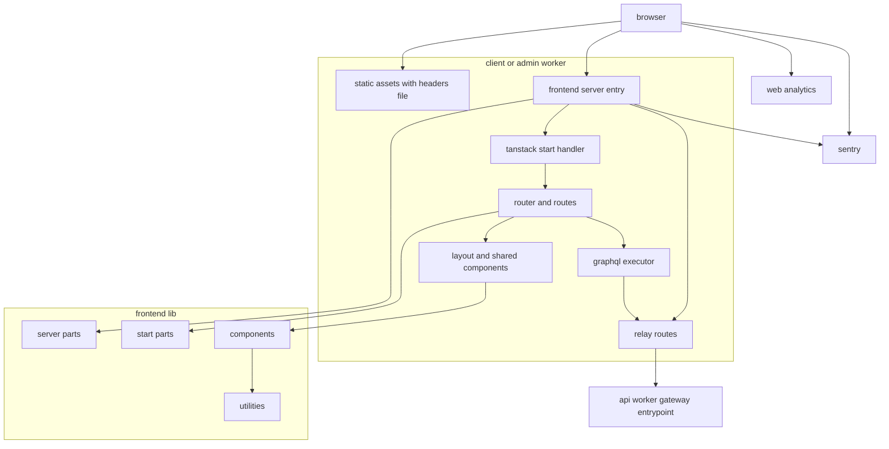
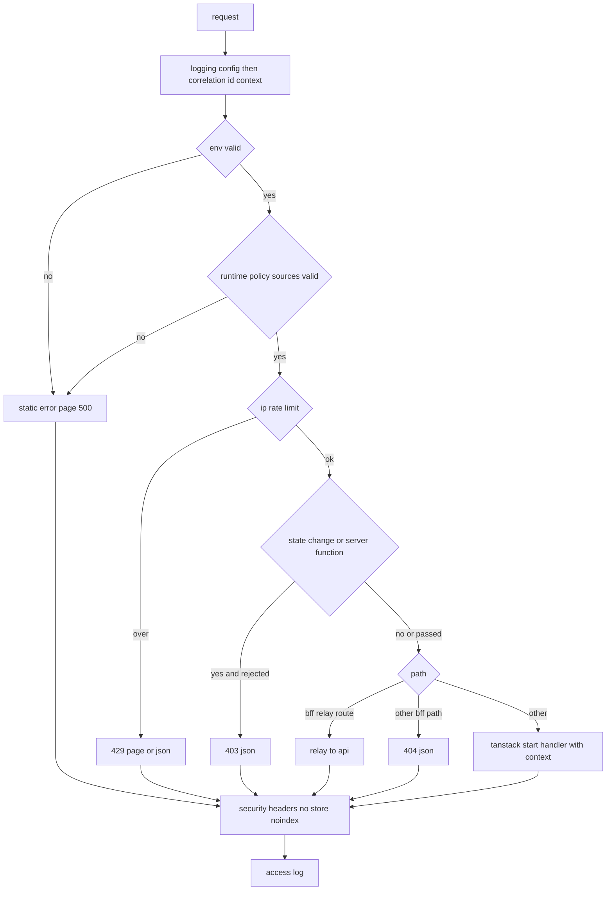
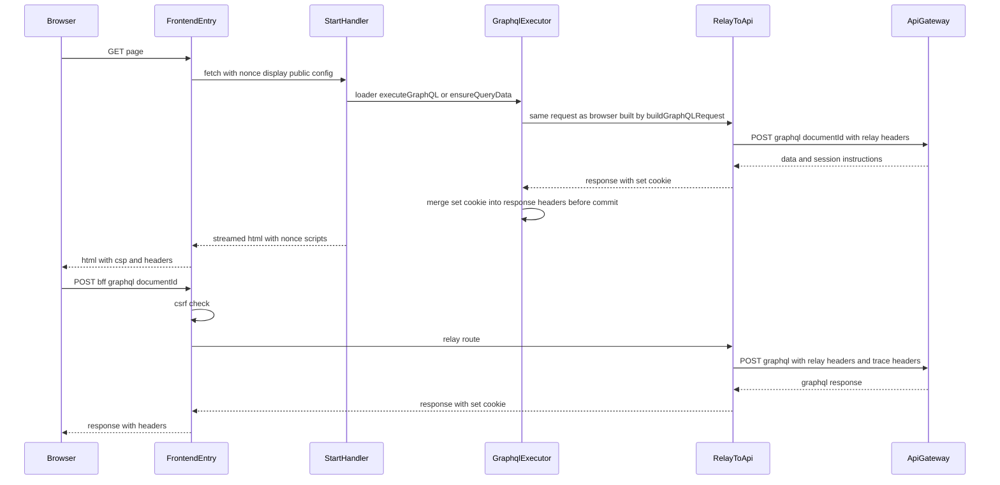
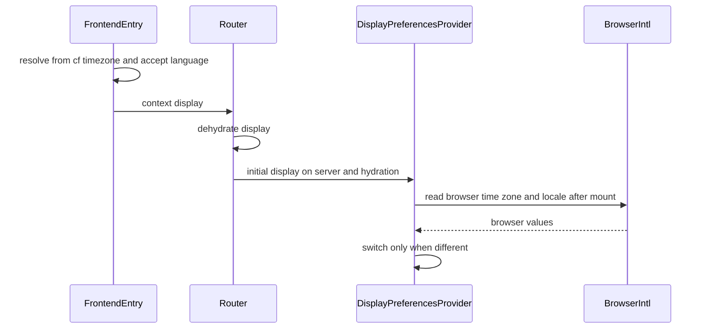
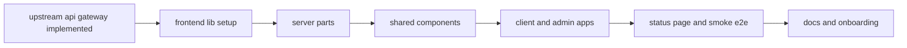

# Design Document

## Overview

**Purpose**: 利用者側(`apps/client`)と管理者側(`apps/admin`)のフロントエンドサーバーを、TanStack Startと`@cloudflare/vite-plugin`でCloudflare Workersに載せ、共通部品(`apps/frontend-lib`)にセキュリティ対策・APIサーバーへの中継・データ取得・デザインシステム・画面部品をまとめる。処理の順序(IP制限→CSRF→中継→描画→セキュリティヘッダー)は共通部品のサーバーのエントリ1箇所で定め、両アプリは呼び出し元の種類・登録箇所・画面シェルだけを持つ。

**Users**: 画面を持つ後続specの開発者とAIエージェントは、ルートのファイルとGraphQLの操作(`src/graphql/operations/`の`.graphql`ファイル)を追加し、登録箇所(レイアウトの区画・CSPの許可先・中継の経路)へ追記するだけで画面を載せる。identity-auth・admin-foundationはヘッダーとメニューの区画を差し込み、media-pipelineは中継の経路を追加し、演出を持つspecは停止の手段を用意する。infra-deliveryは本specのWrangler設定とコード生成の検査・スモークテストをCIで使う。

**Impact**: 空の`apps/client`・`apps/admin`・`apps/frontend-lib`に骨格を作る。ルートの`e2e/`にスモークテストを加え、`docs/GUIDES/tech`の`frontend`・`coding`、`docs/GUIDES/service`の`features`・`design`、`docs/onboardings`、CLAUDE.mdを更新する。上流のapi・event・backend-libのコードは本specでは変えない(Worker単位のIP制限のキーのハッシュ化はbackend-platform、セッションの有効期間の上限の検証はapi-gatewayの追加タスクが変える)。

### Goals

- 両フロントエンドサーバーが`bun run dev`と`vite build && vite preview`で起動し、別プロセスのAPIサーバーへService Bindingsで中継できる。
- すべての応答にnonce付きCSPとセキュリティヘッダーが付き、状態変更の要求がCSRFの検証を通り、IP制限がbackend-platformと同じ値で働く。
- ドメインspecが、GraphQLの操作を`.graphql`ファイルに書くだけで型付きの取得を得て、SSRとブラウザで同じ方法で使える。操作の一覧がapi-gatewayの許可リストの入力になり、ブラウザへ配信するスクリプトには操作の本文を含めない。
- 共通部品がStorybookで閲覧でき、ブラウザテストでアクセシビリティの自動検査に通り、各アプリのカバレッジが80%を満たす。

### Non-Goals

- 各ドメインの画面、ログイン・登録の画面とログイン中の表示、管理画面のメニューとRBAC。
- マークダウンの部品、ファイルのアップロード部品とファイルの中継の経路、決済のCSP。
- アニメーション演出の切替UI、通貨の表示形式、Storybookのデプロイ、E2Eでのアクセシビリティ検査。
- Cloudflare上のリソースの作成、CIのワークフロー、デプロイの実行。

## Boundary Commitments

### This Spec Owns

- 両フロントエンドサーバーの骨格: Vite・Wrangler設定(ローカル・staging・prod)、サーバーのエントリ、`src/start.ts`、ルーター、ルートのレイアウトの部品、仮のトップページ、404・エラーの画面、静的なファイルのヘッダー(`public/_headers`)。
- サーバーのエントリの処理の順序と各段階: 相関IDとアクセスログ、環境の検証、Worker単位のIP制限、CSRFの検証、中継の経路、nonce付きCSP・Permissions-Policy・セキュリティヘッダー・`no-store`・検索除外。
- APIサーバーへの中継: 中継の項目の組み立て、セッションのCookieの読み取り・発行・削除(Cookieの名前と属性)、中継の経路の定義(`RelayRoute`)と登録箇所、GraphQLの中継(`/_bff/graphql`)、サーバー側の描画のGraphQLの実行。
- GraphQLクライアント: コード生成の設定と生成物の場所(api-gatewayの契約)、操作の実行部品、応答の解析とエラーの型、QueryClientの既定値と再試行、要求ごとのQueryClientとJotaiのストア。
- デザインシステム: デザイントークン(ライト・ダーク)、基本のスタイル(視差効果の軽減・フォーカス表示)、ダークモードの保存と初回描画前の適用、shadcn/uiの部品。
- 共通部品: フォーム、状態表示、トースト、日時・数値の表示と表示設定、Turnstileのウィジェット、404・想定外のエラーの表示、疎通確認の表示、文書の外枠(スキップリンク・画面遷移の通知)。
- 画面シェル: 利用者側の共通レイアウト(ヘッダー・フッター・区画の登録箇所)、管理者側の基本レイアウト(区画の登録箇所)。
- 疎通確認の画面(`/system/status`、ローカル・stagingのみ)とスモークテスト(`e2e/client`・`e2e/admin`)。
- 観測: サーバー・ブラウザのSentryの設定と個人情報の除去、想定外の失敗の送信、利用者側のWeb Analyticsの計測スクリプト、フロントエンドのアクセスログ。
- 画面向けの静的解析の設定(`apps/frontend-lib/config/frontend-lint.ts`)、GraphQLのコード生成の検査(`apps/frontend-lib/config/codegen-check.ts`)、Storybookの設定、ブラウザテストの設定とアクセシビリティの検査の補助。
- 技術ドキュメント: `frontend/003`〜`007`、`coding/004`のクライアント側の節、`frontend/002`・`coding/002`・`coding/003`の追記、`service/features/003`、`service/design`の修正、`docs/onboardings`・CLAUDE.mdの更新。

### Out of Boundary

- APIサーバーの名前付きエントリポイント・内部認証・許可リストの生成・GraphQLのエラーコードの定義(api-gateway)。本specは契約として使う。
- Worker単位のIP制限の規約値(backend-platform)。本specは同じ値で適用する。
- セッションの発行・検証・失効の判断と、ログイン中の表示(identity-auth)。管理者のログイン・メニュー・RBAC(admin-foundation)。
- `/_bff/`の下のGraphQL以外の中継の経路の中身(media-pipeline)、決済などのCSP・Permissions-Policyの許可先(各spec)。
- 5秒を超えて自動で動き続ける演出の停止手段(演出を持つspec)。
- 通貨の表示形式(payments)、トップページ・ディレクトリ・ヘルプなどのページの中身(各spec)。
- Cloudflareのリソース(カスタムドメイン・Web Analyticsのサイト・非表示の種類のTurnstileのウィジェット)、staging・prodの変数の実値、CIのワークフロー、デプロイの順序(infra-delivery)。Sentryのプロジェクトと値、FCPとアクセシビリティの全体の検証(launch-readiness)。

### Allowed Dependencies

- 上流(api-gateway): `ClientGateway`・`AdminGateway`、中継の項目(`x-original-client-ip`・`x-session-token`・`cf-turnstile-response`)と指示の項目(`x-session-issue`・`x-session-max-age`・`x-session-clear`)、`SESSION_TOKEN_PATTERN`の形式(43文字のbase64url)、`POST /graphql`の`{ documentId, operationName?, variables? }`、エラーコードと状態コードの規則、スキーマファイル`apps/api/src/presentation/graphql/generated/schema.graphql`、操作の一覧の場所。形を変えずに使う。
- 上流(backend-platform): Worker単位のIP制限の規約表とキーのハッシュ化の方式(`hashRateLimitKey`、用途`rate-limit-key`、ペッパー`HASH_PEPPER`)、共通のエラー形式`{ error: { code, message, details? } }`と`FieldErrorDetail`、ログの形式とカテゴリの規約、Sentryのトレースの割合の値、リソースの名前の規約。コードは読み込まず、値と形をそろえる。
- 上流(dev-tooling): 基底設定、`browserTestPreset`・`browserOptionsPreset`・`resolveBrowserLaunchOptions`、テストの命名と生成コードの命名、スクリプト契約、共有ディレクトリの配置、E2Eの設定と対象の定義。
- npmパッケージ: Technology Stackの表に挙げた版に限る。
- `apps/frontend-lib/server/**`・`utilities/**`は`cloudflare:*`・`@tanstack/*`・`react`・`react-dom`・`react-hook-form`・`@hookform/*`・`@sentry/cloudflare`・`@sentry/tanstackstart-react`の実行時の値を読み込まない(テストファイルを除く)。`apps/frontend-lib/components/**`は`server/**`の実行時の値と`*.server.ts`を読み込まない。
- `@sentry/core`は型だけを読み込み、依存に宣言しない(`@sentry/cloudflare`・`@sentry/tanstackstart-react`が同じ版を持つ)。
- 依存の方向は「Dependency Direction」に従う。

### Revalidation Triggers

- サーバーのエントリの処理の順序、`FrontendRequestContext`・`FrontendAppProfile`の形(両アプリ・後続の全画面spec)。
- 中継の経路の接頭辞`/_bff/`、`RelayRoute`の形と`defineRelayRoute`の検査、中継で引き継ぐ項目の一覧と予約名、上流のJSONでない5xxを503`upstream_unavailable`にする規則、セッションのCookieの名前と属性・有効期間の上限(media-pipeline・data-export・identity-auth・admin-foundation)。
- `SecurityPolicySources`の形(`mediaSrc`・`workerSrc`の欄を持たない)と既定の許可先、`runtimeSecurityPolicySources`が読む環境のキー、Permissions-Policyの既定値(payments・media-pipeline・public-api・launch-readiness)。
- レイアウトの区画の登録箇所(`SiteLayoutSlots`・`AdminLayoutSlots`)の形(identity-auth・admin-foundation・help-center・sponsorship)。
- `executeGraphQL`・`GraphQLClientError`・`GraphQLResult`・QueryClientの既定値と再試行の方針(サーバーでは再試行しない)、操作の置き場所(`src/graphql/operations/**/*.graphql`)・操作名の接頭辞・`codegen.config.ts`の`documents`・生成物の場所と画面が読む生成物(全ドメインspec・api-gateway)。
- Zodの値の読み込み元(`utilities/validation/zod.ts`)と静的解析の`ZOD_VALUE_RESTRICTION`、client・adminのブラウザとサーバーのエントリが先頭で`zod.ts`を副作用として読み込むこと(フォームの検証規則を持つ全画面spec、content-processingの`apps/common-lib`)。
- デザイントークンの名前、`DisplayPreferences`・日時の書式の名前、フォーム部品(`useAppForm<TInput, TOutput>`・`AppForm`の`onSubmitError`・`serverFieldPrefix`)と状態表示の部品の形(全画面spec)。`SubmitButton`がサーバーの欄のエラーの残る間も無効になることと、`applyServerFieldErrors`がオブジェクトの値(配列でない)を持つ親の経路と無効の欄の詳細を欄に対応しない詳細にすること、欄を無効にする時は`FormField`の`disabled`で無効にすること、`useAppForm`のresolverが無効の欄の検証エラーを取り除くこと、`applyServerFieldErrors`が描かれていない欄の詳細を欄に対応しない詳細にすること、`FormField`が無効になった欄のエラーを消すこと、`useAppForm`が`schema`の同一性の変化で検証し直すこと(描かれていて触れた欄を含む)、`SubmitButton`の`disabled`、`useAppForm`が既定値の入れ子のキーの`type`・`message`・`types`・`ref`を開発時とテストで例外にすること(入力欄を描かない値・無効にする欄をスキーマの入力に含めるフォームと、欄をまとめた値の経路に詳細を返す操作のフォームを持つ画面spec)。
- react-hook-form・`@hookform/resolvers`の版: 共通部品のフォームの部品が頼る内部の値と公開されていない振る舞いは版の番人テスト(`components/form/form-library-internals.unit.test.ts`)の一覧が見張り、版を上げると番人テストが失敗する。版を上げる時は`coding/002`の見直しの手順で一覧の各項目を確かめ、フォームの部品を使う全画面specへの影響を確かめる。
- client・adminの`cf-typegen`・`cf-typegen:check`の生成物(`worker-configuration.d.ts`)の置き場所と、環境の検証スキーマとの型の照合(infra-deliveryの検査、Wrangler設定に変数・バインディングを足す全spec)。`graphql:check`が共通部品の`config/codegen-check.ts`を通すこと(infra-deliveryの検査)。
- ローカルのE2Eを開発サーバーとビルド後のプレビューの両方で続けて実行するルートのコマンド(dev-toolingの承認後の改訂2、infra-deliveryの検査のE2E)。
- ルートの失敗の送信の仕組み(`installRouteErrorReporting`が`loader`・`beforeLoad`を持つ全ルートの`onError`を補う、`reportRenderError(router, error)`)(後続の全画面spec)。
- 演出の停止手段の義務: 本specはアニメーション演出の切替UIを持たず、OSの「視差効果を減らす」設定に従う基本のスタイルだけを提供する。5秒を超えて自動で動き続ける演出・点滅・自動スクロールを含む区画を追加するspec(match-engineなど)は、WCAG 2.2の達成基準2.2.2に従い、その区画の近くに利用者が一時停止・停止・非表示にできる手段を用意する。この規約(`frontend/004`)を変える場合、または本specが切替UIを加える場合は、演出を持つspecを再確認する。
- 疎通確認の画面の経路と公開する環境(launch-readiness・infra-delivery)。
- 両アプリの変数名・バインディング名・Worker名・`namespace_id`・シークレットのキー(`HASH_PEPPER`・`SENTRY_DSN`)(infra-delivery)。
- IP制限のキーのハッシュ化の方式: backend-platformの`hashRateLimitKey`(用途`rate-limit-key`)と同じ値を作る規則と、Infisicalの環境ごとに1つの`HASH_PEPPER`を全アプリで共有すること。backend-platformが方式を変えた場合は`server/http/rate-limit-key-hash.ts`を合わせる(backend-platform・infra-delivery)。
- `TurnstileWidget`を非表示(`size: 'invisible'`)で描くこと、アプリごとのサイトキーが非表示の種類のウィジェットであること(ウィジェットを置く全spec・infra-delivery)。非表示のウィジェットを使う条件のTurnstile Privacy Addendumの参照をプライバシーポリシーで確かめる持ち主(legal-pages)。スクリプトの読み込みの失敗をページの中のすべてのウィジェットで共有すること(ウィジェットを置く全spec)。
- 写しの照合: 本specが写した上流の値(`relay-contract.ts`・`graphql-result.ts`の`GATEWAY_ERROR_CODES`・`security-headers.ts`と`security-policy.ts`の既定値・伏せ字の項目とパターン・`hashRateLimitKey`)は、ルートの`config/contract-copies.unit.test.ts`が元(api・backend-lib)と、ソースの構文解析(ハッシュ化は子プロセスでの実行)で照合する。上流(api-gateway・backend-platform)が元を変えると、ルートの単体テスト(`bun run test:unit`・`bun run test:all:unit`)と一括検査(`bun run check`の段階「写しの照合」)の両方が失敗するため、本specの写しも合わせる。
- `UnexpectedErrorView`・`ErrorState`の案内文と`contactHref`の関係(`RETRY_LATER_GUIDANCE`・`CONTACT_GUIDANCE`)、`errorMessageOf`とプロファイルの`contactAvailable`(管理者側に画面を置く全spec、失敗の文言の選び方を呼び出し元から受ける共通部品を持つadmin-foundation・media-pipeline)。

#### 実装で確定した契約による発火と影響を受ける下流spec

実装で確定した契約のうち、次の行は上のトリガーに当たる。下流specの設計とタスクはこの表の契約に合わせてあり、残る食い違いは無い。「該当箇所」は各specで契約に合わせた記述のファイルと行(2026-10-29時点)で、本specがこれらの契約を変える場合に見直す箇所である。下流specの共通部品が本specの契約から派生させた契約も、同じ理由で表に含める。

| 発火したトリガー                                                                                                                | 確定した契約                                                                                                                                                                                                                                                                                                                                                                                                                                                                                                                                                                                                                                                                                                                                                                                                                                                                                                                                                                                                                                                                                                                                                                                                                             | 影響を受ける下流spec(該当箇所)                                                                                                                                                                                                                                                                                                                                                                                                                                                                                                                                                                                                                                                                                                                                                                                                                                                                                                                                                                                                                                                                                                                                                                                                                                                                                                                                                                                                                                                                                                                                                                                                                                                                                                                                                                                                                                                                                                                                                                                                                                                                                                                                                                                                                                                                                                                                                                                                                                                                                                                                                                                                                                                                                                                                                                                                                                                                                                                                                                                                                                                                                                                             |
| ------------------------------------------------------------------------------------------------------------------------------- | ---------------------------------------------------------------------------------------------------------------------------------------------------------------------------------------------------------------------------------------------------------------------------------------------------------------------------------------------------------------------------------------------------------------------------------------------------------------------------------------------------------------------------------------------------------------------------------------------------------------------------------------------------------------------------------------------------------------------------------------------------------------------------------------------------------------------------------------------------------------------------------------------------------------------------------------------------------------------------------------------------------------------------------------------------------------------------------------------------------------------------------------------------------------------------------------------------------------------------------------- | ---------------------------------------------------------------------------------------------------------------------------------------------------------------------------------------------------------------------------------------------------------------------------------------------------------------------------------------------------------------------------------------------------------------------------------------------------------------------------------------------------------------------------------------------------------------------------------------------------------------------------------------------------------------------------------------------------------------------------------------------------------------------------------------------------------------------------------------------------------------------------------------------------------------------------------------------------------------------------------------------------------------------------------------------------------------------------------------------------------------------------------------------------------------------------------------------------------------------------------------------------------------------------------------------------------------------------------------------------------------------------------------------------------------------------------------------------------------------------------------------------------------------------------------------------------------------------------------------------------------------------------------------------------------------------------------------------------------------------------------------------------------------------------------------------------------------------------------------------------------------------------------------------------------------------------------------------------------------------------------------------------------------------------------------------------------------------------------------------------------------------------------------------------------------------------------------------------------------------------------------------------------------------------------------------------------------------------------------------------------------------------------------------------------------------------------------------------------------------------------------------------------------------------------------------------------------------------------------------------------------------------------------------------------------------------------------------------------------------------------------------------------------------------------------------------------------------------------------------------------------------------------------------------------------------------------------------------------------------------------------------------------------------------------------------------------------------------------------------------------------------------------------------------- |
| 操作の置き場所と生成物                                                                                                          | 操作とフラグメントは`src/graphql/operations/**/*.graphql`に書き、`graphql()`を呼ばない。操作名はアプリの接頭辞(`Client`・`Admin`)で始める。画面は`src/graphql/generated/graphql.ts`の`<操作名>Document`を読み、`gql.ts`・`index.ts`を読まない(「操作の追加手順」)                                                                                                                                                                                                                                                                                                                                                                                                                                                                                                                                                                                                                                                                                                                                                                                                                                                                                                                                                                        | 操作を`.graphql`に置き、操作名の接頭辞と画面が読む生成物を書く: data-export(`design.md:263`・`design.md:1036`・`tasks.md:213`)・identity-auth(`design.md:206`・`design.md:391`・`design.md:2719`・`tasks.md:355`)・notifications(`design.md:56`・`design.md:295`・`design.md:302`)・public-api(`design.md:153`・`design.md:237`)・product-launch(`design.md:62`・`design.md:322`・`design.md:329`)・content-reporting(`design.md:64`・`design.md:268`・`design.md:285`)・help-center(`design.md:57`・`design.md:256`・`design.md:276`)・ultras-subscription(`design.md:251`・`design.md:261`・`design.md:932`)・sponsorship(`design.md:60`・`design.md:286`・`design.md:299`)・legal-pages(`design.md:128`・`design.md:181`・`design.md:197`)・tournament-week(`design.md:298`・`design.md:1428`・`design.md:1451`・`design.md:1499`・`tasks.md:277`・`research.md:201`)・tournament-year(`design.md:50`・`design.md:89`・`design.md:273`・`design.md:284`・`design.md:1337`・`research.md:211`)・inquiry-chat(`design.md:62`・`design.md:265`・`design.md:281`)・user-profile-social(`design.md:286`)・admin-foundation(`design.md:65`・`design.md:282`)・directory-discovery(`design.md:267`)・match-engine(`design.md:290`)・payments(`design.md:278`)・engagement(`design.md:241`)・ugc-moderation(`design.md:285`・`design.md:1292`)                                                                                                                                                                                                                                                                                                                                                                                                                                                                                                                                                                                                                                                                                                                                                                                                                                                                                                                                                                                                                                                                                                                                                                                                                                                                                                                                                                                                                                                                                                                                                                                                                                                                                                                                                                                                                  |
| Zodの値の読み込み元                                                                                                             | 共通部品とアプリのファイルは`zod`の値を`utilities/validation/zod.ts`(`z.config({ jitless: true })`の後の`z`)からだけ読む。型だけの読み込みと`@hookform/resolvers/zod`は可。client・adminのブラウザとサーバーのエントリは先頭で`zod.ts`を副作用として読み込み、common-libを含むどのスキーマより先に`jitless`を設定する(「決定事項」)                                                                                                                                                                                                                                                                                                                                                                                                                                                                                                                                                                                                                                                                                                                                                                                                                                                                                                      | フォーム・検索パラメータの検証規則を画面側に持ち、Zodの値を`zod.ts`から読む: public-api(`design.md:251`・`design.md:1152`)・user-profile-social(`design.md:280`・`design.md:1249`)・help-center(`design.md:268`)・product-launch(`design.md:307`)・engagement(`design.md:224`)・identity-auth(`design.md:376`・`design.md:2779`)・inquiry-chat(`design.md:264`)・content-reporting(`design.md:1396`・`design.md:1404`)・notifications(`design.md:587`)・ugc-moderation(`design.md:1281`)。画面のバンドルに入る共有ディレクトリが`zod`を直接読み、規則の対象外で`jitless`はエントリの先頭の読み込みで及ぶ: content-processing(`design.md:186`・`design.md:226`・`design.md:567`・`design.md:789`・`research.md:363`)。`@typescript-eslint/no-restricted-imports`へ制限を足す時は`restrictValueImports`を通す: content-processing(`design.md:1010`)                                                                                                                                                                                                                                                                                                                                                                                                                                                                                                                                                                                                                                                                                                                                                                                                                                                                                                                                                                                                                                                                                                                                                                                                                                                                                                                                                                                                                                                                                                                                                                                                                                                                                                                                                                                                                                                                                                                                                                                                                                                                                                                                                                                                                                                                                                          |
| フォーム部品の形                                                                                                                | `useAppForm<TInput, TOutput>(schema, { defaultValues })`(`defaultValues`は全欄)、`AppForm`は必須の`onSubmitError`と任意の`serverFieldPrefix`を受ける                                                                                                                                                                                                                                                                                                                                                                                                                                                                                                                                                                                                                                                                                                                                                                                                                                                                                                                                                                                                                                                                                     | `useAppForm<TInput, TOutput>(schema, { defaultValues })`と`AppForm`(`onSubmitError`・`serverFieldPrefix`)で書く: user-profile-social(`design.md:58`・`design.md:1249`)・notifications(`design.md:57`・`design.md:1699`)・content-reporting(`design.md:65`・`design.md:1395`)・product-launch(`design.md:63`・`design.md:2026`)・help-center(`design.md:58`・`design.md:1276`)・legal-pages(`design.md:55`・`design.md:787`)・engagement(`design.md:52`・`design.md:1108`)・public-api(`design.md:56`・`design.md:1168`)・identity-auth(`design.md:81`・`design.md:2780`)・admin-foundation(`design.md:66`)・inquiry-chat(`design.md:63`・`design.md:1176`)                                                                                                                                                                                                                                                                                                                                                                                                                                                                                                                                                                                                                                                                                                                                                                                                                                                                                                                                                                                                                                                                                                                                                                                                                                                                                                                                                                                                                                                                                                                                                                                                                                                                                                                                                                                                                                                                                                                                                                                                                                                                                                                                                                                                                                                                                                                                                                                                                                                                                                 |
| `RelayRoute`の形と中継の応答                                                                                                    | 経路は`defineRelayRoute`で定義して凍結する(素のオブジェクトは検査を通らない)。上流の5xxでJSONでない応答は503`upstream_unavailable`になる                                                                                                                                                                                                                                                                                                                                                                                                                                                                                                                                                                                                                                                                                                                                                                                                                                                                                                                                                                                                                                                                                                 | `defineRelayRoute`で定義し、ファイルを返す経路も5xxを共通のエラー形式(JSON)で返す: media-pipeline(`design.md:1744`・`design.md:1747`・`design.md:1751`・`design.md:1753`)・data-export(`design.md:1034`・`design.md:1035`)                                                                                                                                                                                                                                                                                                                                                                                                                                                                                                                                                                                                                                                                                                                                                                                                                                                                                                                                                                                                                                                                                                                                                                                                                                                                                                                                                                                                                                                                                                                                                                                                                                                                                                                                                                                                                                                                                                                                                                                                                                                                                                                                                                                                                                                                                                                                                                                                                                                                                                                                                                                                                                                                                                                                                                                                                                                                                                                                 |
| `SecurityPolicySources`と環境のキー                                                                                             | `runtimeSecurityPolicySources`は`IMAGES_ORIGIN`・`SENTRY_DSN`だけを読み、エントリは許可先の欄と環境のキーの対応(`imgSrc`→`IMAGES_ORIGIN`・`connectSrc`→`SENTRY_DSN`)で不正な値のキー名をログへ出す                                                                                                                                                                                                                                                                                                                                                                                                                                                                                                                                                                                                                                                                                                                                                                                                                                                                                                                                                                                                                                       | `PUBLIC_API_ORIGIN`を環境の検証で許可先の形まで確かめ、エントリの対応(1つの欄に1つのキー)を変えずに`connectSrc`へ加える: public-api(`design.md:276`・`design.md:1141`・`design.md:1142`・`tasks.md:32`)                                                                                                                                                                                                                                                                                                                                                                                                                                                                                                                                                                                                                                                                                                                                                                                                                                                                                                                                                                                                                                                                                                                                                                                                                                                                                                                                                                                                                                                                                                                                                                                                                                                                                                                                                                                                                                                                                                                                                                                                                                                                                                                                                                                                                                                                                                                                                                                                                                                                                                                                                                                                                                                                                                                                                                                                                                                                                                                                                    |
| bot判定のウィジェット                                                                                                           | `TurnstileWidget`は`options.size: 'invisible'`で非表示のウィジェットを描き、画面に枠を出さず場所を取らない。アプリごとにサイトキーは1つで、Cloudflare側のウィジェットの種類も非表示にする(「決定事項」)                                                                                                                                                                                                                                                                                                                                                                                                                                                                                                                                                                                                                                                                                                                                                                                                                                                                                                                                                                                                                                  | 非表示のウィジェットとして判定の枠と場所を設けない: match-engine(`design.md:1514`)・identity-auth(`design.md:2784`)・inquiry-chat(`design.md:65`・`design.md:1173`)・content-reporting(`design.md:67`・`design.md:264`)・engagement(`design.md:1108`)・sponsorship(`design.md:62`・`design.md:1579`)・user-profile-social(`design.md:1249`・`design.md:1278`)・product-launch(`design.md:65`・`design.md:2026`)・directory-discovery(`design.md:1129`)・admin-foundation(`design.md:68`)。ウィジェットの種類を`invisible`にする: infra-delivery(`design.md:76`・`design.md:588`・`design.md:688`・`design.md:695`・`design.md:1503`)                                                                                                                                                                                                                                                                                                                                                                                                                                                                                                                                                                                                                                                                                                                                                                                                                                                                                                                                                                                                                                                                                                                                                                                                                                                                                                                                                                                                                                                                                                                                                                                                                                                                                                                                                                                                                                                                                                                                                                                                                                                                                                                                                                                                                                                                                                                                                                                                                                                                                                                       |
| 管理者側の画面シェル                                                                                                            | `AdminLayout`はヘッダー・`navigation`の区画・本文だけを持ち、フッターを持たない。ナビゲーションのランドマークは`navigation`の区画の部品が描く`nav`で満たす(要件10.8、「決定事項」)                                                                                                                                                                                                                                                                                                                                                                                                                                                                                                                                                                                                                                                                                                                                                                                                                                                                                                                                                                                                                                                       | admin-foundation(`design.md:94`・`design.md:1208`・`design.md:1269`)                                                                                                                                                                                                                                                                                                                                                                                                                                                                                                                                                                                                                                                                                                                                                                                                                                                                                                                                                                                                                                                                                                                                                                                                                                                                                                                                                                                                                                                                                                                                                                                                                                                                                                                                                                                                                                                                                                                                                                                                                                                                                                                                                                                                                                                                                                                                                                                                                                                                                                                                                                                                                                                                                                                                                                                                                                                                                                                                                                                                                                                                                       |
| 両アプリの変数名・シークレットのキー                                                                                            | client・adminも`HASH_PEPPER`を`secrets.required`(3環境)で必須にし、Infisicalの環境ごとに1つの値をapi・event・client・adminが共有する。IP制限のキーは`HASH_PEPPER`のHMACでハッシュ化する(「決定事項」)                                                                                                                                                                                                                                                                                                                                                                                                                                                                                                                                                                                                                                                                                                                                                                                                                                                                                                                                                                                                                                    | stagingの`HASH_PEPPER`の登録先にclient・adminを含める: infra-delivery(`design.md:1518`・`design.md:1556`)                                                                                                                                                                                                                                                                                                                                                                                                                                                                                                                                                                                                                                                                                                                                                                                                                                                                                                                                                                                                                                                                                                                                                                                                                                                                                                                                                                                                                                                                                                                                                                                                                                                                                                                                                                                                                                                                                                                                                                                                                                                                                                                                                                                                                                                                                                                                                                                                                                                                                                                                                                                                                                                                                                                                                                                                                                                                                                                                                                                                                                                  |
| `UnexpectedErrorView`・`ErrorState`の案内文と`contactHref`の関係                                                                | `ErrorState`の`contactHref`は任意で、管理者側は渡さない。`GraphQLClientError`でない例外に代えて画面に出す文言(`ErrorState`・`PartialErrorState`・`AppForm`の`onSubmitError`・トースト)は`errorMessageOf(error, profile.contactAvailable)`で選び、管理者側では問い合わせを促す文を出さない(要件8.6・8.13、「決定事項」)                                                                                                                                                                                                                                                                                                                                                                                                                                                                                                                                                                                                                                                                                                                                                                                                                                                                                                                   | 管理者側の`ErrorState`・`UnexpectedErrorView`に`contactHref`を渡さず、失敗の文言を`errorMessageOf`で選ぶ: admin-foundation(`design.md:67`・`design.md:1175`)・content-reporting(`design.md:66`・`design.md:1459`)・help-center(`design.md:59`・`design.md:1350`)・inquiry-chat(`design.md:64`・`design.md:1297`)・legal-pages(`design.md:56`・`design.md:770`)・notifications(`design.md:58`・`design.md:1700`・`design.md:1766`)・product-launch(`design.md:64`・`design.md:2116`)・sponsorship(`design.md:61`・`design.md:1650`)・tournament-year(`design.md:58`・`design.md:1350`)・ugc-moderation(`design.md:1293`)・ultras-subscription(`design.md:982`)。`routes/__root.tsx`の変更だけで、管理者側のルートに失敗の表示を置かない: media-pipeline(`design.md:331`)                                                                                                                                                                                                                                                                                                                                                                                                                                                                                                                                                                                                                                                                                                                                                                                                                                                                                                                                                                                                                                                                                                                                                                                                                                                                                                                                                                                                                                                                                                                                                                                                                                                                                                                                                                                                                                                                                                                                                                                                                                                                                                                                                                                                                                                                                                                                                                                    |
| `UnexpectedErrorView`・`ErrorState`の案内文と`contactHref`の関係(下流specの共通部品へ派生した契約)                              | アプリのプロファイルを読まない下流specの共通部品は、失敗の文言の選び方を呼び出し元から受ける。admin-foundationの`ConfirmActionDialogProps`(必須)・`CategoryMasterEditorProps`の`failureMessageOf: (error: unknown) => string`には、管理者側の画面が`(error) => errorMessageOf(error, ADMIN_PROFILE.contactAvailable)`を渡す。media-pipelineの`ImageUploadField`・`AttachmentUploadField`は必須の`contactAvailable: boolean`を`useFileUpload`・`parseUploadResponse`へ渡し、想定外の応答の文言を`errorMessageOf(error, contactAvailable)`で選ぶ。呼び出し元は自身のプロファイルの`contactAvailable`を渡す                                                                                                                                                                                                                                                                                                                                                                                                                                                                                                                                                                                                                                 | 部品の定義: admin-foundation(`design.md:1146`・`design.md:1169`・`design.md:1175`)・media-pipeline(`design.md:1823`・`design.md:1831`・`design.md:1835`・`design.md:1842`)。`failureMessageOf`を渡す: admin-foundation(`design.md:1225`)・content-reporting(`design.md:1407`・`design.md:1410`・`design.md:1413`)・help-center(`design.md:1278`・`design.md:1302`)・inquiry-chat(`design.md:1191`・`design.md:1239`)・legal-pages(`design.md:787`)・notifications(`design.md:1699`)・product-launch(`design.md:2052`)・sponsorship(`design.md:1588`)・tournament-year(`design.md:1352`)・ugc-moderation(`design.md:1282`)・ultras-subscription(`design.md:981`)。`contactAvailable`を渡す: admin-foundation(`design.md:1320`)・inquiry-chat(`design.md:1174`・`design.md:1182`)・product-launch(`design.md:2027`・`design.md:2028`)・user-profile-social(`design.md:1250`)                                                                                                                                                                                                                                                                                                                                                                                                                                                                                                                                                                                                                                                                                                                                                                                                                                                                                                                                                                                                                                                                                                                                                                                                                                                                                                                                                                                                                                                                                                                                                                                                                                                                                                                                                                                                                                                                                                                                                                                                                                                                                                                                                                                                                                                                                 |
| bot判定のウィジェット(第2回の判断14・15)                                                                                        | 非表示のウィジェットを使う条件として、プライバシーポリシーがCloudflareのTurnstile Privacy Addendumを参照する。公開前にプライバシーポリシーの本文が参照していることを確かめる(または骨子に加える)のはlegal-pagesで、infra-deliveryはウィジェットの種類(`invisible`)と`HASH_PEPPER`の登録先だけを持つ(「決定事項」)                                                                                                                                                                                                                                                                                                                                                                                                                                                                                                                                                                                                                                                                                                                                                                                                                                                                                                                        | 確かめる項目を持たせた: legal-pages(`requirements.md:207`の要件10.5・`design.md:36`・`design.md:46`・`design.md:67`・`design.md:217`・`design.md:890`・`tasks.md:162`・`tasks.md:163`・`tasks.md:169`)。Addendumの記述を外し分担を書いた: infra-delivery(`design.md:285`・`tasks.md:256`・`research.md:147`)                                                                                                                                                                                                                                                                                                                                                                                                                                                                                                                                                                                                                                                                                                                                                                                                                                                                                                                                                                                                                                                                                                                                                                                                                                                                                                                                                                                                                                                                                                                                                                                                                                                                                                                                                                                                                                                                                                                                                                                                                                                                                                                                                                                                                                                                                                                                                                                                                                                                                                                                                                                                                                                                                                                                                                                                                                               |
| 操作の置き場所と生成物(管理者側の照会の名前と型、第2回の判断21)                                                                 | 管理者側の操作は1つのスキーマと1つの生成物に入るため、別のspecが同じ名前の照会を別の型で定義しない。product-launchの`adminProductCategories: [ProductCategory!]!`はそのままとし、ugc-moderationの絞り込みの選択肢は別名の照会`adminModerationCategoryOptions: [AdminCategoryRef!]!`にする(「決定事項」)                                                                                                                                                                                                                                                                                                                                                                                                                                                                                                                                                                                                                                                                                                                                                                                                                                                                                                                                  | 照会を別名にし、操作名・型・使用箇所を合わせた: ugc-moderation(`design.md:287`・`design.md:948`・`design.md:1208`・`design.md:1249`・`design.md:1286`・`design.md:1292`・`tasks.md:181`・`research.md:220`)。変えない: product-launch(`design.md:1912`・`design.md:1941`)                                                                                                                                                                                                                                                                                                                                                                                                                                                                                                                                                                                                                                                                                                                                                                                                                                                                                                                                                                                                                                                                                                                                                                                                                                                                                                                                                                                                                                                                                                                                                                                                                                                                                                                                                                                                                                                                                                                                                                                                                                                                                                                                                                                                                                                                                                                                                                                                                                                                                                                                                                                                                                                                                                                                                                                                                                                                                  |
| フォーム部品の形(描かない値とサーバーの欄のエラー、第2回の判断16・25〜28・30・33〜36)                                           | `SubmitButton`は、`root`以外の欄のエラー(サーバーの欄のエラーを含む)が1つでも残る間は無効になる。`applyServerFieldErrors`は、オブジェクトの値(配列でない)を持つ親の経路と、描かれているが無効の欄(`FormField`の`disabled`で無効にした欄、react-hook-formの`control._names.disabled`)の詳細を欄に付けず`onSubmitError`の`unmatched`へ渡す。欄は`FormField`の`disabled`で無効にし、無効の欄の値は`onSubmit`へ渡す値から外れ、無効の欄の値は`useAppForm`のresolverが検証の前に除き、無効になり得る欄はスキーマで任意(`.optional()`)にする。描かれていない欄の詳細も`unmatched`へ渡す。`FormField`は`disabled`が真になると欄のエラーを消し、`useAppForm`は`schema`の同一性が変わると新しいスキーマで検証し直す。全欄が無効のフォームは`SubmitButton`の`disabled`で送信ボタンを無効にする。編集する値をAPIの入力の`fields`の下に置く操作のフォームは、フォームの値も`fields`の下に置き(欄の名前は`fields.<名前>`)、サーバーの詳細の経路とそろえる。本人確認の失敗(`reauthentication_failed`)の詳細は、APIが画面の欄の形(APIの入力の形)のとおりの経路で返す。入力欄を描かない値(識別子・版の値)と条件によって描かない欄はスキーマの入力(`TInput`)に含めず、描かない値は`onSubmit`で足すか、条件ごとにスキーマを分ける(FormParts、「決定事項」) | 条件によって描く欄を描く間だけスキーマの入力に含め、条件ごとの定数のスキーマを`useAppForm`へ渡す(判断26・33・34): content-reporting(`design.md:1395`・`design.md:1396`・`design.md:1499`・`tasks.md:214`・`tasks.md:215`)の`ReportForm`の連絡先・engagement(`design.md:895`・`design.md:1103`・`design.md:1106`・`design.md:1108`・`design.md:1196`・`tasks.md:189`・`tasks.md:190`)の`CommentComposer`の評価・product-launch(`design.md:2026`・`design.md:2031`・`design.md:2032`)の`ProductForm`のローンチ日・identity-auth(`design.md:385`・`design.md:2768`・`design.md:2780`・`design.md:2781`・`tasks.md:367`・`tasks.md:384`)の第2要素の欄・admin-foundation(`design.md:1223`・`tasks.md:233`)のログインの第2要素。フォームの値をAPIの入力と同じく`fields`の下に置く(判断27): help-center(`design.md:1101`・`design.md:1110`・`design.md:1114`・`design.md:1252`・`design.md:1276`・`tasks.md:179`)の`HelpArticleForm`・product-launch(`design.md:1868`・`design.md:1878`・`design.md:1882`・`design.md:2026`・`tasks.md:244`)の`ProductForm`。固定の期間に無効にする欄を`FormField`の`disabled`で無効にしてスキーマで任意(`.optional()`)にし、APIに要る値を`onSubmit`で足す(判断28・31): product-launch(`design.md:2026`・`design.md:2030`・`design.md:2032`・`design.md:2169`・`tasks.md:233`・`tasks.md:252`)のカテゴリ。版の値と識別子をスキーマの入力に含めず`onSubmit`で足す(判断26): product-launch(`design.md:1883`・`design.md:1884`・`design.md:2026`)の`productHandle`・`expectedVersion`・notifications(`design.md:1567`・`design.md:1699`)の`SenderInfoForm`の`expectedVersion`・help-center(`design.md:1116`・`design.md:1276`)の`HelpArticleForm`の`id`・`expectedRevision`・user-profile-social(`design.md:1108`・`design.md:1249`・`tasks.md:200`)の`ProfileEditForm`の`expectedHandle`・legal-pages(`design.md:787`・`design.md:790`)の`LegalDraftForm`と公開のダイアログの`kind`・`expectedStateVersion`・public-api(`design.md:1168`)の`ApiKeyFormDialog`の`id`・inquiry-chat(`design.md:1176`・`design.md:1182`・`design.md:1190`)の`inquiryId`・identity-auth(`design.md:2780`)の`challenge`・`token`・admin-foundation(`design.md:1223`)の`challenge`・`token`・`id`。全欄が無効のフォームは各欄を`FormField`の`disabled`で無効にし、送信ボタンを描くなら`SubmitButton`の`disabled`で無効にする(判断35): identity-auth(`design.md:2783`)の停止中のフォーム・product-launch(`design.md:2026`・`tasks.md:245`)の未確認の利用者・user-profile-social(`design.md:1249`・`tasks.md:194`)の停止中の`ProfileEditForm`・help-center(`design.md:1276`)の`readOnly`の`HelpArticleForm`(保存を出さない)・legal-pages(`design.md:789`)の最上位管理者でない時の`LegalDraftForm`(操作を描かない)。`FormField`は`AppForm`の中でだけ使う: content-processing(`design.md:956`・`tasks.md:169`)の`MarkdownEditor`の結合・admin-foundation(`design.md:1174`)の`ReasonField`。`reauthentication_failed`の詳細を入力の形のとおりの経路で返す(判断36): identity-auth(`design.md:2142`・`design.md:2143`・`design.md:2782`・`design.md:2912`・`tasks.md:299`)・admin-foundation(`design.md:795`・`design.md:796`・`design.md:1338`・`tasks.md:170`) |
| 未検証の要件の下流specへの申し送り(第4回の判断44)                                                                               | 本specの疎通確認の画面が使わない取得の流れ(`loader`の`ensureQueryData`から`useSuspenseQuery`、取得の遅い区画のストリーミング、取得の失敗の表示)の要件6.5・11.6・14.3・14.4は、最初にこれらを使うページを作る下流specのE2Eで確かめる。サーバー側の描画での取得の失敗の500と、部品の描画中の例外が500にならない可能性は、決定的に起こせなければ確かめた範囲を報告する(「決定事項」)                                                                                                                                                                                                                                                                                                                                                                                                                                                                                                                                                                                                                                                                                                                                                                                                                                                        | 公開ページで6.5・14.4・11.6を確かめる: legal-pages(`design.md:863`・`tasks.md:173`)。広告の区画で14.3を確かめる: sponsorship(`design.md:1698`・`tasks.md:325`)                                                                                                                                                                                                                                                                                                                                                                                                                                                                                                                                                                                                                                                                                                                                                                                                                                                                                                                                                                                                                                                                                                                                                                                                                                                                                                                                                                                                                                                                                                                                                                                                                                                                                                                                                                                                                                                                                                                                                                                                                                                                                                                                                                                                                                                                                                                                                                                                                                                                                                                                                                                                                                                                                                                                                                                                                                                                                                                                                                                             |
| client・adminの`cf-typegen`・`cf-typegen:check`と、ローカルのE2Eを両方の起動で続けて実行するルートのコマンド(第4回の判断42・47) | client・adminは`cf-typegen:check`(生成物の鮮度と環境の検証スキーマとの型の照合)を持つ。ルートの`test:e2e:dev-and-preview`(dev-toolingの承認後の改訂2)が、client・adminを開発サーバーとビルド後のプレビューで順に起動してE2Eを実行し、APIサーバー・イベントサーバーは先に起動しておく(「決定事項」)                                                                                                                                                                                                                                                                                                                                                                                                                                                                                                                                                                                                                                                                                                                                                                                                                                                                                                                                       | 検査のE2Eでclient・adminを起動せずルートのコマンドを呼び、生成物と設定の検査にclient・adminの`cf-typegen:check`を加える(改訂3): infra-delivery(`requirements.md:53`・`requirements.md:198`・`design.md:55`・`design.md:77`・`design.md:1162`・`design.md:1168`・`design.md:1247`・`design.md:1293`・`design.md:1473`・`tasks.md:5`・`tasks.md:80`・`tasks.md:96`)                                                                                                                                                                                                                                                                                                                                                                                                                                                                                                                                                                                                                                                                                                                                                                                                                                                                                                                                                                                                                                                                                                                                                                                                                                                                                                                                                                                                                                                                                                                                                                                                                                                                                                                                                                                                                                                                                                                                                                                                                                                                                                                                                                                                                                                                                                                                                                                                                                                                                                                                                                                                                                                                                                                                                                                          |

- `FrontendRequestContext`・`ThemeToggle`・`UnexpectedErrorView`・`reportRenderError`・`installRouteErrorReporting`を直接使う下流specは無い。第4回の判断38〜41・43(フォーム部品の切り替えの再検証・既定値の予約された名前・内部の値への依存)・45・46・48は共通部品と本specの中の変更で、下流specのフォームの設計は`useAppForm`へ条件ごとの定数のスキーマを渡すだけのため変えない。既定値の入れ子のキーに`type`・`message`・`types`・`ref`を使う下流specのフォームは無い(2026-10-29に確かめた)。判断46のAPIサーバーの検査はapi-gatewayの承認後の改訂5(`tasks.md:290`)、判断47のルートのコマンドはdev-toolingの承認後の改訂2(`design.md:846`・`tasks.md:317`)で、いずれも上流のspecに足した。第2回の判断16(送信ボタン)・17(疎通確認の画面)・18(管理者側のhead)・19(スクリプトの読み込みの失敗の共有)・25(欄をまとめた値の経路の詳細)・28(無効の欄の詳細)・32(後から無効にした欄のエラー)と第3回の判断37(切り替えで描かれている欄の検証のエラーを置き換える)は共通部品と本specの画面の中の変更で、下流specのdesign.mdに送信ボタンの有効の条件・ウィジェットの`idle`・疎通確認の見出し・管理者側の正規のURLを前提にした記述は無いため、下流specを変えない(2026-10-28に確かめた)。判断25の親の経路・判断28の無効の欄・判断34の描かれていない欄の詳細は`onSubmitError`の`unmatched`に入り、下流specが欄に対応しない詳細をフォーム全体の失敗として示す既存の受け方のまま表示される。ただし判断16により、入力欄を描かない値(条件によって描かない欄を含む)をスキーマの入力(`TInput`)に含めたフォームでは、その値へのサーバーの欄のエラーを利用者が直せず送信ボタンが無効のまま残るため、画面specはそうした値をスキーマの入力に含めず送信時に加えるか、条件ごとにスキーマを分ける(FormParts)。該当する下流specの設計とタスクは11.8で判断26〜28・33〜36を反映してあり、その位置は上の表の「フォーム部品の形(描かない値とサーバーの欄のエラー、第2回の判断16・25〜28・30・33〜36)」の行の「該当箇所」に示す(判断28は、欄を`FormField`の`disabled`で無効にすることと、無効の欄の値を`onSubmit`で足すことを求める)。payments(`design.md:299`)の`CLIENT_SECURITY_POLICY`の追記とugc-moderation(`design.md:1378`)の`img-src 'self'`の前提は、確定した契約と合う。

## Architecture

### Existing Architecture Analysis

- `apps/client`・`apps/admin`・`apps/frontend-lib`は空である。`config/workspace-layout.ts`は3つをアプリとして、`apps/frontend-lib`を検査担当`self`の共有ディレクトリ(配置先`apps/{client,admin}/lib`)として登録済みである。compose.yamlは配置先へbind mountし、3つの`node_modules`を名前付きボリュームにしている。
- `e2e/support/targets.ts`は`client`(`http://localhost:48044`・`E2E_CLIENT_URL`)と`admin`(`http://localhost:48045`・`E2E_ADMIN_URL`)を定義済みである。オンボーディングはclient 48044・admin 48045・Storybook 48046のポートを定めている。
- `docs/GUIDES/tech/frontend`には日時の`<time>`の規約(`001`)とTanStack Startの起動(`002`)がある。本specはこれらを前提にし、重複して書かない。
- apiの`ClientGateway`・`AdminGateway`、スキーマファイル、許可リストの生成はapi-gatewayの実装の完了を前提にする。
- `mockups`の部品(shadcn/uiの部品・ヘッダー・フッター・状態表示・404・日時の整形)は移植の元にする。モックアップのshadcn/uiの部品は1ファイルに複数の部品をエクスポートしているため、CLAUDE.mdの規則(1ファイル1コンポーネント)に合わせて分割する。

### Architecture Pattern & Boundary Map



**Architecture Integration**:

- 選んだパターン: TanStack Startのハンドラーの外側に、共通部品の`createFrontendServerEntry`を置き、前処理(IP制限・CSRF・中継)と後処理(ヘッダー・アクセスログ)を一律に適用する。ページの描画のGraphQLは、ブラウザと同じ要求(`buildGraphQLRequest`)を組み立てて、ブラウザからの中継と同じ`relayToApi`へHTTPの往復なしに渡す。中継の項目・待ち時間・失敗の扱い・Cookieの指示の解釈は1か所にある。
- 境界: 共通部品は`server`(純粋なサーバーの部品)・`start`(TanStack Startとの接続)・`utilities`(純粋な関数)・`components`(画面部品)の4つに分ける。アプリは`src/composition/`の登録箇所と、ルート・レイアウト・操作だけを持つ。
- 既存パターンの維持: 登録箇所(`composition/*.ts`)、共通のエラー形式、ログの形式、テストの命名と層の分担、生成コードの命名(`generated/`・`*.gen.ts`)。
- 新規コンポーネントの理由: research.mdの「Generalization・Build vs Adopt・Simplification」を参照。

### Dependency Direction

`apps/frontend-lib`の中は、次の向きにだけ参照する。逆向きのimportは`apps/frontend-lib/config/frontend-lint.ts`の`no-restricted-imports`・`@typescript-eslint/no-restricted-imports`(設定の名前`frontend/direction/*`)で禁止する。

- `utilities` ← `server` ← `start` ← `components` ← アプリ。共通部品はアプリの`src`を読み込まない。
- アプリの中は`src/composition`が`src/routes`を読み込まないことだけを静的解析で禁止する(`frontend/direction/app-composition`)。`src/composition`は区画の既定の部品として`src/components`を読み込む。アプリから共通部品へは`lib/`の相対パスで読み込む。
- `utilities/**`・`server/**`は`react`・`react-dom`・`react-hook-form`・`@hookform/*`・`@tanstack/*`・`cloudflare:*`・`@sentry/cloudflare`・`@sentry/tanstackstart-react`の実行時の値を読み込まない(Bunの単体テストで読み込むため。`RUNTIME_PACKAGE_RESTRICTION`)。型だけのimport(`@sentry/core`・`react-hook-form`の型など)は許す。テストファイル(`utilities/**`・`server/**`の`*.test.ts(x)`)は、検査の対象の振る舞いを本物のライブラリで動かすため対象外にする(設定`frontend/direction/pure-tests`。Zodの値の制限と依存の向きは残す。`utilities/forms`のテストは`createFormControl`・`zodResolver`を使う)。`frontend-lint.unit.test.ts`が、両パッケージの値の読み込みを`utilities/**`・`server/**`で検出し、型だけの読み込みとテストファイルを検出しないことを確かめる(第4回の判断39)。
- `start/**`の`*.server.ts`は、`start/**`の同型の関数(`createIsomorphicFn().server()`)のサーバーの分岐で使う値として読み込むか、他の`*.server.ts`から読み込む(`start/graphql/execute-graphql.server.ts`は`start/request-context.server.ts`を読む)。`components/**`は`*.server.ts`を読み込まない。
- `components/**`は`start/**`の`*.server.ts`以外と`utilities/**`を読み込める。`server/**`は型だけを読み込める。
- ブラウザのバンドルに入るファイル(`components/**`・`start/**`・アプリの`src/**`のうち、`*.server.ts`・`src/server.ts`・テスト以外)は`@sentry/tanstackstart-react`の実行時の値を静的に読み込まない(`frontend/browser-bundle/start-and-app`の`BROWSER_SENTRY_RESTRICTION`)。静的に読み込むとブラウザのSDKの動的importが別のチャンクに分かれず、SDKが主バンドルに入る。動的importは検出しない。
- 共通部品とアプリは`zod`の値を`utilities/validation/zod.ts`からだけ読み込む(`ZOD_VALUE_RESTRICTION`、設定の名前`frontend/zod-entry`)。型だけの読み込みは許す。`@hookform/resolvers/zod`は、`utilities/**`・`server/**`のテストファイル以外では`RUNTIME_PACKAGE_RESTRICTION`で禁じ、それ以外の場所とテストファイルで許す。ESLintは同じ規則の設定を合成しないため、`@typescript-eslint/no-restricted-imports`を設定する箇所は`restrictValueImports`で組み立て、Zodの制限を常に含める。client・adminのブラウザのエントリ(`src/client.tsx`)とサーバーのエントリ(`src/server.ts`)は、最初のimportで`zod.ts`を副作用として読み込む(「決定事項」)。
- GraphQLの操作はアプリの`src/graphql/operations/`の`.graphql`ファイルにだけ置き、`graphql()`を呼ばない。共通部品には操作を置かない。

### Technology Stack

| Layer          | Choice / Version                                                                                                                                                                                                                                                                             | Role in Feature                                   | Notes                                                                                                            |
| -------------- | -------------------------------------------------------------------------------------------------------------------------------------------------------------------------------------------------------------------------------------------------------------------------------------------- | ------------------------------------------------- | ---------------------------------------------------------------------------------------------------------------- |
| ランタイム     | Cloudflare Workers(`compatibility_date` 2026-08-04)、Workers Static Assets、Service Bindings、Rate Limitingバインディング                                                                                                                                                                    | SSR・中継・静的なファイルの配信・IP制限           | `compatibility_flags`は書かない                                                                                  |
| フレームワーク | @tanstack/react-start 1.168.60(@tanstack/react-router 1.170.41)・react 19.3.0・react-dom 19.3.0                                                                                                                                                                                              | ルーティング・SSR・サーバー関数                   | tech-stack記載済み                                                                                               |
| ビルド         | vite 8.3.2・@vitejs/plugin-react 6.1.1・@cloudflare/vite-plugin 1.53.0・wrangler 4.124.0                                                                                                                                                                                                     | 開発サーバー・ビルド・プレビュー                  | vite-pluginは`wrangler` 4.124.0を持つ版(research.md)。`@vitejs/plugin-react`は新規(Q5)                           |
| データ取得     | @tanstack/react-query 5.104.1・@tanstack/react-router-ssr-query 1.167.3・jotai 3.0.1                                                                                                                                                                                                         | サーバーのデータのキャッシュ・SSR統合・画面の状態 | tech-stack記載済み                                                                                               |
| GraphQL        | graphql 16.14.2・@graphql-codegen/cli 7.4.6・@graphql-codegen/client-preset 6.2.3・@graphql-typed-document-node/core 3.2.0                                                                                                                                                                   | 型付きの操作と操作の一覧の生成                    | graphql・cliはapiと同じ版(cliはapi-gatewayの承認後の改訂2で7.4.6)。`@graphql-typed-document-node/core`は新規(Q5) |
| UI             | tailwindcss 4.3.3・@tailwindcss/vite 4.3.3・radix-ui 1.6.7・class-variance-authority 0.7.1・clsx 2.1.1・tailwind-merge 3.7.0・tw-animate-css 1.4.0・lucide-react 1.51.0・sonner 2.0.8                                                                                                        | デザインシステムと部品                            | Tailwind・shadcn/uiはtech-stack記載済み、他は新規(Q5)。shadcnのCLIは`bunx shadcn@4.21.1`で部品の生成にだけ使う   |
| フォーム       | react-hook-form 7.89.0・@hookform/resolvers 5.9.1・zod 4.6.5                                                                                                                                                                                                                                 | 入力と検証                                        | resolversは新規(Q5)。zodはbackend-platformと同じ版                                                               |
| bot対策        | @marsidev/react-turnstile 1.6.1                                                                                                                                                                                                                                                              | Turnstileのウィジェット                           | 新規(Q6)                                                                                                         |
| 観測           | @sentry/cloudflare 11.4.0・@sentry/tanstackstart-react 11.4.0・@logtape/logtape 2.3.11・@logtape/redaction 2.3.11・Cloudflare Web Analytics(計測スクリプト)                                                                                                                                  | エラー・トレース・アクセスログ・アクセス解析      | backend-platformと同じ版                                                                                         |
| カタログ       | storybook 10.6.1・@storybook/tanstack-react 10.6.1・@storybook/addon-a11y 10.6.1                                                                                                                                                                                                             | 部品のカタログと目視のアクセシビリティ確認        | addon-a11yは新規(Q8)                                                                                             |
| テスト         | vitest 4.1.11・@vitest/browser-playwright 4.1.11・@vitest/coverage-v8 4.1.11・playwright 1.64.1・vitest-browser-react 2.3.0・axe-core 4.13.0・@types/bun 1.4.3                                                                                                                               | 単体・ブラウザテスト・アクセシビリティの自動検査  | axe-coreは新規(Q8)。他は主要パッケージ一覧の版                                                                   |
| 静的解析・整形 | 品質ツール6種(主要パッケージ一覧の版)・@eslint-react/eslint-plugin 5.23.5・eslint-plugin-react-hooks 7.1.1・@tanstack/eslint-plugin-query 5.104.1・@tanstack/eslint-plugin-router 1.162.0・eslint-plugin-storybook 10.6.1・eslint-plugin-jsx-a11y-x 0.2.0・prettier-plugin-tailwindcss 0.8.1 | 画面向けの規則とクラス名の整列                    | 新規(Q7)                                                                                                         |

- `apps/frontend-lib`のコードが実行時に使うパッケージは、`apps/client`・`apps/admin`も同じ版で宣言する(共有ディレクトリの規約)。3つで版をそろえるパッケージの一覧を`coding/002`に加える。
- アプリだけが宣言するパッケージは、`@tanstack/react-router-ssr-query`・`@graphql-codegen/cli`・`@graphql-codegen/client-preset`・`@cloudflare/vite-plugin`・`wrangler`である。共通部品は`graphql`を型の出どころとして開発依存に宣言し(宣言しないとBunがpeerとして別の版を入れる)、Storybookの本体と`@storybook/*`は共通部品だけが宣言する。`@sentry/core`は型だけを読み、どこにも宣言しない。
- Zodは`z.object()`を作る時点でJITの可否を判定してブラウザで`new Function('')`を試み、CSPの`script-src`の違反を出す。共通部品の`utilities/validation/zod.ts`が`z.config({ jitless: true })`の後に`z`を再エクスポートし、Zodの値は必ずここから読む(Dependency Direction)。`apps/common-lib`は`zod`を直接読むため、client・adminのブラウザとサーバーのエントリが先頭で`zod.ts`を副作用として読み込み、どのスキーマより先に設定を済ませる(「決定事項」)。
- `@sentry/cloudflare`・`@sentry/tanstackstart-react` 11.4.0は`sendDefaultPii`を持たない。個人情報を既定で集めないことは`dataCollection`(`SENTRY_DATA_COLLECTION`)で指定する。
- `@storybook/addon-a11y`は自身の`axe-core`(4.14.0)を使い、ブラウザテストの`axe-core` 4.13.0と版が異なる。
- `@cloudflare/vite-plugin`・`wrangler`・`@cloudflare/vitest-pool-workers`は同じ`wrangler`の版の組で一括して更新する規則を`coding/002`に加える。
- client・adminは`wrangler types --include-runtime=false`で`Env`の型だけを生成する型生成のスクリプト(`cf-typegen`・`cf-typegen:check`)を置く(wrangler 4.124.0の`--include-runtime`・`--check`で確かめた)。画面のコードが使う環境の型は引き続き共通部品のZodのスキーマ(`validateFrontendEnv`の`ValidatedFrontendEnv`)から作り、バインディングは共通部品の構造的な型(`ServiceFetcher`・`RateLimiter`)で扱う。生成した`Env`は画面のコードから読み込まず、型の照合のファイルだけが読み込み、Wrangler設定とスキーマの型が食い違わないことを型検査で確かめる。実行時の型を含めて生成すると、その型がDOMの型と衝突するため含めない。3環境の実効値の検証は各アプリの`wrangler-config.unit.test.ts`が続けて担う(「決定事項」の「client・adminの型生成」)。

## File Structure Plan

### Directory Structure

```
apps/
├── frontend-lib/                                   # 共有ディレクトリ兼アプリ(配置先: apps/{client,admin}/lib、検査担当: self)
│   ├── package.json · bun.lock                     # 実行時の依存(アプリと同じ版)・Storybook・テスト・品質ツール
│   ├── tsconfig.json                               # extendsを持たない自己完結の型検査設定(基底設定の値を書き写す)
│   ├── eslint.config.ts · prettier.config.ts       # 基底設定+createFrontendLintConfig(.storybook/main.tsにpackageJsonLocationの絶対パス)、ルート設定+Tailwindのプラグイン(import.meta.resolveの絶対パス)・tailwindStylesheet: ./styles/base.css
│   ├── vitest.browser.config.ts                    # browserTestPresetを取り込み、optimizeDeps.includeに事前バンドルの一覧、coverage.includeはcomponents/**(*.stories.tsxを除く)
│   ├── .storybook/main.ts · preview.tsx            # @storybook/tanstack-react・addon-a11y・Turnstileの偽物へのalias、配色のツールバー・固定の表示設定・TooltipProvider・ルーターの実行時の値
│   ├── config/
│   │   ├── frontend-lint.ts                        # 画面向けの静的解析の規則の組み立て(3アプリが使う)
│   │   ├── frontend-lint.unit.test.ts              # 規則の組み立てと依存の向き・Zod・Sentryの読み込みの制限
│   │   ├── eslint-config.unit.test.ts              # ルートを作業ディレクトリにしたESLintの起動で、Storybookのアドオンを未導入と誤判定しないこと(子プロセスのESLintの起動が既定の5秒を超え得るため、時間の上限を10秒にする。第4回の判断48)
│   │   ├── codegen-check.ts · codegen-check.unit.test.ts  # (第4回の判断45)graphql-codegen --checkを子プロセスで実行し、生成物の食い違いと操作の検証の失敗で再実行すべき生成コマンドを示して失敗する。client・adminのgraphql:checkが使う。単体テストは偽の子プロセスで終了コードと表示を確かめる
│   │   ├── prettier-config.unit.test.ts            # ルートの設定を引き継ぎ、デザイントークンのクラス名も含めてTailwindのクラス名を整列すること
│   │   ├── storybook-catalog.unit.test.ts          # 部品ごとにストーリーがあること(理由付きのINTERNAL_COMPONENTSを除く)
│   │   └── tsconfig-sync.unit.test.ts              # tsconfig.jsonが基底設定と差分(jsx・lib・types・include)以外で一致すること
│   ├── test/                                       # テストの補助(テストではないファイル)
│   │   ├── a11y.ts                                 # runAxe・runAxeOnDocument・WCAG_22_AA_TAGS(Storybookと共有)
│   │   ├── computed-style.ts · keyboard.ts         # 計算値の色・輪郭の比較、Radixの矢印キーのフォーカスの移動を待つ押下
│   │   ├── reduced-motion.ts · preferred-color-scheme.ts · display-emulation.ts  # 視差効果の軽減・OSの配色・タイムゾーンとロケールの再現(CDP)
│   │   ├── fake-turnstile.tsx                      # @marsidev/react-turnstileの偽物(Cloudflareへ通信しない)
│   │   └── relay-route-fixtures.ts · server-entry-fixtures.ts · start-request-fixtures.ts  # 中継・サーバーのエントリ・描画中の要求の文脈の偽物
│   ├── styles/
│   │   ├── tokens.css                              # デザイントークン(ライト・ダーク・ブレークポイント・フォント)。mockups/src/styles.cssから移植
│   │   └── base.css                                # Tailwind・tw-animate-css・tokens.cssの取り込み、darkの条件、視差効果の軽減、フォーカス表示
│   ├── utilities/                                  # 純粋な関数(Bunの単体テスト。各ファイルに同名の*.unit.test.tsを併置)
│   │   ├── class-names.ts                          # cn
│   │   ├── graphql/graphql-result.ts               # GraphQLClientError・GraphQLResult・応答の解析・createNetworkError・isExpectedFailure・GATEWAY_ERROR_CODES(apiの写し)
│   │   ├── graphql/persisted-document.ts           # PersistedDocument・DocumentId・documentIdOf・graphqlQueryKey
│   │   ├── datetime/display-preferences.ts         # DisplayPreferences・既定値・検証(supportedTimeZoneOf・supportedLocaleOf・toDisplayPreferences)・ブラウザの値
│   │   ├── datetime/date-time-formats.ts           # 書式の名前と整形
│   │   ├── datetime/date-time-value.ts             # toDateTimeValue(時差付きのISO文字列か有効なDateだけを受ける)
│   │   ├── datetime/relative-time.ts               # 経過・残り時間の表現
│   │   ├── number/number-format.ts                 # ロケールに従う数値の整形
│   │   ├── theme/theme-preference.ts               # 保存キー・読み書き(ThemeRoot)・初回描画前のスクリプトの文字列
│   │   ├── forms/server-field-errors.ts            # FieldErrorDetailとフォームの欄の対応付け(ServerFieldErrorTarget)
│   │   ├── forms/disabled-field-errors.ts          # 無効の欄の検証エラーを取り除くresolverの包み(withoutDisabledFieldErrors)
│   │   ├── forms/revalidation-targets.ts           # スキーマの切り替えで検証し直す欄の名前(revalidationTargetsOf、判断37・40。描かれているかはisFieldMounted、触れた欄はisFieldTouchedで受ける)
│   │   ├── forms/reserved-field-names.ts           # (第4回の判断41)既定値の入れ子のキーのうち欄のエラーの末端と区別できない名前(type・message・types・ref)の経路(reservedFieldNamePathsOf)
│   │   ├── messages/state-messages.ts              # 404・想定外のエラー・利用不可・読み込み中・再試行・お問い合わせの文言(UNEXPECTED_ERROR_MESSAGE・UNEXPECTED_ERROR_MESSAGE_WITHOUT_CONTACT・RETRY_LATER_GUIDANCE・CONTACT_GUIDANCEを含む)
│   │   ├── messages/app-shell-messages.ts          # 「本文へ移動」・配色の切替ボタンの名前
│   │   ├── messages/bot-protection-messages.ts     # BOT_CHECK_FAILED_MESSAGE
│   │   ├── messages/system-status-messages.ts      # 疎通確認の画面の文言
│   │   ├── system/system-status-availability.ts    # AppEnvironment・疎通確認の画面を公開する環境の判定(ローカル・stagingだけ)
│   │   ├── system/system-status-result.ts          # SystemStatusSnapshot・SystemStatusResult・isApiUnreachable
│   │   ├── system/execution-site.ts                # ExecutionSite・currentExecutionSite(取得を実行した場所がサーバーかブラウザか)
│   │   ├── validation/zod.ts                       # z.config({ jitless: true })の後のz(Zodの値の唯一の読み込み元)
│   │   ├── observability/redaction-patterns.ts     # 値の形式による伏せ字(REDACTED・REDACTION_PATTERNS・redactText・redactDeep)。backend-libのcore/logging/redaction.tsの写し
│   │   └── observability/sentry-scrub.ts           # イベントとスパンの除去・SENTRY_DATA_COLLECTION(isExpectedFailureの再エクスポート)
│   ├── server/                                     # サーバーのエントリの部品(Bunの単体テスト。各ファイルに同名の*.unit.test.tsを併置)
│   │   ├── entry/app-profile.ts                    # FrontendAppProfile・CallerKind(AppEnvironmentを再エクスポート)
│   │   ├── entry/request-context.ts                # FrontendRequestContext
│   │   ├── entry/create-frontend-server-entry.ts   # 処理の順序の唯一の定義
│   │   ├── entry/server-trace-continuation.unit.test.ts  # (第4回の判断46)本物のwithSentryで包んだエントリが、ブラウザのsentry-traceのトレースIDを中継先への要求へ引き継ぐこと
│   │   ├── env/frontend-env.ts                     # 環境の検証・PublicRuntimeConfig
│   │   ├── http/client-ip.ts                       # CF-Connecting-IPの解釈
│   │   ├── http/page-request.ts                    # ページの要求・サーバー関数の呼び出しの判定
│   │   ├── http/ip-rate-limit.ts                   # キーの組み立て・ハッシュ化したキーでの判定
│   │   ├── http/rate-limit-key-hash.ts             # (新規、10.1)hashRateLimitKey: backend-libのcore/rate-limit/rate-limit-key.tsと同じ値を作るHMAC-SHA512
│   │   ├── http/csrf.ts                            # CSRFの判定
│   │   ├── http/nonce.ts                           # 推測できないnonceの生成
│   │   ├── http/security-policy.ts                 # SecurityPolicySources・合成・CSP・Permissions-Policyの組み立て
│   │   ├── http/security-headers.ts                # 付与する値と付与・検索除外・no-store
│   │   ├── http/error-responses.ts                 # 共通のエラー形式と静的なエラー画面(ERROR_MESSAGES、500の文言はcontactAvailableで選ぶ)
│   │   ├── relay/relay-contract.ts                 # api-gatewayの契約の値(項目名・識別子の形式・有効期間の上限・GRAPHQL_RELAY_PATH・GRAPHQL_UPSTREAM_PATH)
│   │   ├── relay/relay-headers.ts                  # RelayContext・中継の項目の組み立て(許可した項目だけ)
│   │   ├── relay/session-cookie.ts                 # Cookieの読み取り・指示の解釈・Set-Cookieの組み立てと合成
│   │   ├── relay/relay-route.ts                    # RelayRoute・defineRelayRoute・GRAPHQL_RELAY_ROUTE・relayToApi
│   │   ├── display/request-display-preferences.ts  # cf.timezoneとAccept-Languageからの推定
│   │   ├── observability/logging.ts                # LogTapeの設定・伏せ字・相関ID・アクセスログ
│   │   └── observability/server-sentry-options.ts  # withSentryへ渡すオプション
│   ├── start/                                      # TanStack Startとの接続。request-context.ts・sentry-middleware.server.ts以外はBunの単体テストで確かめる(同型の関数はBunでサーバーの分岐が動き、描画中の要求の文脈はtest/start-request-fixtures.tsで作る)。ブラウザの分岐とSentryのミドルウェアはビルドとスモークテストで確かめる
│   │   ├── start-options.ts                        # createFrontendStartOptions: requestMiddleware(Sentry・CSRF・応答の送り始めの記録)・functionMiddleware(Sentry)
│   │   ├── sentry-middleware.server.ts             # @sentry/tanstackstart-reactのグローバルのミドルウェアの再エクスポート(サーバーの分岐だけが読む)
│   │   ├── response-commit.ts                      # responseCommitMiddleware・isResponseCommitted(要求ごとのWeakSet)
│   │   ├── router-context.ts                       # 純粋: RouterContext・AppRuntimeHolder・appRuntimeOf・toAppRuntime・dehydrate・hydrate
│   │   ├── request-context.ts                      # 同型の関数: readRequestNonce・readInitialRuntime(サーバーは*.server.ts)
│   │   ├── request-context.server.ts               # getGlobalStartContextからFrontendRequestContextを読む(readFrontendRequestContext)
│   │   ├── query-client.ts                         # QueryClientの既定値と再試行の方針(サーバーでは再試行しない)
│   │   ├── page-head.ts                            # 純粋: ページのタイトル・正規のURL・検索除外のhead定義
│   │   ├── preload-recovery.ts                     # 純粋: vite:preloadErrorで1回だけ再読み込みする(対象と保存先を注入)
│   │   ├── graphql/browser-transport.ts            # 純粋: 要求の組み立て(buildGraphQLRequest)と中継の経路への送信・応答の解析(fetchを注入)
│   │   ├── graphql/execute-graphql.ts              # 同型の関数: サーバーは*.server.ts、ブラウザはbrowser-transport。想定外の失敗を送る
│   │   ├── graphql/execute-graphql.server.ts       # relayToApiへの直接の受け渡しとCookieの指示の反映
│   │   ├── graphql/graphql-query-options.ts        # graphqlQueryOptions・graphqlMutationOptions(キーはutilitiesのgraphqlQueryKey)
│   │   ├── observability/error-queue.ts            # 純粋: ブラウザの送信待ちの列(上限・重複・送る対象の判定)
│   │   ├── observability/report-error.ts           # 同型の関数: reportUnexpectedError(サーバーは*.server.ts、ブラウザはerror-queue)・reportRenderError
│   │   ├── observability/report-error.server.ts    # 描画の文脈のreportUnexpectedとerrorログ
│   │   ├── observability/route-error-reporting.ts  # installRouteErrorReporting: loader・beforeLoadを持つ全ルートのonErrorで送る
│   │   ├── observability/browser-observability.ts  # マウント後のSentryのSDKと除去の関数の動的読み込み(読み込み関数を注入)
│   │   ├── observability/browser-observability.browser.test.ts  # (第4回の判断46)本物のSDKで、中継の経路にだけsentry-trace・baggageが付き、外部の宛先に付かないことと、Math.randomを固定した割合の判定
│   │   └── observability/web-analytics.ts          # 純粋: 計測スクリプトのhead定義
│   └── components/                                 # 画面部品(ブラウザテスト・Storybook。1ファイル1コンポーネント、*.browser.test.tsx・*.stories.tsxを併置)
│       ├── ui/<部品>/<部分>.tsx                     # shadcn/uiの部品を部分ごとのファイルに分割(button・input・label・textarea・dialog・dropdown-menu・popover・radio-group・sheet・skeleton・switch・tabs・tooltip・badge)。variantsは*-variants.ts
│       ├── app-shell/app-document.tsx              # html・head・body・配色の初回適用(ScriptOnce)・表示設定・TooltipProvider・トースト・画面遷移の通知
│       ├── app-shell/skip-link.tsx · route-announcer.tsx
│       ├── app-shell/main-content.ts               # MAIN_CONTENT_ID(main)。レイアウトの<main>とスキップリンクが共有する
│       ├── theme/theme-toggle.tsx · use-theme.ts
│       ├── form/use-app-form.ts · app-form.tsx · form-field.tsx · form-message.tsx · submit-button.tsx · field-mount.ts  # field-mountは欄が画面に描かれているかの判定(mountStateOf、react-hook-formの実行時の値を読むためutilitiesに置かない)
│       ├── form/form-library-internals.unit.test.ts  # (第4回の判断43)版の番人: react-hook-form・@hookform/resolversの導入済みの版が確かめた版と一致することと、フォームの部品が頼る内部の値と公開されていない振る舞いの一覧の各項目(Bunで動かせるもの)
│       ├── state/loading-skeleton.tsx · empty-state.tsx · error-state.tsx · partial-error-state.tsx · unavailable-notice.tsx
│       ├── feedback/toaster.tsx · notify.ts
│       ├── datetime/display-preferences-provider.tsx · use-display-preferences.ts · date-time.tsx · relative-time.tsx · number-text.tsx
│       ├── bot-protection/turnstile-widget.tsx · use-turnstile-token.ts · turnstile-script-failure.ts  # 最後はスクリプトの読み込みの失敗のページ内の記録
│       ├── error/not-found-view.tsx · unexpected-error-view.tsx
│       └── system/system-status-view.tsx           # 疎通確認の結果の表示(画面を表示した時の結果を実行した場所の見出しで示し、再確認の結果と区別)
├── client/
│   ├── package.json · bun.lock · tsconfig.json · eslint.config.ts · prettier.config.ts  # tsconfigはlib/**を含め、lib/*.ts・lib/**/*.stories.tsx・lib/**/*.test.ts(x)と型の照合のファイル(worker-configuration.d.ts・test/config/worker-env-contract.ts)を除く。prettierのtailwindStylesheetは./src/styles.css
│   ├── worker-configuration.d.ts                   # (第4回の判断42)cf-typegenの生成物。wrangler types --include-runtime=falseのEnvの型だけで、画面のコードは読み込まない
│   ├── tsconfig.worker-env.json                    # (第4回の判断42)型の照合だけの型検査の設定。生成物・照合のファイル・共通部品の環境の検証の型を含める
│   ├── test/config/worker-env-contract.ts          # (第4回の判断42)生成したEnvと環境の検証スキーマの入力の型(FrontendEnvInput)の食い違いを型の上で検出する(実行しない型だけのファイル)
│   ├── test/config/codegen-check.unit.test.ts      # (第4回の判断45)一時ディレクトリで本物のgraphql-codegenを使い、一致・操作の変更・スキーマに無い項目の3通りの終了コードと案内の文言
│   ├── bunfig.unit.toml                            # ルートの単体テストの設定の書き写しにlib/**の分母からの除外を加える
│   ├── vite.config.ts                              # cloudflare(persistState・inspectorPort 9231)・tanstackStart・viteReact・tailwindcss
│   ├── wrangler.jsonc                              # ローカル・staging・prodのバインディングと変数(Supporting References)
│   ├── codegen.config.ts                           # 入力はapiのスキーマファイルとsrc/**/*.graphql、出力はsrc/graphql/generated/
│   ├── vitest.browser.config.ts                    # 共通部品と同じ事前バンドルの一覧、coverage.includeはsrc/components/**、lib/**を除外
│   ├── public/_headers · favicon.ico               # 静的なファイルのセキュリティヘッダーと/assets/*の長期キャッシュ
│   ├── test/config/
│   │   ├── wrangler-config.unit.test.ts            # 3環境のバインディング・変数・namespace_id・観測の設定、Service Bindingsの接続先とapiの実効のWorker名の一致、実効の変数と偽のバインディングがvalidateFrontendEnvを通ること、4アプリの名前空間の一意性
│   │   ├── static-headers.unit.test.ts             # _headersが共通部品の定数と一致すること
│   │   ├── composition.unit.test.ts                # 登録箇所の既定値・凍結・mergeSecurityPolicySourcesの成功(中継の経路・CSPの許可先・プロファイル)
│   │   ├── entry-imports.unit.test.ts              # src/client.tsx・src/server.tsの最初のimportがlib/utilities/validation/zod.tsの副作用の読み込みであること
│   │   └── codegen.unit.test.ts                    # 操作の一覧の識別子・操作名の接頭辞・相手のアプリの操作の一覧と識別子を共有しないこと・画面が本文を持つ生成物を読まないこと
│   ├── test/page-router.tsx                        # ブラウザテスト用に__root.tsxの構成を写したルーター。ルーターの文脈(環境の種類など)を渡せる(第4回のR12.4)
│   ├── test/root-route.browser.test.tsx            # 本物のRoute.optionsのnotFoundComponent・errorComponentがアプリのルートと同じ部品であること
│   ├── test/status-route.browser.test.tsx          # (第4回のR12.4)本物の疎通確認のRoute.optionsのbeforeLoad・loader・componentで、prodなら存在しないページ、stagingなら疎通確認の画面
│   └── src/
│       ├── server.ts                               # サーバーのエントリ(Wrangler設定のmain)。最初にzod.tsを読み込み、withSentry((env) => buildServerSentryOptions(env), createFrontendServerEntry(...))・Registerの登録
│       ├── client.tsx                              # ブラウザのエントリ。最初にzod.tsを読み込み、TanStack Startの既定のエントリと同じくStartClientをhydrateRootする
│       ├── start.ts                                # createStart(createFrontendStartOptions())
│       ├── router.tsx                              # getRouter(nonce・QueryClient・Jotai・SSR統合・dehydrate・installRouteErrorReporting)
│       ├── routeTree.gen.ts                        # 生成物
│       ├── styles.css                              # lib/styles/base.cssの取り込みと@source '../lib/components'
│       ├── composition/
│       │   ├── app-profile.ts                      # CLIENT_PROFILE(Cookieの名前・検索除外・アクセス解析)
│       │   ├── layout-slots.ts                     # SiteLayoutSlots・SITE_LAYOUT_SLOTS(後続specが追記)
│       │   ├── security-policy.ts                  # CLIENT_SECURITY_POLICY(Web Analytics。後続specが追記)
│       │   └── relay-routes.ts                     # RELAY_ROUTES(初版はGraphQLだけ。後続specが追記)
│       ├── routes/__root.tsx · index.tsx · system/status.tsx
│       ├── head/page-heads.ts                      # buildRootHead(文字コード・表示領域・タイトル・スタイルシート・アクセス解析)・buildSitePageHead
│       ├── components/layout/site-layout.tsx · site-header.tsx · site-mobile-menu.tsx · site-footer.tsx · guest-account-links.tsx · launch-link.tsx
│       ├── components/layout/site-links.ts         # サイト名・ナビゲーション・フッター・導線のリンクと名前の定数
│       ├── components/layout/slot-key.ts           # 区画の部品ごとの固定のkey
│       ├── components/pages/not-found-page.tsx · error-page.tsx · placeholder-home.tsx · system-status-page.tsx
│       └── graphql/
│           ├── operations/system-status.graphql    # query ClientSystemStatus
│           ├── system-status.ts                    # 生成物の型からSystemStatusResultへの変換と、loaderのデータ(実行した場所とErrorを含まない結果)への変換
│           └── generated/                          # graphql.ts(画面が読む本文の無い文書と型)・gql.ts・index.ts(画面は読まない)・persisted-documents.json
└── admin/                                          # clientと同じ構成(test/を含む)。違いは次のとおり
    ├── vite.config.ts                              # inspectorPort 9232
    └── src/
        ├── composition/app-profile.ts · layout-slots.ts · security-policy.ts · relay-routes.ts  # ADMIN_PROFILE・AdminLayoutSlots・ADMIN_LAYOUT_SLOTS・空のADMIN_SECURITY_POLICY
        ├── head/page-heads.ts                      # buildRootHead(アクセス解析なし)・buildAdminPageHead
        ├── components/layout/admin-layout.tsx · admin-header.tsx · admin-site.ts  # フッターを持たない。admin-site.tsはサービス名と/
        ├── components/pages/not-found-page.tsx · error-page.tsx · placeholder-home.tsx · system-status-page.tsx
        └── graphql/operations/system-status.graphql · system-status.ts · generated/   # query AdminSystemStatus
config/
├── inspector-ports.unit.test.ts                   # api・event・client・adminのインスペクターのポートが互いに異なること
├── local-state-path.unit.test.ts                  # (第4回の判断47)client・adminのvite.config.tsのpersistStateの保存先と、api・eventのスクリプトの--persist-toがすべて同じこと
└── contract-copies.unit.test.ts                   # frontend-libの写し(中継の契約・エラーコード・セキュリティヘッダー・伏せ字)を構文解析で、レート制限のキーのハッシュ化を子プロセスの実行で、api・backend-libの元と照合する(他アプリのファイルをimportしない)。ルートの`check:contract-copies`で一括検査の段階「写しの照合」としても実行する
e2e/
├── client/system-status.e2e.test.ts               # 疎通・再確認・ヘッダー・CSP・404・CSRFの拒否・スクリプトの読み込み方・静的なファイルがWorkerを通らないこと・ハイドレーションの後に取得し直さないこと
├── admin/system-status.e2e.test.ts                # clientと同じ内容に加え、フッターとcontentinfoのランドマークが無いこと
└── support/
    ├── security-assertions.ts                     # ヘッダー(page・non-page・static-file)・nonce・描画を妨げるスクリプト・CSPの違反の検査の補助(テストではないファイル)
    └── system-status-page.ts                      # 疎通確認の画面の経路・結果の検査・再確認・annotateSkippedCheck
docs/
├── GUIDES/tech/frontend/003-frontend-server-security.md   # 中継・CSRF・CSP・セキュリティヘッダー・no-store・IP制限の適用・検索除外
├── GUIDES/tech/frontend/004-accessibility-rules.md        # アクセシビリティ規則・自動検査・演出の停止手段の義務
├── GUIDES/tech/frontend/005-shared-components.md          # 共通化する部品と使い方・カタログ・1ファイル1コンポーネント
├── GUIDES/tech/frontend/006-data-fetching.md              # QueryClient・SSR統合・画面の状態・エラーの扱い・キャッシュ
├── GUIDES/tech/frontend/007-frontend-observability.md     # Sentry・除去・アクセス解析・アクセスログ
├── GUIDES/tech/coding/004-graphql-communication.md        # (追記)クライアント側の節
├── GUIDES/service/features/003-internationalization.md    # 国際化方針
└── onboardings/ README.md · tech-stack.md · project-values.md
```

### Modified Files

- `docs/GUIDES/tech/frontend/002-tanstack-start-on-workers.md`・`README.md`: 独自のサーバーのエントリ、ブラウザのエントリの先頭に処理を加える場合の`src/client.tsx`(「決定事項」の「Zodの設定を先に済ませるエントリの読み込み」)、`*.server.ts`と`createIsomorphicFn`、別プロセスのWorkerへのService Bindings、`CLOUDFLARE_ENV`のビルド時の指定、プレビューの手順を追記する。索引に`003`〜`007`を加える。型生成の節は、画面を持つアプリも`wrangler types --include-runtime=false`で`Env`の型だけを生成し(`cf-typegen`・`cf-typegen:check`)、画面のコードは読み込まず環境の検証スキーマとの型の照合にだけ使うことと、実行時の型を含めない理由(DOMの型との衝突)に書き換える(第4回の判断42、Technology Stack)。
- `docs/GUIDES/tech/frontend/003-frontend-server-security.md`: Worker単位のIP制限の適用の節に、キーを`HASH_PEPPER`でハッシュ化してから数えることと、backend-platformの`hashRateLimitKey`と同じ値になることを書く。「指示の解釈」に、APIサーバーも400日を超える有効期間の発行を拒否することを書く。Zodの節に、`zod`を直接読むコード(共有ディレクトリなど)がある場合は、ブラウザとサーバーのエントリの最初のimportでJITの試行を止める設定の部品を読み込むことを書く(「決定事項」の「Zodの設定を先に済ませるエントリの読み込み」)。
- `docs/GUIDES/tech/coding/002-dependency-versions.md`: `@cloudflare/vite-plugin`と`wrangler`・`@cloudflare/vitest-pool-workers`の版の組、client・admin・frontend-libで版をそろえるパッケージ、`graphql`・`@graphql-codegen/cli`をapiとそろえることを追記する。
- `docs/GUIDES/tech/coding/003-shared-directories.md`・`001-javascript-typescript-conventions.md`: 検査担当が`self`の共有ディレクトリの`tsconfig.json`は`extends`を持たない自己完結にする理由と検証の結果を、「注意」の節に追記する。配置先の`lib/`を型検査に含めつつ除くファイル(`lib/*.ts`・`lib/**/*.stories.tsx`・`lib/**/*.test.ts(x)`)を書く。
- `docs/GUIDES/tech/coding/001-javascript-typescript-conventions.md`の「一括検査」の節: 段階の一覧の末尾に「写しの照合(ルートの`check:contract-copies`)」を加え、型検査の後に置く理由と結果の表の例を合わせる。この節はdev-toolingの9.1で直す。`docs/onboardings/README.md`のコマンドの表の`bun run check`の説明に写しの照合を加える(「決定事項」の「写しの照合テストの一括検査への追加」)。
- `scripts/tooling/run-all.ts`・`scripts/tooling/run-all.unit.test.ts`・`scripts/tooling/run-all.step-errors.unit.test.ts`・`test-support/run-all-fixtures.ts`・ルートの`package.json`(dev-toolingの成果物): 一括検査の段階に写しの照合を加える。変更はdev-toolingの承認後の改訂1(タスク9.1)で行い、本specは変えない(「決定事項」の「写しの照合テストの一括検査への追加」)。
- `docs/GUIDES/tech/testing/001-test-strategy.md`: E2Eの共用の補助(`security-assertions.ts`・`system-status-page.ts`)と、Bunの単体テストが他アプリのソースを分母に数える注意を加える。アプリ間で値を写した箇所は、写しと元のソースを構文解析で読んで照合する単体テスト(実行して求める値は子プロセスで両方を実行して比べる)をルートに置き、ルートの型検査とカバレッジの分母に他のアプリのファイルを入れないことを書く(「決定事項」の「写しの照合テスト」)。「アプリ間で写した値の照合」の節に、片方だけを変えるとルートの単体テストと一括検査の段階「写しの照合」の両方で失敗することを書く。
- `apps/api/src/presentation/graphql/generated/allowlist.json`: apiの`graphql:allowlist`の生成物として、client・adminの疎通確認の操作が入る(apiのコードは変えない)。
- `docs/GUIDES/tech/coding/README.md`・`frontend/README.md`: 文書一覧へ追記する。
- 第4回の判断の文書(tasks.mdの12.x): `coding/001`のスクリプト契約の表の`cf-typegen:check`の行に、実行時の型を生成しないアプリの形(`wrangler types --include-runtime=false --check`と型の照合)を、`graphql:check`の行に、GraphQLの操作の生成物を持つアプリ(再実行すべき生成コマンドを示して失敗する)を加える(判断42・45)。`coding/002`に、内部の値に頼るパッケージの版を上げる時の見直しの手順(版の番人テストの失敗→一覧の各項目を確かめる→確かめた版を書き換える)を加える(判断43)。`frontend/005`のフォームの節に、残したいエラーは`root`に付けること(判断38)、切り替えで描かれていて触れた欄も検証し直すこと(判断40)、既定値の入れ子のキーに`type`・`message`・`types`・`ref`を使うと開発時とテストで例外になること(判断41)を書く。`docs/onboardings/README.md`の「スモークテスト」の節と`frontend/002`の「開発時とデプロイ前の起動」に、開発サーバーとビルド後のプレビューの両方でE2Eを続けて実行するルートのコマンドを書く(判断47。コマンドと`testing/001`の記述はdev-toolingの改訂2)。
- `docs/GUIDES/service/design/001-design-principles.md`: 「日時・数値の表示」の述語の欠けた箇条を「時刻の定義と日付の境界は原則として基準時刻(UTC-08:00)とする」に直し、国際化方針へのリンクを加える。相対表現の例は残りの時間と経過した時間の表現にする(画面は暦の「明日」を出さない)。
- `docs/GUIDES/service/design/002-page-layouts.md`: 「共通レイアウト(利用者側)」のヘッダーの項目にダークモードの切替ボタンを加える。管理者側の基本レイアウトの項目を加え、管理者側のページは検索の対象外のため正規のURLを出さないことを書く。疎通確認の画面の区画は、画面を表示した時の結果を取得を実行した場所に合った見出しで示すことを書く。
- `docs/GUIDES/service/design/003-text-and-copy-rules.md`: `utilities/messages/*.ts`・`ERROR_MESSAGES`・`GraphQLClientError`の`network_error`・`invalid_response`の文言など、本specの部品が出す固定の文言を加える。想定外のエラーの案内文は、問い合わせの導線がある画面とない画面(管理者側)の2通りを書く。通知メールの件名の例は、日付を基準にした相対表現(「明日」「本日」)を使わない文言にする(例:「フルタイム: Pitch NotesがTactics Boardに勝利、次は準決勝」「Pitch Notesがキックオフします⚽️応援しましょう！」)。疎通確認の画面の区画の見出しに「画面の読み込み時の結果」を加える。
- `docs/GUIDES/service/features/003-internationalization.md`: メールの日時の節に、件名で日付を基準にした相対表現を使わないことを書く。
- `docs/GUIDES/tech/frontend/005-shared-components.md`: bot判定のウィジェットは非表示で描き、表示の枠と場所を画面に設けないことと、スクリプトの読み込みの失敗をページの中のすべてのウィジェットで共有することを書く。`SubmitButton`がサーバーの欄のエラーの残る間も無効になることと、入力欄を描かない値をスキーマの入力(`TInput`)に含めないこと(条件によって描かない欄も同じ)を書く。サーバーの詳細がオブジェクトの値(配列でない)を持つ親の経路に付く場合は欄に付けず、`onSubmitError`の`unmatched`へ渡してフォーム全体の失敗として示すことを書く(「決定事項」の「サーバーの詳細が欄をまとめた値に付く場合」)。描かれているが無効の欄の詳細も同じく`onSubmitError`へ渡すことと、欄は`FormField`の`disabled`で無効にし、無効の欄の値は`onSubmit`へ渡す値から実行時に外れる(`TOutput`の型には残る)ことを書く(「決定事項」の「サーバーの詳細が無効の欄に付く場合」)。無効の欄の検証エラーは`useAppForm`が残さず、無効の欄の値がスキーマを通らなくても送信できることと、無効になり得る欄はスキーマで任意にする規則を書く(「決定事項」の「無効の欄の検証エラー」「無効になり得る欄を任意にする規則と検証の前の取り除き」)。描かれていない欄の詳細も`onSubmitError`へ渡すこと、`FormField`は`disabled`が真になると欄のエラーを消すこと、`useAppForm`は`schema`の同一性が変わると検証し直すため`schema`を描画ごとに作らないこと、全欄が無効のフォームは`SubmitButton`の`disabled`を使うことを書く(「決定事項」の判断32〜35の節)。疎通確認の節の`SystemStatusView`のpropsを`initial`・`initialExecutedOn`・`browser`(省略可)・`onRecheck`・`rechecking`にし、画面を表示した時の結果の区画の見出しを実行した場所(`initialExecutedOn`)で切り替えることを書く。`ErrorState`の`contactHref`を省略可にし、`AppForm`の`onSubmitError`とトーストで失敗を出す時も`errorMessageOf`で文言を選ぶことを書く。
- `docs/GUIDES/tech/frontend/006-data-fetching.md`: `GraphQLClientError`でない例外の文言を、`ErrorState`・`PartialErrorState`・`AppForm`の`onSubmitError`・トーストのどれでも`errorMessageOf`とプロファイルの`contactAvailable`で選ぶことを書く。
- `docs/GUIDES/tech/backend/003-rate-limiting-and-bot-verification.md`: 「テスト用の鍵」の表に、常に成功し表示しないサイトキー`1x00000000000000000000BB`の行を加える(テスト用の鍵の一覧の水平展開)。
- `docs/GUIDES/service/design/001-design-principles.md`: ダーク配色の`--destructive`はデザイン案と実装の両方で`oklch(0.64 0.2 25)`とし、その理由(コントラスト比AA)とダークの破壊的操作のホバーの不透明度を書く(「決定事項」の「ダークの`--destructive`とデザイン案」)。
- `mockups/src/styles.css`・`mockups/src/components/ui/button.tsx`・`badge.tsx`: ダークの`--destructive`を`oklch(0.64 0.2 25)`にし、destructiveのボタンとリンクのバッジにダークのホバー(`dark:hover:bg-destructive/50`・`dark:[a&]:hover:bg-destructive/50`)を加えて実装とそろえる。
- `docs/GUIDES/tech/infra/004-logging-and-error-tracking.md`: トレースと個人情報の除去の節に、Wrangler設定の`vars`に`SENTRY_TRACE_LIFECYCLE`を定義しないことと、`beforeSendSpan`が`null`を返しても例外を投げても元のスパンが除去されずに送られることを書く(バックエンドにも当てはまる注意)。
- `docs/ai-prompts/008-create-mockup-client-directory.md`: ページ配置の「ディレクトリ」の節へのアンカーを実在の見出しの`#ディレクトリp`に直す。
- `docs/GUIDES/service/features/README.md`: 国際化方針を索引に加える。
- `docs/onboardings/tech-stack.md`: 本specで新しく導入したパッケージを、導入した実装タスクの中で追記する(15.7)。
- `docs/onboardings/project-values.md`: 「Supporting References」の固有値(Worker名・`namespace_id`・Cookieの名前・経路・変数の値・CSPの許可先)を記載する。`HASH_PEPPER`を使うアプリにclient・adminを加え、ローカルの`TURNSTILE_SITE_KEY`を非表示のテスト用のサイトキーにする。「記載している見出し」の列に、各プレースホルダーが技術ドキュメントに現れるすべての見出しを載せる(本spec以前からの漏れを含む)。
- `docs/onboardings/README.md`: 起動の順序(API→client・admin)、コード生成と許可リストの再生成、プレビュー、Storybook、スモークテストの手順と、client・adminのインスペクターのポート(9231・9232)を更新する。client・adminもInfisicalの`dev`の`HASH_PEPPER`(api・eventと同じ値)を必要とすることを書く。
- `CLAUDE.md`: 「技術規則の参照先」に、画面・中継・CSPの登録・データ取得・アクセシビリティの文書を追記し、ディレクトリ構成の`frontend-lib`に`server`・`start`・`styles`・`config`を、`e2e/support/`の説明に`security-assertions.ts`・`system-status-page.ts`を加える。

## System Flows

### 1要求の処理の順序



- nonceと表示設定と公開してよい設定値は、TanStackのハンドラーへ渡す`context`で、ルーターの生成とルートの`loader`に届く。
- 許可先の合成(`BASE_SECURITY_POLICY_SOURCES`・アプリの登録箇所・環境の値)は環境の検証の直後に1回だけ行う。環境の値が許可先の形に合わなければ、環境の不備と同じくキー名だけのログと500にする。
- 図のどの段階の例外も外側で捕まえ、`[caller, 'http', 'error']`の`error`ログと`reportUnexpected`の後に500の静的なエラー画面を返す。環境の不備・許可先の不正・例外の500には、ページ以外のCSPとすべて拒否のPermissions-Policyと`X-Robots-Tag`を付ける。
- 静的なファイルはWorkerを通らず、`_headers`のヘッダーだけが付く。

### ページの描画とブラウザからの中継



- 中継の項目は、サーバー側の描画とブラウザからの中継の両方で`relayToApi`の中の`buildRelayHeaders`が組み立てる(2.2〜2.6)。サーバー側の描画はHTTPの往復をせず、中継の要求を作って`relayToApi`へ直接渡す。
- Cookieの指示は、中継の応答の`Set-Cookie`を`getResponseHeaders().getSetCookie()`と`mergeSessionSetCookies`で合成し`setResponseHeader`で付ける(他のCookieは残し、セッションのCookieは最後の指示だけ)。TanStack Startは描画の処理が戻った時点の応答の項目を合成して送り始め、それ以降の書き込みは黙って失われるため、`responseCommitMiddleware`が送り始めた要求を記録し、記録の後に届いた指示は`[caller, 'relay', 'session']`の警告(`reason: 'response_committed'`)を出して捨てる。
- 1回の描画の中で先の取得がセッションを発行・削除しても、後の取得は描画の文脈の`relay.sessionToken`(要求のCookieの値)を送る。

### 表示設定の受け渡し



## Requirements Traceability

| Requirement | Summary                                                                                                                                                                                                                                                                  | Components                                                                                      | Interfaces                                                                                                                  | Flows       |
| ----------- | ------------------------------------------------------------------------------------------------------------------------------------------------------------------------------------------------------------------------------------------------------------------------ | ----------------------------------------------------------------------------------------------- | --------------------------------------------------------------------------------------------------------------------------- | ----------- |
| 1.1         | 開発サーバーとプレビューで動く                                                                                                                                                                                                                                           | AppBuildConfig、FrontendServerEntry                                                             | `vite.config.ts`・`wrangler.jsonc`                                                                                          | 1要求の処理 |
| 1.2         | 3環境の設定とビルド時の選択                                                                                                                                                                                                                                              | AppBuildConfig                                                                                  | `env.staging`・`env.prod`・`CLOUDFLARE_ENV`                                                                                 | —           |
| 1.3         | 共通のローカル状態・別プロセスのAPI                                                                                                                                                                                                                                      | AppBuildConfig                                                                                  | `persistState`・`services`                                                                                                  | —           |
| 1.4         | 設定の不備で500と名前のログ                                                                                                                                                                                                                                              | FrontendEnv、FrontendServerEntry、ErrorResponses、FrontendLogging                               | `validateFrontendEnv`(`HASH_PEPPER`を含む)                                                                                  | 1要求の処理 |
| 1.5         | グローバルスコープで初期化しない                                                                                                                                                                                                                                         | FrontendServerEntry、RouterFactory                                                              | `createFrontendServerEntry`                                                                                                 | —           |
| 1.6         | 同じ仕組みと違いの限定                                                                                                                                                                                                                                                   | FrontendServerEntry、AppProfile                                                                 | `FrontendAppProfile`(`contactAvailable`を含む)                                                                              | —           |
| 1.7         | 消えたスクリプトで1回再読み込み                                                                                                                                                                                                                                          | PreloadRecovery                                                                                 | `installPreloadRecovery`                                                                                                    | —           |
| 2.1         | 中継の経路から内部経路へ                                                                                                                                                                                                                                                 | RelayCore、AppBuildConfig                                                                       | `GRAPHQL_RELAY_ROUTE`・`relayToApi`                                                                                         | 描画と中継  |
| 2.2         | 描画中のGraphQLも同じ引き継ぎ                                                                                                                                                                                                                                            | GraphqlExecutor、RelayCore                                                                      | `executeGraphQL`・`buildRelayHeaders`                                                                                       | 描画と中継  |
| 2.3         | 元のクライアントIPアドレス                                                                                                                                                                                                                                               | RelayCore、ClientIp                                                                             | `buildRelayHeaders`・`resolveClientIp`                                                                                      | 描画と中継  |
| 2.4         | セッションのCookieの引き継ぎ                                                                                                                                                                                                                                             | RelayCore                                                                                       | `readSessionToken`                                                                                                          | 描画と中継  |
| 2.5         | bot判定のトークンの引き継ぎ                                                                                                                                                                                                                                              | RelayCore、TurnstileWidget                                                                      | `buildRelayHeaders`・`ExecuteOptions.turnstileToken`                                                                        | 描画と中継  |
| 2.6         | 許可した項目だけ引き継ぐ                                                                                                                                                                                                                                                 | RelayCore                                                                                       | `FORWARDED_BROWSER_HEADERS`                                                                                                 | —           |
| 2.7         | Cookieの発行と指示の除去                                                                                                                                                                                                                                                 | RelayCore、GraphqlExecutor、StartOptions                                                        | `readSessionInstruction`・`toBrowserResponse`                                                                               | 描画と中継  |
| 2.8         | Cookieの削除                                                                                                                                                                                                                                                             | RelayCore、GraphqlExecutor、StartOptions                                                        | 同上                                                                                                                        | 描画と中継  |
| 2.9         | 利用者側と管理者側で別のCookie                                                                                                                                                                                                                                           | AppProfile                                                                                      | `sessionCookieName`                                                                                                         | —           |
| 2.10        | 状態コード・本文・Retry-Afterを保つ(JSONでない5xxは503)                                                                                                                                                                                                                  | RelayCore                                                                                       | `toBrowserResponse`・`relayToApi`(上流のJSONでない5xxは503`upstream_unavailable`)                                           | —           |
| 2.11        | 到達不能・15秒で503                                                                                                                                                                                                                                                      | RelayCore、ErrorResponses                                                                       | `relayToApi`・`UPSTREAM_RETRY_AFTER_SECONDS`                                                                                | —           |
| 2.12        | メソッド・形式の不一致で405・415                                                                                                                                                                                                                                         | RelayCore                                                                                       | `RelayRoute.methods`・`acceptContentTypes`                                                                                  | —           |
| 2.13        | 秘密の値をログ等に含めない                                                                                                                                                                                                                                               | FrontendLogging、SentryScrub、RelayCore                                                         | `REDACTED_FIELD_PATTERNS`・`scrubSentryEvent`                                                                               | —           |
| 2.14        | 中継の経路の追加規約                                                                                                                                                                                                                                                     | RelayCore、AppComposition                                                                       | `defineRelayRoute`・`RELAY_ROUTES`                                                                                          | —           |
| 3.1         | Sec-Fetch-SiteとOriginの検証                                                                                                                                                                                                                                             | CsrfGuard                                                                                       | `verifyCsrf`                                                                                                                | 1要求の処理 |
| 3.2         | 失敗で403                                                                                                                                                                                                                                                                | CsrfGuard、FrontendServerEntry、ErrorResponses                                                  | `errorEnvelopeResponse`                                                                                                     | 1要求の処理 |
| 3.3         | 全経路の状態変更に適用                                                                                                                                                                                                                                                   | FrontendServerEntry、StartOptions                                                               | `requiresCsrfCheck`                                                                                                         | 1要求の処理 |
| 3.4         | Refererで代わりに判定しない                                                                                                                                                                                                                                              | CsrfGuard、StartOptions                                                                         | `verifyCsrf`・`createCsrfMiddleware({ referer: false })`                                                                    | —           |
| 3.5         | サーバー関数はメソッドを問わない                                                                                                                                                                                                                                         | CsrfGuard、StartOptions                                                                         | `requiresCsrfCheck`                                                                                                         | —           |
| 3.6         | 拒否の理由をログへ                                                                                                                                                                                                                                                       | FrontendServerEntry、FrontendLogging                                                            | `CsrfVerdict.reason`                                                                                                        | —           |
| 4.1         | 要求ごとのnonce                                                                                                                                                                                                                                                          | Nonce、SecurityPolicy、RouterFactory                                                            | `generateNonce`・`ssr.nonce`                                                                                                | 1要求の処理 |
| 4.2         | 許可先の個別の列挙                                                                                                                                                                                                                                                       | SecurityPolicy、AppComposition                                                                  | `BASE_SECURITY_POLICY_SOURCES`・`runtimeSecurityPolicySources`・エントリの先頭の`utilities/validation/zod.ts`の読み込み     | —           |
| 4.3         | 許可先の登録規約                                                                                                                                                                                                                                                         | SecurityPolicy、AppComposition                                                                  | `SecurityPolicySources`・`CLIENT_SECURITY_POLICY`                                                                           | —           |
| 4.4         | 全応答のセキュリティヘッダー                                                                                                                                                                                                                                             | SecurityHeaders、StaticHeaders                                                                  | `applySecurityHeaders`・`public/_headers`                                                                                   | 1要求の処理 |
| 4.5         | Workerの応答にno-store                                                                                                                                                                                                                                                   | SecurityHeaders                                                                                 | `applySecurityHeaders`                                                                                                      | 1要求の処理 |
| 4.6         | 静的なファイルの長期キャッシュ                                                                                                                                                                                                                                           | StaticHeaders                                                                                   | `public/_headers`                                                                                                           | —           |
| 4.7         | staging・管理者側の検索除外                                                                                                                                                                                                                                              | SecurityHeaders、AppProfile、PageHead                                                           | `X-Robots-Tag`・`robots`のmeta                                                                                              | —           |
| 4.8         | 生のHTMLの挿入の禁止                                                                                                                                                                                                                                                     | FrontendLintConfig                                                                              | `createFrontendLintConfig`                                                                                                  | —           |
| 5.1〜5.7    | Worker単位のIP制限(キーのハッシュ化を含む)                                                                                                                                                                                                                               | IpRateLimit、RateLimitKeyHash、FrontendEnv、FrontendServerEntry、ErrorResponses、AppBuildConfig | `checkIpRateLimit`・`IP_RATE_LIMIT`・`hashRateLimitKey`                                                                     | 1要求の処理 |
| 6.1         | 型付きの定義と操作の一覧の生成                                                                                                                                                                                                                                           | CodegenConfig                                                                                   | `graphql:generate`・`src/graphql/operations/**/*.graphql`                                                                   | —           |
| 6.2         | 不一致で生成・検査が失敗                                                                                                                                                                                                                                                 | CodegenConfig                                                                                   | `graphql:check`                                                                                                             | —           |
| 6.3         | 識別子と変数だけを送る                                                                                                                                                                                                                                                   | CodegenConfig、PersistedDocument、GraphqlExecutor                                               | `mode: replaceDocumentWithHash`・`<操作名>Document`・`documentIdOf`                                                         | 描画と中継  |
| 6.4         | 呼び出し元ごとの一覧                                                                                                                                                                                                                                                     | CodegenConfig                                                                                   | `apps/{client,admin}/src/graphql/generated/`                                                                                | —           |
| 6.5         | SSRのデータを再取得しない                                                                                                                                                                                                                                                | RouterFactory、QueryDefaults                                                                    | `setupRouterSsrQueryIntegration`・`staleTime`                                                                               | 描画と中継  |
| 6.6         | エラーの型付きの受け渡し                                                                                                                                                                                                                                                 | GraphqlResult                                                                                   | `GraphQLClientError`・`parseGraphQLResponse`                                                                                | —           |
| 6.7         | 429・想定内の失敗を再試行しない                                                                                                                                                                                                                                          | QueryDefaults                                                                                   | `shouldRetryQuery`・`createAppQueryClient({ isServer })`                                                                    | —           |
| 6.8         | 要求ごとに分ける                                                                                                                                                                                                                                                         | RouterFactory                                                                                   | `createAppQueryClient`・Jotaiのストア                                                                                       | —           |
| 6.9         | キャッシュと画面の状態の規約                                                                                                                                                                                                                                             | DataFetchingDoc                                                                                 | `frontend/006`                                                                                                              | —           |
| 7.1〜7.2    | トークン・部品・320px                                                                                                                                                                                                                                                    | DesignTokens、UiPrimitives、TurnstileWidget                                                     | `styles/tokens.css`(Turnstileは非表示で場所を取らない)                                                                      | —           |
| 7.3〜7.6    | ダークモードの切替と保存                                                                                                                                                                                                                                                 | ThemePreference、ThemeToggle、AppDocument                                                       | `THEME_BOOTSTRAP_SCRIPT`(`ScriptOnce`)・`setThemePreference`・`useTheme`                                                    | —           |
| 7.7         | 視差効果の軽減                                                                                                                                                                                                                                                           | BaseStyles                                                                                      | `styles/base.css`                                                                                                           | —           |
| 7.8         | 演出の停止手段の規約                                                                                                                                                                                                                                                     | AccessibilityDoc                                                                                | `frontend/004`・Revalidation Triggers                                                                                       | —           |
| 7.9         | Webフォントを読み込まない                                                                                                                                                                                                                                                | DesignTokens                                                                                    | `--font-sans`                                                                                                               | —           |
| 8.1〜8.5    | フォーム(サーバーの欄のエラーの残る間の送信ボタンの無効化、欄をまとめた値の経路と無効の欄の詳細をフォーム全体の失敗にすること、無効の欄の検証エラーを除くこと、描かれていない欄の詳細・後から無効にした欄のエラー・スキーマの切り替え・`SubmitButton`の`disabled`を含む) | FormParts、ServerFieldErrors                                                                    | `useAppForm`・`AppForm`・`SubmitButton`・`applyServerFieldErrors`・`utilities/validation/zod.ts`の`z`                       | —           |
| 8.6         | 状態表示(エラーの問い合わせの導線は任意)                                                                                                                                                                                                                                 | StateDisplays                                                                                   | 各部品のProps・`ErrorState`の`contactHref?`                                                                                 | —           |
| 8.7         | トースト                                                                                                                                                                                                                                                                 | Toaster                                                                                         | `notify`                                                                                                                    | —           |
| 8.8〜8.9    | 非表示のTurnstileのウィジェット(スクリプトの読み込みの失敗の共有)                                                                                                                                                                                                        | TurnstileWidget                                                                                 | `useTurnstileToken`・`options.size: 'invisible'`・`turnstile-script-failure.ts`                                             | —           |
| 8.10        | 404・想定外のエラーの表示(導線の無い画面の案内文)                                                                                                                                                                                                                        | ErrorViews                                                                                      | `NotFoundView`・`UnexpectedErrorView`・`RETRY_LATER_GUIDANCE`・`CONTACT_GUIDANCE`                                           | —           |
| 8.11        | カタログ                                                                                                                                                                                                                                                                 | StorybookCatalog                                                                                | `.storybook/*`・`*.stories.tsx`                                                                                             | —           |
| 8.12        | 文言の規則                                                                                                                                                                                                                                                               | FormParts、StateDisplays、ErrorViews、ErrorResponses                                            | `utilities/messages/*.ts`・`ERROR_MESSAGES`                                                                                 | —           |
| 8.13        | 導線の無い側の失敗の文言                                                                                                                                                                                                                                                 | GraphqlResult、StateDisplays、FormParts、Toaster、AppProfile、ErrorResponses                    | `errorMessageOf`・`UNEXPECTED_ERROR_MESSAGE_WITHOUT_CONTACT`・`contactAvailable`                                            | —           |
| 9.1         | `<time>`と`datetime`                                                                                                                                                                                                                                                     | DateTimeDisplay                                                                                 | `DateTime`                                                                                                                  | —           |
| 9.2         | サーバー側の推定                                                                                                                                                                                                                                                         | RequestDisplayPreferences、FrontendServerEntry、RouterFactory                                   | `resolveRequestDisplayPreferences`                                                                                          | 表示設定    |
| 9.3〜9.4    | ブラウザの値への置き換えと一致                                                                                                                                                                                                                                           | DateTimeDisplay                                                                                 | `DisplayPreferencesProvider`                                                                                                | 表示設定    |
| 9.5         | UTCとja-JPへの代替                                                                                                                                                                                                                                                       | RequestDisplayPreferences                                                                       | `FALLBACK_DISPLAY_PREFERENCES`                                                                                              | —           |
| 9.6         | 基準時刻を表示しない                                                                                                                                                                                                                                                     | DateTimeDisplay                                                                                 | `DATE_TIME_FORMATS`                                                                                                         | —           |
| 9.7         | 相対表現の併記と更新                                                                                                                                                                                                                                                     | DateTimeDisplay                                                                                 | `RelativeTime`                                                                                                              | —           |
| 9.8         | 数値の整形                                                                                                                                                                                                                                                               | DateTimeDisplay                                                                                 | `NumberText`・`formatNumber`                                                                                                | —           |
| 9.9         | 翻訳への耐性                                                                                                                                                                                                                                                             | UiPrimitives、ComponentsDoc                                                                     | `translate="no"`の規約                                                                                                      | —           |
| 10.1〜10.8  | アクセシビリティ(10.4は利用者側、10.8は管理者側の画面シェル)                                                                                                                                                                                                             | UiPrimitives、AppDocument、RouteAnnouncer、FormParts、SiteLayout、AdminLayout、A11yTestHelper   | `runAxe`・`MAIN_CONTENT_ID`・`AdminLayoutSlots.navigation`                                                                  | —           |
| 11.1〜11.3  | 利用者側の共通レイアウトと区画                                                                                                                                                                                                                                           | SiteLayout、AppComposition                                                                      | `SiteLayoutSlots`                                                                                                           | —           |
| 11.4        | 管理者側の基本レイアウト                                                                                                                                                                                                                                                 | AdminLayout、AppComposition                                                                     | `AdminLayoutSlots`                                                                                                          | —           |
| 11.5        | 404の画面                                                                                                                                                                                                                                                                | NotFoundPage、ErrorViews                                                                        | `notFoundComponent`                                                                                                         | —           |
| 11.6        | 想定外のエラーの画面と送信                                                                                                                                                                                                                                               | ErrorPage、ReportError                                                                          | `errorComponent`・`installRouteErrorReporting`・`reportRenderError`                                                         | —           |
| 11.7        | 区画のエラー                                                                                                                                                                                                                                                             | StateDisplays                                                                                   | `PartialErrorState`                                                                                                         | —           |
| 11.8        | 仮のトップページ                                                                                                                                                                                                                                                         | PlaceholderHome                                                                                 | `routes/index.tsx`                                                                                                          | —           |
| 11.9        | 正規のURLとタイトル(管理者側は正規のURLを出さない)                                                                                                                                                                                                                       | PageHead、AppComposition                                                                        | `buildPageHead`・`buildAdminPageHead`(`canonicalUrl`を受けない)                                                             | —           |
| 11.10       | 静的な500の画面の案内文(管理者側は問い合わせを促さない)                                                                                                                                                                                                                  | ErrorResponses、AppProfile、FrontendServerEntry                                                 | `renderStaticErrorPage({ status: 500, contactAvailable })`・`UNEXPECTED_ERROR_MESSAGE_WITHOUT_CONTACT`                      | 1要求の処理 |
| 12.1〜12.5  | 疎通確認の画面(画面を表示した時の結果の実行した場所)                                                                                                                                                                                                                     | StatusRoute、SystemStatusView、RouterFactory                                                    | `/system/status`・`executeGraphQL`・`SystemStatusResult`・`currentExecutionSite`                                            | 描画と中継  |
| 12.6〜12.7  | スモークテスト                                                                                                                                                                                                                                                           | SmokeE2E、AppComposition                                                                        | `e2e/{client,admin}/system-status.e2e.test.ts`・`e2e/support/*.ts`・エントリの先頭の`utilities/validation/zod.ts`の読み込み | —           |
| 13.1        | 想定外の失敗の送信と想定内の除外                                                                                                                                                                                                                                         | ReportError、SentryScrub、ServerSentryOptions、BrowserObservability                             | `reportUnexpectedError`・`scrubSentryEvent`                                                                                 | —           |
| 13.2        | GraphQLの応答時間の計測と結び付け                                                                                                                                                                                                                                        | BrowserObservability、RelayCore                                                                 | `tracesSampleRate`・`traceHeaders`                                                                                          | 描画と中継  |
| 13.3        | 送信前の除去                                                                                                                                                                                                                                                             | SentryScrub                                                                                     | `scrubSentryEvent`・`scrubSentrySpan`・`redactText`・`redactDeep`                                                           | —           |
| 13.4〜13.5  | 送信先が無ければ送らない・録画しない                                                                                                                                                                                                                                     | ServerSentryOptions、BrowserObservability                                                       | `buildServerSentryOptions`                                                                                                  | —           |
| 13.6〜13.7  | アクセス解析は利用者側だけ                                                                                                                                                                                                                                               | WebAnalytics、AppProfile                                                                        | `webAnalyticsHeadScript`                                                                                                    | —           |
| 13.8        | アクセスログ                                                                                                                                                                                                                                                             | FrontendLogging、FrontendServerEntry                                                            | `logAccess`                                                                                                                 | 1要求の処理 |
| 13.9        | 呼び出しログの無効化                                                                                                                                                                                                                                                     | AppBuildConfig                                                                                  | `observability.logs.invocation_logs`                                                                                        | —           |
| 13.10       | 送信の失敗が影響しない                                                                                                                                                                                                                                                   | BrowserObservability、WebAnalytics、ServerSentryOptions                                         | 非同期の送信                                                                                                                | —           |
| 14.1〜14.4  | 初回表示の性能                                                                                                                                                                                                                                                           | RouterFactory、BrowserObservability、WebAnalytics、TurnstileWidget、DataFetchingDoc             | ストリーミングのSSR・`ensureQueryData`                                                                                      | 描画と中継  |
| 15.1〜15.2  | カバレッジと品質ゲート                                                                                                                                                                                                                                                   | AppTestConfigs、FrontendLintConfig                                                              | `vitest.browser.config.ts`・`eslint.config.ts`・`config/contract-copies.unit.test.ts`(写しの照合)                           | —           |
| 15.3〜15.8  | 文書                                                                                                                                                                                                                                                                     | 技術ドキュメント群                                                                              | `docs/**`                                                                                                                   | —           |

## Components and Interfaces

| Component                                        | Domain/Layer          | Intent                                                                 | Req Coverage                                             | Key Dependencies (P0/P1)                                     | Contracts      |
| ------------------------------------------------ | --------------------- | ---------------------------------------------------------------------- | -------------------------------------------------------- | ------------------------------------------------------------ | -------------- |
| AppProfile                                       | server/entry          | 呼び出し元の種類・Cookieの名前・検索除外・解析と問い合わせの導線の有無 | 1.6, 2.9, 4.7, 8.13, 11.10, 13.6, 13.7                   | —                                                            | State          |
| FrontendServerEntry                              | server/entry          | 処理の順序の唯一の定義                                                 | 1.1, 1.4〜1.6, 3.2, 3.3, 3.6, 4.1, 5.6, 9.2, 11.10, 13.8 | 下記のserverの部品(P0)、TanStackのハンドラー(P0)             | Service        |
| FrontendEnv                                      | server/env            | 環境の検証と公開してよい設定値                                         | 1.2, 1.4, 5.7, 13.4                                      | zod(`utilities/validation/zod.ts`経由) (P0)                  | Service, State |
| ClientIp・PageRequest                            | server/http           | 接続元IP・ページの要求・サーバー関数の判定                             | 2.3, 3.5, 5.2, 5.3, 5.4                                  | —                                                            | Service        |
| IpRateLimit                                      | server/http           | キーの組み立てとハッシュ化したキーでの判定                             | 5.1〜5.7                                                 | Rate Limitingバインディング(P0)、RateLimitKeyHash (P0)       | Service        |
| RateLimitKeyHash                                 | server/http           | backend-libと同じ値のレート制限のキーのハッシュ化                      | 5.7                                                      | Web Crypto (P0)                                              | Service        |
| CsrfGuard                                        | server/http           | CSRFの判定                                                             | 3.1〜3.6                                                 | —                                                            | Service        |
| Nonce・SecurityPolicy                            | server/http           | nonce・許可先の合成・CSP・Permissions-Policy                           | 4.1〜4.3                                                 | —                                                            | Service, State |
| SecurityHeaders                                  | server/http           | ヘッダーの付与・no-store・検索除外                                     | 4.4, 4.5, 4.7                                            | SecurityPolicy (P0)                                          | Service        |
| ErrorResponses                                   | server/http           | 共通のエラー形式と静的なエラー画面                                     | 1.4, 1.6, 2.11, 2.12, 3.2, 5.3, 5.4, 8.12, 11.10         | —                                                            | Service        |
| RelayCore                                        | server/relay          | 中継の項目・Cookie・経路の定義と実行                                   | 2.1〜2.14, 13.2                                          | Service Bindings (P0)                                        | Service, API   |
| RequestDisplayPreferences                        | server/display        | 表示設定の推定                                                         | 9.2, 9.5                                                 | Intl (P0)                                                    | Service        |
| FrontendLogging                                  | server/observability  | ログの設定・伏せ字・アクセスログ                                       | 1.4, 2.13, 3.6, 13.8                                     | LogTape (P1)                                                 | Service        |
| ServerSentryOptions・SentryScrub                 | server・utilities     | Sentryのオプションと除去・値の形式による伏せ字                         | 2.13, 13.1, 13.3〜13.5, 13.10                            | @sentry/core(型だけ) (P1)                                    | Service        |
| StartOptions                                     | start                 | TanStackのミドルウェア(Sentry・CSRF・応答の送り始めの記録)             | 2.7, 2.8, 3.3〜3.5                                       | @tanstack/react-start (P0)                                   | Service        |
| RouterFactory                                    | start                 | ルーターのcontext・nonce・QueryClient・dehydrate                       | 1.5, 4.1, 6.5, 6.8, 9.2, 12.4, 14.1                      | @tanstack/react-router-ssr-query (P0)                        | Service, State |
| GraphqlExecutor・GraphqlResult                   | start・utilities      | 実行部品と応答の解析                                                   | 2.2, 2.5, 2.7, 2.8, 6.3, 6.6, 8.13                       | RelayCore (P0)                                               | Service        |
| QueryDefaults                                    | start                 | 既定値と再試行                                                         | 6.5, 6.7                                                 | @tanstack/react-query (P0)                                   | Service        |
| ReportError・BrowserObservability                | start/observability   | 想定外の失敗の送信・ルートの失敗の送信の補い・ブラウザのSentry         | 11.6, 13.1〜13.5, 13.10, 14.2                            | Sentry (P1)                                                  | Service        |
| WebAnalytics                                     | start/observability   | 計測スクリプトのhead定義                                               | 13.6, 13.7, 13.10, 14.2                                  | Web Analytics (P2)                                           | Service        |
| PreloadRecovery                                  | start                 | 消えたスクリプトでの再読み込み                                         | 1.7                                                      | —                                                            | Service        |
| PageHead                                         | start                 | タイトル・正規のURL・検索除外                                          | 4.7, 10.5, 11.9, 12.5                                    | —                                                            | Service        |
| DesignTokens・BaseStyles                         | styles                | トークン・視差効果の軽減・フォーカス表示                               | 7.1, 7.2, 7.7, 7.9, 10.1, 10.3                           | Tailwind (P0)                                                | State          |
| ThemePreference・ThemeToggle                     | utilities・components | 配色の保存と初回描画前の適用・切替ボタン                               | 7.3〜7.6                                                 | —                                                            | Service, State |
| AppDocument・RouteAnnouncer                      | components/app-shell  | 文書の外枠・スキップリンク・画面遷移の通知                             | 7.5, 10.4, 10.5, 10.8                                    | TanStack Router (P0)                                         | —              |
| FormParts・ServerFieldErrors                     | components・utilities | フォーム                                                               | 8.1〜8.5, 8.12, 8.13, 10.6                               | react-hook-form・zod(`utilities/validation/zod.ts`経由) (P0) | Service        |
| StateDisplays・Toaster・ErrorViews               | components            | 状態表示・トースト・404とエラーの表示                                  | 8.6, 8.7, 8.10, 8.12, 8.13, 11.5, 11.7                   | sonner (P1)                                                  | —              |
| DateTimeDisplay                                  | components・utilities | 表示設定・日時・相対表現・数値                                         | 9.1〜9.8                                                 | Intl (P0)                                                    | Service, State |
| TurnstileWidget                                  | components            | bot判定のウィジェット                                                  | 2.5, 7.2, 8.8, 8.9, 14.2                                 | @marsidev/react-turnstile (P0)                               | Service        |
| UiPrimitives                                     | components/ui         | shadcn/uiの部品                                                        | 7.1, 9.9, 10.1, 10.2, 10.3                               | radix-ui (P0)                                                | —              |
| SystemStatusView・StatusRoute                    | components・apps      | 疎通確認の表示と経路                                                   | 12.1〜12.5                                               | GraphqlExecutor (P0)                                         | API            |
| SiteLayout・AdminLayout                          | apps                  | 画面シェルと区画                                                       | 11.1〜11.4, 10.4, 10.8                                   | AppComposition (P0)                                          | State          |
| AppComposition                                   | apps/composition      | 登録箇所                                                               | 2.14, 4.2, 4.3, 11.3, 11.4                               | —                                                            | State          |
| NotFoundPage・ErrorPage・PlaceholderHome         | apps                  | 404・エラー・仮のトップ                                                | 11.5, 11.6, 11.8                                         | ErrorViews (P0)                                              | —              |
| AppBuildConfig・StaticHeaders                    | apps                  | Vite・Wrangler・`_headers`                                             | 1.1〜1.3, 2.1, 4.4, 4.6, 5.1, 13.9                       | wrangler (P0)                                                | State          |
| CodegenConfig                                    | apps                  | コード生成の設定と生成物                                               | 6.1〜6.4                                                 | GraphQL Code Generator (P0)                                  | Batch          |
| FrontendLintConfig                               | frontend-lib/config   | 画面向けの静的解析                                                     | 4.8, 15.2                                                | ESLintのプラグイン(P0)                                       | —              |
| StorybookCatalog・A11yTestHelper・AppTestConfigs | frontend-lib・apps    | カタログ・検査の補助・テスト設定                                       | 8.11, 10.7, 15.1                                         | storybook (P1)、axe-core (P0)                                | —              |
| SmokeE2E                                         | e2e                   | 疎通とセキュリティのスモークテスト                                     | 12.6, 12.7                                               | Playwright (P0)                                              | Batch          |
| 技術ドキュメント群                               | docs                  | 規約と契約の文書化                                                     | 6.9, 7.8, 8.13, 9.9, 14.3, 14.4, 15.3〜15.8              | —                                                            | —              |

### server/entry

#### AppProfile

| Field        | Detail                                 |
| ------------ | -------------------------------------- |
| Intent       | 両アプリの違いを1つの値にまとめる      |
| Requirements | 1.6, 2.9, 4.7, 8.13, 11.10, 13.6, 13.7 |

**Contracts**: State [x]

##### State Management

```typescript
// utilities/system/system-status-availability.ts(静的解析がutilitiesからserverへのimportを型も含めて禁じるため、utilitiesに置く)
export type AppEnvironment = 'local' | 'staging' | 'prod';

// server/entry/app-profile.ts(AppEnvironmentを再エクスポートする)
export type CallerKind = 'client' | 'admin';

export interface FrontendAppProfile {
  readonly caller: CallerKind; // ログのカテゴリの先頭。中継先の入口はWrangler設定のentrypointで決まる
  readonly sessionCookieName: `__Host-${string}`;
  readonly indexable: (environment: AppEnvironment) => boolean; // 検索エンジンへの登録を許すか
  readonly webAnalytics: boolean;
  readonly contactAvailable: boolean; // 問い合わせの画面への導線を持つか。静的な500の画面の案内文と、画面のerrorMessageOfの文言を決める(1.6・8.13・11.10)
}
```

- `CLIENT_PROFILE`: `caller: 'client'`・`sessionCookieName: '__Host-ls_session'`・`indexable: (e) => e === 'prod'`・`webAnalytics: true`・`contactAvailable: true`。
- `ADMIN_PROFILE`: `caller: 'admin'`・`sessionCookieName: '__Host-ls_admin_session'`・`indexable: () => false`・`webAnalytics: false`・`contactAvailable: false`(管理者側は問い合わせの画面を持たない)。
- `contactAvailable`はアプリの問い合わせの導線の有無の唯一の定義で、エントリ(静的な500の画面)と、ルート・画面部品(`errorMessageOf`の第2引数)が読む。共通部品の`UnexpectedErrorView`・`ErrorState`は`contactHref`の有無で導線と案内文を決め、アプリは`contactAvailable`が真の時だけ`contactHref`を渡す(clientは渡し、adminは渡さない)。2つの値が食い違わないことを、各アプリの`composition.unit.test.ts`(プロファイルの値)と`ErrorPage`のブラウザテスト(問い合わせのボタンの有無)で確かめる。
- 値はアプリの`src/composition/app-profile.ts`に置き、`Object.freeze`で凍結する。adminの`test/config/composition.unit.test.ts`がclientの`app-profile.ts`を読み込み、2つのCookieの名前が異なることを確かめる(2.9)。このためclientの`app-profile.ts`はadminの単体テストのカバレッジの分母にも入り、関数を加えたらadminのテストでも呼ぶ。

#### FrontendServerEntry

| Field        | Detail                                                        |
| ------------ | ------------------------------------------------------------- |
| Intent       | 1要求の処理の順序を1箇所で定める                              |
| Requirements | 1.1, 1.4, 1.5, 1.6, 3.2, 3.3, 3.6, 4.1, 5.6, 9.2, 11.10, 13.8 |

**Responsibilities & Constraints**

- 「1要求の処理の順序」の図の順に、各部品を呼ぶ。部品の中身(判定・組み立て)は持たない。
- モジュールの読み込み時はオブジェクトの組み立てだけを行い、ログの設定・環境の検証は最初の要求の中で行う(1.5)。
- 例外は外側で捕まえ、静的なエラー画面(500、文言は`profile.contactAvailable`で選ぶ)にしてヘッダーを付け、`reportUnexpected`へ渡す。

**Dependencies**

- Inbound: アプリの`src/server.ts` — `Sentry.withSentry`で包んでエクスポートする(P0)
- Outbound: FrontendEnv・IpRateLimit・CsrfGuard・RelayCore・SecurityHeaders・RequestDisplayPreferences・FrontendLogging・ErrorResponses(P0)
- External: TanStack Startのハンドラー(`@tanstack/react-start/server-entry`) — アプリが渡す(P0)

**Contracts**: Service [x]

##### Service Interface

```typescript
export interface StartHandler {
  fetch(
    request: Request,
    options: { readonly context: FrontendRequestContext },
  ): Promise<Response>;
}
export interface ExecutionContextLike {
  waitUntil(promise: Promise<unknown>): void;
}
export interface FrontendFetchHandler {
  fetch(
    request: Request,
    env: unknown,
    ctx: ExecutionContextLike,
  ): Promise<Response>;
}
export interface FrontendServerEntryOptions {
  readonly profile: FrontendAppProfile;
  readonly startHandler: StartHandler;
  readonly relayRoutes: readonly RelayRoute[];
  readonly securityPolicy: SecurityPolicySources; // アプリの登録箇所の値
  readonly reportUnexpected: (error: unknown) => void; // Sentryへの送信(アプリが@sentry/cloudflareのcaptureExceptionを渡す)
  readonly traceHeaders: () => TraceData; // 現在のスパンのsentry-trace・baggage(アプリがSentry.getTraceDataを渡す)
  readonly console?: Console; // ログの出力先。テストで差し替える
  readonly now?: () => number; // テストで差し替える
}
export declare function createFrontendServerEntry(
  options: FrontendServerEntryOptions,
): FrontendFetchHandler;

// server/relay/relay-headers.ts
export type TraceData = Readonly<Record<string, string | undefined>>; // 値の無い項目はcreateRelayContextが除く

// server/entry/request-context.ts(dehydrateしない。ブラウザへ渡す値はtoAppRuntimeが取り出す)
export interface FrontendRequestContext {
  readonly caller: CallerKind; // サーバー側の描画のログのカテゴリ
  readonly nonce: string;
  readonly correlationId: string;
  readonly display: DisplayPreferences;
  readonly publicConfig: PublicRuntimeConfig;
  readonly relay: RelayContext; // サーバー側の描画のGraphQLが使う
  readonly api: ServiceFetcher;
  readonly sessionCookieName: SessionCookieName; // サーバー側の描画でCookieの指示を反映するときに使う
  readonly reportUnexpected: (error: unknown) => void; // guardReporterで包んだ送信。サーバー側の描画の想定外の失敗の送信に使う
}
```

- 前提: `env`はWorkerの`env`。`startHandler`はアプリが`@sentry/tanstackstart-react`の`wrapFetchWithSentry`で包んだ`handler`(サーバー関数の計装のため)。`ctx`(`waitUntil`)は使わない。
- 事後: 返す応答には必ず`applySecurityHeaders`が適用される。ページの応答のCSPは、その要求の`nonce`を含む。
- 順序の唯一の定義は`createFrontendServerEntry`の`fetch`と内部の`handle`の1箇所にある。`fetch`: `ensureFrontendLoggingConfigured`(`LOG_LEVEL`は環境の検証より前に生の環境から読み、不正なら`info`) → 相関ID(`crypto.randomUUID()`)の`withCorrelationId` → `handle`を例外の捕捉で包んだ処理 → `applySecurityHeaders` → `logAccess(caller, record)`。`handle`: `validateFrontendEnv` → 許可先の合成(1回) → `generateNonce` → `checkIpRateLimit` → `requiresCsrfCheck`と`verifyCsrf` → `/_bff/`の経路(登録済みは`relayToApi`、未登録は404) → `startHandler.fetch`。
- 環境の検証の失敗(1.4): 欠けた・不正なキーの名前だけを`error`ログ(カテゴリ`[caller, 'env']`、属性`invalidEnvNames`)に出し、`reportUnexpected`へ渡して`renderStaticErrorPage({ status: 500 })`を返す。環境が不正だとSentryは`enabled: false`のため、実際には送られない。IP制限より前に置くのは、バインディングが無い状態でIP制限を呼ばないためである。
- 許可先の合成の失敗: `runtimeSecurityPolicySources(env)`の欄が許可先の形に合わなければ、欄と環境のキーの対応(`imgSrc`→`IMAGES_ORIGIN`・`connectSrc`→`SENTRY_DSN`)からキー名を求め、環境の検証の失敗と同じ応答にする。
- `reportUnexpected`は`guardReporter`で包み、送信が例外を投げても500・503の応答とヘッダー・アクセスログを返す(送り直さず、`[caller, 'http', 'error']`へ例外の名前だけを出す)。Sentryのタグ`correlation_id`は付けない。
- CSPの選択: 描画の応答の`Content-Type`が`text/html`ならページのCSP、それ以外と中継・403・404・JSONの429はページ以外のCSP。ページの要求の429の静的な画面はページのCSP(`<style>`が効く)。
- `outcome`: IP制限・CSRF・未登録の`/_bff/`は`rejected`、中継は`relay`、描画は`page`、500は`static_error`。ストリームの応答の`durationMs`はヘッダーを返すまでの時間である。

**Implementation Notes**

- Integration: アプリの`src/server.ts`は、最初のimportで`../lib/utilities/validation/zod.ts`を副作用として読み込み(「決定事項」の「Zodの設定を先に済ませるエントリの読み込み」)、`export default withSentry((env) => buildServerSentryOptions(env), createFrontendServerEntry({ profile, startHandler, relayRoutes: RELAY_ROUTES, securityPolicy, reportUnexpected: captureException, traceHeaders: () => ({ ...getTraceData() }) }))`と、`declare module '@tanstack/react-start' { interface Register { server: { requestContext: FrontendRequestContext } } }`の登録を持つ(`withSentry`・`captureException`・`getTraceData`は`@sentry/cloudflare`)。`startHandler`は`wrapFetchWithSentry({ fetch: (request, options) => handler.fetch(request, options) })`を包んだ別のオブジェクトにする(`wrapFetchWithSentry`は渡したオブジェクトの`fetch`を置き換えるため)。
- Validation: `create-frontend-server-entry.unit.test.ts`が、`test/server-entry-fixtures.ts`の偽のバインディング・偽のハンドラーで、順序(IP制限の429の応答ではCSRFも中継も呼ばれない、など)、ヘッダーの付与、`context`の中身、例外時の500、送信の例外でも応答とアクセスログが返ることを確かめる。
- Risks: TanStackのハンドラーが返すストリームを読まずに素通しする(ヘッダーだけを差し替える)。

### server/env

#### FrontendEnv

| Field        | Detail                                   |
| ------------ | ---------------------------------------- |
| Intent       | 環境の検証と、ブラウザへ渡してよい設定値 |
| Requirements | 1.2, 1.4, 5.7, 13.4                      |

**Contracts**: Service [x] / State [x]

##### Service Interface

```typescript
export interface ServiceFetcher {
  fetch(input: Request | string, init?: RequestInit): Promise<Response>;
}
export interface RateLimiter {
  limit(options: {
    readonly key: string;
  }): Promise<{ readonly success: boolean }>;
}
export type FrontendLogLevel = 'debug' | 'info' | 'warning' | 'error';
export interface ValidatedFrontendEnv {
  readonly API: ServiceFetcher;
  readonly IP_RATE_LIMITER: RateLimiter;
  readonly APP_ENVIRONMENT: AppEnvironment;
  readonly LOG_LEVEL: FrontendLogLevel;
  readonly SENTRY_ENVIRONMENT: string;
  readonly SENTRY_TRACES_SAMPLE_RATE: number; // Wrangler設定では0以上1以下の10進表記の文字列で書く
  readonly SENTRY_DSN: string | undefined;
  readonly TURNSTILE_SITE_KEY: string;
  readonly IMAGES_ORIGIN: string; // URLのオリジン
  readonly WEB_ANALYTICS_TOKEN: string | undefined; // 利用者側だけが読む。空文字は未設定
  readonly HASH_PEPPER: string; // シークレット。空でない文字列。IP制限のキーのハッシュ化だけに使う
}
export type EnvValidation =
  | { readonly ok: true; readonly env: ValidatedFrontendEnv }
  | { readonly ok: false; readonly invalidKeys: readonly string[] };
export declare function validateFrontendEnv(raw: unknown): EnvValidation;

export interface PublicRuntimeConfig {
  readonly environment: AppEnvironment;
  readonly turnstileSiteKey: string;
  readonly sentry: {
    readonly dsn: string | undefined;
    readonly environment: string;
    readonly tracesSampleRate: number;
  };
  readonly webAnalyticsToken: string | undefined;
}
export declare function toPublicRuntimeConfig(
  env: ValidatedFrontendEnv,
  profile: FrontendAppProfile,
): PublicRuntimeConfig;
```

- Zodは`utilities/validation/zod.ts`の`z`を使う。バインディングは「`fetch`関数を持つ」「`limit`関数を持つ」ことだけをZodの`custom`で確かめ、種類の取り違えは各アプリの`wrangler-config.unit.test.ts`で確かめる。
- 失敗は欠落と不正を区別せず、1つの`invalidKeys`(名前順・重複なし・凍結)で返す。環境がオブジェクトでなければ必要なキーをすべて返す。Zodの問題には入力値が入り得るため、キー名だけを取り出す。
- `IMAGES_ORIGIN`は`http`・`https`のURLのオリジンであることだけを確かめる。ポート付きの`https`や`localhost`以外の`http`はここを通り、許可先の合成で不正になる(FrontendServerEntry)。
- `HASH_PEPPER`は空でない文字列であることだけを確かめ(backend-libの`platformEnvShape`と同じ)、欠落・空は他の環境の不備と同じくキー名だけのログと500にする(1.4)。値はInfisicalの環境ごとに1つで、api・event・client・adminが同じ値を共有する。
- `toPublicRuntimeConfig`は、ブラウザへ渡してよい値(公開されるDSN・サイトキー・解析のトークン)だけを返し、`HASH_PEPPER`を含めない。`webAnalytics: false`のプロファイルでは`webAnalyticsToken`を常に`undefined`にする(13.7)。

### server/http

#### ClientIp・PageRequest

| Field        | Detail                                           |
| ------------ | ------------------------------------------------ |
| Intent       | 要求の性質の判定(接続元IP・ページ・サーバー関数) |
| Requirements | 2.3, 3.5, 5.2, 5.3, 5.4                          |

**Contracts**: Service [x]

##### Service Interface

```typescript
export declare function resolveClientIp(request: Request): string | undefined; // CF-Connecting-IPがIPv4・IPv6として解釈できる場合だけ
export declare const SAFE_METHODS: ReadonlySet<'GET' | 'HEAD' | 'OPTIONS'>;
export declare function isPageRequest(request: Request): boolean; // GET・HEADかつAcceptがtext/htmlを含む
export declare const SERVER_FUNCTION_PATH_PREFIX: '/_serverFn/';
export declare function isServerFunctionCall(url: URL): boolean;
```

- `isServerFunctionCall`は、TanStack Startが経路のパーセントエンコードを解除してから`/_serverFn/`を判定するのに合わせ、`router-core`の`decodePath`の手順を写した解除の前と後の経路のどちらかが接頭辞で始まれば真にする(`/%5FserverFn/abc`でCSRFの検証を回避させない)。ルーターの`basepath`と`serverFns.base`が既定値である前提で、TanStackの版を上げる時は判定を比べ直す。

#### IpRateLimit

| Field        | Detail                               |
| ------------ | ------------------------------------ |
| Intent       | backend-platformの規約どおりのIP制限 |
| Requirements | 5.1, 5.2, 5.3, 5.4, 5.5, 5.6, 5.7    |

**Contracts**: Service [x]

##### Service Interface

```typescript
// server/http/ip-rate-limit.ts
export declare const IP_RATE_LIMIT: {
  readonly limit: 100;
  readonly periodSeconds: 10;
  readonly keyPrefix: 'ip:';
  readonly unknownClient: 'unknown';
};
export declare function ipRateLimitKey(clientIp: string | undefined): string; // ハッシュ化する前の値。ip:<IP>、不明ならip:unknown
export type RateLimitOutcome =
  | { readonly allowed: true }
  | { readonly allowed: false; readonly retryAfterSeconds: 10 };
export interface IpRateLimitLogger {
  warn(message: string, properties: Readonly<Record<string, unknown>>): void;
}
export declare function checkIpRateLimit(
  limiter: RateLimiter,
  pepper: string, // 検証済みの環境のHASH_PEPPER
  clientIp: string | undefined,
  logger: IpRateLimitLogger, // エントリが[caller, 'http', 'rate-limit']のロガーを渡す
): Promise<RateLimitOutcome>;

// server/http/rate-limit-key-hash.ts(新規、10.1)
export declare const RATE_LIMIT_KEY_PURPOSE: 'rate-limit-key';
export declare function hashRateLimitKey(
  pepper: string,
  ...parts: readonly string[]
): Promise<string>; // 1つ以上の部品。base64url(パディング無し)の86文字
```

- 上限と期間はWrangler設定の`ratelimits`(`simple: { limit: 100, period: 10 }`)で決まり、この定数は応答の`Retry-After`と設定の検査(`wrangler-config.unit.test.ts`)に使う。
- キー(5.7): `checkIpRateLimit`は`hashRateLimitKey(pepper, ipRateLimitKey(clientIp))`でハッシュ化した値だけをバインディングへ渡し、生のIPアドレスと`ip:<IP>`を渡さない。`CF-Connecting-IP`はIPv4・IPv6として検証し、不正なら`ip:unknown`をハッシュ化する。不明な送信元はすべて同じハッシュ値になり、上限を共有する(5.2)。Rate Limitingバインディングの`key`は公式文書で任意の文字列とされ、長さの上限の記載が無いため、ハッシュ値(86文字)をそのまま渡す。
- `hashRateLimitKey`は、backend-libの`core/rate-limit/rate-limit-key.ts`の`hashRateLimitKey(createKeyedHasher(pepper), ...parts)`と同じ値を返す。HMAC-SHA512の鍵はペッパーをUTF-8にしたもの、入力は`rate-limit-key\u0000<JSON.stringify(parts)>`のUTF-8、出力はbase64url(パディング無し)である(security/002の「ハッシュ化の方法」「レート制限のキー」)。Web Crypto(`crypto.subtle`)だけを使い、`server/**`の読み込みの制限(`cloudflare:*`などを読まない)に収まる。共通部品はbackend-libのコードを読み込めないため、`utilities/observability/redaction-patterns.ts`と同じく写しとして置き、backend-platformが方式を変えたら合わせる(Revalidation Triggers)。部品が空なら値を含めない`RangeError`にする。
- 鍵の読み込み(`crypto.subtle.importKey`)は要求ごとに行う。環境の検証が要求ごとに行われ、ペッパーをモジュールの状態に残さないためである。
- バインディングの呼び出しが例外になった場合は通し、`logger.warn`を出す(実行基盤の一時的な障害でサイト全体を止めないため)。ハッシュ化の例外は通さず、エントリの外側の捕捉で500にする(ペッパーは環境の検証で空でないことを確かめ済みで、通常は起きない)。
- 超過時(5.3・5.4): エントリが`[caller, 'http', 'rate-limit']`の`warning`ログを出し、ページの要求なら`renderStaticErrorPage({ status: 429, retryAfterSeconds: 10 })`(文言は`RATE_LIMIT_MESSAGE`)、それ以外は`errorEnvelopeResponse({ status: 429, code: 'rate_limit_exceeded', retryAfterSeconds: 10 })`。どちらも`Retry-After: 10`。

#### CsrfGuard

| Field        | Detail                                |
| ------------ | ------------------------------------- |
| Intent       | NFR-SECUR-003の検証を全経路に適用する |
| Requirements | 3.1, 3.2, 3.3, 3.4, 3.5, 3.6          |

**Contracts**: Service [x]

##### Service Interface

```typescript
export declare function requiresCsrfCheck(request: Request, url: URL): boolean; // SAFE_METHODS以外、またはサーバー関数の呼び出し
export type CsrfRejectReason =
  'missing_headers' | 'cross_site_fetch' | 'origin_mismatch';
export type CsrfVerdict =
  | { readonly allowed: true }
  | { readonly allowed: false; readonly reason: CsrfRejectReason };
export declare function verifyCsrf(request: Request): CsrfVerdict;
```

- 判定(3.1): `Sec-Fetch-Site`があればその値だけで判定し、`same-origin`だけを許す(`same-site`も`cross_site_fetch`で拒否)。無ければ`Origin`を正規化せず`new URL(request.url).origin`と完全一致で比べる(不一致は`origin_mismatch`)。どちらも無ければ`missing_headers`で拒否する。`Referer`は見ない(3.4)。判定はTanStackの`createCsrfMiddleware`と同じで、メソッドは大文字の`GET`・`HEAD`・`OPTIONS`以外をすべて検証する側に倒れる。
- 拒否(3.2・3.6): `errorEnvelopeResponse({ status: 403, code: 'csrf_rejected' })`。ログは`warning`で`reason`と経路(クエリを除く)。
- TanStack側の二重の防御は「StartOptions」を参照する。

#### Nonce・SecurityPolicy

| Field        | Detail                                               |
| ------------ | ---------------------------------------------------- |
| Intent       | nonceと、許可先の集合から作るCSP・Permissions-Policy |
| Requirements | 4.1, 4.2, 4.3                                        |

**Contracts**: Service [x] / State [x]

##### Service Interface

```typescript
export declare function generateNonce(): string; // crypto.getRandomValuesの16バイトのbase64

export type PermissionFeature =
  | 'accelerometer'
  | 'autoplay'
  | 'camera'
  | 'display-capture'
  | 'encrypted-media'
  | 'fullscreen'
  | 'geolocation'
  | 'gyroscope'
  | 'magnetometer'
  | 'microphone'
  | 'midi'
  | 'payment'
  | 'publickey-credentials-get'
  | 'screen-wake-lock'
  | 'usb'
  | 'xr-spatial-tracking';

export type PermissionAllowlists = Readonly<
  Partial<Record<PermissionFeature, readonly string[]>>
>; // 値はヘッダーの表記(self・"https://…")。例: { payment: ['self', '"https://js.stripe.com"'] }

// media-src・worker-srcの欄は持たず、ページのCSPではdefault-src 'self'に従う
export interface SecurityPolicySources {
  readonly scriptSrc?: readonly string[];
  readonly styleSrc?: readonly string[];
  readonly imgSrc?: readonly string[];
  readonly fontSrc?: readonly string[];
  readonly connectSrc?: readonly string[];
  readonly frameSrc?: readonly string[];
  readonly formAction?: readonly string[];
  readonly permissions?: PermissionAllowlists;
}
export declare const BASE_SECURITY_POLICY_SOURCES: SecurityPolicySources; // Turnstile
export declare function runtimeSecurityPolicySources(
  env: Pick<ValidatedFrontendEnv, 'IMAGES_ORIGIN' | 'SENTRY_DSN'>,
): SecurityPolicySources; // 画像配信のオリジン(imgSrc)・SentryのDSNのオリジン(connectSrc、URLとして読めなければ加えない)
export declare function mergeSecurityPolicySources(
  ...sources: readonly SecurityPolicySources[]
): SecurityPolicySources; // 重複を除いて和集合。不正な許可先・未知の機能名は例外。凍結して返す
export interface PageContentSecurityPolicyInput {
  readonly nonce: string; // 形式が不正なら例外
  readonly sources: SecurityPolicySources;
  readonly upgradeInsecureRequests: boolean; // ローカル以外で真
}
export declare function buildPageContentSecurityPolicy(
  input: PageContentSecurityPolicyInput,
): string;
export declare const NON_PAGE_CONTENT_SECURITY_POLICY: "default-src 'none'; base-uri 'none'; form-action 'none'; frame-ancestors 'none'";
export declare function buildPermissionsPolicy(
  sources: SecurityPolicySources,
): string;
```

- ページのCSP(4.1・4.2): `default-src 'self'`、`script-src 'self' 'nonce-<n>'`+許可先、`style-src 'self' 'unsafe-inline'`+許可先、`img-src 'self' data: blob:`+許可先、`font-src 'self'`、`connect-src 'self'`+許可先、`frame-src`は許可先(無ければ`'none'`)、`object-src 'none'`、`base-uri 'none'`、`form-action 'self'`+許可先、`frame-ancestors 'none'`、`manifest-src 'self'`、ローカル以外では`upgrade-insecure-requests`(ローカルの`IMAGES_ORIGIN`は`http`で、格上げすると画像を読めないため)。`'strict-dynamic'`と`'unsafe-eval'`は使わない。`media-src`・`worker-src`は書かず`default-src 'self'`に従うため、`blob:`のワーカーや`IMAGES_ORIGIN`の動画が要るspecは`SecurityPolicySources`の欄の追加(Revalidation Triggers)を求める。
- 既定の許可先: Turnstile(`script-src`・`frame-src`に`https://challenges.cloudflare.com`)、画像配信のオリジン(`img-src`)、SentryのDSNのオリジン(`connect-src`、DSNが有るときだけ)。利用者側の登録箇所はWeb Analytics(`script-src https://static.cloudflareinsights.com`・`connect-src https://cloudflareinsights.com`)を加える。
- Permissions-Policyは`PermissionFeature`のすべてを既定で`()`にし、登録された機能だけ許可先を入れる(4.3)。
- 許可先の値は`'self'`・`https://<小文字のホスト>`(ポート無し)・`http://localhost:<ポート>`の形だけを受け付け、それ以外(`*`・`'unsafe-inline'`・`data:`の追加など)は`mergeSecurityPolicySources`・`buildPageContentSecurityPolicy`・`buildPermissionsPolicy`が例外にする。
- `BASE_SECURITY_HEADERS`・Permissions-Policyの16機能・`NON_PAGE_CONTENT_SECURITY_POLICY`はbackend-libの`workers/http/security-headers.ts`の値の写しで、テストも写しと比べる。片方を変えたらもう片方も見直す。元との一致はルートの`config/contract-copies.unit.test.ts`が確かめる。

#### SecurityHeaders

| Field        | Detail                           |
| ------------ | -------------------------------- |
| Intent       | Workerの全応答へのヘッダーの付与 |
| Requirements | 4.4, 4.5, 4.7                    |

**Contracts**: Service [x]

##### Service Interface

```typescript
export declare const BASE_SECURITY_HEADERS: {
  readonly 'Strict-Transport-Security': 'max-age=31536000; includeSubDomains';
  readonly 'X-Content-Type-Options': 'nosniff';
  readonly 'Referrer-Policy': 'same-origin';
};
export interface SecurityHeadersInput {
  readonly contentSecurityPolicy: string; // ページはbuildPageContentSecurityPolicy、他はNON_PAGE_CONTENT_SECURITY_POLICY
  readonly permissionsPolicy: string;
  readonly noIndex: boolean;
}
export declare function applySecurityHeaders(
  response: Response,
  input: SecurityHeadersInput,
): Response; // ヘッダーが不変なら複製する
```

- 付与(4.4・4.5): `BASE_SECURITY_HEADERS`・`Content-Security-Policy`・`Permissions-Policy`を上書きし、`Cache-Control: no-store`を付ける。`noIndex`なら`X-Robots-Tag: noindex, nofollow`を付ける(4.7)。
- 応答の`Content-Type`が`text/html`ならページのCSP、それ以外は`NON_PAGE_CONTENT_SECURITY_POLICY`をエントリが選ぶ。
- 値はbackend-libの`workers/http/security-headers.ts`(api-gatewayが使う値)と同じにそろえる(HSTS・nosniff・Referrer-Policy・Permissions-Policyの機能の一覧)。

#### ErrorResponses

| Field        | Detail                                           |
| ------------ | ------------------------------------------------ |
| Intent       | TanStackより前で返す応答の形                     |
| Requirements | 1.4, 1.6, 2.11, 2.12, 3.2, 5.3, 5.4, 8.12, 11.10 |

**Contracts**: Service [x]

##### Service Interface

```typescript
export type FrontendErrorCode =
  | 'rate_limit_exceeded'
  | 'csrf_rejected'
  | 'not_found'
  | 'method_not_allowed'
  | 'unsupported_media_type'
  | 'upstream_unavailable'
  | 'upstream_timeout'
  | 'internal_error';
// 状態とコードの組を型で固定し、405だけallow、429と503だけretryAfterSecondsを受ける
export type ErrorEnvelopeInput =
  | {
      readonly status: 429 | 503;
      readonly code:
        'rate_limit_exceeded' | 'upstream_unavailable' | 'upstream_timeout';
      readonly retryAfterSeconds?: number;
    }
  | {
      readonly status: 405;
      readonly code: 'method_not_allowed';
      readonly allow: readonly string[];
    }
  | { readonly status: 403; readonly code: 'csrf_rejected' }
  | { readonly status: 404; readonly code: 'not_found' }
  | { readonly status: 415; readonly code: 'unsupported_media_type' }
  | { readonly status: 500; readonly code: 'internal_error' };
export declare function errorEnvelopeResponse(
  input: ErrorEnvelopeInput,
): Response; // { error: { code, message } }、Content-Type: application/json
export type StaticErrorPageInput =
  | { readonly status: 429; readonly retryAfterSeconds?: number }
  | { readonly status: 500; readonly contactAvailable: boolean }; // エントリがプロファイルのcontactAvailableを渡す(省略不可)
export declare function renderStaticErrorPage(
  input: StaticErrorPageInput,
): Response; // React・外部のファイルを使わない日本語のHTML(<style>1つとcolor-schemeのmeta)
export declare const ERROR_MESSAGES: Readonly<
  Record<FrontendErrorCode, string>
>;
export declare const RATE_LIMIT_MESSAGE: '操作が集中しています。しばらく待ってから再度お試しください。';
export {
  UNEXPECTED_ERROR_MESSAGE, // 問い合わせの導線がある側の文言
  UNEXPECTED_ERROR_MESSAGE_WITHOUT_CONTACT, // 新規(10.3)。問い合わせの導線がない側の文言
}; // utilities/messages/state-messages.tsの値の再エクスポート(画面内の表示と共有)
```

- 文言はコードごとに固定し(`ERROR_MESSAGES`)、`003-text-and-copy-rules.md`に載せる。`csrf_rejected`・`method_not_allowed`・`unsupported_media_type`は「この操作を受け付けられませんでした。ページを再読み込みして再度お試しください。」、`upstream_unavailable`・`upstream_timeout`は「現在ご利用いただけません。時間をおいて再度お試しください。」、`not_found`・`internal_error`はbackend-libの`core/errors/error-envelope.ts`の文言の写しとする。
- `retryAfterSeconds`は省略できるため、503の`Retry-After: 5`は中継(`relayToApi`)が付ける。
- 静的なエラー画面の500の文言(1.6・8.10・11.10): `contactAvailable`が真なら`UNEXPECTED_ERROR_MESSAGE`(「ページを表示できませんでした。時間をおいて再度お試しください。解決しない場合はお問い合わせください。」)、偽なら`UNEXPECTED_ERROR_MESSAGE_WITHOUT_CONTACT`(「ページを表示できませんでした。時間をおいて再度お試しください。」)。どちらも`state-messages.ts`の`UNEXPECTED_ERROR_TITLE`と`RETRY_LATER_GUIDANCE`(・`CONTACT_GUIDANCE`)の連結で、`UnexpectedErrorView`の`contactHref`の有無による案内文と同じ文になる。エントリは環境の不備・許可先の不正・例外の500のどれでも`renderStaticErrorPage({ status: 500, contactAvailable: options.profile.contactAvailable })`を呼ぶ。429の文言は両アプリで同じである。
- 静的なエラー画面はOSのダークに`color-scheme`で従い、色の値は`styles/tokens.css`の写しである。ページ以外のCSPでは`<style>`が遮断され既定の見た目になる。

### server/relay

#### RelayCore

| Field        | Detail                                              |
| ------------ | --------------------------------------------------- |
| Intent       | api-gatewayの契約どおりの中継と、Cookieの指示の処理 |
| Requirements | 2.1〜2.14, 13.2                                     |

**Responsibilities & Constraints**

- ブラウザの要求からAPIへの要求を作るときは、許可した項目だけを新しい`Headers`に入れる(2.6)。ブラウザのCookie・`x-internal-caller`・`x-original-client-ip`などは引き継がない。
- APIの応答からブラウザへの応答を作るときは、指示の項目と`Set-Cookie`を除き、指示に応じたCookieを付ける(2.7・2.8・2.10)。
- 値(Cookie・トークン・IP)はログ・例外のメッセージに入れない(2.13)。

**Dependencies**

- Inbound: FrontendServerEntry(中継の経路)、GraphqlExecutor(サーバー側の描画)(P0)
- External: APIのService Bindings(`env.API`、entrypointは`ClientGateway`・`AdminGateway`)(P0)

**Contracts**: Service [x] / API [x]

##### Service Interface

```typescript
// relay-contract.ts(api-gatewayの契約の値。変更はRevalidation Triggers)
export declare const RELAY_REQUEST_HEADERS: {
  readonly clientIp: 'x-original-client-ip';
  readonly sessionToken: 'x-session-token';
  readonly botToken: 'cf-turnstile-response';
};
export declare const SESSION_INSTRUCTION_HEADERS: {
  readonly issue: 'x-session-issue';
  readonly maxAge: 'x-session-max-age';
  readonly clear: 'x-session-clear';
};
export declare const GATEWAY_CALLER_HEADERS: {
  readonly caller: 'x-internal-caller';
  readonly debugCaller: 'x-debug-caller';
}; // フロントエンドサーバーは付けない(Service Bindingsのentrypointが付ける)
export declare const SESSION_CLEAR_VALUE: '1';
export declare const SESSION_TOKEN_PATTERN: RegExp; // /^[A-Za-z0-9_-]{43}$/
export declare const MAX_SESSION_MAX_AGE_SECONDS: 34_560_000; // 400日。apiのassertIssuableも同じ上限を超える発行を拒否する
export declare const FORWARDED_BROWSER_HEADERS: readonly [
  'content-type',
  'accept',
  'cf-turnstile-response',
];
export declare const RELAY_TRACE_HEADERS: readonly ['sentry-trace', 'baggage'];
export declare const RELAY_PATH_PREFIX: '/_bff/';
export declare const GRAPHQL_RELAY_PATH: '/_bff/graphql'; // ブラウザ向けのコードも読むため、中継の処理と切り離してここに置く
export declare const GRAPHQL_UPSTREAM_PATH: '/graphql';

// relay-headers.ts
export type TraceData = Readonly<Record<string, string | undefined>>;
export interface RelayContext {
  readonly clientIp: string | undefined;
  readonly sessionToken: string | undefined; // readSessionTokenの結果
  readonly traceHeaders: Readonly<Record<string, string>>; // sentry-trace・baggage(サーバー側の現在のスパン、値が文字列の項目だけ)
}
export declare function createRelayContext(
  request: Request,
  profile: FrontendAppProfile,
  traceData: TraceData,
): RelayContext;
export declare function buildRelayHeaders(
  context: RelayContext,
  browser: Headers | undefined, // 中継する要求のヘッダー(サーバー側の描画もbuildGraphQLRequestの項目を持つ要求を渡す)
  extra?: Readonly<Record<string, string>>, // 経路のextraForwardedHeadersの値。予約名は項目名だけを含むTypeError
): Headers;

// session-cookie.ts
export type SessionCookieName = FrontendAppProfile['sessionCookieName']; // `__Host-${string}`
export interface SessionCookieLogger {
  warn(message: string, properties: Readonly<Record<string, unknown>>): void; // 属性はreasonだけ
}
export declare function readSessionToken(
  request: Request,
  cookieName: SessionCookieName,
): string | undefined; // 同名のCookieは最初の値。形式に合わなければundefined
export type SessionInstruction =
  | { readonly kind: 'none' }
  | {
      readonly kind: 'issue';
      readonly token: string;
      readonly maxAgeSeconds: number;
    }
  | { readonly kind: 'clear' };
export declare function readSessionInstruction(
  upstream: Headers,
  logger: SessionCookieLogger,
): SessionInstruction;
export declare function buildSessionSetCookie(
  cookieName: SessionCookieName,
  instruction: SessionInstruction,
): string | undefined;
export declare function toBrowserResponse(
  upstream: Response,
  cookieName: SessionCookieName,
  logger: SessionCookieLogger,
): Response; // 新しいResponseを作り、上流のすべてのSet-Cookieと指示の3項目を除く
export declare function mergeSessionSetCookies(
  existing: readonly string[],
  incoming: readonly string[],
  cookieName: SessionCookieName,
): string[]; // 他のCookieは残し、セッションのCookieは後から届いた指示だけにする

// relay-route.ts
export type RelayMethod = 'GET' | 'POST' | 'PUT' | 'DELETE';
export interface RelayRoute {
  readonly path: string; // RELAY_PATH_PREFIXで始まる完全一致のパス、または末尾が/*の接頭辞
  readonly methods: readonly RelayMethod[];
  readonly upstreamPath: (url: URL) => string; // APIサーバー側の絶対パス(例: /graphql、/internal/...)
  readonly acceptContentTypes?: readonly string[]; // 本文を受け取るメソッド(POST・PUT)では必須。引数の無い小文字の型/副型
  readonly extraForwardedHeaders?: readonly string[]; // 小文字。例: content-length(アップロード)
  readonly timeoutMs: number; // 正の整数のミリ秒
}
export declare function defineRelayRoute(route: RelayRoute): RelayRoute; // 定義時に検査して凍結する
export declare const GRAPHQL_RELAY_ROUTE: RelayRoute; // /_bff/graphql、POST、/graphql、application/json、15000
export declare function findRelayRoute(
  routes: readonly RelayRoute[],
  url: URL,
): RelayRoute | undefined; // 登録順に比べ、最初に一致した経路
export interface RelayLogger {
  warn(message: string, properties: Readonly<Record<string, unknown>>): void;
}
export interface RelayDeps {
  readonly api: ServiceFetcher;
  readonly context: RelayContext;
  readonly cookieName: SessionCookieName;
  readonly logger: RelayLogger; // [caller, 'relay']
  readonly sessionLogger: SessionCookieLogger; // [caller, 'relay', 'session']
  readonly reportUnexpected: (error: unknown) => void;
}
export declare const UPSTREAM_RETRY_AFTER_SECONDS: 5;
export declare function relayToApi(
  route: RelayRoute,
  request: Request,
  deps: RelayDeps,
): Promise<Response>;
```

- `relay-contract.ts`はapiの`gateway-headers.ts`・`session-verifier.ts`・`session-access.ts`の値の写しで、api側を変えたら見直す。元の値(公開されていない`session-access.ts`の`CLEAR_HEADER_VALUE`を含む)との一致は、ルートの`config/contract-copies.unit.test.ts`が構文解析で確かめる(「決定事項」の「写しの照合テスト」)。
- `readSessionToken`(2.4): `Cookie`ヘッダーから`cookieName`の値を取り出し、`SESSION_TOKEN_PATTERN`に合う場合だけ返す。
- `buildRelayHeaders`(2.3〜2.6): ブラウザの`content-type`・`accept`・`cf-turnstile-response` → `extra` → トレース(`sentry-trace`・`baggage`) → `x-original-client-ip`(IPが分かる場合)・`x-session-token`(トークンが有る場合)の順に入れ、後の値で上書きする。`cookie`・`x-original-client-ip`・`x-session-token`・`x-internal-caller`・`x-debug-caller`を`extra`で渡すと、項目名だけを含む`TypeError`にする。
- `readSessionInstruction`(2.7・2.8): 発行と削除が同時なら削除(警告`conflicting_instructions`)、削除は値`1`だけ(他は無視して警告`invalid_clear`)、発行は識別子の形式(`invalid_token`)と有効期間1〜`MAX_SESSION_MAX_AGE_SECONDS`秒の整数(`invalid_max_age`)を満たす時だけ受け、満たさなければ無視して警告する。上限はブラウザがCookieの`Max-Age`を400日で切り詰めることに合わせた値で、APIサーバー(api-gatewayの`assertIssuable`)も同じ上限を超える発行の指示を出さない。フロントエンドの検査は、契約に反する指示が届いた時の防御として残す。
- `buildSessionSetCookie`(2.7・2.8): 発行は`<name>=<token>; Max-Age=<秒>; Path=/; Secure; HttpOnly; SameSite=Lax`、削除は`<name>=; Max-Age=0; Path=/; Secure; HttpOnly; SameSite=Lax`。`Domain`は付けない。識別子と有効期間が不正なら値を含めない`RangeError`。
- `defineRelayRoute`(2.14): 経路(`/_bff/`の下の完全一致か末尾`/*`の接頭辞)・メソッド(重複なく1つ以上)・待ち時間・受け付ける形式(POST・PUTは必須)・追加の項目(小文字、予約名の`cookie`・接続元・セッション・呼び出し元・トレース・Cookieの指示は不可)を定義時に検査し、例外で知らせ、凍結した経路を返す。アプリの`relay-routes.ts`と後続のspecは経路を必ず`defineRelayRoute`で定義し、`composition.unit.test.ts`で各経路が凍結されていることを確かめる。`/*`の経路は接頭辞そのものに一致せず、先に登録すると後の完全一致の経路を覆う。
- `relayToApi`(2.10〜2.12): メソッドが`route.methods`に無ければ405(`Allow`付き)、POST・PUTで`Content-Type`の媒体の種類が`acceptContentTypes`に無ければ415。本文を上流へ渡すのはPOST・PUTだけである。上流へは`https://api.internal${upstreamPath(url)}`で、`upstreamPath`が絶対パスでなければ上流を呼ぶ前に例外(エントリの500)にする。`AbortSignal.timeout(route.timeoutMs)`の合図と競わせて打ち切り、合図は応答の本文の転送にも掛かる(待ち時間を過ぎたストリームは切れる)。時間切れは503`upstream_timeout`、例外は503`upstream_unavailable`。上流の5xxで`Content-Type`の媒体の種類が`application/json`・`application/*+json`でない(または無い)応答は、実行基盤がAPIサーバーに代わって返した失敗とみなし、本文を捨てて503`upstream_unavailable`にする(2.10の例外)。ローカルでAPIを止めた時のWranglerの`503 text/plain`もこれに当たり、疎通確認の画面は要件12.3の文言(「APIサーバーへ到達できません。」)になる。`application/*+json`を含めるのは、APIのGraphQLの500`internal_error`が`application/graphql-response+json`で返るためである。503はどれも`Retry-After: 5`を付け、`logger.warn`へ`{ code, route }`(登録した経路の形)だけを出し、`reportUnexpected`で送る。それ以外は`toBrowserResponse`で状態コード・本文・`Retry-After`をそのまま返す。

##### API Contract

| Method | Endpoint          | Request                                                                                                 | Response                                                               | Errors                                                                                  |
| ------ | ----------------- | ------------------------------------------------------------------------------------------------------- | ---------------------------------------------------------------------- | --------------------------------------------------------------------------------------- |
| POST   | `/_bff/graphql`   | `application/json`の`{ documentId, operationName?, variables? }`、任意で`cf-turnstile-response`ヘッダー | APIの応答(状態コード・本文・`Retry-After`)と、指示に応じた`Set-Cookie` | 403 `csrf_rejected`、405、415、429 `rate_limit_exceeded`、503 `upstream_*`、APIのエラー |
| 任意   | `/_bff/*`(未登録) | —                                                                                                       | —                                                                      | 404 `not_found`                                                                         |

**Implementation Notes**

- Integration: 後続のspec(media-pipeline・data-export)は、`defineRelayRoute`で経路を定義してアプリの`src/composition/relay-routes.ts`の`RELAY_ROUTES`へ追加するだけで、同じ引き継ぎ・Cookieの扱い・CSRF・IP制限の経路を得る(2.14)。末尾が`/*`の経路は完全一致の経路より後に置く。上流は5xxを必ず共通のエラー形式(JSON)で返す。ファイルのダウンロードなどJSON以外を返す経路も、5xxはJSONで返す(JSONでない5xxは2.10の例外として503`upstream_unavailable`になる)。
- Validation: `relay-headers.unit.test.ts`・`session-cookie.unit.test.ts`・`relay-route.unit.test.ts`(偽物は`test/relay-route-fixtures.ts`)が、ブラウザの偽の項目の除去、Cookieの形式の検証、指示の除去とSet-Cookie、経路の定義の検査と凍結、405・415・503・時間切れ・JSONでない5xx、状態コードと`Retry-After`の保持を確かめる。
- Risks: アップロードの中継は本文を流し続けるため、`timeoutMs`は経路ごとに決める。

### server/display

#### RequestDisplayPreferences

| Field        | Detail                                         |
| ------------ | ---------------------------------------------- |
| Intent       | 要求から表示に使うタイムゾーンとロケールを推定 |
| Requirements | 9.2, 9.5                                       |

**Contracts**: Service [x]

##### Service Interface

```typescript
export declare function resolveRequestDisplayPreferences(input: {
  readonly cfTimeZone: unknown; // request.cf?.timezone
  readonly acceptLanguage: string | null;
}): DisplayPreferences;
```

- タイムゾーン: 文字列で、`new Intl.DateTimeFormat('en-US', { timeZone })`が例外にならないものだけを使い、解決した正規の表記で返す(`supportedTimeZoneOf`)。`request.cf?.timezone`の構造的な読み取りはエントリが行う。
- ロケール: `Accept-Language`は最初の`MAX_ACCEPT_LANGUAGE_LENGTH`(1024)文字・`MAX_ACCEPT_LANGUAGE_ENTRIES`(32)要素までを読み(上限で切れた要素は使わない)、`q`の降順(同値はヘッダー順)で`supportedLocaleOf`が通す最初のタグを使う。`q=0`・`*`・不正な要素・不正な`q`値・`q`以外の引数を持つ要素は除く。`supportedLocaleOf`はUnicode拡張と私用の部分を落とす(`ja-JP-u-ca-japanese`は`ja-JP`)。
- タイムゾーンとロケールは別々に代替し、片方だけ不正ならその片方だけを代替の値にする(`toDisplayPreferences`)。
- いずれも得られなければ`FALLBACK_DISPLAY_PREFERENCES`(`UTC`・`ja-JP`、9.5)。

### server/observability

#### FrontendLogging

| Field        | Detail                                   |
| ------------ | ---------------------------------------- |
| Intent       | backend-platformと同じ形式のログと伏せ字 |
| Requirements | 1.4, 2.13, 3.6, 13.8                     |

**Contracts**: Service [x]

##### Service Interface

```typescript
import type { Logger } from '@logtape/logtape';

export interface FrontendLoggingOptions {
  readonly caller: CallerKind;
  readonly level: FrontendLogLevel; // 不正な値はinfoとして扱う
  readonly console?: Console; // Sinkを差し替えると整形と値の伏せ字を飛ばすため、出力先のconsoleだけを差し替える
}
export declare function ensureFrontendLoggingConfigured(
  options: FrontendLoggingOptions,
): void; // isolateごとに1回。レベルが変われば再設定
export declare function getFrontendLogger(
  category: readonly [CallerKind, ...string[]],
): Logger;
export interface AccessLogRecord {
  readonly method: string;
  readonly path: string; // クエリを除く
  readonly status: number;
  readonly durationMs: number;
  readonly correlationId: string;
  readonly outcome: 'page' | 'relay' | 'rejected' | 'static_error';
}
export declare function withCorrelationId<T>(
  correlationId: string,
  callback: () => T,
): T; // ensureFrontendLoggingConfiguredの後に呼ぶ(設定前は文脈が付かない)
export declare function logAccess(
  caller: CallerKind,
  record: AccessLogRecord,
): void; // カテゴリ[caller, 'http', 'access']、レベルinfo、パスのクエリとフラグメントを除く
export declare const REDACTED_FIELD_PATTERNS: readonly FieldPattern[]; // @logtape/redactionのFieldPattern。凍結
```

- 形式(13.8): backend-platformの`LogObject`(`time`・`level`・`category`・`message`・属性)と同じJSONのオブジェクトをコンソールへ渡す。伏せ字はbackend-platformと同じ対象(値の形式は`utilities/observability/redaction-patterns.ts`の`REDACTION_PATTERNS`、フィールドは`REDACTED_FIELD_PATTERNS`)とする。`REDACTED_FIELD_PATTERNS`・`toLogObject`・`serializeError`はbackend-libの`core/logging/redaction.ts`・`log-record.ts`の写しで、片方を変えたらもう片方も見直す。
- 設定と`logAccess`には同じ`caller`を渡す(違う`caller`のカテゴリのログは捨てられる)。アクセスログは`info`のため、`LOG_LEVEL`は`info`以下にする(staging・prodは`info`)。
- 文脈: `node:async_hooks`の`AsyncLocalStorage`で相関IDを処理の中のログへ付ける。互換性日付2026-08-04から`nodejs_compat`が既定で有効のため、`compatibility_flags`無しで使える。

#### ServerSentryOptions・SentryScrub

| Field        | Detail                                             |
| ------------ | -------------------------------------------------- |
| Intent       | Sentryの初期化オプションと、イベント・スパンの除去 |
| Requirements | 2.13, 13.1, 13.3, 13.4, 13.5, 13.10                |

**Contracts**: Service [x]

##### Service Interface

```typescript
import type {
  DataCollection,
  ErrorEvent,
  EventHint,
  StreamedSpanJSON,
} from '@sentry/core';

// utilities/observability/redaction-patterns.ts(backend-libのcore/logging/redaction.tsの写し。正規表現にuフラグを付けた点だけ違う)
export declare const REDACTED: '[REDACTED]';
export declare const REDACTION_PATTERNS: RedactionPatterns; // 公開APIのキー・Bearer・JWT・メールアドレス・Luhnの検査を通るカード番号・IPv4・IPv6
export declare function redactText(text: string): string;
export declare function redactDeep<T>(value: T): T; // 循環は[Circular ~]

// utilities/graphql/graphql-result.ts(主バンドルに伏せ字のパターンを入れないため、ここに置く)
export declare function isExpectedFailure(error: unknown): boolean; // GraphQLClientErrorのexpectedが真のもの

// utilities/observability/sentry-scrub.ts(ブラウザとサーバーで共用。ブラウザではSDKと一緒に動的に読み込む)
export { isExpectedFailure };
export declare const SENTRY_DATA_COLLECTION: DataCollection; // userInfo・cookies・本文・クエリ・GraphQLの文書と変数・genAI・databaseQueryData・queues・stackFrameVariablesを収集しない、要求ヘッダーはaccept・content-type・user-agentだけ、応答ヘッダーは収集しない
export declare function scrubSentryEvent(
  event: ErrorEvent,
  hint: EventHint,
): ErrorEvent | null;
export declare function scrubSentrySpan(
  span: StreamedSpanJSON,
): StreamedSpanJSON;

// server/observability/server-sentry-options.ts(11.4.0はsendDefaultPiiを持たず、dataCollectionで代える)
export interface ServerSentryOptions {
  readonly dsn: string | undefined;
  readonly enabled: boolean; // dsnが無ければfalse
  readonly environment: string;
  readonly tracesSampleRate: number;
  readonly dataCollection: DataCollection;
  readonly beforeSend: typeof scrubSentryEvent;
  readonly beforeSendSpan: typeof scrubSentrySpan;
}
export declare function buildServerSentryOptions(
  env: unknown,
): ServerSentryOptions; // 環境が不正ならDSNがあってもenabled: false・environment: 'unknown'・tracesSampleRate: 0
```

- 除去は2層である。1層目は消す項目の列挙、2層目は要件13.3と`infra/004`の「個人情報と秘密情報の除去」が求める値の形式による伏せ字(`redactText`・`redactDeep`)である。
- `scrubSentryEvent`(13.1・13.3): `isExpectedFailure(hint.originalException)`なら`null`。`user`を消し、`request`から`cookies`・`data`・`query_string`を消し、`headers`から19種(`cookie`・`authorization`、Sentryが利用者のIPアドレスの取得に使う12種、`cf-connecting-ipv6`・`cf-pseudo-ipv4`、`x-original-client-ip`・`x-session-token`・`cf-turnstile-response`)を消す。`url`のクエリとフラグメント、Refererのクエリを除く。message・transaction・例外の`type`/`value`・`logentry`・パンくずの`message`と`data`・`request.url`・Refererを値の形式で伏せる。パンくずのURL(`url`・`from`・`to`)のクエリも除く。
- `scrubSentrySpan`(13.3): `http.request.header.*`(`accept`・`content-type`・`user-agent`を除く)・`http.response.header.*`・`user.*`・`client.address`・`network.peer.address`・`http.request.body.data`・`url.query`・`url.fragment`・`http.query`・`http.fragment`と非推奨の`http.target`・`http.url`・`http.client_ip`・`net.peer.ip`・`net.sock.peer.addr`を消し、`url.full`のクエリを除き、`name`と文字列の属性を値の形式で伏せる。
- 値の伏せ字は4組の数字のバージョン表記(`Chrome/130.0.0.0`のUA・4組の`sentry.release`)もIPv4として伏せる(backend-libと同じ挙動)。
- ページの404(`notFound()`)は`onError`を通らず、`/_bff/`の404は`expected: true`のため、`isExpectedFailure`は状態コードで404を判定しない。
- Session Replay・User Feedbackの統合は入れない(13.5)。

### start

#### StartOptions

| Field        | Detail                                   |
| ------------ | ---------------------------------------- |
| Intent       | TanStack Startのグローバルのミドルウェア |
| Requirements | 2.7, 2.8, 3.3, 3.4, 3.5                  |

**Contracts**: Service [x]

##### Service Interface

```typescript
// start/start-options.ts(戻り値の型は推論に任せる。Parameters<typeof createStart>[0]ではミドルウェアのタプルの型が失われる)
export declare function createFrontendStartOptions(): () => {
  // [...(サーバーは[sentryGlobalRequestMiddleware]、ブラウザは[])、createCsrfMiddleware({ referer: false, filter })、responseCommitMiddleware]
  readonly requestMiddleware: readonly unknown[];
  // サーバーは[sentryGlobalFunctionMiddleware]、ブラウザは[]
  readonly functionMiddleware: readonly unknown[];
};

// start/response-commit.ts
export declare const responseCommitMiddleware: ReturnType<
  typeof createMiddleware
>; // createMiddleware({ type: 'request' })。後続の処理が戻った時点で要求を送り始めた後として記録する(要求ごとのWeakSet)
export declare function isResponseCommitted(request: Request): boolean;

// start/sentry-middleware.server.ts
export {
  sentryGlobalFunctionMiddleware,
  sentryGlobalRequestMiddleware,
} from '@sentry/tanstackstart-react';
```

- `filter`は`({ request }) => requiresCsrfCheck(request, new URL(request.url))`。`origin`と`allowRequestsWithoutOriginCheck`を指定しないことで、判定はエントリの`verifyCsrf`と同じになる。エントリの検証と二重になるが、サーバー関数の`GET`も同じ条件で守る(3.5)。TanStack側の拒否は素の`Forbidden`(403)だが、エントリが先に`csrf_rejected`で拒否するため通常は届かない。
- Sentryのミドルウェアは`readSentryMiddleware = createIsomorphicFn().server(...).client(() => ({ request: [], fn: [] }))`から読み、各配列の先頭に置く。ブラウザのバンドルが`@sentry/tanstackstart-react`を静的に参照すると、ブラウザのSDKの動的importが別のチャンクに分かれず主バンドルに入るためである(ブラウザ版の両ミドルウェアは空の実装)。
- `responseCommitMiddleware`は描画とサーバー関数の処理が戻った直後を捉えるため最後に置く(System Flowsの「ページの描画とブラウザからの中継」)。
- 状態を変えるサーバー関数は`method: 'POST'`で定義する規約を`frontend/003`に書く。サーバー関数の呼び出しは、サーバー関数を初めて置くspecのスモークテストで確かめる。

#### RouterFactory

| Field        | Detail                                                     |
| ------------ | ---------------------------------------------------------- |
| Intent       | 要求ごとのルーター・QueryClient・Jotaiのストアと実行時の値 |
| Requirements | 1.5, 4.1, 6.5, 6.8, 9.2, 12.4, 14.1                        |

**Contracts**: Service [x] / State [x]

##### Service Interface

```typescript
import type { QueryClient } from '@tanstack/react-query';
import type { createStore } from 'jotai';

export interface AppRuntime {
  readonly publicConfig: PublicRuntimeConfig;
  readonly display: DisplayPreferences;
}
export interface AppRuntimeHolder {
  get(): AppRuntime; // 未設定なら例外
  set(runtime: AppRuntime): void; // 1回だけ
}
export interface RouterContext {
  readonly queryClient: QueryClient;
  readonly jotaiStore: ReturnType<typeof createStore>;
  readonly runtime: AppRuntimeHolder;
}
export interface DehydratedAppRuntime {
  readonly runtime: AppRuntime;
}
// router-context.ts(純粋)
export declare function createAppRuntimeHolder(
  initial: AppRuntime | undefined,
): AppRuntimeHolder;
export declare function createRouterContext(
  initialRuntime: AppRuntime | undefined,
): RouterContext; // 呼ぶたびに新しいQueryClient(createAppQueryClient)とストア(jotai/vanillaのcreateStore)
export declare function toAppRuntime(
  context: Pick<FrontendRequestContext, 'publicConfig' | 'display'>,
): AppRuntime; // 描画の文脈のうちブラウザへ渡してよい値だけを取り出す
export declare function appRuntimeOf(context: unknown): AppRuntime; // 型が未登録のルーターの文脈から実行時の値を確かめて読む(AppDocument・TurnstileWidget)
export declare function dehydrateAppRuntime(
  context: RouterContext,
): DehydratedAppRuntime; // 中でもtoAppRuntimeを通す
export declare function hydrateAppRuntime(
  context: RouterContext,
  dehydrated: DehydratedAppRuntime,
): void;
// request-context.ts(同型の関数)
export declare const readRequestNonce: () => string | undefined; // サーバーはFrontendRequestContextのnonce、ブラウザはundefined(meta csp-nonceから読まれる)
export declare const readInitialRuntime: () => AppRuntime | undefined; // サーバーはFrontendRequestContextから、ブラウザはundefined(hydrateで設定)
// request-context.server.ts
export declare function readFrontendRequestContext(): FrontendRequestContext; // getGlobalStartContextを型の無い値として読み、nonceの形を確かめる。無ければ例外
```

- アプリの`router.tsx`: `const context = createRouterContext(readInitialRuntime())`の後に`createRouter({ routeTree, context, ssr: { nonce: readRequestNonce() }, defaultPreload: 'intent', scrollRestoration: true, defaultOnCatch: (error) => { reportRenderError(router, error); }, Wrap: ({ children }) => <JotaiProvider store={context.jotaiStore}>{children}</JotaiProvider>, dehydrate: () => dehydrateAppRuntime(context), hydrate: (dehydrated) => { hydrateAppRuntime(context, dehydrated); } })`を作り、`installRouteErrorReporting(Object.values(router.routesById), (error) => { reportUnexpectedError(error, 'loader'); })`と`setupRouterSsrQueryIntegration({ router, queryClient: context.queryClient })`を呼ぶ。`defaultOnCatch`はブロック本体で書き、循環推論を避ける。clientとadminの`router.tsx`は同一である。
- QueryClientとJotaiのストアは`getRouter`の呼び出し(要求ごと)に作る。モジュールのスコープに置かない(6.8)。描画の文脈の`relay`(セッション識別子)と`api`は`AppRuntime`やdehydrateされる値へ入れない。HTMLへの書き出しのエスケープはTanStack Routerのserovalが行う。
- 共通部品の`request-context.server.ts`は単独で型検査するため、TanStack Startの`Register`へ要求の文脈の型を登録しない。アプリの`src/server.ts`が`Register`の`server.requestContext`に`FrontendRequestContext`を登録する。ルーターの型の登録は生成物`routeTree.gen.ts`が行う。
- TanStackのViteプラグインの無い環境(Vitestのブラウザテスト)では`createIsomorphicFn`がサーバーの分岐を実行するため、部品のテストから`start/request-context.ts`を読み込まない。
- 疎通確認の経路(12.4)は`beforeLoad`で`isSystemStatusAvailable(context.runtime.get().publicConfig.environment)`が偽(prod)なら`notFound()`を投げる。`throw notFound()`のため、静的解析の`frontend/router-throwables`が`@typescript-eslint/only-throw-error`で`NotFoundError`・`Redirect`だけを許す。

#### GraphqlExecutor・GraphqlResult・PersistedDocument

| Field        | Detail                                                |
| ------------ | ----------------------------------------------------- |
| Intent       | サーバーとブラウザで同じ形のGraphQLの実行と応答の解析 |
| Requirements | 2.2, 2.5, 2.7, 2.8, 6.3, 6.6, 8.13                    |

**Contracts**: Service [x]

##### Service Interface

```typescript
import type { TypedDocumentNode } from '@graphql-typed-document-node/core';

// utilities/graphql/persisted-document.ts
export type PersistedDocument<TResult, TVariables> = TypedDocumentNode<
  TResult,
  TVariables
> & {
  readonly __meta__?: { readonly hash?: string };
};
export type DocumentId = `sha256:${string}`;
// 型引数を持つのは、TypedDocumentNodeの__apiTypeが関数型の欄で、strictFunctionTypesの下では具体的な変数型の文書をPersistedDocument<unknown, unknown>へ代入できないため
export declare function documentIdOf<TResult, TVariables>(
  document: PersistedDocument<TResult, TVariables>,
): DocumentId; // ^sha256:[0-9a-f]{64}$でなければTypeError
export declare function graphqlQueryKey<TResult, TVariables>(
  document: PersistedDocument<TResult, TVariables>,
  variables: TVariables,
): readonly [DocumentId, TVariables];

// utilities/graphql/graphql-result.ts
export interface FieldErrorDetail {
  readonly field: string;
  readonly message: string;
  readonly code: string;
}
export interface GraphQLClientErrorInit {
  readonly code: string;
  readonly message: string;
  readonly status: number;
  readonly details?: readonly FieldErrorDetail[] | undefined;
  readonly retryAfterSeconds?: number | undefined;
}
export declare class GraphQLClientError extends Error {
  constructor(init: GraphQLClientErrorInit, options?: ErrorOptions);
  readonly name: 'GraphQLClientError';
  readonly code: string; // api-gatewayのエラーコード、またはnetwork_error・upstream_unavailable・upstream_timeout・invalid_response
  readonly status: number; // HTTPの状態コード(通信の失敗は0)
  readonly details: readonly FieldErrorDetail[] | undefined;
  readonly retryAfterSeconds: number | undefined;
  readonly expected: boolean; // codeから決まる(下記)
}
export type GraphQLResult<TResult> =
  | { readonly ok: true; readonly data: TResult }
  | { readonly ok: false; readonly error: GraphQLClientError };
export interface GraphQLResponseInput {
  readonly status: number;
  readonly headers: Headers;
  readonly body: unknown; // 文字列の本文も受ける
}
export declare function parseGraphQLResponse<TResult>(
  input: GraphQLResponseInput,
): GraphQLResult<TResult>;
export declare function requireData<TResult>(
  result: GraphQLResult<TResult>,
): TResult; // 失敗なら例外(queryFn用)
export declare function createNetworkError(cause: unknown): GraphQLClientError; // 状態0のnetwork_error
export declare function isExpectedFailure(error: unknown): boolean;
// 新規(10.3)。画面に出す失敗の文言。GraphQLClientErrorはmessage、それ以外はcontactAvailableでUNEXPECTED_ERROR_MESSAGE(_WITHOUT_CONTACT)
export declare function errorMessageOf(
  error: unknown,
  contactAvailable: boolean,
): string;

// start/graphql/browser-transport.ts(純粋)
export interface ExecuteOptions {
  readonly turnstileToken?: string | undefined;
  readonly signal?: AbortSignal | undefined; // ブラウザだけが使う
}
export type FetchFunction = (
  input: string,
  init: RequestInit,
) => Promise<Response>;
export type AnyPersistedDocument<TResult> = PersistedDocument<TResult, never>; // どの変数の型の文書も受ける
export interface GraphQLRequest {
  readonly headers: Headers;
  readonly body: string;
}
export declare const GRAPHQL_REQUEST_CONTENT_TYPE: 'application/json';
export declare const GRAPHQL_REQUEST_ACCEPT: 'application/graphql-response+json';
export declare function buildGraphQLRequest<TResult>(
  document: AnyPersistedDocument<TResult>,
  variables: unknown,
  turnstileToken: string | undefined,
): GraphQLRequest; // 本文は{ documentId, variables }
export declare function executeGraphQLInBrowser<TResult>(
  fetchFunction: FetchFunction,
  document: AnyPersistedDocument<TResult>,
  variables: unknown,
  options?: ExecuteOptions,
): Promise<GraphQLResult<TResult>>;
export declare function executeGraphQLWithGlobalFetch<TResult>(
  document: AnyPersistedDocument<TResult>,
  variables: unknown,
  options?: ExecuteOptions,
): Promise<GraphQLResult<TResult>>; // 同型の関数のブラウザの分岐

// start/graphql/execute-graphql.server.ts
export declare function executeGraphQLOnServer<TResult>(
  document: AnyPersistedDocument<TResult>,
  variables: unknown,
  options?: ExecuteOptions,
): Promise<GraphQLResult<TResult>>;

// start/graphql/execute-graphql.ts(同型の関数。想定外の失敗をreportUnexpectedError(error, 'graphql')で送る)
export declare function executeGraphQL<TResult, TVariables>(
  document: PersistedDocument<TResult, TVariables>,
  variables: TVariables,
  options?: ExecuteOptions,
): Promise<GraphQLResult<TResult>>;
```

- サーバー(`execute-graphql.server.ts`、2.2): `readFrontendRequestContext()`の`api`・`relay`・`sessionCookieName`で、`buildGraphQLRequest`の項目と本文を持つ`POST <ページのオリジン>/_bff/graphql`の要求を作り、`relayToApi(GRAPHQL_RELAY_ROUTE, ...)`へ直接渡す(項目・15秒の待ち時間・503・Cookieの指示の解釈をブラウザからの中継と共通にする)。中継の応答の`Set-Cookie`は`mergeSessionSetCookies`で応答の項目と合成して`setResponseHeader`で付け、`isResponseCommitted`が真なら警告(`reason: 'response_committed'`)を出して捨てる。`signal`は使わず中継の待ち時間に任せる。
- ブラウザ(`browser-transport.ts`、`fetch`を注入する純粋な関数): `POST /_bff/graphql`(`GRAPHQL_RELAY_PATH`)へ`credentials: 'same-origin'`で送る。通信の失敗は`network_error`の`GraphQLClientError`にし、呼び出し元の中断は`network_error`にせず中断の理由で失敗させる。
- `executeGraphQL`の同型の関数は型引数を持てないため、型を外して分岐し、結果の型を文書の型に戻す。失敗の結果は`reportUnexpectedError(result.error, 'graphql')`へ渡す(送る対象の判定は送信の側)。
- 取得のキー(`utilities/graphql`の`graphqlQueryKey(document, variables)`)は`[documentId, variables]`にする。
- 解析(6.6): 本文の`errors`の最初の要素の`extensions.code`・`message`・`extensions.details`と、応答の`Retry-After`(整数秒だけ)を取り出す。`data`があり`errors`が無ければ成功、`data`と`errors`が両方ある応答は失敗、`extensions.code`の無いエラーと解釈できない本文は`invalid_response`。共通のエラー形式(中継の経路が返す403・429・503など)も同じ型にする。
- `expected`: apiの`GATEWAY_ERROR_CODES`の写し(実行前の拒否10個と`internal_error`。同名の公開しない配列の宣言に置き、ルートの`config/contract-copies.unit.test.ts`が構文解析で元と照合する)・`upstream_unavailable`・`upstream_timeout`・`network_error`・`invalid_response`は`false`、それ以外(api-gatewayの`AppError`のコードと、中継の`csrf_rejected`・`not_found`・`method_not_allowed`・`unsupported_media_type`・`rate_limit_exceeded`、apiの`payload_too_large`)は`true`。api-gatewayのエラーコードを変えたら見直す。
- 操作は`documentIdOf`の識別子と変数だけを送る(6.3)。
- 画面の失敗の文言(8.13): 画面は、`ErrorState`・`PartialErrorState`の`message`、`AppForm`の`onSubmitError`で示す文言(欄に対応しない失敗の`FormMessage`など)、トースト(`notify.error`・`notify.warning`)で出す失敗の文言のすべてに`errorMessageOf(error, profile.contactAvailable)`を使い、例外の`message`を直接出さない。`GraphQLClientError`の`message`(APIサーバーの`internal_error`の「問題が発生しました。時間をおいて再度お試しください。」、中継の`ERROR_MESSAGES`、`network_error`・`invalid_response`の文言)は問い合わせを促す文を含まない契約で、そのまま返す。`GraphQLClientError`でない例外(プログラムの誤り、ブラウザへ渡る時にメッセージだけになった失敗)は文言を出さず、`contactAvailable`が真なら`UNEXPECTED_ERROR_MESSAGE`、偽なら`UNEXPECTED_ERROR_MESSAGE_WITHOUT_CONTACT`を返す。`contactAvailable`はアプリの`src/composition/app-profile.ts`のプロファイル(`CLIENT_PROFILE`・`ADMIN_PROFILE`)から読み、ルートと画面部品が渡す(共通部品はアプリの値を持たない)。`graphql-result.unit.test.ts`は`network_error`・`invalid_response`の文言が、`error-responses.unit.test.ts`は`ERROR_MESSAGES`のどれも、`CONTACT_GUIDANCE`を含まないことを確かめる。

#### QueryDefaults

| Field        | Detail                            |
| ------------ | --------------------------------- |
| Intent       | QueryClientの既定値と再試行の方針 |
| Requirements | 6.5, 6.7                          |

**Contracts**: Service [x]

##### Service Interface

```typescript
import type { QueryClient } from '@tanstack/react-query';

// start/query-client.ts
export declare const QUERY_STALE_TIME_MS: 30_000;
export declare const MAX_QUERY_RETRIES: 2;
export interface AppQueryClientOptions {
  readonly isServer?: boolean; // 省略時はenvironmentManager.isServer()
}
export declare function createAppQueryClient(
  options?: AppQueryClientOptions,
): QueryClient;
export declare function shouldRetryQuery(
  failureCount: number,
  error: unknown,
): boolean;

// start/graphql/graphql-query-options.ts(戻り値はTanStack QueryのqueryOptions・mutationOptionsの推論の型)
export declare function graphqlQueryOptions<TResult, TVariables>(
  document: PersistedDocument<TResult, TVariables>,
  variables: TVariables,
): ReturnType<typeof queryOptions>; // キーは[documentId, variables]、queryFnはrequireData(await executeGraphQL(document, variables, { signal }))
export interface GraphQLMutationInput<TVariables> {
  readonly variables: TVariables;
  readonly turnstileToken?: string | undefined;
}
export declare function graphqlMutationOptions<TResult, TVariables>(
  document: PersistedDocument<TResult, TVariables>,
): ReturnType<typeof mutationOptions>; // mutationKeyは[documentId]
```

- 既定値: `staleTime: QUERY_STALE_TIME_MS`(ハイドレーション直後に取得し直さない、6.5)、`refetchOnWindowFocus: false`、`retry`はブラウザでは`shouldRetryQuery`・サーバーでは`false`、変更(mutation)は`retry: false`。サーバーで再試行しないのは、描画中に中継の15秒の時間切れを2回再試行すると最悪で約48秒遅れ、要件14の初回表示に反するためである(TanStack Queryもサーバーでは既定で再試行しない)。
- `shouldRetryQuery`(6.7): `GraphQLClientError`の`expected`が偽で、`code`が`network_error`・`upstream_unavailable`・`upstream_timeout`で`failureCount < MAX_QUERY_RETRIES`のときだけ真。429と想定内の失敗は再試行しない。

#### ReportError・BrowserObservability・WebAnalytics・PreloadRecovery・PageHead

| Field        | Detail                                                               |
| ------------ | -------------------------------------------------------------------- |
| Intent       | 想定外の失敗の送信、ブラウザの計測、計測スクリプト、再読み込み、head |
| Requirements | 1.7, 4.7, 10.5, 11.6, 11.9, 12.5, 13.1〜13.7, 13.10, 14.2            |

**Contracts**: Service [x]

##### Service Interface

```typescript
// start/observability/error-queue.ts(純粋)
export type ReportSource = 'loader' | 'render' | 'graphql';
export declare const MAX_QUEUED_ERRORS: 10;
export declare function isReportableFailure(error: unknown): boolean; // 想定内と、中継が送るupstream_unavailable・upstream_timeoutを除く
export declare function createFirstReportFilter(): (error: unknown) => boolean; // 同じオブジェクトの2回目を除く(WeakSet)
export interface BrowserErrorQueue {
  readonly enqueue: (error: unknown) => void; // 送る対象でないもの・送信済みは積まない。上限10件
  readonly flush: (send: (error: unknown) => void) => void; // 初期化の後に1回呼ぶ。以降はenqueueが直接sendする
}
export declare function createBrowserErrorQueue(
  limit?: number,
): BrowserErrorQueue;

// start/observability/report-error.ts(同型の関数)
export declare const browserErrorQueue: BrowserErrorQueue; // ブラウザで1つ。initBrowserObservabilityへ同じ列を渡す
export declare function reportUnexpectedError(
  error: unknown,
  source: ReportSource,
): void;
export interface RenderErrorRouter {
  readonly state: { readonly matches: readonly { readonly error: unknown }[] };
}
export declare function reportRenderError(
  router: RenderErrorRouter,
  error: unknown,
): void; // ルーターのdefaultOnCatch用
// start/observability/report-error.server.ts
export declare function reportUnexpectedErrorOnServer(
  error: unknown,
  source: ReportSource,
): void;

// start/observability/route-error-reporting.ts
export interface ReportableRoute {
  readonly options: {
    readonly loader?: unknown;
    readonly beforeLoad?: unknown;
    onError?: ((error: unknown) => void) | undefined;
  };
}
export declare function installRouteErrorReporting(
  routes: Iterable<ReportableRoute>,
  report: (error: unknown) => void,
): void;

// start/observability/browser-observability.ts
export interface BrowserSentryModules {
  readonly sdk: Pick<
    typeof SentryBrowserSdk,
    'init' | 'tanstackRouterBrowserTracingIntegration' | 'captureException'
  >; // @sentry/tanstackstart-react
  readonly scrub: Pick<
    typeof SentryScrub,
    'SENTRY_DATA_COLLECTION' | 'scrubSentryEvent' | 'scrubSentrySpan'
  >; // utilities/observability/sentry-scrub.ts
}
export interface BrowserObservabilityInput {
  readonly router: unknown; // TanStack Routerのインスタンス
  readonly config: PublicRuntimeConfig['sentry'];
  readonly queue: BrowserErrorQueue;
  readonly load?: () => Promise<BrowserSentryModules>; // テストで差し替える。既定はloadBrowserSentryModules
}
export declare const RELAY_TRACE_PROPAGATION_TARGETS: readonly RegExp[]; // [/^\/_bff\//u]
export declare const loadBrowserSentryModules: () => Promise<BrowserSentryModules>; // createClientOnlyFnで包んだ2つの動的import
export declare function initBrowserObservability(
  input: BrowserObservabilityInput,
): Promise<void>; // dsnが無い・同じ列で開始済みなら何もしない

// start/observability/web-analytics.ts
export declare const WEB_ANALYTICS_BEACON_SRC: 'https://static.cloudflareinsights.com/beacon.min.js';
export interface WebAnalyticsHeadScript {
  readonly src: string;
  readonly defer: true;
  readonly 'data-cf-beacon': string;
}
export declare function webAnalyticsHeadScript(
  token: string | undefined,
): WebAnalyticsHeadScript | undefined;

// start/preload-recovery.ts
export declare const PRELOAD_ERROR_EVENT: 'vite:preloadError';
export declare const PRELOAD_RECOVERY_STORAGE_KEY: 'ls-preload-reloaded';
export interface PreloadRecoveryInput {
  readonly target: Pick<Window, 'addEventListener' | 'removeEventListener'>;
  readonly storage: Pick<Storage, 'getItem' | 'setItem'> | undefined;
  readonly reload: () => void;
}
export declare function installPreloadRecovery(
  input: PreloadRecoveryInput,
): () => void; // 解除の関数を返す

// start/page-head.ts
export declare const NO_INDEX_ROBOTS_CONTENT: 'noindex, nofollow';
export interface PageHeadInput {
  readonly title: string;
  readonly siteName: string;
  readonly canonicalUrl?: string; // /で始まる同じオリジンのパスだけ
  readonly noIndex?: boolean;
}
export interface PageHead {
  readonly meta: readonly Readonly<Record<string, string>>[];
  readonly links: readonly Readonly<Record<string, string>>[];
}
export declare function buildPageHead(input: PageHeadInput): PageHead;
```

- `reportUnexpectedError`(11.6・13.1): サーバーでは`report-error.server.ts`が描画の文脈の`reportUnexpected`(`guardReporter`で包んだ`captureException`)と`[caller, 'http', 'error']`の`error`ログ(属性`source`)、ブラウザでは初期化前の送信を最大10件まで列に積み、初期化の後に送る。どちらも`isReportableFailure`で想定内の失敗と`upstream_*`(中継が元の例外を送っている)を除き、同じオブジェクトの2回目を除く。ブラウザは`network_error`を最大2回再試行するため、1つの取得で最大3件送られ得る。
- 呼び出し元: `installRouteErrorReporting`が補う全ルートの`onError`(`loader`・`beforeLoad`の失敗)、ルーターの`defaultOnCatch`の`reportRenderError`(描画の失敗)、`executeGraphQL`(想定外の失敗)。TanStack Routerにはルーター全体の`loader`の失敗のフックが無く、`onError`は子のルートへ継承されないため、`installRouteErrorReporting`は`loader`か`beforeLoad`を持つすべてのルートの`options.onError`を、送ってからルート自身の`onError`を呼ぶ関数に置き換える(ルートの定義はモジュールに1つで、2回目以降は包み直さない)。ルートが`onError`で想定内の失敗を`notFound`などに変えても元の例外は送られ、`SearchParamError`も送られる。
- `reportRenderError`は、`router.state.matches`のどれかの`error`と同一の例外を送らない。ハイドレーションでは`ShallowErrorPlugin`がloaderの失敗をメッセージだけの`new Error`に復元し、想定内かどうかを判定できないためである(loaderの失敗はサーバーかルートの`onError`が送っている)。
- 共通部品とブラウザのバンドルに入るアプリのファイルは`@sentry/tanstackstart-react`の実行時の値を静的にimportしない(Dependency Direction)。
- `initBrowserObservability`(13.2・13.4・14.2): `AppDocument`のマウント後に`loadBrowserSentryModules`でSDKと`sentry-scrub.ts`を一緒に動的に読み込み(伏せ字のパターンは約20.9KB(gzip約5.8KB)で主バンドルに入れない)、`dsn`・`environment`・`tracesSampleRate`・`tanstackRouterBrowserTracingIntegration(router)`・`tracePropagationTargets: RELAY_TRACE_PROPAGATION_TARGETS`・`dataCollection: SENTRY_DATA_COLLECTION`・`beforeSend`・`beforeSendSpan`で初期化し、列を`captureException`で流す。`loadBrowserSentryModules`は`createClientOnlyFn`で包み、サーバーのビルドでは動的importごと落ちる(Workersの条件ではSDKが`@sentry/node`を含むサーバー版に解決されるため)。読み込みや初期化の失敗は再試行せず`console`へも出さず、画面へ影響させない(13.10)。
- `webAnalyticsHeadScript`(13.6): トークンがあれば`WEB_ANALYTICS_BEACON_SRC`を`defer`で読み込む`head`のスクリプト(nonceはルーターが付ける)。
- `installPreloadRecovery`(1.7): `vite:preloadError`で、`sessionStorage`の印(`PRELOAD_RECOVERY_STORAGE_KEY`)が無ければ印を付けて再読み込みし、印があるか印を読み書きできなければ何もしない(再読み込みの繰り返しを防ぐ)。`preventDefault`しないため、エラー画面と`reportRenderError`にも読み込みの失敗が届き得る。印はタブを開いている間残る。`AppDocument`は`window.sessionStorage`の参照自体を`try`で包み、例外なら`storage: undefined`を渡す。
- `buildPageHead`(11.9・4.7・12.5): `title`のmetaに`<ページ名> | <サイト名>`(ページ名が空ならサイト名だけ)、`canonicalUrl`が`/`で始まる同じオリジンのパスならクエリとフラグメントを除いた正規のURLの`link`(絶対URLや外部を指し得る値では付けない)、`noIndex`なら`robots`の`NO_INDEX_ROBOTS_CONTENT`。戻り値は凍結した`readonly`の配列のため、アプリの`src/head/page-heads.ts`(`buildRootHead`・`buildSitePageHead`・`buildAdminPageHead`)が`{ meta: [...head.meta], links: [...head.links] }`に広げてTanStack Routerの`head`へ渡す。
- 管理者側の正規のURL(11.9、「決定事項」): 管理者側はすべての応答に`X-Robots-Tag`の検索除外を付け(4.7)、検索の対象外のため正規のURLを出さない。`buildAdminPageHead`の入力(`AdminPageHeadInput`)は`title`と`noIndex`だけで`canonicalUrl`を持たず、`buildPageHead`へ`canonicalUrl`を渡さない。利用者側の`buildSitePageHead`だけが`canonicalUrl`を受ける。

### utilities・components

#### ThemePreference・ThemeToggle

| Field        | Detail                             |
| ------------ | ---------------------------------- |
| Intent       | 配色の選択の保存と初回描画前の適用 |
| Requirements | 7.3, 7.4, 7.5, 7.6                 |

**Contracts**: Service [x] / State [x]

##### Service Interface

```typescript
export type ThemePreference = 'light' | 'dark';
export declare const THEME_STORAGE_KEY: 'ls-theme';
export declare const THEME_BOOTSTRAP_SCRIPT: string; // 保存値、無ければprefers-color-schemeで、<html>のclass(dark)とcolor-schemeを設定する
export interface ThemeRoot {
  readonly classList: Pick<DOMTokenList, 'contains' | 'toggle'>;
  readonly style: Pick<CSSStyleDeclaration, 'colorScheme'>;
}
export declare function readThemePreference(root: ThemeRoot): ThemePreference;
export declare function setThemePreference(
  root: ThemeRoot,
  storage: Pick<Storage, 'setItem'> | undefined,
  theme: ThemePreference,
): void; // 保存に失敗しても表示は切り替える

// components/theme/use-theme.ts
export interface ThemeController {
  readonly theme: ThemePreference;
  readonly setTheme: (theme: ThemePreference) => void;
}
export declare function useTheme(): ThemeController; // <html>のclassの変化を見張り、すべての利用箇所を追従させる
```

- `AppDocument`が`<head>`の中で`<HeadContent />`の前に`<ScriptOnce>{THEME_BOOTSTRAP_SCRIPT}</ScriptOnce>`を置き、`<html>`に`suppressHydrationWarning`を付ける(7.5)。`ScriptOnce`はサーバーでだけnonce付きで出力し、実行後に自身を取り除くため、ハイドレーションの不一致も再実行も無い。アプリのルートの`head.scripts`には配色のスクリプトを入れない。
- 初回描画前のスクリプトは保存値`light`・`dark`以外と保存先の例外ではOSの設定に従う。保存が無い時のOSの設定は読み込み時だけ反映し、表示中の変更には追従しない。
- `ThemeToggle`は切り替え先を示す名前(「ダークモードに切り替え」「ライトモードに切り替え」)を持つボタンで、ツールチップを付ける。`aria-pressed`は付けない(状態で名前を変えるトグルに`aria-pressed`を併用すると矛盾した読み上げになるため)。サーバーは配色を知らないため、名前・アイコン・ツールチップは`dark:`クラスで出し分け、SSRの時点から切り替え先を正しく示す。ツールチップの説明は名前と同じ文言になる。

#### DateTimeDisplay

| Field        | Detail                                     |
| ------------ | ------------------------------------------ |
| Intent       | 表示設定と、日時・相対表現・数値の表示部品 |
| Requirements | 9.1〜9.8                                   |

**Contracts**: Service [x] / State [x]

##### Service Interface

```typescript
export interface DisplayPreferences {
  readonly timeZone: string; // IANAのタイムゾーン名
  readonly locale: string; // BCP 47の言語タグ
}
export declare const FALLBACK_DISPLAY_PREFERENCES: {
  readonly timeZone: 'UTC';
  readonly locale: 'ja-JP';
};
export declare function resolveBrowserDisplayPreferences(): DisplayPreferences;
export type DateTimeFormatName =
  | 'time'
  | 'date'
  | 'dateWeekday'
  | 'yearDate'
  | 'longDate'
  | 'dateTime'
  | 'longDateTime';
export declare const DATE_TIME_FORMATS: Readonly<
  Record<DateTimeFormatName, Intl.DateTimeFormatOptions>
>; // timeZoneNameを含めない
export declare function formatDateTime(
  value: Date,
  format: DateTimeFormatName,
  preferences: DisplayPreferences,
): string;
export declare function formatElapsed(from: Date, now: Date): string | null; // 30日以上前はnull
export declare function formatRemaining(target: Date, now: Date): string;
export declare function formatNumber(
  value: number,
  preferences: DisplayPreferences,
  options?: Intl.NumberFormatOptions,
): string;

// components
export interface DateTimeProps {
  readonly value: string | Date;
  readonly format: DateTimeFormatName;
}
export interface RelativeTimeProps {
  readonly target: string | Date;
  readonly kind: 'remaining' | 'elapsed';
  readonly format: DateTimeFormatName;
}
export interface NumberTextProps {
  readonly value: number;
  readonly options?: Intl.NumberFormatOptions;
}

// utilities/datetime/display-preferences.ts
export declare function supportedTimeZoneOf(value: unknown): string | null;
export declare function supportedLocaleOf(value: unknown): string | null; // Unicode拡張と私用の部分を落とす
export declare function toDisplayPreferences(candidate: {
  readonly timeZone: unknown;
  readonly locale: unknown;
}): DisplayPreferences; // 片方だけ不正ならその片方だけを代替する
// utilities/datetime/date-time-value.ts
export declare function toDateTimeValue(value: string | Date): Date; // 時差付きのISO文字列か有効なDateだけ。他はRangeError

// components/datetime
export interface DisplayPreferencesProviderProps {
  readonly initial: DisplayPreferences;
  readonly children: ReactNode;
}
export declare const DisplayPreferencesContext: Context<DisplayPreferences | null>;
export declare function useDisplayPreferences(): DisplayPreferences; // プロバイダーの外では例外
```

- `DisplayPreferencesProvider`はReact Contextと`useSyncExternalStore`で、`initial`(`AppRuntime.display`)をSSRとハイドレーションの値にし、ハイドレーションの後に`resolveBrowserDisplayPreferences()`と異なる場合だけ切り替える(9.3・9.4)。ブラウザで新しく描画する時は最初からブラウザの値を使う。ブラウザの値は`initial`のオブジェクトをキーにしたモジュール単位の`WeakMap`で保持し、表示中にOSのタイムゾーンを変えても再読み込みまで反映しない。Jotaiのatomは定義しない。
- `DateTime`は`toDateTimeValue`で値を確かめ、`<time dateTime={UTCのISO文字列}>`に整形結果を出す(9.1)。不正な値は描画中の例外として近くのエラー境界へ届く。`RelativeTime`は日時と相対表現を併記し、表示中の部品で共有する時計(タイマー1つ、最後のアンマウントで停止)で1分ごとに現在時刻を更新する(9.7)。相対表現はハイドレーションの後に現れる。文言は`relative-time.ts`(モックアップから移植)の「たった今」「3時間前」「あと3日」などに従い、30日以上前の経過は`null`(日付で表示)。`NumberText`は`<span>`で包む。`formatDateTime`・`formatNumber`は表示設定のオブジェクトごとに`WeakMap`で`Intl`を使い回す。

#### FormParts・ServerFieldErrors

| Field        | Detail                                |
| ------------ | ------------------------------------- |
| Intent       | 検証規則をZodで定義するフォームの部品 |
| Requirements | 8.1〜8.5, 8.12, 8.13, 10.6            |

**Contracts**: Service [x]

##### Service Interface

```typescript
import type {
  DefaultValues,
  FieldValues,
  Resolver,
  UseFormReturn,
} from 'react-hook-form';
import type { z } from 'zod'; // 型だけ。スキーマの値はutilities/validation/zod.tsのzで作る

// components/form/use-app-form.ts(z.input<TSchema>は型検査を通らないため、スキーマの入力と出力の型を型引数で受ける。呼び出しはuseAppForm(schema, { defaultValues }))
export interface AppFormOptions<TInput extends FieldValues> {
  readonly defaultValues: TInput & DefaultValues<TInput>; // 全欄必須(サーバーの詳細は既定値に経路がある欄にだけ対応するため)
}
export declare function useAppForm<TInput extends FieldValues, TOutput>(
  schema: z.ZodType<TOutput, TInput>,
  options: AppFormOptions<TInput>,
): UseFormReturn<TInput, unknown, TOutput>; // mode: onTouched、resolver: zodResolver(規則に文言が無ければ「入力内容を確認してください。」)をwithoutDisabledFieldErrorsで包む。制御はcreateFormControlで先に作り、useForm({ formControl, resolver, mode, defaultValues })へ渡す。schemaの同一性が変わったら新しいスキーマで検証し直す(判断33・37・40)。制御を作る時、process.env.NODE_ENVがproductionでなければ既定値の入れ子のキーの予約された名前を例外にする(判断41)

// utilities/forms/disabled-field-errors.ts
export declare function withoutDisabledFieldErrors<
  TInput extends FieldValues,
  TOutput,
>(
  resolver: Resolver<TInput, unknown, TOutput>,
  disabledNames: () => ReadonlySet<string>,
): Resolver<TInput, unknown, TOutput>; // 検証の前にvaluesの複製から無効の欄の値を除いて元のresolverに通す。無効になり得る欄を任意にしないスキーマで無効の欄にだけエラーが残れば、それを除き入力の値(無効の欄を除く)を返す

// components/form/app-form.tsx
export interface SubmitErrorContext {
  readonly unmatched: readonly FieldErrorDetail[];
}
export interface AppFormProps<
  TFieldValues extends FieldValues,
  TTransformedValues,
> extends Omit<ComponentProps<'form'>, 'onSubmit' | 'noValidate'> {
  readonly form: UseFormReturn<TFieldValues, unknown, TTransformedValues>;
  readonly onSubmit: (values: TTransformedValues) => Promise<void> | void; // 失敗は例外で知らせる(GraphQLの失敗はrequireDataの例外)
  readonly onSubmitError: (error: unknown, context: SubmitErrorContext) => void; // 必須。欄に対応しない詳細と想定外の失敗を受ける
  readonly serverFieldPrefix?: string; // 任意。サーバーの詳細のfieldから外す接頭辞(例: input)
}

// utilities/forms/server-field-errors.ts
export declare const SERVER_FIELD_ERROR_TYPE: 'server'; // サーバーの欄のエラーの種類。Zodの問題のコードと重ならない(判断37)
// utilities/forms/revalidation-targets.ts(判断37)
export interface RevalidationState<T extends FieldValues> {
  readonly errors: FieldErrors<T>;
  readonly values: T;
  readonly isFieldMounted: (path: string) => boolean; // useAppFormがmountStateOf(control._fields, path) === trueで答える
  readonly isFieldTouched: (path: FieldPath<T>) => boolean; // 触れた欄か(判断40)。formStateのproxyは購読を増やすため使わず、useAppFormが公開のgetFieldState(path).isTouchedで答える
}
export declare function revalidationTargetsOf<T extends FieldValues>(
  state: RevalidationState<T>,
): FieldPath<T>[]; // エラーの付いた欄(rootを除く)と描かれていて触れた欄から、描かれていてSERVER_FIELD_ERROR_TYPEのエラーが付いた欄を除いた名前。一覧全体のエラーには存在しない次の要素の経路を加える

// utilities/forms/reserved-field-names.ts(判断41)
export declare const RESERVED_FIELD_NAMES: readonly [
  'type',
  'message',
  'types',
  'ref',
];
export declare function reservedFieldNamePathsOf(
  defaultValues: unknown,
): string[]; // 最上位を除くオブジェクト(一覧の要素を含む)のキーが予約された名前である経路。Date・Fileなど欄の値として扱う値の中へは入らない

// utilities/forms/server-field-errors.ts(続き)
export type ServerFieldErrorTarget<T extends FieldValues> = Pick<
  UseFormReturn<T>,
  'getValues' | 'setError'
> & {
  readonly isFieldDisabled: (path: string) => boolean; // 経路の欄が無効か。AppFormがreact-hook-formのform.control._names.disabledで答える
  readonly isFieldMounted: (path: string) => boolean; // 経路の欄が画面に描かれているか。AppFormがcomponents/form/field-mount.tsのmountStateOf(_fの無い経路はform.control._names.array)で答える(判断34)
};
export interface ServerFieldErrorsResult {
  readonly unmatched: readonly FieldErrorDetail[];
}
export declare function applyServerFieldErrors<T extends FieldValues>(
  form: ServerFieldErrorTarget<T>,
  details: readonly FieldErrorDetail[],
): ServerFieldErrorsResult; // form.getValues()に経路が実在し、値がオブジェクト(配列でない)の親でなく、無効でなく、描かれている欄にsetErrorし、最初に対応した欄へフォーカス。親の経路・無効の欄・描かれていない欄・実在しない経路の詳細はunmatchedに入れる。同じ欄の2つ目以降の詳細は捨てる
```

- `mode: 'onTouched'`で、最初にフォーカスを外した時に検証し、以降は入力のたびに検証する(8.2)。
- `AppForm`は`FormProvider`と`noValidate`の`<form>`を描き、`onSubmit`の例外の`GraphQLClientError.details`から`serverFieldPrefix`の`<接頭辞>.`を外して`applyServerFieldErrors`へ渡す。詳細が無いか欄に対応しない詳細が残れば`onSubmitError(error, { unmatched })`を呼ぶ。想定外の失敗をSentryへ送るかは利用側の責任である。`onSubmitError`自体の例外は`globalThis.reportError`へ渡す。重ねての送信は`submittingRef`で止める。APIの`field`は引数のパスを`.`でつなぐため、`input`を取るmutationでは`serverFieldPrefix="input"`を渡す。
- `onSubmitError(error, { unmatched })`で利用側が出す失敗の文言は`errorMessageOf(error, profile.contactAvailable)`で選ぶ(8.13、GraphqlExecutor・GraphqlResult)。`AppForm`自体は文言を出さない。
- `SubmitButton`は任意の`disabled?: boolean`を受け(判断35)、`disabled`が真の間か、未入力・検証エラー、またはサーバーの欄のエラーが残る間(`disabled === true || ((!isValid || hasFieldErrors) && !isSubmitting)`)は`disabled`、送信中は`aria-disabled`・`aria-busy`と「送信中」を示す(8.3・8.4)。送信中に`disabled`にするとChromiumがフォーカスを`<body>`へ移して戻さないためである。このため`button-variants.ts`に`aria-disabled:pointer-events-none aria-disabled:opacity-50`を付ける(全Buttonに効く)。
- サーバーの欄のエラー(8.3、「決定事項」): React Hook Formの`setError`は`isValid`を偽にするが、どれか1欄の再検証で`isValid`はスキーマ全体の検証の結果に戻り、他の欄に`setError`で付けたエラーを数えない。このため`SubmitButton`は`useFormState()`の`errors`も購読し、`root`を除く欄のエラーが1つでも残る間(`hasFieldErrors`)を無効にする。検証エラーは`isValid`も偽にするため、この条件で増えるのはサーバーの欄のエラーと利用側が`setError`で欄に付けたエラーだけである。欄のサーバーのエラーは、送信の後の再検証(`reValidateMode: 'onChange'`)でその欄を入力し直すとその欄の分だけ消える(既存の振る舞い)。`errors.root`は欄の再検証で消えず次の送信まで残るため、数えない。`AppForm`の処理(`applyServerFieldErrors`で欄へ付ける・欄に対応しない詳細を`onSubmitError`へ渡す)は`SubmitButton`の条件に関わらない。
- 欄をまとめた値の経路(8.3・8.5、「決定事項」): `applyServerFieldErrors`は、詳細の経路の値がオブジェクト(`null`でなく、配列でなく、コンストラクタが`Object`のもの。react-hook-formが入れ子の値として複製するもので、`Date`・`File`・`FileList`などは欄の値として扱う)なら、その経路を欄をまとめた親とみなして`setError`せず、`unmatched`に入れる。親の経路の`setError`は画面のどの入力欄にも表示されず、子の欄の再検証でも消えないため、`SubmitButton`が無効のまま戻らないからである。`AppForm`は`unmatched`が残るため`onSubmitError(error, { unmatched })`を呼び、利用側はフォーム全体の失敗(`FormMessage`など)として示す。配列の値を持つ経路は一覧の欄として`setError`する。`AppForm`・`SubmitButton`の処理は変えない。
- 無効の欄の経路(8.3・8.5、「決定事項」): `applyServerFieldErrors`は、詳細の経路そのものか、その祖先の経路(`.`で区切った前の部分)の欄が無効(`isFieldDisabled`が真)なら、`setError`せず`unmatched`に入れる。描かれていても無効の欄は利用者が入力し直せず、その欄のエラーが消えないため、`SubmitButton`が無効のまま戻らないからである。`AppForm`は`applyServerFieldErrors`へ`{ getValues: form.getValues, setError: form.setError, isFieldDisabled: (path) => form.control._names.disabled.has(path) }`を渡す。
  - 判定の元: react-hook-formは、`useController`(`FormField`)・`register`に`disabled`を渡した欄と、`useForm`の`disabled`のフォームのすべての欄を、`control._names.disabled`(`Set`)に入れ(`_setDisabledField`)、`handleSubmit`はこの集合の欄の値を`onSubmit`へ渡す値から外す。送信から外す欄と同じ集合で判定するため、この集合を正とする。`_names`は`Control`の型に含まれるが接頭辞`_`の内部の項目で、7.89.0で確かめた。版を上げて形が変わればブラウザテストが失敗する。
  - 使わない判定: `_fields`の`_f.disabled`は`register`の選択肢を写したもので、フォームの全体の`disabled`を含まない。`useController`の`_f.ref`は`focus`・`select`などだけを持つ代理のオブジェクトで、入力要素の`disabled`を読めない。`getFieldState`は無効かどうかを返さない。
  - 無効の欄の作り方の制約: 欄を無効にする時は、`FormField`の`disabled`(`useController`へ渡す)で無効にする。入力要素に`disabled`の属性だけを付けると、react-hook-formは無効と知らず、その欄の詳細を`setError`して送信ボタンが無効のまま残る。
  - 無効の欄の値と検証(判断30): react-hook-formのresolverは`_formValues`の全体を検証するため、無効の欄の値がスキーマを通らないと検証エラーが残り、`isValid`が偽のまま送信ボタンが無効になる。このため`useAppForm`はresolverを`withoutDisabledFieldErrors`で包み、検証の前に無効の欄の値を除いて残りの欄だけをスキーマに通す(判断30・31、下の「無効の欄の検証エラー」)。無効になり得る欄はスキーマで任意(`.optional()`)にする(判断31)。このため`onSubmit`へ渡る値はいつもスキーマの変換を通った値で、無効の欄は含まれず、出力の型`TOutput`でもその欄は任意になる。react-hook-formの`handleSubmit`も`_names.disabled`の欄の値を`onSubmit`へ渡す値から外す。APIの入力に要る無効の欄の値(固定の期間に変えられない欄の現在の値など)は、`onSubmit`で読み込んだ値から足す。
- 描かれていない欄の経路(8.5、「決定事項」、判断34): `applyServerFieldErrors`は、経路が実在し親でも無効でもない欄でも、画面に描かれていなければ(`isFieldMounted`が偽)`setError`せず`unmatched`に入れる。react-hook-formは`shouldUnregister`が偽(既定)の時、欄が描かれなくなっても`control._names.mount`から名前を除かず、`useController`の後片付けと`register`の`ref`の解除で`_fields`の`_f.mount`だけを偽にするため、`_names.mount`ではなく`_f.mount`で判定する。`AppForm`は`isFieldMounted: (path) => get(form.control._fields, path)?._f?.mount === true`を渡す(`get`はreact-hook-formの公開の関数)。配列の値の経路(一覧の欄)は、`_f`を持てば`_f.mount`で、`rules`の無い`useFieldArray`のように`_f`を持たなければ`control._names.array`に名前があれば描かれているとみなす。
- 後から無効にした欄のエラー(8.3、「決定事項」、判断32): `FormField`は`disabled`が真になった時(最初の描画で真の時を含む)、`useFormContext()`の`clearErrors(name)`でその欄のエラー(検証のエラーとサーバーのエラー)を消す。`FormField`は`AppForm`の`FormProvider`の中で使う。無効の欄の検証は`withoutDisabledFieldErrors`が除き、react-hook-formは無効の状態が変わると`isValid`を計算し直すため、`SubmitButton`の判定は変えない。
- スキーマの切り替え(8.3、「決定事項」、判断33): `useAppForm`は`useEffect`の依存に`schema`を置き、同一性が変わったら(最初の描画を含む)新しいスキーマで検証し直す。`useForm`は描画ごとに`control._options`を渡したpropsで置き換えるため、効果の時点で`resolver`は新しいスキーマのものである。検証し直しは`form.trigger(names)`で、`names`はエラーの付いた欄(`root`を除く)と、描かれていて触れた欄(`isFieldTouched`、判断40。触れた欄の候補はフォームの値(`values`)の入れ子(配列とコンストラクタが`Object`の値の中)の全ての経路とし、そのうち`isFieldMounted`と`isFieldTouched`が真の経路を加える。欄をまとめた親の経路は`_f`を持たず描かれていない扱いのため入らず、親の経路の`isTouched`(子のどれかが触れていれば真になる)には頼らない)を合わせ、描かれていて(`_f.mount`が真)サーバーの欄のエラー(種類が`SERVER_FIELD_ERROR_TYPE`)が付いた欄を除いた名前(無ければ空の配列)とする(判断37・40)。描かれていない触れた欄は、新しい規則で違反になっても利用者が直せないエラーを残すため加えない。名前は`revalidationTargetsOf({ errors, values, isFieldMounted, isFieldTouched })`(`utilities/forms/revalidation-targets.ts`)が選び、`useAppForm`は`isFieldMounted`に`(path) => mountStateOf(control._fields, path) === true`を渡す(`utilities`は`components`と`react-hook-form`の実行時の値を読まず、ブラウザテストのカバレッジの対象外に置くため)。`type`・`message`・`types`・`ref`のいずれかを持つオブジェクトを欄のエラーの末端とし、`ref`の中へは入らない。一覧全体の規則のエラー(`<一覧>.root`、値が配列の経路)が対象にあり、同じ一覧の中の経路が名前に無ければ、存在しない次の要素の経路(`<一覧>.<要素数>`)を名前に加える。resolver(`@hookform/resolvers`の`toNestErrors`)は、検証する名前に`<一覧>.<数字>`の経路がある時だけ一覧全体のエラーを`<一覧>.root`へ入れ子にし、無いと`<一覧>`の直下に置くため、`trigger`が`<一覧>.root`を見つけられず消す。加えた経路は結果に何も無いため他のエラーを変えない。名前の順は結果に関わらない(`trigger`は名前ごとに自分の経路のエラーを付けるか消すだけで、`unset`の親の掃除は`root`が残る間は一覧を消さない)。react-hook-form 7.89.0の`trigger`は、配列を渡すとresolverで全欄を検証して`isValid`を戻り値のエラーの全体から計算し直し、渡した名前の欄のエラーだけを新しい結果に置き換える(新しいスキーマにその欄の規則が無ければエラーを消す)。描かれている欄の表示中の検証のエラーも新しいスキーマの結果に置き換え、描かれている欄のサーバーの欄のエラーは変えない。`trigger()`(名前無し)は`_formState.errors`を検証の結果で丸ごと置き換え、サーバーの欄のエラーを消し、まだ触れていない欄にもエラーを出すため使わない。`control._setValid`は内部の項目で、描かれていない欄に残るエラーを消さないため使わない。画面は`schema`を描画ごとに作らず、モジュールの定数か条件ごとの定数から選ぶ(描画ごとに作ると毎回検証し直し、フォームの状態を読む部品では検証と描き直しが止まらなくなる)。
- 無効の欄の検証エラー(8.3・8.5、「決定事項」): react-hook-formは`resolver(values, context, options)`を、`values`に`_formValues`の全体、`options`に`criteriaMode`・`names`(検証する欄の名前)・`fields`(その欄の`_f`)・`shouldUseNativeValidation`を渡して呼ぶ(`_runSchema`・`getResolverOptions`)。送信と`isValid`の計算では`names`が登録済みのすべての欄(`_names.mount`)だが、欄の再検証では`names`がその欄だけで、`isValid`は戻り値の`errors`の全体が空かで決まる。このため`options.fields`の`_f.disabled`では他の無効の欄を判定できず、`withoutDisabledFieldErrors`は判断28と同じ`control._names.disabled`を読む。
  - 包み方: `useAppForm`は`useState`の初期化で1回だけ`createFormControl({ mode: 'onTouched', defaultValues })`を呼んで制御を作り、描画ごとに`withoutDisabledFieldErrors(zodResolver(schema, { error: fallbackMessage }), () => created.control._names.disabled)`を作って`useForm({ formControl: created.formControl, resolver, mode: 'onTouched', defaultValues })`へ渡す。`useForm`は描画ごとに`control._options`を渡したpropsで置き換えるため、`resolver`は`useForm`へも渡す。制御を先に作るため、描画中に参照を書き換えずに`resolver`から`control`を読める。
  - 検証の前の取り除き(判断31): `_names.disabled`が空なら元のresolverをそのまま呼ぶ。空でなければ、`values`の複製から`_names.disabled`の各名前の経路の値を除き、その複製を元のresolverへ渡す。`values`は`_formValues`そのもの(`_runSchema`が複製せずに渡す)のため、変更するとフォームの値が変わる。複製は、除く経路の上にあるオブジェクトと配列だけを浅く複製してキーを除く形にし、他の値(`Date`・`File`など)は同じ参照のまま使う。`_formValues`は変更しない。
  - 任意にする規則(判断31): 無効になり得る欄はスキーマで任意(`.optional()`)にする。値を除いた欄はスキーマで`undefined`として扱われ、任意の欄は検証を通るため、元のresolverの結果の`values`(変換を通った値。無効の欄は含まない)がそのまま`onSubmit`へ渡る。有効な間は`defaultValues`が全欄に値を入れるため、任意にしても値の検証は効く。無効になり得る欄を参照するオブジェクトの検証(`refine`・`superRefine`)は、その欄が無い場合を扱う。
  - 規則を守らないスキーマ(フォールバック): 元のresolverの結果の`errors`(入れ子の`FieldErrors`)から、`_names.disabled`の各名前の経路とその子の経路のエラーを除き、空になった親を除く(`errors.root`は除かない)。除いた後もエラーが残れば`{ values: {}, errors }`を返す。無効の欄にだけエラーが残っていた時は、スキーマを通らず出力の値が無いため、無効の欄を除いた入力の値の複製と空の`errors`を返し、送信を進める。この時に限り、無効でない欄の値もスキーマの変換を受けず、オブジェクトの`refine`・`superRefine`による項目をまたぐ検証(確認用の入力の一致など)も受けずに`onSubmit`へ渡る。このため、無効になり得る欄を任意にする規則は省けない。元の結果にエラーが無ければ元の結果を返す。
- 入力欄を描かない値: `useAppForm`の`defaultValues`は型(`TInput & DefaultValues<TInput>`)でスキーマの入力の全欄を求め、サーバーの詳細は既定値に経路がある欄(親の経路を除く)に付く。このため、入力欄を描かない値(識別子・版の値など)や条件によって描かない欄をスキーマの入力(`TInput`)に含めると、その値へのエラーを利用者が直せず送信ボタンが無効のまま残る。画面はそうした値をスキーマの入力に含めず、`onSubmit`で加える。条件によって描かない欄は、描かない間はスキーマからも外す(条件ごとにスキーマを分ける、別のスキーマのフォームに分けるなど)。親の経路の扱いは欄をまとめた値だけが対象で、描かない値をオブジェクトにまとめてスキーマに含めても、その中の値の経路への詳細は欄に付くため、この制約は親の経路の扱いでは代えられない。
- `FormField`はラベル・説明・エラーを`aria-describedby`・`aria-invalid`で入力欄に関連付け、エラーは文言とアイコンで示す(10.6)。任意の`disabled?: boolean`を`useController({ control, name, disabled })`へ渡し、子へ渡す`field`の`disabled`で入力欄を無効にする(無効の欄の経路の判定に使う)。`disabled`が真になった時はその欄のエラーを消す(判断32)。必須の印は自動で付けず、必須の欄はラベルか説明の文言で示し`aria-required`を渡す。
- 既定値の予約された名前(判断41): `useAppForm`は`useState`の初期化で制御を作る時、`process.env.NODE_ENV !== 'production'`なら`reservedFieldNamePathsOf(defaultValues)`の経路が1つでもあれば、経路と名前を示す例外を投げる。欄のエラーの末端を`type`・`message`・`types`・`ref`のいずれかを持つオブジェクトで判定する(`revalidationTargetsOf`)ため、子の欄にこれらの名前を持つ値は値の経路ごと末端と扱われ、切り替えで描かれている子の欄のサーバーのエラーも置き換わるからである。最上位のキー(`type`という名前の欄)は末端の判定に影響しないため対象にしない。`process.env.NODE_ENV`はViteがビルド時に置き換え、Bun・Vitestでは`production`でないため、本番のバンドルでは判定が除かれる。
- 内部の値への依存(判断43): フォームの部品は、react-hook-formの内部の値(`control._names.disabled`・`control._names.array`・`control._fields`の`_f.mount`)と、公開されていない振る舞い(名前の配列を渡した`trigger`が全欄の検証から`isValid`を計算し直し渡した名前のエラーだけを置き換えること、resolverの`values`が`_formValues`そのものであること、`handleSubmit`が`_names.disabled`の値を外すこと、`useForm`が描画ごとに`control._options`を置き換えること、`cloneObject`が入れ子として複製する値、`@hookform/resolvers`の`toNestErrors`が一覧全体のエラーを入れ子にする条件、`setError`が欄のエラーに常に`ref`のキーを付け、種類も文言も持たない`setError(name, {})`も欄のエラーとして持つこと(型では`ref`は任意))に頼る。12.2の調査で、切り替えの時のエラーの読み取りは公開の`getErrors()`(購読も検証もしない)に置き換えた。無効の欄の判定(`_names.disabled`)と描画の状態(`_f.mount`・`_names.array`)は、それらを返す公開のAPIが無く、`FormField`の登録簿では`register`・`useController`の直接の利用やフォーム全体の`disabled`、描かなくなった無効の欄が`_names.disabled`に残ることと判定がずれるため残した。置き換えられない項目は`form-library-internals.unit.test.ts`(版の番人)に一覧として持ち、導入済みの版が確かめた版(react-hook-form 7.89.0・`@hookform/resolvers` 5.9.1)と異なると失敗させ、各項目の振る舞いをBunで動かせる範囲で確かめる。DOMを要する項目は既存のブラウザテストが確かめる。版を上げる手順は`coding/002`に書く。

#### TurnstileWidget

| Field        | Detail                                |
| ------------ | ------------------------------------- |
| Intent       | bot判定のウィジェットとトークンの管理 |
| Requirements | 2.5, 7.2, 8.8, 8.9, 14.2              |

**Contracts**: Service [x]

##### Service Interface

```typescript
export type TurnstileStatus = 'idle' | 'ready' | 'expired' | 'error';
export interface TurnstileWidgetProps {
  readonly action?: string | undefined;
  readonly status: TurnstileStatus; // 失敗の文言の表示に使う
  readonly widgetRef: RefObject<TurnstileInstance | undefined>; // consume・期限切れでのreset()に使う
  readonly onSuccess: (token: string) => void;
  readonly onExpire: () => void;
  readonly onError: () => void;
}
export interface TurnstileTokenState {
  readonly token: string | undefined;
  readonly status: TurnstileStatus;
  consume(): string | undefined; // 1回だけ返してreset()する
}
export interface TurnstileTokenController extends TurnstileTokenState {
  readonly widgetProps: TurnstileWidgetProps;
}
export declare function useTurnstileToken(): TurnstileTokenController;

// components/bot-protection/turnstile-script-failure.ts(ページの中で1つの記録。サーバーでは記録しない)
export declare function recordTurnstileScriptFailure(): void; // スクリプトの要素のerrorで呼ぶ。2回目以降は何もしない
export declare function hasTurnstileScriptFailed(): boolean;
export declare function subscribeTurnstileScriptFailure(
  listener: () => void,
): () => void; // useSyncExternalStoreに渡す。解除の関数を返す
export declare function resetTurnstileScriptFailure(): void; // テストとカタログが記録を消すためだけに使う
```

- 使い方は`const t = useTurnstileToken(); <TurnstileWidget {...t.widgetProps} action="..." />`で、送信時に`t.consume()`を`ExecuteOptions.turnstileToken`(または`GraphQLMutationInput.turnstileToken`)へ渡す。期限切れも`reset()`し、ウィジェット自身の更新は止める(`refreshExpired: 'never'`)。
- `TurnstileWidget`は`@marsidev/react-turnstile`の`Turnstile`に、`appRuntimeOf(router.options.context).publicConfig.turnstileSiteKey`、`scriptOptions`(`nonce`は`router.options.ssr?.nonce`、`defer`・`async`)、`options`(`action`・`refreshExpired: 'never'`・`theme`は`useTheme()`の配色・`size: 'invisible'`)を渡し、スクリプトはライブラリがマウント後に読み込む(14.2)。ルーターの文脈から読むため`RouterProvider`の下に置く。配色が変わるとウィジェットは作り直されるが、受け取り済みのトークンの状態は保つ。
- 表示(8.8・7.2): `size: 'invisible'`は`@marsidev/react-turnstile`独自の指定で、ウィジェットの入れ物を描かず場所を取らない。Cloudflare側のウィジェットの種類も非表示(Invisible)にし、利用者に判定の枠を見せない。幅320pxでの横スクロールの検査の対象にウィジェットは入らない。サイトキーはアプリごとに1つで、ローカルは常に成功し表示しないテスト用の`1x00000000000000000000BB`、staging・prodはinfra-deliveryが非表示の種類のウィジェットで用意する。ウィジェットを置くspecは、判定の枠の表示と場所を画面に設けない。
- 失敗時(8.9)は`FormMessage`の`role="alert"`で`BOT_CHECK_FAILED_MESSAGE`(「認証に失敗しました。ページを再読み込みして再度お試しください。」、backend-libの`turnstile-verifier.ts`の写し)を表示する。
- スクリプトの読み込みの失敗の共有(8.9、「決定事項」): `@marsidev/react-turnstile`は同じ`id`のスクリプトの要素が文書にあれば読み込みを始めず、`scriptOptions.onError`は要素を加えた最初のインスタンスにしか届かない。失敗した要素は文書に残るため、2つ目のウィジェットや描き直したウィジェットは読み込みを待ったまま`idle`で止まる。このため`TurnstileWidget`は`scriptOptions.onError`で`recordTurnstileScriptFailure()`を呼び、すべてのインスタンスが`useSyncExternalStore(subscribeTurnstileScriptFailure, hasTurnstileScriptFailed, () => false)`で記録を読む。記録がある間は`Turnstile`を描かず、記録を読んだ時(マウント時に既にある場合と、マウント中に記録された場合)に`onError()`を1回呼んで`status`を`'error'`にし、失敗の文言を出す。最初のインスタンスも同じ経路で`onError()`を受けるため、`scriptOptions.onError`から直接は呼ばない。記録はページの再読み込みまで残り、失敗の文言(「ページを再読み込みして」)と合う。サーバーの描画では記録を読まない(`getServerSnapshot`は常に偽)ため、要求の間で記録が共有されることは無い。判定の失敗(`onError`の`error-callback`)はウィジェットごとで、記録しない。

#### AppDocument・RouteAnnouncer・UiPrimitives・StateDisplays・Toaster・ErrorViews・SystemStatusView

- `AppDocument({ children })`: `<html lang="ja" suppressHydrationWarning>`、`<head>`に`ScriptOnce`(配色)と`HeadContent`、`<body>`にスキップリンク(「本文へ移動」→`#${MAIN_CONTENT_ID}`)、`DisplayPreferencesProvider`(`initial`は`appRuntimeOf(router.options.context).display`)・`TooltipProvider`(200ms)で包んだ中身、`Toaster`、`RouteAnnouncer`(パスの変わる画面遷移の後に`document.title`を`aria-live="polite"`で通知する。同じタイトルが続く遷移は再通知されない)、`Scripts`。マウント後に`initBrowserObservability({ router, config: runtime.publicConfig.sentry, queue: browserErrorQueue })`と`installPreloadRecovery`を呼ぶ(10.4・10.5)。レイアウトは本文の`<main>`に`id={MAIN_CONTENT_ID}`を付ける。部品のテストとストーリーで`AppDocument`を使う時は、`node:async_hooks`の読み込みで失敗するため`report-error.ts`・`browser-observability.ts`を差し替える。
- `UiPrimitives`: モックアップの`components/ui`を部分ごとのファイル(`components/ui/<部品>/<部分>.tsx`、1ファイル1コンポーネント、他は型だけ)に分けて移植し、見た目の種類は`*-variants.ts`に置く。props型は名前付きのinterfaceにする。ボタン・タブ・バッジは固定幅を持たない(9.9)。Tailwind v4の`outline-none`などの輪郭を消す・上書きするクラスは`base.css`の`:focus-visible`の輪郭を打ち消すため付けない。非選択のタブの文字色は`text-muted-foreground`(コントラスト比AA)。Skeletonは`aria`を持たず、読み込み中の通知は`LoadingSkeleton`が担う。
- `StateDisplays`: `LoadingSkeleton({ label?, children? })`(`role="status"`、既定の文言「読み込み中」)・`EmptyState({ title, description?, action?, headingLevel? })`(`headingLevel`は2〜6で、指定すると`section`+見出し+`aria-labelledby`)・`ErrorState({ message, onRetry, contactHref? })`(`contactHref`を省略すると問い合わせのボタンを描かない。管理者側は渡さない、8.6)・`PartialErrorState({ message, onRetry })`・`UnavailableNotice({ reason })`(8.6・11.7)。固定の文言は`utilities/messages/state-messages.ts`に置く(`server/http/error-responses.ts`も`UNEXPECTED_ERROR_MESSAGE`をここから読む)。問い合わせの導線は通常の`<a href>`である。
- `Toaster`・`notify`: sonnerを下中央に置き(領域の名前「通知」)、`notify.success(message)`・`info`・`warning`・`error`で表示する。sonnerはトーストに`role`を付けずエラーも丁寧な通知で伝えるため、急ぐ失敗は`ErrorState`・フォームの`role="alert"`で示し、トーストは結果の通知に使う(8.7)。sonnerが差し込む`[data-sonner-toast]{outline:0}`を打ち消すため、`toastOptions.classNames.toast`に`!important`付きの`focus-visible:`の輪郭を付ける。
- トーストで失敗を知らせる時の文言も`errorMessageOf(error, profile.contactAvailable)`で選ぶ(8.13)。`notify`は渡された文言をそのまま出す。
- `ErrorViews`: `NotFoundView({ links })`(`links`は`NotFoundLink`(`{ href, label }`)の配列)・`UnexpectedErrorView({ onRetry, contactHref? })`(8.10)。`contactHref`は任意で、省略すると問い合わせのボタンを描かず、案内文も前半の`RETRY_LATER_GUIDANCE`(「時間をおいて再度お試しください。」)だけにする。渡した時は`RETRY_GUIDANCE`(`RETRY_LATER_GUIDANCE`と`CONTACT_GUIDANCE`(「解決しない場合はお問い合わせください。」)の連結)と問い合わせのボタンを出す。管理者側は問い合わせの画面が無いため渡さない。型の上ではclientの渡し忘れを検出しないため、clientのブラウザテストで守る。静的なエラー画面の500も、プロファイルの`contactAvailable`で同じ区別をする(ErrorResponses)。
- `SystemStatusView({ initial, initialExecutedOn, browser?, onRecheck, rechecking })`(結果の型は`SystemStatusResult`、`initialExecutedOn`は`ExecutionSite`(`'server' | 'browser'`)): 見出し`h1`(「疎通確認」)と2つの区画(画面を表示した時の結果と「ブラウザからの再確認の結果」)を持ち、前者の見出しは`initialExecutedOn`が`'server'`なら`SERVER_RESULT_HEADING`(「サーバー側の描画時の結果」)、`'browser'`なら`PAGE_LOAD_RESULT_HEADING`(「画面の読み込み時の結果」)にする(12.2、「決定事項」)。区画の中身(時刻・到達可否・失敗の文言)は実行した場所によらず同じである。各区画は「APIサーバーの時刻」「データベース」(「到達可能」・「到達できません」)を表示する。`isApiUnreachable`(`upstream_unavailable`・`upstream_timeout`・`network_error`)なら「APIサーバーへ到達できません。」、到達後の失敗は`error.message`を出す(12.1〜12.3)。ルート側は`h1`を足さない。文言は`utilities/messages/system-status-messages.ts`に置く。

**Implementation Notes**

- Integration: 文言は`003-text-and-copy-rules.md`の文言を`utilities/messages/*.ts`の定数にして使う(8.12)。
- Validation: 各部品の`*.browser.test.tsx`が、キーボード操作・フォーカスの移動と戻り・`aria-*`の関連付け・文言・`runAxe`の違反0件を確かめる(10.1〜10.7)。

#### DesignTokens・BaseStyles・StorybookCatalog・A11yTestHelper

- `styles/tokens.css`: モックアップの`styles.css`のトークン(`:root`と`.dark`、`@theme inline`の色・`--breakpoint-xs`・`--font-sans`・`--font-display`)を移植する。ダークの`--destructive`はコントラスト比AAのため`oklch(0.64 0.2 25)`で、モックアップの`styles.css`も同じ値にそろえる(Button・Badge(リンク)のdestructiveにダーク専用の`dark:hover:bg-destructive/50`を加え、モックアップの部品も同じにする。「決定事項」)。`data-motion`の切替は移植しない。フォントはOSのフォントの並びだけで、`@font-face`を持たない(7.1・7.9)。
- `styles/base.css`: `@import 'tailwindcss'`・`@import 'tw-animate-css'`・`@import './tokens.css'`、`@custom-variant dark (&:where(.dark, .dark *))`(`<html class="dark">`自身も一致する)、`@media (prefers-reduced-motion: reduce)`で`animation`・`transition`の時間と`scroll-behavior`を最小にし`animation-iteration-count: 1`にする規則(7.7、無限のアニメーションも1回で止まるため、読み込み中・送信中は動きに頼らず文言か`aria`属性で示す)、`:focus-visible`の輪郭(10.1)。`tokens.css`を`base.css`から読み込むのは、Prettierの`tailwindStylesheet`がトークンのクラスを知るためである。アプリの`src/styles.css`は`@import '../lib/styles/base.css'`と`@source '../lib/components'`だけを持つ。
- `StorybookCatalog`: `.storybook/main.ts`(`framework: '@storybook/tanstack-react'`、`addons: ['@storybook/addon-a11y']`、`stories: ['../components/**/*.stories.tsx']`、`core.disableTelemetry: true`、Turnstileの偽物`test/fake-turnstile.tsx`への`resolve.alias`)と`preview.tsx`(`<html>`の`dark`クラスを切り替える保存しないツールバー、東京・`ja-JP`の固定の表示設定を`DisplayPreferencesContext`へ直接渡す(`DisplayPreferencesProvider`はブラウザの値で上書きするため)、`TooltipProvider`、ルーターの実行時の値、a11yを`WCAG_22_AA_TAGS`に絞る)。スクリプトは`storybook:dev`(`storybook dev`、ポートは起動時に`--port 48046`)・`storybook:build`(`storybook build`)。`AppDocument`(`<html>`を描画しカタログの枠を壊す)と`DisplayPreferencesProvider`はストーリーを持たない。網羅性は`config/storybook-catalog.unit.test.ts`が「同じディレクトリのストーリーか`preview.tsx`が直接importする部品」で判定し、親の中でだけ描画される部品は理由付きの`INTERNAL_COMPONENTS`で扱う。
- `A11yTestHelper`(`test/a11y.ts`): `runAxe(element)`・`runAxeOnDocument(document)`(`<html>`ごと描画した別の文書の中で実行する)が`AxeViolationSummary`の配列を返す。WCAG 2.2 AAのタグ(`WCAG_22_AA_TAGS`: `wcag2a`・`wcag2aa`・`wcag21a`・`wcag21aa`・`wcag22aa`)で、終わりのある動きの終了を待ってから実行する。モーダルなメニューは閉じた状態と開いたメニューごとに検査する。

### apps

#### AppComposition・SiteLayout・AdminLayout

| Field        | Detail                                                   |
| ------------ | -------------------------------------------------------- |
| Intent       | 登録箇所と画面シェル                                     |
| Requirements | 2.14, 4.2, 4.3, 10.4, 10.8, 11.1, 11.2, 11.3, 11.4, 12.6 |

**Contracts**: State [x]

##### State Management

```typescript
import type { ComponentType, ReactNode } from 'react';

// 登録箇所の値はすべてObject.freezeで凍結し、test/config/composition.unit.test.tsが値・凍結・mergeSecurityPolicySources(BASE_SECURITY_POLICY_SOURCES, <アプリの許可先>)の成功を確かめる
// apps/client/src/composition/layout-slots.ts
export interface SiteLayoutSlots {
  readonly headerAccount: ComponentType; // 初版はGuestAccountLinks(ログイン・登録)。identity-authが差し替える
  readonly headerLaunchAction: ComponentType; // 初版はLaunchLink(/auth/loginへ)。identity-authがログイン状態で切り替える
  readonly belowHeader: readonly ComponentType[]; // 例: メールアドレス未確認の帯
  readonly beforeFooter: readonly ComponentType[]; // 例: Silverのスポンサー広告
  readonly footerHelpLinks: readonly ComponentType[]; // 例: ピン留めヘルプ記事
}
export declare const SITE_LAYOUT_SLOTS: SiteLayoutSlots;

// apps/admin/src/composition/layout-slots.ts
export interface AdminLayoutSlots {
  readonly navigation: ComponentType | null; // admin-foundationが追加する
  readonly headerAccount: ComponentType | null;
}
export declare const ADMIN_LAYOUT_SLOTS: AdminLayoutSlots;

// security-policy.ts・relay-routes.ts
export declare const CLIENT_SECURITY_POLICY: SecurityPolicySources; // Web Analytics
export declare const ADMIN_SECURITY_POLICY: SecurityPolicySources; // 初版は空
export declare const RELAY_ROUTES: readonly RelayRoute[]; // 初版は[GRAPHQL_RELAY_ROUTE]。経路はdefineRelayRouteで定義し、配列ごと凍結する

// apps/client/src/components/layout/site-layout.tsx・apps/admin/src/components/layout/admin-layout.tsx
export interface SiteLayoutProps {
  readonly slots: SiteLayoutSlots;
  readonly children: ReactNode;
}
export interface AdminLayoutProps {
  readonly slots: AdminLayoutSlots;
  readonly children: ReactNode;
}
```

- エントリ(4.2・12.6): client・adminのブラウザのエントリ`src/client.tsx`とサーバーのエントリ`src/server.ts`は、最初のimportを`import '../lib/utilities/validation/zod.ts';`にする。`src/client.tsx`はTanStack Startの既定のブラウザのエントリと同じく、`startTransition`の中で`hydrateRoot(document, <StrictMode><StartClient /></StrictMode>)`を呼ぶ。`src/start.ts`・`src/router.tsx`はStartの`@tanstack/react-start/client`(ブラウザ)と`@tanstack/react-start/server-entry`(サーバー)の先で読み込まれ、エントリではない(「決定事項」)。
- 画面シェルはルートの`component`ではなく`shellComponent`に置く(ルートの`errorComponent`・`notFoundComponent`は`component`と差し替わるため)。clientの`__root.tsx`は`shellComponent: ClientDocument`(`AppDocument`の中に`SiteLayout slots={SITE_LAYOUT_SLOTS}`)、adminは`shellComponent: AdminDocument`(`AppDocument`の中に`AdminLayout slots={ADMIN_LAYOUT_SLOTS}`)である。
- 利用者側の構成(11.1・11.2): ヘッダー→`belowHeader`→`<main id={MAIN_CONTENT_ID}>`(`flex-1`だけ)→`beforeFooter`→フッター。リンクと名前は`src/components/layout/site-links.ts`の定数で、行き先の経路がまだ無く`Link`の型検査が通らないため素の`<a href>`にする(画面内の遷移が全ページの読み込みになり、現在地の表示も無い。全経路がそろう段階で`Link`へ移す)。配列の区画の`key`は`slot-key.ts`の部品ごとの固定値で、同じ配列に同じ部品を2回登録しない。
- 利用者側のヘッダー(11.1): ロゴ(「Launch Stadium」、`/`へ)・ナビゲーション「メイン」(ディレクトリ`/p`・ヘルプ`/help`)・`headerLaunchAction`・`ThemeToggle`・`headerAccount`。768px未満ではナビゲーションと`headerLaunchAction`・`headerAccount`を`Sheet`のメニューの中だけに出す。Sheetを開いている間、ヘッダーの区画の部品はヘッダーとSheetの2か所にマウントされるため、固定の`id`を持たない。既定の`SITE_LAYOUT_SLOTS`は未ログインの導線(ログイン`/auth/login`・登録`/auth/register`)と「ローンチする」(`/auth/login`)。
- 利用者側のフッター(11.2): ナビゲーション「ヘルプ」(ヘルプトップ`/help`と`footerHelpLinks`)、ナビゲーション「規約・問い合わせ」(利用規約`/terms`・プライバシーポリシー`/privacy`・法的通知`/legal`・料金`/pricing`・お問い合わせ`/contact`)。`footerHelpLinks`の部品はフッターの`<ul>`の直下に置かれ、包む要素を持たない0個以上の`<li>`を描く。
- 管理者側(11.4): ヘッダー(「⚽️ Launch Stadium管理」のトップへのリンク(絵文字は`aria-hidden`、名前は`admin-site.ts`)・`ThemeToggle`・`headerAccount`)→`navigation`の区画(包む要素無し、768px以上で左の列・未満で本文の上)→`<main id={MAIN_CONTENT_ID}>`。フッターは持たない。`ADMIN_LAYOUT_SLOTS`は`navigation`・`headerAccount`とも`null`(凍結)で、`null`の区画は入れ物ごと描画しない。`navigation`の部品は自身で名前付きの`nav`を描き、768px未満の開閉ボタンはヘッダーと本文の間に出る(ヘッダーに置くなら`AdminLayoutSlots`に区画を加える契約の変更になる)。
- ランドマーク: 利用者側(10.4)は`header`・`nav`(名前付き、ヘッダーとフッター)・`main id="main"`・`footer`。管理者側(10.8)は`header`・`main id="main"`を必ず持ち、`footer`を持たない。ナビゲーションのランドマークは、admin-foundationが`navigation`の区画に入れる部品が描く名前付きの`nav`で満たし、区画が`null`の間は持たない。

#### StatusRoute

| Field        | Detail                       |
| ------------ | ---------------------------- |
| Intent       | 疎通確認の画面の経路         |
| Requirements | 12.1, 12.2, 12.3, 12.4, 12.5 |

**Contracts**: API [x]

##### API Contract

| Method | Endpoint         | Request | Response                                                                              | Errors                                |
| ------ | ---------------- | ------- | ------------------------------------------------------------------------------------- | ------------------------------------- |
| GET    | `/system/status` | なし    | 疎通確認の画面(ローカル・staging)、`<meta name="robots" content="noindex, nofollow">` | 404(prod。存在しないページと同じ画面) |

- 操作: 利用者側`src/graphql/operations/system-status.graphql`の`query ClientSystemStatus { systemStatus { serverTime databaseReachable } }`、管理者側は同じ場所の`query AdminSystemStatus { … }`(api-gatewayの`systemStatus`)。画面は`src/graphql/generated/graphql.ts`の`ClientSystemStatusDocument`・`AdminSystemStatusDocument`を読む。
- 公開の判定(12.4): `isSystemStatusAvailable(environment: AppEnvironment): boolean`(`utilities/system/system-status-availability.ts`、`local`・`staging`で真)を`beforeLoad`から呼び、偽なら`notFound()`を投げる。判定はBunの単体テストで確かめる。ルートとしての振る舞いは、client・adminの`test/status-route.browser.test.tsx`(第4回のR12.4)が、`test/page-router.tsx`へ環境の種類を含むルーターの文脈を渡し、本物の`Route.options`の`beforeLoad`・`loader`・`component`(取得は偽の`executeGraphQL`の結果)で、`prod`なら存在しないページの表示、`staging`なら疎通確認の画面になることを確かめる。
- `loader`は`executeGraphQL(<操作名>Document, {})`を直接呼び、APIへ到達できない結果も例外にせず結果として返す(12.3)。`ensureQueryData(graphqlQueryOptions(...))`は`queryFn`の`requireData`が失敗を投げ、APIに到達できないとエラー画面(500)になるため使わない。結果はアプリの`src/graphql/system-status.ts`の`toSystemStatusResult`で`SystemStatusResult`にし、`toSystemStatusLoaderData(result, executedOn)`でErrorを含まない`{ code, message, status }`の形にし、実行した場所と組にした`{ executedOn, result }`(`SystemStatusLoaderData`)で返す(TanStack Routerはloaderのデータの`Error`をメッセージだけの別の`Error`にしてHTMLへ書き出し、エラーコードが失われるため)。画面側は`fromSystemStatusLoaderData`で`{ executedOn, result }`(`result`は`GraphQLClientError`に戻した`SystemStatusResult`)にする。
- 実行した場所(12.2、「決定事項」): `loader`は共通部品の`currentExecutionSite()`(`utilities/system/execution-site.ts`、`globalThis`に`document`が無ければ`'server'`、あれば`'browser'`。workerdとBunは`document`を持たない)で実行した場所を得る。疎通確認の`loader`は同型の関数のため、ページを直接開いた(読み込み直した)時はサーバー側の描画で実行され、ブラウザ内の遷移・`ErrorPage`の再試行(`router.invalidate()`)・先読みではブラウザで実行される。サーバーで得た`executedOn`はloaderのデータとしてハイドレーションへ渡るため、ハイドレーションの表示は食い違わない。
- 「再確認」は同じ取得の関数(`executeGraphQL`、ブラウザ→`/_bff/graphql`)を呼び、2つの結果を`SystemStatusPage`(`{ initial, initialExecutedOn, recheck }`)経由で`SystemStatusView`へ渡す(12.2)。取得の失敗は`isApiUnreachable`で「APIサーバーへ到達できません。」と区別する(12.3)。
- `head`は`noIndex: true`で、タイトルは「疎通確認」。404・エラーの画面のタイトルはサイト名だけである。

#### AppBuildConfig・StaticHeaders・CodegenConfig

| Field        | Detail                                            |
| ------------ | ------------------------------------------------- |
| Intent       | ビルド・実行環境・コード生成の設定                |
| Requirements | 1.1, 1.2, 1.3, 2.1, 4.4, 4.6, 5.1, 6.1〜6.4, 13.9 |

**Contracts**: State [x] / Batch [x]

##### State Management

| 項目                             | client                                                                               | admin                           |
| -------------------------------- | ------------------------------------------------------------------------------------ | ------------------------------- |
| `name`(envで`-staging`・`-prod`) | `genai-example-2-client`                                                             | `genai-example-2-admin`         |
| `main`                           | `src/server.ts`                                                                      | 同左                            |
| `compatibility_date`             | `2026-08-04`(フラグは書かない)                                                       | 同左                            |
| `observability`                  | `enabled: true`・`logs.invocation_logs: false`(13.9)                                 | 同左                            |
| `cache`                          | `enabled: false`                                                                     | 同左                            |
| `services`                       | `API` → `genai-example-2-api`(envで`-staging`・`-prod`)、`entrypoint: ClientGateway` | `entrypoint: AdminGateway`      |
| `ratelimits`                     | `IP_RATE_LIMITER`・`simple: { limit: 100, period: 10 }`・`namespace_id`は表          | 同左                            |
| `vars`                           | 「Supporting References」の値                                                        | `WEB_ANALYTICS_TOKEN`を持たない |
| `secrets.required`               | ルートは`HASH_PEPPER`、staging・prodは`HASH_PEPPER`・`SENTRY_DSN`                    | 同左                            |

- `vite.config.ts`: `cloudflare({ viteEnvironment: { name: 'ssr' }, persistState: { path: '/workspace/.wrangler/state' }, inspectorPort: 9231 })`(adminは`9232`)・`tanstackStart()`・`viteReact()`・`tailwindcss()`(1.3)。インスペクターのポートは、apiの`wrangler dev`の既定9229・eventの固定9230と同時に起動しても重ならない固定の値にし、ルートの`config/inspector-ports.unit.test.ts`が4つのポートを構文木から読んで互いに異なることを確かめる。`persistState`の保存先は、ルートの`config/local-state-path.unit.test.ts`(判断47、1.3)が`typescript`の構文木から読み(識別子の初期化子をたどる)、api・eventの`package.json`のスクリプトにある`--persist-to`の値(apiの`dev`・`db:migrate:local`、eventの`dev`など、すべての出現)と一致することを確かめる。
- `SENTRY_TRACES_SAMPLE_RATE`は`"0.1"`のように文字列で書く。ローカルの`TURNSTILE_SITE_KEY`は常に成功し表示しないテスト用の`1x00000000000000000000BB`。staging・prodの`TURNSTILE_SITE_KEY`・`WEB_ANALYTICS_TOKEN`は形式の検証を通る仮の値(infra-deliveryが置き換える)。`HASH_PEPPER`はInfisicalから`infisical run`で注入し、`.dev.vars`を作らない。`compatibility_flags`は書かない。
- バインディング・`vars`・`secrets`は継承されないため、ルート・`env.staging`・`env.prod`のそれぞれに書く。
- `public/_headers`(4.4・4.6): `/*`に`BASE_SECURITY_HEADERS`・`Permissions-Policy`(既定値)・`Content-Security-Policy: <NON_PAGE_CONTENT_SECURITY_POLICY>`、`/assets/*`に`Cache-Control: public, max-age=31536000, immutable`。`static-headers.unit.test.ts`が共通部品の定数と一致することを確かめる。
- `wrangler-config.unit.test.ts`: Wranglerの`unstable_readConfig`で3環境の実効値を読み、バインディング名・entrypoint・`namespace_id`(Worker・環境ごとに異なり、api・eventとも重ならない)・`limit`・`period`・呼び出しログの無効化・`compatibility_date`・`vars`の必須キー・`secrets.required`(3環境とも`HASH_PEPPER`を含む)を確かめる。実効の変数と偽のバインディング・偽のシークレットを`validateFrontendEnv`に通し、Wrangler設定と環境のスキーマの食い違い(値の形式を含む)を検出する。型の上の食い違い(キーの過不足と変数の型)は`cf-typegen:check`の型の照合が検出する(判断42)。
- 型の照合(判断42): `test/config/worker-env-contract.ts`は、生成した`Env`(`worker-configuration.d.ts`)と共通部品の`FrontendEnvInput`(`z.input<typeof frontendEnvSchema>`、`server/env/frontend-env.ts`が公開する)を型だけで比べ、(a)`Env`のキーがすべて`FrontendEnvInput`のキーであること(検証しない変数・バインディングが無い)、(b)`FrontendEnvInput`の必須のキーがすべて`Env`にあること、(c)`Env`の変数の型が`FrontendEnvInput`の同じキーの型へ代入できることを、満たさなければ型検査が失敗する型の表明で書く。照合は`tsconfig.worker-env.json`(アプリの`tsconfig.json`を継承し、`include`を生成物・照合のファイルと読み込む共通部品の型に絞る)で型検査する。生成物が実行時の型(`Fetcher`・`RateLimit`など)を参照して未定義になる場合は、照合の設定にだけ、それらを共通部品の構造的な型として宣言する補助の型定義を置く。アプリの`tsconfig.json`は生成物と照合のファイルを`exclude`に加え、画面のコードが`Env`を読まないようにする。静的解析の型情報は、照合のファイルを`tsconfig.worker-env.json`で解決するか静的解析の対象から外すかを、`bun run lint`が通る形で選ぶ。

##### Batch / Job Contract

| スクリプト(client・admin)                        | コマンド                                                                            | 振る舞い                                                                                                                                                                             |
| ------------------------------------------------ | ----------------------------------------------------------------------------------- | ------------------------------------------------------------------------------------------------------------------------------------------------------------------------------------ |
| `graphql:generate`                               | `graphql-codegen --config codegen.config.ts`                                        | apiのスキーマファイルと`src/**/*.graphql`の操作から`src/graphql/generated/`を生成する(6.1)                                                                                           |
| `graphql:check`                                  | `bun ./lib/config/codegen-check.ts`(第4回の判断45)                                  | `graphql-codegen --config codegen.config.ts --check`を子プロセスで実行し、生成物が古いか操作がスキーマに合わなければ終了コード1で、再実行すべき`bun run graphql:generate`を示す(6.2) |
| `cf-typegen`                                     | `wrangler types --include-runtime=false`(第4回の判断42)                             | Wrangler設定(3環境)から`worker-configuration.d.ts`に`Env`の型だけを生成する                                                                                                          |
| `cf-typegen:check`                               | `wrangler types --include-runtime=false --check && tsc -p tsconfig.worker-env.json` | 生成物が設定と食い違えば失敗し、生成した`Env`と環境の検証スキーマの型の照合が通らなければ失敗する。一括検査の段階「型生成の検査」に入る                                              |
| `dev`                                            | `vite dev`                                                                          | 開発サーバー(ポートはオンボーディングの値を引数で渡す)                                                                                                                               |
| `build`・`preview`                               | `vite build`・`vite preview`                                                        | デプロイ先の環境は`CLOUDFLARE_ENV`で指定する(1.2)                                                                                                                                    |
| `lint`・`typecheck`・`test:unit`・`test:browser` | スクリプト契約どおり                                                                | `lib/`を静的解析とテストから外し、型検査には含める                                                                                                                                   |

- `codegen.config.ts`: `schema: '../api/src/presentation/graphql/generated/schema.graphql'`、`documents: ['src/**/*.graphql']`、出力`src/graphql/generated/`に`preset: 'client'`・`presetConfig: { persistedDocuments: { mode: 'replaceDocumentWithHash' }, fragmentMasking: false }`・`config: { useTypeImports: true, enumsAsTypes: true, strictScalars: true, scalars: { DateTime: 'string' } }`。生成物は`src/graphql/generated/`の`graphql.ts`・`gql.ts`・`index.ts`・`persisted-documents.json`で、`persisted-documents.json`がapi-gatewayの`ALLOWLIST_SOURCES`の場所に出る(6.4)。
- 操作を`.graphql`ファイルに書くのは要件6.3のためである。TypeScriptの`graphql()`の呼び出しでは、呼び出しの引数とclient-preset 6.2.3が条件なしで出力する`gql.ts`の対応表のキーに操作の本文が残り、ブラウザのバンドルに入る(回避策の`babelOptimizerPlugin`はVite 8で未導入の`@rolldown/plugin-babel`を要する)。画面は`generated/graphql.ts`の本文を持たない文書(`{"__meta__":{"hash":"sha256:…"}}`)だけを読み、`gql.ts`・`index.ts`を読まない。
- `test/config/codegen.unit.test.ts`(client・admin): 操作の一覧の識別子が`sha256:`と64桁の小文字の16進で本文のSHA-256と一致すること、操作名がすべてアプリの接頭辞(`Client`・`Admin`)で始まり相手のアプリの操作を含まないこと、相手のアプリの`persisted-documents.json`と識別子を共有しないこと(相対パスで読む)、疎通確認の文書が`__meta__`だけを持つこと、`graphql.ts`が本文を含まないこと、`src`のファイルが`gql.ts`・`index.ts`を読み込まないこと(正規表現による検査。`.js`の指定や動的`import()`は検出しない)を確かめる。

**操作の追加手順**(下流specがGraphQLの操作を加える時)

1. 操作(とフラグメント)を、操作を使うアプリの`src/graphql/operations/<領域>/<名前>.graphql`に1ファイル1操作で書く。操作名は利用者側は`Client`、管理者側は`Admin`で始める(許可リストは呼び出し元ごとに分かれ、`codegen.unit.test.ts`が接頭辞を確かめる)。両方のアプリで使う操作は、それぞれのアプリに別の名前で置く。`graphql()`は呼ばず、`.ts`のファイルに操作を書かない。
2. スキーマモジュールも変えたなら、先にapiで`bun run graphql:generate`を実行してスキーマファイルを出力する。
3. 操作を変えたアプリ(client・admin)で`bun run graphql:generate`を実行し、`src/graphql/generated/`を更新する。
4. apiで`bun run graphql:allowlist`を引数なしで実行し、許可リスト(`apps/api/src/presentation/graphql/generated/allowlist.json`)を更新する。APIの`wrangler dev`は再読み込みする。
5. 画面は`src/graphql/generated/graphql.ts`から`<操作名>Document`と型(`<操作名>Query`・`<操作名>QueryVariables`・`<操作名>Mutation`など)を読み、`executeGraphQL`・`graphqlQueryOptions`・`graphqlMutationOptions`へ渡す。生成物の型から画面の型への変換は、アプリの`src/graphql/<領域>.ts`などに置く。
6. `bun run graphql:check`(ルートの`bun run check`に含まれる)が、生成物が古いか操作がスキーマに合わなければ、再実行すべき`bun run graphql:generate`を示して失敗する。

- `config/codegen-check.ts`(判断45、apiの`scripts/graphql/generated-check.ts`に倣う): 作業ディレクトリ(アプリ)の`node_modules/.bin/graphql-codegen`を`--config codegen.config.ts --check`で子プロセスとして実行し、終了コードが0なら一致の文言を、0でなければ子プロセスの出力に続けてapiの`generated-check.ts`にそろえた3行の案内(「生成物が操作の定義またはスキーマと食い違っています。」「次の生成コマンドを再実行し、生成物を更新してください。」「 bun run graphql:generate」)を標準エラー出力へ出して終了コード1を返す。起動の失敗は理由を示して終了コード1にする。表示と終了コードを組み立てる純粋な関数`reportCodegenCheck`、子プロセスの起動`runCodegenProcess`(注入できる)、アプリの`graphql-codegen`を`--check`で起動する`checkGeneratedCode`(起動の処理を注入できる)、入口の処理`runCodegenCheckCommand`に分けて単体テストで確かめる。案内は開発者向けのコマンドの出力のため、文言規則(`service/design/003`)の対象外である。`graphql-codegen`は`--check`で生成物の食い違い(終了コード1)と、操作の検証の失敗(スキーマに無い項目など)の両方を失敗にするため、検査の側では両者を区別せず同じ案内を出す。client・adminの`test/config/codegen-check.unit.test.ts`は、一時ディレクトリにスキーマ・操作・`codegen.config.ts`の写しを置いて本物の`graphql-codegen`で生成し、一致(終了コード0)・操作の変更(1と案内)・スキーマに無い項目を選ぶ操作(1と案内)の3通りを確かめる。`bun test`が設定する`NODE_ENV=test`では`graphql-codegen`が検証の失敗の詳細を出さないため、client・adminのテストは`bun run graphql:check`などの子プロセスを`NODE_ENV`を外して起動する(`codegen-check.ts`は環境をそのまま引き継ぐ)。

#### FrontendLintConfig・AppTestConfigs

- `apps/frontend-lib/config/frontend-lint.ts`(アプリからは`lib/config/frontend-lint.ts`): `createFrontendLintConfig({ eslintReact, reactHooks, jsxA11y, tanstackQuery, tanstackRouter, storybook })`(引数は`FrontendLintDependencies`)が、各プラグインの推奨設定、`@eslint-react/dom-no-dangerously-set-innerhtml: error`と`no-restricted-syntax`(`innerHTML`・`outerHTML`への代入、`insertAdjacentHTML`、`createElement`の第2引数の`dangerouslySetInnerHTML`の禁止、4.8。計算したキーの代入・`Object.assign`は検出しない)の`frontend/no-raw-html`、`frontend/router-throwables`、「Dependency Direction」の規則(`frontend/zod-entry`・`frontend/direction/*`・`frontend/browser-bundle/start-and-app`)を返す。各プラグインの型は`ESLint.Plugin`へ代入できないため、引数は構造的な型`PluginWithConfigs`で受けて推奨設定の形を実行時に確かめる。フックの規則は`@eslint-react`の推奨が有効にする同名の規則だけ`react-hooks`側を止め(`frontend/react-hooks-conflicts`)、refs・immutability・globalsは`react-hooks`側が担う。動的`import()`と別のディレクトリの`*.server.ts`の読み込みは検出しない。マークダウンのサニタイズ済みHTMLの部品(content-processing)だけが、理由のコメント付きで1行の無効化を使える規約を`frontend/003`に書く。
- 共通部品の`eslint.config.ts`は、`storybook/no-uninstalled-addons`が作業ディレクトリから`package.json`を探すため、`.storybook/main.ts`に`packageJsonLocation`の絶対パスを渡す。アプリの`eslint.config.ts`で作業ディレクトリに依存する規則を使う時も同じ扱いにする。
- 各アプリの`eslint.config.ts`: `ignores`(`lib/`・`src/graphql/generated/`・`src/routeTree.gen.ts`)→`createBaseConfig`→`createFrontendLintConfig`→`prettierConfig`。
- `prettier.config.ts`: ルートの設定を展開し、`plugins`に`prettier-plugin-tailwindcss`を`fileURLToPath(import.meta.resolve(...))`の絶対パスで渡す(ルートのPrettierは実行したディレクトリからプラグイン名を解決するため)。`tailwindStylesheet`は共通部品が`./styles/base.css`、アプリが`./src/styles.css`。CIでは整形検査の前に共通部品の依存を入れる。
- `vitest.browser.config.ts`(15.1): `browserTestPreset`・`browserOptionsPreset`・`resolveBrowserLaunchOptions`を取り込み、`plugins: [viteReact(), tailwindcss()]`、`optimizeDeps.include`に事前バンドルするパッケージ(react・react-dom/client・react-dom/server・vitest-browser-react・radix-ui・lucide-react・react-hook-form・@hookform/resolvers/zod・zod・sonner・@tanstack/react-router・@tanstack/react-query・@marsidev/react-turnstile・jotai/vanillaなど。無いと最初の実行で事前バンドルがやり直されReactが二重に読み込まれる)、`coverage.include`はfrontend-libでは`components/**/*.{ts,tsx}`(`*.stories.tsx`を除く)、アプリでは`src/components/**/*.{ts,tsx}`。アプリは`exclude`に`lib/**`を加える。
- アプリの単体テストは`bunfig.unit.toml`(ルートの設定の書き写しに`lib/**`の分母からの除外を加えたもの)で動かす。アプリの型検査は`lib/**`を含め、`lib/*.ts`(配置先で相対パスが解決できない共通部品の設定ファイル)・`lib/**/*.stories.tsx`・`lib/**/*.test.ts(x)`(アプリのルーターの型の登録で型検査が通らない)を除く。
- 単体テストの分母(15.1): frontend-libの`utilities/**`・`server/**`・`config/**`・`start/**`(Bun上で同型の関数のサーバーの分岐が動き、`*.server.ts`は`test/start-request-fixtures.ts`の`runWithStartContext`で描画中の要求の文脈を作って確かめる。`runWithStartContext`は未宣言の`@tanstack/start-storage-context`をテストの補助からだけ読む)と、アプリの単体テストが読み込むファイル(`src/composition/**`・`src/graphql/*.ts`・`src/head/*.ts`など)。`start/request-context.ts`・`start/sentry-middleware.server.ts`・ルート・`router.tsx`・`server.ts`はビルドとスモークテストで確かめ、ブラウザテストのカバレッジの`include`にも含めない。行と関数のファイルごとの閾値は80%で、分岐は判定に含めない。Bunの単体テストは、テストが読み込んだ他アプリのソースも分母に数え、`bunfig.unit.toml`では外せないため、他アプリのソースを読み込むテストはそのファイルの関数をすべて呼ぶ。

### e2e

#### SmokeE2E

| Field        | Detail                                               |
| ------------ | ---------------------------------------------------- |
| Intent       | 疎通とセキュリティの対策を起動済みのアプリで確かめる |
| Requirements | 1.1, 5.5, 6.5, 10.8, 12.6, 12.7                      |

**Contracts**: Batch [x]

##### Batch / Job Contract

- Trigger: ルートの`bun run test:e2e`(対象は`E2E_CLIENT_URL`・`E2E_ADMIN_URL`で上書きでき、stagingにも向けられる、12.7)。
- 前提: APIが`wrangler dev`で起動済みで、マイグレーションと許可リストの生成が済み、client・adminが起動済みである。
- 確認内容(`e2e/{client,admin}/system-status.e2e.test.ts`):
  - `/system/status`の応答が200で、`Content-Security-Policy`に`'nonce-`と`frame-ancestors 'none'`、`Strict-Transport-Security`・`X-Content-Type-Options`・`Referrer-Policy`・`Permissions-Policy`・`Cache-Control: no-store`が付く。HTMLのすべての`<script>`が応答のnonceを持つ。
  - 「APIサーバーの時刻」と「データベース: 到達可能」が表示され、「再確認」の後にブラウザ側の結果が表示される。
  - ページを開いてから終わるまで`securitypolicyviolation`が1件も起きない(`addInitScript`で記録する)。
  - `/no-such-page`が404で、存在しないページの表示が出る。
  - `Sec-Fetch-Site: cross-site`を付けた`POST /_bff/graphql`が403`csrf_rejected`になる。
  - アクセス解析のスクリプトがある時だけ`defer`とnonceを個別に確かめ、無ければ記録を残す(14.2)。Sentryの静的な取り込みが無いことと静的なファイルのセキュリティヘッダーは、ビルド後の対象(プレビュー・staging)でだけ確かめ、開発サーバーでは記録(`annotateSkippedCheck`)を残して飛ばす。
  - 静的なファイルがWorkerを通らないこと(第4回のR5.5、ビルド後の対象だけ): `static-file`の検査に加え、`/assets/*.js`(ページのHTMLが読み込むスクリプトの1つ)の`Cache-Control`が`immutable`を含み`no-store`を含まないこと、`/favicon.ico`の応答に`no-store`も`X-Robots-Tag`も無いこと(Workerが付ける項目が無い)を確かめる。
  - 初回表示の後に取得し直さないこと(第4回のR6.5の疎通確認の画面で確かめられる部分): `goto`の前から中継の経路(`/_bff/graphql`)への`POST`を記録し、ハイドレーションの後・「再確認」の前の件数が0で、画面を表示した時の結果の区画の見出しがサーバー側の描画の見出しのままであることを確かめる。ハイドレーションの完了は、再確認のボタンが操作できること(再クリックの補助と同じ合図)で待つ。
  - 管理者側のフッターが無いこと(第4回のR10.8、管理者側だけ): `/system/status`に`footer`要素と`contentinfo`のランドマークが0件であることを確かめる。
- 両方の起動での実行(判断47): ルートのコマンド(dev-toolingの改訂2)が、client・adminを開発サーバーで起動してE2Eを実行し、止めてからビルドしてプレビューで起動してE2Eを実行する。APIサーバー(とイベントサーバー)は先に起動しておく。開発サーバーでは上のビルド後の対象だけの確認は記録を残して飛ばす。
- `e2e/support/security-assertions.ts`: ヘッダーの検査(`findSecurityHeaderProblems`、`page`・`non-page`・`static-file`(長期キャッシュのため`no-store`を求めない))、nonce、描画を妨げるスクリプト、CSPの違反の記録(`installCspViolationRecorder`・`readCspViolations`)の補助(両対象で共用)。
- `e2e/support/system-status-page.ts`: 疎通確認の画面の経路・結果の検査・ブラウザからの再確認(`recheckFromBrowser`)・`annotateSkippedCheck`。テストは`apps/frontend-lib`の文言の定数をimportする。
- 対象のURLは`E2E_CLIENT_URL`・`E2E_ADMIN_URL`だけで切り替わり、staging固有・localhost固有の値を持たない。開発サーバーではハイドレーションの完了の合図が無く最初の再確認のクリックが無視され得るため、再確認は再クリックで行う(テストの上限60秒・`toPass`40秒)。開発サーバーは`--port 48044`・`--port 48045`を付けて起動する。

### docs

#### 技術ドキュメント群

| Field        | Detail                                      |
| ------------ | ------------------------------------------- |
| Intent       | 規約・契約・手順の文書化                    |
| Requirements | 6.9, 7.8, 8.13, 9.9, 14.3, 14.4, 15.3〜15.8 |

- `frontend/003-frontend-server-security.md`: 処理の順序、中継の経路と項目・Cookieの属性と名前の分け方、`RelayRoute`の追加規約、CSRF(全経路・サーバー関数・状態を変えるサーバー関数は`POST`)、nonce付きCSPと許可先の登録、セキュリティヘッダー・`no-store`・`_headers`、検索除外、IP制限の適用(規約はbackendの文書を参照し、キーはペッパーでハッシュ化してから数える)、生のHTMLの禁止と例外。
- `frontend/004-accessibility-rules.md`: キーボード操作・フォーカス・ランドマーク・スキップリンク・画面遷移の通知・コントラスト・エラーの関連付け、自動検査(`runAxe`・Storybookのaddon)と手動で確かめる項目、視差効果の軽減と演出の停止手段の義務(WCAG 2.2.2)。
- `frontend/005-shared-components.md`: 共通化する部品の一覧と使い方(フォーム・状態表示・トースト・日時・非表示のウィジェット・エラーと問い合わせの導線の有無による案内文)、1ファイル1コンポーネントとshadcn/uiの分割の規則、カタログの書き方、翻訳への耐性(`translate="no"`・固定幅を持たない)。
- `frontend/006-data-fetching.md`: 操作の置き場所、`graphqlQueryOptions`と`loader`の`ensureQueryData`、QueryClientの既定値と再試行、エラーの型と画面の分岐、Cookieの指示が反映される範囲、要求ごとのストア、サーバーのデータと画面の状態(Jotai・URLの検索パラメータ)の使い分け、取得の遅い区画のストリーミング、1ページの描画あたりの呼び出し回数の目安(3回以内)、失敗の文言(`errorMessageOf`とプロファイルの`contactAvailable`、問い合わせの導線が無い側の文言)(6.9・8.13・14.3・14.4)。
- `frontend/007-frontend-observability.md`: Sentryの初期化(サーバー・ブラウザ)、除去の規則とスパンの注意、想定外の失敗の送信の入口、トレースの割合、アクセス解析、アクセスログ。
- `coding/004-graphql-communication.md`のクライアント側の節: 操作の置き場所(`.graphql`)と操作名の接頭辞、コード生成の設定と生成物(画面が読む生成物)、操作の追加手順と許可リストの再生成、`documentId`の要求、エラーコードの扱い。
- `service/features/003-internationalization.md`: 基準時刻(業務の日付・週・時刻の定義)と画面に出さない規則、ユーザーのタイムゾーンとロケールでの表示、サーバー側の推定とブラウザでの置き換え、相対表現の併記、メールはUTC表記(既存の規則への参照)、ブラウザ翻訳への耐性(15.5)。
- 記述規則: `docs/GUIDES/tech`にはプロジェクト名と固有値を書かず、固有値は`project-values.md`に置く(15.4)。

## Data Models

### Domain Model

- 本specは業務の集約を持たない。値オブジェクトとして`FrontendAppProfile`・`PublicRuntimeConfig`・`DisplayPreferences`・`RelayContext`・`SessionInstruction`・`SecurityPolicySources`・`GraphQLClientError`を定義する。
- 不変条件: 1つの要求のnonceは1つで、ページのCSPと全スクリプトに同じ値が付く。中継の要求は許可した項目だけを持つ。セッションのCookieの名前は呼び出し元の種類ごとに1つで、両者は異なる。

### Logical Data Model

**ブラウザに保存する値**

| 保存先         | キー                                                          | 値               | 用途                          |
| -------------- | ------------------------------------------------------------- | ---------------- | ----------------------------- |
| localStorage   | `ls-theme`                                                    | `light`・`dark`  | 配色の選択(7.3)               |
| sessionStorage | `ls-preload-reloaded`                                         | `1`              | 再読み込みの繰り返し防止(1.7) |
| Cookie         | `__Host-ls_session`(client)・`__Host-ls_admin_session`(admin) | セッション識別子 | APIサーバーのセッション(2.7)  |

**ルーターで受け渡す値**(`dehydrate`・`hydrate`)

```json
{
  "runtime": {
    "publicConfig": {
      "environment": "staging",
      "turnstileSiteKey": "<サイトキー>",
      "sentry": {
        "dsn": "<DSN>",
        "environment": "staging",
        "tracesSampleRate": 1
      },
      "webAnalyticsToken": "<トークン>"
    },
    "display": { "timeZone": "Asia/Tokyo", "locale": "ja-JP" }
  }
}
```

### Data Contracts & Integration

**中継の要求の項目**(api-gatewayの契約)

| 項目                      | 付ける場合                               | 値                                                      |
| ------------------------- | ---------------------------------------- | ------------------------------------------------------- |
| `x-original-client-ip`    | `CF-Connecting-IP`がIPとして解釈できる   | ブラウザの接続元のIPアドレス                            |
| `x-session-token`         | 自分のセッションのCookieが形式に合う     | Cookieの値                                              |
| `cf-turnstile-response`   | ブラウザまたは実行部品がトークンを渡した | bot判定のトークン                                       |
| `sentry-trace`・`baggage` | サーバー側の現在のスパンがある           | Sentryのトレースの伝搬                                  |
| `content-type`・`accept`  | 常に(GraphQL)                            | `application/json`・`application/graphql-response+json` |

**中継の応答の処理**

| 上流の項目                             | ブラウザへの扱い                                                         |
| -------------------------------------- | ------------------------------------------------------------------------ |
| `x-session-issue`・`x-session-max-age` | 除き、セッションのCookieを発行する                                       |
| `x-session-clear`                      | 除き、セッションのCookieを削除する                                       |
| `Set-Cookie`                           | 除く(APIはCookieを発行しない契約)                                        |
| `Retry-After`・状態コード・本文        | そのまま返す(5xxでJSONでない応答は503`upstream_unavailable`、2.10の例外) |
| セキュリティヘッダー                   | フロントエンドの値で上書きする                                           |

## Error Handling

### Error Strategy

- TanStackより前の拒否(環境の不備・IP制限・CSRF・中継の経路の不一致)は、エントリが共通のエラー形式または静的なエラー画面で返し、ヘッダーを付ける。
- 中継とサーバー側の描画のGraphQLの失敗は`GraphQLClientError`にまとめ、画面はエラーコードで表示を分ける。想定内の失敗はSentryへ送らない。APIへ届かなかった失敗(`upstream_*`)は中継の処理がサーバー側で元の例外を送り、画面側の送信は除く。
- 描画とデータ取得の想定外の失敗は、ルートの`errorComponent`(500・`UnexpectedErrorView`)と`reportUnexpectedError`(`installRouteErrorReporting`が補う`onError`・`reportRenderError`・`executeGraphQL`)で扱い、区画の失敗は区画の中で`PartialErrorState`にする。
- フォームの送信の失敗は`AppForm`が欄の詳細を欄に出し、残りを`onSubmitError`で利用側へ渡す。

### Error Categories and Responses

| 状況                                       | 応答                                                                                             | 送信                                                     |
| ------------------------------------------ | ------------------------------------------------------------------------------------------------ | -------------------------------------------------------- |
| 環境の不備・環境の値が許可先の形に合わない | 500の静的なエラー画面(ページ以外のCSP、管理者側は問い合わせを促す文を出さない)、キー名だけのログ | 呼ぶ(環境が不正だとSentryは無効のため実際には送られない) |
| IP制限の超過(ページ)                       | 429の静的なエラー画面・`Retry-After: 10`                                                         | しない                                                   |
| IP制限の超過(その他)                       | 429 `rate_limit_exceeded`・`Retry-After: 10`                                                     | しない                                                   |
| CSRFの拒否                                 | 403 `csrf_rejected`                                                                              | しない                                                   |
| `/_bff/`の未登録の経路                     | 404 `not_found`                                                                                  | しない                                                   |
| 中継のメソッド・形式の不一致               | 405 `method_not_allowed`(`Allow`)・415 `unsupported_media_type`                                  | しない                                                   |
| APIへ到達できない・15秒の時間切れ          | 503 `upstream_unavailable`・`upstream_timeout`・`Retry-After: 5`                                 | する(中継の処理だけが送る)                               |
| 上流の5xxでJSONでない応答(実行基盤の失敗)  | 503 `upstream_unavailable`・`Retry-After: 5`(本文は捨てる、2.10の例外)                           | する(報告には状態コードだけ)                             |
| GraphQLの想定内の失敗                      | APIの応答のまま(画面はエラーコードで分岐)                                                        | しない                                                   |
| GraphQLの想定外の失敗・実行前の拒否        | APIの応答のまま(画面は`ErrorState`)                                                              | する                                                     |
| 存在しないページ・prodの疎通確認の画面     | 404の画面                                                                                        | しない                                                   |
| 描画・`loader`・`beforeLoad`の想定外の例外 | 500の画面(画面遷移ではその画面)                                                                  | する                                                     |
| エントリの処理中の想定外の例外             | 500の静的なエラー画面(ページ以外のCSP、管理者側は問い合わせを促す文を出さない)                   | する(送信の例外は名前だけのログ)                         |

### Monitoring

- アクセスログ(`[caller, 'http', 'access']`)で、経路・状態コード・処理時間・結果を相関IDとともに追える。CSRFの拒否(`[caller, 'http', 'csrf']`、属性`reason`・`path`)・IP制限の超過と判定の失敗(`[caller, 'http', 'rate-limit']`)・中継の失敗(`[caller, 'relay']`、属性`code`・`route`)・Cookieの指示の破棄(`[caller, 'relay', 'session']`、属性`reason`)は`warning`で出す。環境の不備(`[caller, 'env']`、属性`invalidEnvNames`)・想定外の例外と送信の失敗(`[caller, 'http', 'error']`)・サーバー側の描画の想定外の失敗(`[caller, 'http', 'error']`、属性`source`)は`error`で出す。
- SentryのトレースはAPIサーバーのスパンと`sentry-trace`・`baggage`で結び付く。NFR-PERF-007の計測は、ブラウザから`/_bff/graphql`への要求のスパンで行う。

## Testing Strategy

TDDで進め、部品のテストを先に書く。frontend-lib・client・adminのそれぞれで、ファイルごとの行と関数のカバレッジ80%を満たす(15.1)。

- **Unit Tests**(Bun)
  - `create-frontend-server-entry.unit.test.ts`: 偽のバインディングとハンドラーで、環境の不備の500とキー名のログ、IP制限の429(ページはHTML・他はJSON、`Retry-After: 10`、CSRF・中継・描画が呼ばれない)、CSRFの403と理由のログ、`/_bff/graphql`の中継、未登録の`/_bff/*`の404、描画への`context`(nonce・表示設定・公開設定)、全応答のヘッダーと`no-store`、stagingと管理者側の`X-Robots-Tag`、例外時の500(`contactAvailable`が偽のプロファイルでは環境の不備・例外の500の画面が問い合わせを促す文を含まない)、アクセスログの属性(1.4・1.6・3.2・3.6・4.4・4.5・4.7・5.3・5.4・5.6・11.10・13.8)。
  - `error-responses.unit.test.ts`・`state-messages.unit.test.ts`: コードごとの状態コードと文言、429の`Retry-After`、静的な500の画面が`contactAvailable`の真偽で`UNEXPECTED_ERROR_MESSAGE`と`UNEXPECTED_ERROR_MESSAGE_WITHOUT_CONTACT`を出し分け、後者が「解決しない場合はお問い合わせください。」を含まないこと、2つの文言が`UNEXPECTED_ERROR_TITLE`・`RETRY_LATER_GUIDANCE`・`CONTACT_GUIDANCE`の連結であること(1.4・2.11・2.12・5.3・5.4・8.10・8.12・11.10)。
  - `csrf.unit.test.ts`: `Sec-Fetch-Site`の`same-origin`・`same-site`・`cross-site`・`none`、`Origin`の一致・不一致、両方の欠落、`Referer`だけでは拒否、GETのサーバー関数の検証(3.1〜3.5)。
  - `security-policy.unit.test.ts`・`security-headers.unit.test.ts`: CSPの各ディレクティブ、nonceの埋め込み、許可先の合成と重複の除去、不正な許可先の例外、Permissions-Policyの既定と許可、デプロイ先だけの`upgrade-insecure-requests`(4.1〜4.5・4.7)。
  - `ip-rate-limit.unit.test.ts`・`rate-limit-key-hash.unit.test.ts`・`client-ip.unit.test.ts`・`page-request.unit.test.ts`: ハッシュ化前のキーの形式と`ip:unknown`、バインディングへ渡すキーがハッシュ値で生のIPアドレスを含まないこと、ハッシュ値が`node:crypto`の`createHmac('sha512', <ペッパー>).update('rate-limit-key\u0000' + JSON.stringify(parts)).digest('base64url')`(backend-libの`hashRateLimitKey`と同じ計算)と一致すること、偽のバインディングでの許可と超過、例外時の通過と警告(5.1〜5.4・5.7)。
  - `relay-headers.unit.test.ts`・`session-cookie.unit.test.ts`・`relay-route.unit.test.ts`: 許可した項目だけの引き継ぎとブラウザの偽の項目の除去、Cookieの読み取りと形式の検証、指示の解釈とSet-Cookieの属性、405・415・503・時間切れ、状態コード・本文・`Retry-After`の保持(2.3〜2.12)。
  - `frontend-env.unit.test.ts`・`request-display-preferences.unit.test.ts`: 欠けたキーの列挙と公開設定の範囲、タイムゾーン・言語タグの解釈と代替(1.4・9.2・9.5・13.7)。
  - `logging.unit.test.ts`・`sentry-scrub.unit.test.ts`・`server-sentry-options.unit.test.ts`: 伏せ字、イベントとスパンからのCookie・IP・クエリ・ヘッダーの除去、想定内の失敗の除外、DSN無しでの無効化(2.13・13.1・13.3・13.4)。
  - `graphql-result.unit.test.ts`・`persisted-document.unit.test.ts`・`date-time-formats.unit.test.ts`・`relative-time.unit.test.ts`・`number-format.unit.test.ts`・`theme-preference.unit.test.ts`・`disabled-field-errors.unit.test.ts`・`server-field-errors.unit.test.ts`: エラーの型と`expected`の判定、識別子の取り出し、書式とタイムゾーン名を出さないこと、相対表現、数値、配色の保存の失敗、欄の対応付け(オブジェクトの値を持つ親の経路と無効の欄とその子の経路を欄に対応しない詳細にすること、描かれていない欄の経路を欄に対応しない詳細にすること、配列・`Date`・`null`の値の経路は欄にすることを含む)、無効の欄の値を検証の前に除くこと(`_formValues`を変えない複製・任意の欄の変換を通った値・規則を守らないスキーマのフォールバック、6.3・6.6・7.6・8.3・8.5・9.6〜9.8)。
  - `start/**/*.unit.test.ts`: 同型の関数のサーバーの分岐、サーバー側の描画のGraphQLの中継とCookieの合成・送り始めた後の破棄、ルートの失敗の送信の補い、ブラウザのSentryの初期化と列、QueryClientの既定値(2.2・2.7・2.8・6.5・6.7・11.6・13.1・13.2)。
  - `frontend-lint.unit.test.ts`・`eslint-config.unit.test.ts`・`prettier-config.unit.test.ts`・`storybook-catalog.unit.test.ts`(frontend-lib)、`codegen.unit.test.ts`(client・admin)、ルートの`config/inspector-ports.unit.test.ts`: 静的解析・整形・カタログの網羅・コード生成の生成物と接頭辞・ポートの重複(4.8・6.1〜6.4・8.11・15.2)。
  - `tsconfig-sync.unit.test.ts`(frontend-lib)、`wrangler-config.unit.test.ts`・`static-headers.unit.test.ts`・`composition.unit.test.ts`(client・admin): 型検査設定の一致、3環境の設定、`_headers`の一致、Cookieの名前の違いと登録箇所の既定値(プロファイルの`contactAvailable`はclientが真・adminが偽)(1.2・1.6・2.9・4.4・4.6・5.1・11.10・13.9)。
  - ルートの`config/contract-copies.unit.test.ts`: frontend-libの写しを元と照合する。定数は写しと元のソースを`typescript`で構文解析して宣言の初期化子から読み(他のアプリのファイルをimportしない)、中継の契約(`relay-contract.ts`の`RELAY_REQUEST_HEADERS`・`GATEWAY_CALLER_HEADERS`・`SESSION_INSTRUCTION_HEADERS`・`SESSION_CLEAR_VALUE`・`SESSION_TOKEN_PATTERN`・`MAX_SESSION_MAX_AGE_SECONDS`とapiの`gateway-headers.ts`の`GATEWAY_HEADERS`・`SESSION_RESPONSE_HEADERS`、`session-access.ts`の`CLEAR_HEADER_VALUE`、`session-verifier.ts`の`SESSION_TOKEN_PATTERN`・`MAX_SESSION_MAX_AGE_SECONDS`)、エラーコード(`graphql-result.ts`の`GATEWAY_ERROR_CODES`とapiの`error-codes.ts`の`GATEWAY_ERROR_CODES`)、セキュリティヘッダー(`security-headers.ts`の`BASE_SECURITY_HEADERS`・`security-policy.ts`の`PERMISSION_FEATURES`・`NON_PAGE_CONTENT_SECURITY_POLICY`とbackend-libの`workers/http/security-headers.ts`の`SECURITY_HEADERS`・`DEFAULT_CONTENT_SECURITY_POLICY`)、伏せ字(`server/observability/logging.ts`の`REDACTED_FIELD_PATTERNS`・`utilities/observability/redaction-patterns.ts`の`REDACTED`・`REDACTION_PATTERNS`とパターンの宣言を、backend-libの`core/logging/redaction.ts`の同名の宣言と、出力し直した初期化子の文字列で比べる。正規表現の`u`のフラグだけは除く)を比べる。レート制限のキーのハッシュ化は、子プロセスの`bun --eval`でfrontend-libの`hashRateLimitKey(pepper, ...parts)`とbackend-libの`hashRateLimitKey(createKeyedHasher(pepper), ...parts)`を同じ入力で実行し、結果のJSONを比べる。ルートの型検査とカバレッジの分母に他のアプリのファイルが入らないこと(ルートの`bun run typecheck`・`bun run test:unit --coverage`の成功)も確かめる。一括検査の段階「写しの照合」(ルートの`check:contract-copies`)でも実行し、`scripts/tooling/run-all.unit.test.ts`が段階の順と対象を確かめる(2.3〜2.9・4.4・5.7・6.6・13.3・13.8・15.2)。
  - `execution-site.unit.test.ts`(frontend-lib)・`system-status.unit.test.ts`(client・admin): `document`を持たない・持つ偽の大域の値での`'server'`・`'browser'`、loaderのデータが実行した場所と結果の組になり、戻すと`GraphQLClientError`と実行した場所が戻ること(12.2)。
  - `revalidation-targets.unit.test.ts`(frontend-libの`utilities/forms`。描かれているかはテストが欄の集合から答える): エラーの付いた欄から`root`と、描かれていてサーバーの欄のエラー(`SERVER_FIELD_ERROR_TYPE`)が付いた欄を除いた名前(入れ子と一覧の中の経路、描かれていない欄、`rules`の無い一覧の経路、利用側が付けたエラーを含む、8.3)。`type`も`message`も持たないエラーで欄の要素(`ref`)の中へ入らないこと。`createFormControl`と`zodResolver`で`trigger`まで動かし、一覧全体の規則のエラーが(a)それだけの時、(b)一覧の中の欄の検証のエラーと一緒の時、(c)描かれている一覧の中の欄のサーバーのエラーと一緒の時に、新しい規則でも違反なら新しい文言になり正しければ消え、(c)のサーバーのエラーは残ること。`setError('list')`で一覧の経路そのものに付いたエラーを、新しい規則で一覧の中の欄だけ・一覧全体だけ・両方が違反の時と違反の無い時に検証し直した結果。
  - `field-mount.unit.test.ts`(frontend-libの`components/form`): `createFormControl`で登録した欄の`_f.mount`による判定(描かれている欄、描かれなくなった欄、入れ子と一覧の中の経路、`_f`を持たない経路の`undefined`、8.5)。
  - 第4回の判断のテスト: `revalidation-targets.unit.test.ts`に、描かれていて触れた欄(エラーの無い欄を含む)が名前に入り、描かれていない触れた欄と、描かれていてサーバーのエラーの付いた触れた欄は入らないこと(判断40、8.2・8.3)。`reserved-field-names.unit.test.ts`で、入れ子と一覧の要素のキーの`type`・`message`・`types`・`ref`の経路を返し、最上位のキーと`Date`・`File`の中は返さないこと(判断41)。`form-library-internals.unit.test.ts`(版の番人、判断43)。`frontend-lint.unit.test.ts`に、`utilities/**`・`server/**`での`react-hook-form`・`@hookform/resolvers/zod`の値の読み込みの検出と、型だけの読み込みとテストファイルの非検出(判断39、15.2)。`codegen-check.unit.test.ts`(frontend-lib、偽の子プロセス)とclient・adminの`test/config/codegen-check.unit.test.ts`(本物の`graphql-codegen`の3通り、判断45、6.2)。ルートの`config/local-state-path.unit.test.ts`(判断47、1.3)。`server-trace-continuation.unit.test.ts`(本物の`withSentry`で包んだ`createFrontendServerEntry`へ`sentry-trace`付きの中継の要求を送り、偽のAPIのバインディングが受けた`sentry-trace`のトレースIDが元と同じこと、判断46、13.2)。
- **Browser Tests**(Vitest Browser Mode・`vitest-browser-react`)
  - フォーム: フォーカスを外した時の表示、入力ごとの再検証、送信ボタンの無効化と処理中、サーバーの詳細の表示と最初の欄へのフォーカス、サーバーの詳細が複数の欄に出た後に1欄だけ直しても送信ボタンが無効のままで、すべての欄を直すと有効になること、`SubmitButton`の`disabled`で他の条件によらず無効になること。`form-unmatched-fields.browser.test.tsx`: 欄をまとめた値・無効の欄・描かれていない欄の詳細が`onSubmitError`の`unmatched`に渡ること、無効の欄の値がスキーマを通らなくても送信できること、エラーの付いた欄を無効にするとエラーが消えること、スキーマを切り替えると新しいスキーマで送信ボタンの有効・無効が決まること(8.1〜8.5)。
  - `ThemeToggle`・`AppDocument`: 切替と保存、保存が無い時のOS設定、SSRの時点から正しい切り替え先の名前(`aria-pressed`を持たないこと)、ハイドレーション(`renderToReadableStream`とハイドレーション側のルーターの`router.ssr = { manifest: undefined }`で本番の`hydrate`を模す)(7.3〜7.6)。
  - `DateTime`・`RelativeTime`・`DisplayPreferencesProvider`: サーバー値でのハイドレーションと、マウント後のブラウザ値への切り替え、`datetime`属性(9.1・9.3・9.4・9.7)。
  - `TurnstileWidget`: 成功・期限切れ・失敗の文言(スクリプトの読み込みは差し替える)、スクリプトの読み込みの失敗の後に置いたウィジェット・描き直したウィジェット・同時に置いていたウィジェットがすぐ失敗の文言を出すこと(8.8・8.9)。
  - 状態表示・トースト・エラーの表示・`SystemStatusView`・`SiteLayout`・`AdminLayout`: 文言・導線・ランドマーク・狭い画面のメニュー・区画の差し込み、疎通確認の画面を表示した時の結果の見出しが実行した場所に合うこと(8.6・8.7・8.10・11.1〜11.4・12.1〜12.3)。
  - すべての部品のテストで`runAxe`の違反0件、ダイアログ・メニューのフォーカスの閉じ込めと戻り(10.1〜10.7)。
  - 第4回の判断と未検証の要件: `form-unmatched-fields.browser.test.tsx`で、切り替えの後に描かれていて触れたエラーの無い欄が新しい規則で違反ならエラーを表示し、まだ触れていない欄にはエラーを出さないこと(判断40)と、既定値の入れ子のキーに予約された名前を使うと`useAppForm`が例外を投げること(判断41)。`browser-observability.browser.test.ts`(判断46、13.2): 本物のSDKを`initBrowserObservability`で初期化し、送信を記録する偽の`transport`で、中継の経路への`fetch`にだけ`sentry-trace`・`baggage`が付き、外部の宛先(エラートラッキング・bot判定・アクセス解析の形のURL)に付かないこと、`Math.random`を固定して`tracesSampleRate`が0.1の時に0.05ではトレースを送り0.5では送らないこと。タブの長い文言(`Tabs`のトリガー)が切れずに折り返すか伸びることと`translate="no"`の付与、`Button`・`Badge`・タブを幅を絞った親の中に置いても親から溢れないこと、`SiteLayout`・`AdminLayout`の区画に長い文言の部品を差し込んで幅320pxで横に溢れないこと(`elementsOverflowingViewport`・`hasHorizontalScroll`、R9.9)。`admin-layout.browser.test.tsx`で`footer`要素と`contentinfo`のランドマークが0件であること(R10.8)。client・adminの`test/status-route.browser.test.tsx`(R12.4)。
- **E2E**(Playwright): SmokeE2Eの確認内容(1.1・5.5・6.5・10.8・12.6・12.7、あわせて2.1・3.2・4.1・4.4・4.5・11.5)。ローカルでは開発サーバーとビルド後のプレビューの両方で続けて実行する(判断47)。6.5のうちTanStack Queryの`loader`の`ensureQueryData`から`useSuspenseQuery`の流れ、11.6、14.3、14.4は、疎通確認の画面がこれらの流れを使わないため本specでは確かめず、最初にこれらを使うページを作る下流spec(legal-pages・sponsorship)のE2Eに申し送る(「決定事項」の「未検証の要件の下流specへの申し送り」)。
- **生成・手順の検証**(実装時)
  - `bun run graphql:generate`の後に`bun run graphql:check`が成功し、操作を変えて生成しないと失敗する(6.1・6.2)。生成物の文書が本文を含まず、`persisted-documents.json`の識別子が`sha256:`で始まる(6.3)。
  - `bun run dev`と`vite build && vite preview`の両方で疎通確認の画面が表示され、ルートのコマンドで両方のE2Eが続けて成功する(1.1・1.3・12.7)。`bun run cf-typegen:check`が、Wrangler設定に変数を足して生成しないと失敗し、環境の検証スキーマに無いキーを生成物に足すと型の照合で失敗する(判断42)。`CLOUDFLARE_ENV=staging vite build`の`dist/server/wrangler.json`がstagingの値になる(1.2)。
  - `bun run storybook:build`が成功する(8.11)。
- **Performance**
  - スモークテストで、ページのHTMLが内容を含み、Sentry・Web Analytics・Turnstileのスクリプトが`async`・`defer`・動的読み込みであることを確かめる(14.1・14.2)。FCPの実測はlaunch-readinessがObservatoryで行う。

## Security Considerations

- 中継の要求はブラウザの項目を許可リストで選び、呼び出し元はService Bindingsのentrypointで決まる。ブラウザが送った呼び出し元・IP・Cookieの項目はAPIへ届かない。
- セッションのCookieは`__Host-`・`Secure`・`HttpOnly`・`SameSite=Lax`・`Path=/`で、値は形式を確かめてから中継する。利用者側と管理者側でCookieを共有しない。
- CSRFは全経路の状態変更とサーバー関数に適用し、`Referer`で代わりに判定しない。TanStackのミドルウェアと二重に守る。
- CSPはnonceと個別の許可先だけでスクリプトを許し、`strict-dynamic`・`unsafe-eval`を使わない。許可先の登録は値の形を検査する。実行時にコード生成を試すライブラリ(Zod)は、試行を止める設定(`jitless`)を済ませた部品から読み込み、client・adminのブラウザとサーバーのエントリが最初のimportでその部品を読み込んで、`zod`を直接読む共有ディレクトリを含むどのスキーマより先に設定を済ませる。CSPの違反を出さない。
- CSRFの判定はサーバー関数の経路のパーセントエンコードを解除した経路でも行い、エンコードした経路で検証を逃れさせない。
- Workerの応答はすべて`no-store`で、nonceを含むHTMLを共有のキャッシュに残さない。
- IP制限のキーはペッパー(`HASH_PEPPER`)を鍵としたHMACでハッシュ化してからRate Limitingバインディングへ渡し、送信元IPアドレスを実行基盤のカウンタへ渡さない。ペッパーはブラウザへ渡す設定値に含めない。
- 要求ごとのQueryClient・Jotaiのストアで、利用者間のデータの混在を防ぐ。
- Sentryへはイベントとスパンの両方からIP・Cookie・クエリ・本文を除き、残る文字列の値もメールアドレス・トークン・カード番号・IPアドレスの形式で伏せて送り、録画は行わない。ログも同じ値の形式とフィールド名で伏せる。

## Performance & Scalability

- SSRはTanStack Startの既定のストリーミングの描画で返し、`loader`で取得を並行に始める。取得の遅い区画は`Suspense`で後から表示する(14.1・14.3・14.4)。
- ブラウザのSentry・Web Analytics・Turnstileは最初の描画の後に読み込む(14.2)。SentryのSDKと除去の関数は遅延のチャンクに分かれ、主バンドルに`SDK_VERSION`・操作の本文・`node:async_hooks`を含めない(静的解析の`BROWSER_SENTRY_RESTRICTION`とビルドで確かめる)。フォントはOSのフォントだけを使う(7.9)。
- サーバーではQueryClientの取得を再試行せず、描画中の中継の時間切れで初回表示を待たせない(ブラウザでの取得に任せる)。
- 静的なファイルはWorkerを通らず、ハッシュ付きのファイルを長期キャッシュにする(4.6・5.5)。
- グローバルスコープでは組み立てだけを行う(1.5)。サーバーのバンドルは約1MB(gzip後約220KB)の見込みで、Workerの上限より十分小さい。

## Migration Strategy



- 本specのタスクは、dev-tooling・backend-platform・api-gatewayの実装の完了を前提にする(apiのスキーマファイル・名前付きエントリポイント・許可リストの生成)。
- 既存のデータは無い。データベースのテーブルは追加しない。
- 新しいシークレットは`SENTRY_DSN`(staging・prod、launch-readinessが値を登録)である。`HASH_PEPPER`(全環境)はapi・eventと同じ値をInfisicalの環境ごとに1つ持ち、client・adminも同じ値を使う(ローカルは登録済みの`dev`の値、staging・prodのWorkerへの登録はinfra-delivery)。staging・prodの`TURNSTILE_SITE_KEY`・`WEB_ANALYTICS_TOKEN`は仮の値を置き、infra-deliveryが置き換える。
- デプロイの順序(APIを先、フロントエンドを後)と、Cloudflare側のWeb Analyticsの自動の挿入を無効にしておくことは、infra-deliveryが行う。AIエージェントはデプロイを実行しない。

## 決定事項

要件・技術文書と実装の食い違いについて、開発者が決めた契約である。第1回(判断1〜13)は最終検証の前、第2回(判断14〜36、24〜36は追加の判断)は最終検証のGOの後に2026-10-28に、第3回(判断37)と第4回(判断38〜48、最終報告の確認事項への回答)は2026-10-29に決めた。本文の該当箇所はこの契約で書いてあり、実装と文書への反映は、第1回はtasks.mdの10.1〜10.6、第2回は11.1〜11.10(判断29の`run-all.ts`の変更はdev-toolingの9.1)、第3回は11.11、第4回は12.1〜12.14(判断46のapiのテストはapi-gatewayの12.1、判断47のルートのコマンドはdev-toolingの10.1、判断44の申し送りはlegal-pagesの7.6・sponsorshipの10.5)で行う。

### 中継が上流のJSONでない5xxを503にすること(要件2.10)

- 契約: 要求がAPIサーバーへ届かず、実行基盤がJSON(`application/json`・`application/*+json`)でない5xxを返した場合は、本文を捨てて503`upstream_unavailable`・`Retry-After: 5`の共通のエラー形式に置き換える(要件2.10の例外、RelayCoreの`relayToApi`)。それ以外の応答は状態コード・本文・`Retry-After`を変えない。
- 中継先(APIサーバーと、ファイルを返す経路を加えるmedia-pipeline・data-export)は、5xxを必ず共通のエラー形式(JSON)で返す。`frontend/003`の「応答の扱い」と中継の経路の追加規約が同じ契約を記す。

### 管理者側の画面シェルのランドマーク(要件10.4・10.8)

- 契約: フッターのランドマークは利用者側の画面シェルだけが持つ(10.4)。管理者側の`AdminLayout`はヘッダー・`navigation`の区画・本文で、ヘッダーと本文のランドマークを必ず持ち、フッターを持たない。ナビゲーションのランドマークは、admin-foundationが`ADMIN_LAYOUT_SLOTS.navigation`に入れる部品の`nav`で満たす(10.8)。
- `AdminLayout`・そのブラウザテスト・`002-page-layouts.md`の管理者側の基本レイアウトの記述は、この契約を満たす。

### bot判定のウィジェットの表示(要件7.2・8.8)

- 契約: `TurnstileWidget`は`options.size: 'invisible'`で非表示のウィジェットを描き、画面に枠を出さず場所を取らない。Cloudflare側のウィジェットの種類も非表示にする。表示の大きさとスタイルを考慮せず、幅320pxでの横スクロールの対象にもならない。
- ローカル(client・adminのWrangler設定のルートの`vars`)のサイトキーは、常に成功し表示しないテスト用の`1x00000000000000000000BB`。staging・prodのサイトキーは仮の値で、infra-deliveryが非表示の種類(`mode = "invisible"`)のウィジェットを作って置き換える。
- 影響: ウィジェットを置く全spec(identity-auth・inquiry-chat・content-reporting・engagement・sponsorship・user-profile-social・product-launch・directory-discovery・admin-foundation)は、判定の枠の表示と場所を設けない。match-engineの不可視の前提と合う。

### セッションのCookieの有効期間の上限

- 契約: セッションの有効期間の上限は400日(34,560,000秒)で、フロントエンドとAPIサーバーの両方で持つ。フロントエンドは`x-session-max-age`が1〜`MAX_SESSION_MAX_AGE_SECONDS`の整数でなければ発行の指示を無視して警告する(RelayCore)。api-gatewayの`assertIssuable`(`apps/api/src/presentation/gateway/session-access.ts`)は、上限を超える有効期間の発行を拒否する(api-gatewayの追加タスク)。上限は、ブラウザがCookieの`Max-Age`を400日で切り詰めることに合わせた値である。
- 文書: `backend/006`・`coding/004`の指示ヘッダーの表に上限を書き(api-gateway)、`frontend/003`の「指示の解釈」に、APIサーバーも同じ上限で拒否することを書く(10.5)。要件の有効期間(利用者側90日・管理者側12時間)とは衝突しない。

### IP制限のキーのハッシュ化(要件5.7)

- 契約: api・event(backend-libの`ipRateLimit`)とclient・admin(`checkIpRateLimit`)は、Worker単位のIP制限のキー`ip:<IP>`(不明なら`ip:unknown`)を、security/002の規則どおり`HASH_PEPPER`を鍵としたHMAC-SHA512(用途`rate-limit-key`)でハッシュ化してからRate Limitingバインディングへ渡す。ハッシュ値はbackend-libの`hashRateLimitKey`と同じ計算で、全Workerで同じ送信元から同じ値になる(名前空間はWorkerごとに別のため、数える対象は混ざらない)。
- client・adminは`HASH_PEPPER`をシークレットとして必須にする(環境の検証スキーマとWrangler設定の`secrets.required`の3環境)。Infisicalは1つのプロジェクトで環境ごとに1つの`HASH_PEPPER`を持ち、api・event・client・adminが共有する。
- 部品: 共通部品の`server/http/rate-limit-key-hash.ts`(新規)の`hashRateLimitKey(pepper, ...parts)`。backend-libのコードを読み込まず、同じ方式の写しとして置き、単体テストで`node:crypto`の`createHmac`による期待値と一致することを確かめる(IpRateLimit)。
- 上流: backend-libの`ipRateLimit`はbackend-platformの追加タスク11.1が変える。本specの10.1はその完了を前提にする。
- 影響: infra-deliveryは、stagingとprodの`HASH_PEPPER`の登録先(Workerへ配るシークレット)にclient・adminを含める。

### 管理者側のエラーの案内文(要件1.6・8.6・8.10・8.13・11.6・11.10)

- 契約: 管理者側には問い合わせの画面が無いため、どの画面にも問い合わせの導線と問い合わせを促す文を出さない。画面内の`UnexpectedErrorView`は`contactHref`が無い時に案内文を`RETRY_LATER_GUIDANCE`(「時間をおいて再度お試しください。」)だけにし、`ErrorState`は`contactHref`が無い時に問い合わせのボタンを描かない。`GraphQLClientError`でない例外に代えて画面に出す文言(`ErrorState`・`PartialErrorState`・`AppForm`の`onSubmitError`・トースト)は`errorMessageOf(error, profile.contactAvailable)`で選び、`GraphQLClientError`の文言は両側とも問い合わせを促す文を含まない(GraphqlExecutor・GraphqlResult)。Workerが返す静的な500の画面は、`FrontendAppProfile.contactAvailable`(clientは真、adminは偽)に応じて`UNEXPECTED_ERROR_MESSAGE`と`UNEXPECTED_ERROR_MESSAGE_WITHOUT_CONTACT`を出し分ける(ErrorResponses・AppProfile)。利用者側の文言は変えない。
- 文言の定数は`utilities/messages/state-messages.ts`の`UNEXPECTED_ERROR_TITLE`・`RETRY_LATER_GUIDANCE`・`CONTACT_GUIDANCE`(後の2つと`UNEXPECTED_ERROR_MESSAGE_WITHOUT_CONTACT`は新規)の連結で、画面内の表示と静的な画面で同じ文になる。`service/design/003`に2通りの文言を載せる。

### 1ページの描画あたりの呼び出し回数の目安

- 契約: 1ページの描画あたりのAPIサーバーの呼び出しは3回以内を目安とする(`frontend/006`)。

### client・adminの型生成(第1回の判断12・第4回の判断42)

- 契約: client・adminに`cf-typegen`(`wrangler types --include-runtime=false`、出力は既定の`worker-configuration.d.ts`)と`cf-typegen:check`(`wrangler types --include-runtime=false --check && tsc -p tsconfig.worker-env.json`)を置き、生成した`Env`と共通部品の環境の検証スキーマの入力の型(`FrontendEnvInput`)が食い違わないことを型検査で確かめる(AppBuildConfig)。第1回の判断12(型生成を置かない)はこの契約で置き換える。
- 方法: 生成は実行時の型を含めず`Env`の型だけにする(wrangler 4.124.0は`--include-runtime`・`--include-env`・`--check`を持つことを`--help`で確かめた)。生成物はアプリの`tsconfig.json`から除き、画面のコードは引き続き`ValidatedFrontendEnv`と構造的な型(`ServiceFetcher`・`RateLimiter`)を使う。照合は`test/config/worker-env-contract.ts`の型の表明で、(a)`Env`のキーが`FrontendEnvInput`のキーに含まれる、(b)`FrontendEnvInput`の必須のキーが`Env`にある、(c)`Env`の変数の型が`FrontendEnvInput`の型へ代入できる、の3つを確かめ、`tsconfig.worker-env.json`で型検査する。`FrontendEnvInput`は`server/env/frontend-env.ts`が`z.input<typeof frontendEnvSchema>`として公開する(新規)。
- 理由: 実行時の型(`@cloudflare/workers-types`相当)を含めると`Request`・`Response`などの型がアプリの`lib`のDOMの型と衝突する。`Env`の型だけなら衝突しない。生成物を画面のコードから読まないのは、環境の値を検証の前に使えないようにするためである。
- 限界: 型の照合はキーと型の食い違いだけを見る。値の形式(URLの形・割合の範囲など)と3環境それぞれの実効値は、`wrangler-config.unit.test.ts`が`validateFrontendEnv`に通して確かめる(続けて置く)。`wrangler types`は環境ごとの値を1つの`Env`にまとめるため、環境ごとの欠落は型の照合では見えない。
- テスト: 実装の前に、生成物の形(実行時の型を参照するか、環境ごとのキーの扱い)を`bun run cf-typegen`の出力で確かめる。`cf-typegen:check`が、Wrangler設定に変数を足して生成し直さないと失敗し、生成物にスキーマに無いキーがあると型の照合で失敗し、スキーマの必須のキーを設定から除くと型の照合で失敗することを一時的な変更で確かめて戻す。
- 文書: `frontend/002`の型生成の節を書き換え、`coding/001`のスクリプト契約の表の`cf-typegen:check`の行に実行時の型を生成しないアプリの形を加える。一括検査の段階「型生成の検査」はアプリの`cf-typegen:check`を実行するため、client・adminも対象になる(dev-toolingの変更は要らない)。infra-deliveryの検査の`APP_CHECKS`にclient・adminの`cf-typegen:check`を加える(infra-deliveryの承認後の改訂3)。

### Zodの設定を先に済ませるエントリの読み込み(要件4.2・8.1・12.6)

- 契約: client・adminのブラウザのエントリ`src/client.tsx`とサーバーのエントリ`src/server.ts`は、最初のimportで共通部品の`utilities/validation/zod.ts`を副作用として読み込み(`import '../lib/utilities/validation/zod.ts';`)、common-libを含むどのスキーマより先に`z.config({ jitless: true })`を済ませる。
- 理由: Zodはスキーマを作る時点でJITの可否を判定し、設定より先に作られたスキーマはブラウザで`new Function`を試してCSPの違反を出す。`apps/common-lib`はapi・eventでも動くため`zod`を直接読み、`ZOD_VALUE_RESTRICTION`の対象外である。client・adminでは`zod`が1つの実体になり設定は共有されるが、common-libのスキーマを持つモジュールが`zod.ts`より先に評価されると、そのスキーマは設定の前に作られる。ESモジュールはimportの順に依存を評価するため、エントリの最初のimportにすれば他のどのモジュールより先に評価される。
- ブラウザのエントリ: TanStack Startは`src/client.tsx`があればブラウザのエントリとして使い、無ければ自身の既定のエントリ(`startTransition`の中で`hydrateRoot(document, <StrictMode><StartClient /></StrictMode>)`を呼ぶ)を使う。既定のエントリには読み込みを足せないため、同じ処理の`src/client.tsx`を置く。`src/start.ts`・`src/router.tsx`は`@tanstack/react-start/client`の先で読み込まれる。
- サーバーのエントリ: `src/server.ts`(Wrangler設定の`main`で、Startのサーバーのエントリも兼ねる)。workerdではZodが`new Function`を試さないが、サーバーとブラウザで同じ設定のスキーマを作るため、同じく最初に読み込む。`src/start.ts`・`src/router.tsx`は`@tanstack/react-start/server-entry`の先で読み込まれる。
- 検証: 各アプリの`test/config/entry-imports.unit.test.ts`が、`src/client.tsx`・`src/server.ts`の最初のimportが`zod.ts`の副作用の読み込みであることを確かめる。ビルド後のプレビューで、各ページの`securitypolicyviolation`が0件であることを確かめる。
- 文書: `frontend/003`のZodの節に、共有ディレクトリなど`zod`を直接読むコードがある場合は、ブラウザとサーバーのエントリの最初のimportで設定の部品を読み込むことを書く。`frontend/002`に、ブラウザのエントリの先頭に処理を加える場合は`src/client.tsx`を置き、既定のエントリと同じ描画の処理を書くことを書く。

### Turnstile Privacy Addendumの参照と持ち主(第2回の判断14・15)

- 契約: 非表示(Invisible)のウィジェットを使う条件として、プライバシーポリシーでCloudflareのTurnstile Privacy Addendumを参照する記述を残す(確定)。
- 持ち主: 公開前にプライバシーポリシーの本文がAddendumを参照していることを確かめる(または骨子に加える)のはlegal-pagesである。infra-deliveryの設計・タスク・research.mdからAddendumの記述を外し、infra-deliveryにはウィジェットの種類を`invisible`にすることと`HASH_PEPPER`の登録先だけを残す(tasks.mdの11.6、影響の表の行)。
- 本specは受け入れ基準と部品を変えない。`TurnstileWidget`は非表示のウィジェットを描く(「bot判定のウィジェットの表示」)。

### 送信ボタンとサーバーの欄のエラー(要件8.3、第2回の判断16)

- 契約: サーバーが返した欄のエラーが1つでも残る間は、`SubmitButton`を無効にする。条件は`(!isValid || hasFieldErrors) && !isSubmitting`で、`hasFieldErrors`は`useFormState()`の`errors`に`root`を除く欄のエラーが1つでもあることである(FormParts)。
- 組み合わせる既存の振る舞い: 欄のサーバーのエラーは、送信の後の再検証(`reValidateMode: 'onChange'`)でその欄を入力し直すとその欄の分だけ消える。React Hook Formの`isValid`は欄の再検証でスキーマ全体の結果に戻り`setError`のエラーを数えないため、`isValid`だけではサーバーのエラーが残る欄があってもボタンが有効に戻る。
- `AppForm`の処理は変えない(欄をまとめた値の経路の詳細の扱いは、次の節の`applyServerFieldErrors`の契約)。`AppForm`と`SubmitButton`を組み合わせたブラウザテスト(`form.browser.test.tsx`)で、複数の欄のサーバーのエラーのうち1欄だけ直してもボタンが無効のままで、すべて直すと有効になることを確かめる。
- 使い方の制約: 入力欄を描かない値をスキーマの入力(`TInput`)に含めない。条件によって描かない欄も同じである(その値へのエラーを利用者が直せずボタンが無効のまま残るため。`defaultValues`は型で全欄を求めるため、既定値から外すだけでは避けられない)。描かない値は`onSubmit`で足すか、条件ごとにスキーマを分ける。`frontend/005`に書く。下流specの該当するフォームは判断26で直す(「描かない値をスキーマの入力に含めない下流specの設計」の節)。

### サーバーの詳細が欄をまとめた値に付く場合(要件8.3・8.5、第2回の判断25)

- 契約: `applyServerFieldErrors`は、詳細の経路が`form.getValues()`に実在し、その値がオブジェクト(`null`でなく、配列でなく、コンストラクタが`Object`のもの)である場合、その経路を欄をまとめた親とみなして`setError`せず、`unmatched`に入れる。`AppForm`は`unmatched`が残るため`onSubmitError(error, { unmatched })`を呼び、利用側はフォーム全体の失敗として示す(FormParts)。
- 欄として扱う値: 文字列・数値・真偽値・`null`・`undefined`の値、配列の値(一覧の欄)、`Date`・`File`・`FileList`など、react-hook-formが入れ子の値として複製しない値。判定はreact-hook-formの`cloneObject`(`getValues`の複製)が入れ子として複製する値(コンストラクタが`Object`)にそろえる。
- 理由: 親の経路に`setError`したエラーは画面のどの入力欄にも表示されず、子の欄を入力し直しても消えないため、`SubmitButton`が無効のまま戻らず(判断16)、利用者は送信できなくなる。欄に対応しない詳細として扱えば、エラーは画面に示され、`errors`に残らないため送信ボタンも行き詰まらない。
- 判断16との関係: この扱いの対象は欄をまとめた親の経路だけで、経路が実在する親でない値は欄として`setError`する。このため、入力欄を描かない値をスキーマの入力に含めない使い方の制約は残る(描かない値をオブジェクトにまとめてスキーマに含めても、その中の値の経路への詳細は欄に付くため、この扱いでは代えられない)。無効の欄の扱い(判断28、次の節)と合わせると、`setError`する経路はすべて利用者が直せる描いた有効な欄になり、それ以外の詳細はフォーム全体の失敗になる。
- `AppForm`・`SubmitButton`の処理は変えない。`server-field-errors.unit.test.ts`で親の経路が`unmatched`に入り配列・`Date`・`null`の値の経路は欄になることを、`form-unmatched-fields.browser.test.tsx`で親の経路の詳細が`onSubmitError`の`unmatched`に渡り、送信ボタンが無効のまま残らないことを確かめる。`frontend/005`のフォームの節に書く。

### サーバーの詳細が無効の欄に付く場合(要件8.3・8.5、第2回の判断28)

- 契約: `applyServerFieldErrors`は、詳細の経路そのものか、その祖先の経路の欄が無効なら、`setError`せず`unmatched`に入れる(判断25と同じ扱い)。`AppForm`は`unmatched`が残るため`onSubmitError(error, { unmatched })`を呼び、利用側はフォーム全体の失敗として示す(FormParts)。
- 無効の判定: `ServerFieldErrorTarget`に`isFieldDisabled(path)`を加え、`AppForm`が`form.control._names.disabled.has(path)`で答える。react-hook-formは`useController`・`register`に`disabled`を渡した欄と、`useForm`の`disabled`のフォームの欄をこの集合に入れ、`handleSubmit`がこの集合の欄の値を`onSubmit`へ渡す値から外すため、送信から外れる欄と判定がそろう。`_fields`の`_f.disabled`(フォームの全体の`disabled`を含まない)・`useController`の`_f.ref`(入力要素ではない代理のオブジェクト)・`getFieldState`(無効かどうかを返さない)は使わない。`_names`は内部の項目のため、react-hook-formの版を上げる時はブラウザテストで確かめる(7.89.0で確かめた)。
- `FormField`の変更: 任意の`disabled?: boolean`を受けて`useController({ control, name, disabled })`へ渡し、子へ渡す`field`の`disabled`で入力欄を無効にする。画面は欄を`FormField`の`disabled`で無効にし、入力要素に`disabled`の属性だけを付けない(react-hook-formが無効と知らず、詳細を`setError`して送信ボタンが無効のまま残るため)。
- 無効の欄の値と検証: 無効の欄の値は`onSubmit`へ渡す値から外れる(react-hook-formの`handleSubmit`が`_names.disabled`の欄を外す。実行時に消えるが`TOutput`の型には残る)。APIの入力に要る値は`onSubmit`で読み込んだ値から足す。無効の欄の値は`useAppForm`のresolverの包みが検証の前に除き(判断30・31、次の節)、無効になり得る欄はスキーマで任意にするため、無効の欄の値がスキーマを通らなくても送信ボタンは無効のまま残らず、その値は送られない。
- 理由: 描かれていても無効の欄は利用者が入力し直せず、その欄に`setError`したエラーは消えないため、`SubmitButton`が無効のまま戻らない(判断16)。
- テスト: `server-field-errors.unit.test.ts`で、`isFieldDisabled`が真の経路とその子の経路の詳細が`unmatched`に入り、フォーカスを移さないことを確かめる。`form-unmatched-fields.browser.test.tsx`で、`FormField`の`disabled`で無効にした欄の詳細が`onSubmitError`の`unmatched`に渡り、その欄にエラーを表示せず、送信ボタンが無効のまま残らないこと、入力要素が`disabled`になることを確かめる。`frontend/005`のフォームの節に書く。

### 無効の欄の検証エラー(要件8.3・8.5、第2回の判断30)

- 契約: `useAppForm`はZodのresolverを`withoutDisabledFieldErrors`(`utilities/forms/disabled-field-errors.ts`、新規)で包み、無効の欄(`control._names.disabled`)の検証エラーが残らないようにする。検証の前に無効の欄の値を除いて残りの欄だけをスキーマに通す方式は、判断31の節のとおりである。無効の欄の値がスキーマを通らなくても、利用者が直せない検証エラーで`isValid`が偽のまま残らず、送信ボタンが無効にならず、送信できる(FormParts)。
- 判定の元: react-hook-formは`resolver(values, context, options)`の`options.fields`に、検証する欄(`options.names`)の`_f`だけを渡す。欄の再検証では`names`がその欄だけになり、`isValid`は戻り値の`errors`の全体が空かで決まるため、`options.fields`では他の無効の欄を判定できない。判断28と同じ`control._names.disabled`を読む。
- 包み方: `useAppForm`は`useState`の初期化で1回だけ`createFormControl`で制御を作り、描画ごとに包んだresolverを作って`useForm({ formControl, resolver, mode: 'onTouched', defaultValues })`へ渡す(`useForm`は描画ごとに`control._options`をpropsで置き換える)。描画中に参照を書き換えずに、resolverから制御を読める。
- 送られる値: react-hook-formの`handleSubmit`は`_names.disabled`の欄の値を`onSubmit`へ渡す値から外す(既存の振る舞い)。このため、スキーマを通らない無効の欄の値が`onSubmit`へ渡って送られることは無い。APIの入力に要る無効の欄の値は`onSubmit`で読み込んだ値から足す(判断28)。
- テストは判断31の節に書く。

### 無効になり得る欄を任意にする規則と検証の前の取り除き(要件8.3・8.5、第2回の判断31)

- 契約: `withoutDisabledFieldErrors`は、検証の前に`values`の複製から無効の欄(`control._names.disabled`)の値を除き、残りの欄だけを元のresolverに通す。無効になり得る欄はスキーマで任意(`.optional()`)にする規則を設け、`onSubmit`へいつも変換を通った値が渡るようにする(FormParts)。
- `_formValues`を変えない: react-hook-formはresolverの`values`に`_formValues`そのものを渡すため、除く経路の上にあるオブジェクトと配列だけを浅く複製してキーを除き、元の値を変更しない。
- 規則の効果: 値を除いた欄は`undefined`になり、任意の欄は検証を通るため、スキーマ全体の変換(`transform`・`pipe`・`coerce`など)を通った値が`onSubmit`へ渡り、出力の型`TOutput`でも無効になり得る欄は任意になる。APIの入力に要る値は`onSubmit`で読み込んだ値から足す。
- フォールバック: 規則を守らないスキーマで無効の欄にだけ検証のエラーが残る場合は、そのエラー(その子の経路のエラーと空になった親を含み、`root`は除かない)を取り除き、無効の欄を除いた入力の値の複製を`values`として返す。この時に限り、変換と、オブジェクトの`refine`・`superRefine`による項目をまたぐ検証を受けない値が`onSubmit`へ渡る(Zodはオブジェクトの欄に問題があると`refine`を実行しないため)。このため、無効になり得る欄を任意にする規則は省けない。他の欄のエラーが残れば`{ values: {}, errors }`を返し、エラーが無ければ元のresolverの結果を返す。
- 下流spec: 無効になり得る欄(product-launchの固定の期間のカテゴリなど)は11.8でスキーマを任意にする。
- テスト: `disabled-field-errors.unit.test.ts`で、無効の欄の値を除いた複製が元のresolverに渡り、渡した`values`(`_formValues`の代わり)が変更されないこと、無効の欄が無ければ`values`をそのまま渡すこと、任意にした無効の欄の値がスキーマを通らなくても変換を通った値(無効の欄を含まない)が返ること、任意にしないスキーマでは無効の欄とその子の経路のエラーが除かれ空の親も除かれ、無効の欄を除いた入力の値(オブジェクトの`refine`による項目をまたぐ検証も受けない値)が返ること、他の欄のエラーと`root`は残ることを確かめる。`form-unmatched-fields.browser.test.tsx`で、`FormField`の`disabled`で無効にした任意の欄の値がスキーマを通らなくても、他の欄の入力の後に送信ボタンが有効になり、送信で`onSubmit`が変換を通った値(無効の欄を含まない)を受けること、任意にしないスキーマでも送信ボタンが無効のまま残らないこと、欄の再検証の後も無効に戻らないことを確かめる。`frontend/005`のフォームの節に書く。

### 後から無効にした欄のエラー(要件8.3、第2回の判断32)

- 契約: 検証のエラーかサーバーのエラーが付いた欄を後から無効にした時は、`FormField`が`disabled`の真への変化(最初の描画で真の時を含む)で`useFormContext()`の`clearErrors(name)`を呼び、その欄のエラーを消す(FormParts)。
- 理由: 無効の欄は利用者が入力し直せず、`setError`で付いたエラーと表示中の検証のエラーは欄の再検証でも消えないため、`SubmitButton`の`hasFieldErrors`が真のまま残る。
- `SubmitButton`の判定は変えない。無効の欄の検証は`withoutDisabledFieldErrors`が除き(判断30・31)、react-hook-formは無効の状態が変わると`isValid`を計算し直す(`_setDisabledField`)。
- テスト: `form-unmatched-fields.browser.test.tsx`で、検証のエラーとサーバーのエラーが付いた欄を無効にするとエラーの表示が消え、他の欄が正しければ送信ボタンが有効になることを確かめる。

### 検証規則の切り替え(要件8.2・8.3、第2回の判断33・第3回の判断37・第4回の判断38・40・41)

- 契約: フォームを開いたままスキーマを切り替える場合、`useAppForm`が渡された`schema`の同一性の変化で新しいスキーマで検証し直し、`isValid`を古いスキーマの結果のまま残さない。各specの設計では再検証の手順を書かず、条件ごとのスキーマを`useAppForm`へ渡すだけにする(FormParts)。
- 方法: `useEffect`の依存に`schema`を置き、`form.trigger(names)`を呼ぶ。`names`はエラーの付いた欄(`root`を除く)と描かれていて触れた欄(`isFieldTouched`、判断40。触れた欄の候補はフォームの値(`values`)の入れ子(配列とコンストラクタが`Object`の値の中)の全ての経路とし、そのうち`isFieldMounted`と`isFieldTouched`が真の経路を加える。欄をまとめた親の経路は`_f`を持たず描かれていない扱いのため入らず、親の経路の`isTouched`(子のどれかが触れていれば真になる)には頼らない)を合わせ、描かれていて(`_fields`の`_f.mount`が真)サーバーの欄のエラーが付いた欄を除いた名前で、無ければ空の配列である。描かれている欄の表示中の検証のエラーも新しいスキーマの結果に置き換え(判断37)、触れたことがあり今はエラーの無い欄も新しい規則で違反ならエラーを表示する(判断40)。まだ触れていない欄は名前に入らないためエラーを出さない。描かれていない触れた欄は、違反のエラーを利用者が直せず送信ボタンが無効のまま残るため加えない。名前は`revalidationTargetsOf({ errors, values, isFieldMounted, isFieldTouched })`(`utilities/forms/revalidation-targets.ts`)が選び、`useAppForm`は`isFieldMounted`に`(path) => mountStateOf(control._fields, path) === true`を渡す(`utilities`は`components`と`react-hook-form`の実行時の値を読まず、ブラウザテストのカバレッジの対象外に置くため)。`type`・`message`・`types`・`ref`のいずれかを持つオブジェクトを欄のエラーの末端とし、`ref`の中へは入らない。一覧全体の規則のエラー(`<一覧>.root`、値が配列の経路)が対象にあり、同じ一覧の中の経路が名前に無ければ、存在しない次の要素の経路(`<一覧>.<要素数>`)を名前に加える。resolver(`@hookform/resolvers`の`toNestErrors`)は、検証する名前に`<一覧>.<数字>`の経路がある時だけ一覧全体のエラーを`<一覧>.root`へ入れ子にし、無いと`<一覧>`の直下に置くため、`trigger`が`<一覧>.root`を見つけられず消す。加えた経路は結果に何も無いため他のエラーを変えない。名前の順は結果に関わらない(`trigger`は名前ごとに自分の経路のエラーを付けるか消すだけで、`unset`の親の掃除は`root`が残る間は一覧を消さない)。react-hook-form 7.89.0の`trigger`は、名前の配列を受けるとresolverで全欄を検証し、`isValid`を戻り値のエラーの全体から計算し直して通知し、渡した名前の欄のエラーだけを新しい結果に置き換える(空の配列では表示中のエラーを変えずに`isValid`だけを計算し直す)。`useForm`は描画ごとに`control._options`を渡したpropsで置き換えるため、効果の時点のresolverは新しいスキーマのものである。
- 使わない方法: `trigger()`(名前無し)は`_formState.errors`を検証の結果で丸ごと置き換え、サーバーの欄のエラーを消し、まだ触れていない欄にもエラーを出す。`control._setValid(true)`は内部の項目で、描かれていない欄に残るエラー(切り替えで描かなくなった欄の検証のエラー)を消さず、`hasFieldErrors`が真のまま残る。
- 使い方の制約: `schema`は描画ごとに作らず、モジュールの定数か条件ごとの定数から選ぶ。描画ごとに作ると描画のたびに検証し直し、フォームの状態(エラーや`isValid`)を読む部品では、検証の結果による描き直しが新しいスキーマを作って再び検証させ、検証と描き直しが止まらなくなる。
- サーバーの欄のエラーの見分け(判断37): `applyServerFieldErrors`はサーバーの欄のエラーを固定の種類`SERVER_FIELD_ERROR_TYPE`(`utilities/forms/server-field-errors.ts`)で付け、サーバーのコードを種類に入れない(種類を読む利用側は無く、表示は`message`による)。Zodのresolverが付ける種類はZodの問題のコードで、固定の種類と重ならない。利用側が`setError`で`root`以外の欄に付けたエラーは検証のエラーと同じく置き換わる(判断38で確定)。切り替えの後も残したいエラーは`root`(`root.<名前>`)に付けるよう`frontend/005`で案内する。描かれていない欄のサーバーの欄のエラー(付けた後に描かなくなった欄)は置き換わり、規則が無ければ消える。
- 限界: `rules`を持たない`useFieldArray`の一覧の経路そのもの(`list`)は`_f`を持たないため、一覧を描いていても再検証の対象(`_f.mount`が真でない欄)に入り、そのエラー(サーバーの欄のエラーを含む)は新しいスキーマの結果に置き換わる。判断34の`isFieldMounted`は`control._names.array`で描かれていると答えるため、送信時の扱いと食い違う。`_names.array`は描かなくなった一覧の名前も残すため、再検証の対象の判定に使うと、描かなくなった一覧の検証のエラーで送信ボタンが無効のまま残る。そのため再検証では`_names.array`を使わない。一覧全体の規則のエラー(`list.root`)はこの限界に当たらず、上の方法で新しい規則の結果に置き換わる。`setError('list')`で一覧の経路そのものに付いたエラーは、経路`list`で一覧ごと検証し直す。一覧全体が新しい規則に違反すれば`list.root`の形に移り、一覧の中の欄のエラーは付かない(一覧の中の欄も違反する場合、resolverの`toNestErrors`が一覧全体のエラーで一覧の中のエラーを上書きする)。一覧の中の欄だけが違反すれば、まだ触れていない一覧の中の欄にもエラーが付く。どちらも違反しなければ消える。
- 限界: 一覧の経路そのものに付いたエラーを検証し直す場合(上の限界)は、一覧の中のまだ触れていない欄にもエラーが付く。触れた欄の判定は`getFieldState(path).isTouched`(react-hook-formの`touchedFields`)によるため、`setValue`で値だけを変えた欄(`shouldTouch`を付けないもの)は触れていない扱いで、エラーが無ければ再検証の対象に入らない。
- 予約された名前(判断41): 欄のエラーの末端は`type`・`message`・`types`・`ref`のいずれかを持つオブジェクトで判定するため、子の欄にこれらの名前を持つ欄をまとめた値(例: `contact.type`)は、その値の経路ごと欄のエラーの末端と扱われ、描かれている子の欄のサーバーの欄のエラーも切り替えで置き換わる。このため`useAppForm`は、既定値の入れ子のキー(最上位を除くオブジェクトと一覧の要素のキー)にこれらの名前があれば、開発時とテスト(`process.env.NODE_ENV !== 'production'`)で経路を示す例外を投げ、使い方の誤りを実装中に検出する。本番のバンドルでは判定を除き、例外を投げない(FormParts)。2026-10-29時点の下流specのフォームの値に該当する名前は無い。
- テスト: `form-unmatched-fields.browser.test.tsx`で、条件で欄を描く・描かないとスキーマを切り替えるフォームで、描いていた欄に検証のエラーを出した後に描かない条件へ切り替えると、送信ボタンが新しいスキーマの結果で有効になり、描かれている欄の表示中の検証のエラーは新しいスキーマの結果に置き換わり(新しい規則で正しければ消え、送信ボタンが有効になる)、描かれている欄のサーバーの欄のエラーは残ることを確かめる。`server-field-errors.unit.test.ts`で、欄に付けるエラーの種類が`SERVER_FIELD_ERROR_TYPE`であることを確かめる。判断40は、`revalidation-targets.unit.test.ts`で描かれていて触れた欄が名前に入り描かれていない触れた欄が入らないことを、`form-unmatched-fields.browser.test.tsx`で触れたエラーの無い欄が切り替えの後に新しい規則のエラーを表示し、まだ触れていない欄はエラーを出さないことを確かめる。判断41は、`reserved-field-names.unit.test.ts`で経路の検出を、`form-unmatched-fields.browser.test.tsx`(または`form.browser.test.tsx`)で予約された名前の既定値で`useAppForm`が例外を投げることを確かめる。

### 描かれていない欄に付くサーバーの詳細(要件8.5、第2回の判断34)

- 契約: 画面に描かれていない(マウントされていない)欄に付くサーバーの詳細は、`applyServerFieldErrors`が欄に対応しない詳細として`unmatched`に入れ、`AppForm`が`onSubmitError`へ渡してフォーム全体の失敗として表示する(判断25・28と同じ扱い、FormParts)。
- 判定: `ServerFieldErrorTarget`に`isFieldMounted(path)`を加え、`AppForm`が`get(form.control._fields, path)?._f?.mount === true`で答える。react-hook-formは`shouldUnregister`が偽(既定)の時、欄が描かれなくなっても`control._names.mount`から名前を除かない(除くのは`unregister`だけ)。`useController`の後片付けと`register`の`ref`の解除が`_f.mount`を偽にするため、`_f.mount`を正とする。配列の値の経路は、`_f`を持てば`_f.mount`、持たなければ`control._names.array`で判定する。`_f.mount`の読み取りは`components/form/field-mount.ts`の`mountStateOf`(`_f`を持たない経路は`undefined`)にまとめ、判断33の再検証の対象の絞り込みと共有する。
- 理由: 描かれていない欄に`setError`したエラーは表示されず、利用者が直せないため`SubmitButton`が無効のまま残る。
- 限界: `rules`を持たない`useFieldArray`の一覧は`_f`を持たず、描かれなくなっても`control._names.array`から名前が除かれないため、条件で描き分けた一覧の経路そのものに付く詳細は描かれている欄として`setError`される。描かない値は送らない(判断16・26)ため、サーバーが描かない一覧に詳細を返すことは通常無い。一覧の中の欄(`list.0.name`)は`FormField`の`_f.mount`で判定できる。
- テスト: `server-field-errors.unit.test.ts`で`isFieldMounted`が偽の経路の詳細が`unmatched`に入りフォーカスを移さないことを、`form-unmatched-fields.browser.test.tsx`で、既定値にあり描いていない欄の詳細が`onSubmitError`の`unmatched`に渡り、送信ボタンが無効のまま残らないことを確かめる。

### すべての欄を無効にしたフォームの送信ボタン(要件8.3、第2回の判断35)

- 契約: `SubmitButton`に任意の`disabled?: boolean`を足し、`disabled === true || ((!isValid || hasFieldErrors) && !isSubmitting)`で無効にする。全欄が無効のフォーム(閲覧のみ・停止中など)は、無効の`Button`を描かず`SubmitButton`の`disabled`で送信ボタンを無効にする(FormParts)。送信中の`aria-disabled`・`aria-busy`は変えない。
- 理由: 全欄が無効のフォームでは、無効の欄の値と検証エラーが除かれて`isValid`が真になり(判断30・31)、`SubmitButton`が有効になる。
- テスト: `form.browser.test.tsx`(送信ボタンのテストの置き場所)で、`disabled`を渡すと他の条件によらず無効になり、外すと既存の条件に戻ることを確かめる。

### 描かない値をスキーマの入力に含めない下流specの設計(第2回の判断16・26・27・33〜36)

- 契約: 条件によって描かない欄の値と、入力欄を描かない値(識別子・版の値)をフォームのスキーマの入力(`TInput`)に含める下流specの設計を、本改訂で直す。描かない値はスキーマの入力に含めず`onSubmit`で足すか、条件ごとにスキーマを分ける(FormParts)。
- 直す対象(11.8): content-reportingの`ReportForm`の連絡先(権利侵害で未ログイン・停止中の時だけ描く)、engagementの`CommentComposer`の評価(返信・投稿者本人の投稿欄・返信の編集では描かず、返信の評価はサーバーが`validation_error`(`rating`)にする)、product-launchの`ProductForm`のローンチ日(固定の期間・`blocked`・`unknown`ではカレンダーを描かない)、identity-authの第2要素の欄(認証コードとリカバリコードの切り替え、多要素認証が無効な時の本人確認の欄)。
- 確かめる対象(11.8): 版の値と識別子をスキーマの入力に含めず`onSubmit`で足していること。product-launchの`ProductForm`の`expectedVersion`・`productHandle`、notificationsの`SenderInfoForm`の`expectedVersion`、help-centerの`HelpArticleForm`の`expectedRevision`、user-profile-socialの`ProfileEditForm`の`expectedHandle`。含めていれば同じく直し、含めていなければ`onSubmit`で足すことを設計に明記する。
- 判断25との関係: 欄をまとめた親の経路(identity-authの`secondFactor`をオブジェクトとしてスキーマに持つ場合の`reAuthentication.secondFactor`など)の詳細はフォーム全体の失敗になるため、親の経路を欄として描く必要は無い。描かない子の値をスキーマの入力に含めないことは、判断25とは別に要る。
- 経路の形(判断27): help-centerの`UpdateHelpArticleInput`・`CreateHelpArticleInput`とproduct-launchの`RegisterProductInput`・`UpdateProductInput`のように、編集する値をAPIの入力の`fields`の下に置く操作のフォームは、フォームの値もAPIの入力の形に合わせて`fields`の下に置き(欄の名前を`fields.<名前>`にする)、`serverFieldPrefix="input"`を外した後のサーバーの詳細の経路(`fields.<名前>`)とそろえる。`fields`の外の値(`reason`・`launchDate`など)はAPIの入力と同じく`fields`の外に置く。`fields`は欄をまとめた親になるため、`fields`そのものに付く詳細は判断25でフォーム全体の失敗になる。
- 無効の欄(判断28): 固定の期間に無効にする欄(product-launchのカテゴリなど)は`FormField`の`disabled`で無効にし、スキーマで任意にし(判断31)、その値は`onSubmit`へ渡す値から外れるため、APIの入力に要れば`onSubmit`で読み込んだ値から足す。
- 条件によるスキーマの切り替え(判断33・34): content-reportingの連絡先のように条件で欄を描く・描かないとスキーマを切り替えるフォームは、条件ごとのスキーマを`useAppForm`へ渡すだけにし、設計に`clearErrors`・`trigger`の手順を書かない。再検証は`useAppForm`が、描かれていない欄の詳細の扱いは`applyServerFieldErrors`が行う。
- 全欄が無効のフォーム(判断35): 閲覧のみ・停止中・固定などで全欄を無効にするフォーム(identity-auth・product-launch・user-profile-socialなど)は、無効の`Button`を描かず`SubmitButton`の`disabled`で送信ボタンを無効にする。
- 再認証の失敗の詳細の経路(判断36): identity-authの`reauthentication_failed`の詳細は、画面の欄の形(APIの入力の形)のとおりの経路(`input.reAuthentication.currentPassword`・`input.reAuthentication.secondFactor.totpCode`など)で返す(入力が`ReAuthenticationInput`そのものの操作は`input.currentPassword`など)と、identity-authと同じ形の本人確認を持つadmin-foundationの両方の設計に書く。
- 該当箇所は「実装で確定した契約による発火と影響を受ける下流spec」の表の「フォーム部品の形(描かない値とサーバーの欄のエラー、第2回の判断16・25〜28・30・33〜36)」の行に載せ、11.8で直した後の位置に更新する。

### 疎通確認の結果の実行した場所(要件12.2、第2回の判断17)

- 契約: 疎通確認の`loader`は、実行した場所(`ExecutionSite`、`'server' | 'browser'`)を結果と組にして返す(`SystemStatusLoaderData`の`{ executedOn, result }`)。`SystemStatusView`は画面を表示した時の結果の区画の見出しを、サーバーなら「サーバー側の描画時の結果」(`SERVER_RESULT_HEADING`)、ブラウザなら「画面の読み込み時の結果」(`PAGE_LOAD_RESULT_HEADING`、新規)にする。結果の中身(時刻・到達可否・失敗の文言)と「ブラウザからの再確認の結果」の区画は変えない。
- 判定: 共通部品の`currentExecutionSite(scope = globalThis)`(`utilities/system/execution-site.ts`、新規)が、`scope`に`document`が無ければ`'server'`、あれば`'browser'`を返す。TanStack Startの`createIsomorphicFn`はコンパイルしない単体テストでサーバーの分岐になり、ブラウザの分岐を確かめられないため使わない。
- 文言: 3つの見出しを`utilities/messages/system-status-messages.ts`の定数とし、`service/design/003`の「疎通確認の画面の文言」と`002-page-layouts.md`の疎通確認の節に載せ、定数と一致させる。
- スモークテストはページを直接開くためサーバー側の見出しのままで、`e2e/support/system-status-page.ts`は変えない。

### 管理者側のページの正規のURL(要件11.9、第2回の判断18)

- 契約: 管理者側はすべてのページを検索エンジンに登録させない(4.7)ため、正規のURL(`<link rel="canonical">`)を出さない。`buildAdminPageHead`は`canonicalUrl`を受けない(PageHead)。実装は変えない。
- 文書: `002-page-layouts.md`の管理者側の基本レイアウトの節に書く(tasks.mdの11.5)。

### Turnstileのスクリプトの読み込みの失敗の共有(要件8.9、第2回の判断19)

- 契約: スクリプトの読み込みの失敗を共通部品の`turnstile-script-failure.ts`(新規)にページの中で1つ記録し、すべての`TurnstileWidget`が記録を購読する。記録の後に置いたウィジェット・描き直したウィジェット・記録の時に読み込みを待っていたウィジェットは、読み込みを待たずに`onError()`を呼んで失敗の文言を出し、`Turnstile`を描かない(TurnstileWidget)。
- 理由: `@marsidev/react-turnstile`は同じ`id`のスクリプトの要素が文書にあれば読み込みを始めず、`scriptOptions.onError`を要素を加えた最初のインスタンスにしか届けない。失敗した要素は文書に残るため、記録が無いと2つ目以降のウィジェットは`idle`で止まる。
- 判定の失敗(`error-callback`)はウィジェットごとのままで、記録しない。下流specの使い方(`useTurnstileToken`・`TurnstileWidget`のprops)は変わらない。

### ダークの`--destructive`とデザイン案(第2回の判断20)

- 契約: モックアップ(`mockups/src/styles.css`)のダークの`--destructive`を実装と同じ`oklch(0.64 0.2 25)`にそろえ、デザイン案と実装の食い違いを無くす。値の理由(ダークモードのメニューの削除の項目の文字のコントラスト比をWCAG 2.2 AAの4.5:1以上にする)と、ダークの破壊的操作のホバーを不透明度50%の背景にすることは残し、`001-design-principles.md`の「デザイン案より明るくした」記述を、デザイン案と実装が同じ値である形に書き換える。
- 水平展開: モックアップのdestructiveのボタンとリンクのバッジにも、実装と同じダークのホバー(`dark:hover:bg-destructive/50`・`dark:[a&]:hover:bg-destructive/50`)を加える。値を上げたまま元のホバー(`hover:bg-destructive/90`)にすると、ダークのホバーで文字のコントラストが下がるためである。
- 本specの`tokens.css`と部品は変えない。

### 管理者側のカテゴリの照会の分離(第2回の判断21)

- 契約: 管理者側の操作は1つのスキーマと1つの生成物(`src/graphql/generated/graphql.ts`)に入るため、別のspecが同じ名前の照会を別の型で定義しない。product-launchの`adminProductCategories: [ProductCategory!]!`はそのままとし、ugc-moderationのプロダクト一覧の絞り込みの選択肢は別名の照会(`adminModerationCategoryOptions: [AdminCategoryRef!]!`)にして、操作名・型・使用箇所を合わせる(tasks.mdの11.6、影響の表の行)。
- 本specのコードは変えない。

### research.mdの操作の記述(第2回の判断22)

- 契約: research.mdの「GraphQLのクライアント側のコード生成」の記述を、操作とフラグメントを`src/graphql/operations/**/*.graphql`に置き`graphql()`を呼ばない現在の形(「操作の置き場所と生成物」)に書き換え、古い形を残さない(tasks.mdの11.5)。

### 写しの照合テスト(第2回の判断23・24)

- 契約: frontend-libが他のアプリから写した値を、ルートの単体テスト`config/contract-copies.unit.test.ts`(新規)で元と照合し、片方だけを変えるとルートの単体テスト(`bun run test:unit`・`bun run test:all:unit`)と一括検査(`bun run check`、判断29)の両方で失敗させる。
- 方式(判断24): 定数は、写しと元のソースファイルを`readFileSync`で読み、`typescript`の`ts.createSourceFile`で構文解析して宣言の初期化子から値を取り出して比べる(既存の`config/inspector-ports.unit.test.ts`と同じ書き方)。モジュールとして読み込まないため、公開されていない定数も対象にできる。実行して求める値はレート制限のキーのハッシュ値だけで、子プロセスの`bun`(`process.execPath`、`--eval`)で写しと元の実装をそれぞれ実行し、標準出力のJSONを比べる。
- 理由: 他のアプリのファイルを静的にimportすると、ルートの型検査がルートの設定(`types`は`bun`だけ)でそのファイルを検査して失敗し(`workers/http/security-headers.ts`の`ExportedHandler`が未定義、`core/crypto/keyed-hasher.ts`の型の不一致)、ルートの`bun run test:unit --coverage`が読み込んだファイルを分母に数えて80%を下回る(`logging.ts`・`error-codes.ts`・`security-headers.ts`)ことを試作で確かめた。構文解析と子プロセスなら、ルートの型検査とカバレッジの分母に他のアプリのファイルが入らない。
- 構文解析の補助: 初期化子の`Object.freeze(…)`・`as const`・`satisfies`を外し、オブジェクトリテラル(文字列リテラルの値)・文字列リテラルの配列・数値リテラル(区切りの`_`を除いた値)・文字列リテラル・正規表現リテラル・文字列リテラルの配列の`.join(<区切り>)`を値にする。それ以外の形の初期化子は値を取り出せないことを示す例外にし、照合を黙って通さない。
- 対象:
  - 中継の契約: `apps/frontend-lib/server/relay/relay-contract.ts`の`RELAY_REQUEST_HEADERS`・`GATEWAY_CALLER_HEADERS`をapiの`apps/api/src/presentation/gateway/gateway-headers.ts`の`GATEWAY_HEADERS`の対応する項目と、`SESSION_INSTRUCTION_HEADERS`を`SESSION_RESPONSE_HEADERS`と、`SESSION_CLEAR_VALUE`を`apps/api/src/presentation/gateway/session-access.ts`の`CLEAR_HEADER_VALUE`(公開されていない)と、`SESSION_TOKEN_PATTERN`・`MAX_SESSION_MAX_AGE_SECONDS`を`apps/api/src/application/session/session-verifier.ts`の同名の値と比べる。
  - エラーコード: `apps/frontend-lib/utilities/graphql/graphql-result.ts`は、想定外の失敗のコードのうちapiの写しの部分を`GATEWAY_ERROR_CODES`という名前の文字列リテラルの配列の宣言に分け(公開は要らない)、想定外の失敗の判定(`expected`)はこの写しとフロントエンドだけのコード(`upstream_unavailable`・`upstream_timeout`・`network_error`・`invalid_response`)から作る。apiの`apps/api/src/presentation/graphql/error-codes.ts`の`GATEWAY_ERROR_CODES`と要素の集合で比べる。
  - セキュリティヘッダー: `apps/frontend-lib/server/http/security-headers.ts`の`BASE_SECURITY_HEADERS`をbackend-libの`apps/backend-lib/workers/http/security-headers.ts`の`SECURITY_HEADERS`のPermissions-Policy以外の項目と、`apps/frontend-lib/server/http/security-policy.ts`の`PERMISSION_FEATURES`(公開されていない)を`SECURITY_HEADERS`のPermissions-Policyの配列の各要素から`=()`を除いた並びと、`NON_PAGE_CONTENT_SECURITY_POLICY`を`DEFAULT_CONTENT_SECURITY_POLICY`(配列の`.join('; ')`)と比べる。Permissions-Policyの組み立て(`<機能>=(<許可先>)`を`, `でつなぐ)は`security-policy.unit.test.ts`が確かめる。
  - 伏せ字: `apps/frontend-lib/server/observability/logging.ts`の`REDACTED_FIELD_PATTERNS`の要素の並び(スプレッドの`...DEFAULT_REDACT_FIELDS`と正規表現リテラル)と、`apps/frontend-lib/utilities/observability/redaction-patterns.ts`の`REDACTED`・`REDACTION_PATTERNS`の要素の並びと、パターンの宣言(`API_KEY_PATTERN`・`BEARER_TOKEN_PATTERN`・`IPV4_OCTET`・`IPV4_PATTERN`・`H`・`IPV6_PATTERN`・`LIBRARY_CREDIT_CARD_NUMBER_REPLACEMENT`・`libraryCreditCardReplacement`・`CREDIT_CARD_PATTERN`)の初期化子を、backend-libの`apps/backend-lib/core/logging/redaction.ts`の同名の宣言と比べる。初期化子は`ts.createPrinter`で出力し直した文字列(空白とコメントの違いを除く)で比べ、正規表現リテラルのフラグと`new RegExp`の第2引数の`u`だけは除いて比べる(frontend-libは`u`を付ける)。
  - レート制限のキーのハッシュ化: 子プロセスの`bun --eval`で、frontend-libの`apps/frontend-lib/server/http/rate-limit-key-hash.ts`の`hashRateLimitKey(pepper, ...parts)`と、backend-libの`apps/backend-lib/core/rate-limit/rate-limit-key.ts`の`hashRateLimitKey(createKeyedHasher(pepper), ...parts)`(`core/crypto/keyed-hasher.ts`)を、同じペッパーと複数の入力(`ip:<IPv4>`・`ip:<IPv6>`・`ip:unknown`・複数の部品・非ASCIIの部品)で実行し、結果のJSONを比べる。どちらのファイルも外部のパッケージを読み込まないため、配置先を経ずに元の場所から読み込む。入力は子プロセスの環境の変数でJSONとして渡し、終了コードが0でなければ標準エラー出力を添えて失敗させる。評価するコードはテストの中の文字列で、ルートの型検査の対象に入らない。
- 写しの側のコメント(「片方を変えたらもう片方も見直す」)は、元の場所と照合テストの名前を示す形に直す。`testing/001`に、アプリ間で値を写した箇所は、写しと元のソースを構文解析で読んで照合する単体テスト(実行して求める値は子プロセスで両方を実行して比べる)をルートに置き、ルートの型検査とカバレッジの分母に他のアプリのファイルを入れないことを書く。

### 写しの照合テストの一括検査への追加(第2回の判断29)

- 契約: 一括検査(`bun run check`)の段階に「写しの照合」を加え、写しか元の片方だけを変えるとルートの単体テストに加えて一括検査も失敗する。
- 段階の形: ルートの`package.json`に`check:contract-copies`(`bun test ./config/contract-copies.unit.test.ts`)を加え、`scripts/tooling/run-all.ts`の`CHECK_STEPS`の末尾(`typecheck`の後)に`{ script: 'check:contract-copies', targets: ROOT_ONLY, args: [] }`、`STEP_LABELS`に`['check:contract-copies', '写しの照合']`を加え、`USAGE`の`check`の説明の段階の並びに「写しの照合」を加える。他の段階と同じく`bun run <スクリプト>`で実行し、ルートにスクリプトが無ければ「飛ばした(スクリプト未定義)」とする既存の扱いに従う。`check`が引数を受け取らない約束(`parseArgs`)は変えない。
- 理由: `bun test`は`./`で始まらない引数をファイル名の部分一致の絞り込みとして扱うため、パスとして渡す。写しの照合は構文解析と子プロセスの実行で他の段階の結果に依らないが、配置確認から型検査までの静的な検査と違いテストを実行するため、最後の段階に置く。照合のテストはルートの`test:unit`にも残し、`bun run check`と`bun run test:unit`の両方で実行する。
- テスト(dev-toolingの9.1): 実装の前に、`test-support/run-all-fixtures.ts`の`ROOT_CHECK_SCRIPTS`に`check:contract-copies`を加え、`scripts/tooling/run-all.unit.test.ts`の`check`の段階の順と対象の期待(ルートだけで型検査の後に実行し、前段が失敗しても実行し、スクリプトが無ければ飛ばす)と結果の表のラベル、`run-all.step-errors.unit.test.ts`の期待を直して、失敗を確かめる。
- 文書: `coding/001`の「一括検査」の節(段階の一覧・置き場所の理由・結果の表の例)はdev-toolingの9.1が、`testing/001`の「アプリ間で写した値の照合」の節と`docs/onboardings/README.md`のコマンドの表の`bun run check`の説明は本specの11.9が直す。`CLAUDE.md`と`coding/003`は一括検査の段階の一覧を持たない(`coding/003`は配置確認が最初の段階であることだけを書く)ため変えない。
- 持ち主と分担: `run-all.ts`・そのテスト・補助(`test-support/run-all-fixtures.ts`)・ルートの`package.json`・`coding/001`はdev-toolingの成果物のため、変更はdev-toolingの承認後の改訂1(dev-toolingのタスク9.1・要件5.10)として行う。本specの11.9は9.1に依存し、本specが持つ`testing/001`の「アプリ間で写した値の照合」の節とオンボーディングの記述を直して、写しを変えると一括検査でも失敗することを確かめる(backend-platformの11.1と本specの10.1と同じ分担)。

### フォームのライブラリの実行時の値の読み込みの制限(要件15.2、第4回の判断39)

- 契約: `apps/frontend-lib/config/frontend-lint.ts`の`RUNTIME_PACKAGE_RESTRICTION`の正規表現に`react-hook-form`と`@hookform/*`を加え、`utilities/**`・`server/**`でこれらの実行時の値の読み込みを禁止する。型だけの読み込み(`allowTypeImports`)は許し、テストファイル(`**/*.test.ts`)は対象外にする。Dependency Directionの一覧にも加える。
- 理由: `utilities/forms`の関数はreact-hook-formの型だけに依存し、Bunの単体テストのカバレッジの分母に入る。実行時の値を読むと`components`に置くべき処理(`field-mount.ts`と同じ扱い)が`utilities`へ紛れ込み、依存の向きの規則が守られなくなる。テストは本物の`createFormControl`・`zodResolver`で振る舞いを確かめるため対象外にする。
- 方法: テストファイル(`utilities/**`・`server/**`の`*.test.ts(x)`)だけに`RUNTIME_PACKAGE_RESTRICTION`を外した設定`frontend/direction/pure-tests`を`frontend/direction/server`の後に置く(`restrictValueImports([])`でZodの制限は残す)。`ignores`を足す方法は依存の向きの検査までテストファイルから外すため使わない。`@hookform/resolvers/zod`の許可は`utilities`・`server`以外の場所とテストファイルにだけ適用する。
- テスト: `frontend-lint.unit.test.ts`に、`utilities/**`・`server/**`のファイルで`import { get } from 'react-hook-form'`・`import { zodResolver } from '@hookform/resolvers/zod'`が違反になり、`import type { FieldValues } from 'react-hook-form'`と`utilities/**/*.unit.test.ts`の値の読み込みが違反にならないことを、先に書いて失敗を確かめる。

### react-hook-formの内部の値への依存(要件8.3・8.5、第4回の判断43)

- 契約: フォームの部品が頼るreact-hook-formの内部の値は、まず公開のAPIで置き換えられるかを調べて置き換え、置き換えられない箇所だけを版の番人テストと見直しの手順の文書で見張る(FormParts)。
- 調べる対象(2026-10-29の使用箇所): `components/form/app-form.tsx`の`form.control._names.disabled`(`isFieldDisabled`)・`form.control._fields`と`form.control._names.array`(`isFieldMounted`)、`components/form/use-app-form.ts`の`created.control._names.disabled`(resolverの包み)・`created.control._formState`(切り替えの時の`errors`の読み取り。12.2で公開の`form.getErrors()`に置き換えた)・`created.control._fields`(`isFieldMounted`)、`components/form/field-mount.ts`の`_f.mount`。公開されていない振る舞いへの依存として、`utilities/forms/revalidation-targets.ts`(名前の配列を渡した`trigger`の置き換えの範囲、`toNestErrors`の一覧全体のエラーの入れ子、`setError`が欄のエラーに常に`ref`のキーを付けること)、`utilities/forms/disabled-field-errors.ts`(resolverの`values`が`_formValues`そのものであること、`options.names`・`options.fields`の範囲)、`utilities/forms/server-field-errors.ts`(`cloneObject`が入れ子として複製する値)、`use-app-form.ts`(`useForm`が描画ごとに`control._options`を置き換えること)、`handleSubmit`が`_names.disabled`の値を外すこと。
- 置き換えの候補: 無効と描画の状態は`FormField`が`disabled`の値と描画の有無を知っているため、`AppForm`の文脈に欄の登録簿を持たせて答える方法。`errors`・`touchedFields`の読み取りは`getFieldState`・`formState`(購読の副作用に注意)・`subscribe`。置き換える時は、送信から外れる欄の判定(`handleSubmit`の`_names.disabled`)と判定がずれないこと(フォームの全体の`disabled`と`register`の`disabled`を`FormField`の外で使わない前提を含む)と、既存のブラウザテスト・単体テストがすべて成功することを条件にする。置き換えで判定がずれるものは置き換えない。
- 版の番人: 置き換えられない項目を`components/form/form-library-internals.unit.test.ts`に一覧として持ち、`react-hook-form`・`@hookform/resolvers`の`package.json`の版が確かめた版と異なれば、見直しの手順の文書を示して失敗する。各項目の振る舞いは、Bunで動かせるもの(`createFormControl`による`_names.disabled`への出し入れ・`handleSubmit`の無効の欄の除外・`_f.mount`・`trigger`の置き換えの範囲・`toNestErrors`の入れ子・resolverへ渡る`values`の同一性・`cloneObject`の複製の範囲・`setError`が欄のエラーに常に`ref`のキーを付けること、`react-dom/server`の`renderToString`で描いた`useFieldArray`の一覧の名前・`useForm`の設定の置き換え・`getErrors`が購読を増やさないこと)をこのテストで確かめ、各項目に関係するブラウザテストの名前も一覧から示す。番人テストは、一覧のテストのファイルが実在しブラウザテストの名前がそのファイルの中にあること(テストの名前を変えると失敗する)と、共通部品の`components`・`utilities`・`server`・`start`のテストでないファイルのうち内部の値(`._names`・`._fields`・`_f`など)を読むものがすべて一覧の使う箇所に載っていることも確かめる。
- 文書: `coding/002`に、内部の値に頼るパッケージの版を上げる手順(番人テストの失敗→一覧の各項目と関係するブラウザテストを確かめる→確かめた版を書き換える)を、`frontend/005`のフォームの節に、部品が内部の値に頼ることと版を上げる時の手順への参照を書く。プロジェクト名と固有値を含めない。
- 限界: 番人テストは版の変化を知らせるだけで、同じ版の中の振る舞いの変化(パッチの再配布など)は検出しない。版は完全固定のため、版を変えずに中身が変わることは無いとみなす。

### コード生成の検査の案内(要件6.2、第4回の判断45)

- 契約: client・adminの`graphql:check`は、共通部品の`config/codegen-check.ts`を通して`graphql-codegen --check`を実行し、生成物の食い違いと操作の検証の失敗のどちらでも、再実行すべき`bun run graphql:generate`を示して終了コード1で失敗する(AppBuildConfig・StaticHeaders・CodegenConfig)。apiの`scripts/graphql/generated-check.ts`の形(結果から表示と終了コードを組み立てる純粋な関数と、子プロセスを起動する入口)に倣う。
- 理由: `graphql-codegen --check`は食い違いを示すが、どのコマンドで直すかを示さない。要件6.2は生成コマンドの再実行を促すことを求める。
- 置き場所: 共通部品の`config/`(画面を持つアプリが使う設定と検査)。アプリからは`lib/config/codegen-check.ts`を`bun`で実行する。Node.jsの組み込みモジュールだけを読み込み、配置先でも相対パスが解決できる形にする。
- テスト: 共通部品の`config/codegen-check.unit.test.ts`は偽の子プロセスで、終了コード0で一致の文言と0、0以外で子プロセスの出力と案内と1になることを確かめる。client・adminの`test/config/codegen-check.unit.test.ts`は、一時ディレクトリで本物の`graphql-codegen`を使い、一致・操作の変更・スキーマに無い項目の3通りの終了コードと案内を確かめる(先に書いて、現行の`graphql:check`では案内が無いため失敗することを確かめる)。
- 文言: 案内は開発者向けのコマンドの出力で、画面の文言ではないため文言規則(`service/design/003`)の対象外である(文言規則は入力欄・UI文言・通知メールの規則)。

### Sentryのトレースの伝搬と割合のテスト(要件13.2、第4回の判断46)

- 契約: 要件13.2の「ブラウザから送ったGraphQLの要求の応答時間を10回に1回の割合で計測し、フロントエンドサーバーとAPIサーバーの処理と結び付ける」を、ブラウザ・フロントエンドサーバー・APIサーバーの3か所のテストで確かめる。実装は変えない(テストで食い違いが見つかれば直す)。
- ブラウザ: `start/observability/browser-observability.browser.test.ts`で、本物の`@sentry/tanstackstart-react`を`initBrowserObservability`で初期化し(`load`に本物の読み込みを渡し、`transport`だけを送信を記録する偽物にする)、中継の経路(`/_bff/graphql`)への`fetch`に`sentry-trace`・`baggage`が付き、外部の宛先(エラートラッキングのDSNのオリジン・bot判定・アクセス解析の形のURL)への`fetch`に付かないことと、`Math.random`を固定して`tracesSampleRate: 0.1`の時に0.05ではトレースを送り0.5では送らないことを確かめる。
- フロントエンドサーバー: `server/entry/server-trace-continuation.unit.test.ts`で、本物の`withSentry`(`@sentry/cloudflare`)で`createFrontendServerEntry`を包み、`sentry-trace`付きの`POST /_bff/graphql`を送って、偽の`API`のバインディングが受けた`sentry-trace`のトレースIDが元の要求と同じことを確かめる。テストファイルは判断39の制限の対象外である。
- APIサーバー: apiの`operation-observability.worker.test.ts`に、受け取った`sentry-trace`のトレースを続けてルートのスパンを作ることの1件を、上流のapi-gatewayのタスク(api-gatewayの承認後の改訂5、12.1)として足す。
- 限界: 3か所の結び付きを1つの実行で確かめるのはE2E(エラートラッキングの送信先が要る)で、ローカルには送信先が無いため確かめない。staging以降の確認はlaunch-readinessが行う。

### ローカル状態の保存先の照合と両方の起動でのE2E(要件1.1・1.3・12.7、第4回の判断47)

- 契約: ルートの`config/local-state-path.unit.test.ts`(新規)が、client・adminの`vite.config.ts`の`cloudflare()`の`persistState.path`と、api・eventの`package.json`のスクリプトの`--persist-to`の値がすべて同じであることを、`typescript`の構文解析と`package.json`の読み取りで確かめる(`config/inspector-ports.unit.test.ts`と同じ書き方で、他アプリのファイルをimportしない)。開発サーバーでのE2Eとビルド後のプレビューでのE2Eを続けて実行するコマンドをルートに置き、手順書(オンボーディング)とテストの方針(`testing/001`)に書く。CIのワークフローはこのコマンドを呼ぶ(infra-deliveryの承認後の改訂3)。
- コマンドの持ち主: ルートの`package.json`と`scripts/tooling/`はdev-toolingの成果物のため、コマンド(`test:e2e:dev-and-preview`、`scripts/tooling/e2e-dev-and-preview.ts`)とその単体テスト・`testing/001`の記述はdev-toolingの承認後の改訂2(タスク10.1)で作る。本specの12.13は10.1に依存し、本specのE2Eが両方の起動で成功することを確かめ、オンボーディングの手順と`frontend/002`の起動の節を直す。
- コマンドの振る舞い(dev-toolingの10.1が作る): E2Eの対象の定義(`e2e/support/targets.ts`)のアプリとポートで、(1)対象のポートが空いていることを確かめ(使われていれば古いサーバーを試さないよう失敗する)、(2)各アプリを`bun run dev --port <ポート>`(待ち受けのアドレスの引数はオンボーディングの手順と同じ)で起動し、到達を待って`bun run test:e2e`を実行して止め、(3)各アプリで`bun run build`の後に`bun run preview --port <ポート>`で起動し、到達を待って`bun run test:e2e`を実行して止める。どちらかが失敗しても両方を実行し、最後に失敗の有無で終了コードを返す。起動しないアプリがあれば、その名前と出力の末尾を表示して失敗する。APIサーバー(とイベントサーバー)は先に起動しておく前提で、コマンドは起動しない。シークレットは、コマンド全体をシークレットの注入(ローカルは`infisical run --env dev`、CIは`run-with-secrets`)の下で実行して子プロセスへ引き継ぎ、コマンドの中で注入しない。
- テスト: `config/local-state-path.unit.test.ts`は先に書き、`vite.config.ts`の保存先を一時的に変えると失敗することを確かめて戻す。両方の起動の成功は12.13で実行して確かめる。

### 静的解析の設定のテストの時間の上限(第4回の判断48)

- 契約: 共通部品の`config/eslint-config.unit.test.ts`の子プロセスのESLintを起動するテストの時間の上限を10秒(`{ timeout: 10_000 }`)にする。Bunの単体テストの既定の5秒を、ルートを作業ディレクトリにしたESLintの起動が超え得るためである。

### 未検証の要件のテスト(要件5.5・9.9・10.8・12.4、第4回の判断)

- R5.5: 静的なファイルがWorkerを通らずに配信され、IP制限の数に入らないことを、応答にWorkerが付ける項目が無いことでE2Eで確かめる(SmokeE2E)。数えないことそのもの(Rate Limitingバインディングの呼び出し回数)はE2Eから見えないため、Workerを通らないことで代える。
- R9.9: 長い文言で切れないことと`translate="no"`、幅を絞った親の中で溢れないこと、画面シェルに長い文言の部品を差し込んで320pxで溢れないことをブラウザテストで確かめる(Testing Strategy)。失敗すれば部品のクラス名(固定幅・`whitespace-nowrap`など)を直す。
- R10.8: 管理者側の画面シェルにフッターと`contentinfo`のランドマークが無いことを、`admin-layout.browser.test.tsx`とE2Eで確かめる。
- R12.4: 本物のルートの設定で、prodなら存在しないページ、stagingなら疎通確認の画面になることを、client・adminの`test/status-route.browser.test.tsx`で確かめる(StatusRoute)。`test/page-router.tsx`はルーターの文脈を受け取れるようにする。

### 未検証の要件の下流specへの申し送り(要件6.5・11.6・14.3・14.4、第4回の判断44)

- 契約: 本specの疎通確認の画面は`loader`で`executeGraphQL`を直接呼び、TanStack Queryの`ensureQueryData`から`useSuspenseQuery`の流れ・取得の遅い区画のストリーミング・取得の失敗の500を使わないため、本specでは確認用の経路を置かずに、最初にこれらを使うページを作る下流specのE2Eに申し送る。R6.5のうち疎通確認の画面で確かめられる部分(ハイドレーションの後・再確認の前に中継への要求が0件、最初の見出しがSSRのまま)は本specのE2Eに足す(SmokeE2E)。
- 申し送り先: ロードマップの順で最初に`loader`でTanStack Queryの取得を始めるページを作るのはlegal-pagesの公開ページ(`/terms`・`/privacy`・`/legal`と過去版。`legal-route-options.ts`の`legalDocumentLoader`が`context.queryClient`で取得し、部品は`frontend/006`の規約どおり同じ設定の`useSuspenseQuery`で読む)で、R6.5(初回表示の後に中継へ取得し直さない)・R14.4(サーバー側でページの描画より前に取得を始め、スクリプトを無効にしても本文がHTMLにある)・R11.6(取得の失敗の表示)をlegal-pagesの7.6に足した。取得の遅い区画を`Suspense`の中の`useSuspenseQuery`でストリーミングするのはsponsorshipの広告の区画(`useSponsoredPlacements`)が最初で、R14.3(区画の取得を待たずにページの主要な内容が先に届く)をsponsorshipの10.5に足した。match-engineのトップページ(`ensureQueryData`)とuser-profile-socialの公開プロフィール(`ensureQueryData`・タブのパネルの`Suspense`)はlegal-pagesより後のため、申し送り先にしない。
- R11.6の注意: ブラウザ内の画面遷移での取得の失敗は、Playwrightの`page.route`で中継の経路への応答を想定外の失敗にして、レイアウトの中の想定外のエラーの表示を確かめられる。サーバー側の描画での取得の失敗の500は、APIサーバーを起動したままでは決定的に起こせない。また、部品の描画中の例外(`loader`の外の例外)がサーバー側の描画で状態コード500にならず、200のままエラーの表示を返す可能性がある(ストリーミングの描画では、応答を送り始めた後の例外で状態コードを変えられないため)。legal-pagesの7.6は、決定的に起こせない確認を飛ばした理由と、500にならない可能性の確認の結果を報告に書き、確かめられなかった部分をlaunch-readinessへ申し送る。
- 影響の表: 「実装で確定した契約による発火と影響を受ける下流spec」の表に行を加える。

## Supporting References

### 本specが定める固有の値

| 項目                              | 値                                                                                                                 |
| --------------------------------- | ------------------------------------------------------------------------------------------------------------------ |
| Worker名                          | `genai-example-2-client`・`genai-example-2-admin`(staging・prodは`-staging`・`-prod`を付ける)                      |
| `IP_RATE_LIMITER`の`namespace_id` | client `1003`・`2003`・`3003`、admin `1004`・`2004`・`3004`(ローカル・staging・prod、backend-platformの予約どおり) |
| セッションのCookieの名前          | client `__Host-ls_session`、admin `__Host-ls_admin_session`                                                        |
| 中継の経路                        | `/_bff/graphql`(接頭辞`/_bff/`)                                                                                    |
| 疎通確認の画面                    | `/system/status`(ローカル・staging)                                                                                |
| 配色の保存キー                    | `ls-theme`                                                                                                         |
| ポート                            | client 48044、admin 48045、Storybook 48046(オンボーディングの値)                                                   |
| インスペクターのポート            | client 9231、admin 9232(api 9229・event 9230と重ならない)                                                          |
| 操作名の接頭辞                    | client `Client`、admin `Admin`                                                                                     |
| 初回の操作                        | client `ClientSystemStatus`、admin `AdminSystemStatus`(`src/graphql/operations/system-status.graphql`)             |

| 変数                              | ローカル(ルート)                                         | staging                                                     | prod                                                |
| --------------------------------- | -------------------------------------------------------- | ----------------------------------------------------------- | --------------------------------------------------- |
| `APP_ENVIRONMENT`                 | `local`                                                  | `staging`                                                   | `prod`                                              |
| `LOG_LEVEL`                       | `debug`                                                  | `info`                                                      | `info`                                              |
| `SENTRY_ENVIRONMENT`              | `local`                                                  | `staging`                                                   | `prod`                                              |
| `SENTRY_TRACES_SAMPLE_RATE`       | `0`                                                      | `1`                                                         | `0.1`                                               |
| `TURNSTILE_SITE_KEY`              | `1x00000000000000000000BB`(常に成功し表示しないテスト用) | 仮の値(infra-deliveryが置き換える)                          | 仮の値(infra-deliveryが置き換える)                  |
| `IMAGES_ORIGIN`                   | `http://localhost:48043`                                 | `https://genai-example-2-images-staging.lab.kurachiweb.com` | `https://genai-example-2-images.lab.kurachiweb.com` |
| `WEB_ANALYTICS_TOKEN`(clientのみ) | 空(計測しない)                                           | 仮の値(infra-deliveryが置き換える)                          | 仮の値(infra-deliveryが置き換える)                  |
| `SENTRY_DSN`(シークレット)        | 無し(送信しない)                                         | Infisicalの`staging`                                        | Infisicalの`prod`                                   |
| `HASH_PEPPER`(シークレット)       | Infisicalの`dev`(api・eventと共有)                       | Infisicalの`staging`(api・eventと共有)                      | Infisicalの`prod`(api・eventと共有)                 |
