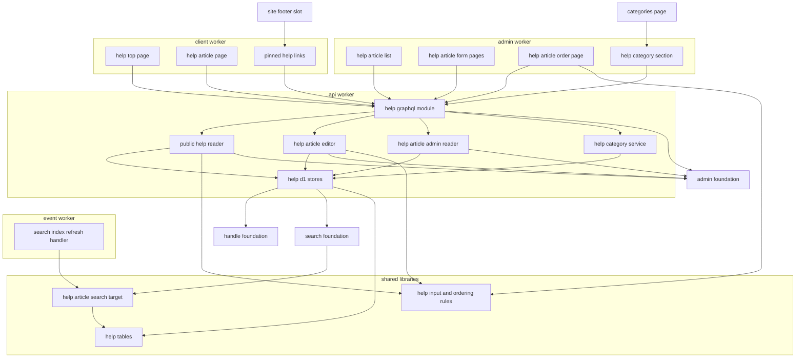
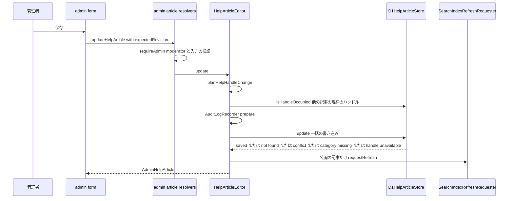
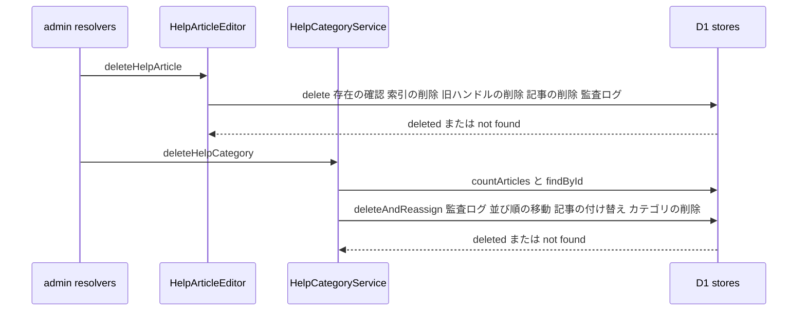
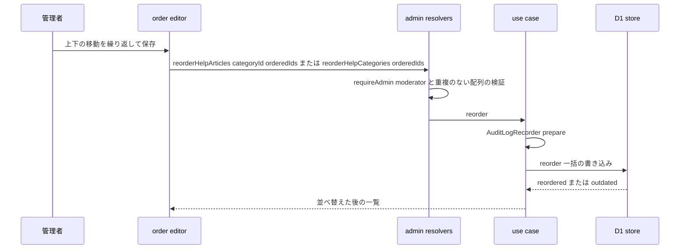
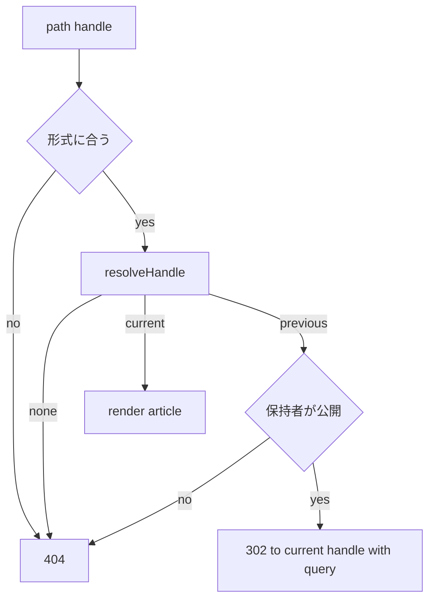

# Design Document

## Overview

**Purpose**: ヘルプ記事とヘルプ記事カテゴリのデータ・管理画面・利用者側の画面を実装する。利用者は`/help`でカテゴリ別の一覧と検索を、`/help/{handle}`で目次付きの記事を読み、全ページのフッターからピン留め記事を開ける。運営者(モデレーター以上)は管理画面`/help-articles`で記事を下書きから公開まで作成・編集・削除し、`/help-articles/order`でカテゴリ内の記事を並べ替え、`/categories`のヘルプ記事カテゴリの区画でカテゴリの追加・名前の変更・削除・並べ替えを行う。ハンドルはuser-profile-socialのハンドル基盤、検索はcontent-processingの全文検索の基盤、権限・監査ログ・作成者の照会はadmin-foundationの部品を使い、本specは対象の記述と検索対象を渡すだけで同じ規則にそろえる。

**Users**: 利用者(ログインの有無を問わない)はヘルプトップ・記事詳細・フッターを使う。モデレーター以上の管理者は記事・カテゴリとその並び順を操作し、閲覧のみの管理者は内容と並び順を閲覧する。launch-readinessは全体のE2E回帰にヘルプの流れを含め、運用で本文を投入する。

**Impact**: D1に4テーブル(カテゴリ・記事・記事の旧ハンドル・記事の索引文書)と全文検索の索引を足す。カテゴリと記事は管理者が指定する並び順の列を持つ。`apps/common-lib/help`に入力規則・定数・並び順の規則、`apps/backend-lib/workers/search/targets`に検索対象を新設する。apiにスキーマモジュール`help`・ユースケース・D1の実装を、clientにヘルプトップ・記事詳細・フッターの部品を、adminにヘルプ記事の画面・記事の並べ替えの画面・カテゴリの区画を足す。上流のファイルは、契約で定められた登録箇所(`SEARCH_INDEXES`・`SEARCH_TARGETS`・`AUDIT_ACTIONS`・`ADMIN_NAV_ITEMS`・`CATEGORY_SECTIONS`・`SITE_LAYOUT_SLOTS.footerHelpLinks`)への追記だけを変える。新しいシークレット・パッケージ・4:21のジョブ・ライフサイクルの波及処理は無い。

### Goals

- FR-HELP-001〜011・FR-ADMAG-005・012〜017・019〜022・026・028・029・FR-ADMCF-012〜014と、FR-ADMAG-001のうち本機能の操作の監査ログが、要件と確定した決定(仮1〜仮5、2026-10-24に開発者が確定)に一致して動作する。
- 下書きの記事が、一覧・検索・詳細・旧ハンドル・同カテゴリの一覧・フッターのどの経路からも利用者に出ない。
- ハンドルの規則・同時の保存・旧ハンドルの転送と解放が、利用者・プロダクトと同じハンドル基盤の規則で動く。予約語は持たない。
- カテゴリと記事の並び順が、管理者の並べ替えのとおりにヘルプトップ・フッター・同カテゴリの記事・管理画面の選択肢へ反映される。
- 本specが追加・変更したコードの単体テスト・Workers統合テスト・ブラウザテストがカバレッジ80%を満たし、E2Eテストが管理画面から利用者側までの流れを確かめる。

### Non-Goals

- 法務文書(legal-pages)・問い合わせ(inquiry-chat)・他ドメインの検索の索引(directory-discoveryなど)。
- ヘルプ記事の本文の執筆と投入(運用)。
- 記事の版の履歴、下書きのプレビュー用の利用者側のURL、目次の現在位置の強調、ドラッグ&ドロップによる並べ替え(新しいパッケージが要るため、上下の移動のボタンで行う)。
- 要件定義書の改訂(roadmapのOut。必要な改訂は[research.md](research.md)の「要件定義書の改訂が必要な箇所」に記録した)。(2026-10-25に要件定義書へ適用済み)

## Boundary Commitments

### This Spec Owns

- ヘルプのデータ: `help_categories`・`help_articles`・`help_article_previous_handles`・`help_article_search_documents`(`apps/db/schema/help/`)と全文検索の索引`help_article_search_documents_fts`・トリガー、標準カテゴリ「その他」の初期データ、カテゴリと記事の並び順の列。
- 共有の定義`apps/common-lib/help/`(入力の上限と判定・ハンドルの規則`HELP_ARTICLE_HANDLE_RULE`・ステータス・標準カテゴリのID・本文のリンクの`rel`・並び順の規則)と、監査ログの操作種別`apps/common-lib/admin/audit-actions/help-center.ts`。
- 検索対象`help-article`(`apps/backend-lib/workers/search/targets/help-articles.ts`)と索引の定義`HELP_ARTICLE_SEARCH_INDEX`。
- apiのヘルプの業務処理(`domain/help`・`application/help`・`infrastructure/help`)、ハンドルの対象の記述`HELP_ARTICLE_HANDLE_NAMESPACE`、GraphQLのスキーマモジュール`help`(利用者側の4操作と管理者側の12操作)。
- clientの`/help`・`/help/$handle`の画面と部品、フッターの部品`PinnedHelpLinks`。
- adminの`/help-articles`・`/help-articles/new`・`/help-articles/$articleId`・`/help-articles/order`の画面と部品、カテゴリの区画`HelpCategorySection`と並べ替えの部品。
- E2Eテスト`e2e/admin/help-center.e2e.test.ts`、技術ドキュメント`frontend/011-table-of-contents.md`の新規作成と`backend/011-handle-namespaces.md`への節の追記、サービス仕様(ページ配置・文言規則・準拠方針)と`docs/onboardings/project-values.md`の追記。

### Out of Boundary

- ハンドルの規則の部品・旧ハンドルのテーブルの共通の列・他の対象が保持する旧ハンドルを解放する文(user-profile-social)。本specは対象の記述を作って部品を呼ぶだけである。
- マークダウンの入力欄・描画・サニタイズ・見出しの一覧、検索語の正規化と検索式・強調表示、索引の更新のメッセージ・処理・キーワード抽出・日次の再抽出(content-processing)。本specは検索対象と索引の定義を登録し、ドメインの一括の書き込みに`markPending`・`deleteSources`を入れ、`requestRefresh`を呼ぶだけである。
- 管理者のアカウント・権限ロール・`requireAdmin`・監査ログの記録の仕組みと閲覧画面・管理画面のシェルとメニュー・共通部品(`CategoryMasterEditor`を含む)・E2Eの管理者ログインの補助(admin-foundation)。本specは`CategoryMasterEditor`の形を変えず、並べ替えは本specの部品で区画に並べて置く。
- 管理画面のカテゴリのページ`/categories`の枠と区画の並び・エラーの分離(inquiry-chat)。
- 利用者側の共通フッターの枠・ヘルプトップへの固定のリンク・404と状態表示の部品・CSP(frontend-platform)。
- 画像の配信と隔離(media-pipeline)。本specは作成者の画像のIDを`MediaImage`へ変換するだけである。

### Allowed Dependencies

- backend-platform: `AppModule`・`PLATFORM_TYPES`(`Database`・`Clock`・`IdGenerator`)・`AppError`・`getAppLogger`・`ulidPrimaryKey`・`timestamps`・`textNoCase`・`snakeCase.table`。形を変えない。
- api-gateway: `defineSchemaModule`・`GraphQLContext`(`caller`・`session`・`resolve`・`loaders`)・`withValidatedArgs`・`DateTime`。形を変えない。
- user-profile-social: `HANDLE_PATTERN`・`HandleRule`・`checkHandleFormat`・`isSameHandle`(`apps/common-lib/handles`)、`previousHandleColumns`(`apps/db/schema/handles`)、`defineHandleNamespace`・`HandleNamespace`・`resolveHandle`・`isHandleOccupied`・`handleOccupiedCondition`・`previousHandleUpsert`・`previousHandleDelete`・`previousHandleRelease(db, ns, { handle, exceptOwnerId }): BatchItem<'sqlite'>`(他の対象が保持する同じ文字列の旧ハンドルの行を物理削除する文、user-profile-socialの仮2の確定で加わった部品)(`apps/backend-lib/workers/handles`)。`isReservedHandle`・`IMPERSONATION_RESERVED_HANDLES`は使わない(仮2)。
- content-processing: `searchDocumentColumns`・`searchTextColumn`・`searchDocumentStatusIndex`・`defineSearchIndex`・`SEARCH_INDEXES`・`print-search-index-sql.ts`・`ftsRankedSources`(`apps/db`)、`defineSearchTarget`・`SEARCH_TARGETS`・`SEARCH_TYPES`・`SearchIndexStatements`・`SearchIndexRefreshRequester`(`apps/backend-lib`)、`normalizeSearchTerms`・`buildFtsMatchExpression`・`countGraphemes`・`hasForbiddenCharacters`・`markdownTextSchema`・`renderMarkdown`・`LinkRelToken`(`apps/common-lib`)、`MarkdownEditor`・`MarkdownContent`・`useRenderedMarkdown`・`useMarkdownOptions`・`HighlightedText`(`apps/frontend-lib`)。
- admin-foundation: `requireAdmin`(`admin-guard.ts`)・`CurrentAdmin`・`AdminRole`・`hasRole`・`AuditLogRecorder`・`PreparedAuditEntry`・`buildAuditLogStatements`・`defineAuditAction`・`AUDIT_ACTIONS`・`checkCategoryName`・`CATEGORY_NAME_MAX`・`AUDIT_REASON_MAX`・`ADMIN_PLATFORM_TYPES.AdminDirectory`・`AdminDirectory`・`ADMIN_NAV_ITEMS`・`RoleGate`・`useAdminRole`・`AdminPageHeader`・`AdminDataTable`・`AdminFilterBar`・`ConfirmActionDialog`・`ReasonField`・`AdminAvatar`・`CategoryMasterEditor`、E2Eの`signInAsNewAdmin`・`executeLocalD1`・`sqlStringLiteral`。
- inquiry-chat: `CATEGORY_SECTIONS`・`CategorySection`(登録の追記だけ)。
- media-pipeline: `mediaFileLoader`・`toMediaImage`・GraphQLの`MediaImage`・`MediaPicture`・`MediaPlaceholder`。
- frontend-platform: `SITE_LAYOUT_SLOTS`(`footerHelpLinks`への追記)・`executeGraphQL`・`graphqlQueryOptions`・`GraphQLClientError`・`useAppForm`・`FormField`・`SubmitButton`・`applyServerFieldErrors`・`buildPageHead`・`PublicRuntimeConfig.clientSiteOrigin`・`NotFoundView`・`ErrorState`・`EmptyState`・`LoadingSkeleton`・`notify`・`DateTime`・shadcn/uiの部品(`select`・`checkbox`・`radio-group`・`badge`・`button`)・`runAxe`・`AppForm`・`errorMessageOf`・各アプリの`src/composition/app-profile.ts`のプロファイル(`CLIENT_PROFILE`・`ADMIN_PROFILE`)・`utilities/validation/zod.ts`の`z`。
  - GraphQLの操作は各アプリの`src/graphql/operations/help/`に1ファイル1操作の`*.graphql`で書き、操作名を利用者側は`Client`、管理者側は`Admin`で始める。画面は`src/graphql/generated/graphql.ts`の`<操作名>Document`と型を読み、`graphql()`と`gql.ts`・`index.ts`を使わない(frontend-platformの「操作の追加手順」)。
  - フォームは`useAppForm<TInput, TOutput>(schema, { defaultValues })`(`defaultValues`は全欄)と、必須の`onSubmitError`・任意の`serverFieldPrefix`(`input`を取るmutationは`"input"`)を受ける`AppForm`で作る。画面側のスキーマの`zod`の値は`utilities/validation/zod.ts`から読み、`zod`を直接読み込むのは型だけにする。
  - 失敗の文言: `GraphQLClientError`でない例外に代えて画面に出す文言(`ErrorState`・`PartialErrorState`の`message`、`AppForm`の`onSubmitError`で示す文言、トースト)は`errorMessageOf(error, <プロファイル>.contactAvailable)`で選び、例外の`message`を直接出さない。管理者側は`ADMIN_PROFILE`を使い、`ErrorState`・`UnexpectedErrorView`に`contactHref`を渡さない(問い合わせの画面が無いため、問い合わせの導線と問い合わせを促す文を出さない)。
- e2e: `resolveE2ETargets`(`e2e/support/targets.ts`)。
- npmパッケージ: 新規は無い。
- 後続specは、本specのGraphQLの公開の操作と`PinnedHelpLinks`の表示だけに触れ、`help_*`のテーブルを直接読み書きしない。

### Revalidation Triggers

- user-profile-socialのハンドル基盤の形(`HandleNamespace`・`resolveHandle`・`isHandleOccupied`・`handleOccupiedCondition`・`previousHandleUpsert`・`previousHandleRelease`・`previousHandleDelete`・`previousHandleColumns`)と、使用中の判定と解放の意味(他の対象の現在のハンドルだけを使用中とする、現在のハンドルの書き込みの後に解放の文を置く)。本specの仮4はこれに従う。
- content-processingの`SearchTargetDefinition`・`SearchIndexStatements`・`ftsRankedSources`の形、索引の更新の再試行と日次の再抽出の条件、`buildFtsMatchExpression`の照合規則、`renderMarkdown`の性能(本specは100,000文字の本文を描画する)。
- admin-foundationの`AdminDirectory`の形と削除済みの扱い、`buildAuditLogStatements`の形、`ADMIN_NAV_ITEMS`の`order`(admin-foundationの仮6)、`CategoryMasterEditor`のprops(渡した順で表示すること)。
- inquiry-chatの`CategorySection`の形と`order`(help-center 20)。
- frontend-platformの`SiteLayoutSlots.footerHelpLinks`の形と描画の位置(`<ul>`の中の`<li>`)。
- 本specのGraphQLの公開の操作(`helpCenter`・`helpArticle`・`helpArticleSearch`・`pinnedHelpArticles`)の形(launch-readinessのE2E回帰)と、本文の上限100,000文字(launch-readinessの性能のデータ規模)。
- 技術ドキュメントの番号`frontend/011`(product-launchは`frontend/012-business-date-calendar.md`を使い、roadmapの順で本specが`011`を使う)。

### 上流への影響

| 上流spec            | 変更                                                                                                                                                                                                          | 影響と再検証                                                                                                                  |
| ------------------- | ------------------------------------------------------------------------------------------------------------------------------------------------------------------------------------------------------------- | ----------------------------------------------------------------------------------------------------------------------------- |
| content-processing  | `apps/db/search/search-indexes.ts`の`SEARCH_INDEXES`と`apps/backend-lib/workers/search/targets/index.ts`の`SEARCH_TARGETS`に追記                                                                              | 契約どおり。`targets/index.unit.test.ts`と`search-index-migrations.unit.test.ts`が新しい定義でも成功することを確かめる        |
| admin-foundation    | `apps/common-lib/admin/audit-actions/index.ts`に`help-center.ts`を連結、`apps/admin/src/composition/admin-navigation.ts`に`/help-articles`(100)                                                               | 契約どおり                                                                                                                    |
| inquiry-chat        | `apps/admin/src/composition/category-sections.ts`に`help-center.help-categories`(20)                                                                                                                          | 契約どおり。カテゴリのページのテストが区画の追加後も成功することを確かめる                                                    |
| frontend-platform   | `apps/client/src/composition/layout-slots.ts`の`footerHelpLinks`に`PinnedHelpLinks`                                                                                                                           | 契約どおり。フッターのテストが部品の追加後も成功することを確かめる                                                            |
| user-profile-social | ファイルの変更は無い。`previousHandleRelease`と、他の対象の現在のハンドルだけを使用中とする`isHandleOccupied`・`handleOccupiedCondition`を使う。`docs/GUIDES/tech/backend/011-handle-namespaces.md`に節を追記 | user-profile-socialの設計(仮2の確定)の契約どおり。部品が実装されていなければ、タスク1.1の前提の確認で保留して開発者へ報告する |

- 上流specの設計文書の変更は無い。roadmapの帯の割り当ての表の本specの「使用中の値」は「—」のままである(本specはroadmapを編集しない)。

## Architecture

### Existing Architecture Analysis

- 上流の15specは設計・タスクとも承認済みで、本specのタスクはそれらの実装の完了を前提にする(roadmapの順でuser-profile-socialまでが先に実装される)。実装済みはdev-toolingだけである。
- 管理操作は、application層で`AuditLogRecorder.prepare`を呼び、infrastructure層のストアで操作の文と`buildAuditLogStatements`を同じ`db.batch()`に入れる(admin-foundationの規約`backend/008`)。
- 検索の索引の更新は、ドメインの一括の書き込みに`markPending`(作成・編集)または`deleteSources`(削除)を入れ、確定の後に`requestRefresh`でQueueへ送る。eventの`SearchIndexRefreshHandler`が`SEARCH_TARGETS`の定義の`read`で元データを読み直す(content-processing)。
- 管理画面のカテゴリのページは`CATEGORY_SECTIONS`の区画を`order`順に並べ、区画ごとにエラー境界で包む(inquiry-chat)。`CategoryMasterEditor`は渡された配列の順でカテゴリを表示し、並べ替えの機能を持たない(admin-foundation)。利用者側のフッターは`footerHelpLinks`の部品を、ヘルプトップのリンクの後に描く(frontend-platform)。
- マークダウンの描画はフロントエンドで行い、APIは原文の文字列を返す(content-processing)。

### Architecture Pattern & Boundary Map



**Architecture Integration**:

- Selected pattern: クリーンアーキテクチャ(apiの`domain`→`application`→`infrastructure`・`presentation`→`composition`)。並び順の規則は管理画面の並べ替えの画面も使うため`common-lib/help`に、ハンドルの変更の種類・カテゴリの保護は`domain/help`に置く。ユースケースはポート越しにD1を使い、ハンドル基盤と検索の基盤の部品はD1の実装(`infrastructure/help`)だけが呼ぶ。
- Domain/feature boundaries: ヘルプの記事・カテゴリ・並び順・索引文書は本spec、ハンドルの規則と旧ハンドルの解放の文はuser-profile-social、索引の更新と検索式はcontent-processing、管理者と監査ログはadmin-foundation、ページの枠はinquiry-chat・frontend-platform。
- Existing patterns preserved: 登録箇所への追記による区画とメニューの追加、操作と監査ログの同じ一括の書き込み、`CASE`式のNOT NULL制約の違反による一括の書き込みの取り消し、標準カテゴリの固定ULIDと初期データのカスタムマイグレーション、`/@{$handle}`と同じ302の明示。
- New components rationale: 検索対象はeventの索引の更新の処理が読むため`backend-lib`に置く。ハンドルの対象の記述はapiだけが使うため`api/infrastructure`に置く。目次は既存の部品が無いため、`renderMarkdown`の見出しから作る。並べ替えは`CategoryMasterEditor`が持たないため、本specが上下の移動の部品`ReorderableList`を作り、カテゴリと記事の両方の並べ替えに使う。
- Steering compliance: Inversifyの`@inject`の明示、D1の制約(`db.batch()`・バインド変数100個以内・FTS5はカスタムマイグレーション)、テーブルの作成時の`textNoCase`、800行以内のファイル、1ファイル1コンポーネント、日時の`<time datetime>`、サンプルの`.example`。

### Dependency Direction

`apps/common-lib/help` → `apps/db/schema/help`(`apps/db/search`へ定義を登録) → `apps/backend-lib/workers/search/targets/help-articles.ts` → 各アプリの`src`(apiは`domain` → `application` → `infrastructure`・`presentation` → `composition`)。`common-lib/help`は他の層を読み込まない(`common-lib/handles`・`common-lib/markdown`の型と関数だけを読む)。client・adminは`common-lib/help`・`frontend-lib`・GraphQLの操作だけを読み込み、互いのコードを読まない。`application/help`はD1・ハンドル基盤・検索の基盤の関数を直接読み込まない(ポート経由。`common-lib`の純粋な判定は使ってよい)。

### Technology Stack

| Layer     | Choice / Version                                                                                                                        | Role in Feature                               | Notes                                                 |
| --------- | --------------------------------------------------------------------------------------------------------------------------------------- | --------------------------------------------- | ----------------------------------------------------- |
| Frontend  | TanStack Start・Router・Query・shadcn/ui(frontend-platform)、`MarkdownEditor`・`MarkdownContent`・`HighlightedText`(content-processing) | ヘルプトップ・記事詳細・フッター・管理画面    | 新規のパッケージなし。並べ替えはボタンで行う          |
| Backend   | Hono・Inversify・GraphQL Yoga(上流)                                                                                                     | スキーマモジュール・ユースケース              | 既存                                                  |
| Data      | Cloudflare D1(drizzle-orm 1.0.0-rc.5)、SQLite FTS5(`unicode61 remove_diacritics 2`)、SQLiteのJSON関数(`json_each`)                      | 4テーブルと全文検索の索引、並び順の一括の更新 | 生成のマイグレーションと2つのカスタムマイグレーション |
| Messaging | Cloudflare Queues(content-processingの`search-index.refresh`)                                                                           | 索引の更新                                    | 新しいメッセージ種別・ジョブは無い                    |
| External  | Google Cloud Natural Language(content-processing経由)                                                                                   | 本文のキーワード抽出                          | 送る内容は公開の記事の本文だけ                        |

## File Structure Plan

### Directory Structure

```
apps/
├── common-lib/
│   ├── help/                                            # 4アプリ共通(各ファイルに同名の*.unit.test.ts)
│   │   ├── help-input-rules.ts                          # HELP_ARTICLE_HANDLE_RULE・上限・checkHelpTitle・checkHelpSubtitle・checkHelpSearchQuery・HELP_ARTICLE_EXTERNAL_LINK_REL
│   │   ├── help-article-status.ts                       # HELP_ARTICLE_STATUSES・HELP_ARTICLE_STATUS_LABELS
│   │   ├── help-category-constants.ts                   # HELP_CATEGORY_OTHER_ID・HELP_CATEGORY_OTHER_NAME
│   │   ├── help-ordering.ts                             # sortHelpCategories・sortHelpArticles・groupPublishedArticles・splitPinnedGroups・moveItem(仮3)
│   │   └── help-body-render.unit.test.ts                # 100,000文字の本文の描画時間の計測(仮1、テストだけのファイル)
│   └── admin/audit-actions/help-center.ts               # help-article.*・help-category.*の操作種別(単体テストを併置)
├── db/
│   ├── schema/help/                                     # テーブル定義(各ファイルに同名の*.unit.test.ts)
│   │   ├── help-categories.ts                           # 並び順の列を含む
│   │   ├── help-articles.ts                             # テーブルと公開の条件publishedHelpArticle、並び順の列を含む
│   │   ├── help-article-previous-handles.ts             # previousHandleColumnsによる旧ハンドル(1記事1件)
│   │   ├── help-article-search-documents.ts             # 索引文書のテーブルとHELP_ARTICLE_SEARCH_INDEX
│   │   └── index.ts
│   └── migrations/
│       ├── <日時>_help_center/migration.sql              # 生成(textNoCase・CHECK・索引)
│       ├── <日時>_help_center_seed/migration.sql         # 標準カテゴリ「その他」の挿入(カスタム)
│       └── <日時>_help_center_fts/migration.sql          # 全文検索の索引とトリガー(カスタム、print-search-index-sqlの出力)
├── backend-lib/workers/search/targets/
│   └── help-articles.ts                                 # HELP_ARTICLE_SEARCH_TARGET(Workers統合テストを併置)
├── api/src/
│   ├── domain/help/                                     # 純粋な規則(Bunの単体テスト)
│   │   ├── help-handle-change.ts                        # planHelpHandleChange
│   │   └── help-category-rules.ts                       # checkHelpCategoryEditable(仮5)
│   ├── application/help/                                # ユースケース(Bunの単体テスト)
│   │   ├── help-types.ts                                # HELP_TYPES
│   │   ├── ports.ts                                     # HelpArticleStore・HelpCategoryStore・PublicHelpStoreと各型
│   │   ├── help-authors.ts                              # HelpAuthorLookup(AdminDirectoryから作成者の表示)
│   │   ├── help-article-editor.ts                       # 作成・編集・削除・カテゴリ内の並べ替え
│   │   ├── help-article-admin-reader.ts                 # 全件・1件・ハンドルの使用可否
│   │   ├── help-category-service.ts                     # 一覧・追加・名前の変更・削除と付け替え・並べ替え
│   │   └── public-help-reader.ts                        # ヘルプトップ・記事の解決・ピン留め・検索
│   ├── infrastructure/help/                             # Workers統合テスト
│   │   ├── help-handle-namespace.ts                     # HELP_ARTICLE_HANDLE_NAMESPACE
│   │   ├── help-guards.ts                               # 記事の存在と版の確認の文・並び順の対象の集合の確認の文
│   │   ├── d1-help-article-store.ts                     # 作成・更新・削除・並べ替えの一括の書き込みと読み取り
│   │   ├── d1-help-category-store.ts                    # カテゴリの書き込み・付け替え・並べ替え・件数
│   │   └── d1-public-help-store.ts                      # 公開の記事の読み取り・解決・検索
│   ├── presentation/graphql/modules/help/               # スキーマモジュール(Workers統合テスト)
│   │   ├── type-defs.ts
│   │   ├── inputs.ts                                    # zodスキーマ(common-libの規則とmarkdownTextSchema)
│   │   ├── errors.ts                                    # エラーコードと文言
│   │   ├── author-fields.ts                             # HelpArticleAuthor.avatarのリゾルバ
│   │   ├── public-resolvers.ts                          # helpCenter・helpArticle・helpArticleSearch・pinnedHelpArticles
│   │   ├── admin-article-resolvers.ts                   # 記事の照会・使用可否・作成・編集・削除・並べ替え
│   │   ├── admin-category-resolvers.ts                  # カテゴリの照会・追加・名前の変更・削除・並べ替え
│   │   └── index.ts                                     # helpSchemaModule
│   └── composition/help-module.ts                       # HELP_MODULE(apiの束縛)
├── client/src/
│   ├── routes/help/index.tsx                            # /help(検索のクエリq)
│   ├── routes/help/$handle.tsx                          # /help/{handle}(302・404の分岐)
│   ├── components/help/                                 # 1ファイル1コンポーネント(browser testを併置)
│   │   ├── help-search-form.tsx                         # 検索欄(50文字の検証)
│   │   ├── help-category-list.tsx                       # カテゴリ別の一覧
│   │   ├── help-article-link-item.tsx                   # タイトルとサブタイトルの項目
│   │   ├── help-search-results.tsx                      # 検索結果と強調表示・0件
│   │   ├── help-top-skeleton.tsx
│   │   ├── help-article-page.tsx                        # 記事詳細の2カラムの枠
│   │   ├── help-article-author.tsx                      # 作成者(削除済みの表示)
│   │   ├── help-table-of-contents.tsx                   # 目次(PCの固定・モバイルの折りたたみ)
│   │   ├── related-help-articles.tsx                    # 同カテゴリの記事
│   │   ├── help-article-skeleton.tsx
│   │   └── pinned-help-links.tsx                        # フッターのピン留め記事
│   └── graphql/operations/help/                         # 1ファイル1操作の*.graphql(操作名はClientで始める)
│       └── help-center.graphql · help-article.graphql · help-article-search.graphql · pinned-help-articles.graphql
├── admin/src/
│   ├── routes/_authenticated/help-articles/
│   │   ├── index.tsx                                    # /help-articles(絞り込みのクエリ)
│   │   ├── new.tsx                                      # /help-articles/new
│   │   ├── order.tsx                                    # /help-articles/order(クエリcategory)
│   │   └── $articleId.tsx                               # /help-articles/{id}
│   ├── components/help/                                 # 1ファイル1コンポーネント(browser testを併置)
│   │   ├── help-article-filter.ts                       # 条件の解析・作成者の選択肢・絞り込み(*.unit.test.ts)
│   │   ├── help-article-filters.tsx                     # 絞り込みのバー
│   │   ├── help-article-table.tsx                       # 全件の表
│   │   ├── help-article-form-schema.ts                  # フォームのスキーマ(zodの値はutilities/validation/zod.ts、*.unit.test.ts)
│   │   ├── help-article-form.tsx                        # 作成・編集のフォーム
│   │   ├── help-article-handle-field.tsx                # ハンドルと使用可否・旧ハンドルの案内
│   │   ├── help-article-delete-button.tsx               # 削除の確認と実行
│   │   ├── reorderable-list.tsx                         # 上下の移動のボタンと位置の読み上げを持つ並べ替えの一覧
│   │   ├── help-article-order-editor.tsx                # カテゴリ内の記事の並べ替え(ピン留めの群とそれ以外の群)
│   │   ├── help-category-order-editor.tsx               # カテゴリの並べ替え
│   │   └── help-category-section.tsx                    # カテゴリのページの区画
│   └── graphql/operations/help/                         # 1ファイル1操作の*.graphql(操作名はAdminで始める)
│       ├── articles/*.graphql                           # 記事の照会・使用可否・作成・編集・削除・並べ替え
│       └── categories/*.graphql                         # カテゴリの照会・追加・名前の変更・削除・並べ替え
e2e/admin/help-center.e2e.test.ts                        # 管理画面の操作から利用者側の表示まで
docs/GUIDES/tech/frontend/011-table-of-contents.md        # 見出しから作る目次の規約
```

テストは各ファイルの隣に置く(`*.unit.test.ts`・`*.worker.test.ts`・`*.browser.test.tsx`)。文書の番号はroadmapの順でinquiry-chat(`frontend/010`)の後の空き番号`frontend/011`に固定する。

### Modified Files

- `apps/db/schema/index.ts` — helpのテーブルを再エクスポートする。マイグレーションはmainの最新を取り込んでから生成する(`db/001`)。
- `apps/db/search/search-indexes.ts`(content-processing) — `HELP_ARTICLE_SEARCH_INDEX`を加える。
- `apps/backend-lib/workers/search/targets/index.ts`(content-processing) — `HELP_ARTICLE_SEARCH_TARGET`を加える。
- `apps/common-lib/admin/audit-actions/index.ts`(admin-foundation) — `help-center.ts`の配列を連結する。
- `apps/api/src/composition/modules.ts`・`graphql-modules.ts` — `HELP_MODULE`・`helpSchemaModule`を加える。
- `apps/client/src/composition/layout-slots.ts`(frontend-platform) — `footerHelpLinks`に`PinnedHelpLinks`を加える。
- `apps/admin/src/composition/admin-navigation.ts`(admin-foundation) — `{ to: '/help-articles', label: 'ヘルプ記事', order: 100 }`。
- `apps/admin/src/composition/category-sections.ts`(inquiry-chat) — `{ id: 'help-center.help-categories', order: 20, title: 'ヘルプ記事カテゴリ', component: HelpCategorySection }`。
- `docs/GUIDES/tech/backend/011-handle-namespaces.md`(user-profile-social) — 「公開状態を持つ対象と、対象の削除での旧ハンドル」の節。
- `docs/GUIDES/tech/frontend/README.md` — 文書一覧の行。
- `docs/GUIDES/service/design/002-page-layouts.md` — 「ヘルプ」節(ヘルプトップの一覧と検索、記事詳細の配置と目次、フッターのピン留め記事、管理者が指定する並び順とピン留めの群(仮3))、「旧ハンドルの保持とリダイレクト」の予約語の対象がユーザー・プロダクトだけでヘルプ記事を含まない旨(仮2)、「外部Webサイトへのリンク」の表にヘルプ記事の本文(`noopener`)、管理者側のヘルプ記事の画面(一覧・作成・編集・削除・絞り込み・記事の並べ替え`/help-articles/order`)とカテゴリのページのヘルプ記事カテゴリの区画(並べ替えを含む)。
- `docs/GUIDES/service/design/003-text-and-copy-rules.md` — 入力欄の表にヘルプ記事の本文(100,000文字・必須・マークダウン、仮1)、本機能のエラー・状態・トーストの文言(Error Handlingの表)。
- `docs/GUIDES/service/legal/001-compliance-policy.md` — 「ヘルプ記事の旧ハンドル文字列」の行の削除方法に、他の記事が同じ文字列をハンドルに設定した時点での物理削除を加える(仮4)。
- `docs/onboardings/project-values.md` — 検索対象の名前`help-article`、監査ログの操作種別、管理画面のメニューと区画のID、標準カテゴリのID。

## System Flows

### 記事の保存



- 作成の一括の書き込み: (1)記事の挿入。`category_id`を`CASE WHEN <カテゴリが存在> AND NOT <handleOccupiedCondition> THEN ? ELSE NULL END`にし、`sort_order`を`(SELECT COALESCE(MAX(sort_order), 0) + 1 FROM help_articles WHERE category_id = ?)`にする(カテゴリの末尾、6.12)。(2)`previousHandleRelease(db, HELP_ARTICLE_HANDLE_NAMESPACE, { handle, exceptOwnerId: <新しい記事のID> })`(他の記事が保持する同じ旧ハンドルの行の物理削除、仮4)。(3)公開なら`markPending('help-article', id, now)`。(4)`buildAuditLogStatements`。
- 更新の一括の書き込み: (1)記事の存在と版の確認の文(`helpArticleExistsGuard`)。(2)記事の更新(同じ`CASE`式、`revision = revision + 1`、`updated_at = now`、カテゴリが変わるときだけ`sort_order`を移動先のカテゴリの末尾の値にする。`created_by_admin_id`・ピン留めの切り替えでの`sort_order`は変えない)。(3)`handleChange.kind`が`changed`のときだけ`previousHandleRelease`(`exceptOwnerId`は記事自身)。(4)`changed`のときだけ`previousHandleUpsert`(変更前のハンドルは記事自身の現在のハンドルだったため、他の記事の旧ハンドルとは重ならない)。(5)公開なら`markPending`、下書きなら`deleteSources`。(6)`buildAuditLogStatements`。
- `handleOccupiedCondition`・`isHandleOccupied`は他の記事の現在のハンドルだけを使用中とし、他の記事の旧ハンドルは使用中としない(user-profile-socialの仮2の確定によるハンドル基盤の共通の規則。`includePrevious`は使わない)。解放の文は現在のハンドルの書き込みの後に置き(ハンドル基盤の解放の規約)、同じトランザクションで確定するため、同時の保存でも、ある記事の現在のハンドルと同じ文字列が他の記事の旧ハンドルとして残らない。同じ旧ハンドルを2つの保存が同時に取りにいく場合は、現在のハンドルの一意索引により一方だけが確定し、もう一方は`handle-unavailable`になる。
- 失敗の分類は取り消しの後の読み直しで行う(記事が無い→`not-found`、版が違う→`conflict`、カテゴリが無い→`category-missing`、それ以外→`handle-unavailable`)。取り消された場合は解放の文も取り消され、元の記事の旧ハンドルは残る。
- `requestRefresh`の送信の失敗は例外にならず(content-processing)、索引文書は`pending`のまま残り、日次の再抽出が1時間後以降に再処理する(要件10.4)。

### 記事の削除とカテゴリの削除



- 記事の削除の一括の書き込み: (1)`helpArticleExistsGuard`(版を問わない)→(2)`deleteSources('help-article', [id])`→(3)`previousHandleDelete`→(4)`DELETE FROM help_articles WHERE id = ?`→(5)`buildAuditLogStatements`。外部キーの`ON DELETE`を指定しないため、旧ハンドルを記事より先に消す。
- カテゴリの削除の一括の書き込み: (1)`buildAuditLogStatements`(詳細`reassignedCount`)→(2)`UPDATE help_articles SET sort_order = sort_order + (SELECT COALESCE(MAX(sort_order), 0) FROM help_articles WHERE category_id = <その他>) WHERE category_id = ?`(副問い合わせは更新しない「その他」の行だけを読むため、全ての行で同じ値を足し、元の相対的な順を保って末尾へ置く、11.4)→(3)`UPDATE help_articles SET category_id = <その他> WHERE category_id = ?`(`updated_at`・`revision`は変えない、11.6)→(4)`DELETE FROM help_categories WHERE id = ? AND system_default = 0`。件数は確認と監査ログの表示用で、付け替えは条件付きの`UPDATE`で行う(inquiry-chatと同じ)。

### 並べ替え



- 一括の書き込み: (1)並び順の対象の集合の確認の文(`helpOrderGuard`)。対象(カテゴリの全件、またはそのカテゴリの全記事)のIDを昇順で`group_concat`した値と、渡されたIDを昇順で連結した値(バインド変数1つ)が一致しなければ、標準カテゴリの行への`INSERT … ON CONFLICT DO NOTHING`の`name`をNULLにしてNOT NULL制約の違反で全体を取り消す。一致すれば一意の衝突で何も書かない。(2)`UPDATE <テーブル> SET sort_order = (SELECT CAST(key AS INTEGER) + 1 FROM json_each(?) WHERE value = <テーブル>.id) WHERE <対象の条件>`(順序のJSON配列をバインド変数1つで渡し、件数によらず1文で更新する。`updated_at`・`revision`は変えない、9.9)。(3)`buildAuditLogStatements`。
- 取り消された場合は`outdated`として`help_order_outdated`を返す(9.10・11.11)。
- 記事の並べ替えの画面は、ピン留めの群に続けてそれ以外の群の順でIDを送る。ピン留めの切り替えでは`sort_order`を変えないため、切り替えた記事は新しい群の中で同じ値の位置に表示される(9.11)。

### 公開の記事の解決



- `resolveHandle`は大文字小文字を区別しない。現在のハンドルは`activeCondition`(公開)を満たす記事だけを解決するため、下書きの記事の現在のハンドルは`none`になる。旧ハンドルは保持者の状態を見ないため、読み取り側で公開を確かめる。他の記事に解放された旧ハンドルは行が無いため、その文字列は新しい保持者の現在のハンドルとして解決される。

## Requirements Traceability

| Requirement             | Summary                                  | Components                                                                                                                       | Interfaces                                                            | Flows                      |
| ----------------------- | ---------------------------------------- | -------------------------------------------------------------------------------------------------------------------------------- | --------------------------------------------------------------------- | -------------------------- |
| 1.1, 1.2, 1.3, 1.4      | カテゴリ別の一覧と並び                   | HelpOrdering、PublicHelpReader、D1PublicHelpStore、HelpCategoryList、HelpArticleLinkItem                                         | `helpCenter`・`groupPublishedArticles`                                | —                          |
| 1.5, 1.6, 1.7           | 閲覧・空・状態                           | HelpTopRoute、HelpSearchForm、HelpTopSkeleton                                                                                    | `EmptyState`・`ErrorState`                                            | —                          |
| 2.1, 2.2                | 検索と検索式                             | PublicHelpReader、D1PublicHelpStore、HelpArticleSearchTarget、HelpSearchIndex                                                    | `helpArticleSearch`・`buildFtsMatchExpression`・`ftsRankedSources`    | —                          |
| 2.3                     | 50文字の上限                             | HelpInputRules、HelpInputs、HelpSearchForm、HelpTopRoute                                                                         | `checkHelpSearchQuery`                                                | —                          |
| 2.4, 2.5, 2.6, 2.7      | 結果の表示・0件・空・復元                | HelpSearchResults、HelpTopRoute                                                                                                  | `HighlightedText`・`validateSearch`                                   | —                          |
| 2.8                     | 詳細ページからの検索                     | HelpSearchForm、HelpArticlePage                                                                                                  | `/help?q=`                                                            | —                          |
| 3.1, 3.2, 3.10, 3.11    | 詳細の表示・正規のURL・タイトル・状態    | HelpArticleRoute、HelpArticlePage、HelpArticleSkeleton、PublicHelpReader                                                         | `helpArticle`・`buildPageHead`                                        | 公開の記事の解決           |
| 3.3, 3.4                | 作成者と削除済み                         | HelpAuthors、HelpAuthorFields、HelpArticleAuthor                                                                                 | `AdminDirectory.findProfiles`・`HelpArticleAuthor`                    | —                          |
| 3.5, 3.6                | 更新日時と本文                           | HelpArticlePage、HelpBodyRenderBenchmark                                                                                         | `DateTime`・`MarkdownContent`・`HELP_ARTICLE_EXTERNAL_LINK_REL`       | —                          |
| 3.7, 3.8                | 目次                                     | HelpTableOfContents                                                                                                              | `RenderedMarkdown.headings`                                           | —                          |
| 3.9                     | 同カテゴリの記事                         | RelatedHelpArticles、D1PublicHelpStore、HelpOrdering                                                                             | `HelpArticle.relatedArticles`                                         | —                          |
| 4.1, 4.6                | 下書きの除外                             | D1PublicHelpStore、HelpArticleSearchTarget、D1HelpArticleStore、PinnedHelpLinks                                                  | `publishedHelpArticle`・`deleteSources`                               | 記事の保存                 |
| 4.2, 4.3, 4.4, 4.5, 4.7 | 404と302                                 | PublicHelpReader、HelpArticleRoute、HelpHandleNamespace                                                                          | `helpArticle`(nullは404)・`HelpArticleRedirect`                       | 公開の記事の解決           |
| 5.1, 5.2, 5.3, 5.4      | フッター                                 | PinnedHelpLinks、PublicHelpReader、HelpOrdering                                                                                  | `pinnedHelpArticles`・`footerHelpLinks`                               | —                          |
| 6.1, 6.2, 6.4           | 入力の検証                               | HelpInputRules、HelpInputs、HelpArticleFormSchema、HelpArticleForm                                                               | `createHelpArticle`・`updateHelpArticle`                              | —                          |
| 6.3                     | マークダウンの入力欄                     | HelpArticleForm                                                                                                                  | `MarkdownEditor`                                                      | —                          |
| 6.5, 6.8, 6.9           | カテゴリの不在・競合・削除済み           | HelpArticleEditor、D1HelpArticleStore、HelpGuards                                                                                | `expectedRevision`・`help_article_conflict`・`help_article_not_found` | 記事の保存                 |
| 6.6, 6.7                | 作成者と更新日時                         | HelpArticleEditor、D1HelpArticleStore                                                                                            | `created_by_admin_id`・`updated_at`                                   | 記事の保存                 |
| 6.10, 6.11              | 保存後と公開ページの導線                 | HelpArticleNewRoute、HelpArticleEditRoute、HelpArticleForm                                                                       | `clientSiteOrigin`                                                    | —                          |
| 6.12                    | 作成とカテゴリの変更での末尾への配置     | D1HelpArticleStore                                                                                                               | `sort_order`の副問い合わせ                                            | 記事の保存                 |
| 7.1, 7.2, 7.5           | 形式・大文字小文字・予約語なし           | HelpInputRules、HelpInputs、HelpArticleEditor                                                                                    | `HELP_ARTICLE_HANDLE_RULE`(`reservedWords`は空)・`checkHandleFormat`  | —                          |
| 7.3, 7.6                | 使用中・同時の保存                       | HelpArticleEditor、D1HelpArticleStore、HelpHandleNamespace                                                                       | `isHandleOccupied`・`handleOccupiedCondition`                         | 記事の保存                 |
| 7.4                     | 他の記事の旧ハンドルの解放               | D1HelpArticleStore、HelpHandleNamespace                                                                                          | `previousHandleRelease`                                               | 記事の保存                 |
| 7.7, 7.11               | フォーカスアウトの判定と旧ハンドルの案内 | HelpArticleAdminReader、HelpArticleHandleField                                                                                   | `helpArticleHandleAvailability`・`AdminHelpArticle.previousHandle`    | —                          |
| 7.8, 7.9, 7.10          | 旧ハンドルの保持                         | HelpHandleChange、D1HelpArticleStore                                                                                             | `planHelpHandleChange`・`previousHandleUpsert`                        | 記事の保存                 |
| 8.1, 8.5                | 削除の確認と移動                         | HelpArticleDeleteButton                                                                                                          | `ConfirmActionDialog`                                                 | —                          |
| 8.2, 8.3, 8.4           | 物理削除と索引の削除                     | HelpArticleEditor、D1HelpArticleStore、HelpGuards                                                                                | `deleteHelpArticle`・`previousHandleDelete`・`deleteSources`          | 記事の削除とカテゴリの削除 |
| 9.1, 9.2                | 全件の表                                 | HelpArticlesRoute、HelpArticleTable、HelpArticleAdminReader                                                                      | `adminHelpArticles`                                                   | —                          |
| 9.3, 9.4, 9.5, 9.6      | 絞り込みと状態                           | HelpArticleFilter、HelpArticleFilters、HelpArticlesRoute                                                                         | `filterHelpArticles`・`buildCreatorOptions`                           | —                          |
| 9.7                     | メニュー                                 | AdminNavigationRegistration                                                                                                      | `ADMIN_NAV_ITEMS`                                                     | —                          |
| 9.8                     | 記事の並べ替えの画面                     | HelpArticleOrderRoute、HelpArticleOrderEditor、ReorderableList、HelpOrdering                                                     | `splitPinnedGroups`・`moveItem`                                       | 並べ替え                   |
| 9.9, 9.10, 9.11         | 並べ替えの保存・古い並び・ピン留め       | HelpArticleEditor、D1HelpArticleStore、HelpGuards、HelpOrdering                                                                  | `reorderHelpArticles`・`helpOrderGuard`・`help_order_outdated`        | 並べ替え                   |
| 10.1, 10.2, 10.4, 10.5  | 索引の作成と更新                         | D1HelpArticleStore、HelpArticleEditor、HelpArticleSearchTarget、HelpSearchIndex                                                  | `markPending`・`requestRefresh`・`SearchTargetDefinition.read`        | 記事の保存                 |
| 10.3                    | 下書き・削除での索引の削除               | D1HelpArticleStore                                                                                                               | `deleteSources`                                                       | 記事の保存                 |
| 10.6                    | 外部へ送る内容                           | HelpArticleSearchTarget                                                                                                          | `SearchFieldSpec.extract`                                             | —                          |
| 11.1, 11.2, 11.3        | 追加・名前の変更・保護                   | HelpCategoryService、D1HelpCategoryStore、HelpCategoryRules、HelpSchema                                                          | `createHelpCategory`・`renameHelpCategory`                            | —                          |
| 11.4, 11.5, 11.6        | 削除と付け替え                           | HelpCategoryService、D1HelpCategoryStore、HelpCategorySection                                                                    | `deleteHelpCategory`・`articleCount`                                  | 記事の削除とカテゴリの削除 |
| 11.7                    | カテゴリの並び                           | HelpOrdering、HelpCategoryService、HelpArticleForm                                                                               | `sortHelpCategories`                                                  | —                          |
| 11.8                    | カテゴリのページの区画                   | HelpCategorySection、CategorySectionRegistration                                                                                 | `CATEGORY_SECTIONS`                                                   | —                          |
| 11.9, 11.10, 11.11      | カテゴリの並べ替え・追加の末尾・古い並び | HelpCategoryOrderEditor、ReorderableList、HelpCategoryService、D1HelpCategoryStore、HelpGuards                                   | `reorderHelpCategories`・`helpOrderGuard`・`help_order_outdated`      | 並べ替え                   |
| 12.1                    | モデレーター以上                         | HelpSchemaModule                                                                                                                 | `requireAdmin(context, 'moderator')`                                  | —                          |
| 12.2                    | 閲覧のみの表示                           | HelpArticleTable、HelpArticleForm、HelpArticleDeleteButton、HelpCategorySection、HelpArticleOrderEditor、HelpCategoryOrderEditor | `RoleGate`・`useAdminRole`                                            | —                          |
| 12.3, 12.4, 12.5, 12.6  | 監査ログ                                 | HelpAuditActions、HelpArticleEditor、HelpCategoryService、D1HelpArticleStore、D1HelpCategoryStore                                | `AuditLogRecorder.prepare`・`buildAuditLogStatements`                 | 記事の保存・並べ替え       |
| 12.7                    | ログ                                     | 全コンポーネント(Monitoringの規約)                                                                                               | `getAppLogger`                                                        | —                          |
| 13.1, 13.2, 13.3        | テスト                                   | Testing Strategy、HelpCenterE2E                                                                                                  | —                                                                     | —                          |
| 13.4                    | 技術ドキュメント                         | HelpTechDocs                                                                                                                     | —                                                                     | —                          |
| 13.5                    | サービス仕様                             | HelpServiceSpecs                                                                                                                 | —                                                                     | —                          |

## Components and Interfaces

| Component                                                                                                                          | Domain/Layer        | Intent                                                   | Req Coverage                                                                                            | Key Dependencies                                                               | Contracts |
| ---------------------------------------------------------------------------------------------------------------------------------- | ------------------- | -------------------------------------------------------- | ------------------------------------------------------------------------------------------------------- | ------------------------------------------------------------------------------ | --------- |
| HelpInputRules・HelpArticleStatus・HelpCategoryConstants                                                                           | common-lib          | 上限・判定・ハンドルの規則・ステータス・標準カテゴリ     | 2.3, 6.1, 6.2, 7.1, 7.2, 7.5, 11.3                                                                      | handles (P0)、content-processing (P0)                                          | Service   |
| HelpOrdering                                                                                                                       | common-lib          | 並び順・ピン留めの群・上下の移動の純粋な規則             | 1.2, 1.3, 3.9, 5.2, 9.8, 9.11, 11.7                                                                     | —                                                                              | Service   |
| HelpAuditActions                                                                                                                   | common-lib          | 監査ログの操作種別                                       | 12.3, 12.5, 12.6                                                                                        | admin-foundation (P0)                                                          | State     |
| HelpSchema・HelpSearchIndex                                                                                                        | db                  | 4テーブル・並び順の列・索引の定義・初期データ            | 4.1, 6.6, 6.7, 6.12, 7.2, 7.8, 10.1, 11.2, 11.3                                                         | backend-platform (P0)、handles (P0)、search (P0)                               | State     |
| HelpArticleSearchTarget                                                                                                            | backend-lib/search  | 検索対象の読み取りと公開の条件                           | 2.1, 4.1, 10.1, 10.2, 10.5, 10.6                                                                        | content-processing (P0)                                                        | Service   |
| HelpHandleChange・HelpCategoryRules                                                                                                | api/domain          | ハンドルの変更の種類・標準カテゴリの保護                 | 7.8, 7.9, 7.10, 11.3                                                                                    | HelpInputRules (P0)                                                            | Service   |
| HelpPorts・HelpAuthors                                                                                                             | api/application     | ポートと作成者の表示                                     | 3.3, 3.4, 9.4                                                                                           | AdminDirectory (P0)                                                            | Service   |
| HelpArticleEditor                                                                                                                  | api/application     | 記事の作成・編集・削除・並べ替え                         | 6.1, 6.5〜6.9, 6.12, 7.3, 7.4, 7.6, 7.8〜7.10, 8.2〜8.4, 9.9, 9.10, 10.1, 10.4, 12.3, 12.4              | HelpArticleStore (P0)、AuditLogRecorder (P0)、SearchIndexRefreshRequester (P1) | Service   |
| HelpArticleAdminReader                                                                                                             | api/application     | 全件・1件・ハンドルの使用可否                            | 7.7, 9.1, 9.2, 9.4                                                                                      | HelpArticleStore (P0)、HelpAuthors (P0)                                        | Service   |
| HelpCategoryService                                                                                                                | api/application     | カテゴリの一覧・追加・名前の変更・削除・並べ替え         | 11.1〜11.7, 11.9〜11.11, 12.3                                                                           | HelpCategoryStore (P0)、AuditLogRecorder (P0)                                  | Service   |
| PublicHelpReader                                                                                                                   | api/application     | ヘルプトップ・記事の解決・ピン留め・検索                 | 1.1〜1.4, 2.1, 2.2, 3.1, 3.9, 4.1〜4.5, 5.1, 5.2, 10.5                                                  | PublicHelpStore (P0)、HelpAuthors (P0)                                         | Service   |
| HelpHandleNamespace・HelpGuards                                                                                                    | api/infrastructure  | ハンドルの対象の記述と、存在・版・並び順の対象の確認の文 | 4.2, 4.4, 6.8, 6.9, 7.3, 7.4, 8.4, 9.10, 11.11                                                          | handles (P0)                                                                   | Service   |
| D1HelpArticleStore・D1HelpCategoryStore・D1PublicHelpStore                                                                         | api/infrastructure  | D1の実装                                                 | 2.1, 4.1, 4.6, 6.5〜6.9, 6.12, 7.4, 7.6, 7.8, 8.2, 9.9, 10.1, 10.3, 11.2, 11.4, 11.6, 11.9, 11.10, 12.4 | D1 (P0)、search (P0)、handles (P0)                                             | State     |
| HelpSchemaModule(HelpInputs・HelpAuthorFields・各リゾルバ)                                                                         | api/presentation    | GraphQLの型と操作                                        | 2.3, 3.3, 6.1, 6.2, 7.1, 9.9, 11.9, 12.1                                                                | api-gateway (P0)、admin-foundation (P0)                                        | API       |
| HelpModule                                                                                                                         | api/composition     | apiの束縛                                                | 12.1                                                                                                    | Inversify (P0)                                                                 | —         |
| HelpBodyRenderBenchmark                                                                                                            | common-lib(テスト)  | 100,000文字の本文の描画時間の計測                        | 3.6                                                                                                     | content-processing (P0)                                                        | —         |
| HelpTopRoute・HelpSearchForm・HelpCategoryList・HelpArticleLinkItem・HelpSearchResults・HelpTopSkeleton                            | client              | ヘルプトップと検索                                       | 1.\*, 2.\*                                                                                              | HighlightedText (P1)                                                           | State     |
| HelpArticleRoute・HelpArticlePage・HelpArticleAuthor・HelpTableOfContents・RelatedHelpArticles・HelpArticleSkeleton                | client              | 記事詳細                                                 | 3.\*, 4.2〜4.5, 4.7                                                                                     | MarkdownContent (P0)、MediaPicture (P1)                                        | State     |
| PinnedHelpLinks                                                                                                                    | client              | フッターのピン留め記事                                   | 4.1, 5.\*                                                                                               | footerHelpLinks (P0)                                                           | State     |
| HelpArticlesRoute・HelpArticleFilter・HelpArticleFilters・HelpArticleTable・AdminNavigationRegistration                            | admin               | 一覧と絞り込み                                           | 9.1〜9.7, 12.2                                                                                          | AdminDataTable (P0)、AdminFilterBar (P0)                                       | State     |
| HelpArticleNewRoute・HelpArticleEditRoute・HelpArticleFormSchema・HelpArticleForm・HelpArticleHandleField・HelpArticleDeleteButton | admin               | 作成・編集・削除                                         | 6.1〜6.4, 6.10, 6.11, 7.7, 7.11, 8.1, 8.5, 11.7, 12.2                                                   | MarkdownEditor (P0)、ConfirmActionDialog (P0)                                  | State     |
| ReorderableList・HelpArticleOrderRoute・HelpArticleOrderEditor・HelpCategoryOrderEditor                                            | admin               | 上下の移動による並べ替え                                 | 9.8〜9.11, 11.9〜11.11, 12.2                                                                            | HelpOrdering (P0)                                                              | State     |
| HelpCategorySection・CategorySectionRegistration                                                                                   | admin               | カテゴリの区画                                           | 11.5, 11.7, 11.8, 11.9, 12.2                                                                            | CategoryMasterEditor (P0)                                                      | State     |
| HelpCenterE2E                                                                                                                      | e2e                 | 管理画面から利用者側までの流れ                           | 13.3                                                                                                    | admin-bootstrap (P0)                                                           | —         |
| HelpTechDocs                                                                                                                       | docs/GUIDES/tech    | `frontend/011`と`backend/011`の節                        | 13.4                                                                                                    | —                                                                              | —         |
| HelpServiceSpecs                                                                                                                   | docs/GUIDES/service | ページ配置・文言規則・準拠方針・固有の値                 | 13.5                                                                                                    | —                                                                              | —         |

### common-lib

#### HelpInputRules・HelpArticleStatus・HelpCategoryConstants

| Field        | Detail                                                                |
| ------------ | --------------------------------------------------------------------- |
| Intent       | 4アプリで共有する上限・判定・ハンドルの規則・ステータス・標準カテゴリ |
| Requirements | 2.3, 6.1, 6.2, 7.1, 7.2, 7.5, 11.3                                    |

**Contracts**: Service [x]

```typescript
// help/help-input-rules.ts
import type { HandleRule } from '../handles/handle-rules';
import type { LinkRelToken } from '../markdown/markdown-options';

export declare const HELP_ARTICLE_HANDLE_RULE: HandleRule; // maxLength 50、reservedWords [](仮2。予約語を設けない)
export declare const HELP_TITLE_MAX: 100;
export declare const HELP_SUBTITLE_MAX: 100;
export declare const HELP_BODY_MAX: 100000; // 仮1
export declare const HELP_SEARCH_QUERY_MAX: 50;
export declare const HELP_SEARCH_RESULT_LIMIT: 100;
export declare const HELP_REORDER_MAX: 1000; // 1回の並べ替えで受け付ける件数の上限
export type HelpTextCheck = 'empty' | 'too-long' | 'forbidden-characters';
export declare function checkHelpTitle(
  value: string,
): HelpTextCheck | undefined; // 前後の空白を除いて1〜100書記素
export declare function checkHelpSubtitle(
  value: string,
): HelpTextCheck | undefined;
export declare function checkHelpSearchQuery(
  value: string,
): 'too-long' | undefined; // 書記素で50以下
export declare const HELP_ARTICLE_EXTERNAL_LINK_REL: readonly LinkRelToken[]; // ['noopener']

// help/help-article-status.ts
export type HelpArticleStatus = 'draft' | 'published';
export declare const HELP_ARTICLE_STATUSES: readonly HelpArticleStatus[];
export declare const HELP_ARTICLE_STATUS_LABELS: Readonly<
  Record<HelpArticleStatus, string>
>; // 下書き・公開

// help/help-category-constants.ts
export declare const HELP_CATEGORY_OTHER_ID: '01JC0000000000000000000001'; // 初期データの固定ULID
export declare const HELP_CATEGORY_OTHER_NAME: 'その他';
```

- 書記素は`countGraphemes`、禁止文字は`hasForbiddenCharacters`(content-processing)で判定する。zodは使わず、apiの`inputs.ts`とadminの`help-article-form-schema.ts`がこれらと`markdownTextSchema({ label: '本文', maxGraphemes: HELP_BODY_MAX, required: true })`から組み立てる(user-profile-socialの`ProfileInputRules`と同じ方針)。
- 単体テストで、ハンドルの規則の予約語が空であり、`admin`・`support`のようなユーザー・プロダクトの予約語も形式の検査を通ること、50文字・51文字の境界を`checkHandleFormat`で判定できることを確かめる(7.5)。

#### HelpOrdering

| Field        | Detail                                                   |
| ------------ | -------------------------------------------------------- |
| Intent       | 管理者が指定した並び順とピン留めの群の並べ方、上下の移動 |
| Requirements | 1.2, 1.3, 3.9, 5.2, 9.8, 9.11, 11.7                      |

**Contracts**: Service [x]

```typescript
// help/help-ordering.ts(仮3)
export interface OrderableHelpCategory {
  readonly id: string;
  readonly sortOrder: number;
  readonly createdAt: Date;
}
export interface OrderableHelpArticle {
  readonly id: string;
  readonly categoryId: string;
  readonly pinned: boolean;
  readonly sortOrder: number;
  readonly createdAt: Date;
}
export declare function sortHelpCategories<T extends OrderableHelpCategory>(
  categories: readonly T[],
): readonly T[]; // 並び順の昇順、同値は作成の古い順、さらにIDの昇順
export declare function sortHelpArticles<T extends OrderableHelpArticle>(
  articles: readonly T[],
): readonly T[]; // ピン留めの群を先頭、各群は並び順の昇順、同値は作成の古い順、さらにIDの昇順
export declare function splitPinnedGroups<T extends OrderableHelpArticle>(
  articles: readonly T[],
): { readonly pinned: readonly T[]; readonly others: readonly T[] }; // 各群をsortHelpArticlesの順で
export declare function groupPublishedArticles<
  C extends OrderableHelpCategory,
  A extends OrderableHelpArticle,
>(
  categories: readonly C[],
  articles: readonly A[],
): readonly { readonly category: C; readonly articles: readonly A[] }[]; // 記事の無いカテゴリを除く
export declare function moveItem<T>(
  items: readonly T[],
  index: number,
  direction: 'up' | 'down',
): readonly T[]; // 端では同じ配列の写しを返す(新しい配列を作り、元を変えない)
```

- ピン留めをカテゴリ内の先頭の群に固定し、各群の中を記事の並び順で並べる(要件1.2・FR-HELP-002)。記事の並び順の値はカテゴリ内で1つの系列とし、ピン留めの切り替えでは値を変えない(9.11)。
- 並び順の値の重複は許し、同値は作成の古い順とIDで決める(並べ替えの間に追加された記事が同じ値になっても順が決まる)。
- ピン留め記事のフッターの順は`groupPublishedArticles`の結果を順にたどり、ピン留めの記事だけを取り出して作る(5.2)。

#### HelpAuditActions

- `help-article.create`(対象`help-article`・理由`optional`・詳細`status`)、`help-article.update`(`help-article`・`optional`・詳細`fromStatus`・`toStatus`。ステータスが変わったときだけ入れる)、`help-article.delete`(`help-article`・`optional`・詳細なし)、`help-article.reorder`(対象`category`(並べ替えたカテゴリ)・`optional`・詳細`count`)、`help-category.create`・`help-category.rename`(`category`・`optional`・詳細なし)、`help-category.delete`(`category`・`optional`・詳細`reassignedCount`)、`help-category.reorder`(対象なし・`optional`・詳細`count`)。
- 表示名は「ヘルプ記事の作成」「ヘルプ記事の編集」「ヘルプ記事の削除」「ヘルプ記事の並べ替え」「ヘルプ記事カテゴリの追加」「ヘルプ記事カテゴリの名前の変更」「ヘルプ記事カテゴリの削除」「ヘルプ記事カテゴリの並べ替え」(要件12.6)。タイトル・本文・カテゴリ名を詳細に入れない(要件12.5)。

### db

#### HelpSchema・HelpSearchIndex

**Contracts**: State [x]

```typescript
// help-categories.ts
export declare const helpCategories: SQLiteTable; // 列は「Physical Data Model」(sort_orderを含む)

// help-articles.ts
export declare const helpArticles: SQLiteTable; // 列は「Physical Data Model」(sort_orderを含む)
export declare const publishedHelpArticle: SQL; // help_articles.status = 'published'(公開の条件の唯一の定義)

// help-article-previous-handles.ts
export declare const helpArticlePreviousHandles: SQLiteTable; // previousHandleColumns({ ownerColumnName: 'article_id', references: () => helpArticles.id })

// help-article-search-documents.ts
export declare const helpArticleSearchDocuments: SQLiteTable; // searchDocumentColumns()・title・subtitle(searchTextColumn)
export declare const HELP_ARTICLE_SEARCH_INDEX: SearchIndexDefinition; // defineSearchIndex({ documents, textColumns: [title 10, subtitle 5], keywordsWeight: 1 })
```

- 全文検索の索引とトリガーは`print-search-index-sql.ts help_article_search_documents`の出力をカスタムマイグレーションに貼る。`search-index-migrations.unit.test.ts`が欠けを検出する。
- 標準カテゴリ「その他」は`HELP_CATEGORY_OTHER_ID`・並び順1で初期データのカスタムマイグレーションに入れる(`db/001`の手順、inquiry-chatと同じ)。

### backend-lib/workers/search

#### HelpArticleSearchTarget

| Field        | Detail                                         |
| ------------ | ---------------------------------------------- |
| Intent       | 公開の記事だけを読み取る検索対象`help-article` |
| Requirements | 2.1, 4.1, 10.1, 10.2, 10.5, 10.6               |

**Contracts**: Service [x]

```typescript
export declare const HELP_ARTICLE_SEARCH_TARGET: SearchTargetDefinition<
  'title' | 'subtitle' | 'body'
>;
// name 'help-article'
// fields: title・subtitle { format: 'plain', textColumn: true, extract: false }
//         body { format: 'markdown', textColumn: false, extract: true }
// read(db, id): 公開の記事のtitle・subtitle・body_markdownと version = revision。下書き・不在はundefined
// isIndexable(id): EXISTS(SELECT 1 FROM help_articles WHERE id = ? AND <publishedHelpArticle>)
```

- `read`が`undefined`を返すと、content-processingの処理が索引文書を削除する。外部へ送るのはcontent-processingの`buildIndexDocument`が`extract: true`の項目(本文)から作る正規化テキストだけである(要件10.6)。100,000文字の本文はUTF-8で約300,000バイトで、抽出の入力の上限(`MAX_EXTRACTION_INPUT_BYTES`の900,000バイト)に収まる。
- 並べ替え・カテゴリの付け替えは`revision`を変えず、索引の対象の項目も変えないため、索引の更新を依頼しない。
- `SEARCH_TARGETS`への追加で、api・eventの両方の`createSearchPlatformModule(SEARCH_TARGETS)`に入る。eventの束縛の変更は無い。

### api/domain

#### HelpHandleChange・HelpCategoryRules

**Contracts**: Service [x]

```typescript
// help-handle-change.ts
export type HelpHandleChange =
  | { readonly kind: 'none' }
  | { readonly kind: 'case-only'; readonly next: string }
  | {
      readonly kind: 'changed';
      readonly next: string;
      readonly previous: string;
    };
export declare function planHelpHandleChange(
  current: string,
  next: string,
): HelpHandleChange; // 完全一致はnone、isSameHandleはcase-only、それ以外はchanged

// help-category-rules.ts
export declare function checkHelpCategoryEditable(category: {
  readonly systemDefault: boolean;
}): 'protected' | undefined; // 名前の変更・削除(仮5)。並べ替えは標準カテゴリも対象にする
```

### api/application

#### HelpPorts・HelpAuthors

**Contracts**: Service [x]

```typescript
export interface HelpArticleWrite {
  readonly handle: string;
  readonly title: string; // 前後の空白を除いた値
  readonly subtitle: string;
  readonly bodyMarkdown: string;
  readonly categoryId: string;
  readonly pinned: boolean;
  readonly status: HelpArticleStatus;
}
export interface HelpArticleRecord extends HelpArticleWrite {
  readonly id: string;
  readonly previousHandle: string | null;
  readonly categoryName: string;
  readonly createdByAdminId: string;
  readonly sortOrder: number;
  readonly revision: number;
  readonly createdAt: Date;
  readonly updatedAt: Date;
}
export type HelpArticleListRecord = Omit<
  HelpArticleRecord,
  'bodyMarkdown' | 'subtitle' | 'previousHandle'
>;
export type HelpArticleSaveResult =
  | { readonly kind: 'saved'; readonly record: HelpArticleRecord }
  | { readonly kind: 'not-found' }
  | { readonly kind: 'conflict' }
  | { readonly kind: 'category-missing' }
  | { readonly kind: 'handle-unavailable' };
export type HelpReorderResult = 'reordered' | 'outdated';
export interface HelpArticleStore {
  findById(id: string): Promise<HelpArticleRecord | undefined>;
  listAll(): Promise<readonly HelpArticleListRecord[]>;
  isHandleOccupied(handle: string, exceptArticleId?: string): Promise<boolean>; // 他の記事の現在のハンドルだけ。D1の実装はハンドル基盤のisHandleOccupiedを呼ぶ
  findPreviousHandleHolder(
    handle: string,
    exceptArticleId?: string,
  ): Promise<string | undefined>; // 同じ旧ハンドルを保持する他の記事のID(使用可否の案内用)
  create(input: {
    readonly id: string;
    readonly write: HelpArticleWrite;
    readonly createdByAdminId: string;
    readonly now: Date;
    readonly audit: PreparedAuditEntry;
  }): Promise<HelpArticleSaveResult>;
  update(input: {
    readonly id: string;
    readonly expectedRevision: number;
    readonly write: HelpArticleWrite;
    readonly handleChange: HelpHandleChange;
    readonly categoryChanged: boolean;
    readonly now: Date;
    readonly audit: PreparedAuditEntry;
  }): Promise<HelpArticleSaveResult>;
  delete(input: {
    readonly id: string;
    readonly audit: PreparedAuditEntry;
  }): Promise<'deleted' | 'not-found'>;
  reorder(input: {
    readonly categoryId: string;
    readonly orderedIds: readonly string[]; // ピン留めの群に続けてそれ以外の群
    readonly audit: PreparedAuditEntry;
  }): Promise<HelpReorderResult>;
}
export interface HelpCategoryRecord {
  readonly id: string;
  readonly name: string;
  readonly systemDefault: boolean;
  readonly sortOrder: number;
  readonly articleCount: number; // 下書き・公開を問わない
  readonly createdAt: Date;
}
export interface HelpCategoryStore {
  list(): Promise<readonly HelpCategoryRecord[]>;
  findById(id: string): Promise<HelpCategoryRecord | undefined>;
  create(input: {
    readonly id: string;
    readonly name: string;
    readonly now: Date;
    readonly audit: PreparedAuditEntry;
  }): Promise<'created' | 'name-taken'>; // 並び順は末尾(11.10)
  rename(input: {
    readonly id: string;
    readonly name: string;
    readonly now: Date;
    readonly audit: PreparedAuditEntry;
  }): Promise<'renamed' | 'name-taken' | 'not-found'>;
  deleteAndReassign(input: {
    readonly id: string;
    readonly audit: PreparedAuditEntry;
  }): Promise<'deleted' | 'not-found'>;
  reorder(input: {
    readonly orderedIds: readonly string[];
    readonly audit: PreparedAuditEntry;
  }): Promise<HelpReorderResult>;
}
export interface PublishedHelpArticleRecord {
  readonly id: string;
  readonly handle: string;
  readonly title: string;
  readonly subtitle: string;
  readonly pinned: boolean;
  readonly categoryId: string;
  readonly sortOrder: number;
  readonly createdAt: Date;
}
export interface PublishedHelpCategoryRecord {
  readonly id: string;
  readonly name: string;
  readonly sortOrder: number;
  readonly createdAt: Date;
}
export interface PublicHelpArticleDetailRecord extends PublishedHelpArticleRecord {
  readonly bodyMarkdown: string;
  readonly categoryName: string;
  readonly createdByAdminId: string;
  readonly updatedAt: Date;
  readonly sameCategory: readonly PublishedHelpArticleRecord[]; // 自身を除く公開の記事
}
export type PublicHelpResolution =
  | { readonly kind: 'current'; readonly articleId: string }
  | { readonly kind: 'previous'; readonly articleId: string }
  | { readonly kind: 'none' };
export interface PublicHelpStore {
  listPublished(): Promise<{
    readonly categories: readonly PublishedHelpCategoryRecord[];
    readonly articles: readonly PublishedHelpArticleRecord[];
  }>; // 1回のdb.batch
  resolve(handle: string): Promise<PublicHelpResolution>; // resolveHandle(HELP_ARTICLE_HANDLE_NAMESPACE)
  findPublishedDetail(
    articleId: string,
  ): Promise<PublicHelpArticleDetailRecord | undefined>; // 下書きはundefined
  findPublishedHandle(articleId: string): Promise<string | undefined>; // 旧ハンドルの転送先(下書きはundefined)
  search(
    matchExpression: string,
    limit: number,
  ): Promise<
    readonly (PublishedHelpArticleRecord & { readonly categoryName: string })[]
  >; // 関連度の順
}

// help-authors.ts
export interface HelpAuthorView {
  readonly nickname: string;
  readonly title: string | null;
  readonly avatarFileId: string | null;
}
export interface HelpAuthorLookup {
  find(
    adminIds: readonly string[],
  ): Promise<ReadonlyMap<string, HelpAuthorView>>; // AdminDirectory.findProfilesの結果。含まれないIDは削除済み。照会の例外は空のMapとwarnのログ
}
export declare const HELP_TYPES: {
  readonly HelpArticleStore: symbol;
  readonly HelpCategoryStore: symbol;
  readonly PublicHelpStore: symbol;
  readonly HelpAuthorLookup: symbol;
  readonly HelpArticleEditor: symbol;
  readonly HelpArticleAdminReader: symbol;
  readonly HelpCategoryService: symbol;
  readonly PublicHelpReader: symbol;
}; // Symbol.for('help.<名前>')
```

- `PreparedAuditEntry`はadmin-foundationの`application/admin`の型を使う。

#### HelpArticleEditor

| Field        | Detail                                                                                                              |
| ------------ | ------------------------------------------------------------------------------------------------------------------- |
| Intent       | 記事の作成・編集・削除・カテゴリ内の並べ替えと、監査ログ・索引の更新の依頼                                          |
| Requirements | 6.1, 6.5, 6.6, 6.7, 6.8, 6.9, 6.12, 7.3, 7.4, 7.6, 7.8, 7.9, 7.10, 8.2, 8.3, 8.4, 9.9, 9.10, 10.1, 10.4, 12.3, 12.4 |

**Contracts**: Service [x]

```typescript
export interface HelpArticleEditor {
  create(
    admin: CurrentAdmin,
    input: HelpArticleWrite,
    reason: string | undefined,
  ): Promise<HelpArticleRecord>;
  update(
    admin: CurrentAdmin,
    input: HelpArticleWrite & {
      readonly id: string;
      readonly expectedRevision: number;
    },
    reason: string | undefined,
  ): Promise<HelpArticleRecord>;
  delete(
    admin: CurrentAdmin,
    input: { readonly id: string; readonly reason: string | undefined },
  ): Promise<void>;
  reorder(
    admin: CurrentAdmin,
    input: {
      readonly categoryId: string;
      readonly orderedIds: readonly string[];
    },
  ): Promise<readonly HelpArticleListRecord[]>; // 並べ替えた後のそのカテゴリの記事
}
```

- `create`: (1)`HelpArticleStore.isHandleOccupied`(他の記事の現在のハンドル、7.3)→`help_article_handle_unavailable`。予約語の判定はしない(7.5)。(2)`AuditLogRecorder.prepare({ action: 'help-article.create', targets: [id], reason, detail: { status } })`。(3)`create`の結果を分類(`category-missing`→`validation_error`(`categoryId`、6.5)、`handle-unavailable`→同時の保存の競合で`help_article_handle_unavailable`(7.6))。保存の一括の書き込みは同じ旧ハンドルを保持する他の記事のその旧ハンドルを解放する(7.4)。(4)公開なら`SearchIndexRefreshRequester.requestRefresh('help-article', id)`(10.1)。
- `update`: (1)`findById`で現在の記事を読み、無ければ`help_article_not_found`(6.9)。`expectedRevision`と異なれば`help_article_conflict`(6.8)。(2)`planHelpHandleChange`。`changed`で新しいハンドルが記事自身の旧ハンドルと`isSameHandle`でなければ使用中の判定(7.3・7.10)。`case-only`・`none`は判定しない。(3)`categoryChanged`は現在のカテゴリと入力のカテゴリの比較(6.12)。(4)`prepare`(`help-article.update`、ステータスが変われば`fromStatus`・`toStatus`)。(5)`update`の結果を分類(`not-found`・`conflict`・`category-missing`・`handle-unavailable`)。(6)公開なら`requestRefresh`。
- `delete`: `findById`で無ければ`help_article_not_found`(8.4)→`prepare`(`help-article.delete`)→`HelpArticleStore.delete`(`not-found`も同じコード)。
- `reorder`: `prepare`(`help-article.reorder`、対象はカテゴリ、詳細`count`)→`HelpArticleStore.reorder`。`outdated`は`help_order_outdated`(9.10)。結果は`listAll`のうちそのカテゴリの記事。索引の更新は依頼しない。
- 作成者は`admin.id`を作成時だけ記録し、更新では渡さない(6.6)。時刻は`Clock`、IDは`IdGenerator`。
- `requestRefresh`は送信の失敗を例外にしない(content-processing)。保存は成功のまま返す(10.4)。

#### HelpArticleAdminReader

```typescript
export type HelpHandleAvailabilityResult =
  | 'available'
  | 'available-releases-previous' // 他の記事の旧ハンドルと一致する(保存するとその転送が無くなる、7.7)
  | 'unavailable'
  | 'invalid';
export interface AdminHelpArticleView extends HelpArticleRecord {
  readonly creator: HelpAuthorView | null; // nullは削除済み
}
export interface AdminHelpArticleRowView extends HelpArticleListRecord {
  readonly creator: HelpAuthorView | null;
}
export interface HelpArticleAdminReader {
  listAll(): Promise<readonly AdminHelpArticleRowView[]>; // 更新日時の新しい順(9.2)
  find(id: string): Promise<AdminHelpArticleView | undefined>;
  checkHandle(
    handle: string,
    articleId: string | undefined,
  ): Promise<HelpHandleAvailabilityResult>;
}
```

- `listAll`は作成者のIDの重複を除いて`HelpAuthorLookup.find`を1回呼ぶ(9.4)。行は並び順・作成日時・ピン留めを含み、記事の並べ替えの画面も同じ照会を使う(9.8)。
- `checkHandle`: 形式違反→`invalid`。`articleId`の記事の現在・旧ハンドルと`isSameHandle`→`available`。`isHandleOccupied`(記事自身を除く)→`unavailable`。`findPreviousHandleHolder`が他の記事を返せば`available-releases-previous`。それ以外→`available`(7.7)。

#### HelpCategoryService

- `list()`: `sortHelpCategories`で並べる(11.7)。管理画面の区画・並べ替えの部品と記事のカテゴリの選択肢が使う。
- `create(admin, { name })`・`rename(admin, { id, name })`: `checkCategoryName`(1〜30書記素、11.1)→名前の変更は`findById`(無ければ`help_category_not_found`)と`checkHelpCategoryEditable`(`help_category_protected`、11.3)→`prepare`→ストア(`name-taken`は`help_category_name_taken`、11.2)。追加は並び順の末尾に置く(11.10)。
- `delete(admin, { id })`: `findById`(無ければ`help_category_not_found`)→`checkHelpCategoryEditable`→`articleCount`を詳細`reassignedCount`に入れた`prepare`→`deleteAndReassign`(11.4・12.3)。戻り値に付け替えた件数を返す。
- `reorder(admin, { orderedIds })`: `prepare`(`help-category.reorder`、詳細`count`)→`reorder`。`outdated`は`help_order_outdated`(11.11)。標準カテゴリも並べ替えの対象にする(11.9)。
- カテゴリの操作は理由を受け取らず、監査ログの理由は空になる。admin-foundationの`CategoryMasterEditor`の`onCreate`・`onUpdate`・`onDelete`が理由の入力を持たないためで、問い合わせカテゴリ(inquiry-chat)と同じ扱いである(要件12.3の理由は任意)。並べ替えも同じく理由を受け取らない。

#### PublicHelpReader

| Field        | Detail                                                                          |
| ------------ | ------------------------------------------------------------------------------- |
| Intent       | 利用者側の一覧・記事の解決・ピン留め・検索                                      |
| Requirements | 1.1, 1.2, 1.3, 1.4, 2.1, 2.2, 3.1, 3.9, 4.1, 4.2, 4.3, 4.4, 4.5, 5.1, 5.2, 10.5 |

**Contracts**: Service [x]

```typescript
export interface HelpArticleSummaryView {
  readonly handle: string;
  readonly title: string;
  readonly subtitle: string;
  readonly pinned: boolean;
}
export interface HelpCenterCategoryView {
  readonly name: string;
  readonly articles: readonly HelpArticleSummaryView[];
}
export interface PublicHelpArticleView {
  readonly handle: string;
  readonly title: string;
  readonly subtitle: string;
  readonly bodyMarkdown: string;
  readonly categoryName: string;
  readonly author: HelpAuthorView | null; // nullは削除済み(3.4)
  readonly updatedAt: Date;
  readonly relatedArticles: readonly HelpArticleSummaryView[];
}
export type PublicHelpArticleResult =
  | { readonly kind: 'article'; readonly article: PublicHelpArticleView }
  | { readonly kind: 'redirect'; readonly handle: string }
  | { readonly kind: 'not-found' };
export interface HelpSearchHitView extends HelpArticleSummaryView {
  readonly categoryName: string;
}
export interface PublicHelpReader {
  helpCenter(): Promise<readonly HelpCenterCategoryView[]>;
  findArticle(handle: string): Promise<PublicHelpArticleResult>;
  pinned(): Promise<
    readonly { readonly handle: string; readonly title: string }[]
  >;
  search(query: string): Promise<readonly HelpSearchHitView[]>;
}
```

- `helpCenter`: `listPublished`→`groupPublishedArticles`(カテゴリの並び順・ピン留めの群・記事の並び順、1.1〜1.3)。
- `findArticle`: (1)`checkHandleFormat(HELP_ARTICLE_HANDLE_RULE)`が`ok`でなければ`not-found`(4.3)。(2)`resolve`。`none`→`not-found`(4.2)。(3)`previous`→`findPublishedHandle`が無ければ`not-found`(4.5)、あれば`redirect`(4.4)。(4)`current`→`findPublishedDetail`(無ければ`not-found`)、`HelpAuthorLookup.find([createdByAdminId])`、`sameCategory`を`sortHelpArticles`で並べる(3.1・3.3・3.9)。
- `pinned`: `listPublished`→`groupPublishedArticles`の順でピン留めだけを取り出す(5.1・5.2)。
- `search`: `normalizeSearchTerms`→`buildFtsMatchExpression`が`undefined`なら空の配列。`PublicHelpStore.search(expr, HELP_SEARCH_RESULT_LIMIT)`(2.1・2.2)。表示の値は記事のテーブルの現在の値(10.5)。上限の検査はリゾルバの入力の検証で行う。

### api/infrastructure

#### HelpHandleNamespace・HelpGuards

**Contracts**: Service [x]

```typescript
// help-handle-namespace.ts
export declare const HELP_ARTICLE_HANDLE_NAMESPACE: HandleNamespace;
// name 'help-article'、rule HELP_ARTICLE_HANDLE_RULE
// current: help_articles(ownerId id、handle、activeCondition publishedHelpArticle)
// previous: help_article_previous_handles(ownerId article_id、handle、deletedAt deleted_at)

// help-guards.ts
export declare function helpArticleExistsGuard(
  db: Database,
  input: { readonly id: string; readonly expectedRevision?: number },
): BatchItem<'sqlite'>;
export declare function helpOrderGuard(
  db: Database,
  input:
    | { readonly kind: 'categories'; readonly orderedIds: readonly string[] }
    | {
        readonly kind: 'articles';
        readonly categoryId: string;
        readonly orderedIds: readonly string[];
      },
): BatchItem<'sqlite'>;
```

- `helpArticleExistsGuard`は`INSERT INTO help_articles (<全列>) VALUES (?, (SELECT handle FROM help_articles WHERE id = ? [AND revision = ?]), <その他の列はCHECKと外部キーを満たす固定値。カテゴリはHELP_CATEGORY_OTHER_ID>…) ON CONFLICT DO NOTHING`。記事が無い・版が違えば`handle`がNULLになりNOT NULL制約の違反で一括の書き込み全体を取り消す。記事があれば主キーと`handle`の一意の衝突で何も書かない。
- `helpOrderGuard`は`INSERT INTO help_categories (id, name, …) VALUES (<HELP_CATEGORY_OTHER_ID>, CASE WHEN (SELECT group_concat(id, ',') FROM (SELECT id FROM <対象> ORDER BY id)) = ? THEN 'その他' ELSE NULL END, …) ON CONFLICT DO NOTHING`。対象の集合が渡されたIDの集合(昇順で連結した文字列)と違えば全体を取り消し、一致すれば標準カテゴリの行との一意の衝突で何も書かない。対象はカテゴリの全件、またはそのカテゴリの全記事(下書きを含む)。
- 2つの確認の文の意図をコードのコメントで説明し、Workers統合テストで結果(全体の取り消しと、何も書かないこと)を固定する。
- 本specは旧ハンドルを論理削除しない(削除時と他の記事への解放時に物理削除する)。`deletedAt`の列は`previousHandleColumns`が持つため記述に含め、常に空のままにする。

#### D1HelpArticleStore・D1HelpCategoryStore・D1PublicHelpStore

**Contracts**: State [x]

- `D1HelpArticleStore`: 一括の書き込みの並びは「System Flows」のとおり。カテゴリの存在は`EXISTS (SELECT 1 FROM help_categories WHERE id = ?)`、使用中は`handleOccupiedCondition(HELP_ARTICLE_HANDLE_NAMESPACE, handle, { exceptOwnerId })`(作成は`exceptOwnerId`なし、更新は記事自身、`handleChange.kind`が`changed`のときだけ含める)、旧ハンドルの解放は`previousHandleRelease`。索引の文は`SearchIndexStatements`(`createSearchIndexStatements`)から得る。`findById`は記事・カテゴリ名・旧ハンドルを1回の`db.batch()`で読む。`findPreviousHandleHolder`は旧ハンドルのテーブルを大文字小文字を区別せずに引く。`reorder`は「並べ替え」の流れのとおり(`json_each`による1文の更新)。
- `D1HelpCategoryStore`: `create`・`rename`は監査ログと同じ一括の書き込みで、`name`の一意索引の違反を`name-taken`にする。`create`の`sort_order`は`(SELECT COALESCE(MAX(sort_order), 0) + 1 FROM help_categories)`。`rename`は`WHERE id = ? AND system_default = 0`。`deleteAndReassign`と`reorder`は「System Flows」のとおり。`list`は`help_articles`を`category_id`で数える左外部結合を1回で読む。
- `D1PublicHelpStore`: `listPublished`は全カテゴリと公開の記事(`publishedHelpArticle`)を、並び順の列を含めて1回の`db.batch()`で読む。`findPublishedDetail`は記事・カテゴリ名と同カテゴリの公開の記事を1回の`db.batch()`で読む。`search`は`ftsRankedSources(HELP_ARTICLE_SEARCH_INDEX, expr)`の副問い合わせを`help_articles`(`publishedHelpArticle`)・`help_categories`と結合し、`ORDER BY rank, help_articles.id LIMIT ?`で読む。検索式は必ずバインド変数で渡す。

### api/presentation

#### HelpSchemaModule

**Contracts**: API [x]

```graphql
enum HelpArticleStatus {
  DRAFT
  PUBLISHED
}
enum HelpArticleHandleAvailability {
  AVAILABLE
  "他の記事の旧ハンドルと一致する。保存するとその記事の旧URLの転送が無くなる"
  AVAILABLE_RELEASES_PREVIOUS
  UNAVAILABLE
  INVALID
}
type HelpArticleAuthor {
  nickname: String!
  title: String
  avatar: MediaImage
}
type HelpArticleSummary {
  handle: String!
  title: String!
  subtitle: String!
  pinned: Boolean!
}
type HelpCenterCategory {
  name: String!
  articles: [HelpArticleSummary!]!
}
type HelpArticle {
  handle: String!
  title: String!
  subtitle: String!
  body: String!
  categoryName: String!
  "nullは削除済みの管理者"
  author: HelpArticleAuthor
  updatedAt: DateTime!
  relatedArticles: [HelpArticleSummary!]!
}
type HelpArticleRedirect {
  handle: String!
}
union HelpArticleResult = HelpArticle | HelpArticleRedirect
type HelpArticleLink {
  handle: String!
  title: String!
}
type HelpSearchHit {
  handle: String!
  title: String!
  subtitle: String!
  categoryName: String!
}
type HelpCategory {
  id: ID!
  name: String!
  systemDefault: Boolean!
  sortOrder: Int!
  articleCount: Int!
}
type AdminHelpArticleRow {
  id: ID!
  handle: String!
  title: String!
  categoryId: ID!
  categoryName: String!
  status: HelpArticleStatus!
  pinned: Boolean!
  sortOrder: Int!
  creatorAdminId: ID!
  creator: HelpArticleAuthor
  createdAt: DateTime!
  updatedAt: DateTime!
}
type AdminHelpArticle {
  id: ID!
  handle: String!
  previousHandle: String
  title: String!
  subtitle: String!
  body: String!
  categoryId: ID!
  categoryName: String!
  status: HelpArticleStatus!
  pinned: Boolean!
  creator: HelpArticleAuthor
  revision: Int!
  createdAt: DateTime!
  updatedAt: DateTime!
}
input HelpArticleFields {
  handle: String!
  title: String!
  subtitle: String!
  body: String!
  categoryId: ID!
  pinned: Boolean!
  status: HelpArticleStatus!
}
input CreateHelpArticleInput {
  fields: HelpArticleFields!
  reason: String
}
input UpdateHelpArticleInput {
  id: ID!
  expectedRevision: Int!
  fields: HelpArticleFields!
  reason: String
}
type DeleteHelpArticlePayload {
  id: ID!
}
type DeleteHelpCategoryPayload {
  id: ID!
  reassignedCount: Int!
}
type Query {
  helpCenter: [HelpCenterCategory!]!
  "見つからない・下書き・形式違反のハンドルではnull(404)"
  helpArticle(handle: String!): HelpArticleResult
  helpArticleSearch(query: String!): [HelpSearchHit!]!
  pinnedHelpArticles: [HelpArticleLink!]!
  adminHelpArticles: [AdminHelpArticleRow!]!
  "見つからなければnull"
  adminHelpArticle(id: ID!): AdminHelpArticle
  helpArticleHandleAvailability(
    handle: String!
    articleId: ID
  ): HelpArticleHandleAvailability!
  "管理者が指定した並び順"
  adminHelpCategories: [HelpCategory!]!
}
type Mutation {
  createHelpArticle(input: CreateHelpArticleInput!): AdminHelpArticle!
  updateHelpArticle(input: UpdateHelpArticleInput!): AdminHelpArticle!
  deleteHelpArticle(id: ID!, reason: String): DeleteHelpArticlePayload!
  "ピン留めの群に続けてそれ以外の群の順でカテゴリの全記事のIDを渡す"
  reorderHelpArticles(
    categoryId: ID!
    orderedIds: [ID!]!
  ): [AdminHelpArticleRow!]!
  createHelpCategory(name: String!): HelpCategory!
  renameHelpCategory(id: ID!, name: String!): HelpCategory!
  deleteHelpCategory(id: ID!): DeleteHelpCategoryPayload!
  "全カテゴリのIDを並べたい順で渡す"
  reorderHelpCategories(orderedIds: [ID!]!): [HelpCategory!]!
}
```

| 操作                                                                                            | 呼び出し元 | ログイン・権限                       | エラー                                                                                                                                   |
| ----------------------------------------------------------------------------------------------- | ---------- | ------------------------------------ | ---------------------------------------------------------------------------------------------------------------------------------------- |
| `helpCenter`・`helpArticle`・`pinnedHelpArticles`                                               | client     | 不要                                 | `forbidden`(client以外)                                                                                                                  |
| `helpArticleSearch`                                                                             | client     | 不要                                 | `forbidden`・`validation_error`(51文字以上)                                                                                              |
| `adminHelpArticles`・`adminHelpArticle`・`helpArticleHandleAvailability`・`adminHelpCategories` | admin      | `requireAdmin(context, 'viewer')`    | `unauthenticated`・`forbidden`・`validation_error`(ハンドルの51文字以上)                                                                 |
| `createHelpArticle`・`updateHelpArticle`                                                        | admin      | `requireAdmin(context, 'moderator')` | `unauthenticated`・`forbidden`・`validation_error`・`help_article_handle_unavailable`・`help_article_conflict`・`help_article_not_found` |
| `deleteHelpArticle`                                                                             | admin      | `requireAdmin(context, 'moderator')` | `unauthenticated`・`forbidden`・`validation_error`(理由)・`help_article_not_found`                                                       |
| `reorderHelpArticles`・`reorderHelpCategories`                                                  | admin      | `requireAdmin(context, 'moderator')` | `unauthenticated`・`forbidden`・`validation_error`(重複・空・`HELP_REORDER_MAX`超過)・`help_order_outdated`                              |
| `createHelpCategory`・`renameHelpCategory`・`deleteHelpCategory`                                | admin      | `requireAdmin(context, 'moderator')` | `unauthenticated`・`forbidden`・`validation_error`・`help_category_name_taken`・`help_category_protected`・`help_category_not_found`     |

- 呼び出し元の判定: 利用者側の操作は`context.caller`が`client`でなければ`forbidden`。管理者側の操作は`requireAdmin`が呼び出し元を確かめる(12.1)。各操作は該当する呼び出し元の許可リストにだけ載る。
- `HelpInputs`(`inputs.ts`、`withValidatedArgs`): タイトル・サブタイトルは`checkHelpTitle`・`checkHelpSubtitle`、ハンドルは`checkHandleFormat(HELP_ARTICLE_HANDLE_RULE)`、本文は`markdownTextSchema({ label: '本文', maxGraphemes: 100000, required: true })`、理由は`AUDIT_REASON_MAX`(500書記素)、検索語は`checkHelpSearchQuery`、並べ替えのIDの配列は1〜`HELP_REORDER_MAX`件で重複なし。違反は`validation_error`と欄ごとの詳細(`fields.title`など)。タイトル・サブタイトルは前後の空白を除いて保存する(6.1・6.2・7.1・2.3)。100,000文字の本文はUTF-8で約300,000バイトで、api-gatewayの要求の上限(1MiB)に収まる。
- `HelpAuthorFields`(`author-fields.ts`): `HelpArticleAuthor.avatar`は`mediaFileLoader`→`toMediaImage`(隔離中は`objectKey`が`null`)。公開の型に管理者のIDを含めない(`AdminHelpArticleRow.creatorAdminId`は管理者側だけ)。

### api/composition

#### HelpModule

- `HELP_MODULE`: `HELP_TYPES`の8つを処理単位で束縛する。`HelpAuthorLookup`は`ADMIN_PLATFORM_TYPES.AdminDirectory`を、`HelpArticleEditor`は`AuditLogRecorder`(admin-foundationの識別子)と`SEARCH_TYPES.RefreshRequester`を注入する。`modules.ts`と`graphql-modules.ts`へ加え、3経路のDIの解決の検査を通す。

### common-lib(テスト)

#### HelpBodyRenderBenchmark

- `apps/common-lib/help/help-body-render.unit.test.ts`: 見出し・リスト・表・コードブロック・リンクを含む代表的な100,000文字の本文を`renderMarkdown`で描画し、開発コンテナのBunで1,500ms以内であることを確かめる(仮1。content-processingの20,000文字・300msの計測と同じ方法で、長さに比例した予算)。超えた場合は劣化として検出し、本文の上限や描画の方式を見直す判断の材料にする。

### client

#### HelpTopRoute・HelpSearchForm・HelpCategoryList・HelpArticleLinkItem・HelpSearchResults・HelpTopSkeleton

- ルート`/help`(`routes/help/index.tsx`、ログイン不要): `validateSearch`で`q`(文字列、省略可)。`loaderDeps`は`q`。`loader`は`q`が空白だけ・未指定なら`helpCenter`、`checkHelpSearchQuery`が`too-long`なら照会せずに上限の超過の状態、それ以外は`helpArticleSearch`を`ensureQueryData`で読む(1.1・2.1・2.3・2.6・2.7)。`head`は`buildPageHead({ title: 'ヘルプ', canonicalUrl: clientSiteOrigin + '/help' })`。`pendingComponent`は`HelpTopSkeleton`、`errorComponent`は`ErrorState`(「ヘルプを読み込めませんでした。…」・再試行・問い合わせへの導線、1.7)。
- `HelpSearchForm({ defaultValue })`: `<form role="search">`のラベル付きの入力欄と送信。送信前に`checkHelpSearchQuery`で検証し、超過なら欄の近くに「検索語は50文字以内で入力してください。」を出して移動しない。送信で`/help?q=<語>`へ移動する(記事詳細ページからも同じ部品、2.3・2.8)。
- `HelpCategoryList({ categories })`: APIが返した順のまま、カテゴリごとに`<section>`と見出し(`h2`)、`HelpArticleLinkItem`の一覧(1.1〜1.4)。0件は`EmptyState`(「ヘルプ記事はまだありません。」と問い合わせへの導線、1.6)。
- `HelpArticleLinkItem({ article, terms? })`: タイトルとサブタイトル、項目全体を`/help/<ハンドル>`へのリンク。ピン留めは視覚的な印と読み上げ用の「ピン留め」。`terms`があればタイトル・サブタイトルを`HighlightedText`で描く(1.4・2.4)。
- `HelpSearchResults({ query, hits })`: 「「<語>」の検索結果」と件数、各項目に`HelpArticleLinkItem`(`terms`は`normalizeSearchTerms(query)`)とカテゴリ名(2.4)。0件は「「<語>」に一致するヘルプ記事はありません。」と「すべてのヘルプ記事を見る」(`/help`、2.5)。

#### HelpArticleRoute・HelpArticlePage・HelpArticleAuthor・HelpTableOfContents・RelatedHelpArticles・HelpArticleSkeleton

```typescript
export interface HelpTableOfContentsProps {
  readonly headings: readonly MarkdownHeading[]; // renderMarkdownの結果
}
```

- ルート`/help/$handle`(`routes/help/$handle.tsx`、ログイン不要): `loader`は`checkHandleFormat(HELP_ARTICLE_HANDLE_RULE)`の違反で`notFound()`(4.3)、`helpArticle`を`ensureQueryData`で読み、`null`なら`notFound()`(4.2・4.7)、`HelpArticleRedirect`なら`redirect({ to: '/help/$handle', params: { handle }, search: 現在の検索パラメーター, statusCode: 302 })`(4.4)。`head`は`buildPageHead({ title: <記事のタイトル>, canonicalUrl: clientSiteOrigin + '/help/' + <現在のハンドル> })`(3.2・3.10)。`pendingComponent`は`HelpArticleSkeleton`、`errorComponent`は`ErrorState`(3.11)。404はfrontend-platformの`NotFoundView`。
- `HelpArticlePage`: 上部に`HelpSearchForm`と「ヘルプトップへ戻る」(`/help`)。カテゴリ名・タイトル(`h1`)・サブタイトル・`HelpArticleAuthor`・更新日時(`DateTime`、3.5)。本文は`useRenderedMarkdown(body, useMarkdownOptions({ externalLinkRel: HELP_ARTICLE_EXTERNAL_LINK_REL, idScope: 'article' }))`の結果を`MarkdownContent`で描く(3.6)。本文の見出しに`scroll-margin-top`(共通ヘッダーの高さ分)を付ける。PC(1024px以上)は本文と右側の`HelpTableOfContents`の2カラム、それ未満は1カラムで本文の前に目次を置く。本文の後に`RelatedHelpArticles`(3.9)。
- `HelpArticleAuthor({ author })`: `MediaPicture`(`square-xs`)またはプレースホルダーと、ニックネーム・肩書き。`null`なら「削除済みの管理者」と`MediaPlaceholder`(3.3・3.4)。
- `HelpTableOfContents`: 見出しが無ければ何も描かない(3.8)。PC用は`<nav aria-label="目次">`を`sticky`(共通ヘッダーの直下)で、モバイル用は`<details>`(`<summary>`は「目次」、既定は閉じる)で描き、CSSのブレークポイントで出し分ける。各項目は`#<見出しのID>`へのリンクで、`depth`に応じて字下げする(3.7)。
- `RelatedHelpArticles({ categoryName, articles })`: 「<カテゴリ名>の他の記事」の見出しと、APIが返した順のタイトルのリンクの一覧。0件なら何も描かない(3.9)。

#### PinnedHelpLinks

- `SITE_LAYOUT_SLOTS.footerHelpLinks`へ加える。`useQuery(graphqlQueryOptions(pinnedHelpArticlesDocument))`で取得し、各記事をAPIが返した順に`<li><a href="/help/<ハンドル>">タイトル</a></li>`で描く(5.1・5.2)。読み込み中と失敗では何も描かない(5.3)。新しいページの読み込みで取得し直す(5.4)。

### admin

#### HelpArticlesRoute・HelpArticleFilter・HelpArticleFilters・HelpArticleTable

```typescript
// help-article-filter.ts
export interface HelpArticleFilter {
  readonly creator?: string; // 管理者のID、または'deleted'
  readonly category?: string; // カテゴリのID
  readonly status?: HelpArticleStatus;
}
export declare function parseHelpArticleFilter(
  search: Readonly<Record<string, unknown>>,
): HelpArticleFilter; // 不正な値は無視
export declare function buildCreatorOptions(
  rows: readonly {
    readonly creatorAdminId: string;
    readonly creator: { readonly nickname: string } | null;
  }[],
): readonly { readonly value: string; readonly label: string }[]; // ニックネームの順、削除済みは末尾に1つ「削除済みの管理者」
export declare function filterHelpArticles<
  T extends {
    readonly creatorAdminId: string;
    readonly creator: object | null;
    readonly categoryId: string;
    readonly status: HelpArticleStatus;
  },
>(rows: readonly T[], filter: HelpArticleFilter): readonly T[]; // 全ての条件を満たす行
```

- ルート`/help-articles`(`routes/_authenticated/help-articles/index.tsx`): `validateSearch`は`parseHelpArticleFilter`。`adminHelpArticles`と`adminHelpCategories`を読み、`AdminPageHeader`(「ヘルプ記事」、モデレーター以上に「新規作成」と「並び順を変更」(`/help-articles/order`)を`RoleGate`で表示し、閲覧のみには「並び順を見る」を表示、12.2)、`HelpArticleFilters`、`HelpArticleTable`(9.1・9.3・9.5)。
- `HelpArticleFilters`: `AdminFilterBar`に作成者(`buildCreatorOptions`)・カテゴリ(APIの並び順のまま)・ステータスの`select`。適用でURLのクエリを置き換える(9.3・9.4・9.5)。
- `HelpArticleTable`: `AdminDataTable`(`pagination`なし)。列はタイトル(編集画面へのリンク)・ハンドル・カテゴリ・ステータス(バッジ)・ピン留め・作成者(`AdminAvatar`とニックネーム、削除済みは「削除済みの管理者」)・更新日時(`DateTime`)。空のメッセージは記事が0件なら「ヘルプ記事はまだありません。」、絞り込みの結果が0件なら「条件に一致するヘルプ記事はありません。」。取得エラーは`error`の再試行(文言は`errorMessageOf(error, ADMIN_PROFILE.contactAvailable)`、9.2・9.6)。
- `ADMIN_NAV_ITEMS`に「ヘルプ記事」(`/help-articles`・100)を加える(9.7)。

#### HelpArticleNewRoute・HelpArticleEditRoute・HelpArticleFormSchema・HelpArticleForm・HelpArticleHandleField・HelpArticleDeleteButton

```typescript
export interface HelpArticleFormValues {
  readonly title: string;
  readonly subtitle: string;
  readonly handle: string;
  readonly categoryId: string;
  readonly pinned: boolean;
  readonly status: HelpArticleStatus;
  readonly body: string;
  readonly reason: string;
}
export interface HelpArticleFormProps {
  readonly mode: 'create' | 'edit';
  readonly article?: AdminHelpArticle; // 編集時
  readonly categories: readonly HelpCategory[]; // 管理者が指定した並び順
  readonly readOnly: boolean; // 閲覧のみの管理者
  readonly onSaved: (article: AdminHelpArticle) => void;
}
```

- `/help-articles/new`(`new.tsx`): `adminHelpCategories`を読み、`HelpArticleForm`(`mode: 'create'`)。閲覧のみの管理者は一覧へ戻す。保存の成功で「ヘルプ記事を作成しました。」の`notify`と編集画面への移動(6.10)。
- `/help-articles/$articleId`(`$articleId.tsx`): `adminHelpArticle`と`adminHelpCategories`を読む。`null`なら「このヘルプ記事は削除されています。」と一覧への導線。`HelpArticleForm`(`mode: 'edit'`、`readOnly`は`!hasRole(role, 'moderator')`)。公開なら「公開ページを開く」(`clientSiteOrigin + '/help/' + ハンドル`、`target="_blank"`・`rel="noopener"`、6.11)。モデレーター以上に`HelpArticleDeleteButton`。保存の成功で「ヘルプ記事を保存しました。」と再読み込み。
- `HelpArticleFormSchema`: サーバーと同じ定数と判定(`checkHelpTitle`・`checkHelpSubtitle`・`checkHandleFormat`・`markdownTextSchema`(100,000書記素)・`AUDIT_REASON_MAX`)から組み立てる(6.1・6.2)。
- `HelpArticleForm`: `useAppForm(HelpArticleFormSchema, { defaultValues })`(`defaultValues`は全欄)と`AppForm`(`serverFieldPrefix="input"`)。欄の順はタイトル・サブタイトル・ハンドル(`HelpArticleHandleField`)・カテゴリ(`select`、APIの並び順、11.7)・ピン留め(`checkbox`)・ステータス(`radio-group`、既定は下書き)・本文(`MarkdownEditor`、`maxGraphemes` 100000、`preview`は`useMarkdownOptions({ externalLinkRel: HELP_ARTICLE_EXTERNAL_LINK_REL, idScope: 'preview' })`)・変更の理由(`ReasonField`、任意)・保存。各欄はフォーカスアウトで検証する(6.3・6.4)。編集では`expectedRevision`を送る。`help_article_handle_unavailable`はハンドルの欄、`validation_error`は`AppForm`が`applyServerFieldErrors`で欄へ(`fields.categoryId`は「カテゴリを選択してください。」、6.5)、`onSubmitError`で`help_article_conflict`は再読み込みの案内(6.8)、`help_article_not_found`は削除の案内(6.9)、それ以外の失敗と欄に対応しない詳細は`errorMessageOf(error, ADMIN_PROFILE.contactAvailable)`の文言を示す。`readOnly`なら全欄を無効にし保存を出さない(12.2)。カテゴリを変えると保存で移動先のカテゴリの末尾に置かれる旨を、カテゴリの欄の説明に示す(6.12)。
- `HelpArticleHandleField`: フォーカスアウトで形式を検査し、正しければ`helpArticleHandleAvailability(handle, articleId)`で確かめ、`UNAVAILABLE`なら「このハンドルは既に使われています。別の文字列を入力してください。」、`AVAILABLE_RELEASES_PREVIOUS`なら「このハンドルは別の記事の以前のハンドルです。保存すると、その記事の以前のURLは転送されなくなります。」(7.7)。旧ハンドルがあれば「以前のハンドル<旧>のURLは、次にハンドルを変更するか、記事を削除するか、他の記事が同じハンドルを設定するまで新しいURLへ転送されます。」(7.11)。
- `HelpArticleDeleteButton({ article })`: `ConfirmActionDialog`(タイトル「ヘルプ記事『<タイトル>』を削除しますか?」、説明「記事と以前のURLの転送は削除され、元に戻せません。」、確認「削除」、理由`optional`、`audited: true`、`failureMessageOf`は`(error) => errorMessageOf(error, ADMIN_PROFILE.contactAvailable)`、8.1)。成功で「ヘルプ記事を削除しました。」と一覧へ移動(8.5)。失敗はダイアログの中に`failureMessageOf`の文言で示し、`help_article_not_found`ではAPIの削除の案内に加えて一覧への導線を出す(8.4)。

#### ReorderableList・HelpArticleOrderRoute・HelpArticleOrderEditor・HelpCategoryOrderEditor

```typescript
export interface ReorderableListProps<T> {
  readonly label: string; // 一覧の名前(例: 「ピン留めの記事」)
  readonly items: readonly T[];
  readonly itemKey: (item: T) => string;
  readonly itemLabel: (item: T) => string; // ボタンの名前と読み上げに使う
  readonly renderItem: (item: T) => ReactNode;
  readonly onChange: (items: readonly T[]) => void; // moveItemの結果
  readonly disabled: boolean;
}
```

- `ReorderableList`: `<ol aria-label>`の各項目に「<名前>を上へ移動」「<名前>を下へ移動」のボタン(端では無効)。移動の後にフォーカスを移動した項目の同じボタンへ戻し、視覚的に隠したライブリージョンで「<名前>を<n>番目に移動しました。」を読み上げる。ボタンはキーボードで操作でき、ドラッグ&ドロップは持たない(9.8・11.9)。`disabled`(閲覧のみ)ではボタンを描かない(12.2)。
- ルート`/help-articles/order`(`order.tsx`): `validateSearch`で`category`(カテゴリのID、無ければ並び順の先頭のカテゴリ)。`adminHelpCategories`と`adminHelpArticles`を読み、カテゴリの`select`と`HelpArticleOrderEditor`を表示する(9.8)。
- `HelpArticleOrderEditor({ categoryId, articles, readOnly })`: そのカテゴリの記事を`splitPinnedGroups`で「ピン留めの記事」と「その他の記事」の2つの`ReorderableList`に分けて表示する(各行はタイトル・ステータスのバッジ)。「保存」で`reorderHelpArticles(categoryId, [...pinned, ...others])`を送り、成功で「並び順を保存しました。」、`help_order_outdated`で「並び順が別の画面で変更されました。最新の並びを読み込んでから並べ替えてください。」と再読み込みの導線(9.9・9.10)。「元に戻す」で保存前の並びへ戻す。
- `HelpCategoryOrderEditor({ categories, readOnly })`: 「並び順を変更」で編集の状態にし、全カテゴリ(「その他」を含む)の`ReorderableList`と「保存」「キャンセル」を表示する。保存で`reorderHelpCategories`を送り、成功と古い並びの表示は記事と同じ(11.9・11.11)。

#### HelpCategorySection

- `CATEGORY_SECTIONS`に`{ id: 'help-center.help-categories', order: 20, title: 'ヘルプ記事カテゴリ', component: HelpCategorySection }`を加える(11.8)。
- `HelpCategorySection`: `adminHelpCategories`(管理者が指定した並び順)を読み、`CategoryMasterEditor`(`withHandle: false`、`canEdit`は`useAdminRole`がモデレーター以上、`systemDefault`は「その他」、`categories`はAPIの順のまま、11.7)と、その下に`HelpCategoryOrderEditor`(閲覧のみは並びの表示だけ)を置く。削除では`articleCount`を使い「付け替わる記事は<件数>件です。付け替えた記事は「その他」の末尾に並びます。」を確認に示す(inquiry-chatの`InquiryCategorySection`と同じ方法、11.5)。拒否・失敗は`CategoryMasterEditor`の`failureMessageOf`に渡す`errorMessageOf(error, ADMIN_PROFILE.contactAvailable)`の文言で表示する(`GraphQLClientError`はAPIの文言、11.1〜11.3)。追加・名前の変更・削除・並べ替えの成功の後は`adminHelpCategories`を取得し直す。

### e2e・docs

#### HelpCenterE2E・HelpTechDocs・HelpServiceSpecs

- `e2e/admin/help-center.e2e.test.ts`: `signInAsNewAdmin(page, { role: 'moderator' })`で管理者を用意し、利用者側のURLは`resolveE2ETargets(process.env)`の`client`から得る。流れは「Testing Strategy」のE2E。キーワード抽出はローカルで無効(`KEYWORD_EXTRACTOR=disabled`)のため、本文の語は正規化した本文の全体で一致する。索引の更新はQueueの処理を待つため、検索の結果は一定時間の再読み込みで待つ。
- `frontend/011-table-of-contents.md`: 見出しの一覧から目次を作る規約(描画と同じ結果の見出しを使う、PCの固定とモバイルの`<details>`、`scroll-margin-top`による固定ヘッダーの回避、見出しが無い場合に描かない、ランドマークの名前)。本プロジェクト固有の値を含めない。
- `backend/011-handle-namespaces.md`への節「公開状態を持つ対象と、対象の削除での旧ハンドル」: `activeCondition`で解決の対象を絞り使用中の判定は全行の現在のハンドルにする規約、旧ハンドルの解決の結果の保持者の状態を読み取り側で確かめる規約、公開されていない対象(下書き)の保存でも現在のハンドルの書き込みの後に`previousHandleRelease`で他の対象の旧ハンドルを解放する規約(解放された旧URLは、保存した対象が公開されるまで存在しない場合と同じ応答になる)、対象の物理削除で旧ハンドルを先に物理削除する規約。
- サービス仕様の更新は「Modified Files」のとおり。

## Data Models

### Domain Model

- **ヘルプ記事カテゴリ(HelpCategory)**: 名前・標準の印・並び順を持つ集約。標準カテゴリ「その他」は固定IDで1件だけ存在し、削除・名前の変更ができない(並べ替えはできる)。削除で紐付く記事を「その他」の末尾へ付け替える。
- **ヘルプ記事(HelpArticle)**: ハンドル・タイトル・サブタイトル・本文・カテゴリ・ピン留め・ステータス・並び順・作成者・版を持つ集約の根。版は保存ごとに1増え、編集の競合の判定と索引の版に使う。並び順はカテゴリ内の1つの系列で、並べ替え・カテゴリの付け替えでは版と更新日時を変えない。
- **記事の旧ハンドル(HelpArticlePreviousHandle)**: 記事1件に0か1行。ハンドルの変更で置き換わり、記事の削除と、他の記事が同じ文字列をハンドルに設定した時点で物理削除される(仮4)。
- **索引文書(HelpArticleSearchDocument)**: 公開の記事1件に0か1行。content-processingの処理が書き、下書きへの変更と削除で本specが消す。
- **不変条件**: (1)現在のハンドルは全記事の中で大文字小文字を区別せずに一意。(2)ある記事の現在のハンドルと同じ文字列は、他の記事の旧ハンドルとして残らない(設定と同じ一括の書き込みで解放する、仮4)。(3)全記事のカテゴリは存在するカテゴリを指す。(4)下書きの記事は索引文書を持たない(更新の処理の途中を除き、検索は公開の条件で絞る)。

### Physical Data Model

すべて`snake_case`、日時はエポックミリ秒の整数、IDはULID(`ulidPrimaryKey()`)、`timestamps()`を持つ(索引文書を除く)。外部キーは`ON DELETE`を指定しない。

| テーブル                        | 列(共通カラム以外)                                                                                                                                                                                                                                               | 制約・索引                                                                                                                                                              |
| ------------------------------- | ---------------------------------------------------------------------------------------------------------------------------------------------------------------------------------------------------------------------------------------------------------------- | ----------------------------------------------------------------------------------------------------------------------------------------------------------------------- |
| `help_categories`               | `name` text collate nocase・`system_default` integer(0・1)・`sort_order` integer                                                                                                                                                                                 | `name`一意(仮5)、`system_default`・`sort_order`(1以上)のCHECK、`sort_order`の索引、初期データ「その他」(`HELP_CATEGORY_OTHER_ID`・並び順1)                              |
| `help_articles`                 | `handle` text collate nocase(`textNoCase`)・`title` text・`subtitle` text・`body_markdown` text・`category_id`(→`help_categories.id`)・`pinned` integer(0・1)・`status` text・`sort_order` integer・`created_by_admin_id` text(外部キーなし)・`revision` integer | `handle`一意、`pinned`・`status`(`draft`・`published`)・`sort_order`(1以上)・`revision`(1以上)のCHECK、`(category_id, sort_order)`の索引、`(status, category_id)`の索引 |
| `help_article_previous_handles` | `previousHandleColumns({ ownerColumnName: 'article_id', references: help_articles.id })`(`article_id`・`handle` text collate nocase・`deleted_at` integer?)                                                                                                      | `article_id`一意、`handle`一意                                                                                                                                          |
| `help_article_search_documents` | `searchDocumentColumns()`(`id`連番・`source_id`・`source_version`・`keywords`・`keyword_status`・`extraction_input_hash`・`status_changed_at`)・`title`・`subtitle`(`searchTextColumn`)                                                                          | `source_id`一意、`help_article_search_documents_status_idx`、全文検索の索引`help_article_search_documents_fts`と3つのトリガー                                           |

- `handle`・旧ハンドル・カテゴリ名の照合規則は作成時に`textNoCase`で指定する(`db/001`)。生成したマイグレーションに`COLLATE NOCASE`とCHECKが含まれることを単体テストと目視で確かめる。
- `sort_order`は一意にしない(同値は作成の古い順とIDで決める)。
- `created_by_admin_id`は`admins`を参照しない(管理者の物理削除を妨げないため)。

### Data Contracts & Integration

- GraphQL: 「HelpSchemaModule」のSDLが契約。利用者側の4操作はclientの許可リストに、管理者側の12操作はadminの許可リストにだけ載る。
- 検索: 検索対象`help-article`(content-processingのメッセージ`search-index.refresh`の`target`)。
- 監査ログ: `help-article.*`・`help-category.*`の8つの操作種別。

## Error Handling

### Error Strategy

- 想定内の失敗は`AppError`で返し、画面が`extensions.code`で出し分ける。保存・削除・並べ替えの競合は一括の書き込みの取り消しと読み直しで分類する。
- 索引の更新の依頼の失敗は保存の結果を変えない(content-processingの日次の再抽出が完了させる)。作成者の照会の失敗は記事の表示を止めず、作成者を削除済みとして`warn`のログを残す(NFR-AVAIL-002の縮退)。フッターのピン留め記事の失敗はフッターに何も足さない。
- 画面に出す失敗の文言は`errorMessageOf(error, <プロファイル>.contactAvailable)`で選ぶ(利用者側は`CLIENT_PROFILE`、管理者側は`ADMIN_PROFILE`)。管理者側の画面(一覧・編集・並べ替え・カテゴリの区画)は`ErrorState`・`UnexpectedErrorView`に`contactHref`を渡さず、問い合わせの導線と問い合わせを促す文を出さない。

### Error Categories and Responses

| コード                            | 種類(状態コード) | 場面                                           | 文言(文言規則に追加・既存)                                                                                                                                        |
| --------------------------------- | ---------------- | ---------------------------------------------- | ----------------------------------------------------------------------------------------------------------------------------------------------------------------- |
| `help_article_handle_unavailable` | conflict(409)    | 他の記事の現在のハンドル・同時の保存(7.3・7.6) | 既存「このハンドルは既に使われています。別の文字列を入力してください。」(詳細`fields.handle`)                                                                     |
| `help_article_conflict`           | conflict(409)    | 開いた後の別の保存(6.8)                        | 「このヘルプ記事は別の画面で変更されました。最新の内容を読み込んでから保存してください。」                                                                        |
| `help_article_not_found`          | not_found(404)   | 開いた後の削除(6.9・8.4)                       | 「このヘルプ記事は削除されています。」                                                                                                                            |
| `help_order_outdated`             | conflict(409)    | 並べ替えの対象の追加・削除・移動(9.10・11.11)  | 「並び順が別の画面で変更されました。最新の並びを読み込んでから並べ替えてください。」                                                                              |
| `help_category_name_taken`        | conflict(409)    | カテゴリ名の重複(11.2)                         | 「同じ名前のカテゴリが既にあります。」                                                                                                                            |
| `help_category_protected`         | conflict(409)    | 「その他」の名前の変更・削除(11.3)             | 「標準カテゴリ「その他」は変更・削除できません。」                                                                                                                |
| `help_category_not_found`         | not_found(404)   | 削除済みのカテゴリの変更・削除                 | 「このカテゴリは削除されています。」                                                                                                                              |
| `validation_error`                | bad_request(400) | 入力                                           | 欄ごとの文言。カテゴリの不在は「カテゴリを選択してください。」、検索語は「検索語は50文字以内で入力してください。」、本文は`markdownTextSchema`の文言(100,000文字) |
| `unauthenticated`・`forbidden`    | 既存             | 既存                                           | 既存の文言                                                                                                                                                        |

- 状態・トーストの文言(文言規則に追加): 「ヘルプ記事を作成しました。」「ヘルプ記事を保存しました。」「ヘルプ記事を削除しました。」「並び順を保存しました。」、ヘルプトップの0件「ヘルプ記事はまだありません。」、検索の0件「「◯◯」に一致するヘルプ記事はありません。」「すべてのヘルプ記事を見る」、取得エラー「ヘルプを読み込めませんでした。時間をおいて再試行してください。」、管理者側の0件「ヘルプ記事はまだありません。」「条件に一致するヘルプ記事はありません。」、作成者の削除済み「削除済みの管理者」、旧ハンドルの案内と他の記事の旧ハンドルの解放の案内(HelpArticleHandleField)、カテゴリの変更で末尾に置かれる旨、削除の確認(HelpArticleDeleteButton)、カテゴリの削除の確認の件数と末尾への配置、並べ替えのボタンの名前と移動の読み上げ(ReorderableList)、目次「目次」、同カテゴリ「<カテゴリ名>の他の記事」。

### Monitoring

- `getAppLogger(['api', 'help', <機能>])`で、記事・カテゴリのID・結果の種類・件数だけを記録する(12.7)。記事のタイトル・本文・検索語・ハンドルの入力値・管理者のニックネームは記録しない。
- Sentry: 想定外の例外だけ。`AppError`は送らない。索引の更新の失敗の通知はcontent-processingの既定に従う。

## Testing Strategy

- Unit Tests(Bun、`*.unit.test.ts`):
  - `help-input-rules`: タイトル・サブタイトルの100・101書記素と絵文字、空白だけの拒否、禁止文字、検索語の50・51書記素、本文の上限100,000、ハンドルの規則の50・51文字と予約語が空であること(`admin`・`Support`・`launchstadium`が形式の検査を通る)(2.3・6.1・6.2・7.1・7.2・7.5)。
  - `help-ordering`(common-lib): カテゴリの並び順と同値の作成の古い順・IDの順、ピン留めの群が先頭で各群が並び順の順、`splitPinnedGroups`、記事の無いカテゴリの除外、ピン留めのフッターの順、`moveItem`の上下・端での不変・元の配列を変えないこと(1.2・1.3・3.9・5.2・9.8・9.11・11.7)。
  - `help-handle-change`・`help-category-rules`: `none`・`case-only`・`changed`、標準カテゴリの名前の変更・削除の保護(7.8〜7.10・11.3)。
  - ユースケース(模擬のポート): `HelpArticleEditor`の判定の順序(存在→版→使用中→監査ログの準備→保存→公開だけ索引の依頼)、予約語を判定しないこと、`case-only`で判定しないこと、記事自身の旧ハンドルへの戻し、カテゴリの変更の検出、保存の結果の各種類のコード、作成者を作成時だけ渡すこと、索引の依頼が下書き・並べ替えで呼ばれないこと、並べ替えの`outdated`のコード。`HelpArticleAdminReader`の使用可否の4値と作成者の照会が1回であること、作成者の照会の例外で削除済みになり結果が返ること。`PublicHelpReader`の形式違反・不在・下書きの旧ハンドルの404、旧ハンドルの302、作成者の削除済み、検索語が空の空配列。`HelpCategoryService`の保護・重複・付け替えの件数・並べ替えの`outdated`(3.1〜3.4・4.2〜4.5・6.5〜6.9・6.12・7.3〜7.10・8.2〜8.4・9.4・9.9・9.10・10.1・11.1〜11.4・11.9〜11.11)。
  - `audit-actions/help-center`: 8つの操作種別の名前・対象・理由・詳細の鍵が`defineAuditAction`を通ること(12.3・12.5・12.6)。
  - `help-body-render`: 100,000文字の本文の描画が1,500ms以内(3.6・仮1)。
  - adminの`help-article-filter`・`help-article-form-schema`: 条件の解析(不正な値の無視)、作成者の選択肢と削除済みの1つの選択肢、3条件の組み合わせ、フォームの上限(9.3〜9.5・6.1・6.2)。
- Integration Tests(Vitestのworkerd、`*.worker.test.ts`、ローカルD1):
  - スキーマ: `help_categories.name`の大文字小文字だけが違う名前の拒否、`help_articles.handle`の大文字小文字の一意、CHECKの拒否、初期データの「その他」と並び順1(7.2・11.2・11.3)。
  - 検索対象: 公開の記事だけを`read`し、下書きで`undefined`・`isIndexable`が偽、版が`revision`であること、content-processingの処理で索引が作られ本文の語・タイトルの前方一致で検索できること(2.1・2.2・4.1・10.1・10.2)。
  - `D1HelpArticleStore`: 作成・更新・削除・並べ替えが監査ログと同じ一括の書き込みで確定すること、存在と版の確認の文で不在・版の違いが監査ログを含め全体を取り消し、存在して版が一致すれば何も書かないこと、同じハンドルの同時の2つの保存で1つだけ成功すること、他の記事の旧ハンドルと同じハンドルの作成・変更でその旧ハンドルの行が同じ一括の書き込みで消え、保存が取り消されれば残ること、同じ旧ハンドルを2つの保存が同時に取りにいくと一方だけが確定し旧ハンドルの行が残らないこと、下書きの記事が他の記事の旧ハンドルを取った後はそのURLが404になること、旧ハンドルの置き換え、作成とカテゴリの変更で移動先の末尾に置かれピン留めの切り替えでは並び順が変わらないこと、並べ替えで指定の順に並び更新日時と版が変わらないこと、並べ替えの対象の集合が違えば全体が取り消されること、下書きへの変更と削除で索引文書が消え公開で`pending`になること、削除で旧ハンドルが消え同じハンドルを他の記事が使えること、カテゴリの不在の取り消し(4.6・6.5〜6.9・6.12・7.3・7.4・7.6・7.8・8.2・8.3・9.9〜9.11・10.1・10.3・12.3・12.4)。
  - `D1HelpCategoryStore`: 名前の重複、追加で並び順の末尾、削除で下書き・公開の記事が「その他」の末尾へ元の相対的な順で付け替わり`updated_at`・`revision`が変わらず監査ログが同じ一括の書き込みに入ること、並べ替えと集合の違いでの取り消し(11.2・11.4・11.6・11.9〜11.11)。
  - `D1PublicHelpStore`・スキーマモジュール: `helpCenter`の並び(カテゴリの並び順・ピン留めの群・記事の並び順)と下書きの除外、`helpArticle`の大文字小文字の解決・`HelpArticleRedirect`・下書きと旧ハンドルのnull・解放された旧ハンドルが新しい記事を表示すること、`helpArticleSearch`の51文字の拒否と下書きの除外と記号を含む語、`pinnedHelpArticles`の順、管理者側の操作の`viewer`での照会の許可と変更・並べ替えの`forbidden`、`client`・`admin`の呼び出し元の取り違えの拒否、各エラーコード、`HelpArticleAuthor.avatar`の隔離中の`objectKey`のnull、作成者が削除された記事の`author`のnull、100,000文字の本文の保存(1.1〜1.4・2.1〜2.3・3.1〜3.4・4.1〜4.5・5.1・5.2・6.1・12.1)。
- E2E/UI Tests:
  - ブラウザテスト(`*.browser.test.tsx`、`runAxe`の違反0件): `HelpSearchForm`の51文字の表示と移動しないこと、`HelpCategoryList`の見出しと項目・0件、`HelpSearchResults`の強調と0件、`HelpArticlePage`の本文の別オリジンのリンクの`target`と`rel`・更新日時の`<time datetime>`・目次のリンクで見出しが固定ヘッダーに隠れないこと、`HelpArticleAuthor`の削除済み、`HelpTableOfContents`のPCの`nav`とモバイルの`details`・見出しが無いとき、`RelatedHelpArticles`の0件、`PinnedHelpLinks`の順と失敗で何も描かないこと、`HelpArticleTable`・`HelpArticleFilters`の列と絞り込みとURL、`HelpArticleForm`のフォーカスアウトの検証・使用中と旧ハンドルの解放の表示・旧ハンドルの案内・閲覧のみの無効・サーバーのエラーの表示・100,000文字のカウンター、`HelpArticleDeleteButton`の確認、`ReorderableList`の上下の移動・端のボタンの無効・フォーカスの維持・読み上げ、`HelpArticleOrderEditor`の2つの群と保存と古い並びの表示、`HelpCategoryOrderEditor`の編集と保存、`HelpCategorySection`の件数の確認と閲覧のみ(1.4〜1.6・2.3〜2.5・3.3〜3.9・5.1〜5.3・6.2〜6.5・6.8〜6.12・7.7・7.11・8.1・8.5・9.2〜9.6・9.8〜9.10・11.5・11.9・11.11・12.2)。ルートの`loader`の404・302(`statusCode`の明示とクエリの引き継ぎ)・canonical・検索のクエリの復元(2.6・2.7・3.2・4.2〜4.4)。
  - E2E(`e2e/admin/help-center.e2e.test.ts`、モデレーター): カテゴリ「使い方」と「料金」を追加→「料金」を「使い方」より前へ並べ替え→公開・ピン留めの記事Aと公開の記事C・D(「使い方」)と下書きの記事Bを作成→記事の並べ替えでDをCより前に→利用者側の`/help`で「料金」の後に「使い方」が並びAが先頭・D・Cの順でBが出ないこと、フッターにAのタイトル、`/help/<Bのハンドル>`が404→`/help/<Aのハンドルの大文字>`で200とcanonical、目次のリンクで見出しへ移動→検索でAが出ることとBが出ないこと(索引の更新を待つ)→Aのハンドルを変更して旧URLが302で新しいURLへ移ること(転送を追わない要求で状態と`Location`)→CのハンドルをAの旧ハンドルに変更して、そのURLがCを表示し302にならないこと→「使い方」を削除してA・C・Dが「その他」に出ること→Aを削除して新しいURLが404になること→監査ログの画面に各操作の表示名が出ること→閲覧のみの管理者で一覧と並び順は見えるが「新規作成」と並べ替えのボタンが無いこと(1.2・1.3・4.2・4.4・5.1・7.4・7.8・8.2・8.3・9.8・9.9・11.4・11.9・12.2・12.6・13.3)。

## Security Considerations

- 認可: 変更・並べ替えの操作はモデレーター以上、照会は全ロール(`requireAdmin`)。利用者側の操作は呼び出し元`client`に限る。作成者のIDは利用者側へ出さない。
- XSS: 本文はcontent-processingのサニタイズを経て描画し、タイトル・サブタイトル・カテゴリ名はReactのテキストとして描く。検索結果の強調は`HighlightedText`(テキストの分割)で行う。
- 検索式の注入: 検索語は`buildFtsMatchExpression`で引用し、バインド変数で渡す(FR-FTS-002)。並べ替えのIDの配列はJSONの文字列としてバインド変数で渡す。
- 情報の推測の防止: 存在しない・下書き・形式違反のハンドルは同一の404。下書きの記事の旧ハンドルも転送しない。
- 予約語なし(仮2): ハンドルは運営者だけが設定するため、なりすまし対策の予約語を適用しない。
- 監査: 変更・並べ替えの操作は監査ログと同じ一括の書き込みで確定し、タイトル・本文・個人情報を記録しない。

## Performance & Scalability

- ヘルプトップ・フッターは公開のカテゴリと記事を1回の`db.batch()`で読む。記事の件数は運営が書く分に限られ、並べ替えはメモリ上で行う。
- 詳細は解決(索引で1〜2回)・`db.batch()`の読み取り1回・作成者の照会1回・画像の一括の読み込みで返す(NFR-PERF-007・008)。本文は最大100,000文字で、描画は1,500ms以内の予算で計測する(HelpBodyRenderBenchmark)。
- 検索は全文検索の索引を使い、結果は上位100件までにする。
- 管理者側の一覧は全件を1回で読む(作成者の照会は1回)。並べ替えは`json_each`による1文の更新で、件数によらずバインド変数は2つである。

## Migration Strategy

- 新しいテーブルを足すだけのExpandの変更で、既存のデータの移行は無い。マイグレーションは生成(テーブル)→カスタム(「その他」の初期データ)→カスタム(全文検索の索引とトリガー)の順に適用する。
- 新しいシークレット・変数・4:21のジョブ・ライフサイクルの波及処理は無い。

## Supporting References

### 本specが定める固有の値

| 項目                   | 値                                                                                                                                                                                           |
| ---------------------- | -------------------------------------------------------------------------------------------------------------------------------------------------------------------------------------------- |
| 上限                   | タイトル・サブタイトル各100書記素、本文100,000書記素(仮1)、ハンドル50文字、検索語50書記素、検索結果100件、カテゴリ名30書記素、理由500書記素、並べ替え1回1,000件                              |
| 予約語                 | なし(仮2)                                                                                                                                                                                    |
| 並び順                 | カテゴリと記事の`sort_order`(管理者が指定、仮3)。カテゴリ内はピン留めの群を先頭。追加・作成・カテゴリの変更・付け替えは末尾                                                                  |
| 標準カテゴリ           | 「その他」・`01JC0000000000000000000001`・並び順1                                                                                                                                            |
| 検索対象               | `help-article`(索引文書`help_article_search_documents`、重みはタイトル10・サブタイトル5・キーワード1)                                                                                        |
| 監査ログの操作種別     | `help-article.create`・`help-article.update`・`help-article.delete`・`help-article.reorder`・`help-category.create`・`help-category.rename`・`help-category.delete`・`help-category.reorder` |
| 管理画面               | メニュー「ヘルプ記事」`/help-articles`(100)、記事の並べ替え`/help-articles/order`、区画`help-center.help-categories`(20)                                                                     |
| 本文のリンク           | 別オリジンは`noopener`、`idScope`は表示`article`・プレビュー`preview`                                                                                                                        |
| 描画の予算             | 100,000文字の本文を1,500ms以内(開発コンテナのBun)                                                                                                                                            |
| 4:21のジョブ・波及処理 | なし(roadmapの帯の「使用中の値」は「—」)                                                                                                                                                     |
| 技術ドキュメントの番号 | `frontend/011-table-of-contents.md`(新規)、`backend/011-handle-namespaces.md`(節の追記)                                                                                                      |
