# Design Document

## Overview

**Purpose**: 利用者側サイトのアカウント(登録・メールアドレスの確認・ログイン・セッション・パスワードのリセットと変更・メールアドレス変更・多要素認証・退会と物理削除)を、APIサーバー(`apps/api`)・イベントサーバー(`apps/event`)・利用者側フロントエンドサーバー(`apps/client`)にまたがって実装する。あわせて、管理者の認証が再利用できる認証部品、退会・停止・停止解除を後続specへ伝えるユーザーライフサイクルイベント、物理削除を進める削除オーケストレータ、他specが使う可視ユーザーの判定条件と機能制限の部品を提供する。

**Users**: 投稿者・サポーターは`/auth/*`と`/settings/account`・`/settings/security`で自分のアカウントを管理する。admin-foundationは`auth`モジュール(パスワード・秘密の発行・セッションの有効期限・ログイン試行の制限・TOTP・リカバリコード)を管理者用のテーブルと値で使う。ugc-moderationは停止・停止解除の操作口と、管理画面から運営者による退会の操作口を呼ぶ。後続のドメインspecは、ライフサイクルイベントの登録口に自分の波及処理を加え、可視ユーザーの条件と`AccountGuard`で利用者を絞り込み・判定する。media-pipelineのアップロードの受け付けは、本specが束縛する判定で停止中の利用者を拒否する。

**Impact**: backend-platform・api-gateway・email-delivery・frontend-platformが作る骨格(いずれも未実装)の登録箇所へ、本specのモジュール・スキーマモジュール・ジョブ・メッセージ種別・メール種別・テンプレート・画面を追記する。上流のコードへの変更は次の5点に限り、いずれも既存の振る舞いを変えない追加である。

- frontend-platformの中継項目`FORWARDED_BROWSER_HEADERS`に`user-agent`を加える(Q6)。
- api-gatewayの`GatewayRequestScope`・`GraphQLContext`に`userAgent`を加える。
- api-gatewayのapplication層に、セッションの読み取りの型`SessionView`(`apps/api/src/application/session/session-view.ts`)を加え、`SessionAccess`がそれを拡張する。application層の契約は`SessionView`を受け取る(横断レビューR3-1)。
- api-gatewayの`composition/session.ts`の束縛と、email-deliveryの`USER_ADDRESS_DIRECTORY`の束縛を、本specの実装へ差し替える(上流specが定めた差し替えの契約どおり)。
- media-pipelineが設ける「アップロードできる利用者か」の差し込み口(`UploaderEligibility`、既定は許可)の束縛を、本specの判定の実装へ差し替える(media-pipelineが定めた差し替えの契約どおり、横断レビューN-7)。

### Goals

- 4.1(FR-USER-001〜023)の全機能が利用者側の画面から動作し、E2Eテストで登録から退会までの流れを確かめられる。
- 認証に関する非機能要件(パスワードのハッシュ化・セッション・トークン・ログイン試行の制限・多要素認証)が、管理者の認証でも同じ部品で満たせる。
- 退会・停止・停止解除と物理削除の波及処理を、後続specが登録口へ追記するだけで、同期・非同期・再実行・順序の保証つきで実行できる。
- 外部サービス(漏洩パスワード照合・使い捨てメールアドレス判定)の障害時もログインと登録が止まらない(Q3)。
- 本specが追加・変更したコードの単体テスト・Workers統合テスト・ブラウザテストがカバレッジ80%を満たす。

### Non-Goals

- プロフィールの編集・公開プロフィール・旧ハンドル・予約語(user-profile-social)。
- 管理者アカウント・管理者のログイン画面・管理者用のテーブル(admin-foundation)。
- 停止の画面・理由・監査ログ・停止の通知メール(ugc-moderation)。
- 運営者による退会の管理画面(ユーザー一覧からの操作)・権限の確認・監査ログ(ugc-moderation・admin-foundation)。
- アップロードの受け付けと拒否の応答(media-pipeline)。
- 各ドメインのデータの論理削除・物理削除・匿名化、Stripe Customerの削除と定期課金の解約(各ドメインspecの波及処理)。
- ユーザーが保有するファイルの物理削除と、停止・停止解除に伴う隔離理由の付け外し(user-profile-socialが波及処理として登録する)。
- 未確認ユーザーの書き込みの拒否・通知メールの除外の各機能への適用(各ドメインspecが本specの部品を使う)。
- 要件定義書の改訂(roadmapのOut。必要な改訂は[research.md](research.md)に記録した)。

## Boundary Commitments

### This Spec Owns

- 利用者アカウントのデータ: `users`・`user_sessions`・`user_auth_tokens`・`user_login_challenges`・`user_totp_credentials`・`user_recovery_codes`・`user_lifecycle_events`・`user_lifecycle_handler_runs`の8テーブル(`apps/db/schema/identity/`)と、可視ユーザー・確認済みユーザーの絞り込み条件。
- `users`の全列の定義。書き込みは本specが行う。ただし`nickname`・`handle`の変更(プロフィール編集)はuser-profile-socialに委ねる(後述「Out of Boundary」)。
- 認証部品(apiの`domain/auth`・`application/auth`・`infrastructure/auth`): パスワードの規則・ハッシュ化・漏洩照合、秘密の発行とハッシュ化、セッションの有効期限の判定、ログイン試行の記録(Durable Object`LoginAttemptThrottle`)、TOTP、秘密鍵の暗号化、リカバリコード、主体別のセッションの検証の振り分け。
- 利用者のアカウントの業務処理(apiの`domain/identity`・`application/identity`・`infrastructure/identity`)と、GraphQLのスキーマモジュール`identity`。
- ユーザーライフサイクルイベントの契約(`core/identity/user-lifecycle.ts`)、同期の波及処理の契約と実行(apiの`UserLifecycleCommitter`)、非同期の波及処理の実行器(eventの`UserLifecycleRunner`)、イベントの記録(`workers/identity/user-lifecycle-store.ts`)、日次の再実行、削除オーケストレータと最後の物理削除。
- 停止・停止解除の状態の遷移と操作口(`UserSuspension`)、運営者による退会の操作口(`AdministrativeWithdrawal`。利用者本人の退会と同じ確定の処理を通す)、機能制限の判定(`AccountGuard`)。
- media-pipelineの`UploaderEligibility`の本specの実装(`AccountUploaderEligibility`。停止中・退会済みを拒否し、未確認は拒否しない)と、APIサーバーの合成でのその束縛。
- 使い捨てメールアドレスの判定(`DisifyClient`・判定し直し)、利用者のメールアドレスの照会口の実装(`D1UserAddressDirectory`)。
- 後続specが通知メールの宛先を引く利用者の連絡先の照会`UserContactDirectory`(契約・DIの識別子`IDENTITY_PLATFORM_TYPES.UserContactDirectory`・D1の実装・api・event共通の束縛`IDENTITY_PLATFORM_MODULE`。`apps/backend-lib/workers/identity`)。後続specは`users`の`email`・`nickname`・`email_verified_at`を直接読まず、これを使う(spec横断レビュー、2026-10-23)。
- データエクスポートのアカウントの部分の照会`AccountExport`(契約・DIの識別子`IDENTITY_PLATFORM_TYPES.AccountExport`・D1の実装。`IDENTITY_PLATFORM_MODULE`でapi・eventの両方に束縛する)。`account.json`の`email`・`emailVerifiedAt`・`registeredAt`・`mfaEnabled`と、決済履歴の照会に使う仮名化IDを返す。data-exportは`users`・`user_totp_credentials`を直接読まず、これを使う(spec横断レビュー、2026-10-23)。
- 管理画面の利用者の検索・一覧の照会`AdminUserDirectory`(契約・D1の実装`D1AdminUserDirectory`・DIの識別子`IDENTITY_PLATFORM_TYPES.AdminUserDirectory`。`apps/backend-lib/workers/identity/admin-user-directory.ts`に置き、`IDENTITY_PLATFORM_MODULE`でapi・eventの両方に束縛する)。ugc-moderationの`/users`・措置の対象の確かめ・週ごとの統計は`users`を直接読まず、これを使う(仮7、spec横断レビュー、2026-10-24)。
- shadcn/uiの`Checkbox`(`apps/frontend-lib/components/ui/checkbox.tsx`)。登録の同意で最初に使い、paymentsの決済の同意が再利用する(spec横断レビュー、2026-10-23)。
- メール種別7つ(`core/email/kinds/identity.ts`)とテンプレート(`apps/event/src/infrastructure/email/templates/identity/`)。
- 定期実行のジョブ3つ(業務時刻4:21、`order` 100・110・120)とメッセージ種別2つ(`identity.run-user-lifecycle`・`identity.recheck-disposable-email`)。
- 利用者側の画面: `/auth/*`の7画面、ログイン必須の経路の無いレイアウト`_authenticated`、設定ページのシェルと登録箇所`SETTINGS_NAV_ITEMS`、`/settings/account`・`/settings/security`、ヘッダーの`headerAccount`・`headerLaunchAction`・`belowHeader`の区画の部品、ログインの案内のダイアログ部品。
- 共通の画面部品(`apps/frontend-lib/components/auth/`): TOTPのQRコード、リカバリコードの一覧、パスワードの入力欄。
- 入力規則(`apps/common-lib/identity/account-input-rules.ts`): ニックネーム・メールアドレス・パスワードの文字数の定数と判定。
- 登録箇所: apiの`composition/session.ts`(差し替え)・`identity-registrations.ts`・`user-lifecycle-sync-handlers.ts`、eventの`composition/user-lifecycle-async-handlers.ts`、clientの`composition/settings-navigation.ts`。
- 技術ドキュメント: `security`の認証と認可の設計、`external`の漏洩パスワード照合・使い捨てメールアドレス判定・bot判定、`backend`のユーザーライフサイクルイベント。サービス仕様のデータ保持期間・ページ配置・文言規則の追記。

### Out of Boundary

- `users.nickname`・`users.handle`の変更、ハンドルの規則(文字種・長さ・予約語・大文字小文字の扱い・旧ハンドル)、旧ハンドルの保持と302リダイレクト、予約語の判定(user-profile-social)。本specは登録時に生成する初期ハンドルの形式(`InitialHandleFormat`)と、重複判定の差し込み口`HANDLE_AVAILABILITY`だけを持つ。
- 管理者のテーブル・管理者のセッションの検証の実装・管理画面(admin-foundation)。本specは`AUTH_TYPES.AdminSessionVerifier`の束縛を常に無効を返す既定の実装にしておく。
- 停止・停止解除の画面、理由・監査ログ・通知メール(ugc-moderation・admin-foundation)。
- 運営者による退会の管理画面(ugc-moderation。最上位管理者だけがユーザー一覧から行う操作)、操作の権限の確認(admin-foundationの権限の判定)、監査ログの記録(admin-foundationの記録API)。停止中の利用者の依頼の受け付け・本人の確かめ・利用者への連絡は、運営者がシステムの外(問い合わせの確認とシステム外のメール)で行い、どのspecも持たない。本specの操作口は、呼び出し元と主体が管理者側であることだけを確かめる。
- アップロードの受け付け、`UploaderEligibility`の定義と既定の実装(許可)、利用者のアップロードの経路での判定の呼び出しと拒否の応答(media-pipeline)。管理者のアップロードの経路は判定の対象外である。
- 各ドメインの同期・非同期の波及処理の中身(各ドメインspec)。本specは自分のテーブルと抑止記録の削除依頼だけを波及処理として持つ。ユーザーが保有するファイルの物理削除(`purge_due`でのmedia-pipelineの`eraseOwnedBy`)と、停止・停止解除に伴う隔離理由`user_suspended`の付け外しは、identity-authとmedia-pipelineの両方に依存するuser-profile-socialが波及処理として登録する。本specはその登録口だけを提供する。
- bot判定の検証(backend-platformの`BotVerifier`)、厳密なレート制限カウンタ(`RateLimitCounterClient`)、セッションの受け渡しの契約(api-gatewayの`SessionAccess`。本specはapplication層の読み取りの型`SessionView`の追加だけを行う)、Cookieの属性と発行(frontend-platform)、メールの描画と送信(email-delivery)の実装。
- 書記素の数え方の実装(content-processingの`apps/common-lib`)。
- 外部サービスのアカウントの作成とシークレットの登録(stagingの値は開発者の手作業、prodの値はlaunch-readinessがリリース時に登録する)。Workerへ渡す任意のシークレットの一覧(`OPTIONAL_WORKER_SECRETS`)とInfisicalの表への`DISIFY_API_KEY`の追加(infra-deliveryで追記済み)。
- Durable Objectのマイグレーションの適用(infra-delivery)。Wrangler設定の`migrations`は`wrangler deploy`が適用するため、infra-deliveryの導入後はmainへのマージでCIがstagingへ適用する(infra-deliveryのWorkerDeployerと`infra/007`)。infra-deliveryより前に実装する場合だけ、開発者が手作業でデプロイする。
- Durable Objectsの管轄の指定。ログイン試行の記録はハッシュ化したキーの短命の値だけのため、管轄を指定しない(Wave 1の決定)。
- プライバシーポリシー骨子・準拠方針の、Cloudflareの資源の保存場所と国外移転の記載事項のCloudflareの項(所在を限定しないDurable Objectsの扱いと、移転の根拠(EU-USデータプライバシーフレームワーク、無効になった場合は委託先のDPAの標準契約条項))。infra-deliveryが書き、本specは書き換えない(横断レビューN-1)。本specのD1のテーブルとログイン試行の記録はその対象に含まれる。

### Allowed Dependencies

- backend-platform: `apps/db`の共通カラム(`ulidPrimaryKey`・`timestamps`・`softDelete`・`notDeleted`・`textNoCase`)と`Database`、`core`の`KeyedHasher`・`hashPurpose`・`hashRateLimitKey`・`HashedRateLimitKey`・`AppError`・`Clock`・`IdGenerator`・`BusinessTime`・`ScheduledJobDefinition`・`MessageContract`・`RetryPolicy`・`getAppLogger`・`PLATFORM_TYPES`、`workers`の`MessagePublisher`・`RateLimitCounterClient`・`BotVerifier`・`PlatformEnv`・`HttpFetch`。形を変えない。
- api-gateway: `SessionVerifier`・`Principal`・`AuthenticatedPrincipal`・`SessionVerification`・`SessionIssue`・`SESSION_TYPES`・`SESSION_TOKEN_PATTERN`・`AnonymousSessionVerifier`、`GraphQLSchemaModule`・`defineSchemaModule`・`GraphQLContext`・`withValidatedArgs`、`SessionAccess`。`GraphQLContext`・`GatewayRequestScope`への`userAgent`の追加と、application層へのセッションの読み取りの型`SessionView`(`apps/api/src/application/session/session-view.ts`)の追加、`SessionAccess`がそれを拡張する変更だけを行う。本specのapplication層は`SessionView`だけを読み込み、presentation層の`SessionAccess`・`CallerKind`を読み込まない(backend-platformの層の規則、横断レビューR3-1)。
- email-delivery: `EmailKind`・`defineEmailKind`・`EMAIL_KINDS`・`EmailSender`・`EmailTemplate`・`defineEmailTemplate`・`EMAIL_TEMPLATES`・`formatUtcDateTime`・`toMatchingKey`・`isValidEmailAddress`・`UserAddressDirectory`・`SuppressionMaintenance`・`EMAIL_TYPES`。形を変えない。
- frontend-platform: `SiteLayoutSlots`・`executeGraphQL`・`graphqlQueryOptions`・`GraphQLClientError`・`useAppForm`・`applyServerFieldErrors`・`FormField`・`SubmitButton`・`useTurnstileToken`・`TurnstileWidget`・状態表示とトーストの部品・shadcn/uiの部品・`DateTime`の表示部品・`runAxe`。`FORWARDED_BROWSER_HEADERS`への`user-agent`の追加だけを行う。
- content-processing: `apps/common-lib`の書記素の文字数を数える関数と、共有ディレクトリの配置(4アプリ)。依存するのは、content-processingの設計の「本specのタスクを前提にする下流spec」が示す最小の区切りである。タスク1.1(共有ディレクトリの定義と配置)・1.2(共用部品のプロジェクトと読み込みの境界)・2.1(書記素の数え方)・4.1(APIサーバー・イベントサーバーへの組み込み)・4.2(利用者側・管理者側・frontend-libへの組み込み)・6.1(frontend-libの`server/**`からcommon-libを読み込む許可と`validation/**`の禁止の静的解析の規則)と、11.3のうち`coding/003`への`server/**`の許可の記述、11.4のうち日次タイムラインのジョブの名前と順序の表の作成である。4.1・4.2は、各アプリの配置先を静的解析とテストの対象から外す(本specのタスク1.3の前提)。日次タイムラインの表は、無ければ本specのタスク12.2が作るため、表が無いことでは止めない(横断レビューN-3)。
- media-pipeline: 「アップロードできる利用者か」の差し込み口の`UploaderEligibility`・`UploaderEligibilityDecision`・`UPLOAD_ACCESS_TYPES`(`apps/api/src/application/media/uploader-eligibility.ts`)と`UploaderDenialCode`(`common-lib/media`)、既定の束縛の箇所`apps/api/src/composition/uploader-eligibility.ts`。形を変えず、束縛だけを本specの実装へ差し替える。差し込み口の`session`は、本specのタスク2.3が加える`SessionView`である(横断レビューR3-1)。差し込み口を作るのはmedia-pipelineのタスク5.1(アップロードの内部REST)・5.6(APIサーバーの束縛の組み立て)で、本specのタスク8.5はその完了を前提にする。media-pipelineはroadmapのidentity-authの依存にあり、roadmapの順の上では先に完了しているはずである。ただし5.1・5.6が無ければ8.5を保留して開発者へ報告し、他のタスクは進める(横断レビューR3-2)。
- npmパッケージ: Technology Stackの表に挙げた版に限る。新規は`otpauth` 9.5.2・`uqr` 0.1.3・`bowser` 2.14.1だけ。
- 上流の登録箇所への追記: apiの`composition`の各登録箇所・`index.ts`・`wrangler.jsonc`・`eslint.config.ts`(backend-platform・api-gateway・email-delivery)、eventの`composition`の各登録箇所と`templates/index.ts`(backend-platform・email-delivery)、clientの`routes/__root.tsx`の`beforeLoad`と`composition/layout-slots.ts`(frontend-platform)。既存の束縛・経路・設定値は、差し替えの契約がある`SESSION_BINDINGS`・`USER_ADDRESS_DIRECTORY`・3つの区画・media-pipelineの`UploaderEligibility`の束縛を除いて変えない。
- 依存の方向は「Dependency Direction」に従う。`identity`は`auth`に依存してよいが、`auth`は`identity`に依存しない。

### Revalidation Triggers

- `UserLifecycleEvent`の種類・`UserLifecycleAsyncRegistration`・`UserLifecycleSyncRegistration`・`LifecycleHandlerOutcome`の形、波及処理の順序と再実行の規則(波及処理を登録する全ドメインspec)。
- `visibleUsers`・`verifiedUsers`の条件、`AccountGuard`の形とエラーコード(利用者を扱う全ドメインspec)。
- `SessionView`の形と置き場所(`apps/api/src/application/session/session-view.ts`)、`SessionAccess`がそれを拡張すること(api-gateway、`UploaderEligibility`で受け取るmedia-pipeline、application層でセッションを読む全ドメインspec)。
- `users`の列・状態の値・`lifecycle_version`の扱い、`HANDLE_AVAILABILITY`の形(user-profile-social・ugc-moderation・data-export)。
- 初期ハンドルの形式(`InitialHandleFormat`、英小文字と数字の12文字)と、user-profile-socialが所有するハンドルの規則(文字種・長さ・予約語・大文字小文字の扱い・旧ハンドル)。どちらかを変えたら、初期ハンドルがその規則を満たすことを確かめ直す(user-profile-social)。
- `UserSuspension`の形(ugc-moderation)。
- `UserContact`・`UserContactDirectory`の形、DIの識別子`IDENTITY_PLATFORM_TYPES.UserContactDirectory`と置き場所(`apps/backend-lib/workers/identity`)、api・eventの両方に束縛すること、`findContact`が退会済み(`deleted_at`あり)・物理削除済みの利用者で`undefined`を返し、停止中の利用者を返す規則(payments・ultras-subscription・inquiry-chat、以後メールを送る全ドメインspec)。
- `AccountExportRecord`・`AccountExport`の形と項目(`account.json`の本specの持ち分と仮名化ID)、DIの識別子`IDENTITY_PLATFORM_TYPES.AccountExport`、api・eventの両方に束縛すること、`find`が退会済み・物理削除済みの利用者で`undefined`を返し、停止中の利用者を返す規則(data-export)。データエクスポートの文書の`account.json`の項目が変わったら、本specの持ち分を確かめ直す。
- `AdminUserDirectory`・`AdminUserRecord`・`AdminUserSearchFilter`・`AdminUserStatus`の形、DIの識別子`IDENTITY_PLATFORM_TYPES.AdminUserDirectory`と置き場所(`apps/backend-lib/workers/identity/admin-user-directory.ts`)、`search`・`findByIds`・`findByEmail`が退会済みを除く規則、`countRegisteredAt`の数え方(`created_at < at`かつ`deleted_at IS NULL`または`deleted_at >= at`)、部分一致の逃がし方と並び(ugc-moderation、仮7)。`users`の列・`status`の値・`disposable_email_status`の値を変えたら、この照会とugc-moderationの`/users`・週ごとの統計を確かめ直す。
- ユーザーライフサイクルの波及処理の`order`の範囲(0〜9999は各ドメイン、10000以上は本spec)と、本specの波及処理の`order`(10000)(波及処理を登録する全ドメインspec、roadmapの帯の割り当ての表)。
- `apps/frontend-lib/components/ui/checkbox.tsx`の形(paymentsの決済の同意が再利用する)。
- `AdministrativeWithdrawal`の形と、呼び出せる経路の条件(呼び出し元が管理者側で、主体が管理者のセッション)、対象が退会済み・存在しないときの`not_found`、利用者本人の退会と同じ確定の処理を通すこと(ugc-moderation・admin-foundation)。停止中の設定ページの案内文(問い合わせで退会を依頼できる旨)を変えたら、ugc-moderationの代理の退会の手順(問い合わせで依頼を受け、ユーザー一覧から行う)も確かめ直す。
- アップロードできる利用者の判定の規則(停止中・退会済みは拒否、メールアドレスが未確認でも拒否しない)と、`AccountUploaderEligibility`の束縛の位置(media-pipeline、アップロードを使う全ドメインspec)。
- `auth`モジュールのポート・`SessionPolicy`・`LoginThrottle`のスコープとDurable Objectの名前の規則(admin-foundation)。
- `AUTH_TYPES.AdminSessionVerifier`の束縛の位置(admin-foundation)。
- `SETTINGS_NAV_ITEMS`の形と`order`の規約、`_authenticated`のレイアウトの文脈(`viewer`)、`LoginRequiredDialog`の形(設定ページ・ログイン必須の画面を追加する全spec)。
- `FORWARDED_BROWSER_HEADERS`・`GraphQLContext.userAgent`の追加(frontend-platform・api-gateway)。
- メール種別の名前と入力(email-delivery、文言規則)。
- `CLIENT_SITE_ORIGIN`・`DISIFY_API_KEY`・`LOGIN_ATTEMPT_THROTTLE`の名前と値(infra-delivery・launch-readiness)。`CLIENT_SITE_ORIGIN`は、APIサーバーの変数を本specが、利用者側・管理者側の同名の変数をcontent-processingが所有し、名前と3環境の値を同じにする(content-processing、infra-deliveryのSupporting References「ホスト名から導かれる変数の値」の表)。
- ログイン試行の記録に保存する値の性質(ハッシュ化したキーと回数・時刻だけで、最後の失敗から24時間で消える)。Durable Objectsの管轄を指定しない判断と、準拠方針の「保存場所は保証しない(レート制限のカウントなど、ハッシュ化した一時的な値)」の記述、プライバシーポリシー骨子の国外移転の記載事項のCloudflareの項(所在を限定しない処理の扱い)の前提である(infra-delivery)。
- 定期実行のジョブの名前と`order`(100・110・120)の変更(同じ4:21にジョブを登録する全spec、日次タイムラインの順序の表)。日次タイムラインの表は、無ければ最初に4:21のジョブを足すspecが作り、後のspecは行を足す(横断レビューN-3)。

### 上流への影響

| 上流spec               | 変更                                                                                                                                                                                                                                                                                                                                                                             | 影響と再検証                                                                                                                                                                                                                                                                                                                                                                                                                        |
| ---------------------- | -------------------------------------------------------------------------------------------------------------------------------------------------------------------------------------------------------------------------------------------------------------------------------------------------------------------------------------------------------------------------------- | ----------------------------------------------------------------------------------------------------------------------------------------------------------------------------------------------------------------------------------------------------------------------------------------------------------------------------------------------------------------------------------------------------------------------------------- |
| frontend-platform      | `apps/frontend-lib/server/relay/relay-contract.ts`の`FORWARDED_BROWSER_HEADERS`に`user-agent`を加える(Q6)                                                                                                                                                                                                                                                                        | ブラウザからの中継でUser-AgentがAPIサーバーへ届く。中継の項目の一覧はfrontend-platformのRevalidation Triggersに当たるため再検証を求める                                                                                                                                                                                                                                                                                             |
| api-gateway            | `GatewayRequestScope`・`GraphQLContext`に`userAgent: string \| undefined`を加え、`GraphqlModule`が内部経路の要求の`user-agent`を512文字までで渡す                                                                                                                                                                                                                                | 既存のリゾルバに影響しない。`GraphQLContext`の形はapi-gatewayのRevalidation Triggersに当たるため再検証を求める                                                                                                                                                                                                                                                                                                                      |
| api-gateway            | `composition/session.ts`の`SESSION_BINDINGS`を本specの振り分けの実装へ差し替える                                                                                                                                                                                                                                                                                                 | api-gatewayが定めた差し替えの契約どおり                                                                                                                                                                                                                                                                                                                                                                                             |
| api-gateway            | application層に、セッションの読み取りの型`SessionView`(`application/session/session-view.ts`。`principal()`だけを持つ)を加え、`presentation/gateway/session-access.ts`の`SessionAccess`がそれを拡張する(横断レビューR3-1)                                                                                                                                                        | `SessionAccess`の形と`createSessionAccess`の振る舞いは変わらず、既存の呼び出し側に影響しない。application層の契約(本specの`AccountGuard`など、media-pipelineの`UploaderEligibility`)は`SessionView`を受け取り、呼び出し側は`SessionAccess`をそのまま渡せる。`SessionAccess`の形はapi-gatewayのRevalidation Triggersに当たるため再検証を求める。media-pipelineが先に実装されて`SessionView`が既にあれば、形を確かめるだけにする      |
| email-delivery         | `USER_ADDRESS_DIRECTORY`を`D1UserAddressDirectory`へ差し替え、eventでも`SuppressionMaintenance`を束縛して退会時に呼ぶ                                                                                                                                                                                                                                                            | 契約どおり。eventでの束縛はemail-deliveryのファイルを変えずに本specのモジュールで行う                                                                                                                                                                                                                                                                                                                                               |
| backend-platform       | apiの`durable_objects`に`LOGIN_ATTEMPT_THROTTLE`、`migrations`に既存の最後のタグの次(現時点`v2`)で`LoginAttemptThrottle`を加える                                                                                                                                                                                                                                                 | 後続specが資源を追記する規約どおり。Wave 1の他specもタグを追加する場合は実装時に番号を詰める                                                                                                                                                                                                                                                                                                                                        |
| content-processing     | `apps/common-lib`の`countGraphemes`を使い、`apps/common-lib/identity/`に入力規則を置く。APIサーバーの変数にcontent-processingがclient・adminに加える`CLIENT_SITE_ORIGIN`と同じ名前・同じ値を使う。日次タイムラインの表(content-processingの11.4が作る想定)へ行を足し、`backend/007`からジョブ・波及処理の名前の規約(content-processingの11.5が`infra/003`へ追記する)へリンクする | roadmapの依存にcontent-processingがあり、実装の順はcontent-processing→media-pipeline→identity-authである。本specのタスク1.3が、content-processingの最小の区切り(1.1・1.2・2.1・4.1・4.2・6.1、11.3のうち`coding/003`への`server/**`の許可の記述、11.4のうち日次タイムラインの表の作成)に依存する。`countGraphemes`・共有ディレクトリの配置・`CLIENT_SITE_ORIGIN`の変更は、content-processingのRevalidation Triggersで本specへ伝わる |
| media-pipeline(Wave 1) | `apps/api/src/composition/uploader-eligibility.ts`の`UPLOAD_ACCESS_TYPES.UploaderEligibility`の束縛を、既定の`AllowAllUploaderEligibility`から本specの`AccountUploaderEligibility`へ差し替える(横断レビューN-7)                                                                                                                                                                  | media-pipelineが定めた差し替えの契約どおり(media-pipelineのタスク5.1・5.6の後)。差し込み口の形・判定を呼ぶ経路(利用者側だけ)・拒否の応答(403と判定の`code`)はmedia-pipelineが所有する。本specは`account_unavailable`だけを返し、`email_not_verified`は返さない                                                                                                                                                                      |
| infra-delivery(Wave 1) | `OPTIONAL_WORKER_SECRETS`のapi・eventとInfisicalの表に`DISIFY_API_KEY`を、「ホスト名から導かれる変数の値」の表にAPIサーバーの`CLIENT_SITE_ORIGIN`の3環境の値(本specの所有)を載せる。`LoginAttemptThrottle`の`migrations`はmainへのマージでCIの`wrangler deploy`がstagingへ適用する                                                                                               | Wave 1の決定(2026-10-18)により、infra-deliveryで追記済み。本specは`scripts/delivery`を編集せず、載っていることを確かめるだけにする。シークレットのキーの一覧の正は`docs/onboardings/project-values.md`で、infra-deliveryが一覧の節を作り、本specは`DISIFY_API_KEY`の行を足す(横断レビューN-5)。Durable Objectsの管轄は指定しないため、管轄の依頼は無い。国外移転の記載事項のCloudflareの項はinfra-deliveryが書く(横断レビューN-1)   |

## Architecture

### Existing Architecture Analysis

- backend-platform・api-gateway・email-delivery・frontend-platformは設計・タスクとも承認済みで、実装は未着手である。本specのタスクはそれらの実装の完了を前提にする。
- apiの層は`domain`(純粋)・`application`(ポートとユースケース、Bunの単体テスト)・`infrastructure`・`presentation`・`composition`(Workers統合テスト)に分かれ、依存の方向は静的解析で強制される。Cron Triggersはapiだけ、Queuesのconsumerはeventだけに置く。
- GraphQLはスキーマファーストで、モジュールは`type Query`・`type Mutation`をそのまま書き、ルート型以外の型を複数のモジュールで定義できない。許可リストは呼び出し元別で、利用者側の操作は利用者側の許可リストにだけ載る。
- フロントエンドの共通レイアウトは`SiteLayoutSlots`(`headerAccount`・`headerLaunchAction`・`belowHeader`ほか)で区画を差し替える。ブラウザからの中継は`/_bff/graphql`、サーバー側の描画は`executeGraphQL`の`*.server.ts`で行い、Cookieの指示を反映する。
- 共有ディレクトリは`apps/db`・`apps/backend-lib`(api・event)、`apps/frontend-lib`(client・admin)に加え、content-processingが`apps/common-lib`(client・admin・api・event)を新設する。

### Architecture Pattern & Boundary Map

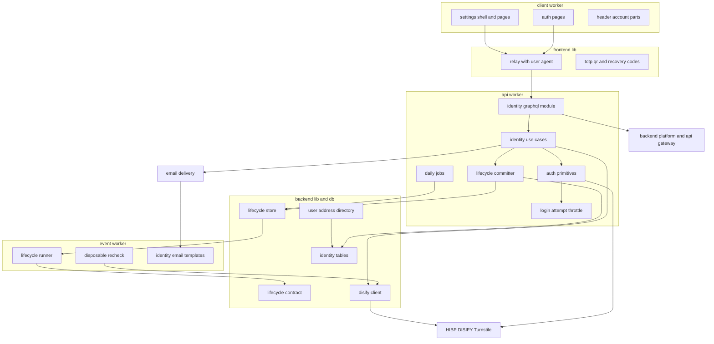

**Architecture Integration**:

- 選んだパターン: backend-platformの4層と合成ルートに従い、apiに主体に依存しない`auth`と利用者の`identity`の2つのモジュールを置く。eventからも使う部品(ライフサイクルイベントの型と記録・使い捨て判定・メールアドレスの照会口)だけを共有ディレクトリに置く。
- 境界: 本specは利用者のアカウントの状態と認証の判断を所有し、他ドメインのデータを直接変えない。他ドメインへの影響はライフサイクルイベントの登録口だけを通る。
- 既存パターンの維持: 処理単位のコンテナ、`@inject`の明示、登録箇所への追記、`AppError`と共通のエラー形式、`defineMessageContract`・`ScheduledJobDefinition`、`defineEmailKind`・`defineEmailTemplate`、`SiteLayoutSlots`。
- 新規コンポーネントの理由: research.mdの「Design Decisions」を参照。

### Dependency Direction

- 共有コード: `apps/db/schema/identity` → `backend-lib/core/identity`(zod・inversifyの型・`core`の他の部品だけ) → `backend-lib/workers/identity`(D1・`fetch`) → アプリの`src`。
- apiの`src`内: `domain/auth` ← `domain/identity` ← `application/auth` ← `application/identity` ← `infrastructure/{auth,identity}`・`presentation/graphql/modules/identity` ← `composition`。`application/identity`がセッションを受け取るときは、api-gatewayの`application/session/session-view.ts`の`SessionView`を読み込み、`presentation/gateway`の型(`SessionAccess`・`CallerKind`)を読み込まない(backend-platformの層の規則)。`auth`の各層は`identity`の各層を読み込まない(admin-foundationが`identity`無しで再利用できるように)。違反はapiの`eslint.config.ts`の`no-restricted-imports`で検出する。
- eventの`src`内: `application/identity` ← `infrastructure/identity` ← `composition`。テンプレートはemail-deliveryの規則どおり`infrastructure/email/templates/`だけがReactを読み込む。
- clientの`src`内: frontend-platformの規則(`composition` ← `components` ← `routes`)に従う。`components/auth`・`components/settings`は`graphql/operations/identity`を読み込んでよい。
- `apps/common-lib/identity`は`apps/common-lib`の他の部品だけを読み込み、zod・React・Workersに依存しない。

### Technology Stack

| Layer        | Choice / Version                                                                     | Role in Feature                                          | Notes                                                         |
| ------------ | ------------------------------------------------------------------------------------ | -------------------------------------------------------- | ------------------------------------------------------------- |
| 暗号         | Web Crypto(PBKDF2・HMAC-SHA512・SHA-1・HKDF-SHA-256・AES-256-GCM・`getRandomValues`) | パスワード・秘密・TOTPの秘密鍵の保護、漏洩照合の前処理   | パッケージ不要。PBKDF2は10万回(workerdの上限)                 |
| TOTP         | otpauth 9.5.2                                                                        | TOTPの秘密鍵の生成・`otpauth://`のURI・照合              | 新規。apiだけ。依存の`@noble/hashes` 2.4.0は純粋なJavaScript  |
| QRコード     | uqr 0.1.3                                                                            | URIをセルの行列にし、SVG要素で描画                       | 新規。frontend-lib・client・adminで同じ版                     |
| 端末情報     | bowser 2.14.1                                                                        | User-Agentからブラウザ名とOS名を得る                     | 新規(Q6)。apiだけ                                             |
| 外部サービス | HIBP Pwned Passwords range API・DISIFY API・Cloudflare Turnstile                     | 漏洩パスワード照合・使い捨て判定・bot判定                | `fetch`で直接呼ぶ。Turnstileはbackend-platformの`BotVerifier` |
| 状態         | Cloudflare D1(drizzle-orm 1.0.0-rc.5)・Durable Objects(SQLite、`ctx.storage.kv`)     | アカウント・セッション・トークン・イベント、ログイン試行 | 新しいテーブル8つ、新しいDurable Objectのクラス1つ            |
| 非同期・定期 | Cloudflare Queues(本体`JOBS_QUEUE`)・Cron Triggers(api)                              | 非同期の波及処理・判定し直し、日次のジョブ               | backend-platformの基盤。新しいQueueは作らない                 |
| メール       | email-deliveryの`EmailSender`・React Email                                           | 認証系の7種のトランザクションメール                      | 既存                                                          |
| 画面         | TanStack Start・React・react-hook-form・zod・shadcn/ui・`@marsidev/react-turnstile`  | 認証画面・設定ページ・ヘッダーの区画                     | frontend-platformの版                                         |
| サーバー     | hono 4.13.13・inversify 8.2.3・graphql-yoga 5.24.1・zod 4.6.5                        | GraphQLのモジュール・DI・入力の検証                      | 上流の版                                                      |
| テスト       | bun test・vitest 4.1.11(Workers・Browser)・Playwright 1.64.1・Mailpit 1.32.0         | 単体・Workers統合・ブラウザ・E2E                         | 上流の版。E2EはMailpitのAPIでメールを読む                     |

## File Structure Plan

### Directory Structure

```
apps/
├── db/schema/identity/                                 # 利用者アカウントのテーブル定義(各ファイルに同名の*.unit.test.ts)
│   ├── users.ts                                        # 利用者(メール・パスワードのハッシュ・ニックネーム・ハンドル・仮名化ID・状態・確認・使い捨て判定・規約同意・版)
│   ├── user-sessions.ts                                # セッション(識別子のハッシュ・User-Agent・最終利用・絶対期限)
│   ├── user-auth-tokens.ts                             # 認証系トークン(用途・ハッシュ・期限・変更先のメール・保留中のパスワードのハッシュ)
│   ├── user-login-challenges.ts                        # パスワード照合後の第2要素の待ち(ハッシュ・期限)
│   ├── user-totp-credentials.ts                        # TOTPの暗号化した秘密鍵・有効化日時・保留の期限・最後の時間窓
│   ├── user-recovery-codes.ts                          # リカバリコードのハッシュ
│   ├── user-lifecycle-events.ts                        # ライフサイクルイベント(種類・状態・送信の回数と日時)
│   ├── user-lifecycle-handler-runs.ts                  # 完了した非同期の波及処理
│   ├── visibility.ts                                   # visibleUsers・verifiedUsers(絞り込み条件)
│   └── index.ts                                        # identityのテーブルの集約(schema/index.tsから再エクスポート)
├── common-lib/identity/
│   ├── account-input-rules.ts                          # ニックネーム・メール・パスワードの上限の定数と判定(書記素の数え方はcommon-libの部品)
│   └── account-input-rules.unit.test.ts
├── backend-lib/
│   ├── core/identity/                                  # api・eventが共有する純粋な部品(各ファイルに同名の*.unit.test.ts)
│   │   ├── user-lifecycle.ts                           # イベントの型・非同期の波及処理の契約と登録・名前の検証・再試行の方針
│   │   └── disposable-email.ts                         # ダミーのローカル部への置き換えと判定結果の分類
│   ├── core/messaging/contracts/identity.ts            # identity.run-user-lifecycle・identity.recheck-disposable-email
│   ├── core/email/kinds/identity.ts                    # 認証系の7つのメール種別
│   └── workers/identity/                               # D1と外部サービス(apiのWorkers統合テスト、各ファイルに同名の*.worker.test.ts)
│       ├── disify-client.ts                            # DisposableEmailCheckerのDISIFY実装
│       ├── d1-user-address-directory.ts                # UserAddressDirectoryのD1実装(email-deliveryの照会口)
│       ├── identity-platform-types.ts                  # IDENTITY_PLATFORM_TYPES(api・event共通の識別子、テストなし)
│       ├── user-contact-directory.ts                   # UserContact・UserContactDirectory(後続specの連絡先の照会、テストなしの型)
│       ├── d1-user-contact-directory.ts                # UserContactDirectoryのD1実装
│       ├── account-export.ts                           # AccountExportRecord・AccountExport(データエクスポートのアカウントの部分、テストなしの型)
│       ├── d1-account-export.ts                        # AccountExportのD1実装
│       ├── admin-user-directory.ts                     # AdminUserDirectory・D1AdminUserDirectory(ugc-moderationの管理画面の利用者の照会、仮7)
│       ├── identity-platform-module.ts                 # api・event共通の束縛(IDENTITY_PLATFORM_MODULE)
│       └── user-lifecycle-store.ts                     # イベントと完了の記録の読み書き
├── api/src/
│   ├── domain/auth/                                    # 主体に依存しない純粋な規則(Bunの単体テスト)
│   │   ├── password-rules.ts                           # 長さ(コードポイント)と識別子との一致
│   │   ├── login-throttle-state.ts                     # 失敗回数・クールダウン・記録の削除の状態遷移
│   │   ├── session-policy.ts                           # SessionPolicy・有効期限の判定・Cookieの有効期間
│   │   ├── recovery-code-format.ts                     # リカバリコードの文字・形式・入力の正規化
│   │   └── second-factor.ts                            # 認証コードとリカバリコードの入力の型と正規化
│   ├── domain/identity/                                # 利用者の規則(Bunの単体テスト)
│   │   ├── user-account.ts                             # 状態・可視・書き込みの可否・本人の例外
│   │   ├── handle.ts                                   # 登録時に生成する初期ハンドルの形式(ハンドルの規則はuser-profile-socialが所有)
│   │   └── auth-token-purpose.ts                       # 用途と有効期限・失効させる用途の組
│   ├── application/auth/                               # 主体に依存しないポートとサービス(Bunの単体テスト)
│   │   ├── auth-types.ts                               # AUTH_TYPES
│   │   ├── ports.ts                                    # PasswordHasher・PwnedPasswordChecker・SecretGenerator・SecretBox・TotpAuthenticator・LoginThrottle・AuthIncidentReporter
│   │   ├── password-policy.ts                          # 規則と漏洩照合の組み合わせ
│   │   ├── secret-issuer.ts                            # 高エントロピーの秘密の発行とハッシュ化
│   │   ├── recovery-code-issuer.ts                     # リカバリコードの発行と入力のハッシュ化
│   │   ├── login-throttle-keys.ts                      # メールとIPからハッシュ化済みキーを作る
│   │   └── subject-session-verifier.ts                 # SessionVerifierの主体別の振り分け
│   ├── application/identity/                           # 利用者のユースケース(Bunの単体テスト)
│   │   ├── identity-types.ts                           # IDENTITY_TYPES
│   │   ├── ports.ts                                    # 各ストア・メール・端末情報・ハンドルの重複判定・設定値
│   │   ├── request-meta.ts                             # RequestMeta
│   │   ├── session-issuer.ts                           # セッションの発行と、重要な操作の後の再発行
│   │   ├── user-session-verifier.ts                    # 利用者のセッションの検証
│   │   ├── account-guard.ts                            # ログイン・状態・確認の判定(他specも使う)
│   │   ├── account-uploader-eligibility.ts             # media-pipelineのUploaderEligibilityの実装(停止中・退会済みを拒否)
│   │   ├── registration.ts                             # 登録
│   │   ├── email-verification.ts                       # 確認と再送
│   │   ├── disposable-email-check.ts                   # 確認時の判定と、判定し直しの依頼
│   │   ├── mail-send-limits.ts                         # FR-RLMIT-001の回数制限
│   │   ├── login.ts                                    # パスワードと第2要素のログイン、ログアウト
│   │   ├── re-authenticator.ts                         # 重要な操作の本人確認
│   │   ├── session-management.ts                       # 一覧と失効
│   │   ├── password-reset.ts                           # 要求と完了
│   │   ├── email-change.ts                             # 要求と確定
│   │   ├── password-change.ts                          # 要求と確定
│   │   ├── totp-management.ts                          # 開始・有効化・無効化・再発行
│   │   ├── withdrawal.ts                               # 退会と、運営者による退会と共通の確定の処理(commitWithdrawal)
│   │   ├── administrative-withdrawal.ts                # 運営者による退会の操作口(ugc-moderationが管理者側の経路から呼ぶ)
│   │   ├── user-suspension.ts                          # 停止・停止解除の操作口(ugc-moderationが呼ぶ)
│   │   └── jobs/
│   │       ├── purge-orchestrator-job.ts               # 物理削除の開始・未完了の再実行・期限超過の通知(order 100)
│   │       ├── credential-cleanup-job.ts               # 期限切れのセッション・トークン・待ち・保留の削除(order 110)
│   │       └── disposable-recheck-sweep-job.ts         # 未判定の判定し直しの依頼(order 120)
│   ├── infrastructure/auth/                            # Workers統合テスト
│   │   ├── pbkdf2-password-hasher.ts
│   │   ├── hibp-pwned-password-checker.ts
│   │   ├── login-attempt-throttle.ts                   # Durable Objectのクラス
│   │   ├── durable-login-throttle.ts                   # LoginThrottleの実装(2つのDurable Objectへの呼び出し)
│   │   ├── otpauth-totp-authenticator.ts
│   │   ├── hkdf-aes-gcm-secret-box.ts
│   │   ├── crypto-secret-generator.ts
│   │   └── sentry-auth-incident-reporter.ts
│   ├── infrastructure/identity/                        # Workers統合テスト
│   │   ├── d1-user-account-store.ts
│   │   ├── d1-user-session-store.ts
│   │   ├── d1-auth-token-store.ts
│   │   ├── d1-login-challenge-store.ts
│   │   ├── d1-totp-credential-store.ts
│   │   ├── d1-recovery-code-store.ts
│   │   ├── d1-handle-availability.ts                   # 既定のハンドルの重複判定(usersの全行)
│   │   ├── user-lifecycle-sync-handler.ts              # 同期の波及処理の契約(他specが実装)
│   │   ├── d1-user-lifecycle-committer.ts              # 版の検査・状態の遷移・同期の波及処理・イベントの記録の一括の書き込み
│   │   ├── email-identity-mailer.ts                    # 7種のメールの送信要求とリンクのURL
│   │   └── bowser-device-describer.ts                  # User-Agentからブラウザ名とOS名
│   ├── presentation/graphql/modules/identity/          # スキーマモジュール(Workers統合テスト)
│   │   ├── type-defs.ts
│   │   ├── inputs.ts                                   # 入力のzodスキーマ(common-libの規則)
│   │   ├── errors.ts                                   # AppErrorの生成とエラーコード・文言
│   │   ├── resolver-support.ts                         # 呼び出し元の確認・RequestMetaの組み立て・セッションの指示
│   │   ├── account-resolvers.ts                        # 登録・確認・ログイン・リセット・変更・退会・viewer
│   │   ├── session-resolvers.ts                        # セッションの一覧と失効
│   │   ├── totp-resolvers.ts                           # 多要素認証
│   │   └── index.ts                                    # identitySchemaModule
│   └── composition/
│       ├── identity-module.ts                          # AUTH・IDENTITYの束縛(AppModule)
│       ├── identity-registrations.ts                   # HANDLE_AVAILABILITY(user-profile-socialが差し替える)
│       └── user-lifecycle-sync-handlers.ts             # USER_LIFECYCLE_SYNC_HANDLERS(他specが追記、初版は空)
├── event/src/
│   ├── application/identity/                           # Bunの単体テスト
│   │   ├── event-identity-types.ts                     # EVENT_IDENTITY_TYPES
│   │   ├── ports.ts                                    # LifecycleHandlerResolver・IdentityPurgeStore・DisposableStatusStore・LifecycleIncidentReporter
│   │   ├── user-lifecycle-runner.ts                    # identity.run-user-lifecycleの処理
│   │   ├── email-suppression-cleanup-handler.ts        # 退会時の抑止記録の削除(非同期の波及処理)
│   │   └── disposable-email-recheck-handler.ts         # identity.recheck-disposable-emailの処理
│   ├── infrastructure/identity/                        # eventのWorkers統合テスト
│   │   ├── d1-identity-purge-store.ts                  # 利用者自身の行の物理削除
│   │   ├── d1-disposable-status-store.ts               # 判定し直しの対象の読み取りと結果の保存
│   │   └── sentry-lifecycle-incident-reporter.ts
│   ├── infrastructure/email/templates/identity/        # 7種のテンプレート(本文の*.tsxと定義の*-template.ts)
│   └── composition/
│       ├── identity-module.ts                          # 束縛(SuppressionMaintenance・UserAddressDirectoryを含む)
│       └── user-lifecycle-async-handlers.ts            # USER_LIFECYCLE_ASYNC_HANDLERS(他specが追記)
├── frontend-lib/components/auth/                       # 管理者側も使う画面部品(*.browser.test.tsx・*.stories.tsxを併置)
│   ├── totp-qr-code.tsx                                # uqrのセルの行列をSVG要素で描画
│   ├── recovery-code-list.tsx                          # リカバリコードの一覧・コピー・保管の注意
│   └── password-input.tsx                              # 表示・非表示を切り替えるパスワードの入力欄
├── frontend-lib/components/ui/checkbox.tsx             # shadcn/uiのCheckbox(登録の同意で使い、paymentsの決済の同意が再利用する。stories・browser testを併置)
└── client/src/
    ├── routes/
    │   ├── auth/register.tsx · login.tsx · verify-email.tsx
    │   ├── auth/password-reset/index.tsx · confirm.tsx
    │   ├── auth/email-change/confirm.tsx
    │   ├── auth/password-change/confirm.tsx
    │   └── _authenticated/                             # ログイン必須の経路の無いレイアウト(他specも配下に置く)
    │       ├── route.tsx                               # beforeLoadでログインを確かめ、文脈にviewerを渡す
    │       └── settings/route.tsx · index.tsx · account.tsx · security.tsx
    ├── components/auth/                                # 認証画面の部品(*.browser.test.tsxを併置)
    │   ├── register-form.tsx · login-form.tsx · second-factor-form.tsx
    │   ├── password-reset-request-form.tsx · new-password-form.tsx
    │   ├── link-confirmation.tsx                       # メールのリンクの画面の確定ボタンと結果
    │   ├── login-required-dialog.tsx                   # ログインが必要な操作の案内(他specが内容を渡す)
    │   ├── account-form-schemas.ts                     # フォームのzodスキーマ(common-libの規則)
    │   ├── return-path.ts                              # 同じサイト内のパスだけを戻り先にする
    │   └── fragment-token.ts                           # URLのフラグメントからトークンを読む
    ├── components/layout/
    │   ├── account-menu.tsx                            # headerAccount(未ログインはログイン・登録、ログイン中はユーザーメニュー)
    │   ├── launch-action.tsx                           # headerLaunchAction
    │   └── verify-email-banner.tsx                     # belowHeader(メールアドレス未確認の帯)
    ├── components/settings/
    │   ├── settings-shell.tsx · settings-navigation.tsx
    │   ├── reauthentication-fields.tsx                 # 現在のパスワードと第2要素の入力欄
    │   ├── email-change-section.tsx · password-change-section.tsx · withdrawal-section.tsx
    │   ├── session-list-section.tsx
    │   └── totp-section.tsx · totp-setup-dialog.tsx · recovery-codes-dialog.tsx
    ├── composition/settings-navigation.ts              # SETTINGS_NAV_ITEMS(他specが追記)
    └── graphql/operations/identity/
        ├── viewer.ts                                   # ClientViewer・viewerQueryOptions
        ├── auth-operations.ts                          # 登録・ログイン・第2要素・ログアウト・確認・再送・リセット
        ├── account-operations.ts                       # メールアドレス・パスワードの変更と確定・退会
        ├── session-operations.ts                       # 一覧・個別と一括の失効
        └── totp-operations.ts                          # 多要素認証とリカバリコード
e2e/
├── support/mailpit.ts                                  # MailpitのAPIから宛先ごとの最新のメールとリンクを読む補助
└── client/auth/
    ├── registration.e2e.test.ts · login-and-sessions.e2e.test.ts · password-reset.e2e.test.ts
    └── account-settings.e2e.test.ts · totp.e2e.test.ts
docs/
├── GUIDES/tech/security/006-authentication.md          # 認証と認可の設計
├── GUIDES/tech/external/004-pwned-passwords.md · 005-disposable-email-check.md · 006-turnstile.md
└── GUIDES/tech/backend/007-user-lifecycle-events.md
```

テストファイルは同名の`*.unit.test.ts`(`domain`・`application`・`core`・`common-lib`・`db/schema`)、`*.worker.test.ts`(`infrastructure`・`presentation`・`composition`・`workers`)、`*.browser.test.tsx`(画面部品)を対象ファイルの隣に置く。文書の番号は、Wave 1の割り当て(infra-delivery→content-processing→media-pipeline→identity-authの順)で固定した`security/006`・`external/004`〜`006`・`backend/007`を使う。

### Modified Files

- `apps/db/schema/index.ts` — identityのテーブルを再エクスポートする。`apps/db/migrations/<日時>_identity_auth/migration.sql`を生成する(部分一意索引を含む)。マイグレーションはmainの最新を取り込んでから生成し、並行specのマイグレーションと番号やスナップショットが衝突したら生成し直す。
- `apps/backend-lib/core/messaging/contracts/index.ts` — 2つのメッセージ契約を`MESSAGE_CONTRACTS`へ加える。
- `apps/backend-lib/core/email/kinds/index.ts` — 7つのメール種別を`EMAIL_KINDS`へ加える。
- `apps/frontend-lib/server/relay/relay-contract.ts`・`relay-headers.unit.test.ts` — `FORWARDED_BROWSER_HEADERS`に`user-agent`を加え、ブラウザのUser-Agentが中継され、偽の内部ヘッダーは引き続き除かれることを確かめる。
- `apps/frontend-lib/package.json`・`apps/client/package.json`・`apps/admin/package.json`(各`bun.lock`) — `uqr` 0.1.3を版固定で加える。
- `apps/api/src/presentation/graphql/gateway-server.ts`・`graphql-context.ts`・`graphql-module.ts`(各テスト) — `userAgent`を要求から文脈へ渡す。
- `apps/api/src/application/session/session-view.ts`(新規、api-gatewayの契約への追記)・`apps/api/src/presentation/gateway/session-access.ts` — `SessionView`を定義し、`SessionAccess`が`SessionView`を拡張する形に改める。`SessionAccess`の形は変えない。既に`SessionView`があれば形を確かめるだけにする(横断レビューR3-1)。
- `apps/api/src/composition/session.ts` — `SESSION_BINDINGS`を`SubjectSessionVerifier`の振り分けへ差し替え、`AUTH_TYPES.UserSessionVerifier`・`AUTH_TYPES.AdminSessionVerifier`(既定は無効)を束縛する。
- `apps/api/src/composition/modules.ts`・`graphql-modules.ts`・`scheduled-jobs.ts`・`email-registrations.ts`・`env-schema.ts` — identityのモジュール、スキーマモジュール、3つのジョブ、`USER_ADDRESS_DIRECTORY`の差し替え、`CLIENT_SITE_ORIGIN`・`LOGIN_ATTEMPT_THROTTLE`・任意の`DISIFY_API_KEY`の検証を加える。
- `apps/api/src/composition/uploader-eligibility.ts`(media-pipelineが作る) — `UPLOAD_ACCESS_TYPES.UploaderEligibility`の束縛を、`AllowAllUploaderEligibility`から`IDENTITY_TYPES.AccountUploaderEligibility`への転送に差し替える。他の束縛は変えない(4.7)。
- `apps/api/src/index.ts` — `LoginAttemptThrottle`を名前付きでエクスポートする。
- `apps/api/wrangler.jsonc`・`worker-configuration.d.ts` — 3環境の`durable_objects.bindings`に`LOGIN_ATTEMPT_THROTTLE`、`migrations`に`LoginAttemptThrottle`のタグ、`vars`に`CLIENT_SITE_ORIGIN`を加え、型を生成し直す。
- `apps/api/package.json`・`bun.lock` — `otpauth` 9.5.2・`bowser` 2.14.1を版固定で加える。
- `apps/api/eslint.config.ts`・`test/config/layer-rules.unit.test.ts` — `auth`の各層から`identity`の各層へのimportを禁止する規則と違反例を加える。
- `apps/event/src/composition/modules.ts`・`message-handlers.ts`・`env-schema.ts` — identityのモジュール、2つのメッセージの処理、任意の`DISIFY_API_KEY`を加える。
- `apps/api/src/composition/modules.ts`・`apps/event/src/composition/modules.ts` — 両アプリの`MODULES`に`IDENTITY_PLATFORM_MODULE`(`UserContactDirectory`・`AccountExport`・`AdminUserDirectory`の束縛)を加える(spec横断レビュー、2026-10-23・2026-10-24)。
- `apps/event/src/infrastructure/email/templates/index.ts` — 7つのテンプレートを`EMAIL_TEMPLATES`へ加える。
- `apps/client/src/routes/__root.tsx` — `beforeLoad`で`viewer`を取得して文脈に入れる(取得の失敗は未ログインとして扱う)。
- `apps/client/src/composition/layout-slots.ts` — `headerAccount`・`headerLaunchAction`・`belowHeader`を本specの部品に差し替える。
- `docs/GUIDES/tech/{security,external,backend}/README.md` — 新しい文書を1行ずつ追記する。
- `docs/GUIDES/service/legal/001-compliance-policy.md` — データ保持期間の一覧にログイン試行の記録・ライフサイクルイベントの記録の行を加え、ログインセッションの削除方法を「アイドル期限または絶対期限の超過後」に直す。ログイン試行の記録の行は、infra-deliveryが書くDurable Objectsの保存場所の記述「保存場所は保証しない(レート制限のカウントなど、ハッシュ化した一時的な値)」と表現をそろえ、「ハッシュ化したキーと回数だけの一時的な値」とする。保存場所の記述と、プライバシーポリシー骨子の国外移転の記載事項のCloudflareの項(infra-deliveryが所有、横断レビューN-1)は書き換えない。
- `docs/GUIDES/service/legal/003-privacy-policy-outline.md` — 本specが使う委託先のDISIFY・Have I Been Pwnedへは個人を識別できる情報を渡さないため国外移転の対象外である旨が、infra-deliveryの「移転先の国」の行の改訂の後も残っていることを確かめ、無ければ両委託先の分だけ書き加える。Cloudflareの項(Turnstileを含む)と他の委託先の項は書き換えない(横断レビューN-1、roadmapの「国外移転の記載」)。
- `docs/GUIDES/service/overview/007-daily-timeline.md` — 「日次バッチ(4:21)の内容」のジョブの名前と順序の表に、本specの3つのジョブの名前と順序(100・110・120)の行を加える。表が無ければ作り、上流のemail-deliveryの`email-delivery.cleanup`(900)の行も含める(横断レビューN-3。想定の順序ではcontent-processingが先に作るが、表が無いことを理由に止めない)。
- `docs/GUIDES/service/design/002-page-layouts.md` — `/auth/*`の画面の一覧、設定ページのシェルの配置、ヘッダーのアカウント表示、停止中の設定ページ(退会だけを操作でき、セッションが切れた後は問い合わせで退会を依頼できる旨を案内する)を追記する。
- `docs/GUIDES/service/design/003-text-and-copy-rules.md` — 本specで追加するエラーメッセージ・状態の文言(停止中の設定ページの案内を含む)と、認証系メールの本文の要点を追記する。`forbidden`の「この操作はできません。」は、roadmapの順で先に実装されるmedia-pipelineのタスク9.2が追加する。本specは既にあることを確かめるだけにし、無い場合だけ追記する(横断レビューR3-8)。
- `docs/onboardings/tech-stack.md` — OTPAuth・uqr・`bowser`の版を記載する。
- `docs/GUIDES/tech/coding/002-dependency-versions.md` — `uqr`をfrontend-lib・client・adminで版をそろえる一覧に、`otpauth`・`bowser`をapiの一覧に加える。
- `docs/onboardings/project-values.md` — Durable Objectのバインディング名とクラス名、`CLIENT_SITE_ORIGIN`の値(content-processingが記載した行があれば、APIサーバーも同じ値を使う旨を加える)、TOTPの発行者名、ジョブの名前と順序、メール種別の名前を記載する。シークレットのキーの一覧の節(正は本ファイル。infra-deliveryのタスク8.5が作る)には、`DISIFY_API_KEY`(api・event、任意)の行を、キーを読む変更(タスク8.1)と同じ変更で足す。行があれば食い違いを確かめるだけにし、節が無ければ開発者へ報告する(横断レビューN-5。infra-deliveryはroadmapの依存に無いため、N-2と同じ扱い)。
- `docs/onboardings/README.md` — 任意のシークレット`DISIFY_API_KEY`のInfisical(staging環境)への登録の手順(stagingの値は、そのキーを読む本specの変更をmainへマージする前に開発者が登録する)と、prodの値はlaunch-readinessがリリース時に登録する旨、E2EテストでのMailpitの使い方を記載する。
- `CLAUDE.md` — 「技術規則の参照先」に、認証を要する処理・ライフサイクルの波及処理を書く前に読む文書(`security/006`・`backend/007`)へのリンクを加える。

## System Flows

### 登録とメールアドレスの確認

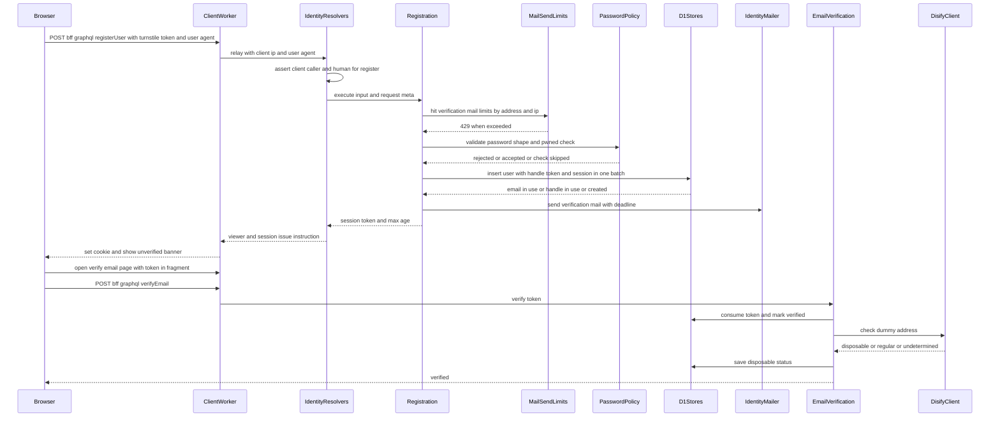

- 登録の送信回数(初回の確認メール)を先に数え、上限なら利用者を作らずに429で応答する(2.7)。
- ハンドルの重複は事前に`HandleAvailability`で確かめ、同時の作成による一意制約の違反は最大5回まで新しいハンドルで作り直す(1.6)。
- 判定が「未判定」なら、15分後の判定し直しのメッセージを送り、さらに日次のジョブが拾う(3.3)。

### ログイン

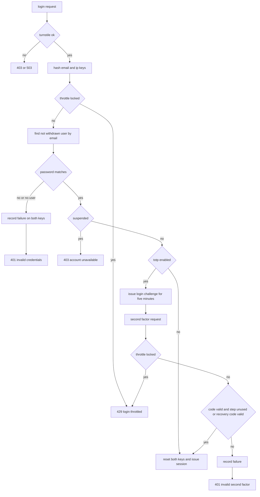

- 利用者が見つからないときもダミーのPBKDF2を計算し、応答時間で登録の有無を推測させない(6.3)。
- 停止中の利用者はパスワードが一致した場合だけ停止を伝える。失敗として数えず、記録も消さない(6.4)。
- 第2要素の段階の要求は、パスワードの段階で発行した待ちの値(5分)と組で受け付ける。待ちの値は成功時に消す(6.2)。

### ログイン試行の記録の状態遷移

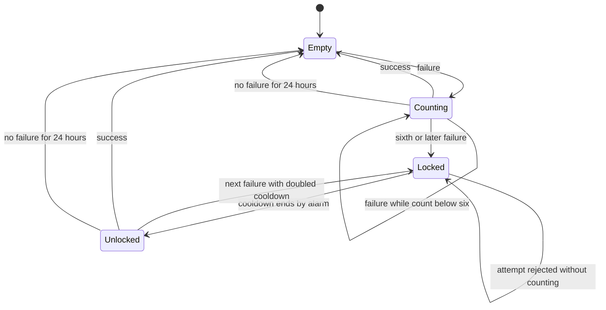

- クールダウンの長さは`min(1秒 × 2^(失敗回数 − 6), 300秒)`で、ロックの解除では失敗回数を残す(7.2〜7.4)。
- メールアドレス単位とIPアドレス単位は別のDurable Objectで、ログインの1回の試行は両方を確かめ、両方に記録する(7.1)。

### 重要な操作とセッションの再発行

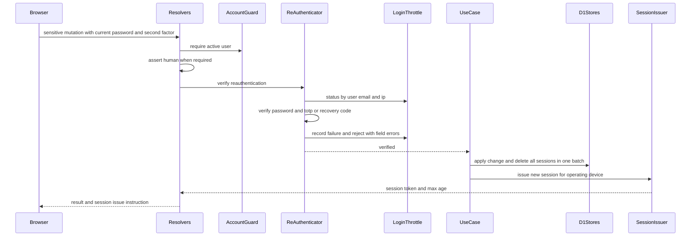

- メールアドレス変更・パスワード変更は、要求の段階で本人確認を行い、メールのリンクの確定の段階でセッションを入れ替える。確定の操作をした端末が同じ利用者としてログイン中である場合だけ新しいセッションを発行する(10.7・11.4)。
- 退会は全セッションの削除とCookieの削除だけを行う(15.1)。
- 停止中の利用者からは、重要な操作のうち退会だけを受け付ける。退会は`AccountGuard.requireUser`で確かめ、他の重要な操作は`requireWritableUser`で停止中を拒否する(4.4・仮5)。

### 運営者による退会

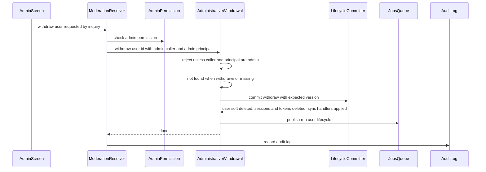

- 図のうち`ModerationResolver`・`AdminPermission`・`AuditLog`と管理画面は、ugc-moderation・admin-foundationが所有する。本specは`AdministrativeWithdrawal`だけを提供し、利用者側のGraphQLの操作は加えない(15.7・15.8)。
- 退会の確定は、利用者本人の退会と同じ`commitWithdrawal`(`UserLifecycleCommitter.commit({ kind: 'withdraw' })`と`identity.run-user-lifecycle`の送信)を通す。そのため、同期と非同期の波及処理・抑止記録の削除・物理削除の時期は本人の退会と変わらない(15.7)。停止中の利用者のセッションが残っていれば、同じ一括の書き込みで消える。
- 本人確認とbot判定は求めない。誤った対象の退会は取り消せないため、問い合わせでの本人の確かめと権限の確認・監査ログは呼び出し側が行う。

### アップロードできる利用者の判定

- media-pipelineの`UploadRoute`は、利用者側の要求で主体の種類を確かめた後、本文を読む前に`UPLOAD_ACCESS_TYPES.UploaderEligibility`を処理単位のコンテナから解決して呼ぶ。本specの`AccountUploaderEligibility`は`AccountGuard.currentUser(session)`で利用者を読み、`checkAccountWritable(user, { requireVerifiedEmail: false })`(`AccountGuard.requireWritableUser`と同じ規則)で、停止中・退会済みの利用者を`account_unavailable`で拒否する(4.7)。
- メールアドレスが確認済みでない利用者は拒否しない(`email_not_verified`を返さない)。要件定義書の未確認時の制限(FR-USER-006)にアップロードは無く、制限のある操作(プロダクトの投稿など)へのファイルの紐付けは、各ドメインspecの保存が`requireVerifiedUser`で拒否するためである。
- 拒否の応答(403)と、管理者側の経路・動作確認の経路で判定を呼ばないことはmedia-pipelineが行う。拒否した要求ではファイルも記録も作られない。

### ユーザーライフサイクルイベント

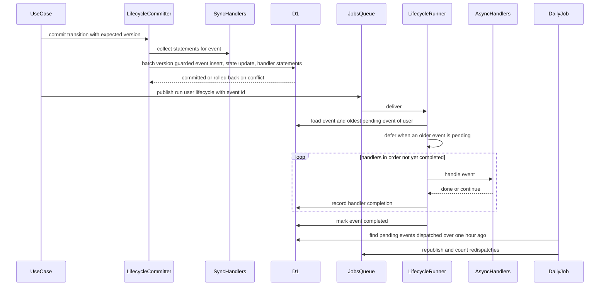

- 同期の波及処理の文は、版の検査を兼ねたイベントの挿入の後に並べる。版が変わっていれば挿入がNOT NULL制約に違反し、状態の更新と波及処理の文も含めて取り消される(16.2)。
- 非同期の波及処理が例外を投げたら、backend-platformの再試行(5回、300秒から倍、上限3600秒)に任せる。`continue`は5秒後の遅延の再送で続ける(16.5・16.7)。
- 送信に失敗してもイベントは`pending`のまま残り、日次のジョブが送り直す(16.6)。

### 物理削除

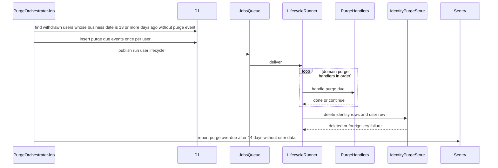

- 業務日付で13日以上前に退会した利用者を対象にし、14日の期限まで少なくとも19時間39分の再試行の余地を残す(17.1)。
- 利用者の行を最後に消す。他specの行が外部キーで残っていれば削除が失敗し、イベントが`pending`のまま残って検知される(17.3)。
- 外部キーによる取り残しの検出は、外部キーを持たないmedia-pipelineの`media_files`(`owner_id`)を見ない。ユーザーが保有するファイルの物理削除はuser-profile-socialが登録する`purge_due`の非同期の波及処理が行い、その完了まではイベントが`pending`に残るため、失敗は期限超過の通知(17.4)で検知される。波及処理が完了を返した後のファイルの取り残しの検出は、その波及処理とmedia-pipelineの責任とする。

## Requirements Traceability

| Requirement                              | Summary                                      | Components                                                                                                               | Interfaces                                                               | Flows                          |
| ---------------------------------------- | -------------------------------------------- | ------------------------------------------------------------------------------------------------------------------------ | ------------------------------------------------------------------------ | ------------------------------ |
| 1.1, 1.2, 1.3, 1.4, 1.5, 1.8             | 登録と入力の検証・同意・重複                 | Registration、AccountInputRules、IdentityInputs、UserAccountStore、IdentitySchema、RegisterForm                          | `registerUser`、`Registration.execute`                                   | 登録とメールアドレスの確認     |
| 1.6, 1.7                                 | ハンドルと仮名化ID                           | Registration、InitialHandleFormat、HandleAvailability、SecretGenerator、IdentitySchema                                   | `HandleAvailability.isAvailable`、`SecretGenerator.handle`               | 登録とメールアドレスの確認     |
| 2.1, 2.2, 2.3, 2.4, 2.9                  | 確認メール・確定・再送                       | EmailVerification、AuthTokenStore、IdentityMailer、LinkConfirmation、VerifyEmailBanner                                   | `verifyEmail`・`resendVerificationEmail`                                 | 登録とメールアドレスの確認     |
| 2.5, 2.6, 2.7, 2.8, 2.10                 | 送信回数の制限                               | MailSendLimits、RateLimitCounterClient(上流)                                                                             | `MailSendLimits.consume`                                                 | 登録とメールアドレスの確認     |
| 3.1, 3.2, 3.3, 3.4, 3.5, 3.6             | 使い捨て判定と判定し直し                     | DisposableEmailCheck、DisifyClient、DisposableEmailRecheckHandler、DisposableRecheckSweepJob                             | `DisposableEmailChecker.check`、`identity.recheck-disposable-email`      | 登録とメールアドレスの確認     |
| 4.1, 4.2, 4.3, 4.4, 4.5, 4.6             | 機能制限と可視ユーザー                       | AccountGuard、UserAccountRules、IdentityVisibility、Withdrawal、SettingsShell、SessionViewContract                       | `AccountGuard`、`visibleUsers`・`verifiedUsers`                          | —                              |
| 4.7                                      | アップロードできる利用者の判定               | AccountUploaderEligibility、UserAccountRules、ApiIdentityComposition、SessionViewContract                                | media-pipelineの`UploaderEligibility`                                    | アップロードできる利用者の判定 |
| 5.1, 5.2, 5.3, 5.4, 5.5, 5.6             | パスワードの規則・漏洩照合・保存             | PasswordRules、PasswordPolicy、HibpPwnedPasswordChecker、Pbkdf2PasswordHasher、AccountInputRules                         | `PasswordPolicy.validateNewPassword`、`PasswordHasher`                   | 登録とメールアドレスの確認     |
| 6.1, 6.2, 6.3, 6.4, 6.5, 6.6, 6.7, 6.8   | ログイン・第2要素・ログアウト                | Login、LoginChallengeStore、TotpAuthenticator、RecoveryCodeIssuer、SessionIssuer、LoginForm、ReturnPath、ResolverSupport | `login`・`completeSecondFactorLogin`・`logout`                           | ログイン                       |
| 7.1, 7.2, 7.3, 7.4, 7.5, 7.6, 7.7, 7.8   | ログイン試行の記録                           | LoginThrottleState、LoginAttemptThrottle、DurableLoginThrottle、LoginThrottleKeys                                        | `LoginThrottle`                                                          | ログイン試行の記録の状態遷移   |
| 7.9, 7.10                                | 第2要素・本人確認の失敗とbot判定             | Login、ReAuthenticator、ResolverSupport                                                                                  | `GraphQLContext.assertHuman`                                             | ログイン                       |
| 8.1, 8.2, 8.3                            | セッションの発行・有効期限・延長             | SessionIssuer、SessionPolicy、UserSessionVerifier、SubjectSessionVerifier、UserSessionStore                              | `SessionVerifier.verify`、`SessionAccess.issue`                          | —                              |
| 8.4, 8.5, 8.6, 8.7, 8.9                  | 一覧と失効・端末情報                         | SessionManagement、BowserDeviceDescriber、SessionListSection、UserAgentRelay                                             | `mySessions`・`revokeSession`・`revokeOtherSessions`                     | —                              |
| 8.8                                      | 期限切れのセッションの削除                   | CredentialCleanupJob                                                                                                     | `ScheduledJobDefinition`                                                 | —                              |
| 9.1, 9.2, 9.3, 9.4, 9.5, 9.6             | パスワードリセット                           | PasswordReset、MailSendLimits、AuthTokenStore、UserAccountStore、IdentityMailer、AuthRoutes                              | `requestPasswordReset`・`resetPassword`                                  | —                              |
| 10.1, 10.2, 10.3, 10.4, 10.5, 10.6, 10.7 | メールアドレス変更                           | EmailChange、ReAuthenticator、MailSendLimits、UserAccountStore、SessionIssuer、EmailChangeSection                        | `requestEmailChange`・`confirmEmailChange`                               | 重要な操作とセッションの再発行 |
| 11.1, 11.2, 11.3, 11.4, 11.5             | パスワード変更                               | PasswordChange、ReAuthenticator、AuthTokenStore、SessionIssuer、PasswordChangeSection                                    | `requestPasswordChange`・`confirmPasswordChange`                         | 重要な操作とセッションの再発行 |
| 12.1, 12.2, 12.3                         | 本人確認                                     | ReAuthenticator、ReauthenticationFields                                                                                  | `ReAuthenticationInput`                                                  | 重要な操作とセッションの再発行 |
| 12.4, 12.5, 12.6                         | bot判定の適用                                | ResolverSupport、BotVerifier(上流)、TurnstileWidget(上流)                                                                | `assertHuman(action)`                                                    | —                              |
| 13.1, 13.2, 13.3, 13.4, 13.5, 13.6, 13.7 | 多要素認証の設定とリカバリコード             | TotpManagement、OtpauthTotpAuthenticator、HkdfAesGcmSecretBox、RecoveryCodeIssuer、TotpCredentialStore                   | `startTotpSetup`・`enableTotp`・`disableTotp`・`regenerateRecoveryCodes` | 重要な操作とセッションの再発行 |
| 13.8, 13.9, 13.10                        | 残数の表示・保管の注意・秘密鍵の保護         | TotpSection、RecoveryCodeList、TotpQrCode、HkdfAesGcmSecretBox                                                           | `Viewer.remainingRecoveryCodes`                                          | —                              |
| 14.1, 14.2, 14.3, 14.4, 14.7             | 認証系トークンの発行・期限・無効・送信期限   | SecretIssuer、AuthTokenPurpose、AuthTokenStore、IdentityMailer、FragmentToken、LinkConfirmation                          | `AuthTokenStore.replace`・`consume`                                      | —                              |
| 14.5                                     | 期限切れのトークンの削除                     | CredentialCleanupJob                                                                                                     | `ScheduledJobDefinition`                                                 | —                              |
| 14.6                                     | 7種のメール                                  | IdentityEmailKinds、IdentityEmailTemplates、IdentityMailer                                                               | `EmailSender.send`                                                       | —                              |
| 15.1, 15.2, 15.3, 15.4, 15.5, 15.6       | 退会                                         | Withdrawal、UserLifecycleCommitter、EmailSuppressionCleanupHandler、WithdrawalSection                                    | `withdraw`                                                               | ユーザーライフサイクルイベント |
| 15.7, 15.8, 15.9                         | 運営者による退会                             | AdministrativeWithdrawal、Withdrawal(`commitWithdrawal`)、UserLifecycleCommitter、EmailSuppressionCleanupHandler         | `AdministrativeWithdrawal.withdraw`                                      | 運営者による退会               |
| 15.10                                    | 停止中の設定ページの退会の案内               | SettingsShell・設定セクション                                                                                            | —                                                                        | —                              |
| 16.1, 16.2, 16.3, 16.4, 16.5, 16.6, 16.7 | ライフサイクルイベント                       | UserLifecycleContract、UserLifecycleCommitter、UserLifecycleStore、UserLifecycleRunner、PurgeOrchestratorJob             | `UserLifecycleSyncRegistration`・`UserLifecycleAsyncRegistration`        | ユーザーライフサイクルイベント |
| 16.8, 16.9, 16.10                        | 停止・停止解除の操作口                       | UserSuspension、UserLifecycleCommitter                                                                                   | `UserSuspension.suspend`・`unsuspend`                                    | ユーザーライフサイクルイベント |
| 17.1, 17.2, 17.3, 17.4, 17.5, 17.6       | 物理削除                                     | PurgeOrchestratorJob、UserLifecycleRunner、IdentityPurgeStore                                                            | `purge_due`、`IdentityPurgeStore.purge`                                  | 物理削除                       |
| 18.1, 18.2, 18.3, 18.4, 18.5             | 認証画面とヘッダー・帯                       | AuthRoutes、AccountMenu、LaunchAction、VerifyEmailBanner、ClientViewer                                                   | `SiteLayoutSlots`、`viewer`                                              | —                              |
| 18.6, 18.7, 18.8, 18.9                   | 設定ページのシェル・ログイン必須・確定・案内 | SettingsShell、AuthenticatedLayout、SettingsNavigationRegistry、LinkConfirmation、LoginRequiredDialog                    | `SETTINGS_NAV_ITEMS`、`_authenticated`                                   | —                              |
| 18.10, 18.11                             | 入力の検証・アクセシビリティ                 | AccountFormSchemas、AccountInputRules、各フォーム、PasswordInput                                                         | `useAppForm`                                                             | —                              |
| 19.1, 19.2, 19.3                         | 認証部品の共通化                             | AuthPorts、PasswordPolicy、SecretIssuer、SessionPolicy、LoginThrottle、TotpAuthenticator、RecoveryCodeIssuer             | `AUTH_TYPES`                                                             | —                              |
| 19.4, 19.5                               | セッションの役割分担と主体別の検証           | SubjectSessionVerifier、ApiIdentityComposition                                                                           | `SESSION_BINDINGS`、`AUTH_TYPES.AdminSessionVerifier`                    | —                              |
| 20.1, 20.2, 20.3                         | テスト                                       | 各テスト、E2E(MailpitSupport)                                                                                            | —                                                                        | —                              |
| 20.4, 20.5, 20.6, 20.7                   | 技術ドキュメントと関連文書                   | IdentityDocs                                                                                                             | —                                                                        | —                              |
| 4.8                                      | 後続specへの利用者の連絡先の照会             | UserContactDirectory、D1UserContactDirectory、IdentityPlatformModule                                                     | `UserContactDirectory.findContact`                                       | —                              |
| 4.9                                      | データエクスポートのアカウントの部分の照会   | AccountExport、D1AccountExport、IdentityPlatformModule                                                                   | `AccountExport.find`                                                     | —                              |
| 4.10                                     | 管理画面の利用者の検索・一覧の照会(仮7)      | AdminUserDirectory、D1AdminUserDirectory、IdentityPlatformModule                                                         | `AdminUserDirectory`                                                     | —                              |
| 1.1, 1.2, 1.3(同意の入力)                | 同意のチェックボックスの共通部品             | RegisterForm、Checkbox(frontend-lib)                                                                                     | `components/ui/checkbox.tsx`                                             | —                              |

## Components and Interfaces

| Component                                                                                                         | Domain/Layer                                                  | Intent                                                       | Req Coverage                                                       | Key Dependencies (P0/P1)                                          | Contracts      |
| ----------------------------------------------------------------------------------------------------------------- | ------------------------------------------------------------- | ------------------------------------------------------------ | ------------------------------------------------------------------ | ----------------------------------------------------------------- | -------------- |
| IdentitySchema・IdentityVisibility                                                                                | db                                                            | 8テーブルと絞り込み条件                                      | 1.4, 1.6, 1.7, 4.5, 8.9, 16.1                                      | drizzle-orm・共通カラム (P0)                                      | State          |
| AccountInputRules                                                                                                 | common-lib                                                    | 入力の上限の定数と判定                                       | 1.1, 1.8, 5.1, 18.10                                               | common-libの書記素の数え方 (P0)                                   | Service        |
| UserLifecycleContract                                                                                             | backend-lib/core                                              | イベントの型・非同期の波及処理の契約と登録の検証             | 16.1, 16.5, 16.7                                                   | zod・inversifyの型 (P0)                                           | Event, Service |
| DisposableEmailRules・DisifyClient                                                                                | backend-lib                                                   | ダミーへの置き換え・分類・DISIFYの呼び出し                   | 3.1, 3.2, 3.5                                                      | DISIFY (P1)                                                       | Service        |
| IdentityMessageContracts                                                                                          | backend-lib/core                                              | 2つのメッセージ種別                                          | 3.3, 16.3                                                          | `defineMessageContract` (P0)                                      | Event          |
| IdentityEmailKinds                                                                                                | backend-lib/core                                              | 7つのメール種別                                              | 14.6                                                               | `defineEmailKind` (P0)                                            | Event          |
| D1UserAddressDirectory                                                                                            | backend-lib/workers                                           | email-deliveryの照会口の実装                                 | 15.3                                                               | D1 (P0)                                                           | Service        |
| UserContactDirectory・D1UserContactDirectory・IdentityPlatformModule                                              | backend-lib/workers                                           | 後続specへの利用者の連絡先の照会(api・event共通の束縛)       | 4.8                                                                | D1 (P0)                                                           | Service        |
| AccountExport・D1AccountExport                                                                                    | backend-lib/workers                                           | データエクスポートのアカウントの部分と仮名化IDの照会         | 4.9                                                                | D1 (P0)                                                           | Service        |
| AdminUserDirectory・D1AdminUserDirectory                                                                          | backend-lib/workers                                           | ugc-moderationの管理画面の利用者の検索・一覧・数え上げ(仮7)  | 4.10                                                               | D1 (P0)                                                           | Service        |
| UserLifecycleStore                                                                                                | backend-lib/workers                                           | イベントと完了の記録                                         | 16.3, 16.4, 16.6, 17.1                                             | D1 (P0)                                                           | State          |
| PasswordRules・SessionPolicy・LoginThrottleState・RecoveryCodeFormat・SecondFactor                                | api/domain/auth                                               | 主体に依存しない純粋な規則                                   | 5.1, 5.2, 7.2, 7.3, 7.4, 7.6, 8.2, 8.3, 13.3, 19.2                 | なし                                                              | State          |
| UserAccountRules・InitialHandleFormat・AuthTokenPurpose                                                           | api/domain/identity                                           | 利用者の状態・可視・初期ハンドルの形式・トークンの用途       | 1.6, 4.3, 4.4, 4.5, 4.6, 14.2                                      | なし                                                              | State          |
| AuthPorts・PasswordPolicy・SecretIssuer・RecoveryCodeIssuer・LoginThrottleKeys                                    | api/application/auth                                          | 認証部品のポートとサービス                                   | 5.3, 5.4, 7.8, 13.4, 14.1, 19.1                                    | KeyedHasher (P0)                                                  | Service        |
| SubjectSessionVerifier                                                                                            | api/application/auth                                          | 主体別のセッションの検証の振り分け                           | 19.4, 19.5                                                         | api-gatewayの`SessionVerifier` (P0)                               | Service        |
| Pbkdf2PasswordHasher                                                                                              | api/infrastructure/auth                                       | PBKDF2とペッパー                                             | 5.5, 5.6, 6.3                                                      | Web Crypto・KeyedHasher (P0)                                      | Service        |
| HibpPwnedPasswordChecker                                                                                          | api/infrastructure/auth                                       | 漏洩パスワードの照合                                         | 5.3, 5.4                                                           | HIBP (P1)                                                         | Service        |
| LoginAttemptThrottle・DurableLoginThrottle                                                                        | api/infrastructure/auth                                       | ログイン試行の記録                                           | 7.1〜7.8                                                           | Durable Objects (P0)                                              | Service, State |
| OtpauthTotpAuthenticator・HkdfAesGcmSecretBox                                                                     | api/infrastructure/auth                                       | TOTPと秘密鍵の暗号化                                         | 13.1, 13.3, 13.10                                                  | otpauth・Web Crypto (P0)                                          | Service        |
| CryptoSecretGenerator・SentryAuthIncidentReporter                                                                 | api/infrastructure/auth                                       | 乱数の秘密・運用者への通知                                   | 1.6, 8.1, 13.3, 14.1, 5.4                                          | Web Crypto・Sentry (P0)                                           | Service        |
| IdentityPorts・RequestMeta                                                                                        | api/application/identity                                      | ストア・メール・設定値のポート                               | 全般                                                               | —                                                                 | Service        |
| SessionIssuer・UserSessionVerifier                                                                                | api/application/identity                                      | セッションの発行・再発行・検証                               | 6.1, 8.1, 8.2, 8.3, 10.7, 11.4, 13.7                               | UserSessionStore (P0)                                             | Service        |
| AccountGuard                                                                                                      | api/application/identity                                      | ログイン・状態・確認の判定                                   | 4.1, 4.3, 4.4                                                      | UserAccountStore (P0)                                             | Service        |
| AccountUploaderEligibility                                                                                        | api/application/identity                                      | media-pipelineの`UploaderEligibility`の実装                  | 4.7                                                                | UserAccountStore (P0)・media-pipelineの`UploaderEligibility` (P0) | Service        |
| Registration                                                                                                      | api/application/identity                                      | 登録                                                         | 1.1〜1.8, 2.1, 2.7                                                 | PasswordPolicy・MailSendLimits・HandleAvailability (P0)           | Service        |
| EmailVerification・DisposableEmailCheck                                                                           | api/application/identity                                      | 確認・再送・使い捨て判定                                     | 2.2〜2.4, 2.9, 3.1〜3.4                                            | AuthTokenStore・DisposableEmailChecker (P0)                       | Service        |
| MailSendLimits                                                                                                    | api/application/identity                                      | FR-RLMIT-001の回数制限                                       | 2.5〜2.8, 2.10                                                     | RateLimitCounterClient (P0)                                       | Service        |
| Login                                                                                                             | api/application/identity                                      | パスワード・第2要素・ログアウト                              | 6.1〜6.5, 6.7, 7.5, 7.9                                            | LoginThrottle・PasswordHasher・TotpAuthenticator (P0)             | Service        |
| ReAuthenticator                                                                                                   | api/application/identity                                      | 重要な操作の本人確認                                         | 7.9, 12.1, 12.2, 12.3                                              | LoginThrottle・PasswordHasher (P0)                                | Service        |
| SessionManagement・BowserDeviceDescriber                                                                          | api                                                           | 一覧と失効・端末情報                                         | 8.4〜8.7                                                           | UserSessionStore・bowser (P0)                                     | Service        |
| PasswordReset                                                                                                     | api/application/identity                                      | 要求と完了                                                   | 9.1〜9.6                                                           | AuthTokenStore・PasswordPolicy (P0)                               | Service        |
| EmailChange                                                                                                       | api/application/identity                                      | 要求と確定                                                   | 10.1〜10.7, 3.4                                                    | ReAuthenticator・UserAccountStore (P0)                            | Service        |
| PasswordChange                                                                                                    | api/application/identity                                      | 要求と確定                                                   | 11.1〜11.5                                                         | ReAuthenticator・AuthTokenStore (P0)                              | Service        |
| TotpManagement                                                                                                    | api/application/identity                                      | 多要素認証の設定とリカバリコード                             | 13.1〜13.7                                                         | TotpAuthenticator・SecretBox・RecoveryCodeIssuer (P0)             | Service        |
| Withdrawal                                                                                                        | api/application/identity                                      | 退会                                                         | 4.4, 15.1〜15.3, 15.6                                              | ReAuthenticator・UserLifecycleCommitter (P0)                      | Service        |
| AdministrativeWithdrawal                                                                                          | api/application/identity                                      | 運営者による退会の操作口                                     | 15.7, 15.8, 15.9                                                   | UserLifecycleCommitter・MessagePublisher (P0)                     | Service        |
| UserSuspension                                                                                                    | api/application/identity                                      | 停止・停止解除の操作口                                       | 16.8, 16.9, 16.10                                                  | UserLifecycleCommitter (P0)                                       | Service        |
| PurgeOrchestratorJob・CredentialCleanupJob・DisposableRecheckSweepJob                                             | api/application/identity/jobs                                 | 日次のジョブ                                                 | 8.8, 14.5, 3.3, 16.6, 17.1, 17.4                                   | UserLifecycleStore・各ストア (P0)                                 | Batch          |
| D1Stores(UserAccount・UserSession・AuthToken・LoginChallenge・TotpCredential・RecoveryCode)・D1HandleAvailability | api/infrastructure/identity                                   | D1の読み書き                                                 | 1.4, 1.6, 2.3, 8.6, 8.7, 9.4, 10.4, 11.3, 13.5, 13.6               | D1 (P0)                                                           | State          |
| UserLifecycleCommitter                                                                                            | api/infrastructure/identity                                   | 版の検査付きの状態の遷移と同期の波及処理                     | 15.1, 15.2, 15.7, 16.2, 16.8                                       | D1・同期の波及処理 (P0)                                           | Service        |
| IdentityMailer                                                                                                    | api/infrastructure/identity                                   | 7種のメールとリンクのURL                                     | 2.1, 2.4, 9.2, 9.5, 10.2, 10.6, 11.1, 11.3, 14.4, 14.6             | EmailSender (P0)                                                  | Service        |
| IdentitySchemaModule(IdentityInputs・IdentityErrors・ResolverSupport・各リゾルバ)                                 | api/presentation                                              | GraphQLの型・入力・エラー・リゾルバ                          | 1.8, 6.8, 12.4〜12.6, 18.10ほか                                    | api-gatewayの`GraphQLContext` (P0)                                | API            |
| ApiIdentityComposition                                                                                            | api/composition                                               | 束縛・登録箇所・環境・Wrangler設定                           | 4.7, 19.4, 19.5, 8.8, 14.5, 16.6                                   | backend-platform・api-gateway・media-pipelineの登録箇所 (P0)      | State          |
| UserLifecycleRunner                                                                                               | event/application                                             | 非同期の波及処理の実行器                                     | 16.3, 16.4, 16.5, 16.7, 17.2, 17.3                                 | UserLifecycleStore・登録 (P0)                                     | Batch          |
| EmailSuppressionCleanupHandler                                                                                    | event/application                                             | 退会時の抑止記録の削除                                       | 15.3                                                               | SuppressionMaintenance (P0)                                       | Event          |
| DisposableEmailRecheckHandler                                                                                     | event/application                                             | 未判定の判定し直し                                           | 3.3                                                                | DisifyClient (P1)                                                 | Batch          |
| IdentityPurgeStore・EventIdentityComposition                                                                      | event                                                         | 利用者の行の物理削除・束縛と登録                             | 17.2, 17.3, 17.5, 17.6                                             | D1 (P0)                                                           | State          |
| IdentityEmailTemplates                                                                                            | event/infrastructure/email                                    | 7種のテンプレート                                            | 14.6                                                               | email-deliveryのレイアウト (P0)                                   | Service        |
| UserAgentRelay                                                                                                    | 上流の変更(frontend-lib・api)                                 | User-Agentの中継と文脈への受け渡し                           | 8.4, 8.9                                                           | frontend-platform・api-gateway (P0)                               | API            |
| SessionViewContract                                                                                               | 上流の変更(api/application/session・api/presentation/gateway) | application層が受け取るセッションの読み取りの型`SessionView` | 4.1, 4.3, 4.7                                                      | api-gatewayの`SessionAccess`・`Principal` (P0)                    | Service        |
| ClientViewer・AuthenticatedLayout・SettingsNavigationRegistry                                                     | client                                                        | ログイン中の利用者・ログイン必須の領域・設定の登録箇所       | 18.2, 18.3, 18.6, 18.7                                             | `executeGraphQL` (P0)                                             | State          |
| AuthRoutes・各フォーム・LinkConfirmation・LoginRequiredDialog・ReturnPath・FragmentToken・AccountFormSchemas      | client                                                        | 認証画面                                                     | 1.1, 1.2, 2.2, 6.6, 9.1, 9.4, 18.1, 18.4, 18.8, 18.9, 18.10, 18.11 | frontend-platformの部品 (P0)                                      | State          |
| AccountMenu・LaunchAction・VerifyEmailBanner                                                                      | client                                                        | ヘッダーの区画                                               | 18.2, 18.3, 18.5, 6.7                                              | `SiteLayoutSlots` (P0)                                            | State          |
| SettingsShell・各設定セクション                                                                                   | client                                                        | 設定ページ                                                   | 4.4, 8.4〜8.7, 10.1, 11.1, 12.1, 13.1〜13.9, 15.1, 15.4, 15.10     | frontend-platformの部品 (P0)                                      | State          |
| TotpQrCode・RecoveryCodeList・PasswordInput                                                                       | frontend-lib                                                  | 管理者側も使う認証の画面部品                                 | 13.1, 13.3, 13.6, 13.9, 18.11                                      | uqr (P0)                                                          | State          |
| Checkbox                                                                                                          | frontend-lib/components/ui                                    | shadcn/uiのチェックボックス(登録の同意、paymentsが再利用)    | 1.1, 1.2, 18.11                                                    | radix-ui (P0)                                                     | State          |
| MailpitSupport・AuthE2E                                                                                           | e2e                                                           | メールの読み取りとE2Eテスト                                  | 20.2                                                               | Playwright・Mailpit (P0)                                          | Batch          |
| IdentityDocs                                                                                                      | docs                                                          | 技術ドキュメントと関連文書                                   | 20.4, 20.5, 20.6, 20.7                                             | —                                                                 | —              |

### db

#### IdentitySchema・IdentityVisibility

| Field        | Detail                                                      |
| ------------ | ----------------------------------------------------------- |
| Intent       | 利用者アカウントの8テーブルと、可視・確認済みの絞り込み条件 |
| Requirements | 1.4, 1.6, 1.7, 4.2, 4.5, 8.9, 16.1                          |

**Responsibilities & Constraints**

- `apps/db/schema/identity/`に置き、`drizzle-orm`・共通カラムの部品以外を読み込まない(backend-platformの規則)。列の定義と索引は「Physical Data Model」に示す。
- メールアドレスの一意は未退会ユーザーの中でだけ保つ(部分一意索引)。ハンドルと仮名化IDは全行で一意(物理削除まで)。
- 他specは`users`を外部キーで参照してよい。ただし外部キーは`ON DELETE`の動作を指定せず(既定の`NO ACTION`)、物理削除の波及処理で自分の行を先に消す(17.3の検知のため)。

**Contracts**: State [x]

##### State Management

```typescript
import type { SQL } from 'drizzle-orm';

// visibility.ts
export declare function visibleUsers(): SQL; // users.deleted_at IS NULL AND users.status = 'active'
export declare function verifiedUsers(): SQL; // visibleUsers() AND users.email_verified_at IS NOT NULL
export declare const USER_STATUSES: readonly ['active', 'suspended'];
export declare const DISPOSABLE_EMAIL_STATUSES: readonly [
  'disposable',
  'regular',
  'undetermined',
];
```

- 利用例: `db.select().from(products).innerJoin(users, eq(products.userId, users.id)).where(visibleUsers())`。停止中の本人の例外(4.6)は`UserAccountRules.canViewOwnProfile`で判定する。
- 通知メールの対象者は`verifiedUsers()`で絞る(4.2、notificationsが使う)。

### common-lib

#### AccountInputRules

| Field        | Detail                                                       |
| ------------ | ------------------------------------------------------------ |
| Intent       | フロントエンドとサーバーで同じ値を使う入力の上限の定数と判定 |
| Requirements | 1.1, 1.8, 5.1, 18.10                                         |

**Contracts**: Service [x]

##### Service Interface

```typescript
export declare const NICKNAME_MAX_GRAPHEMES: 25;
export declare const EMAIL_MAX_LENGTH: 254;
export declare const PASSWORD_MIN_CODE_POINTS: 8;
export declare const PASSWORD_MAX_CODE_POINTS: 128;
export declare function countCodePoints(value: string): number;
export type NicknameCheck = 'ok' | 'empty' | 'too-long';
export declare function checkNickname(value: string): NicknameCheck; // 前後の空白を除いて1〜25書記素
export type PasswordLengthCheck = 'ok' | 'too-short' | 'too-long';
export declare function checkPasswordLength(value: string): PasswordLengthCheck; // コードポイント数
```

- 書記素の数え方はcontent-processingの`apps/common-lib`の`countGraphemes`を使い、本ファイルでは実装しない。コードポイント数(パスワード)は書記素の部品の対象外のため本ファイルで数える。配置先は`apps/<アプリ>/common-lib`(content-processingの設計)。
- 本ファイルはzodを使わない。content-processingの規則でfrontend-libの画面部品がcommon-libのzodを使うモジュールを読み込めないため、検証規則(zod)は各アプリで本ファイルの定数と判定から組み立てる。メールアドレスの形式はWHATWGの規則で、フロントエンド・サーバーともzodの`z.regexes.html5Email`を使う(email-deliveryの`isValidEmailAddress`と同じ規則)。

### backend-lib

#### UserLifecycleContract

| Field        | Detail                                                         |
| ------------ | -------------------------------------------------------------- |
| Intent       | イベントの型、非同期の波及処理の契約と登録の検証、再試行の方針 |
| Requirements | 16.1, 16.5, 16.7                                               |

**Contracts**: Event [x] / Service [x]

##### Event Contract

```typescript
import type { ServiceIdentifier } from 'inversify';

export declare const USER_LIFECYCLE_EVENT_TYPES: readonly [
  'withdrawn',
  'suspended',
  'unsuspended',
  'purge_due',
];
export type UserLifecycleEventType =
  (typeof USER_LIFECYCLE_EVENT_TYPES)[number];
export type SyncLifecycleEventType = Exclude<
  UserLifecycleEventType,
  'purge_due'
>;

export interface UserLifecycleEvent {
  readonly id: string; // ULID
  readonly userId: string;
  readonly type: UserLifecycleEventType;
  readonly occurredAt: Date;
}

export type LifecycleHandlerOutcome =
  { readonly kind: 'done' } | { readonly kind: 'continue' }; // 続きがある。進み具合は波及処理が自分のデータで判断する

export interface UserLifecycleAsyncHandler {
  handle(event: UserLifecycleEvent): Promise<LifecycleHandlerOutcome>; // 例外は再試行
}
export interface UserLifecycleAsyncRegistration {
  readonly name: string; // '<spec名>.<名詞句>' 例: 'identity-auth.email-suppression-cleanup'
  readonly events: readonly UserLifecycleEventType[];
  readonly order: number; // 同じ種類の中での実行順(昇順)。0〜9999は各ドメイン(specごとの百の位の帯はroadmap)、10000以上は本spec
  readonly handler: ServiceIdentifier<UserLifecycleAsyncHandler>;
}
export interface AsyncLifecycleRegistry {
  handlersFor(
    type: UserLifecycleEventType,
  ): readonly UserLifecycleAsyncRegistration[]; // order昇順
}
export declare class LifecycleRegistrationError extends Error {}
export declare function assertLifecycleHandlerName(name: string): void; // /^[a-z0-9-]+\.[a-z0-9-]+$/
export declare function createAsyncLifecycleRegistry(
  registrations: readonly UserLifecycleAsyncRegistration[],
): AsyncLifecycleRegistry; // 名前の形式違反・重複、同じ種類でのorderの重複で例外
export declare const USER_LIFECYCLE_RETRY_POLICY: RetryPolicy; // maxAttempts 5・baseDelaySeconds 300・maxDelaySeconds 3600
export declare const LIFECYCLE_CONTINUE_DELAY_SECONDS: 5;
```

- 配送保証: 少なくとも1回。非同期の波及処理は冪等にし、同じイベントで2回呼ばれても結果が変わらないようにする(16.7、`backend/007`に記載)。
- 名前の規約: 波及処理(同期・非同期)と定期実行のジョブの名前は`<spec名>.<名詞句>`とする(email-deliveryの`email-delivery.cleanup`と同じ形)。メッセージ種別はbackend-platformの規約どおり`<ドメイン>.<動詞句>`とする(本specは`identity.*`)。規約の正はroadmapのShared seams(Cron・Queuesのディスパッチ)と、content-processingが追記するbackend-platformの`infra/003-async-processing.md`である。
- 順序: 同じ利用者のイベントは発生順(`occurredAt`、同時刻はIDの昇順)に処理する(16.4)。異なる利用者の間の順序は保証しない。
- `order`の範囲: 0〜9999は各ドメインspecの波及処理に充て、各specは4:21のジョブと同じ百の位の帯を使う(帯の割り当ての表はroadmapのShared seams「Cron・Queuesのディスパッチ」)。10000以上は本specの波及処理(`identity-auth.email-suppression-cleanup`の10000)に充て、同じ種類の各ドメインの波及処理の後に動かす。`createAsyncLifecycleRegistry`は範囲を検査せず、同じ種類での重複だけを拒否する(spec横断レビュー、2026-10-23)。
- `purge_due`の波及処理は、その利用者の自分のデータを物理削除・匿名化する。本specの最後の物理削除は登録口に載せず、実行器が全波及処理の完了後に行う。

#### IdentityMessageContracts

```typescript
export declare const RUN_USER_LIFECYCLE_MESSAGE: MessageContract<
  'identity.run-user-lifecycle',
  { readonly eventId: string }
>;
export declare const RECHECK_DISPOSABLE_EMAIL_MESSAGE: MessageContract<
  'identity.recheck-disposable-email',
  { readonly userId: string }
>;
```

- `core/messaging/contracts/identity.ts`に置き、`MESSAGE_CONTRACTS`へ集約する。本文はIDだけで、メールアドレスなどの個人情報を含めない。

#### DisposableEmailRules・DisifyClient

| Field        | Detail                                                       |
| ------------ | ------------------------------------------------------------ |
| Intent       | ローカル部のダミーへの置き換え・応答の分類・DISIFYの呼び出し |
| Requirements | 3.1, 3.2, 3.5                                                |

**Dependencies**

- External: DISIFY `POST https://disify.com/api/email`(フォーム形式`email`、任意の`X-Api-Key`) — 判定(P1)

**Contracts**: Service [x]

##### Service Interface

```typescript
// core/identity/disposable-email.ts(純粋)
export type DisposableEmailStatus = 'disposable' | 'regular' | 'undetermined';
export declare const DISPOSABLE_CHECK_LOCAL_PART: 'dummy';
export declare function toDisposableCheckAddress(email: string): string; // 'dummy@<ドメイン部>'
export type DisifyOutcome =
  | {
      readonly kind: 'response';
      readonly status: number;
      readonly json: unknown;
    }
  | { readonly kind: 'network-error' }
  | { readonly kind: 'timeout' };
export declare function classifyDisifyOutcome(
  outcome: DisifyOutcome,
): DisposableEmailStatus;

// workers/identity/disify-client.ts
export interface DisposableEmailChecker {
  check(email: string): Promise<DisposableEmailStatus>; // 例外を投げない
}
export interface DisifyClientOptions {
  readonly fetch: HttpFetch;
  readonly apiKey: string | undefined; // DISIFY_API_KEY(仮6)
  readonly timeoutMs?: number; // 既定3000
}
export declare function createDisifyClient(
  options: DisifyClientOptions,
): DisposableEmailChecker;
```

- 分類: 状態コード200かつ`format`が`true`で`disposable`が真偽値なら`disposable`・`regular`。それ以外(2xx以外・JSONでない・`format: false`・項目の欠落・通信の失敗・時間切れ)は`undetermined`(3.2)。
- メールアドレスは要求の本文にだけ入れ、URLに含めない。ローカル部は送らない(3.5)。
- `undetermined`のときは`warning`ログ(カテゴリ`['identity', 'disposable-email']`、属性`reason`・`status`)を出す。メールアドレスとドメインは記録しない。

#### IdentityEmailKinds

| Field        | Detail                  |
| ------------ | ----------------------- |
| Intent       | 認証系の7つのメール種別 |
| Requirements | 14.6                    |

| 種別の名前                              | 分類          | 入力                                    | 件名(文言規則)                                 |
| --------------------------------------- | ------------- | --------------------------------------- | ---------------------------------------------- |
| `identity.email-verification`           | transactional | `{ nickname, verifyUrl, expiresAt }`    | あともう少し！メールアドレスを確認してください |
| `identity.email-change-confirmation`    | transactional | `{ nickname, confirmUrl, expiresAt }`   | 新しいメールアドレスを確認してください         |
| `identity.email-changed`                | transactional | `{ nickname, changedAt, contactUrl }`   | メールアドレスが変更されました                 |
| `identity.password-reset`               | transactional | `{ nickname, resetUrl, expiresAt }`     | パスワードを再設定してください                 |
| `identity.password-reset-completed`     | transactional | `{ nickname, completedAt, contactUrl }` | パスワードが再設定されました                   |
| `identity.password-change-confirmation` | transactional | `{ nickname, confirmUrl, expiresAt }`   | パスワードの変更を確認してください             |
| `identity.password-changed`             | transactional | `{ nickname, changedAt, contactUrl }`   | パスワードが変更されました                     |

- 入力の日時はISO 8601(UTC)の文字列、URLは`https:`または`http://localhost`で始まる文字列としてzodで検証する。
- 期限付きのリンクを含む4種は、送信要求の`deadline`にトークンの有効期限を渡す(14.4、email-deliveryのQ4)。

#### D1UserAddressDirectory

- `createD1UserAddressDirectory(db: Database): UserAddressDirectory`。`findRegistered(addresses)`は最大90件を受け、`deleted_at IS NULL`の利用者のうち、照合キー(`toMatchingKey`)が一致するメールアドレスの照合キーの集合を`available`で返す。D1への問い合わせに失敗したら`unavailable`を返す(email-deliveryの9.4)。
- apiの`USER_ADDRESS_DIRECTORY`と、eventの`SuppressionMaintenance`の束縛の両方で使う。

#### UserContactDirectory・D1UserContactDirectory・IdentityPlatformModule

| Field        | Detail                                                                                         |
| ------------ | ---------------------------------------------------------------------------------------------- |
| Intent       | 後続specが通知メールの宛先・宛名を引くための、利用者の連絡先の照会(api・eventの両方で同じ束縛) |
| Requirements | 4.8(spec横断レビュー、2026-10-23。payments・ultras-subscription・inquiry-chatが使う)           |

**Contracts**: Service [x]

```typescript
// workers/identity/user-contact-directory.ts
export interface UserContact {
  readonly userId: string;
  readonly email: string;
  readonly nickname: string;
  readonly emailVerified: boolean;
}
export interface UserContactDirectory {
  // 退会済み・物理削除済みの利用者はundefined。停止中の利用者は返す
  findContact(userId: string): Promise<UserContact | undefined>;
}
// workers/identity/identity-platform-types.ts
export declare const IDENTITY_PLATFORM_TYPES: {
  readonly UserContactDirectory: symbol;
  readonly AccountExport: symbol;
  readonly AdminUserDirectory: symbol; // 仮7
}; // Symbol.for('identity.<名前>')(email-deliveryのEMAIL_TYPESと同じ形)
// workers/identity/d1-user-contact-directory.ts
export declare class D1UserContactDirectory implements UserContactDirectory {
  constructor(db: Database); // @inject(PLATFORM_TYPES.Database)
}
// workers/identity/identity-platform-module.ts
export declare const IDENTITY_PLATFORM_MODULE: AppModule; // UserContactDirectory → D1UserContactDirectory、AccountExport → D1AccountExport、AdminUserDirectory → D1AdminUserDirectory
```

- `findContact`: `users`から`id = ? AND deleted_at IS NULL`の1行の`email`・`nickname`・`email_verified_at`を読み、`emailVerified`は`email_verified_at IS NOT NULL`とする。行が無い(物理削除済み)・`deleted_at`がある(退会済み)なら`undefined`。`status`は見ないため、停止中の利用者も返す(停止中の利用者にも決済・解約・問い合わせの返信の通知を届けるため)。D1への問い合わせの失敗は例外のまま投げ、呼び出し元(Queueの処理・反映の後の送信)の再試行に任せる。
- 置き場所: api・eventの両方と`backend-lib/workers/<ドメイン>`(paymentsの`workers/payments`など)から読み込めるよう、契約・識別子・実装を`apps/backend-lib/workers/identity`に置く。apiの`IDENTITY_TYPES`(api専用)・eventの`EVENT_IDENTITY_TYPES`とは別の識別子にする。
- 束縛: `IDENTITY_PLATFORM_MODULE`をapi・eventの`composition/modules.ts`の`MODULES`へ加える(email-deliveryの`EMAIL_PLATFORM_MODULE`と同じ形)。束縛の範囲は`PLATFORM_TYPES.Database`と同じにする。
- 使い方: 後続specは`users`の`email`・`nickname`・`email_verified_at`を直接読まず、`IDENTITY_PLATFORM_TYPES.UserContactDirectory`を`@inject`で受け取る。宛先が`undefined`ならメールを送らない(各specの規則で「送らない」として記録する)。確認済みかどうかで送るかを変えるかは各specが決める。
- 既存の`D1UserAddressDirectory`(email-deliveryの照会口。メールアドレスからの逆引き)とは用途が異なるため統合しない。

#### AccountExport・D1AccountExport

| Field        | Detail                                                                                              |
| ------------ | --------------------------------------------------------------------------------------------------- |
| Intent       | data-exportが`account.json`の本specの持ち分を組み立て、決済履歴の照会に使う仮名化IDを得るための照会 |
| Requirements | 4.9(spec横断レビュー、2026-10-23。data-exportが使う)                                                |

**Contracts**: Service [x]

```typescript
// workers/identity/account-export.ts
export interface AccountExportRecord {
  readonly userId: string;
  readonly pseudonymousId: string; // ZIPには書かない。paymentsのPaymentHistoryExport.listAllへ渡す
  readonly email: string;
  readonly emailVerifiedAt: Date | null;
  readonly registeredAt: Date;
  readonly mfaEnabled: boolean;
}
export interface AccountExport {
  // 退会済み・物理削除済みの利用者はundefined。停止中の利用者は返す
  find(userId: string): Promise<AccountExportRecord | undefined>;
}
// workers/identity/d1-account-export.ts
export declare class D1AccountExport implements AccountExport {
  constructor(db: Database); // @inject(PLATFORM_TYPES.Database)
}
```

- `find`: `users`の`id = ? AND deleted_at IS NULL`の1行と、その利用者の`user_totp_credentials`を左外部結合した1つの問い合わせで読む。`registeredAt`は`users.created_at`、`emailVerifiedAt`は`users.email_verified_at`、`mfaEnabled`は`user_totp_credentials.enabled_at IS NOT NULL`(設定途中の待ちの行だけなら偽)とする。行が無い(物理削除済み)・`deleted_at`がある(退会済み)なら`undefined`。`status`は見ない。D1への問い合わせの失敗は例外のまま投げ、data-exportのQueueの処理の再試行に任せる。
- `account.json`との対応: データエクスポートの文書の`account.json`のうち`email`・`emailVerifiedAt`・`registeredAt`・`mfaEnabled`が本specの持ち分である。`plan`はultras-subscriptionの`UltrasPlanExport`、`notificationSettings`はnotifications、`apiKeys`はpublic-apiの出力用の部品が返す。パスワードハッシュ・TOTPの秘密鍵・リカバリコード・セッション・認証系トークン(変更待ちのメールアドレスを含む)・使い捨て判定の結果・同意の日時・停止の状態は返さない(文書の「秘密情報」と、`account.json`に無い項目)。
- ニックネームとハンドル: `profile.json`の`nickname`・`handle`、`manifest.json`の`user.handle`、ZIPのファイル名のハンドルは、プロフィール編集でそれらを変更するuser-profile-socialのプロフィールの出力用の部品が返す。本specの`AccountExport`は返さない(`users`の列の定義は本specが持つが、変更と表示の持ち主はuser-profile-socialである)。
- 仮名化ID: data-exportは最初に`find`を呼び、`pseudonymousId`をpaymentsの`PaymentHistoryExport.listAll`へ渡す。仮名化IDはZIPに書かない(文書のIDの方針と`account.json`の項目に無いため)。
- メールアドレスの確認: データエクスポートの要求は確認済みの利用者に限る(4.1)ため、通常は`emailVerifiedAt`が入っている。`null`のときの扱い(生成を止めるか)はdata-exportが決める。停止中の利用者に生成を認めるかもdata-exportが決める。
- 置き場所と束縛: `UserContactDirectory`と同じく`apps/backend-lib/workers/identity`に置き、`IDENTITY_PLATFORM_MODULE`でapi・eventの両方に束縛する(ZIPの生成はeventのQueueの処理で行い、要求の受け付けはapiで行うため)。data-exportは`users`・`user_totp_credentials`を直接読まず、`IDENTITY_PLATFORM_TYPES.AccountExport`を`@inject`で受け取る。

#### AdminUserDirectory・D1AdminUserDirectory

| Field        | Detail                                                                                                      |
| ------------ | ----------------------------------------------------------------------------------------------------------- |
| Intent       | ugc-moderationの管理画面が利用者を検索・一覧し、措置の対象を確かめ、週ごとの登録者数を数えるための照会(仮7) |
| Requirements | 4.10(spec横断レビュー、2026-10-24。ugc-moderationが使う)                                                    |

**Contracts**: Service [x]

```typescript
// workers/identity/admin-user-directory.ts
export type AdminUserStatus = 'active' | 'suspended';
export interface AdminUserRecord {
  readonly userId: string;
  readonly pseudonymousId: string;
  readonly handle: string;
  readonly nickname: string;
  readonly status: AdminUserStatus;
  readonly suspendedAt: Date | null;
  readonly registeredAt: Date;
  readonly emailVerified: boolean;
  readonly disposableEmailStatus: DisposableEmailStatus | null; // 確認前はnull
}
export interface AdminUserSearchFilter {
  readonly handle?: string; // 大文字小文字を区別しない部分一致
  readonly nickname?: string; // 同上
  readonly email?: string; // 大文字小文字を区別しない完全一致(仮3)
  readonly status?: AdminUserStatus;
}
export interface AdminUserDirectory {
  search(
    filter: AdminUserSearchFilter,
    page: { readonly after?: string; readonly limit: number }, // 1〜50
  ): Promise<{
    readonly users: readonly AdminUserRecord[];
    readonly nextCursor: string | null;
  }>; // 退会済みを除く、(created_at, id)の降順
  findByIds(
    userIds: readonly string[],
  ): Promise<ReadonlyMap<string, AdminUserRecord>>; // 退会済みを除く、90件ずつ
  findByEmail(email: string): Promise<AdminUserRecord | undefined>; // 退会していない利用者の完全一致
  countRegisteredAt(at: Date): Promise<number>; // created_at < atかつ(deleted_at IS NULLまたはdeleted_at >= at)
}
export declare class D1AdminUserDirectory implements AdminUserDirectory {
  constructor(db: Database); // @inject(PLATFORM_TYPES.Database)
}
```

- 契約の正は本specの設計で、本specが所有して実装する。ugc-moderationはこの契約を使う(形を変えるときは本specのRevalidation Triggersでugc-moderationへ伝える)。コメントの「仮3」はugc-moderationの仮3(メールアドレスの完全一致の検索)を指す。`DisposableEmailStatus`は`core/identity/disposable-email.ts`の型である。
- `search`: `users`の`deleted_at IS NULL`の行を、条件を`AND`でつないで`(created_at, id)`の降順に`limit + 1`件読み、先頭`limit`件と続きの有無を返す。`limit`が1〜50の外なら`AppError(bad_request, validation_error)`。部分一致は`LIKE ? ESCAPE '\'`で、入力の`%`・`_`・`\`を逃がす(SQLiteの`LIKE`はASCIIの大文字小文字を区別しない)。`email`は前後の空白を除いた値と`COLLATE NOCASE`の列の完全一致。カーソルは`base64url('<ミリ秒>:<ID>')`で、形式が違えば`AppError(bad_request, validation_error)`。
- `findByIds`: 重複を除き、IDのバインド変数を90個以内に分けて読む。退会済み・存在しないIDは結果に含めない。`findByEmail`: 前後の空白を除いた`email = ?`かつ`deleted_at IS NULL`の1行。
- `countRegisteredAt`: `created_at < ? AND (deleted_at IS NULL OR deleted_at >= ?)`の件数(物理削除済みは数えない)。
- 値の対応: `registeredAt`は`created_at`、`emailVerified`は`email_verified_at IS NOT NULL`、`disposableEmailStatus`は`disposable_email_status`。メールアドレス・パスワードハッシュ・セッション・TOTPの項目は返さない(メールアドレスは検索の条件にだけ使う)。
- 置き場所と束縛: `UserContactDirectory`と同じく`apps/backend-lib/workers/identity`に置き、`IDENTITY_PLATFORM_MODULE`でapi・eventの両方に束縛する(eventでは使わないが、置き場所の規則をそろえる)。ugc-moderationは`users`を直接読まず、`IDENTITY_PLATFORM_TYPES.AdminUserDirectory`を`@inject`で受け取る。管理画面とGraphQLの操作はugc-moderationが持つ。
- D1への問い合わせの失敗は例外のまま投げる。

#### UserLifecycleStore

| Field        | Detail                                       |
| ------------ | -------------------------------------------- |
| Intent       | ライフサイクルイベントと完了の記録の読み書き |
| Requirements | 16.3, 16.4, 16.6, 17.1                       |

**Contracts**: State [x]

##### State Management

```typescript
export interface StoredLifecycleEvent extends UserLifecycleEvent {
  readonly status: 'pending' | 'completed';
  readonly dispatchCount: number;
  readonly lastDispatchedAt: Date;
}
export interface UserLifecycleStore {
  findEvent(eventId: string): Promise<StoredLifecycleEvent | undefined>;
  findOldestPending(userId: string): Promise<StoredLifecycleEvent | undefined>;
  completedHandlers(eventId: string): Promise<ReadonlySet<string>>;
  markHandlerCompleted(
    eventId: string,
    handlerName: string,
    at: Date,
  ): Promise<void>; // 重複は無視
  markEventCompleted(eventId: string, at: Date): Promise<void>;
  listStalePending(
    dispatchedBefore: Date,
    limit: number,
  ): Promise<readonly StoredLifecycleEvent[]>;
  markRedispatched(eventIds: readonly string[], at: Date): Promise<void>; // dispatch_countを1増やす
  createPurgeDueEvents(
    userIds: readonly string[],
    at: Date,
  ): Promise<readonly UserLifecycleEvent[]>; // 既にある利用者は作らない
  listPurgeCandidates(
    deletedBefore: Date,
    limit: number,
  ): Promise<readonly string[]>; // 物理削除を始めていない退会ユーザー
  countOverduePurges(deletedBefore: Date): Promise<number>;
}
export declare function createUserLifecycleStore(
  db: Database,
  ids: IdGenerator,
): UserLifecycleStore;
```

- `createPurgeDueEvents`は`purge_due`の部分一意索引(利用者ごとに1件)と`onConflictDoNothing()`で、同じ日に2回実行しても1件にする(17.1)。`IN`句は90件ずつに分ける。

### api/domain/auth

#### PasswordRules・SessionPolicy・LoginThrottleState・RecoveryCodeFormat・SecondFactor

| Field        | Detail                                                   |
| ------------ | -------------------------------------------------------- |
| Intent       | 利用者・管理者に依存しない認証の純粋な規則               |
| Requirements | 5.1, 5.2, 7.2, 7.3, 7.4, 7.6, 8.2, 8.3, 13.3, 19.1, 19.2 |

**Contracts**: State [x]

##### State Management

```typescript
// password-rules.ts
export type PasswordRuleViolation =
  'too-short' | 'too-long' | 'matches-identity';
export interface PasswordIdentifiers {
  readonly handle?: string;
  readonly nickname?: string;
  readonly email?: string; // ローカル部を取り出して比べる
}
export declare function checkPasswordRules(
  password: string,
  identifiers: PasswordIdentifiers,
): PasswordRuleViolation | undefined; // 識別子との比較は大文字小文字を区別しない完全一致

// session-policy.ts
export interface SessionPolicy {
  readonly idleSeconds: number;
  readonly absoluteSeconds: number;
  readonly touchIntervalSeconds: number;
}
export declare const USER_SESSION_POLICY: SessionPolicy; // 1209600・7776000・900
export interface SessionTimes {
  readonly createdAt: Date;
  readonly lastUsedAt: Date;
  readonly absoluteExpiresAt: Date;
}
export type SessionEvaluation =
  | { readonly status: 'expired' }
  | {
      readonly status: 'active';
      readonly touch: boolean;
      readonly maxAgeSeconds: number;
    };
export declare function newSessionTimes(
  now: Date,
  policy: SessionPolicy,
): SessionTimes;
export declare function evaluateSession(
  times: SessionTimes,
  now: Date,
  policy: SessionPolicy,
): SessionEvaluation;
export declare function cookieMaxAgeSeconds(
  times: SessionTimes,
  now: Date,
  policy: SessionPolicy,
): number; // min(アイドルの残り, 絶対の残り)、1以上

// login-throttle-state.ts
export interface LoginThrottleState {
  readonly failures: number;
  readonly lockedUntil: number | undefined; // ミリ秒
  readonly lastFailureAt: number;
}
export declare const LOGIN_FREE_ATTEMPTS: 5;
export declare const LOGIN_BASE_COOLDOWN_MS: 1000;
export declare const LOGIN_MAX_COOLDOWN_MS: 300000;
export declare const LOGIN_FAILURE_RETENTION_MS: 86400000;
export type ThrottleStatus =
  | { readonly locked: false }
  | { readonly locked: true; readonly retryAfterSeconds: number };
export declare function currentStatus(
  state: LoginThrottleState | undefined,
  now: number,
): ThrottleStatus;
export declare function applyFailure(
  state: LoginThrottleState | undefined,
  now: number,
): {
  readonly next: LoginThrottleState;
  readonly status: ThrottleStatus;
  readonly alarmAt: number;
};
export declare function alarmOutcome(
  state: LoginThrottleState,
  now: number,
):
  | { readonly kind: 'clear' }
  | {
      readonly kind: 'unlock';
      readonly next: LoginThrottleState;
      readonly alarmAt: number;
    }
  | { readonly kind: 'reschedule'; readonly alarmAt: number };
export declare function cooldownMs(failures: number): number; // 5以下は0、以降は1000×2^(failures−6)で上限300000

// recovery-code-format.ts
export declare const RECOVERY_CODE_COUNT: 10;
export declare const RECOVERY_CODE_ALPHABET: 'abcdefghjkmnpqrstuvwxyz23456789'; // 紛らわしい文字を除く31文字
export declare const RECOVERY_CODE_LENGTH: 16; // 表示は4文字ずつハイフン区切り
export declare function formatRecoveryCode(raw: string): string;
export declare function normalizeRecoveryCodeInput(
  input: string,
): string | undefined; // 空白とハイフンを除き小文字化、形式違反はundefined

// second-factor.ts
export type SecondFactorInput =
  | { readonly kind: 'totp'; readonly code: string } // 数字6桁(空白は除く)
  | { readonly kind: 'recovery'; readonly code: string };
export declare function normalizeTotpCode(input: string): string | undefined;
```

- `currentStatus`: 状態が無い、または`now − lastFailureAt ≥ 24時間`なら未ロック。`lockedUntil > now`ならロック中で、`retryAfterSeconds = ceil((lockedUntil − now) / 1000)`(7.3)。
- `applyFailure`: 24時間を過ぎた状態は無いものとして扱い、`failures + 1`。6以上なら`lockedUntil = now + cooldownMs(failures)`。`alarmAt`は`lockedUntil`と`now + 24時間`の早い方(7.2・7.6)。
- `alarmOutcome`: `now ≥ lastFailureAt + 24時間`なら`clear`。`lockedUntil ≤ now`なら`unlock`(`lockedUntil`だけを消し、失敗回数を残す)して次のアラームを`lastFailureAt + 24時間`に置く(7.4)。それ以外は`reschedule`。
- 状態遷移の網羅は単体テストで確かめる(6回目で1秒、14回目で256秒、15回目以降で300秒、ロック中の試行は数えない、24時間で消える)。

### api/domain/identity

#### UserAccountRules・InitialHandleFormat・AuthTokenPurpose

| Field        | Detail                                                                 |
| ------------ | ---------------------------------------------------------------------- |
| Intent       | 利用者の状態・可視・書き込みの可否・初期ハンドルの形式・トークンの用途 |
| Requirements | 1.6, 4.3, 4.4, 4.5, 4.6, 14.2                                          |

**Contracts**: State [x]

##### State Management

```typescript
// user-account.ts
export type AccountStatus = 'active' | 'suspended';
export interface UserAccountSnapshot {
  readonly id: string;
  readonly status: AccountStatus;
  readonly emailVerifiedAt: Date | null;
  readonly deletedAt: Date | null;
}
export declare function isVisibleUser(user: UserAccountSnapshot): boolean;
export declare function canViewOwnProfile(
  user: UserAccountSnapshot,
  viewerUserId: string | undefined,
): boolean; // 可視、または停止中の本人
export type AccountDenial = 'withdrawn' | 'suspended' | 'email-not-verified';
export declare function checkAccountWritable(
  user: UserAccountSnapshot,
  options: { readonly requireVerifiedEmail: boolean },
): AccountDenial | undefined;

// handle.ts
export declare const GENERATED_HANDLE_LENGTH: 12;
export declare const GENERATED_HANDLE_ALPHABET: 'abcdefghijklmnopqrstuvwxyz0123456789';

// auth-token-purpose.ts
export type AuthTokenPurpose =
  'email_verification' | 'email_change' | 'password_reset' | 'password_change';
export declare const AUTH_TOKEN_TTL_SECONDS: Readonly<
  Record<AuthTokenPurpose, number>
>; // 86400・86400・1800・1800
export declare const AUTH_TOKEN_HASH_PURPOSES: Readonly<
  Record<AuthTokenPurpose, string>
>; // 'user-auth-token:<用途>'
```

- `InitialHandleFormat`(`handle.ts`)は、登録時に生成する初期ハンドルの形式だけを持つ。ハンドルの規則(文字種・長さ・予約語・大文字小文字の扱い・旧ハンドル)はuser-profile-socialが所有し、初期ハンドルはその規則を満たす必要がある(Revalidation Triggers)。
- `checkAccountWritable`は停止中を`suspended`で拒否する。退会は停止中も受け付けるため、`Withdrawal`はこの判定を使わない(4.4・仮5)。

### api/application/auth

#### AuthPorts

| Field        | Detail                                       |
| ------------ | -------------------------------------------- |
| Intent       | 主体に依存しない認証部品のポートとDIの識別子 |
| Requirements | 19.1, 19.2, 19.3                             |

**Contracts**: Service [x]

##### Service Interface

```typescript
export declare const AUTH_TYPES: {
  readonly PasswordHasher: unique symbol;
  readonly PwnedPasswordChecker: unique symbol;
  readonly PasswordPolicy: unique symbol;
  readonly SecretGenerator: unique symbol;
  readonly SecretIssuer: unique symbol;
  readonly SecretBox: unique symbol;
  readonly TotpAuthenticator: unique symbol;
  readonly RecoveryCodeIssuer: unique symbol;
  readonly LoginThrottle: unique symbol;
  readonly AuthIncidentReporter: unique symbol;
  readonly UserSessionVerifier: unique symbol;
  readonly AdminSessionVerifier: unique symbol;
}; // Symbol.for('auth.<名前>')

export interface PasswordHasher {
  hash(password: string): Promise<string>; // 'pbkdf2-sha512$100000$<ソルト>$<ハッシュ>'
  verify(password: string, stored: string): Promise<boolean>;
  verifyAgainstDummy(password: string): Promise<false>; // 利用者が無いときも同じ計算量を使う
}
export type PwnedCheckResult =
  | { readonly kind: 'pwned' }
  | { readonly kind: 'not-pwned' }
  | {
      readonly kind: 'unavailable';
      readonly reason: 'timeout' | 'network' | 'status' | 'invalid-response';
    };
export interface PwnedPasswordChecker {
  check(password: string): Promise<PwnedCheckResult>; // 例外を投げない
}
export interface SecretGenerator {
  token(): string; // 32バイトの乱数のbase64url(43文字)
  randomString(length: number, alphabet: string): string; // 偏りの無い選択
  uuid(): string; // crypto.randomUUID()
}
export interface SecretBox {
  seal(plaintext: string, context: string): Promise<string>; // 'v1.<IV>.<暗号文>'
  open(sealed: string, context: string): Promise<string>; // 改ざん・文脈の不一致で例外
}
export interface TotpAuthenticator {
  generateSecret(): string; // base32
  buildUri(secret: string, issuer: string, accountLabel: string): string;
  verify(
    secret: string,
    code: string,
    now: Date,
  ): { readonly ok: true; readonly step: number } | { readonly ok: false };
}
export type LoginThrottleScope = 'user' | 'admin';
export interface LoginThrottleKeys {
  readonly email: HashedRateLimitKey;
  readonly ip: HashedRateLimitKey | undefined; // IPが不明ならundefined
}
export interface LoginThrottle {
  status(
    scope: LoginThrottleScope,
    keys: LoginThrottleKeys,
    now: Date,
  ): Promise<ThrottleStatus>; // どちらかがロック中ならロック中(長い方)
  recordFailure(
    scope: LoginThrottleScope,
    keys: LoginThrottleKeys,
    now: Date,
  ): Promise<ThrottleStatus>;
  reset(scope: LoginThrottleScope, keys: LoginThrottleKeys): Promise<void>;
}
export type AuthIncident =
  | {
      readonly kind: 'pwned-password-check-unavailable';
      readonly reason: string;
    }
  | { readonly kind: 'disposable-email-check-unavailable' }
  | { readonly kind: 'login-throttle-ip-missing' }
  | {
      readonly kind: 'lifecycle-events-redispatched';
      readonly count: number;
      readonly stuckEventIds: readonly string[];
    }
  | { readonly kind: 'purge-overdue'; readonly count: number }
  | { readonly kind: 'lifecycle-publish-failed'; readonly eventId: string };
export interface AuthIncidentReporter {
  report(incident: AuthIncident): void; // ログとSentry。個人情報を含めない
}
```

#### PasswordPolicy・SecretIssuer・RecoveryCodeIssuer・LoginThrottleKeys

| Field        | Detail                                                         |
| ------------ | -------------------------------------------------------------- |
| Intent       | 規則と漏洩照合、秘密とリカバリコードの発行、ハッシュ化済みキー |
| Requirements | 5.2, 5.3, 5.4, 7.1, 7.8, 13.3, 13.4, 14.1, 19.1                |

**Contracts**: Service [x]

##### Service Interface

```typescript
export type NewPasswordValidation =
  | { readonly ok: true; readonly pwnedCheck: 'checked' | 'skipped' }
  | { readonly ok: false; readonly violation: PasswordRuleViolation | 'pwned' };
export interface PasswordPolicy {
  validateNewPassword(
    password: string,
    identifiers: PasswordIdentifiers,
  ): Promise<NewPasswordValidation>;
}

export interface IssuedSecret {
  readonly plain: string; // 平文はメール・応答にだけ使う
  readonly hash: string; // KeyedHasher(用途付き)
}
export interface SecretIssuer {
  issue(purpose: HashPurpose): Promise<IssuedSecret>;
  hashOf(purpose: HashPurpose, plain: string): Promise<string>;
}

export interface IssuedRecoveryCodes {
  readonly plains: readonly string[]; // 表示用の形式(ハイフン区切り)
  readonly hashes: readonly string[];
}
export interface RecoveryCodeIssuer {
  issue(purpose: HashPurpose): Promise<IssuedRecoveryCodes>; // RECOVERY_CODE_COUNT個
  hashInput(purpose: HashPurpose, input: string): Promise<string | undefined>; // 正規化できなければundefined
}

export declare function createLoginThrottleKeys(
  hasher: KeyedHasher,
  email: string,
  clientIp: string | undefined,
): Promise<LoginThrottleKeys>; // emailはtoMatchingKeyで正規化してからhashRateLimitKey
```

- `PasswordPolicy`: 規則(長さ・識別子との一致)を先に確かめ、通ったものだけを`PwnedPasswordChecker`に渡す。`unavailable`なら`AuthIncidentReporter`へ`pwned-password-check-unavailable`を送り、`skipped`で受け付ける(5.4)。

#### SubjectSessionVerifier

| Field        | Detail                                            |
| ------------ | ------------------------------------------------- |
| Intent       | api-gatewayのセッションの検証を主体別に振り分ける |
| Requirements | 19.4, 19.5                                        |

**Contracts**: Service [x]

##### Service Interface

```typescript
export interface SubjectSessionVerifierPort {
  verify(token: string): Promise<SessionVerification>; // api-gatewayの型
}
export declare class SubjectSessionVerifier implements SessionVerifier {
  constructor(
    user: SubjectSessionVerifierPort, // @inject(AUTH_TYPES.UserSessionVerifier)
    admin: SubjectSessionVerifierPort, // @inject(AUTH_TYPES.AdminSessionVerifier)
  );
  verify(input: {
    readonly subjectKind: SessionSubjectKind;
    readonly token: string;
  }): Promise<SessionVerification>;
}
export declare class InvalidSubjectSessionVerifier implements SubjectSessionVerifierPort {} // 常にinvalid(管理者の既定)
```

- 本specは`composition/session.ts`で`AdminSessionVerifier`を`InvalidSubjectSessionVerifier`に束縛し、admin-foundationが同じファイルの1行を管理者の実装へ差し替える(19.5)。

### api/infrastructure/auth

#### Pbkdf2PasswordHasher

| Field        | Detail                                 |
| ------------ | -------------------------------------- |
| Intent       | PBKDF2-HMAC-SHA512とペッパーによる保存 |
| Requirements | 5.5, 5.6, 6.3                          |

**Responsibilities & Constraints**

- `hash`: `pre = KeyedHasher.hash(hashPurpose('password-prehash'), password)`(HMAC-SHA512、ペッパーは`HASH_PEPPER`)、`salt = getRandomValues(16バイト)`、`derived = PBKDF2-HMAC-SHA512(pre, salt, 100000回, 512ビット)`。保存形式は`pbkdf2-sha512$100000$<ソルトのbase64url>$<導出値のbase64url>`。
- `verify`: 保存形式を解析し、同じ計算の結果を`crypto.subtle.timingSafeEqual`で比べる。形式の違反は`false`(例外にしない)。
- `verifyAgainstDummy`: 固定の偽のソルトで同じ計算を行い、常に`false`を返す。
- 平文とHMACの結果はログ・例外のメッセージに含めない(5.6)。

#### HibpPwnedPasswordChecker

| Field        | Detail                              |
| ------------ | ----------------------------------- |
| Intent       | k-Anonymityによる漏洩パスワード照合 |
| Requirements | 5.3, 5.4                            |

**Dependencies**

- External: HIBP `GET https://api.pwnedpasswords.com/range/{先頭5文字}`(`Add-Padding: true`・`User-Agent`) — 照合(P1)

**Responsibilities & Constraints**

- SHA-1(UTF-8)の16進(大文字)の先頭5文字だけを送り、応答の`SUFFIX:COUNT`の行から残り35文字の一致を探す。出現回数0(パディング)の行は無視する。
- 3000ミリ秒で打ち切り、2xx以外・通信の失敗・時間切れ・行の形式の違反は`unavailable`(5.4)。`fetch`は注入し、テストは外部へ通信しない(20.3)。

#### LoginAttemptThrottle・DurableLoginThrottle

| Field        | Detail                                                 |
| ------------ | ------------------------------------------------------ |
| Intent       | メールアドレス単位・IPアドレス単位のログイン試行の記録 |
| Requirements | 7.1, 7.2, 7.3, 7.4, 7.5, 7.6, 7.7, 7.8                 |

**Contracts**: Service [x] / State [x]

##### Service Interface

```typescript
import { DurableObject } from 'cloudflare:workers';

export declare class LoginAttemptThrottle extends DurableObject {
  status(now: number): Promise<ThrottleStatus>;
  recordFailure(now: number): Promise<ThrottleStatus>;
  reset(): Promise<void>; // deleteAlarm・deleteAll
  alarm(): Promise<void>; // alarmOutcomeに従う
}
export declare function createDurableLoginThrottle(
  namespace: DurableObjectNamespace<LoginAttemptThrottle>,
  reporter: AuthIncidentReporter,
): LoginThrottle;
export declare function loginThrottleObjectName(
  kind: 'email' | 'ip',
  scope: LoginThrottleScope,
  key: HashedRateLimitKey,
): string; // 'login-email:<scope>:<key>'・'login-ip:<key>'(IPはscopeを含めない)
```

##### State Management

- State model: 1つのDurable Objectにつき`LoginThrottleState`を1件、SQLiteを使うストレージの同期KV(`ctx.storage.kv`)に保持する。キーは名前(`idFromName`)だけで、平文のメールアドレス・IPアドレスを持たない(7.8)。
- 管轄: 名前空間に`jurisdiction`を指定せず、`namespace.idFromName`で直接オブジェクトを得る。保持するのはハッシュ化したキーと回数・時刻だけで、最後の失敗から24時間で消えるため、保存場所を保証しない扱いとする(Wave 1の決定。準拠方針の保存場所の記述はinfra-deliveryが書く)。
- 同じ名前への要求は1つずつ処理される。`recordFailure`は`applyFailure`の結果を保存して`setAlarm(alarmAt)`する。`alarm`は`alarmOutcome`で、ロックの解除だけ・記録の削除・予約のし直しのいずれかを行う(7.4・7.6)。
- `DurableLoginThrottle.status`は2つ(IPが不明なら1つ)のDurable Objectに並列に問い合わせ、どちらかがロック中ならロック中(残り時間の長い方)を返す。`recordFailure`・`reset`は両方に行う(7.1・7.5)。IPが不明なら`login-throttle-ip-missing`を報告する。
- Wrangler設定: apiの`durable_objects.bindings`に`{ name: 'LOGIN_ATTEMPT_THROTTLE', class_name: 'LoginAttemptThrottle' }`、`migrations`に`{ tag: '<既存の最後の次>', new_sqlite_classes: ['LoginAttemptThrottle'] }`。

#### OtpauthTotpAuthenticator・HkdfAesGcmSecretBox・CryptoSecretGenerator・SentryAuthIncidentReporter

| Field        | Detail                                           |
| ------------ | ------------------------------------------------ |
| Intent       | TOTP・秘密鍵の暗号化・乱数の秘密・運用者への通知 |
| Requirements | 1.6, 1.7, 5.4, 8.1, 13.1, 13.3, 13.10, 14.1      |

**Responsibilities & Constraints**

- TOTP: `otpauth`の`Secret({ size: 20 })`・`TOTP({ issuer, label, algorithm: 'SHA1', digits: 6, period: 30 })`。照合は`validate({ token, timestamp, window: 1 })`の差から時間窓の番号`TOTP.counter({ period: 30, timestamp }) + delta`を返す。ラベルは`@<ハンドル>`とし、メールアドレスを含めない。
- 秘密鍵の暗号化: 鍵は`HASH_PEPPER`からHKDF-SHA-256(情報の文字列`totp-secret-v1`)で導出したAES-256-GCMの鍵。IVは12バイトの乱数、追加認証データは`context`(利用者のID)。D1の内容だけでは復元できない(13.10)。
- 乱数: `crypto.getRandomValues`で、文字の選択は棄却法で偏りを無くす。トークンは32バイトのbase64url(43文字、`SESSION_TOKEN_PATTERN`と同じ形)。
- 通知: `@sentry/cloudflare`の`captureMessage`。`pwned-password-check-unavailable`・`disposable-email-check-unavailable`・`login-throttle-ip-missing`は`warning`、`lifecycle-events-redispatched`(送り直し3回目以降を含む場合)・`purge-overdue`・`lifecycle-publish-failed`は`error`。fingerprintは`['identity', <種類>]`。メールアドレス・IP・トークンを含めない。

### api/application/identity

#### IdentityPorts・RequestMeta

| Field        | Detail                                           |
| ------------ | ------------------------------------------------ |
| Intent       | 利用者のユースケースが使うストア・メール・設定値 |
| Requirements | 1.1〜17.6の各ユースケース                        |

**Contracts**: Service [x]

##### Service Interface

```typescript
export interface RequestMeta {
  readonly clientIp: string | undefined;
  readonly userAgent: string | undefined; // 512文字まで
  readonly now: Date;
}
export interface UserRecord extends UserAccountSnapshot {
  readonly pseudonymousId: string;
  readonly email: string;
  readonly passwordHash: string;
  readonly nickname: string;
  readonly handle: string;
  readonly disposableEmailStatus: DisposableEmailStatus | null;
  readonly termsAgreedAt: Date;
  readonly lifecycleVersion: number;
}
export interface NewUserRecord {
  readonly id: string;
  readonly pseudonymousId: string;
  readonly email: string; // 前後の空白を除いた入力
  readonly passwordHash: string;
  readonly nickname: string; // 前後の空白を除いた入力
  readonly handle: string;
  readonly termsAgreedAt: Date;
}
export interface NewAuthToken {
  readonly userId: string;
  readonly purpose: AuthTokenPurpose;
  readonly tokenHash: string;
  readonly expiresAt: Date;
  readonly newEmail?: string; // email_changeだけ
  readonly pendingPasswordHash?: string; // password_changeだけ
}
export interface ConsumedAuthToken {
  readonly userId: string;
  readonly newEmail: string | null;
  readonly pendingPasswordHash: string | null;
}
export interface NewSessionRecord extends SessionTimes {
  readonly id: string;
  readonly userId: string;
  readonly tokenHash: string;
  readonly userAgent: string | null;
}
export interface StoredSession extends NewSessionRecord {}

export interface UserAccountStore {
  findById(userId: string): Promise<UserRecord | undefined>; // 退会済みを含む
  findNotWithdrawnByEmail(email: string): Promise<UserRecord | undefined>; // 大文字小文字を区別しない
  isEmailInUse(email: string, exceptUserId?: string): Promise<boolean>; // 未退会ユーザーの中で
  createWithVerification(
    user: NewUserRecord,
    token: NewAuthToken,
    session: NewSessionRecord,
  ): Promise<'created' | 'email-in-use' | 'handle-in-use'>; // 1つの一括の書き込み
  markEmailVerified(userId: string, at: Date): Promise<void>;
  saveDisposableStatus(
    userId: string,
    status: DisposableEmailStatus,
    at: Date,
  ): Promise<void>;
  applyPasswordReset(
    userId: string,
    passwordHash: string,
    at: Date,
  ): Promise<void>; // 更新・確認済み・全セッションとreset・changeのトークンの削除
  applyEmailChange(
    userId: string,
    newEmail: string,
    at: Date,
  ): Promise<'changed' | 'email-in-use'>; // 更新・確認済み・判定の消去・全セッションとverification・changeのトークンの削除
  applyPasswordChange(userId: string, passwordHash: string): Promise<void>; // 更新・全セッションとchangeのトークンの削除
  listUndetermined(
    checkedBefore: Date,
    limit: number,
  ): Promise<readonly string[]>;
}
export interface UserSessionStore {
  insert(session: NewSessionRecord): Promise<void>;
  findByTokenHash(
    tokenHash: string,
  ): Promise<
    (StoredSession & { readonly user: UserAccountSnapshot }) | undefined
  >;
  touch(sessionId: string, at: Date): Promise<void>;
  listByUser(userId: string): Promise<readonly StoredSession[]>;
  deleteOne(userId: string, sessionId: string): Promise<boolean>;
  deleteOthers(userId: string, keepSessionId: string): Promise<number>;
  deleteAllOfUser(userId: string): Promise<void>;
  deleteExpired(now: Date, policy: SessionPolicy): Promise<number>; // アイドルまたは絶対の期限切れ
}
export interface AuthTokenStore {
  replace(token: NewAuthToken): Promise<void>; // 同じ利用者・用途の未使用を消してから追加(1つの一括の書き込み)
  findValid(
    purpose: AuthTokenPurpose,
    tokenHash: string,
    now: Date,
  ): Promise<ConsumedAuthToken | undefined>; // 消費せずに読む
  consume(
    purpose: AuthTokenPurpose,
    tokenHash: string,
    now: Date,
  ): Promise<ConsumedAuthToken | undefined>; // 期限内なら削除して返す(1文)
  deleteExpired(now: Date): Promise<number>;
}
export interface LoginChallengeStore {
  insert(challenge: {
    readonly id: string;
    readonly userId: string;
    readonly tokenHash: string;
    readonly expiresAt: Date;
  }): Promise<void>;
  findValid(
    tokenHash: string,
    now: Date,
  ): Promise<{ readonly id: string; readonly userId: string } | undefined>;
  delete(id: string): Promise<void>;
  deleteExpired(now: Date): Promise<number>;
}
export interface TotpCredential {
  readonly sealedSecret: string;
  readonly enabledAt: Date | null;
  readonly pendingExpiresAt: Date | null;
  readonly lastUsedStep: number | null;
}
export interface TotpCredentialStore {
  find(userId: string): Promise<TotpCredential | undefined>;
  savePending(
    userId: string,
    sealedSecret: string,
    expiresAt: Date,
  ): Promise<'saved' | 'already-enabled'>;
  enable(
    userId: string,
    step: number,
    at: Date,
    recoveryHashes: readonly string[],
  ): Promise<'enabled' | 'not-pending'>; // 有効化とリカバリコードの追加を1つの一括の書き込みで
  advanceStep(userId: string, step: number): Promise<boolean>; // last_used_step < stepのときだけ更新(再使用の拒否)
  disable(userId: string): Promise<void>; // 秘密鍵とリカバリコードの削除
  deleteExpiredPending(now: Date): Promise<number>;
}
export interface RecoveryCodeStore {
  consume(userId: string, codeHash: string): Promise<boolean>; // 一致すれば削除
  count(userId: string): Promise<number>;
  replaceAll(userId: string, hashes: readonly string[]): Promise<void>;
}
export interface HandleAvailability {
  isAvailable(handle: string): Promise<boolean>; // 既定はusersの全行(退会後未削除を含む)と大文字小文字を区別せずに比較
}
export interface DeviceDescriber {
  describe(userAgent: string | null): {
    readonly browserName: string | null;
    readonly osName: string | null;
  };
}
export interface IdentityMailer {
  sendEmailVerification(
    to: UserRecord,
    token: string,
    expiresAt: Date,
  ): Promise<void>;
  sendEmailChangeConfirmation(
    user: UserRecord,
    newEmail: string,
    token: string,
    expiresAt: Date,
  ): Promise<void>;
  sendEmailChanged(
    previousEmail: string,
    user: UserRecord,
    at: Date,
  ): Promise<void>;
  sendPasswordReset(
    user: UserRecord,
    token: string,
    expiresAt: Date,
  ): Promise<void>;
  sendPasswordResetCompleted(user: UserRecord, at: Date): Promise<void>;
  sendPasswordChangeConfirmation(
    user: UserRecord,
    token: string,
    expiresAt: Date,
  ): Promise<void>;
  sendPasswordChanged(user: UserRecord, at: Date): Promise<void>;
}
export interface IdentitySettings {
  readonly clientOrigin: string; // CLIENT_SITE_ORIGIN
  readonly totpIssuer: string;
}
export type UserStateTransition =
  | {
      readonly kind: 'withdraw';
      readonly userId: string;
      readonly expectedVersion: number;
      readonly at: Date;
    }
  | {
      readonly kind: 'suspend';
      readonly userId: string;
      readonly expectedVersion: number;
      readonly at: Date;
    }
  | {
      readonly kind: 'unsuspend';
      readonly userId: string;
      readonly expectedVersion: number;
      readonly at: Date;
    };
export interface UserLifecycleCommitter {
  commit(transition: UserStateTransition): Promise<UserLifecycleEvent>; // 版の競合はAppError(conflict, account_state_conflict)
}
export declare const IDENTITY_TYPES: {
  readonly UserAccountStore: unique symbol;
  readonly UserSessionStore: unique symbol;
  readonly AuthTokenStore: unique symbol;
  readonly LoginChallengeStore: unique symbol;
  readonly TotpCredentialStore: unique symbol;
  readonly RecoveryCodeStore: unique symbol;
  readonly UserLifecycleCommitter: unique symbol;
  readonly UserLifecycleStore: unique symbol;
  readonly HandleAvailability: unique symbol;
  readonly DisposableEmailChecker: unique symbol;
  readonly DeviceDescriber: unique symbol;
  readonly IdentityMailer: unique symbol;
  readonly IdentitySettings: unique symbol;
  readonly SessionIssuer: unique symbol;
  readonly AccountGuard: unique symbol;
  readonly MailSendLimits: unique symbol;
  readonly Registration: unique symbol;
  readonly EmailVerification: unique symbol;
  readonly DisposableEmailCheck: unique symbol;
  readonly Login: unique symbol;
  readonly ReAuthenticator: unique symbol;
  readonly SessionManagement: unique symbol;
  readonly PasswordReset: unique symbol;
  readonly EmailChange: unique symbol;
  readonly PasswordChange: unique symbol;
  readonly TotpManagement: unique symbol;
  readonly Withdrawal: unique symbol;
  readonly AdministrativeWithdrawal: unique symbol;
  readonly UserSuspension: unique symbol;
  readonly AccountUploaderEligibility: unique symbol;
  readonly PurgeOrchestratorJob: unique symbol;
  readonly CredentialCleanupJob: unique symbol;
  readonly DisposableRecheckSweepJob: unique symbol;
}; // Symbol.for('identity.<名前>')
```

- `RequestMeta`はリゾルバが`GraphQLContext`の`clientIp`・`userAgent`と`PLATFORM_TYPES.Clock`から作る。

#### SessionIssuer・UserSessionVerifier

| Field        | Detail                                         |
| ------------ | ---------------------------------------------- |
| Intent       | セッションの発行・重要な操作の後の再発行・検証 |
| Requirements | 6.1, 8.1, 8.2, 8.3, 10.7, 11.4, 13.7, 19.4     |

**Contracts**: Service [x]

##### Service Interface

```typescript
export interface IssuedSession {
  readonly sessionId: string;
  readonly token: string; // SESSION_TOKEN_PATTERNに合う
  readonly maxAgeSeconds: number; // 1〜34560000
}
export interface SessionIssuer {
  issue(userId: string, meta: RequestMeta): Promise<IssuedSession>;
  reissueForOperator(
    userId: string,
    operator: Principal,
    meta: RequestMeta,
  ): Promise<IssuedSession | undefined>; // 全削除済みの前提。operatorが同じ利用者なら発行
}
export declare class UserSessionVerifier implements SubjectSessionVerifierPort {
  verify(token: string): Promise<SessionVerification>;
}
```

- `issue`: `SecretGenerator.token()`→`hashOf('user-session', token)`→`newSessionTimes`→`UserSessionStore.insert`。User-Agentは512文字で切る(8.9)。
- `verify`: ハッシュで検索し、無い・利用者が退会済み・`evaluateSession`が`expired`なら(行があれば削除して)`invalid`。`active`で`touch`なら`touch`して`renewal`(同じトークン・`maxAgeSeconds`)を返す(8.2・8.3)。停止中の利用者のセッションは`valid`のまま返す(16.10)。

#### AccountGuard

| Field        | Detail                                   |
| ------------ | ---------------------------------------- |
| Intent       | ログイン・状態・確認の判定(他specも使う) |
| Requirements | 4.1, 4.3, 4.4                            |

**Contracts**: Service [x]

##### Service Interface

```typescript
export interface CurrentUser {
  readonly principal: AuthenticatedPrincipal;
  readonly user: UserRecord;
}
import type { SessionView } from '../session/session-view.ts';

export interface AccountGuard {
  currentUser(session: SessionView): Promise<CurrentUser | undefined>; // 未ログインならundefined。処理単位で1回だけ読む
  requireUser(session: SessionView): Promise<CurrentUser>; // 未ログインはunauthenticated
  requireWritableUser(session: SessionView): Promise<CurrentUser>; // 停止中はaccount_unavailable(403)
  requireVerifiedUser(session: SessionView): Promise<CurrentUser>; // 上に加えて未確認はemail_not_verified(403)
}
```

- セッションは`SessionView`(「SessionViewContract」)で受け取る。リゾルバ・内部RESTは`GraphQLContext.session`などの`SessionAccess`をそのまま渡せる(構造的部分型)。`requireUser`は`principal()`が未ログインなら`AppError({ kind: 'unauthenticated', code: 'unauthenticated' })`を投げる。

- 処理単位のコンテナで単一の束縛にし、同じ要求の中では利用者を1回だけ読む。後続specのリゾルバは`context.resolve<AccountGuard>(IDENTITY_TYPES.AccountGuard)`で使う(4.1・4.3)。
- 停止中でも`requireUser`は通す(閲覧・ログアウト・セッションの失効・退会を許すため、4.4)。

#### AccountUploaderEligibility

| Field        | Detail                                                                   |
| ------------ | ------------------------------------------------------------------------ |
| Intent       | media-pipelineの「アップロードできる利用者か」の差し込み口の本specの実装 |
| Requirements | 4.7                                                                      |

**Dependencies**

- Inbound: media-pipelineの`UploadRoute`(`POST /internal/media/uploads/:purpose`)。呼び出し元が利用者側の要求だけで、主体の種類の確認の後、本文を読む前に呼ばれる(P0)
- Outbound: AccountGuard(処理単位で単一。同じ要求の利用者を1回だけ読む)(P0)
- External: media-pipelineの`UploaderEligibility`・`UploaderEligibilityDecision`・`UploaderDenialCode`・`UPLOAD_ACCESS_TYPES`(media-pipelineのタスク5.1で作られる)(P0)

**Contracts**: Service [x]

##### Service Interface

```typescript
// 型はmedia-pipelineの定義(application/media/uploader-eligibility.ts・common-lib/media)を使う
// UploaderEligibility.check(input: { session: SessionView; principal: AuthenticatedPrincipal; purpose: UploadPurpose }): Promise<UploaderEligibilityDecision>
// UploaderEligibilityDecision = { allowed: true } | { allowed: false; code: UploaderDenialCode }
// UploaderDenialCode = 'account_unavailable' | 'email_not_verified'
export declare class AccountUploaderEligibility implements UploaderEligibility {
  constructor(guard: AccountGuard); // @inject(IDENTITY_TYPES.AccountGuard)
  check(input: {
    readonly session: SessionView;
    readonly principal: AuthenticatedPrincipal;
    readonly purpose: UploadPurpose;
  }): Promise<UploaderEligibilityDecision>;
}
```

- 判定: `AccountGuard.currentUser(session)`で利用者を読み、`checkAccountWritable(user, { requireVerifiedEmail: false })`(`AccountGuard.requireWritableUser`と同じ規則)にかける(4.3・4.7)。停止中・退会済み、または利用者を読めない場合は`{ allowed: false, code: 'account_unavailable' }`を返し、それ以外は`{ allowed: true }`を返す。`email_not_verified`は返さない(FR-USER-006の制限にアップロードは無い)。`purpose`による扱いの違いは設けない。
- 拒否の応答(403と`account_unavailable`の文言)、管理者側の経路と動作確認の経路で判定を呼ばないことは、media-pipelineが行う(media-pipelineの要件1.8・1.9)。`account_unavailable`の文言は本specの「Error Categories and Responses」と同じ「このアカウントは現在ご利用いただけません。詳しくはお問い合わせください。」である。
- 例外: D1の読み取りの失敗は例外のまま投げる。media-pipelineは受け付けを行わず、共通のエラー処理に任せるため、ファイルは保存されない。
- 束縛: `IDENTITY_MODULE`で`IDENTITY_TYPES.AccountUploaderEligibility`を処理単位のコンテナに束縛する(`AccountGuard`と同じ範囲)。media-pipelineの`apps/api/src/composition/uploader-eligibility.ts`の、`UPLOAD_ACCESS_TYPES.UploaderEligibility`への`AllowAllUploaderEligibility`の束縛を、`IDENTITY_TYPES.AccountUploaderEligibility`への転送に差し替える(「ApiIdentityComposition」)。前提はmedia-pipelineのタスク5.1(差し込み口の作成)と5.6(APIサーバーの束縛の組み立て)である。

#### Registration

| Field        | Detail                         |
| ------------ | ------------------------------ |
| Intent       | 未確認の利用者の作成とログイン |
| Requirements | 1.1〜1.8, 2.1, 2.7             |

**Contracts**: Service [x]

##### Service Interface

```typescript
export interface RegisterUserCommand {
  readonly nickname: string; // 検証済み・前後の空白を除いたもの
  readonly email: string;
  readonly password: string;
  readonly agreedToTerms: true;
}
export interface Registration {
  register(
    command: RegisterUserCommand,
    meta: RequestMeta,
  ): Promise<{ readonly userId: string; readonly session: IssuedSession }>;
}
```

- 順序: `MailSendLimits.consume('email_verification', email, meta)`(上限なら`rate_limit_exceeded`、2.7)→`isEmailInUse`(重複なら`registration_email_unavailable`、1.4)→ハンドルの生成(`randomString(12, 英小文字と数字)`、`HandleAvailability`で確かめ、最大5回)→`PasswordPolicy.validateNewPassword`(識別子はハンドル・ニックネーム・メール)→`PasswordHasher.hash`→`createWithVerification`(利用者・確認のトークン・セッション)。`handle-in-use`なら新しいハンドルで作り直し、`email-in-use`なら`registration_email_unavailable`。
- 作成後に`IdentityMailer.sendEmailVerification`。送信要求の失敗は`error`ログに留め、利用者は帯の再送で回復できる。

#### EmailVerification・DisposableEmailCheck

| Field        | Detail                                           |
| ------------ | ------------------------------------------------ |
| Intent       | 確認の確定・再送・使い捨て判定と判定し直しの依頼 |
| Requirements | 2.2, 2.3, 2.4, 2.9, 3.1, 3.2, 3.3, 3.4           |

**Contracts**: Service [x]

##### Service Interface

```typescript
export interface EmailVerification {
  verify(token: string, meta: RequestMeta): Promise<void>; // 無効はinvalid_link
  resend(
    session: SessionView,
    meta: RequestMeta,
  ): Promise<'sent' | 'already-verified'>;
}
export interface DisposableEmailCheck {
  checkAndSave(user: UserRecord, at: Date): Promise<DisposableEmailStatus>; // undetermined なら15分後の判定し直しを依頼
}
```

- `verify`: `consume('email_verification', hash)`→利用者が退会済みなら`invalid_link`→`markEmailVerified`→`DisposableEmailCheck.checkAndSave`。トークンの消費と確認済みの更新は別の書き込みになるため、更新に失敗した場合は再送で回復する(research.md「Design Decisions」)。
- `resend`: `requireWritableUser`(停止中は拒否)→確認済みなら`already-verified`(2.9)→`MailSendLimits.consume`→`AuthTokenStore.replace`(未使用の確認のトークンを失効、2.4)→送信。

#### MailSendLimits

| Field        | Detail                                          |
| ------------ | ----------------------------------------------- |
| Intent       | 認証系メールの送信回数の制限(FR-RLMIT-001・011) |
| Requirements | 2.5, 2.6, 2.7, 2.8, 2.10                        |

**Contracts**: Service [x]

##### Service Interface

```typescript
export type LimitedMailKind =
  'email_verification' | 'email_change' | 'password_reset';
export interface MailSendLimits {
  consume(
    kind: LimitedMailKind,
    address: string,
    meta: RequestMeta,
  ): Promise<void>; // 超過はAppError(rate_limited, rate_limit_exceeded)
}
```

- backend-platformの`RateLimitCounterClient.hit`を、規則`{ name: 'auth-mail:<kind>:address', limit: 3, windowSeconds: 3600 }`(キーは`toMatchingKey`で正規化したメールアドレス)と`{ name: 'auth-mail:<kind>:ip', limit: 5, windowSeconds: 3600 }`の2つで呼ぶ。キーは`hashRateLimitKey`で作る(2.10)。IPが不明ならIPの規則を省く。
- 両方を数えてから、どちらかが拒否なら`assertWithinLimit`で429と`Retry-After`を返す(2.6)。期間の始まりから1時間で記録が消えるのは厳密カウンタのアラームによる(2.8)。
- アカウントの有無・重複の有無を判定する前に数える(2.5、NFR-SECUR-041)。

#### Login

| Field        | Detail                                    |
| ------------ | ----------------------------------------- |
| Intent       | パスワードと第2要素のログイン、ログアウト |
| Requirements | 6.1, 6.2, 6.3, 6.4, 6.5, 6.7, 7.5, 7.9    |

**Contracts**: Service [x]

##### Service Interface

```typescript
export type PasswordLoginResult =
  | {
      readonly kind: 'authenticated';
      readonly userId: string;
      readonly session: IssuedSession;
    }
  | {
      readonly kind: 'second-factor-required';
      readonly challenge: string;
      readonly expiresAt: Date;
    };
export interface Login {
  withPassword(
    input: { readonly email: string; readonly password: string },
    meta: RequestMeta,
  ): Promise<PasswordLoginResult>;
  withSecondFactor(
    input: {
      readonly challenge: string;
      readonly secondFactor: SecondFactorInput;
    },
    meta: RequestMeta,
  ): Promise<{ readonly userId: string; readonly session: IssuedSession }>;
  logout(principal: AuthenticatedPrincipal): Promise<void>;
}
export declare const LOGIN_CHALLENGE_TTL_SECONDS: 300;
```

- `withPassword`: キーの作成→`LoginThrottle.status`(ロック中は`login_throttled`)→`findNotWithdrawnByEmail`→無ければ`verifyAgainstDummy`、あれば`verify`→不一致は`recordFailure`して`invalid_credentials`→停止中は`account_unavailable`→TOTPが有効なら待ちの値を発行(`hashOf('user-login-challenge')`、5分)→無効なら`reset`して`SessionIssuer.issue`。
- `withSecondFactor`: 待ちの値を検索(無い・期限切れは`login_challenge_expired`)→利用者の現在のメールアドレスでキーを作り`status`→TOTPは`verify`と`advanceStep`(再使用は失敗)、リカバリコードは`consume`→失敗は`recordFailure`して`invalid_second_factor`→成功は待ちの値を消し、`reset`して発行。停止・退会の状態は再度確かめる。
- `logout`: `UserSessionStore.deleteOne(principal.subjectId, principal.sessionId)`。リゾルバが`session.clear()`を指示する(6.7)。

#### ReAuthenticator

| Field        | Detail                |
| ------------ | --------------------- |
| Intent       | 重要な操作の本人確認  |
| Requirements | 7.9, 12.1, 12.2, 12.3 |

**Contracts**: Service [x]

##### Service Interface

```typescript
export interface ReAuthenticationInput {
  readonly currentPassword: string;
  readonly secondFactor: SecondFactorInput | undefined;
}
export interface ReAuthenticator {
  verify(
    user: UserRecord,
    input: ReAuthenticationInput,
    meta: RequestMeta,
  ): Promise<void>;
}
```

- 利用者のメールアドレスとIPでキーを作り、ロック中は`login_throttled`。パスワードが不一致なら`recordFailure`して`reauthentication_failed`(詳細`currentPassword`)。TOTPが有効で第2要素が無い・誤りなら`recordFailure`して`reauthentication_failed`(詳細`secondFactor`)。リカバリコードは一致したら消費する(12.3)。成功しても記録を消さない(ログインの成功ではないため)。

#### SessionManagement

| Field        | Detail                 |
| ------------ | ---------------------- |
| Intent       | セッションの一覧と失効 |
| Requirements | 8.4, 8.5, 8.6, 8.7     |

**Contracts**: Service [x]

##### Service Interface

```typescript
export interface UserSessionView {
  readonly id: string;
  readonly browserName: string | null; // nullは「不明な端末」
  readonly osName: string | null;
  readonly createdAt: Date;
  readonly lastUsedAt: Date;
  readonly current: boolean;
}
export interface SessionManagement {
  list(
    principal: AuthenticatedPrincipal,
    now: Date,
  ): Promise<readonly UserSessionView[]>; // 有効なものだけ、最終利用の新しい順
  revoke(
    principal: AuthenticatedPrincipal,
    sessionId: string,
  ): Promise<{ readonly revokedCurrent: boolean }>; // 他人のIDはnot_found
  revokeOthers(principal: AuthenticatedPrincipal): Promise<number>; // 仮2
}
```

#### PasswordReset・EmailChange・PasswordChange

| Field        | Detail                                |
| ------------ | ------------------------------------- |
| Intent       | メールによる確定を伴う3つの手続き     |
| Requirements | 3.4, 9.1〜9.6, 10.1〜10.7, 11.1〜11.5 |

**Contracts**: Service [x]

##### Service Interface

```typescript
export interface PasswordReset {
  request(email: string, meta: RequestMeta): Promise<void>; // 常に同じ結果
  complete(
    input: { readonly token: string; readonly newPassword: string },
    meta: RequestMeta,
  ): Promise<void>;
}
export interface EmailChange {
  request(
    current: CurrentUser,
    input: {
      readonly newEmail: string;
      readonly reAuthentication: ReAuthenticationInput;
    },
    meta: RequestMeta,
  ): Promise<void>; // 常に同じ結果
  confirm(
    token: string,
    operator: Principal,
    meta: RequestMeta,
  ): Promise<{ readonly session: IssuedSession | undefined }>;
}
export interface PasswordChange {
  request(
    current: CurrentUser,
    input: {
      readonly newPassword: string;
      readonly reAuthentication: ReAuthenticationInput;
    },
    meta: RequestMeta,
  ): Promise<void>;
  confirm(
    token: string,
    operator: Principal,
    meta: RequestMeta,
  ): Promise<{ readonly session: IssuedSession | undefined }>;
}
```

- `PasswordReset.request`: `MailSendLimits.consume('password_reset')`→`findNotWithdrawnByEmail`→停止中でなければトークンを`replace`して送信(9.2・9.3)。無ければ何もしない。応答は常に`true`(9.1)。
- `PasswordReset.complete`: `findValid('password_reset')`で利用者を特定(無効・退会済み・停止中は`invalid_link`)→`PasswordPolicy`(識別子は利用者のハンドル・ニックネーム・メール。違反は`password_rejected`で、トークンは消費しない)→`hash`→`consume`(同時の確定に負けたら`invalid_link`)→`applyPasswordReset`(確認済み・全セッション削除・未使用のreset・changeの失効、9.4)→完了メール(9.5)。
- `EmailChange.request`: `requireWritableUser`→`assertHuman('email_change')`→`ReAuthenticator.verify`→`MailSendLimits.consume('email_change', newEmail)`→重複していなければトークン(`newEmail`付き、24時間)を`replace`して新しいアドレスへ送信(10.2・10.3)。応答は常に`true`(10.1)。
- `EmailChange.confirm`: `consume('email_change')`→退会済み・停止中は`invalid_link`→`applyEmailChange`(`email-in-use`なら`invalid_link`、10.5)→`DisposableEmailCheck.checkAndSave`(仮4)→変更前のアドレスへ完了メール(10.6)→`SessionIssuer.reissueForOperator`(10.7)。
- `PasswordChange.request`: `requireWritableUser`→`assertHuman('password_change')`→`ReAuthenticator.verify`→`PasswordPolicy`→`hash`→トークン(`pendingPasswordHash`付き、30分)を`replace`して現在のアドレスへ送信(11.1・11.2)。
- `PasswordChange.confirm`: `consume('password_change')`→退会済み・停止中は`invalid_link`(11.5)→`applyPasswordChange`→完了メール(11.3)→`reissueForOperator`(11.4)。

#### TotpManagement

| Field        | Detail                                                   |
| ------------ | -------------------------------------------------------- |
| Intent       | 多要素認証の開始・有効化・無効化・リカバリコードの再発行 |
| Requirements | 13.1, 13.2, 13.3, 13.5, 13.6, 13.7                       |

**Contracts**: Service [x]

##### Service Interface

```typescript
export interface TotpSetupView {
  readonly otpauthUri: string;
  readonly secret: string; // 手入力用(base32)
  readonly expiresAt: Date; // 開始から10分
}
export interface TotpManagement {
  start(
    current: CurrentUser,
    reAuthentication: ReAuthenticationInput,
    meta: RequestMeta,
  ): Promise<TotpSetupView>;
  enable(
    current: CurrentUser,
    code: string,
    meta: RequestMeta,
  ): Promise<{
    readonly recoveryCodes: readonly string[];
    readonly session: IssuedSession;
  }>;
  disable(
    current: CurrentUser,
    reAuthentication: ReAuthenticationInput,
    meta: RequestMeta,
  ): Promise<{ readonly session: IssuedSession }>;
  regenerateRecoveryCodes(
    current: CurrentUser,
    reAuthentication: ReAuthenticationInput,
    meta: RequestMeta,
  ): Promise<{
    readonly recoveryCodes: readonly string[];
    readonly session: IssuedSession;
  }>;
}
export declare const TOTP_SETUP_TTL_SECONDS: 600;
```

- `start`: `requireWritableUser`かつ確認済み(未確認は`email_not_verified`、13.2)→有効なら`totp_already_enabled`→`ReAuthenticator.verify`(仮1、第2要素は無し)→秘密鍵を生成して`seal(secret, userId)`し`savePending`。
- `enable`: 保留が無い・期限切れは`totp_setup_expired`→`open`して`verify`(誤りは`invalid_second_factor`)→`RecoveryCodeIssuer.issue('user-recovery-code')`→`TotpCredentialStore.enable(step, hashes)`→全セッション削除と操作した端末への再発行(13.7)。
- `disable`・`regenerateRecoveryCodes`: 有効でなければ`totp_not_enabled`→`ReAuthenticator.verify`→`disable`または`RecoveryCodeStore.replaceAll`→全セッション削除と再発行(13.5〜13.7)。

#### Withdrawal・AdministrativeWithdrawal・UserSuspension

| Field        | Detail                                                           |
| ------------ | ---------------------------------------------------------------- |
| Intent       | 退会と、運営者による退会・停止・停止解除の操作口                 |
| Requirements | 4.4, 15.1, 15.2, 15.3, 15.6, 15.7, 15.8, 15.9, 16.8, 16.9, 16.10 |

**Contracts**: Service [x]

##### Service Interface

```typescript
export interface Withdrawal {
  withdraw(
    current: CurrentUser,
    reAuthentication: ReAuthenticationInput,
    meta: RequestMeta,
  ): Promise<void>;
}
// withdrawal.ts。本人の退会と運営者による退会が共通に通す確定の処理
export declare function commitWithdrawal(
  deps: {
    readonly committer: UserLifecycleCommitter;
    readonly publisher: MessagePublisher;
    readonly reporter: AuthIncidentReporter;
  },
  user: UserRecord,
  at: Date,
): Promise<void>;

export interface AdministrativeWithdrawalCommand {
  readonly userId: string;
  readonly caller: string; // GraphQLContext.caller(api-gatewayのCallerKind。presentation層の型を読み込まないため文字列で受ける)。'admin'だけを受け付ける
  readonly operator: Principal; // GraphQLContext.session.principal()の結果。管理者のセッションだけを受け付ける
  readonly at: Date;
}
export interface AdministrativeWithdrawal {
  withdraw(command: AdministrativeWithdrawalCommand): Promise<void>; // 管理者側でなければforbidden、退会済み・存在しないはnot_found
}
export type SuspensionResult = 'changed' | 'unchanged';
export interface UserSuspension {
  suspend(userId: string, at: Date): Promise<SuspensionResult>; // 退会済み・存在しないはnot_found
  unsuspend(userId: string, at: Date): Promise<SuspensionResult>;
}
```

- `withdraw`: `requireUser`(停止中も受け付ける、4.4・仮5)→`assertHuman('withdraw')`→`ReAuthenticator.verify`→`commitWithdrawal`→リゾルバが`session.clear()`。
- `commitWithdrawal`: `UserLifecycleCommitter.commit({ kind: 'withdraw', expectedVersion: user.lifecycleVersion })`→`MessagePublisher.publish(RUN_USER_LIFECYCLE_MESSAGE, { eventId })`。送信の失敗は`lifecycle-publish-failed`を報告して成功として扱う(日次の再実行で回復、16.6)。本人の退会と運営者による退会は、この関数だけで退会を確定させる(15.7)。
- `AdministrativeWithdrawal.withdraw`(15.7〜15.9): 呼び出し元が`admin`で、主体が`subjectKind: 'admin'`の認証済みでなければ`AppError({ kind: 'forbidden', code: 'forbidden' })`(15.8)→`UserAccountStore.findById`が無い・退会済みなら`not_found`(15.9)→`commitWithdrawal`。停止中の利用者も受け付け、本人確認・bot判定・Cookieの指示は行わない。管理者の主体の検証はadmin-foundationの`AdminSessionVerifier`、操作の権限の確認と監査ログの記録は呼び出し側(ugc-moderation)が行う。後続のリゾルバは`context.resolve<AdministrativeWithdrawal>(IDENTITY_TYPES.AdministrativeWithdrawal)`で使い、`command`の`caller`・`operator`は`GraphQLContext`から渡す。本specの`identity`のスキーマモジュールには、この操作のミューテーションを加えない。
- 停止中の利用者の退会: 状態の`suspended`と`suspended_at`を残したまま論理削除する。同じ利用者の停止のイベントの非同期の波及処理が終わってから、退会の非同期の波及処理が始まる(16.4)。退会後は停止解除を受け付けない(16.9)。
- `suspend`・`unsuspend`: 利用者を読み、既に同じ状態なら`unchanged`(16.8)→`commit`→送信。停止では既存のセッションを消さない(16.10)。

#### PurgeOrchestratorJob・CredentialCleanupJob・DisposableRecheckSweepJob

| Field        | Detail                           |
| ------------ | -------------------------------- |
| Intent       | 業務時刻4:21の日次のジョブ       |
| Requirements | 3.3, 8.8, 14.5, 16.6, 17.1, 17.4 |

**Contracts**: Batch [x]

##### Batch / Job Contract

| ジョブの名前                             | `order` | 処理                                                                                                                                                                                                                                                                                                                                      |
| ---------------------------------------- | ------- | ----------------------------------------------------------------------------------------------------------------------------------------------------------------------------------------------------------------------------------------------------------------------------------------------------------------------------------------- |
| `identity-auth.purge-orchestrator`       | 100     | (1)退会の業務日付が実行日の13日前以前(`deleted_at < 業務日付(実行日 − 12日)の0:00`)で物理削除を始めていない利用者を50件まで選び、`purge_due`を作って送信(17.1)。(2)最後の送信から1時間以上`pending`のイベントを100件まで送り直す(16.6)。(3)論理削除から14日を過ぎた`pending`の`purge_due`を数えて0件でなければ`purge-overdue`を報告(17.4) |
| `identity-auth.credential-cleanup`       | 110     | 期限切れのセッション(アイドルまたは絶対、8.8)・未使用の認証系トークン(14.5)・第2要素の待ち・TOTPの保留を物理削除し、件数を`info`で記録                                                                                                                                                                                                    |
| `identity-auth.disposable-recheck-sweep` | 120     | 判定が`undetermined`で最後の判定から1時間以上経った確認済みの利用者を50件まで選び、`identity.recheck-disposable-email`を送る(3.3)                                                                                                                                                                                                         |

- Trigger: apiのCron Triggers(`21 12 * * *`)。`order`はWave 1と上流の他のジョブ(media-pipelineの810〜830、email-deliveryの900、content-processingの950)と重ならない。ジョブの名前と順序は日次タイムラインの「日次バッチ(4:21)の内容」の表に記載する(表が無ければ作る。横断レビューN-3)。
- 名前: `<spec名>.<名詞句>`(「UserLifecycleContract」の名前の規約。email-deliveryの`email-delivery.cleanup`・content-processingの`content-processing.keyword-reextraction`と同じ形)。
- Idempotency: すべての処理は2回実行しても結果が変わらない(`purge_due`は利用者ごとに1件、削除は条件付き)。件数の上限を超えた分は翌日に続ける。

### api/infrastructure/identity

#### D1Stores・D1HandleAvailability

| Field        | Detail                                               |
| ------------ | ---------------------------------------------------- |
| Intent       | 各ストアのD1実装と既定のハンドルの重複判定           |
| Requirements | 1.4, 1.6, 2.3, 8.6, 8.7, 9.4, 10.4, 11.3, 13.5, 13.6 |

**Responsibilities & Constraints**

- 複数テーブルの更新は`db.batch()`、絞り込みと更新は1文にする(`db/002`)。`consume`は`DELETE ... WHERE token_hash = ? AND purpose = ? AND expires_at > ? RETURNING ...`の1文で、同じトークンの2回目は必ず失敗する(14.2)。
- `createWithVerification`は利用者・トークン・セッションの挿入を1つの一括の書き込みにし、一意制約の違反を列で判定して`email-in-use`・`handle-in-use`を返す。
- `applyEmailChange`は、部分一意索引の違反を`email-in-use`に変換する(10.5)。
- `IN`句とまとめての挿入はバインド変数100個以内に分ける(リカバリコード10件×列数は上限内)。

#### UserLifecycleCommitter・UserLifecycleSyncHandler

| Field        | Detail                                                   |
| ------------ | -------------------------------------------------------- |
| Intent       | 版の検査付きの状態の遷移と同期の波及処理の一括の書き込み |
| Requirements | 15.1, 15.2, 16.2, 16.8                                   |

**Contracts**: Service [x]

##### Service Interface

```typescript
import type { BatchItem } from 'drizzle-orm/batch';
import type { ServiceIdentifier } from 'inversify';

export interface UserLifecycleSyncHandler {
  statementsFor(
    event: UserLifecycleEvent,
    db: Database,
  ): Promise<readonly BatchItem<'sqlite'>[]>; // 読み取りはしてよいが、書き込みは返す文だけ
}
export interface UserLifecycleSyncRegistration {
  readonly name: string; // '<spec名>.<名詞句>'
  readonly events: readonly SyncLifecycleEventType[];
  readonly handler: ServiceIdentifier<UserLifecycleSyncHandler>;
}
export declare function createD1UserLifecycleCommitter(
  db: Database,
  ids: IdGenerator,
  registrations: readonly UserLifecycleSyncRegistration[],
  resolve: <T>(identifier: ServiceIdentifier<T>) => T,
): UserLifecycleCommitter;
```

- 一括の書き込みの並び(16.2):
  1. イベントの挿入。`user_id`の値を`CASE WHEN (SELECT lifecycle_version FROM users WHERE id = ?) = ? THEN ? ELSE NULL END`にし、版が変わっていればNOT NULL制約の違反で全体を取り消す。
  2. 利用者の更新(`lifecycle_version + 1`と、退会は`deleted_at`だけ(停止中の退会でも`status`・`suspended_at`を変えない)、停止は`status = 'suspended'`・`suspended_at`、解除は`status = 'active'`・`suspended_at = NULL`)。
  3. 退会のときだけ、本specの行の削除(全セッション・未使用の認証系トークン・第2要素の待ち)。
  4. 登録された同期の波及処理の文(登録の順)。
- 競合(NOT NULL制約の違反)は`AppError({ kind: 'conflict', code: 'account_state_conflict' })`に変換する。
- 規約: 同期の波及処理は、利用者IDを条件にした集合に対する更新(例: `UPDATE products SET deleted_at = ? WHERE user_id = ? AND deleted_at IS NULL`)を返し、行ごとの文を返さない。登録は`composition/user-lifecycle-sync-handlers.ts`の`USER_LIFECYCLE_SYNC_HANDLERS`に追記する(初版は空)。

#### IdentityMailer・BowserDeviceDescriber

- `IdentityMailer`: email-deliveryの`EmailSender.send`で7種を送る。リンクは`<CLIENT_SITE_ORIGIN>/auth/verify-email#token=<平文>`・`/auth/email-change/confirm#token=`・`/auth/password-reset/confirm#token=`・`/auth/password-change/confirm#token=`、問い合わせは`<CLIENT_SITE_ORIGIN>/contact`。期限付きの4種は`deadline`にトークンの有効期限を渡す(14.4)。トークンをログに出さない(14.7)。
- `BowserDeviceDescriber`: `Bowser.parse(userAgent)`の`browser.name`・`os.name`を返す。空・解析できない値は`null`(8.5)。

### api/presentation

#### IdentitySchemaModule

| Field        | Detail                                                 |
| ------------ | ------------------------------------------------------ |
| Intent       | GraphQLの型・入力の検証・エラー・リゾルバ              |
| Requirements | 1.2, 1.8, 6.8, 12.4, 12.5, 12.6, 13.8, 18.10ほか各機能 |

**Contracts**: API [x]

##### API Contract

```graphql
enum AccountStatus {
  ACTIVE
  SUSPENDED
}
enum ResendVerificationResult {
  SENT
  ALREADY_VERIFIED
}
"ログイン中の利用者"
type Viewer {
  id: ID!
  handle: String!
  nickname: String!
  email: String!
  emailVerified: Boolean!
  status: AccountStatus!
  totpEnabled: Boolean!
  remainingRecoveryCodes: Int!
}
type UserSessionSummary {
  id: ID!
  browserName: String
  osName: String
  createdAt: DateTime!
  lastUsedAt: DateTime!
  current: Boolean!
}
type LoginSucceeded {
  viewer: Viewer!
}
type SecondFactorRequired {
  challenge: String!
  expiresAt: DateTime!
}
union LoginResult = LoginSucceeded | SecondFactorRequired
type TotpSetup {
  otpauthUri: String!
  secret: String!
  expiresAt: DateTime!
}
type RecoveryCodeSet {
  codes: [String!]!
}
type ConfirmationResult {
  "確定の操作をした端末が同じ利用者としてログイン中なら、入れ替えた後の利用者"
  viewer: Viewer
}
input SecondFactorInput {
  totpCode: String
  recoveryCode: String
}
input ReAuthenticationInput {
  currentPassword: String!
  secondFactor: SecondFactorInput
}
input RegisterUserInput {
  nickname: String!
  email: String!
  password: String!
  agreedToTerms: Boolean!
}
input LoginInput {
  email: String!
  password: String!
}
input CompleteSecondFactorLoginInput {
  challenge: String!
  secondFactor: SecondFactorInput!
}
input ResetPasswordInput {
  token: String!
  newPassword: String!
}
input RequestEmailChangeInput {
  newEmail: String!
  reAuthentication: ReAuthenticationInput!
}
input RequestPasswordChangeInput {
  newPassword: String!
  reAuthentication: ReAuthenticationInput!
}
type Query {
  "未ログイン・無効なセッションではnull"
  viewer: Viewer
  mySessions: [UserSessionSummary!]!
}
type Mutation {
  registerUser(input: RegisterUserInput!): Viewer!
  login(input: LoginInput!): LoginResult!
  completeSecondFactorLogin(input: CompleteSecondFactorLoginInput!): Viewer!
  logout: Boolean!
  resendVerificationEmail: ResendVerificationResult!
  verifyEmail(token: String!): Boolean!
  requestPasswordReset(email: String!): Boolean!
  resetPassword(input: ResetPasswordInput!): Boolean!
  requestEmailChange(input: RequestEmailChangeInput!): Boolean!
  confirmEmailChange(token: String!): ConfirmationResult!
  requestPasswordChange(input: RequestPasswordChangeInput!): Boolean!
  confirmPasswordChange(token: String!): ConfirmationResult!
  revokeSession(id: ID!): Boolean!
  revokeOtherSessions: Int!
  startTotpSetup(input: ReAuthenticationInput!): TotpSetup!
  enableTotp(totpCode: String!): RecoveryCodeSet!
  disableTotp(input: ReAuthenticationInput!): Boolean!
  regenerateRecoveryCodes(input: ReAuthenticationInput!): RecoveryCodeSet!
  withdraw(input: ReAuthenticationInput!): Boolean!
}
```

| 操作                                                   | bot判定のaction   | ログイン   | セッションの指示                   |
| ------------------------------------------------------ | ----------------- | ---------- | ---------------------------------- |
| `registerUser`                                         | `register`        | 不要       | 発行                               |
| `login`                                                | `login`           | 不要       | 成功なら発行                       |
| `completeSecondFactorLogin`                            | なし              | 不要       | 発行                               |
| `logout`                                               | なし              | 必要       | 削除                               |
| `requestPasswordReset`                                 | `password_reset`  | 不要       | なし                               |
| `requestEmailChange`                                   | `email_change`    | 必要       | なし                               |
| `requestPasswordChange`                                | `password_change` | 必要       | なし                               |
| `withdraw`                                             | `withdraw`        | 必要       | 削除                               |
| `confirmEmailChange`・`confirmPasswordChange`          | なし              | 不要       | 操作した端末が同じ利用者なら発行   |
| `enableTotp`・`disableTotp`・`regenerateRecoveryCodes` | なし              | 必要       | 発行(入れ替え)                     |
| `revokeSession`                                        | なし              | 必要       | 操作している端末を失効させたら削除 |
| その他                                                 | なし              | 種類による | なし                               |

- `ResolverSupport`: 呼び出し元が`client`でなければ`forbidden`(6.8)。`RequestMeta`の組み立て、`IssuedSession`から`session.issue({ token, maxAgeSeconds })`、`assertHuman(action)`(12.4〜12.6)。
- 入力の検証(`inputs.ts`、`withValidatedArgs`): ニックネームは`checkNickname`、メールは前後の空白を除いて254文字以内かつ`z.regexes.html5Email`、パスワードは`checkPasswordLength`、`agreedToTerms`は`true`だけ(1.2)。違反は`validation_error`と欄ごとの詳細(1.8)。
- `viewer`: `AccountGuard.currentUser`の利用者から作る。`remainingRecoveryCodes`は項目のリゾルバで、要求されたときだけ数える。TOTPが無効なら0(13.8)。ヘッダーの取得はこの項目を要求しない。

### api/composition

#### ApiIdentityComposition

| Field        | Detail                                   |
| ------------ | ---------------------------------------- |
| Intent       | 束縛・登録箇所・環境の検証・Wrangler設定 |
| Requirements | 4.7, 8.8, 14.5, 16.6, 19.4, 19.5         |

**Contracts**: State [x]

##### State Management

```typescript
// composition/uploader-eligibility.ts(media-pipelineが作り、本specが差し替える)
// UPLOAD_ACCESS_TYPES.UploaderEligibility → IDENTITY_TYPES.AccountUploaderEligibility(既定のAllowAllUploaderEligibilityから差し替え)
// composition/session.ts(差し替え)
export declare const SESSION_BINDINGS: ContainerModule; // SESSION_TYPES.SessionVerifier → SubjectSessionVerifier、AUTH_TYPES.UserSessionVerifier → UserSessionVerifier、AUTH_TYPES.AdminSessionVerifier → InvalidSubjectSessionVerifier
// composition/identity-registrations.ts
export declare const HANDLE_AVAILABILITY: ServiceIdentifier<HandleAvailability>; // 既定はD1HandleAvailability。user-profile-socialが差し替える
// composition/user-lifecycle-sync-handlers.ts
export declare const USER_LIFECYCLE_SYNC_HANDLERS: readonly UserLifecycleSyncRegistration[]; // 初版は空
// composition/identity-module.ts
export declare const IDENTITY_MODULE: AppModule; // AUTH_TYPES・IDENTITY_TYPESの束縛とジョブのハンドラー
```

- `identity-module.ts`: `PasswordHasher`・`PwnedPasswordChecker`(`fetch`・`User-Agent`)・`SecretGenerator`・`SecretBox`(`HASH_PEPPER`)・`TotpAuthenticator`・`LoginThrottle`(`LOGIN_ATTEMPT_THROTTLE`)・`AuthIncidentReporter`・各ストア・`DisposableEmailChecker`(`createDisifyClient`、`DISIFY_API_KEY`)・`IdentityMailer`・`DeviceDescriber`・`IdentitySettings`(`CLIENT_SITE_ORIGIN`、TOTPの発行者名は`APP_ENVIRONMENT`から`Launch Stadium`・`Launch Stadium staging`・`Launch Stadium local`)・各ユースケース(`AdministrativeWithdrawal`を含む)・`AccountUploaderEligibility`・3つのジョブ。`AccountGuard`は処理単位のコンテナで単一にし、`AccountUploaderEligibility`も同じ範囲に束縛する。
- `uploader-eligibility.ts`(media-pipeline): `UPLOAD_ACCESS_TYPES.UploaderEligibility`を`IDENTITY_TYPES.AccountUploaderEligibility`へ転送する束縛に差し替える(4.7)。media-pipelineの経路が処理単位のコンテナから解決するため、同じ要求の`AccountGuard`が使われる。
- `modules.ts`: `IDENTITY_MODULE`を`MODULES`へ加える。`graphql-modules.ts`: `identitySchemaModule`を加える。`scheduled-jobs.ts`: 3つのジョブ(4:21、100・110・120)を加える。`email-registrations.ts`: `USER_ADDRESS_DIRECTORY`を`D1UserAddressDirectory`へ差し替える。
- `env-schema.ts`: `CLIENT_SITE_ORIGIN`(http・httpsのURLのオリジンで、`new URL(v).origin === v`。content-processingのclient・adminの検証と同じ規則)、`LOGIN_ATTEMPT_THROTTLE`(Durable Objectの名前空間)、`DISIFY_API_KEY`(任意、空文字は未設定として扱う)。
- `index.ts`: `LoginAttemptThrottle`を名前付きでエクスポートする。
- Wrangler設定(3環境): `durable_objects.bindings`・`migrations`・`vars.CLIENT_SITE_ORIGIN`(ローカル`http://localhost:48044`、staging・prodは「Supporting References」)。`CLIENT_SITE_ORIGIN`の値は、content-processingがclient・adminに置く同名の変数と、infra-deliveryのSupporting References「ホスト名から導かれる変数の値」の表と同じにする。

### event

#### UserLifecycleRunner

| Field        | Detail                                   |
| ------------ | ---------------------------------------- |
| Intent       | 非同期の波及処理の実行器と最後の物理削除 |
| Requirements | 16.3, 16.4, 16.5, 16.7, 17.2, 17.3       |

**Contracts**: Batch [x]

##### Batch / Job Contract

```typescript
export interface LifecycleHandlerResolver {
  resolve(
    registration: UserLifecycleAsyncRegistration,
  ): UserLifecycleAsyncHandler;
}
export interface IdentityPurgeStore {
  purge(userId: string): Promise<void>; // 自分の行と利用者の行を1つの一括の書き込みで物理削除
}
export declare class UserLifecycleRunner implements MessageHandler<{
  readonly eventId: string;
}> {
  handle(
    body: { readonly eventId: string },
    meta: MessageMeta,
  ): Promise<MessageHandlingResult>;
}
export declare const LIFECYCLE_ORDER_WAIT_SECONDS: 60;
```

- Trigger: eventのQueueのconsumer(`identity.run-user-lifecycle`、`USER_LIFECYCLE_RETRY_POLICY`)。
- 処理: (1)イベントが無い・`completed`なら`done`。(2)同じ利用者のより前の`pending`のイベントがあれば60秒の`defer`(16.4)。(3)`AsyncLifecycleRegistry.handlersFor(type)`のうち未完了のものを順に実行し、`done`なら完了を記録、`continue`なら5秒の`defer`(16.7)。(4)`purge_due`なら`IdentityPurgeStore.purge`(17.2)。(5)`markEventCompleted`。
- 例外はそのまま投げ、backend-platformの再試行に任せる(16.5)。`purge`が外部キーの違反で失敗した場合もイベントは`pending`に残る(17.3)。
- ログ: カテゴリ`['event', 'identity', 'lifecycle']`、属性`eventId`・`type`・`handler`・`outcome`。利用者IDは出してよい(ULID)が、メールアドレスを出さない。

#### EmailSuppressionCleanupHandler・DisposableEmailRecheckHandler

- `EmailSuppressionCleanupHandler`(登録`identity-auth.email-suppression-cleanup`、`withdrawn`、`order` 10000): 利用者のメールアドレスを読み、email-deliveryの`SuppressionMaintenance.deleteByAddress`を呼ぶ。利用者の行が既に無ければ`done`(15.3)。
- `DisposableEmailRecheckHandler`(`identity.recheck-disposable-email`): 利用者が退会済み・未確認・判定済みなら何もしない。`DisposableEmailChecker.check`の結果を保存する。`undetermined`でも例外にせず(再試行の騒ぎを避ける)、日次のジョブが拾う(3.3)。

#### IdentityPurgeStore・EventIdentityComposition

- `D1IdentityPurgeStore.purge`: `user_recovery_codes`・`user_totp_credentials`・`user_login_challenges`・`user_auth_tokens`・`user_sessions`・`user_lifecycle_handler_runs`(利用者のイベントのもの)・`user_lifecycle_events`・`users`の順に削除する一括の書き込み(17.2・17.5)。監査ログと決済履歴は仮名化IDだけを持つため対象外(17.6)。
- `composition/identity-module.ts`(event): `LifecycleHandlerResolver`(処理単位のコンテナから解決)・`UserLifecycleStore`・`IdentityPurgeStore`・`DisposableStatusStore`・`DisposableEmailChecker`・`EMAIL_TYPES.UserAddressDirectory`(`D1UserAddressDirectory`)・`EMAIL_TYPES.SuppressionMaintenance`(email-deliveryの実装)・`LifecycleIncidentReporter`・3つのハンドラー。
- `composition/user-lifecycle-async-handlers.ts`: `USER_LIFECYCLE_ASYNC_HANDLERS`(初版は`identity-auth.email-suppression-cleanup`だけ)。`createAsyncLifecycleRegistry`で検証する。
- `message-handlers.ts`: 2つのメッセージの処理を登録する。`env-schema.ts`: 任意の`DISIFY_API_KEY`。

#### IdentityEmailTemplates

- `templates/identity/`に、種別ごとに本文の部品(`*-body.tsx`、1ファイル1コンポーネント)と定義(`*-template.ts`)を置き、`EMAIL_TEMPLATES`へ加える。宛名はニックネーム、日時は`formatUtcDateTime`(UTC表記)。
- 本文の要点: 確認・変更・リセットの4種は、行動ボタン(「メールアドレスを確認する」「メールアドレスの変更を確定する」「パスワードを再設定する」「パスワードの変更を確定する」)と有効期限、心当たりが無い場合は何もしなくてよい旨。完了の3種は、変更した日時と、心当たりが無い場合の問い合わせ(`/contact`)とパスワードリセットへの案内。

### 上流の変更

#### UserAgentRelay

| Field        | Detail                                        |
| ------------ | --------------------------------------------- |
| Intent       | ブラウザのUser-AgentをAPIのリゾルバまで届ける |
| Requirements | 8.4, 8.9                                      |

- frontend-platform: `FORWARDED_BROWSER_HEADERS`を`['content-type', 'accept', 'cf-turnstile-response', 'user-agent']`にする。`relay-headers.unit.test.ts`に、ブラウザのUser-Agentが引き継がれることを加える。
- api-gateway: `GatewayRequestScope`と`GraphQLContext`に`readonly userAgent: string | undefined`を加える。`GraphqlModule`は内部経路の要求(GraphiQLの経路を含む)の`user-agent`を512文字で切って渡す。既存のテストは変えずに、値が届くことのテストを加える。

#### SessionViewContract

| Field        | Detail                                                                     |
| ------------ | -------------------------------------------------------------------------- |
| Intent       | application層が受け取るセッションの読み取りの型をapi-gatewayの契約へ加える |
| Requirements | 4.1, 4.3, 4.7                                                              |

**Contracts**: Service [x]

##### Service Interface

```typescript
// apps/api/src/application/session/session-view.ts(新規)
import type { Principal } from './session-verifier.ts';

export interface SessionView {
  principal(): Promise<Principal>; // 最初の呼び出しで1回だけ検証する。セッションのIDはAuthenticatedPrincipal.sessionIdで得る
}

// apps/api/src/presentation/gateway/session-access.ts(変更)
import type { SessionView } from '../../application/session/session-view.ts'; // 既存のimportに加える

export interface SessionAccess extends SessionView {
  requireAuthenticated(): Promise<AuthenticatedPrincipal>;
  issue(session: SessionIssue): void;
  clear(): void;
}
```

- 背景: backend-platformの層の規則は、`src/application/**`から`**/presentation/**`の読み込みを型だけの読み込みも含めて禁止する。`SessionAccess`は`presentation/gateway`にあるため、application層の契約は`SessionView`を受け取る(横断レビューR3-1)。
- 型名と置き場所は、Wave 1の全specで`SessionView`・`apps/api/src/application/session/session-view.ts`にそろえる。持つのはapplication層が必要とする読み取り(`principal()`)だけで、Cookieの指示(`issue`・`clear`)はリゾルバなどpresentation層だけが`SessionAccess`で行う。
- api-gatewayの既存の`application/session/`(`session-verifier.ts`・`anonymous-session-verifier.ts`)と名前・置き場所は衝突しない。`SessionAccess`のメンバーと`createSessionAccess`の振る舞いは変えない。
- 本specのapplication層で`SessionView`を受け取るのは、`AccountGuard`の4つのメソッド・`AccountUploaderEligibility.check`・`EmailVerification.resend`である。他のユースケースは`CurrentUser`・`Principal`を受け取る。media-pipelineの`UploaderEligibility`も`SessionView`だけを読み込む。
- roadmapの順ではmedia-pipelineが先に実装される。`SessionView`が既にあれば、形がこの定義と一致することを確かめるだけにする。

### client

#### ClientViewer・AuthenticatedLayout・SettingsNavigationRegistry

| Field        | Detail                                                       |
| ------------ | ------------------------------------------------------------ |
| Intent       | ログイン中の利用者の取得、ログイン必須の領域、設定の登録箇所 |
| Requirements | 18.2, 18.3, 18.6, 18.7                                       |

**Contracts**: State [x]

##### State Management

```typescript
// graphql/operations/identity/viewer.ts
export type ClientViewer = {
  readonly id: string;
  readonly handle: string;
  readonly nickname: string;
  readonly emailVerified: boolean;
  readonly status: 'ACTIVE' | 'SUSPENDED';
  readonly totpEnabled: boolean;
  readonly remainingRecoveryCodes: number;
};
export type ViewerQueryOptions = ReturnType<
  typeof graphqlQueryOptions<ClientViewerQuery, ClientViewerQueryVariables>
>; // frontend-platformの補助の戻り値
export declare function viewerQueryOptions(): ViewerQueryOptions; // graphqlQueryOptions(ClientViewerDocument, {})

// routes/__root.tsx の beforeLoad の戻り値
export interface RootAuthContext {
  readonly viewer: ClientViewer | null; // 取得の失敗はnull(閲覧を止めない)
}

// routes/_authenticated/route.tsx
// beforeLoad: viewerがnullなら redirect({ to: '/auth/login', search: { redirect: <現在のパスとクエリ> } })
export interface AuthenticatedContext {
  readonly viewer: ClientViewer;
}

// composition/settings-navigation.ts
export interface SettingsNavItem {
  readonly to: string; // '/settings/<名前>'
  readonly label: string;
  readonly order: number; // ページ配置の表の順(profile 10・account 20・security 30・notifications 40・follows 50・plan 60・billing 70・sponsorships 80・api-keys 90・export 100)
}
export declare const SETTINGS_NAV_ITEMS: readonly SettingsNavItem[]; // 初版はaccount・security
```

- ログイン・ログアウト・確定の後は、`viewer`の取得を無効にしてルーターを再評価する。
- `/settings`は最小の`order`の項目へ移動する。ナビゲーションはPC(1024px以上)で左の縦の一覧、それ未満で上の横並び(折り返し)とし、現在の項目を`aria-current="page"`で示す(18.6)。
- 他specは`/my/products`などのログイン必須の画面を`_authenticated`の下に置く。

#### AuthRoutes・フォーム・LinkConfirmation・LoginRequiredDialog・ReturnPath・FragmentToken・AccountFormSchemas

| Field        | Detail                                                             |
| ------------ | ------------------------------------------------------------------ |
| Intent       | `/auth/*`の画面と、その部品                                        |
| Requirements | 1.1, 1.2, 2.2, 6.6, 9.1, 9.4, 18.1, 18.4, 18.8, 18.9, 18.10, 18.11 |

| 経路                            | 画面                                                                                                                   |
| ------------------------------- | ---------------------------------------------------------------------------------------------------------------------- |
| `/auth/register`                | ニックネーム・メール・パスワード・同意(18歳以上の表明と`/terms`・`/privacy`へのリンク)・bot判定                        |
| `/auth/login`                   | メール・パスワード・bot判定。第2要素が必要なら同じ画面で認証コードかリカバリコードの入力に切り替える。クエリ`redirect` |
| `/auth/verify-email`            | フラグメントのトークンで「メールアドレスを確認する」                                                                   |
| `/auth/password-reset`          | メールの入力とbot判定。送信後は常に同じ案内                                                                            |
| `/auth/password-reset/confirm`  | 新しいパスワードと確定                                                                                                 |
| `/auth/email-change/confirm`    | 「メールアドレスの変更を確定する」                                                                                     |
| `/auth/password-change/confirm` | 「パスワードの変更を確定する」                                                                                         |

- `ReturnPath`: `toSafeReturnPath(value: string | undefined): string`。`/`で始まり`//`・`/\`で始まらず、URLとして解釈したときに同じオリジンのパスだけを返し、それ以外は`/`(6.6)。
- `FragmentToken`: `readFragmentToken(hash: string): string | undefined`。`#token=`の値を読み、読んだ後に`history.replaceState`でフラグメントを消す(14.7)。
- `LinkConfirmation`: 開いただけでは何もせず、ボタンでミューテーションを呼ぶ(18.8)。`invalid_link`は「このリンクは無効か、有効期限が切れています。」と再度の手続きへのリンクを示す(14.3)。
- `LoginRequiredDialog`: `{ open, onOpenChange, title, description, returnTo }`を受け取り、「ログイン」(`/auth/login?redirect=<returnTo>`)・「登録」(`/auth/register`)を示す。内容は呼び出す側が渡す(18.9)。
- `AccountFormSchemas`: `AccountInputRules`とzodでフォームの検証規則を作る。エラーの文言は文言規則に従う(18.10)。
- 登録の同意の入力は、shadcn/uiの`Checkbox`を`apps/frontend-lib/components/ui/checkbox.tsx`に加えて使う(frontend-libの規約どおり1ファイル1コンポーネント・stories・`runAxe`)。既定は未選択で、ラベルの要素と関連付けてキーボードで切り替えられるようにする(1.2・18.11)。paymentsの決済の同意が同じ部品を再利用するため、既にあれば作らずに使う(spec横断レビュー、2026-10-23)。
- ログイン中に`/auth/register`・`/auth/login`を開いたら`/`へ移動する(18.4)。

#### AccountMenu・LaunchAction・VerifyEmailBanner

- `AccountMenu`(`headerAccount`): 未ログインは「ログイン」「登録」。ログイン中はアバターの頭文字のボタンからメニュー(プロフィール`/@<ハンドル>`・自身のプロダクト`/my/products`・設定`/settings`・ログアウト)(18.2・18.3・6.7)。
- `LaunchAction`(`headerLaunchAction`): ログイン中は`/my/products/new`、未ログインは`/auth/login?redirect=/my/products/new`。
- `VerifyEmailBanner`(`belowHeader`): ログイン中かつ未確認のときだけ、モックアップの帯と文言、「確認メールを再送」(結果をトーストで示し、429は文言規則の文言)(18.5)。

#### SettingsShell・設定セクション

- `/settings/account`: メールアドレス変更(新しいメール・本人確認・bot判定・送信後の案内)、パスワード変更(新しいパスワード・本人確認・bot判定・送信後の案内)、退会(影響の説明・確認・本人確認・bot判定、15.4)。
- 停止中の`/settings/account`(4.4・15.10・仮5): ページ上部に停止中の案内「このアカウントは停止されているため、メールアドレスとパスワードは変更できません。退会はこの画面から行えます。ログアウトした後やログインの有効期限が切れた後は、お問い合わせから退会を依頼できます。」と問い合わせ(`/contact`)へのリンクを示し、メールアドレス変更とパスワード変更の入力と送信を無効にする。退会のセクションは停止中も操作でき、通常時と同じ影響の説明・確認・本人確認・bot判定を求める。
- `/settings/security`: セッションの一覧(端末情報・最終利用日時・発行日時・「この端末」、個別の失効・「この端末以外をすべてログアウト」)、多要素認証(開始の本人確認→QRコードと手入力用の文字列→認証コードの入力→リカバリコードの表示)、無効化、リカバリコードの再発行と残数(3以下で再発行を促す、13.8)。停止中は多要素認証の開始・無効化・再発行を無効にして`/settings/account`と同じ停止中の案内(問い合わせで退会を依頼できる旨を含む)を示し、セッションの一覧と失効は操作できる(4.4・15.10)。
- 停止中の案内で問い合わせによる退会の依頼を示すのは、停止中の利用者はログインできず(6.4)、セッションが切れた後は設定ページから退会できないためである。依頼は、ugc-moderationの管理画面から運営者による退会の操作口で処理される(15.7)。
- 日時は`<time datetime>`で表示する。破壊的な操作の確認は文言規則に従う(例:「退会しますか?」→「退会する」)。

### frontend-lib

#### TotpQrCode・RecoveryCodeList・PasswordInput

- `TotpQrCode({ uri, label })`: `uqr`の`encode(uri)`の行列を`<svg role="img" aria-label=...>`と`<path>`で描画する。生のHTMLを挿入しない。
- `RecoveryCodeList({ codes })`: 等幅で一覧にし、「すべてコピー」(クリップボードへの書き込み)と、両方を失うと復旧できない旨の注意を表示する(13.9)。
- `PasswordInput`: `type="password"`と表示の切り替えボタン(`aria-pressed`)を持つ入力欄。`autoComplete`は呼び出す側が指定する(`current-password`・`new-password`)。

### e2e

#### MailpitSupport・AuthE2E

- `e2e/support/mailpit.ts`: MailpitのAPI(`http://localhost:48041/api/v1/search`・`/api/v1/message/<ID>`)で宛先ごとの最新のメールを待って取り出し、本文からリンクを抜き出す。テストではないファイルとして置く。
- 利用者のメールアドレスは`e2e-<乱数>@test.example`の形にし、パスワードは乱数から作る(漏洩照合に当たらない)。Turnstileはローカルの常に成功するキーを使う。

### docs

#### IdentityDocs

- `security/006-authentication.md`: パスワード(規則・PBKDF2とペッパー・漏洩照合と障害時)、セッション(識別子・ハッシュ化・アイドルと絶対・延長の間引き・主体別の検証)、認証系トークン(期限・単回・失効・フラグメントでの受け渡し)、ログイン試行の制限(2つの単位・バックオフ・解除と削除)、多要素認証(TOTP・秘密鍵の暗号化・再使用の拒否・リカバリコード)、本人確認とセッションの入れ替え、ペッパーの入れ替えができないこと。プロジェクト名・固有の値はプレースホルダーにする。
- `external/004-pwned-passwords.md`・`005-disposable-email-check.md`・`006-turnstile.md`: 各サービスのAPI・認証・上限・料金・障害時の扱い・テストでの差し替え。Turnstileはサービスの仕様(テスト用のキー・上限)だけを書き、検証の規約はbackend-platformの`backend/003`へリンクする(20.5)。
- `backend/007-user-lifecycle-events.md`: イベントの種類(退会のイベントは本人の退会と運営者による退会のどちらでも同じであること)、同期と非同期の登録、文の規約、冪等・続き・順序、再実行と通知、物理削除の段階と外部キーの規約(外部キーを持たないデータの取り残しは、その波及処理が検出に責任を持つこと)。波及処理とジョブの名前の規約は書かず、content-processingがbackend-platformの`infra/003-async-processing.md`へ追記する規約(content-processingのタスク11.5)へのリンクにする(横断レビューN-4、20.5)。実装の時点で`infra/003`に規約が無ければ、開発者へ報告する。
- 共通: シークレットのキーの名前(`DISIFY_API_KEY`など)を列挙せず、プレースホルダーと`docs/onboardings/project-values.md`のキーの一覧の節へのリンクにする(横断レビューN-5)。

## Data Models

### Domain Model

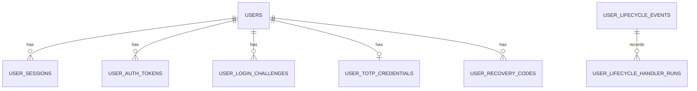

- 集約: 利用者アカウント(`users`を根に、セッション・認証系トークン・第2要素の待ち・TOTP・リカバリコード)。ライフサイクルイベントは利用者の行と外部キーを持たない別の集約で、物理削除の最後に本specが消す。
- 状態: `status`は`active`・`suspended`、退会は`deleted_at`(論理削除)。退会は`active`・`suspended`のどちらからも行え(4.4・仮5)、本人の退会と運営者による退会は同じ遷移である(15.7)。退会は終端で、停止・停止解除できない。停止中の退会では`status`・`suspended_at`を残し、退会済みの判定は`deleted_at`だけで行う。`lifecycle_version`は状態の遷移ごとに1増え、同期の波及処理の一括の書き込みの版の検査に使う。

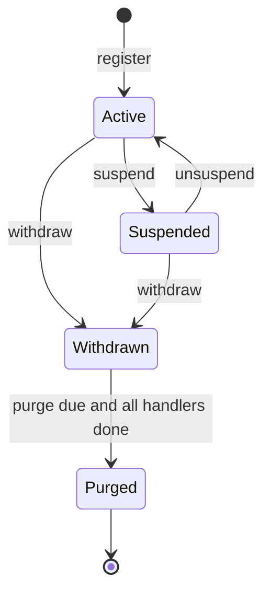

- 確認: `email_verified_at`がNULLでなければ確認済み。メールアドレスの変更の確定とパスワードリセットの完了で現在時刻を入れる。
- 使い捨て判定: `disposable_email_status`は確認前はNULL、確認後は`disposable`・`regular`・`undetermined`。メールアドレスの変更の確定で判定し直す(仮4)。
- 不変条件: 未退会ユーザーの中でメールアドレスは大文字小文字を区別せずに一意。ハンドルと仮名化IDは全行で一意。トークン・セッション・待ち・リカバリコードの平文を保存しない。

### Physical Data Model

すべてのテーブルは`ulidPrimaryKey()`・`timestamps()`(`created_at`・`updated_at`)を持つ。日時はUTCのエポックミリ秒の整数。

| テーブル                      | 列(共通カラム以外)                                                                                                                                                                                                                                                                                                                                                                        | 制約・索引                                                                                                                                                                                                    |
| ----------------------------- | ----------------------------------------------------------------------------------------------------------------------------------------------------------------------------------------------------------------------------------------------------------------------------------------------------------------------------------------------------------------------------------------- | ------------------------------------------------------------------------------------------------------------------------------------------------------------------------------------------------------------- |
| `users`                       | `pseudonymous_id` text・`email` text collate nocase・`password_hash` text・`nickname` text・`handle` text collate nocase・`status` text(既定`active`)・`suspended_at` integer?・`email_verified_at` integer?・`disposable_email_status` text?・`disposable_email_checked_at` integer?・`terms_agreed_at` integer・`lifecycle_version` integer(既定0)・`deleted_at` integer?(`softDelete`) | `pseudonymous_id`一意、`handle`一意、`email`の部分一意索引(`WHERE deleted_at IS NULL`)、`deleted_at`・`(status, deleted_at)`・`(disposable_email_status, disposable_email_checked_at)`の索引、`status`のCHECK |
| `user_sessions`               | `user_id` text(→`users.id`)・`token_hash` text・`user_agent` text?・`last_used_at` integer・`absolute_expires_at` integer                                                                                                                                                                                                                                                                 | `token_hash`一意、`user_id`・`last_used_at`・`absolute_expires_at`の索引                                                                                                                                      |
| `user_auth_tokens`            | `user_id` text(→`users.id`)・`purpose` text・`token_hash` text・`expires_at` integer・`new_email` text collate nocase?・`pending_password_hash` text?                                                                                                                                                                                                                                     | `token_hash`一意、`(user_id, purpose)`・`expires_at`の索引、`purpose`のCHECK                                                                                                                                  |
| `user_login_challenges`       | `user_id` text(→`users.id`)・`token_hash` text・`expires_at` integer                                                                                                                                                                                                                                                                                                                      | `token_hash`一意、`expires_at`の索引                                                                                                                                                                          |
| `user_totp_credentials`       | `user_id` text(→`users.id`)・`sealed_secret` text・`enabled_at` integer?・`pending_expires_at` integer?・`last_used_step` integer?                                                                                                                                                                                                                                                        | `user_id`一意、`pending_expires_at`の索引                                                                                                                                                                     |
| `user_recovery_codes`         | `user_id` text(→`users.id`)・`code_hash` text                                                                                                                                                                                                                                                                                                                                             | `code_hash`一意、`user_id`の索引                                                                                                                                                                              |
| `user_lifecycle_events`       | `user_id` text(外部キーなし)・`type` text・`occurred_at` integer・`status` text(既定`pending`)・`completed_at` integer?・`dispatch_count` integer(既定1)・`last_dispatched_at` integer                                                                                                                                                                                                    | `type`・`status`のCHECK、`user_id`の部分一意索引(`WHERE type = 'purge_due'`)、`(user_id, status, occurred_at)`・`(status, last_dispatched_at)`の索引                                                          |
| `user_lifecycle_handler_runs` | `event_id` text(→`user_lifecycle_events.id`)・`handler_name` text・`completed_at` integer                                                                                                                                                                                                                                                                                                 | `(event_id, handler_name)`一意                                                                                                                                                                                |

- 外部キーは`ON DELETE`の動作を指定しない。物理削除は子の行から順に消す(`IdentityPurgeStore`)。
- 部分一意索引とCHECK制約はDrizzleのスキーマで表し(`uniqueIndex().on(...).where(sql\`...\`)`・`check(...)`)、生成したマイグレーションに含まれることを確かめる。生成できない場合はカスタムマイグレーションで補う(`db/001`)。

### Data Contracts & Integration

**GraphQL**: 「IdentitySchemaModule」のSDLが契約である。利用者側の許可リストにだけ載る。

**非同期メッセージ**

| 種別                                | 本文                  | 送信                                                 | 受信                                   | 再試行                       |
| ----------------------------------- | --------------------- | ---------------------------------------------------- | -------------------------------------- | ---------------------------- |
| `identity.run-user-lifecycle`       | `{ eventId: string }` | 退会・停止・停止解除・物理削除の開始・日次の送り直し | eventの`UserLifecycleRunner`           | 5回・300秒から倍・上限3600秒 |
| `identity.recheck-disposable-email` | `{ userId: string }`  | 確認時の未判定(15分後)・日次のジョブ                 | eventの`DisposableEmailRecheckHandler` | backend-platformの既定       |

**メール**: 「IdentityEmailKinds」の7種(すべてトランザクションメール)。

**中継の項目**: ブラウザの`user-agent`(frontend-platformの`FORWARDED_BROWSER_HEADERS`)。APIは内部経路でだけ読み、512文字で切る。

## Error Handling

### Error Strategy

- 想定内の失敗は`AppError`で表し、api-gatewayのエラー方針で`extensions.code`と状態コードになる。利用者に見せる文言は`AppError.message`に入れ、フロントエンドはそれを表示する(技術的な詳細を出さない)。
- 応答の同一化(NFR-SECUR-041): パスワードリセットの要求・メールアドレス変更の要求は、アカウントの有無・重複の有無で応答・状態コード・数え方を変えない。ログインの失敗は、利用者の有無とパスワードの誤りを区別しない(ダミーの計算で時間もそろえる)。
- 外部サービス: bot判定の到達不能は503で拒否(backend-platform)、漏洩照合・使い捨て判定の到達不能は処理を続けて記録する(Q3)。

### Error Categories and Responses

| エラーコード                                              | 種類(状態コード)                 | 文言                                                                                                        | 主な発生箇所                                                                                                |
| --------------------------------------------------------- | -------------------------------- | ----------------------------------------------------------------------------------------------------------- | ----------------------------------------------------------------------------------------------------------- |
| `validation_error`                                        | bad_request(400)                 | 欄ごとの詳細(文言規則のエラーメッセージ)                                                                    | 全入力                                                                                                      |
| `registration_email_unavailable`                          | conflict(409)                    | このメールアドレスは登録できません。                                                                        | 登録(1.4)                                                                                                   |
| `password_rejected`                                       | unprocessable(422)               | 詳細`password`(漏洩・識別子と一致の文言)                                                                    | 登録・リセット・変更(5.2・5.3)                                                                              |
| `invalid_credentials`                                     | unauthenticated(401)             | メールアドレスまたはパスワードが正しくありません。                                                          | ログイン(6.3)                                                                                               |
| `account_unavailable`                                     | forbidden(403)                   | このアカウントは現在ご利用いただけません。詳しくはお問い合わせください。                                    | 停止中のログイン・書き込み(4.3・6.4)。アップロードの拒否ではmedia-pipelineが同じコードと文言で応答する(4.7) |
| `login_throttled`                                         | rate_limited(429)                | ログイン試行が続いたため、しばらく待ってから再度お試しください。(`Retry-After`)                             | ログイン・第2要素・本人確認(7.3)                                                                            |
| `rate_limit_exceeded`                                     | rate_limited(429)                | 操作が集中しています。しばらく待ってから再度お試しください。(`Retry-After`)                                 | 認証系メールの送信回数(2.6)                                                                                 |
| `invalid_second_factor`                                   | unauthenticated(401)             | 認証コードが正しくありません。                                                                              | 第2要素のログイン・TOTPの有効化(6.5)                                                                        |
| `login_challenge_expired`                                 | unauthenticated(401)             | 認証の有効期限が切れました。もう一度ログインしてください。                                                  | 第2要素のログイン(6.2)                                                                                      |
| `reauthentication_failed`                                 | unprocessable(422)               | 詳細`currentPassword`(現在のパスワードが正しくありません。)・`secondFactor`(認証コードが正しくありません。) | 重要な操作(12.2)                                                                                            |
| `invalid_link`                                            | unprocessable(422)               | このリンクは無効か、有効期限が切れています。                                                                | 確定の操作(14.3・10.5・11.5)                                                                                |
| `email_not_verified`                                      | forbidden(403)                   | この操作にはメールアドレスの確認が必要です。確認メールをご確認ください。                                    | `requireVerifiedUser`・TOTP(4.1・13.2)                                                                      |
| `totp_already_enabled`                                    | conflict(409)                    | 多要素認証は既に有効です。                                                                                  | TOTPの開始                                                                                                  |
| `totp_not_enabled`                                        | conflict(409)                    | 多要素認証は有効になっていません。                                                                          | 無効化・再発行                                                                                              |
| `totp_setup_expired`                                      | unprocessable(422)               | 設定の有効期限が切れました。最初からやり直してください。                                                    | TOTPの有効化(13.3)                                                                                          |
| `account_state_conflict`                                  | conflict(409)                    | 処理が重なりました。時間をおいて再度お試しください。                                                        | 状態の遷移の版の競合(16.2)                                                                                  |
| `unauthenticated`                                         | unauthenticated(401)             | ログインが必要です。                                                                                        | ログイン必須の操作                                                                                          |
| `not_found`                                               | not_found(404)                   | 対象が見つかりません。                                                                                      | 他人・不明のセッションの失効、停止の対象(16.9)、運営者による退会の対象(15.9)                                |
| `forbidden`                                               | forbidden(403)                   | この操作はできません。                                                                                      | 利用者側でない呼び出し元(6.8)、管理者側の経路でない運営者による退会(15.8)                                   |
| `bot_verification_failed`・`bot_verification_unavailable` | forbidden(403)・unavailable(503) | backend-platformの定型                                                                                      | bot判定(12.5・12.6)                                                                                         |

- 文言規則に無い文言(第2要素・本人確認・リンク・TOTP・競合・案内の文言)は、`003-text-and-copy-rules.md`への追記をタスクに含める。`forbidden`の「この操作はできません。」は、media-pipelineのタスク9.2が`upload_forbidden`の文言として先に追加する。本specは既にあることを確かめ、無い場合だけ追記する(横断レビューR3-8)。

### Monitoring

- ログ(LogTape、カテゴリ`['api', 'identity', <機能>]`・`['event', 'identity', <機能>]`): ログインの成否と理由(`invalid_credentials`・`login_throttled`など)、ロックの発生、外部サービスの未使用、ライフサイクルの処理の結果と所要時間、日次のジョブの件数。メールアドレス・IP・トークン・パスワードは属性に入れない(backend-platformの伏せ字でも除く)。
- Sentry: `AuthIncidentReporter`・`LifecycleIncidentReporter`の`warning`・`error`。`AppError`は送らない。
- 運用者が見る指標: `pwned-password-check-unavailable`・`disposable-email-check-unavailable`の頻度、`lifecycle-events-redispatched`・`purge-overdue`の発生。

## Testing Strategy

- **Unit Tests**(Bun):
  - `login-throttle-state`: 5回目まではロックしない、6回目で1秒・7回目で2秒・14回目で256秒・15回目以降は300秒、ロック中の試行は数えない、アラームでロックだけが解け回数が残る、最後の失敗から24時間で消える(7.2〜7.4・7.6)。
  - `session-policy`: アイドル14日・絶対90日のそれぞれの境界、15分未満は更新しない、Cookieの有効期間が残りの短い方になる(8.2・8.3)。
  - `password-rules`・`account-input-rules`: 7・8・128・129コードポイント、絵文字を含むニックネームの25・26書記素、ハンドル・ニックネーム・ローカル部との大文字小文字を区別しない一致(1.1・5.1・5.2)。
  - `disposable-email`: ローカル部の置き換え、200の`disposable`の真偽、`format: false`・401・429・503・HTMLで`undetermined`(3.1・3.2)。
  - `user-lifecycle`: 名前の形式、重複・同じ種類での`order`の重複の拒否、`order`昇順、各ドメインの帯の値(9999以下)と本specの値(10000以上)の両方を受け付け、本specの波及処理が同じ種類の各ドメインの波及処理の後に並ぶこと(16.1)。
  - 層の規則(apiの`test/config/layer-rules.unit.test.ts`): `application/identity`から`presentation/gateway/session-access.ts`を型だけで読み込む例が違反として報告され、`application/session/session-view.ts`の読み込みは報告されない(横断レビューR3-1、4.1・4.3・4.7)。
  - 各ユースケース(ポートを偽物にする): 登録の順序と重複・送信回数の上限での未作成(1.4・2.7)、パスワードリセットの要求の同一の結果と停止中への不送信(9.1〜9.3)、メールアドレス変更の重複時の不送信(10.3)、本人確認の失敗の記録(7.9・12.2)、第2要素の再使用の拒否(6.5)、停止中の退会の受け付け(4.4・仮5)、運営者による退会が管理者側の呼び出し元と管理者の主体だけを受け付け、停止中の利用者も本人の退会と同じ遷移とメッセージで退会させ、退会済み・存在しない対象を`not_found`にすること(15.7〜15.9)、アップロードできる利用者の判定が停止中・退会済みを`account_unavailable`で拒否し、未確認を許可すること(4.7)、`UserLifecycleRunner`の順序待ち・完了済みの飛ばし・`continue`・物理削除の最後の段階(16.3・16.4・16.7・17.2)。
- **Integration Tests**(Workers統合テスト):
  - D1のストア: 部分一意索引による退会後の同じメールの再登録(1.5)、ハンドル・仮名化IDの一意、トークンの2回目の消費の失敗(14.2)、`applyEmailChange`の重複時の`email-in-use`(10.5)、`deleteExpired`の境界(8.8・14.5)。
  - `UserLifecycleCommitter`: 版の競合で状態・同期の波及処理の文・イベントがすべて取り消される、同期の波及処理の文が同じ一括の書き込みで確定する(16.2)、停止中の利用者の退会で`status`・`suspended_at`が残り`deleted_at`が入る(4.4)。
  - `LoginAttemptThrottle`: Durable Objectのアラームでロックの解除と記録の削除が起きる、メールアドレス単位は利用者と管理者で別・IPアドレス単位は共有(7.4・7.6・7.7)。
  - `Pbkdf2PasswordHasher`・`HkdfAesGcmSecretBox`・`OtpauthTotpAuthenticator`・`HibpPwnedPasswordChecker`(偽の`fetch`): 10万回の計算、保存形式、改ざんの検出、時間窓の照合、パディングの行の無視と`unavailable`(5.4・5.5・13.10)。
  - GraphQLの`identity`モジュール(api-gatewayのテスト補助で`ClientGateway`から): 登録→Cookieの発行の指示、ログインの429と`Retry-After`、管理者側の呼び出し元の拒否(6.8)、bot判定の失敗の403(12.5)、`viewer`の`null`、セッションの一覧の`current`。
  - eventの`identity.run-user-lifecycle`のバッチ: 登録した偽の波及処理が順に呼ばれ、失敗で再試行、完了済みは呼ばれない。物理削除で利用者の行が消え、外部キーの残りでは`pending`に残る(16.5・17.3)。
  - `D1UserContactDirectory`: 通常の利用者で`userId`・`email`・`nickname`・`emailVerified`(確認済みは真、未確認は偽)が返る、停止中の利用者も返る、退会済み(`deleted_at`あり)・存在しない利用者で`undefined`、D1の失敗が例外になる(4.8)。
  - `D1AccountExport`: 通常の利用者で仮名化ID・メールアドレス・確認日時・登録日時(`created_at`)が返る、多要素認証が有効なら`mfaEnabled`が真で、未設定・設定途中の待ちだけなら偽、停止中の利用者も返る、退会済み・存在しない利用者で`undefined`、D1の失敗が例外になる、結果にパスワードハッシュ・TOTPの秘密鍵などの項目が無い(4.9)。
  - `D1AdminUserDirectory`: 退会済みを除き`(created_at, id)`の降順に並ぶ、ハンドル・ニックネームの大文字小文字を区別しない部分一致と`%`・`_`・`\`の逃がし、メールアドレスの前後の空白を除いた大文字小文字を区別しない完全一致(`findByEmail`も同じ)、状態の絞り込み、`limit`の境界(0と51の拒否)とカーソルの続き・不正なカーソルの拒否、`findByIds`の91件以上の分割と退会済みの除外、`findByEmail`の退会済みの除外、`countRegisteredAt`が指定時刻以後の登録を数えず指定時刻以後の退会を数えること、結果にメールアドレス・パスワードハッシュが無いこと(4.10)。
  - `IDENTITY_PLATFORM_MODULE`の束縛: APIサーバーとイベントサーバーのそれぞれのWorkers統合テストで、処理単位のコンテナから`IDENTITY_PLATFORM_TYPES.UserContactDirectory`が`D1UserContactDirectory`に、`IDENTITY_PLATFORM_TYPES.AccountExport`が`D1AccountExport`に、`IDENTITY_PLATFORM_TYPES.AdminUserDirectory`が`D1AdminUserDirectory`に解決される(4.8・4.9・4.10)。
  - email-deliveryとの結合: 7種のテンプレートが`createEmailTemplateRegistry`に通り、件名と行動ボタンのURLを含む(14.6)。
  - media-pipelineとの結合: 処理単位のコンテナで`UPLOAD_ACCESS_TYPES.UploaderEligibility`が本specの実装に解決され、停止中の利用者のセッションでの`POST /internal/media/uploads/:purpose`(テスト用の用途を登録する)が403・`account_unavailable`になって記録とオブジェクトが残らず、未確認の利用者のアップロードは受け付けられる(4.7)。
- **E2E/UI Tests**(Playwright、ローカルで起動したapi・event・clientとMailpit):
  - 登録→未確認の帯→Mailpitのリンク→確認→帯が消える(1.1・2.2・18.5)。
  - ログイン→ヘッダーのユーザーメニュー→ログアウト、誤ったパスワードの文言、別のブラウザの文脈でのセッションの一覧と個別の失効(6.1・6.3・6.7・8.4・8.6)。
  - パスワードリセットの要求(未登録のメールでも同じ案内)→リンク→再設定→既存のセッションが無効になる→完了のメール(9.1・9.4・9.5)。
  - 多要素認証の設定(画面のQRコードの手入力用の文字列からテスト内で認証コードを計算)→リカバリコードの表示→ログアウト→認証コードでのログイン→リカバリコードでのログイン→無効化(13.1・13.3・6.2)。
  - メールアドレス変更とパスワード変更のリンクの確定、退会→ログインできない→同じメールでの再登録(10.4・11.3・15.1・15.5・1.5)。
- **ブラウザテスト**(Vitest Browser Mode): 各フォームの検証の表示と送信中の無効化、`LinkConfirmation`がマウントだけでは送信しない(18.8)、`TotpQrCode`の描画と代替テキスト、`RecoveryCodeList`のコピー、`SettingsNavigation`の`aria-current`、停止中の設定ページの案内(問い合わせで退会を依頼できる旨)と操作の無効化(4.4・15.10)、`runAxe`の違反0件(18.10・18.11)。
- **Performance**: パスワードの照合1回のCPU時間をWorkers統合テストで計測して記録する(目安100ミリ秒以内)。

## Security Considerations

- 脅威と対策:
  - 総当たり・パスワードスプレー: メールアドレス単位とIPアドレス単位の指数的なクールダウン、ログインごとのbot判定、漏洩パスワードの拒否。
  - 利用者の列挙: ログインの失敗の文言と時間の同一化、パスワードリセット・メールアドレス変更の要求の応答の同一化。登録の重複の拒否(FR-USER-013)は要件どおり列挙の余地を残すが、IPアドレス単位の送信回数の制限(1時間5回)とbot判定で大量の確認を抑える。
  - セッションの窃取: `HttpOnly`・`Secure`・`SameSite=Lax`・`__Host-`のCookie(frontend-platform)、識別子のハッシュ化、重要な操作の本人確認、重要な変更での全セッションの入れ替え。
  - 未確認のアカウントの先取り(他人のメールアドレスでの登録): 確認が済むまでTOTPを有効にできない。本人はパスワードリセットで確認済みにでき、その時に全セッションが消える。
  - メールのリンクの漏洩: 短い有効期限・単回・再発行での失効、フラグメントでの受け渡し、`Referrer-Policy: same-origin`(frontend-platform)。
  - TOTPの再使用・秘密鍵の漏洩: 使用済みの時間窓の記録、AES-GCMでの保存(鍵はD1の外)。
  - 波及処理の取りこぼし: 同期の部分は状態の変更と同時に確定、非同期の部分は記録と日次の再実行。
  - 停止逃れ: 停止中の利用者は退会でき(4.4)、退会の直後から同じメールアドレスで再登録できる(1.5)。消去の権利を優先し、この回避を防がないことを受け入れる(仮5、2026-10-18の開発者の判断)。再登録したアカウントは新しいハンドル・仮名化IDを持ち、運営者は使い捨て判定の結果と通報で再度停止できる。
  - 運営者による退会の濫用・取り違え: 本人確認を伴わず取り消せないため、操作口は管理者側の呼び出し元と管理者のセッションだけを受け付け(15.8)、利用者側のGraphQLの操作を設けない。操作の権限の確認(最上位管理者だけ)と監査ログは呼び出し側(ugc-moderation・admin-foundation)が行い、依頼者の本人の確かめは運営者がシステムの外で行う。
  - 停止中の利用者のアップロード: 停止では既存のセッションを消さない(16.10)ため、media-pipelineの差し込み口を本specの判定で束縛し、保存の前に拒否する(4.7、FR-USER-020)。
- データの最小化(DR-001): セッションにIPアドレスを保存しない。ログイン試行の記録はハッシュ化したキーと回数だけで、最後の失敗から24時間で消える。使い捨て判定へはローカル部を送らない。漏洩照合へはSHA-1の先頭5文字だけを送る。

## Performance & Scalability

- PBKDF2(10万回)はログイン・登録・本人確認ごとに1回(利用者が無いときもダミーで1回)。同時接続100人(NFR-PERF-002)の規模ではCPU時間の上限(30秒)に十分収まる。
- セッションの検証は要求ごとにD1の索引付きの検索1回、最終利用の更新は15分に1回までに間引く。
- ログイン試行の記録はメールアドレスとIPアドレスのキーごとのDurable Objectに分散し、1つのオブジェクトへの集中は同じキーへの攻撃に限られる。
- 日次のジョブは1回の件数の上限(50・100)で区切り、残りは翌日に続ける。物理削除は業務日付による開始で、期限まで19時間以上の余地がある。

## Migration Strategy

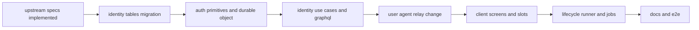

- テーブルは新規のため、Expand/Contract(NFR-AVAIL-008)の段階は1つ(追加だけ)。Durable Objectのクラスは`migrations`の新しいタグで追加し、デプロイで作られる。デプロイはinfra-deliveryのパイプライン(mainへのマージでstaging)が行い、infra-deliveryより前に実装する場合だけ開発者が手作業でデプロイする。
- `user-agent`の中継とGraphQLの文脈の追加は、どちらが先にデプロイされても動く(届かなければ端末情報が「不明な端末」になるだけ)。
- `USER_ADDRESS_DIRECTORY`の差し替えで、email-deliveryの日次の後始末が「照会口が使えない」から実際の判定に変わる。

## Supporting References

### 本specが定める固有の値

| 項目                                   | 値                                                                                                                                                                                                                                                                                                                                                                                                                                      |
| -------------------------------------- | --------------------------------------------------------------------------------------------------------------------------------------------------------------------------------------------------------------------------------------------------------------------------------------------------------------------------------------------------------------------------------------------------------------------------------------- |
| Durable Objectのバインディング・クラス | `LOGIN_ATTEMPT_THROTTLE`・`LoginAttemptThrottle`(apiだけ)                                                                                                                                                                                                                                                                                                                                                                               |
| Durable Objectの名前                   | `login-email:user:<キー>`・`login-email:admin:<キー>`(admin-foundation)・`login-ip:<キー>`                                                                                                                                                                                                                                                                                                                                              |
| 送信回数の規則の名前                   | `auth-mail:email_verification:address`・`auth-mail:email_verification:ip`(`email_change`・`password_reset`も同じ形)                                                                                                                                                                                                                                                                                                                     |
| HMACの用途                             | `password-prehash`・`user-session`・`user-auth-token:<用途>`・`user-login-challenge`・`user-recovery-code`(管理者は`admin-`で始める)                                                                                                                                                                                                                                                                                                    |
| HKDFの情報の文字列                     | `totp-secret-v1`                                                                                                                                                                                                                                                                                                                                                                                                                        |
| TOTPの発行者名                         | prod`Launch Stadium`・staging`Launch Stadium staging`・ローカル`Launch Stadium local`                                                                                                                                                                                                                                                                                                                                                   |
| `CLIENT_SITE_ORIGIN`                   | ローカル`http://localhost:48044`・staging`https://genai-example-2-client-staging.lab.kurachiweb.com`・prod`https://genai-example-2-client.lab.kurachiweb.com`(apiの変数は本spec、client・adminの同名の変数はcontent-processingが所有し、値はinfra-deliveryの「ホスト名から導かれる変数の値」の表と同じ)                                                                                                                                 |
| 任意のシークレット                     | `DISIFY_API_KEY`(api・event。仮6)。stagingの値は、そのキーを読む本specの変更をmainへマージする前に開発者がInfisicalのstaging環境へ登録し、prodの値はlaunch-readinessがリリース時に登録する。Workerへはinfra-deliveryの`OPTIONAL_WORKER_SECRETS`(api・event、追記済み)で渡る。キーの一覧の正は`docs/onboardings/project-values.md`の節で、キーを読む変更(タスク8.1)と同じ変更で行を足すか、行があれば食い違いを確かめる(横断レビューN-5) |
| 技術ドキュメントの番号                 | `security/006`・`external/004`(漏洩パスワード照合)・`external/005`(使い捨てメールアドレス判定)・`external/006`(Turnstile)・`backend/007`                                                                                                                                                                                                                                                                                                |
| 外部への`User-Agent`                   | `genai-example-2-api`・`genai-example-2-event`(HIBP・DISIFYの呼び出し)                                                                                                                                                                                                                                                                                                                                                                  |
| 定期実行のジョブ                       | `identity-auth.purge-orchestrator`(4:21・100)・`identity-auth.credential-cleanup`(4:21・110)・`identity-auth.disposable-recheck-sweep`(4:21・120)                                                                                                                                                                                                                                                                                       |
| メッセージ種別                         | `identity.run-user-lifecycle`・`identity.recheck-disposable-email`                                                                                                                                                                                                                                                                                                                                                                      |
| 非同期の波及処理                       | `identity-auth.email-suppression-cleanup`(`withdrawn`・10000)                                                                                                                                                                                                                                                                                                                                                                           |
| 有効期限                               | セッション アイドル14日・絶対90日・更新の間引き15分、第2要素の待ち5分、TOTPの設定10分、認証系トークン 確認24時間・リセットと変更30分                                                                                                                                                                                                                                                                                                    |
| 判定し直しの遅延                       | 確認時の未判定から15分、日次のジョブは最後の判定から1時間以上                                                                                                                                                                                                                                                                                                                                                                           |
| ライフサイクルの送り直し               | 最後の送信から1時間以上の`pending`、3回目以降の送り直しで通知                                                                                                                                                                                                                                                                                                                                                                           |
| 設定ページの登録順                     | profile 10・account 20・security 30・notifications 40・follows 50・plan 60・billing 70・sponsorships 80・api-keys 90・export 100                                                                                                                                                                                                                                                                                                        |
