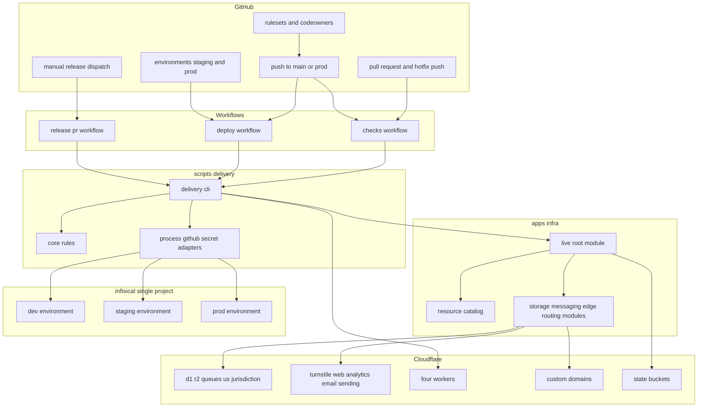
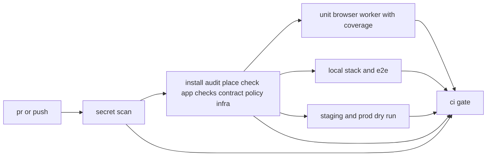
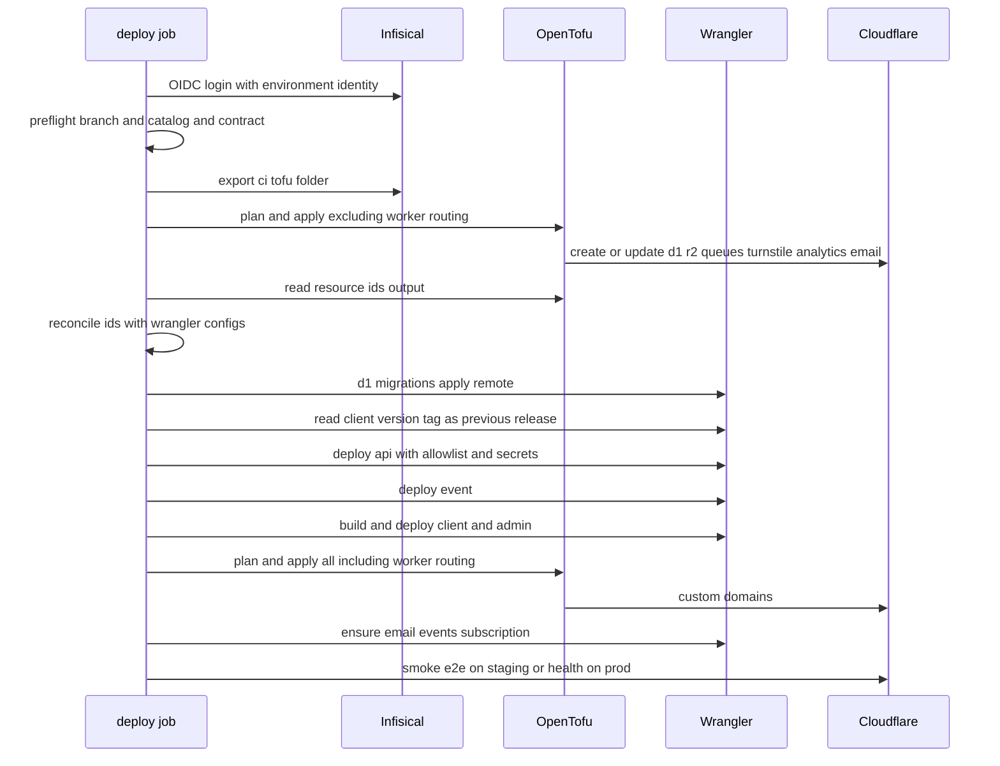
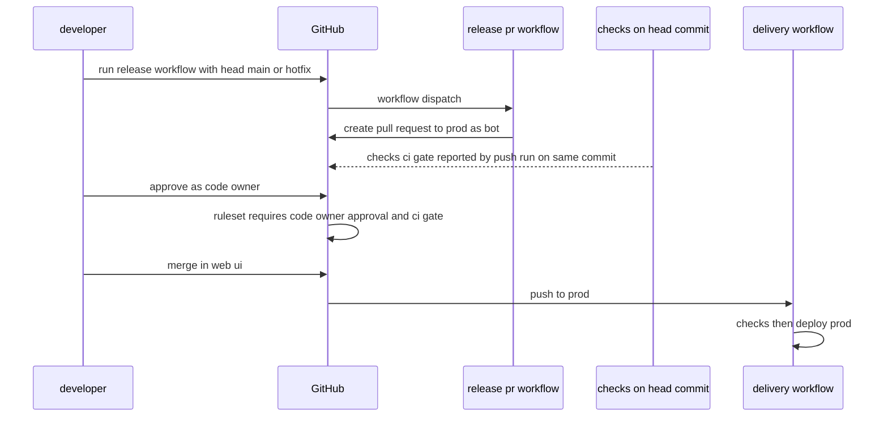
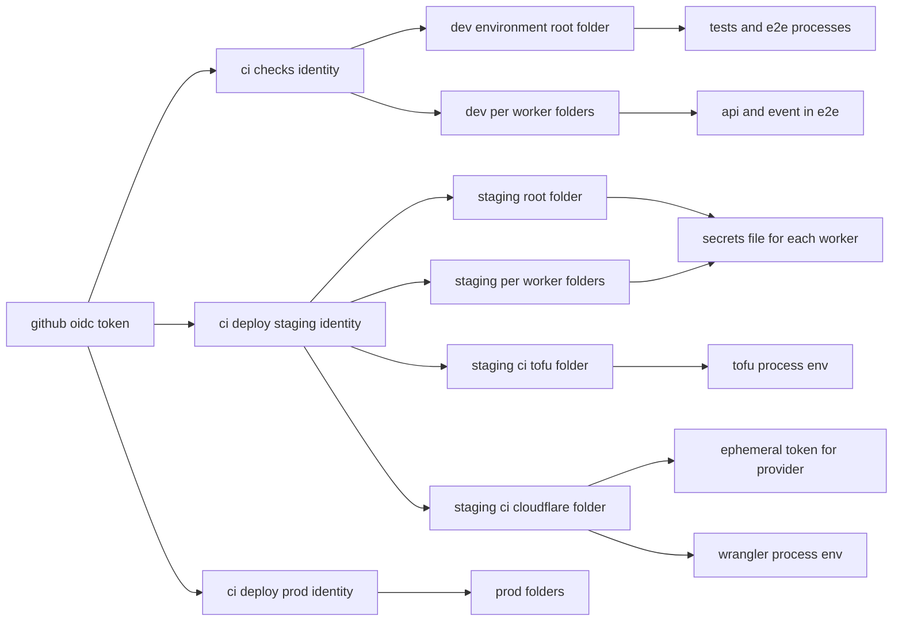
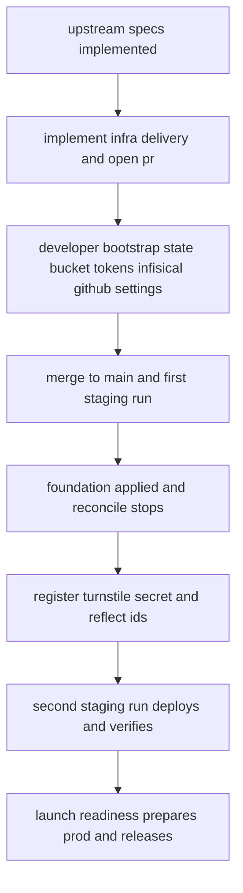

# Design Document

## Overview

**Purpose**: Cloudflare上のstaging・prodの資源をOpenTofuで定義し、GitHub Actionsで検査・デプロイ・リリースを自動化する。シークレットはInfisicalから短期の証明(OIDC)で受け取り、OpenTofuの状態は暗号化してR2に置く。開発者がmainへマージするとstagingへ、承認したリリースのPRをprodへマージするとprodへ、同じ手順でデプロイされる。

**Users**: 開発者は、mainへのマージでstagingを確かめ、GitHubの画面からリリースのPRを作らせて承認する。AIエージェントと後続specは、資源一覧(`apps/infra/environments/<環境>.json`)とWrangler設定へ同じ名前で資源を追記するだけで、新しいQueue・R2バケット・ホスト名をデプロイできる。launch-readinessは、本specの手順でprodの資源を作り、識別子を反映して最初のリリースを行う。

**Impact**: 存在しない`apps/infra`・`.github`・`scripts/delivery`を新設する。上流specが所有する4アプリのWrangler設定へ、R2の管轄(`jurisdiction: "us"`)・`workers_dev: false`・`preview_urls: false`・stagingの識別子を書き込み、frontend-platformの疎通確認のE2Eに`@smoke`タグを付ける。tech-stack.mdのCI/CD(検査でstagingを注入する記載)をdevの注入へ改め、準拠方針とプライバシーポリシー骨子のCloudflareの項(保存場所と国外移転の記載事項)を、D1・R2・Queuesは米国、所在を限定しない処理(Durable Objects・Workerの実行・エッジのキャッシュ・ログ・メール送信・Turnstile・Web Analytics)は処理する国を特定できない、移転の根拠はEU-USデータプライバシーフレームワーク(DPF)を主とし標準契約条項(SCC)を予備とする、と改める。あわせて、骨子の全委託先に共通の「移転の法的根拠」の行を同じ根拠に改め、委託先の項の書き方の型を示す。

### Goals

- staging・prodの資源が1つのOpenTofuの定義と環境ごとの資源一覧から作られ、D1・R2・Queuesが米国の管轄で保存される(Q3・K1)。
- mainとprodへのPR・push、hotfixブランチへのpushで検査が走り、1つの総合結果(`checks / ci-gate`)がマージの条件になる。
- mainへのpushでstagingへ、prodへのpushでprodへ、資源の更新→識別子の照合→マイグレーション→API→event→フロントエンド→ホスト名→購読→確認の順にデプロイされる。
- prodへのマージには、コードオーナー(開発者)の承認が必須で、ワークフローの承認では満たせない(Q5)。
- CIとOpenTofuが使う秘密値は、Infisicalだけにあり、ログ・成果物・リポジトリ・状態の平文に残らない。

### Non-Goals

- prodの資源の作成・識別子の反映・最初のprodのデプロイ(launch-readiness、Q6)。
- 監視・アラート・Sentryのプロジェクトとソースマップのアップロード(launch-readiness)。
- ゾーン全体のWAFのカスタムルールとレート制限ルール(Q2)。
- Workerのプログラム・バインディングの名前・環境変数とシークレットのキー名の設計(上流spec)。
- ブランチ保護とリポジトリ設定のコード化(briefの方針)。

## Boundary Commitments

### This Spec Owns

- `apps/infra`: 資源一覧(`environments/{staging,prod}.json`)、stateの保管先の設定(`backends/<環境>.s3.hcl`)、ルートモジュール(`live/`)、子モジュール`storage`・`messaging`・`edge-services`・`worker-routing`と、それぞれの`tofu test`・providerのロックファイル。
- `scripts/delivery`: CIとデプロイの手順を実行するTypeScriptのコマンド群(`cli.ts`)と、その判定の部品・単体テスト。
- `.github`: 再利用ワークフロー`checks.yml`・`deploy.yml`、起動用ワークフロー`pull-request.yml`・`delivery.yml`・`release-pr.yml`、複合アクション`actions/setup-toolchain`、`CODEOWNERS`。
- 契約: 資源一覧の形(`ResourceCatalog`)、デプロイの段階(`DEPLOY_STAGES`)、必須チェックの名前`checks / ci-gate`、OpenTofuの出力`resource_ids`、Infisicalのフォルダの構成(Workerごとのフォルダ`/workers/api`・`/workers/event`の値が共通の`/`の値より優先されること。改訂1)と主体のOIDCの縛り、Workerの版のタグ(デプロイしたコミット)、スモークテストのタグ`@smoke`、Workerの任意のシークレットの一覧(`OPTIONAL_WORKER_SECRETS`)、Workerごとのフォルダからだけ取るシークレットの一覧(`WORKER_SCOPED_SECRETS`。改訂1)。
- 4アプリのWrangler設定のうち、staging・prodの識別子(D1の`database_id`・`TURNSTILE_SITE_KEY`・`WEB_ANALYTICS_TOKEN`)の値、R2のバインディングの`jurisdiction`、`workers_dev`・`preview_urls`。
- ルートの`package.json`の`delivery`・`infra:check`・`infra:fmt`のスクリプト。
- 技術ドキュメント`infra/005`〜`007`・`operations/001`〜`002`・`security/003`(Wave 1の横断レビューI-4で割り当てた番号に固定する)と、`security/001`・`testing/001`への追記。tech-stack.md・`docs/onboardings/project-values.md`・オンボーディング・CLAUDE.mdのディレクトリ構成の更新。`project-values.md`のWorkerのシークレットのキーの一覧の節(後続specが行を足す。N-5)。
- 準拠方針とプライバシーポリシー骨子の「データの保存場所」と「国外移転の記載事項」のうち、Cloudflareの項(N-1)と、骨子の全委託先に共通の「移転の法的根拠」の行、委託先の項の書き方の型(R3-6)。

### Out of Boundary

- prodの資源・状態の保管先・Infisicalのprodの主体とシークレットの値の作成、prodの識別子の反映、最初のprodのデプロイ(launch-readiness)。
- Wrangler設定のバインディング名・資源の名前の決定、`secrets.required`のキー、Worker・Durable Objectsのコード(backend-platform・frontend-platform・email-deliveryほか)。本specはそれらを読むだけで、上記の値以外を変えない。
- 一括検査・一括テスト・共有ディレクトリの配置のコマンドと、テストの命名・カバレッジの閾値(dev-tooling)。本specはCIから呼ぶだけである。
- GraphQLの許可リストの生成とスキーマの検査(api-gateway)、疎通確認の画面とそのE2Eの内容(frontend-platform)。本specは`@smoke`タグの付与だけを行う。
- Durable Objectsの管轄(どのspecも指定しない。K7)、Rekognition・Natural Languageの資格情報の作成(media-pipeline・content-processing・開発者)。
- 準拠方針とプライバシーポリシー骨子のうち、Cloudflare以外の委託先の項。AWS(Rekognition、us-east-1)の項はmedia-pipelineが、Google Cloud(Natural Language API)の項はcontent-processingが書く。分担は委託先単位で、本specはCloudflareの項と全委託先に共通の「移転の法的根拠」の行だけを書き、互いの項を書き換えない。項の書き方は本specが示す型に、根拠の種類(DPFを主、SCCを予備)は3項で同じにする。法務文書の本文は開発者が用意する(N-1・R3-5・R3-6)。
- `CLIENT_SITE_ORIGIN`の変数(client・adminはcontent-processing、apiはidentity-auth、eventはpaymentsが所有する)と`ADMIN_SITE_ORIGIN`の変数(apiはadmin-foundationが所有する)。本specは3環境の値を「Supporting References」の一覧に持つだけである。
- ホスト名から導かれる他の変数: eventの`EVENT_SITE_ORIGIN`(notifications)、apiの`IMAGES_ORIGIN`とclientの`PUBLIC_API_ORIGIN`(public-api)、client・adminの`IMAGES_ORIGIN`(frontend-platform)。本specは3環境の値を「Supporting References」の一覧に持つだけである(改訂1)。
- ホスト名と送信ドメインから導かれる値: apiの`TURNSTILE_EXPECTED_HOSTNAMES`(backend-platform)と、eventの`EMAIL_FROM_ADDRESS`・`send_email`の`allowed_sender_addresses`(email-delivery)。本specは値を「Supporting References」の一覧に持つだけで、構成検査では照合しない(改訂4)。
- `STRIPE_PUBLISHABLE_KEY`の変数(clientはpaymentsが所有し、prodはlaunch-readinessまで形式の検証を通る仮の値を置く)と、Stripeのシークレット`STRIPE_API_KEY`・`STRIPE_WEBHOOK_SECRET`の宣言(payments)。本specはInfisicalのキーの表の行と、prodの仮の値の扱いを「Supporting References」に持つだけである。`STRIPE_API_KEY`はapi用とevent用の別々の制限付きキー(paymentsのQ5)で、Workerごとのフォルダに置く(改訂1)。
- ブランチ保護・Environment・Actionsの設定の実施(開発者の手作業。本specは値を文書化する)。

### Allowed Dependencies

- 上流のコマンド: ルートの`check`・`test:all:{unit,browser,worker}`・`test:e2e`・`test:e2e:dev-and-preview`(改訂3)・`shared-dirs:place`、apiの`cf-typegen:check`・`db:migrations:check`・`graphql:check`・`graphql:allowlist`・`test:smoke`、eventの`cf-typegen:check`、client・adminの`cf-typegen:check`(改訂3)・`graphql:check`・`build`・`dev`・`preview`、`config/workspace-layout.ts`の`APPS`・`SHARED_DIRS`(読むだけ)。
- 外部: OpenTofu 1.13.2、Cloudflare provider 5.27.0、`infisical` provider 0.19.38、Infisical CLI 0.44.8、Wrangler(アプリが固定する版と、Dockerfileの4.152.0)、Mailpit 1.32.0、Playwright 1.64.1、Bun 1.4.4、Node 26.12.1(Dockerfileの`NODE_VERSION`)、TruffleHog・GitHub Actionsの公式アクション(実装時にSHAで固定)。新しいnpmパッケージは導入しない。
- 依存の方向(後述): `scripts/delivery`は`catalog` → `core` → `commands` → `cli.ts`の向きにだけ参照し、`adapters`は`commands`からだけ参照する。`core`は外部コマンド・ファイル・ネットワークに触れない。`scripts/delivery`はアプリのコード(`apps/**/src`)をimportしない。
- OpenTofuは`live` → `modules/*`の向きだけで、子モジュール同士は参照しない。資源一覧はルートだけが読む。

### Revalidation Triggers

- 資源一覧の形(`ResourceCatalog`)・ファイルの場所の変更(後続specの資源の追加手順、launch-readiness)。
- `DEPLOY_STAGES`の順序・必須チェックの名前の変更(ブランチ保護の設定、api-gateway・frontend-platformのデプロイの順序の契約)。
- Infisicalのフォルダの構成・キーの名前・主体のOIDCの縛りの変更(開発者の設定、launch-readiness)。Workerごとのフォルダ(`/workers/api`・`/workers/event`)と`/`との優先の規則、`WORKER_SCOPED_SECRETS`の変更は、api用とevent用の制限付きキーを分けるpayments(Q5)と、prodへ別々の値を登録するlaunch-readiness(仮13)に効く(改訂1)。
- Infisicalのキーの表(各specが宣言した必須と任意のシークレット)の変更と、その正である`project-values.md`のキーの一覧の節の形・場所の変更(シークレットを宣言する全spec、launch-readiness)。
- Workerの版のタグの形式の変更(api-gatewayの`--previous-ref`、ロールバックの手順)。
- `@smoke`タグの意味の変更(E2Eを追加する全spec)。
- `OPTIONAL_WORKER_SECRETS`の変更(任意のシークレットを持つemail-delivery・media-pipeline・identity-auth)。
- R2の管轄・`workers_dev`・`preview_urls`の扱いの変更(backend-platform・frontend-platform・media-pipelineのWrangler設定と検査)。
- Queuesの管轄(K1)の変更(email-delivery・media-pipelineのQueue、準拠方針とプライバシーポリシー骨子のCloudflareの項)。
- 国外移転の記載事項の委託先単位の分担、根拠の種類(DPFを主、SCCを予備)、全委託先に共通の「移転の法的根拠」の行、委託先の項の書き方の型の変更(AWSの項を書くmedia-pipeline、Google Cloudの項を書くcontent-processing。R3-5・R3-6)。
- 資源一覧のclientのホスト名の変更(`CLIENT_SITE_ORIGIN`を所有するcontent-processing(client・admin)・identity-auth(api)・payments(event。StripeのWebhook endpointと`return_url`にも効く)と、`TURNSTILE_EXPECTED_HOSTNAMES`を所有するbackend-platform(api。改訂4)。値は「Supporting References」の一覧)。
- 資源一覧のadminのホスト名の変更(`ADMIN_SITE_ORIGIN`を所有するadmin-foundation(api)と、`TURNSTILE_EXPECTED_HOSTNAMES`を所有するbackend-platform(api。改訂4)。値は「Supporting References」の一覧)。
- 資源一覧の送信ドメインの変更(`EMAIL_FROM_ADDRESS`・`send_email`の`allowed_sender_addresses`を所有するemail-delivery(event)。値は「Supporting References」の一覧。改訂4)。
- 資源一覧のeventのホスト名の変更(paymentsがStripeのダッシュボードに登録するWebhook endpoint`https://<eventのホスト名>/webhooks/stripe`と、`EVENT_SITE_ORIGIN`を所有するnotifications(配信停止のURLの基点)。値は「Supporting References」の一覧)。
- 資源一覧のapiのホスト名の変更(clientの`PUBLIC_API_ORIGIN`を所有するpublic-api。値は「Supporting References」の一覧。改訂1)。
- Turnstileのウィジェットの種類(`invisible`)の変更(ウィジェットを非表示で描くfrontend-platformの`TurnstileWidget`と、ウィジェットを置く全spec。改訂2)。
- ルートのコマンド`test:e2e:dev-and-preview`の前提(APIサーバー・イベントサーバーを先に起動し、client・adminは起動しないでおくこと)と、client・adminの`cf-typegen:check`(dev-tooling・frontend-platform。改訂3)。
- 資源一覧のimagesのホスト名の変更(client・adminの`IMAGES_ORIGIN`を所有するfrontend-platformと、apiの`IMAGES_ORIGIN`を所有するpublic-api。値は「Supporting References」の一覧。改訂1)。

## Architecture

### Existing Architecture Analysis

- `apps/infra`・`.github`は存在しない。上流の5spec(dev-tooling・backend-platform・api-gateway・email-delivery・frontend-platform)は実装を完了している(2026-10-29に確認)。本specはそれらのWrangler設定・スクリプト・E2Eに結線する。照合の結果はresearch.mdの「実装前のギャップ分析(2026-10-29)」に記録する。
- ルートの`check`は、全アプリの`cf-typegen:check`・`graphql:check`(許可リストの鮮度を含む)と`check:contract-copies`を既に実行する。`config/workspace-layout.ts`の`APPS`は、Wrangler設定を持たない`frontend-lib`を含む。
- Bun上の`wrangler dev`はHTTPに応答しないため、開発コンテナはWranglerをNode 26.12.1で動かす。CIも同じ版のNodeを使う。
- dev-toolingは、新しいcloneからの`CI=true bun install --frozen-lockfile`→`shared-dirs:place`→`check`→`test:all:*`の順と、lcovの出力先(`coverage/{unit,browser,worker}/lcov.info`)を契約にしている。共有ディレクトリの一覧は`config/workspace-layout.ts`の`SHARED_DIRS`で、content-processingが`apps/common-lib`を加える。
- ルートの`tsconfig.json`は`**/*.ts`を含み、ドットで始まるディレクトリを含まない。TypeScriptは`scripts/delivery`に置き、`.github`には置かない。ルートの`test:unit`は`apps/**`以外の`*.unit.test.ts`を実行する。
- 4アプリのWrangler設定は、staging・prodのD1の`database_id`・`TURNSTILE_SITE_KEY`・`WEB_ANALYTICS_TOKEN`を仮の値で持つ(上流の決定)。clientとadminは`@cloudflare/vite-plugin`でビルドし、`dist/server/wrangler.json`を生成する。
- `.claude/settings.json`は、AIエージェントによる`tofu apply`・`wrangler deploy`(`--dry-run`を含む)・`wrangler rollback`・`wrangler secret`・`infisical secrets set`・`gh workflow run`・`gh pr merge`を拒否する。AIエージェントがローカルで確かめられるのは、`tofu fmt`・`tofu validate`・`tofu test`と単体テストまでである。

### Architecture Pattern & Boundary Map



**Architecture Integration**:

- 選んだパターン: 宣言(資源一覧・ワークフロー)と手順(TypeScriptのコマンド)の分離。資源と環境の差分はJSONとHCLで宣言し、判定(構成の照合・計画の要約・シークレットの選別・購読の差分)は`core`の純粋関数に置く。外部コマンド(tofu・wrangler・infisical・gh)の起動は`adapters`に閉じ込め、ワークフローのYAMLはコマンドを順に呼ぶだけにする。
- 境界: 資源の作成はOpenTofu、Workerの作成と更新はWrangler、秘密値はInfisical、マージの条件はGitHubのルールセットが持つ。本specはそれらを結ぶ手順と検査を持ち、各アプリの設定の中身は上流が持つ。
- 既存パターンの維持: dev-toolingのスクリプト契約と一括コマンド、`infisical --telemetry=false`、`--persist-to /workspace/.wrangler/state`、`CLOUDFLARE_ENV=<環境> vite build`、環境種別`staging`・`prod`、テストの命名(`*.unit.test.ts`)。
- 新規コンポーネントの理由: research.mdの「Generalization・Build vs Adopt・Simplification」を参照。

### Dependency Direction

- `scripts/delivery`: `catalog`(資源一覧の型と解析) ← `core`(純粋な判定) ← `commands`(手順) ← `cli.ts`。`adapters`(子プロセス・ファイル・GitHub Actionsの出力・Infisical・HTTP)は`commands`だけが読み込む。
- `core`は`node:child_process`・`node:fs`・`fetch`・`Bun.spawn`・`process.env`を使わず、文字列とオブジェクトを受け取って結果を返す。`scripts/delivery/layering.unit.test.ts`がimportの向きと禁止したAPIの不使用を確かめる。
- `apps/infra`: `live` → `modules/{storage,messaging,edge-services,worker-routing}`。子モジュールはproviderの設定を持たず、`required_providers`だけを宣言する。

### Technology Stack

| Layer              | Choice / Version                                                                 | Role in Feature                                         | Notes                                                                            |
| ------------------ | -------------------------------------------------------------------------------- | ------------------------------------------------------- | -------------------------------------------------------------------------------- |
| IaC                | OpenTofu 1.13.2・Cloudflare provider 5.27.0・`infisical` provider 0.19.38        | 資源の定義・状態の暗号化・`ephemeral`での資格情報の取得 | 版は完全に固定。providerはOpenTofu Registryの公開から2週間以上                   |
| State              | Cloudflare R2(S3互換backend、`use_lockfile`)                                     | 環境ごとの状態と計画の保管                              | 環境ごとのバケット、管轄なし(K2)                                                 |
| Secrets            | Infisical(EUリージョン)・Infisical CLI 0.44.8                                    | OIDCでの認証、`infisical export`による取り出し          | 既存の1つのプロジェクトのdev・staging・prodの環境(K3)                            |
| CI/CD              | GitHub Actions(ホステッドランナー`ubuntu`)、再利用ワークフロー、Environments     | 検査・デプロイ・リリースのPR                            | アクションはコミットSHAで固定                                                    |
| Workers            | Wrangler(アプリの版と、購読の操作用に4.152.0)・`@cloudflare/vite-plugin`のビルド | マイグレーション・デプロイ・版のタグ・購読・予行        | デプロイはアプリが固定する版で行う                                               |
| Scripts            | Bun 1.4.4・TypeScript 6.0.3(既存)                                                | `scripts/delivery`のコマンドと単体テスト                | `Bun.JSONC`・`Bun.YAML`を使い、新しいパッケージを入れない                        |
| Quality / Security | TruffleHog(公式アクション)・`bun audit`                                          | 変更履歴のシークレット検出、既知の脆弱性の確認          | TruffleHogの版は実装時に固定し、tech-stack.mdへ記載                              |
| Test runtime in CI | Node 26.12.1・Playwright 1.64.1のChromium・Mailpit 1.32.0                        | ブラウザテスト・E2E・開発用のメール受信箱               | Mailpitは公式のチェックサムが無いため、開発コンテナと同じく検証せずに導入(改訂4) |

## File Structure Plan

### Directory Structure

```
apps/infra/
├── environments/
│   ├── staging.json                     # 資源一覧(staging): 名前・識別子・管轄・ホスト名・Infisical・GitHubのEnvironment
│   └── prod.json                        # 資源一覧(prod): 同じ形。Infisicalの主体の識別子はlaunch-readinessが埋める
├── backends/
│   ├── staging.s3.hcl                   # stateの保管先(バケット・キー・接続先)の部分設定
│   └── prod.s3.hcl
├── live/                                # ルートモジュール(環境はinitのbackend設定と変数environmentで選ぶ)
│   ├── versions.tf                      # required_version・required_providers(完全固定)・backend "s3"・encryption
│   ├── variables.tf                     # environment・stateのパスフレーズと接続用の鍵(いずれもsensitive)
│   ├── providers.tf                     # infisical(hostのみ)・ephemeral infisical_secret・cloudflare(api_token)
│   ├── main.tf                          # 資源一覧の読み込み・4モジュールの呼び出し・環境の一致のcheck
│   ├── outputs.tf                       # resource_ids(秘密でない識別子だけ)
│   ├── tests/live.tftest.hcl            # 両環境の結線(モックのprovider)
│   └── .terraform.lock.hcl              # linux_amd64・linux_arm64のハッシュ
└── modules/
    ├── storage/                         # D1・R2(管轄・読み取りレプリカ無効・prevent_destroy)
    │   ├── versions.tf · variables.tf · main.tf · outputs.tf · .terraform.lock.hcl
    │   └── tests/storage.tftest.hcl
    ├── messaging/                       # Queues(管轄)。storageと同じ構成
    ├── edge-services/                   # Turnstile(prevent_destroy)・Web Analytics・送信ドメイン
    └── worker-routing/                  # Workersのカスタムドメイン

scripts/delivery/
├── cli.ts                               # 入口: サブコマンドの振り分けと終了コード
├── layering.unit.test.ts                # 依存の向きとcoreの禁止APIの検査
├── repo-contract.unit.test.ts           # 実際のリポジトリに構成検査とワークフローの検査を掛ける
├── catalog/
│   ├── resource-catalog.ts              # ResourceCatalogの型と解析(純粋)
│   └── check-secrets.ts                 # 検査用の主体とInfisicalの設定(プロジェクトは.infisical.yamlから)
├── core/                                # 純粋な判定と変換
│   ├── violation.ts                     # ContractViolation(構成検査とワークフローの検査で共有)
│   ├── deploy-stages.ts                 # DEPLOY_STAGES
│   ├── wrangler-config.ts               # JSONCの解析と、検査に使うキーの環境ごとの実効値
│   ├── config-contract.ts               # 資源一覧とWrangler設定・backend設定の照合
│   ├── workflow-policy.ts               # ワークフローの規則(SHAの固定・権限・展開・段階の順序)
│   ├── tool-versions.ts                 # Dockerfile・versions.tf・package.jsonとワークフローの版の照合
│   ├── install-targets.ts               # 導入の対象(ルート・APPS・SHARED_DIRSの配置元)
│   ├── audit-exceptions.ts              # 脆弱性の除外の一覧(理由と見直し期限)
│   ├── app-checks.ts                    # APP_CHECKS(生成物と設定の検査の表)
│   ├── lcov.ts                          # lcovのパスの前置と合算
│   ├── e2e-stack-plan.ts                # E2Eの起動の準備・サービス・待ち合わせの表
│   ├── secret-scope.ts                  # Infisicalのフォルダとキー、WORKER_SCOPED_SECRETSとWorkerごとのフォルダの重ね合わせ、マスクする値の抽出
│   ├── plan-summary.ts                  # 計画のJSONを資源のアドレスと操作の種類に要約
│   ├── apply-output.ts                  # 適用の出力から表示してよい行だけを残す
│   ├── resource-ids.ts                  # 出力とWrangler設定の識別子の照合
│   ├── previous-release.ts              # 版の情報から直前のリリースのコミットを得る
│   ├── worker-secrets.ts                # Workerへ渡すシークレットの選別とOPTIONAL_WORKER_SECRETS
│   ├── deploy-output.ts                 # デプロイの出力から版と起動時間を読む
│   ├── email-subscription.ts            # 購読の有無と差分の判定
│   ├── verification-plan.ts             # デプロイ後の確認の対象と方法
│   └── release-pr.ts                    # リリースのPRのheadの検証・題名・本文
├── adapters/
│   ├── command-runner.ts                # 子プロセスの起動・出力の取り込み・標準入力・終了コード
│   ├── repo-files.ts                    # リポジトリのファイルの読み込み
│   ├── github-actions.ts                # ::add-mask::・GITHUB_ENV・手順の要約・OIDCのトークンの取得
│   ├── secret-source.ts                 # infisical login・exportの呼び出し
│   └── http-probe.ts                    # 応答の待ち合わせ
├── commands/                            # 各サブコマンド(core+adaptersの組み合わせ)
│   ├── install.ts · audit.ts · app-checks.ts · contract-check.ts · policy-check.ts · infra-check.ts
│   ├── coverage-merge.ts · e2e-stack.ts · rehearse.ts · run-with-secrets.ts
│   ├── infisical-login.ts · preflight.ts · tofu.ts · reconcile-ids.ts · migrate.ts
│   ├── deploy-worker.ts · ensure-email-subscription.ts · verify.ts · release-pr.ts
└── test-fixtures/                       # Wrangler設定・計画のJSON・購読の一覧・ワークフローの例

.github/
├── CODEOWNERS                           # 全ファイルのコードオーナー(開発者)
├── trufflehog-exclude-paths.txt         # TruffleHogの誤検知の除外(1行1つのパスの正規表現。直前の行のコメントに理由を書く。改訂4)
├── actions/setup-toolchain/action.yml   # Bun・Node・OpenTofu・Infisical CLI・Wrangler・Mailpitの導入
└── workflows/
    ├── checks.yml                       # 再利用: secret-scan→quality→tests・e2e・rehearsal→ci-gate
    ├── pull-request.yml                 # main・prodへのPR、hotfix/**へのpushでchecksを呼ぶ
    ├── delivery.yml                     # main・prodへのpushでchecks→deployを呼ぶ
    ├── deploy.yml                       # 再利用: 環境を入力で受け、DEPLOY_STAGESの順にデプロイ
    └── release-pr.yml                   # 手動起動: main・hotfixからprodへのPRをbotが作る
```

- 各`commands/*.ts`・`core/*.ts`・`adapters/*.ts`・`catalog/*.ts`の隣に同名の`*.unit.test.ts`を置く(省略して記載)。
- 技術ドキュメント: `docs/GUIDES/tech/infra/005-infrastructure-overview.md`・`006-iac-with-opentofu.md`・`007-ci-cd-pipelines.md`、`operations/001-deployment.md`・`002-rollback-and-recovery.md`、`security/003-ci-secrets-and-repository-protection.md`。番号はWave 1の横断レビューI-4の割り当てで固定し、他のspecの番号(content-processingの`security/004`、media-pipelineの`infra/008`・`security/005`、identity-authの`security/006`など)と重ならない。

### Modified Files

- `apps/api/wrangler.jsonc`・`apps/event/wrangler.jsonc` — 最上位に`workers_dev: false`・`preview_urls: false`、`env.staging`・`env.prod`の`r2_buckets`の各要素に`jurisdiction: "us"`、`env.staging`のD1の`database_id`をstagingの値へ(最初のstagingのデプロイの後)。
- `apps/client/wrangler.jsonc`・`apps/admin/wrangler.jsonc` — 最上位に`workers_dev: false`・`preview_urls: false`、`env.staging.vars`の`TURNSTILE_SITE_KEY`(両方)・`WEB_ANALYTICS_TOKEN`(clientのみ)をstagingの値へ(最初のstagingのデプロイの後)。
- `apps/api/test/config/wrangler-config.unit.test.ts` — stagingの`database_id`の期待値(api・eventの両方を確かめる)を、識別子の反映(tasks 9.2)と同じ変更で反映した値に改める。prodの期待値は仮の値のまま(改訂4)。
- `apps/client/test/config/wrangler-config.unit.test.ts`・`apps/admin/test/config/wrangler-config.unit.test.ts` — stagingの`TURNSTILE_SITE_KEY`(clientは`WEB_ANALYTICS_TOKEN`も)の期待値を、識別子の反映(tasks 9.2)と同じ変更で反映した値に改める。prodの期待値は仮の値のまま(改訂4)。
- `e2e/client/system-status.e2e.test.ts`・`e2e/admin/system-status.e2e.test.ts` — テストに`@smoke`タグを付ける(内容は変えない)。
- `.gitignore`・`gitignore.unit.test.ts`(ルート) — 計画のファイル`*.tfplan`をGit管理外にし、OpenTofuの状態・計画・変数・クラッシュログが管理外で、プロバイダのロックファイルが管理対象であることを単体テストで確かめる。実装前のギャップ分析(G11)の後に、本specの実装に先立って反映済みである(改訂4)。
- `docs/GUIDES/tech/external/001-email-sending.md` — 「購読とQueueの作成」と「送信ドメインの登録」「送信内容のプレビューを無効にする」の管理画面の手順を、IaC定義(送信ドメイン・プレビューの無効化・Queue)とデプロイのパイプライン(購読)が行う旨と、`infra/006`・`infra/007`へのリンクに改める。デプロイ先の環境で手作業により作る手順は残さない(改訂4)。
- `package.json`(ルート) — `delivery`・`infra:check`・`infra:fmt`のスクリプトを加える。
- `docs/GUIDES/tech/security/001-secret-management.md` — 「IaCで使うシークレット」に起動前の値(パスフレーズ・保管先の鍵)をCLIで注入する経路と、デプロイ時のWorkerのシークレットの反映を追記する。
- `docs/GUIDES/tech/testing/001-test-strategy.md` — IaC定義のテスト(`*.tftest.hcl`)、CIでのE2Eの実行、`@smoke`タグの規約を追記する。
- `docs/GUIDES/tech/{infra,operations,security}/README.md` — 文書一覧に追加する。
- `docs/onboardings/tech-stack.md` — CI/CD(検査でdevを注入、フェーズの構成)、IaCのprovider、CIのアクション・TruffleHog・Node・Mailpit、stateの保管先を記載する。
- `docs/onboardings/project-values.md` — 本specの技術ドキュメントのプレースホルダーに当てはまる値(資源一覧の場所、stateのバケット、Infisicalのプロジェクトと主体とフォルダ、Environment、必須チェックの名前、ルールセット、コードオーナー、管轄)を加える。Workerのシークレットのキーの一覧の節を、「Supporting References」のInfisicalのフォルダとキーの表の形で作る(環境・フォルダ・キー・使うWorker・宣言したspec・必須か任意か・登録の時期)。行は、作成の時点でmainのWrangler設定の`secrets.required`・`OPTIONAL_WORKER_SECRETS`・`/ci/*`のフォルダにあるキーを載せる。この節をキーの一覧の正とし、後続specはキーを宣言する変更と同じ変更で行を足す(既にあれば食い違いを確かめるだけにする。12.3、N-5)。「Workerとリソースの名前と識別子」の注記の「デプロイ先のメールイベント用Queueと配信不能イベントの購読、送信ドメインの登録は、開発者が管理画面で行う」を、IaC定義とデプロイのパイプラインが行う旨に改める。識別子の反映(tasks 9.2)と同じ変更で、同じ節のstagingの`database_id`と、変数の値の表のstagingの`TURNSTILE_SITE_KEY`・`WEB_ANALYTICS_TOKEN`から「(仮の値)」を外して反映した値にし、仮の値の注記をprodだけに当てる(改訂4)。
- `docs/onboardings/README.md` — 初回の準備(開発者の手作業)、stagingへのデプロイの流れ、リリースとhotfixの手順へのリンクを加える。api・eventのローカルの起動のコマンド(`infisical --telemetry=false run --env dev -- wrangler dev ...`)を、Workerごとのフォルダを重ねる`bun /workspace/scripts/delivery/cli.ts run-with-secrets --scope local --worker <api|event> -- wrangler dev ...`に改める(4.10、改訂1)。`project-values.md`の「シークレット注入の実行接頭辞」の節とプレースホルダーの表の`infisical run`の行にも、api・eventの起動だけはこの形を使う例外を書く。「stagingのメールのシークレット」の節の、CIのデプロイの導入までの暫定の手順(Wranglerのシークレットのコマンドで設定する記述)を削り、Infisicalへの登録だけで次のデプロイが反映する形にする。Betterleaksの誤検知の手順の後に、CIのTruffleHogの誤検知は`.github/trufflehog-exclude-paths.txt`へ理由のコメント付きで追記し、`.betterleaksignore`とは別に管理することを書く(改訂4)。
- `CLAUDE.md` — ディレクトリ構成の`apps/infra`の内訳、`.github`の説明、`scripts/delivery/`を更新する。
- `docs/GUIDES/service/legal/001-compliance-policy.md` — 「データの保存場所」の表のCloudflareの行に、D1・R2・Queuesは米国(管轄の保証)、所在を限定しない処理(Durable Objectsのレート制限のカウントなど、ハッシュ化した一時的な値・Workers Logs)は保存場所を保証しないと記す。表の下に、委託先ごとの保存場所の箇条を設け、最初の箇条にCloudflareを書く(K7・N-1・R3-4・R3-6)。
  - Cloudflareの箇条: D1・R2・Queuesは米国の管轄で保存すること、所在を限定しない処理(Durable Objects・Workerの実行・画像配信のエッジのキャッシュ・Workers Logs・メール送信(Email Sending)・bot判定(Turnstile)・アクセス解析(Web Analytics))は保存場所を保証しないこと、移転の根拠はプライバシーポリシー骨子のCloudflareの項を正とすること、値の正は`docs/onboardings/project-values.md`であること。
  - 書き方の型(他specはこれに合わせる): 箇条1つに委託先1つを、`- **<委託先>(<サービス>)**: <保存または一時送信の場所>。<委託先側での保存の有無>。移転の根拠はプライバシーポリシー骨子の<委託先>の項を正とする。`の形で書く。並びは骨子の委託先の一覧の順にする。表はデータごとの保存先(Cloudflareの資源)の一覧のまま残し、他の委託先は表へ行を足さず箇条だけを足す。既存の「外部サービスへ一時送信する情報と保持しない旨は委託先の一覧を正とする」の一文は残す。
- `docs/GUIDES/service/legal/003-privacy-policy-outline.md` — 「国外移転の記載事項」の全委託先に共通の「移転の法的根拠」の行を改め、Cloudflareの項を加える(2.6・2.7、N-1・R3-4・R3-6)。
  - 共通の「移転の法的根拠」の行: 「標準契約条項等の該当するもの」を、「EU-USデータプライバシーフレームワーク(DPF)を主とし、DPFが無効になった場合は委託先のデータ処理補遺(DPA)に含まれる標準契約条項(SCC)に拠る。委託先の項がある委託先は、その項を正とする」に改める。項を持たない委託先(Stripe・Sentry)にもこの行が当たる。本specはroadmapの順で最初に骨子を改めるため、この行を担当する(R3-6)。
  - 共通の「移転先の国」の行: Cloudflareの記述だけを、Cloudflareの項への参照に改める。「DISIFYとHave I Been Pwnedには個人を識別できる情報を渡さないため対象外」の文は残す。「当該国の制度」「委託先が講じる措置」「本人の求め」の行は変えない。
  - 書き方の型(他specはこれに合わせる): 共通の行の後に、委託先ごとに`### <委託先>(<サービス>)`の見出しを置き、「移転先」「移転の根拠」「委託先が講じる措置」の3項目の箇条を書く。並びは委託先の一覧の順にする。移転の根拠の項目は、共通の行と同じ根拠に、その委託先のDPAを当てて書く。委託先が講じる措置の項目は、共通の行を参照し、その委託先に固有の措置だけを加える。
  - Cloudflareの項の移転先: D1・R2・Queuesは米国の管轄で保存する。所在を限定しない処理(Durable Objects・Workerの実行・画像配信のエッジのキャッシュ・Workers Logs・メール送信(Email Sending)・bot判定(Turnstile)・アクセス解析(Web Analytics))は、Cloudflareの各地のデータセンターで行われ得るため、処理する国を特定できない旨とその理由を記す。範囲は委託先の一覧のCloudflareの用途(ホスティング、データベース、ストレージ、メール送信、bot対策、解析)すべてに当たる。
  - Cloudflareの項の移転の根拠: EU-USデータプライバシーフレームワーク(DPF)を主とし、DPFが無効になった場合は、Cloudflareのデータ処理補遺(DPA)に含まれる標準契約条項(SCC)に拠る。
  - Cloudflareの項の委託先が講じる措置: 共通の行(データ処理条項・暗号化通信と保存・アクセス制御)を参照する。
  - 「記載上の注意」の保存場所の項には、値の正(`project-values.md`)を記す。
  - 分担は委託先単位である。AWS(Rekognition、us-east-1)の項はmedia-pipelineが、Google Cloud(Natural Language API)の項はcontent-processingが、上記の型と同じ根拠の種類で書く。各specは互いの項と全委託先に共通の行(各specが自分の委託先の記述だけを改める「移転先の国」の行を除く)を書き換えない。ただし、Cloudflareの項のうち非表示のbot判定のウィジェットを使う条件に関わる記述は、legal-pagesが確かめて加える。本specはStripe・Google Cloud・Sentry・DISIFY・Have I Been Pwnedの記述を変えない。法務文書の本文は開発者が用意するため、本specは骨子の記載事項に留める。

## System Flows

### 検査パイプライン



- `ci-gate`は`if: always()`で、`needs`の結果がすべて`success`でなければ失敗する。ルールセットはこの1つ(`checks / ci-gate`)だけを必須にする(5.7)。
- `tests`・`e2e`だけが`id-token: write`を持ち、検査用の主体(プロジェクトのViewer)でInfisicalへ入り、devの環境だけを取り出す(6.3)。

### デプロイパイプライン



- 各段階は`deploy.yml`の手順の`id`(`preflight`・`tofu-foundation`・`reconcile-ids`・`migrate`・`deploy-api`・`deploy-event`・`deploy-client`・`deploy-admin`・`tofu-routing`・`email-subscription`・`verify`)で、`DEPLOY_STAGES`と同じ順に並ぶ(7.3・11.6)。
- いずれかが失敗するとジョブは止まり、自動では戻さない(7.7)。最初のデプロイでは、識別子の照合が仮の値を検出して止まる(8.1)。開発者がTurnstileの秘密鍵を登録し、表示された識別子をWrangler設定へ反映してmainへマージすると、次の実行で先へ進む。
- ジョブは`concurrency: deploy-<環境>`(`cancel-in-progress: false`)で、同じ環境のデプロイを直列にする(7.8)。

### リリースと承認



- botが作ったPRは新しいワークフローを起動しないため、必須チェックはheadのコミットへのpush(mainへのマージ、`hotfix/**`へのpush)の検査結果で満たす。
- botはコードオーナーになれないため、ワークフローの承認はコードオーナーの承認として数えられない(9.5)。承認の後にheadが進むと承認は取り消される(9.6)。

### シークレットの供給



- 主体のOIDCの縛り(subject・`job_workflow_ref`・audience)は「Supporting References」の表に従う(4.2・4.3)。
- 3つの環境は1つのプロジェクトにあり(K3)、FreeプランのViewerはプロジェクト全体に効く。図の矢印は各コマンドが取り出す範囲で、権限の境界ではない。どの機械の主体も全環境を読めるリスクと緩和策は「Security Considerations」に従う。
- 値は各コマンドがメモリに取り出し、起動時に`::add-mask::`で伏せ、必要な子プロセスの環境変数または標準入力にだけ渡す(4.7)。
- Workerごとのフォルダ(`/workers/api`・`/workers/event`)の値は、同じキーの`/`の値より優先してそのWorkerにだけ渡る。`WORKER_SCOPED_SECRETS`のキーは`/`の値を使わない。規則はデプロイ・検査のE2E・ローカルの起動で同じである(4.10、改訂1)。

## Requirements Traceability

| Requirement | Summary                                | Components                                                                                | Interfaces                                                                       | Flows        |
| ----------- | -------------------------------------- | ----------------------------------------------------------------------------------------- | -------------------------------------------------------------------------------- | ------------ |
| 1.1         | 両環境の資源一式                       | ResourceCatalog・StorageModule・MessagingModule・EdgeServicesModule・WorkerRoutingModule  | `environments/*.json`・各モジュールの変数                                        | デプロイ     |
| 1.2         | 同じ定義と資源一覧の差分               | LiveRoot・ResourceCatalog                                                                 | `var.environment`・`jsondecode(file())`                                          | デプロイ     |
| 1.3         | 読み取りレプリカの無効                 | StorageModule                                                                             | `read_replication = { mode = "disabled" }`                                       | —            |
| 1.4         | Turnstileは1つで両ホスト               | EdgeServicesModule                                                                        | `turnstile.hostnames`                                                            | —            |
| 1.5         | 解析はclientだけ・自動挿入なし         | EdgeServicesModule                                                                        | `auto_install = false`・`host`                                                   | —            |
| 1.6         | プレビューの無効                       | EdgeServicesModule                                                                        | `preview_enabled = false`                                                        | —            |
| 1.7         | ゾーン全体のルールを持たない           | LiveRoot・InfraDocs                                                                       | 資源の型の一覧                                                                   | —            |
| 1.8         | providerの完全固定                     | LiveRoot・ToolVersions                                                                    | `required_providers`・`.terraform.lock.hcl`                                      | —            |
| 1.9         | データと秘密の資源の削除防止           | StorageModule・EdgeServicesModule・RepoContractTest                                       | `prevent_destroy = true`                                                         | —            |
| 1.10        | 資源一覧への追加だけで定義             | ResourceCatalog・各モジュール                                                             | `for_each`のmap                                                                  | —            |
| 1.11        | Workerの定義はWranglerに任せる         | LiveRoot                                                                                  | 資源の型の一覧                                                                   | —            |
| 2.1         | D1・R2の米国の管轄                     | StorageModule                                                                             | `jurisdiction`                                                                   | —            |
| 2.2         | Queueの米国の管轄                      | MessagingModule                                                                           | `jurisdiction`                                                                   | —            |
| 2.3         | R2のバインディングの管轄               | RuntimeConfigPatch・ConfigContractRules                                                   | `r2_buckets[].jurisdiction`                                                      | 検査         |
| 2.4         | S3の接続先と使えない機能               | InfraDocs                                                                                 | `infra/006`                                                                      | —            |
| 2.5         | 準拠方針とポリシー骨子                 | ProjectDocsUpdate                                                                         | `legal/001`・`legal/003`・project-values                                         | —            |
| 2.6         | 国外移転の記載事項のCloudflareの項     | ProjectDocsUpdate                                                                         | `legal/001`・`legal/003`の「国外移転の記載事項」                                 | —            |
| 2.7         | 共通の移転の法的根拠の行と書き方の型   | ProjectDocsUpdate                                                                         | `legal/003`の共通の行・`legal/001`の委託先ごとの箇条                             | —            |
| 3.1         | 専用の保管先・リポジトリに置かない     | LiveRoot・ResourceCatalog                                                                 | `backend "s3"`・`backends/*.s3.hcl`                                              | デプロイ     |
| 3.2         | 状態と計画の暗号化と鍵の注入           | LiveRoot・TofuRunner・SecretSource                                                        | `encryption`・`/ci/tofu`                                                         | シークレット |
| 3.3         | 鍵が無ければ失敗                       | LiveRoot                                                                                  | `enforced = true`                                                                | —            |
| 3.4         | 同時の更新の排他                       | LiveRoot・TofuRunner                                                                      | `use_lockfile`・`-lock-timeout`                                                  | —            |
| 3.5         | 保管先の鍵の範囲                       | OperationsDocs                                                                            | バケット単位のR2トークン                                                         | —            |
| 3.6         | 秘密値を出力しない                     | LiveRoot                                                                                  | `resource_ids`                                                                   | —            |
| 4.1         | 短期の証明で認証                       | InfisicalSession・Workflows                                                               | `id-token: write`・`infisical login --method=oidc-auth`                          | シークレット |
| 4.2         | 環境ごとの主体                         | InfisicalSession・SecurityDocs                                                            | `SecretScope`・主体の表                                                          | シークレット |
| 4.3         | 所定のワークフローとブランチ以外を拒否 | SecurityDocs・Workflows                                                                   | subject・`job_workflow_ref`・Environmentの対象ブランチ                           | シークレット |
| 4.4         | 状態に残らないクラウドの資格情報       | LiveRoot                                                                                  | `ephemeral "infisical_secret"`                                                   | シークレット |
| 4.5         | 宣言したシークレットだけを同時に反映   | WorkerDeployer                                                                            | `selectWorkerSecrets`・`--secrets-file`                                          | デプロイ     |
| 4.6         | 書き込み権限を与えない                 | SecurityDocs                                                                              | 主体のロールViewer                                                               | —            |
| 4.7         | 値をログ・成果物・ファイルに出さない   | SecretSource・GithubActionsIo・TofuRunner・WorkerDeployer                                 | `::add-mask::`・標準入力・計画の要約                                             | シークレット |
| 4.8         | Turnstileの秘密鍵の登録手順            | OperationsDocs                                                                            | `operations/001`                                                                 | —            |
| 4.9         | CIの外での操作の手順                   | OperationsDocs・LiveRoot                                                                  | providerの認証を環境変数で選ぶ                                                   | —            |
| 4.10        | Workerごとのフォルダの優先             | WorkerDeployer・RunWithSecrets・E2eStack・OperationsDocs・SecurityDocs・ProjectDocsUpdate | `WORKER_SECRET_FOLDERS`・`layerWorkerSecrets`・`WORKER_SCOPED_SECRETS`           | シークレット |
| 5.1         | 起動の条件                             | PullRequestWorkflow・DeliveryWorkflow                                                     | `on.pull_request`・`on.push`                                                     | 検査         |
| 5.2         | 段階の順と失敗時の停止                 | ChecksWorkflow                                                                            | ジョブの`needs`                                                                  | 検査         |
| 5.3         | 共有ディレクトリの配置の再現           | CiInstaller・ChecksWorkflow                                                               | `install`・`shared-dirs:place`                                                   | 検査         |
| 5.4         | シークレットの検出                     | ChecksWorkflow                                                                            | `secret-scan`ジョブ                                                              | 検査         |
| 5.5         | 既知の脆弱性                           | AuditGate                                                                                 | `bun audit --audit-level=high`・`AUDIT_EXCEPTIONS`                               | 検査         |
| 5.6         | 生成物・設定・IaCの検査                | ルートの`check`(dev-tooling)・AppChecks・InfraCheck                                       | `check`・`APP_CHECKS`・`infra:check`                                             | 検査         |
| 5.7         | 総合結果                               | ChecksWorkflow                                                                            | `ci-gate`                                                                        | 検査         |
| 5.8         | フォークのPR                           | ChecksWorkflow・SecurityDocs                                                              | OIDCが得られず失敗                                                               | —            |
| 6.1         | カバレッジ付きの3種のテスト            | ChecksWorkflow                                                                            | `test:all:* --coverage`                                                          | 検査         |
| 6.2         | カバレッジの合算                       | CoverageMerger                                                                            | `mergeLcov`                                                                      | 検査         |
| 6.3         | devの値の注入                          | RunWithSecrets・InfisicalSession                                                          | `run-with-secrets --scope checks`(api・eventのE2EはWorkerごとのフォルダを重ねる) | シークレット |
| 6.4         | CI内でのE2E                            | E2eStack                                                                                  | `E2E_STACK_SERVICES`                                                             | 検査         |
| 6.5         | 起動しないアプリの表示                 | E2eStack                                                                                  | `StackStartError`                                                                | 検査         |
| 6.6         | 両環境の予行                           | DeployRehearsal・InfraCheck                                                               | `rehearse --env`・`tofu test`                                                    | 検査         |
| 7.1         | mainからstaging                        | DeliveryWorkflow                                                                          | `on.push.branches`                                                               | デプロイ     |
| 7.2         | prodからprod                           | DeliveryWorkflow                                                                          | `on.push.branches`                                                               | デプロイ     |
| 7.3         | 段階の順序                             | DeployWorkflow・DeployStages                                                              | `DEPLOY_STAGES`                                                                  | デプロイ     |
| 7.4         | 直前のリリースの許可リスト             | PreviousReleaseResolver・WorkerDeployer                                                   | `--previous-ref`                                                                 | デプロイ     |
| 7.5         | 特定できない場合の警告                 | PreviousReleaseResolver                                                                   | `PreviousRelease`                                                                | デプロイ     |
| 7.6         | 版のコミットと起動時間                 | WorkerDeployer                                                                            | `--tag`・`parseDeployOutput`                                                     | デプロイ     |
| 7.7         | 失敗時に止まり自動で戻さない           | DeployWorkflow                                                                            | 手順の既定の失敗時の停止                                                         | デプロイ     |
| 7.8         | 環境ごとの直列化                       | DeployWorkflow                                                                            | `concurrency`                                                                    | デプロイ     |
| 7.9         | 購読の確認と作成                       | EmailSubscriptionEnsurer                                                                  | `diffSubscription`                                                               | デプロイ     |
| 7.10        | stagingのスモークテスト                | PostDeployVerifier・SmokeTag                                                              | `test:e2e --grep @smoke`                                                         | デプロイ     |
| 7.11        | prodの応答の確認                       | PostDeployVerifier                                                                        | `VerificationPlan`                                                               | デプロイ     |
| 7.12        | 変更の要約と秘密値の非表示             | TofuRunner・GithubActionsIo                                                               | `summarizePlan`・`filterApplyOutput`                                             | デプロイ     |
| 7.13        | Expand/Contractの記載                  | InfraDocs                                                                                 | `infra/007`                                                                      | —            |
| 8.1         | 識別子の照合                           | ResourceIdReconciler                                                                      | `reconcileResourceIds`                                                           | デプロイ     |
| 8.2         | stagingの識別子の反映                  | RuntimeConfigPatch                                                                        | Wrangler設定のstagingの値                                                        | —            |
| 8.3         | prodは仮の値のまま                     | RuntimeConfigPatch・Preflight                                                             | 仮の値の検出                                                                     | —            |
| 8.4         | prodの準備の手順                       | OperationsDocs                                                                            | `operations/001`                                                                 | —            |
| 9.1         | リリースのPRの作成                     | ReleasePrCreator・ReleasePrWorkflow                                                       | `release-pr --head main`                                                         | リリース     |
| 9.2         | hotfixのPR                             | ReleasePrCreator                                                                          | `release-pr --head hotfix/<名前>`                                                | リリース     |
| 9.3         | 不正なheadの拒否                       | ReleasePrCreator                                                                          | `validateReleaseHead`                                                            | —            |
| 9.4         | コードオーナーの承認と総合結果         | CodeOwners・RepositoryProtection                                                          | prodのルールセット                                                               | リリース     |
| 9.5         | ワークフローの承認を数えない           | CodeOwners・RepositoryProtection                                                          | コードオーナーの規則                                                             | リリース     |
| 9.6         | 古い承認の取り消し                     | RepositoryProtection                                                                      | `dismiss_stale_reviews_on_push`                                                  | リリース     |
| 9.7         | mainの必須チェック                     | RepositoryProtection                                                                      | 既存のルールセットへの追加                                                       | —            |
| 9.8         | 削除と強制pushの禁止                   | RepositoryProtection                                                                      | 既存のルールセット                                                               | —            |
| 9.9         | ワークフローの権限                     | RepositoryProtection・WorkflowPolicyRules                                                 | Actionsの設定・`permissions`                                                     | —            |
| 9.10        | 設定を文書化                           | SecurityDocs・ProjectDocsUpdate                                                           | `security/003`・project-values                                                   | —            |
| 9.11        | 残るリスクとAIの対策                   | SecurityDocs                                                                              | `security/003`                                                                   | —            |
| 10.1        | 逆順のロールバック                     | OperationsDocs                                                                            | `operations/002`                                                                 | —            |
| 10.2        | 戻す版の特定                           | OperationsDocs・WorkerDeployer                                                            | 版のタグ                                                                         | —            |
| 10.3        | データベースと戻せない変更             | OperationsDocs                                                                            | `operations/002`                                                                 | —            |
| 10.4        | 実行者                                 | OperationsDocs                                                                            | `operations/002`                                                                 | —            |
| 11.1        | 名前の一致                             | ConfigContractRules                                                                       | 規則C1・C2・C4                                                                   | 検査         |
| 11.2        | 管轄の一致                             | ConfigContractRules                                                                       | 規則C3                                                                           | 検査         |
| 11.3        | 公開URLの無効とroutesなし              | ConfigContractRules                                                                       | 規則C5                                                                           | 検査         |
| 11.4        | 保管先の設定の一致                     | ConfigContractRules                                                                       | 規則C7                                                                           | 検査         |
| 11.5        | ツールの版・SHA・権限                  | WorkflowPolicyRules・ToolVersions                                                         | 規則W1〜W6・W9                                                                   | 検査         |
| 11.6        | 段階の順序                             | WorkflowPolicyRules・DeployStages                                                         | 規則W8                                                                           | 検査         |
| 11.7        | 食い違いの表示                         | ConfigContractRules・WorkflowPolicyRules                                                  | `ContractViolation`                                                              | 検査         |
| 12.1        | 自動化しない準備                       | OperationsDocs・SecurityDocs                                                              | `operations/001`の準備の表                                                       | —            |
| 12.2        | 既存の資源の取り込み                   | OperationsDocs・LiveRoot                                                                  | `import`ブロック                                                                 | —            |
| 12.3        | シークレットの登録の規則とキーの一覧   | OperationsDocs・ProjectDocsUpdate                                                         | `operations/001`の登録の規則・project-valuesのキーの一覧                         | —            |
| 12.4        | stagingの最初のデプロイ                | OperationsDocs                                                                            | 初回の手順                                                                       | デプロイ     |
| 13.1        | infraの文書                            | InfraDocs                                                                                 | `infra/005`〜`007`                                                               | —            |
| 13.2        | operationsの文書                       | OperationsDocs                                                                            | `operations/001`・`002`                                                          | —            |
| 13.3        | securityの文書                         | SecurityDocs                                                                              | `security/003`・`001`への追記                                                    | —            |
| 13.4        | testingの文書                          | TestingDocsUpdate                                                                         | `testing/001`への追記                                                            | —            |
| 13.5        | 固有の値を書かない                     | 全文書・ProjectDocsUpdate                                                                 | project-values                                                                   | —            |
| 13.6        | tech-stack.md                          | ProjectDocsUpdate                                                                         | CI/CD・IaCの節                                                                   | —            |
| 13.7        | オンボーディングとCLAUDE.md            | ProjectDocsUpdate                                                                         | 手順とディレクトリ構成                                                           | —            |

## Components and Interfaces

| Component                                                                     | Domain/Layer          | Intent                                                       | Req Coverage                                                                                    | Key Dependencies (P0/P1)                                   | Contracts      |
| ----------------------------------------------------------------------------- | --------------------- | ------------------------------------------------------------ | ----------------------------------------------------------------------------------------------- | ---------------------------------------------------------- | -------------- |
| ResourceCatalog                                                               | infra/catalog         | 環境ごとの資源一覧(JSON)とTypeScriptの型・解析               | 1.1, 1.2, 1.10, 3.1, 11.1–11.4                                                                  | なし                                                       | State          |
| StorageModule                                                                 | infra/modules         | D1・R2を管轄付きで作り削除を防ぐ                             | 1.1, 1.3, 1.9, 1.10, 2.1                                                                        | Cloudflare provider (P0)                                   | State          |
| MessagingModule                                                               | infra/modules         | Queuesを管轄付きで作る                                       | 1.1, 1.10, 2.2                                                                                  | Cloudflare provider (P0)                                   | State          |
| EdgeServicesModule                                                            | infra/modules         | Turnstile・Web Analytics・送信ドメイン                       | 1.1, 1.4, 1.5, 1.6, 1.9                                                                         | Cloudflare provider (P0)                                   | State          |
| WorkerRoutingModule                                                           | infra/modules         | カスタムドメイン                                             | 1.1, 1.10, 7.3                                                                                  | Cloudflare provider (P0)、Workerの存在 (P0)                | State          |
| LiveRoot                                                                      | infra/live            | 環境の選択・provider・状態の保管と暗号化・出力               | 1.2, 1.7, 1.8, 1.11, 3.1–3.4, 3.6, 4.4, 4.9                                                     | Infisical (P0)、R2 (P0)                                    | State, Service |
| DeliveryCli                                                                   | scripts/entry         | サブコマンドの振り分けと終了コード                           | 5.x, 6.x, 7.x, 8.1, 9.1–9.3, 11.x                                                               | 全commands (P0)                                            | Batch          |
| CommandRunner                                                                 | scripts/adapters      | 子プロセスの起動・取り込み・標準入力                         | 4.7, 7.12                                                                                       | Bun (P0)                                                   | Service        |
| GithubActionsIo                                                               | scripts/adapters      | マスク・GITHUB_ENV・要約・OIDCのトークン                     | 4.1, 4.7, 7.6, 7.12                                                                             | GitHub Actions (P0)                                        | Service        |
| SecretSource                                                                  | scripts/adapters      | Infisicalへのログインとフォルダの取り出し                    | 3.2, 4.1, 4.2, 4.5, 4.7, 4.10, 6.3                                                              | Infisical CLI (P0)                                         | Service        |
| WranglerConfigReader                                                          | scripts/core          | Wrangler設定の解析と環境ごとの実効値                         | 2.3, 8.1, 11.1–11.3                                                                             | なし                                                       | Service        |
| ConfigContractRules                                                           | scripts/core          | 資源一覧とWrangler設定・backend設定の照合                    | 2.3, 11.1–11.4, 11.7                                                                            | ResourceCatalog (P0)、WranglerConfigReader (P0)            | Service        |
| WorkflowPolicyRules                                                           | scripts/core          | ワークフローの規則                                           | 9.9, 11.5, 11.6, 11.7                                                                           | DeployStages (P0)、ToolVersions (P0)                       | Service        |
| ToolVersions                                                                  | scripts/core          | ツールの版の照合                                             | 1.8, 11.5                                                                                       | なし                                                       | Service        |
| DeployStages                                                                  | scripts/core          | デプロイの段階の定数                                         | 7.3, 11.6                                                                                       | なし                                                       | State          |
| CiInstaller・AuditGate                                                        | scripts/commands      | 導入と脆弱性の確認                                           | 5.2, 5.3, 5.5                                                                                   | `config/workspace-layout.ts` (P0)                          | Batch          |
| AppChecks・InfraCheck                                                         | scripts/commands      | 生成物・設定・IaCの検査                                      | 5.6, 6.6                                                                                        | 上流のスクリプト (P0)、OpenTofu (P0)                       | Batch          |
| CoverageMerger                                                                | scripts/commands      | lcovの合算                                                   | 6.2                                                                                             | dev-toolingの出力先 (P1)                                   | Batch          |
| E2eStack                                                                      | scripts/commands      | CI内のMailpit・api・eventの起動・待ち合わせ・停止とE2Eの実行 | 4.10, 6.4, 6.5                                                                                  | 上流の起動コマンド (P0)、Mailpit (P1)、RunWithSecrets (P0) | Batch          |
| DeployRehearsal                                                               | scripts/commands      | 両環境のビルドとdry-run                                      | 6.6                                                                                             | Wrangler (P0)                                              | Batch          |
| RunWithSecrets                                                                | scripts/commands      | 取り出した値を環境変数にして子プロセスを起動                 | 4.10, 6.3                                                                                       | SecretSource (P0)                                          | Batch          |
| InfisicalSession                                                              | scripts/commands      | 主体ごとのOIDCログイン                                       | 4.1–4.3                                                                                         | SecretSource (P0)、GithubActionsIo (P0)                    | Batch          |
| Preflight                                                                     | scripts/commands      | ブランチ・資源一覧・構成の事前確認                           | 8.3, 11.x                                                                                       | ConfigContractRules (P0)                                   | Batch          |
| TofuRunner                                                                    | scripts/commands      | 2段階の計画と適用、要約                                      | 3.2, 3.4, 4.7, 7.3, 7.12                                                                        | OpenTofu (P0)、SecretSource (P0)                           | Batch          |
| ResourceIdReconciler                                                          | scripts/core+commands | 出力とWrangler設定の識別子の照合                             | 8.1                                                                                             | OpenTofu (P0)                                              | Service        |
| MigrationRunner                                                               | scripts/commands      | リモートのマイグレーションの適用                             | 7.3                                                                                             | Wrangler (P0)                                              | Batch          |
| PreviousReleaseResolver                                                       | scripts/core+commands | 直前のリリースのコミット                                     | 7.4, 7.5                                                                                        | Wrangler (P0)、git (P0)                                    | Service        |
| WorkerDeployer                                                                | scripts/core+commands | シークレットの選別・デプロイ・版のタグ・起動時間             | 4.5, 4.7, 4.10, 7.3, 7.4, 7.6, 10.2                                                             | Wrangler (P0)、SecretSource (P0)                           | Service, Batch |
| EmailSubscriptionEnsurer                                                      | scripts/core+commands | 配信不能イベントの購読の確認と作成                           | 7.9                                                                                             | Wrangler 4.152.0 (P0)                                      | Service        |
| PostDeployVerifier                                                            | scripts/core+commands | stagingのスモーク、prodの応答の確認                          | 7.10, 7.11                                                                                      | Playwright (P1)、HTTP (P0)                                 | Batch          |
| ReleasePrCreator                                                              | scripts/core+commands | リリースのPRの作成                                           | 9.1–9.3                                                                                         | gh (P0)                                                    | Service, Batch |
| Workflows                                                                     | .github               | 5つのワークフローと複合アクション                            | 4.1, 4.3, 5.1–5.8, 6.1, 7.1–7.3, 7.7, 7.8, 9.1                                                  | GitHub Actions (P0)                                        | Batch          |
| CodeOwners                                                                    | .github               | コードオーナーの登録                                         | 9.4, 9.5                                                                                        | GitHubのルールセット (P0)                                  | State          |
| RuntimeConfigPatch                                                            | apps integration      | 4アプリのWrangler設定への反映                                | 2.3, 8.2, 8.3, 11.3                                                                             | 上流のWrangler設定 (P0)                                    | State          |
| SmokeTag                                                                      | e2e integration       | 疎通確認のE2Eへの`@smoke`                                    | 7.10                                                                                            | frontend-platformのE2E (P0)                                | State          |
| RepositoryProtection                                                          | docs                  | ルールセット・Environment・Actions設定の値                   | 9.4–9.11                                                                                        | 開発者の手作業 (P0)                                        | State          |
| InfraDocs・OperationsDocs・SecurityDocs・TestingDocsUpdate・ProjectDocsUpdate | docs                  | 技術ドキュメントと既存文書の更新                             | 1.7, 2.4, 2.5, 2.6, 2.7, 3.5, 4.6, 4.8, 4.9, 4.10, 5.8, 7.13, 8.4, 9.10, 9.11, 10.x, 12.x, 13.x | なし                                                       | —              |

### apps/infra

#### ResourceCatalog

| Field        | Detail                                                         |
| ------------ | -------------------------------------------------------------- |
| Intent       | 環境ごとの資源の名前・識別子・管轄・関係者の識別子の唯一の定義 |
| Requirements | 1.1, 1.2, 1.10, 3.1, 11.1, 11.2, 11.3, 11.4                    |

**Responsibilities & Constraints**

- `apps/infra/environments/staging.json`・`prod.json`に置き、OpenTofu(`jsondecode(file())`)と`scripts/delivery`(`parseResourceCatalog`)の両方が読む。秘密値を持たない。
- 値は上流specの命名(「Supporting References」の資源一覧の表)に従う。`infisical.projectId`は、両環境とも既存のプロジェクト(`.infisical.yaml`の`secrets-management.project-id`)と同じ値にする(K3)。prodの主体の識別子(`infisical.identityId`)は、launch-readinessが作るまで全桁0のUUIDとする。
- 後続specは`r2`・`queues`・`hostnames`のmapに項目を加えて資源を追加する(1.10)。キーは英小文字とハイフンで、Wrangler設定のバインディング名とは独立している。

**Contracts**: State [x]

##### State Management

```typescript
export type DeployEnvironment = 'staging' | 'prod';
export type WorkerKey = 'api' | 'event' | 'client' | 'admin';
export type Jurisdiction = 'us';
export type EmailSendingEvent =
  | 'message.bounced'
  | 'message.complained'
  | 'message.rejected'
  | 'message.failed';

export interface NamedResource {
  readonly name: string;
}

export interface ResourceCatalog {
  readonly environment: DeployEnvironment;
  readonly cloudflare: {
    readonly accountId: string;
    readonly zoneId: string;
    readonly zoneName: string;
  };
  readonly jurisdiction: Jurisdiction;
  readonly d1: Readonly<Record<string, NamedResource>>; // 'main'
  readonly r2: Readonly<Record<string, NamedResource>>; // 'images'・'files'・'quarantine'
  readonly queues: Readonly<Record<string, NamedResource>>; // 'jobs'・'jobs-dlq'・'email-events'
  readonly workers: Readonly<
    Record<WorkerKey, NamedResource & { readonly appDir: string }>
  >;
  readonly hostnames: Readonly<
    Record<string, { readonly hostname: string; readonly worker: WorkerKey }>
  >;
  readonly turnstile: {
    readonly name: string;
    readonly hostnames: readonly string[];
    readonly mode: 'invisible'; // 非表示のウィジェット(frontend-platformのTurnstileWidgetがsize: 'invisible'で描く)
  };
  readonly webAnalytics: { readonly hostname: string };
  readonly emailSending: {
    readonly domain: string;
    readonly eventsQueue: string; // queuesのキー
    readonly events: readonly EmailSendingEvent[];
    readonly subscriptionName: string;
  };
  readonly state: { readonly bucket: string; readonly key: string };
  readonly infisical: {
    readonly host: string;
    readonly projectId: string;
    readonly identityId: string;
    readonly oidcAudience: string;
  };
  readonly github: {
    readonly environment: DeployEnvironment;
    readonly branch: 'main' | 'prod';
  };
}

export type CatalogParseResult =
  | { readonly ok: true; readonly catalog: ResourceCatalog }
  | { readonly ok: false; readonly errors: readonly string[] }; // 項目のパスと理由

export declare function parseResourceCatalog(json: unknown): CatalogParseResult;
export declare function isPlaceholderId(value: string): boolean; // 全桁0のUUID
```

- 不変条件: `environment`はファイル名と一致し、`github.environment`と同じ。`hostnames`の値はすべて`zoneName`で終わる。`turnstile.hostnames`と`webAnalytics.hostname`は`hostnames`の値のいずれか。`emailSending.eventsQueue`は`queues`のキー。`emailSending.domain`は`zoneName`で終わる。

**Implementation Notes**

- Validation: `parseResourceCatalog`の単体テストで、正しい例・欠落・型の誤り・不変条件の違反を確かめる。実ファイルは`repo-contract.unit.test.ts`で解析する。
- Risks: JSONにはコメントを書けないため、項目の意味は`infra/006`に書く。

#### StorageModule・MessagingModule

| Field        | Detail                                                     |
| ------------ | ---------------------------------------------------------- |
| Intent       | データを持つ資源を管轄付きで作り、データの資源の削除を防ぐ |
| Requirements | 1.1, 1.3, 1.9, 1.10, 2.1, 2.2                              |

**Contracts**: State [x]

##### State Management

```hcl
# modules/storage/variables.tf
variable "account_id"   { type = string }
variable "jurisdiction" { type = string } # validation: "us"・"eu"・"fedramp"のいずれか
variable "databases"    { type = map(object({ name = string })) }
variable "buckets"      { type = map(object({ name = string })) }

# modules/storage/outputs.tf
output "database_ids" { value = { for k, d in cloudflare_d1_database.this : k => d.id } }
output "bucket_names" { value = { for k, b in cloudflare_r2_bucket.this : k => b.name } }

# modules/messaging/variables.tf
variable "account_id"   { type = string }
variable "jurisdiction" { type = string }
variable "queues"       { type = map(object({ name = string })) }

# modules/messaging/outputs.tf
output "queue_ids" { value = { for k, q in cloudflare_queue.this : k => q.queue_id } }
```

- `cloudflare_d1_database.this`(`for_each = var.databases`): `jurisdiction = var.jurisdiction`、`read_replication = { mode = "disabled" }`、`lifecycle { prevent_destroy = true }`。`primary_location_hint`は指定しない(管轄があると無視される)。
- `cloudflare_r2_bucket.this`(`for_each = var.buckets`): `jurisdiction = var.jurisdiction`、`storage_class = "Standard"`、`lifecycle { prevent_destroy = true }`。`location`は指定しない。
- `cloudflare_queue.this`(`for_each = var.queues`): `jurisdiction = var.jurisdiction`。`settings`は既定のまま(保持期間などはWrangler設定のconsumerとアプリの規約に任せる)。Queueは`prevent_destroy`を持たない(メッセージは一時的で、consumerが付いたQueueはCloudflareが削除を拒む)。

**Implementation Notes**

- Validation: `tests/storage.tftest.hcl`・`tests/messaging.tftest.hcl`が、`mock_provider "cloudflare"`と`command = plan`で、全資源の`jurisdiction`が`"us"`、D1の`read_replication.mode`が`"disabled"`、mapの項目数どおりの資源が計画されること、不正な管轄が変数の検証で拒否されることを確かめる。`prevent_destroy`は計画では確かめられないため、`repo-contract.unit.test.ts`がHCLの該当ブロックに`prevent_destroy = true`があることを確かめる(1.9)。
- Risks: 管轄は作成後に変えられない。値を変えると作り直しになり、`prevent_destroy`で計画が失敗する(意図どおり)。

#### EdgeServicesModule

| Field        | Detail                                              |
| ------------ | --------------------------------------------------- |
| Intent       | ホスト名に閉じたbot判定・アクセス解析・送信ドメイン |
| Requirements | 1.1, 1.4, 1.5, 1.6, 1.9                             |

**Contracts**: State [x]

##### State Management

```hcl
variable "account_id" { type = string }
variable "zone_id"    { type = string }
variable "turnstile"  { type = object({ name = string, domains = list(string), mode = string }) }
variable "web_analytics_host" { type = string }
variable "email_sending_domain" { type = string }

output "turnstile_sitekey"        { value = cloudflare_turnstile_widget.this.sitekey }
output "web_analytics_site_token" { value = cloudflare_web_analytics_site.this.site_token }
output "email_sending_subdomain_id" { value = cloudflare_email_sending_subdomain.this.id }
```

- `cloudflare_turnstile_widget.this`: `domains = var.turnstile.domains`(clientとadminのホスト名)、`mode = "invisible"`(非表示のウィジェット。frontend-platformの`TurnstileWidget`は`size: 'invisible'`で描き、画面に枠を出さない)、`region = "world"`、`lifecycle { prevent_destroy = true }`。秘密鍵(`secret`)は出力しない(3.6)。
- `cloudflare_web_analytics_site.this`: `host = var.web_analytics_host`(clientのホスト名)、`auto_install = false`(1.5)。
- `cloudflare_email_sending_subdomain.this`: `zone_id`・`name = var.email_sending_domain`・`preview_enabled = false`(1.6)・`drop_suppressed_recipients = false`(email-deliveryが抑止中の宛先の拒否を`recipient-suppressed`として扱う前提を保つ)。送信用のDNSレコードはEmail Serviceが作るため、本モジュールで定義しない。
- ゾーン全体に効く資源(ルールセット・ゾーン設定)を持たない(1.7)。

**Implementation Notes**

- Validation: `tests/edge-services.tftest.hcl`で、Turnstileの`domains`・`mode`(`invisible`)、Web Analyticsの`auto_install = false`、送信ドメインの`preview_enabled = false`を確かめる。
- Risks: APIでの登録で送信用のDNSレコードが作られない場合は、research.mdのRisksの手順で`cloudflare_dns_record`を本モジュールへ加える。

#### WorkerRoutingModule

| Field        | Detail                                           |
| ------------ | ------------------------------------------------ |
| Intent       | Workerのデプロイの後に公開のホスト名を割り当てる |
| Requirements | 1.1, 1.10, 7.3                                   |

**Contracts**: State [x]

- 変数: `account_id`・`zone_id`・`domains = map(object({ hostname = string, service = string }))`(`service`はWorker名)。
- `cloudflare_workers_custom_domain.this`(`for_each = var.domains`): `account_id`・`zone_id`・`hostname`・`service`。`environment`は使わない(非推奨)。
- 出力: `hostnames`(キー→ホスト名)。
- Validation: `tests/worker-routing.tftest.hcl`で、mapの項目どおりにホスト名とWorker名が対応することを確かめる。
- Risks: Workerが無い・既存のCNAMEがあると作成に失敗する。Workerは`deploy-*`の段階で作られ、本モジュールは`tofu-routing`の段階でだけ適用される。

#### LiveRoot

| Field        | Detail                                                                   |
| ------------ | ------------------------------------------------------------------------ |
| Intent       | 環境を選び、providerの資格情報を一時的に取得し、状態を暗号化して保管する |
| Requirements | 1.2, 1.7, 1.8, 1.11, 3.1, 3.2, 3.3, 3.4, 3.6, 4.4, 4.9                   |

**Responsibilities & Constraints**

- `versions.tf`: `required_version = "1.13.2"`、`required_providers`に`cloudflare/cloudflare = "5.27.0"`・`infisical/infisical = "0.19.38"`(完全固定、1.8)。`backend "s3"`は`region = "auto"`・`use_lockfile = true`・`use_path_style = true`・`skip_credentials_validation`・`skip_region_validation`・`skip_requesting_account_id`・`skip_metadata_api_check`・`skip_s3_checksum`と、`access_key = var.state_access_key_id`・`secret_key = var.state_secret_access_key`を持ち、`bucket`・`key`・`endpoints`は`backends/<環境>.s3.hcl`で与える(3.1)。
- `encryption`: `key_provider "pbkdf2" "state" { passphrase = var.state_passphrase }`、`method "aes_gcm" "state"`、`state { method = ...; enforced = true }`、`plan { method = ...; enforced = true }`(3.2・3.3)。
- `variables.tf`: `environment`(`staging`・`prod`の検証)、`state_passphrase`・`state_access_key_id`・`state_secret_access_key`(いずれも`sensitive = true`)。値は環境変数`TF_VAR_*`で受け取り、tfvarsファイルを使わない。
- `main.tf`: `local.catalog = jsondecode(file("${path.module}/../environments/${var.environment}.json"))`。4モジュールへ資源一覧の値を渡す。`check "catalog_environment"`で`local.catalog.environment == var.environment`を確かめる。`import`ブロックは、上流specの手作業で作成済みの資源を取り込むときだけ一時的に置く(12.2)。
- `providers.tf`: `provider "infisical" { host = local.catalog.infisical.host }`(認証は環境変数の`INFISICAL_AUTH_METHOD`などで選び、CIはOIDC、障害時のローカルの操作は有効期限の短いUniversal Auth、4.9)。`ephemeral "infisical_secret" "cloudflare_api_token" { name = "CLOUDFLARE_API_TOKEN", env_slug = var.environment, workspace_id = local.catalog.infisical.projectId, folder_path = "/ci/cloudflare" }`、`provider "cloudflare" { api_token = ephemeral.infisical_secret.cloudflare_api_token.value }`(4.4)。
- `outputs.tf`: `resource_ids = { d1 = module.storage.database_ids, turnstile_sitekey = ..., web_analytics_site_token = ... }`。秘密値を出力しない(3.6)。
- `cloudflare_workers_script`・`cloudflare_queue_consumer`・Cron・ゾーンのルールセットを定義しない(1.7・1.11)。

**Contracts**: State [x] / Service [x]

##### Service Interface

| 呼び出し                                                                                                                | 前提の環境変数                                                                            | 結果                                                                       |
| ----------------------------------------------------------------------------------------------------------------------- | ----------------------------------------------------------------------------------------- | -------------------------------------------------------------------------- |
| `tofu -chdir=apps/infra/live init -input=false -reconfigure -backend-config=../backends/<env>.s3.hcl`                   | `TF_VAR_state_access_key_id`・`TF_VAR_state_secret_access_key`・`TF_VAR_state_passphrase` | 状態の保管先へ接続                                                         |
| `tofu ... plan -input=false -lock-timeout=5m -var environment=<env> [-exclude=module.worker_routing] -out=<env>.tfplan` | 上記+`INFISICAL_AUTH_METHOD`・`INFISICAL_MACHINE_IDENTITY_ID`・`INFISICAL_AUTH_JWT`       | 暗号化された計画ファイル(`apps/infra/live/<env>.tfplan`。Git管理外。改訂4) |
| `tofu ... apply -input=false -lock-timeout=5m <env>.tfplan`                                                             | 同上                                                                                      | 資源の更新                                                                 |
| `tofu ... output -json resource_ids`                                                                                    | 状態の接続の3つ                                                                           | 秘密でない識別子のJSON                                                     |

**Implementation Notes**

- Validation: `tests/live.tftest.hcl`が、モックのprovider(`mock_provider "cloudflare"`・`mock_provider "infisical"`)と`variables { environment = "staging" }`・`"prod"`で計画し、資源一覧の値がモジュールへ渡ることを確かめる。OpenTofu 1.13.2のモックが`ephemeral`リソースに対応しない場合は、このテストを置かずに`tofu validate`とTypeScriptの資源一覧の検査で代える(実装時に確かめ、research.mdに記録する)。
- Risks: providerのロックファイルは`tofu providers lock -platform=linux_amd64 -platform=linux_arm64`で作り、CIとArmの開発コンテナの両方で`-lockfile=readonly`の初期化を通す。

### scripts/delivery(core)

#### WranglerConfigReader

| Field        | Detail                                                       |
| ------------ | ------------------------------------------------------------ |
| Intent       | Wrangler設定を解析し、検査に使うキーの環境ごとの実効値を返す |
| Requirements | 2.3, 8.1, 11.1, 11.2, 11.3                                   |

**Contracts**: Service [x]

##### Service Interface

```typescript
export interface EffectiveWranglerConfig {
  readonly workerName: string; // env.nameが無ければ`${name}-${env}`
  readonly workersDev: boolean | undefined; // 継承するキー
  readonly previewUrls: boolean | undefined; // 継承するキー
  readonly hasRoutes: boolean; // route・routesのいずれか(継承するキー)
  readonly d1: readonly {
    readonly binding: string;
    readonly databaseName: string;
    readonly databaseId: string;
  }[];
  readonly r2: readonly {
    readonly binding: string;
    readonly bucketName: string;
    readonly jurisdiction: string | undefined;
  }[];
  readonly queueNames: readonly string[]; // producers・consumers・dead_letter_queue
  readonly services: readonly string[]; // Service Bindingsのservice
  readonly vars: Readonly<Record<string, string>>;
  readonly requiredSecrets: readonly string[];
}

export type WranglerParseResult =
  | { readonly ok: true; readonly config: EffectiveWranglerConfig }
  | { readonly ok: false; readonly error: string };

export declare function readEffectiveConfig(
  jsoncText: string,
  environment: 'staging' | 'prod',
): WranglerParseResult;
```

- 継承しないキー(`d1_databases`・`r2_buckets`・`queues`・`services`・`vars`・`secrets`)は`env.<環境>`だけから読み、継承するキー(`name`・`workers_dev`・`preview_urls`・`route`・`routes`)は`env.<環境>`が無ければ最上位を使う。解析は`Bun.JSONC.parse`(呼び出し元が渡す関数)で行う。
- Risks: Wranglerの継承の規則の全体は再現しない。検査のキーを増やすときは、そのキーが継承するかをCloudflare Docsで確かめて表に加える。

#### ConfigContractRules

| Field        | Detail                                                           |
| ------------ | ---------------------------------------------------------------- |
| Intent       | 資源一覧と4アプリのWrangler設定・backend設定の食い違いを列挙する |
| Requirements | 2.3, 11.1, 11.2, 11.3, 11.4, 11.7                                |

**Contracts**: Service [x]

##### Service Interface

```typescript
// core/violation.ts(ワークフローの検査と共有)
export interface ContractViolation {
  readonly rule: string; // 'C1'〜'C8'・'W1'〜'W10'
  readonly file: string; // リポジトリ相対のパス
  readonly path: string; // 'env.staging.r2_buckets[IMAGES_BUCKET].jurisdiction' など
  readonly actual: string;
  readonly expected: string;
}

export interface ContractInput {
  readonly catalog: ResourceCatalog;
  readonly workers: Readonly<
    Record<
      WorkerKey,
      { readonly file: string; readonly config: EffectiveWranglerConfig }
    >
  >;
  readonly backendFile: { readonly file: string; readonly text: string };
}

export declare function checkConfigContract(
  input: ContractInput,
): readonly ContractViolation[];
```

| 規則 | 内容                                                                                                                       | 要件      |
| ---- | -------------------------------------------------------------------------------------------------------------------------- | --------- |
| C1   | 各WorkerのD1の`database_name`・R2の`bucket_name`・Queueの名前が、資源一覧の`d1`・`r2`・`queues`の名前にある                | 11.1      |
| C2   | 資源一覧の`d1`・`r2`・`queues`の各名前が、いずれかのWorkerから参照される                                                   | 11.1      |
| C3   | R2のバインディングの`jurisdiction`が資源一覧の`jurisdiction`と一致する                                                     | 2.3, 11.2 |
| C4   | 各Workerの実効の名前が`workers.<キー>.name`と一致し、Service Bindingsの`service`が資源一覧のWorker名にある                 | 11.1      |
| C5   | 実効の`workers_dev`・`preview_urls`が`false`で、`route`・`routes`が無い                                                    | 11.3      |
| C6   | apiとeventのD1の`database_id`が同じ環境で一致する                                                                          | 11.1      |
| C7   | `backends/<環境>.s3.hcl`の`bucket`・`key`が`state`と一致し、`endpoints.s3`が`https://<accountId>.r2.cloudflarestorage.com` | 11.4      |
| C8   | `emailSending.eventsQueue`のQueueがeventのconsumerにある                                                                   | 11.1      |

- 仮の値(全桁0のUUID、上流が置いた仮の文字列)は本規則では違反にしない。仮の値の検出は`preflight`と`reconcile-ids`が行う(8.1・8.3)。

#### WorkflowPolicyRules・ToolVersions・DeployStages

| Field        | Detail                                                     |
| ------------ | ---------------------------------------------------------- |
| Intent       | ワークフローと複合アクションの安全性・版・段階の順序の検査 |
| Requirements | 1.8, 7.3, 9.9, 11.5, 11.6, 11.7                            |

**Contracts**: Service [x] / State [x]

##### Service Interface

```typescript
export const DEPLOY_STAGES = [
  'preflight',
  'tofu-foundation',
  'reconcile-ids',
  'migrate',
  'deploy-api',
  'deploy-event',
  'deploy-client',
  'deploy-admin',
  'tofu-routing',
  'email-subscription',
  'verify',
] as const;
export type DeployStage = (typeof DEPLOY_STAGES)[number];

export interface WorkflowDocument {
  readonly file: string; // '.github/workflows/deploy.yml' など
  readonly parsed: unknown; // Bun.YAML.parseの結果
}

export interface ExpectedToolVersions {
  readonly bun: string; // DockerfileのBUN_IMAGE_TAGから'-slim'を除いた値
  readonly opentofu: string; // OPENTOFU_VERSION・versions.tfのrequired_version
  readonly infisicalCli: string; // INFISICAL_CLI_VERSION
  readonly wranglerTool: string; // WRANGLER_VERSION
  readonly mailpit: string; // MAILPIT_VERSION
  readonly playwright: string; // PLAYWRIGHT_VERSION・ルートの@playwright/test
}

export declare function readExpectedToolVersions(input: {
  readonly dockerfile: string;
  readonly liveVersionsTf: string;
  readonly rootPackageJson: string;
}):
  | { readonly ok: true; readonly versions: ExpectedToolVersions }
  | { readonly ok: false; readonly errors: readonly string[] };

export declare function checkWorkflowPolicy(input: {
  readonly workflows: readonly WorkflowDocument[];
  readonly setupAction: WorkflowDocument;
  readonly versions: ExpectedToolVersions;
}): readonly ContractViolation[];
```

| 規則 | 内容                                                                                                                                                                               | 要件      |
| ---- | ---------------------------------------------------------------------------------------------------------------------------------------------------------------------------------- | --------- |
| W1   | 外部のアクションの`uses`が40桁のコミットSHAで固定されている(`./`で始まるローカルの参照は除く)                                                                                      | 11.5      |
| W2   | 各ワークフローの最上位に`permissions`があり、`contents: read`以下である                                                                                                            | 9.9, 11.5 |
| W3   | `id-token: write`は、ジョブの`permissions`として`checks.yml`の`tests`・`e2e`、`deploy.yml`の`deploy`と、それらを呼ぶ`pull-request.yml`・`delivery.yml`の呼び出しのジョブだけにある | 4.1, 11.5 |
| W4   | `pull-requests: write`は`release-pr.yml`の`release-pr`ジョブだけにあり、`contents: write`・`actions: write`はどこにも無い                                                          | 9.9, 11.5 |
| W5   | `pull_request_target`・`workflow_run`を使わない。`actions/checkout`は`persist-credentials: false`                                                                                  | 11.5      |
| W6   | `run`の中で`${{ inputs.* }}`・`${{ github.event.* }}`・`${{ github.head_ref }}`を直接展開しない(環境変数を経由する)                                                                | 11.5      |
| W7   | `deploy.yml`の`deploy`ジョブが`environment: ${{ inputs.environment }}`と`concurrency`(`cancel-in-progress: false`)を持つ                                                           | 7.8       |
| W8   | `deploy.yml`の手順のうち`id`を持つものが`DEPLOY_STAGES`と同じ順に並ぶ                                                                                                              | 7.3, 11.6 |
| W9   | 複合アクションとワークフローのツールの版が`ExpectedToolVersions`と一致する                                                                                                         | 1.8, 11.5 |
| W10  | `checks.yml`の`ci-gate`が全検査ジョブを`needs`に持ち、`if: always()`である                                                                                                         | 5.7       |

#### Secret scope・Plan summary・Resource IDs・Worker secrets・Previous release・Email subscription・Verification・Release PR

| Field        | Detail                                                                        |
| ------------ | ----------------------------------------------------------------------------- |
| Intent       | デプロイとリリースの判定(純粋関数)                                            |
| Requirements | 4.2, 4.5, 4.7, 4.10, 7.4, 7.5, 7.6, 7.9, 7.10, 7.11, 7.12, 8.1, 9.1, 9.2, 9.3 |

**Contracts**: Service [x]

##### Service Interface

```typescript
// secret-scope.ts
export type SecretScope = 'checks' | 'staging' | 'prod';
export type RunSecretsScope = 'checks' | 'local'; // localはログインせず開発者のinfisical loginを使う
export type WorkerSecretFolder = '/workers/api' | '/workers/event';
export type SecretFolder =
  '/' | WorkerSecretFolder | '/ci/tofu' | '/ci/cloudflare';
export const WORKER_SECRET_FOLDERS: Readonly<
  Record<WorkerKey, WorkerSecretFolder | undefined>
>; // { api: '/workers/api', event: '/workers/event', client: undefined, admin: undefined }
export const WORKER_SCOPED_SECRETS: readonly string[]; // ['STRIPE_API_KEY'](paymentsのQ5)。Workerごとのフォルダからだけ取る
export interface SecretEntry {
  readonly key: string;
  readonly value: string;
}
export declare function layerWorkerSecrets(input: {
  readonly shared: readonly SecretEntry[]; // '/'
  readonly perWorker: readonly SecretEntry[]; // WORKER_SECRET_FOLDERS[app]。フォルダの無いWorkerは空
  readonly workerScoped: readonly string[]; // WORKER_SCOPED_SECRETS。sharedの同じキーを捨てる
}): readonly SecretEntry[]; // 同じキーはperWorkerの値。順序はsharedの後にperWorkerだけのキー
export declare function parseInfisicalExport(
  json: string,
): readonly SecretEntry[] | { readonly error: string };
export declare function maskableValues(
  entries: readonly SecretEntry[],
): readonly string[]; // 空でない値を行ごとに

// plan-summary.ts
export type PlanAction =
  'create' | 'update' | 'replace' | 'delete' | 'read' | 'no-op';
export interface PlanChange {
  readonly address: string;
  readonly action: PlanAction;
}
export declare function summarizePlan(
  planJson: string,
): readonly PlanChange[] | { readonly error: string };
// apply-output.ts
export declare function filterApplyOutput(line: string): string | undefined; // 資源のアドレスで始まる行と完了の行だけ

// resource-ids.ts
export interface ResourceIdTarget {
  readonly output: readonly string[]; // ['d1', 'main']など
  readonly worker: WorkerKey;
  readonly configPath: string; // 'env.staging.d1_databases[DB].database_id' など
}
export const RESOURCE_ID_TARGETS: readonly ResourceIdTarget[]; // D1→api・event、sitekey→client・admin、token→client
export interface ResourceIdMismatch {
  readonly worker: WorkerKey;
  readonly file: string;
  readonly configPath: string;
  readonly current: string;
  readonly expected: string; // 秘密でない値だけ
}
export declare function reconcileResourceIds(
  outputsJson: string,
  configs: Readonly<
    Record<
      WorkerKey,
      { readonly file: string; readonly config: EffectiveWranglerConfig }
    >
  >,
): readonly ResourceIdMismatch[] | { readonly error: string };

// previous-release.ts
export type PreviousRelease =
  | { readonly kind: 'found'; readonly commit: string }
  | { readonly kind: 'unknown'; readonly reason: string };
export declare function previousReleaseFromVersions(
  deploymentsStatusJson: string,
  versionViewJson: (versionId: string) => string | undefined,
): PreviousRelease; // 配信率100%の版のタグが40桁の16進なら'found'

// worker-secrets.ts
export const OPTIONAL_WORKER_SECRETS: Readonly<
  Record<WorkerKey, readonly string[]>
>;
// {
//   api: ['DISIFY_API_KEY'],
//   event: ['EMAIL_SMOKE_TOKEN', 'EMAIL_SMOKE_RECIPIENT', 'MEDIA_SMOKE_TOKEN', 'DISIFY_API_KEY'],
//   client: [],
//   admin: [],
// }
export type WorkerSecretSelection =
  | { readonly ok: true; readonly secrets: Readonly<Record<string, string>> }
  | { readonly ok: false; readonly missing: readonly string[] }; // キー名だけ
export declare function selectWorkerSecrets(input: {
  readonly required: readonly string[];
  readonly optional: readonly string[];
  readonly shared: readonly SecretEntry[]; // '/'
  readonly perWorker: readonly SecretEntry[]; // WORKER_SECRET_FOLDERS[app]。client・adminは空
}): WorkerSecretSelection; // layerWorkerSecrets(workerScoped: WORKER_SCOPED_SECRETS)で重ねてから選ぶ

// deploy-output.ts
export declare function parseDeployOutput(stdout: string): {
  readonly versionId: string | undefined;
  readonly startupTimeMs: number | undefined;
};

// email-subscription.ts
export interface DesiredSubscription {
  readonly name: string;
  readonly queue: string;
  readonly zoneId: string;
  readonly domain: string;
  readonly events: readonly EmailSendingEvent[];
}
export type SubscriptionState =
  | { readonly kind: 'present' }
  | { readonly kind: 'absent' }
  | { readonly kind: 'mismatch'; readonly differences: readonly string[] };
export declare function diffSubscription(
  listJson: string,
  desired: DesiredSubscription,
): SubscriptionState | { readonly error: string };

// verification-plan.ts
export type VerificationPlan =
  | {
      readonly kind: 'smoke-e2e';
      readonly clientUrl: string;
      readonly adminUrl: string;
      readonly waitForHealth: string;
    }
  | { readonly kind: 'health'; readonly urls: readonly string[] };
export declare function verificationPlanFor(
  catalog: ResourceCatalog,
): VerificationPlan; // stagingはsmoke-e2e、prodはhealth

// release-pr.ts
export type ReleaseHead =
  | { readonly ok: true; readonly head: string }
  | { readonly ok: false; readonly reason: string };
export declare function validateReleaseHead(input: string): ReleaseHead; // ^(main|hotfix/[a-z0-9][a-z0-9-]{0,62})$
export declare function releasePrTitle(head: string): string; // 'リリース: <head> → prod'
export declare function releasePrBody(
  head: string,
  commits: readonly string[],
  runUrl: string,
): string;
```

- `summarizePlan`は資源のアドレスと操作の種類だけを返し、属性の値を返さない(7.12)。`delete`・`replace`があれば要約の先頭に警告を出す。
- `reconcileResourceIds`は、出力のうち`sensitive`のものを読み飛ばし、値を返さない(8.1)。
- `selectWorkerSecrets`は必須のキーの欠落をキー名だけで返し、値を返さない(4.5・4.7)。Workerごとのフォルダの値を`/`の値より優先し、`WORKER_SCOPED_SECRETS`のキーが`/`にしか無ければ欠落として返す(4.10、改訂1)。
- `WORKER_SCOPED_SECRETS`は、同じキー名でWorkerごとに異なる値を持つと各specが宣言したシークレットの一覧である(paymentsの`STRIPE_API_KEY`。api用とevent用の制限付きキーを分けるQ5)。`secret-scope.ts`に置き、`run-with-secrets`(4.3)と`selectWorkerSecrets`(5.3)が共有する。`OPTIONAL_WORKER_SECRETS`と同じく、本specの4.3が宣言済みのキーを先に入れ、後続specが同じ要求を持てばこの一覧と`project-values.md`の節へ追記する(改訂1)。
- `WORKER_SECRET_FOLDERS`のフォルダは、dev・stagingは本specの初回の準備で、prodはlaunch-readinessが空のまま作る。取り出しに失敗したら、値を出さずにフォルダの名前だけを表示して失敗する(4.10、改訂1)。
- `OPTIONAL_WORKER_SECRETS`は、各specが宣言した任意のシークレットの一覧である(email-deliveryの`EMAIL_SMOKE_*`、media-pipelineの`MEDIA_SMOKE_TOKEN`、identity-authの`DISIFY_API_KEY`)。任意のシークレットを持つ後続specは、この一覧と、キーの一覧の正である`project-values.md`の節へ追記する。各アプリの宣言から読む形にはしない。
- `releasePrBody`は、headとprodの間のコミットの一覧、stagingでの確認・Expand/Contract・prodの識別子の反映のチェック項目、作成したワークフローの実行のURLを持つ。

### scripts/delivery(adapters)

#### CommandRunner・GithubActionsIo・SecretSource・HttpProbe

| Field        | Detail                                                              |
| ------------ | ------------------------------------------------------------------- |
| Intent       | 外部コマンド・GitHub Actions・Infisical・HTTPへの入出力を閉じ込める |
| Requirements | 3.2, 4.1, 4.2, 4.5, 4.7, 4.10, 6.3, 7.6, 7.12                       |

**Contracts**: Service [x]

##### Service Interface

```typescript
export interface CommandSpec {
  readonly command: string;
  readonly args: readonly string[];
  readonly cwd?: string;
  readonly env?: Readonly<Record<string, string>>; // 親の環境に重ねる
  readonly stdin?: string; // シークレットの受け渡し
  readonly output: 'capture' | 'inherit' | 'filtered';
  readonly filter?: (line: string) => string | undefined; // output: 'filtered'のとき
}
export interface CommandResult {
  readonly code: number;
  readonly stdout: string;
  readonly stderr: string;
}
export interface CommandRunner {
  run(spec: CommandSpec): Promise<CommandResult>;
  start(spec: CommandSpec & { readonly logFile: string }): RunningProcess; // E2Eの常駐
}
export interface RunningProcess {
  readonly name: string;
  stop(): Promise<void>;
  tail(lines: number): Promise<string>;
}

export interface GithubActionsIo {
  mask(value: string): void; // GITHUB_ACTIONSが'true'のときだけ::add-mask::を出す
  exportEnv(key: string, value: string): void; // GITHUB_ENVへ追記(値は先にmask)
  summary(markdown: string): void; // GITHUB_STEP_SUMMARYへ追記
  oidcToken(audience: string): Promise<string>; // ACTIONS_ID_TOKEN_REQUEST_URL・TOKEN
}

export interface SecretSource {
  login(input: {
    readonly identityId: string;
    readonly jwt: string;
    readonly host: string;
  }): Promise<string>; // アクセストークン
  exportFolder(input: {
    readonly projectId: string;
    readonly environment: 'dev' | 'staging' | 'prod';
    readonly folder: SecretFolder;
    readonly host: string;
  }): Promise<readonly SecretEntry[]>; // infisical export --format jsonの取り込み。ログに出さない
}

export interface HttpProbe {
  waitFor(
    url: string,
    opts: { readonly timeoutMs: number; readonly expectStatus: number | 'any' },
  ): Promise<boolean>;
}
```

- `CommandRunner.run`は`capture`のとき出力を表示せず返す。`--secrets-file`・`infisical login`・`infisical export`・`tofu show -json`・`tofu output -json`は必ず`capture`で呼ぶ(4.7)。
- `SecretSource`は`infisical --telemetry=false`を付け、`INFISICAL_TOKEN`(ログイン後)を環境から渡す。取り出した値はコマンドの側で`GithubActionsIo.mask`に渡してから使う。

### scripts/delivery(commands)

#### DeliveryCli

| Field        | Detail                             |
| ------------ | ---------------------------------- |
| Intent       | サブコマンドの振り分けと引数の検証 |
| Requirements | 5.x, 6.x, 7.x, 8.1, 9.1–9.3, 11.x  |

**Contracts**: Batch [x]

##### Batch / Job Contract

| サブコマンド                                                                 | 主な処理                                                                                                                                                                                                                                                                                         | 秘密値                                     | 要件                |
| ---------------------------------------------------------------------------- | ------------------------------------------------------------------------------------------------------------------------------------------------------------------------------------------------------------------------------------------------------------------------------------------------ | ------------------------------------------ | ------------------- |
| `install`                                                                    | `resolveInstallTargets`(ルート・`APPS`・`SHARED_DIRS`の配置元のうち`package.json`があるもの)で`CI=true bun install --frozen-lockfile`                                                                                                                                                            | なし                                       | 5.2, 5.3            |
| `audit`                                                                      | 導入の対象ごとに`bun audit --audit-level=high`と`AUDIT_EXCEPTIONS`の`--ignore`。見直し期限を過ぎた除外があれば失敗                                                                                                                                                                               | なし                                       | 5.5                 |
| `app-checks`                                                                 | `APP_CHECKS`(api: `db:migrations:check`・`test:smoke`)を実行。アプリはあるがスクリプトが無ければ失敗。型の鮮度(全アプリの`cf-typegen:check`)とGraphQLの生成物(全アプリの`graphql:check`、apiは許可リストを含む)は、直前の`check`が実行するため含めない(改訂4)                                    | なし                                       | 5.6                 |
| `contract-check`                                                             | 両環境の資源一覧・4アプリのWrangler設定・backend設定に`checkConfigContract`を掛け、違反を表で出す                                                                                                                                                                                                | なし                                       | 11.1–11.4, 11.7     |
| `policy-check`                                                               | `.github`の全ワークフローと複合アクションに`checkWorkflowPolicy`を掛ける                                                                                                                                                                                                                         | なし                                       | 11.5–11.7           |
| `infra-check`                                                                | `tofu fmt -check -recursive apps/infra`、`live`と各モジュールで`init -backend=false -lockfile=readonly`・`validate`、テストを持つものは`tofu test`                                                                                                                                               | なし                                       | 5.6, 6.6            |
| `coverage-merge`                                                             | ルートと`APPS`の`coverage/{unit,browser,worker}/lcov.info`を読み、`SF:`にアプリのディレクトリを前置して`coverage/merged/lcov.info`へ合算                                                                                                                                                         | なし                                       | 6.2                 |
| `run-with-secrets --scope checks\|local [--worker api\|event] -- <コマンド>` | 検査用の主体(`checks`)または開発者のログイン(`local`)でdevの`/`を取り出し、`--worker`があればそのWorkerのフォルダを`layerWorkerSecrets`で重ね(無ければ`WORKER_SCOPED_SECRETS`のキーを除き)、maskしてから環境変数としてコマンドを起動                                                             | dev                                        | 6.3                 |
| `e2e-stack -- <コマンド>`                                                    | 準備(`db:migrate:local`)→Mailpit・api・eventの起動(api・eventはdevのWorkerごとのフォルダの値を重ねる)→待ち合わせ→コマンド→停止。起動しなければそのサービスとログの末尾50行を出して失敗。client・adminはコマンド(`test:e2e:dev-and-preview`)が開発サーバーとビルド後のプレビューで起動する(改訂3) | 親の環境(dev)                              | 6.4, 6.5            |
| `rehearse --env <env>`                                                       | api・eventは`wrangler deploy --dry-run --env <env> --outdir <一時>`、client・adminは`CLOUDFLARE_ENV=<env> bun run build`の後に`wrangler deploy --dry-run --outdir <一時>`                                                                                                                        | なし                                       | 6.6                 |
| `infisical-login --scope <scope>`                                            | OIDCのトークンを得て`infisical login --method=oidc-auth`、アクセストークンをmaskして`INFISICAL_TOKEN`として`GITHUB_ENV`へ                                                                                                                                                                        | アクセストークン                           | 4.1–4.3             |
| `preflight --env <env>`                                                      | `GITHUB_REF_NAME`が`github.branch`と一致、資源一覧の解析と構成検査、Infisicalの識別子が仮の値でない(prodが未準備なら失敗)                                                                                                                                                                        | なし                                       | 8.3, 11.x           |
| `tofu --env <env> --phase foundation\|routing`                               | `/ci/tofu`を取り出してmask、新しいOIDCのトークンでproviderの認証の環境変数を作り、init→plan(`foundation`は`-exclude=module.worker_routing`)→`show -json`の要約→apply(出力は`filterApplyOutput`)                                                                                                  | stateの鍵・パスフレーズ・OIDCのトークン    | 3.2, 3.4, 7.3, 7.12 |
| `reconcile-ids --env <env>`                                                  | `tofu output -json resource_ids`を取り込み、`reconcileResourceIds`。食い違いがあれば表(ファイル・項目・現在の値・反映すべき値)を出して失敗                                                                                                                                                       | stateの鍵・パスフレーズ                    | 8.1                 |
| `migrate --env <env>`                                                        | `/ci/cloudflare`を取り出し、apiで`wrangler d1 migrations apply <D1名> --env <env> --remote`                                                                                                                                                                                                      | Cloudflareのトークン                       | 7.3                 |
| `deploy-worker --env <env> --app <app>`                                      | 後述「WorkerDeployer」                                                                                                                                                                                                                                                                           | Cloudflareのトークン・Workerのシークレット | 4.5, 7.3–7.6        |
| `ensure-email-subscription --env <env>`                                      | 後述「EmailSubscriptionEnsurer」                                                                                                                                                                                                                                                                 | Cloudflareのトークン                       | 7.9                 |
| `verify --env <env>`                                                         | 後述「PostDeployVerifier」                                                                                                                                                                                                                                                                       | なし                                       | 7.10, 7.11          |
| `release-pr --head <head>`                                                   | 後述「ReleasePrCreator」                                                                                                                                                                                                                                                                         | `GITHUB_TOKEN`                             | 9.1–9.3             |

- 終了コード: 成功0、検査の違反・前提の不足1、引数の誤り2。違反は表で出し、手順の要約(`GITHUB_STEP_SUMMARY`)にも書く(11.7)。
- サブコマンドは`commands/<名前>.ts`のファイル名から解決し、各ファイルは共通の形`DeliveryCommand`(`name`・`description`・`run(args, deps): Promise<number>`)を公開する。コマンドの追加で`cli.ts`を編集しない。

#### WorkerDeployer

| Field        | Detail                                                          |
| ------------ | --------------------------------------------------------------- |
| Intent       | 1つのWorkerを、宣言したシークレットと版のタグ付きでデプロイする |
| Requirements | 4.5, 4.7, 4.10, 7.3, 7.4, 7.5, 7.6, 10.2                        |

**Contracts**: Service [x] / Batch [x]

##### Batch / Job Contract

- Trigger: `deploy-worker --env <env> --app <api|event|client|admin>`(`deploy.yml`の`deploy-*`の手順)。
- Input / validation:
  1. 資源一覧とアプリの`wrangler.jsonc`から、その環境の`secrets.required`を読む。`OPTIONAL_WORKER_SECRETS[app]`を加える。
  2. `/ci/cloudflare`・`/`と、`WORKER_SECRET_FOLDERS[app]`があればそのフォルダ(api・event)を取り出し、すべての値をmaskする。`selectWorkerSecrets`(Workerごとのフォルダを優先し、`WORKER_SCOPED_SECRETS`は`/`の値を使わない)で必須の欠落があれば、キー名だけを出して失敗する(4.10)。
  3. apiのとき: clientのWorkerについて`wrangler deployments status --name <client名> --json`と`wrangler versions view <ID> --name <client名> --json`を取り込み、`previousReleaseFromVersions`で直前のリリースを得る。`git cat-file -e <commit>^{commit}`で存在を確かめ、`bun run graphql:allowlist --previous-ref <commit>`を実行する。特定できなければ警告を出して`graphql:allowlist`を引数なしで実行する(7.4・7.5)。
  4. client・adminのとき: `CLOUDFLARE_ENV=<env> bun run build`。
- Output / destination: アプリのディレクトリで`bunx wrangler deploy [--env <env>] --tag <GITHUB_SHA> --message "<GITHUB_SHA> <実行のURL>" --secrets-file /dev/stdin`(client・adminは`--env`を付けずビルドの設定を使う)。シークレットのJSONは標準入力で渡し、出力は表示する(バインディングの名前と変数の値だけで、秘密値を含まない)。`parseDeployOutput`で版のIDと起動時間を読み、手順の要約に書く(7.6)。
- Idempotency & recovery: 同じコミットで再実行すると新しい版になる(内容は同じ)。失敗したらジョブを止め、自動で戻さない(7.7)。`/dev/stdin`を読めない場合の代替はresearch.mdのRisksに従う。
- Durable Objectのマイグレーション: Wrangler設定の`migrations`(クラスの追加など)は、`wrangler deploy`が同じ版で適用する。本specの導入後は、後続specが加えたDurable Object(identity-authの`LoginAttemptThrottle`など)もmainへのマージでstagingへ適用され、開発者の手作業は要らない。戻せない変更になる点はロールバックの制約(10.3)に従う。

#### EmailSubscriptionEnsurer

| Field        | Detail                                               |
| ------------ | ---------------------------------------------------- |
| Intent       | 送信ドメインの配信不能イベントの購読を、無ければ作る |
| Requirements | 7.9                                                  |

**Contracts**: Service [x]

- `wrangler queues subscription list <eventsQueueの名前> --json`(Dockerfileと同じ4.152.0のWrangler)を取り込み、`diffSubscription`で判定する。
- `absent`なら`wrangler queues subscription create <Queue> --source email.sending --events message.bounced,message.complained,message.rejected,message.failed --zone-id <zoneId> --domain <domain> --name <subscriptionName>`を実行する。`present`なら何もしない。`mismatch`なら差分を表示して失敗し、作り直しは開発者が判断する(7.9)。
- Risks: 管轄付きのQueueへの購読の到達は未確認(K1)。stagingの最初のデプロイで確かめる手順を`operations/001`に置く。

#### PostDeployVerifier

| Field        | Detail                                         |
| ------------ | ---------------------------------------------- |
| Intent       | デプロイの後に、公開のホスト名で動作を確かめる |
| Requirements | 7.10, 7.11                                     |

**Contracts**: Batch [x]

- `verificationPlanFor(catalog)`に従う。共通: apiの`https://<ホスト名>/health`が200になるまで最大10分待つ(初回の証明書の発行を待つ)。
- staging(`smoke-e2e`): `E2E_CLIENT_URL`・`E2E_ADMIN_URL`にstagingのhttpsのURLを渡し、ルートで`bun run test:e2e --grep @smoke`を実行する(7.10)。
- prod(`health`): apiとeventの`/health`が200、clientの`/`が200であることを確かめる(7.11)。
- 失敗したら対象と状態コードを表示して失敗する。自動で戻さない。

#### E2eStack

| Field        | Detail                                                                                              |
| ------------ | --------------------------------------------------------------------------------------------------- |
| Intent       | CIのランナーでMailpit・api・eventをローカルの設定で起動し、client・adminを両方の起動で回すE2Eを実行 |
| Requirements | 4.10, 6.4, 6.5                                                                                      |

**Contracts**: Batch [x]

| サービス | 作業ディレクトリ | 起動                                                                                                                                                                             | 待ち合わせ                           |
| -------- | ---------------- | -------------------------------------------------------------------------------------------------------------------------------------------------------------------------------- | ------------------------------------ |
| mailpit  | ルート           | `$MAILPIT_BIN --listen 127.0.0.1:48041`                                                                                                                                          | `http://127.0.0.1:48041/`の応答      |
| api      | `apps/api`       | `bun /workspace/scripts/delivery/cli.ts run-with-secrets --scope checks --worker api -- bunx wrangler dev --port 48042 --ip 127.0.0.1 --persist-to /workspace/.wrangler/state`   | `http://127.0.0.1:48042/health`の200 |
| event    | `apps/event`     | `bun /workspace/scripts/delivery/cli.ts run-with-secrets --scope checks --worker event -- bunx wrangler dev --port 48043 --ip 127.0.0.1 --persist-to /workspace/.wrangler/state` | `http://127.0.0.1:48043/health`の200 |

- 準備: apiで`bun run db:migrate:local`。各サービスの出力は`$RUNNER_TEMP/e2e-logs/<名前>.log`へ書く。
- client・adminは起動しない(改訂3)。ワークフローが渡すコマンド(`bun run test:e2e:dev-and-preview`、dev-toolingの承認後の改訂2)が、client・adminを開発サーバーで起動してE2Eを実行し、止めてからビルド後のプレビューで起動してE2Eを実行する。client・adminが起動しない時の表示(6.5)はこのコマンドが行う(起動しなかったアプリの名前と出力の末尾50行)。コマンドは親の環境(devの`/`の値)を引き継ぐため、client・adminの`HASH_PEPPER`はその値で満たす。
- 待ち合わせは各3分。起動しないサービスがあれば、その名前とログの末尾50行を出して失敗する(6.5)。E2Eの後は`SIGTERM`、10秒後に`SIGKILL`で止める。
- 前提: ワークフローが`/workspace`を`$GITHUB_WORKSPACE`へのシンボリックリンクにし、`run-with-secrets --scope checks`の下で起動する(devの`/`の値が子プロセスに渡る。`WORKER_SCOPED_SECRETS`のキーは除かれている)。
- api・eventは`run-with-secrets --scope checks --worker <app>`を通して起動し、devの`/`にそのWorkerのフォルダ(`WORKER_SECRET_FOLDERS[app]`)を重ねた値を渡す。値はそのWorkerの子プロセスにだけ渡り、テストのコマンドには渡らない。`E2eStack`は`SecretSource`を直接使わない(4.10、改訂1)。

#### ReleasePrCreator

| Field        | Detail                                          |
| ------------ | ----------------------------------------------- |
| Intent       | mainまたはhotfixからprodへのPRをbotの名義で作る |
| Requirements | 9.1, 9.2, 9.3                                   |

**Contracts**: Service [x] / Batch [x]

- Input: 環境変数`RELEASE_HEAD`(ワークフローの入力`head`を直接展開しない)。`validateReleaseHead`で検証し、不正なら作らずに失敗する(9.3)。
- `gh pr list --base prod --head <head> --state open --json url`で既存を探し、あればそのURLを出して終わる(9.1)。無ければ`git log --oneline --no-merges origin/prod..origin/<head>`で一覧を作り、`gh pr create --base prod --head <head> --title <題名> --body-file -`(本文は標準入力)で作る。`GH_TOKEN`は`GITHUB_TOKEN`。
- headとprodの間にコミットが無ければ作らずに知らせる。

#### CiInstaller・AuditGate・AppChecks・InfraCheck・CoverageMerger・DeployRehearsal・RunWithSecrets・InfisicalSession・Preflight・TofuRunner・ResourceIdReconciler・MigrationRunner

- 「DeliveryCli」のサブコマンドの表のとおり。いずれも`core`の判定と`adapters`の呼び出しの組み合わせで、新しい境界を持たない。
- `AUDIT_EXCEPTIONS`は`{ advisory: 'GHSA-...', reason: string, reviewBy: 'YYYY-MM-DD' }`の配列で、初版は空である(5.5)。
- `InfisicalSession`の主体と対象: `checks`は`catalog/check-secrets.ts`(プロジェクトは`.infisical.yaml`の`secrets-management.project-id`、環境`dev`)、`staging`・`prod`は資源一覧の`infisical`。3つとも同じプロジェクトで、取り出す環境だけが異なる(K3)。

### .github

#### Workflows

| Field        | Detail                                                               |
| ------------ | -------------------------------------------------------------------- |
| Intent       | 検査・デプロイ・リリースの起動条件とジョブの構成                     |
| Requirements | 4.1, 4.3, 5.1, 5.2, 5.4, 5.7, 5.8, 6.1, 7.1, 7.2, 7.3, 7.7, 7.8, 9.1 |

**Contracts**: Batch [x]

##### Batch / Job Contract

| ワークフロー       | 起動                                            | 最上位の`permissions` | ジョブ                                                                                                                                                                                                                                                                                                                                                                                                                         |
| ------------------ | ----------------------------------------------- | --------------------- | ------------------------------------------------------------------------------------------------------------------------------------------------------------------------------------------------------------------------------------------------------------------------------------------------------------------------------------------------------------------------------------------------------------------------------ |
| `checks.yml`       | `workflow_call`                                 | `contents: read`      | `secret-scan`(TruffleHog、`fetch-depth: 0`、PRはbase〜head、pushはbefore〜after、新しいブランチのpushは`main`との分岐点〜head。`--results=verified,unknown`で検証済みと未確定の検出だけで失敗させ、除外は`.github/trufflehog-exclude-paths.txt`。改訂4) → `quality`(`install`・`audit`・`shared-dirs:place`・`check`・`app-checks`・`contract-check`・`policy-check`・`infra:check`) → `tests`・`e2e`・`rehearsal` → `ci-gate` |
| `pull-request.yml` | `pull_request`(main・prod)、`push`(`hotfix/**`) | `contents: read`      | `checks`(`uses: ./.github/workflows/checks.yml`、ジョブの`permissions: { contents: read, id-token: write }`)。`concurrency: pr-${{ github.ref }}`(`cancel-in-progress: true`)                                                                                                                                                                                                                                                  |
| `delivery.yml`     | `push`(main・prod)                              | `contents: read`      | `checks`(同上) → `deploy`(`uses: ./.github/workflows/deploy.yml`、ジョブの`permissions: { contents: read, id-token: write }`、`environment`はブランチがprodなら`prod`、それ以外は`staging`)                                                                                                                                                                                                                                    |
| `deploy.yml`       | `workflow_call`(入力`environment`)              | `contents: read`      | `deploy`(`environment: ${{ inputs.environment }}`、`permissions: { contents: read, id-token: write }`、`concurrency: deploy-${{ inputs.environment }}`、`timeout-minutes: 60`)の手順は`DEPLOY_STAGES`の順                                                                                                                                                                                                                      |
| `release-pr.yml`   | `workflow_dispatch`(入力`head`、既定`main`)     | `contents: read`      | `release-pr`(ジョブの`permissions: { contents: read, pull-requests: write }`、`fetch-depth: 0`、`RELEASE_HEAD`を環境変数で渡して`delivery release-pr`)                                                                                                                                                                                                                                                                         |

- `tests`: 準備(Node付き)→`install`→Chromiumの導入(ルートで`bunx playwright install --with-deps chromium`)→`shared-dirs:place`→`infisical-login --scope checks`→`run-with-secrets --scope checks -- bun run test:all:unit --coverage`(browser・workerも同様)→`coverage-merge`→成果物`coverage-lcov`。
- `e2e`: 準備(Node・Mailpit付き)→`install`→Chromiumの導入→`shared-dirs:place`→`sudo ln -sfn "$GITHUB_WORKSPACE" /workspace`→`infisical-login --scope checks`→`run-with-secrets --scope checks -- bun scripts/delivery/cli.ts e2e-stack -- bun run test:e2e:dev-and-preview`(改訂3)→失敗時にPlaywrightの報告とE2Eのログを成果物にする。
- `rehearsal`: `rehearse --env staging`→`rehearse --env prod`。資源を作らず、秘密値を使わない(6.6)。
- `deploy`: `fetch-depth: 0`のチェックアウト→準備(Bun・Node・OpenTofu・Infisical CLI・Wrangler 4.152.0)→`install`→Chromiumの導入(stagingのスモークテスト用)→`shared-dirs:place`→`infisical-login --scope <env>`→`DEPLOY_STAGES`の各手順。
- フォークからのPRでは`id-token`が発行されず、`tests`・`e2e`の`infisical-login`が失敗する(5.8)。

#### SetupToolchainAction・CodeOwners

- `.github/actions/setup-toolchain/action.yml`(複合アクション): 入力`node`・`tofu`・`infisical`・`wrangler-tool`・`mailpit`(真偽)で導入するツールを選ぶ。Bun(`oven-sh/setup-bun`、1.4.4)は常に導入する。Node 26.12.1(`actions/setup-node`)、OpenTofu 1.13.2(`opentofu/setup-opentofu`、ラッパーなし)、Infisical CLI 0.44.8(GitHubのリリースの配布物をSHA-256で検証)、Wrangler 4.152.0(`bun add -g`)、Mailpit 1.32.0(GitHubのリリースの配布物を取得し、`MAILPIT_BIN`を出力。公式のチェックサムが無いため、開発コンテナと同じく検証しない。改訂4)。Chromiumはルートの`@playwright/test`の版に合わせるため、依存パッケージの導入の後にワークフローの手順で導入する。
- `.github/CODEOWNERS`: `* @kurachiweb`。prodのルールセットの「コードオーナーの承認」と組み合わせて、ワークフローの承認を数えない(9.4・9.5)。

### apps・e2e integration

#### RuntimeConfigPatch・SmokeTag

| Field        | Detail                                              |
| ------------ | --------------------------------------------------- |
| Intent       | 上流の設定とE2Eへの、本specが所有する値とタグの反映 |
| Requirements | 2.3, 7.10, 8.2, 8.3, 11.3                           |

**Contracts**: State [x]

| ファイル                                       | 変更                                                                                          | いつ                        |
| ---------------------------------------------- | --------------------------------------------------------------------------------------------- | --------------------------- |
| `apps/{api,event,client,admin}/wrangler.jsonc` | 最上位に`"workers_dev": false`・`"preview_urls": false`                                       | 実装時                      |
| `apps/{api,event}/wrangler.jsonc`              | `env.staging`・`env.prod`の`r2_buckets`の各要素に`"jurisdiction": "us"`                       | 実装時                      |
| `apps/{api,event}/wrangler.jsonc`              | `env.staging`のD1の`database_id`をstagingの値へ(両アプリ同時)                                 | stagingの最初のデプロイの後 |
| `apps/{client,admin}/wrangler.jsonc`           | `env.staging.vars.TURNSTILE_SITE_KEY`(両方)・`WEB_ANALYTICS_TOKEN`(clientのみ)をstagingの値へ | stagingの最初のデプロイの後 |
| `apps/*/wrangler.jsonc`のprod                  | 仮の値のまま(8.3)                                                                             | launch-readinessが反映      |
| `e2e/{client,admin}/system-status.e2e.test.ts` | `test.describe`に`{ tag: '@smoke' }`を付ける                                                  | 実装時                      |

- 上流の検査(backend-platform・frontend-platformの`wrangler-config.unit.test.ts`)は追加のキーを許すため、変更後も成功することを確かめる。食い違えば上流の検査の側へ管轄と公開URLの期待値を加える(再検証)。

### docs

#### 技術ドキュメント群と既存文書の更新

| Field        | Detail                                                                                                         |
| ------------ | -------------------------------------------------------------------------------------------------------------- |
| Intent       | 構成・パイプライン・運用・保護の設定の文書化                                                                   |
| Requirements | 1.7, 2.4, 2.5, 2.6, 2.7, 3.5, 4.6, 4.8, 4.9, 4.10, 5.8, 7.13, 8.4, 9.10, 9.11, 10.1–10.4, 12.1–12.4, 13.1–13.7 |

- `infra/005-infrastructure-overview.md`: 構成図(Workers4つ・カスタムドメイン・D1・R2・Queues・Turnstile・Web Analytics・Email Sendingと購読・Service Bindings・外部サービス)と、CI/CDとシークレットの流れの図(mermaid)。ゾーン全体のルールを持たない方針(1.7)。
- `infra/006-iac-with-opentofu.md`: ディレクトリ構成、資源一覧の項目、モジュールの境界と資源の追加手順(1.10)、状態の保管(S3互換backend・ロックファイル・環境ごとのバケット)と暗号化、`ephemeral`の資格情報、providerの固定とロックファイルのプラットフォーム、2段階の適用、`prevent_destroy`、`tofu test`、管轄の注意(Wranglerのバインディング・S3の接続先・Data Access Logs・デッドレターの管轄の一致・変更不可、2.4)、既存の資源の`import`(12.2)。
- `infra/007-ci-cd-pipelines.md`: ワークフローとジョブの構成、検査の順、シークレットの検出の判定(検証済みと未確定の検出で失敗させ、無効と確かめた値では失敗させない)と除外のファイルの書き方(コミット時の検出器の除外とは別に管理する。改訂4)、E2Eの実行環境(`/workspace`・Mailpit・Chromium・Node)、カバレッジの合算、予行、デプロイの段階、Durable Objectのマイグレーションがデプロイで適用されること、直前のリリースの特定、購読、デプロイ後の確認、直列化、ログに値を出さない規則、ツールの版の固定と同期、Expand/Contractの前提(7.13)。
- `operations/001-deployment.md`: 初回の準備の表(実施者・順序・確認方法、12.1)、シークレットの登録の規則(12.3)、stagingの最初のデプロイと識別子の反映(12.4・4.8)、mainからstagingへの自動デプロイ、リリースのPR・承認・マージ、hotfixとprodからmainへの戻しのマージ、prodの準備の手順(8.4)、シークレットの追加とWorkerからの削除。
  - シークレットの登録の規則は、プレースホルダーと一般的な規則だけで書く。内容は、登録の時期(stagingは必須にする変更のマージ前、prodはlaunch-readinessがリリース時)、必須のキーが欠けるとそのWorkerのデプロイが止まること、任意のシークレットは配布のスクリプトの任意のシークレットの一覧への追記が要ること、同じキー名でWorkerごとに異なる値が要るシークレットはWorkerごとのフォルダ(`<Workerごとのフォルダ>`)へ登録し、その値が共通のフォルダの値より優先されること、Workerごとに分けると定めたキーは共通のフォルダに置いても使われず、配布のスクリプトのその一覧への追記が要ること(4.10)、である。
  - プロジェクト固有のキーの一覧(キー名・宣言したspec・使うWorker)は写さず、`docs/onboardings/project-values.md`のキーの一覧の節へのリンクにする(13.5、N-5)。
- `operations/002-rollback-and-recovery.md`: 逆順のロールバックと版の特定(10.1・10.2)、ロールバックの制約とデータベースの復元(10.3)、実行者(10.4)、状態のロックの解除と復旧、CIの外での一時的な操作(4.9)。
- `security/003-ci-secrets-and-repository-protection.md`: 主体の分離とOIDCの縛り、環境ごとの権限が無いプランで1つのプロジェクトを使う場合のリスクと緩和策(どの機械の主体も全環境を読めること、プランを上げた場合の分離の手順、13.3)、フォルダの構成(Workerごとのフォルダの優先を含む、4.10)、ロールは読み取りだけ(4.6)、マスクとログの規則、フォークのPR(5.8)、ルールセット・Environment・Actionsの設定(9.10)、残るリスクとAIエージェントの対策(9.11)。
- `security/001`・`testing/001`への追記、各`README.md`の文書一覧、`project-values.md`・`tech-stack.md`・オンボーディング・CLAUDE.md・準拠方針とプライバシーポリシー骨子の更新は「Modified Files」のとおり(2.5〜2.7・12.3・13.5〜13.7)。

## Data Models

### Domain Model

- 環境(`staging`・`prod`)ごとに、資源一覧1つ・状態1つ・Infisicalの環境1つ・GitHubのEnvironment1つ・主体1つが1対1に対応する。検査は環境を持たず、Infisicalのdevの環境と検査用の主体を使う。Infisicalのプロジェクトは3つの環境で共通の1つである(K3)。
- 資源の識別子(D1の`database_id`・Turnstileのサイトキー・Web Analyticsのトークン)は、OpenTofuの状態が正で、Wrangler設定はその写しである。`reconcile-ids`が写しの一致を保証する。
- 版のタグ(デプロイしたコミット)は、Workerの版の情報としてCloudflareに保存され、直前のリリースの特定とロールバックの版の特定に使う。

### Physical Data Model

**状態の保管先**

| 環境    | バケット                             | キー                     | 接続先                                            | 管轄     |
| ------- | ------------------------------------ | ------------------------ | ------------------------------------------------- | -------- |
| staging | `genai-example-2-tofu-state-staging` | `live/terraform.tfstate` | `https://<アカウントID>.r2.cloudflarestorage.com` | なし(K2) |
| prod    | `genai-example-2-tofu-state-prod`    | `live/terraform.tfstate` | 同上                                              | なし(K2) |

- ロックはOpenTofuが同じキーに`.tflock`を条件付き書き込みで置く(`use_lockfile`)。状態と計画はAES-GCMで暗号化される。

**OpenTofuの出力`resource_ids`**

```json
{
  "d1": { "main": "<D1のUUID>" },
  "turnstile_sitekey": "<サイトキー>",
  "web_analytics_site_token": "<トークン>"
}
```

### Data Contracts & Integration

- Workerの版のタグ: `--tag`にデプロイしたコミットのSHA(40桁の16進)、`--message`に`<SHA> <ワークフローの実行のURL>`。
- `@smoke`タグ: stagingのhttpsに対して実行できるE2Eだけに付ける。ローカル専用の前提(Mailpitの受信箱・ローカルのD1への直接の投入など)を持つテストには付けない。

## Error Handling

### Error Strategy

- 検査とデプロイは、最初の失敗で止まる(fail fast)。自動で戻さず、原因と次の操作を表示する。
- 判定の失敗(構成の違反・識別子の食い違い・購読の差分・必須シークレットの欠落)は、項目と期待値(秘密値を除く)を表で出し、終了コード1にする。

### Error Categories and Responses

| 状況                                       | 応答                                                                               | 要件            |
| ------------------------------------------ | ---------------------------------------------------------------------------------- | --------------- |
| 資源一覧・Wrangler設定・ワークフローの違反 | 規則・ファイル・項目・実際・期待を表示して失敗                                     | 11.7            |
| 識別子が仮の値・食い違い                   | 反映すべき項目と値(秘密でないもの)を表示し、Workerのデプロイの前に失敗             | 8.1             |
| prodの準備が未実施                         | `preflight`が「launch-readinessの準備が必要」と表示して失敗                        | 8.3             |
| 必須シークレットの欠落                     | キー名だけを表示して失敗                                                           | 4.5, 4.7, 4.10  |
| Workerごとのフォルダを取り出せない         | フォルダの名前だけを表示して失敗(値は出さない)                                     | 4.7, 4.10       |
| 状態のロックの取得失敗                     | 5分待ってから失敗。ロックの解除は開発者の手順(`operations/002`)                    | 3.4             |
| 計画に`delete`・`replace`がある            | 要約の先頭に警告。`prevent_destroy`の資源なら計画自体が失敗                        | 1.9, 7.12       |
| 直前のリリースを特定できない               | 警告を出し、現行の操作だけで許可リストを生成して続ける                             | 7.5             |
| 購読の内容が異なる                         | 差分を表示して失敗(開発者が判断)                                                   | 7.9             |
| E2Eの前にアプリが起動しない                | サービス名とログの末尾を表示して失敗                                               | 6.5             |
| デプロイ後の確認の失敗                     | 対象と状態コードを表示して失敗。ロールバックは`operations/002`の手順で開発者が行う | 7.7, 7.10, 7.11 |
| 不正なリリースのhead                       | PRを作らずに理由を表示して失敗                                                     | 9.3             |

### Monitoring

- 各段階は`GITHUB_STEP_SUMMARY`に、計画の要約・識別子の照合の結果・デプロイした版と起動時間・確認の結果を書く。デプロイ後の継続的な監視はlaunch-readinessが担う。

## Testing Strategy

- **単体テスト(Bun、`scripts/delivery/**/*.unit.test.ts`)**:
  - `parseResourceCatalog`: 正しい例、項目の欠落、ホスト名がゾーンで終わらない、`eventsQueue`が無いQueueを指す(1.1・11.1)。
  - `readEffectiveConfig`・`checkConfigContract`: 継承するキーとしないキー、R2の管轄の欠落(C3)、`workers_dev`の継承(C5)、資源一覧に無いQueue・参照されない資源(C1・C2)、backend設定の食い違い(C7)を固定のWrangler設定で確かめる(2.3・11.1〜11.4)。
  - `checkWorkflowPolicy`・`readExpectedToolVersions`: SHAで固定していない`uses`、`permissions`の欠落・過大、`id-token`の付与先、`${{ inputs.head }}`の直接展開、`DEPLOY_STAGES`の順の入れ替え、Dockerfileと異なる版をそれぞれ違反として返す(11.5・11.6)。
  - `summarizePlan`・`filterApplyOutput`: 計画のJSONの例から属性の値が出力に含まれない、`replace`で警告が付く(7.12)。
  - `reconcileResourceIds`: 一致・仮の値・食い違い・sensitiveな出力の読み飛ばし(8.1)。
  - `selectWorkerSecrets`・`layerWorkerSecrets`・`parseInfisicalExport`・`maskableValues`: 必須の欠落がキー名だけで返る、任意のシークレットは在る場合だけ渡る、複数行の値が行ごとにマスクされる(4.5・4.7)。Workerごとのフォルダの値が同じキーの`/`の値より優先される、`WORKER_SCOPED_SECRETS`のキーが`/`にしか無ければ欠落になる、client・adminはWorkerごとのフォルダを持たない(4.10)。
  - `previousReleaseFromVersions`: 配信率100%の版のタグ、タグが無い・SHAでない・複数の版の分割配信(7.4・7.5)。
  - `diffSubscription`: 無い・同じ・イベントの過不足・ドメインの違い(7.9)。
  - `validateReleaseHead`・`releasePrBody`: `main`・`hotfix/x`は通り、`prod`・`feature/x`・空・改行を含む値は拒否(9.1〜9.3)。
  - `resolveInstallTargets`・`mergeLcov`・`APP_CHECKS`の実行: `SHARED_DIRS`に`package.json`を持つ配置元が加わると対象に入る(5.3)、`SF:`の前置(6.2)、スクリプトの欠落で失敗(5.6)。
  - コマンド(`commands/*.ts`): 偽の`CommandRunner`・`GithubActionsIo`・`SecretSource`・`HttpProbe`で、呼び出しの順序と引数(`-exclude=module.worker_routing`・`--secrets-file /dev/stdin`・`--tag`)、`capture`で呼ぶべきコマンドが表示されないこと、マスクがシークレットの使用より先に行われること、E2Eのサービスが起動しない場合の表示(6.5)、`deploy-worker`・`run-with-secrets --worker`がWorkerごとのフォルダを取り出して重ね、`e2e-stack`がapi・eventを`run-with-secrets --worker`を通して起動すること(4.10)を確かめる。
  - `layering.unit.test.ts`: `core`が`adapters`・`node:child_process`・`node:fs`・`fetch`を読み込まない。
  - `repo-contract.unit.test.ts`: 実際の資源一覧・4アプリのWrangler設定・backend設定・ワークフロー・複合アクション・Dockerfileに、構成検査とワークフローの検査を掛けて違反0件。HCLの`storage`と`edge-services`の該当ブロックに`prevent_destroy = true`、`storage`に`read_replication`の`disabled`がある(1.3・1.9)。
  - カバレッジ: `--coverage`付きで各ファイルの行と関数が80%以上(dev-toolingの閾値)。
- **IaCのテスト(`tofu test`、モックのprovider)**: 各モジュールの管轄・読み取りレプリカ・Turnstileの対象・Web Analyticsの自動挿入・プレビュー・カスタムドメインの対応(1.3〜1.6・2.1・2.2)。`live`で両環境の資源一覧がモジュールへ渡る(1.2)。
- **CIでの結合の確認(実装の最後のPR)**: PRで`checks / ci-gate`まで成功し、`tests`の成果物に合算したlcovがあり、`e2e`で疎通確認のE2Eが成功し、`rehearsal`でstaging・prodのdry-runが成功する(5.x・6.x)。
- **E2E/スモーク**: frontend-platformの疎通確認のE2Eに`@smoke`タグを付け、ローカル(`bun run test:e2e --grep @smoke`)で成功することを確かめる(7.10)。stagingへの実行は最初のstagingのデプロイで開発者が確かめる。
- **開発者が確かめること(手作業)**: stagingの最初のデプロイの各段階、送信用のDNSレコード、配信不能イベントの購読と到達(K1)、Turnstileの秘密鍵の登録、2回目のデプロイの成功とスモークテスト。prodのルールセットのコードオーナーの承認が効くこと(最初のリリースでlaunch-readinessが確かめる)。

## Security Considerations

- **主体の分離**: 検査・stagingのデプロイ・prodのデプロイで別々の主体を使い、検査はdevだけ、stagingのデプロイはstagingだけ、prodのデプロイはprodだけを取り出す(4.2)。stagingとprodの主体はEnvironmentのsubjectと`deploy.yml`の`job_workflow_ref`で縛り、Environmentのデプロイ対象ブランチ(staging→main、prod→prod)と組み合わせて、PRのコードやほかのワークフローからはその主体で認証できない(4.3)。機械の主体はViewerで、書き込めない(4.6)。
- **1つのプロジェクトで全環境を読める主体**(K3で受け入れたリスク): Infisicalは1つのプロジェクトのままで、FreeプランのViewerはプロジェクト全体に効く。そのため、どの機械の主体も権限の上では全環境のシークレットを読める。同じリポジトリへpushできる者がワークフローを書き換えたPRや、承認数0のmainへマージされたコードは、他の環境の値を読み出し得る。Freeプランでできる範囲で、次のとおり緩和する(詳細はresearch.mdのRisks)。
  - prodの値はlaunch-readinessがリリース時に登録し、それまでprodの環境に値を置かない(Q6)。
  - `ci-deploy-prod`のOIDCの縛り(Environment`prod`・`deploy.yml@refs/heads/prod`・デプロイ対象ブランチ)を保ち、フォークのPRと他のリポジトリにはトークンを渡さない。
  - 各コマンドは自分の範囲の環境だけを取り出し、使う前にマスクする。主体はViewer、アクセストークンの有効期限は短くし、長期の認証情報を作らない。
  - 主体を範囲ごとに分けておき、Proプランへ上げれば、各主体に環境ごとのロールを割り当てるだけで環境を分離できるようにする。
  - `security/003`に、このリスクと緩和策、プランを上げた場合の分離の手順を書く(13.3)。
- **Workerごとの値**: 同じキー名で権限の異なる値(api用とevent用の制限付きキーなど)はWorkerごとのフォルダに置き、そのWorkerにだけ渡す。`WORKER_SCOPED_SECRETS`のキーは`/`に置いても使わないため、誤って共通のフォルダへ登録した値が両方のWorkerへ渡らない(4.10、改訂1)。
- **長期の認証情報を持たない**: GitHubのSecretsとVariablesにInfisicalの資格情報を置かない。CloudflareのトークンとR2の鍵はInfisicalにだけある(4.1)。
- **ログ**: 取り出した値は使う前にmaskし、`capture`で取り込む出力(計画のJSON・`tofu output`・`infisical export`)は表示しない。計画は要約、適用は資源の行だけを表示する(4.7・7.12)。
- **ワークフローの注入**: `pull_request_target`を使わず、入力とイベントの値を`run`に直接展開しない。チェックアウトの資格情報を残さない(W5・W6)。
- **承認の偽装**: コードオーナーの承認を必須にし、botの承認を数えない。開発者の名義での承認・マージを防ぐため、Claude設定に`Bash(gh pr review*)`・`Bash(gh api*)`の拒否を加えるよう開発者に依頼する(9.11)。
- **同じアカウントの資格情報**(K5): stagingのトークンがprodの資源に届くリスクを受け入れ、`prevent_destroy`・Time Travel・値の非表示で緩和する。
- **アクセストークンの受け渡し**: Infisicalのアクセストークンは`GITHUB_ENV`で同じジョブの後続の手順に渡る。後続の手順は本リポジトリのコマンドとSHAで固定したアクションだけにし、主体のトークンの有効期限を短くする。
- **公開リポジトリ**: 資源一覧のアカウントIDとゾーンID、主体のIDとプロジェクトのIDは秘密でない識別子としてコミットする(OIDCのクレームと組み合わせないと使えない)。

## Performance & Scalability

- 検査は`tests`・`e2e`・`rehearsal`を並列にし、Bunのキャッシュ(`~/.bun/install/cache`)を`bun.lock`のハッシュで再利用する。目安はPRの検査20分以内、stagingのデプロイ15分以内。
- 同じ環境のデプロイは直列(`concurrency`)で、待っている実行は最新の1つだけが残る(mainの最新が反映される)。

## Migration Strategy



- 既存のデータは無い。2026-10-29に開発者へ確かめた時点で、上流specの手順(email-delivery)によるstagingの資源(送信ドメイン・メールイベント用Queue・購読)は作られていない。そのため、最初の適用で米国の管轄のQueueと送信ドメインを新しく作り、購読はデプロイの`ensure-email-subscription`が作る(改訂4)。
- 手作業で作成済みの資源が後から見つかった場合は、`live/main.tf`に`import`ブロックを一時的に置いて取り込む(12.2)。ただし、米国の管轄を持たないQueue・D1・R2は管轄を変えられず、取り込むと2.1・2.2を満たせないため、開発者が削除してから最初の適用を行う。Queueを作り直すときは、そのQueueへの購読も削除し、デプロイの`ensure-email-subscription`に作り直させる。購読はOpenTofuの管理外のため、既にあれば`ensure-email-subscription`が`present`と判定する。
- 開発者の手作業(AIエージェントは行わない): 「Supporting References」の初回の準備の表の全項目、stagingの最初の実行の後のTurnstileの秘密鍵の登録、ルールセットの変更、Claude設定のdenyの追加。
- prodはlaunch-readinessが、prodのstateのバケットとR2トークン、Infisicalのprodの環境のフォルダと各specが宣言したシークレットの値、prodの主体、資源一覧`prod.json`の主体の識別子を用意し、リリースのPRのマージで資源を作成して識別子を反映し、2回目のリリースでWorkerをデプロイする(8.4)。

## 上流spec・他specへの影響

| 対象                                           | 影響                                                                                                                                                                                                                                                                                                                                                                                                                                                                                                                                                                                                                                                                                                                                                                                                                                                                                                                                                                                                                                                                                                                                                                                                             |
| ---------------------------------------------- | ---------------------------------------------------------------------------------------------------------------------------------------------------------------------------------------------------------------------------------------------------------------------------------------------------------------------------------------------------------------------------------------------------------------------------------------------------------------------------------------------------------------------------------------------------------------------------------------------------------------------------------------------------------------------------------------------------------------------------------------------------------------------------------------------------------------------------------------------------------------------------------------------------------------------------------------------------------------------------------------------------------------------------------------------------------------------------------------------------------------------------------------------------------------------------------------------------------------- |
| backend-platform                               | api・eventのWrangler設定に`workers_dev: false`・`preview_urls: false`と、staging・prodのR2の`jurisdiction: "us"`が加わる。`wrangler-config.unit.test.ts`は管轄と公開URLを期待値に含めてよい。stagingの`database_id`の期待値は、本specが識別子を反映する変更で改める。apiの`TURNSTILE_EXPECTED_HOSTNAMES`の値は「ホスト名から導かれる変数の値」の一覧と同じにする(改訂4)。`RateLimitCounter`のDurable Objectの管轄は指定しない(K7)                                                                                                                                                                                                                                                                                                                                                                                                                                                                                                                                                                                                                                                                                                                                                                                |
| frontend-platform                              | client・adminのWrangler設定に`workers_dev: false`・`preview_urls: false`が加わる。疎通確認のE2Eに`@smoke`タグが付く。検査のE2Eはclient・adminを起動せず、ルートの`test:e2e:dev-and-preview`に開発サーバーとビルド後のプレビューの起動を任せ、client・adminの`cf-typegen:check`は一括検査の`check`が実行する(改訂3・改訂4)。client・adminの`IMAGES_ORIGIN`の3環境の値は「Supporting References」の「ホスト名から導かれる変数の値」の一覧と同じにする(改訂1)。client・adminの`secrets.required`(3環境)の`HASH_PEPPER`は、Infisicalの各環境の`/`の値(api・eventと共有する1つの値)で満たす。`TURNSTILE_SITE_KEY`は非表示の種類(`invisible`)のウィジェットのサイトキーである(改訂2)。client・adminの`wrangler-config.unit.test.ts`のstagingの`TURNSTILE_SITE_KEY`(clientは`WEB_ANALYTICS_TOKEN`も)の期待値は、本specが識別子を反映する変更で改める(改訂4)                                                                                                                                                                                                                                                                                                                                                             |
| email-delivery                                 | メールイベント用QueueとデッドレターがすべてQueueの`us`の管轄になる(K1)。送信ドメインのプレビューの無効化・Queueと購読の作成は本specが行い、手作業から外れる。`001-email-sending.md`の管理画面の手順は本specが改める。eventの`EMAIL_FROM_ADDRESS`・`allowed_sender_addresses`の値は「ホスト名から導かれる変数の値」の一覧と同じにする(改訂4)                                                                                                                                                                                                                                                                                                                                                                                                                                                                                                                                                                                                                                                                                                                                                                                                                                                                      |
| api-gateway                                    | 直前のリリースはclientのWorkerの版のタグから特定する。`graphql:allowlist --previous-ref`の契約は変えない                                                                                                                                                                                                                                                                                                                                                                                                                                                                                                                                                                                                                                                                                                                                                                                                                                                                                                                                                                                                                                                                                                         |
| dev-tooling                                    | ルートの`package.json`に`delivery`・`infra:check`・`infra:fmt`が加わる。`scripts/delivery`はルートの検査と単体テストの対象になる                                                                                                                                                                                                                                                                                                                                                                                                                                                                                                                                                                                                                                                                                                                                                                                                                                                                                                                                                                                                                                                                                 |
| identity-auth(Wave 1)                          | 任意のシークレット`DISIFY_API_KEY`はapi・eventの`OPTIONAL_WORKER_SECRETS`に載り、Infisicalのstagingに値があればデプロイ時に反映される。prodの値はlaunch-readinessが登録する。`LoginAttemptThrottle`のDurable Objectの管轄は指定しない(K7)。そのマイグレーションは、本specの導入後はmainへのマージでCIのデプロイが適用する(M-11)。apiの`CLIENT_SITE_ORIGIN`の3環境の値は「Supporting References」の一覧と同じにする(M-1)。キーは`project-values.md`のキーの一覧の節へ行を足し、技術ドキュメントにはキーの名前を列挙しない(N-5)。準拠方針とプライバシーポリシー骨子のCloudflareの項の所在を限定しない処理には、bot判定(Turnstile)とメール送信を含む(R3-4)                                                                                                                                                                                                                                                                                                                                                                                                                                                                                                                                                          |
| media-pipeline(Wave 1)                         | R2をS3 APIで使う場合の接続先は`https://<ACCOUNT_ID>.us.r2.cloudflarestorage.com`。管轄付きのバケットではData Access Logsを使えない。画像判定専用のQueueを作る場合は資源一覧の`queues`とWrangler設定へ同じ名前で加え、`us`の管轄になる。eventの必須の`REKOGNITION_ACCESS_KEY_ID`・`REKOGNITION_SECRET_ACCESS_KEY`はInfisicalのキーの表に載る。stagingの値は`secrets.required`へ加える変更をmainへマージする前に登録し、prodの値はlaunch-readinessが登録する。任意の`MEDIA_SMOKE_TOKEN`はeventの`OPTIONAL_WORKER_SECRETS`に載る(stagingだけに登録)。本specの5.3がこれらを一覧へ先に入れるため、media-pipelineは本specの実装の有無を確かめ、無ければ開発者へ報告して進める(N-2)。キーは`project-values.md`のキーの一覧の節へ行を足す(N-5)。国外移転の記載事項は委託先単位で分担し、media-pipelineがAWS(Rekognition)の項を、本specがCloudflareの項を、content-processingがGoogle Cloudの項を、同じ根拠の種類(DPFを主、SCCを予備)で書き、互いの項を書き換えない(N-1・R3-5)。AWSの項は、本specが示す骨子と準拠方針の書き方の型に合わせ、本specが改める全委託先に共通の「移転の法的根拠」の行を書き換えない(R3-6)                                                                                                       |
| content-processing(Wave 1)                     | eventの必須の`GOOGLE_NL_API_KEY`はInfisicalのキーの表に載る。stagingの値は`secrets.required`へ加える変更をmainへマージする前に開発者が登録し、prodの値はlaunch-readinessが登録する。client・adminの`CLIENT_SITE_ORIGIN`の3環境の値は「Supporting References」の一覧と同じにする(M-1)。キーは`project-values.md`のキーの一覧の節へ行を足し、技術ドキュメントにはキーの名前を列挙しない(N-5)。`apps/common-lib`はCIの導入と配置に自動で含まれる。国外移転の記載事項は委託先単位で分担し、content-processingがGoogle Cloud(Natural Language API)の項を、本specのCloudflareの項・media-pipelineのAWSの項と同じ根拠の種類(DPFを主、SCCを予備)で書き、互いの項を書き換えない(N-1・R3-5)。Google Cloudの項は、本specが示す骨子と準拠方針の書き方の型に合わせ、本specが改める全委託先に共通の「移転の法的根拠」の行を書き換えない(R3-6)                                                                                                                                                                                                                                                                                                                                                                                  |
| admin-foundation                               | apiの`ADMIN_SITE_ORIGIN`(管理者向けメールのリンクの基点)の3環境の値は「Supporting References」の一覧と同じにする。変数はadmin-foundationがWrangler設定と`project-values.md`の変数の値の表に書き、本specは値の一覧を持つだけである。新しいシークレットは無い。管理者側のbot判定は既存の`TURNSTILE_SITE_KEY`(admin)と`TURNSTILE_SECRET_KEY`(api)を使い、資源一覧のTurnstileのホスト名にadminが既に含まれる(spec横断レビュー、2026-10-23)                                                                                                                                                                                                                                                                                                                                                                                                                                                                                                                                                                                                                                                                                                                                                                           |
| payments                                       | 必須のシークレット`STRIPE_API_KEY`(api・event)・`STRIPE_WEBHOOK_SECRET`(event)をInfisicalのキーの表に載せる。`STRIPE_API_KEY`はapi用とevent用の別々の制限付きキー(Q5)を、devとstagingの`/workers/api`・`/workers/event`へそれぞれ登録し、`/`には置かない。`WORKER_SCOPED_SECRETS`に`STRIPE_API_KEY`があるため、`/`の値は使われない。キーの一覧の節の行もWorkerごとのフォルダで書き、ローカルのapi・eventの起動は`run-with-secrets --scope local --worker`の形に従う(改訂1)。stagingの値は、`secrets.required`へ加える変更をmainへマージする前に開発者が登録し、prodの値はlaunch-readinessが登録する。eventの`CLIENT_SITE_ORIGIN`(`return_url`とメールのリンクの基点)の3環境の値は「Supporting References」の一覧と同じにする。clientの`STRIPE_PUBLISHABLE_KEY`はpaymentsがWrangler設定に書き、prodは`TURNSTILE_SITE_KEY`と同じく形式の検証を通る仮の値(`pk_live_`で始まる)を置き、launch-readinessがライブモードの公開キーへ置き換える。`PAYMENTS_SMOKE_ENABLED`(api・event)はシークレットではない変数で、ローカル・stagingは`true`、prodは`false`。キーはpaymentsが宣言と同じ変更で`project-values.md`のキーの一覧の節へ行を足し、技術ドキュメントにはキーの名前を列挙しない(N-5、spec横断レビュー、2026-10-23) |
| ultras-subscription・inquiry-chat・legal-pages | 新しいシークレット・変数・資源は無い。メールのリンクはapiとeventの既存の`CLIENT_SITE_ORIGIN`を使う(eventの値はpaymentsが加える)(spec横断レビュー、2026-10-23)                                                                                                                                                                                                                                                                                                                                                                                                                                                                                                                                                                                                                                                                                                                                                                                                                                                                                                                                                                                                                                                    |
| notifications                                  | eventの`EVENT_SITE_ORIGIN`(配信停止のURLの基点)の3環境の値は「Supporting References」の「ホスト名から導かれる変数の値」の一覧と同じにする。変数はnotificationsがWrangler設定と`project-values.md`の変数の値の表に書き、本specは値の一覧を持つだけである。新しいシークレットは無い(改訂1、spec横断レビュー、2026-10-24)                                                                                                                                                                                                                                                                                                                                                                                                                                                                                                                                                                                                                                                                                                                                                                                                                                                                                           |
| public-api                                     | apiの`IMAGES_ORIGIN`(公開APIの応答の画像の絶対URLの基点)とclientの`PUBLIC_API_ORIGIN`(Swagger UIの仕様書の取得と試行、CSPの`connect-src`)の3環境の値は「Supporting References」の「ホスト名から導かれる変数の値」の一覧と同じにする。変数はpublic-apiがWrangler設定と`project-values.md`の変数の値の表に書き、本specは値の一覧を持つだけである。`PUBLIC_API_RATE_LIMITER`はRate Limitingのバインディングで、OpenTofuの資源の識別子ではないため、識別子の反映と照合の対象に含めない。新しいシークレットは無い(改訂1、spec横断レビュー、2026-10-24)                                                                                                                                                                                                                                                                                                                                                                                                                                                                                                                                                                                                                                                                |
| launch-readiness                               | prodの準備(stateのバケット・Infisicalのprodの主体とフォルダ・各specが宣言したprodのシークレットの値・資源一覧の主体の識別子)・資源の作成・識別子の反映・最初のデプロイ、Sentryのソースマップのアップロードの手順の追加、stagingの`SENTRY_DSN`の値(K8)。prodの`STRIPE_API_KEY`(prodの`/workers/api`・`/workers/event`へ別々の値。launch-readinessの仮13)・`STRIPE_WEBHOOK_SECRET`の登録と、clientの`STRIPE_PUBLISHABLE_KEY`の仮の値のライブモードの公開キーへの置き換え(payments)。launch-readinessの仮7の承認後の条件付きの追記: `core/secret-scope.ts`の`SecretFolder`へフォルダ`/ci/sentry`、`commands/deploy-worker.ts`へソースマップのアップロードの手順、`.github/workflows/deploy.yml`へその手順、新設の`core/sourcemap-upload.ts`・`commands/upload-sourcemaps.ts`。いずれも`checkWorkflowPolicy`・`layering.unit.test.ts`・`repo-contract.unit.test.ts`を通し、`DEPLOY_STAGES`の順序と`WORKER_SECRET_FOLDERS`の規則を変えない。値が無い環境では警告だけでデプロイを続ける(改訂1)                                                                                                                                                                                                                         |

- K8(research.md、承認済み): backend-platform・frontend-platformはstagingの`secrets.required`に`SENTRY_DSN`を持ち、値の登録をlaunch-readinessとしている。stagingへの随時デプロイには最初のstagingのデプロイの前に値が要るため、本specの初回の準備で開発者がstaging用のSentryのDSNを登録する(Sentryのstaging用のプロジェクトはlaunch-readinessより前に作る)。

## Supporting References

### 資源一覧の値

| 項目                                        | staging                                                                                     | prod                                                                                |
| ------------------------------------------- | ------------------------------------------------------------------------------------------- | ----------------------------------------------------------------------------------- |
| ゾーン                                      | `kurachiweb.com`                                                                            | 同左                                                                                |
| 管轄                                        | `us`                                                                                        | `us`                                                                                |
| D1 `main`                                   | `genai-example-2-staging`                                                                   | `genai-example-2-prod`                                                              |
| R2 `images`・`files`・`quarantine`          | `genai-example-2-{images,files,quarantine}-staging`                                         | `genai-example-2-{images,files,quarantine}-prod`                                    |
| Queue `jobs`・`jobs-dlq`                    | `genai-example-2-jobs-staging`・`genai-example-2-jobs-dlq-staging`                          | `genai-example-2-jobs-prod`・`genai-example-2-jobs-dlq-prod`                        |
| Queue `email-events`                        | `genai-example-2-email-events-staging`                                                      | `genai-example-2-email-events-prod`                                                 |
| Worker                                      | `genai-example-2-{api,event,client,admin}-staging`                                          | `genai-example-2-{api,event,client,admin}-prod`                                     |
| ホスト名(api・event・client・admin・images) | `genai-example-2-{api,event,client,admin,images}-staging.lab.kurachiweb.com`(imagesはevent) | `genai-example-2-{api,event,client,admin,images}.lab.kurachiweb.com`(imagesはevent) |
| Turnstile                                   | 名前`genai-example-2-staging`、clientとadminのホスト名、`invisible`                         | 名前`genai-example-2-prod`、同左                                                    |
| Web Analytics                               | clientのホスト名                                                                            | 同左                                                                                |
| 送信ドメイン                                | `genai-example-2-mail-staging.lab.kurachiweb.com`                                           | `genai-example-2-mail.lab.kurachiweb.com`                                           |
| 購読の名前                                  | `genai-example-2-email-events-staging`                                                      | `genai-example-2-email-events-prod`                                                 |
| stateのバケット                             | `genai-example-2-tofu-state-staging`                                                        | `genai-example-2-tofu-state-prod`                                                   |
| GitHubのEnvironment・ブランチ               | `staging`・`main`                                                                           | `prod`・`prod`                                                                      |

### Infisicalのフォルダとキー

プロジェクトは既存の1つ(`.infisical.yaml`の`secrets-management.project-id`)で、dev・staging・prodの環境を使う(K3)。

| 環境      | フォルダ                              | キー(使うWorker、宣言したspec)                                                                                                                                                                 | 使う手順                              | 登録の時期                                                                 |
| --------- | ------------------------------------- | ---------------------------------------------------------------------------------------------------------------------------------------------------------------------------------------------- | ------------------------------------- | -------------------------------------------------------------------------- |
| `dev`     | `/`                                   | 各specのdevの値                                                                                                                                                                                | 検査のテスト・E2E(ローカルと共用)     | 各specの手順                                                               |
| `dev`     | `/workers/api`・`/workers/event`      | 各specのdevのWorkerごとの値(`WORKER_SCOPED_SECRETS`のキー。`STRIPE_API_KEY`はapi用とevent用のdevのsandboxの制限付きキー、payments)                                                             | ローカルのapi・eventの起動・検査のE2E | 各specの手順(フォルダは初回の準備で作る)                                   |
| `staging` | `/`                                   | 必須: `HASH_PEPPER`(api・event・client・admin。環境ごとに1つの値を4つのWorkerが共有する)・`TURNSTILE_SECRET_KEY`(api)・`SENTRY_DSN`(4つのWorker)・`EMAIL_ALLOWED_RECIPIENTS`(event)            | Workerのデプロイ                      | 最初の実行の前(`TURNSTILE_SECRET_KEY`はウィジェットの作成後)               |
| `staging` | `/`                                   | 必須(Wave 1): `GOOGLE_NL_API_KEY`(event、content-processing)・`REKOGNITION_ACCESS_KEY_ID`・`REKOGNITION_SECRET_ACCESS_KEY`(event、media-pipeline)                                              | Workerのデプロイ                      | そのキーを`secrets.required`へ加える変更をmainへマージする前               |
| `staging` | `/`・`/workers/api`・`/workers/event` | 必須(共通ドメイン): `STRIPE_API_KEY`(apiは`/workers/api`、eventは`/workers/event`に別々の制限付きキー。`/`には置かない、payments。改訂1)・`STRIPE_WEBHOOK_SECRET`(event、`/`、payments)        | Workerのデプロイ                      | そのキーを`secrets.required`へ加える変更をmainへマージする前               |
| `staging` | `/`                                   | 任意(`OPTIONAL_WORKER_SECRETS`): `EMAIL_SMOKE_TOKEN`・`EMAIL_SMOKE_RECIPIENT`(event、email-delivery)・`MEDIA_SMOKE_TOKEN`(event、media-pipeline)・`DISIFY_API_KEY`(api・event、identity-auth)  | Workerのデプロイ                      | 任意。登録すると次のデプロイで反映される                                   |
| `staging` | `/ci/tofu`                            | `TF_VAR_state_passphrase`(16文字以上)・`TF_VAR_state_access_key_id`・`TF_VAR_state_secret_access_key`                                                                                          | OpenTofu                              | 最初の実行の前                                                             |
| `staging` | `/ci/cloudflare`                      | `CLOUDFLARE_API_TOKEN`                                                                                                                                                                         | OpenTofuのprovider・Wrangler          | 最初の実行の前                                                             |
| `prod`    | stagingと同じ構成                     | `/`・`/workers/api`・`/workers/event`はstagingと同じ必須のキー(`EMAIL_ALLOWED_RECIPIENTS`を除く)と任意の`DISIFY_API_KEY`。疎通確認のトークン(`EMAIL_SMOKE_*`・`MEDIA_SMOKE_TOKEN`)は登録しない | 同上                                  | launch-readinessがリリース時に登録する(本specと各specの手順では登録しない) |

- Workerごとのフォルダ(`/workers/api`・`/workers/event`)の値は、同じキーの`/`の値より優先してそのWorkerにだけ渡る。`WORKER_SCOPED_SECRETS`のキー(`STRIPE_API_KEY`)は`/`に置いても使われないため、必ずWorkerごとのフォルダへ登録する。規則はデプロイ(`deploy-worker`)・検査のE2E(`e2e-stack`)・ローカルの起動(`run-with-secrets --scope local --worker`)で同じである(4.10、改訂1)。
- 必須のキーをstagingに登録しないまま、そのキーを`secrets.required`へ加える変更をmainへマージすると、`selectWorkerSecrets`が欠落で失敗し、以後のstagingのデプロイがすべて止まる。そのため、各specの手順では、stagingの値をマージの前に登録する。
- この表は本specの設計時点のキーの一覧である。実装ではtasks 8.5で、この表の形で`docs/onboardings/project-values.md`のキーの一覧の節を作り、以後はその節を正とする。後続specがシークレットを宣言したら、宣言と同じ変更でその節へ行を足す。任意のシークレットは`OPTIONAL_WORKER_SECRETS`にも加える(12.3、N-5)。
- 技術ドキュメント`operations/001`にはキーの一覧を写さず、登録の規則だけを書いて上の節へリンクする。技術ドキュメントに固有の値を書かない規則(13.5)のためである。

### 主体とOIDCの縛り

| 主体                | ロール(取り出す環境) | subject                                                               | `job_workflow_ref`                                                                        | audience                        |
| ------------------- | -------------------- | --------------------------------------------------------------------- | ----------------------------------------------------------------------------------------- | ------------------------------- |
| `ci-checks`         | Viewer(dev)          | `repo:kurachiweb/genai-example-2-launch-platform:*`                   | `kurachiweb/genai-example-2-launch-platform/.github/workflows/checks.yml@*`               | `https://github.com/kurachiweb` |
| `ci-deploy-staging` | Viewer(staging)      | `repo:kurachiweb/genai-example-2-launch-platform:environment:staging` | `kurachiweb/genai-example-2-launch-platform/.github/workflows/deploy.yml@refs/heads/main` | 同上                            |
| `ci-deploy-prod`    | Viewer(prod)         | `repo:kurachiweb/genai-example-2-launch-platform:environment:prod`    | `kurachiweb/genai-example-2-launch-platform/.github/workflows/deploy.yml@refs/heads/prod` | 同上                            |

- 3つの主体は同じプロジェクトにあり、FreeプランのViewerはプロジェクト全体に効く。括弧内は各コマンドが取り出す環境で、権限の境界ではない(K3。「Security Considerations」)。
- 主体の数は、開発者を含めて4つ(`ci-deploy-prod`はlaunch-readinessが作る)で、Freeプランの上限5に収まる。
- アクセストークンの有効期限は、検査30分・デプロイ60分を目安に主体に設定する。

### 初回の準備(開発者の手作業)

| 順  | 項目                                                                                                                                                                                                                                                                                        | 確認の方法                                         |
| --- | ------------------------------------------------------------------------------------------------------------------------------------------------------------------------------------------------------------------------------------------------------------------------------------------- | -------------------------------------------------- |
| 1   | stagingのstateのR2バケットを作り、そのバケットだけを読み書きできるR2のAPIトークンを発行する                                                                                                                                                                                                 | ダッシュボードでバケットとトークンの範囲を確かめる |
| 2   | stagingのCloudflareのAPIトークンを作る(D1・R2・Queues・Workers Scripts・Turnstile・Web Analytics・Email Sendingの編集、アカウント設定の読み取り、ゾーン`kurachiweb.com`のDNS・Workers Routesの編集と読み取り。正確な権限名は作成時に確かめる)                                               | `wrangler whoami`相当の確認をCIの初回の実行で行う  |
| 3   | 既存のInfisicalのプロジェクトのstagingの環境に、フォルダ`/ci/tofu`・`/ci/cloudflare`を作り、上の表のそのフォルダのキーを登録する。devとstagingの環境に、Workerごとのフォルダ`/workers/api`・`/workers/event`を空のまま作る(改訂1。値は各specの手順で登録する)(プロジェクトは新設しない。K3) | ダッシュボードの一覧                               |
| 4   | 既存のプロジェクトに主体`ci-checks`・`ci-deploy-staging`を作り、OIDC認証を上の表のとおりに縛り、ロールをViewerにする                                                                                                                                                                        | Viewerが割り当てられること(Risks)                  |
| 5   | 資源一覧`staging.json`に`ci-deploy-staging`の主体のIDを、`check-secrets.ts`に`ci-checks`の主体のIDを記入するPRを作る(プロジェクトのIDは`.infisical.yaml`と同じで記入済み。AIエージェントが行える)                                                                                           | `contract-check`の成功                             |
| 6   | GitHubのEnvironment`staging`(対象ブランチ`main`)・`prod`(対象ブランチ`prod`)を作る                                                                                                                                                                                                          | Settings → Environments                            |
| 7   | Actionsの設定で、ワークフローの既定の権限を読み取りにし、「GitHub ActionsにPRの作成と承認を許可」を有効にする                                                                                                                                                                               | Settings → Actions → General                       |
| 8   | 既存のルールセット(main・prod)に必須チェック`checks / ci-gate`を加え、prodのルールセット(承認1・コードオーナーの承認・push時に古い承認を取り消す・最後のpushの承認は無効・例外なし)を作る                                                                                                   | 本specのPRで必須チェックが表示される               |
| 9   | Claude設定のdenyに`Bash(gh pr review*)`・`Bash(gh api*)`を加える                                                                                                                                                                                                                            | AIエージェントのコマンドが拒否される               |
| 10  | stagingの`/`に`HASH_PEPPER`(api・event・client・adminが共有する1つの値)・`SENTRY_DSN`(K8)・`EMAIL_ALLOWED_RECIPIENTS`を登録する。Wave 1以降のspecが宣言する必須のキーは、上の表の「登録の時期」のとおり各specのマージの前に登録する                                                         | ダッシュボードの一覧                               |

### ホスト名から導かれる変数の値(M-1)

| 変数                 | Worker | 所有するspec       | ローカル                 | staging                                                     | prod                                                |
| -------------------- | ------ | ------------------ | ------------------------ | ----------------------------------------------------------- | --------------------------------------------------- |
| `CLIENT_SITE_ORIGIN` | client | content-processing | `http://localhost:48044` | `https://genai-example-2-client-staging.lab.kurachiweb.com` | `https://genai-example-2-client.lab.kurachiweb.com` |
| `CLIENT_SITE_ORIGIN` | admin  | content-processing | 同上                     | 同上                                                        | 同上                                                |
| `CLIENT_SITE_ORIGIN` | api    | identity-auth      | 同上                     | 同上                                                        | 同上                                                |
| `CLIENT_SITE_ORIGIN` | event  | payments           | 同上                     | 同上                                                        | 同上                                                |
| `ADMIN_SITE_ORIGIN`  | api    | admin-foundation   | `http://localhost:48045` | `https://genai-example-2-admin-staging.lab.kurachiweb.com`  | `https://genai-example-2-admin.lab.kurachiweb.com`  |
| `EVENT_SITE_ORIGIN`  | event  | notifications      | `http://localhost:48043` | `https://genai-example-2-event-staging.lab.kurachiweb.com`  | `https://genai-example-2-event.lab.kurachiweb.com`  |
| `PUBLIC_API_ORIGIN`  | client | public-api         | `http://localhost:48042` | `https://genai-example-2-api-staging.lab.kurachiweb.com`    | `https://genai-example-2-api.lab.kurachiweb.com`    |
| `IMAGES_ORIGIN`      | client | frontend-platform  | `http://localhost:48043` | `https://genai-example-2-images-staging.lab.kurachiweb.com` | `https://genai-example-2-images.lab.kurachiweb.com` |
| `IMAGES_ORIGIN`      | admin  | frontend-platform  | 同上                     | 同上                                                        | 同上                                                |
| `IMAGES_ORIGIN`      | api    | public-api         | 同上                     | 同上                                                        | 同上                                                |

- `CLIENT_SITE_ORIGIN`の値は資源一覧のclientのホスト名から、`ADMIN_SITE_ORIGIN`の値はadminのホスト名から導かれる。Wrangler設定の変数は所有するspecが書き、本specは値の一覧を持つだけである。所有するspecと本specは名前と値をそろえる。
- 導く元のホスト名(client・admin・event・api・images)を変えるときは、その変数を所有するspecとこの一覧を合わせて直す(Revalidation Triggers)。
- `ADMIN_SITE_ORIGIN`(admin-foundation)とeventの`CLIENT_SITE_ORIGIN`(payments)の行は、共通ドメインのspec横断レビュー(2026-10-23)で加えた。
- `EVENT_SITE_ORIGIN`はeventの、`PUBLIC_API_ORIGIN`はapiの、`IMAGES_ORIGIN`はimages(eventが配信する)のホスト名から導かれる。ローカルの画像配信はeventのポートで行う。これらの行は改訂1(spec横断レビュー、2026-10-24)で加えた。

ホスト名と送信ドメインから導かれる、オリジン以外の形の値は次のとおりである(改訂4)。

| 値                                                             | Worker | 所有するspec     | ローカル                                  | staging                                                                                              | prod                                                                                 |
| -------------------------------------------------------------- | ------ | ---------------- | ----------------------------------------- | ---------------------------------------------------------------------------------------------------- | ------------------------------------------------------------------------------------ |
| `TURNSTILE_EXPECTED_HOSTNAMES`                                 | api    | backend-platform | 空文字(照合しない)                        | `genai-example-2-client-staging.lab.kurachiweb.com,genai-example-2-admin-staging.lab.kurachiweb.com` | `genai-example-2-client.lab.kurachiweb.com,genai-example-2-admin.lab.kurachiweb.com` |
| `EMAIL_FROM_ADDRESS`・`send_email`の`allowed_sender_addresses` | event  | email-delivery   | `noreply@local.example`(`send_email`なし) | `noreply@genai-example-2-mail-staging.lab.kurachiweb.com`                                            | `noreply@genai-example-2-mail.lab.kurachiweb.com`                                    |

- `TURNSTILE_EXPECTED_HOSTNAMES`は資源一覧のclientとadminのホスト名を、この順にカンマで区切って並べた値である。送信元のアドレスは`noreply@`に資源一覧の送信ドメインを付けた値である。
- 開発者の決定(2026-10-29)により、これらの値は構成検査で照合せず、この一覧と所有するspecの値を合わせて直す。上の`CLIENT_SITE_ORIGIN`などと同じ扱いである。

### prodで仮の値を置く公開の変数

| 変数                     | Worker        | 値を書くspec   | staging                                             | prod                                               | prodの値を置き換えるspec |
| ------------------------ | ------------- | -------------- | --------------------------------------------------- | -------------------------------------------------- | ------------------------ |
| `TURNSTILE_SITE_KEY`     | client・admin | 本spec(識別子) | ウィジェットの作成後に本specが反映する              | 資源の作成後にlaunch-readinessが反映するまで仮の値 | launch-readiness         |
| `STRIPE_PUBLISHABLE_KEY` | client        | payments       | mainへのマージ前に開発者が用意するsandboxの公開キー | 形式の検証を通る仮の値(`pk_live_`で始まる)         | launch-readiness         |

- `STRIPE_PUBLISHABLE_KEY`はOpenTofuの資源の識別子ではないため、本specの識別子の反映(9.2)と照合の対象に含めない。値の形式の検証はpaymentsが持つ。
- launch-readinessは、prodでStripeの設定を確かめた後に`STRIPE_PUBLISHABLE_KEY`をライブモードの公開キーへ置き換え、`STRIPE_API_KEY`・`STRIPE_WEBHOOK_SECRET`のprodの値を登録する(spec横断レビュー、2026-10-23)。
