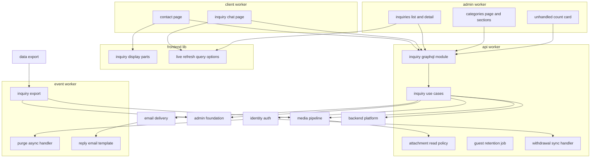
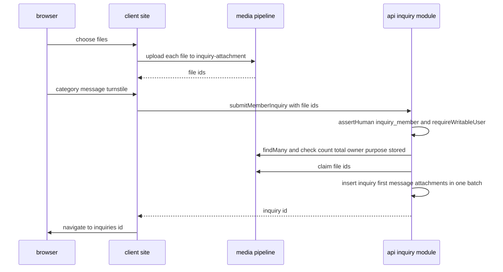
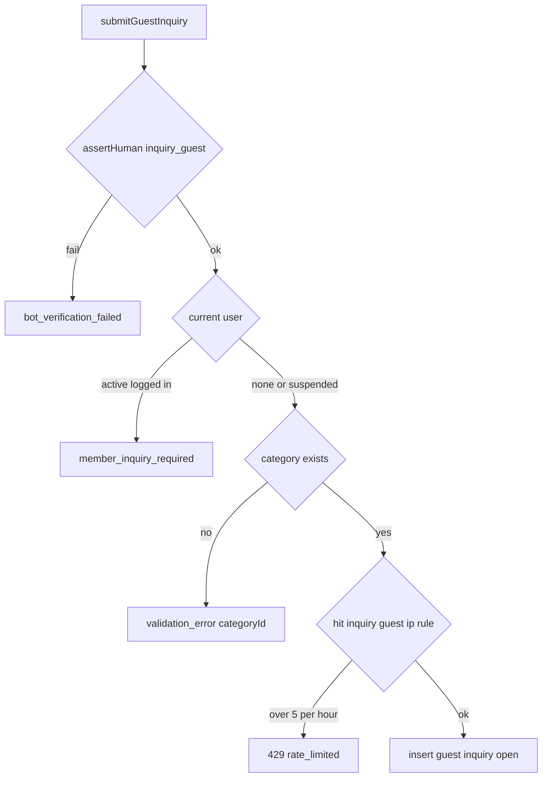
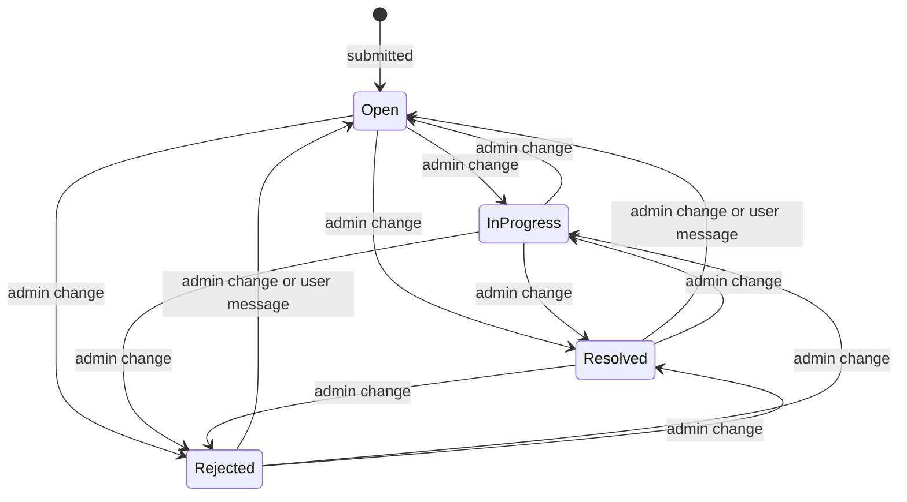
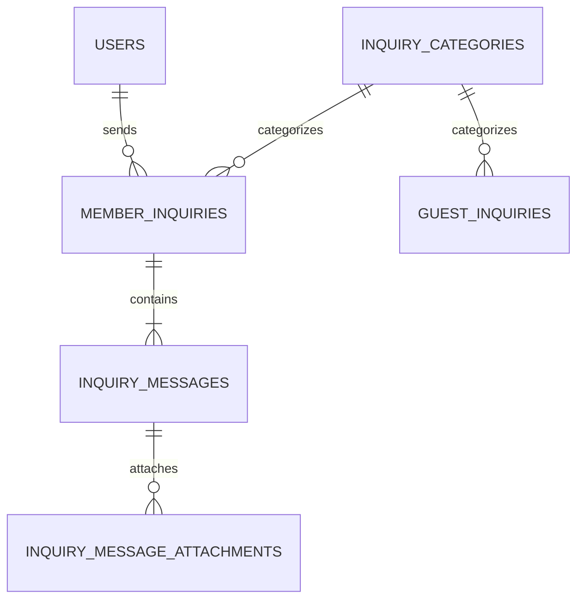
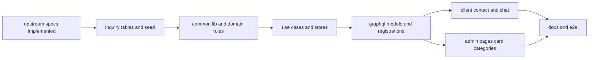

# Design Document

## Overview

**Purpose**: 利用者が運営へ問い合わせを送り、ログイン中の利用者が問い合わせごとのチャットで運営とやり取りを続けられるようにする。運営は、ログインと未ログインの問い合わせを1つの一覧で確認し、ログインの問い合わせへ返信し、対応ステータスと問い合わせカテゴリを管理する。APIサーバー(`apps/api`)・イベントサーバー(`apps/event`)・利用者側(`apps/client`)・管理者側(`apps/admin`)にまたがる縦切りの機能である。

**Users**: 利用者は`/contact`でフォームを送り、自分の過去の問い合わせを一覧し、`/inquiries/{id}`でチャットを続ける。停止中の利用者は未ログインと同じフォームを使い、既存のチャットは閲覧だけを行う。管理者は管理画面の`/inquiries`で一覧・詳細・返信・ステータスの変更を行い、`/categories`で問い合わせカテゴリを管理し、ダッシュボードで未対応の件数を確認する。後続のuser-profile-socialは利用者のプロフィール画像の照会を差し替え、product-launch・help-center・content-reportingはカテゴリのページへ区画を足し、data-exportは本specのエクスポート用の照会口`InquiryExport`を呼ぶ(本specのテーブルを直接読まない)。

**Impact**: 問い合わせカテゴリ・ログインの問い合わせ・未ログインの問い合わせ・メッセージ・添付の紐付けの5テーブル、GraphQLのスキーマモジュール`inquiry`、メール種別1つ、定期実行のジョブ1つ、ユーザーライフサイクルの波及処理2つ、アップロードの用途1つとその閲覧の方針、管理画面のカテゴリのページと区画の登録口、データエクスポート用の照会口を新設する。上流の契約の形は変えない。

### Goals

- FR-INQRY-001〜021・FR-ADMAG-023〜024・FR-ADMCF-016〜018・FR-RLMIT-003・015・020・DR-021を、要件フェーズの決定(Q1〜Q8)と仮1〜仮5のとおりに満たす。
- 未ログインの問い合わせ(停止中の利用者の送信を含む)をbot判定と送信元IPアドレス単位の回数制限で守り、保持期間で削除する。
- 添付ファイルを、投稿者本人とログイン中の管理者だけが同一オリジンからダウンロードできるようにする。
- 管理操作を監査ログに残し、未対応の件数をダッシュボードに示す。

### Non-Goals

- 未ログインの問い合わせへのシステム上の返信・受付確認のメール(1.2スコープ外)。
- メッセージの編集・削除、管理者への新着通知、担当者の割り当て、リアルタイムの配信(Q8で定期再取得に決定)。
- ファイルの受け付け・検証・保存・配信・未使用ファイルの削除と、退会者が保有するファイルの物理削除(media-pipeline・user-profile-social)。
- 運営者による代理の退会の画面(ugc-moderation。ユーザー一覧から行う)、データエクスポートの要求・ZIPの生成・添付の実体の同梱(data-export)。

## Boundary Commitments

### This Spec Owns

- 問い合わせのデータ: `inquiry_categories`・`member_inquiries`・`guest_inquiries`・`inquiry_messages`・`inquiry_message_attachments`の5テーブル(`apps/db/schema/inquiry/`)と、標準カテゴリ「その他」の初期データ。
- 問い合わせの業務処理(apiの`domain/inquiry`・`application/inquiry`・`infrastructure/inquiry`)と、GraphQLのスキーマモジュール`inquiry`(利用者側と管理者側の操作を持ち、許可リストは呼び出し元ごとに分かれる)。
- 共有の定義`apps/common-lib/inquiry/`(入力の上限・添付の上限・ステータス・標準カテゴリのID)と、監査ログの操作種別`apps/common-lib/admin/audit-actions/inquiry-chat.ts`。
- 利用者の表示用の照会口`InquirerProfiles`(既定は画像なし。user-profile-socialが差し替える)。
- データエクスポート用の照会口`InquiryExport`(`apps/backend-lib/workers/inquiry/`。data-exportがeventで呼ぶ)。
- アップロードの用途`inquiry-attachment`と、その閲覧の方針`InquiryAttachmentReadPolicy`。
- 未ログインの問い合わせの回数制限の規則`inquiry-guest:ip`と、bot判定のaction`inquiry_guest`・`inquiry_member`。
- メール種別`inquiry.reply-notification`とテンプレート。
- 定期実行のジョブ`inquiry-chat.guest-inquiry-retention`(業務時刻4:21、`order` 300)。
- ユーザーライフサイクルの波及処理: 同期`inquiry-chat.member-inquiry-withdrawal`(`withdrawn`)と非同期`inquiry-chat.member-inquiry-purge`(`purge_due`、`order` 300)。
- 利用者側の`/contact`と`/_authenticated/inquiries/$inquiryId`の画面、管理者側の`/inquiries`・`/inquiries/$inquiryId`・`/categories`の画面、カテゴリのページの区画の登録口`CATEGORY_SECTIONS`、問い合わせの詳細のページの操作の登録口`INQUIRY_DETAIL_ACTIONS`(初版は空)、ダッシュボードのカード`inquiry-chat.unhandled-inquiries`。
- 両アプリが使う問い合わせの表示部品(`apps/frontend-lib/components/inquiry/`)と、定期再取得の共通の値(`apps/frontend-lib/utilities/query/live-refresh.ts`)。
- 技術ドキュメント: `security/008`・`frontend/010`。サービス仕様のページ配置・文言規則・データ保持期間・日次タイムライン・データエクスポートの問い合わせの項目の更新。

### Out of Boundary

- アップロードの受け付け・実体検証・保存・配信・紐付けの仕組み・未使用ファイルの削除(media-pipeline)。本specは用途と閲覧の方針の登録、`findMany`・`claim`・`markDeleted`の呼び出しだけを行う。
- 退会者が保有するファイルの物理削除(user-profile-socialの`purge_due`の波及処理が`eraseOwnedBy`を呼ぶ)。本specは添付の紐付けの行だけを消す。
- 利用者のプロフィール画像の保持と、`InquirerProfiles`の画像付きの実装(user-profile-social)。
- 停止・退会の状態の遷移と判定(identity-auth)、ロールの判定・監査ログの記録と保存・管理者の照会・メニューとダッシュボードの区画・管理画面の共通部品(admin-foundation)。
- bot判定の検証・回数制限のカウンタ・送信元IPアドレスのハッシュ化・定期実行の仕組み(backend-platform)、メールの描画と送信(email-delivery)、書記素の数え方(content-processing)。
- 運営者による代理の退会の画面(ugc-moderation。ユーザー一覧から行い、本specの問い合わせの詳細からの導線は無い)、データエクスポートの要求・ZIPの生成・添付の実体の同梱とZIP内のファイル名の決定(data-export。本specは`InquiryExport`で問い合わせをエクスポート用の形で返すだけ)、他のカテゴリマスタの区画と業務規則(product-launch・help-center・content-reporting)。
- 利用者の連絡先(メールアドレス・ニックネーム・確認状態)の読み取り(identity-authの`UserContactDirectory`)。本specは返信の通知先をこれで引く。

### Allowed Dependencies

- backend-platform: `apps/db`の共通カラム(`ulidPrimaryKey`・`timestamps`・`softDelete`・`textNoCase`)と`Database`、`core`の`KeyedHasher`・`hashRateLimitKey`・`AppError`・`Clock`・`IdGenerator`・`BusinessTime`・`ScheduledJobDefinition`・`getAppLogger`・`PLATFORM_TYPES`、`workers`の`RateLimitCounterClient`。形を変えない。
- api-gateway: `GraphQLContext`(`caller`・`clientIp`・`session`・`loaders`・`resolve`・`assertHuman`)・`defineSchemaModule`・`withValidatedArgs`・`SessionView`・`LoaderDefinition`。
- identity-auth: `IDENTITY_TYPES.AccountGuard`(`currentUser`・`requireUser`・`requireWritableUser`)・`IDENTITY_PLATFORM_TYPES.UserContactDirectory`(`findContact`、`backend-lib/workers/identity`)・`UserLifecycleSyncRegistration`・`UserLifecycleSyncHandler`・`UserLifecycleAsyncRegistration`・`UserLifecycleAsyncHandler`・`LifecycleHandlerOutcome`・`USER_LIFECYCLE_SYNC_HANDLERS`・`USER_LIFECYCLE_ASYNC_HANDLERS`・`users`テーブル(読み取りと外部キーだけ)・`Viewer.status`・`viewerQueryOptions`・`_authenticated`のレイアウト。
- admin-foundation: `requireAdmin`(`admin-guard.ts`)・`CurrentAdmin`・`AdminDirectory`(`backend-lib/workers/admin`、eventでは`ADMIN_PLATFORM_MODULE`の束縛)・`AuditLogRecorder`・`PreparedAuditEntry`・`buildAuditLogStatements`・`defineAuditAction`・`AUDIT_ACTIONS`・`checkCategoryName`・`CATEGORY_NAME_MAX`・`ADMIN_NAV_ITEMS`・`DASHBOARD_CARDS`・`DashboardCardFrame`・`useAdminRole`・`RoleGate`・`frontend-lib/components/admin`(`AdminPageHeader`・`AdminDataTable`・`AdminFilterBar`・`ConfirmActionDialog`・`ReasonField`・`AdminAvatar`・`CategoryMasterEditor`)・E2Eの補助(`e2e/support/admin-bootstrap.ts`の`signInAsNewAdmin`・`signInAdmin`、`e2e/support/local-d1.ts`の`executeLocalD1`・`sqlStringLiteral`)。形を変えない。
- media-pipeline: `defineUploadPurpose`・`UPLOAD_PURPOSES`・`ATTACHMENT_MEDIA_TYPES`・`MediaFiles`(`findMany`・`claim`・`markDeleted`)・`MEDIA_TYPES`・`FileReadPolicy`・`FileReadPolicyRegistration`・`toMediaAttachment`・`mediaFileLoader`・GraphQLの`MediaAttachment`・`MediaImage`・`AttachmentUploadField`・`FileSelectionList`・`PrivateFileLink`・`MediaPicture`・`MediaPlaceholder`・`checkSelection`。形を変えない。
- email-delivery: `defineEmailKind`・`EMAIL_KINDS`・`EmailSender`・`defineEmailTemplate`・`EMAIL_TEMPLATES`・`formatUtcDateTime`。
- frontend-platform: `executeGraphQL`(`turnstileToken`)・`graphqlQueryOptions`・`GraphQLClientError`・`useAppForm`・`applyServerFieldErrors`・`FormField`・`SubmitButton`・`useTurnstileToken`・`TurnstileWidget`・状態表示とトーストの部品・shadcn/uiの部品・`DateTime`・`runAxe`・`AppForm`・`errorMessageOf`・各アプリの`src/composition/app-profile.ts`のプロファイル(`CLIENT_PROFILE`・`ADMIN_PROFILE`)・`utilities/validation/zod.ts`の`z`。
  - GraphQLの操作は各アプリの`src/graphql/operations/inquiry/`に1ファイル1操作の`*.graphql`で書き、操作名を利用者側は`Client`、管理者側は`Admin`で始める。画面は`src/graphql/generated/graphql.ts`の`<操作名>Document`と型を読み、`graphql()`と`gql.ts`・`index.ts`を使わない(frontend-platformの「操作の追加手順」)。
  - フォームは`useAppForm<TInput, TOutput>(schema, { defaultValues })`(`defaultValues`は全欄)と、必須の`onSubmitError`・任意の`serverFieldPrefix`(`input`を取るmutationは`"input"`)を受ける`AppForm`で作る。フォームのスキーマの`zod`の値は`utilities/validation/zod.ts`から読み、`zod`を直接読み込むのは型だけにする。
  - 失敗の文言: `GraphQLClientError`でない例外に代えて画面に出す文言(`ErrorState`・`PartialErrorState`の`message`、`AppForm`の`onSubmitError`で示す文言、トースト)は`errorMessageOf(error, <プロファイル>.contactAvailable)`で選び、例外の`message`を直接出さない。管理者側は`ADMIN_PROFILE`を使い、`ErrorState`・`UnexpectedErrorView`に`contactHref`を渡さない(問い合わせの画面が無いため、問い合わせの導線と問い合わせを促す文を出さない)。
  - bot判定の`TurnstileWidget`は非表示のウィジェットで場所を取らないため、フォームに判定の枠の表示と場所を設けない。
- content-processing: `apps/common-lib`の`countGraphemes`と共有ディレクトリの配置。
- npmパッケージ: 上流の版だけを使い、新規は無い。

### Revalidation Triggers

- `InquiryExport`の形・並び・1回の件数と、データエクスポートの文書の`inquiries.json`の項目との対応、管理者の返信に添付が無いこと(data-export)。data-exportは本specのテーブルを直接読まないため、テーブルの列の変更は`InquiryExport`の形を変えない限り再検証の対象にならない。
- `InquirerProfiles`の形と既定の実装の差し替えの手順(user-profile-social)。
- `CATEGORY_SECTIONS`の形と`order`(product-launch 10・help-center 20・inquiry-chat 30・content-reporting 40)、`/categories`のページの区画の表示とエラーの分離(product-launch・help-center・content-reporting)。
- `INQUIRY_DETAIL_ACTIONS`の形(`InquiryDetailActionContext`の項目)と`order`、詳細のページでの操作の表示の位置とエラーの分離(後続specの操作。2026-10-24の時点で登録するspecは無い)。
- 未ログインの問い合わせが利用者のアカウントに紐付かないこと(ugc-moderationの退会の依頼の確かめ方)。
- 波及処理の名前と`order`(identity-authの登録口、他の`purge_due`の波及処理との並び)。
- 定期実行のジョブの名前と`order`(300)(4:21にジョブを登録する全spec、日次タイムラインの表)。
- `INQUIRY_ATTACHMENT_LIMITS`(仮3、20,971,520バイト)とmedia-pipelineの`MAX_UPLOAD_BYTES`(20,971,520バイト)が等しいこと。どちらかを変えたら他方を確かめ直す。
- 上流の`AccountGuard`・`UserContactDirectory`・`AdminDirectory`(置き場所とeventでの束縛を含む)・`FileReadPolicy`・`MediaFiles.findMany`・`AuditLogRecorder`・`DASHBOARD_CARDS`・`CategoryMasterEditor`・admin-foundationのE2Eの補助の形を変えたら、本specを確かめ直す。

### 上流への影響

| 上流spec           | 変更                                                                                                                                                                                                                                                                                                                                  | 影響と再検証                                                                                                                                    |
| ------------------ | ------------------------------------------------------------------------------------------------------------------------------------------------------------------------------------------------------------------------------------------------------------------------------------------------------------------------------------- | ----------------------------------------------------------------------------------------------------------------------------------------------- |
| media-pipeline     | `apps/api/src/composition/upload-purposes.ts`へ`inquiry-attachment`を、`file-read-policies.ts`へ`InquiryAttachmentReadPolicy`を加える                                                                                                                                                                                                 | 契約どおり。再検証は不要                                                                                                                        |
| identity-auth      | `apps/api/src/composition/user-lifecycle-sync-handlers.ts`と`apps/event/src/composition/user-lifecycle-async-handlers.ts`へ1行ずつ加える。返信の通知先は共有の部品`UserContactDirectory`(identity-authがapi・eventで束縛)で引く                                                                                                       | 契約どおり。`UserContactDirectory`はspec横断レビューの決定(2026-10-23)でidentity-authが提供する                                                 |
| admin-foundation   | `ADMIN_NAV_ITEMS`へ`/inquiries`(80)・`/categories`(110)を、`DASHBOARD_CARDS`へ`inquiry-chat.unhandled-inquiries`(20)を、`audit-actions/index.ts`へ本specのファイルを加える。`AdminDirectory`を`backend-lib/workers/admin`から使い、eventでは`ADMIN_PLATFORM_MODULE`の束縛を使う。E2Eは`admin-bootstrap.ts`・`local-d1.ts`の補助を使う | 契約どおり。`/categories`のページの所有は仮4。`AdminDirectory`の置き場所とE2Eの補助はspec横断レビューの決定(2026-10-23)でadmin-foundationが持つ |
| email-delivery     | `core/email/kinds/index.ts`・`templates/index.ts`へ1行ずつ加える                                                                                                                                                                                                                                                                      | 契約どおり                                                                                                                                      |
| content-processing | 日次タイムラインの表に本specの1行を足す(表が無ければ作る)                                                                                                                                                                                                                                                                             | 規約どおり                                                                                                                                      |

## Architecture

### Existing Architecture Analysis

- 上流の8specは設計・タスクとも承認済みで、本specのタスクはそれらの実装の完了を前提にする(roadmapの順でadmin-foundationまでが先に実装される)。
- apiの層は`domain`・`application`・`infrastructure`・`presentation`・`composition`で、依存の方向は静的解析で強制される。application層はセッションを`SessionView`で受け取る。
- 利用者側の`_authenticated`のレイアウトはログインを確かめて`viewer`を文脈に渡し、`viewer.status`で停止中を判別できる。管理者側の`_authenticated`は`adminViewer`とロールを配る。

### Architecture Pattern & Boundary Map



**Architecture Integration**:

- 選んだパターン: backend-platformの4層と合成ルートに従い、apiに`inquiry`モジュールを置く。利用者側と管理者側の操作は1つのスキーマモジュールに置き、リゾルバの冒頭で`context.caller`と権限を確かめる。
- 境界: 本specは問い合わせ・メッセージ・カテゴリの状態を所有し、他ドメインのデータを変えない。継ぎ目は上流の登録箇所への追記と、本specが新設する`InquirerProfiles`・`CATEGORY_SECTIONS`・`INQUIRY_DETAIL_ACTIONS`・`InquiryExport`だけである。
- 新規コンポーネントの理由: research.mdの「Design Decisions」を参照。

### Dependency Direction

- 共有コード: `apps/db/schema/inquiry`(`users`の定義を外部キーのためだけに読み込む) → `apps/common-lib/inquiry`(`countGraphemes`だけを読み込む) → `apps/backend-lib/workers/inquiry`(`InquiryExport`。`apps/db/schema/inquiry`・`backend-lib/workers/admin`の`AdminDirectory`・`backend-lib/workers/media`の`MediaFiles`を読み込む) → アプリの`src`。
- apiの`src`内: `domain/inquiry` ← `application/inquiry`(`application/identity`の`AccountGuard`・`application/admin`の`AuditLogRecorder`・`CurrentAdmin`、`backend-lib/workers/admin`の`AdminDirectory`、`backend-lib/workers/identity`の`UserContactDirectory`、`backend-lib/workers/media`の型を読み込む) ← `infrastructure/inquiry`(`infrastructure/admin/audit-log-statements.ts`を読み込む)・`presentation/graphql/modules/inquiry`(`admin-guard.ts`を読み込む) ← `composition`。`inquiry`の各層は`identity`・`admin`の各層のうち上記の公開の部品だけを読み込む。違反はapiの`eslint.config.ts`の`no-restricted-imports`で検出する。
- eventの`src`内: `application/inquiry` ← `infrastructure/inquiry` ← `composition`(`backend-lib/workers/inquiry`の`InquiryExport`を束縛する)。
- client・adminの`src`内: frontend-platformの規則(`composition` ← `components` ← `routes`)に従う。`frontend-lib/components/inquiry`はGraphQLとアプリの型に依存しない。

### Technology Stack

| Layer        | Choice / Version                                                            | Role in Feature                                | Notes                                                                   |
| ------------ | --------------------------------------------------------------------------- | ---------------------------------------------- | ----------------------------------------------------------------------- |
| 状態         | Cloudflare D1(drizzle-orm 1.0.0-rc.5)                                       | カテゴリ・問い合わせ・メッセージ・添付の紐付け | 新しいテーブル5つ                                                       |
| 回数制限     | Durable Objects`RateLimitCounter`(backend-platform)                         | 未ログインの送信のIP単位の制限                 | 既存の`RATE_LIMIT_COUNTER`                                              |
| bot判定      | Turnstile(backend-platformの`BotVerifier`、frontend-platformのウィジェット) | フォームの送信の検証                           | 既存                                                                    |
| 定期・非同期 | Cron Triggers(api)・Queues(eventのライフサイクルの実行器)                   | 未ログインの保持期間・退会者の物理削除         | 上流の基盤                                                              |
| ファイル     | media-pipelineの用途・`MediaFiles`・`FileReadPolicy`・部品                  | 添付のアップロード・紐付け・ダウンロード       | 既存                                                                    |
| メール       | email-deliveryの`EmailSender`・React Email                                  | 返信の通知メール                               | 既存                                                                    |
| 画面         | TanStack Start・TanStack Query・react-hook-form・zod・shadcn/ui             | フォーム・チャット・一覧・定期再取得           | frontend-platformの版。`zod`の値は`utilities/validation/zod.ts`から読む |
| テスト       | bun test・vitest 4.1.11(Workers・Browser)・Playwright 1.64.1・Mailpit       | 単体・Workers統合・ブラウザ・E2E               | 上流の版                                                                |

## File Structure Plan

### Directory Structure

```
apps/
├── db/schema/inquiry/                                  # 問い合わせのテーブル定義(各ファイルに同名の*.unit.test.ts)
│   ├── inquiry-categories.ts · member-inquiries.ts · guest-inquiries.ts
│   ├── inquiry-messages.ts · inquiry-message-attachments.ts
│   └── index.ts                                        # inquiryのテーブルの集約(schema/index.tsから再エクスポート)
├── common-lib/
│   ├── inquiry/                                        # 4アプリ共通の純粋な定義(各ファイルに同名の*.unit.test.ts)
│   │   ├── inquiry-input-rules.ts                      # ニックネーム・メッセージ・チャットの上限と判定、メールアドレスの長さ
│   │   ├── inquiry-attachment-limits.ts                # INQUIRY_ATTACHMENT_PURPOSE・INQUIRY_ATTACHMENT_LIMITS・checkAttachmentTotals
│   │   ├── inquiry-status.ts                           # InquiryStatus・INQUIRY_STATUS_LABELS・InquiryKind
│   │   └── inquiry-category-constants.ts               # INQUIRY_CATEGORY_OTHER_ID・INQUIRY_CATEGORY_OTHER_NAME
│   └── admin/audit-actions/inquiry-chat.ts             # inquiry.reply・inquiry.status-change・inquiry-category.create・rename・delete
├── backend-lib/core/email/kinds/inquiry.ts             # inquiry.reply-notification
├── backend-lib/workers/inquiry/
│   └── inquiry-export.ts                               # InquiryExport・D1InquiryExport・INQUIRY_EXPORT_TYPES(データエクスポート用、apiのWorkers統合テスト併置)
├── api/src/
│   ├── domain/inquiry/                                 # 純粋な規則(Bunの単体テスト)
│   │   ├── inquiry-status-rules.ts                     # 利用者の送信による戻し・管理操作の可否(退会済み・種別)
│   │   ├── inquiry-category-rules.ts                   # 標準カテゴリの保護・並び順
│   │   └── attachment-selection.ts                     # 添付の件数・合計・保有者・用途・保存状態の判定
│   ├── application/inquiry/                            # ポートとユースケース(Bunの単体テスト)
│   │   ├── inquiry-types.ts                            # INQUIRY_TYPES
│   │   ├── ports.ts                                    # 各ストア・照会・メール・設定値
│   │   ├── inquiry-category-service.ts                 # 一覧・追加・名前の変更・削除と付け替え
│   │   ├── guest-inquiry-submission.ts                 # 未ログイン(停止中を含む)の送信と回数制限
│   │   ├── member-inquiry-submission.ts                # ログインの送信
│   │   ├── inquiry-attachment-binder.ts                # 添付の検証・紐付け・失敗時の論理削除
│   │   ├── inquiry-chat-service.ts                     # 本人の閲覧・追加メッセージ・自分の一覧
│   │   ├── inquiry-admin-service.ts                    # 管理者の一覧・詳細・未対応の件数
│   │   ├── inquiry-reply-service.ts                    # 返信と通知メール
│   │   ├── inquiry-status-service.ts                   # ステータスの変更
│   │   └── jobs/guest-inquiry-retention-job.ts         # 未ログインの保持期間の物理削除(order 300)
│   ├── infrastructure/inquiry/                         # Workers統合テスト
│   │   ├── d1-inquiry-category-store.ts · d1-member-inquiry-store.ts · d1-guest-inquiry-store.ts
│   │   ├── d1-inquiry-status-store.ts                  # 2テーブルのステータスの照会と条件付きの変更
│   │   ├── d1-inquiry-admin-reader.ts                  # 2テーブルの横断の一覧・詳細・未対応の件数
│   │   ├── sentry-inquiry-incident-reporter.ts         # 通知メールの失敗・添付の解放の失敗の報告
│   │   ├── d1-inquirer-profiles.ts                     # InquirerProfilesの既定の実装(画像はnull)
│   │   ├── inquiry-attachment-read-policy.ts           # FileReadPolicy(本人・管理者)
│   │   ├── member-inquiry-withdrawal-handler.ts        # 同期の波及処理(論理削除の文)
│   │   ├── inquiry-cursor.ts                           # カーソルの符号化と復号(単体テスト併置)
│   │   └── email-inquiry-mailer.ts                     # 返信の通知メールの送信要求とリンクのURL
│   ├── presentation/graphql/modules/inquiry/           # スキーマモジュール(Workers統合テスト)
│   │   ├── type-defs.ts · inputs.ts · errors.ts · mappers.ts
│   │   ├── contact-resolvers.ts                        # カテゴリ・送信者の表示・未ログインとログインの送信
│   │   ├── chat-resolvers.ts                           # 自分の一覧・チャット・追加メッセージ
│   │   ├── admin-inquiry-resolvers.ts                  # 一覧・詳細・返信・ステータス・未対応の件数
│   │   ├── admin-category-resolvers.ts                 # カテゴリの追加・名前の変更・削除
│   │   └── index.ts                                    # inquirySchemaModule
│   └── composition/inquiry-module.ts                   # INQUIRY_TYPESの束縛とジョブのハンドラー(AppModule)
├── event/src/
│   ├── application/inquiry/
│   │   ├── event-inquiry-types.ts · ports.ts           # EVENT_INQUIRY_TYPES・MemberInquiryPurgeStore
│   │   └── member-inquiry-purge-handler.ts             # purge_dueの非同期の波及処理
│   ├── infrastructure/inquiry/d1-member-inquiry-purge-store.ts
│   ├── infrastructure/email/templates/inquiry/
│   │   ├── inquiry-reply-body.tsx · inquiry-reply-template.ts
│   └── composition/inquiry-module.ts                   # 束縛(AppModule。InquiryExportを含む)
├── frontend-lib/
│   ├── utilities/query/live-refresh.ts                 # LIVE_REFRESH_QUERY_OPTIONS(単体テスト併置)
│   └── components/inquiry/                             # 両アプリの表示部品(*.browser.test.tsx・*.stories.tsxを併置)
│       ├── inquiry-status-badge.tsx                    # 4種のステータスの表示
│       ├── inquiry-message-card.tsx                    # 送信者・本文・添付・日時の1件
│       ├── inquiry-attachment-list.tsx                 # PrivateFileLinkによる添付の一覧
│       └── inquirer-avatar.tsx                         # MediaPictureと既定のアイコン
├── client/src/
│   ├── routes/contact.tsx                              # /contact(ログイン不要)
│   ├── routes/_authenticated/inquiries/$inquiryId.tsx  # /inquiries/{id}
│   ├── components/inquiry/                             # *.browser.test.tsxを併置
│   │   ├── contact-page.tsx                            # 状態に応じたフォームの切り替えと一覧
│   │   ├── guest-inquiry-form.tsx · member-inquiry-form.tsx · guest-inquiry-complete.tsx
│   │   ├── suspended-contact-notice.tsx                # 停止中の利用者へのフォームの案内
│   │   ├── my-inquiry-list.tsx                         # 自分の問い合わせの一覧と続きの読み込み
│   │   ├── inquiry-chat-view.tsx                       # チャットの表示と定期再取得
│   │   ├── inquiry-message-composer.tsx                # 追加メッセージの入力と添付
│   │   ├── suspended-chat-notice.tsx                   # 停止中の送信欄の代わりの案内
│   │   └── inquiry-form-schemas.ts                     # フォームのスキーマ(zodの値はutilities/validation/zod.ts、common-libの規則)
│   └── graphql/operations/inquiry/                     # 1ファイル1操作の*.graphql(操作名はClientで始める)
│       ├── contact/*.graphql · chat/*.graphql
└── admin/src/
    ├── routes/_authenticated/
    │   ├── inquiries/index.tsx · inquiries/$inquiryId.tsx
    │   └── categories/index.tsx                        # カテゴリのページ(区画を並べる)
    ├── components/inquiry/                             # *.browser.test.tsxを併置
    │   ├── admin-inquiry-filters.tsx · admin-inquiry-list.tsx · inquiry-period.ts
    │   ├── member-inquiry-detail.tsx · guest-inquiry-detail.tsx
    │   ├── inquiry-reply-form.tsx · inquiry-status-control.tsx
    │   ├── inquiry-detail-actions-view.tsx             # 詳細のページの操作の並びとエラーの分離
    │   ├── unhandled-inquiries-card.tsx                # ダッシュボードのカード
    │   └── inquiry-category-section.tsx                # カテゴリのページの区画
    ├── components/categories/category-sections-view.tsx # 区画の並びとエラーの分離
    ├── composition/category-sections.ts                # CATEGORY_SECTIONS(後続specが追記)
    ├── composition/inquiry-detail-actions.ts           # INQUIRY_DETAIL_ACTIONS(初版は空、後続specが追記)
    └── graphql/operations/inquiry/                     # 1ファイル1操作の*.graphql(操作名はAdminで始める)
        ├── inquiries/*.graphql · categories/*.graphql
e2e/                                                    # 管理者の用意とローカルのD1の操作はadmin-foundationの補助(support/admin-bootstrap.ts・support/local-d1.ts)を使う
├── client/inquiry/guest-inquiry.e2e.test.ts · member-inquiry-chat.e2e.test.ts · suspended-contact.e2e.test.ts
└── admin/inquiries.e2e.test.ts · inquiry-categories.e2e.test.ts
docs/GUIDES/tech/
├── security/008-anonymous-submission-protection.md
└── frontend/010-live-refresh-queries.md
```

テストファイルは同名の`*.unit.test.ts`(`domain`・`application`・`common-lib`・`db/schema`・`utilities`)、`*.worker.test.ts`(`infrastructure`・`presentation`・`composition`・`backend-lib/workers/inquiry`)、`*.browser.test.tsx`(画面部品)を対象ファイルの隣に置く。文書の番号は、roadmapの順でadmin-foundation・legal-pages(`db/005`)の後の空き番号(`security/008`・`frontend/010`)に固定する。

### Modified Files

- `apps/db/schema/index.ts` — inquiryのテーブルを再エクスポートする。`apps/db/migrations/<日時>_inquiry_chat/migration.sql`を生成し、標準カテゴリ「その他」の挿入をカスタムマイグレーション`<日時>_inquiry_chat_seed`で加える(`db/001`の手順)。mainの最新を取り込んでから生成する。
- `apps/common-lib/admin/audit-actions/index.ts` — 本specの操作種別を連結に加える。
- `apps/backend-lib/core/email/kinds/index.ts`・`apps/event/src/infrastructure/email/templates/index.ts` — 種別とテンプレートを1行ずつ加える。
- `apps/api/src/composition/modules.ts`・`graphql-modules.ts`・`scheduled-jobs.ts`・`upload-purposes.ts`・`file-read-policies.ts`・`user-lifecycle-sync-handlers.ts` — `INQUIRY_MODULE`、`inquirySchemaModule`、ジョブ、`inquiry-attachment`、閲覧の方針、同期の波及処理を加える。
- `apps/api/eslint.config.ts`・`test/config/layer-rules.unit.test.ts` — `inquiry`の各層が`identity`・`admin`の各層の公開の部品以外を読み込まない規則と違反例を加える。
- `apps/event/src/composition/modules.ts`・`user-lifecycle-async-handlers.ts` — `EVENT_INQUIRY_MODULE`と非同期の波及処理を加える。
- `apps/admin/src/composition/admin-navigation.ts`・`dashboard-cards.ts` — 問い合わせ・カテゴリの項目とカードを加える。
- `docs/GUIDES/tech/{security,frontend}/README.md` — 新しい文書を1行ずつ追記する。
- `docs/GUIDES/service/design/002-page-layouts.md` — 「問い合わせ」に`/contact`の構成(状態ごとのフォーム・自分の問い合わせの一覧)・停止中の表示・チャットの定期再取得を、管理者側ページ一覧に問い合わせの一覧と詳細・カテゴリのページの区画の分担を追記する。
- `docs/GUIDES/service/design/003-text-and-copy-rules.md` — 本specのエラー・状態・案内の文言と、返信の通知メールの本文の要点を追記する。
- `docs/GUIDES/service/legal/001-compliance-policy.md` — データ保持期間の一覧にログインの問い合わせ(退会まで)と未ログインの問い合わせの回数制限のカウントを加え、未ログインの問い合わせの行に停止中の利用者の送信を含む旨を加える。
- `docs/GUIDES/service/overview/007-daily-timeline.md` — 日次バッチのジョブの表に本specの1行(300)を加える。表が無ければ作る。
- `docs/GUIDES/service/features/001-user-data-export.md` — `inquiries.json`の「メッセージや添付ファイルは管理者による投稿も含む」を「メッセージは管理者の返信も含む。添付ファイルは利用者のメッセージだけにある」へ、`category`の説明を「現在のカテゴリ名(削除されたカテゴリは「その他」)」へ改め、問い合わせは作成の順・メッセージは送信日時の古い順に並ぶことを加える(Q6・付け替え・13.7)。
- `docs/onboardings/project-values.md` — ジョブの名前と順序、波及処理の名前、メール種別、回数制限の規則、bot判定のaction、用途を記載する。
- `CLAUDE.md` — 「技術規則の参照先」に、未ログインの投稿を受け付ける前に読む文書(`security/008`)へのリンクを加える。

## System Flows

### ログインの問い合わせの送信と添付の紐付け



- 一括の書き込みに失敗したら`MediaFiles.markDeleted(fileIds)`を呼び、紐付け済みのファイルを日次バッチの物理削除に任せる(要件6.3)。追加メッセージも同じ順序で、対応ステータスの「未対応」への戻しを同じ一括の書き込みに含める(要件8.2)。

### 未ログインの送信(停止中の利用者を含む)



- 回数は入力の検証とbot判定と利用者の判定を通った送信だけを数え、Durable ObjectのAlarmで最初の送信から1時間後に消える(要件4.4〜4.6)。送信元IPアドレスが不明なら数えずに警告`guest-inquiry-ip-missing`をログに残し、bot判定で守る。

### 対応ステータス



- 管理者は任意の別の値へ変更できる。利用者の追加メッセージは「対応済」「却下」だけを「未対応」へ戻す(要件8.2・12.4)。変更のたびに`status_changed_at`を更新する。退会済みの問い合わせは管理操作を受け付けない(要件12.3)。

### 退会と物理削除

- 退会の確定と同じ一括の書き込みで、同期の波及処理が`UPDATE member_inquiries SET deleted_at = ? WHERE user_id = ? AND deleted_at IS NULL`を返す(要件13.1)。
- `purge_due`の非同期の波及処理が、利用者の問い合わせを100件ずつ選び、添付の紐付け・メッセージ・問い合わせの順に1つの一括の書き込みで削除する。残りがあれば`continue`を返す(要件13.2・13.6)。ファイルの実体の削除はuser-profile-socialの波及処理が行う。identity-authの最後の`users`の削除は全波及処理の完了後に走るため、`member_inquiries.user_id`の外部キーは取り残しの検出に働く。

## Requirements Traceability

| Requirement | Summary                      | Components                                                                                                                | Interfaces / Flows                                                                 |
| ----------- | ---------------------------- | ------------------------------------------------------------------------------------------------------------------------- | ---------------------------------------------------------------------------------- |
| 1.1〜1.7    | カテゴリのマスタ             | InquiryCategoryRules・InquiryCategoryService・D1InquiryCategoryStore・InquirySchema                                       | `createInquiryCategory`・`renameInquiryCategory`・`deleteInquiryCategory`          |
| 1.8         | カテゴリのページと区画       | CategorySectionsRegistry・CategorySectionsView・InquiryCategorySection                                                    | `CATEGORY_SECTIONS`                                                                |
| 2.1〜2.6    | フォームの表示               | ContactPage・GuestInquiryForm・MemberInquiryForm・SuspendedContactNotice・InquirerAvatar・InquirerProfiles                | `inquiryCategories`・`inquiryComposer`・`viewer.status`                            |
| 3.1〜3.6    | 未ログインの送信             | GuestInquirySubmission・D1GuestInquiryStore・GuestInquiryComplete                                                         | `submitGuestInquiry`・未ログインの送信の流れ                                       |
| 4.1〜4.8    | 濫用対策                     | GuestInquirySubmission・MemberInquirySubmission・ContactResolvers                                                         | `inquiry_guest`・`inquiry_member`・`inquiry-guest:ip`                              |
| 5.1〜5.5    | ログインの送信               | MemberInquirySubmission・InquiryAttachmentBinder・D1MemberInquiryStore・MemberInquiryForm                                 | `submitMemberInquiry`・送信の流れ                                                  |
| 6.1〜6.8    | 添付ファイル                 | InquiryAttachmentLimits・AttachmentSelection・InquiryAttachmentBinder・InquiryAttachmentReadPolicy・InquiryAttachmentList | `inquiry-attachment`・`FileReadPolicy`                                             |
| 7.1〜7.8    | チャットの閲覧               | InquiryChatService・InquiryChatView・InquiryMessageCard・LiveRefresh・SuspendedChatNotice                                 | `memberInquiry`・`LIVE_REFRESH_QUERY_OPTIONS`                                      |
| 8.1〜8.6    | 追加メッセージ               | InquiryChatService・InquiryStatusRules・InquiryAttachmentBinder・InquiryMessageComposer                                   | `postInquiryMessage`                                                               |
| 9.1〜9.4    | 自分の一覧                   | InquiryChatService・MyInquiryList                                                                                         | `myInquiries`                                                                      |
| 10.1〜10.7  | 管理画面の一覧と詳細         | InquiryAdminService・D1InquiryAdminReader・AdminInquiryList・MemberInquiryDetail・GuestInquiryDetail                      | `adminInquiries`・`adminInquiry`                                                   |
| 11.1〜11.8  | 返信と通知メール             | InquiryReplyService・EmailInquiryMailer・InquiryReplyTemplate・InquiryReplyForm                                           | `replyToInquiry`・`UserContactDirectory.findContact`・`inquiry.reply-notification` |
| 12.1〜12.5  | 対応ステータス               | InquiryStatusRules・InquiryStatusService・InquiryStatusControl                                                            | `changeInquiryStatus`・対応ステータスの状態図                                      |
| 13.1〜13.6  | 退会とデータの保持           | MemberInquiryWithdrawalHandler・MemberInquiryPurgeHandler・GuestInquiryRetentionJob                                       | 退会と物理削除                                                                     |
| 13.7        | データエクスポート用の照会口 | InquiryExport                                                                                                             | `InquiryExport.listPage`                                                           |
| 14.1〜14.4  | 未対応の件数                 | InquiryAdminService・UnhandledInquiriesCard                                                                               | `adminUnhandledInquiryCount`・`DASHBOARD_CARDS`                                    |
| 15.1〜15.4  | 監査ログ                     | InquiryAuditActions・各ユースケース・各D1ストア                                                                           | `prepare`・`buildAuditLogStatements`                                               |
| 16.1〜16.6  | テスト・文書                 | InquiryE2E・InquiryDocs                                                                                                   | —                                                                                  |

## Components and Interfaces

| Component                                                                                                     | Domain/Layer        | Intent                           | Req Coverage                                   | Key Dependencies                                                      | Contracts |
| ------------------------------------------------------------------------------------------------------------- | ------------------- | -------------------------------- | ---------------------------------------------- | --------------------------------------------------------------------- | --------- |
| InquirySchema                                                                                                 | db                  | 5テーブルと初期データ            | 1.1, 3.1, 5.1, 6.1, 12.1, 13.1                 | drizzle (P0)・`users` (P0)                                            | State     |
| InquiryInputRules・InquiryAttachmentLimits・InquiryStatus・InquiryCategoryConstants                           | common-lib          | 共有の規則と定数                 | 1.2, 3.1, 5.1, 6.1, 8.1, 11.1, 12.1            | countGraphemes (P0)                                                   | State     |
| InquiryAuditActions                                                                                           | common-lib          | 操作種別                         | 15.1〜15.4                                     | defineAuditAction (P0)                                                | State     |
| InquiryStatusRules・InquiryCategoryRules・AttachmentSelection                                                 | api/domain          | 純粋な規則                       | 1.4, 1.7, 6.1, 6.3, 8.2, 10.7, 11.7, 12.3      | —                                                                     | State     |
| InquiryPorts                                                                                                  | api/application     | ストア・照会・メール・設定       | 各ユースケース                                 | —                                                                     | Service   |
| InquiryCategoryService                                                                                        | api/application     | カテゴリのマスタ                 | 1.2〜1.7, 15.1                                 | AuditLogRecorder (P0)                                                 | Service   |
| GuestInquirySubmission・MemberInquirySubmission                                                               | api/application     | 送信                             | 3.1〜3.6, 4.1〜4.8, 5.1〜5.5                   | AccountGuard (P0)・RateLimitCounterClient (P0)                        | Service   |
| InquiryAttachmentBinder                                                                                       | api/application     | 添付の検証と紐付け               | 6.1, 6.3                                       | MediaFiles (P0)                                                       | Service   |
| InquiryChatService                                                                                            | api/application     | 本人の閲覧・追加メッセージ・一覧 | 7.1, 7.3, 7.8, 8.1〜8.5, 9.1, 13.3             | AccountGuard (P0)                                                     | Service   |
| InquiryAdminService・InquiryReplyService・InquiryStatusService                                                | api/application     | 管理者の操作                     | 10.1〜10.7, 11.1〜11.8, 12.2〜12.4, 14.1, 14.2 | AuditLogRecorder (P0)・AdminDirectory (P0)・UserContactDirectory (P0) | Service   |
| GuestInquiryRetentionJob                                                                                      | api/application     | 保持期間の削除                   | 13.4, 13.5                                     | CronRegistry (P0)                                                     | Batch     |
| D1InquiryStores・D1InquiryAdminReader・D1InquirerProfiles・InquiryCursor・SentryInquiryIncidentReporter       | api/infrastructure  | D1の実装・報告                   | 各ユースケース, 11.4                           | Database (P0)・buildAuditLogStatements (P0)                           | Service   |
| InquiryAttachmentReadPolicy                                                                                   | api/infrastructure  | 添付の閲覧の判定                 | 6.6, 6.7                                       | FileReadPolicy (P0)                                                   | Service   |
| MemberInquiryWithdrawalHandler                                                                                | api/infrastructure  | 退会の同期の波及処理             | 13.1                                           | UserLifecycleSyncHandler (P0)                                         | Event     |
| EmailInquiryMailer・InquiryReplyTemplate                                                                      | api・event          | 返信の通知メール                 | 11.2, 11.3                                     | EmailSender (P0)                                                      | Event     |
| InquirySchemaModule                                                                                           | api/presentation    | GraphQLの型・リゾルバ            | 2.1, 3〜15の各操作                             | api-gateway (P0)・requireAdmin (P0)                                   | API       |
| ApiInquiryComposition                                                                                         | api/composition     | 束縛・登録                       | 6.4, 13.1, 13.4                                | 上流の登録箇所 (P0)                                                   | State     |
| MemberInquiryPurgeHandler                                                                                     | event               | 退会者の物理削除                 | 13.2, 13.6                                     | UserLifecycleAsyncHandler (P0)                                        | Event     |
| InquiryExport                                                                                                 | backend-lib/workers | データエクスポート用の照会       | 13.7                                           | AdminDirectory (P0)・MediaFiles (P0)                                  | Service   |
| LiveRefresh・InquiryDisplayParts                                                                              | frontend-lib        | 定期再取得の値・表示部品         | 6.5, 7.4〜7.7, 10.6                            | TanStack Query (P0)・media-pipeline部品 (P0)                          | State     |
| ContactPage・GuestInquiryForm・MemberInquiryForm・GuestInquiryComplete・SuspendedContactNotice・MyInquiryList | client              | `/contact`                       | 2.1〜2.6, 3.2, 5.2, 6.2, 9.1〜9.4              | useTurnstileToken (P0)・AttachmentUploadField (P0)                    | State     |
| InquiryChatView・InquiryMessageComposer・SuspendedChatNotice                                                  | client              | `/inquiries/{id}`                | 7.1〜7.8, 8.1, 8.3, 8.6                        | LiveRefresh (P0)                                                      | State     |
| AdminInquiryPages・InquiryReplyForm・InquiryStatusControl・UnhandledInquiriesCard                             | admin               | 問い合わせの画面とカード         | 10.1〜10.7, 11.4, 12.5, 14.1, 14.3, 14.4       | AdminCommonParts (P0)                                                 | State     |
| InquiryDetailActionsRegistry・InquiryDetailActionsView                                                        | admin               | 詳細のページの操作の差し込み口   | 10.4, 10.5                                     | AdminInquiryPages (P0)                                                | State     |
| CategorySectionsRegistry・CategorySectionsView・InquiryCategorySection                                        | admin               | カテゴリのページ                 | 1.6, 1.8                                       | CategoryMasterEditor (P0)                                             | State     |
| InquiryE2E・InquiryDocs                                                                                       | e2e・docs           | E2Eと文書                        | 16.1〜16.6                                     | Playwright・Mailpit (P0)                                              | —         |

### common-lib

#### InquiryInputRules・InquiryAttachmentLimits・InquiryStatus・InquiryCategoryConstants

**Contracts**: State [x]

```typescript
// inquiry-input-rules.ts(書記素はcountGraphemes、前後の空白を除いてから数える)
export declare const GUEST_NICKNAME_MAX: 25;
export declare const INQUIRY_BODY_MAX: 5000;
export declare const CHAT_MESSAGE_MAX: 1000; // 利用者の追加メッセージと管理者の返信
export declare const CONTACT_EMAIL_MAX: 254;
export declare function checkGuestNickname(
  value: string,
): 'empty' | 'too-long' | undefined;
export declare function checkInquiryBody(
  value: string,
): 'empty' | 'too-long' | undefined;
export declare function checkChatMessage(
  value: string,
): 'empty' | 'too-long' | undefined;

// inquiry-attachment-limits.ts
export declare const INQUIRY_ATTACHMENT_PURPOSE: 'inquiry-attachment';
export declare const INQUIRY_ATTACHMENT_LIMITS: {
  readonly maxCount: 20;
  readonly maxTotalBytes: 20_971_520;
  readonly maxFileBytes: 20_971_520;
}; // 仮3。media-pipelineのMAX_UPLOAD_BYTESと同じ値
export declare function checkAttachmentTotals(
  sizes: readonly number[],
): 'too-many' | 'too-large' | undefined;

// inquiry-status.ts
export type InquiryStatus = 'open' | 'in_progress' | 'resolved' | 'rejected';
export declare const INQUIRY_STATUSES: readonly InquiryStatus[];
export declare const INQUIRY_STATUS_LABELS: Readonly<
  Record<InquiryStatus, string>
>; // 未対応・対応中・対応済・却下
export type InquiryKind = 'member' | 'guest';

// inquiry-category-constants.ts
export declare const INQUIRY_CATEGORY_OTHER_ID: '01JC0000000000000000000000'; // 初期データの固定ULID
export declare const INQUIRY_CATEGORY_OTHER_NAME: 'その他';
```

- カテゴリ名はadmin-foundationの`checkCategoryName`(1〜30書記素)を使う。メールアドレスの形式は上流の`html5Email`の検証(api-gateway・frontend-platform)を使う。

#### InquiryAuditActions

- `inquiry.reply`(対象`inquiry`・理由`optional`・詳細なし)、`inquiry.status-change`(`inquiry`・`optional`・詳細`kind`・`fromStatus`・`toStatus`)、`inquiry-category.create`・`inquiry-category.rename`・`inquiry-category.delete`(`category`・`optional`・削除は詳細`reassignedCount`)。名前・本文・メールアドレスを詳細に入れない(要件15.2・15.3)。

### api/domain

#### InquiryStatusRules・InquiryCategoryRules・AttachmentSelection

```typescript
// inquiry-status-rules.ts
export declare function statusAfterUserMessage(
  current: InquiryStatus,
): InquiryStatus; // resolved・rejected→open、他はそのまま
export type AdminOperationDenial =
  'withdrawn' | 'guest-not-repliable' | 'unchanged';
export declare function checkReplyable(inquiry: {
  readonly kind: InquiryKind;
  readonly withdrawn: boolean;
}): AdminOperationDenial | undefined;
export declare function checkStatusChangeable(
  inquiry: { readonly withdrawn: boolean; readonly status: InquiryStatus },
  next: InquiryStatus,
): AdminOperationDenial | undefined;

// inquiry-category-rules.ts
export declare function checkCategoryEditable(category: {
  readonly systemDefault: boolean;
}): 'protected' | undefined; // 名前の変更・削除(仮2)
export declare function sortCategories<
  T extends {
    readonly systemDefault: boolean;
    readonly createdAt: Date;
    readonly id: string;
  },
>(categories: readonly T[]): readonly T[]; // 追加の順、標準を末尾

// attachment-selection.ts
export interface AttachmentCandidate {
  readonly id: string;
  readonly purpose: string;
  readonly ownerKind: 'user' | 'admin';
  readonly ownerId: string;
  readonly stored: boolean;
  readonly deleted: boolean;
  readonly byteSize: number;
}
export type AttachmentSelectionError =
  | { readonly kind: 'too-many' }
  | { readonly kind: 'too-large' }
  | { readonly kind: 'invalid'; readonly fileIds: readonly string[] }; // 不在・他人・用途違い・未保存・削除済み
export declare function checkAttachmentSelection(
  requestedIds: readonly string[],
  found: ReadonlyMap<string, AttachmentCandidate>,
  userId: string,
): AttachmentSelectionError | undefined; // 重複したIDは1件として扱う
```

### api/application

#### InquiryPorts

**Contracts**: Service [x]

```typescript
export interface InquiryCategoryRecord {
  readonly id: string;
  readonly name: string;
  readonly systemDefault: boolean;
  readonly createdAt: Date;
}
export interface InquiryCategoryStore {
  list(): Promise<readonly InquiryCategoryRecord[]>;
  findById(id: string): Promise<InquiryCategoryRecord | undefined>;
  insert(
    category: { readonly id: string; readonly name: string; readonly at: Date },
    audit: PreparedAuditEntry,
  ): Promise<'created' | 'name-taken'>;
  rename(
    id: string,
    name: string,
    at: Date,
    audit: PreparedAuditEntry,
  ): Promise<'renamed' | 'name-taken' | 'not-found'>;
  deleteAndReassign(
    id: string,
    audit: PreparedAuditEntry,
  ): Promise<{
    readonly result: 'deleted' | 'not-found';
    readonly reassigned: number;
  }>; // 2テーブルの付け替え・削除・監査ログを1つの一括の書き込み
  countLinked(id: string): Promise<number>;
}
export interface NewGuestInquiry {
  readonly id: string;
  readonly categoryId: string;
  readonly nickname: string;
  readonly email: string;
  readonly body: string;
  readonly at: Date;
}
export interface GuestInquiryStore {
  insert(inquiry: NewGuestInquiry): Promise<void>;
  deleteClosedBefore(threshold: Date, limit: number): Promise<number>; // resolved・rejectedでstatus_changed_at <= threshold
}
export interface NewMemberInquiry {
  readonly id: string;
  readonly userId: string;
  readonly categoryId: string;
  readonly at: Date;
  readonly firstMessage: NewInquiryMessage;
}
export interface NewInquiryMessage {
  readonly id: string;
  readonly body: string;
  readonly fileIds: readonly string[];
  readonly at: Date;
}
export interface MemberInquiryRecord {
  readonly id: string;
  readonly userId: string;
  readonly categoryId: string;
  readonly status: InquiryStatus;
  readonly statusChangedAt: Date;
  readonly lastMessageAt: Date;
  readonly createdAt: Date;
  readonly deletedAt: Date | null;
}
export interface InquiryMessageRecord {
  readonly id: string;
  readonly inquiryId: string;
  readonly sender: 'user' | 'admin';
  readonly adminId: string | null;
  readonly body: string;
  readonly fileIds: readonly string[];
  readonly createdAt: Date;
}
export interface MemberInquiryStore {
  insert(inquiry: NewMemberInquiry): Promise<void>;
  findById(id: string): Promise<MemberInquiryRecord | undefined>;
  listMessages(inquiryId: string): Promise<readonly InquiryMessageRecord[]>; // 送信日時の古い順
  listByUser(
    userId: string,
    page: { readonly after?: string; readonly limit: 20 },
  ): Promise<{
    readonly items: readonly MemberInquiryRecord[];
    readonly nextCursor: string | null;
  }>; // 論理削除を除く
  appendUserMessage(
    inquiryId: string,
    message: NewInquiryMessage,
    nextStatus: InquiryStatus,
  ): Promise<'appended' | 'not-found'>; // last_message_at・status・status_changed_at(変わるときだけ)を同時に更新
  appendAdminReply(
    inquiryId: string,
    reply: {
      readonly id: string;
      readonly adminId: string;
      readonly body: string;
      readonly at: Date;
    },
    audit: PreparedAuditEntry,
  ): Promise<'appended' | 'not-found' | 'withdrawn'>;
}
export interface InquiryStatusTarget {
  readonly kind: InquiryKind;
  readonly id: string;
  readonly status: InquiryStatus;
  readonly withdrawn: boolean;
}
export interface InquiryStatusStore {
  find(id: string): Promise<InquiryStatusTarget | undefined>; // 2テーブルから引く
  change(
    target: InquiryStatusTarget,
    next: InquiryStatus,
    at: Date,
    audit: PreparedAuditEntry,
  ): Promise<'changed' | 'conflict'>; // 現在の値と退会の状態を条件にした更新と監査ログ
}
export interface AdminInquiryFilter {
  readonly status?: InquiryStatus;
  readonly kind?: InquiryKind;
  readonly categoryId?: string;
  readonly receivedFrom?: Date;
  readonly receivedBefore?: Date;
}
export interface AdminInquirySummary {
  readonly kind: InquiryKind;
  readonly id: string;
  readonly categoryId: string;
  readonly status: InquiryStatus;
  readonly senderName: string;
  readonly withdrawn: boolean;
  readonly createdAt: Date;
  readonly lastMessageAt: Date;
}
export interface GuestInquiryRecord {
  readonly id: string;
  readonly categoryId: string;
  readonly nickname: string;
  readonly email: string;
  readonly body: string;
  readonly status: InquiryStatus;
  readonly statusChangedAt: Date;
  readonly createdAt: Date;
}
export interface InquiryAdminReader {
  list(
    filter: AdminInquiryFilter,
    page: { readonly after?: string; readonly limit: 50 },
  ): Promise<{
    readonly items: readonly AdminInquirySummary[];
    readonly nextCursor: string | null;
  }>;
  findDetail(
    id: string,
  ): Promise<
    | { readonly kind: 'member'; readonly inquiry: MemberInquiryRecord }
    | { readonly kind: 'guest'; readonly inquiry: GuestInquiryRecord }
    | undefined
  >;
  countUnhandled(): Promise<number>; // member(open・未削除)+guest(open)
}
export interface InquirerProfile {
  readonly userId: string;
  readonly nickname: string;
  readonly handle: string;
  readonly avatarFileId: string | null;
}
export interface InquirerProfiles {
  findMany(
    userIds: readonly string[],
  ): Promise<ReadonlyMap<string, InquirerProfile>>;
} // 既定のD1実装はavatarFileIdを常にnull
export interface InquiryMailer {
  sendReplyNotification(input: {
    readonly to: string;
    readonly nickname: string;
    readonly inquiryId: string;
    readonly repliedAt: Date;
  }): Promise<void>;
}
export interface InquirySettings {
  readonly clientOrigin: string;
} // CLIENT_SITE_ORIGIN(identity-authと同じ変数)
export interface InquiryIncidentReporter {
  report(
    kind: 'reply-notification-failed' | 'attachment-release-failed',
    error: unknown,
    attributes: { readonly inquiryId?: string },
  ): void;
}
export declare const INQUIRY_TYPES: {
  /* 各ポート・ユースケース・ジョブ(Symbol.for('inquiry.<名前>')) */
};
```

#### InquiryCategoryService

- `list()`: `sortCategories`で並べる(要件1.7)。利用者側・管理者側の両方から呼ばれ、認可は不要。
- `create(current, { name, reason })`・`rename(current, { id, name, reason })`: `requireAdmin(..., 'moderator')`を通ったリゾルバから呼ばれる(要件1.6)。`checkCategoryName`→名前の変更は`checkCategoryEditable`(`protected`は`inquiry_category_protected`、要件1.4)→`AuditLogRecorder.prepare`→ストア(`name-taken`は`inquiry_category_name_taken`、要件1.3)。
- `delete(current, { id, reason })`: `checkCategoryEditable`→`countLinked`で付け替えの件数を数えて詳細`reassignedCount`を入れた`prepare`→`deleteAndReassign`(要件1.5・15.1)。件数は表示用で、付け替えは条件付きの`UPDATE`で行う。

#### GuestInquirySubmission・MemberInquirySubmission

```typescript
export interface GuestInquiryInput {
  readonly categoryId: string;
  readonly nickname: string;
  readonly email: string;
  readonly body: string;
}
export interface MemberInquiryInput {
  readonly categoryId: string;
  readonly body: string;
  readonly fileIds: readonly string[];
}
export interface InquiryRequestMeta {
  readonly clientIp: string | undefined;
  readonly now: Date;
}
export interface GuestInquirySubmission {
  submit(
    session: SessionView,
    input: GuestInquiryInput,
    meta: InquiryRequestMeta,
  ): Promise<void>;
}
export interface MemberInquirySubmission {
  submit(
    session: SessionView,
    input: MemberInquiryInput,
    meta: InquiryRequestMeta,
  ): Promise<{ readonly inquiryId: string }>;
}
export declare const GUEST_INQUIRY_RATE_RULE: {
  readonly name: 'inquiry-guest:ip';
  readonly limit: 5;
  readonly windowSeconds: 3600;
};
```

- 前提: リゾルバが`context.assertHuman('inquiry_guest' | 'inquiry_member')`を先に呼ぶ(要件4.1・4.2)。チャットと返信のリゾルバは呼ばない(要件4.3)。
- `GuestInquirySubmission.submit`: `AccountGuard.currentUser(session)`が停止していない利用者なら`member_inquiry_required`(要件3.4)→カテゴリの存在(要件3.3)→`hashRateLimitKey(hasher, 'inquiry-guest', clientIp)`で`RateLimitCounterClient.hit(GUEST_INQUIRY_RATE_RULE, key)`と`assertWithinLimit`(要件4.4〜4.7)→`insert`(利用者のIDを持たない、要件3.1・3.6)。ログイン中の利用者のユーザー単位の回数制限は設けない(要件4.8)。
- `MemberInquirySubmission.submit`: `requireWritableUser`(停止中は`account_unavailable`、要件5.4。メールアドレスの未確認は拒否しない、要件5.5)→カテゴリの存在→`InquiryAttachmentBinder.bind`→`insert`(問い合わせ・最初のメッセージ・添付の紐付けを1つの一括の書き込み、失敗時は`release`、要件5.1)。

#### InquiryAttachmentBinder

```typescript
export interface InquiryAttachmentBinder {
  bind(userId: string, fileIds: readonly string[]): Promise<readonly string[]>; // 重複を除いた順序付きのID。違反はAppError(bad_request, inquiry_attachments_invalid, 詳細kind・fileIds)
  release(fileIds: readonly string[]): Promise<void>; // 書き込みの失敗時にmarkDeletedを呼ぶ。失敗はログだけ
}
```

- `bind`: 0件なら何もしない→`MediaFiles.findMany`→`checkAttachmentSelection`(要件6.1・6.3)→`MediaFiles.claim({ fileIds, purpose: 'inquiry-attachment', owner: { kind: 'user', id: userId } })`(失敗は`inquiry_attachments_invalid`)。

#### InquiryChatService

```typescript
export interface MemberInquiryView {
  readonly inquiry: MemberInquiryRecord;
  readonly messages: readonly InquiryMessageRecord[];
  readonly canPost: boolean;
}
export interface InquiryChatService {
  view(
    session: SessionView,
    inquiryId: string,
  ): Promise<MemberInquiryView | undefined>; // 本人以外・不在・論理削除はundefined
  post(
    session: SessionView,
    inquiryId: string,
    input: { readonly body: string; readonly fileIds: readonly string[] },
    now: Date,
  ): Promise<InquiryMessageRecord>;
  listMine(
    session: SessionView,
    after: string | undefined,
  ): Promise<{
    readonly items: readonly MemberInquiryRecord[];
    readonly nextCursor: string | null;
  }>;
}
```

- `view`: `requireUser`(停止中も通す、要件7.1・7.8)→本人の問い合わせで`deletedAt`が無いときだけ返す(要件7.3・13.3)。`canPost`は利用者が停止中でないとき真。
- `post`: `requireWritableUser`(要件8.4)→`view`と同じ本人の確認(不在・他人は`inquiry_not_found`、要件8.5)→`checkChatMessage`(要件8.3)→`bind`→`appendUserMessage(..., statusAfterUserMessage(status))`(要件8.1・8.2)。失敗時は`release`。
- `listMine`: `requireUser`→`listByUser`(20件、要件9.1・9.2)。

#### InquiryAdminService・InquiryReplyService・InquiryStatusService

- `InquiryAdminService.list(filter, after)`・`detail(id)`・`unhandledCount()`: リゾルバが`requireAdmin(context, 'viewer')`を通した後に呼ぶ(要件10.1〜10.5・14.1・14.2)。詳細のログインの問い合わせは`listMessages`と`InquirerProfiles`を併せて返す。
- `InquiryReplyService.reply(current, { inquiryId, body, reason })`: `checkChatMessage`(要件11.8)→`findById`(不在は`inquiry_not_found`、未ログインは`inquiry_not_repliable`、要件11.7)→`checkReplyable`(退会済みは`inquiry_read_only`)→`prepare`(`inquiry.reply`)→`appendAdminReply`(ステータスは変えない、要件11.1・11.5)→identity-authの`UserContactDirectory.findContact(inquiry.userId)`で宛先(`email`・`nickname`)を引き、`InquiryMailer.sendReplyNotification`(要件11.2)。`emailVerified`は見ず、メールアドレスが未確認の利用者にも送る(トランザクションメール、FR-USER-006の制限の対象外)。停止中の利用者にも送る(`findContact`は停止中を返す)。`undefined`(退会の確定と返信の保存が競合した場合)なら送らずに`{ notificationQueued: false }`を返し、報告はしない。送信要求の失敗は例外を捕まえ、`InquiryIncidentReporter`(Sentryへ`error`)で報告して`{ notificationQueued: false }`を返す(要件11.4、仮5)。添付は受け付けない(入力に項目が無い、要件11.6)。
- `InquiryStatusService.change(current, { inquiryId, status, reason })`: `find`→`checkStatusChangeable`(`withdrawn`は`inquiry_read_only`、`unchanged`は`validation_error`)→`prepare`(`inquiry.status-change`、詳細`kind`・`fromStatus`・`toStatus`)→`change`(`conflict`は`inquiry_state_conflict`。要件12.2・12.3・15.3)。

#### GuestInquiryRetentionJob

- `inquiry-chat.guest-inquiry-retention`(業務時刻4:21・`order` 300): 実行時刻の14日前(14×24時間)を閾値に、`deleteClosedBefore(threshold, 500)`を最大20回繰り返す。残りは翌日に続ける。削除件数を`info`で記録し、例外はbackend-platformの定期実行の記録に任せる(要件13.4〜13.6)。

### api/infrastructure

#### D1InquiryStores・D1InquiryAdminReader・D1InquirerProfiles・InquiryCursor

- `D1InquiryCategoryStore.deleteAndReassign`: `buildAuditLogStatements`→`UPDATE member_inquiries SET category_id = <その他> WHERE category_id = ?`→`guest_inquiries`の同じ更新→`DELETE FROM inquiry_categories WHERE id = ? AND system_default = 0`を1つの`db.batch`にする(要件1.5)。`insert`・`rename`は一意索引の違反を`name-taken`に変換する。
- `D1MemberInquiryStore.insert`・`appendUserMessage`: 問い合わせ(または更新)・メッセージ・添付の行(1文あたり25行)を1つの`db.batch`にする。`appendAdminReply`は監査ログの文を先頭に置き、問い合わせの`last_message_at`の更新を`WHERE deleted_at IS NULL`の条件で行い、更新0件なら読み直して`withdrawn`・`not-found`を返す(全体は監査ログの挿入の`CASE`式で取り消す。admin-foundationの方式)。
- `D1InquiryStatusStore.change`: 監査ログの挿入の`operator_admin_id`を「現在のステータスが一致し、退会済みでない」ときだけ値になる`CASE`式にし、続けて条件付きの`UPDATE`を置く。NOT NULL制約の違反は`conflict`。
- `D1InquiryAdminReader.list`: `member_inquiries`と`users`の結合(送信者の表示名はニックネーム)と、`guest_inquiries`(表示名は入力のニックネーム)の`UNION ALL`を、`(created_at DESC, id DESC)`で51件読む。条件は両方の副問い合わせに入れる(要件10.1〜10.3)。
- `InquiryCursor`: `base64url('<ミリ秒>:<ID>')`の符号化と復号。不正な値は`validation_error`。
- `D1InquirerProfiles`: `users`から`nickname`・`handle`を100件ずつ読み、`avatarFileId`は`null`。返信の通知先は本specで読まず、identity-authの`UserContactDirectory`で引く。

#### InquiryAttachmentReadPolicy

**Contracts**: Service [x]

- `canRead({ principal, file })`: `principal.subjectKind`が`admin`なら、`inquiry_message_attachments`に`file_id`の行があれば真(要件6.6)。`user`なら、ファイルの保有者が主体と一致し、そのファイルの紐付けがあれば紐付く問い合わせが本人のもので論理削除されていない、紐付けが無ければ(送信前の自分のアップロード)真。それ以外は偽で、media-pipelineが404で応答する(要件6.7)。
- 登録: `file-read-policies.ts`へ`{ purpose: 'inquiry-attachment', policy: INQUIRY_TYPES.InquiryAttachmentReadPolicy }`。

#### MemberInquiryWithdrawalHandler

- `statementsFor(event, db)`: `event.type === 'withdrawn'`なら`UPDATE member_inquiries SET deleted_at = <occurredAt> WHERE user_id = ? AND deleted_at IS NULL`の1文を返す(要件13.1)。登録`{ name: 'inquiry-chat.member-inquiry-withdrawal', events: ['withdrawn'], handler: INQUIRY_TYPES.MemberInquiryWithdrawalHandler }`。

#### EmailInquiryMailer

- `EmailSender.send({ kind: INQUIRY_REPLY_NOTIFICATION, to, input: { nickname, inquiryUrl: '<CLIENT_SITE_ORIGIN>/inquiries/<ID>', repliedAt } })`。返信の本文を入れない(要件11.3)。

### api/presentation

#### InquirySchemaModule

**Contracts**: API [x]

```graphql
enum InquiryStatus {
  OPEN
  IN_PROGRESS
  RESOLVED
  REJECTED
}
enum InquiryKind {
  MEMBER
  GUEST
}
enum InquirySender {
  USER
  ADMIN
}
type InquiryCategory {
  id: ID!
  name: String!
  systemDefault: Boolean!
}
type InquiryComposer {
  nickname: String!
  avatar: MediaImage
}
type InquiryReplyAuthor {
  nickname: String
  avatar: MediaImage
  deleted: Boolean!
}
type InquiryMessage {
  id: ID!
  sender: InquirySender!
  body: String!
  attachments: [MediaAttachment!]!
  admin: InquiryReplyAuthor
  createdAt: DateTime!
}
type MemberInquiry {
  id: ID!
  category: InquiryCategory!
  status: InquiryStatus!
  createdAt: DateTime!
  lastMessageAt: DateTime!
  messages: [InquiryMessage!]!
  canPost: Boolean!
}
type MemberInquirySummary {
  id: ID!
  category: InquiryCategory!
  status: InquiryStatus!
  createdAt: DateTime!
  lastMessageAt: DateTime!
}
type MemberInquiryPage {
  items: [MemberInquirySummary!]!
  nextCursor: String
}
type AdminInquirySummary {
  id: ID!
  kind: InquiryKind!
  category: InquiryCategory!
  status: InquiryStatus!
  senderName: String!
  withdrawn: Boolean!
  createdAt: DateTime!
  lastMessageAt: DateTime!
}
type AdminInquiryPage {
  entries: [AdminInquirySummary!]!
  nextCursor: String
}
type AdminInquiryMember {
  userId: ID!
  nickname: String!
  handle: String!
  avatar: MediaImage
}
type AdminInquiryGuest {
  nickname: String!
  email: String!
  body: String!
}
type AdminInquiry {
  id: ID!
  kind: InquiryKind!
  category: InquiryCategory!
  status: InquiryStatus!
  statusChangedAt: DateTime!
  withdrawn: Boolean!
  createdAt: DateTime!
  lastMessageAt: DateTime!
  member: AdminInquiryMember
  guest: AdminInquiryGuest
  messages: [InquiryMessage!]!
}
type InquiryReplyResult {
  message: InquiryMessage!
  notificationQueued: Boolean!
}
input GuestInquiryInput {
  categoryId: ID!
  nickname: String!
  email: String!
  body: String!
}
input MemberInquiryInput {
  categoryId: ID!
  body: String!
  fileIds: [ID!]!
}
input InquiryMessageInput {
  body: String!
  fileIds: [ID!]!
}
input AdminInquiryFilterInput {
  status: InquiryStatus
  kind: InquiryKind
  categoryId: ID
  receivedFrom: DateTime
  receivedBefore: DateTime
}
type Query {
  inquiryCategories: [InquiryCategory!]!
  "停止していないログイン中の利用者だけ値を返す"
  inquiryComposer: InquiryComposer
  myInquiries(after: String): MemberInquiryPage!
  "本人の問い合わせでなければnull"
  memberInquiry(id: ID!): MemberInquiry
  adminInquiries(
    filter: AdminInquiryFilterInput
    after: String
  ): AdminInquiryPage!
  adminInquiry(id: ID!): AdminInquiry
  adminUnhandledInquiryCount: Int!
}
type Mutation {
  submitGuestInquiry(input: GuestInquiryInput!): Boolean!
  submitMemberInquiry(input: MemberInquiryInput!): MemberInquiry!
  postInquiryMessage(
    inquiryId: ID!
    input: InquiryMessageInput!
  ): InquiryMessage!
  replyToInquiry(
    inquiryId: ID!
    body: String!
    reason: String
  ): InquiryReplyResult!
  changeInquiryStatus(
    inquiryId: ID!
    status: InquiryStatus!
    reason: String
  ): AdminInquiry!
  createInquiryCategory(name: String!, reason: String): InquiryCategory!
  renameInquiryCategory(
    id: ID!
    name: String!
    reason: String
  ): InquiryCategory!
  deleteInquiryCategory(id: ID!, reason: String): Boolean!
}
```

| 操作                                                                    | 呼び出し元 | bot判定のaction  | 認可                           |
| ----------------------------------------------------------------------- | ---------- | ---------------- | ------------------------------ |
| `inquiryCategories`                                                     | 両方       | なし             | 不要(管理者側は閲覧のみ以上)   |
| `inquiryComposer`・`myInquiries`・`memberInquiry`・`postInquiryMessage` | client     | なし             | `AccountGuard`(各ユースケース) |
| `submitGuestInquiry`                                                    | client     | `inquiry_guest`  | 未ログインまたは停止中         |
| `submitMemberInquiry`                                                   | client     | `inquiry_member` | 停止していないログイン中       |
| `adminInquiries`・`adminInquiry`・`adminUnhandledInquiryCount`          | admin      | なし             | 閲覧のみ以上                   |
| `replyToInquiry`・`changeInquiryStatus`・カテゴリの3操作                | admin      | なし             | モデレーター以上               |

- 呼び出し元が表と異なれば`forbidden`。入力は`withValidatedArgs`で`common-lib/inquiry`の規則とadmin-foundationの理由の規則(500書記素)を検証する。`fileIds`は20件を超えれば`inquiry_attachments_invalid`。
- `InquiryMessage.attachments`は`mediaFileLoader`で一括に読み、`toMediaAttachment`で返す。`admin`は`AdminDirectory.findProfiles`で引き、見つからなければ`{ nickname: null, avatar: null, deleted: true }`(要件7.4・7.5)。利用者のメッセージでは`null`。
- `inquiryComposer.avatar`・`AdminInquiryMember.avatar`は`InquirerProfiles`の`avatarFileId`から`toMediaImage`で返す(既定は`null`、要件2.5)。

### event

#### MemberInquiryPurgeHandler

**Contracts**: Event [x]

- 登録`{ name: 'inquiry-chat.member-inquiry-purge', events: ['purge_due'], order: 300, handler: EVENT_INQUIRY_TYPES.MemberInquiryPurgeHandler }`。
- `handle(event)`: `MemberInquiryPurgeStore.purgeBatch(userId, 100)`(対象の問い合わせのIDを101件まで読み、先頭100件の添付の紐付け→メッセージ→問い合わせを1つの`db.batch`で削除)。101件目があれば`continue`、無ければ`done`(要件13.2・13.6)。対象を毎回D1から求め直すため冪等である。

#### InquiryReplyTemplate

- `templates/inquiry/`の本文(宛名はニックネーム、返信の日時は`formatUtcDateTime`、行動ボタン「問い合わせを確認する」とリンク、返信の本文は載せない)と定義。件名は「お問い合わせに返信がありました」。

### backend-lib/workers

#### InquiryExport

| Field        | Detail                                                                               |
| ------------ | ------------------------------------------------------------------------------------ |
| Intent       | データエクスポートの`inquiries.json`の項目の形で、利用者のログインの問い合わせを返す |
| Requirements | 13.7                                                                                 |

**Responsibilities & Constraints**

- 本specのテーブル(`member_inquiries`・`inquiry_categories`・`inquiry_messages`・`inquiry_message_attachments`)を読む唯一のエクスポートの口である。data-exportは本specのテーブルを直接読まず、これを呼ぶ(各ドメインがエクスポート部品を所有する方針、2026-10-23)。
- 管理者のニックネームはadmin-foundationの`AdminDirectory`、添付のメタデータはmedia-pipelineの`MediaFiles.findMany`で引く。ZIP内の`path`の組み立て(ファイル名の変換と衝突の連番)と実体の同梱はdata-exportが行う。
- data-exportはeventのQueueの処理で動くため、eventの`composition/inquiry-module.ts`で束縛する(apiでは使わない)。メモリとCPU時間に収めるため、1回の呼び出しで20件までの問い合わせを返す。

**Dependencies**

- Outbound: `Database`(本specのテーブルの読み取り、P0)・`AdminDirectory`(返信した管理者のニックネーム、P0)・`MediaFiles.findMany`(添付の元のファイル名・形式・バイト数、P0)
- Inbound: data-exportの組み立ての処理(P0)

**Contracts**: Service [x]

```typescript
// apps/backend-lib/workers/inquiry/inquiry-export.ts
export interface InquiryExportAttachment {
  readonly fileId: string; // data-exportが実体の読み出しとZIP内のpathの組み立てに使い、JSONには書かない
  readonly originalFileName: string; // data-exportがZIP内のファイル名の変換に使い、JSONには書かない
  readonly contentType: string;
  readonly size: number; // バイト数
}
export interface InquiryExportMessage {
  readonly id: string;
  readonly sender: 'user' | 'admin';
  readonly adminNickname: string | null; // 管理者の返信でAdminDirectoryが返したニックネーム。削除済みの管理者と利用者のメッセージはnull
  readonly body: string; // プレーンテキスト
  readonly attachments: readonly InquiryExportAttachment[]; // 紐付けの位置の順。管理者の返信は常に空
  readonly createdAt: string; // ISO 8601のUTC(ミリ秒)
}
export interface InquiryExportItem {
  readonly id: string;
  readonly category: string; // 現在のカテゴリ名(削除されたカテゴリは付け替え先の「その他」)
  readonly status: InquiryStatus; // open・in_progress・resolved・rejected
  readonly createdAt: string; // ISO 8601のUTC(ミリ秒)
  readonly messages: readonly InquiryExportMessage[]; // 送信日時の古い順
}
export interface InquiryExportPage {
  readonly items: readonly InquiryExportItem[];
  readonly nextCursor: string | null; // 次の呼び出しのafter。最後のページはnull
}
export interface InquiryExport {
  listPage(
    userId: string,
    after: string | undefined,
  ): Promise<InquiryExportPage>; // 論理削除されていない本人のログインの問い合わせを、IDの昇順(ULIDのため作成の順)に20件ずつ
}
export declare const INQUIRY_EXPORT_PAGE_SIZE: 20;
export declare const INQUIRY_EXPORT_TYPES: { readonly InquiryExport: symbol }; // Symbol.for('inquiry.InquiryExport')
```

- 事前条件: `userId`は利用者のID。`after`は前のページの`nextCursor`(最後に返した問い合わせのID)で、ULIDの形式でなければ`AppError(bad_request, validation_error)`。
- 処理: `member_inquiries`と`inquiry_categories`を結合し、`user_id = ? AND deleted_at IS NULL AND id > ?`で21件を読む→先頭20件の`inquiry_messages`(`(inquiry_id, created_at, id)`の順)と`inquiry_message_attachments`(`position`の順)を、問い合わせのIDのバインド変数が100個以内に収まる単位で読む→添付の`file_id`を`MediaFiles.findMany`で、管理者のIDを`AdminDirectory.findProfiles`でまとめて引く→21件目があれば20件目のIDを`nextCursor`にする。
- 事後条件: 返す値に連絡先のメールアドレス・送信者の利用者のID・管理者のIDを含めない。`MediaFiles.findMany`が返さないファイル(物理削除済み)の添付は除き、件数を`warn`でログに残す(ファイルIDだけを属性に入れる)。退会済み(論理削除済み)の問い合わせは返さない(退会した利用者はエクスポートを要求できないため)。
- 不変条件: 状態を変えない。同じ入力に対し、間に書き込みが無ければ同じ結果を返す。

### frontend-lib

#### LiveRefresh・InquiryDisplayParts

**Contracts**: State [x]

```typescript
// utilities/query/live-refresh.ts
export declare const LIVE_REFRESH_INTERVAL_MS: 30_000;
export declare const LIVE_REFRESH_QUERY_OPTIONS: {
  readonly refetchInterval: 30_000;
  readonly refetchIntervalInBackground: false;
  readonly refetchOnWindowFocus: true;
  readonly staleTime: 0;
};

// components/inquiry
export interface InquiryStatusBadgeProps {
  readonly status: InquiryStatus;
}
export interface InquiryAttachmentView {
  readonly id: string;
  readonly originalFileName: string;
  readonly contentType: string;
  readonly byteSize: number;
  readonly downloadPath: string;
}
export interface InquiryMessageCardProps {
  readonly side: 'self' | 'other'; // 閲覧者から見た配置
  readonly senderLabel: string; // 利用者側の管理者の削除済みは「削除済みの管理者」
  readonly avatar: ReactNode;
  readonly body: string; // プレーンテキスト、改行を保つ
  readonly attachments: readonly InquiryAttachmentView[];
  readonly createdAt: string; // ISO 8601
}
export interface InquirerAvatarProps {
  readonly image: MediaImageView | null;
  readonly nickname: string;
  readonly size: 'xs' | 'sm';
}
```

- `InquiryMessageCard`は本文をテキストとして描画し(HTMLとして解釈しない)、日時を`DateTime`で`<time datetime>`にする(要件7.6)。`InquiryAttachmentList`は`PrivateFileLink`で元のファイル名・形式・サイズとダウンロードのリンクを示し、インライン表示しない(要件6.5)。

### client

#### ContactPage・GuestInquiryForm・MemberInquiryForm・GuestInquiryComplete・SuspendedContactNotice・MyInquiryList

- `routes/contact.tsx`: `loader`で`inquiryCategories`を`ensureQueryData`し、`viewer`(identity-authの`__root`の文脈)で切り替える。未ログインは`GuestInquiryForm`、停止中は`SuspendedContactNotice`と`GuestInquiryForm`、停止していないログイン中は`MemberInquiryForm`(要件2.2〜2.4)。ログイン中(停止中を含む)はフォームの下に`MyInquiryList`(要件9.1・9.4)。
- `GuestInquiryForm`: カテゴリ(`<select>`)・ニックネーム・連絡先メールアドレス・メッセージ・`TurnstileWidget`(action`inquiry_guest`、非表示で場所を取らない)。成功で`GuestInquiryComplete`(「お問い合わせを受け付けました。回答は入力したメールアドレスへお送りする場合があります。」)に置き換える(要件3.2)。429は`Retry-After`の秒数から再送できる時刻を示す(要件4.5)。
- `MemberInquiryForm`: `inquiryComposer`の`InquirerAvatar`とニックネーム、カテゴリ・メッセージ・`AttachmentUploadField`(`UploadConstraints`に用途・`ATTACHMENT_MEDIA_TYPES`・`maxBytes`・`maxCount` 20・`maxTotalBytes`、`contactAvailable`は`CLIENT_PROFILE.contactAvailable`)と`FileSelectionList`・`TurnstileWidget`(action`inquiry_member`、非表示で場所を取らない)。成功で`/inquiries/<ID>`へ遷移する(要件2.3・5.2・6.2・6.8)。
- `MyInquiryList`: `useInfiniteQuery`で20件ずつ、各行は`InquiryStatusBadge`・カテゴリ・送信日時・最後のメッセージの日時・チャットへのリンク。0件は「送信した問い合わせはまだありません。」(要件9.1〜9.3)。
- フォームは`useAppForm(<inquiry-form-schemas.tsのスキーマ>, { defaultValues })`(`defaultValues`は全欄)と`AppForm`(`serverFieldPrefix="input"`)で作る。入力欄はフォーカスを外した時点で`inquiry-form-schemas.ts`(common-libの規則)により検証し、サーバーの欄ごとのエラーは`AppForm`が`applyServerFieldErrors`で反映する(要件2.6・3.3・5.3)。未ログイン(停止中を含む)と停止していないログイン中はフォームを分け、各フォームのスキーマの入力は描く欄だけにする(`GuestInquiryInput`・`MemberInquiryInput`と同じ形)。欄に対応しない失敗は`onSubmitError`で、`errorMessageOf(error, CLIENT_PROFILE.contactAvailable)`の文言(429は再送できる時刻)をフォームに示す。

#### InquiryChatView・InquiryMessageComposer・SuspendedChatNotice

- `routes/_authenticated/inquiries/$inquiryId.tsx`: 未ログインはidentity-authの`_authenticated`がログインへ案内し、戻り先を保つ(要件7.2)。`memberInquiry`が`null`なら「問い合わせが見つかりません。」(要件7.3)。
- `InquiryChatView`: `useQuery({ ...graphqlQueryOptions(memberInquiryDocument, { id }), ...LIVE_REFRESH_QUERY_OPTIONS })`で取得し、カテゴリ・ステータス・送信日時とメッセージを古い順に表示する(要件7.1・7.7)。管理者の返信は`InquirerAvatar`(`square-xs`)とニックネーム、削除済みは「削除済みの管理者」(要件7.4・7.5)。
- `InquiryMessageComposer`: `canPost`が真のとき表示し、1,000書記素の検証(スキーマの入力は`InquiryMessageInput`と同じ本文と添付だけで、対象の`inquiryId`は`onSubmit`で足す)・`AttachmentUploadField`(`contactAvailable`は`CLIENT_PROFILE.contactAvailable`)・送信中の無効化、成功で`invalidateQueries`(要件8.1・8.3・8.6)。偽なら`SuspendedChatNotice`(「このアカウントは停止中のため、メッセージを送信できません。運営への連絡はお問い合わせフォームから行えます。」と`/contact`へのリンク、要件7.8)。

### admin

#### AdminInquiryPages・InquiryReplyForm・InquiryStatusControl・UnhandledInquiriesCard

- `/inquiries`: `AdminFilterBar`(ステータス・種別・カテゴリの`select`、受付日の開始と終了の`<input type="date">`。`inquiry-period.ts`で閲覧者の地域の0時をUTCへ変換)と`AdminDataTable`(50件、前後のページ)。検索パラメータ`status`などをURLに保つ。退会済みは「退会済み」の表示(要件10.1〜10.3・10.7)。
- `/inquiries/$inquiryId`: ログインは`MemberInquiryDetail`(利用者のニックネーム・ハンドル、メッセージ、`LIVE_REFRESH_QUERY_OPTIONS`の定期再取得、要件10.4・10.6)、未ログインは`GuestInquiryDetail`(ニックネーム・連絡先メールアドレス・本文、「この問い合わせへの回答は、連絡先メールアドレスへシステム外のメールで行ってください。」、要件10.5)。どちらの詳細も、問い合わせの情報の下に`InquiryDetailActionsView`を置き、後続specが登録した操作を表示する。
- `InquiryReplyForm`: `RoleGate minimum="moderator"`、退会済み・未ログインでは表示しない。1,000書記素の検証と理由(任意)。対象の`inquiryId`はスキーマの入力に含めず`onSubmit`で足す。`notificationQueued`が偽ならトーストで「返信は保存されましたが、通知メールを送れませんでした。」(要件11.4・11.7)。送信の失敗は`AppForm`の`onSubmitError`で`errorMessageOf(error, ADMIN_PROFILE.contactAvailable)`の文言を示す。
- `InquiryStatusControl`: 4種の`select`と`ConfirmActionDialog`(理由は任意、監査ログに記録される旨、`failureMessageOf`は`(error) => errorMessageOf(error, ADMIN_PROFILE.contactAvailable)`。失敗はダイアログの中にその文言で示す。要件12.5)。退会済みでは表示しない(要件10.7)。
- `UnhandledInquiriesCard`(`DASHBOARD_CARDS`へ`{ id: 'inquiry-chat.unhandled-inquiries', order: 20, width: 'half' }`): `adminUnhandledInquiryCount`を`DashboardCardFrame`で表示し、`/inquiries?status=OPEN`へのリンク。失敗はカードだけのエラーと再試行(文言は`errorMessageOf(error, ADMIN_PROFILE.contactAvailable)`、問い合わせの導線を出さない。要件14.1・14.3・14.4)。

#### InquiryDetailActionsRegistry・InquiryDetailActionsView

後続specが問い合わせの詳細のページに操作を足す差し込み口である(初版は空。2026-10-24の時点で登録するspecは無い)。admin-foundationの`DASHBOARD_CARDS`と本specの`CATEGORY_SECTIONS`と同じ登録箇所の形にする。

**Contracts**: State [x]

```typescript
// composition/inquiry-detail-actions.ts
export interface InquiryDetailActionContext {
  readonly inquiryId: string;
  readonly kind: 'member' | 'guest';
  readonly userId: string | null; // ログインの問い合わせの利用者のID。未ログインはnull
  readonly withdrawn: boolean; // 利用者が退会済みならtrue。未ログインは常にfalse
  readonly contactEmail: string | null; // 未ログインの問い合わせの連絡先メールアドレス。ログインはnull
}
export interface InquiryDetailAction {
  readonly id: string; // '<spec名>.<名詞句>'
  readonly order: number; // 10刻みで後続specが定める
  readonly component: ComponentType<{
    readonly inquiry: InquiryDetailActionContext;
  }>; // 表示の条件(ロール・種別・状態)と必要なデータの取得は部品が自分で持つ
}
export declare const INQUIRY_DETAIL_ACTIONS: readonly InquiryDetailAction[]; // 初版は空
```

- `InquiryDetailActionsView({ inquiry })`: `INQUIRY_DETAIL_ACTIONS`を`order`順に並べ、各操作を個別のエラー境界で包み、1つの操作の失敗が詳細の表示と他の操作を止めないようにする。エラー境界の表示は`ErrorState`を`contactHref`無しで描き、文言は`errorMessageOf(error, ADMIN_PROFILE.contactAvailable)`で選ぶ。登録が空なら何も描画しない(見出しや空状態も出さない)。
- 全ロールが全メニューを参照できる方針(admin-foundationのQ3)に合わせ、登録箇所にロールの条件を持たせない。操作の部品が`RoleGate`・`useAdminRole`で必要なロールを判定し、サーバー側の認可は操作を足すspecの`requireAdmin`が持つ。
- 本specは文脈の値を詳細の取得結果から渡すだけで、操作の中身(手順・本人の確かめ・監査ログ)は持たない。

#### CategorySectionsRegistry・CategorySectionsView・InquiryCategorySection

**Contracts**: State [x]

```typescript
// composition/category-sections.ts
export interface CategorySection {
  readonly id: string; // '<spec名>.<名詞句>'
  readonly order: number; // product-launch 10・help-center 20・inquiry-chat 30・content-reporting 40
  readonly title: string;
  readonly component: ComponentType; // 自分でデータを取得し、CategoryMasterEditorで表示する
}
export declare const CATEGORY_SECTIONS: readonly CategorySection[]; // 初版は問い合わせカテゴリだけ
```

- `routes/_authenticated/categories/index.tsx`: `AdminPageHeader`(「カテゴリ」)と`CategorySectionsView`(`order`順に見出し付きで並べ、区画ごとにエラー境界で包む。エラー境界の表示は`ErrorState`を`contactHref`無しで描き、文言は`errorMessageOf(error, ADMIN_PROFILE.contactAvailable)`で選ぶ)。
- `InquiryCategorySection`: `CategoryMasterEditor`(`withHandle: false`、`canEdit`は`useAdminRole`がモデレーター以上、`systemDefault`は「その他」)。削除は付け替えの件数を確認のダイアログで示し、拒否・失敗は`CategoryMasterEditor`の`failureMessageOf`に渡す`errorMessageOf(error, ADMIN_PROFILE.contactAvailable)`の文言で表示する(`GraphQLClientError`はAPIの文言、要件1.2〜1.6・1.8)。

### e2e・docs

#### InquiryE2E・InquiryDocs

- E2Eの補助は本specで作らず、admin-foundationの補助を使う。管理者はモデレーター(返信・ステータス・カテゴリの操作)を`signInAsNewAdmin(page, { role: 'moderator' })`で用意する。停止の状態は`executeLocalD1`で`UPDATE users SET status = 'suspended', suspended_at = <ミリ秒> WHERE id = <利用者のID>`を実行して用意する(値は`sqlStringLiteral`でリテラルにする)。
- 未ログインの送信のE2Eは、実行ごとに文書用のIPアドレス範囲(`198.51.100.0/24`)から選んだ`CF-Connecting-IP`を付けて回数制限の衝突を避ける。ローカルの実行基盤がヘッダーを上書きして衝突を避けられない場合は、E2Eのタスクでその旨と代わりの方法を報告する(回数制限そのものはWorkers統合テストで確かめる)。
- `security/008-anonymous-submission-protection.md`: 未ログインの投稿の保護(bot判定とIP単位の厳密な回数制限の順序、キーのハッシュ化、不明なIPの扱い、ログイン中の利用者を未ログインの経路から除く判定、保持期間による物理削除と状態の変更日時による判定)。
- `frontend/010-live-refresh-queries.md`: 表示中の画面の定期再取得(間隔・非表示のタブで止める・画面へ戻った時の取得・送信後の無効化・既定値との関係・テストでの時間の進め方)。

## Data Models

### Domain Model



- 集約: ログインの問い合わせ(`member_inquiries`を根に、メッセージと添付の紐付け)。未ログインの問い合わせは単独の集約。カテゴリは別の集約で、削除時に問い合わせを付け替える。
- 不変条件: ログインの問い合わせは最初のメッセージ(利用者)を必ず持つ。管理者のメッセージは添付を持たない。添付は1メッセージ20件・合計20,971,520バイトまで(1ファイルも20,971,520バイトまで)。標準カテゴリは1件で、削除・名前の変更ができない。

### Physical Data Model

すべてのテーブルは`ulidPrimaryKey()`を持つ(紐付けは複合主キー)。日時はUTCのエポックミリ秒の整数。

| テーブル                      | 列(主キー以外)                                                                                                                                                                              | 制約・索引                                                                                                         |
| ----------------------------- | ------------------------------------------------------------------------------------------------------------------------------------------------------------------------------------------- | ------------------------------------------------------------------------------------------------------------------ |
| `inquiry_categories`          | `name` text collate nocase・`system_default` integer(0・1)・`timestamps()`                                                                                                                  | `name`一意(仮1)、`system_default`のCHECK、初期データ「その他」(固定ID)                                             |
| `member_inquiries`            | `user_id`(→`users.id`)・`category_id`(→`inquiry_categories.id`)・`status` text・`status_changed_at` integer・`last_message_at` integer・`timestamps()`・`deleted_at` integer?(`softDelete`) | `status`のCHECK、`(user_id, created_at)`・`(status, created_at)`・`category_id`・`created_at`の索引                |
| `guest_inquiries`             | `category_id`(→`inquiry_categories.id`)・`nickname` text・`email` text・`body` text・`status` text・`status_changed_at` integer・`timestamps()`                                             | `status`のCHECK、`(status, created_at)`・`(status, status_changed_at)`・`category_id`・`created_at`の索引          |
| `inquiry_messages`            | `inquiry_id`(→`member_inquiries.id`)・`sender_kind` text(`user`・`admin`)・`admin_id` text?(外部キーなし)・`body` text・`created_at` integer                                                | `sender_kind`のCHECK、`sender_kind = 'admin'`と`admin_id`の有無の一致のCHECK、`(inquiry_id, created_at, id)`の索引 |
| `inquiry_message_attachments` | `message_id`(→`inquiry_messages.id`)・`file_id` text(外部キーなし)・`position` integer                                                                                                      | 主キー`(message_id, file_id)`、`file_id`の索引                                                                     |

- 外部キーは`ON DELETE`を指定せず、削除は子の行から順に行う。`file_id`はmedia-pipelineの`media_files`を参照しない(ファイルの物理削除を妨げないため)。`admin_id`は`admins`を参照しない(管理者の物理削除を妨げないため、要件7.5)。
- `member_inquiries.user_id`の外部キーにより、本specの物理削除の波及処理が完了するまでidentity-authの`users`の削除は失敗し、取り残しが検知される。
- 列と制約はDrizzleのスキーマで表し、生成したマイグレーションに含まれることを確かめる(`db/001`)。

### Data Contracts & Integration

- GraphQL: 「InquirySchemaModule」のSDLが契約で、利用者側と管理者側の操作は呼び出し元ごとの許可リストに分かれて載る。
- メール: `inquiry.reply-notification`(トランザクションメール、入力`{ nickname: string; inquiryUrl: string; repliedAt: string }`)。
- アップロード: 用途`inquiry-attachment`(files・利用者・`ATTACHMENT_MEDIA_TYPES`・20,971,520バイト=media-pipelineの`MAX_UPLOAD_BYTES`)。経路`/_bff/uploads/inquiry-attachment`・`/_bff/files/<fileId>`(client・admin)。
- 回数制限: `inquiry-guest:ip`(5回/3600秒)、キー`hashRateLimitKey(hasher, 'inquiry-guest', <IP>)`。
- データエクスポート: `InquiryExport.listPage`(「InquiryExport」の契約)。data-exportは`attachments[].fileId`で`MediaFiles.openContent`から実体を読み、ZIP内の`path`を組み立てて`fileId`・`originalFileName`を除いた形で`inquiries.json`へ書く。

## Error Handling

### Error Strategy

- 想定内の失敗は`AppError`で表し、api-gatewayの方針で`extensions.code`と状態コードになる。文言は`AppError.message`に入れる。
- 存在の秘匿: 本人以外・不在・論理削除の問い合わせは、利用者側では`memberInquiry`が`null`、`postInquiryMessage`が`inquiry_not_found`で区別しない(要件7.3・8.5)。添付のダウンロードはmedia-pipelineの404(要件6.7)。
- 監査ログの検証の違反は管理操作の前に`validation_error`で返し、操作を行わない。
- 画面に出す失敗の文言は`errorMessageOf(error, <プロファイル>.contactAvailable)`で選ぶ(利用者側は`CLIENT_PROFILE`、管理者側は`ADMIN_PROFILE`)。管理者側の画面は`ErrorState`・`UnexpectedErrorView`に`contactHref`を渡さず、問い合わせの導線と問い合わせを促す文を出さない。

### Error Categories and Responses

| エラーコード                                              | 種類(状態コード)  | 文言                                                                                                                                                                               | 主な発生箇所                 |
| --------------------------------------------------------- | ----------------- | ---------------------------------------------------------------------------------------------------------------------------------------------------------------------------------- | ---------------------------- |
| `validation_error`                                        | bad_request(400)  | 欄ごとの詳細(カテゴリの不在は「カテゴリを選択してください。」)                                                                                                                     | 全入力                       |
| `inquiry_attachments_invalid`                             | bad_request(400)  | 件数は「ファイルは20個以内で選択してください。」、合計は「ファイルは合計20MB以内で選択してください。」、その他は「添付ファイルを確認できませんでした。もう一度選択してください。」 | 送信・追加メッセージ(6.3)    |
| `member_inquiry_required`                                 | forbidden(403)    | ログイン中のため、このフォームは使えません。ページを再読み込みしてください。                                                                                                       | 未ログインの送信(3.4)        |
| `account_unavailable`                                     | forbidden(403)    | このアカウントは現在ご利用いただけません。詳しくはお問い合わせください。(identity-auth)                                                                                            | 停止中の送信(5.4・8.4)       |
| `inquiry_not_found`                                       | not_found(404)    | 問い合わせが見つかりません。                                                                                                                                                       | 追加メッセージ・管理者の操作 |
| `inquiry_read_only`                                       | conflict(409)     | 退会したユーザーの問い合わせのため、操作できません。                                                                                                                               | 返信・ステータス(11.7・12.3) |
| `inquiry_not_repliable`                                   | conflict(409)     | ログインしていないユーザーの問い合わせには返信できません。                                                                                                                         | 返信(11.7)                   |
| `inquiry_state_conflict`                                  | conflict(409)     | 処理が重なりました。画面を更新して再度お試しください。                                                                                                                             | ステータスの変更の競合       |
| `inquiry_category_name_taken`                             | conflict(409)     | 同じ名前のカテゴリが既にあります。                                                                                                                                                 | カテゴリ(1.3、仮1)           |
| `inquiry_category_protected`                              | conflict(409)     | 標準カテゴリ「その他」は変更・削除できません。                                                                                                                                     | カテゴリ(1.4、仮2)           |
| `rate_limited`                                            | rate_limited(429) | 送信回数の上限に達しました。しばらく時間をおいて再度お試しください。(`Retry-After`)                                                                                                | 未ログインの送信(4.5)        |
| `bot_verification_failed`・`bot_verification_unavailable` | 403・503          | backend-platformの定型                                                                                                                                                             | フォームの送信(4.2)          |
| `unauthenticated`・`forbidden`                            | 401・403          | ログインが必要です。・この操作はできません。                                                                                                                                       | 認可(1.6・11.7・12.3)        |

### Monitoring

- ログ(カテゴリ`['api', 'inquiry', <機能>]`): 送信の成否と種別、回数制限の拒否、IP不明の警告`guest-inquiry-ip-missing`、添付の検証の違反の種類、返信の通知メールの送信要求の失敗、保持期間の削除件数、物理削除の件数。メールアドレス・IP・本文・ニックネームを属性に入れない。
- Sentry: 返信の通知メールの送信要求の失敗(`error`、仮5)、添付の`release`の失敗(`warning`)。

## Testing Strategy

- **Unit Tests**(Bun):
  - `inquiry-input-rules`・`inquiry-attachment-limits`: 25・26書記素のニックネーム、5,000・5,001書記素の本文、1,000・1,001書記素のチャット、空白だけの拒否、20・21件と20,971,520・20,971,521バイトの合計(3.1・5.1・6.1・8.1・11.1)。
  - `inquiry-status-rules`: 対応済・却下だけが未対応へ戻り未対応・対応中は変わらないこと、退会済み・未ログインの返信の拒否、同じ値への変更の拒否(8.2・11.7・12.3)。
  - `inquiry-category-rules`・`attachment-selection`: 標準の保護、並びの末尾、他人・用途違い・未保存・削除済み・重複のIDの扱い(1.4・1.7・6.3)。
  - ユースケース(ポートを偽物にする): 停止していない利用者の未ログインの送信の拒否と停止中の受け付け(3.4・Q1)、回数制限の超過で保存しないこと(4.5)、ログインの送信で添付の書き込みの失敗時に`release`(6.3)、停止中の追加メッセージの拒否と閲覧の許可(7.8・8.4)、返信の通知メールの失敗で`notificationQueued: false`(11.4)、`UserContactDirectory.findContact`がメールアドレス未確認(`emailVerified: false`)の利用者を返しても通知を送ること・`undefined`なら送らずに`notificationQueued: false`になること(11.2)、カテゴリの削除の付け替えの件数(1.5)。
  - `live-refresh`: 値が30秒・背景で止める・復帰時に取得であること(7.7)。
- **Integration Tests**(Workers統合テスト):
  - D1のストア: カテゴリ名の大文字小文字を区別しない重複(1.3)、削除で両テーブルが「その他」へ付け替わり監査ログが同じ一括の書き込みに入ること(1.5・15.1)、追加メッセージで対応済が未対応へ戻り`status_changed_at`が更新されること(8.2・12.4)、退会済みへの返信が監査ログごと取り消されること(11.7)、ステータスの同時の変更の`conflict`(12.2)、横断の一覧の並びとカーソルと各条件(10.1〜10.3)、未対応の件数が退会済みを除くこと(14.2)、保持期間の削除の14日の境界と「対応中」への戻しで対象外になること(13.4・13.5)。
  - 波及処理: 同期の文が退会の一括の書き込みで論理削除し、利用者側の一覧と閲覧から消えること(13.1・13.3)。非同期の処理が101件で`continue`、2回目で`done`、再実行で結果が変わらないこと(13.2・13.6)。
  - 閲覧の方針: 本人・他人・管理者・紐付けの無い管理者の要求で`/internal/media/files/:fileId`が200・404になること(6.6・6.7)。
  - `InquiryExport`: 本人の問い合わせだけを返し他人・論理削除済みを含めないこと、21件で`nextCursor`があり2回目で残りが返ること、メッセージが送信日時の古い順で添付が位置の順に並ぶこと、カテゴリの削除後に「その他」が返ること、削除済みの管理者の返信の`adminNickname`が`null`で管理者の返信の添付が空であること、物理削除済みのファイルの添付を除くこと、不正な`after`の`validation_error`、eventのコンテナから`INQUIRY_EXPORT_TYPES.InquiryExport`を解決できること(13.7)。
  - GraphQLの`inquiry`モジュール: bot判定の失敗の403(4.2)、6回目の未ログインの送信の429と`Retry-After`(4.4・4.5)、チャットの送信でbot判定を求めないこと(4.3)、管理者側の呼び出し元からの`submitGuestInquiry`の拒否、閲覧のみの`replyToInquiry`の403(11.7)、削除済みの管理者の返信の`deleted: true`(7.5)。
  - 結合: テンプレートが`createEmailTemplateRegistry`に通り、本文にリンクがあり返信の本文が無いこと(11.2・11.3)。`inquiry-attachment`の用途で20,971,521バイトが413になり20,971,520バイトが受け付けられること(6.1)。
- **E2E/UI Tests**(Playwright、ローカルで起動したapi・event・client・adminとMailpit):
  - 未ログインの送信→送信完了→管理画面の一覧に未ログインとして表示→詳細に連絡先(3.1・3.2・10.5)。
  - 利用者が添付付きで送信→チャットへ遷移→管理者が返信→Mailpitの通知メールのリンクでチャットを開き返信と管理者のニックネームを確認→添付をダウンロード(5.1・5.2・6.5・11.2・7.4)。
  - 対応済にした問い合わせへ利用者が追加メッセージ→管理画面で未対応へ戻りダッシュボードの件数が増える(8.2・14.1)。
  - 停止中の利用者の`/contact`がニックネームと連絡先の入力欄を表示し、送信が未ログインとして保存され、既存のチャットに送信欄の代わりの案内が出る(2.4・3.1・7.8)。
  - カテゴリを追加→問い合わせで選択→削除→問い合わせのカテゴリが「その他」になる、「その他」の削除ボタンが無い(1.2・1.4・1.5)。
- **ブラウザテスト**(Vitest Browser Mode): 状態ごとのフォームの切り替え(2.2〜2.4)、ファイルの件数・合計の超過の表示(6.2)、`InquiryMessageCard`が本文をHTMLとして解釈しないこと、`InquiryChatView`が偽の時計で30秒後に取り直すこと(7.7)、`SuspendedChatNotice`(7.8)、`MyInquiryList`の空状態と続きの読み込み(9.2・9.3)、`CategorySectionsView`で1つの区画の失敗が他を止めないこと(1.8)、`InquiryDetailActionsView`で偽の操作を登録するとログイン・未ログインの詳細に`order`順で文脈の値を受け取って表示され、1つの操作の失敗が詳細を止めず、空の既定では何も描画しないこと、`UnhandledInquiriesCard`のエラー(14.4)、`runAxe`の違反0件。

## Security Considerations

- 認可: 利用者側の閲覧と送信は本人の問い合わせだけを対象にし、存在を明かさない。管理者側は呼び出し元と`requireAdmin`でロールを確かめる。添付は`InquiryAttachmentReadPolicy`で本人と管理者だけに配信し、`Content-Disposition: attachment`と`nosniff`でインライン実行を防ぐ(media-pipeline)。
- 濫用: 未ログインの送信はbot判定とIP単位の厳密な回数制限(キーはHMAC)。ログイン中の送信はQ3によりWorker全体のIP単位の制限だけで守る。添付は用途の上限と1メッセージの合計で抑える。
- XSS: 本文はプレーンテキストとして保存・描画し、HTMLとして解釈しない。メールにも本文を載せない。
- 個人情報: 未ログインの問い合わせのメールアドレスは管理画面にだけ表示し、ログ・監査ログ・メールに出さない。停止中の利用者の送信をアカウントに紐付けない(Q1)。保持期間と退会で物理削除する。

## Performance & Scalability

- チャットの定期再取得は1つの問い合わせのメッセージを索引`(inquiry_id, created_at, id)`で読み、非表示のタブでは止まる。
- 管理画面の一覧は2つの副問い合わせをそれぞれ索引で51件までに絞ってから`UNION ALL`で並べる。未対応の件数は`(status, created_at)`の索引で数える。
- 日次のジョブと物理削除は件数の上限で区切り、Workersのcpu時間に収める。

## Migration Strategy



- テーブルは新規のため、Expand/Contractの段階は1つ(追加だけ)。初期データ「その他」はカスタムマイグレーションで固定IDを`INSERT OR IGNORE`し、再適用でも重複しない。

## Supporting References

### 本specが定める固有の値

| 項目                   | 値                                                                                                                                       |
| ---------------------- | ---------------------------------------------------------------------------------------------------------------------------------------- |
| 入力の上限             | ニックネーム25・本文5,000・チャットと返信1,000(書記素)、メールアドレス254文字、カテゴリ名30書記素                                        |
| 添付                   | 用途`inquiry-attachment`(files・利用者)、1メッセージ20件・合計20,971,520バイト、1ファイル20,971,520バイト(仮3、`MAX_UPLOAD_BYTES`と同じ) |
| 回数制限               | `inquiry-guest:ip`(5回/3600秒)、キーの用途`inquiry-guest`                                                                                |
| データエクスポート     | `InquiryExport.listPage`(1回20件、IDの昇順)、識別子`INQUIRY_EXPORT_TYPES.InquiryExport`(eventで束縛)                                     |
| bot判定のaction        | `inquiry_guest`・`inquiry_member`                                                                                                        |
| メール種別             | `inquiry.reply-notification`(トランザクション)、リンク`<CLIENT_SITE_ORIGIN>/inquiries/<ID>`                                              |
| 定期実行のジョブ       | `inquiry-chat.guest-inquiry-retention`(4:21・300)                                                                                        |
| 波及処理               | 同期`inquiry-chat.member-inquiry-withdrawal`(`withdrawn`)、非同期`inquiry-chat.member-inquiry-purge`(`purge_due`・300)                   |
| 管理画面               | `/inquiries`(80)・`/categories`(110)、カード`inquiry-chat.unhandled-inquiries`(20)、区画`inquiry-chat.inquiry-categories`(30)            |
| 標準カテゴリ           | `INQUIRY_CATEGORY_OTHER_ID`(固定ULID)・「その他」                                                                                        |
| 定期再取得             | 30,000ミリ秒、非表示のタブで停止、画面へ戻った時に取得                                                                                   |
| 技術ドキュメントの番号 | `security/008`・`frontend/010`                                                                                                           |
