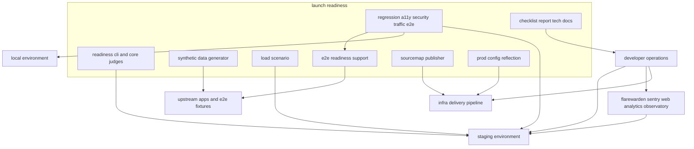
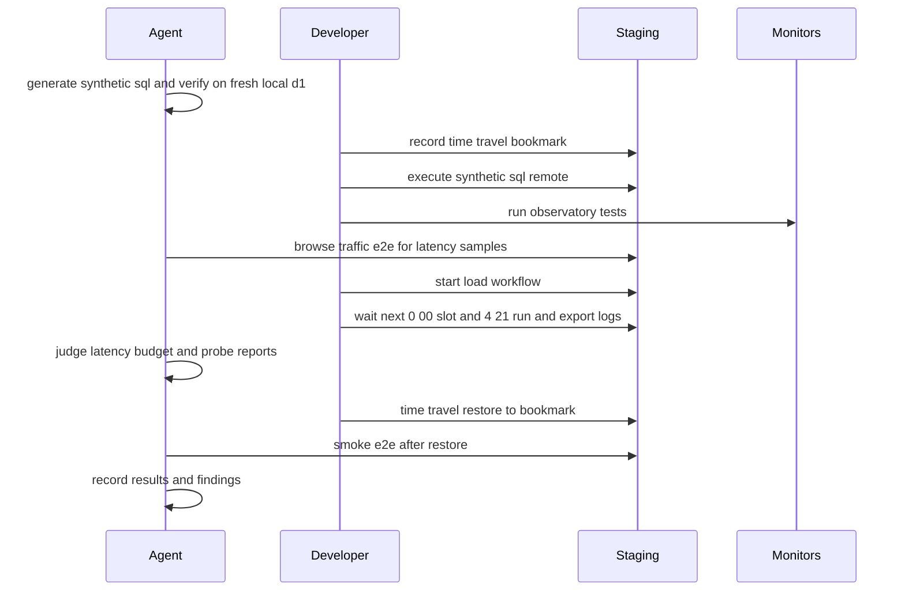
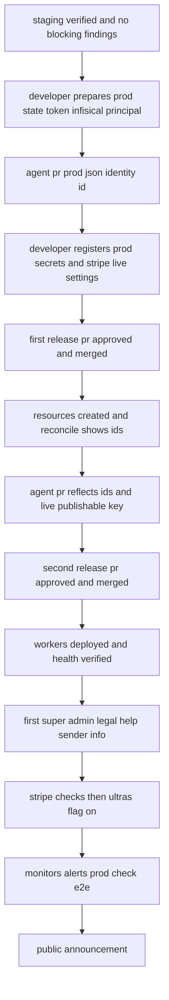
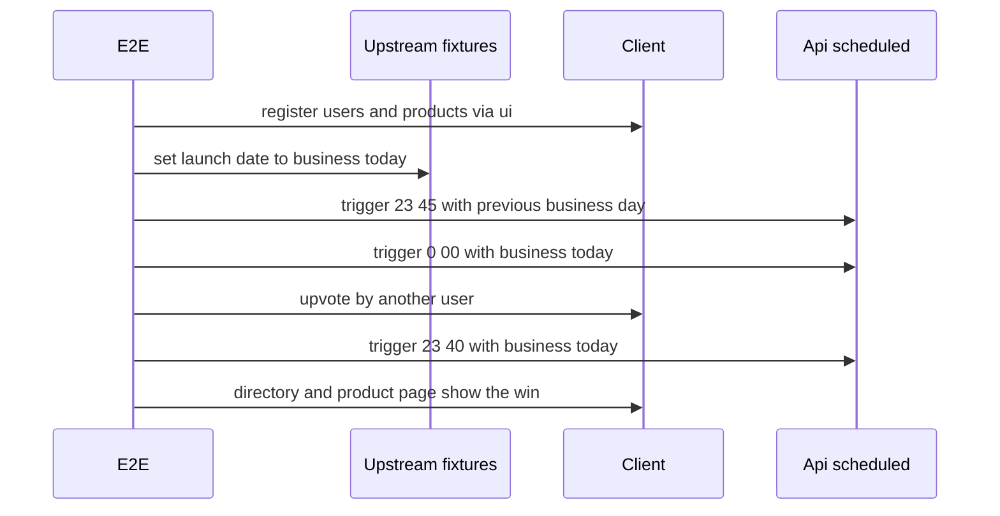

# Design Document

## Overview

**Purpose**: 本番環境へ一括でリリースする前に、サービス全体を横断して非機能要件(6章)を検証し、監視と運用の準備を整え、prodブランチへのPR(人間の承認が必要)で本番リリースできる状態にする。本specは機能を足さない。検証の道具(合成データの生成・応答の集計・日次バッチの予算の判定・デプロイ中の応答の監視)、全体のE2E回帰テストと全経路のアクセシビリティ・セキュリティの検査、監視とアラートの定義、運用ドキュメント、上流の全specが申し送った本番の作業を集めた本番準備のチェックリスト、検証の記録を作る。見つかった不具合は担当specの範囲で直し、本specの記録から参照する。

**Users**: AIエージェントは、ローカルとstagingに対する検証の道具とE2Eを実行し、記録とチェックリストを整え、秘密でない設定値(prodの識別子・ライブモードの公開キー・prodの主体の識別子)を反映するPRを作る。開発者は、AIエージェントが禁じられている操作(stagingのデータベースへの合成データの投入と復元・ロールバックの演習・負荷試験の起動・Observatoryと監視サービスの設定・prodのシークレットの登録・Stripeのライブモードの設定・prodへのリリースのPRの承認とマージ・最初の最上位管理者の作成)を、本specの手順とチェックリストに沿って行い、結果を記録へ渡す。運用者(開発者)は、リリース後に運用ドキュメントとアラートに従って障害に対応する。

**Impact**: アプリの実装(`apps`)の業務のコードは変えない。新設するのは、ルートの検証の道具`scripts/readiness/`、apiの合成データの生成`apps/api/scripts/readiness/`、E2Eの補助4つとE2E14ファイル(`e2e/client`・`e2e/admin`)、技術ドキュメント5つ(`testing/003`・`testing/004`・`security/009`・`operations/005`・`operations/006`)、本番準備のチェックリストと検証の記録(`docs/onboardings/`)である。上流のファイルへの追記は、ルートの`package.json`のスクリプトと`axe-core`、`operations/004`の本番の節、infra-deliveryのデプロイの仕組みへのソースマップのアップロード、本番リリースのときの4アプリのWrangler設定のprodの値と資源一覧`prod.json`の主体の識別子である。新しいテーブル・メッセージ種別・Cronの式・ジョブ・波及処理・シークレットのキー(`/ci/sentry`の3つを除く)は無い。

### Goals

- NFR-PERF-001・004・007・008・NFR-AVAIL-001〜009・NFR-OBLOG-001〜006・UI-001・UI-003・I18N-001・DR-013・NFR-SECUR全般を、stagingとローカルで計測・演習・監査し、結果と指摘を検証の記録に残す。
- 4:21の日次バッチが仮1の予算(5分)と上限(10分)に収まることを、想定規模(仮2)の合成データで確かめる。
- 上流の全specが申し送った本番の作業を、実施者・順序・確認方法・元のspecとともに1つのチェックリストに集め、AIエージェントが行えない作業を開発者の作業として明示する。
- リリースを止める指摘(仮11)が0件で、チェックリストが完了した状態で、開発者がprodへのPRを承認・マージできる。
- 本specが追加したスクリプトの単体テストがカバレッジ80%を満たす。

### Non-Goals

- 新機能の追加、個別機能の不具合の修正そのもの(担当specで行う)。
- prodへのデプロイ・prodのシークレットの登録・Stripeのライブモードの設定・リモートのD1への書き込みと復元・ロールバック・監視サービスの設定の実行(開発者の作業)。
- 法務文書・ヘルプ記事の本文の起草。
- インフラ資源の新規定義、監視とアラートの設定のコード化、要件定義書の改訂(必要な改訂は[research.md](research.md)の「要件定義書の改訂が必要な箇所」に記録する)。(2026-10-25に要件定義書へ適用済み)

## Boundary Commitments

### This Spec Owns

- 検証の道具(ルート`scripts/readiness/`): 日次バッチの予算の判定(仮1の値)、GraphQLの応答時間の95パーセンタイルの集計(仮4の標本数)、デプロイ中の応答の監視、縮退の起動の差し替えの一覧。
- 合成データの生成(`apps/api/scripts/readiness/`): 想定規模(仮2)の値と、データセットごとのリテラルのSQL(INSERT文と、長い文字列を組み立てる連結のUPDATE・記事の行からの`INSERT ... SELECT`)の生成。
- 負荷試験の台本と手動起動のワークフロー(仮6、k6): `scripts/readiness/load/`・`.github/workflows/readiness-load.yml`。
- E2Eの補助`e2e/support/readiness-targets.ts`・`a11y-scan.ts`・`route-inventory.ts`・`bulk-users.ts`と、回帰・アクセシビリティ・セキュリティ・閲覧の負荷のE2E(`e2e/client/regression/`・`e2e/client/a11y/`・`e2e/client/security/`・`e2e/client/readiness/`・`e2e/admin/a11y/`・`e2e/admin/security/`)。タグ`@prod-check`(prodへ実行してよい読み取りだけの検査)と`@traffic`・`@degraded`の意味。
- 監視の対象(仮9)とアラートの規則の定義、本番準備のチェックリスト、検証の記録(`docs/onboardings/release-checklist.md`・`docs/onboardings/release-verification-report.md`)。
- 技術ドキュメント`testing/003-performance-verification.md`・`testing/004-cross-app-regression-and-audits.md`・`security/009-monitoring-and-alerting.md`・`operations/005-incident-response.md`・`operations/006-release-readiness-and-drills.md`の新規作成と、`operations/004`の本番の節・`infra/004`・`infra/007`・`testing/001`への追記。
- 本番リリースのときの秘密でない値の反映(4アプリのWrangler設定の`env.prod`の識別子と公開キー、`apps/infra/environments/prod.json`の主体の識別子)の変更。
- デプロイの仕組みへのソースマップのアップロードの追加(仮7、`@sentry/cli`。infra-deliveryの`scripts/delivery`への追記)。

### Out of Boundary

- 各機能の実装と不具合の修正(担当spec)。本specは検証の記録で依頼と解消を追う。
- 日次バッチの予算の値の記載と超過の警告の仕組み(backend-platformの改訂2が提供する)。本specは仮1の値で予算・上限・目安を検証し、上流の値と警告が仮1と一致することを確かめる。
- ローカルの定期実行を業務日付と業務時刻で起こすE2Eの補助`e2e/support/scheduled-trigger.ts`(backend-platformの改訂2が提供する)。本specは同等の補助を作らない。
- Workerごとの`STRIPE_API_KEY`の配布(infra-deliveryの改訂1の`/workers/api`・`/workers/event`)と、その`operations/004`への反映(paymentsの仮7)。本specは本番の節とチェックリストでそれに従う。
- デプロイの段階・識別子の照合・ロールバックとprodの準備の手順の内容(infra-delivery)。本specはその手順に沿ってチェックリストを作り、ソースマップのアップロードだけを追記する。
- Stripeの環境ごとの設定手順の本体(payments・ultras-subscriptionの`operations/004`)。本specは本番の節を追記する。
- ログの伏せ字・エラートラッキングの初期化と除去・ヘルスチェック(backend-platform)、ブラウザの計測・セキュリティヘッダー・疎通確認の画面(frontend-platform)。本specは確かめるだけである。
- 監視サービスとCloudflareの管理画面での設定の実行、Infisicalへの登録、リモートのD1の操作、prodへのデプロイ(開発者)。
- roadmapの帯(2200番台): 本specは4:21のジョブとライフサイクルの波及処理を持たない。

### Allowed Dependencies

- dev-tooling: E2Eの設定と対象の定義(`e2e/support/targets.ts`の`resolveE2ETargets`)、テストの命名、ルートの検査と単体テストの対象、`config/vitest/browser.ts`の`resolveBrowserLaunchOptions`。
- infra-delivery: `scripts/delivery`の`core/deploy-stages.ts`・`commands/deploy-worker.ts`・`core/secret-scope.ts`・`core/workflow-policy.ts`の規則、`deploy.yml`、資源一覧`prod.json`、`reconcile-ids`の表示、`operations/001`・`002`の手順、`@smoke`タグ。
- backend-platform: `ScheduledDispatcher`の要約のログの形(ジョブ名・結果・所要時間・合計の所要時間)と予算の超過の警告(レベル`warning`・タグ`cron`、改訂2)、`SCHEDULED_RUN_BUDGETS`と`infra/003`・`project-values.md`の予算の値(改訂2)、`e2e/support/scheduled-trigger.ts`の`triggerScheduled`・`businessDateOf`・`addBusinessDays`・`isNearBusinessDayBoundary`(改訂2)、`/health`、ログの伏せ字の規則(`REDACTION_PATTERNS`と`SentryScrubber`の範囲。改訂1・改訂3で、例外のメッセージと種類・イベントのメッセージ(`logentry`を含む)・パンくずのメッセージと`data`・リクエストのURL・トランザクションとスパンの名前と説明と`data`に適用)、Wrangler設定の`env.prod`の構成。
- infra-delivery(改訂1)・payments(仮7): InfisicalのWorkerごとのフォルダ`/workers/api`・`/workers/event`(`/`の同名の値より優先)と、`operations/004`のWorkerごとの制限付きキーの登録先。
- frontend-platform: `e2e/support/security-assertions.ts`、`runAxe`と同じWCAGのタグ、`/system/status`の公開の判定、`apps/{client,admin}/src/routeTree.gen.ts`(読み取りだけ)、Vite設定。
- admin-foundation: `e2e/support/admin-bootstrap.ts`(`signInAsNewAdmin`)・`e2e/support/local-d1.ts`(`executeLocalD1`・`sqlStringLiteral`)、招待の発行コマンド、`apps/api/scripts/admin/invitation-sql.ts`の`sqlStringLiteral`。
- identity-auth: `e2e/support/mailpit.ts`、パスワードのハッシュとセッションの形式(`bulk-users.ts`で再現する)。
- 各ドメインspecのE2Eの補助: `match-fixtures.ts`(match-engine)・`directory-fixtures.ts`(directory-discovery)・`week-tournament-fixtures.ts`(tournament-week)・`moderation-fixtures.ts`(ugc-moderation)・`report-fixtures.ts`(content-reporting)・`notification-fixtures.ts`(notifications)と、同等の補助があればそれを使う。
- `apps/db/schema`のテーブル定義(合成データの生成の列の取得だけ。書き込みの規則は各specのdesign.mdに従う)。
- npmパッケージ: `axe-core` 4.13.0(frontend-platformと同じ版をルートの`devDependencies`へ)。k6(仮6、開発コンテナとCIへ実行ファイルとして導入)・`@sentry/cli`(仮7、ルートの`devDependencies`へ完全固定)。

### Revalidation Triggers

- `ScheduledDispatcher`の要約のログの形と予算の超過の警告の形、4:21のジョブの追加・削除と順序(日次タイムラインの表)、Cron Triggersの上限の変更(仮1の判定)。仮1の値を変える場合は、backend-platformの`SCHEDULED_RUN_BUDGETS`・`infra/003`・`project-values.md`の値も合わせるよう上流へ依頼する。
- backend-platformの`triggerScheduled`と業務日付の補助の形(回帰のE2Eと合成データの確認)。
- backend-platformのSentryの伏せ字の対象の項目(承認後の改訂3)。対象が変われば、チェックリストA-09の確認(ダミーのキーを含む例外)を確かめ直す。
- frontend-platformの中継の要求へのトレースの引き継ぎ(`sentry-trace`・`baggage`)と`tracePropagationTargets`、api-gatewayのAPIサーバーが受け取ったトレースを続けること、stagingの`SENTRY_TRACES_SAMPLE_RATE`(`1`)。変われば、S-22の1本のトレースの確認(要件10.9、本specの承認後の改訂1)を確かめ直す。
- 合成データが依存する上流の条件: media-pipelineの4:21のジョブ(810〜830)の対象条件と`media_files`の列、user-profile-socialの保有者の居ないファイルの削除の上限と保有者単位の削除、help-centerの索引文書の書き込みの規則と並べ替えの画面の形。
- 上流のE2Eの補助の関数の形、`resolveE2ETargets`の対象、`@smoke`タグの意味、client・adminのルートの追加(`route-inventory.ts`の照合が失敗する)。
- 上流のシークレット・変数・価格の名前の追加と変更(チェックリスト)。後続の変更でキーを宣言したら、チェックリストの照合の行を足す。
- infra-deliveryの`deploy-worker`の手順・資源一覧の形・`reconcile-ids`の表示の変更(ソースマップのアップロードと識別子の反映)。
- 監視の対象のURL(ホスト名・`/health`の経路)の変更。
- 仮1〜仮13は2026-10-24に開発者が確定した(仮12は無料枠で始め8割で有償プランを契約する案)。上流の確定した値(help-centerの仮1のヘルプ記事の本文の上限100,000文字、画像変換の無料枠の件数など)が変われば、合成データ・計測の対象・監視の閾値を確かめ直す。

### 上流への影響

| 上流spec          | 変更                                                                                                                                                                                                                                                                                                                                                                                                                                   | 影響と再検証                                                                                                                                                                                                                   |
| ----------------- | -------------------------------------------------------------------------------------------------------------------------------------------------------------------------------------------------------------------------------------------------------------------------------------------------------------------------------------------------------------------------------------------------------------------------------------- | ------------------------------------------------------------------------------------------------------------------------------------------------------------------------------------------------------------------------------ |
| backend-platform  | (提供済み、backend-platformの改訂2)`ScheduledDispatcher`が1回の起動の合計の所要時間を予算(5分)と比べ、超えたらエラートラッキングへ`warning`(タグ`cron`・所要時間)を送る。予算と上限の値(仮1)を`infra/003`と`project-values.md`へ記す。ローカルの定期実行の経路を`/cdn-cgi/local/scheduled`に直し、共有の補助`e2e/support/scheduled-trigger.ts`を置く。(本specが追記)api・eventのWrangler設定に`upload_source_maps: true`(本specが追記) | 予算の超過は警告とアラートAL-09で知り、上限までの余裕と各ジョブの目安は要約のログを週1回確かめる手順を`operations/006`に置く。`upload_source_maps`は設定の検査(`wrangler-config.unit.test.ts`)の期待値に影響しない(追加のキー) |
| frontend-platform | client・adminのVite設定の`build.sourcemap`を`'hidden'`にする(本specが追記)                                                                                                                                                                                                                                                                                                                                                             | 配信物に`.map`を含めないよう、アップロードの後に削除する(SourcemapPublisher)                                                                                                                                                   |
| infra-delivery    | (1)`scripts/delivery`の`deploy-worker`にソースマップのアップロードの手順、`secret-scope`にフォルダ`/ci/sentry`、`deploy.yml`に手順(本specが追記)。(2)(提供済み、infra-deliveryの改訂1)Workerごとのフォルダ`/workers/api`・`/workers/event`による`STRIPE_API_KEY`の別々の値の配布(仮13)                                                                                                                                                 | (1)は`checkWorkflowPolicy`と`repo-contract.unit.test.ts`を通す。値が無い環境では警告だけでデプロイを続ける。(2)はpaymentsのQ5を満たす上流の変更で、本specはチェックリストB-06でそれに従う                                      |
| payments          | `operations/004`に「ライブモードの本番の手順」の節を追記する(Workerごとの制限付きキーの登録先はpaymentsの仮7の既存の記載を参照する)                                                                                                                                                                                                                                                                                                    | 既存の節を変えない                                                                                                                                                                                                             |
| dev-tooling       | ルートの`package.json`に`readiness`のスクリプトと`axe-core`、`.gitignore`に`/tmp/`、`Dockerfile`へk6。`playwright.config.ts`は変えない                                                                                                                                                                                                                                                                                                 | `scripts/readiness`がルートの検査と単体テストの対象に入る                                                                                                                                                                      |
| 各ドメインspec    | 検証の指摘による修正の依頼(担当specの範囲)                                                                                                                                                                                                                                                                                                                                                                                             | 依頼ごとに検証の記録へ記す                                                                                                                                                                                                     |

- roadmapの帯の割り当ての表の本specの「使用中の値」は「—」のままである(4:21のジョブと波及処理を持たない)。本specはroadmapを編集しないため、コントローラーへ報告する。

## Architecture

### Existing Architecture Analysis

- 上流の28specは設計・タスクとも承認済みで、本specのタスクはそれらの実装の完了を前提にする。実装済みはdev-toolingだけである。本specのタスクは各specの実装とstagingへの随時のデプロイの後に行う。
- infra-deliveryは、mainへのpushでstagingへ、prodへのpushでprodへデプロイし、prodの最初のリリースを2回(資源の作成と識別子の照合→識別子の反映の後のWorkerのデプロイ)で行う。stagingのデプロイの後に`@smoke`のE2Eを、prodのデプロイの後にヘルスチェックを行う。
- backend-platformの`ScheduledDispatcher`は、Cronの式ごとに登録順でジョブを直列に動かし、最後にジョブごとの結果と所要時間と合計の所要時間の要約を`info`のログ(JSON)で出し、予算を定めた起動時刻(4:21)の合計が予算を超えたらエラートラッキングへ`warning`(タグ`cron`)を送る(改訂2)。ローカルの定期実行は上流の共有の補助`triggerScheduled`で業務日付と業務時刻を指定して起動できる。
- E2Eは起動済みのアプリに対して実行し、対象はclient(48044)とadmin(48045)の2つである。apiは48042、eventは48043、Mailpitは48041で動く。

### Architecture Pattern & Boundary Map



**Architecture Integration**:

- Selected pattern: 検証の道具とE2Eと文書を本specが持ち、修正は担当specへ依頼する(research.mdの比較)。道具は`scripts/delivery`と同じく、純粋な判定の`core`・入出力の`adapters`・組み合わせの`commands`に分ける。
- Domain/feature boundaries: 本specは上流のアプリの業務のコード・テーブル・テストを変えない。E2Eは上流の補助と公開の画面だけを使い、ローカルのD1への投入は上流の補助の関数で行う。合成データの生成は上流のテーブル定義を読むだけで、書き込みの規則は各specのdesign.mdに従う。
- Existing patterns preserved: `scripts/delivery`の層の分け方と`layering.unit.test.ts`、`apps/api/scripts/admin`の`sqlStringLiteral`、E2Eの対象と`@smoke`の規約、決済のE2Eの「対象外の表示」、技術ドキュメントに固有の値を書かない規則とキーの一覧の正(`project-values.md`)。
- New components rationale: `CronBudgetJudge`は予算の判定を記録の形で再現するため。`LatencyReport`はエラートラッキングから書き出した計測を操作ごとに集計するため。`ProbeTally`はデプロイ中の失敗の応答を数えるため。`RouteInventory`は全経路の監査の漏れを単体テストで防ぐため。`BulkUsers`は同時の書き込みの検証に100人のログイン中の利用者が要るため。
- Steering compliance: AIエージェントはprodへデプロイせず、Claude設定のdenyの操作を開発者の作業として手順に置く。ドキュメントは日本語、サンプルのドメインは`.example`、ファイルは800行以内、1ファイル1コンポーネント(本specはReactコンポーネントを作らない)。

**Dependency direction**: `scripts/readiness/core` → `scripts/readiness/adapters` → `scripts/readiness/commands` → `scripts/readiness/cli.ts`。`core`は`node:fs`・`node:child_process`・`fetch`を読み込まない。`apps/api/scripts/readiness/synthetic-data`は`apps/api/db/schema`(読み取り)と`apps/api/scripts/admin/invitation-sql.ts`の`sqlStringLiteral`だけを読み込み、apiの`src`を読み込まない。`e2e/support/*`(本specの補助)は上流の`e2e/support/*`と`@playwright/test`と`axe-core`だけを読み込み、`apps/*/src`を読み込まない(`route-inventory.unit.test.ts`は`routeTree.gen.ts`をテキストとして読む)。E2Eのテストは`e2e/support/*`だけを読み込む。違反はレビューで誤りとして扱い、`scripts/readiness/layering.unit.test.ts`で`core`の禁止を確かめる。

### Technology Stack

| Layer         | Choice / Version                                                | Role in Feature                                          | Notes                                         |
| ------------- | --------------------------------------------------------------- | -------------------------------------------------------- | --------------------------------------------- |
| Tooling       | Bun(既存)・TypeScript(既存)                                     | 検証の道具の実行と単体テスト                             | 新しいパッケージなし                          |
| E2E           | `@playwright/test`(既存)・`axe-core` 4.13.0(既存の版をルートへ) | 回帰・全経路のアクセシビリティ・セキュリティ・閲覧の負荷 | `@axe-core/playwright`は使わない(research.md) |
| Load          | k6(仮6、確定)                                                   | stagingへの同時接続の負荷                                | 開発コンテナとCIへ同じ版で導入                |
| Observability | Sentry・FlareWarden・Web Analytics・Observatory(既存の選定)     | 監視・アラート・FCPの計測                                | 設定は開発者。`@sentry/cli`(仮7、確定)        |
| Data          | Cloudflare D1(Time Travel)                                      | 合成データの投入と復元の演習                             | リモートの操作は開発者                        |
| CI/CD         | GitHub Actions(infra-delivery)                                  | ソースマップのアップロード、負荷試験の手動起動           | 仮6・仮7の道具を使う                          |

## File Structure Plan

### Directory Structure

```
scripts/readiness/
├── cli.ts                                   # 入口: サブコマンド(cron-budget・graphql-latency・availability-probe・degraded-env)の振り分けと終了コード
├── layering.unit.test.ts                    # coreの禁止API(node:fs・node:child_process・fetch)と依存の向き
├── core/
│   ├── cron-budget.ts                       # 仮1の予算・上限・目安と、要約のログからの判定(CronBudgetJudge)
│   ├── latency-report.ts                    # 操作ごとの95パーセンタイルと標本数の判定(LatencyReport)
│   ├── probe-tally.ts                       # デプロイ中の応答の集計と判定(ProbeTally)
│   └── degraded-overrides.ts                # 外部サービスごとの起動の差し替え(鍵・変数)と対応表の行(DegradedOverrides)
├── adapters/
│   ├── json-lines-source.ts                 # ログの書き出し(JSON Lines・JSON配列)の読み込み
│   ├── csv-source.ts                        # エラートラッキングから書き出した計測(CSV)の読み込み
│   └── http-poller.ts                       # 一定間隔のGETと応答の状態の記録
├── commands/
│   ├── cron-budget.ts · graphql-latency.ts · availability-probe.ts · degraded-env.ts
├── load/                                    # k6の台本
│   └── browse-scenario.ts                   # k6の台本: 仮想の利用者100人の閲覧と公開の照会、95パーセンタイルと誤りの閾値
└── test-fixtures/                           # 要約のログ・計測のCSVの例

apps/api/scripts/readiness/synthetic-data/
├── scale-profile.ts                         # 仮2の想定規模(件数の定数)
├── sql-writer.ts                            # Drizzleのテーブル定義から列を得て、sqlStringLiteralでリテラルのINSERT文を1ファイル最大5,000行・1文90,000バイト以下で書く(長い文字列は断片のUPDATEで組み立てる)
├── datasets/
│   ├── users.ts                             # 利用者・プロフィール・フォロー(1人の作り手のフォロワー1万人を含む)
│   ├── products.ts                          # プロダクト・ローンチ・カテゴリの割り当て
│   ├── matches.ts                           # 予選のマッチと結果(勝利10万件)、集計値
│   ├── comments.ts                          # コメント20万件と1スレッド500件の返信
│   ├── sponsorships.ts                      # 掲載中の広告1,000件
│   ├── moderation.ts                        # 通報の案件5,000件・監査ログ10万件
│   ├── daily-batch-targets.ts               # 4:21のジョブが処理する対象(保持期間を過ぎた行・期限切れのトークン・保有者の利用者が居ないファイルの記録など)
│   ├── help-articles.ts                     # ヘルプのカテゴリと、本文が上限(100,000文字、help-centerの仮1)の公開の記事(見本のハンドル)
│   └── export-heavy-user.ts                 # 各上限まで投稿した利用者1人(既存の検証用のアカウントにも結び付けられる)
├── generate.ts                              # 入口: データセットを順に生成し、投入の順の一覧と見本のハンドル(manifest)を出力
└── *.unit.test.ts                           # 各ファイルの隣

e2e/support/
├── readiness-targets.ts                     # api・event・画像配信のURL(既定はローカル、環境変数で上書き)(ReadinessTargets)
├── a11y-scan.ts                             # axe-coreをページへ注入しWCAG 2.2のAとAAの規則で検査(A11yScan)
├── route-inventory.ts                       # client・adminの全経路と代表の状態・用意の方法(RouteInventory)
├── route-inventory.unit.test.ts             # 生成されたルートの木の全経路が一覧にあること
└── bulk-users.ts                            # 確認済みの利用者N人の投入とログイン済みの要求の文脈(BulkUsers)

e2e/client/
├── regression/
│   ├── launch-journey.e2e.test.ts           # 登録→プロダクト→予選→Upvote→確定→ディレクトリ→Week参加(決済)→勝敗
│   ├── moderation-journey.e2e.test.ts       # コメント→通報→管理者の措置→非表示・通知・監査ログ
│   ├── account-journey.e2e.test.ts          # ヘルプの公開・並べ替えと検索・法務文書・データエクスポート・退会
│   ├── degraded-reads.e2e.test.ts           # @degraded: 外部サービスを止めた起動での主要な読み取り
│   └── concurrent-upvotes.e2e.test.ts       # 100人の同時のUpvoteと数え上げ
├── a11y/
│   ├── client-routes.e2e.test.ts            # 利用者側の全経路の自動の検査
│   ├── keyboard-flows.e2e.test.ts           # 主要な利用者フローのキーボード操作
│   └── responsive-layout.e2e.test.ts        # 320・768・1280pxと文字列の伸び
├── security/
│   ├── security-baseline.e2e.test.ts        # @smoke @prod-check: ヘッダー・CSP・BFFとapiの拒否・画像配信のCookie・公開APIのCORS
│   └── session-and-limits.e2e.test.ts       # ローカルだけ: Cookieの属性・no-store・411
└── readiness/
    └── browse-traffic.e2e.test.ts           # @traffic: stagingの未ログインの閲覧の繰り返し(仮4の標本)

e2e/admin/
├── a11y/
│   ├── admin-routes.e2e.test.ts             # 管理者側の全経路の自動の検査
│   └── keyboard-flows.e2e.test.ts           # 管理者の措置とヘルプの並べ替えのキーボード操作
└── security/
    └── security-baseline.e2e.test.ts        # @smoke @prod-check: 管理者側のヘッダー・CSP・no-store

.github/workflows/readiness-load.yml         # 手動起動、5並列のジョブで負荷試験(stagingだけ)

docs/
├── onboardings/
│   ├── release-checklist.md                 # 本番準備のチェックリスト(固有の値を含む)
│   └── release-verification-report.md       # 検証の記録(計測・演習・対応表・指摘・開発者の作業)
└── GUIDES/tech/
    ├── testing/003-performance-verification.md
    ├── testing/004-cross-app-regression-and-audits.md
    ├── security/009-monitoring-and-alerting.md
    ├── operations/005-incident-response.md
    └── operations/006-release-readiness-and-drills.md
```

- `scripts/readiness`の`core`・`adapters`・`commands`の各ファイルの隣に同名の`*.unit.test.ts`を置く(省略して記載)。

### Modified Files

- `/workspace/package.json` — スクリプト`readiness`(`bun scripts/readiness/cli.ts`)、`devDependencies`に`axe-core` 4.13.0(完全固定)。
- `apps/api/package.json` — スクリプト`readiness:synthetic-data`。
- `/workspace/.gitignore` — 合成データと検証の出力先`/tmp/`(リポジトリのルートの`tmp`)をGit管理外にする。ルートのGit管理外の判定のテスト(`test-support`)があれば期待値を足す。
- `scripts/delivery/core/secret-scope.ts`・`commands/deploy-worker.ts`・`.github/workflows/deploy.yml`と新設の`scripts/delivery/core/sourcemap-upload.ts`・`commands/upload-sourcemaps.ts`(SourcemapPublisher)。
- `apps/{client,admin}/vite.config.ts`(`build.sourcemap: 'hidden'`)・`apps/{api,event}/wrangler.jsonc`(`upload_source_maps: true`)。
- `apps/{api,event}/wrangler.jsonc`の`env.prod`のD1の`database_id`、`apps/{client,admin}/wrangler.jsonc`の`env.prod.vars`の`TURNSTILE_SITE_KEY`、clientの`WEB_ANALYTICS_TOKEN`・`STRIPE_PUBLISHABLE_KEY`、`apps/infra/environments/prod.json`の`infisical.identityId`(本番リリースのとき、ProdConfigReflection)。
- `docs/GUIDES/tech/operations/004-payment-data-operations.md` — 「ライブモードの本番の手順」の節。
- `docs/GUIDES/tech/infra/004-logging-and-error-tracking.md` — 環境ごとのプロジェクト、IPアドレスの保存の無効化の確認、ソースマップの手順(`infra/007`)への参照。
- `Dockerfile`・`.github/actions/setup-toolchain/action.yml` — k6の実行ファイルを版を固定して導入する(開発コンテナとCIの版をinfra-deliveryの`tool-versions`の照合の対象にする)。
- `docs/GUIDES/tech/infra/007-ci-cd-pipelines.md` — ソースマップのアップロードの手順と、値が無い環境の扱い。
- `docs/GUIDES/tech/testing/001-test-strategy.md` — タグ`@prod-check`・`@traffic`・`@degraded`の規約。
- `docs/GUIDES/tech/{testing,security,operations}/README.md` — 文書の一覧。
- `docs/onboardings/project-values.md` — 監視の対象とアラートの名前、合成データの規模、予算の値、縮退の差し替えの値、Sentryのプロジェクト、`/ci/sentry`のキー。
- `docs/onboardings/README.md` — チェックリストと検証の記録への索引。
- `docs/onboardings/tech-stack.md` — k6・`@sentry/cli`はコントローラーが記載済み(2026-10-24)のため、本specは変更しない。
- `CLAUDE.md` — ディレクトリ構成(`scripts/readiness`・`docs/onboardings`の説明)、技術規則の参照先に「性能の検証やリリースの準備の前に: `testing/003`・`operations/006`」。

## System Flows

### 想定規模での計測と復旧の演習



- 投入から復元までの間は、他の変更をstagingへマージしない(手順に書く)。投入(S-02)は投入の日の4:21(UTCの12:21)より十分前に終える。基準を満たさない箇所の修正は復元の後にmainへマージし、確かめ直しは同じ流れ(時点の記録→投入→計測→復元)をもう一度行う。無停止デプロイとロールバックの演習はmainへのマージを伴うため、この流れの前に行う。投入と復元の手順は、流れを始める前に検証の記録の開発者の作業の節に用意する。
- ロールバックの演習の後は、開発者が最新のmainを再びstagingへデプロイし(デプロイのワークフローの再実行)、スモークテストの成功を確かめてから投入へ進む。
- ログインが要る画面(管理画面の部分一致の検索・通報の案件の一覧)は、開発者がstagingの管理者で各画面を操作し(S-15)、データベースの分析(問い合わせごとの所要時間と読み取りの行数)を書き出して判定する。データエクスポートは、開発者が検証用のアカウントで要求とダウンロードを行い(S-14)、Workerのログの処理ごとのCPU時間・実時間と、メモリの上限の超過による打ち切りが無いこと(処理の結果)で判定する。公開APIは、開発者が検証用のアカウントで発行したstagingのAPIキーを環境変数で受け取って計測し、キーを記録に書かず、計測の後に開発者が削除する(S-16)。
- 本文が上限(100,000文字、help-centerの仮1)のヘルプ記事の詳細は、閲覧の繰り返し(`@traffic`)の標本で`helpArticle`の照会の95パーセンタイルを判定し、エージェントがブラウザの計測の道具でstagingの記事の詳細のFCPを計測して1.6秒以内かを判定する(4.2・4.3)。計測の条件はObservatoryのモバイルの条件にそろえ(CPUとネットワークの制限を同じ値にする)、条件を`testing/003`と記録に書く。
- 画像変換の使用量は、投入の前・負荷試験の後・復元の後に開発者が記録する(S-21、10.8)。検証が無料枠を大きく消費した場合は、その月の残りの使用量をAL-10の閾値と比べて記録する。
- 復元の所要時間(RTO)は、要件8.3のとおり、障害の検知(演習では復元の判断を始めた時刻)から、復元の完了とエージェントのスモークの確認の成功までを測る。
- 4:21の計測は、合成データを投入した後の最初の4:21(UTCの12:21)の実行を待って行う。フォロワー1万人の作り手の開催通知の収集は、投入の後の最初の0:00の朝の枠(UTCの8:00)で動くため、その作り手のローンチ(マッチ)を投入の翌業務日にして、その枠のイベントサーバーのログで計測する(デプロイ先の定期実行は手動で起動しない)。ログは開発者が書き出すか(S-05)、開発者が認証したMCPサーバーでエージェントが読む。

### 本番リリース



- 各段階の項目・実施者・確認方法はSupporting Referencesの「本番準備のチェックリスト」に従う。AIエージェントが行うのはC・Gの変更のPRと、Lの`@prod-check`の読み取りの検査と記録だけである。PRの承認とマージは全て開発者が行う。

### 回帰テストの時刻の進め方



- 業務日付は`scheduledTime`から決まるため、起動の時刻を業務日付で指定する。実際の時刻で判定する受け付け(Upvoteの期間など)は、起動の時刻と実際の時刻が同じ業務日付になるよう組み、業務日付の境界(UTCの7:40〜8:00)ではテストを対象外として表示する。

## Requirements Traceability

| Requirement                                                        | Summary                                                                                               | Components                                                                        | Interfaces                            | Flows            |
| ------------------------------------------------------------------ | ----------------------------------------------------------------------------------------------------- | --------------------------------------------------------------------------------- | ------------------------------------- | ---------------- |
| 1.1, 1.2, 1.3, 1.4, 1.5                                            | FCPの計測と改善                                                                                       | ReleaseVerificationReport、TestingDocs、SyntheticDataGenerator                    | Observatory、`testing/003`            | 想定規模での計測 |
| 2.1, 2.2, 2.3, 2.5                                                 | GraphQLのp95                                                                                          | E2E(client/readiness/browse-traffic)、LatencyReport、ReleaseVerificationReport    | `readiness graphql-latency`           | 想定規模での計測 |
| 2.4                                                                | N+1の確認                                                                                             | LatencyReport、ReleaseVerificationReport                                          | 問い合わせの回数の記録                | —                |
| 2.6                                                                | ログイン中の操作                                                                                      | MonitoringDefinitions、ReleaseVerificationReport                                  | アラートAL-08                         | —                |
| 3.1, 3.2, 3.3, 3.5, 3.6                                            | 同時接続100人                                                                                         | LoadScenario、LoadWorkflow、ReleaseVerificationReport                             | `readiness-load.yml`                  | 想定規模での計測 |
| 3.4                                                                | 同時のUpvote                                                                                          | E2E(client/regression/concurrent-upvotes)、BulkUsers                              | `createBulkUsers`                     | —                |
| 4.1                                                                | 合成データ                                                                                            | SyntheticDataGenerator、ScaleProfile                                              | `readiness:synthetic-data`            | 想定規模での計測 |
| 4.2, 4.3, 4.4, 4.5                                                 | 申し送りの性能の検証                                                                                  | SyntheticDataGenerator、LatencyReport、ReleaseVerificationReport                  | 計測の表                              | 想定規模での計測 |
| 4.6                                                                | 合成データの除去                                                                                      | OperationsDocs、TestingDocs                                                       | Time Travelの手順                     | 想定規模での計測 |
| 5.1, 5.2, 5.3, 5.4, 5.5, 5.6                                       | 日次バッチの予算                                                                                      | CronBudgetJudge、ReleaseVerificationReport                                        | `readiness cron-budget`               | 想定規模での計測 |
| 6.1, 6.2, 6.4, 6.5                                                 | 縮退の対応表                                                                                          | DegradedOverrides、ReleaseVerificationReport                                      | 対応表                                | —                |
| 6.3                                                                | 外部サービスを止めた読み取り                                                                          | E2E(client/regression/degraded-reads)、DegradedOverrides                          | `readiness degraded-env`・`@degraded` | —                |
| 7.1                                                                | 無停止デプロイ                                                                                        | ProbeTally、ReadinessCommands                                                     | `readiness availability-probe`        | —                |
| 7.2                                                                | Expand/Contract                                                                                       | ReleaseVerificationReport                                                         | マイグレーションの一覧                | —                |
| 7.3, 7.4, 7.5                                                      | ロールバックの演習                                                                                    | OperationsDocs、ReleaseVerificationReport                                         | `operations/002`・`006`               | —                |
| 8.1, 8.2, 8.3, 8.4, 8.5, 8.6                                       | D1の復旧の演習                                                                                        | OperationsDocs、ReleaseVerificationReport                                         | Time Travelの手順                     | 想定規模での計測 |
| 9.1, 9.2, 9.3, 9.5                                                 | 死活監視とステータスページ                                                                            | MonitoringDefinitions、ReleaseChecklist                                           | 監視M-01〜M-10                        | 本番リリース     |
| 9.4, 9.6                                                           | 稼働率と導線                                                                                          | OperationsDocs、MonitoringDocs                                                    | `security/009`                        | —                |
| 10.1, 10.2, 10.5, 10.6, 10.7, 10.8                                 | Web Analyticsとアラート(画像変換の使用量を含む)                                                       | MonitoringDefinitions、MonitoringDocs、ReleaseChecklist                           | アラートAL-01〜AL-10                  | 本番リリース     |
| 10.3, 10.4                                                         | ソースマップ                                                                                          | SourcemapPublisher                                                                | `upload-sourcemaps`                   | 本番リリース     |
| 10.9                                                               | ブラウザ・フロントエンドサーバー・APIサーバーの1本のトレース(承認後の改訂1)                           | ReleaseVerificationReport、ReleaseChecklist(S-22)                                 | `/system/status`の再確認              | 想定規模での計測 |
| 11.1, 11.2, 11.3, 11.4, 11.5, 11.6                                 | ログと個人情報(回帰はローカル専用のため、11.2のstagingの実行はstagingの`@traffic`と基線のE2Eで代える) | ReleaseVerificationReport、ReleaseChecklist                                       | ログの検索の手順                      | —                |
| 12.1                                                               | 全経路の自動の検査                                                                                    | RouteInventory、A11yScan、E2E(client/a11y/client-routes・admin/a11y/admin-routes) | `scanPage`                            | —                |
| 12.2                                                               | キーボード                                                                                            | E2E(client/a11y/keyboard-flows・admin/a11y/keyboard-flows)                        | —                                     | —                |
| 12.3, 12.4, 12.6                                                   | 手動の確認と指摘                                                                                      | ReleaseVerificationReport、TestingDocs                                            | チェックリスト                        | —                |
| 12.5                                                               | 画面の幅と文字列の伸び                                                                                | E2E(client/a11y/responsive-layout)                                                | —                                     | —                |
| 13.1, 13.5, 13.6, 13.7                                             | 対応表と全体の検査                                                                                    | ReleaseVerificationReport                                                         | 対応表                                | —                |
| 13.2, 13.3                                                         | ヘッダー・Cookie・拒否                                                                                | E2E(client/security・admin/security)、ReadinessTargets                            | `@smoke`・`@prod-check`               | —                |
| 13.4                                                               | WAF                                                                                                   | ReleaseChecklist                                                                  | 手順                                  | 本番リリース     |
| 14.1, 14.2, 14.5, 14.6, 14.7, 14.8                                 | 公開までの流れ                                                                                        | E2E(client/regression/launch-journey)、A11yScan、backend-platformの共有の補助     | `triggerScheduled`                    | 回帰テストの時刻 |
| 14.3                                                               | 管理者の措置                                                                                          | E2E(client/regression/moderation-journey)                                         | `signInAsNewAdmin`                    | —                |
| 14.4                                                               | ヘルプ・法務・エクスポート・退会                                                                      | E2E(client/regression/account-journey)                                            | —                                     | —                |
| 15.1, 15.4, 15.5, 15.6                                             | 障害対応と監視の文書                                                                                  | OperationsDocs、MonitoringDocs                                                    | `operations/005`・`security/009`      | —                |
| 15.2                                                               | 本番準備と演習の文書                                                                                  | OperationsDocs                                                                    | `operations/006`                      | —                |
| 15.3                                                               | 決済の本番の手順                                                                                      | OperationsDocs                                                                    | `operations/004`                      | —                |
| 16.1, 16.2, 16.3, 16.4, 16.5, 16.6, 16.7, 16.8, 16.9, 16.10, 16.11 | 本番準備のチェックリスト                                                                              | ReleaseChecklist                                                                  | Supporting References                 | 本番リリース     |
| 16.12                                                              | エラートラッキングの伏せ字の範囲の拡大の確認(ダミーのキーを含む例外)                                  | ReleaseChecklist、ReleaseVerificationReport                                       | チェックリストA-09                    | 本番リリース     |
| 17.1, 17.3, 17.5, 17.6                                             | 人間の承認によるリリース                                                                              | ReleaseChecklist、OperationsDocs                                                  | リリースのPR                          | 本番リリース     |
| 17.2                                                               | 秘密でない値の反映                                                                                    | ProdConfigReflection                                                              | Wrangler設定・`prod.json`             | 本番リリース     |
| 17.4                                                               | リリース後の確認                                                                                      | E2E(client/security・admin/security)、ReleaseChecklist                            | `@prod-check`                         | 本番リリース     |
| 18.1, 18.2, 18.3, 18.4, 18.5, 18.6                                 | 指摘と開発者の作業の記録                                                                              | ReleaseVerificationReport                                                         | 指摘の様式                            | —                |
| 19.1                                                               | テスト                                                                                                | 全コンポーネントの単体テストとE2E                                                 | —                                     | —                |
| 19.2, 19.3                                                         | 技術ドキュメント                                                                                      | TestingDocs、SourcemapPublisher(`infra/007`)                                      | —                                     | —                |
| 19.4                                                               | 固有の値                                                                                              | ProjectValuesUpdate                                                               | `project-values.md`                   | —                |
| 19.5                                                               | 帯を使わない                                                                                          | (ジョブ・波及処理を持たない)                                                      | —                                     | —                |

## Components and Interfaces

| Component                                                        | Domain/Layer               | Intent                                            | Req Coverage                                                                       | Key Dependencies (P0/P1)                        | Contracts |
| ---------------------------------------------------------------- | -------------------------- | ------------------------------------------------- | ---------------------------------------------------------------------------------- | ----------------------------------------------- | --------- |
| CronBudgetJudge                                                  | scripts/readiness core     | 要約のログから予算・上限・目安を判定              | 5.1–5.6                                                                            | ScheduledDispatcherの要約の形 (P0)              | Service   |
| LatencyReport                                                    | scripts/readiness core     | 操作ごとの95パーセンタイルと標本数の判定          | 2.1–2.5, 4.3                                                                       | エラートラッキングの書き出し (P1)               | Service   |
| ProbeTally                                                       | scripts/readiness core     | デプロイ中の応答の集計                            | 7.1                                                                                | —                                               | Service   |
| DegradedOverrides                                                | scripts/readiness core     | 外部サービスの停止の差し替えと対応表の行          | 6.1–6.5                                                                            | 各specの変数・鍵の名前 (P1)                     | Service   |
| ReadinessAdapters・Commands・Cli                                 | scripts/readiness          | ファイル・HTTPの入出力とサブコマンド              | 2.1, 5.1, 6.3, 7.1                                                                 | Bun (P0)                                        | Batch     |
| SyntheticDataGenerator・ScaleProfile                             | apps/api scripts           | 想定規模の合成データのSQL                         | 4.1, 4.2, 1.2, 5.1                                                                 | `apps/db/schema` (P0)、`sqlStringLiteral` (P0)  | Batch     |
| LoadScenario・LoadWorkflow                                       | scripts/readiness load・CI | stagingへの同時接続の負荷(仮6)                    | 3.1–3.3, 3.5, 3.6                                                                  | k6 (P0)                                         | Batch     |
| ReadinessTargets                                                 | e2e support                | api・event・画像配信のURL                         | 13.2, 13.3                                                                         | —                                               | State     |
| A11yScan                                                         | e2e support                | ページのWCAG 2.2のA・AAの自動の検査               | 12.1, 14.7                                                                         | axe-core (P0)                                   | Service   |
| RouteInventory                                                   | e2e support                | 全経路と代表の状態の一覧と照合                    | 12.1                                                                               | routeTree.gen.ts (P0)                           | State     |
| BulkUsers                                                        | e2e support                | 確認済みの利用者N人とログイン済みの要求           | 3.4                                                                                | identity-authの形式 (P0)、`executeLocalD1` (P0) | Service   |
| 回帰・a11y・セキュリティ・閲覧のE2E                              | e2e tests                  | 通しの流れと全経路の検査                          | 3.4, 6.3, 12.1, 12.2, 12.5, 13.2, 13.3, 14.\*, 17.4, 2.1                           | 上流の補助(`triggerScheduled`を含む) (P0)       | —         |
| SourcemapPublisher                                               | scripts/delivery(追記)     | ソースマップのアップロードと配信物からの除去(仮7) | 10.3, 10.4, 19.3                                                                   | `@sentry/cli` (P0)                              | Batch     |
| ProdConfigReflection                                             | config                     | prodの秘密でない値の反映                          | 17.2, 17.3                                                                         | `reconcile-ids` (P0)                            | State     |
| MonitoringDefinitions                                            | docs                       | 監視の対象とアラートの規則                        | 9.1–9.3, 9.5, 10.1, 10.2, 10.5–10.8, 2.6                                           | FlareWarden・Sentry (P1)                        | State     |
| ReleaseChecklist                                                 | docs                       | 本番準備のチェックリスト                          | 13.4, 16.\*, 17.1, 17.4–17.6, 11.6                                                 | 上流の申し送り (P0)                             | State     |
| ReleaseVerificationReport                                        | docs                       | 検証の記録                                        | 1.\*, 2.\*, 4.\*, 5.\*, 6.\*, 7.\*, 8.\*, 11.\*, 12.3–12.6, 13.1, 13.5–13.7, 18.\* | —                                               | State     |
| OperationsDocs・MonitoringDocs・TestingDocs・ProjectValuesUpdate | docs                       | 技術ドキュメントと固有の値                        | 7.3, 7.4, 8.1, 8.5, 9.4, 9.6, 15.\*, 19.2–19.4                                     | —                                               | —         |

### scripts/readiness core

#### CronBudgetJudge

| Field        | Detail                                         |
| ------------ | ---------------------------------------------- |
| Intent       | 4:21の要約のログから予算・上限・目安を判定する |
| Requirements | 5.1, 5.2, 5.3, 5.4, 5.5, 5.6                   |

**Responsibilities & Constraints**

- 仮1の値(予算300,000ms・上限600,000ms・各ジョブの目安30,000ms・Cron Triggersの上限900,000ms)を定数として持つ。
- 入力は`ScheduledDispatcher`の要約のログの行(1回の起動につき1行)と、日次タイムラインの4:21の表のジョブの名前と順序。複数の起動の行があれば起動ごとに判定する。
- 出力は起動ごとの全体の所要時間・判定・ジョブごとの所要時間と判定・順序の食い違い・上限までの余裕(ジョブ1つあたりの平均で何個まで増やせるか)。

**Contracts**: Service [x]

##### Service Interface

```typescript
export const CRON_BUDGET = {
  budgetMs: 300_000,
  ceilingMs: 600_000,
  perJobTargetMs: 30_000,
  platformLimitMs: 900_000,
} as const;

export interface ScheduledRunSummary {
  readonly cron: string;
  readonly scheduledTime: string; // ISO 8601
  readonly jobs: readonly {
    readonly name: string;
    readonly outcome: 'succeeded' | 'failed';
    readonly durationMs: number;
  }[];
}

export type BudgetVerdict = 'within-budget' | 'over-budget' | 'over-ceiling';

export interface CronBudgetJudgement {
  readonly run: ScheduledRunSummary;
  readonly totalMs: number;
  readonly verdict: BudgetVerdict;
  readonly slowJobs: readonly {
    readonly name: string;
    readonly durationMs: number;
  }[];
  readonly failedJobs: readonly string[];
  readonly orderMismatches: readonly {
    readonly expected: string;
    readonly actual: string;
  }[];
  readonly headroomJobs: number; // 上限までに平均の所要時間で足せるジョブの数(0以上)
}

export declare function parseScheduledRunSummary(
  line: unknown,
): ScheduledRunSummary | undefined; // 要約の形でない行はundefined
export declare function judgeCronBudget(
  run: ScheduledRunSummary,
  expectedOrder: readonly string[],
): CronBudgetJudgement;
export declare function renderCronBudgetMarkdown(
  judgements: readonly CronBudgetJudgement[],
): string; // 検証の記録へ貼る表
```

- Preconditions: `durationMs`は0以上の整数。`expectedOrder`は日次タイムラインの4:21の表の順(実装の時点の表を写す。user-profile-socialの`user-profile-social.orphaned-file-sweep`(`order` 600)を含む)。
- Postconditions: `verdict`は合計が予算以下なら`within-budget`、上限以下なら`over-budget`、それを超えれば`over-ceiling`。

**Implementation Notes**

- Integration: 要約の行の項目名は、backend-platformの実装の`info`の要約に合わせて`parseScheduledRunSummary`の1箇所で読む(Revalidation Triggers)。全体の所要時間はジョブの所要時間の合計で判定する(backend-platformの改訂2の要約の合計の所要時間`totalDurationMs`は参考として並べる)。
- 上流との一致(5.6): `CRON_BUDGET`の予算・上限・目安が、backend-platformの`SCHEDULED_RUN_BUDGETS`(4:21の予算)と`infra/003`・`project-values.md`の値と一致することを、検証の記録で確かめる(7.10のタスク)。予算の超過の警告(`warning`・タグ`cron`)の送信そのものはbackend-platformのテストが確かめ、本specは計測の起動で予算を超えたときに警告が届いたか(超えなければ届かないこと)を記録する。
- Validation: 単体テストで、予算と上限の境界(300,000msと300,001ms、600,000msと600,001ms)、目安の境界、失敗したジョブ、順序の入れ替え、要約でない行を確かめる。
- Risks: 要約の項目名が実装で異なる場合は、本specのパーサだけを直す。

#### LatencyReport

| Field        | Detail                                   |
| ------------ | ---------------------------------------- |
| Intent       | 操作ごとの95パーセンタイルと標本数の判定 |
| Requirements | 2.1, 2.2, 2.3, 2.4, 2.5, 4.3             |

**Contracts**: Service [x]

```typescript
export interface LatencySample {
  readonly operation: string; // GraphQLの操作名(エラートラッキングのスパンの説明から得る)
  readonly durationMs: number;
}
export interface OperationLatency {
  readonly operation: string;
  readonly samples: number;
  readonly p95Ms: number;
  readonly verdict: 'pass' | 'fail' | 'insufficient'; // 標本がminSamples未満ならinsufficient
}
export declare function percentile(
  values: readonly number[],
  p: number,
): number; // 最近接順位法
export declare function summarizeLatency(
  samples: readonly LatencySample[],
  options: {
    readonly thresholdMs: number;
    readonly minSamples: number;
    readonly operations?: readonly string[];
  },
): readonly OperationLatency[];
```

- 既定は`thresholdMs: 300`・`minSamples: 200`(仮4)。`operations`を渡すと、その操作だけを判定し、標本の無い操作も`insufficient`で返す。
- 入力のCSVの列名(操作名・所要時間)は`graphql-latency`のコマンドの引数で指定できる(エラートラッキングの書き出しの列名の変化に備える)。
- 要件4.3の画面の照会の判定と、負荷試験の結果の95パーセンタイルの表示にも同じ関数を使う。
- Validation: 単体テストで、最近接順位法の値(20件・200件)、閾値の境界、標本不足、未知の操作の扱いを確かめる。

#### ProbeTally

| Field        | Detail                       |
| ------------ | ---------------------------- |
| Intent       | デプロイ中の応答の集計と判定 |
| Requirements | 7.1                          |

```typescript
export interface ProbeObservation {
  readonly target: string;
  readonly at: string; // ISO 8601
  readonly status: number | 'network-error' | 'timeout';
  readonly durationMs: number;
}
export interface ProbeSummary {
  readonly target: string;
  readonly total: number;
  readonly failures: readonly ProbeObservation[]; // 2xx・3xx以外
  readonly maxDurationMs: number;
}
export declare function tallyProbe(
  observations: readonly ProbeObservation[],
): readonly ProbeSummary[];
export declare function probeSucceeded(
  summaries: readonly ProbeSummary[],
): boolean; // 全対象で失敗0件
```

- `availability-probe`のコマンドは、対象(利用者側`/`・管理者側`/auth/login`・api`/health`・event`/health`)へ1秒ごとにGETし、指定の時間(既定20分)の後に集計を表示し、失敗があれば終了コード1にする。要求に識別のための`User-Agent`を付ける。
- 1秒ごとの4つの対象は送信元ごとのIP制限(100回/10秒)を下回る。

#### DegradedOverrides

| Field        | Detail                                                   |
| ------------ | -------------------------------------------------------- |
| Intent       | 外部サービスをローカルで止める起動の差し替えと対応表の行 |
| Requirements | 6.1, 6.2, 6.3, 6.4, 6.5                                  |

```typescript
export type ExternalService =
  'rekognition' | 'gcp-nl' | 'stripe' | 'email' | 'hibp' | 'disify';
export interface DegradationRow {
  readonly service: ExternalService;
  readonly failure: 'timeout' | 'auth' | 'quota' | 'bad-response';
  readonly expected: string; // 期待する振る舞い(上流のdesign.mdの記述)
  readonly evidence: readonly string[]; // 上流の自動テストのファイル
  readonly notifiesOperator: boolean;
  readonly owner: string; // 担当spec
}
export interface LocalOverride {
  readonly service: ExternalService;
  readonly worker: 'api' | 'event' | 'client';
  readonly secrets: Readonly<Record<string, string>>; // 無効な値への差し替え(秘密でない固定の値)
  readonly vars: Readonly<Record<string, string>>; // `--var`で渡す変数
}
export declare const DEGRADATION_MATRIX: readonly DegradationRow[];
export declare const LOCAL_OVERRIDES: readonly LocalOverride[]; // HIBPは差し替えの手段が無いため含めない
export declare function buildDegradedCommands(
  services: readonly ExternalService[],
): readonly string[];
```

- 鍵と変数の名前は、実装の時点の各specのWrangler設定と`project-values.md`から写し、単体テストでWrangler設定のキーに存在することを確かめる。無効な値は形式の検証を通る固定の値(例: Stripeは`rk_test_`で始まる無効なキー)にする。
- `degraded-env`のコマンドは、指定したサービスを止めた状態でapi・eventを起動するコマンド(infra-deliveryの改訂1のWorkerごとのフォルダを重ねる`bun /workspace/scripts/delivery/cli.ts run-with-secrets --scope local --worker <api|event> -- env <差し替え> wrangler dev ... --var <差し替え>`。`STRIPE_API_KEY`はWorkerごとのフォルダからだけ渡るため、素の`infisical run`では起動しない)を表示するだけで、自ら起動しない。E2Eは`E2E_DEGRADED_SERVICES`(止めたサービスの一覧)が設定されたときだけ実行する。
- 対応表(`DEGRADATION_MATRIX`)を検証の記録へ表として書き出す。`evidence`が空の行は「証跡なし」として指摘の候補に出し(6.2)、単体テストは`evidence`に挙げたファイルが存在すること(書き誤りの検出)だけを確かめる。証跡の無い行があっても単体テストは失敗しない。

### apps/api scripts

#### SyntheticDataGenerator・ScaleProfile

| Field        | Detail                                        |
| ------------ | --------------------------------------------- |
| Intent       | 想定規模の合成データをリテラルのSQLで生成する |
| Requirements | 4.1, 4.2, 1.2, 5.1                            |

**Responsibilities & Constraints**

- `ScaleProfile`は仮2の件数を定数で持つ(利用者50,000・プロダクト20,000・予選の勝利100,000・コメント200,000と1スレッドの返信500・掲載中の広告1,000・1人の作り手のフォロワー10,000・通報の案件5,000・監査ログ100,000・上限まで投稿した利用者1・本文が上限(100,000文字)のヘルプ記事1)。ヘルプ記事は、help-centerの書き込みの規則(記事の行と索引文書・全文検索の索引)に合わせ、本文は日本語の段落・見出し・リストを繰り返したマークダウンで上限の文字数ちょうどにする。
- 各データセットは、上流のテーブル定義(`apps/api/db/schema`)の列から行を作り、各specのdesign.mdの書き込みの規則(集計値・状態の整合・索引文書・部分一意索引)を満たす値にする。メールアドレスは`synthetic-<連番>@readiness.example`、URLは`https://synthetic-<連番>.example`。IDはULID、時刻はUTC。パスワードのハッシュ・セッションは作らない(合成の利用者はログインしない)。
- 1文は90,000バイト以下にする(D1の1文の長さの上限100KBに余裕を持たせる)。本文が上限のヘルプ記事のような長い文字列の列は、最初の断片で行をINSERTした後に`UPDATE ... SET <列> = <列> || <断片>`を繰り返して組み立て、索引文書の行は、組み立てた記事の行からhelp-centerの書き込みの規則(`markPending`)と同じ形(`source_id`は記事のID・`source_version` 0・`keyword_status` `pending`・`status_changed_at`・本文の列は空)で`INSERT ... SELECT`で作り(更新待ちの行は4:21のキーワードの再抽出(content-processing)が更新を依頼し、stagingではキーワード抽出の外部APIが呼ばれる)、全文検索の索引は索引文書のトリガーで入る(全文検索の表へ直接書かない)。文字数は書記素で数える。
- 出力は投入の順に番号を付けたSQLファイル(1ファイル最大5,000行、`--> statement-breakpoint`を使わない単純な文の列)と`manifest.json`(件数・見本のハンドル・ファイルの順)。出力先は`/workspace/tmp/readiness/synthetic/`(Git管理外)。
- 4:21のジョブが処理する対象(`daily-batch-targets.ts`)は、実装の時点の日次タイムラインの4:21の表の全ジョブについて作る。`user-profile-social.orphaned-file-sweep`(`order` 600、1回の実行で1,000件まで物理削除)のために、ファイルの記録(`media_files`)を想定規模の利用者の全員(5万人、保有者の走査の量を最大にする)に1件ずつと、保有者の利用者の行が無いファイルの記録を1,200件(上限1,000件での打ち切りを起こす)作る。保有者の居ない記録の保有者のIDは、全ての合成の利用者のIDより後に並ぶ値にする(`listOwnerIds`の昇順の走査で全員を読んでから打ち切りに達するため)。両方の記録は、`object_key`が一意のため、合成のデータだけの接頭辞の実体の無い一意なキーにし(共通の画像のキーを指さない。ジョブがR2の実体を物理削除するため)、media-pipelineの4:21のジョブ(810・820・830)の対象にならない状態にする: 紐付け済み(`attached_at`あり)、保存の完了(`stored_at`あり)、判定が`passed`(判定の不要な形式なら`not_required`。`flagged`にしない)、保存先と場所が整合し隔離の理由が無い、`deleted_at`・`erase_requested_at`がNULL、表示の列から参照しない(画像変換を起こさない)。810〜830の対象は、それぞれのジョブ専用の行だけを各3件の固定の件数で作り、存在する合成の利用者の持ち物にし(保有者の居ないファイルの削除が先に消さないため)、各行が810・820・830のうち自分のジョブの条件だけに当たるようにする。820と830の専用の行は実体の無いオブジェクトを指すため、stagingで画像の判定の送り直し・保存先の移動のメッセージが失敗し、デッドレター(AL-03)の通知または警告のログになり得る。7.8で開発者へ伝え、検証の記録に想定の通知として書く。保有者の居ない記録1,200件と本文が上限のヘルプ記事1件は、検証用の規模(`smoke`)でも縮小しない固定の件数とする(`ScaleProfile`の`orphanFiles: 1200`・`maxLengthHelpArticles: 1`)。
- 画像の列はNULLにするか、ローカルとstagingで開発者が用意した共通の画像1つを参照する(画像変換の無料枠を使い切らないため。無料枠はstagingとprodで共有し、検証も消費するため、投入の前と復元の後の使用量をS-21で記録する、仮12)。
- 上限まで投稿した利用者のデータセットは、既定では合成の利用者に結び付け、`--export-user-id`を渡すと、開発者がstagingでログインできる既存の検証用のアカウントに結び付ける(データエクスポートの計測は本人のログインが要るため、S-14)。
- stagingへ投入するSQLは、投入の当日を基準日にして生成し直す(日時が基準日からの相対のため)。種と基準日を記録に残す。

**Contracts**: Batch [x]

##### Batch / Job Contract

- Trigger: 開発者またはエージェントが`bun run readiness:synthetic-data -- --profile year-one --out /workspace/tmp/readiness/synthetic`をapiで実行する。
- Input / validation: プロファイル名(`year-one`、または`smoke`(`orphanFiles`・`maxLengthHelpArticles`・`exportHeavyUsers`を除く各件数の1/1000、検証用))と基準日(既定は実行の日の業務日付)。乱数の種と基準日を固定すれば同じ出力にする。日時は基準日からの相対で作り、4:21のジョブが処理する対象(保持期間を過ぎた行・期限切れのトークン)と、投入の翌業務日に予定のローンチ(フォロワー1万人の作り手のマッチを含み、0:00の開始で`live`になる状態にし、1万人のフォロワーの開催通知の受信設定を有効にして、投入の後の最初の0:00の朝の枠で開催通知の収集の対象になる)を含める。stagingは宛先の許可の一覧で送るため、`.example`の宛先への送信は拒否として記録される(計測の対象は収集の時間で、送信の拒否は想定どおりである)。
- Output / destination: SQLファイルと`manifest.json`。stagingへの投入は開発者が`wrangler d1 execute <データベース名> --env staging --remote --file <ファイル>`を順に行う(AIエージェントには拒否される操作)。
- Idempotency & recovery: 同じ種で同じ出力。投入の途中で失敗した場合は、Time Travelで投入の前の時点へ戻してからやり直す(部分的な投入を残さない)。

```typescript
export interface ScaleProfile {
  readonly name: 'year-one' | 'smoke';
  readonly users: number;
  readonly products: number;
  readonly qualifierWins: number;
  readonly comments: number;
  readonly repliesInLargestThread: number;
  readonly activeSponsorships: number;
  readonly followersOfLargestCreator: number;
  readonly reportCases: number;
  readonly auditLogs: number;
  readonly exportHeavyUsers: 1;
  readonly orphanFiles: 1200; // 保有者の居ないファイルの記録(どの規模でも縮小しない)
  readonly maxLengthHelpArticles: 1; // 本文が上限のヘルプ記事(どの規模でも縮小しない)
}
export interface SyntheticDataset {
  readonly name: string;
  readonly dependsOn: readonly string[];
  generate(
    profile: ScaleProfile,
    context: {
      readonly seed: number;
      readonly baseDate: string;
      readonly exportUserId?: string;
    },
  ): Iterable<SqlStatement>;
}
export interface SqlStatement {
  readonly text: string;
} // リテラルだけのSQL(INSERT文、長い文字列の連結のUPDATE、INSERT ... SELECT)
export declare function writeSqlFiles(
  datasets: readonly SyntheticDataset[],
  profile: ScaleProfile,
  options: {
    readonly outDir: string;
    readonly seed: number;
    readonly baseDate: string; // 業務日付(YYYY-MM-DD)。日時はこの日からの相対で作る
    readonly maxStatementsPerFile: number;
    readonly exportUserId?: string; // 上限まで投稿したデータを結び付ける既存の利用者のID(S-14)
  },
): Promise<SyntheticManifest>;
```

**Implementation Notes**

- Integration: 文字列は`sqlStringLiteral`でリテラルにし、数値は整数の検査を通した値だけを書く(生のSQLへの入力の埋め込みはこの生成物だけで、利用者の入力を含まない)。
- Validation: 単体テストで、件数・ドメイン(`.example`だけ)・外部キーの順・決定的な出力を確かめる。`smoke`のプロファイルの出力を、ローカルの共有の状態(`/workspace/.wrangler/state`、E2Eの補助と同じ)に、アプリを通常どおり起動して適用し(管理者のログインの補助が共有の状態を使うため)、上流の画面とGraphQLで件数が見えることをタスクで確かめる。
- Risks: 派生の値(集計値・索引文書)の不整合。データセットごとに上流の規則を確かめ、整合しない場合は担当specの再計算の手段を使う(research.mdのRisks)。

#### LoadScenario・LoadWorkflow(仮6)

| Field        | Detail                                                 |
| ------------ | ------------------------------------------------------ |
| Intent       | stagingへ合計100人の閲覧の負荷を複数の送信元からかける |
| Requirements | 3.1, 3.2, 3.3, 3.5, 3.6                                |

**Contracts**: Batch [x]

- Trigger: 開発者がGitHubの画面から`readiness-load.yml`を手動で起動する(入力: 対象の環境`staging`だけ、並列の数(既定5)、時間(既定15分))。prodを選べない。
- 台本: 仮想の利用者は1並列あたり20人。トップ→ディレクトリ→プロダクト詳細→公開プロフィール→ヘルプ→料金を、3〜15秒の待ち時間で巡り、合成データの`manifest.json`の見本のハンドルを使う。1並列あたりの要求は毎秒約4件で、Worker単位のIP制限(100回/10秒)を下回る。
- 閾値: 5xxの割合0、429の件数0、95パーセンタイル300ms以下(k6の閾値で合否を出す)。結果の要約(JSON)を成果物に残し、`LatencyReport`と同じ表の形で記録へ写す。
- ワークフローは`checkWorkflowPolicy`の規則(SHAで固定・最小の権限・入力を`run`へ直接展開しない)に従い、シークレットを使わない。k6はnpmのパッケージでないため、開発コンテナ(`Dockerfile`)とCIの共通の導入(`setup-toolchain`)へ同じ版を固定して加え、infra-deliveryの`tool-versions`の照合を通す。
- 仮6は2026-10-24に確定しており、要件3.6の保留の条件に当たらない。ワークフローは合成データの投入の前にmainへマージする(手動起動は既定のブランチにあるワークフローだけが使えるため)。

### e2e support

#### 定期実行の起動(上流の共有の補助)

- 時刻に依存する回帰(14.1・14.5)と合成データの確認(2.3のタスク)は、backend-platformの改訂2の共有の補助`e2e/support/scheduled-trigger.ts`を使い、本specは同等の補助を作らない。使う関数は`triggerScheduled({ worker: 'api', businessDate, businessTime })`(`businessDate`は`YYYY-MM-DD`、`businessTime`は`HH:mm`の業務時刻。2xx以外は例外)、`businessDateOf`・`addBusinessDays`(業務日付の文字列)、`isNearBusinessDayBoundary`(UTCの7:40以上8:00未満)である。
- ローカルの定期実行の経路(`/cdn-cgi/local/scheduled`)と`time`の引数の確認、業務時刻の規則と単体テストは上流が持つ。APIサーバーのオリジンは上流の補助も本specの`ReadinessTargets`も`E2E_API_URL`(既定は`http://localhost:48042`)で読む。

#### ReadinessTargets・A11yScan・RouteInventory・BulkUsers

```typescript
// e2e/support/readiness-targets.ts
export interface ReadinessTargets {
  readonly api: string; // 既定はhttp://localhost:48042、E2E_API_URLで上書き
  readonly event: string; // 既定はhttp://localhost:48043、E2E_EVENT_URLで上書き
  readonly images: string; // 既定はhttp://localhost:48043、E2E_IMAGES_URLで上書き
}
export declare function resolveReadinessTargets(
  env: Readonly<Record<string, string | undefined>>,
): ReadinessTargets;

// e2e/support/a11y-scan.ts
export interface A11yViolation {
  readonly rule: string;
  readonly impact: string | null;
  readonly wcag: readonly string[];
  readonly targets: readonly string[];
}
export declare const WCAG22_AA_TAGS: readonly string[]; // wcag2a・wcag2aa・wcag21a・wcag21aa・wcag22aa
export declare function scanPage(
  page: Page,
  context: { readonly route: string; readonly state: string },
): Promise<readonly A11yViolation[]>;

// e2e/support/route-inventory.ts
export type RouteState =
  | 'with-data'
  | 'empty'
  | 'error'
  | 'signed-out'
  | 'signed-in'
  | 'role-viewer'
  | 'role-moderator';
export interface RouteEntry {
  readonly app: 'client' | 'admin';
  readonly path: string; // ルートの木の経路(例: /p/$handle)
  readonly states: readonly RouteState[];
  readonly prepare: string; // 用意に使う上流の補助の名前(説明用)
  readonly excluded?: string; // 検査しない理由(例: リダイレクトだけの経路)
}
export declare const ROUTE_INVENTORY: readonly RouteEntry[];
export declare function routesMissingFromInventory(
  app: 'client' | 'admin',
  routeTreeSource: string, // routeTree.gen.tsの本文
): readonly string[];

// e2e/support/bulk-users.ts
export interface BulkUser {
  readonly userId: string;
  readonly email: string;
  readonly clientIp: string;
}
export declare function createBulkUsers(
  count: number,
): Promise<readonly BulkUser[]>; // 確認済みの利用者をローカルのD1へ投入
export declare function signedInRequest(
  user: BulkUser,
  baseURL: string,
): Promise<APIRequestContext>; // GraphQLのログインの操作で得たセッションを持つ要求の文脈
```

- `scanPage`は`axe-core`の本体をページへ注入して`WCAG22_AA_TAGS`で実行し、frontend-platformの`runAxe`と同じタグにする。違反は経路・状態とともに返し、テストは0件を期待する。
- help-centerの並べ替えの画面`/help-articles/order`(管理者側)とカテゴリの一覧`/categories`も`ROUTE_INVENTORY`に含め、状態は`role-viewer`(並びの表示だけ)と`role-moderator`(並べ替えの操作あり)とし、用意の方法は「カテゴリと、カテゴリ内の記事を2件以上」とする(help-centerの仮3の確定)。
- `routesMissingFromInventory`は`routeTree.gen.ts`の経路の一覧(`fullPaths`の型の和)を読み、`ROUTE_INVENTORY`に無い経路を返す。単体テストが実際の2つのファイルで空であることを確かめ、経路の追加で失敗する(Revalidation Triggers)。
- `createBulkUsers`は、identity-authのパスワードのハッシュの方式(`HASH_PEPPER`はInfisicalから注入された環境の値)で利用者の行を`executeLocalD1`で投入し、利用者ごとに文書用のIPアドレスの範囲(`192.0.2.0/24`・`198.51.100.0/24`)から送信元を割り当てる。上流に同等の補助があればそれを使い、本補助は作らない。
- `signedInRequest`はbot判定のローカルのテスト用のキーで通るトークンと`CF-Connecting-IP`を付けてログインし、得たセッションを持つ`APIRequestContext`を返す。CSRFの検査のため`Origin`を対象のオリジンにする。

### e2e tests

E2Eのテストは新しい境界を持たないため、要約だけを示す。全てのテストは他のE2Eに依存せず単独で実行でき、乱数のメールアドレス(`e2e-<乱数>@test.example`)とハンドルを使う。

| ファイル                               | 実行場所                | タグ                   | 確かめること                                                                                                                                                                                                                                                                                                                                                                                                              | Req                   |
| -------------------------------------- | ----------------------- | ---------------------- | ------------------------------------------------------------------------------------------------------------------------------------------------------------------------------------------------------------------------------------------------------------------------------------------------------------------------------------------------------------------------------------------------------------------------- | --------------------- |
| `client/regression/launch-journey`     | ローカル                | —                      | 3人の登録とメールの確認、2人のプロダクトの登録、業務日付の当日への移動(上流の補助)、23:45・0:00の起動での予選の開始、3人目のUpvote、23:40の起動での確定、ディレクトリとプロダクト詳細の勝利、Weekトーナメントの参加(決済の転送が揃えば支払い、揃わなければ対象外を表示し、決済済みの状態を上流の補助で作って続ける)、組み合わせと勝敗の確定、各画面の`scanPage`                                                           | 14.1, 14.2, 14.5–14.8 |
| `client/regression/moderation-journey` | ローカル                | —                      | コメントの投稿、他の利用者の通報、モデレーターによる通報の一覧からの非公開化、利用者側での非表示、投稿者と申出者へのメール、監査ログの記録                                                                                                                                                                                                                                                                                | 14.3, 14.6            |
| `client/regression/account-journey`    | ローカル                | —                      | 管理者のヘルプ記事の公開と、記事の並べ替えの画面(`/help-articles/order`)での並べ替えが利用者側のヘルプトップとフッターの順に反映されること(`signInAsNewAdmin`のモデレーターが実行ごとの専用のカテゴリにピン留めの公開記事を2件作り、ピン留めの群の中で入れ替えて両方の相対的な順を確かめ、終わりに記事とカテゴリを削除する)、利用者側の検索、法務文書の表示、データエクスポートの要求とダウンロード、退会とログインの拒否 | 14.4, 14.6            |
| `client/regression/degraded-reads`     | ローカル(縮退の起動)    | `@degraded`            | `E2E_DEGRADED_SERVICES`のサービスを止めた起動で、プロダクトの閲覧・プロフィール・ディレクトリ・トップ・ヘルプが成功し、決済の導線が縮退の案内を示す。設定が無ければ対象外を表示                                                                                                                                                                                                                                           | 6.3                   |
| `client/regression/concurrent-upvotes` | ローカル                | —                      | `createBulkUsers(100)`の100人が同じマッチの同じ側へ同時にUpvoteし、5xxが0件で、側の数え上げが100になる                                                                                                                                                                                                                                                                                                                    | 3.4                   |
| `client/a11y/client-routes`            | ローカル                | —                      | `ROUTE_INVENTORY`の利用者側の全経路と状態で`scanPage`の違反0件と、各経路の応答のセキュリティヘッダー(上流の`security-assertions.ts`)                                                                                                                                                                                                                                                                                      | 12.1                  |
| `admin/a11y/admin-routes`              | ローカル                | —                      | 管理者側の全経路を`signInAsNewAdmin`のロールで開き違反0件と、各経路の応答のセキュリティヘッダー                                                                                                                                                                                                                                                                                                                           | 12.1                  |
| `client/a11y/keyboard-flows`           | ローカル                | —                      | 登録・プロダクト登録・Upvote・コメント・通報・決済の開始・設定を`Tab`・`Enter`・`Space`・`Escape`だけで操作し、フォーカスの表示と閉じ込めの無さを確かめる                                                                                                                                                                                                                                                                 | 12.2                  |
| `admin/a11y/keyboard-flows`            | ローカル                | —                      | 管理者のログインと、通報の措置・利用者の停止・ヘルプのカテゴリと記事の並べ替え(上下の操作と`/help-articles/order`。並べ替えの対象を2件以上用意し、上下の移動・フォーカスの維持・両端のボタンの無効化を主に確かめ、保存が並びの食い違い(`help_order_outdated`)なら読み込み直してやり直す)をキーボードだけで操作する                                                                                                        | 12.2                  |
| `client/a11y/responsive-layout`        | ローカル                | —                      | `ROUTE_INVENTORY`の利用者側の全経路を320・768・1280pxで開き、横のはみ出しが無く、本文の文字列を1.5倍に伸ばしても重なりが無い                                                                                                                                                                                                                                                                                              | 12.5                  |
| `client/security/security-baseline`    | ローカル・staging・prod | `@smoke` `@prod-check` | 利用者側の代表の経路・api・event・画像配信の応答のヘッダー(上流の`security-assertions.ts`)、nonce付きのCSP、BFFの未知の操作の拒否、apiの`/graphql`への外部からの要求の拒否、画像配信の応答に`Set-Cookie`が無いこと、公開APIのCORSの応答とプリフライト                                                                                                                                                                     | 13.2, 13.3, 17.4      |
| `admin/security/security-baseline`     | ローカル・staging・prod | `@smoke` `@prod-check` | 管理者側の代表の経路のヘッダー・CSP・`Cache-Control: no-store`                                                                                                                                                                                                                                                                                                                                                            | 13.2, 13.3, 17.4      |
| `client/security/session-and-limits`   | ローカル                | —                      | ログイン後のCookieの属性、認証済みのSSRの`no-store`、`Content-Length`の無いアップロードの411。上流のE2Eで確かめ済みの項目は対応表で参照し重複しない                                                                                                                                                                                                                                                                       | 13.3                  |
| `client/readiness/browse-traffic`      | staging                 | `@traffic`             | `READINESS_TRAFFIC_MINUTES`が設定されたときだけ、合成データの見本のハンドルで主要6ページと本文が上限のヘルプ記事の詳細を指定の時間繰り返す                                                                                                                                                                                                                                                                                | 2.1, 2.2, 4.2         |

- `security-baseline`のapi・event・画像配信の検査は、`E2E_API_URL`・`E2E_EVENT_URL`・`E2E_IMAGES_URL`が未設定で対象のURLがローカルでない場合は対象外を表示して飛ばす。infra-deliveryのstagingのスモークは`E2E_CLIENT_URL`・`E2E_ADMIN_URL`だけを渡すため、デプロイの後の確認では利用者側と管理者側の検査だけが動き、api・event・画像配信の検査はセキュリティ監査の対応表の作成(タスク7.3)で3つの変数を渡して実行する。
- `@prod-check`は、状態を変えない読み取りだけの検査に付け、prodに対して`--grep @prod-check`で実行してよい。`@smoke`の他のテスト(疎通確認の画面)はprodで404になるためprodでは実行しない。
- 上流の補助が無い、または起動の前提(決済の転送・縮退の起動)が無い場合は、対象外である旨を表示して終わる(e2eの「対象0件の表示」の規約)。

### scripts/delivery(追記、仮7)

#### SourcemapPublisher

| Field        | Detail                                                               |
| ------------ | -------------------------------------------------------------------- |
| Intent       | デプロイのたびにソースマップをエラートラッキングへ送り配信物から除く |
| Requirements | 10.3, 10.4, 19.3                                                     |

**Contracts**: Batch [x]

- Trigger: infra-deliveryの`deploy-worker`の各Workerのビルドの後・デプロイの前。
- 手順: ビルドの出力にデバッグIDを埋め込む→ソースマップをアップロードする→client・adminの静的な配信物から`.map`を削除する→デプロイする。api・eventはWranglerの出力先(`upload_source_maps: true`で出力される)のソースマップを使う。
- Input / validation: Infisicalの`/ci/sentry`の`SENTRY_AUTH_TOKEN`(シークレット)・`SENTRY_ORG`・`SENTRY_PROJECT`。取り出したトークンは使う前にマスクする(`secret-scope`)。
- 値が無い環境では警告を1行出し、アップロードを飛ばしてデプロイを続ける(stagingの準備の前にデプロイが止まらない)。アップロードの失敗はデプロイを止めず、警告と`GITHUB_STEP_SUMMARY`に出す。
- Idempotency & recovery: デバッグIDは内容から決まり、同じ版の再実行は同じアップロードになる。

```typescript
export interface SourcemapUploadPlan {
  readonly app: 'api' | 'event' | 'client' | 'admin';
  readonly artifactDir: string;
  readonly removeMapsFrom: string | null; // client・adminの静的な配信物のディレクトリ
}
export declare function planSourcemapUpload(
  app: SourcemapUploadPlan['app'],
  buildOutDir: string,
): SourcemapUploadPlan;
export declare function sentryFolderKeys(): readonly [
  'SENTRY_AUTH_TOKEN',
  'SENTRY_ORG',
  'SENTRY_PROJECT',
];
```

**Implementation Notes**

- Integration: `checkWorkflowPolicy`・`repo-contract.unit.test.ts`・`layering.unit.test.ts`(infra-delivery)を通す。`@sentry/cli`はルートの`devDependencies`へ完全固定で加える。ワークフローの中で版を指定して呼ぶ場合は、`tool-versions`の照合の対象に加えて照合の検査を通す。
- Validation: 単体テストで、計画(アプリごとの出力先と削除の対象)、値の欠落時の警告と継続、コマンドの呼び出しの順(埋め込み→アップロード→削除→デプロイ)とマスクの先行を確かめる。stagingのデプロイで、Sentryの誤りが元のソースの位置で表示され、配信物の`.map`が404であることを開発者と確かめる。
- Risks: Wranglerの出力先とViteの出力のディレクトリ名は実装時に確かめる。

### config

#### ProdConfigReflection

| Field        | Detail                                           |
| ------------ | ------------------------------------------------ |
| Intent       | 本番リリースのときに秘密でない値を設定へ反映する |
| Requirements | 17.2, 17.3                                       |

**Contracts**: State [x]

| ファイル                             | 値                                                                 | いつ                                         | 値の出どころ                           |
| ------------------------------------ | ------------------------------------------------------------------ | -------------------------------------------- | -------------------------------------- |
| `apps/infra/environments/prod.json`  | `infisical.identityId`(主体`ci-deploy-prod`のID)                   | prodの準備(チェックリストB-05)               | 開発者がInfisicalで作った主体のID      |
| `apps/{api,event}/wrangler.jsonc`    | `env.prod`のD1の`database_id`(両アプリ同時)                        | 1回目のリリースの後(C-04)                    | `reconcile-ids`の表示(開発者が渡す)    |
| `apps/{client,admin}/wrangler.jsonc` | `env.prod.vars.TURNSTILE_SITE_KEY`                                 | 同上                                         | 同上                                   |
| `apps/client/wrangler.jsonc`         | `env.prod.vars.WEB_ANALYTICS_TOKEN`                                | 同上                                         | 同上                                   |
| `apps/client/wrangler.jsonc`         | `env.prod.vars.STRIPE_PUBLISHABLE_KEY`(`pk_live_`で始まる公開キー) | Stripeのライブモードの設定を確かめた後(C-07) | 開発者がStripeのダッシュボードから渡す |

- 反映は上流の検査(`reconcile-ids`・各アプリの`wrangler-config.unit.test.ts`・paymentsの公開キーの形式の検証)を通す変更としてmainへのPRにする。シークレットを書かない。
- 値は公開の識別子で、資源一覧と同じくコミットしてよい(infra-deliveryの「公開リポジトリ」)。

### docs

#### MonitoringDefinitions・ReleaseChecklist・ReleaseVerificationReport

- `docs/onboardings/release-checklist.md`は、Supporting Referencesの「本番準備のチェックリスト」の表を、項目ごとのチェックボックスと記入欄(実施日・実施者・結果)の形にする。固有の値(ホスト名・価格の名前・Infisicalのフォルダ)を含めてよい。キーの一覧は`project-values.md`の節へリンクし、実施時にその節と照合する(16.3)。
- `docs/onboardings/release-verification-report.md`は、計測(FCP・GraphQL・負荷・データ量・日次バッチ)・演習(無停止・ロールバック・復旧)・対応表(縮退・セキュリティ)・監視とログの確認・アクセシビリティ・指摘の一覧・開発者の作業の記録の節を持つ。指摘の様式は「Data Models」に従う。
- 監視の対象とアラートの規則は、Supporting Referencesの表を`project-values.md`へ名前で写し、`security/009`には一般の規則だけを書く。

#### OperationsDocs・MonitoringDocs・TestingDocs・ProjectValuesUpdate

- `operations/005-incident-response.md`(15.1): 検知の経路(死活監視・アラート・利用者の問い合わせ)、重大度(S1全停止・S2主要機能の停止・S3一部の縮退・S4軽微)と目標の初動の時間、初動(影響の範囲・直近のデプロイの確認・ロールバックの判断)、外部ステータスページでの告知の文例の型、外部サービスの障害時の対応(縮退の確認・再試行の待機・利用者への案内)、データベースの復元の判断(Time Travelの時点の選び方、復元の後の外部サービスとの突き合わせ(8.5))、事後の振り返りの項目。
- `operations/006-release-readiness-and-drills.md`(15.2・7.3・7.4・8.1): 本番準備のチェックリストの型(段階・実施者・順序の制約・確認方法・元のspec)と順序の制約の例(設定を確かめてから機能フラグをオン、識別子の反映は1回目のリリースの後)、無停止デプロイの確認(応答の監視の道具)、ロールバックの演習(`operations/002`の手順を使い、所要時間を記録)、復旧の演習(時点の記録→合成データの投入→計測→復元→件数とスモークの確認、RTOとRPOの判定)、要約のログでの日次バッチの上限までの余裕と各ジョブの目安の週1回の確認(予算の超過はbackend-platformの警告とアラートAL-09で知る)。画像変換の無料枠で始める運用(仮12): 使用量の8割の通知(AL-10)または確認で8割に達したことを知ったら有償プランを契約する手順、通知を設定できない場合の週1回(stagingの検証の期間と本番リリースの後の最初の4週間は毎日)のダッシュボードの確認、検証が無料枠を消費することと検証の前後の使用量の記録(10.7・10.8)。
- `operations/004`の本番の節(15.3): ライブモードの制限付きキー(Workerごと。登録先はinfra-deliveryの改訂1の`/workers/api`・`/workers/event`で、paymentsの仮7が`operations/004`の既存の節に記した手順を参照する)・Webhook endpoint(API版と購読の種類)・価格の`lookup_key`の作成・Customer Portal・再試行と顧客向けメール・税の登録・決済手段とその確認・`PAYMENTS_SMOKE_ENABLED`の確認、各項目の確認方法。
- `security/009-monitoring-and-alerting.md`(15.4・9.4): 監視の層(外部からの死活監視と内容の確認、エラートラッキングとトレース、メトリクス、ログ)、アラートの規則の作り方(重大度・閾値・通知先・重複の抑止)、初動の対応付け、稼働率の毎月の確認、外部サービスの無料枠の使用量の監視(閾値の割合で通知し、通知の後に有償の契約へ切り替える規則。10.7)、個人情報を監視の設定に含めない規則、監視サービスの資格情報の管理。
- `testing/003-performance-verification.md`(19.2): FCPの合成テストと実利用者の値、ブラウザの計測からのp95の集計と標本数、IP制限を下回る負荷の掛け方、合成データの生成と投入とTime Travelでの除去(1文の長さの上限と長い文字列の断片の組み立て)、定期実行の予算の判定、ブラウザの計測の道具でのFCPの計測の条件(合成テストのモバイルの条件にそろえる)。
- `testing/004-cross-app-regression-and-audits.md`(19.2): 複数のアプリにまたがる通しのE2E(管理者側の別の文脈、上流の補助の再利用)、時刻を指定した定期実行での進行と業務日付の境界、全経路の一覧と生成されたルートの木の照合、ページへの検査の注入、`@prod-check`・`@traffic`・`@degraded`のタグ。
- 外部ステータスページのURLは、ページ配置に定めが無いため利用者側のフッターへ加えず、`operations/005`の告知の手順と問い合わせへの返信で案内する。フッターへの追加は改善の提案として記録する(9.6)。
- 技術ドキュメントには本プロジェクト名・ホスト名・価格の名前・キーの名前を書かず、`project-values.md`へリンクする(15.5)。
- `project-values.md`(19.4): 監視の対象M-01〜M-10とアラートAL-01〜AL-10の名前と画像変換の使用量の通知の閾値、合成データの規模、予算の値、縮退の差し替えの値、Sentryのプロジェクト(staging・prod)、`/ci/sentry`のキー。

## Data Models

### Domain Model

- **指摘(Finding)**: 検証の記録の1行。`ID`(`F-<連番>`)・見つけた検証(要件の番号)・重大度(重大・高・中・低)・要件の番号(例: NFR-PERF-007)・担当spec・状態(未着手・依頼済み・解消済み・申し送り)・リリースを止めるか(仮11)・解消の参照(担当specのタスクの番号またはコミット)・確かめ直した日時。リリースを止める指摘が「解消済み」以外の状態の間は、本specのリリースのタスクを完了にしない。
- **開発者の作業の記録**: 作業の番号(チェックリストの項目)・実施の日時(UTC)・結果(成功・失敗・保留)・所要時間・備考。秘密の値と個人情報を含めない(18.5)。
- **計測の記録**: 計測の種類・対象・条件(環境・プロファイル・合成データの規模)・値・基準・判定・日時。

### Logical Data Model

- 本specはデータベースのテーブルを持たない。合成データは上流のテーブルへ投入し、計測の後に復元で取り除く。
- 合成データの`manifest.json`: `{ profile, seed, generatedAt, files: [{ order, name, statements }], samples: { productHandles, profileHandles, matchIds, largeHelpArticleHandle }, counts }`。

## Error Handling

### Error Strategy

- 検証の道具は、判定の失敗(予算の超過・p95の超過・応答の失敗)を表で示して終了コード1にし、入力の形の誤り(要約でない行・列の欠落)は件数と行番号を示して終了コード2にする。秘密の値と個人情報を出力しない。
- 開発者の作業が終わっていない検証は、記録で「保留」とし、理由と依存する作業の番号を示す(18.6)。

### Error Categories and Responses

| 状況                                    | 応答                                                                         | 要件      |
| --------------------------------------- | ---------------------------------------------------------------------------- | --------- |
| 日次バッチが予算・上限・目安を超える    | 判定の表を出し終了コード1、指摘を記録し担当specへ依頼                        | 5.2–5.4   |
| p95が300msを超える・標本が足りない      | 操作ごとの表、超過は指摘、不足は閲覧を繰り返して取り直す                     | 2.2, 2.3  |
| デプロイ中の失敗の応答                  | 失敗の時刻と状態を出し終了コード1、指摘を記録                                | 7.1, 7.5  |
| 縮退の証跡のテストが無い                | 証跡なしとして指摘の候補に出し、担当specへ追加を依頼(単体テストは失敗しない) | 6.2       |
| E2Eの前提(決済の転送・縮退の起動)が無い | 対象外である旨を表示して成功で終える                                         | 14.2, 6.3 |
| ルートの一覧の漏れ                      | 単体テストが失敗し、漏れた経路を表示                                         | 12.1      |
| 仮6・仮7の承認の取り消し                | (2026-10-24に確定済み)取り消された場合だけ該当のタスクを保留する             | 3.6, 10.4 |
| リリース後の確認の失敗                  | 開発者がロールバックの手順で戻し、指摘を記録                                 | 17.5      |

### Monitoring

監視の対象とアラートの規則はSupporting Referencesの表のとおりで、開発者が監視サービスの画面で設定する。設定の後に、stagingの対象の1つを意図的に失敗させて(存在しない経路を一時的に対象にするなど)通知が届くことを確かめる(9.5)。

## Testing Strategy

- **Unit Tests**(Bun、`*.unit.test.ts`)
  - `cron-budget.unit.test.ts`: 予算・上限・目安の境界(300,000と300,001ms、600,000と600,001ms、30,000と30,001ms)、失敗したジョブ、順序の食い違い、要約でない行の無視、余裕の計算(5.1〜5.5)。
  - `latency-report.unit.test.ts`: 最近接順位法のp95(20件・200件)、閾値の境界(300msと301ms)、標本不足、操作の指定と未知の操作(2.1〜2.3・4.3)。
  - `probe-tally.unit.test.ts`: 2xx・3xxの成功、4xx・5xx・時間切れ・通信の失敗の数え上げ、全対象で0件の判定(7.1)。
  - `degraded-overrides.unit.test.ts`: 6つのサービスが対応表にあり、`evidence`のファイルが存在し、差し替えのキーが各Wrangler設定に存在し、コマンドの文字列に秘密の値を含まない(6.1〜6.3)。
  - `layering.unit.test.ts`: `core`が`node:fs`・`node:child_process`・`fetch`を読み込まない。
  - 各コマンド: 偽の入出力で、終了コード(0・1・2)と表示を確かめる。
  - `apps/api/scripts/readiness/synthetic-data/*.unit.test.ts`: プロファイルの件数、`.example`だけのドメイン、外部キーの順、同じ種で同じ出力、1ファイルの文の上限、全ての文が90,000バイト以下で長い文字列の組み立てが元の値に戻ること、ヘルプ記事の本文が書記素で上限の文字数ちょうどであること、保有者の居ないファイルの記録のキーと保有者のIDの並び、合成のファイルの記録がmedia-pipelineの4:21のジョブの条件に当たらないこと、文字列のリテラル化(4.1・4.2・5.1)。
  - `route-inventory.unit.test.ts`: 実際のclient・adminの`routeTree.gen.ts`の全経路が一覧にある(12.1)。
  - `sourcemap-upload.unit.test.ts`・`upload-sourcemaps.unit.test.ts`: 計画・値の欠落の継続・呼び出しの順とマスク(10.3)。
- **Integration**(タスクの中の確認)
  - `smoke`のプロファイルの合成データをローカルの共有の状態(`/workspace/.wrangler/state`、E2Eの補助と同じ)に、アプリを通常どおり起動して適用し、画面とGraphQLで件数が見える(4.1)。確かめた後にローカルの状態を初期化し、マイグレーションを適用し直す(回帰のE2Eの再現性のため)。
  - `degraded-env`の表示したコマンドでローカルを起動し、`@degraded`のE2Eが成功する(6.3)。
- **E2E**(Playwright): 「e2e tests」の表の14ファイル。ローカルの一括の実行で成功し、`@smoke`の2ファイルはstagingのデプロイの後の確認でも成功する。
- **Performance/Load**(stagingの検証、記録に残す): Observatoryの合成テスト(1.1)、`@traffic`の閲覧と`graphql-latency`の集計(2.1)、負荷試験(3.1)、想定規模の計測(4.2〜4.4)、日次バッチの予算(5.1)、デプロイ中の応答(7.1)。

## Security Considerations

- AIエージェントはprodの状態を変える操作をしない。prodへの`@prod-check`の実行は読み取りの要求だけで、開発者の指示があるときに行う。
- 検証の道具と記録は、シークレット・トークン・メールアドレス・IPアドレスの値を出力しない。合成データは実在の個人を含まず、ドメインは`.example`だけである。
- 負荷試験のワークフローはstaging以外を選べず、シークレットを使わない。ソースマップのアップロードのトークンはInfisicalの`/ci/sentry`にだけ置き、使う前にマスクする。配信物にソースマップを含めない。
- 縮退の起動の差し替えの値は無効な固定の値で、本物の鍵を含めない。
- 監視サービスの設定(URL・内容の確認の語)に、個人情報と秘密の値を含めない。

## Performance & Scalability

- 目標: FCP 1.6秒以内(1)、GraphQLの主要な公開の操作のp95 300ms以内(2・4)、100人の負荷で5xxと429が0件(3)、4:21の1回の起動の実時間5分以内で上限10分(5)、本文が上限(100,000文字)のヘルプ記事の詳細の照会のp95 300ms以内とFCP 1.6秒以内(4)、画像変換の使用量が無料枠の8割に達したら通知(10.7)。
- 改善は担当specが記録した対策(写しのテーブル・返信のページ分け・短時間の保持・全文検索への切り替え・処理の上限の引き上げ・メッセージ処理への移動)の要否の判断として依頼する(4.5)。

## Migration Strategy

- 本specはスキーマを変えない。合成データの投入と除去は、復旧の演習として「想定規模での計測と復旧の演習」の流れで行う。
- 本番リリースは「本番リリース」の流れとチェックリストの順で行う。prodへのデプロイはmainからprodへのPRの開発者の承認とマージでだけ起きる。

## Supporting References

### 本番準備のチェックリスト

実施者の「開発」は開発者、「AI」はAIエージェント。順は段階(A〜E)の中の順で、前の段階が終わってから次の段階へ進む。「元」は申し送ったspec。

| ID   | 項目                                                                                                                                                                                                                                                                                                                                                                                                                                                                                                                                                                                                                | 実施者             | 確認方法                                                                                            | 元                                                                                |
| ---- | ------------------------------------------------------------------------------------------------------------------------------------------------------------------------------------------------------------------------------------------------------------------------------------------------------------------------------------------------------------------------------------------------------------------------------------------------------------------------------------------------------------------------------------------------------------------------------------------------------------------- | ------------------ | --------------------------------------------------------------------------------------------------- | --------------------------------------------------------------------------------- |
| A-01 | 検証の記録でリリースを止める指摘が0件で、保留の検証(開発者の作業の待ちなど)の扱いを開発者が判断した                                                                                                                                                                                                                                                                                                                                                                                                                                                                                                                 | AI・開発           | 記録の指摘の一覧                                                                                    | 本spec                                                                            |
| A-02 | Sentryのprodのプロジェクトを作り、DSNを得る。IPアドレスの保存を無効にし、データの除去を有効にする                                                                                                                                                                                                                                                                                                                                                                                                                                                                                                                   | 開発               | プロジェクトの設定画面                                                                              | backend-platform・frontend-platform・infra-delivery(K8)                           |
| A-03 | 画像変換の有償プランを契約済み(stagingの検証の消費で8割に達してリリースの前に契約した場合)なら、契約の表示を確かめ監視は対象外と記入する。契約していなければ、画像変換の使用量の監視(AL-10)がprodで働く状態であることを確かめる(stagingとprodは同じアカウントの無料枠を共有し、S-09で設定済み)。週1回の確認の手段なら、確認の担当と曜日が決まり、E-15の毎日の確認の開始日が決まっていることを確かめる。有償プランは先回りして契約せず、AL-10の通知または確認で8割に達したことを知った時点(stagingの検証の消費でリリースの前に達した場合を含む)で`operations/006`の手順で契約する(仮12)                              | 開発               | 通知の設定または確認の手順の記録                                                                    | media-pipeline                                                                    |
| A-04 | メール送信の日次上限を確かめ、ローンチの想定の通知の数(朝の枠の開催通知)を下回るなら引き上げを申請する                                                                                                                                                                                                                                                                                                                                                                                                                                                                                                              | 開発               | ダッシュボードの上限の表示                                                                          | email-delivery                                                                    |
| A-05 | prod用のAWSのIAMユーザー(`rekognition:DetectModerationLabels`だけ)とアクセスキーを作り、AIサービスのオプトアウトの方針を確かめる                                                                                                                                                                                                                                                                                                                                                                                                                                                                                    | 開発               | IAMのポリシーとオプトアウトの方針の表示                                                             | media-pipeline                                                                    |
| A-06 | prod用のGoogle CloudのAPIキー(Natural Language APIだけの制限)を発行する                                                                                                                                                                                                                                                                                                                                                                                                                                                                                                                                             | 開発               | キーの制限の表示                                                                                    | content-processing                                                                |
| A-07 | (任意)prod用のDISIFYのAPIキーを用意する                                                                                                                                                                                                                                                                                                                                                                                                                                                                                                                                                                             | 開発               | アカウントの画面                                                                                    | identity-auth                                                                     |
| A-08 | Stripeのライブモードで、api用とevent用の制限付きキーを`operations/004`の権限の表で作る(仮13)                                                                                                                                                                                                                                                                                                                                                                                                                                                                                                                        | 開発               | キーの権限の表示                                                                                    | payments・ultras-subscription                                                     |
| A-09 | エラートラッキングの伏せ字の範囲の拡大(backend-platformの承認後の改訂3、2026-10-24に開発者が決定。`REDACTION_PATTERNS`を、例外のメッセージと種類・イベントのメッセージ(`logentry`を含む)・パンくずのメッセージと`data`・リクエストのURL・トランザクションとスパンの名前と説明と`data`に適用)が働くことを確かめる。S-20で、ダミーの公開APIのキー(`lsk_`と`[A-Za-z0-9_-]`だけの43文字。public-apiが発行したものではない固定の文字列)を例外のメッセージに含む例外を意図的に起こし、stagingのSentryのプロジェクトに届いたイベントで、キーの部分が`[REDACTED]`になり、メッセージの残りの文字列が残っていることを確かめる | AI・開発(S-20)     | 開発者が渡したstagingのSentryのイベントの表示(検証の記録)                                           | backend-platform(改訂1・改訂3)・public-api                                        |
| B-01 | prodのstateのR2バケットと、そのバケットだけのR2のAPIトークンを作る                                                                                                                                                                                                                                                                                                                                                                                                                                                                                                                                                  | 開発               | バケットとトークンの範囲                                                                            | infra-delivery                                                                    |
| B-02 | prodのCloudflareのAPIトークンを作る(stagingと同じ権限の範囲)                                                                                                                                                                                                                                                                                                                                                                                                                                                                                                                                                        | 開発               | 初回の実行での確認                                                                                  | infra-delivery                                                                    |
| B-03 | Infisicalのprodの環境に`/ci/tofu`・`/ci/cloudflare`・`/ci/sentry`を作り、キーを登録する                                                                                                                                                                                                                                                                                                                                                                                                                                                                                                                             | 開発               | ダッシュボードの一覧                                                                                | infra-delivery                                                                    |
| B-04 | 主体`ci-deploy-prod`(Viewer、prodのEnvironmentと`deploy.yml@refs/heads/prod`に縛る)を作る                                                                                                                                                                                                                                                                                                                                                                                                                                                                                                                           | 開発               | OIDCの縛りの表示                                                                                    | infra-delivery                                                                    |
| B-05 | 主体のIDを受け取り、`prod.json`の`infisical.identityId`を反映するPRを作る。開発者がmainへマージする                                                                                                                                                                                                                                                                                                                                                                                                                                                                                                                 | AI→開発            | `contract-check`の成功                                                                              | infra-delivery                                                                    |
| B-06 | Infisicalのprodの`/`に、キーの一覧の節と照合して必須のシークレットを登録する: `HASH_PEPPER`(stagingと異なる新しい乱数)・`SENTRY_DSN`(A-02)・`GOOGLE_NL_API_KEY`・`REKOGNITION_ACCESS_KEY_ID`・`REKOGNITION_SECRET_ACCESS_KEY`・`STRIPE_API_KEY`(`/`ではなく、infra-deliveryの改訂1のWorkerごとのフォルダ`/workers/api`・`/workers/event`へA-08のapi用とevent用の値を別々に登録する、仮13)。任意の`DISIFY_API_KEY`。`EMAIL_ALLOWED_RECIPIENTS`・`EMAIL_SMOKE_TOKEN`・`EMAIL_SMOKE_RECIPIENT`・`MEDIA_SMOKE_TOKEN`は登録しない                                                                                        | 開発               | キーの一覧の節との照合(全行に印)                                                                    | 全spec(roadmapの「Workerのシークレット」)                                         |
| C-01 | リリースのPRの作成のワークフロー(infra-delivery)を手動で起動してmainからprodへのPRをbotに作らせ、AIエージェントが用意した説明の文案(A-01の結果とチェックリストの状態)をPRへ載せ、コードオーナーとして承認しマージする(1回目: 資源の作成)                                                                                                                                                                                                                                                                                                                                                                            | 開発               | `foundation`の適用の成功と`reconcile-ids`の識別子の表示(Workerのデプロイの前で止まるのが期待どおり) | infra-delivery                                                                    |
| C-02 | prodのルールセットで、コードオーナーの承認が無いとマージできず、botの承認が数えられないことを確かめる                                                                                                                                                                                                                                                                                                                                                                                                                                                                                                               | 開発               | PRの画面の表示                                                                                      | infra-delivery                                                                    |
| C-03 | prodのTurnstileのウィジェットの秘密鍵をInfisicalのprodの`TURNSTILE_SECRET_KEY`に登録する                                                                                                                                                                                                                                                                                                                                                                                                                                                                                                                            | 開発               | ダッシュボードの一覧                                                                                | backend-platform・infra-delivery                                                  |
| C-04 | `reconcile-ids`が示したD1の`database_id`・`TURNSTILE_SITE_KEY`・`WEB_ANALYTICS_TOKEN`を反映するPRを作る                                                                                                                                                                                                                                                                                                                                                                                                                                                                                                             | AI                 | `reconcile-ids`と設定の検査の成功                                                                   | infra-delivery                                                                    |
| C-05 | prodの送信ドメインのDNS(`cf-bounce`のMX・SPF・DKIM、`_dmarc`)とメールイベントの購読を確かめる                                                                                                                                                                                                                                                                                                                                                                                                                                                                                                                       | 開発               | DNSの一覧と購読の表示                                                                               | email-delivery・infra-delivery                                                    |
| C-06 | Stripeのライブモードで、Webhook endpoint(eventのprodのホスト名の`/webhooks/stripe`、API版`2026-09-30.endive`、15種の購読)を作り、署名の秘密を`STRIPE_WEBHOOK_SECRET`に登録する。価格`week_tournament_entry`・`year_tournament_entry`・`sponsorship_legend_daily`・`sponsorship_gold_daily`・`sponsorship_silver_daily`・`ultras_monthly`、Customer Portal・再試行・顧客向けメールの停止・税の登録・決済手段を`operations/004`の本番の節で設定する                                                                                                                                                                   | 開発               | `operations/004`の確認項目                                                                          | payments・ultras-subscription・tournament-week・tournament-year・sponsorship      |
| C-07 | ライブモードの公開キー(`pk_live_`)を受け取り、clientの`STRIPE_PUBLISHABLE_KEY`を置き換えるPRを作る                                                                                                                                                                                                                                                                                                                                                                                                                                                                                                                  | AI                 | 公開キーの形式の検証の成功                                                                          | payments・infra-delivery                                                          |
| C-08 | prodの`PAYMENTS_SMOKE_ENABLED`が`false`、`APP_ENVIRONMENT`・`SENTRY_ENVIRONMENT`が`prod`、`KEYWORD_EXTRACTOR`・`MODERATION_PROVIDER`がprodの値であることを設定で確かめる                                                                                                                                                                                                                                                                                                                                                                                                                                            | AI                 | Wrangler設定の`env.prod`                                                                            | payments・frontend-platform・backend-platform・content-processing・media-pipeline |
| C-09 | prodの変数のオリジン(`CLIENT_SITE_ORIGIN`(4つ)・`ADMIN_SITE_ORIGIN`・`EVENT_SITE_ORIGIN`・`IMAGES_ORIGIN`・`PUBLIC_API_ORIGIN`)が資源一覧のprodのホスト名から導いた値であることを確かめる                                                                                                                                                                                                                                                                                                                                                                                                                           | AI                 | 設定と資源一覧の照合                                                                                | infra-delivery・notifications・public-api・frontend-platform                      |
| C-10 | `/ci/sentry`のprodの値を登録する                                                                                                                                                                                                                                                                                                                                                                                                                                                                                                                                                                                    | 開発               | ダッシュボードの一覧                                                                                | 本spec                                                                            |
| D-01 | リリースのPRを同じく作らせ、AIエージェントが更新した説明の文案を載せ、承認しマージする(2回目: マイグレーションとWorkerのデプロイ)                                                                                                                                                                                                                                                                                                                                                                                                                                                                                   | 開発               | デプロイの段階の成功とヘルスチェック                                                                | infra-delivery                                                                    |
| D-02 | apiのprodのCron Triggers(0:00・0:07・4:21・23:40・23:45の各UTCの式)が登録されていることを確かめる                                                                                                                                                                                                                                                                                                                                                                                                                                                                                                                   | 開発(AIが式を示す) | ダッシュボードのTriggersの表示                                                                      | backend-platform・各spec                                                          |
| D-03 | prodの`/system/status`が404であることを確かめる                                                                                                                                                                                                                                                                                                                                                                                                                                                                                                                                                                     | AI                 | `@prod-check`の読み取り                                                                             | frontend-platform                                                                 |
| D-04 | `@prod-check`のE2Eをprodへ実行し、ヘッダー・CSP・拒否の応答を確かめる                                                                                                                                                                                                                                                                                                                                                                                                                                                                                                                                               | AI(開発の指示で)   | E2Eの成功                                                                                           | 本spec                                                                            |
| E-01 | 最初の最上位管理者の招待を`bun run admin:invite-super-admin -- --target prod --email <アドレス>`で発行し、招待を完了する                                                                                                                                                                                                                                                                                                                                                                                                                                                                                            | 開発               | 管理画面へのログイン                                                                                | admin-foundation                                                                  |
| E-02 | 管理画面で法務文書3つ(利用規約・プライバシーポリシー・法的通知)の初版を公開する                                                                                                                                                                                                                                                                                                                                                                                                                                                                                                                                     | 開発               | 利用者側の3ページが「準備中」でない                                                                 | legal-pages                                                                       |
| E-03 | 管理画面でヘルプ記事の本文を投入し公開する                                                                                                                                                                                                                                                                                                                                                                                                                                                                                                                                                                          | 開発               | 利用者側のヘルプトップと検索                                                                        | help-center                                                                       |
| E-04 | 管理画面の設定ページで送信者情報を設定する                                                                                                                                                                                                                                                                                                                                                                                                                                                                                                                                                                          | 開発               | 管理画面の区画に未設定の表示が無い                                                                  | notifications                                                                     |
| E-05 | 管理画面の設定ページでYearトーナメントの決勝日の初期値を確かめる                                                                                                                                                                                                                                                                                                                                                                                                                                                                                                                                                    | 開発               | 設定の表示                                                                                          | tournament-year                                                                   |
| E-06 | prodで受信した通知メールの`List-Unsubscribe`・`List-Unsubscribe-Post`と、`DKIM-Signature`の`h=`にその2つが含まれることを確かめる                                                                                                                                                                                                                                                                                                                                                                                                                                                                                    | 開発               | 受信したメールのヘッダー                                                                            | notifications                                                                     |
| E-07 | `operations/004`の本番の確認(Webhookの配送の成功・決済手段の表示)を行い、Stripeの価格・Portal・税の設定を確かめた後に、最上位管理者が`/settings`で有料プランへの導線の機能フラグをオンにする                                                                                                                                                                                                                                                                                                                                                                                                                        | 開発               | 料金ページにUltrasの導線が表示される                                                                | ultras-subscription・payments                                                     |
| E-08 | FlareWardenのprodの監視(M-01〜M-05)と外部ステータスページを設定し、通知の試験を行う                                                                                                                                                                                                                                                                                                                                                                                                                                                                                                                                 | 開発               | ステータスページの表示と通知のメール                                                                | 本spec(backend-platform)                                                          |
| E-09 | Sentryのprodのアラート(AL-01〜AL-09)を設定し、試験のイベントで通知を確かめる                                                                                                                                                                                                                                                                                                                                                                                                                                                                                                                                        | 開発               | 通知のメール                                                                                        | 本spec                                                                            |
| E-10 | Web Analyticsにprodの利用者側の計測が記録されることを確かめる                                                                                                                                                                                                                                                                                                                                                                                                                                                                                                                                                       | 開発               | ダッシュボードの表示                                                                                | frontend-platform・infra-delivery                                                 |
| E-11 | 4つのWorkerのログの保存が有効・呼び出しごとのログが無効・保持7日であることを確かめる                                                                                                                                                                                                                                                                                                                                                                                                                                                                                                                                | 開発               | ダッシュボードの設定                                                                                | backend-platform                                                                  |
| E-12 | ゾーンで無償マネージドルールセットが有効であることを確かめる                                                                                                                                                                                                                                                                                                                                                                                                                                                                                                                                                        | 開発               | セキュリティの設定画面                                                                              | infra-delivery(Q2)                                                                |
| E-13 | 本番公開を告知する                                                                                                                                                                                                                                                                                                                                                                                                                                                                                                                                                                                                  | 開発               | —                                                                                                   | —                                                                                 |
| E-14 | リリースから7日後に、実利用者のFCPの75パーセンタイル・4:21の要約のログ・稼働率を確かめ記録する                                                                                                                                                                                                                                                                                                                                                                                                                                                                                                                      | 開発・AI           | 記録                                                                                                | 本spec                                                                            |
| E-15 | (AL-10を週1回の確認の手段で行う場合)本番リリースの後の最初の4週間、毎日ダッシュボードで画像変換の使用量を確かめ、4,000件に達したら有償プランを契約する(仮12)                                                                                                                                                                                                                                                                                                                                                                                                                                                        | 開発               | 確認の記録                                                                                          | 本spec                                                                            |

- リリースのPRの説明に、A-01の結果とチェックリストの完了の状態を書く(17.6)。

### stagingの検証で開発者が行う作業

AIエージェントが禁じられている、またはアカウントを要する検証の作業である。チェックリストの文書に本番の表とは別の表として載せ、結果を検証の記録へ渡す。

| ID   | 作業                                                                                                                                                                                                                                                                                                                                                                                                                                                                                                                                                                                                                                                                                                                                                                                                                                                                                                                                                                                                                                                                                                  | 依頼する要件       |
| ---- | ----------------------------------------------------------------------------------------------------------------------------------------------------------------------------------------------------------------------------------------------------------------------------------------------------------------------------------------------------------------------------------------------------------------------------------------------------------------------------------------------------------------------------------------------------------------------------------------------------------------------------------------------------------------------------------------------------------------------------------------------------------------------------------------------------------------------------------------------------------------------------------------------------------------------------------------------------------------------------------------------------------------------------------------------------------------------------------------------------- | ------------------ |
| S-01 | stagingのD1のTime Travelの時点の記録(投入の前)                                                                                                                                                                                                                                                                                                                                                                                                                                                                                                                                                                                                                                                                                                                                                                                                                                                                                                                                                                                                                                                        | 4.6, 8.1           |
| S-02 | 合成データのSQLのstagingのD1への投入(ファイルの順に)                                                                                                                                                                                                                                                                                                                                                                                                                                                                                                                                                                                                                                                                                                                                                                                                                                                                                                                                                                                                                                                  | 4.1                |
| S-03 | Observatoryの合成テスト(利用者側6ページ×2条件、管理者側2ページ)                                                                                                                                                                                                                                                                                                                                                                                                                                                                                                                                                                                                                                                                                                                                                                                                                                                                                                                                                                                                                                       | 1.1                |
| S-04 | エラートラッキングの計測(GraphQLのスパン)の書き出し(CSV)                                                                                                                                                                                                                                                                                                                                                                                                                                                                                                                                                                                                                                                                                                                                                                                                                                                                                                                                                                                                                                              | 2.1                |
| S-05 | 投入の後の最初の4:21の要約のログと、最初の0:00の朝の枠のフォロワー1万人の作り手の開催通知の収集のイベントサーバーのログ(処理ごとのCPU時間と、結果(メモリの上限の超過による打ち切りの有無)を含む)の書き出しと、その4:21の起動についてエラートラッキングにタグ`cron`の`warning`があるかの確認(MCPサーバーを認証していればAIが確かめる)                                                                                                                                                                                                                                                                                                                                                                                                                                                                                                                                                                                                                                                                                                                                                                  | 4.2, 4.3, 5.1, 5.6 |
| S-06 | 負荷試験のワークフローの手動の起動                                                                                                                                                                                                                                                                                                                                                                                                                                                                                                                                                                                                                                                                                                                                                                                                                                                                                                                                                                                                                                                                    | 3.1                |
| S-07 | `operations/002`のロールバックの演習と所要時間の記録                                                                                                                                                                                                                                                                                                                                                                                                                                                                                                                                                                                                                                                                                                                                                                                                                                                                                                                                                                                                                                                  | 7.3                |
| S-08 | Time Travelでの記録した時点への復元と開始の時刻の記録                                                                                                                                                                                                                                                                                                                                                                                                                                                                                                                                                                                                                                                                                                                                                                                                                                                                                                                                                                                                                                                 | 8.1                |
| S-09 | stagingの監視(M-06〜M-10)とアラートの設定、画像変換の使用量の監視(AL-10)の手段の選択と設定と試験(通知なら閾値の設定と試験の通知の受信、確認の手段なら最初の確認の記録)、監視用の見本の画像の用意、通知の試験                                                                                                                                                                                                                                                                                                                                                                                                                                                                                                                                                                                                                                                                                                                                                                                                                                                                                          | 9.5                |
| S-10 | Infisicalのstagingの`/ci/sentry`の登録                                                                                                                                                                                                                                                                                                                                                                                                                                                                                                                                                                                                                                                                                                                                                                                                                                                                                                                                                                                                                                                                | 10.3               |
| S-11 | ログ・エラートラッキングの設定の確認とログの検索(MCPサーバーを認証しない場合)                                                                                                                                                                                                                                                                                                                                                                                                                                                                                                                                                                                                                                                                                                                                                                                                                                                                                                                                                                                                                         | 11.6               |
| S-12 | 主要な5つの流れのスクリーンリーダーでの確認                                                                                                                                                                                                                                                                                                                                                                                                                                                                                                                                                                                                                                                                                                                                                                                                                                                                                                                                                                                                                                                           | 12.4               |
| S-13 | ゾーンの無償マネージドルールセットの確認                                                                                                                                                                                                                                                                                                                                                                                                                                                                                                                                                                                                                                                                                                                                                                                                                                                                                                                                                                                                                                                              | 13.4               |
| S-14 | 検証用のアカウントのIDを渡し、上限までのデータを結び付けた投入の後に、データエクスポートの要求とダウンロードを行い、Workerのログの処理のCPU時間・実時間と結果(メモリの上限の超過による打ち切りの有無)を書き出す                                                                                                                                                                                                                                                                                                                                                                                                                                                                                                                                                                                                                                                                                                                                                                                                                                                                                       | 4.3, 4.4           |
| S-15 | stagingの管理者で、管理画面の部分一致の検索と通報の案件の一覧を操作し、データベースの分析(所要時間と読み取りの行数)を書き出す                                                                                                                                                                                                                                                                                                                                                                                                                                                                                                                                                                                                                                                                                                                                                                                                                                                                                                                                                                         | 4.2, 4.3           |
| S-16 | 検証用のアカウントでstagingのAPIキーを発行して渡し、計測の後に削除する                                                                                                                                                                                                                                                                                                                                                                                                                                                                                                                                                                                                                                                                                                                                                                                                                                                                                                                                                                                                                                | 4.2                |
| S-17 | ロールバックの演習の後に最新のmainをstagingへ再びデプロイする                                                                                                                                                                                                                                                                                                                                                                                                                                                                                                                                                                                                                                                                                                                                                                                                                                                                                                                                                                                                                                         | 7.3                |
| S-18 | ログイン中の操作をstagingで操作し、参考値の計測を書き出す                                                                                                                                                                                                                                                                                                                                                                                                                                                                                                                                                                                                                                                                                                                                                                                                                                                                                                                                                                                                                                             | 2.6                |
| S-19 | 無停止デプロイの確認のため、応答の監視を動かしている間に、合意した時刻にPRをmainへマージする                                                                                                                                                                                                                                                                                                                                                                                                                                                                                                                                                                                                                                                                                                                                                                                                                                                                                                                                                                                                          | 7.1                |
| S-20 | Sentryの伏せ字の確認(A-09)のため、AIが`origin/main`から`/workspace`の外に作り、依存の導入と共有ディレクトリの配置を済ませて起動を確かめた一時的なworktree(コミットしない一時的な経路と、apiの最上位の`secrets.required`への`SENTRY_DSN`の追加を含む)で、メインのチェックアウトのapiとローカルのE2Eを止めてから、Infisicalのstagingの`SENTRY_DSN`だけを自分で取り出して環境変数に設定し(stagingの他のシークレットは注入しない。AIはstagingのシークレットを取り出さない)、`apps/api`で`bun /workspace/scripts/delivery/cli.ts run-with-secrets --scope local --worker api -- bunx wrangler dev --var SENTRY_ENVIRONMENT:staging --port 48042 --ip 127.0.0.1 --persist-to /workspace/.wrangler/state`で起動して経路を呼ぶ。stagingのSentryのプロジェクトで届いたイベントを開き、例外のメッセージの表示(伏せ字の部分と残りの文字列)をAIへ渡し、イベントの課題を解決済みにしてプロセスを止める。`run-with-secrets`が親の環境変数の`SENTRY_DSN`を子へ引き継がない、またはイベントが届かない場合は、devの`/`に`SENTRY_DSN`が無いことと親の値が上書きされていないことを確かめ、起動の方法を選び直して記録する | 16.12              |
| S-21 | 画像変換の使用量(月の一意な変換の件数)の記録: 合成データの投入(S-02)の前、負荷試験(S-06)の後、復元(S-08)の後に、ダッシュボードの値を渡す(stagingの検証が共有の無料枠を消費するため)。AL-10を週1回の確認の手段で行う場合は、検証の期間(7.8〜7.15)の毎日の値も渡す。7.15のやり直しでも同じく記録する                                                                                                                                                                                                                                                                                                                                                                                                                                                                                                                                                                                                                                                                                                                                                                                                    | 10.8               |
| S-22 | 1本のトレースの確認(承認後の改訂1): AIが利用者側・管理者側のstagingの疎通確認の画面(`/system/status`)で「再確認」を操作した時刻(UTC)と、ブラウザで観測した中継の要求(`POST /_bff/graphql`)の`sentry-trace`のトレースIDを渡す。開発者がstagingのSentryのプロジェクトでそのトレースを開き、ブラウザの要求のスパン・フロントエンドサーバー(client・admin)の中継のスパン・APIサーバーのGraphQLの処理のスパンが同じトレースに並ぶか、並ばない場合はどのWorkerのスパンが別のトレースになったかをAIへ渡す(MCPサーバーを認証していればAIが確かめる)。トレースの画面の情報のうち、IPアドレス・Cookie・URLのクエリを渡さない                                                                                                                                                                                                                                                                                                                                                                                                                                                                                    | 10.9               |

### 監視の対象(仮9)

| ID         | 環境    | 対象                               | 方法                                                                                                                                            | ステータスページ |
| ---------- | ------- | ---------------------------------- | ----------------------------------------------------------------------------------------------------------------------------------------------- | ---------------- |
| M-01       | prod    | 利用者側のトップ`/`                | 200と、ページの見出しの語を含むか                                                                                                               | 「Webサイト」    |
| M-02       | prod    | 管理者側`/auth/login`              | 200                                                                                                                                             | 載せない         |
| M-03       | prod    | APIサーバー`/health`               | 200                                                                                                                                             | 「公開API」      |
| M-04       | prod    | イベントサーバー`/health`          | 200                                                                                                                                             | 載せない         |
| M-05       | prod    | 画像配信ドメインの見本の画像の経路 | 200と画像の`Content-Type`(画像配信は名前付きエントリポイントで`/health`を持たないため、開発者が公開の画像を1つ用意し、その配信の経路を監視する) | 「画像配信」     |
| M-06〜M-10 | staging | M-01〜M-05と同じ対象               | 同上                                                                                                                                            | 載せない         |

- 間隔は無料の範囲の最短、複数の地域で確かめ、2地域以上の失敗で通知する。

### アラートの規則(仮9)

| ID    | 条件                                                                                   | 重大度 | 初動(`operations/005`)                                                 |
| ----- | -------------------------------------------------------------------------------------- | ------ | ---------------------------------------------------------------------- |
| AL-01 | prodで新しい種類の誤り                                                                 | S3     | 内容の確認と担当specの特定                                             |
| AL-02 | prodの誤りの件数が1時間に直前の1週間の平均の5倍を超える                                | S2     | 直近のデプロイの確認とロールバックの判断                               |
| AL-03 | デッドレターの受信(`error`)                                                            | S3     | 種別の確認と再送の判断                                                 |
| AL-04 | 定期実行のジョブの失敗(タグ`job`)                                                      | S2     | ジョブの再実行の判断(冪等)                                             |
| AL-05 | 外部サービスの設定の誤り(キーワード抽出・画像の判定・決済)                             | S2     | 鍵と設定の確認                                                         |
| AL-06 | メール送信の日次上限への到達                                                           | S3     | 上限の引き上げの申請                                                   |
| AL-07 | 送信者情報の未設定                                                                     | S2     | 管理画面での設定                                                       |
| AL-08 | GraphQLの操作の95パーセンタイルが1時間で300msを超える(プランで使えなければ週1回の確認) | S3     | 遅い操作の特定と担当specへの依頼                                       |
| AL-09 | 定期実行の予算の超過(`warning`、タグ`cron`。backend-platformの改訂2)                   | S3     | 要約のログで遅いジョブを特定し、担当specへメッセージ処理への移動を依頼 |
| AL-10 | 画像変換の月の一意な変換の使用量が無料枠(月5,000件)の8割(4,000件)に達する(仮12)        | S3     | 開発者が画像変換の有償プランを契約する(`operations/006`)               |

- AL-01〜AL-09はSentryのアラート、AL-10はCloudflareの使用量の監視である。AL-10の検知は、Cloudflareの通知(使用量に基づく請求の通知。Cloudflareの文書ではProfessional以上のプランのPay-as-you-goのアカウントだけで使え、閾値を選べる製品も限られる)で画像変換の一意な変換に4,000件の閾値を設定できればそれを使い、設定できなければ開発者がダッシュボードの画像変換の使用量を週1回(stagingの検証の期間(7.8〜7.15)と本番リリースの後の最初の4週間は毎日)確かめる手順(`operations/006`、S-21・E-15)で代え、どちらを使うかをS-09で記録する。手段の試験は、通知なら閾値の設定の記録と試験の通知の受信(送れなければ設定画面の記録)、確認の手段なら最初の確認の記録とする。有償プランを契約した後はAL-10を外し、Cloudflareの予算の通知で費用を見る。

### 本specが定める固有の値

| 項目                         | 値                                                                                                                                                                                               |
| ---------------------------- | ------------------------------------------------------------------------------------------------------------------------------------------------------------------------------------------------ |
| 日次バッチの予算(仮1)        | 予算300,000ms・上限600,000ms・各ジョブの目安30,000ms                                                                                                                                             |
| GraphQLの判定(仮4)           | 閾値300ms・最小の標本200件                                                                                                                                                                       |
| 負荷(仮5)                    | 5並列×20人・15分・待ち時間3〜15秒                                                                                                                                                                |
| 合成データのドメイン         | `readiness.example`(メール)・`synthetic-<連番>.example`(URL)                                                                                                                                     |
| 合成データの出力先           | `/workspace/tmp/readiness/synthetic/`                                                                                                                                                            |
| E2Eの追加の環境変数          | `E2E_API_URL`・`E2E_EVENT_URL`(backend-platformの`scheduled-trigger.ts`と同じ名前と既定値)・`E2E_IMAGES_URL`・`E2E_DEGRADED_SERVICES`・`READINESS_TRAFFIC_MINUTES`・`READINESS_TRAFFIC_MANIFEST` |
| E2Eのタグ                    | `@prod-check`・`@traffic`・`@degraded`                                                                                                                                                           |
| 技術ドキュメントの番号       | `testing/003`・`testing/004`・`security/009`・`operations/005`・`operations/006`                                                                                                                 |
| 画像変換の使用量の通知(仮12) | 月4,000件(無料枠の月5,000件の8割)                                                                                                                                                                |
| roadmapの帯                  | 使わない(「使用中の値」は「—」)                                                                                                                                                                  |
