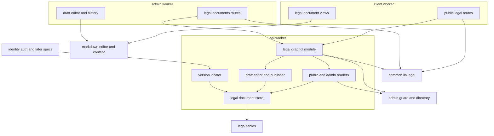
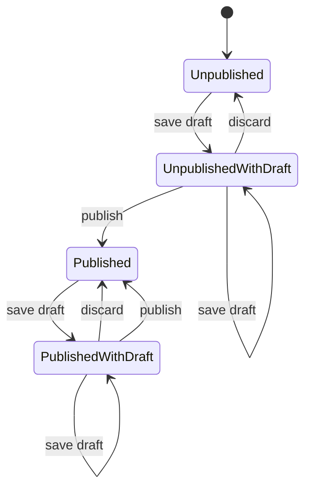
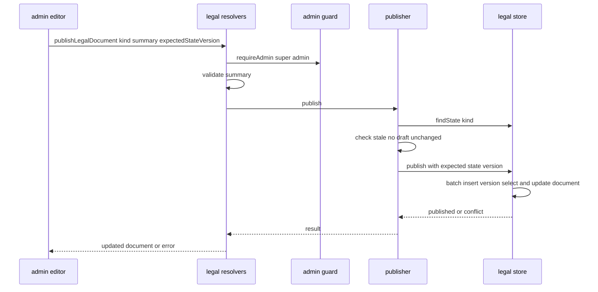
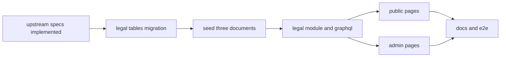

# Design Document

## Overview

**Purpose**: 利用規約・プライバシーポリシー・法的通知の3つの法務文書を、最上位管理者が管理画面でマークダウンの下書きとして編集し、変更概要とともに公開できるようにする。公開した版は本文ごと積み重ね、利用者側の`/terms`・`/privacy`・`/legal`で最新版と改訂履歴を、`/{文書}/revisions/{版番号}`で過去の各版を示す。

**Users**: 最上位管理者は`/legal-documents`で下書きの保存・破棄・公開を行い、他のロールの管理者は同じ画面を読み取り専用で見る。利用者(未ログインを含む)は共通フッターのリンクから公開ページと過去版を読む。後続のspecは、同意日時からその時点の版を特定する照会口を使う。

**Impact**: apiに`legal`モジュール(2つのテーブル・ユースケース・スキーマモジュール)を足し、利用者側に6つ、管理者側に3つのルートを足す。frontend-platformの共通フッターが既に指しているリンク先のページがこれで存在するようになる。

### Goals

- FR-ADMAG-007・008・010とLR-001・LR-008の表示面が、下書きと公開を分けた形(Q3)で動作し、E2Eテストで下書きの保存から公開・過去版の表示までを確かめられる。
- 公開した全版の本文と公開者が残り、同意日時から版を一意に特定できる。
- 同時の編集・公開で版番号の重複や後勝ちの上書きが起きない。
- 本specが追加・変更したコードの単体テスト・Workers統合テスト・ブラウザテストがカバレッジ80%を満たす。

### Non-Goals

- 法務文書の本文の起草、重要な改訂の利用者への通知(Q4)、法務文書の操作の監査ログへの記録(Q1)。
- 差分表示(Q2)、施行日時の予約(Q3で不採用)、管理者側に共通で置く法務文書へのリンク(Q7)。
- 同意した版を利用者に示す画面・データのエクスポートへの組み込み(必要になったspecが照会口を使う)。
- 要件定義書の改訂(roadmapのOut。必要な改訂は[research.md](research.md)に記録した)。

## Boundary Commitments

### This Spec Owns

- 法務文書のデータ: `legal_documents`(文書ごとの状態の版・最新の版番号・下書き)と`legal_document_versions`(版)の2テーブル(`apps/db/schema/legal/`)と、3文書の枠を入れる初期データのマイグレーション。
- 法務文書の業務処理(apiの`domain/legal`・`application/legal`・`infrastructure/legal`)と、GraphQLのスキーマモジュール`legal`(公開の照会は利用者側、管理の照会と変更は管理者側の許可リストに載る)。
- 同意日時から版を特定する照会口`LegalVersionLocator`。
- 種類・名前・利用者側のパス・入力規則の共有定義(`apps/common-lib/legal/`)。
- 利用者側の公開ページ`/terms`・`/privacy`・`/legal`と過去版のページ`/{同}/revisions/{版番号}`。
- 管理画面の`/legal-documents`・`/legal-documents/{種類}`・`/legal-documents/{種類}/revisions/{版番号}`と、メニューの項目。
- 技術ドキュメント`db/005`、サービス仕様のページ配置・文言規則・準拠方針・利用規約とプライバシーポリシーの大枠の追記。
- 非表示のbot判定のウィジェットを使う条件として、プライバシーポリシーの本文がCloudflareのTurnstile Privacy Addendumを参照していることを公開前に確かめること(参照が無ければプライバシーポリシーの大枠のCloudflareの項に加える。10.5)。

### Out of Boundary

- 共通フッターのリンクそのもの(frontend-platform)、ピン留めヘルプ記事の区画(help-center)。
- 規約への同意と同意日時の保存、登録画面からのリンク(identity-auth)。決済画面からのリンク(payments)。
- 管理者の認証・ロールの判定・管理者の表示用の情報・管理画面のシェルと共通部品(admin-foundation)。
- マークダウンの入力欄・描画・サニタイズ・書記素の数え方・検証規則の文言(content-processing)。
- 監査ログの記録(Q1により使わない)。
- 本番での初版の公開作業(開発者の手作業。launch-readinessが確かめる)。
- プライバシーポリシーの大枠のCloudflareの項の移転先・移転の根拠・委託先が講じる措置(infra-delivery)。ウィジェットを非表示の種類で使うこと(frontend-platformの`TurnstileWidget`、infra-deliveryのウィジェットの資源)。

### Allowed Dependencies

- backend-platform: `ulidPrimaryKey`・`timestamps`・`Database`・`AppError`・`Clock`・`IdGenerator`・`getAppLogger`・`PLATFORM_TYPES`。形を変えない。
- api-gateway: `defineSchemaModule`・`GraphQLContext`・`withValidatedArgs`・`DateTime`のスカラー。形を変えない。
- admin-foundation: `requireAdmin`(`presentation/graphql/admin-guard.ts`)・`CurrentAdmin`・`AdminDirectory`(`backend-lib/workers/admin`)・`ADMIN_NAV_ITEMS`への追記・`AdminPageHeader`・`AdminDataTable`・`ConfirmActionDialog`・`RoleGate`・`useAdminRole`・E2Eの補助`signInAsNewAdmin`(`e2e/support/admin-bootstrap.ts`)。監査ログの部品は使わない。
- content-processing: `countGraphemes`・`hasForbiddenCharacters`・`markdownTextSchema`・`MarkdownTextRule`・`LinkRelToken`(common-lib)、`MarkdownEditor`・`MarkdownContent`・`useRenderedMarkdown`・`useMarkdownOptions`(frontend-lib)。
- frontend-platform: `executeGraphQL`・`graphqlQueryOptions`・`GraphQLClientError`・`useAppForm`・`FormField`・`SubmitButton`・`buildPageHead`・`DateTime`・`EmptyState`・`ErrorState`・`LoadingSkeleton`・`notify`・shadcn/uiの部品・`runAxe`・`PublicRuntimeConfig.clientSiteOrigin`・`AppForm`・`errorMessageOf`・各アプリの`src/composition/app-profile.ts`のプロファイル(`CLIENT_PROFILE`・`ADMIN_PROFILE`)・`utilities/validation/zod.ts`の`z`。
  - フォームは`useAppForm<TInput, TOutput>(schema, { defaultValues })`(`defaultValues`は全欄)と、必須の`onSubmitError`・任意の`serverFieldPrefix`(`input`を取るmutationは`"input"`)を受ける`AppForm`で作る。管理者側のフォームのファイルが`zod`の値を使う時は`utilities/validation/zod.ts`から読み、`zod`を直接読み込むのは型だけにする。
  - 失敗の文言: `GraphQLClientError`でない例外に代えて画面に出す文言(`ErrorState`・`PartialErrorState`の`message`、`AppForm`の`onSubmitError`で示す文言、トースト)は`errorMessageOf(error, <プロファイル>.contactAvailable)`で選び、例外の`message`を直接出さない。管理者側は`ADMIN_PROFILE`を使い、`ErrorState`・`UnexpectedErrorView`に`contactHref`を渡さない(問い合わせの画面が無いため、問い合わせの導線と問い合わせを促す文を出さない)。
- `@tanstack/react-router`の`useBlocker`(frontend-platformの版)。新しいnpmパッケージは無い。

### Revalidation Triggers

- `LegalVersionLocator`の形・比較の規則(指定の日時「以前」で公開日時が最も新しい版)・公開日時の精度(identity-auth・同意した版を使う後続spec)。
- 利用者側のパス`/terms`・`/privacy`・`/legal`と過去版のURLの形(identity-auth・payments・frontend-platformのフッター)。
- `LegalDocumentKind`の値と`LEGAL_DOCUMENT_PATHS`(4アプリ)。
- GraphQLの`legal`モジュールの型・エラーコード(client・admin)。
- admin-foundationの`requireAdmin`・`AdminDirectory`・`ADMIN_NAV_ITEMS`・共通部品のprops・E2Eの補助`signInAsNewAdmin`の形を変えたら、本specを確かめ直す。
- content-processingの`MarkdownEditorProps`・`MarkdownContentProps`・`markdownTextSchema`の文言を変えたら、本specを確かめ直す。
- frontend-platformの`TurnstileWidget`が描くウィジェット、またはinfra-deliveryのウィジェットの種類(`invisible`)を変えたら、プライバシーポリシーのTurnstile Privacy Addendumの参照の要否を確かめ直す。

## Architecture

### Existing Architecture Analysis

- 上流の8specは設計・タスクとも承認済みで、本specのタスクはそれらの実装の完了を前提にする(roadmapの順でadmin-foundationまでが先に実装される)。
- apiの層は`domain`・`application`・`infrastructure`・`presentation`・`composition`で、依存の方向は静的解析で強制される。後続specのapplication層はadmin-foundationの`backend-lib/workers/admin`の`AdminDirectory`を、presentation層は`admin-guard.ts`を読み込める。
- frontend-platformはページの応答に`Cache-Control: no-store`を付けるため、公開の直後から新しい版が表示される(4.8)。共通フッターには既に3文書へのリンクがある(6.8)。

### Architecture Pattern & Boundary Map



**Architecture Integration**:

- 選んだパターン: backend-platformの4層と合成ルートに従い、apiに`legal`モジュールを置く。3文書は種類を引数にした1組の部品で扱う(research.mdの「3文書を同じ形で扱う」)。
- 境界: 本specは法務文書のデータと画面だけを所有し、他ドメインのデータを変えない。後続specとの継ぎ目は`LegalVersionLocator`と利用者側のパスだけである。
- 同時の操作は、文書の行の`state_version`を条件にした書き込みで直列化する(仮3)。

### Dependency Direction

- 共有コード: `apps/db/schema/legal` → `apps/common-lib/legal`(content-processingの`countGraphemes`・`hasForbiddenCharacters`・`markdownTextSchema`だけを読み込む) → アプリの`src`。
- apiの`src`内: `domain/legal` ← `application/legal`(`backend-lib/workers/admin`の`AdminDirectory`を読み込む) ← `infrastructure/legal`・`presentation/graphql/modules/legal`(`admin-guard.ts`を読み込む) ← `composition`。`legal`の各層は`identity`の各層を読み込まない。
- client・adminの`src`内: frontend-platformの規則(`composition` ← `components` ← `routes`)に従う。GraphQLの操作はアプリの`src/graphql/operations/legal/`に1ファイル1操作の`*.graphql`で書き、操作名を利用者側は`Client`、管理者側は`Admin`で始める。画面は`src/graphql/generated/graphql.ts`の`<操作名>Document`と型を読み、`graphql()`と`gql.ts`・`index.ts`を使わない(frontend-platformの「操作の追加手順」)。

### Technology Stack

| Layer        | Choice / Version                                                                   | Role in Feature                  | Notes                                                                   |
| ------------ | ---------------------------------------------------------------------------------- | -------------------------------- | ----------------------------------------------------------------------- |
| 状態         | Cloudflare D1(drizzle-orm 1.0.0-rc.5)                                              | 文書の状態・下書き・版           | 新しいテーブル2つ                                                       |
| API          | GraphQL Yoga(api-gatewayの基盤)・Zod                                               | 公開の照会・管理の照会と変更     | 既存                                                                    |
| 画面         | TanStack Start・TanStack Router 1.170系(`useBlocker`)・React・react-hook-form・zod | 公開ページ・過去版・管理画面     | frontend-platformの版。`zod`の値は`utilities/validation/zod.ts`から読む |
| マークダウン | content-processingの`MarkdownEditor`(Crepe 7.22.2)・`MarkdownContent`              | 編集とプレビュー・表示           | 既存                                                                    |
| テスト       | bun test・vitest 4.1.11(Workers・Browser)・Playwright 1.64.1                       | 単体・Workers統合・ブラウザ・E2E | 上流の版                                                                |

## File Structure Plan

### Directory Structure

```
apps/
├── db/
│   ├── schema/legal/                                   # 各ファイルに同名の*.unit.test.ts
│   │   ├── legal-documents.ts                          # 文書の状態・最新の版番号・下書き
│   │   ├── legal-document-versions.ts                  # 版(本文・変更概要・公開日時・公開者)
│   │   └── index.ts                                    # legalのテーブルの集約(schema/index.tsから再エクスポート)
│   └── migrations/<日時>_legal_pages/migration.sql · <日時>_legal_pages_seed/migration.sql
├── common-lib/legal/                                   # 4アプリ共通の純粋な定義(各ファイルに同名の*.unit.test.ts)
│   ├── legal-documents.ts                              # LegalDocumentKind・名前・利用者側のパス・過去版のパス・版番号の解析・リンクのrel
│   └── legal-input-rules.ts                            # 本文と変更概要の上限・判定・文言・Zodの規則
├── api/src/
│   ├── domain/legal/legal-document.ts                  # 状態の型と、保存・破棄・公開の可否・次の版番号・公開日時(単体テスト併置)
│   ├── application/legal/                              # ポートとユースケース(Bunの単体テスト)
│   │   ├── legal-types.ts                              # LEGAL_TYPES
│   │   ├── ports.ts                                    # LegalDocumentStore
│   │   ├── legal-document-reader.ts                    # 公開の照会(管理者の情報を含めない)
│   │   ├── legal-document-admin-reader.ts              # 管理の照会(下書き・公開者の解決)
│   │   ├── legal-draft-editor.ts                       # 下書きの保存・破棄
│   │   ├── legal-document-publisher.ts                 # 公開
│   │   └── legal-version-locator.ts                    # LegalVersionLocator(後続specも使う)
│   ├── infrastructure/legal/d1-legal-document-store.ts # 条件付きの書き込み・照会(Workers統合テスト併置)
│   ├── presentation/graphql/modules/legal/             # スキーマモジュール(Workers統合テスト)
│   │   ├── type-defs.ts · inputs.ts · errors.ts · mappers.ts
│   │   ├── public-resolvers.ts                         # legalDocument・legalDocumentVersion
│   │   ├── admin-resolvers.ts                          # adminLegal*の照会と3つの変更
│   │   └── index.ts                                    # legalSchemaModule
│   └── composition/legal-module.ts                     # LEGAL_TYPESの束縛(AppModule)
├── client/src/
│   ├── routes/terms/index.tsx · privacy/index.tsx · legal/index.tsx
│   ├── routes/terms/revisions/$versionNumber.tsx · privacy/revisions/$versionNumber.tsx · legal/revisions/$versionNumber.tsx
│   ├── components/legal/                               # *.browser.test.tsxを併置
│   │   ├── legal-route-options.ts                      # 6つのルートが使うloader・head・params.parseの組み立て(単体テスト併置)
│   │   ├── legal-document-page.tsx                     # 名前・最新版の公開日・本文・改訂履歴・準備中
│   │   ├── legal-version-page.tsx                      # 版の名前・版番号・公開日・変更概要・本文
│   │   ├── legal-version-notice.tsx                    # 過去の版・最新版である旨と公開ページへのリンク
│   │   └── legal-revision-history.tsx                  # 改訂履歴の一覧
│   └── graphql/operations/legal/                       # 1ファイル1操作の*.graphql(操作名はClientで始める)
│       └── legal-document.graphql · legal-document-version.graphql
└── admin/src/
    ├── routes/_authenticated/legal-documents/index.tsx · $kind/index.tsx · $kind/revisions/$versionNumber.tsx
    ├── components/legal/                               # *.browser.test.tsxを併置
    │   ├── legal-document-list.tsx                     # 3文書の一覧(最新版・公開日時・下書きの有無・編集・公開ページ)
    │   ├── legal-document-editor-page.tsx              # 見出し・状態・入力欄・改訂履歴の配置と取得
    │   ├── legal-draft-form.tsx                        # 入力欄と保存・破棄・公開の操作(ロールで読み取り専用)
    │   ├── legal-draft-status.tsx                      # 下書きの有無・最後の保存の日時と保存者
    │   ├── publish-legal-document-dialog.tsx           # 変更概要の入力と公開の確認
    │   ├── legal-revision-table.tsx                    # 改訂履歴の表(版・公開日時・変更概要・公開者)
    │   ├── legal-version-detail.tsx                    # 版の本文と情報
    │   ├── legal-conflict-notice.tsx                   # 他の操作で内容が変わった旨と再読み込み
    │   ├── use-unsaved-changes-guard.ts                # useBlockerによる離脱の確認の状態
    │   ├── legal-editor-errors.ts                      # GraphQLClientErrorのコードと表示の対応(単体テスト併置)
    │   └── legal-form-schemas.ts                       # 下書きと変更概要のフォームの規則
    └── graphql/operations/legal/                       # 1ファイル1操作の*.graphql(操作名はAdminで始める。照会3つと変更3つ)
e2e/
├── client/legal-pages.e2e.test.ts                      # フッターから3つの公開ページへの到達
└── admin/legal-documents.e2e.test.ts                   # 下書きの保存・公開・公開ページ・過去版・続けての公開(管理者はadmin-foundationの`signInAsNewAdmin`で用意する)
docs/GUIDES/tech/db/005-draft-and-published-versions.md
```

テストファイルは同名の`*.unit.test.ts`(`domain`・`application`・`common-lib`・`db/schema`・純粋な補助)、`*.worker.test.ts`(`infrastructure`・`presentation`・`composition`)、`*.browser.test.tsx`(画面部品)を対象ファイルの隣に置く。文書の番号は、roadmapの順でadmin-foundationの後の空き番号`db/005`に固定する(並行して作成中のinquiry-chatはこの後の番号を使う)。

### Modified Files

- `apps/db/schema/index.ts` — legalのテーブルを再エクスポートする。マイグレーションはmainの最新を取り込んでから`drizzle-kit generate --name=legal_pages`で生成し、続けて`--custom --name=legal_pages_seed`で初期データを書く。衝突したら生成し直す。
- `apps/api/src/composition/modules.ts`・`graphql-modules.ts` — `LEGAL_MODULE`と`legalSchemaModule`を加える。
- `apps/api/src/presentation/graphql/generated/*`・`allowlist.json`、`apps/{client,admin}/src/graphql/generated/*` — 生成コマンドで作り直す。
- `apps/admin/src/composition/admin-navigation.ts` — `{ to: '/legal-documents', label: '法務文書', order: 120 }`を加える。
- `docs/GUIDES/tech/db/README.md` — `005`の行を加える。
- `docs/GUIDES/service/design/002-page-layouts.md` — 利用者側のURLの表に過去版の3行、外部リンクの`rel`の表に法務文書(`noopener`)、法務文書の公開ページと過去版の配置の節、管理者側の法務文書の画面の構成とURL(仮4)を加える。
- `docs/GUIDES/service/design/003-text-and-copy-rules.md` — 入力欄の上限の表に法務文書の本文の行(上限100,000文字・必須・マークダウン・FR-ADMAG-007)を加え、本specの文言(「Error Handling」の表と、各画面部品に記した確認・状態・案内の文言)を追記する。
- `docs/GUIDES/service/legal/001-compliance-policy.md` — データ保持期間の一覧に「法務文書の版(本文・変更概要・公開日時・公開した管理者のID)は無期限、削除の操作なし」「法務文書の下書きは公開・破棄で削除」の行を加え、「法務文書の改訂」を下書きと公開・過去版の掲示・周知の運用(Q4)・本番公開前の初版の公開(Q6)の内容に改める。
- `docs/GUIDES/service/legal/002-terms-of-service-outline.md`・`003-privacy-policy-outline.md` — 章18・章13の要点に「改訂履歴と過去の各版の掲示」を加える。
  - `003-privacy-policy-outline.md`のCloudflareの項(infra-deliveryが書く`### Cloudflare(<サービス>)`の項): 非表示のbot判定のウィジェットを使う条件として、CloudflareのTurnstile Privacy Addendumを参照する旨があるかを確かめ、無ければ「bot判定」の項目として加える。「記載上の注意」に、公開するプライバシーポリシーの本文がこの参照を含むことを記す。Cloudflareの項の移転先・移転の根拠・委託先が講じる措置の項目は書き換えない(10.5)。
- `CLAUDE.md` — 「技術規則の参照先」に、下書きと公開した版を持つデータを設計する前に読む`db/005`へのリンクを加える。

## System Flows

### 文書の状態



- すべての遷移で`state_version`を1増やす。遷移の要求は読み込んだ時点の`state_version`を伴い、一致しなければ`legal_document_conflict`で拒否する(3.10・4.4)。
- `Unpublished`の間、公開ページは準備中を表示する(6.6)。`publish`は下書きの本文が最新版と同じなら拒否する(4.3)。

### 公開



- 版の挿入は`INSERT … SELECT … FROM legal_documents WHERE kind = ? AND state_version = ? AND draft_body IS NOT NULL`で、本文を下書きの列から、版番号を`latest_version_number + 1`から取る。続く文で同じ条件の文書の行を更新する。1文目の変更が0行なら競合とする。D1の一括の書き込みは直列で原子的なため、2つの文は両方が適用されるか、どちらも適用されない(1.3・4.1)。
- 公開日時は`nextPublishedAt(clock.now(), 最新版の公開日時)`で、最新版より必ず後にする(8.1)。

## Requirements Traceability

| Requirement | Summary                            | Components                                                       | Interfaces                                           | Flows      |
| ----------- | ---------------------------------- | ---------------------------------------------------------------- | ---------------------------------------------------- | ---------- |
| 1.1, 1.6    | 3文書の枠と初期データ              | LegalSchema・LegalSeedMigration・LegalDocuments                  | `LEGAL_DOCUMENT_KINDS`                               | —          |
| 1.2〜1.5    | 版の記録・連番・不変・公開者の保持 | LegalDocumentPublisher・D1LegalDocumentStore・LegalSchema        | `publish`・`(document_id, version_number)`の一意索引 | 公開       |
| 2.1〜2.3    | 管理画面の一覧・移動・メニュー     | LegalDocumentList・AdminLegalRoutes・admin-navigation            | `adminLegalDocuments`                                | —          |
| 2.4         | 管理者側以外からの拒否             | AdminLegalResolvers                                              | `requireAdmin`                                       | —          |
| 3.1〜3.2    | 編集の初期値と入力欄               | LegalDocumentEditorPage・LegalDraftForm                          | `adminLegalDocument`・`MarkdownEditor`               | —          |
| 3.3〜3.4    | 下書きの保存と検証                 | LegalDraftEditor・LegalInputRules・D1LegalDocumentStore          | `saveLegalDocumentDraft`・`saveDraft`                | 文書の状態 |
| 3.5         | 下書きの状態の表示                 | LegalDraftStatus・LegalDocumentAdminReader                       | `AdminLegalDraft`                                    | —          |
| 3.6         | 下書きの破棄                       | LegalDraftEditor・LegalDraftForm                                 | `discardLegalDocumentDraft`                          | 文書の状態 |
| 3.7, 3.8    | 権限による拒否と読み取り専用       | AdminLegalResolvers・LegalDraftForm                              | `requireAdmin('super_admin')`・`RoleGate`            | —          |
| 3.9         | 下書きを公開しない                 | LegalDocumentReader・PublicLegalResolvers                        | `LegalDocument`(下書きの項目なし)                    | —          |
| 3.10, 4.4   | 同時の操作の拒否                   | LegalDocumentRules・D1LegalDocumentStore・LegalConflictNotice    | `legal_document_conflict`                            | 文書の状態 |
| 3.11        | 離脱の確認                         | UnsavedChangesGuard                                              | `useBlocker`                                         | —          |
| 4.1〜4.3    | 公開・変更概要・変更なしの拒否     | LegalDocumentPublisher・LegalDocumentRules・LegalInputRules      | `publishLegalDocument`                               | 公開       |
| 4.5         | 権限による公開の拒否               | AdminLegalResolvers                                              | `requireAdmin('super_admin')`                        | —          |
| 4.6, 4.7    | 未保存時の公開不可・公開の確認     | LegalDraftForm・PublishLegalDocumentDialog                       | —                                                    | —          |
| 4.8         | 公開後の表示                       | LegalDocumentReader・ページの`no-store`                          | `legalDocument`                                      | —          |
| 5.1〜5.5    | 管理画面の改訂履歴と版             | LegalRevisionTable・LegalVersionDetail・LegalDocumentAdminReader | `AdminLegalRevision`・`adminLegalDocumentVersion`    | —          |
| 6.1〜6.5    | 公開ページの本文と改訂履歴         | LegalDocumentPage・LegalRevisionHistory・LegalDocumentReader     | `legalDocument`                                      | —          |
| 6.6         | 準備中                             | LegalDocumentPage・LegalRouteOptions                             | `latest: null`・`noIndex`                            | 文書の状態 |
| 6.7         | 日時の表示                         | LegalDocumentPage・LegalRevisionHistory                          | `DateTime`(`longDate`)                               | —          |
| 6.8         | 共通レイアウトの中                 | client routes                                                    | frontend-platformの`SiteLayout`                      | —          |
| 7.1〜7.5    | 過去版のページ                     | LegalVersionPage・LegalVersionNotice・LegalRouteOptions          | `legalDocumentVersion`・`parseVersionNumber`         | —          |
| 8.1〜8.3    | 同意した版の特定                   | LegalVersionLocator・D1LegalDocumentStore                        | `findPublishedAt`                                    | —          |
| 9.1〜9.4    | アクセシビリティと状態             | PublishLegalDocumentDialog・各画面部品                           | `useAppForm`・`runAxe`                               | —          |
| 10.1〜10.6  | テスト・文書                       | 各テスト・LegalDocs                                              | —                                                    | —          |

## Components and Interfaces

| Component                                | Domain/Layer                    | Intent                             | Req Coverage                                      | Key Dependencies (P0/P1)                  | Contracts      |
| ---------------------------------------- | ------------------------------- | ---------------------------------- | ------------------------------------------------- | ----------------------------------------- | -------------- |
| LegalDocuments・LegalInputRules          | common-lib                      | 種類・名前・パス・入力規則         | 1.1, 3.4, 4.2, 7.1, 7.4, 9.1                      | content-processingの文字数と検証 (P0)     | State          |
| LegalSchema・LegalSeedMigration          | db                              | 2テーブルと3文書の枠               | 1.1〜1.6                                          | backend-platformの共通カラム (P0)         | State          |
| LegalDocumentRules                       | api/domain                      | 遷移の可否・次の版番号・公開日時   | 3.10, 4.1, 4.3, 4.4, 8.1                          | —                                         | Service        |
| LegalDocumentStore・D1LegalDocumentStore | api/application・infrastructure | 状態の読み取りと条件付きの書き込み | 1.2〜1.5, 3.3, 3.6, 3.10, 4.1, 4.4, 8.1〜8.3      | D1 (P0)                                   | Service, State |
| LegalDocumentReader                      | api/application                 | 公開の照会                         | 3.9, 4.8, 6.1〜6.6, 7.1〜7.4                      | Store (P0)                                | Service        |
| LegalDocumentAdminReader                 | api/application                 | 管理の照会と公開者の解決           | 2.1, 3.1, 3.5, 5.1〜5.4                           | Store (P0)、AdminDirectory (P0)           | Service        |
| LegalDraftEditor・LegalDocumentPublisher | api/application                 | 保存・破棄・公開                   | 3.3, 3.4, 3.6, 3.10, 4.1〜4.4                     | Store (P0)、Clock・IdGenerator (P0)       | Service        |
| LegalVersionLocator                      | api/application                 | 同意日時からの版の特定             | 8.1〜8.3                                          | Store (P0)                                | Service        |
| LegalSchemaModule                        | api/presentation                | GraphQLの型・リゾルバ・エラー      | 2.4, 3.7, 3.9, 4.5, 6.5                           | requireAdmin (P0)、withValidatedArgs (P0) | API            |
| ClientLegalPages                         | client                          | 公開ページと過去版                 | 6.1〜6.8, 7.1〜7.5, 9.3, 9.4                      | MarkdownContent (P0)、DateTime (P0)       | State          |
| AdminLegalPages                          | admin                           | 一覧・編集・改訂履歴・版           | 2.1〜2.3, 3.1〜3.11, 4.6, 4.7, 5.1〜5.5, 9.1〜9.4 | MarkdownEditor (P0)、admin共通部品 (P0)   | State          |

### common-lib

#### LegalDocuments・LegalInputRules

**Contracts**: State [x]

```typescript
// legal-documents.ts
export type LegalDocumentKind = 'terms' | 'privacy' | 'legal-notice';
export declare const LEGAL_DOCUMENT_KINDS: readonly LegalDocumentKind[]; // 表示順: terms・privacy・legal-notice
export declare const LEGAL_DOCUMENT_LABELS: Readonly<
  Record<LegalDocumentKind, string>
>; // 利用規約・プライバシーポリシー・法的通知
export declare const LEGAL_DOCUMENT_PATHS: Readonly<
  Record<LegalDocumentKind, '/terms' | '/privacy' | '/legal'>
>;
export declare function isLegalDocumentKind(
  value: string,
): value is LegalDocumentKind;
export declare function legalRevisionPath(
  kind: LegalDocumentKind,
  versionNumber: number,
): string; // `${パス}/revisions/${版番号}`
export declare function parseVersionNumber(raw: string): number | undefined; // /^[1-9][0-9]{0,8}$/に合わなければundefined
export declare const LEGAL_DOCUMENT_EXTERNAL_LINK_REL: readonly LinkRelToken[]; // ['noopener']

// legal-input-rules.ts
export declare const LEGAL_BODY_MAX: 100000;
export declare const CHANGE_SUMMARY_MAX: 200;
export declare const LEGAL_BODY_RULE: MarkdownTextRule; // { label: '本文', maxGraphemes: 100000, required: true }
export type ChangeSummaryIssue =
  'empty' | 'too-long' | 'line-break' | 'forbidden-character';
export declare function checkChangeSummary(
  value: string,
): ChangeSummaryIssue | undefined; // 前後の空白を除いてから判定
export declare const CHANGE_SUMMARY_MESSAGES: Readonly<
  Record<ChangeSummaryIssue, string>
>;
export declare function changeSummarySchema(): z.ZodType<string>; // 判定に違反すれば文言で失敗、成功なら前後の空白を除いた値
export declare function legalBodySchema(): z.ZodType<string>; // markdownTextSchema(LEGAL_BODY_RULE)
```

- 変更概要の判定の順: 禁止文字(`hasForbiddenCharacters`。改行以外)→改行(LF・CR)→空→`countGraphemes`が200を超える。文言は「変更概要に使用できない文字が含まれています。」「変更概要に改行は使用できません。」「変更概要を入力してください。」「変更概要は200文字以内で入力してください。」。
- 本文の文言はcontent-processingの`markdownTextSchema`のもの(「本文を入力してください。」「本文は100,000文字以内で入力してください。」)。

### db

#### LegalSchema・LegalSeedMigration

- `legal_documents`と`legal_document_versions`(物理の定義は「Data Models」)。管理者のIDの列は外部キーを持たない(管理者の物理削除後も残す、1.5)。
- 初期データのマイグレーション: 3つの種類の行を固定のULIDで`INSERT … ON CONFLICT(kind) DO NOTHING`する。`state_version`・`latest_version_number`は0、下書きの列はNULL(1.6)。

### api/domain

#### LegalDocumentRules

**Contracts**: Service [x]

```typescript
export interface LegalVersionSnapshot {
  readonly versionNumber: number;
  readonly body: string;
  readonly publishedAt: Date;
}
export interface LegalDraftSnapshot {
  readonly body: string;
  readonly savedAt: Date;
  readonly savedByAdminId: string;
}
export interface LegalDocumentState {
  readonly kind: LegalDocumentKind;
  readonly stateVersion: number;
  readonly latest: LegalVersionSnapshot | null;
  readonly draft: LegalDraftSnapshot | null;
}
export type LegalDocumentDenial = 'stale' | 'no_draft' | 'unchanged';
export declare function checkDraftWritable(
  state: LegalDocumentState,
  expectedStateVersion: number,
): 'stale' | undefined;
export declare function checkDraftDiscardable(
  state: LegalDocumentState,
  expectedStateVersion: number,
): 'stale' | 'no_draft' | undefined;
export declare function checkPublishable(
  state: LegalDocumentState,
  expectedStateVersion: number,
): LegalDocumentDenial | undefined; // 順: stale→no_draft→unchanged(本文の完全一致)
export declare function nextVersionNumber(state: LegalDocumentState): number; // latestが無ければ1
export declare function nextPublishedAt(
  now: Date,
  latestPublishedAt: Date | null,
): Date; // max(now, latest + 1ms)
```

### api/application

#### LegalDocumentStore・D1LegalDocumentStore

**Contracts**: Service [x] / State [x]

```typescript
export interface LegalRevisionRecord {
  readonly versionNumber: number;
  readonly publishedAt: Date;
  readonly changeSummary: string;
  readonly publishedByAdminId: string;
}
export interface LegalVersionRecord extends LegalRevisionRecord {
  readonly body: string;
  readonly latestVersionNumber: number;
}
export interface LegalDocumentSummaryRecord {
  readonly kind: LegalDocumentKind;
  readonly latestVersionNumber: number | null;
  readonly latestPublishedAt: Date | null;
  readonly hasDraft: boolean;
}
export interface LegalDocumentStore {
  findState(kind: LegalDocumentKind): Promise<LegalDocumentState>; // 枠が無ければ例外(初期データの欠落)
  listSummaries(): Promise<readonly LegalDocumentSummaryRecord[]>; // LEGAL_DOCUMENT_KINDSの順
  listRevisions(
    kind: LegalDocumentKind,
  ): Promise<readonly LegalRevisionRecord[]>; // 版番号の降順、本文を含めない
  findVersion(
    kind: LegalDocumentKind,
    versionNumber: number,
  ): Promise<LegalVersionRecord | undefined>;
  findPublishedAt(
    kind: LegalDocumentKind,
    at: Date,
  ): Promise<
    { readonly versionNumber: number; readonly publishedAt: Date } | undefined
  >;
  saveDraft(input: {
    readonly kind: LegalDocumentKind;
    readonly expectedStateVersion: number;
    readonly body: string;
    readonly savedAt: Date;
    readonly savedByAdminId: string;
  }): Promise<'saved' | 'conflict'>;
  discardDraft(input: {
    readonly kind: LegalDocumentKind;
    readonly expectedStateVersion: number;
  }): Promise<'discarded' | 'conflict'>;
  publish(input: {
    readonly kind: LegalDocumentKind;
    readonly expectedStateVersion: number;
    readonly versionId: string;
    readonly changeSummary: string;
    readonly publishedAt: Date;
    readonly publishedByAdminId: string;
  }): Promise<'published' | 'conflict'>;
}
```

- `findState`: 文書の行と、`latest_version_number`の版の行を結合して1文で読む。
- `saveDraft`: `UPDATE legal_documents SET draft_body = ?, draft_saved_at = ?, draft_saved_by_admin_id = ?, state_version = state_version + 1, updated_at = ? WHERE kind = ? AND state_version = ?`。変更が0行なら`conflict`。
- `discardDraft`: 同じ条件に`AND draft_body IS NOT NULL`を加え、下書きの3列をNULLにする。
- `publish`: 「System Flows」の2文の一括の書き込み。1文目の変更が0行なら`conflict`。一意索引の違反(想定外の重複)も`conflict`にする。
- `findPublishedAt`: `published_at <= ?`の版を`published_at`の降順・版番号の降順で1件。
- Invariants: `latest_version_number`は版の行の最大の版番号と一致する。版の行は挿入だけで、更新・削除の文を持たない(1.4)。

#### LegalDocumentReader・LegalDocumentAdminReader

**Contracts**: Service [x]

```typescript
export interface PublicLegalVersion {
  readonly kind: LegalDocumentKind;
  readonly versionNumber: number;
  readonly publishedAt: Date;
  readonly changeSummary: string;
  readonly body: string;
  readonly isLatest: boolean;
}
export interface PublicLegalRevision {
  readonly versionNumber: number;
  readonly publishedAt: Date;
  readonly changeSummary: string;
}
export interface PublicLegalDocument {
  readonly kind: LegalDocumentKind;
  readonly latest: PublicLegalVersion | null; // nullは準備中
  readonly revisions: readonly PublicLegalRevision[]; // 新しい順
}
export interface LegalDocumentReader {
  getDocument(kind: LegalDocumentKind): Promise<PublicLegalDocument>;
  getVersion(
    kind: LegalDocumentKind,
    versionNumber: number,
  ): Promise<PublicLegalVersion | undefined>;
}

export interface LegalEditorView {
  readonly id: string;
  readonly nickname: string | null;
} // nullは削除済み
export interface AdminLegalDocumentView {
  readonly kind: LegalDocumentKind;
  readonly stateVersion: number;
  readonly latestBody: string | null;
  readonly draft: {
    readonly body: string;
    readonly savedAt: Date;
    readonly savedBy: LegalEditorView;
  } | null;
  readonly revisions: readonly (PublicLegalRevision & {
    readonly publishedBy: LegalEditorView;
  })[];
}
export interface AdminLegalVersionView extends PublicLegalVersion {
  readonly publishedBy: LegalEditorView;
}
export interface LegalDocumentAdminReader {
  listDocuments(): Promise<readonly LegalDocumentSummaryRecord[]>;
  getDocument(kind: LegalDocumentKind): Promise<AdminLegalDocumentView>;
  getVersion(
    kind: LegalDocumentKind,
    versionNumber: number,
  ): Promise<AdminLegalVersionView | undefined>;
}
```

- 公開の照会の型は管理者のIDと下書きを持たない(3.9・6.5)。
- 管理の照会は、版と下書きの管理者のIDをまとめて`AdminDirectory.findProfiles`で1回引き、見つからないIDは`nickname: null`にする(5.2・3.5)。

#### LegalDraftEditor・LegalDocumentPublisher

**Contracts**: Service [x]

```typescript
export interface LegalDraftEditor {
  save(input: {
    readonly adminId: string;
    readonly kind: LegalDocumentKind;
    readonly expectedStateVersion: number;
    readonly body: string;
  }): Promise<AdminLegalDocumentView>;
  discard(input: {
    readonly adminId: string;
    readonly kind: LegalDocumentKind;
    readonly expectedStateVersion: number;
  }): Promise<AdminLegalDocumentView>;
}
export interface LegalDocumentPublisher {
  publish(input: {
    readonly adminId: string;
    readonly kind: LegalDocumentKind;
    readonly expectedStateVersion: number;
    readonly changeSummary: string;
  }): Promise<AdminLegalDocumentView>;
}
```

- Preconditions: リゾルバが最上位管理者であることと入力の規則(本文・変更概要)を確かめ済みである。
- `save`: `findState`→`checkDraftWritable`→`saveDraft`。`publish`: `findState`→`checkPublishable`→`publish`(`versionId`は`IdGenerator`、公開日時は`nextPublishedAt`)。拒否・`conflict`は「Error Handling」の`AppError`にする。
- Postconditions: 成功すると、操作の後の`AdminLegalDocumentView`(新しい`stateVersion`)を返す。

#### LegalVersionLocator

**Contracts**: Service [x]

```typescript
export interface LegalVersionLocator {
  findPublishedAt(
    kind: LegalDocumentKind,
    at: Date,
  ): Promise<
    { readonly versionNumber: number; readonly publishedAt: Date } | undefined
  >;
}
```

- 指定の日時「以前」(同じミリ秒を含む)で公開日時が最も新しい版を返し、無ければ`undefined`(8.1・8.2)。公開日時は版番号とともに単調に増える(`nextPublishedAt`)。
- 本specの画面は使わない。後続specはDIの`LEGAL_TYPES.LegalVersionLocator`で受け取る。

### api/presentation

#### LegalSchemaModule

**Contracts**: API [x]

```graphql
enum LegalDocumentKind {
  TERMS
  PRIVACY
  LEGAL_NOTICE
}
type LegalRevision {
  versionNumber: Int!
  publishedAt: DateTime!
  changeSummary: String!
}
type LegalDocumentVersion {
  kind: LegalDocumentKind!
  versionNumber: Int!
  publishedAt: DateTime!
  changeSummary: String!
  body: String!
  isLatest: Boolean!
}
type LegalDocument {
  kind: LegalDocumentKind!
  latest: LegalDocumentVersion
  revisions: [LegalRevision!]!
}
type LegalDocumentEditor {
  id: ID!
  nickname: String
}
type AdminLegalRevision {
  versionNumber: Int!
  publishedAt: DateTime!
  changeSummary: String!
  publishedBy: LegalDocumentEditor!
}
type AdminLegalDraft {
  body: String!
  savedAt: DateTime!
  savedBy: LegalDocumentEditor!
}
type AdminLegalDocumentSummary {
  kind: LegalDocumentKind!
  latestVersionNumber: Int
  latestPublishedAt: DateTime
  hasDraft: Boolean!
}
type AdminLegalDocument {
  kind: LegalDocumentKind!
  stateVersion: Int!
  latestBody: String
  draft: AdminLegalDraft
  revisions: [AdminLegalRevision!]!
}
type AdminLegalDocumentVersion {
  kind: LegalDocumentKind!
  versionNumber: Int!
  publishedAt: DateTime!
  changeSummary: String!
  body: String!
  isLatest: Boolean!
  publishedBy: LegalDocumentEditor!
}
input SaveLegalDocumentDraftInput {
  kind: LegalDocumentKind!
  expectedStateVersion: Int!
  body: String!
}
input DiscardLegalDocumentDraftInput {
  kind: LegalDocumentKind!
  expectedStateVersion: Int!
}
input PublishLegalDocumentInput {
  kind: LegalDocumentKind!
  expectedStateVersion: Int!
  changeSummary: String!
}
type Query {
  legalDocument(kind: LegalDocumentKind!): LegalDocument!
  "存在しない版はnull"
  legalDocumentVersion(
    kind: LegalDocumentKind!
    versionNumber: Int!
  ): LegalDocumentVersion
  adminLegalDocuments: [AdminLegalDocumentSummary!]!
  adminLegalDocument(kind: LegalDocumentKind!): AdminLegalDocument!
  adminLegalDocumentVersion(
    kind: LegalDocumentKind!
    versionNumber: Int!
  ): AdminLegalDocumentVersion
}
type Mutation {
  saveLegalDocumentDraft(
    input: SaveLegalDocumentDraftInput!
  ): AdminLegalDocument!
  discardLegalDocumentDraft(
    input: DiscardLegalDocumentDraftInput!
  ): AdminLegalDocument!
  publishLegalDocument(input: PublishLegalDocumentInput!): AdminLegalDocument!
}
```

| 操作                                                                          | 呼び出し元(許可リスト) | 必要なロール       |
| ----------------------------------------------------------------------------- | ---------------------- | ------------------ |
| `legalDocument`・`legalDocumentVersion`                                       | 利用者側               | 不要(未ログイン可) |
| `adminLegalDocuments`・`adminLegalDocument`・`adminLegalDocumentVersion`      | 管理者側               | 閲覧のみ以上       |
| `saveLegalDocumentDraft`・`discardLegalDocumentDraft`・`publishLegalDocument` | 管理者側               | 最上位管理者       |

- `admin*`のリゾルバは先頭で`requireAdmin(context, 'viewer')`または`requireAdmin(context, 'super_admin')`を呼ぶ。呼び出し元が管理者側でない・未ログインなら拒否される(2.4・3.7・4.5)。
- 入力の検証は`withValidatedArgs`: 本文は`legalBodySchema()`、変更概要は`changeSummarySchema()`、`versionNumber`・`expectedStateVersion`は0以上(版番号は1以上)の整数。違反は`validation_error`と欄ごとの詳細(`body`・`changeSummary`)。
- `mappers.ts`: 列挙型の値と`LegalDocumentKind`の相互変換、ビューからGraphQLの型への変換。

### client

#### ClientLegalPages

**Contracts**: State [x]

```typescript
// legal-route-options.ts
export declare function legalDocumentLoader(
  kind: LegalDocumentKind,
): (ctx: {
  readonly context: { readonly queryClient: QueryClient };
}) => Promise<{ readonly preparing: boolean }>;
export declare function legalDocumentHead(
  kind: LegalDocumentKind,
): (ctx: {
  readonly loaderData?: { readonly preparing: boolean };
}) => ReturnType<typeof buildPageHead>; // 準備中はnoIndex
export declare function parseVersionParams(params: {
  readonly versionNumber: string;
}): { readonly versionNumber: number }; // 形式違反はnotFound()を投げる
export declare function legalVersionLoader(
  kind: LegalDocumentKind,
): (ctx: {
  readonly params: { readonly versionNumber: number };
  readonly context: { readonly queryClient: QueryClient };
}) => Promise<void>; // 版が無ければnotFound()
export declare function legalVersionHead(
  kind: LegalDocumentKind,
): (ctx: {
  readonly params: { readonly versionNumber: number };
}) => ReturnType<typeof buildPageHead>; // 常にnoIndex
```

- ルートの6ファイルは`createFileRoute`に上の関数と`component`だけを渡す。公開ページの正規のURLは`clientSiteOrigin`と`LEGAL_DOCUMENT_PATHS`、タイトルは文書の名前、過去版は「<文書の名前>(第N版)」。
- `LegalDocumentPage({ kind })`: `h1`に文書の名前、その下に「最終改訂日」と`DateTime`(`longDate`、仮5)、`MarkdownContent`(`useMarkdownOptions({ externalLinkRel: LEGAL_DOCUMENT_EXTERNAL_LINK_REL })`)、本文の後に`LegalRevisionHistory`。`latest`が`null`なら`EmptyState`(「この文書は準備中です。」)だけを表示する(6.6)。
- `LegalRevisionHistory({ kind, revisions })`: 見出し「改訂履歴」(`h2`)の`<ol>`で新しい順に、「第N版」のリンク(`legalRevisionPath`)・`DateTime`(`longDate`)・変更概要。管理者の情報は受け取らない(6.5)。
- `LegalVersionPage({ kind, versionNumber })`: `h1`「<文書の名前>(第N版)」、`LegalVersionNotice`、公開日・変更概要、本文。
- `LegalVersionNotice({ kind, isLatest, versionNumber })`: 本文より前に、過去の版なら「これは第N版です。最新版ではありません。」と「最新版を見る」、最新版なら「これは最新版です。」と「公開ページを見る」のリンクを、`role="note"`で表示する(7.2・7.3)。
- 取得の失敗は`ErrorState`(再試行あり、文言は`errorMessageOf(error, CLIENT_PROFILE.contactAvailable)`)、読み込み中は`LoadingSkeleton`(9.4)。

### admin

#### AdminLegalPages

**Contracts**: State [x]

```typescript
// legal-form-schemas.ts
export declare const legalDraftFormSchema: z.ZodObject<{
  body: z.ZodType<string>;
}>; // legalBodySchema()
export declare const publishFormSchema: z.ZodObject<{
  changeSummary: z.ZodType<string>;
}>; // changeSummarySchema()

// legal-editor-errors.ts
export type LegalEditorErrorState =
  | { readonly kind: 'conflict' } // legal_document_conflict
  | { readonly kind: 'unchanged' } // legal_document_unchanged
  | { readonly kind: 'no-draft' } // legal_document_draft_missing
  | { readonly kind: 'too-large' } // payload_too_large
  | { readonly kind: 'field'; readonly details: readonly FieldErrorDetail[] } // validation_error
  | { readonly kind: 'unexpected'; readonly message: string };
export declare function toLegalEditorErrorState(
  error: unknown,
): LegalEditorErrorState; // GraphQLClientErrorでない例外とその他のコードはunexpectedで、messageはerrorMessageOf(error, ADMIN_PROFILE.contactAvailable)

// use-unsaved-changes-guard.ts
export declare function useUnsavedChangesGuard(dirty: boolean): {
  readonly confirmOpen: boolean;
  readonly proceed: () => void;
  readonly stay: () => void;
}; // useBlocker({ shouldBlockFn: () => dirty, enableBeforeUnload: dirty, withResolver: true })
```

| 経路                                         | 画面                                                                                                                                               |
| -------------------------------------------- | -------------------------------------------------------------------------------------------------------------------------------------------------- |
| `/legal-documents`                           | `LegalDocumentList`: `AdminDataTable`で3文書(名前・最新版「第N版」または「未公開」・公開日時・下書き「あり/なし」・「編集」・「公開ページを開く」) |
| `/legal-documents/{種類}`                    | `LegalDocumentEditorPage`: `AdminPageHeader`(文書の名前・公開ページへのリンク)、`LegalDraftStatus`、`LegalDraftForm`、`LegalRevisionTable`         |
| `/legal-documents/{種類}/revisions/{版番号}` | `LegalVersionDetail`: 版番号・公開日時・変更概要・公開者・本文(`MarkdownContent`)、利用者側の過去版のページへのリンク                              |

- 種類・版番号の形式違反と存在しない版は`notFound()`(管理者側の404の画面)。
- `LegalDraftForm`: `useAppForm(legalDraftFormSchema, { defaultValues: { body } })`と`AppForm`(`serverFieldPrefix="input"`、`onSubmitError`は下の「失敗」の分岐)の`FormField`に`MarkdownEditor`(`maxGraphemes: 100000`・`preview: useMarkdownOptions({ externalLinkRel: LEGAL_DOCUMENT_EXTERNAL_LINK_REL, idScope: 'preview' })`・ラベル「本文」)。初期値は下書き、無ければ`latestBody`、無ければ空(3.1)。操作は「下書きを保存」(`SubmitButton`)・「下書きを破棄」(下書きがあるとき、`ConfirmActionDialog`の理由なし・監査ログの表示なし・`failureMessageOf`は`(error) => errorMessageOf(error, ADMIN_PROFILE.contactAvailable)`、「<文書の名前>の下書きを破棄しますか?」→「破棄」。失敗はダイアログの中にその文言で示し、`legal_document_conflict`では`LegalConflictNotice`も表示する)・「公開する」(下書きがあるとき)。
- 保存していない変更があるとき、「公開する」を無効にし「公開する前に下書きを保存してください。」を表示する(4.6)。`useUnsavedChangesGuard(dirty)`で離脱の確認(「保存していない変更があります。このページを離れると変更は失われます。」→「離れる」)を出す(3.11)。
- `useAdminRole()`が最上位管理者でないとき、`MarkdownEditor`を`disabled`にし、3つの操作を描かない(3.8)。
- `PublishLegalDocumentDialog`: タイトル「<文書の名前>を公開しますか?」、説明「公開すると利用者側のページに直ちに表示されます。公開した版は後から変更・削除できません。」、変更概要の入力欄(1行、`useAppForm(publishFormSchema, { defaultValues: { changeSummary: '' } })`と`AppForm`(`serverFieldPrefix="input"`)、フォーカスを外したときに検証、「1 / 200」の文字数)、「公開」(4.7・9.1)。
- 成功: 応答の`AdminLegalDocument`で取得の結果を置き換え、フォームを新しい初期値で作り直し、トースト(「下書きを保存しました。」「下書きを破棄しました。」「公開しました。」)。
- 失敗: `AppForm`の`onSubmitError`で`toLegalEditorErrorState`により分岐する。`conflict`は`LegalConflictNotice`(「他の管理者がこの文書を更新しました。最新の内容を読み込んでから、もう一度操作してください。」と「最新の内容を読み込む」)を表示し、入力欄の内容は消さない(3.10・4.4)。`unchanged`・`no-draft`はダイアログ内のエラー、`too-large`は「本文が大きすぎるため保存できません。」、`field`は`AppForm`が`applyServerFieldErrors`で欄に示した残り(`unmatched`)、`unexpected`は`message`(問い合わせを促す文を含まない)をフォームに示す。一覧・版の表示の取得の失敗(`AdminDataTable`の`error`)も`errorMessageOf(error, ADMIN_PROFILE.contactAvailable)`の文言にする。
- `LegalDraftStatus`: 下書きがあれば「下書きがあります」と最終保存の`DateTime`(`dateTime`)・保存者(削除済みは「削除済みの管理者」)、無ければ「下書きはありません」(3.5)。
- `LegalRevisionTable`: `AdminDataTable`(列: 版・公開日時(`dateTime`)・変更概要・公開した管理者・操作「表示」「公開ページで見る」)、空は「まだ公開した版はありません。」(5.1〜5.5)。

## Data Models

### Domain Model

- 集約は法務文書(種類ごとに1つ)。版と下書きは文書の内部の値で、状態の版`stateVersion`が集約の一貫性の境界である。
- 不変条件: 版番号は1からの連番で欠番・重複が無い。版は変更・削除されない。下書きは0〜1個。公開日時は版番号の順に厳密に増える。

### Physical Data Model

| テーブル                  | 列                                                                                                                                                                                                                                                                         | 索引・制約                                                                     |
| ------------------------- | -------------------------------------------------------------------------------------------------------------------------------------------------------------------------------------------------------------------------------------------------------------------------- | ------------------------------------------------------------------------------ |
| `legal_documents`         | `id` text(ULID)・`kind` text(`terms`・`privacy`・`legal-notice`)・`state_version` integer(既定0)・`latest_version_number` integer(既定0)・`draft_body` text?・`draft_saved_at` integer?(ミリ秒)・`draft_saved_by_admin_id` text?(外部キーなし)・`created_at`・`updated_at` | `kind`の一意索引、`kind`のCHECK制約                                            |
| `legal_document_versions` | `id` text(ULID)・`document_id` text(`legal_documents.id`への外部キー)・`version_number` integer・`body` text・`change_summary` text・`published_at` integer(ミリ秒)・`published_by_admin_id` text(外部キーなし)・`created_at`・`updated_at`                                | `(document_id, version_number)`の一意索引、`(document_id, published_at)`の索引 |

- 主キーはULID(DR-014)。日時はUTCのエポックミリ秒(I18N-002、`timestamps()`と同じ)。
- 文書の行は削除しないため、版の外部キーの削除時の動作は指定しない。

### Data Contracts & Integration

- 公開の照会の応答は管理者の情報と下書きを含まない。管理の照会は管理者側の許可リストにだけ載る。
- 本文は原文のマークダウンで返し、描画とサニタイズはフロントエンドサーバーとブラウザで`renderMarkdown`が行う(content-processingの規約)。

## Error Handling

### Error Strategy

ユースケースの拒否を`AppError`にし、リゾルバはそのまま返す。画面は`GraphQLClientError.code`で表示を分ける。

### Error Categories and Responses

| 状況                               | `AppError`の種類・コード                        | 文言                                                                                           |
| ---------------------------------- | ----------------------------------------------- | ---------------------------------------------------------------------------------------------- |
| 本文・変更概要の規則の違反         | `bad_request`・`validation_error`(詳細に欄)     | 「LegalInputRules」の文言                                                                      |
| 最上位管理者でない変更、権限の不足 | `forbidden`・`forbidden`                        | 「この操作はできません。」(media-pipelineが文言規則へ加える文言)                               |
| 管理者側以外・未ログイン           | admin-foundationの`requireAdmin`の応答          | —                                                                                              |
| 状態の版の不一致・書き込みの競合   | `conflict`・`legal_document_conflict`           | 「他の管理者がこの文書を更新しました。最新の内容を読み込んでから、もう一度操作してください。」 |
| 公開する下書きが無い               | `unprocessable`・`legal_document_draft_missing` | 「公開する下書きがありません。」                                                               |
| 最新版と本文が同じ                 | `unprocessable`・`legal_document_unchanged`     | 「公開中の版から本文が変更されていません。」                                                   |
| 要求が1MiBを超える                 | api-gatewayの413`payload_too_large`             | 「本文が大きすぎるため保存できません。」(画面の文言)                                           |
| 文書の枠が無い(初期データの欠落)   | 想定外の例外(`internal_error`)                  | 共通のエラー表示。Sentryで検知する                                                             |

### Monitoring

- ログ(カテゴリ`['api', 'legal']`): 保存・破棄・公開の結果(種類・版番号・操作した管理者のID・`conflict`の有無)。本文と変更概要は属性に入れない。
- 文書の枠の欠落と想定外の例外はbackend-platformのSentryで検知する。

## Testing Strategy

- **単体(Bun)**:
  - `legal-documents.unit.test.ts`: 3種類の名前とパス、`legalRevisionPath`、`parseVersionNumber`(`1`・`999999999`は数値、`0`・`01`・`-1`・`1.5`・`abc`・10桁は`undefined`)。
  - `legal-input-rules.unit.test.ts`: 変更概要の前後の空白の除去、200書記素(絵文字・結合文字で境界)、改行・禁止文字・空の文言と判定の順、本文の100,000書記素の境界と文言(3.4・4.2)。
  - `legal-document.unit.test.ts`: `checkPublishable`の順(stale→no_draft→unchanged)、`checkDraftDiscardable`、`nextVersionNumber`、`nextPublishedAt`(時計が戻った場合に+1ミリ秒)(3.10・4.1・4.3・8.1)。
  - ユースケース(偽のストア): 公開で`conflict`が`legal_document_conflict`になること、公開者の解決で削除済みが`nickname: null`になること、公開の照会に管理者のIDが含まれないこと(3.9・5.2・6.5)。
  - `legal-editor-errors.unit.test.ts`・`legal-route-options.unit.test.ts`: コードと表示の対応、準備中の`noIndex`、版番号の形式違反の`notFound`。
  - スキーマの列定義(型・NOT NULL・既定値・索引)。
- **Workers統合(vitest)**:
  - `d1-legal-document-store.worker.test.ts`: 初期データの3行、保存・破棄・公開の`state_version`の増加、古い`state_version`での保存・破棄・公開が`conflict`で何も変えないこと、公開の一括の書き込みで版番号が連番になり下書きが消えること、2つの公開を同じ`state_version`で続けて送ると1つだけ成功すること、`findPublishedAt`の境界(同じミリ秒を含む・最初の版より前は`undefined`)(1.2〜1.4・3.10・4.1・4.4・8.1〜8.3)。
  - `legal`のスキーマモジュール: 公開の照会が未ログインで動き下書きと管理者の項目を持たないこと、`admin*`が利用者側の呼び出し元・未ログインで拒否されること、閲覧のみ・モデレーターの変更が`forbidden`になること、最上位管理者の保存・公開、検証の違反の詳細、`legalDocumentVersion`の存在しない版が`null`(2.4・3.7・3.9・4.5・6.5・7.4)。
  - `legal-module.worker.test.ts`: 束縛の解決と`LegalVersionLocator`の取得。
- **ブラウザ(vitest-browser-react)**:
  - `LegalDocumentPage`: 準備中の表示、本文と最終改訂日、改訂履歴の新しい順とリンク、`<time datetime>`、axeの違反なし(6.1〜6.7・9.3)。
  - `LegalVersionPage`・`LegalVersionNotice`: 過去の版・最新版の表示とリンク(7.1〜7.3)。
  - `LegalDraftForm`: 最上位管理者以外で読み取り専用・操作なし、未保存の変更で「公開する」が無効、競合で入力が残り案内が出ること、離脱の確認(3.8・3.10・3.11・4.6)。
  - `PublishLegalDocumentDialog`: フォーカスを外したときの変更概要の検証と文言、確認の文、送信(4.7・9.1)。
  - `LegalRevisionTable`・`LegalDraftStatus`・`LegalDocumentList`: 削除済みの管理者、空の状態、未公開の表示(2.1・3.5・5.1〜5.4)。
- **E2E(Playwright、ローカル)**:
  - `admin/legal-documents.e2e.test.ts`: admin-foundationの`signInAsNewAdmin(page, { role: 'super_admin' })`で最上位管理者を用意してログイン→利用規約の編集の画面で本文を入力して下書きを保存→利用者側の`/terms`に下書きが出ないこと→変更概要を入れて公開→`/terms`に本文・最終改訂日・改訂履歴の先頭の版が出ること→もう一度編集して公開→改訂履歴が新しい順で2版増え、1つ前の版のページに過去の版である旨と最新版へのリンクが出ること。開始時の最新の版番号を読んでから相対的に確かめ、変更概要に乱数を含める(10.2)。
  - `client/legal-pages.e2e.test.ts`: トップページのフッターの3つのリンクから各公開ページへ移動でき、見出しが文書の名前であること(公開済み・準備中のどちらでもよい)(6.8・10.2)。

## Security Considerations

- 下書きと公開者は管理者側の許可リストの操作だけが返し、公開の型にはその項目が存在しない(3.9・6.5)。管理の照会と変更は`requireAdmin`を先頭で通す。
- 本文はマークダウンの原文で保存し、表示はcontent-processingのサニタイズを通す(FR-MDOWN-011・012)。外部リンクは別タブで`noopener`。
- 変更概要は公開されるため、入力欄の近くに「変更概要は利用者側のページに公開されます。」と示す。

## Performance & Scalability

- 公開ページは2回の照会(状態と最新版の結合、改訂履歴の一覧)で、改訂履歴は本文を含めない。版の数は年に数件の想定で、ページ送りは要らない。
- 本文の描画は100,000書記素でもサーバー側とブラウザで1回ずつで、`useRenderedMarkdown`がメモ化する。

## Migration Strategy



- テーブルは新規のため、段階は追加だけである。初期データのマイグレーションはテーブルの作成の直後に適用する。
- デプロイ後、stagingとprodでは開発者が管理画面で3文書の初版を公開するまで、公開ページは準備中を表示する(Q6)。prodでの初版の公開は本番公開の前に行い、launch-readinessが確かめる。公開の前に、プライバシーポリシーの本文がCloudflareのTurnstile Privacy Addendumを参照していることを確かめる(大枠の「記載上の注意」、10.5)。

## Supporting References

### 本specが定める固有の値

| 項目                   | 値                                                                                                                                                                                                                                      |
| ---------------------- | --------------------------------------------------------------------------------------------------------------------------------------------------------------------------------------------------------------------------------------- |
| 種類                   | `terms`(利用規約・`/terms`)・`privacy`(プライバシーポリシー・`/privacy`)・`legal-notice`(法的通知・`/legal`)                                                                                                                            |
| 過去版のURL            | `/terms/revisions/{版番号}`・`/privacy/revisions/{版番号}`・`/legal/revisions/{版番号}`(仮1)                                                                                                                                            |
| 管理画面のURL          | `/legal-documents`・`/legal-documents/{種類}`・`/legal-documents/{種類}/revisions/{版番号}`(仮4)                                                                                                                                        |
| メニュー               | 法務文書・`/legal-documents`・`order` 120                                                                                                                                                                                               |
| 上限                   | 本文100,000書記素(Q5)、変更概要200書記素で改行なし                                                                                                                                                                                      |
| エラーコード           | `legal_document_conflict`・`legal_document_draft_missing`・`legal_document_unchanged`                                                                                                                                                   |
| 技術ドキュメントの番号 | `db/005-draft-and-published-versions.md`                                                                                                                                                                                                |
| `db/005`の内容         | 下書きと公開した版を分ける形(下書きは集約の行の列、版は挿入だけの行)、状態の版による条件付きの書き込みと競合の扱い、D1の一括の書き込みでの`INSERT … SELECT`による連番の採番、公開日時の単調な増加、日時による版の特定、版の不変性と保持 |
