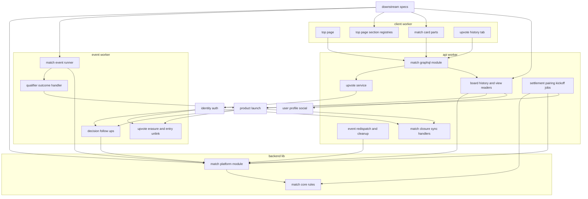
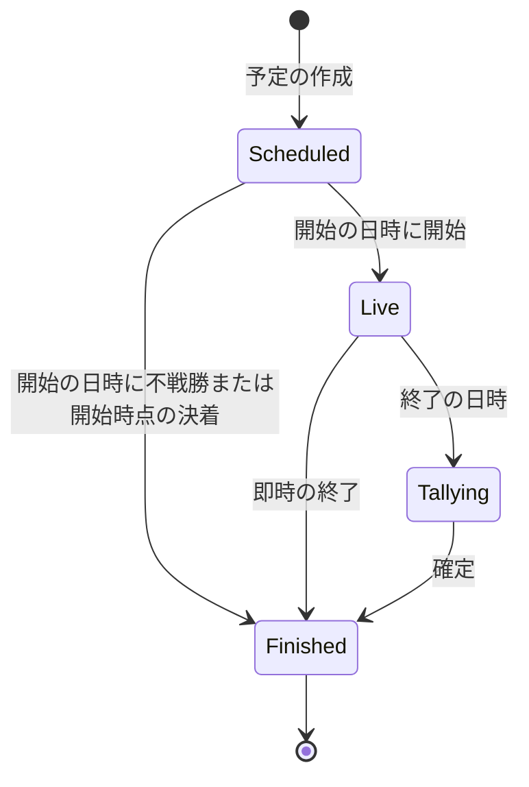
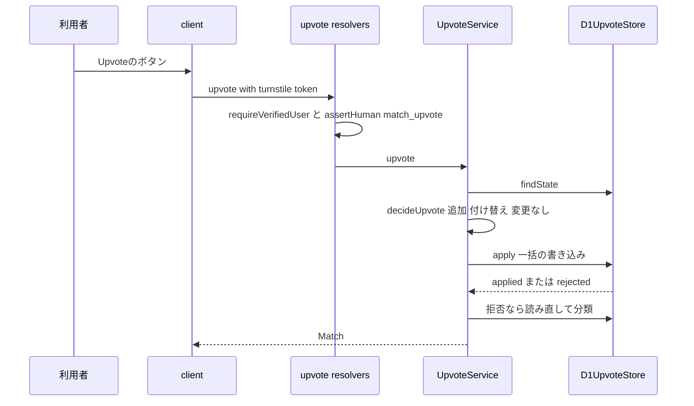
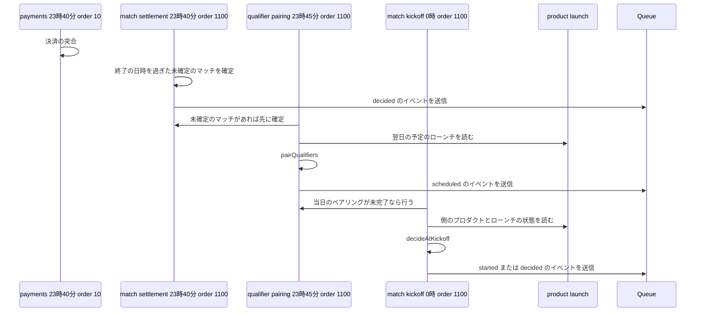
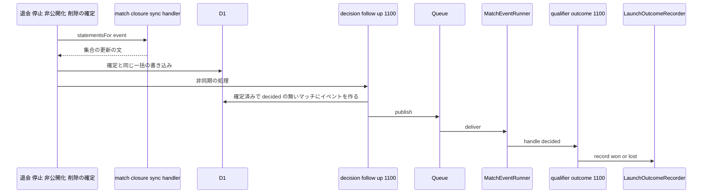
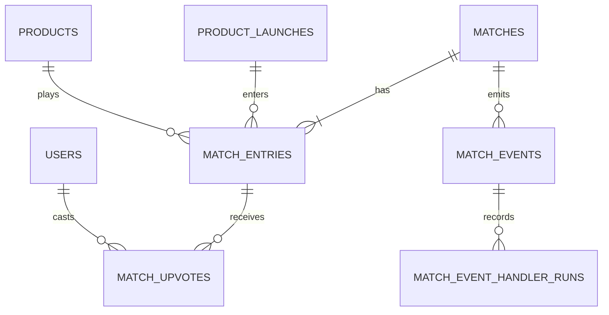

# Design Document

## Overview

**Purpose**: 予選とトーナメントに共通のマッチ(種別・ラウンド・実施日・開始と終了の日時・1つまたは2つの側)と、マッチへのUpvoteを実装する。側の行がUpvote数・最終Upvote時間・結果を持ち、Upvoteの追加・取り消し・付け替え・論理削除と同じ一括の書き込みで集計値を求め直し、結果の確定の後は確定値として変えない。予選に固有なのは、毎日23:45に翌日のローンチをカテゴリ優先で無作為に組むペアリングだけで、0:00の開始(不戦勝と開始時点の決着を含む)・23:40の確定・退会や停止や非公開化による即時の終了は、マッチの種別によらず同じ規則で動く。予選の結果はproduct-launchの記録の口へ渡す。マッチの予定・開始・確定をマッチイベントとして他の機能へ伝え、トップページ(`/`)と公開プロフィールの「Upvote履歴」のタブを提供する。

**Users**: 閲覧者はトップページで当日の予選のマッチを見て、ログインしていればその場でUpvote・付け替え・取り消しを行う。投稿者は自分のマッチの進行と結果を見る。閲覧者は公開プロフィールでUpvote履歴を見る。後続spec(tournament-week・tournament-year・notifications・directory-discovery・sponsorship・ugc-moderation・data-export・public-api)の開発者は、マッチの予定の作成・照会口・マッチイベントの登録口・トップページの区画の登録口・対戦カードの部品を使う。

**Impact**: D1に6テーブル(マッチ・側・Upvote・マッチイベント・処理の完了の記録・予選のペアリングの記録)と、予選の勝利の側を組み込む部品を足す。`apps/backend-lib`にマッチの契約(`core/match`)と共有部品(`workers/match`、apiとeventの両方に束縛)を新設する。apiにスキーマモジュール`match`・Upvote・トップページとUpvote履歴の照会・3つの日次のジョブと4:21の2つのジョブ・2つの同期の処理を、eventにマッチイベントの実行器と5つの非同期の処理を、clientにトップページ・対戦カードの部品群・Upvote履歴のタブを足す。上流のファイルは、契約で定められた登録箇所への追記と仮のトップページの置き換えだけを変える。新しいシークレット・パッケージは無い。

### Goals

- FR-VOTE-001〜011・FR-GAME-001〜014が動作し、ペアリング→開始→Upvote・付け替え・取り消し→確定→結果の記録、不戦勝、マッチ直前の退会・停止・非公開化、マッチ中の即時の終了、停止・退会によるUpvoteの論理削除、物理削除による紐付けの解除のどの経路でも、要件と仮1〜仮7の決定に一致する。
- 後続specが本specのファイルを変えずに、マッチの予定の作成・マッチイベントの処理・トップページの区画を加えられ、対戦カードとUpvoteの操作を同じ部品で使える。
- 本specが追加・変更したコードの単体テスト・Workers統合テスト・ブラウザテストがカバレッジ80%を満たす。

### Non-Goals

- トーナメントのブラケット・ラウンドの進行・賞・区画の中身(tournament-week・tournament-year)、通知メール(notifications)、ディレクトリとプロダクト詳細のマッチ履歴・サポーターの表示・索引(directory-discovery)、広告の中身(sponsorship)、停止・非公開化の管理画面(ugc-moderation)。
- ローンチの予約・状態・再ローンチの判定(product-launch)。
- 開催中のマッチのリアルタイムの配信(30秒ごとの取り直しで足りる)、Upvoteの時刻の公開。
- 要件定義書の改訂(roadmapのOut。必要な改訂は[research.md](research.md)の「要件定義書の改訂が必要な箇所」に記録した)。(2026-10-25に要件定義書へ適用済み)

## Boundary Commitments

### This Spec Owns

- マッチのデータ: `matches`・`match_entries`・`match_upvotes`・`match_events`・`match_event_handler_runs`・`qualifier_pairings`(`apps/db/schema/match/`)と、予選の勝利の側を組み込む部品`qualifierWins()`。
- マッチの規則の契約(`apps/backend-lib/core/match/`): 種別・段階・状態の導出、開始時点と終了時の決着、予選のペアリング、マッチイベントの型と登録の検証・再試行の方針、メッセージ種別`match.run-match-event`。
- 共有部品(`apps/backend-lib/workers/match/`): `MatchDirectory`・`SupporterDirectory`・`MatchScheduler`・`MatchEventStore`・`MatchEventDispatcher`・`MatchExport`・`UpvoteExport`と、両アプリ共通の束縛`MATCH_PLATFORM_MODULE`。
- apiのUpvote・トップページとUpvote履歴の照会・マッチの表示の組み立て(`MatchViewReader`)・確定・ペアリング・開始・マッチイベントの保守、スキーマモジュール`match`、ユーザーライフサイクルの同期の処理`match-engine.account-match-closure`、プロダクトライフサイクルの同期の処理`match-engine.product-match-closure`、日次のジョブ5つ。
- eventのマッチイベントの実行器`MatchEventRunner`と登録口`MATCH_EVENT_HANDLERS`、本specの処理`match-engine.qualifier-outcome`、非同期の処理`match-engine.account-decision-follow-up`・`match-engine.upvote-erasure`・`match-engine.product-decision-follow-up`・`match-engine.entry-unlink`。
- clientのトップページ(`/`、仮のトップページを置き換える)、区画の登録口`TOP_PAGE_SECTIONS`・`QUALIFIER_LIST_INSERTS`(本spec以外の登録は初版で空)、対戦カード・不戦勝の一覧・Upvoteの操作・ピッチの部品群(`components/match/`)、公開プロフィールのタブ`upvotes`(20)。
- 技術ドキュメント`backend/014-time-boxed-voting.md`・`frontend/013-live-scoreboard.md`の新規作成と、サービス仕様(予選ルール・ページ配置・文言規則・日次タイムライン)とオンボーディングの追記。

### Out of Boundary

- `products`・`product_launches`などプロダクトのデータとローンチの状態(product-launch)。本specは照会口・結果の記録の口・`visibleProducts()`だけを使い、プロダクトのテーブルへ書き込まない。
- `users`・ユーザーライフサイクルの発行と実行器(identity-auth)、プロダクトライフサイクルの発行と実行器(product-launch)。本specは処理を登録するだけである。
- 公開プロフィールのページの枠と利用者の表示用の情報(user-profile-social)。本specはタブの中身だけを持つ。
- トーナメントのブラケット・シードの計算・ラウンドの進行・トップページのトーナメントの区画(tournament-week・tournament-year)。
- 通知の要否と送信(notifications)、索引とディレクトリ・プロダクト詳細の表示(directory-discovery)、広告の区画の中身(sponsorship)、停止・非公開化の操作と理由・監査(ugc-moderation)、データエクスポートのZIP(data-export)、公開APIの経路(public-api)。
- 後続specのマッチイベントの処理の中身。

### Allowed Dependencies

- backend-platform: `AppModule`・`PLATFORM_TYPES`(`Database`・`Clock`・`IdGenerator`・`MessagePublisher`)・`AppError`・`getAppLogger`・`ulidPrimaryKey`・`timestamps`・`BusinessTime`(`toBusinessDateTime`・`fromBusinessDateTime`・`parseBusinessDate`・`BusinessDate`・`BusinessTimeOfDay`)・`ScheduledJobDefinition`・`ScheduledJobHandler`・`defineMessageContract`・`MESSAGE_CONTRACTS`・`MessageHandler`・`MessageHandlingResult`・`RetryPolicy`。形を変えない。
- api-gateway: `defineSchemaModule`・`GraphQLContext`(`resolve`・`assertHuman`・`caller`・`session`・`loaders`)・`withValidatedArgs`・`CURSOR_PAGE_ARGS`・`encodeCursor`・`decodeCursor`・`toConnection`・`defineLoader`・`DateTime`・`PageInfo`、`SessionView`。
- identity-auth: `AccountGuard`(`currentUser`・`requireVerifiedUser`)・`CurrentUser`・`IDENTITY_TYPES`・`visibleUsers`・`verifiedUsers`・`users`(外部キーと`visibleUsers`・`verifiedUsers`の条件の読み取り)・`UserLifecycleEvent`・`UserLifecycleSyncHandler`・`UserLifecycleSyncRegistration`・`USER_LIFECYCLE_SYNC_HANDLERS`・`UserLifecycleAsyncHandler`・`UserLifecycleAsyncRegistration`・`USER_LIFECYCLE_ASYNC_HANDLERS`・`LifecycleHandlerOutcome`・`assertLifecycleHandlerName`・`LIFECYCLE_CONTINUE_DELAY_SECONDS`・`LoginRequiredDialog`・`viewerQueryOptions`・E2Eの`e2e/support/mailpit.ts`。
- product-launch: `PRODUCT_PLATFORM_TYPES`の`ScheduledLaunchDirectory`・`LaunchOutcomeRecorder`・`ProductDirectory`(`findSummaries`・`listLaunches`)、`visibleProducts()`、`products`・`product_launches`への外部キー、`ProductLifecycleEvent`・`ProductLifecycleSyncHandler`・`ProductLifecycleSyncRegistration`・`PRODUCT_LIFECYCLE_SYNC_HANDLERS`・`ProductLifecycleAsyncHandler`・`ProductLifecycleAsyncRegistration`・`PRODUCT_LIFECYCLE_ASYNC_HANDLERS`、GraphQLの`ProductCategory`・`productCategoryLoader`。
- user-profile-social: `UserProfileDirectory`(`resolveHandle`・`findSummaries`)・`PROFILE_PLATFORM_TYPES`・GraphQLの`UserSummary`・`userSummaryLoader`・`PUBLIC_PROFILE_TABS`・`PublicProfileTab`・`PublicProfileSectionContext`・`UserAvatar`・`checkHandleFormat`・`USER_HANDLE_RULE`・`checkExternalUrl`。
- media-pipeline: `mediaFileLoader`・`toMediaImage`・GraphQLの`MediaImage`・`MediaPicture`。
- frontend-platform・inquiry-chat: `executeGraphQL`・`graphqlQueryOptions`・`GraphQLClientError`・`useTurnstileToken`・`TurnstileWidget`・`notify`・`buildPageHead`・`ErrorState`・`PartialErrorState`・`EmptyState`・`LoadingSkeleton`・日時の表示部品・shadcn/uiの部品(ボタン・バッジ・ツールチップ・カード)・`LIVE_REFRESH_QUERY_OPTIONS`・`runAxe`・デザイントークン(`tokens.css`)。
- admin-foundation: E2Eの`e2e/support/local-d1.ts`(`executeLocalD1`・`sqlStringLiteral`)。
- npmパッケージ: 新規なし。
- 後続specは、`core/match`・`workers/match`の公開の契約、`qualifierWins()`、apiの`MatchViewReader`・`matchViewLoader`・GraphQLの`Match`などの型、eventの`MATCH_EVENT_HANDLERS`、clientの`TOP_PAGE_SECTIONS`・`QUALIFIER_LIST_INSERTS`・`MatchCard`・`ByeList`・`useUpvote`だけに依存し、本specのテーブルへ書き込まない。読み取りの問い合わせで本specのテーブルを結合してよいのは`qualifierWins()`を使う並べ替えと絞り込みだけとする。

### Revalidation Triggers

- `MatchKind`・`MatchStage`・`EntryResult`・`MatchDecision`・`MatchPhase`の値と`deriveMatchPhase`の境界(data-exportの`launches.json`の`kind`・`result`、トーナメント、ディレクトリ)。
- `MatchScheduler.schedule`の入力と重複の扱い、開始時点の決着と即時の終了の規則(tournament-week・tournament-year)。
- `MatchEvent`・`MatchEventRegistration`の形、`order`の帯、同じマッチの順序の規則(notifications・tournament-week・tournament-year・directory-discovery)。
- `MatchDirectory`・`SupporterDirectory`・`MatchExport`・`UpvoteExport`・`qualifierWins()`の形(directory-discovery・notifications・ugc-moderation・data-export・public-api)。データエクスポートの文書の`matches[]`・`upvotes.json`の項目が変わったら確かめ直す。
- GraphQLの`Match`・`MatchEntry`・`MatchProduct`・`MatchBye`の形と`MatchViewReader`(トーナメント・プロダクト詳細の開催中のマッチ)。
- `TOP_PAGE_SECTIONS`・`QUALIFIER_LIST_INSERTS`の形と置き場所、`MatchCard`・`ByeList`・`useUpvote`の引数(トーナメント・sponsorship・directory-discovery)。
- 仮1〜仮7(2026-10-24に開発者が確定)の決定を変える場合は、該当する規則(`pairQualifiers`・`decideAtFullTime`・`decideAtKickoff`・部分一意索引・bot対策・不戦勝の一覧の説明文)を確かめ直す。
- 上流の`ScheduledLaunchDirectory`・`LaunchOutcomeRecorder`・`ProductDirectory`・`visibleProducts`、ライフサイクルの登録口、`AccountGuard`・`verifiedUsers`、`PUBLIC_PROFILE_TABS`、`useTurnstileToken`、paymentsの23:40の`order`を変えたら、本specを確かめ直す。

### 上流への影響

| 上流spec            | 変更                                                                                                                                                                                                                                                      | 影響と再検証                                                                      |
| ------------------- | --------------------------------------------------------------------------------------------------------------------------------------------------------------------------------------------------------------------------------------------------------- | --------------------------------------------------------------------------------- |
| identity-auth       | `apps/api/src/composition/user-lifecycle-sync-handlers.ts`に`match-engine.account-match-closure`、`apps/event/src/composition/user-lifecycle-async-handlers.ts`に`match-engine.account-decision-follow-up`(1100)・`match-engine.upvote-erasure`(1100)     | 契約どおり。`createAsyncLifecycleRegistry`の検証(同じ種類での`order`の重複)を通る |
| product-launch      | `apps/api/src/composition/product-lifecycle-sync-handlers.ts`に`match-engine.product-match-closure`、`apps/event/src/composition/product-lifecycle-async-handlers.ts`に`match-engine.product-decision-follow-up`(1100)・`match-engine.entry-unlink`(1100) | 契約どおり。`createProductLifecycleRegistry`の検証を通る                          |
| user-profile-social | `apps/client/src/composition/public-profile-sections.ts`の`PUBLIC_PROFILE_TABS`に`upvotes`(20)                                                                                                                                                            | 予約どおり                                                                        |
| frontend-platform   | `apps/client/src/routes/index.tsx`(仮のトップページ)を本specのトップページに置き換える                                                                                                                                                                    | 契約どおり。ルートの経路は変わらない                                              |
| backend-platform    | apiの`scheduled-jobs.ts`に5つのジョブ、`wrangler.jsonc`の`triggers.crons`(3環境)に0:00・23:45、`core/messaging/contracts/index.ts`に`match.run-match-event`、eventの`message-handlers.ts`に実行器                                                         | 契約どおり。apiのCronの式の一致の検査を通る                                       |

- 上流specの文書の変更は無い。roadmapの帯の割り当ての表の本specの「使用中の値」は「4:21は1100・1110、波及処理は1100」になる(本specはroadmapを編集しないため、コントローラーへ報告する)。

## Architecture

### Existing Architecture Analysis

- 上流の17specは設計・タスクとも承認済みで、本specのタスクはそれらの実装の完了を前提にする(roadmapの順でproduct-launchまでが先に実装される)。実装済みはdev-toolingだけである。
- apiはクリーンアーキテクチャ(`domain`→`application`→`infrastructure`・`presentation`→`composition`)、処理単位のDIコンテナ、D1の`db.batch()`による1トランザクションの書き込み、`CASE`式のNOT NULL制約の違反による一括の書き込みの取り消しを使う。Cron Triggersはapiだけにあり、ジョブは同じ時刻の中で`order`の昇順に動き、失敗は次のジョブを止めない。
- ユーザーとプロダクトのライフサイクルの同期の処理は確定と同じ一括の書き込みに入る集合の更新の文、非同期の処理はeventの実行器で`order`の昇順に少なくとも1回動く。`purge_due`の全処理の後に`users`・`products`の行が消える。

### Architecture Pattern & Boundary Map



**Architecture Integration**:

- Selected pattern: クリーンアーキテクチャ。マッチの状態・決着・ペアリングは`core/match`の純粋な関数、ユースケースはポート越しにD1・product-launch・identity-authを使う。Upvoteと即時の終了は、条件を`CASE`式と集合の更新に埋め込んだ1つの一括の書き込みで確定する。マッチイベントはproduct-launchのプロダクトライフサイクルと同じ形(イベントの記録・非同期の実行器・日次の送り直し)にする。
- Domain/feature boundaries: マッチ・Upvote・ペアリング・マッチイベント・トップページは本spec、ローンチとプロダクトはproduct-launch、ブラケットはトーナメントのspec、通知はnotifications、利用者の表示はuser-profile-social。
- Existing patterns preserved: `backend-lib/workers/<ドメイン>`の共有の束縛、`<spec名>.<名詞句>`の処理とジョブの名前、`<ドメイン>.<動詞句>`のメッセージ種別、帯の`order`、登録箇所への追記による拡張(`CATEGORY_SECTIONS`・`PUBLIC_PROFILE_TABS`と同じ形)、`CASE`式による取り消し、`encodeCursor`のカーソル、`LIVE_REFRESH_QUERY_OPTIONS`の定期再取得。
- New components rationale: 側の集計値はトップページの読み取りをマッチの数に比例させるため(research.mdの比較)。同期の処理は退会・停止・非公開化と同時に受け付けを止めるため。マッチイベントは通知・トーナメント・ディレクトリが本specのデータを見張らずに知るため。区画の登録口は型の拡張を禁じるapi-gatewayの規約とトップページの所有の規則のもとで後続specが区画を加えるため。
- Steering compliance: Inversifyの`@inject`の明示、D1の制約(`db.batch()`・バインド変数100個以内・部分一意索引)、800行以内のファイル、1ファイル1コンポーネント、日時の`<time datetime>`、新しいパッケージなし。

**Dependency direction**: `apps/common-lib/match` → `apps/db/schema/match` → `backend-lib/core/match` → `backend-lib/workers/match` → 各アプリの`src`(`domain` → `application` → `infrastructure`・`presentation` → `composition`)。`common-lib`は他の層を読み込まない。`core/match`はD1を読み込まない(`BusinessTime`と型だけ)。clientは`common-lib`とGraphQLの操作だけを読み込む。違反はレビューで誤りとして扱う。

### Technology Stack

| Layer     | Choice / Version                                                     | Role in Feature                                           | Notes                                         |
| --------- | -------------------------------------------------------------------- | --------------------------------------------------------- | --------------------------------------------- |
| Frontend  | TanStack Start・Router・Query・shadcn/ui・lucide-react・sonner(上流) | トップページ・対戦カード・Upvote履歴                      | 演出はCSSのアニメーション、新規パッケージなし |
| Backend   | Hono・Inversify・GraphQL Yoga(上流)                                  | スキーマモジュール・ユースケース・日次のジョブ            | 既存                                          |
| Data      | Cloudflare D1(Drizzle)                                               | 6テーブル・部分一意索引                                   | 新規のマイグレーション                        |
| Messaging | Cloudflare Queues・Cron Triggers(上流)                               | `match.run-match-event`、0:00・23:40・23:45・4:21のジョブ | 新しいメッセージ種別1つ、Cronの式2つ          |
| External  | Turnstile(上流)、Web Crypto(`crypto.getRandomValues`)                | Upvoteのbot対策、ペアリングの無作為                       | `action`は`match_upvote`                      |

## File Structure Plan

### Directory Structure

```
apps/
├── common-lib/match/match-actions.ts                         # UPVOTE_BOT_ACTION('match_upvote')(*.unit.test.ts)
├── db/schema/match/                                          # テーブル定義(各ファイルに同名の*.unit.test.ts)
│   ├── matches.ts                                            # 種別・実施日・ラウンド・段階・開始と終了・開始の記録・確定・決着
│   ├── match-entries.ts                                      # 側・ローンチ・プロダクト・投稿者・集計値・該当・結果
│   ├── match-upvotes.ts                                      # 部分一意索引(有効なUpvoteはマッチと利用者で1つ)・seq
│   ├── match-events.ts
│   ├── match-event-handler-runs.ts
│   ├── qualifier-pairings.ts                                 # 実施日で一意のペアリングの記録
│   ├── match-queries.ts                                      # qualifierWins()(他specが組み込む部品)
│   └── index.ts
├── backend-lib/
│   ├── core/match/                                           # 純粋な契約(Bunの単体テスト)
│   │   ├── match-model.ts                                    # 種別・段階・結果・決着・状態・deriveMatchPhase・QUALIFIER_SCHEDULE・qualifierWindow
│   │   ├── match-decision.ts                                 # decideAtKickoff・decideAtFullTime
│   │   ├── qualifier-pairing.ts                              # RandomSource・pairQualifiers
│   │   └── match-events.ts                                   # イベントの型・登録・createMatchEventRegistry・MATCH_EVENT_RETRY_POLICY
│   ├── core/messaging/contracts/match.ts                     # RUN_MATCH_EVENT_MESSAGE
│   └── workers/match/                                        # api・event共通の部品(Workers統合テスト)
│       ├── match-platform-types.ts                           # MATCH_PLATFORM_TYPES(テストなし)
│       ├── match-directory.ts                                # MatchRecord・MatchDirectory・SupporterDirectory(型)
│       ├── d1-match-directory.ts
│       ├── match-scheduler.ts                                # MatchScheduler(型とD1の実装)
│       ├── match-event-store.ts                              # MatchEventStore(型とD1の実装)
│       ├── match-event-dispatcher.ts                         # MatchEventDispatcher(送信と失敗のログ)
│       ├── match-export.ts                                   # MatchExport・UpvoteExport(型)
│       ├── d1-match-export.ts
│       └── match-platform-module.ts                          # MATCH_PLATFORM_MODULE
├── api/src/
│   ├── domain/match/                                         # 純粋な規則(Bunの単体テスト)
│   │   ├── upvote-plan.ts                                    # 追加・付け替え・取り消し・変更なしの決定と利用者の制限
│   │   └── board-order.ts                                    # 予選の並び順・不戦勝の分類・実施数
│   ├── application/match/                                    # ユースケース(Bunの単体テスト)
│   │   ├── match-types.ts                                    # MATCH_TYPES
│   │   ├── ports.ts                                          # UpvoteStore・MatchBoardStore・UpvoteHistoryStore・SettlementStore・KickoffStore・PairingStore・EntryEligibilityChecker
│   │   ├── upvote-service.ts                                 # upvote・cancel
│   │   ├── match-view-reader.ts                              # マッチの表示の組み立て(トーナメントも使う)
│   │   ├── qualifier-board-reader.ts                         # トップページの予選の一覧
│   │   ├── upvote-history-reader.ts
│   │   ├── match-settlement.ts                               # 終了時の確定(23:40と回復)
│   │   ├── qualifier-pairing-service.ts                      # 23:45のペアリングと回復
│   │   ├── match-kickoff.ts                                  # 0:00の開始と開始時点の決着
│   │   ├── entry-eligibility.ts                              # 開始の時点のプロダクトとローンチの状態の判定
│   │   └── match-jobs.ts                                     # 5つのジョブ(確定・ペアリング・開始・送り直し・削除)
│   ├── infrastructure/match/                                 # Workers統合テスト
│   │   ├── tally-statements.ts                               # 側の集計値の求め直しの文
│   │   ├── upvote-guards.ts                                  # Upvoteの条件のCASE式
│   │   ├── d1-upvote-store.ts
│   │   ├── d1-match-board-store.ts
│   │   ├── d1-upvote-history-store.ts
│   │   ├── d1-settlement-store.ts
│   │   ├── d1-kickoff-store.ts
│   │   ├── d1-pairing-store.ts
│   │   ├── crypto-random-source.ts
│   │   ├── match-closure-statements.ts                       # 即時の終了と該当の記録の集合の更新の文
│   │   ├── account-match-closure-sync-handler.ts             # match-engine.account-match-closure
│   │   └── product-match-closure-sync-handler.ts             # match-engine.product-match-closure
│   ├── presentation/graphql/modules/match/                   # スキーマモジュール(Workers統合テスト)
│   │   ├── type-defs.ts
│   │   ├── inputs.ts
│   │   ├── errors.ts
│   │   ├── match-views.ts                                    # Match・MatchEntry・MatchProductのリゾルバとmatchViewLoader
│   │   ├── board-resolvers.ts                                # qualifierBoard
│   │   ├── upvote-resolvers.ts                               # upvote・cancelUpvote
│   │   ├── upvote-history-resolvers.ts                       # upvoteHistory
│   │   └── index.ts                                          # matchSchemaModule
│   └── composition/match-module.ts                           # MATCH_MODULE(apiの束縛)
├── event/src/
│   ├── application/match/                                    # Bunの単体テスト
│   │   ├── event-match-types.ts                              # EVENT_MATCH_TYPES
│   │   ├── ports.ts                                          # MatchPurgeStore
│   │   ├── match-event-runner.ts                             # match.run-match-event
│   │   ├── qualifier-outcome-handler.ts                      # decided 1100
│   │   ├── decision-follow-up-handlers.ts                    # ユーザーのwithdrawn・suspended、プロダクトのhidden・deleted 1100
│   │   ├── upvote-erasure-handler.ts                         # ユーザーのpurge_due 1100
│   │   └── entry-unlink-handler.ts                           # プロダクトのpurge_due 1100
│   ├── infrastructure/match/d1-match-purge-store.ts
│   └── composition/
│       ├── match-module.ts
│       └── match-event-handlers.ts                           # MATCH_EVENT_HANDLERS(初版は本specの1件)
├── client/src/
│   ├── routes/index.tsx                                      # (置き換え)トップページ
│   ├── composition/top-page-sections.ts                      # TOP_PAGE_SECTIONS(初版は本specの2件)・QUALIFIER_LIST_INSERTS(初版は空)
│   ├── components/top/                                       # 1ファイル1コンポーネント(browser testを併置)
│   │   ├── top-page-section-types.ts                         # 登録の型(テストなし)
│   │   ├── top-page.tsx                                      # 置き場所ごとの区画の描画
│   │   ├── full-time-countdown.tsx
│   │   ├── guest-hero.tsx
│   │   ├── qualifier-section.tsx                             # 予選の一覧・差し込み・不戦勝・空の状態
│   │   ├── section-heading.tsx
│   │   └── empty-lineup.tsx
│   ├── components/match/                                     # トーナメント・プロダクト詳細も使う部品
│   │   ├── match-card.tsx
│   │   ├── match-stage.tsx                                   # ピッチ・両側のパネル・比率のバー・演出
│   │   ├── product-panel.tsx
│   │   ├── upvote-button.tsx
│   │   ├── vote-bar.tsx
│   │   ├── bye-list.tsx
│   │   ├── bye-card.tsx
│   │   ├── stadium-pitch.tsx
│   │   ├── horizontal-pitch.tsx
│   │   ├── vertical-pitch.tsx
│   │   ├── pitch-model.ts                                    # 観客の配置の計算(*.unit.test.ts)
│   │   ├── team-colors.ts                                    # 配色の一覧(*.unit.test.ts)
│   │   ├── match-labels.ts                                   # 種別・段階・結果の文言(*.unit.test.ts)
│   │   ├── use-upvote.ts                                     # Upvote・付け替え・取り消しのフック
│   │   ├── use-server-countdown.ts                           # サーバーの時刻に合わせた残り時間
│   │   └── stadium.css                                       # 演出のkeyframesと視差効果の軽減
│   ├── components/upvote-history/
│   │   ├── upvote-history-count.tsx
│   │   ├── upvote-history-panel.tsx
│   │   └── upvote-history-item.tsx
│   ├── composition/public-profile-sections.ts                # (変更)upvotes 20を追記
│   └── graphql/operations/match/
│       ├── qualifier-board.ts
│       ├── upvote-mutations.ts
│       └── upvote-history.ts
e2e/
├── client/match.e2e.test.ts                                  # Upvote・付け替え・取り消し・自分のマッチ・Upvote履歴
└── support/match-fixtures.ts                                 # ローカルD1にマッチ中のマッチを作る補助
docs/GUIDES/tech/
├── backend/014-time-boxed-voting.md
└── frontend/013-live-scoreboard.md
```

テストは各ファイルの隣に置く(`*.unit.test.ts`・`*.worker.test.ts`・`*.browser.test.tsx`)。技術ドキュメントの番号は、roadmapの順で本specより前のproduct-launch(`backend/012`・`backend/013`・`frontend/012`)の後の空き番号`backend/014`・`frontend/013`に固定する(全ての完了済みspecのdesign.mdで確かめた)。

### Modified Files

- `apps/db/schema/index.ts`・`apps/db/migrations/<日時>_match_engine/migration.sql` — 6テーブルの再エクスポートと、生成したマイグレーション(CHECK・部分一意索引)。mainの最新を取り込んでから生成する。
- `apps/backend-lib/core/messaging/contracts/index.ts` — `RUN_MATCH_EVENT_MESSAGE`。
- `apps/api/src/composition/modules.ts`・`graphql-modules.ts`・`scheduled-jobs.ts`・`user-lifecycle-sync-handlers.ts`・`product-lifecycle-sync-handlers.ts` — `MATCH_PLATFORM_MODULE`・`MATCH_MODULE`・`matchSchemaModule`・5つのジョブ・2つの同期の処理。
- `apps/api/wrangler.jsonc` — `triggers.crons`(local・staging・prod)に`0 8 * * *`(0:00)・`45 7 * * *`(23:45)。`40 7 * * *`(23:40)・`21 12 * * *`(4:21)は上流で追加済み。
- `apps/event/src/composition/modules.ts`・`message-handlers.ts`・`user-lifecycle-async-handlers.ts`・`product-lifecycle-async-handlers.ts` — `MATCH_PLATFORM_MODULE`・eventの束縛・実行器・4つの非同期の処理。
- `apps/client/src/routes/index.tsx` — 仮のトップページを本specのトップページに置き換える。
- `apps/client/src/composition/public-profile-sections.ts` — `{ id: 'upvotes', label: 'Upvote履歴', order: 20, Count: UpvoteHistoryCount, Panel: UpvoteHistoryPanel }`。
- `docs/GUIDES/tech/backend/README.md`・`frontend/README.md` — 文書一覧の行。
- `docs/onboardings/project-values.md` — 波及処理・処理・ジョブの名前と`order`、bot対策の`action`、メッセージ種別。
- `docs/GUIDES/service/overview/003-qualifier-rules.md` — 仮1・仮2・仮4・仮5の注記。
- `docs/GUIDES/service/overview/007-daily-timeline.md` — 23:40・23:45・0:00のジョブと`order`、4:21の表に1100・1110。
- `docs/GUIDES/service/design/002-page-layouts.md` — トップページの区画の構成と登録・予選の空の状態・集計中の表示・自分のプロダクトの側のUpvote数だけの表示・Upvote履歴の並び。
- `docs/GUIDES/service/design/003-text-and-copy-rules.md` — 本specのエラー・状態・トーストの文言。
- `CLAUDE.md` — 「技術規則の参照先」に「期間を限った投票を作る前に: `backend/014`」。

## System Flows

### マッチの状態



- `deriveMatchPhase(match, now)`の判定の順: `decidedAt`があれば`finished`→`startedAt`が無ければ`scheduled`→`now`が`endsAt`以降なら`tallying`→それ以外は`live`。Upvoteを受け付けるのは`live`だけ(6.6・4.10)。
- 予定の間の該当(退会・停止・非公開化・削除)は側の`forfeited_at`に記録し、開始の日時に`decideAtKickoff`で決着する(3.3〜3.6)。マッチ中の該当は同期の処理で即時に`finished`にする(5.1〜5.3)。

### Upvote・付け替え・取り消し



- 一括の書き込みの並び(6.1〜6.4): (1)付け替え・取り消しなら`DELETE FROM match_upvotes WHERE match_id = ? AND user_id = ? AND deleted_at IS NULL AND <受け付け中>`。(2)追加・付け替えなら`match_upvotes`の挿入で、`entry_id`を`CASE WHEN <Upvoteの条件> THEN ? ELSE NULL END`、`seq`を`(SELECT COALESCE(MAX(seq), 0) + 1 FROM match_upvotes WHERE match_id = ?)`とする。(3)マッチの両側の集計値の求め直し(`tallyRecomputeStatement`)。
- `<Upvoteの条件>`(`upvote-guards.ts`): マッチの`started_at IS NOT NULL AND decided_at IS NULL AND ends_at > ?`(`?`は要求の時刻)、側がそのマッチのもの、そのマッチのどの側の`owner_user_id`も利用者でない、利用者が`verifiedUsers()`を満たす。満たさなければNOT NULL制約の違反で全体を取り消す(6.5〜6.9)。
- 取り消しで(1)の変更が0件なら、読み直して受け付け中なら有効なUpvoteが無い状態として現在のマッチを返し、受け付け中でなければ`upvote_not_accepting`にする。部分一意索引の違反(同時の2つの追加)は既に同じ側にUpvote済みとして現在のマッチを返す(6.8)。
- 失敗の分類の読み直し: マッチが無い→`match_not_found`、受け付け中でない→`upvote_not_accepting`、自分のマッチ→`upvote_own_match`、利用者の状態→`account_unavailable`(`AccountGuard`の判定は要求の先頭でも行う)。

### 日次の処理



- `match-engine.match-settlement`(23:40、1100): 種別によらず`started_at IS NOT NULL AND decided_at IS NULL AND ends_at <= 実行時刻`のマッチを100件ずつ読み、`decideAtFullTime`で決め、1マッチにつき側の結果の更新(`decided_at IS NULL`の条件付き)・マッチの確定(`decided_at`・`decision`)・`decided`のイベントの挿入(`onConflictDoNothing()`)を50マッチずつの一括の書き込みにする。確定した後にイベントを送る(4.1〜4.5・4.8)。
- `match-engine.qualifier-pairing`(23:45、1100): 先に確定を同じ処理で行い、行ったマッチがあれば`match-settlement-late`を報告する(4.9)。続いて翌日のペアリング(System Flows「ペアリング」)を行う(2.1〜2.7)。
- `match-engine.match-kickoff`(0:00、1100): 当日の`qualifier_pairings`が完了していなければ先にペアリングし`qualifier-pairing-late`を報告する(2.8)。続いて`started_at IS NULL AND decided_at IS NULL AND starts_at <= 実行時刻`のマッチを100件ずつ読み、`EntryEligibilityChecker`で側の該当を判定し、`decideAtKickoff`の結果で開始(`started_at`と`started`のイベント)または決着(`started_at`・`decided_at`・`decision`・側の結果と`decided`のイベント)を書き込む(3.1〜3.7)。
- 3つのジョブは処理の先頭で、確定済みで`decided`のイベントが無いマッチ(直近2日)のイベントを作って送る(`MatchEventStore.createMissingDecidedEvents`、5.5)。2回実行しても結果が変わらない。

### ペアリング

- `QualifierPairingService.pair(date)`: (1)`qualifier_pairings`の行を`onConflictDoNothing()`で作り、完了済みなら終える。(2)`ScheduledLaunchDirectory.listForDate`を500件ずつ全件読む。(3)`PairingStore.pairedLaunchIds(date)`で既にその日の予選に組まれたローンチを除く(2.7)。(4)`pairQualifiers(launches, random)`。(5)`MatchScheduler.schedule`で50マッチずつ書き込み、送る。(6)行を完了にする。
- `pairQualifiers`: カテゴリのIDごとに分け、各カテゴリをFisher–Yatesで並べ替えて先頭から2つずつ組み、奇数なら末尾の1つ(並べ替えの結果で無作為に決まる)を余りにする。余りを集めて並べ替え、2つずつ組み、最後に残った1つを不戦勝(側が1つのマッチ)にする(2.2〜2.4、仮1・仮5)。カテゴリの処理の順はIDの昇順(並べ替えの結果に影響しない)。
- `RandomSource.nextInt(n)`は`crypto.getRandomValues`の32ビット値を棄却法で偏りなく0〜n−1にする(2.5)。

### 即時の終了と開始時点の決着



- 同期の処理の文(`match-closure-statements.ts`、利用者IDまたはプロダクトIDを条件にした集合の更新、`?`の時刻は`event.occurredAt`。「受け付け中」は`started_at IS NOT NULL AND decided_at IS NULL AND ends_at > ?`):
  1. Upvoteの論理削除(ユーザーだけ): 退会は`UPDATE match_upvotes SET deleted_at = ? WHERE user_id = ? AND deleted_at IS NULL`(7.2)、停止は加えて`AND match_id IN (受け付け中のマッチ)`(7.1)。
  2. 集計値の求め直し(ユーザーだけ): `UPDATE match_entries SET <集計値> WHERE match_id IN (受け付け中のマッチ) AND id IN (SELECT entry_id FROM match_upvotes WHERE user_id = ? AND deleted_at = ?)`(7.1・7.2)。
  3. 側の結果: `UPDATE match_entries SET result = CASE WHEN <該当の側> THEN 'lost' ELSE 'walkover' END WHERE match_id IN (SELECT match_id FROM match_entries WHERE <該当の側>) AND match_id IN (受け付け中のマッチ)`。`<該当の側>`はユーザーなら`owner_user_id = ?`、プロダクトなら`product_id = ?`。両側が同じ投稿者なら両方`lost`(5.1〜5.3)。
  4. マッチの確定: `UPDATE matches SET decided_at = ?, ended_early_at = ?, decision = CASE WHEN EXISTS (<walkoverの側>) THEN 'walkover' ELSE 'both_forfeited' END WHERE id IN (SELECT match_id FROM match_entries WHERE <該当の側>) AND <受け付け中>`。3の後に置き、3と同じマッチだけを確定する。
  5. 予定の該当の記録: `UPDATE match_entries SET forfeited_at = ? WHERE <該当の側> AND forfeited_at IS NULL AND match_id IN (SELECT id FROM matches WHERE started_at IS NULL AND decided_at IS NULL)`(5.4)。
- 23:40の確定と同時に起きても、どちらも`decided_at IS NULL`の条件で書くため、先に確定した方だけが有効になる(5.6)。集計中(`ends_at`以降)は即時の終了の対象にせず、確定のジョブに任せる。
- 開始時点の決着の判定(`EntryEligibilityChecker`): 側が該当するのは、`forfeited_at`がある、プロダクトの紐付けが無い、`ProductDirectory.findSummaries(ids, 'not-deleted')`に無いか`visible`が偽、予選で`listLaunches`のそのローンチが無いか`canceled`、のいずれか(3.6)。

## Requirements Traceability

| Requirement                                    | Summary                        | Components                                                                                         | Interfaces                                                                                                 | Flows                      |
| ---------------------------------------------- | ------------------------------ | -------------------------------------------------------------------------------------------------- | ---------------------------------------------------------------------------------------------------------- | -------------------------- |
| 1.1, 1.2, 1.3, 1.7                             | マッチの記録と状態             | MatchSchema、MatchModel、MatchDirectory                                                            | `deriveMatchPhase`・`MatchRecord`                                                                          | マッチの状態               |
| 1.4, 1.6                                       | 予定の作成と重複の防止         | MatchScheduler、MatchSchema                                                                        | `MatchScheduler.schedule`・部分一意索引                                                                    | ペアリング                 |
| 1.5                                            | 種別によらない規則             | MatchDecision、MatchSettlement、MatchKickoff、UpvoteService、MatchClosureStatements                | `decideAtKickoff`・`decideAtFullTime`                                                                      | 日次の処理                 |
| 2.1, 2.2, 2.3, 2.4, 2.5, 2.6, 2.7              | ペアリング                     | QualifierPairing、QualifierPairingService、D1PairingStore、CryptoRandomSource、MatchScheduler      | `pairQualifiers`・`ScheduledLaunchDirectory`                                                               | ペアリング                 |
| 2.8                                            | ペアリングの回復               | MatchJobs、MatchKickoff                                                                            | `qualifier-pairing-late`                                                                                   | 日次の処理                 |
| 3.1, 3.2, 3.3, 3.4, 3.5, 3.6, 3.7              | 開始と開始時点の決着           | MatchKickoff、EntryEligibility、MatchDecision、D1KickoffStore                                      | `decideAtKickoff`・`ProductDirectory.listLaunches`                                                         | 日次の処理                 |
| 4.1, 4.2, 4.3, 4.4, 4.5, 4.8, 4.9, 4.10        | 確定と勝敗                     | MatchSettlement、MatchDecision、D1SettlementStore、MatchJobs、UpvoteGuards                         | `decideAtFullTime`                                                                                         | 日次の処理                 |
| 4.6, 4.7                                       | 予選の結果の記録               | QualifierOutcomeHandler、MatchEventRunner                                                          | `LaunchOutcomeRecorder.record`                                                                             | 即時の終了と開始時点の決着 |
| 5.1, 5.2, 5.3, 5.4, 5.6                        | 即時の終了と該当の記録         | MatchClosureStatements、AccountMatchClosureSyncHandler、ProductMatchClosureSyncHandler             | `USER_LIFECYCLE_SYNC_HANDLERS`・`PRODUCT_LIFECYCLE_SYNC_HANDLERS`                                          | 即時の終了と開始時点の決着 |
| 5.5                                            | 即時の終了の後続               | DecisionFollowUpHandlers、MatchEventStore、MatchEventDispatcher                                    | `createMissingDecidedEvents`                                                                               | 即時の終了と開始時点の決着 |
| 6.1, 6.2, 6.3, 6.4, 6.8, 6.9                   | Upvote・付け替え・取り消し     | UpvotePlan、UpvoteService、D1UpvoteStore、UpvoteGuards、TallyStatements、UpvoteResolvers           | `upvote`・`cancelUpvote`                                                                                   | Upvote・付け替え・取り消し |
| 6.5, 6.6, 6.7                                  | 拒否と理由                     | UpvoteGuards、UpvoteService、MatchErrors                                                           | `upvote_own_match`・`upvote_not_accepting`                                                                 | Upvote・付け替え・取り消し |
| 6.10                                           | Upvote数の公開                 | MatchViewReader、MatchViews                                                                        | `MatchEntry.upvoteCount`                                                                                   | —                          |
| 7.1, 7.2, 7.3                                  | 停止・退会のUpvote             | MatchClosureStatements、TallyStatements                                                            | 同期の処理                                                                                                 | 即時の終了と開始時点の決着 |
| 7.4                                            | 停止の解除                     | MatchSchema(部分一意索引)                                                                          | —                                                                                                          | —                          |
| 7.5                                            | Upvoteの物理削除               | UpvoteErasureHandler、D1MatchPurgeStore                                                            | `USER_LIFECYCLE_ASYNC_HANDLERS`                                                                            | —                          |
| 8.1, 8.2, 8.11, 8.12, 8.13, 8.15               | 予選の一覧と結果               | QualifierBoardReader、BoardOrder、QualifierSection、ByeList、EmptyLineup                           | `qualifierBoard`                                                                                           | —                          |
| 8.3, 8.4, 8.5, 8.6, 8.18, 8.19                 | 対戦カード                     | MatchCard、MatchStage、ProductPanel、UpvoteButton、VoteBar、StadiumPitch、MatchViews               | `Match`・`MatchProduct`                                                                                    | —                          |
| 8.7, 8.8, 8.9                                  | 操作と通知                     | UseUpvote、UpvoteButton                                                                            | `LoginRequiredDialog`・`notify`                                                                            | Upvote・付け替え・取り消し |
| 8.10, 8.14                                     | 取り直しと時刻                 | TopPage、UseServerCountdown、FullTimeCountdown                                                     | `LIVE_REFRESH_QUERY_OPTIONS`・`serverTime`                                                                 | —                          |
| 8.16, 8.17                                     | 描画とエラー・未ログインの案内 | TopPageRoute、GuestHero                                                                            | `ensureQueryData`                                                                                          | —                          |
| 9.1, 9.2, 9.3, 9.4, 9.6                        | 構成と区画の登録口             | TopPage、TopPageSections、QualifierSection                                                         | `TOP_PAGE_SECTIONS`・`QUALIFIER_LIST_INSERTS`                                                              | —                          |
| 9.7                                            | 不戦勝の説明文の切り替え       | ByeList、ByeCard                                                                                   | `MatchBye.match.kind`・`MatchBye.reason`                                                                   | —                          |
| 9.5                                            | 部品の提供                     | MatchCard、ByeList、UseUpvote、MatchViewReader、MatchViews                                         | `matchViewLoader`                                                                                          | —                          |
| 10.1, 10.2, 10.3, 10.4, 10.5, 10.6, 10.7, 10.8 | Upvote履歴                     | UpvoteHistoryReader、D1UpvoteHistoryStore、UpvoteHistoryResolvers、UpvoteHistoryCount・Panel・Item | `upvoteHistory`・`PUBLIC_PROFILE_TABS`                                                                     | —                          |
| 11.1, 11.2, 11.3, 11.6                         | マッチイベント                 | MatchEventContract、MatchEventStore、MatchEventRunner、MatchEventDispatcher                        | `MATCH_EVENT_HANDLERS`・`RUN_MATCH_EVENT_MESSAGE`                                                          | 日次の処理                 |
| 11.4, 11.5                                     | 再試行・送り直し・削除         | MatchEventRunner、MatchJobs                                                                        | `MATCH_EVENT_RETRY_POLICY`・4:21のジョブ                                                                   | —                          |
| 12.1                                           | 紐付けの解除                   | EntryUnlinkHandler、D1MatchPurgeStore                                                              | `PRODUCT_LIFECYCLE_ASYNC_HANDLERS`                                                                         | —                          |
| 12.2, 12.3, 12.4, 12.6                         | 照会口                         | MatchDirectory、SupporterDirectory                                                                 | `findMatches`・`listForDate`・`listByLaunches`・`findQualifierResults`・`summarizeDaily`・`listSupporters` | —                          |
| 12.5                                           | エクスポート                   | MatchExport                                                                                        | `MatchExport.listForLaunches`・`UpvoteExport.listByUser`                                                   | —                          |
| 12.7                                           | 予選の勝利の部品               | MatchQueries                                                                                       | `qualifierWins()`                                                                                          | —                          |
| 12.8                                           | api・event                     | MatchPlatformModule                                                                                | `MATCH_PLATFORM_MODULE`                                                                                    | —                          |
| 12.9                                           | 帯の値                         | MatchJobs、MatchEventHandlers、DecisionFollowUpHandlers、UpvoteErasureHandler、EntryUnlinkHandler  | `order` 1100・1110                                                                                         | —                          |
| 12.10                                          | ログ                           | 全コンポーネント(ログの規約)                                                                       | `getAppLogger`                                                                                             | —                          |
| 13.1, 13.2, 13.3                               | テスト                         | Testing Strategy                                                                                   | —                                                                                                          | —                          |
| 13.4                                           | 技術ドキュメント               | MatchTechDocs                                                                                      | —                                                                                                          | —                          |
| 13.5                                           | サービス仕様                   | MatchServiceSpecs                                                                                  | —                                                                                                          | —                          |

## Components and Interfaces

| Component                                                                                                                                                    | Domain/Layer       | Intent                                               | Req Coverage                                             | Key Dependencies                                   | Contracts      |
| ------------------------------------------------------------------------------------------------------------------------------------------------------------ | ------------------ | ---------------------------------------------------- | -------------------------------------------------------- | -------------------------------------------------- | -------------- |
| MatchActions                                                                                                                                                 | common-lib         | bot対策の`action`                                    | 6.1, 6.4                                                 | —                                                  | Service        |
| MatchSchema・MatchQueries                                                                                                                                    | db                 | 6テーブルと予選の勝利の部品                          | 1.1, 1.2, 1.6, 6.2, 7.4, 12.7                            | identity-auth (P0)、product-launch (P0)            | State          |
| MatchModel・MatchDecision・QualifierPairing                                                                                                                  | backend-lib/core   | 状態・決着・ペアリングの純粋な規則                   | 1.3, 1.5, 2.2〜2.6, 3.2〜3.4, 4.2〜4.5                   | BusinessTime (P0)                                  | Service        |
| MatchEventContract・MatchMessage                                                                                                                             | backend-lib/core   | イベントの型と登録の検証                             | 11.1, 11.2, 11.6                                         | identity-auth (P1)                                 | Event          |
| MatchDirectory・SupporterDirectory・MatchScheduler・MatchEventStore・MatchEventDispatcher・MatchExport・MatchPlatformModule                                  | backend-lib/match  | 照会・予定の作成・イベントの記録と送信・エクスポート | 1.4, 1.6, 5.5, 11.1, 11.3, 11.5, 12.2〜12.6, 12.8        | D1 (P0)、MessagePublisher (P0)                     | Service        |
| UpvotePlan・BoardOrder                                                                                                                                       | api/domain         | Upvoteの決定と並び順                                 | 6.2, 6.3, 8.2, 8.11, 8.13                                | —                                                  | Service        |
| UpvoteService                                                                                                                                                | api/application    | Upvote・付け替え・取り消し                           | 6.1〜6.9                                                 | UpvoteStore (P0)、AccountGuard (P0)                | Service        |
| MatchViewReader・QualifierBoardReader・UpvoteHistoryReader                                                                                                   | api/application    | 表示の組み立て・トップページ・Upvote履歴             | 6.10, 8.1〜8.5, 8.11〜8.13, 9.5, 10.2〜10.8              | ProductDirectory (P0)、UserProfileDirectory (P0)   | Service        |
| MatchSettlement・QualifierPairingService・MatchKickoff・EntryEligibility・MatchJobs                                                                          | api/application    | 確定・ペアリング・開始・ジョブ                       | 2.1〜2.8, 3.1〜3.7, 4.1〜4.5, 4.8, 4.9, 11.4, 11.5, 12.9 | ScheduledLaunchDirectory (P0)、MatchScheduler (P0) | Service, Batch |
| TallyStatements・UpvoteGuards・D1UpvoteStore・D1MatchBoardStore・D1UpvoteHistoryStore・D1SettlementStore・D1KickoffStore・D1PairingStore・CryptoRandomSource | api/infrastructure | D1の実装と乱数                                       | 2.5, 2.7, 4.10, 6.2, 6.5〜6.9, 10.6                      | D1 (P0)                                            | State          |
| MatchClosureStatements・AccountMatchClosureSyncHandler・ProductMatchClosureSyncHandler                                                                       | api/infrastructure | 即時の終了と該当の記録                               | 5.1〜5.4, 5.6, 7.1〜7.3                                  | identity-auth (P0)、product-launch (P0)            | Event          |
| MatchSchemaModule(MatchErrors・MatchViews・BoardResolvers・UpvoteResolvers・UpvoteHistoryResolvers)                                                          | api/presentation   | GraphQLの型と操作                                    | 6.\*, 8.\*, 9.5, 10.\*                                   | api-gateway (P0)                                   | API            |
| MatchEventRunner・QualifierOutcomeHandler・DecisionFollowUpHandlers・UpvoteErasureHandler・EntryUnlinkHandler・D1MatchPurgeStore・MatchEventHandlers         | event              | 実行器・結果の記録・後続・物理削除                   | 4.6, 4.7, 5.5, 7.5, 11.2〜11.4, 12.1, 12.9               | LaunchOutcomeRecorder (P0)                         | Event, Batch   |
| TopPageRoute・TopPage・TopPageSections・FullTimeCountdown・GuestHero・QualifierSection・SectionHeading・EmptyLineup                                          | client             | トップページと区画の登録口                           | 8.1, 8.2, 8.10〜8.17, 9.1〜9.4, 9.6                      | QualifierBoard (P0)                                | State          |
| MatchCard・MatchStage・ProductPanel・UpvoteButton・VoteBar・ByeList・ByeCard・StadiumPitch・TeamColors・MatchLabels・UseUpvote・UseServerCountdown           | client             | 対戦カードと操作の部品                               | 8.3〜8.9, 8.13, 8.14, 8.18, 8.19, 9.5, 9.7               | useTurnstileToken (P0)、LoginRequiredDialog (P0)   | State          |
| UpvoteHistoryCount・UpvoteHistoryPanel・UpvoteHistoryItem                                                                                                    | client             | 公開プロフィールのUpvote履歴                         | 10.\*                                                    | PUBLIC_PROFILE_TABS (P0)                           | State          |
| MatchTechDocs・MatchServiceSpecs                                                                                                                             | docs               | 技術ドキュメントとサービス仕様                       | 13.4, 13.5                                               | —                                                  | —              |

### common-lib・db

#### MatchActions・MatchSchema・MatchQueries

**Contracts**: Service [x] / State [x]

```typescript
// common-lib/match/match-actions.ts
export declare const UPVOTE_BOT_ACTION: 'match_upvote'; // Upvote・付け替え・取り消しで共通(仮6)

// db/schema/match/match-queries.ts
export declare function qualifierWins(): SQLSubquery<{
  readonly launchId: string;
  readonly productId: string;
  readonly upvoteCount: number;
  readonly lastUpvotedAt: number | null; // エポックミリ秒
  readonly matchDate: BusinessDate;
  readonly decidedAt: number;
}>; // 予選の側で結果がwon・bye・walkover、プロダクトの紐付けが残るもの
```

- 利用例(directory-discovery): `db.select().from(products).innerJoin(users, ...).innerJoin(qualifierWins(), eq(qualifierWins.productId, products.id)).where(visibleProducts()).orderBy(desc(qualifierWins.upvoteCount))`。
- 列と索引は「Physical Data Model」に示す。外部キーは`ON DELETE`を指定しない。

### backend-lib/core

#### MatchModel・MatchDecision・QualifierPairing

| Field        | Detail                                                               |
| ------------ | -------------------------------------------------------------------- |
| Intent       | マッチの値の種類・状態・決着・ペアリングの純粋な規則                 |
| Requirements | 1.3, 1.5, 2.2, 2.3, 2.4, 2.5, 2.6, 3.2, 3.3, 3.4, 4.2, 4.3, 4.4, 4.5 |

**Contracts**: Service [x]

```typescript
// match-model.ts
export declare const MATCH_KINDS: readonly ['qualifier', 'week', 'year'];
export type MatchKind = (typeof MATCH_KINDS)[number];
export type MatchStage = 'quarterfinal' | 'semifinal' | 'final'; // ラウンドの番号が準々決勝以降のときだけ
export type EntryResult = 'won' | 'lost' | 'bye' | 'walkover';
export type MatchDecision =
  | 'votes' // Upvote数の多い側
  | 'last_upvote' // 同数で最終Upvote時間(仮2を含む)
  | 'no_votes' // 0対0の両者敗北
  | 'bye' // 対戦相手なし
  | 'walkover' // 相手の該当(開始時点・即時の終了)
  | 'both_forfeited'; // 両方の該当(仮4)
export type MatchPhase = 'scheduled' | 'live' | 'tallying' | 'finished';
export interface MatchTimes {
  readonly startsAt: Date;
  readonly endsAt: Date;
  readonly startedAt: Date | null;
  readonly decidedAt: Date | null;
}
export declare function deriveMatchPhase(
  match: MatchTimes,
  now: Date,
): MatchPhase;
export declare const QUALIFIER_SCHEDULE: {
  readonly kickoff: BusinessTimeOfDay; // 0:00
  readonly fullTime: BusinessTimeOfDay; // 23:40
  readonly pairing: BusinessTimeOfDay; // 23:45
};
export declare function qualifierWindow(date: BusinessDate): {
  readonly startsAt: Date;
  readonly endsAt: Date;
};
export declare function isWinningResult(result: EntryResult): boolean; // won・bye・walkover

// match-decision.ts
export interface EntryTally {
  readonly entryId: string;
  readonly upvoteCount: number;
  readonly lastUpvotedAt: Date | null;
  readonly lastUpvoteSeq: number | null; // マッチ内の記録の順
}
export interface EntryStanding {
  readonly entryId: string;
  readonly forfeited: boolean;
}
export interface MatchOutcome {
  readonly decision: MatchDecision;
  readonly results: ReadonlyMap<string, EntryResult>; // 側のID → 結果
}
export type KickoffOutcome =
  | { readonly kind: 'start' }
  | { readonly kind: 'decided'; readonly outcome: MatchOutcome };
export declare function decideAtKickoff(
  entries: readonly EntryStanding[],
): KickoffOutcome; // 1〜2件
export declare function decideAtFullTime(
  entries: readonly [EntryTally, EntryTally],
): MatchOutcome;

// qualifier-pairing.ts
export interface RandomSource {
  nextInt(exclusiveMax: number): number; // 0〜exclusiveMax−1、偏りなし
}
export interface PairingCandidate {
  readonly launchId: string;
  readonly productId: string;
  readonly ownerUserId: string;
  readonly categoryId: string;
}
export interface PairingResult {
  readonly pairs: readonly (readonly [PairingCandidate, PairingCandidate])[];
  readonly bye: PairingCandidate | null;
}
export declare function pairQualifiers(
  candidates: readonly PairingCandidate[],
  random: RandomSource,
): PairingResult;
```

- `decideAtKickoff`: 側が1つで該当なし→`bye`(その側`bye`)、側が1つで該当→`both_forfeited`(`lost`)、2つで該当なし→`start`、一方だけ該当→`walkover`(該当していない側`walkover`・該当した側`lost`)、両方該当→`both_forfeited`(両方`lost`、仮4)(3.2〜3.4)。
- `decideAtFullTime`: 数の多い側`won`(`votes`)。同数で1以上なら`lastUpvotedAt`の早い側、同時刻なら`lastUpvoteSeq`の小さい側が`won`(`last_upvote`、仮2)。0対0は両方`lost`(`no_votes`)(4.2〜4.5)。
- `deriveMatchPhase`: System Flows「マッチの状態」の順。`qualifierWindow(date)`は`fromBusinessDateTime(date, 0:00)`と`fromBusinessDateTime(date, 23:40)`。

#### MatchEventContract・MatchMessage

| Field        | Detail                               |
| ------------ | ------------------------------------ |
| Intent       | マッチイベントの型と処理の登録の検証 |
| Requirements | 11.1, 11.2, 11.3, 11.6               |

**Contracts**: Event [x]

```typescript
import type { ServiceIdentifier } from 'inversify';
import type { LifecycleHandlerOutcome } from '../identity/user-lifecycle.ts';

// match-events.ts
export declare const MATCH_EVENT_TYPES: readonly [
  'scheduled',
  'started',
  'decided',
];
export type MatchEventType = (typeof MATCH_EVENT_TYPES)[number];
export interface MatchEvent {
  readonly id: string; // ULID
  readonly matchId: string;
  readonly kind: MatchKind;
  readonly type: MatchEventType;
  readonly occurredAt: Date;
}
export interface MatchEventHandler {
  handle(event: MatchEvent): Promise<LifecycleHandlerOutcome>; // 例外は再試行。冪等にする
}
export interface MatchEventRegistration {
  readonly name: string; // '<spec名>.<名詞句>'(assertLifecycleHandlerName)
  readonly events: readonly MatchEventType[];
  readonly kinds?: readonly MatchKind[]; // 省略は全種別
  readonly order: number; // 同じ種類の中での実行順(昇順)。roadmapの帯(match-engine 1100番台、directory-discovery 1200番台、notifications 1300番台、tournament-week 1500番台…)
  readonly handler: ServiceIdentifier<MatchEventHandler>;
}
export interface MatchEventRegistry {
  handlersFor(
    event: Pick<MatchEvent, 'type' | 'kind'>,
  ): readonly MatchEventRegistration[]; // order昇順
}
export declare function createMatchEventRegistry(
  registrations: readonly MatchEventRegistration[],
): MatchEventRegistry; // 名前の形式違反・重複、同じ種類でのorderの重複で例外(LifecycleRegistrationError)
export declare const MATCH_EVENT_RETRY_POLICY: RetryPolicy; // maxAttempts 5・baseDelaySeconds 300・maxDelaySeconds 3600

// core/messaging/contracts/match.ts
export declare const RUN_MATCH_EVENT_MESSAGE: MessageContract<
  'match.run-match-event',
  { readonly eventId: string }
>; // ULID
```

- 配送は少なくとも1回、同じマッチのイベントは発生順(`occurredAt`、同時刻はIDの昇順)に処理する。異なるマッチの間の順序は保証しない(11.3)。
- 種類の意味: `scheduled`は予定の作成(予選は23:45、トーナメントは作る側の時刻)、`started`は0:00の開始(開始時点で決着したマッチには出さない)、`decided`は結果の確定(終了時・開始時点・即時の終了)。本文にはIDだけを入れる(11.6)。
- 規約はproduct-launchの`backend/012`(集約のライフサイクルイベント)に従い、`backend/014`から参照する。

### backend-lib/workers/match

#### MatchDirectory・SupporterDirectory

| Field        | Detail                                                 |
| ------------ | ------------------------------------------------------ |
| Intent       | 他specと本specの読み取りが使うマッチ・サポーターの照会 |
| Requirements | 1.3, 12.2, 12.3, 12.4, 12.6                            |

**Contracts**: Service [x]

```typescript
export interface MatchEntryRecord {
  readonly entryId: string;
  readonly slot: 1 | 2;
  readonly launchId: string | null; // 物理削除で紐付けを解除済みならnull
  readonly productId: string | null;
  readonly ownerUserId: string | null;
  readonly upvoteCount: number;
  readonly lastUpvotedAt: Date | null;
  readonly lastUpvoteElapsedMs: number | null; // 最終Upvote時間(開始の日時からの経過)
  readonly forfeited: boolean;
  readonly result: EntryResult | null;
}
export interface MatchRecord extends MatchTimes {
  readonly matchId: string;
  readonly kind: MatchKind;
  readonly round: number | null; // トーナメントの1回戦=1、予選はnull
  readonly stage: MatchStage | null;
  readonly matchDate: BusinessDate;
  readonly decision: MatchDecision | null;
  readonly endedEarly: boolean; // 即時の終了
  readonly phase: MatchPhase; // 照会の時点で導いた値
  readonly entries: readonly MatchEntryRecord[]; // slotの昇順
}
export interface QualifierResultRecord {
  readonly launchId: string;
  readonly matchId: string;
  readonly result: EntryResult;
  readonly upvoteCount: number;
  readonly lastUpvotedAt: Date | null;
  readonly decidedAt: Date;
}
export interface DailyMatchSummary {
  readonly date: BusinessDate;
  readonly qualifierMatches: number; // 開始した2つの側の予選(即時の終了を含み、不戦勝と開始時点の決着を除く)
  readonly upvotes: number; // 確定したマッチ(全種別)のUpvote数の合計
}
export interface MatchDirectory {
  findMatches(
    matchIds: readonly string[],
    now: Date,
  ): Promise<ReadonlyMap<string, MatchRecord>>; // 90件ずつ
  listForDate(input: {
    readonly date: BusinessDate;
    readonly kinds: readonly MatchKind[];
    readonly now: Date;
  }): Promise<readonly MatchRecord[]>; // 実施日のマッチ、IDの昇順
  listByLaunches(
    launchIds: readonly string[],
    now: Date,
  ): Promise<ReadonlyMap<string, readonly MatchRecord[]>>; // ローンチごと、実施日の新しい順
  findQualifierResults(
    launchIds: readonly string[],
  ): Promise<ReadonlyMap<string, QualifierResultRecord>>; // 確定した予選だけ
  summarizeDaily(input: {
    readonly from: BusinessDate;
    readonly to: BusinessDate;
  }): Promise<readonly DailyMatchSummary[]>; // 最大366日
}
export interface SupporterRecord {
  readonly upvoteId: string;
  readonly userId: string;
  readonly upvotedAt: Date;
}
export interface SupporterDirectory {
  listSupporters(input: {
    readonly entryId: string;
    readonly after:
      { readonly upvotedAt: Date; readonly upvoteId: string } | undefined;
    readonly limit: number; // 1〜20
  }): Promise<readonly SupporterRecord[]>; // 結果が確定したマッチの側の有効なUpvoteで、利用者がvisibleUsers()を満たすもの、Upvoteの日時の早い順。確定していなければ空(12.3)
}
```

- 読み取りは`matches`と`match_entries`の結合を1回の問い合わせで行い、IDのバインド変数は90個以内に分ける(12.2)。`summarizeDaily`は`match_date`の索引で日ごとに集計する(12.6)。

#### MatchScheduler・MatchEventStore・MatchEventDispatcher

| Field        | Detail                                   |
| ------------ | ---------------------------------------- |
| Intent       | マッチの予定の作成、イベントの記録と送信 |
| Requirements | 1.4, 1.6, 5.5, 11.1, 11.3, 11.4, 11.5    |

**Contracts**: Service [x] / Batch [x]

```typescript
export interface ScheduledEntryInput {
  readonly launchId: string;
  readonly productId: string;
  readonly ownerUserId: string;
}
export interface MatchScheduleInput {
  readonly matchId: string; // 呼び出し元が採番(再実行で同じ値を渡せば重複しない)
  readonly kind: MatchKind;
  readonly round: number | null;
  readonly stage: MatchStage | null;
  readonly matchDate: BusinessDate;
  readonly startsAt: Date;
  readonly endsAt: Date;
  readonly entries:
    | readonly [ScheduledEntryInput]
    | readonly [ScheduledEntryInput, ScheduledEntryInput];
}
export interface MatchScheduler {
  schedule(
    inputs: readonly MatchScheduleInput[],
    at: Date,
  ): Promise<{
    readonly created: readonly string[];
    readonly skipped: readonly string[];
  }>;
  // 1〜50件を1つの一括の書き込みで、マッチ・側・scheduledのイベントを挿入し(既にあるマッチIDと予選のローンチは onConflictDoNothing)、確定の後にイベントを送る
}
export interface StoredMatchEvent extends MatchEvent {
  readonly status: 'pending' | 'completed';
  readonly dispatchCount: number;
  readonly lastDispatchedAt: Date;
}
export interface MatchEventStore {
  findEvent(eventId: string): Promise<StoredMatchEvent | undefined>;
  findOldestPending(matchId: string): Promise<StoredMatchEvent | undefined>;
  completedHandlers(eventId: string): Promise<ReadonlySet<string>>;
  markHandlerCompleted(
    eventId: string,
    handlerName: string,
    at: Date,
  ): Promise<void>; // 重複は無視
  markEventCompleted(eventId: string, at: Date): Promise<void>;
  createMissingDecidedEvents(
    decidedSince: Date,
    at: Date,
    limit: number,
  ): Promise<readonly string[]>; // 確定済みでdecidedの無いマッチ。作ったイベントのID
  listStalePending(
    dispatchedBefore: Date,
    limit: number,
  ): Promise<readonly StoredMatchEvent[]>;
  markRedispatched(eventIds: readonly string[], at: Date): Promise<void>;
  deleteCompletedBefore(completedBefore: Date, limit: number): Promise<number>; // 処理の記録とイベント
}
export interface MatchEventDispatcher {
  publish(eventIds: readonly string[]): Promise<void>; // 1件ずつ送り、失敗はwarnのログ(イベントのIDだけ)を残して続ける。pendingのまま残り4:21に送り直される
}
```

- `schedule`は、側の`match_kind`・`match_date`を写し、予選の側の`launch_id`の部分一意索引で同じローンチを2つの予選に入れない(1.6)。`created`はイベントを作ったマッチのID。
- `createMissingDecidedEvents`は`matches.decided_at >= ?`の索引と`NOT EXISTS (decided)`で読み、`(match_id, type)`の一意索引と`onConflictDoNothing()`で2回実行しても1件にする。
- `MATCH_PLATFORM_MODULE`は`MatchDirectory`・`SupporterDirectory`・`MatchScheduler`・`MatchEventStore`・`MatchEventDispatcher`・`MatchExport`・`UpvoteExport`を処理単位で束縛し、apiとeventの`composition/modules.ts`の両方へ入れる(12.8)。DIの識別子は`MATCH_PLATFORM_TYPES`(`Symbol.for('match.<名前>')`)。

#### MatchExport

**Contracts**: Service [x]

```typescript
export interface MatchExportRecord {
  readonly matchId: string;
  readonly launchId: string;
  readonly kind: MatchKind;
  readonly round: number | null;
  readonly date: BusinessDate;
  readonly upvoteCount: number;
  readonly opponentUpvoteCount: number; // 不戦勝は0
  readonly lastUpvotedAt: Date | null;
  readonly result: EntryResult | null; // 未確定はnull
}
export interface MatchExport {
  listForLaunches(
    launchIds: readonly string[],
  ): Promise<ReadonlyMap<string, readonly MatchExportRecord[]>>; // 実施日の古い順
}
export interface UpvoteExportRecord {
  readonly matchId: string;
  readonly matchKind: MatchKind;
  readonly matchDate: BusinessDate;
  readonly productId: string | null; // 紐付けを解除済みならnull。名称とハンドルはdata-exportがProductDirectoryで引く
  readonly upvotedAt: Date;
}
export interface UpvoteExport {
  listByUser(userId: string): Promise<readonly UpvoteExportRecord[]>; // 有効なUpvote、Upvoteの日時の古い順
}
```

- データエクスポートの文書の`launches.json`の`matches[]`と`upvotes.json`に対応する(12.5)。

### api/domain

#### UpvotePlan・BoardOrder

| Field        | Detail                                       |
| ------------ | -------------------------------------------- |
| Intent       | Upvoteの操作の決定と、予選の一覧の並びと分類 |
| Requirements | 6.2, 6.3, 8.2, 8.11, 8.13                    |

**Contracts**: Service [x]

```typescript
// upvote-plan.ts
export type UpvoteAction =
  | { readonly kind: 'insert'; readonly entryId: string }
  | {
      readonly kind: 'switch';
      readonly fromEntryId: string;
      readonly toEntryId: string;
    }
  | { readonly kind: 'none' }; // 既に同じ側
export declare function decideUpvote(input: {
  readonly currentEntryId: string | null;
  readonly targetEntryId: string;
}): UpvoteAction;
export type UpvoteRestriction =
  | 'guest'
  | 'email_not_verified'
  | 'account_unavailable'
  | 'own_match'
  | 'not_accepting';
export declare function viewerRestriction(input: {
  readonly viewer: {
    readonly userId: string;
    readonly emailVerified: boolean;
    readonly writable: boolean;
  } | null;
  readonly phase: MatchPhase;
  readonly ownerUserIds: readonly (string | null)[];
}): UpvoteRestriction | null; // 判定の順: not_accepting → guest → account_unavailable → email_not_verified → own_match

// board-order.ts
export type ByeReason = 'absent' | 'forfeit' | 'early';
export interface BoardMatch {
  readonly matchId: string;
  readonly totalUpvotes: number;
  readonly decision: MatchDecision | null;
  readonly endedEarly: boolean;
  readonly entryCount: 1 | 2;
}
export declare function orderBoard(matches: readonly BoardMatch[]): {
  readonly cards: readonly string[]; // 合計が最大の1件を先頭、残りは合計の少ない順、同数はIDの昇順(8.2)
  readonly byes: readonly {
    readonly matchId: string;
    readonly reason: ByeReason;
  }[]; // bye→absent、開始時点のwalkover→forfeit、即時の終了のwalkover→early(8.13)
  readonly heldCount: number; // 対戦カード+early(8.11)
};
```

- `both_forfeited`のマッチは対戦カードにも不戦勝にも出さない(勝者がいない)。

### api/application

#### UpvoteService

| Field        | Detail                                      |
| ------------ | ------------------------------------------- |
| Intent       | Upvote・付け替え・取り消しのユースケース    |
| Requirements | 6.1, 6.2, 6.3, 6.4, 6.5, 6.6, 6.7, 6.8, 6.9 |

**Contracts**: Service [x]

```typescript
// ports.ts
export interface UpvoteState {
  readonly matchId: string;
  readonly phase: MatchPhase;
  readonly entryIds: readonly string[];
  readonly ownerUserIds: readonly (string | null)[];
  readonly currentEntryId: string | null; // 利用者の有効なUpvote
}
export type UpvoteWriteResult = 'applied' | 'rejected' | 'duplicate';
export interface UpvoteStore {
  findState(
    matchId: string,
    userId: string,
    now: Date,
  ): Promise<UpvoteState | undefined>;
  apply(input: {
    readonly action: Exclude<UpvoteAction, { kind: 'none' }>;
    readonly matchId: string;
    readonly userId: string;
    readonly upvoteId: string;
    readonly now: Date;
  }): Promise<UpvoteWriteResult>;
  cancel(input: {
    readonly matchId: string;
    readonly userId: string;
    readonly now: Date;
  }): Promise<'cancelled' | 'nothing'>;
}
export interface UpvoteService {
  upvote(input: {
    readonly user: CurrentUser;
    readonly matchId: string;
    readonly entryId: string;
    readonly now: Date;
  }): Promise<void>;
  cancel(input: {
    readonly user: CurrentUser;
    readonly matchId: string;
    readonly now: Date;
  }): Promise<void>;
}
```

- `upvote`の手順: (1)`findState`(無ければ`match_not_found`)。(2)側がマッチのものでなければ`validation_error`。(3)`phase`が`live`でなければ`upvote_not_accepting`、利用者がどちらかの側の投稿者なら`upvote_own_match`。(4)`decideUpvote`。`none`なら終える。(5)`apply`。`duplicate`は成功として扱う。`rejected`は`findState`で読み直して(3)の順に分類し、どれにも当たらなければ`account_unavailable`(6.5〜6.9)。
- `cancel`: `nothing`なら読み直して`phase`が`live`でなければ`upvote_not_accepting`、それ以外は成功(有効なUpvoteが無い)。
- リゾルバが`requireVerifiedUser`(未ログイン・停止中・未確認を拒否、6.7)と`assertHuman(UPVOTE_BOT_ACTION)`(6.1・6.4)を先に行い、成功後に`MatchViewReader`で更新後のマッチを返す。

#### MatchViewReader・QualifierBoardReader・UpvoteHistoryReader

| Field        | Detail                                                           |
| ------------ | ---------------------------------------------------------------- |
| Intent       | マッチの表示の組み立て・トップページの予選・Upvote履歴           |
| Requirements | 6.10, 8.1, 8.2, 8.3, 8.4, 8.5, 8.11, 8.12, 8.13, 9.5, 10.2〜10.8 |

**Contracts**: Service [x]

```typescript
export interface MatchProductView {
  readonly productId: string;
  readonly handle: string;
  readonly name: string;
  readonly tagline: string;
  readonly categoryId: string;
  readonly websiteUrl: string;
  readonly logoFileId: string;
  readonly listed: boolean;
}
export interface MatchEntryView {
  readonly entryId: string;
  readonly product: MatchProductView | null; // 表示できない(8.19)
  readonly isViewerOwn: boolean;
  readonly upvoteCount: number;
  readonly result: EntryResult | null;
  readonly colorIndex: number; // プロダクトのIDから決まる配色の番号(紐付け解除は0)
}
export interface MatchView {
  readonly record: MatchRecord;
  readonly entries: readonly MatchEntryView[];
  readonly viewerUpvotedEntryId: string | null;
  readonly viewerRestriction: UpvoteRestriction | null;
}
export interface MatchViewReader {
  findViews(input: {
    readonly matchIds: readonly string[];
    readonly viewer: CurrentUser | undefined;
    readonly now: Date;
  }): Promise<ReadonlyMap<string, MatchView>>;
}
// ports.ts
export interface MatchBoardStore {
  viewerUpvotes(
    matchIds: readonly string[],
    userId: string,
  ): Promise<ReadonlyMap<string, string>>; // マッチID → 有効なUpvoteの側のID
}
export interface UpvoteHistoryStore {
  count(userId: string): Promise<number>;
  list(input: {
    readonly userId: string;
    readonly limit: number;
    readonly before:
      | {
          readonly matchDate: BusinessDate;
          readonly upvotedAt: Date;
          readonly upvoteId: string;
        }
      | undefined;
  }): Promise<
    readonly {
      readonly upvoteId: string;
      readonly matchId: string;
      readonly entryId: string;
      readonly productId: string;
      readonly matchDate: BusinessDate;
      readonly upvotedAt: Date;
    }[]
  >;
  countByDates(
    userId: string,
    dates: readonly BusinessDate[],
  ): Promise<ReadonlyMap<BusinessDate, number>>;
}
export interface QualifierBoard {
  readonly date: BusinessDate;
  readonly serverTime: Date;
  readonly phase: 'live' | 'result'; // 23:40より前はlive
  readonly fullTimeAt: Date;
  readonly nextKickoffAt: Date;
  readonly heldCount: number;
  readonly cards: readonly MatchView[];
  readonly byes: readonly {
    readonly view: MatchView;
    readonly entryId: string;
    readonly reason: ByeReason;
  }[];
}
export interface QualifierBoardReader {
  read(input: {
    readonly viewer: CurrentUser | undefined;
    readonly now: Date;
  }): Promise<QualifierBoard>;
}
export interface UpvoteHistoryEntry {
  readonly upvoteId: string;
  readonly matchId: string;
  readonly kind: MatchKind;
  readonly round: number | null;
  readonly stage: MatchStage | null;
  readonly matchDate: BusinessDate;
  readonly live: boolean;
  readonly product: MatchProductView;
  readonly ownerUserId: string;
}
export interface UpvoteHistoryReader {
  read(input: {
    readonly userHandle: string;
    readonly viewer: CurrentUser | undefined;
    readonly first: number; // 1〜20
    readonly after: string | undefined;
    readonly now: Date;
  }): Promise<{
    readonly totalCount: number;
    readonly dateTotals: readonly {
      readonly date: BusinessDate;
      readonly count: number;
    }[];
    readonly entries: readonly UpvoteHistoryEntry[];
    readonly hasNextPage: boolean;
    readonly endCursor: string | null;
  } | null>;
}
```

- 閲覧者の状態(停止中・メールアドレスの確認)は`CurrentUser.user`から読み、`viewerRestriction`に渡す。
- `findViews`: `MatchDirectory.findMatches`→プロダクトのIDを集めて`ProductDirectory.findSummaries(ids, 'visible')`(90件ずつ1回)→閲覧者がいれば`MatchBoardStore.viewerUpvotes`でそのマッチの有効なUpvoteを1回で引く→`viewerRestriction`。表示できないプロダクトは`product: null`(8.19)。`isViewerOwn`は側の`ownerUserId`と閲覧者の一致(8.5)。トーナメント・プロダクト詳細もこれを使う(9.5)。
- `QualifierBoardReader.read`: 今日の業務日付の予選を`MatchDirectory.listForDate`で読み、`started_at`のあるものだけを`orderBoard`で並べ、`findViews`で組み立てる(8.1・8.2・8.11〜8.13)。`phase`は業務時刻が23:40以降で`result`、`fullTimeAt`は今日の23:40、`nextKickoffAt`は明日の0:00(8.12)。
- `UpvoteHistoryReader.read`: `UserProfileDirectory.resolveHandle`で利用者を引き、退会済み・不在、または停止中で閲覧者が本人でなければ`null`(10.8)。`UpvoteHistoryStore`で、有効なUpvoteを`match_entries`・`products`・`users`と結合し`visibleProducts()`で絞り(紐付けの解除済みは内部結合で除く、10.6)、`(match_date DESC, upvoted_at DESC, id DESC)`のカーソルで20件ずつ読む(10.2)。件数とページ内の日付ごとの件数も同じ条件で数える。
- 各ユースケースは利用者をセッションではなく引数で受け取る。

#### MatchSettlement・QualifierPairingService・MatchKickoff・EntryEligibility・MatchJobs

| Field        | Detail                                                           |
| ------------ | ---------------------------------------------------------------- |
| Intent       | 23:40の確定・23:45のペアリング・0:00の開始と、4:21の保守のジョブ |
| Requirements | 2.1〜2.8, 3.1〜3.7, 4.1〜4.5, 4.8, 4.9, 11.4, 11.5, 12.9         |

**Contracts**: Service [x] / Batch [x]

```typescript
// ports.ts
export interface SettlementStore {
  listDue(
    now: Date,
    limit: number,
  ): Promise<
    readonly {
      readonly matchId: string;
      readonly entries: readonly EntryTally[];
      readonly entryCount: 1 | 2;
    }[]
  >;
  writeOutcomes(
    outcomes: readonly {
      readonly matchId: string;
      readonly outcome: MatchOutcome;
      readonly eventId: string;
    }[],
    at: Date,
  ): Promise<readonly string[]>; // 確定したマッチのイベントのID
}
export interface KickoffStore {
  listDue(
    now: Date,
    limit: number,
  ): Promise<
    readonly {
      readonly matchId: string;
      readonly kind: MatchKind;
      readonly entries: readonly {
        readonly entryId: string;
        readonly launchId: string | null;
        readonly productId: string | null;
        readonly forfeited: boolean;
      }[];
    }[]
  >;
  writeKickoffs(
    items: readonly {
      readonly matchId: string;
      readonly outcome: KickoffOutcome;
      readonly eventId: string;
    }[],
    at: Date,
  ): Promise<readonly string[]>;
}
export interface PairingStore {
  beginDay(
    date: BusinessDate,
    at: Date,
  ): Promise<'begun' | 'already-completed'>;
  completeDay(
    date: BusinessDate,
    counts: { readonly launches: number; readonly matches: number },
    at: Date,
  ): Promise<void>;
  isDayCompleted(date: BusinessDate): Promise<boolean>;
  pairedLaunchIds(date: BusinessDate): Promise<ReadonlySet<string>>;
}
export interface EntryEligibilityChecker {
  forfeitedEntries(
    items: readonly {
      readonly kind: MatchKind;
      readonly entries: readonly {
        readonly entryId: string;
        readonly launchId: string | null;
        readonly productId: string | null;
        readonly forfeited: boolean;
      }[];
    }[],
    now: Date,
  ): Promise<ReadonlySet<string>>; // 該当する側のID
}
```

| ジョブの名前                     | 時刻  | `order` | 処理                                                                                                                                                                                       |
| -------------------------------- | ----- | ------- | ------------------------------------------------------------------------------------------------------------------------------------------------------------------------------------------ |
| `match-engine.match-settlement`  | 23:40 | 1100    | 掃き出し→`MatchSettlement.settleDue(now)`(100件ずつ、無くなるまで)→送信(4.1〜4.5・4.8)                                                                                                     |
| `match-engine.qualifier-pairing` | 23:45 | 1100    | 掃き出し→`settleDue`(確定したマッチがあれば`match-settlement-late`を報告、4.9)→`QualifierPairingService.pair(明日)`(2.1〜2.7)                                                              |
| `match-engine.match-kickoff`     | 0:00  | 1100    | 掃き出し→今日のペアリングが未完了なら`pair(今日)`と`qualifier-pairing-late`の報告(2.8)→`MatchKickoff.kickoffDue(now)`(100件ずつ)→送信(3.1〜3.7)                                            |
| `match-engine.event-redispatch`  | 4:21  | 1100    | 掃き出し(直近2日)→最後の送信から1時間以上`pending`のイベントを100件まで送り直し`markRedispatched`。終了の日時から1時間を過ぎて未確定のマッチがあれば`match-settlement-overdue`を報告(11.4) |
| `match-engine.event-cleanup`     | 4:21  | 1110    | 完了から30日を過ぎたイベントと処理の記録を500件ずつ、最大10回削除(11.5)                                                                                                                    |

- Trigger: apiのCron Triggers(0:00は`0 8 * * *`、23:40は`40 7 * * *`、23:45は`45 7 * * *`、4:21は`21 12 * * *`)。23:40はpaymentsの`payments.checkout-reconciliation`(10)の後に動く(4.8)。`order`は帯の1100番台(12.9)。ジョブの名前と順序は日次タイムラインに載せる。全てのジョブは2回実行しても結果が変わらない(3.7・4.9)。
- `MatchKickoff.kickoffDue`: `listDue`→`EntryEligibilityChecker.forfeitedEntries`→各マッチの`decideAtKickoff`→`writeKickoffs`(`started_at IS NULL AND decided_at IS NULL`の条件付き)。開始の日時から10分を過ぎて開始したマッチがあれば`match-kickoff-late`を報告する(3.7)。
- `EntryEligibility`(`entry-eligibility.ts`): System Flows「即時の終了と開始時点の決着」の判定を、`ProductDirectory.findSummaries`(`not-deleted`)と、予選の側だけ`listLaunches`で1回ずつ行う(3.6)。

### api/infrastructure

#### TallyStatements・UpvoteGuards・D1UpvoteStore・D1MatchBoardStore・D1UpvoteHistoryStore・D1SettlementStore・D1KickoffStore・D1PairingStore・CryptoRandomSource

**Contracts**: State [x]

```typescript
// tally-statements.ts
export declare function tallyRecomputeStatement(
  db: Database,
  target: SQL,
  now: Date,
): BatchItem<'sqlite'>;
// UPDATE match_entries SET
//   upvote_count = (SELECT COUNT(*) FROM match_upvotes u WHERE u.entry_id = match_entries.id AND u.deleted_at IS NULL),
//   last_upvoted_at = (SELECT u.upvoted_at FROM match_upvotes u WHERE ... ORDER BY u.upvoted_at DESC, u.seq DESC LIMIT 1),
//   last_upvote_seq = (同じ順の先頭のseq), updated_at = ?
// WHERE <target> AND match_id IN (SELECT id FROM matches WHERE started_at IS NOT NULL AND decided_at IS NULL AND ends_at > ?)

// upvote-guards.ts
export declare function upvoteAllowedCondition(input: {
  readonly matchId: string;
  readonly entryId: string;
  readonly userId: string;
  readonly now: Date;
}): SQL;
export declare function acceptingCondition(matchIdColumn: SQL, now: Date): SQL; // 受け付け中のマッチ
```

- `D1UpvoteStore.apply`: System Flows「Upvote・付け替え・取り消し」の並び。NOT NULL制約の違反は`rejected`、部分一意索引の違反は`duplicate`に変換する。
- `D1MatchBoardStore`: 閲覧者の有効なUpvoteを`match_id IN (...)`で1回に読む(`viewerUpvotes(matchIds, userId)`、`MatchViewReader`のポート)。
- `D1SettlementStore.writeOutcomes`・`D1KickoffStore.writeKickoffs`: マッチごとに、側の結果の更新(`EXISTS (SELECT 1 FROM matches WHERE id = ? AND decided_at IS NULL)`の条件付き)→マッチの更新(`decided_at IS NULL`の条件付き)→イベントの挿入(`onConflictDoNothing()`)を、50マッチずつの一括の書き込みにする。既に確定していたマッチはイベントを作らない(5.6)。
- `D1PairingStore`: `qualifier_pairings`の`match_date`の一意索引で`beginDay`を冪等にする。`pairedLaunchIds`は`match_entries`の`(match_kind, match_date)`の索引で読む。
- `CryptoRandomSource`: `crypto.getRandomValues(new Uint32Array(1))`と棄却法(2.5)。

#### MatchClosureStatements・AccountMatchClosureSyncHandler・ProductMatchClosureSyncHandler

| Field        | Detail                                                   |
| ------------ | -------------------------------------------------------- |
| Intent       | 退会・停止・非公開化・削除と同時の即時の終了と該当の記録 |
| Requirements | 5.1, 5.2, 5.3, 5.4, 5.6, 7.1, 7.2, 7.3                   |

**Contracts**: Event [x]

```typescript
// match-closure-statements.ts
export type ClosureSubject =
  | { readonly kind: 'user'; readonly userId: string }
  | { readonly kind: 'product'; readonly productId: string };
export declare function matchClosureStatements(
  db: Database,
  input: {
    readonly subject: ClosureSubject;
    readonly upvotes: 'all' | 'live' | 'none'; // 退会はall、停止はlive、プロダクトはnone
    readonly at: Date;
  },
): readonly BatchItem<'sqlite'>[]; // System Flowsの1〜5の順
```

- 登録: `USER_LIFECYCLE_SYNC_HANDLERS`に`{ name: 'match-engine.account-match-closure', events: ['withdrawn', 'suspended'], handler: MATCH_TYPES.AccountMatchClosureSyncHandler }`、`PRODUCT_LIFECYCLE_SYNC_HANDLERS`に`{ name: 'match-engine.product-match-closure', events: ['hidden', 'deleted'], handler: MATCH_TYPES.ProductMatchClosureSyncHandler }`。停止の解除・復元には登録しない(3.5・7.4)。
- 文は利用者ID・プロダクトIDを条件にした集合の更新だけで、行ごとの文を返さない(identity-auth・product-launchの規約)。`statementsFor`は読み取りをしない。
- プロダクトの`deleted`は投稿者の個別の削除で、予選のマッチ直前・マッチ中はproduct-launchの固定で起きない。トーナメントのマッチ直前・マッチ中の削除もトーナメントの固定の供給で拒否される前提だが、起きた場合に備えて同じ扱いにする。

### api/presentation

#### MatchSchemaModule

**Contracts**: API [x]

```graphql
enum MatchKind {
  QUALIFIER
  WEEK
  YEAR
}
enum MatchStage {
  QUARTERFINAL
  SEMIFINAL
  FINAL
}
enum MatchPhase {
  SCHEDULED
  LIVE
  TALLYING
  FINISHED
}
enum MatchEntryResult {
  WON
  LOST
  BYE
  WALKOVER
}
enum MatchDecision {
  VOTES
  LAST_UPVOTE
  NO_VOTES
  BYE
  WALKOVER
  BOTH_FORFEITED
}
enum UpvoteRestriction {
  GUEST
  EMAIL_NOT_VERIFIED
  ACCOUNT_UNAVAILABLE
  OWN_MATCH
  NOT_ACCEPTING
}
enum ByeReason {
  ABSENT
  FORFEIT
  EARLY
}
enum QualifierBoardPhase {
  LIVE
  RESULT
}
type MatchProduct {
  handle: String!
  name: String!
  tagline: String!
  category: ProductCategory!
  websiteUrl: String!
  logo: MediaImage
  listed: Boolean!
}
type MatchEntry {
  id: ID!
  "表示できなければnull(非公開のプロダクト)"
  product: MatchProduct
  isViewerOwn: Boolean!
  upvoteCount: Int!
  result: MatchEntryResult
  colorIndex: Int!
}
type Match {
  id: ID!
  kind: MatchKind!
  round: Int
  stage: MatchStage
  date: String!
  startsAt: DateTime!
  endsAt: DateTime!
  phase: MatchPhase!
  decision: MatchDecision
  endedEarly: Boolean!
  entries: [MatchEntry!]!
  viewerUpvotedEntryId: ID
  viewerRestriction: UpvoteRestriction
}
type MatchBye {
  match: Match!
  entry: MatchEntry!
  reason: ByeReason!
}
type QualifierBoard {
  date: String!
  serverTime: DateTime!
  phase: QualifierBoardPhase!
  fullTimeAt: DateTime!
  nextKickoffAt: DateTime!
  heldCount: Int!
  matches: [Match!]!
  byes: [MatchBye!]!
}
type UpvoteHistoryItem {
  id: ID!
  matchId: ID!
  kind: MatchKind!
  round: Int
  stage: MatchStage
  date: String!
  live: Boolean!
  product: MatchProduct!
  "投稿者を表示できなければnull"
  owner: UserSummary
}
type UpvoteDateTotal {
  date: String!
  count: Int!
}
type UpvoteHistoryConnection {
  totalCount: Int!
  dateTotals: [UpvoteDateTotal!]!
  nodes: [UpvoteHistoryItem!]!
  pageInfo: PageInfo!
}
input UpvoteInput {
  matchId: ID!
  entryId: ID!
}
type Query {
  qualifierBoard: QualifierBoard!
  "利用者を表示できなければnull"
  upvoteHistory(
    userHandle: String!
    first: Int!
    after: String
  ): UpvoteHistoryConnection
}
type Mutation {
  upvote(input: UpvoteInput!): Match!
  cancelUpvote(matchId: ID!): Match!
}
```

| 操作                     | 呼び出し元 | ログイン・権限        | bot対策の`action` | エラー                                                                                                                                                                  |
| ------------------------ | ---------- | --------------------- | ----------------- | ----------------------------------------------------------------------------------------------------------------------------------------------------------------------- |
| `qualifierBoard`         | client     | 不要                  | なし              | —                                                                                                                                                                       |
| `upvoteHistory`          | client     | 不要                  | なし              | `validation_error`(`first`は1〜20)・`invalid_cursor`                                                                                                                    |
| `upvote`・`cancelUpvote` | client     | `requireVerifiedUser` | `match_upvote`    | `unauthenticated`・`email_not_verified`・`account_unavailable`・`bot_verification_*`・`validation_error`・`match_not_found`・`upvote_not_accepting`・`upvote_own_match` |

- 呼び出し元が`client`でなければ`forbidden`。bot対策はログインと状態の確認の後に`context.assertHuman(UPVOTE_BOT_ACTION)`で行う(6.1・6.4)。
- `MatchViews`(`match-views.ts`): `Match`・`MatchEntry`・`MatchProduct`の項目のリゾルバ(`MatchProduct.logo`は`mediaFileLoader`→`toMediaImage`、`category`は`productCategoryLoader`、`UpvoteHistoryItem.owner`は`userSummaryLoader`)と、`matchViewLoader = defineLoader<string, MatchView | null>`(`MatchViewReader.findViews`、閲覧者は処理単位の`AccountGuard.currentUser`)。トーナメントのモジュールは自分の型の項目で`Match`を返し、値は`matchViewLoader`で引く(9.5)。
- `MatchInputs`(`inputs.ts`、`withValidatedArgs`): IDはULIDの形式、`first`は1〜20、`userHandle`は`checkHandleFormat(USER_HANDLE_RULE)`の違反で`null`を返す(不在と同じ)。

### event

#### MatchEventRunner・QualifierOutcomeHandler・DecisionFollowUpHandlers・UpvoteErasureHandler・EntryUnlinkHandler・D1MatchPurgeStore

**Contracts**: Event [x] / Batch [x]

```typescript
// application/match/ports.ts
export interface MatchPurgeStore {
  deleteUpvotesBatch(userId: string, limit: number): Promise<number>; // 論理削除済みを含む利用者のUpvote。id IN (SELECT ... LIMIT ?)
  clearOwner(userId: string): Promise<void>; // 残っていればowner_user_idをNULLに(防御)
  unlinkProduct(productId: string, at: Date): Promise<void>; // その側のproduct_id・launch_id・owner_user_idをNULL、unlinked_atを記録
}
export declare class MatchEventRunner implements MessageHandler<{
  readonly eventId: string;
}> {
  handle(
    body: { readonly eventId: string },
    meta: MessageMeta,
  ): Promise<MessageHandlingResult>;
}
```

- `MatchEventRunner`(`match.run-match-event`、`MATCH_EVENT_RETRY_POLICY`): (1)イベントが無い・`completed`なら`done`。(2)同じマッチのより前の`pending`のイベントがあれば60秒の`defer`。(3)`MatchEventRegistry.handlersFor(event)`のうち未完了のものを順に実行し、`done`なら完了を記録、`continue`なら`LIFECYCLE_CONTINUE_DELAY_SECONDS`(5)の`defer`(11.3)。(4)`markEventCompleted`。例外はそのまま投げる(11.4)。ログはカテゴリ`['event', 'match', 'events']`、属性`eventId`・`type`・`handler`・`outcome`。

| 名前                                      | 登録口                                   | 種類                     | `order` | 処理                                                                                                                                                                                                 |
| ----------------------------------------- | ---------------------------------------- | ------------------------ | ------- | ---------------------------------------------------------------------------------------------------------------------------------------------------------------------------------------------------- |
| `match-engine.qualifier-outcome`          | `MATCH_EVENT_HANDLERS`(kinds: qualifier) | `decided`                | 1100    | `findMatches`→紐付けの残る側を`isWinningResult`で`won`・`lost`にして`LaunchOutcomeRecorder.record`(確定の日時)。`not-recordable`・`already-recorded`は成功、`conflict`は`warn`のログで成功(4.6・4.7) |
| `match-engine.account-decision-follow-up` | `USER_LIFECYCLE_ASYNC_HANDLERS`          | `withdrawn`・`suspended` | 1100    | `createMissingDecidedEvents(occurredAt − 1日, now, 100)`→送信。`done`(5.5)                                                                                                                           |
| `match-engine.upvote-erasure`             | `USER_LIFECYCLE_ASYNC_HANDLERS`          | `purge_due`              | 1100    | `deleteUpvotesBatch(userId, 1000)`が1000件なら`continue`、未満なら`clearOwner`して`done`(7.5)                                                                                                        |
| `match-engine.product-decision-follow-up` | `PRODUCT_LIFECYCLE_ASYNC_HANDLERS`       | `hidden`・`deleted`      | 1100    | `account-decision-follow-up`と同じ(5.5)                                                                                                                                                              |
| `match-engine.entry-unlink`               | `PRODUCT_LIFECYCLE_ASYNC_HANDLERS`       | `purge_due`              | 1100    | `unlinkProduct(productId)`。`done`(12.1)                                                                                                                                                             |

- いずれも対象を呼び出しのたびにD1から求め直すため冪等で、例外はそれぞれの登録口の再試行の方針で再試行され、上限でSentryに通知される。`match-engine.entry-unlink`はproduct-launchの最後の物理削除より前に動くため、`products`・`product_launches`への外部キーで物理削除を止めない。`match-engine.upvote-erasure`はidentity-authの`users`の物理削除より前に`match_upvotes`の行を消す。
- `MATCH_EVENT_HANDLERS`(`composition/match-event-handlers.ts`、`createMatchEventRegistry`で検証)は初版で`match-engine.qualifier-outcome`の1件。後続specが追記する。

### client

```typescript
// components/top/top-page-section-types.ts
export type TopPagePlacement =
  'banner' | 'showcase' | 'main' | 'aside' | 'bottom';
export interface TopPageSectionContext {
  readonly board: {
    readonly date: string;
    readonly phase: 'LIVE' | 'RESULT';
    readonly serverTime: string;
  }; // 区画が自分の取得の基準に使う
  readonly viewer: { readonly signedIn: boolean };
}
export interface TopPageSection {
  readonly id: string; // '<spec名>.<名詞句>'
  readonly placement: TopPagePlacement;
  readonly order: number;
  readonly component: ComponentType<TopPageSectionContext>; // 自分でデータを取得し、該当しなければnullを描画
}
export interface QualifierListInsert {
  readonly id: string;
  readonly order: number;
  readonly every: number; // 対戦カードの何件ごとに差し込むか
  readonly component: ComponentType<{ readonly position: number }>; // 何番目の差し込みか。表示幅の判定は部品が持つ
}
// composition/top-page-sections.ts
export declare const TOP_PAGE_SECTIONS: readonly TopPageSection[]; // 初版はmatch-engine.countdown(banner 10)・match-engine.qualifiers(main 30)。Year 10・Week 20(main)、広告(banner・aside・bottom)、決勝(showcase)を後続specが追記
export declare const QUALIFIER_LIST_INSERTS: readonly QualifierListInsert[]; // 初版は空。sponsorshipがモバイルのGoldを追記

// components/match/use-upvote.ts
export interface UseUpvoteOptions {
  readonly match: MatchFragment;
  readonly onUpdated: (match: MatchFragment) => void; // 呼び出し元の取得の結果(キャッシュ)を更新する
}
export declare function useUpvote(options: UseUpvoteOptions): {
  readonly pendingEntryId: string | null;
  toggle(entryId: string): void; // 未ログインはLoginRequiredDialog、Upvote・付け替え・取り消しを選ぶ
  readonly loginDialog: ReactElement; // 呼び出し元が描画する
};
```

#### TopPageRoute・TopPage・TopPageSections・FullTimeCountdown・GuestHero・QualifierSection・SectionHeading・EmptyLineup

- `routes/index.tsx`: `loader`で`qualifierBoard`を`ensureQueryData`(サーバーで描画、8.16)、`head`は`buildPageHead({ title: 'Launch Stadium', description, canonicalUrl: clientSiteOrigin + '/' })`、`errorComponent`は`ErrorState`(「マッチを読み込めませんでした。時間をおいて再度お試しください。解決しない場合はお問い合わせください。」・再試行・問い合わせ)、`pendingComponent`は対戦カードの形のスケルトン。
- `TopPage`: `TOP_PAGE_SECTIONS`を置き場所ごとに`order`順で、区画ごとのエラー境界で描く(9.1・9.2・9.4)。上部の行(`banner`、画面幅で1〜4列のグリッド)→未ログインなら`GuestHero`(8.17)→`showcase`(全幅)→本文(`main`の縦の列と`aside`の横の列、1024px未満は`aside`を本文の下)→`bottom`→フッター。`TurnstileWidget`(`action` `match_upvote`、不可視)を1つ置く。`qualifierBoard`は`LIVE_REFRESH_QUERY_OPTIONS`で30秒ごとに取り直し、カードの並びは最初の取得の順を保って値だけを差し替える(8.10)。
- `FullTimeCountdown`(`banner` 10): `phase`が`live`のときだけ「フルタイムまであと」と時:分:秒、`(<時刻>終了)`の`<time datetime>`。`useServerCountdown(fullTimeAt, serverTime)`で取得時のサーバーとの時刻の差を補正し、1秒ごとに更新、0になったら`qualifierBoard`を取り直す。数字は`aria-hidden`、読み上げ用に分単位の文言を`aria-live="off"`で持つ(8.11・8.14)。
- `QualifierSection`(`main` 30): 見出し「予選」と「本日の予選マッチ{heldCount}試合」、`live`は「フルタイム<時刻>」、`result`は「明日のキックオフ<時刻>」(8.11・8.12)。対戦カードを2列(1280px以上、先頭は全幅)で並べ、`QUALIFIER_LIST_INSERTS`を`every`件ごとに差し込む(9.3)。末尾に`ByeList`(8.13)。対戦カードも不戦勝も無ければ`EmptyLineup`(「本日のマッチはありません。ローンチを予約しましょう。」と「ローンチを予約🚀」(未ログインは「ログインしてローンチを予約🚀」))(8.15)。
- `GuestHero`: モックアップの文言(「1対1のマッチでローンチ。必ず半分は勝者になる。」と説明)と「登録してローンチする」(`/auth/register`)・「ログイン」(`/auth/login?redirect=/`)。

#### MatchCard・MatchStage・ProductPanel・UpvoteButton・VoteBar・ByeList・ByeCard・StadiumPitch・TeamColors・MatchLabels・UseUpvote・UseServerCountdown

- `MatchCard`: `<article aria-label="<名称> vs <名称>">`、見出しの行に`live`は補足(呼び出し元が渡す)、`tallying`は「結果を集計しています」、`finished`は結果の文言(「フルタイム！12対9で<名称>の勝利」、`last_upvote`は「(最終Upvote時刻が早いため)」、`no_votes`は「フルタイム。0対0で両者敗北」)と、種別の印(予選は「予選」、トーナメントは呼び出し元が渡す段階の印)(8.12)。本体は`MatchStage`。トーナメント・プロダクト詳細も使う(9.5)。
- `MatchStage`: 両側の`ProductPanel`・中央の「VS」・`VoteBar`・背景の`StadiumPitch`。画面幅640px未満では2つの側を縦に積みバーを間に置く(8.18)。それ以上の画面幅でも、カードの幅が768px未満なら縦に積む(モックアップのカードの幅による判定)。Upvoteの演出(観客の盛り上がり・ボール)は`prefers-reduced-motion: reduce`では動かさない(8.18)。
- `ProductPanel`: ロゴ(`MediaPicture`、無ければ名称の頭文字)・カテゴリのバッジ・名称(`listed`または`isViewerOwn`なら`/p/<ハンドル>`へのリンク、8.4)・タグライン(2行で省略)・「サイトを開く」(`target="_blank"`・予選は`rel="noopener ugc"`、トーナメントは`rel="noopener"`、8.3)。`isViewerOwn`はUpvote数だけ、それ以外は`UpvoteButton`(8.5)。`product`が`null`なら「非公開のプロダクト」と汎用のアイコンで、リンクとボタンを出さない(8.19)。
- `UpvoteButton`: `aria-pressed`・「<名称>にUpvote」/「<名称>へのUpvoteを取り消す」・Upvote数。無効は`aria-disabled`とツールチップ・`aria-describedby`で`viewerRestriction`の理由(「自身のプロダクトとその対戦相手にはUpvoteできません。」「このマッチはUpvoteを受け付けていません。」「この操作にはメールアドレスの確認が必要です。確認メールをご確認ください。」)を示す。未ログイン(`GUEST`)は有効のまま押下でログインへ誘導する(8.6・8.7)。
- `VoteBar`: 両側のUpvote数の比率、0対0は空のバー、`role="img"`と「<名称>12票、<名称>9票」の代替テキスト(8.3)。
- `ByeList`・`ByeCard`: 見出し「不戦勝」と、ロゴ・「不戦勝」のバッジ・カテゴリ・名称・タグライン・「サイトを開く」。説明文は`MatchBye.match.kind`と早期の勝利かどうかで切り替える(9.7、仮7)。早期の勝利は`match.endedEarly`が真のもの(即時の終了で`walkover`になった側。本specの予選の一覧では`reason`の`EARLY`と一致する)で、`reason`の割り当てに頼らないため、トーナメントの区画が自分の照会で組み立てた`MatchBye`でも同じ判定になる。`{n}`はその側の確定時の`entry.upvoteCount`。

  | `match.kind`   | `match.endedEarly`が偽(`ABSENT`・`FORFEIT`)                      | `match.endedEarly`が真(`EARLY`)                                                                             |
  | -------------- | ---------------------------------------------------------------- | ----------------------------------------------------------------------------------------------------------- |
  | `QUALIFIER`    | 「対戦相手不在のため不戦勝。ディレクトリに掲載されます。」(8.13) | 「対戦相手が不在になったためマッチ終了。{n}票のUpvoteで確定し、不戦勝でディレクトリに掲載されます。」(8.13) |
  | `WEEK`・`YEAR` | 「対戦相手不在のため不戦勝。次のラウンドへ進みます。」           | 「対戦相手が不在になったためマッチ終了。{n}票のUpvoteで確定し、次のラウンドへ進みます。」                   |

- `StadiumPitch`(`horizontal-pitch.tsx`・`vertical-pitch.tsx`・`pitch-model.ts`)・`TeamColors`(`colorIndex`→2色)・`stadium.css`: モックアップのSVGと演出を移植し、色はデザイントークンと配色の一覧から取る。装飾のため`aria-hidden`。
- `useUpvote`: `GUEST`は`LoginRequiredDialog`(`returnTo`は現在のURL、8.7)。それ以外は`useTurnstileToken().consume()`のトークンで、押した側が現在のUpvoteなら`cancelUpvote`、それ以外は`upvote`(付け替えを含む)を送り、成功で`onUpdated`と`notify.success`(「Upvoteしました。」・「Upvoteを取り消しました。」)、失敗で表示を変えずに`GraphQLClientError`の文言を`notify.error`(8.8・8.9)。トークンが未取得の間はボタンを送信中にする。
- `MatchLabels`: 種別とラウンド(「予選」・「Week 準決勝」・「Year 2回戦」)、結果の文言の組み立て。

#### UpvoteHistoryCount・UpvoteHistoryPanel・UpvoteHistoryItem

- 登録: `PUBLIC_PROFILE_TABS`に`{ id: 'upvotes', label: 'Upvote履歴', order: 20, Count: UpvoteHistoryCount, Panel: UpvoteHistoryPanel }`(10.1)。
- `UpvoteHistoryCount`・`UpvoteHistoryPanel`は同じ問い合わせ(`upvoteHistory`、`first: 20`)を使い、件数は`totalCount`。パネルは一覧の上に「公開を停止・削除されたプロダクトは表示されません。」(10.6)、マッチ実施日ごとの小見出し(「2026年10月2日(金)」と`dateTotals`の件数、`<time datetime>`)、`useInfiniteQuery`の「さらに読み込む」(10.2)。0件は「まだUpvoteしたマッチはありません。」と、本人には「開催中のマッチで、応援したいプロダクトにUpvoteしましょう。」とトップページへの導線(10.7)。タブの取得エラーは「Upvote履歴を読み込めませんでした。時間をおいて再度お試しください。」と再試行、続きのエラーは`PartialErrorState`。
- `UpvoteHistoryItem`: ロゴ・名称(`listed`なら`/p/<ハンドル>`へのリンク、それ以外はリンクせず「未掲載」のバッジ、10.4)・投稿者(`UserAvatar`・ニックネーム、`/@<ハンドル>`へのリンク)・種別とラウンド(`MatchLabels`)。`live`は「マッチ中」と「トップページで見る」(`/`、10.5)。時刻・勝敗・スコアを出さない(10.3)。

### docs

#### MatchTechDocs・MatchServiceSpecs

- `backend/014-time-boxed-voting.md`(13.4): 期間を限った1人1票の投票の規約(受け付けの時刻の境界を記録の文の条件に入れる、付け替えと取り消しを1つの一括の書き込みにする、集計値を記録の変更と同じ一括の書き込みで求め直し確定の後は変えない、同時の要求と部分一意索引、記録の順による同時刻の決着、利用者の状態の変化による無効化を集合の更新で行う、日次の確定と開始の再実行と回復、無作為の組み合わせに予測できない乱数を使う)。本プロジェクト固有の値を含めない。
- `frontend/013-live-scoreboard.md`(13.4): 残り時間と集計値を表示し続ける画面の規約(サーバーの時刻との差の補正、境界の時刻での取り直し、並び順を保った定期の取り直し、操作の結果をサーバーの値で反映し失敗で戻す、bot対策のトークンを操作ごとに取り直す、演出と視差効果の軽減、区画を置き場所と順で登録する画面の構成)。
- サービス仕様(13.5): 予選ルール(仮1・仮2・仮4・仮5の注記)、ページ配置(トップページの区画の構成と登録・予選の区画の空の状態・集計中の表示・自分のプロダクトの側はUpvote数だけ・Upvote履歴の日付の小見出しの件数)、文言規則(Error Handlingの文言と状態・トーストの文言)、日次タイムライン(23:40・23:45・0:00・4:21のジョブと`order`)、`docs/onboardings/project-values.md`(処理・ジョブの名前と`order`、bot対策の`action`、メッセージ種別)。

## Data Models

### Domain Model

- **マッチ(Match)**: 種別・実施日・ラウンドと段階・開始と終了の日時を持つ集約の根。開始の記録・確定の日時・決着・即時の終了の日時で状態が進む。確定は1回だけ。
- **側(MatchEntry)**: マッチの子(1つまたは2つ、`slot` 1・2)。ローンチ・プロダクト・投稿者(物理削除で紐付けを解除)、集計値(Upvote数・最終Upvote時間・その記録の順)、該当の日時、結果を持つ。
- **Upvote(MatchUpvote)**: マッチと側と利用者。記録の順`seq`(マッチ内)、論理削除の日時を持つ。取り消しは物理削除。
- **マッチイベント(MatchEvent)**: マッチごとの`scheduled`・`started`・`decided`(各1件まで)、`pending`→`completed`。
- **予選のペアリングの記録(QualifierPairing)**: 実施日ごとに1件、`pending`→`completed`。
- **不変条件**: (1)有効なUpvoteはマッチと利用者で1つまで(7.4の再Upvoteを許す)。(2)予選の側の`launch_id`は一意(1.6)。(3)結果の確定の後は側の集計値と結果を変えない(4.1・7.3)。(4)利用者は自分が投稿者である側を持つマッチにUpvoteを持てない(6.5)。(5)マッチと側の行は物理削除しない(12.1)。



### Physical Data Model

すべて`snake_case`、日時はエポックミリ秒の整数、業務日付は`YYYY-MM-DD`の文字列、IDはULID(`ulidPrimaryKey()`)、`timestamps()`を持つ。外部キーは`ON DELETE`を指定しない。

| テーブル                   | 列(共通カラム以外)                                                                                                                                                                                                                                                                                                                                | 制約・索引                                                                                                                                                                                                                |
| -------------------------- | ------------------------------------------------------------------------------------------------------------------------------------------------------------------------------------------------------------------------------------------------------------------------------------------------------------------------------------------------- | ------------------------------------------------------------------------------------------------------------------------------------------------------------------------------------------------------------------------- |
| `matches`                  | `kind` text・`match_date` text・`round` integer?・`stage` text?・`starts_at` integer・`ends_at` integer・`started_at` integer?・`decided_at` integer?・`decision` text?・`ended_early_at` integer?                                                                                                                                                | `kind`・`stage`・`decision`のCHECK、`starts_at < ends_at`のCHECK、`(match_date, kind)`・`(started_at, starts_at)`・`(decided_at, ends_at)`・`decided_at`の索引                                                            |
| `match_entries`            | `match_id`(→`matches.id`)・`slot` integer・`match_kind` text・`match_date` text・`launch_id`?(→`product_launches.id`)・`product_id`?(→`products.id`)・`owner_user_id` text?(外部キーなし)・`upvote_count` integer(既定0)・`last_upvoted_at` integer?・`last_upvote_seq` integer?・`forfeited_at` integer?・`result` text?・`unlinked_at` integer? | `(match_id, slot)`一意、`slot`のCHECK(1・2)、`result`のCHECK、部分一意索引`launch_id`(`match_kind = 'qualifier' AND launch_id IS NOT NULL`)、`product_id`・`owner_user_id`・`launch_id`・`(match_kind, match_date)`の索引 |
| `match_upvotes`            | `match_id`(→`matches.id`)・`entry_id`(→`match_entries.id`)・`user_id`(→`users.id`)・`match_date` text・`upvoted_at` integer・`seq` integer・`deleted_at` integer?                                                                                                                                                                                 | 部分一意索引`(match_id, user_id)`(`deleted_at IS NULL`)、`(entry_id, deleted_at, upvoted_at, seq)`・`(user_id, deleted_at, match_date, upvoted_at, id)`・`(match_id, seq)`の索引                                          |
| `match_events`             | `match_id`(→`matches.id`)・`match_kind` text・`type` text・`occurred_at` integer・`status` text・`dispatch_count` integer・`last_dispatched_at` integer・`completed_at` integer?                                                                                                                                                                  | `type`・`status`のCHECK、`(match_id, type)`一意、`(match_id, status, occurred_at, id)`・`(status, last_dispatched_at)`・`(status, completed_at)`の索引                                                                    |
| `match_event_handler_runs` | `event_id`(→`match_events.id`)・`handler_name` text・`completed_at` integer                                                                                                                                                                                                                                                                       | `(event_id, handler_name)`一意                                                                                                                                                                                            |
| `qualifier_pairings`       | `match_date` text・`status` text・`launch_count` integer?・`match_count` integer?・`completed_at` integer?                                                                                                                                                                                                                                        | `match_date`一意、`status`のCHECK                                                                                                                                                                                         |

- `owner_user_id`は外部キーを持たない(identity-authの物理削除を妨げないため。プロダクトの物理削除で`NULL`にし、`match-engine.upvote-erasure`でも残りを`NULL`にする)。`launch_id`・`product_id`の外部キーは、`match-engine.entry-unlink`がproduct-launchの最後の物理削除より前に`NULL`にする。
- `match_upvotes.user_id`の外部キーは、`match-engine.upvote-erasure`がidentity-authの`users`の物理削除より前に行を消す。
- 生成したマイグレーションにCHECK・部分一意索引が含まれることを単体テストと目視で確かめる(`db/001`)。

### Data Contracts & Integration

- product-launch: `ScheduledLaunch`→`PairingCandidate`、`OutcomeEntry`(`isWinningResult`で`won`・`lost`、`decidedAt`はマッチの確定の日時)。
- データエクスポート: `launches.json`の`matches[]`は`MatchExportRecord`、`upvotes.json`は`UpvoteExportRecord`(`product`の名称とハンドルはdata-exportが`ProductDirectory`で引く)。
- GraphQL: 「MatchSchemaModule」のSDLが契約。利用者側の許可リストに本specの操作だけが載る。

## Error Handling

### Error Strategy

- 想定内の失敗は`AppError`で返し、画面が`extensions.code`で出し分ける。Upvoteの競合は一括の書き込みの取り消しと読み直しで分類する。
- 日次のジョブの失敗は次のジョブの先頭の回復で補い、遅れを`match-settlement-late`・`qualifier-pairing-late`・`match-kickoff-late`としてSentryへ報告する。マッチイベントの処理の失敗は再試行と4:21の送り直しで回復する。
- トップページの表示で、プロダクトの照会の失敗はページの取得エラーにする(部分的な対戦カードを出さない)。登録された区画の失敗は区画のエラー境界に閉じ込める。

### Error Categories and Responses

| コード                                                                                                                                                   | 種類(状態コード) | 場面                            | 文言(文言規則に追加・既存)                                         |
| -------------------------------------------------------------------------------------------------------------------------------------------------------- | ---------------- | ------------------------------- | ------------------------------------------------------------------ |
| `upvote_own_match`                                                                                                                                       | forbidden(403)   | 自分のプロダクトとその相手(6.5) | 既存「自身のプロダクトとその対戦相手にはUpvoteできません。」       |
| `upvote_not_accepting`                                                                                                                                   | conflict(409)    | 開始前・集計中・終了後(6.6)     | 既存「このマッチはUpvoteを受け付けていません。」                   |
| `match_not_found`                                                                                                                                        | not_found(404)   | 存在しないマッチ                | 「マッチが見つかりませんでした。ページを再読み込みしてください。」 |
| `validation_error`                                                                                                                                       | bad_request(400) | 入力                            | 既存の欄ごとの文言                                                 |
| `unauthenticated`・`email_not_verified`・`account_unavailable`・`bot_verification_failed`・`bot_verification_unavailable`・`forbidden`・`invalid_cursor` | 既存             | 既存(6.7)                       | 既存の文言                                                         |

- 状態・トーストの文言(文言規則に追加): 「Upvoteを取り消しました。」(既存の「Upvoteしました。」と対)、「結果を集計しています」、「本日の予選マッチ{n}試合」、「フルタイムまであと」、「明日のキックオフ」、「本日のマッチはありません。ローンチを予約しましょう。」、不戦勝の説明の4文(ByeCardの予選の2文とトーナメントの「対戦相手不在のため不戦勝。次のラウンドへ進みます。」・「対戦相手が不在になったためマッチ終了。{n}票のUpvoteで確定し、次のラウンドへ進みます。」、仮7)、「非公開のプロダクト」、トップページの取得エラー「マッチを読み込めませんでした。時間をおいて再度お試しください。解決しない場合はお問い合わせください。」、Upvote履歴の「マッチ中」「未掲載」「トップページで見る」。

### Monitoring

- `getAppLogger(['api'|'event', 'application', 'match'])`で、マッチ・側・イベント・Upvoteの識別・結果の種類・件数だけを記録する(12.10)。プロダクトの名称・利用者のハンドル・bot対策のトークンは記録しない。
- Sentry: `match-settlement-late`・`qualifier-pairing-late`・`match-kickoff-late`・`match-settlement-overdue`、マッチイベントの処理の再試行の上限(デッドレター)。`AppError`は送らない。

## Testing Strategy

- Unit Tests(Bun、`*.unit.test.ts`):
  - `match-model`: `deriveMatchPhase`の境界(開始の記録の前後・23:39:59と23:40・確定)、`qualifierWindow`(UTCの8:00と7:40)(1.3・13.2)。
  - `match-decision`: 予選ルールの判定の例(12対9・7対7で14:02と18:30・0対0・3対0)、最終Upvote時間の一致で記録の順(仮2)、不戦勝・一方の該当・両方の該当(仮4)・側1つの該当(3.2〜3.4・4.2〜4.5・13.2)。
  - `qualifier-pairing`: 予選ルールの9個の例(決まった乱数でカテゴリ内の組・余り・横断の組・最後の不戦勝が手順どおり)、偶数・1個・0個、同じ投稿者の組を避けないこと(仮5)、乱数の値の範囲(2.2〜2.5・13.2)。
  - `match-events`: 登録の名前の形式違反・重複・同じ種類での`order`の重複の例外、種別の絞り込み、再試行の方針の値(11.2)。
  - `upvote-plan`・`board-order`: 追加・付け替え・変更なし、制限の判定の順、並び(合計最大が先頭・残りは少ない順・同数はID)、不戦勝の分類と実施数(6.2・6.3・8.2・8.11・8.13)。
  - ユースケース(模擬のポート): `UpvoteService`の判定の順と分類、取り消しの`nothing`、`QualifierPairingService`の完了済みの省略と組み済みの除外(2.7)、`MatchKickoff`・`MatchSettlement`のチャンクと遅れの報告、各ジョブの回復の順(2.8・4.9)、`QualifierBoardReader`の`phase`の切り替え(23:39と23:40)、`UpvoteHistoryReader`のnullの条件、`MatchEventRunner`の`defer`・`continue`・例外、`QualifierOutcomeHandler`の`won`・`lost`の写像と結果の扱い(4.6・4.7・11.3・11.4)。
  - client: `team-colors`・`match-labels`・`pitch-model`、`TOP_PAGE_SECTIONS`の`order`の並べ替え。
- Integration Tests(Vitestのworkerd、`*.worker.test.ts`、ローカルD1):
  - スキーマ: 有効なUpvoteをマッチと利用者で2つ作れず論理削除の後は作れる(仮3)、予選の同じローンチの2つの側を作れない、`(match_id, type)`の一意、CHECK(1.6・7.4)。
  - Upvote: 追加・付け替え・取り消しの後の集計値と最終Upvote時間、23:40をまたぐ要求の取り消し(時計を進める)、自分のマッチ・未確認・停止中の拒否、同時の2つの追加で1つ、取り消しの後の再Upvote、確定の後に変わらないこと(6.1〜6.9)。
  - 同期の処理: identity-authの停止の確定でマッチ中のUpvoteだけが論理削除され集計値が変わること、退会で全てのUpvoteが論理削除され確定済みの値が変わらないこと、マッチ中のマッチの即時の終了(相手の`walkover`・同じ投稿者の両方`lost`)、予定のマッチの該当の記録、product-launchの非公開化の確定で同じこと、確定の競合で文も取り消されること、23:40の確定と同時のどちらか一方だけ(5.1〜5.4・5.6・7.1〜7.3)。
  - 日次の処理: product-launchの予定のローンチからのペアリングと再実行、開始の不戦勝・該当・`listLaunches`の取消による決着、確定と`decided`のイベント、各ジョブの回復、`createMissingDecidedEvents`の重複なし(2.1〜2.8・3.1〜3.7・4.1〜4.9)。
  - イベント: 実行器の順序・完了の記録・同じマッチの古いイベントの待ち、`match-engine.qualifier-outcome`でproduct-launchのローンチに結果が記録されること、送り直し・30日の削除(4.6・11.3〜11.5)。
  - 物理削除: プロダクトの`purge_due`で側の紐付けが解除されproduct-launchの物理削除が外部キーで失敗しないこと、ユーザーの`purge_due`でUpvoteが消えidentity-authの物理削除が失敗しないこと(7.5・12.1)。
  - 共有部品: `MatchDirectory`の各照会と`phase`、`SupporterDirectory`の順と停止中の除外、`qualifierWins()`、`MatchExport`・`UpvoteExport`の項目、`summarizeDaily`(12.2〜12.7)。
  - スキーマモジュール: 各操作の権限・bot対策の順の拒否とエラーコード、`client`以外の拒否、`qualifierBoard`の未ログイン・自分のマッチの`isViewerOwn`・`viewerRestriction`、`upvoteHistory`の除外(非公開化・停止中の投稿者・論理削除・紐付けの解除)と停止中の利用者のnull(6.\*・8.\*・10.6・10.8)。
- E2E/UI Tests:
  - ブラウザテスト(`*.browser.test.tsx`、`runAxe`の違反0件): `UpvoteButton`(状態・無効の理由・押下)、`ProductPanel`(自分の側はUpvote数だけ・リンクの有無・`rel`・非公開のプロダクト)、`VoteBar`(0対0と代替テキスト)、`MatchCard`(集計中・結果・接戦の注記)、`ByeList`、`FullTimeCountdown`(偽の時計とサーバーの時刻の差)、`QualifierSection`(差し込み・空の状態・`result`の見出し)、`TopPage`(置き場所と順・1つの区画の失敗が他を止めないこと・未ログインの案内)、`useUpvote`(未ログインのダイアログ・トークン・成功と失敗の通知・表示を戻すこと)、`UpvoteHistoryPanel`・`UpvoteHistoryItem`(日付の小見出し・未掲載・マッチ中・0件・エラー)(8.\*・9.\*・10.\*)。
  - E2E(`e2e/client/match.e2e.test.ts`): identity-authの`e2e/support/mailpit.ts`で確認済みの利用者を3人登録し(メールアドレスのドメインは`.example`)、2人がproduct-launchの画面でプロダクトを登録し、`e2e/support/match-fixtures.ts`(admin-foundationの`executeLocalD1`)でその2つのローンチのマッチ中の予選をローカルD1に作る。3人目がトップページで一方にUpvote→反対側へ付け替え→取り消し、投稿者の1人は自分の側にボタンが無く相手の側が無効であること、`/@<3人目のハンドル>?tab=upvotes`に項目が出ることを確かめる(13.3)。Turnstileはローカルの常に成功するキーを使い、時刻に依存する境界はWorkers統合テストで確かめる。

## Security Considerations

- 認可: Upvoteは確認済みで停止中でない本人だけ(利用者IDはセッションから取る)。自分のマッチの拒否は記録の文の条件でも確かめる(6.9)。Upvote履歴は公開プロフィールの公開範囲と同じ条件で返す(10.8)。
- 不正な票(LR-003): 1マッチ1票の部分一意索引、Turnstile(追加・付け替え・取り消し、仮6)、停止で即時に無効化(FR-VOTE-008)、ペアリングの無作為に予測できない乱数(2.5)。
- XSS: 外部WebサイトURLはproduct-launchの保存の検証を経たもので、表示でも`checkExternalUrl`が`ok`のものだけを`href`にする。名称・タグラインはReactのテキストとして描く。
- 情報の推測の防止: Upvote履歴にUpvoteの時刻を出さない(ページ配置)。表示できないプロダクトは「非公開のプロダクト」として理由を出さない。
- データ最小化: Upvoteの行は利用者IDと日時だけを持ち、退会で論理削除、物理削除の時期に消す。ログに名称・ハンドル・トークンを含めない。

## Performance & Scalability

- トップページは1回の取得で、マッチと側の読み取り1回・プロダクトの照会1回(90件ずつ)・閲覧者のUpvote1回・画像とカテゴリのローダー1回ずつで、Upvoteの行を数えない(NFR-PERF-003・004)。30秒ごとの取り直しも同じ。
- Upvoteは3〜4文の一括の書き込みで、集計値の求め直しは側の索引`(entry_id, deleted_at, upvoted_at, seq)`の範囲だけを読む。
- 日次のジョブは100件の読み取り・50マッチの書き込みずつに分け、1文のバインド変数を100個以内にする。ペアリングの無作為の並べ替えは数千件でもCPU時間は数ミリ秒の規模である。
- マッチイベントは1日にマッチ数×3件で、完了から30日で削除する。

## Migration Strategy

- 新しいテーブルを足すだけのExpandの変更で、既存のデータの移行は無い。
- 登録箇所への追記は既存の契約の形を変えない。仮のトップページが本specのトップページに置き換わり、公開プロフィールに「Upvote履歴」のタブが加わる。apiのCron Triggersに0:00・23:45の式が加わる。
- 新しいシークレット・変数・パッケージは無い。
- 本specの実装の前にstagingでマッチ中のまま固定されていたローンチ(product-launchの移行の注記)は、本specのデプロイの後の0:00の開始のジョブでは対象にならない(マッチが無い)。必要ならローカル・stagingのD1でproduct-launchの手順により結果を記録する(運用の報告に載せる)。

## Supporting References

### 本specが定める固有の値

| 項目                   | 値                                                                                                                                                                                                                           |
| ---------------------- | ---------------------------------------------------------------------------------------------------------------------------------------------------------------------------------------------------------------------------- |
| ユーザーの波及処理     | `match-engine.account-match-closure`(同期、`withdrawn`・`suspended`)、`match-engine.account-decision-follow-up`(`withdrawn`・`suspended`、1100)、`match-engine.upvote-erasure`(`purge_due`、1100)                            |
| プロダクトの処理       | `match-engine.product-match-closure`(同期、`hidden`・`deleted`)、`match-engine.product-decision-follow-up`(`hidden`・`deleted`、1100)、`match-engine.entry-unlink`(`purge_due`、1100)                                        |
| マッチイベントの処理   | `match-engine.qualifier-outcome`(`decided`・予選、1100)                                                                                                                                                                      |
| ジョブ                 | `match-engine.match-settlement`(23:40、1100)、`match-engine.qualifier-pairing`(23:45、1100)、`match-engine.match-kickoff`(0:00、1100)、`match-engine.event-redispatch`(4:21、1100)、`match-engine.event-cleanup`(4:21、1110) |
| メッセージ種別         | `match.run-match-event`                                                                                                                                                                                                      |
| bot対策の`action`      | `match_upvote`                                                                                                                                                                                                               |
| 登録口と`order`        | 公開プロフィールのタブ`upvotes` 20、トップページの区画`match-engine.countdown`(banner 10)・`match-engine.qualifiers`(main 30)                                                                                                |
| 上限                   | Upvote履歴20件、サポーター20件、ジョブの読み取り100件・書き込み50マッチ、送り直し100件、イベントの保持30日、`summarizeDaily`は366日まで                                                                                      |
| 技術ドキュメントの番号 | `backend/014-time-boxed-voting.md`・`frontend/013-live-scoreboard.md`                                                                                                                                                        |
