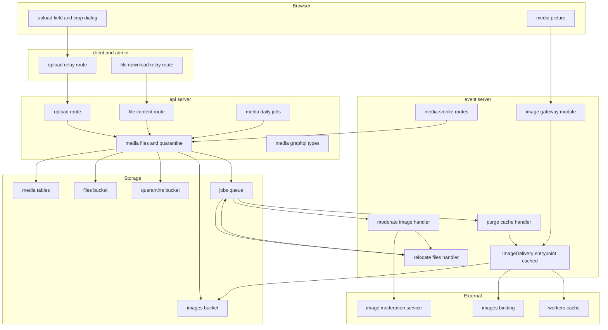
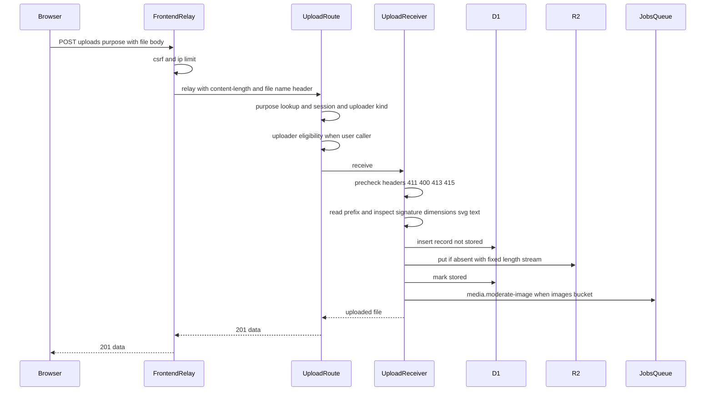
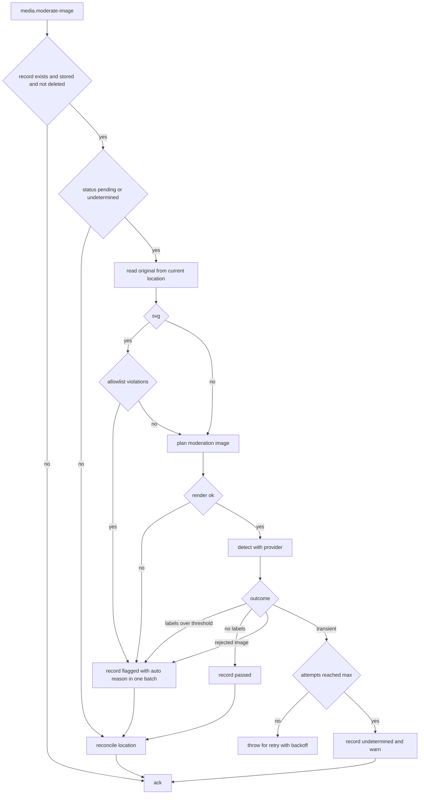
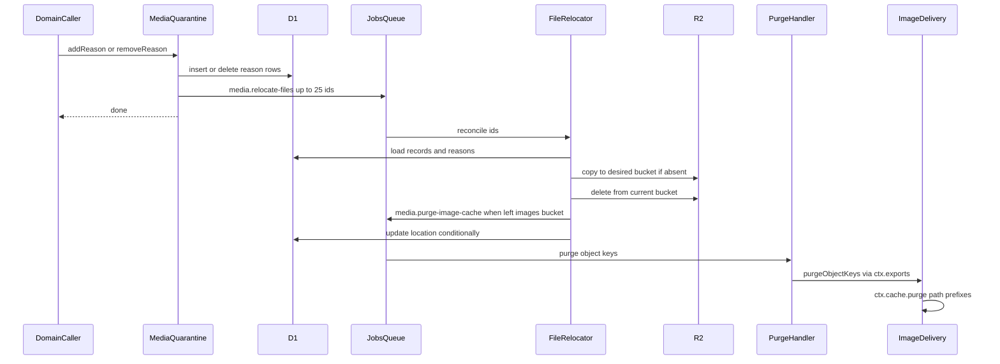
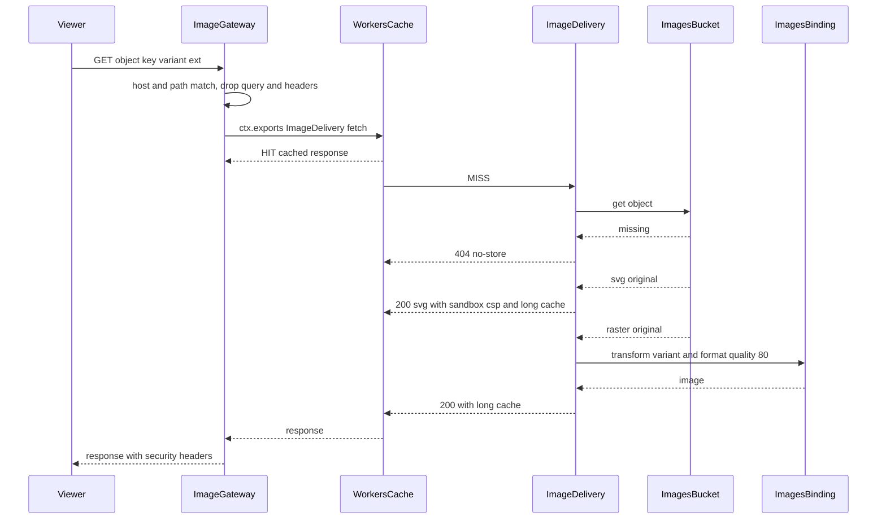
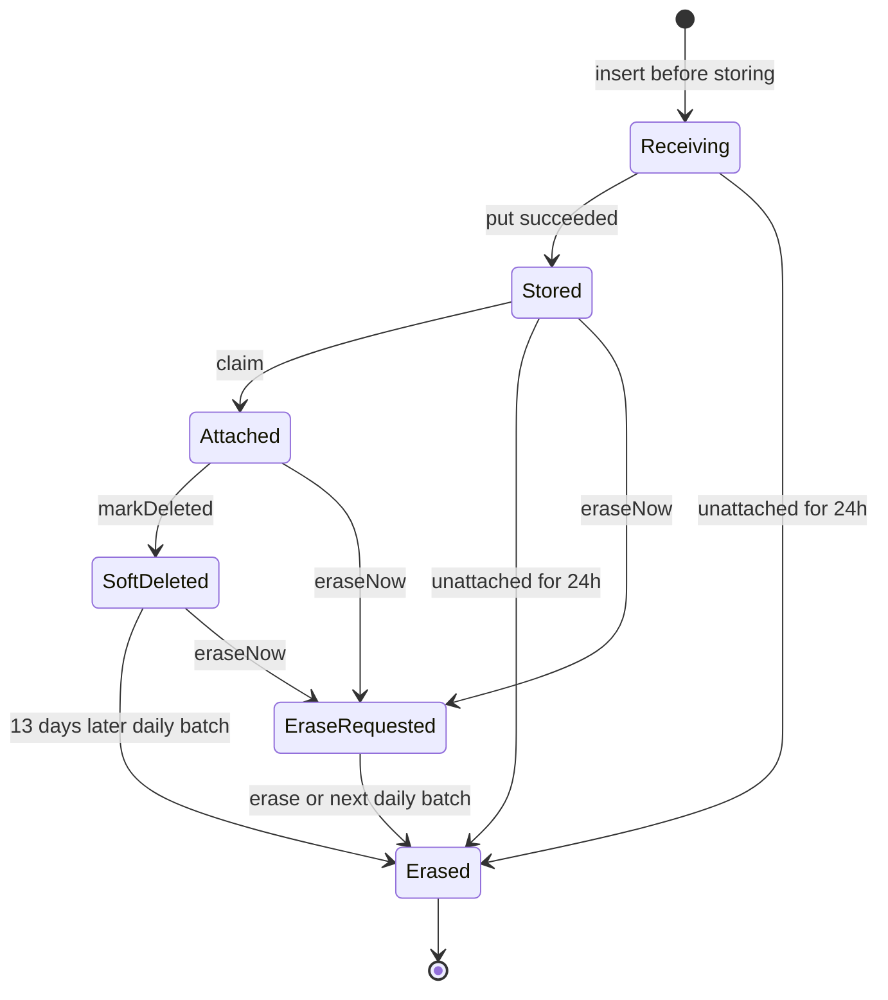
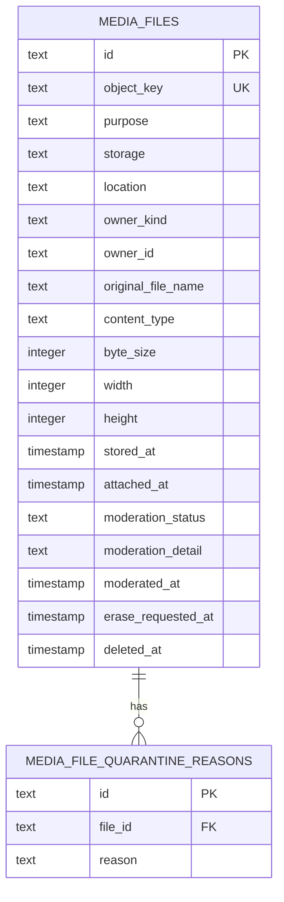

# Design Document

## Overview

**Purpose**: プロフィール画像・ロゴ・スクリーンショット・管理者のプロフィール画像・問い合わせの添付など、ファイルを扱う全機能が共通に使うメディア基盤を提供する。用途に依存しない1つのパイプラインとして、アップロードの受付と検証(APIサーバー)、画像の非同期の自動判定と隔離(イベントサーバーのQueueの処理)、画像配信専用ドメインからの変換配信とエッジキャッシュ(イベントサーバーの名前付きエントリポイント)、非公開ファイルの同一オリジン配信(フロントエンドサーバーの中継とAPIサーバー)、ファイルのライフサイクル(論理削除・物理削除・未使用ファイルの削除)、アップロード部品と画像の表示部品を整える。

**Users**: ドメインspec(user-profile-social・product-launch・admin-foundation・inquiry-chat)の開発者とAIエージェントは、APIサーバーの登録箇所へ用途を追記し、画面ではアップロード部品と画像の表示部品を置き、業務データの保存時に紐付け・削除の操作を呼ぶ。ugc-moderation・product-launchはファイル単位の隔離理由の追加・解除と削除を呼び、user-profile-socialはidentity-authのユーザーライフサイクルイベントの波及処理として保有者単位の物理削除と隔離理由の付け外しを呼び、identity-authはアップロードできる利用者かの差し込み口(`UploaderEligibility`)を`AccountGuard`の判定で束縛し、data-exportはファイルの情報と内容を読む。運用者は画像配信ドメインのキャッシュと判定の状態を、ログ・Sentry・動作確認の経路で確かめる。

**Impact**: 上流のbackend-platform・api-gateway・frontend-platformの登録箇所(モジュール・内部REST・メッセージ種別・定期実行・IP制限の除外・中継の経路・スキーマモジュール)へ追記し、eventのWrangler設定に名前付きエントリポイント単位のキャッシュと判定の変数・シークレットを加える。D1にメディアの2テーブルを加える。staging・prodのR2バインディングの米国管轄(`jurisdiction: "us"`)はinfra-deliveryが加え、本specはそれを前提にする。

### Goals

- ドメインspecは、用途を1件登録するだけで、事前検証・実体検証・推測できないキーでの上書きしない保存・自動判定・変換配信・削除が働く。
- 不適切と判定した画像と、隔離理由が付いた画像は、通常数秒〜数分で配信が止まり、エッジキャッシュからも消える。隔離理由がすべて解消するまで公開に戻らない(FR-ADMUG-028)。
- 判定サービスの障害時もアップロードと配信は止まらず、判定は再試行と日次バッチで回復する(NFR-AVAIL-002)。
- 変換済みの画像はエッジキャッシュから配信され、ヒット時はストレージの読み出しと変換を省く。
- 本specのコードの単体テスト・ブラウザテスト・Workers統合テストが行と関数のカバレッジ80%を満たし、一括検査に参加する。

### Non-Goals

- 用途の具体的な値(上限サイズ・最大寸法・縦横比)の決定、業務データ側でのファイルの参照の保持、業務データの保存時のファイルの個数・合計サイズの判定(各ドメインspec)。
- 管理者による手動モデレーションの画面・認可の実装・監査ログ・投稿者への通知(ugc-moderation)。
- エクスポートのZIPの生成・保存・削除(data-export)。
- バケット・画像配信ドメイン・DNSの作成、Images Paidの契約(infra-delivery・launch-readiness)、判定サービスのIAMとAIサービスのオプトアウトの設定(開発者の手作業)。
- 配信時のJPEGのメタデータの除去(決定Q1で要件から外した)。
- 本物のログインを伴うアップロードのE2Eテスト(最初にアップロードを使うドメインspec)。

## Boundary Commitments

### This Spec Owns

- `apps/common-lib/media`(仮決定2): 形式の一覧と判定、画像バリアントの表とURLの組み立て・解析、アップロードとダウンロードの中継のプロトコル(経路の接頭辞・ファイル名のヘッダー・応答の型・エラーコード)。
- `apps/db/schema/media`: `media_files`・`media_file_quarantine_reasons`と、そのマイグレーション。
- `apps/backend-lib/core/media`: 用途の定義と登録表、事前検証、シグネチャの表、寸法の読み取りと画素数の上限、SVGの構文の検査、テキストの検査、ファイル名の整形と`Content-Disposition`、オブジェクトキーの採番、ファイルの型と隔離の規則、メッセージ契約3種、`MediaFiles`・`MediaQuarantine`などのポートとDIの識別子。
- `apps/backend-lib/workers/media`: D1のリポジトリ、R2のオブジェクトストア、受付処理、`MediaFiles`・`MediaQuarantine`・`MediaEraser`の実装、両アプリ共通のモジュール。
- `apps/api`: アップロードと非公開ファイルの内部REST、アップロードできる利用者かの差し込み口(`UploaderEligibility`)と既定の全許可の実装・束縛の置き場所、閲覧の可否の判定と管理者の画像確認の方針のポートと登録箇所、GraphQLのスキーマモジュール`media`、日次バッチ3種、用途の登録箇所。
- `apps/event`: 判定の処理(判定用画像・判定サービス・SVGの検査・判定の規則)、保存先をそろえる処理、パージの処理、画像配信(関門のモジュール・名前付きエントリポイント`ImageDelivery`)、IP制限の除外、動作確認の経路。
- `apps/frontend-lib`: 中継の経路の定義、アップロード部品・編集ダイアログ・画像の表示部品・非公開ファイルのリンク部品と、その純粋な関数。
- 設定: eventの`exports`(エントリポイント単位のキャッシュ)・変数・シークレットのキー名、client・adminの中継の経路の登録。
- 契約: `UploadPurpose`、`MediaFiles`・`MediaQuarantine`・`MediaFileView`・`QuarantineReason`、`UploaderEligibility`・`UPLOAD_ACCESS_TYPES`、`FileReadPolicy`・`AdminMediaReviewPolicy`、メッセージ種別`media.moderate-image`・`media.relocate-files`・`media.purge-image-cache`、内部RESTとブラウザ向けの経路・エラーコード、GraphQLの`MediaImage`・`MediaAttachment`、部品のprops。
- 技術ドキュメント: `external`(画像判定サービス)・`infra`(画像の変換配信とキャッシュ)・`security`(アップロードの安全対策)の3文書と索引、関連するサービス仕様(画像バリアント仕様・プライバシーポリシーの大枠と準拠方針のAWSの項・文言規則・日次タイムライン)の整合、オンボーディングと固有の値。

### Out of Boundary

- 用途の登録値と、業務データの保存・ファイルの参照・個数と合計の判定(各ドメインspec)。
- 隔離・復元・削除を呼ぶ契機の判断(退会・停止・非公開化・差し替え)と、その操作の監査ログ・通知。ユーザーの退会・停止・停止解除に伴う保有者単位の操作は、user-profile-socialがidentity-authのユーザーライフサイクルイベントの波及処理として登録して呼ぶ(identity-authは登録口を提供するだけで本specの操作を呼ばない)。プロダクトの非公開化・削除はproduct-launch、管理操作はugc-moderationが呼ぶ。
- 管理者が隔離中の画像を見る権限の判定の実装(ugc-moderationが`AdminMediaReviewPolicy`を差し替える)。用途ごとの閲覧の可否の実装(inquiry-chatなどが`FileReadPolicy`を登録する)。
- アップロードできる利用者かの判定の実装(停止中の拒否、メールアドレス未確認の利用者の扱い)。identity-authが`UploaderEligibility`の束縛を`AccountGuard`の判定で差し替える(N-7)。
- エクスポートのZIPと、そのファイル用バケット上のオブジェクト(data-exportが直接扱い、本specの記録を持たない)。
- 3つのバケット(米国管轄)・画像配信ドメイン・DNS・WAFの作成と、api・eventのR2バインディングへの`jurisdiction: "us"`の指定(infra-deliveryの要件2.3。backend-platformのWrangler設定を変える)。InfisicalのキーとWorkerへ渡すシークレットの一覧(`OPTIONAL_WORKER_SECRETS`など)への本specのキーの記載(infra-delivery)。Images Paidの判断とprodのシークレットの登録(launch-readiness)。IAMユーザー・ポリシー・アクセスキーとAIサービスのオプトアウト(開発者の手作業)。
- プライバシーポリシーの大枠と準拠方針の国外移転の記載事項・データの保存場所のうち、Cloudflareの項(D1・R2・Queuesの米国での保存、Durable Objects・Workersの実行・エッジキャッシュ・ログ・メール送信・bot判定(Turnstile)・Web Analyticsなど所在を限定しない処理の扱い、それらの移転の根拠。infra-delivery)、Google Cloud(Natural Language API)の項(content-processing。R3-5)と、AWS以外の委託先の項。本specはAWS(Rekognition、us-east-1)の項だけを書き、互いの項を書き換えない(委託先単位の分担。N-1)。法務文書の本文は開発者が用意し、本specは大枠と準拠方針の記載事項として扱う。
- 中継の共通処理(`relayToApi`・CSRF・IP制限・セキュリティヘッダー)と内部経路の認証(frontend-platform・api-gateway)。本specは経路を登録するだけである。
- 要件定義書の改訂(本specは報告だけ行う)。

### Allowed Dependencies

- backend-platform: `AppModule`と登録箇所(`modules.ts`・`scheduled-jobs.ts`・`message-handlers.ts`・`rate-limit-exclusions.ts`)、DIの識別子`PLATFORM_TYPES`(`Database`・`Clock`・`IdGenerator`・`MessagePublisher`)、`defineMessageContract`と`MESSAGE_CONTRACTS`、`MessageHandlerRegistration.retry`、`ScheduledJobDefinition`、`RateLimitExclusion`、`AppError`と共通のエラー形式、`createDatabase`・共通カラム(`ulidPrimaryKey`・`timestamps`・`softDelete`)、ログとSentry。
- api-gateway: `createInternalRoutesModule`・`createSessionAccess`・`CallerKind`・`AuthenticatedPrincipal`・`Principal`、application層のセッションの読み取り専用の型`SessionView`(`application/session/session-view.ts`。api-gatewayの契約への追記で、identity-authのタスク2.3が追記する。無い場合の扱いは「UploaderEligibility・既定の実装」。R3-1)、`defineSchemaModule`・`defineLoader`、`withSecurityHeaders`(応答のCSPを保つ規則)。
- frontend-platform: `RelayRoute`と`relay-routes.ts`の登録箇所、`PublicRuntimeConfig`、UI部品(dialog・button・label)・`notify`・アクセシビリティの検査の補助、`IMAGES_ORIGIN`。
- content-processing: `apps/common-lib`の配置と参照の方法(仮決定2)と、frontend-libの`server/**`から`../common-lib/**`を読み込む許可(横断レビューM-2でcontent-processingが加える)、日次タイムラインの「日次バッチ(4:21)の内容」のジョブの名前と順序の表。本specの実装は、content-processingが下流向けに示す最小の区切りの完了を前提にする(roadmapの順はinfra-delivery→content-processing→media-pipeline→identity-auth)。区切りは次のとおりである(横断レビュー2回目のN-3)。
  - タスク1.1(共有ディレクトリの定義への共用部品の追加)・1.2(共用部品のプロジェクトと読み込みの境界)・4.1(APIサーバーとイベントサーバーへの組み込み)・4.2(利用者側・管理者側とfrontend-libへの組み込み)。
  - タスク6.1(frontend-libの`server/**`からcommon-libを読み込む許可と`common-lib/validation/**`の禁止の静的解析の規則)と、11.3のうち`coding/003`への`server/**`の許可の記述。確かめ方は、6.1の単体テストの成功と`coding/003`の記述である(content-processingの設計の「`server/**`の許可の確かめ方」)。
  - タスク11.4のうち、日次タイムラインのジョブの名前と順序の表の作成。表が無いことを理由には止めず、本specのタスク9.2が同じ形で作る(表は最初に4:21のジョブを足すspecが作り、後のspecは行を足す)。
- npmパッケージ: Technology Stackの表に挙げた版に限る。
- 依存の方向(後述の矢印の向きだけを許す):
  - サーバー: `common-lib/media` → `backend-lib/core/media` → `backend-lib/workers/media` → 各アプリの`application` → `infrastructure`・`presentation` → `composition`。`apps/db/schema/media`は`backend-lib/workers/media`から読む。
  - `backend-lib/core/media`とeventの`application/media`は、`cloudflare:*`・Hono・`wasm-image-optimization`・`aws4fetch`・`backend-lib/workers`・`apps/db`を読み込まない(Bunの単体テストで検査する純粋な層)。
  - フロント: `common-lib/media` → `frontend-lib/utilities/media` → `frontend-lib/components/media`・`frontend-lib/server/media` → `apps/{client,admin}`。`frontend-lib/server/media`は`common-lib/media`(`ATTACHMENT_MEDIA_TYPES`・経路の接頭辞)を直接読み込む(content-processingが加える`server/**`の許可に従う。M-2)。frontend-libの`components/**`・`server/**`は`common-lib/media`だけを読み込み、`common-lib/validation/**`(Zodを使う)を読み込まない。
  - `common-lib/media`は他のどの層も読み込まず、外部パッケージにも依存しない。

### Revalidation Triggers

- 下流(ドメインspec・ugc-moderation・data-export)が再確認する変更:
  - `UploadPurpose`の形・許可形式の範囲・上限の最大値、用途の命名規約。
  - `MediaFiles`・`MediaQuarantine`の操作と結果の型、`QuarantineReason`の値、`MediaFileView`の項目。
  - 保有者単位の操作(`eraseOwnedBy`・`addReasonForOwner`・`removeReasonForOwner`)の1回の上限件数(`OWNER_OPERATION_BATCH_LIMIT`)と`OwnerBatchResult.hasMore`の意味(user-profile-socialの波及処理が、identity-authの`LifecycleHandlerOutcome`の`continue`へ対応付ける)。
  - `FileReadPolicy`・`AdminMediaReviewPolicy`の形と既定の動作。
  - `UploaderEligibility`の形・DIの識別子(`UPLOAD_ACCESS_TYPES.UploaderEligibility`)・束縛の置き場所・既定の動作(全許可)・判定を呼ぶ経路(利用者側だけ)・拒否のエラーコード(`account_unavailable`・`email_not_verified`)・入力の`session`の型(`SessionView`)(identity-authが束縛する)。identity-authのタスク8.5が束縛を差し替えると、本specのタスク5.6の登録箇所の既定値の単体テスト(全許可)の期待値が変わる(8.5が直す)。タスク5.1のWorkers統合テストは差し込み口をテストのコンテナへ明示的に束縛するため、差し替えの影響を受けない(R3-3)。
  - GraphQLの`MediaImage`・`MediaAttachment`、部品のprops、アップロードとダウンロードの経路・エラーコード。
  - 画像バリアントの表、日次バッチの時刻と順序、メッセージ種別。
- 上流(本specの設計が変更を求めるもの。上流のspecは本specに合わせて再確認する):
  - backend-platform: eventのWrangler設定の`exports`(`default`はキャッシュ無効、`ImageDelivery`は有効)、変数とシークレット、設定の単体テストの期待値(eventのキャッシュ)、`MESSAGE_CONTRACTS`への3種の追加。判定の実測で1バッチのCPU時間が上限に近い場合の`limits.cpu_ms`。
  - frontend-platform: `PublicRuntimeConfig`への画像配信のオリジンの追加、`relay-routes.ts`への2経路の追加、`toBrowserResponse`がダウンロードの`Content-Type`・`Content-Disposition`・`Content-Length`を保つこと、client・adminのルートへの`ImagesOriginProvider`の配置。`relayToApi`の415(`unsupported_media_type`)の判定と応答の形が変わる場合は、本specの`UPLOAD_RELAY_ROUTE`と`parseUploadResponse`の対応付けを再確認する(M-10)。
  - api-gateway: `internal-routes.ts`への2経路、`graphql-modules.ts`への`media`モジュールの追加。application層の`SessionView`(`application/session/session-view.ts`)の形と置き場所、`SessionAccess`がそれを拡張すること(identity-authのタスク2.3が契約へ追記する。本specのタスク5.1が先に定義を置いた場合は、2.3が型名・置き場所・形の一致を確かめる。R3-1)。
  - content-processing: `apps/common-lib`の配置先・参照方法の変更(仮決定2)、frontend-libの`server/**`からcommon-libを読み込む許可(M-2)、本specが前提にする最小の区切り(1.1・1.2・4.1・4.2・6.1、11.3のうち`coding/003`への`server/**`の許可の記述、11.4のうち日次タイムラインの表の作成。N-3)の範囲の変更、日次タイムラインの表の形、ジョブ名の規約(content-processingのタスク11.5が`infra/003`へ追記する。N-4)、プライバシーポリシーの大枠と準拠方針の国外移転の記載事項のGoogle Cloud(Natural Language API)の項(content-processingが本specのAWSの項と同じ形と根拠の種類で書く。本specは書き換えない。R3-5)。
  - infra-delivery: 3つのバケットの管轄とR2バインディングへの管轄の指定(api・eventのWrangler設定。backend-platformへの影響)、画像配信ドメインのイベントサーバーへの割り当て、InfisicalのキーとWorkerへ渡すシークレットの一覧への本specのキー(必須の`REKOGNITION_ACCESS_KEY_ID`・`REKOGNITION_SECRET_ACCESS_KEY`、eventの任意の`MEDIA_SMOKE_TOKEN`)の記載、`docs/onboardings/project-values.md`のシークレットのキーの一覧(キーの一覧の正。N-5)の形、プライバシーポリシーの大枠と準拠方針の国外移転の記載事項・データの保存場所のCloudflareの項(本specは書き換えない)と委託先単位の項の形(本specのAWSの項を同じ形にそろえる。N-1)、移転の根拠の種類(両項とも同じ。DPFを主、SCCを予備)。本specは画像判定専用のQueueなどの資源を追加しない。

## Architecture

### Existing Architecture Analysis

- 上流のbackend-platform・api-gateway・frontend-platformは設計が承認済みで、実装は本specより先に行う。content-processingの`apps/common-lib`の新設と組み込みのタスク(Allowed Dependencies)も、roadmapの順で本specより先に完了する。本specは各specの登録箇所への追記と、Revalidation Triggersに挙げた最小の変更だけを行う。
- backend-platformの受信部は、バッチ内のメッセージを1件ずつ処理し、メッセージ種別ごとに再試行の方針を上書きできる。デッドレターでは本文が捨てられるため、失ってはならない状態(判定の待ち・保存先のずれ)はD1に残し、日次バッチで回復する。
- api-gatewayの内部REST(`/internal`)はフロントエンドサーバーの中継からだけ届き、`createSessionAccess`で呼び出し元(利用者側・管理者側)に応じたセッションを判定できる。api-gatewayの`withSecurityHeaders`は、応答が自らCSPを持てば既定のCSPで置き換えない(SVGの配信で使う)。
- frontend-platformの中継は、`RelayRoute`を`src/composition/relay-routes.ts`へ追加するだけで、CSRF・IP制限・セッションの引き継ぎ・セキュリティヘッダー(`no-store`)の経路に乗る。

### Architecture Pattern & Boundary Map



**Architecture Integration**:

- Selected pattern: 用途を登録する汎用パイプライン。受付と認可はAPIサーバーの内部REST、重い処理(判定・バケット間の移動・パージ)はイベントサーバーのQueueの処理、配信はイベントサーバーの関門と名前付きエントリポイントに分ける。
- Domain/feature boundaries: ドメインspecは「用途の登録」「紐付け・削除・隔離の操作の呼び出し」「部品の配置」だけを行う。ファイルの記録・保存先・判定の状態は本specだけが書き換える。
- Existing patterns preserved: 4層の配置と処理単位のDIコンテナ、登録箇所への追記、メッセージ種別`<ドメイン>.<動詞句>`、ジョブ名`<spec名>.<名詞句>`、日次バッチ4:21、共通のエラー形式、1ファイル1コンポーネント。
- New components rationale: 画像配信のキャッシュをWorker全体ではなく画像の応答に限るために名前付きエントリポイントを置く。原子的でないバケット間の移動を冪等にするため、目的の保存先へそろえる処理を1つにまとめる。
- Steering compliance: CLAUDE.mdのクリーンアーキテクチャとInversify、TDD、技術ドキュメントの固有値の分離、新規パッケージの版の規則に従う。

### Technology Stack

| Layer                    | Choice / Version                                                    | Role in Feature                                          | Notes                                                                                                     |
| ------------------------ | ------------------------------------------------------------------- | -------------------------------------------------------- | --------------------------------------------------------------------------------------------------------- |
| Frontend                 | react-easy-crop 6.2.3                                               | 編集ダイアログの切り取りと拡大縮小                       | tech-stack.md記載済み。最新6.2.4は公開から2週間未満のため6.2.3に固定。client・admin・frontend-libで同じ版 |
| Frontend                 | Canvas(`createImageBitmap`・`toBlob`)                               | 切り取った画像の縮小と作り直し(JPEG・PNG)                | ブラウザ標準                                                                                              |
| Backend(共有)            | image-size 2.0.4                                                    | 先頭部分からの幅・高さの読み取り                         | 新規(決定Q7)。api・eventで同じ版                                                                          |
| Backend(共有)            | fast-xml-parser 5.11.2                                              | SVGの構文の検査(`XMLValidator`)と構造の検査(`XMLParser`) | tech-stack.md記載済み。`processEntities: false`。api・eventで同じ版                                       |
| Backend(event)           | wasm-image-optimization 2.0.11(`/workerd`)                          | 判定用画像の変換・縮小・RGBAの取り出し                   | tech-stack.md記載済み。eventだけ                                                                          |
| Backend(event)           | aws4fetch 1.0.20                                                    | 判定サービスへの要求のSigV4署名                          | tech-stack.md記載済み。eventだけ                                                                          |
| External                 | Amazon Rekognition DetectModerationLabels(us-east-1)                | 不適切な画像の判定                                       | 決定Q3・Q8。ローカル・CIは決定論的な代替                                                                  |
| Data / Storage           | D1(Drizzle ORM)・R2の3バケット(staging・prodは`jurisdiction: "us"`) | ファイルの記録と隔離理由、原本の保存                     | 条件付きの`put()`(`If-None-Match: *`)                                                                     |
| Messaging / Events       | Queues(`JOBS_QUEUE`)                                                | 判定・保存先の修正・パージの依頼                         | 専用のQueueは作らない                                                                                     |
| Infrastructure / Runtime | Images Binding・Workers Cache(エントリポイント単位)・`ctx.exports`  | 変換配信・エッジキャッシュ・パージ                       | Wrangler 4.124.0(4.107.0以上が必要)                                                                       |
| Infrastructure / Runtime | `CompressionStream('deflate')`                                      | 余白付きの判定用画像のPNG符号化                          | workerd・Bunの標準                                                                                        |

## File Structure Plan

### Directory Structure

```
apps/
├── common-lib/media/                              # 前後で共有する純粋な定義(仮決定2。外部パッケージに依存しない。各ファイルに同名の*.unit.test.ts)
│   ├── media-types.ts                             # MediaType・形式の一覧・Content-Typeの解析・フォールバックの形式・表示名
│   ├── image-variants.ts                          # IMAGE_VARIANTS・OBJECT_KEY_PATTERN・パスの組み立てと解析・配信可否・Cache-Control・表示サイズとバリアントの対応
│   ├── upload-protocol.ts                         # 経路の接頭辞・ファイル名のヘッダーと符号化・UploadedFile・ダウンロードのパス
│   └── media-error-codes.ts                       # UploadErrorCode・FileAccessErrorCode
├── db/schema/media/
│   ├── media-files.ts                             # media_filesのテーブル定義と索引
│   ├── media-file-quarantine-reasons.ts           # media_file_quarantine_reasons(ファイルと理由の一意制約、ファイル削除で連鎖削除)
│   └── *.unit.test.ts                             # 列の型・NOT NULL・一意制約・既定値
├── backend-lib/
│   ├── core/media/                                # 純粋な規則(Bunの単体テスト。各ファイルに同名の*.unit.test.ts)
│   │   ├── identifiers.ts                         # MEDIA_TYPES(DIの識別子)
│   │   ├── media-file.ts                          # MediaFileView・MediaOwner・MediaLocation・ModerationStatus・QuarantineReason・ModerationFinding・desiredLocation
│   │   ├── ports.ts                               # MediaFiles・MediaQuarantine・MediaFileStore・MediaObjectStore・UploadReceiver・MediaEraserの型
│   │   ├── upload-purpose.ts                      # UploadPurpose・defineUploadPurpose・createUploadPurposeRegistry・MEDIA_SMOKE_PURPOSE
│   │   ├── upload-precheck.ts                     # UploadRejection・precheckUpload(411・400・413・415)
│   │   ├── file-signature.ts                      # マジックバイトの表とdetectSignature
│   │   ├── image-dimensions.ts                    # readImageDimensions(image-size・向きの入れ替え)・画素数の上限
│   │   ├── svg-syntax.ts                          # UTF-8の復号・DOCTYPEとENTITYの拒否・XMLの構文の検査
│   │   ├── text-content.ts                        # UTF-8とNUL文字を流しながら検査するTransformStream
│   │   ├── file-name.ts                           # sanitizeFileName・attachmentDisposition
│   │   ├── object-key.ts                          # generateObjectKey(乱数源を注入)
│   │   └── media-messages.ts                      # 3種のメッセージ契約と件数の上限
│   ├── core/messaging/contracts/index.ts          # (変更)MESSAGE_CONTRACTSへ3種を追加
│   └── workers/media/                             # D1・R2・Queueを使う部品(apiのWorkers統合テスト。各ファイルに同名の*.worker.test.ts)
│       ├── d1-media-file-store.ts                 # MediaFileStoreのD1実装(条件付きの更新と一括実行)
│       ├── r2-media-object-store.ts               # MediaObjectStoreのR2実装(上書きしない書き込み・読み出し・削除・バケット間のコピー)
│       ├── upload-receiver.ts                     # 受付処理(事前検証→実体検証→記録→保存→完了→判定の依頼)
│       ├── media-eraser.ts                        # 物理削除(全バケット→パージの依頼→記録の削除)
│       ├── media-files-service.ts                 # MediaFilesの実装(紐付け・論理削除・即時削除・保有者単位の削除・取得・内容)
│       ├── media-quarantine-service.ts            # MediaQuarantineの実装(理由の追加・解除と移動の依頼・一覧)
│       └── media-platform-module.ts               # 両アプリ共通の束縛(MEDIA_PLATFORM_MODULE)
├── api/
│   ├── src/application/session/session-view.ts    # SessionView(api-gatewayの契約。identity-authの2.3が追記する。実装時に無ければ5.1が同じ形で置く。R3-1)
│   ├── src/application/media/                     # Bunの単体テスト(各ファイルに同名の*.unit.test.ts)
│   │   ├── uploader-eligibility.ts                # UploaderEligibility・UploaderEligibilityDecision・UPLOAD_ACCESS_TYPES(アップロードできる利用者かの差し込み口)
│   │   ├── file-access-policies.ts                # FileReadPolicy・AdminMediaReviewPolicyのポート・FILE_ACCESS_TYPES
│   │   ├── file-access-authorizer.ts              # 保存先・呼び出し元・用途から方針を選んで判定する
│   │   └── media-daily-jobs.ts                    # 期限切れの物理削除・判定の再依頼・保存先の修復の3ジョブ
│   ├── src/infrastructure/media/
│   │   ├── allow-all-uploader-eligibility.ts      # 既定のアップロードの可否(全許可)
│   │   ├── owner-only-file-read-policy.ts         # 既定の閲覧の可否(アップロードした主体だけ)
│   │   └── deny-all-admin-media-review-policy.ts  # 既定の管理者の画像確認(全拒否)
│   ├── src/presentation/media/                    # apiのWorkers統合テスト(各ファイルに同名の*.worker.test.ts)
│   │   ├── upload-route.ts                        # POST /internal/media/uploads/:purpose
│   │   └── file-content-route.ts                  # GET /internal/media/files/:fileId
│   ├── src/presentation/graphql/modules/media/
│   │   ├── type-defs.ts                           # MediaImage・MediaAttachment・MediaImageFallbackFormat
│   │   ├── mappers.ts                             # toMediaImage・toMediaAttachment(単体テスト併置)
│   │   ├── loaders.ts                             # mediaFileLoader(DataLoader)
│   │   └── index.ts                               # mediaSchemaModule
│   ├── src/composition/
│   │   ├── media-module.ts                        # apiのメディアのAppModule(束縛・ジョブ)
│   │   ├── upload-purposes.ts                     # UPLOAD_PURPOSES(用途の登録箇所。初版は空)
│   │   ├── file-read-policies.ts                  # FILE_READ_POLICIES(用途ごとの閲覧の可否の登録箇所。初版は空)
│   │   ├── uploader-eligibility.ts                # UploaderEligibilityの束縛(初版は全許可。identity-authがAccountGuardの判定に差し替える)
│   │   └── media-review-policy.ts                 # AdminMediaReviewPolicyの束縛(初版は全拒否。ugc-moderationが差し替える)
│   └── test/config/media-wrangler-config.unit.test.ts  # eventのメディアの設定(キャッシュ・変数・シークレット)の検査
├── event/
│   ├── src/application/media/                     # Bunの単体テスト(各ファイルに同名の*.unit.test.ts)
│   │   ├── ports.ts                               # ModerationProvider・ModerationImageRenderer・ImageSource・ImageTransformer・ImageCachePurger・MediaIncidentReporter・FileRelocator・EVENT_MEDIA_TYPES
│   │   ├── moderation-config.ts                   # ModerationConfig・全カテゴリ・環境の値の解析
│   │   ├── moderation-verdict.ts                  # ラベルから最上位のカテゴリを求めて判定する
│   │   ├── moderation-image-plan.ts               # 判定用画像の作り方(そのまま・縮小・余白)の決定
│   │   ├── png-encoder.ts                         # RGBAへの余白の追加とPNGの符号化
│   │   ├── svg-allowlist.ts                       # SVGの要素・属性・処理命令・参照の許可リスト検査
│   │   ├── moderate-image-handler.ts              # media.moderate-imageの処理
│   │   ├── relocate-files-handler.ts              # media.relocate-filesの処理
│   │   ├── purge-image-cache-handler.ts           # media.purge-image-cacheの処理
│   │   ├── stub-moderation-rules.ts               # 決定論的な代替の判定の規則(寸法→結果)
│   │   └── image-delivery.ts                      # 配信の応答の決定(404・SVG・変換・503とヘッダー)
│   ├── src/infrastructure/media/                  # eventのWorkers統合テスト(各ファイルに同名の*.worker.test.ts)
│   │   ├── rekognition-moderation-provider.ts     # DetectModerationLabelsの呼び出し・時間切れ・失敗の分類
│   │   ├── stub-moderation-provider.ts            # 代替の判定(外部へ送信しない)
│   │   ├── create-moderation-provider.ts          # 環境の値による実装の選択
│   │   ├── wasm-moderation-image-renderer.ts      # wasm-image-optimizationによる変換・縮小・RGBA
│   │   ├── file-relocator.ts                      # 目的の保存先へそろえる処理
│   │   ├── r2-image-source.ts                     # 画像用非公開バケットからの読み出し
│   │   ├── images-binding-transformer.ts          # Images Bindingでの変換
│   │   ├── workers-cache-purger.ts                # ctx.exports.ImageDelivery.purgeObjectKeysの呼び出し
│   │   └── sentry-media-incident-reporter.ts      # 未判定・恒久的な失敗・設定の誤りの通知
│   ├── src/presentation/media/
│   │   ├── image-delivery-entrypoint.ts           # ImageDelivery(WorkerEntrypoint。fetchとpurgeObjectKeys)
│   │   ├── image-gateway-module.ts                # 画像配信の関門のAppModule(ホストと経路の判定、ctx.exportsへの委譲)
│   │   ├── image-request-match.ts                 # 画像配信ドメインかつ画像のURLの判定(IP制限の除外と共用)
│   │   └── media-smoke-module.ts                  # /internal/media/smoke/*(トークン付きの動作確認)
│   └── src/composition/
│       ├── media-module.ts                        # eventのメディアのAppModule(束縛・メッセージの処理の登録)
│       └── media-env.ts                           # メディアの変数・シークレットの検証スキーマ
├── frontend-lib/
│   ├── utilities/media/                           # 純粋な関数(Bunの単体テスト。各ファイルに同名の*.unit.test.ts)
│   │   ├── upload-constraints.ts                  # UploadConstraints・選択の検査(形式・サイズ・個数・合計)
│   │   ├── upload-request.ts                      # 送信の組み立てと応答の解析(fetchを注入)
│   │   ├── upload-messages.ts                     # エラーコード・選択の違反から文言規則の文言へ
│   │   ├── file-size-label.ts                     # kB・MBの表記
│   │   ├── crop-geometry.ts                       # 切り取り範囲と最大寸法から出力の寸法・形式を決める
│   │   ├── picture-sources.ts                     # 表示サイズから<source>・のsrcsetと幅・高さを組み立てる
│   │   └── placeholder-appearance.ts              # 先頭1文字(書記素)・背景色・文字色の決定
│   ├── server/media/media-relay-routes.ts         # UPLOAD_RELAY_ROUTE・FILE_DOWNLOAD_RELAY_ROUTE(単体テスト併置)
│   └── components/media/                          # 画面部品(ブラウザテスト・Storybook。1ファイル1コンポーネント、*.browser.test.tsx・*.stories.tsxを併置)
│       ├── file-drop-zone.tsx                     # クリック・ドラッグ&ドロップの選択(キーボード操作可)
│       ├── file-selection-list.tsx                # 選んだファイルの名前・サイズ・形式・サムネイル・状態
│       ├── file-thumbnail.tsx                     # オブジェクトURLのサムネイル(破棄を含む)
│       ├── image-crop-dialog.tsx                  # react-easy-cropの編集ダイアログ(拡大縮小の操作)
│       ├── image-upload-field.tsx                 # 画像の用途の入力欄(選択→編集→送信→プレビュー)
│       ├── attachment-upload-field.tsx            # 編集ダイアログを使わない用途の入力欄
│       ├── media-picture.tsx                      # <picture>・SVGの・プレースホルダーへの切り替え
│       ├── media-placeholder.tsx                  # 先頭1文字の正方形と「画像を表示できません」
│       ├── private-file-link.tsx                  # 非公開ファイルのダウンロードのリンク
│       ├── images-origin-provider.tsx             # 画像配信のオリジンを配るContextの提供部品
│       ├── use-images-origin.ts                   # 画像配信のオリジンの取得
│       ├── use-file-upload.ts                     # 送信の順番待ち・状態・中止
│       └── encode-cropped-image.ts                # Canvasでの縮小と作り直し(ブラウザテスト)
├── client/src/composition/relay-routes.ts         # (変更)2経路を追加
└── admin/src/composition/relay-routes.ts          # (変更)2経路を追加
docs/
├── GUIDES/tech/external/003-image-moderation.md      # 画像判定サービス(要求・上限・カテゴリと閾値・失敗の分類・再試行・IAMの手作業・オプトアウト・代替の判定)
├── GUIDES/tech/infra/008-image-delivery.md           # 変換配信・エントリポイント単位のキャッシュ・関門・パージ・版ごとのキャッシュ・R2の管轄・stagingの確認手順
├── GUIDES/tech/security/005-file-upload-security.md  # 事前検証・実体検証・SVGの検査・ファイル名・キー・上書きの拒否・配信のヘッダー・メタデータの扱い
└── GUIDES/tech/{external,infra,security}/README.md   # 文書一覧へ1行ずつ追記
```

- 技術ドキュメントの番号は、spec横断レビュー(I-4)でroadmapの順に割り当てた値に固定する(本specは`external/003`・`infra/008`・`security/005`)。他specの文書の有無によらず番号を変えない。3文書には本specのシークレットのキーの名前を列挙せず、プレースホルダーで書く(キーの一覧の正は`project-values.md`の節。N-5)。
- テストファイルは、同名の`*.unit.test.ts`(純粋な層)・`*.worker.test.ts`(Workersの実行環境)・`*.browser.test.tsx`(部品)を対象ファイルの隣に置く(上の木では一部を省略した)。

### Modified Files

- `apps/db/schema/index.ts` — メディアの2テーブルを集約点に加える。`apps/db/migrations/<日時>_media_pipeline/migration.sql`を生成する。並行するspec(identity-authなど)とスナップショットが分岐しないよう、mainの最新を取り込んでから生成し、番号の衝突があれば生成し直す(M-6)。
- `apps/backend-lib/core/messaging/contracts/index.ts` — 3種のメッセージ契約を`MESSAGE_CONTRACTS`へ加える。
- `apps/api/src/composition/modules.ts`・`internal-routes.ts`・`graphql-modules.ts`・`scheduled-jobs.ts` — `MEDIA_PLATFORM_MODULE`・apiのメディアモジュール、2つの内部REST、`mediaSchemaModule`、日次バッチ3種(4:21、順序810・820・830)を登録する。
- `apps/api/wrangler.jsonc`・`worker-configuration.d.ts` — 4:21の定期実行の式が無ければ3環境に加える(email-deliveryで加わっていれば変えない)。R2バインディングの管轄はinfra-deliveryが加える。
- `apps/api/package.json`・`bun.lock` — `image-size`・`fast-xml-parser`を版固定で加える。
- `apps/event/src/index.ts` — `ImageDelivery`をエクスポートする。既定のエクスポートは変えない。
- `apps/event/src/composition/modules.ts`・`message-handlers.ts`・`rate-limit-exclusions.ts`・`env-schema.ts` — 画像配信の関門のモジュールを`MODULES`の先頭に、`MEDIA_PLATFORM_MODULE`・eventのメディアモジュール・動作確認のモジュールを続けて登録する。3種のメッセージの処理と再試行の方針、画像配信の除外規則、メディアの変数とシークレットの検証を加える。
- `apps/event/wrangler.jsonc`・`worker-configuration.d.ts` — `exports`(`default`はキャッシュ無効、`ImageDelivery`は有効)、3環境の`vars`(Supporting References)、staging・prodの`secrets.required`に判定サービスの2つのキーを加える。
- `apps/event/package.json`・`bun.lock` — `image-size`・`fast-xml-parser`・`wasm-image-optimization`・`aws4fetch`を版固定で加える。
- `apps/event/vitest.worker.config.ts` — テスト用の変数(画像配信のホスト名・代替の判定・閾値)と`.wasm`の読み込みを加える。
- `apps/frontend-lib/package.json`・`bun.lock`、`apps/client`・`apps/admin`の`package.json`・`bun.lock` — `react-easy-crop`を版固定で加える。
- `apps/frontend-lib/server/env/frontend-env.ts` — `PublicRuntimeConfig`に`imagesOrigin`を加える(frontend-platformの所有。Revalidation Triggers)。
- `apps/client/src/routes/__root.tsx`・`apps/admin/src/routes/__root.tsx` — `ImagesOriginProvider`で画像配信のオリジンを配る。
- `apps/client/src/composition/relay-routes.ts`・`apps/admin/src/composition/relay-routes.ts` — `UPLOAD_RELAY_ROUTE`・`FILE_DOWNLOAD_RELAY_ROUTE`を加える。
- `docs/GUIDES/service/features/002-image-variants.md` — 出力フォーマットのメタデータの行を決定Q1に合わせ、パージの実行経路を「画像配信の名前付きエントリポイントのRPC」に改める。
- `docs/GUIDES/service/legal/003-privacy-policy-outline.md` — Exifの記述(決定Q1・Q2)、委託先の一覧のAWS(Rekognition)の行の所在(米国東部、us-east-1)と渡す情報(判定用画像だけ)を改める。「国外移転の記載事項」に委託先AWSの項を加える(16.4、N-1)。項の書き方の型はinfra-deliveryのタスク8.5が示し、Cloudflareの項を見本にする(R3-6)。本specはその型に合わせ、共通の行の後に見出し`### AWS(Rekognition)`を委託先の一覧の順の位置に置き、「移転先」「移転の根拠」「委託先が講じる措置」の3項目を書く。
  - 移転先: 米国(us-east-1)。送る情報は判定用画像だけで、元のファイル名・アップロードした主体の情報を送らない。
  - 移転の根拠: EU-USデータプライバシーフレームワーク(DPF)を主とし、DPFが無効になった場合は、AWSのデータ処理補遺(DPA)に含まれる標準契約条項(SCC)に拠る。
  - 委託先が講じる措置: 既存の共通の記述(データ処理条項・暗号化通信と保存・アクセス制御)を参照し、送った画像を保存・学習に使わせない設定(AIサービスのオプトアウト)と、判定の呼び出しだけを許す専用の資格情報を加える。
  - 共通の「移転先の国」の行は、AWSの記述だけをこの項への参照に改める。Cloudflareの項と記述(infra-delivery)、Google Cloud(Natural Language API)の項と記述(content-processing。R3-5)、他の委託先の記述、全委託先に共通の記載(当該国の制度・本人の求めへの対応、infra-deliveryの8.5が改める「移転の法的根拠」の行)は書き換えない。
  - 法務文書の本文は開発者が用意するため、本specは骨子の記載事項に留める。
- `docs/GUIDES/service/legal/001-compliance-policy.md` — データ保持期間の一覧に「紐付けられなかったアップロードファイル」の行を加える。「データの保存場所(DR-007)」の表(Cloudflareの資源の一覧)には行を足さず、表の下の委託先ごとの箇条に、infra-deliveryのタスク8.5が示す型で`- **AWS(Rekognition)**: 米国東部(us-east-1)。判定用画像を一時送信し、判定サービス側では保存しない。移転の根拠は骨子のAWSの項を正とする。`を加える(N-1・R3-6)。Cloudflareの資源の保存先の表と箇条(infra-deliveryが所有)と、他の委託先の箇条は書き換えない。
- `docs/GUIDES/service/design/003-text-and-copy-rules.md` — アップロードのエラーの文言(主体の種類が対象外の「この操作はできません。」(`upload_forbidden`。R3-8)・編集後のサイズ超過・SVGの書き出し直し・読み込めないファイル・画素数超過・合計サイズ超過・一時的に利用できない)を加える。「この操作はできません。」はidentity-authの`forbidden`も使う文言で、roadmapの順で先に実装する本specが加える。アップロードできない利用者の拒否(`account_unavailable`・`email_not_verified`)は、既存の「停止中アカウント」「メール未確認」の文言を使い、行を加えない。
- `docs/GUIDES/service/overview/007-daily-timeline.md` — 「日次バッチ(4:21)の内容」のジョブの名前と順序の表へ、本specの3つのジョブの行(810・820・830)を加える(M-4)。表は最初に4:21のジョブを足すspecが作り、後のspecは行を足す(N-3)。想定の順序ではcontent-processingが作るが、表が無ければ本specが作り(上流のemail-deliveryの`email-delivery.cleanup`(900)を含める)、表が無いことを理由に止めない。
- `docs/onboardings/tech-stack.md` — 画像処理に`image-size`を加え、各パッケージの役割を更新する。
- `docs/GUIDES/tech/coding/002-dependency-versions.md` — api・eventでそろえる`image-size`・`fast-xml-parser`と、client・admin・frontend-libでそろえる`react-easy-crop`を一覧に加える。
- `docs/onboardings/project-values.md`・`README.md` — 固有の値(ホスト名・変数・シークレットのキー名・用途の命名・メッセージ種別・ジョブ名)と、ローカルとstagingの動作確認の手順・Infisicalへの登録(stagingの値は、そのキーを必須にする変更をmainへマージする前に開発者が登録する。prodの値はlaunch-readinessがリリース時に登録する)を加える。シークレットのキーの行は、`project-values.md`のWorkerのシークレットのキーの一覧の節(キーの一覧の正。infra-deliveryのタスク8.5が作る。N-5)へ、キーを宣言する変更(タスク1.3)と同じ変更で足す。既に行があれば食い違いを確かめるだけにし、節が無ければ開発者へ報告して進める。技術ドキュメントにはキーの名前を列挙しない。
- `CLAUDE.md` — 「技術規則の参照先」に、アップロード・画像配信・画像判定の3文書(`security/005`・`infra/008`・`external/003`)へのリンクを作業の種類とともに加える。

## System Flows

### アップロード



- 利用者側の経路では、主体の種類の確認の後、本文を読む前に`UploaderEligibility`で判定する。拒否した要求は記録もオブジェクトも作らない(1.8・1.9)。管理者側の経路と動作確認の経路は判定を呼ばない。
- 事前検証と実体検証で拒否した要求は、記録もオブジェクトも作らない(2.6)。記録の作成の後に失敗した場合は、その場で記録とオブジェクトの削除を試み、残っても未使用ファイルとして日次バッチが消す(4.10・5.5)。
- 判定の依頼の送信に失敗しても、アップロードは成功として返す。記録は判定待ちのまま残り、日次バッチが1時間以上判定待ちの画像の判定を依頼し直す(8.3)。

### 自動判定



- 判定の記録は、状態が「判定待ち」「未判定」の場合だけ書く条件付きの更新とし、不適切の場合は自動判定の隔離理由の追加と同じ一括実行にまとめる(8.6・8.7)。
- 判定の結果に関わらず、最後に`FileRelocator`で目的の保存先へそろえる。重複の依頼でも保存先のずれだけを直す。

### 隔離・復元とパージ



- パージの依頼は、画像用非公開バケットからの削除の後、保存先の記録の更新の前に送る。依頼の送信に失敗して再試行しても、元のバケットに画像が無い状態から同じ手順を最後までやり直せる(9.7・11.4)。
- 復元(隔離バケットから画像用非公開バケットへ)ではパージしない。隔離中の404は`no-store`で、キャッシュに残らない。
- 物理削除(`MediaEraser`)は「全バケットから削除→パージの依頼→記録の削除」の順で、同じ理由で再実行に耐える(13.7)。

### 画像配信



- 関門は既定のエクスポート(キャッシュ無効)のHonoの経路で、IP制限の除外・アクセスログ・Sentryの計装は既存の仕組みに乗る。`withSecurityHeaders`は応答のCSPを保つため、SVGのCSPがそのまま届く。
- 画像配信ドメインが専用のホスト(staging・prod)の場合、画像のURLの形式に合わない要求は404にする(10.12)。ローカルではイベントサーバーと画像配信が同じ`localhost:48043`のため、画像のURLの形式の要求だけを画像配信として扱い、他は通常の経路へ流す。

### 日次バッチ(基準時刻4:21)

| 順序 | ジョブ名                                 | 対象                                                                                     | 処理                                             |
| ---- | ---------------------------------------- | ---------------------------------------------------------------------------------------- | ------------------------------------------------ |
| 810  | `media-pipeline.expired-file-erasure`    | 削除待ち、論理削除から13日以上、アップロードから24時間を過ぎた未紐付け(保存未完了を含む) | `MediaEraser`で物理削除(最大1,000件ずつ繰り返す) |
| 820  | `media-pipeline.moderation-requeue`      | 未判定、判定待ちのまま作成から1時間以上(削除されていないもの)                            | `media.moderate-image`を送り直す(最大1,000件)    |
| 830  | `media-pipeline.location-reconciliation` | 隔離理由があるのに画像用非公開バケットにある、または理由が無いのに隔離バケットにある画像 | `media.relocate-files`を25件ずつ送る             |

- 各ジョブは前回の結果に依存せず、同じ日に重複して起動しても結果が変わらない。件数の上限を超えた分は翌日に回る(ログに残数を出す)。

## Requirements Traceability

| Requirement             | Summary                                      | Components                                                          | Interfaces                                                       | Flows        |
| ----------------------- | -------------------------------------------- | ------------------------------------------------------------------- | ---------------------------------------------------------------- | ------------ |
| 1.1, 1.2                | 用途の登録と許可形式の範囲                   | UploadPurposeRegistry・ApiMediaComposition                          | `UploadPurpose`・`defineUploadPurpose`                           | —            |
| 1.3, 1.4                | 同一オリジンの中継と1要求1ファイル           | MediaRelayRoutes・UploadRoute                                       | `UPLOAD_RELAY_ROUTE`・`POST /internal/media/uploads/:purpose`    | アップロード |
| 1.5, 1.6, 1.7           | 未登録・未ログイン・主体の種類の拒否         | UploadRoute                                                         | `UploadRejection`                                                | アップロード |
| 1.8, 1.9                | アップロードできる利用者かの差し込み口と拒否 | UploadRoute・UploaderEligibility・AllowAllUploaderEligibility       | `UploaderEligibility.check`・`UPLOAD_ACCESS_TYPES`               | アップロード |
| 2.1, 2.2, 2.3, 2.4      | ヘッダーの事前検証                           | UploadPrecheck                                                      | `precheckUpload`                                                 | アップロード |
| 2.5, 2.6                | 長さの不一致・拒否時に残さない               | UploadReceiver・R2MediaObjectStore                                  | `FixedLengthStream`・`putIfAbsent`                               | アップロード |
| 3.1                     | マジックバイト                               | FileSignature・UploadReceiver                                       | `detectSignature`                                                | アップロード |
| 3.2, 3.3                | SVGの構文とDOCTYPE・ENTITY                   | SvgSyntax                                                           | `checkSvgSyntax`                                                 | アップロード |
| 3.4                     | テキストの検査                               | TextContentCheck                                                    | `createTextContentCheck`                                         | アップロード |
| 3.5, 3.6, 3.7, 3.8, 3.9 | 寸法・向き・上限・SVGの寸法                  | ImageDimensions                                                     | `readImageDimensions`・`exceedsPixelLimits`                      | アップロード |
| 4.1, 4.2                | 推測できないキーと上書きの拒否               | ObjectKey・R2MediaObjectStore                                       | `generateObjectKey`・`putIfAbsent`                               | アップロード |
| 4.3, 4.4                | 保存先とファイル用のメタデータ               | UploadReceiver・FileName                                            | `attachmentDisposition`                                          | アップロード |
| 4.5, 4.6, 4.7           | ファイル名の整形と記録                       | FileName・D1MediaFileStore・MediaSchema                             | `sanitizeFileName`・`media_files`                                | アップロード |
| 4.8, 4.9, 4.10          | 判定の依頼・201・503                         | UploadReceiver・UploadRoute                                         | `MODERATE_IMAGE_MESSAGE`・`UploadedFile`                         | アップロード |
| 5.1, 5.2, 5.3           | 紐付け                                       | MediaFilesService                                                   | `MediaFiles.claim`                                               | —            |
| 5.4, 5.5                | 未使用ファイルの削除                         | MediaDailyJobs・MediaEraser                                         | `media-pipeline.expired-file-erasure`                            | 日次バッチ   |
| 6.1, 6.2, 6.3, 6.4      | 判定用画像                                   | ModerationImagePlan・WasmModerationImageRenderer・PngEncoder        | `planModerationImage`・`ModerationImageRenderer`                 | 自動判定     |
| 6.5, 6.6                | 全カテゴリ60%と設定値                        | ModerationConfig・ModerationVerdict                                 | `MODERATION_MIN_CONFIDENCE`・`MODERATION_BLOCKED_CATEGORIES`     | 自動判定     |
| 6.7, 6.8                | 不適切の隔離と問題なしの記録                 | ModerateImageHandler・D1MediaFileStore・FileRelocator               | `recordModeration`                                               | 自動判定     |
| 6.9                     | ローカル・CIの代替の判定                     | StubModerationProvider・CreateModerationProvider                    | `MODERATION_PROVIDER=stub`                                       | 自動判定     |
| 6.10                    | 送る情報の限定                               | RekognitionModerationProvider                                       | `ModerationProvider.detect`                                      | 自動判定     |
| 7.1, 7.2, 7.3, 7.4, 7.5 | SVGの許可リスト                              | SvgAllowlist・ModerateImageHandler                                  | `inspectSvg`                                                     | 自動判定     |
| 8.1, 8.2                | 一時的な失敗の再試行と未判定                 | ModerateImageHandler・MediaIncidentReporter                         | `MODERATION_RETRY_POLICY`                                        | 自動判定     |
| 8.3                     | 日次の再依頼                                 | MediaDailyJobs                                                      | `media-pipeline.moderation-requeue`                              | 日次バッチ   |
| 8.4                     | 恒久的な失敗の隔離                           | ModerateImageHandler                                                | `ModerationOutcome.rejected`                                     | 自動判定     |
| 8.5                     | 障害時の受付と配信の継続                     | UploadReceiver・ImageDelivery                                       | 判定に依存しない受付と配信                                       | —            |
| 8.6, 8.7, 8.8           | 重複・解除後・削除済みの依頼                 | ModerateImageHandler・D1MediaFileStore                              | 条件付きの`recordModeration`                                     | 自動判定     |
| 9.1, 9.2, 9.3, 9.4      | 隔離理由と復元の条件                         | MediaQuarantineService・MediaFile(`desiredLocation`)・FileRelocator | `MediaQuarantine.addReason`・`removeReason`                      | 隔離・復元   |
| 9.5                     | 隔離後のパージ                               | FileRelocator・PurgeImageCacheHandler                               | `PURGE_IMAGE_CACHE_MESSAGE`                                      | 隔離・復元   |
| 9.6, 9.7                | 同期の確定と冪等な非同期の移動               | MediaQuarantineService・RelocateFilesHandler・FileRelocator         | `RELOCATE_FILES_MESSAGE`                                         | 隔離・復元   |
| 9.8                     | 日次の食い違いの修復                         | MediaDailyJobs                                                      | `media-pipeline.location-reconciliation`                         | 日次バッチ   |
| 9.9                     | 自動判定の隔離の一覧                         | MediaQuarantineService                                              | `MediaQuarantine.listByReason`                                   | —            |
| 9.10                    | 保有者単位の隔離理由の追加・解除             | MediaQuarantineService・D1MediaFileStore                            | `MediaQuarantine.addReasonForOwner`・`removeReasonForOwner`      | 隔離・復元   |
| 10.1, 10.12             | 配信ドメインとURL・形式外の404               | ImageGatewayModule・ImageRequestMatch                               | `parseImagePath`                                                 | 画像配信     |
| 10.2, 10.3, 10.8        | 変換・最初のフレーム・メタデータ             | ImageDelivery(application)・ImagesBindingTransformer                | `ImageTransformer`                                               | 画像配信     |
| 10.4, 10.7              | 404と原本の非配信                            | ImageDelivery(application)                                          | `isDeliverable`                                                  | 画像配信     |
| 10.5                    | SVGのCSP                                     | ImageDelivery(application)                                          | `SVG_CONTENT_SECURITY_POLICY`                                    | 画像配信     |
| 10.6                    | 長期キャッシュと要求に依存しない応答         | ImageGatewayModule・ImageDelivery(application)                      | `IMAGE_CACHE_CONTROL`                                            | 画像配信     |
| 10.9                    | 判定前の配信                                 | ImageDelivery(application)                                          | バケットの有無だけで判定                                         | 画像配信     |
| 10.10                   | IP制限の除外                                 | ImageRequestMatch・EventMediaComposition                            | `RateLimitExclusion`                                             | —            |
| 10.11                   | 変換の一時的な失敗                           | ImageDelivery(application)                                          | 503 `no-store`                                                   | 画像配信     |
| 11.1                    | エッジキャッシュ                             | ImageDeliveryEntrypoint・EventWranglerConfig                        | `exports.ImageDelivery.cache`                                    | 画像配信     |
| 11.2, 11.3, 11.4, 11.5  | パージ                                       | PurgeImageCacheHandler・WorkersCachePurger・ImageDeliveryEntrypoint | `purgeObjectKeys`・`MEDIA_MESSAGE_LIMITS`                        | 隔離・復元   |
| 11.6                    | stagingの確認手順                            | ImageDeliveryDoc・MediaSmokeModule                                  | `infra/008-image-delivery.md`                                    | —            |
| 12.1, 12.8              | 同一オリジンの順次配信                       | MediaRelayRoutes・FileContentRoute                                  | `FILE_DOWNLOAD_RELAY_ROUTE`・`GET /internal/media/files/:fileId` | —            |
| 12.2, 12.3, 12.4        | 用途の方針・401・404                         | FileAccessAuthorizer・OwnerOnlyFileReadPolicy                       | `FileReadPolicy`                                                 | —            |
| 12.5                    | 配信のヘッダー                               | FileContentRoute・FileName                                          | `attachmentDisposition`                                          | —            |
| 12.6, 12.7              | 管理者の画像確認                             | FileAccessAuthorizer・DenyAllAdminMediaReviewPolicy                 | `AdminMediaReviewPolicy`                                         | —            |
| 12.9                    | ダウンロードのリンクの部品                   | PrivateFileLink                                                     | `downloadPathOf`                                                 | —            |
| 13.1, 13.2              | 即時の物理削除と削除待ち                     | MediaFilesService・MediaEraser                                      | `MediaFiles.eraseNow`                                            | 隔離・復元   |
| 13.3, 13.4              | 論理削除と、その間の扱い                     | MediaFilesService・D1MediaFileStore                                 | `MediaFiles.markDeleted`                                         | —            |
| 13.5                    | 13日経過の物理削除                           | MediaDailyJobs・MediaEraser                                         | `media-pipeline.expired-file-erasure`                            | 日次バッチ   |
| 13.6, 13.7              | 保有者・指定の物理削除と冪等性               | MediaFilesService・MediaEraser                                      | `MediaFiles.eraseOwnedBy`                                        | —            |
| 13.8                    | 一括取得と内容の読み出し                     | MediaFilesService・MediaGraphqlModule                               | `MediaFiles.findMany`・`openContent`                             | —            |
| 13.9                    | 保有者単位の操作の1回の上限と残りの有無      | MediaFilesService・MediaQuarantineService                           | `OWNER_OPERATION_BATCH_LIMIT`・`OwnerBatchResult`                | —            |
| 14.1, 14.2              | クリック・ドラッグ・カメラ                   | FileDropZone                                                        | `<input type="file" accept>`                                     | —            |
| 14.3                    | 選択の一覧とサムネイル                       | FileSelectionList・FileThumbnail                                    | —                                                                | —            |
| 14.4                    | 選択時の検査                                 | UploadConstraints・UploadMessages                                   | `checkSelection`                                                 | —            |
| 14.5, 14.6, 14.7        | 編集ダイアログと作り直し                     | ImageCropDialog・CropGeometry・EncodeCroppedImage・ImageUploadField | `computeCropOutput`                                              | —            |
| 14.8                    | SVG・添付はそのまま                          | ImageUploadField・AttachmentUploadField                             | —                                                                | —            |
| 14.9, 14.10, 14.11      | 拒否・一時的な不可・成功の表示               | UseFileUpload・UploadRequest・UploadMessages                        | `parseUploadResponse`                                            | アップロード |
| 14.12                   | アクセシビリティ                             | FileDropZone・ImageCropDialog・FileSelectionList                    | `aria-live`・axe-coreの検査                                      | —            |
| 15.1, 15.2, 15.3, 15.4  | バリアントと形式とサイズ                     | MediaPicture・PictureSources・ImagesOriginProvider                  | `buildPictureSources`                                            | —            |
| 15.5                    | プレースホルダー                             | MediaPlaceholder・PlaceholderAppearance                             | —                                                                | —            |
| 15.6                    | 遅延読み込み                                 | MediaPicture                                                        | `loading`                                                        | —            |
| 16.1                    | us-east-1と専用の資格情報                    | RekognitionModerationProvider・EventWranglerConfig                  | `MODERATION_REGION`・`REKOGNITION_*`                             | —            |
| 16.2                    | 資格情報の管理                               | MediaEnv・SentryMediaIncidentReporter                               | `secrets.required`                                               | —            |
| 16.3                    | オプトアウトとIAMの手順                      | ImageModerationDoc                                                  | `external/003-image-moderation.md`                               | —            |
| 16.4                    | プライバシーポリシー・準拠方針のAWSの項      | ServiceDocsAlignment                                                | `003-privacy-policy-outline.md`・`001-compliance-policy.md`      | —            |
| 17.1                    | スクリプト契約とカバレッジ                   | 全コンポーネント                                                    | 一括検査・一括テスト                                             | —            |
| 17.2, 17.3              | 動作確認の経路                               | MediaSmokeModule                                                    | `MEDIA_SMOKE_TOKEN`                                              | —            |
| 17.4                    | 技術ドキュメント                             | ImageModerationDoc・ImageDeliveryDoc・FileUploadSecurityDoc         | `external/003`・`infra/008`・`security/005`                      | —            |
| 17.5                    | サービス仕様の整合                           | ServiceDocsAlignment                                                | 画像バリアント仕様・日次タイムラインほか                         | —            |
| 17.6, 17.7              | tech-stack・固有の値・オンボーディング       | ProjectDocsUpdate                                                   | `tech-stack.md`・`project-values.md`・`README.md`                | —            |

## Components and Interfaces

| Component                                                                                                  | Domain/Layer                       | Intent                                               | Req Coverage                                      | Key Dependencies (P0/P1)                                               | Contracts    |
| ---------------------------------------------------------------------------------------------------------- | ---------------------------------- | ---------------------------------------------------- | ------------------------------------------------- | ---------------------------------------------------------------------- | ------------ |
| MediaTypes・ImageVariants・UploadProtocol                                                                  | common-lib                         | 前後で共有する形式・バリアント・プロトコルの定義     | 1.2, 1.9, 10.1, 10.4, 15.1, 15.2                  | —                                                                      | Service      |
| UploadPurposeRegistry                                                                                      | backend-lib/core                   | 用途の定義と検証                                     | 1.1, 1.2                                          | MediaTypes(P0)                                                         | Service      |
| UploadPrecheck・FileSignature・ImageDimensions・SvgSyntax・TextContentCheck・FileName・ObjectKey           | backend-lib/core                   | 受付の純粋な検証と整形                               | 2.1-2.4, 3.1-3.9, 4.1, 4.5, 4.6                   | image-size(P0)・fast-xml-parser(P0)                                    | Service      |
| MediaFile(型と隔離の規則)・MediaMessages                                                                   | backend-lib/core                   | ファイルの型・目的の保存先・メッセージ契約           | 9.1-9.4, 4.8, 9.6, 9.10, 11.3, 13.9               | backend-platformのメッセージ契約(P0)                                   | Event, State |
| MediaSchema                                                                                                | db                                 | ファイルの記録と隔離理由のテーブル                   | 4.7, 9.1                                          | 共通カラム(P0)                                                         | State        |
| D1MediaFileStore・R2MediaObjectStore                                                                       | backend-lib/workers                | D1とR2への読み書き                                   | 4.2, 4.3, 4.4, 4.7, 6.7, 6.8, 8.6, 9.2, 9.3, 9.10 | D1(P0)・R2(P0)                                                         | Service      |
| UploadReceiver                                                                                             | backend-lib/workers                | 受付処理の本体                                       | 2.5, 2.6, 3.1-3.9, 4.1-4.10, 8.5                  | UploadPrecheck(P0)・Stores(P0)・MessagePublisher(P0)                   | Service      |
| MediaEraser・MediaFilesService・MediaQuarantineService                                                     | backend-lib/workers                | ドメインへ提供する操作                               | 5.1-5.5, 9.1-9.10, 13.1-13.9                      | Stores(P0)・MessagePublisher(P0)                                       | Service      |
| UploadRoute・FileContentRoute                                                                              | api/presentation                   | アップロードと非公開ファイルの内部REST               | 1.3-1.9, 4.9, 4.10, 12.1-12.8                     | api-gatewayの内部REST(P0)・UploadReceiver(P0)・UploaderEligibility(P0) | API          |
| UploaderEligibility・既定の実装                                                                            | api/application・infrastructure    | アップロードできる利用者かの差し込み口(既定は全許可) | 1.8, 1.9                                          | `SessionView`(api-gatewayの契約。R3-1)(P0)                             | Service      |
| FileAccessAuthorizer・方針の既定実装                                                                       | api/application・infrastructure    | 閲覧の可否と管理者の画像確認                         | 12.2-12.4, 12.6, 12.7                             | Principal(P0)                                                          | Service      |
| MediaDailyJobs                                                                                             | api/application                    | 物理削除・判定の再依頼・保存先の修復                 | 5.4, 5.5, 8.3, 9.8, 13.2, 13.5                    | backend-platformの定期実行(P0)                                         | Batch        |
| MediaGraphqlModule                                                                                         | api/presentation                   | GraphQLの共通の型と変換・DataLoader                  | 13.8, 15.2                                        | api-gatewayのスキーマモジュール(P0)                                    | API          |
| ModerateImageHandler・判定の規則と部品                                                                     | event/application・infrastructure  | 自動判定                                             | 6.1-6.10, 7.1-7.5, 8.1-8.8                        | wasm-image-optimization(P0)・Rekognition(P0)                           | Event        |
| FileRelocator・RelocateFilesHandler・PurgeImageCacheHandler                                                | event                              | 保存先をそろえる処理とパージ                         | 9.2-9.7, 11.2-11.5                                | R2(P0)・ImageDelivery(P0)                                              | Event        |
| ImageGatewayModule・ImageDeliveryEntrypoint・ImageDelivery                                                 | event                              | 画像の変換配信とキャッシュ                           | 10.1-10.12, 11.1                                  | Images Binding(P0)・Workers Cache(P0)                                  | API          |
| MediaSmokeModule                                                                                           | event/presentation                 | トークン付きの動作確認                               | 11.6, 17.2, 17.3                                  | UploadReceiver(P0)                                                     | API          |
| MediaRelayRoutes                                                                                           | frontend-lib/server                | 中継の経路の定義                                     | 1.3, 12.1, 12.8                                   | frontend-platformの`RelayRoute`(P0)                                    | API          |
| アップロードの部品群                                                                                       | frontend-lib/components・utilities | 選択・編集・送信・表示                               | 14.1-14.12                                        | react-easy-crop(P0)・frontend-platformのUI(P1)                         | State        |
| MediaPicture・MediaPlaceholder・PrivateFileLink                                                            | frontend-lib/components            | 画像の表示とダウンロードのリンク                     | 12.9, 15.1-15.6                                   | ImageVariants(P0)                                                      | State        |
| EventWranglerConfig・ApiWranglerConfig                                                                     | 設定                               | キャッシュ・変数・シークレット・管轄                 | 11.1, 16.1, 16.2                                  | backend-platformの設定(P0)                                             | State        |
| 文書(ImageModerationDoc・ImageDeliveryDoc・FileUploadSecurityDoc・ServiceDocsAlignment・ProjectDocsUpdate) | docs                               | 使い方・確認手順・方針の整合・固有の値               | 11.6, 16.3, 16.4, 17.4-17.7                       | —                                                                      | —            |

### common-lib/media

#### MediaTypes・ImageVariants・UploadProtocol

| Field        | Detail                                                       |
| ------------ | ------------------------------------------------------------ |
| Intent       | 前後で共有する形式・バリアント・中継のプロトコルの純粋な定義 |
| Requirements | 1.2, 1.9, 10.1, 10.4, 10.6, 15.1, 15.2                       |

**Contracts**: Service [x]

##### Service Interface

```typescript
// media-types.ts
export type RasterImageMediaType =
  'image/jpeg' | 'image/png' | 'image/gif' | 'image/webp';
export type ImageMediaType = RasterImageMediaType | 'image/svg+xml';
export type DocumentMediaType = 'application/pdf' | 'text/plain';
export type MediaType = ImageMediaType | DocumentMediaType;
export declare const IMAGE_MEDIA_TYPES: readonly ImageMediaType[]; // FR-FILEU-002の5形式
export declare const ATTACHMENT_MEDIA_TYPES: readonly MediaType[]; // 画像5形式・PDF・テキスト(決定Q6)
export declare function parseMediaType(
  header: string | null,
): MediaType | undefined; // 引数を除いて小文字で照合。text/plainのcharsetはutf-8だけ許す
export declare function isImageMediaType(
  type: MediaType,
): type is ImageMediaType;
export type FallbackFormat = 'jpg' | 'png' | 'svg';
export declare function fallbackFormatOf(type: ImageMediaType): FallbackFormat; // JPEG→jpg、SVG→svg、他→png
export declare const MEDIA_TYPE_LABELS: Readonly<Record<MediaType, string>>; // JPEG・PNG・GIF・WebP・SVG・PDF・テキスト
export declare const MAX_UPLOAD_BYTES: 20_971_520; // 用途の上限の最大値(20MB。文言規則の容量の単位により1,024を基数とする)
export declare const IMAGE_STORAGE_MAX_BYTES: 20_000_000; // 画像用(images)の用途の上限の最大値。Images Bindingの入力上限「20MB」は基数が明記されていないため、外部の上限として1,000を基数で安全側に取る

// image-variants.ts
export type ImageVariantName =
  | 'square-xs'
  | 'square-sm'
  | 'square-md'
  | 'square-lg'
  | 'screenshot-thumb'
  | 'screenshot-thumb-2x'
  | 'screenshot-full';
export type ImageExtension = 'avif' | 'webp' | 'jpg' | 'png' | 'svg';
export interface ImageVariantSpec {
  readonly name: ImageVariantName;
  readonly width: number;
  readonly height: number;
  readonly fit: 'cover' | 'scale-down';
  readonly avif: boolean; // 長辺1,200px以下のバリアントだけ真
}
export declare const IMAGE_VARIANTS: Readonly<
  Record<ImageVariantName, ImageVariantSpec>
>;
export declare const OBJECT_KEY_PATTERN: RegExp; // /^[0-9a-f]{32}$/
export declare const IMAGE_CACHE_CONTROL: 'public, max-age=1209600, immutable';
export type ImagePathMatch =
  | {
      readonly kind: 'image';
      readonly objectKey: string;
      readonly variant: ImageVariantName;
      readonly extension: ImageExtension;
    }
  | { readonly kind: 'undefined-variant' } // 形は合うが未定義のバリアント名・拡張子
  | { readonly kind: 'not-image-path' };
export declare function parseImagePath(pathname: string): ImagePathMatch;
export declare function buildImagePath(
  objectKey: string,
  variant: ImageVariantName,
  extension: ImageExtension,
): string;
export declare function isDeliverable(
  variant: ImageVariantName,
  extension: ImageExtension,
  original: 'svg' | 'raster',
): boolean;
export type SquareDisplaySize = 32 | 64 | 128;
export interface DisplayVariants {
  readonly x1: ImageVariantName;
  readonly x2: ImageVariantName | undefined;
}
export declare function squareVariants(
  size: SquareDisplaySize,
): DisplayVariants; // 32→xs・sm、64→sm・md、128→md・lg
export declare function screenshotVariants(
  kind: 'thumb' | 'full',
): DisplayVariants; // thumb→thumb・thumb-2x、full→full・なし

// upload-protocol.ts
export declare const UPLOAD_RELAY_PREFIX: '/_bff/uploads/';
export declare const FILE_RELAY_PREFIX: '/_bff/files/';
export declare const UPLOAD_FILE_NAME_HEADER: 'x-upload-file-name';
export declare function encodeFileNameHeader(name: string): string; // encodeURIComponent
export declare function decodeFileNameHeader(
  value: string | null,
): string | undefined; // 復号に失敗すればundefined
export declare function downloadPathOf(fileId: string): string; // /_bff/files/<fileId>
export interface UploadedFile {
  readonly fileId: string;
  readonly originalFileName: string;
  readonly contentType: MediaType;
  readonly byteSize: number;
  readonly width: number | null;
  readonly height: number | null;
  readonly objectKey: string | null; // 画像用の用途だけ
}

// media-error-codes.ts
export type UploadErrorCode =
  | 'upload_purpose_not_found'
  | 'unauthenticated'
  | 'upload_forbidden'
  | 'content_length_required'
  | 'invalid_content_length'
  | 'file_too_large'
  | 'unsupported_file_type'
  | 'content_length_mismatch'
  | 'file_type_mismatch'
  | 'invalid_svg'
  | 'svg_declaration_not_allowed'
  | 'invalid_text_file'
  | 'image_unreadable'
  | 'image_dimensions_exceeded'
  | 'storage_unavailable'
  | UploaderDenialCode;
export type UploaderDenialCode = 'account_unavailable' | 'email_not_verified'; // アップロードできる利用者かの判定の拒否(1.9)
export type FileAccessErrorCode =
  'unauthenticated' | 'not_found' | 'storage_unavailable';
```

**Implementation Notes**

- Integration: 参照方法はcontent-processingが定める`apps/common-lib`の規約(配置先の名前も`common-lib`とし、`frontend-lib`・`backend-lib`からは兄弟の相対パス`../common-lib`で参照する)に従う。frontend-libでは`utilities/media`・`components/media`に加えて`server/media`も直接読み込む(content-processingが加える`server/**`の許可。M-2)。外部パッケージに依存しないため、`frontend-lib`の位置での検査でも実体が2つにならない。値は画像バリアント仕様と一致させ、仕様の変更時は同時に直す。
- Validation: `parseImagePath`の境界(大文字の16進・長さ違い・余分なパス・二重拡張子)、`isDeliverable`の全組み合わせ(SVG原本に`svg`以外、`screenshot-full`に`avif`)を単体テストで確かめる。
- `UploaderDenialCode`の値は、identity-authの`AccountGuard`が書き込みの拒否に使うエラーコードと同じ名前にする。他の書き込みの拒否と同じコードで、アップロード部品が文言規則の既存の文言(「停止中アカウント」「メール未確認」)を出せるようにするためである。
- Risks: 置き場所は仮決定2の承認(2026-10-18)で確定した。content-processingの前提のタスク(Allowed Dependencies)が未完了なら、本specのタスク1.1で止めて報告する。ただし日次タイムラインの表が無いことは止める理由にせず、タスク9.2で作る(N-3)。

### backend-lib/core/media

#### UploadPurposeRegistry

| Field        | Detail                   |
| ------------ | ------------------------ |
| Intent       | 用途の定義の検証と登録表 |
| Requirements | 1.1, 1.2                 |

**Contracts**: Service [x]

##### Service Interface

```typescript
export type MediaStorage = 'images' | 'files';
export type UploaderKind = 'user' | 'admin';
export interface UploadPurpose {
  readonly name: string; // /^[a-z][a-z0-9]*(?:-[a-z0-9]+)+$/(例: user-avatar・product-logo・inquiry-attachment)
  readonly storage: MediaStorage;
  readonly uploaderKinds: readonly UploaderKind[]; // 1つ以上
  readonly allowedTypes: readonly MediaType[]; // 1つ以上。imagesはIMAGE_MEDIA_TYPES、filesはATTACHMENT_MEDIA_TYPESの部分集合
  readonly maxBytes: number; // 1〜MAX_UPLOAD_BYTES。storageがimagesなら1〜IMAGE_STORAGE_MAX_BYTES
}
export declare class UploadPurposeError extends Error {}
export declare function defineUploadPurpose(
  purpose: UploadPurpose,
): UploadPurpose; // 違反はUploadPurposeError
export interface UploadPurposeRegistry {
  find(name: string): UploadPurpose | undefined;
  list(): readonly UploadPurpose[];
}
export declare function createUploadPurposeRegistry(
  purposes: readonly UploadPurpose[],
): UploadPurposeRegistry; // 名前の重複はUploadPurposeError
export declare const MEDIA_SMOKE_PURPOSE: UploadPurpose; // media-smoke・images・画像5形式・5,242,880バイト(5MB)。登録表に入れず動作確認の経路だけが使う
```

- `uploaderKinds`は`MEDIA_SMOKE_PURPOSE`だけ空を許す(`defineUploadPurpose`を通さない定数)。
- 容量は文言規則の容量の単位(1,024を基数。500kB = 512,000バイト、20MB = 20,971,520バイト)で換算する。各ドメインspecの`maxBytes`も同じ換算で登録する。外部サービスの上限(Images Bindingの入力・Rekognitionのバイト列)はそのサービスの値に従う(spec横断レビュー、2026-10-23)。
- 最大の上限(20,971,520バイト)は、Workersの要求本文の上限(Free・Paidで100MB)を下回るため、ストリーミングで受け付けられる。

#### UploadPrecheck・FileSignature・ImageDimensions・SvgSyntax・TextContentCheck・FileName・ObjectKey

| Field        | Detail                                           |
| ------------ | ------------------------------------------------ |
| Intent       | 受付の純粋な検証と整形                           |
| Requirements | 2.1, 2.2, 2.3, 2.4, 3.1-3.9, 4.1, 4.5, 4.6, 12.5 |

**Contracts**: Service [x]

##### Service Interface

```typescript
export interface UploadRejection {
  readonly status: 400 | 401 | 403 | 404 | 411 | 413 | 415 | 422 | 503;
  readonly code: UploadErrorCode;
  readonly message: string; // 利用者に見せてよい文
  readonly retryAfterSeconds?: number;
}
export type PrecheckResult =
  | {
      readonly ok: true;
      readonly declaredLength: number;
      readonly mediaType: MediaType;
    }
  | { readonly ok: false; readonly rejection: UploadRejection };
export declare function precheckUpload(
  purpose: UploadPurpose,
  headers: {
    readonly contentLength: string | null;
    readonly contentType: string | null;
  },
): PrecheckResult; // 411→400→413→415の順に判定

export type SignatureMediaType = RasterImageMediaType | 'application/pdf';
export declare const SIGNATURE_PREFIX_BYTES: 12;
export declare function detectSignature(
  prefix: Uint8Array,
): SignatureMediaType | undefined;

export interface ImageDimensions {
  readonly width: number;
  readonly height: number;
}
export interface PixelLimits {
  readonly maxPixels: number;
  readonly maxSide: number;
}
export declare const DEFAULT_PIXEL_LIMITS: PixelLimits; // 16,000,000画素・各辺12,000px
export declare const DIMENSION_PREFIX_BYTES: 1_048_576;
export declare function readImageDimensions(
  bytes: Uint8Array,
  type: ImageMediaType,
): ImageDimensions | undefined; // 向き5〜8で入れ替え
export declare function exceedsPixelLimits(
  dimensions: ImageDimensions,
  limits: PixelLimits,
): boolean;

export type SvgSyntaxResult =
  | { readonly ok: true; readonly text: string }
  | {
      readonly ok: false;
      readonly code: 'invalid_svg' | 'svg_declaration_not_allowed';
    };
export declare function checkSvgSyntax(bytes: Uint8Array): SvgSyntaxResult;

export declare class TextContentError extends Error {}
export declare function createTextContentCheck(): TransformStream<
  Uint8Array,
  Uint8Array
>; // 違反でTextContentErrorにより流れを失敗させる

export declare const MAX_FILE_NAME_BYTES: 255;
export declare function sanitizeFileName(
  raw: string | undefined,
  type: MediaType,
): string;
export declare function attachmentDisposition(fileName: string): string; // attachment; filename="<ASCIIの代替>"; filename*=UTF-8''<百分率符号化>

export declare function generateObjectKey(
  randomBytes: (length: number) => Uint8Array,
): string; // 16バイト→32文字の小文字16進
```

- シグネチャの表: JPEG(`FF D8 FF`)、PNG(`89 50 4E 47 0D 0A 1A 0A`)、GIF(`GIF87a`・`GIF89a`)、WebP(`RIFF`+4バイト+`WEBP`)、PDF(`%PDF-`)。申告がSVG・テキストの場合はこの判定を使わない(3.1)。
- 寸法: `image-size`の判定形式をJPEG・PNG・GIF・WebP・SVGに絞る(`disableTypes`)。申告の形式と`image-size`の判定した形式が違えば読めないものとして扱う。
- SVG: `TextDecoder('utf-8', { fatal: true })`で復号し、BOMを除く。大文字小文字を問わず`<!DOCTYPE`・`<!ENTITY`を含めば`svg_declaration_not_allowed`。`XMLValidator.validate`(`allowBooleanAttributes: false`)が失敗すれば`invalid_svg`。最上位の要素が`svg`でなければ`invalid_svg`。
- テキスト: 各断片を`stream: true`で復号し、NUL(`\u0000`)を含めば失敗させる。最後に`flush`で不完全な文字を検出する。
- ファイル名: `/`・`\`・C0制御文字・DEL・C1制御文字を除き、先頭の`.`をすべて除き、前後の空白を除いてから、UTF-8で255バイトを超えないよう書記素の境界で切る(`Intl.Segmenter`)。空なら`<形式の既定名>`(例: `image.png`・`document.pdf`・`text.txt`)。
- `Content-Disposition`: ASCIIの代替は表示可能なASCII以外と`"`・`\`を`_`に置き換えた名前とする(RFC 6266・RFC 5987)。

#### MediaFile・MediaMessages・ports

| Field        | Detail                                                   |
| ------------ | -------------------------------------------------------- |
| Intent       | ファイルの型・目的の保存先の規則・メッセージ契約・ポート |
| Requirements | 4.7, 4.8, 9.1, 9.3, 9.4, 9.6, 9.10, 11.3, 13.8, 13.9     |

**Contracts**: Service [x] / Event [x] / State [x]

##### State Management

```typescript
export type MediaLocation = 'images' | 'files' | 'quarantine';
export type ModerationStatus =
  'not_required' | 'pending' | 'passed' | 'flagged' | 'undetermined';
export type QuarantineReason =
  'auto' | 'product_hidden' | 'user_suspended' | 'admin_action';
export declare const QUARANTINE_REASONS: readonly QuarantineReason[];
export type MediaOwner =
  | { readonly kind: 'user' | 'admin'; readonly id: string }
  | { readonly kind: 'system' }; // 動作確認の経路だけ
export type ModerationFinding =
  | {
      readonly source: 'labels';
      readonly category: string;
      readonly label: string;
      readonly confidence: number;
    }
  | {
      readonly source: 'svg';
      readonly violation: string;
      readonly target: string;
    } // targetは要素名・属性名(値を含めない)
  | {
      readonly source: 'unprocessable';
      readonly reason: 'undecodable' | 'rejected-by-service';
    };
export interface MediaFileView {
  readonly id: string;
  readonly objectKey: string;
  readonly purpose: string;
  readonly storage: MediaStorage;
  readonly location: MediaLocation;
  readonly owner: MediaOwner;
  readonly originalFileName: string;
  readonly contentType: MediaType;
  readonly byteSize: number;
  readonly width: number | null;
  readonly height: number | null;
  readonly stored: boolean;
  readonly attached: boolean;
  readonly deletedAt: Date | null;
  readonly eraseRequested: boolean;
  readonly moderationStatus: ModerationStatus;
  readonly quarantineReasons: readonly QuarantineReason[];
  readonly quarantined: boolean; // 隔離理由が1つ以上
  readonly createdAt: Date;
}
export declare function desiredLocation(
  storage: MediaStorage,
  reasons: readonly QuarantineReason[],
): MediaLocation;
// files→files、images→理由があればquarantine、無ければimages(FR-ADMUG-028)
```

##### Event Contract

```typescript
export declare const MODERATE_IMAGE_MESSAGE: MessageContract<
  'media.moderate-image',
  { readonly fileId: string }
>;
export declare const RELOCATE_FILES_MESSAGE: MessageContract<
  'media.relocate-files',
  { readonly fileIds: readonly string[] }
>; // 1〜25件のULID
export declare const PURGE_IMAGE_CACHE_MESSAGE: MessageContract<
  'media.purge-image-cache',
  { readonly objectKeys: readonly string[] }
>; // 1〜100件、OBJECT_KEY_PATTERN
export declare const MEDIA_MESSAGE_LIMITS: {
  readonly relocateBatch: 25;
  readonly purgeBatch: 100;
};
```

- 本文にファイル名・主体・画像の内容を入れない(デッドレターの通知にも本文は残らない)。配送は少なくとも1回で、各処理は冪等にする。

##### Service Interface

```typescript
export interface ClaimRequest {
  readonly fileIds: readonly string[];
  readonly purpose: string;
  readonly owner: { readonly kind: UploaderKind; readonly id: string };
}
export type ClaimFailureReason =
  | 'not_found'
  | 'not_stored'
  | 'deleted'
  | 'purpose_mismatch'
  | 'owner_mismatch';
export type ClaimResult =
  | { readonly ok: true }
  | {
      readonly ok: false;
      readonly failures: readonly {
        readonly fileId: string;
        readonly reason: ClaimFailureReason;
      }[];
    };
export interface EraseSummary {
  readonly erased: number;
}
export interface MediaContent {
  readonly file: MediaFileView;
  readonly body: ReadableStream<Uint8Array>;
}
export interface OwnerRef {
  readonly kind: UploaderKind;
  readonly id: string;
}
export declare const OWNER_OPERATION_BATCH_LIMIT: 1000; // 保有者単位の操作が1回の呼び出しで処理する件数の上限
export interface OwnerBatchResult {
  readonly processed: number; // この呼び出しで処理した件数
  readonly hasMore: boolean; // 真なら残りがあり、呼び出し元が同じ操作を繰り返す
}
export interface MediaFiles {
  claim(request: ClaimRequest): Promise<ClaimResult>;
  markDeleted(fileIds: readonly string[]): Promise<void>; // 削除済みのものは日時を変えない
  eraseNow(fileIds: readonly string[]): Promise<EraseSummary>; // 先に削除待ちの印を付ける。失敗時はAppError(unavailable)を投げ、日次バッチが完了させる
  eraseOwnedBy(owner: OwnerRef): Promise<OwnerBatchResult>; // 保有者の全ファイル(全用途・隔離中を含む)を最大OWNER_OPERATION_BATCH_LIMIT件ずつ物理削除する
  findMany(
    fileIds: readonly string[],
  ): Promise<ReadonlyMap<string, MediaFileView>>;
  openContent(fileId: string): Promise<MediaContent | undefined>; // 保存完了・未削除・隔離中でないものだけ
}
export interface QuarantinedImage {
  readonly file: MediaFileView;
  readonly quarantinedAt: Date;
  readonly findings: readonly ModerationFinding[];
}
export interface MediaQuarantine {
  addReason(
    fileIds: readonly string[],
    reason: QuarantineReason,
  ): Promise<void>; // 画像用の用途以外はAppError(bad_request)
  removeReason(
    fileIds: readonly string[],
    reason: QuarantineReason,
  ): Promise<void>;
  addReasonForOwner(
    owner: OwnerRef,
    reason: QuarantineReason,
  ): Promise<OwnerBatchResult>; // 保有者の画像用の用途のファイル(削除待ちを除く)のうち理由を持たないものに加える
  removeReasonForOwner(
    owner: OwnerRef,
    reason: QuarantineReason,
  ): Promise<OwnerBatchResult>; // 保有者の画像用の用途のファイルのうち理由を持つものから取り除く
  listByReason(input: {
    readonly reason: QuarantineReason;
    readonly cursor: string | undefined;
    readonly limit: number; // 1〜100
  }): Promise<{
    readonly items: readonly QuarantinedImage[];
    readonly nextCursor: string | undefined;
  }>;
}
export interface MediaEraser {
  erase(fileIds: readonly string[]): Promise<EraseSummary>;
}
export interface UploadInput {
  readonly purpose: UploadPurpose;
  readonly uploader: MediaOwner;
  readonly contentLength: string | null;
  readonly contentType: string | null;
  readonly fileNameHeader: string | null;
  readonly body: ReadableStream<Uint8Array> | null;
}
export type UploadOutcome =
  | { readonly ok: true; readonly file: UploadedFile }
  | { readonly ok: false; readonly rejection: UploadRejection };
export interface UploadReceiver {
  receive(input: UploadInput): Promise<UploadOutcome>;
}
export declare const MEDIA_TYPES: {
  readonly MediaFiles: unique symbol;
  readonly MediaQuarantine: unique symbol;
  readonly MediaEraser: unique symbol;
  readonly UploadReceiver: unique symbol;
  readonly MediaFileStore: unique symbol;
  readonly MediaObjectStore: unique symbol;
  readonly UploadPurposeRegistry: unique symbol;
};
```

- 前提: 呼び出し元(ドメインspec)は、自分の業務の認可を済ませてから呼ぶ。本specの操作は主体の権限を判定しない(紐付けは保有者の一致だけを確かめる)。
- 事後: `addReason`・`removeReason`・`addReasonForOwner`・`removeReasonForOwner`は隔離理由をD1に確定させてから`media.relocate-files`を送り、送信に失敗した場合は`AppError(unavailable)`を投げる(呼び出し元は同じ操作を再実行できる)。
- 保有者単位の操作(9.10・13.6・13.9): 対象は呼び出しのたびにD1の状態から求め直す(物理削除は保有者のファイル、理由の追加はその理由を持たない画像、解除はその理由を持つ画像)。そのため進み具合を呼び出し元が持つ必要は無く、途中の失敗や重複の呼び出しでも結果が変わらない。`hasMore`が真なら呼び出し元が同じ操作を繰り返す。user-profile-socialは、identity-authの非同期の波及処理(`purge_due`で`eraseOwnedBy`、`suspended`で`addReasonForOwner(owner, 'user_suspended')`、`unsuspended`で`removeReasonForOwner(owner, 'user_suspended')`)として登録し、`hasMore`を`LifecycleHandlerOutcome`の`continue`へ対応付ける。
- 停止中の利用者のアップロードは、identity-authが`UploaderEligibility`を束縛した後、受付の時点で拒否される(1.8・1.9。N-7)。そのため、停止の波及処理の後に理由を持たない画像が新たに保存されることは無い。紐付けなど業務データの保存は、ドメインspecがidentity-authの判定の部品で拒否する。

### backend-lib/workers/media

#### D1MediaFileStore・R2MediaObjectStore

| Field        | Detail                                            |
| ------------ | ------------------------------------------------- |
| Intent       | D1とR2への読み書き(条件付きの更新を含む)          |
| Requirements | 4.2, 4.3, 4.4, 4.7, 6.7, 6.8, 8.6, 9.2, 9.3, 9.10 |

**Contracts**: Service [x]

##### Service Interface

```typescript
export interface NewMediaFileRecord {
  readonly id: string;
  readonly objectKey: string;
  readonly purpose: string;
  readonly storage: MediaStorage;
  readonly owner: MediaOwner;
  readonly originalFileName: string;
  readonly contentType: string; // テキストは"text/plain; charset=utf-8"
  readonly byteSize: number;
  readonly width: number | null;
  readonly height: number | null;
  readonly moderationStatus: 'not_required' | 'pending';
}
export type ModerationRecord =
  | { readonly verdict: 'passed' }
  | {
      readonly verdict: 'flagged';
      readonly findings: readonly ModerationFinding[];
    }
  | { readonly verdict: 'undetermined' };
export interface MediaFileStore {
  insertReceiving(record: NewMediaFileRecord): Promise<void>;
  markStored(id: string): Promise<void>;
  findViews(
    ids: readonly string[],
  ): Promise<ReadonlyMap<string, MediaFileView>>; // 100件ごとに分けて照会
  attach(ids: readonly string[]): Promise<void>; // attached_atが空のものだけ設定
  markDeleted(ids: readonly string[]): Promise<void>;
  markEraseRequested(ids: readonly string[]): Promise<void>;
  remove(ids: readonly string[]): Promise<void>; // 隔離理由は連鎖削除
  recordModeration(id: string, record: ModerationRecord): Promise<boolean>; // 状態がpending・undeterminedのときだけ更新。flaggedは理由の追加と1つの一括実行
  addReasons(ids: readonly string[], reason: QuarantineReason): Promise<void>; // onConflictDoNothing
  removeReasons(
    ids: readonly string[],
    reason: QuarantineReason,
  ): Promise<void>;
  updateLocation(
    id: string,
    from: MediaLocation,
    to: MediaLocation,
  ): Promise<boolean>; // 現在値がfromのときだけ
  findIdsOwnedBy(owner: OwnerRef, limit: number): Promise<readonly string[]>; // 全用途・全状態
  findOwnedImageIdsByReason(input: {
    readonly owner: OwnerRef;
    readonly reason: QuarantineReason;
    readonly hasReason: boolean; // 偽は理由を持たない画像(削除待ちを除く)、真は理由を持つ画像
    readonly limit: number;
  }): Promise<readonly string[]>;
  findEraseCandidates(input: {
    readonly deletedBefore: Date;
    readonly unattachedCreatedBefore: Date;
    readonly limit: number;
  }): Promise<readonly string[]>;
  findModerationRequeueCandidates(input: {
    readonly pendingCreatedBefore: Date;
    readonly limit: number;
  }): Promise<readonly string[]>;
  findLocationMismatches(limit: number): Promise<readonly string[]>;
  listQuarantined(input: {
    readonly reason: QuarantineReason;
    readonly cursor: string | undefined;
    readonly limit: number;
  }): Promise<{
    readonly items: readonly QuarantinedImage[];
    readonly nextCursor: string | undefined;
  }>;
}
export interface StoredObjectMeta {
  readonly contentType: string;
  readonly contentDisposition?: string;
  readonly cacheControl?: string;
}
export interface StoredObject {
  readonly body: ReadableStream<Uint8Array>;
  readonly size: number;
  readonly contentType: string | undefined;
}
export interface MediaObjectStore {
  putIfAbsent(
    location: MediaLocation,
    key: string,
    body: ReadableStream<Uint8Array>,
    length: number,
    meta: StoredObjectMeta,
  ): Promise<'stored' | 'exists'>;
  get(location: MediaLocation, key: string): Promise<StoredObject | undefined>;
  exists(location: MediaLocation, key: string): Promise<boolean>;
  delete(location: MediaLocation, keys: readonly string[]): Promise<void>; // 1,000件ごと
  copy(
    from: MediaLocation,
    to: MediaLocation,
    key: string,
  ): Promise<'copied' | 'already-present' | 'source-missing'>;
}
```

- `putIfAbsent`は`onlyIf: new Headers({ 'If-None-Match': '*' })`で書き込み、`null`なら`exists`を返す。本文は`FixedLengthStream(length)`に通し、長さが食い違えば書き込みが例外で失敗する(2.5)。
- `copy`は元を読み出して`putIfAbsent`で書き込む(元のHTTPメタデータを引き継ぐ)。
- バインド変数の上限(100)のため、`IN`の照会と更新は90件ごとに分ける(`db/002`)。

#### UploadReceiver

| Field        | Detail                                         |
| ------------ | ---------------------------------------------- |
| Intent       | 受付処理の本体(検証→記録→保存→完了→判定の依頼) |
| Requirements | 2.1-2.6, 3.1-3.9, 4.1-4.10, 8.5                |

**Contracts**: Service [x]

**Responsibilities & Constraints**

- 処理の順序: `precheckUpload` → ファイル名の整形 → 形式ごとの実体検証(SVGは全体、テキストは流しながら、他は先頭最大1MiB) → オブジェクトキーとULIDの採番 → `insertReceiving` → `putIfAbsent`(保存先は用途の`storage`、ファイル用は`attachmentDisposition`と`private, no-store`) → `markStored` → 画像用なら`MODERATE_IMAGE_MESSAGE`の送信。
- `putIfAbsent`が`exists`を返したら(採番の衝突)、キーを採り直して1回だけやり直す。2回目も衝突なら500相当の例外にする。
- 保存先・記録の一時的な失敗は`storage_unavailable`(503・`Retry-After: 5`)。テキストの検査の失敗は`invalid_text_file`、長さの食い違いは`content_length_mismatch`。記録を作った後の失敗では、記録とオブジェクトの削除を試みてから拒否を返す。
- 判定の依頼の送信の失敗はログ(`warning`)とSentryに送り、アップロードは成功として返す(8.3が回復する)。
- ログには用途・形式・バイト数・ファイルの識別子だけを出し、ファイル名と内容を出さない。

**Dependencies**

- Inbound: UploadRoute(api)、MediaSmokeModule(event)(P0)
- Outbound: MediaFileStore・MediaObjectStore・MessagePublisher・IdGenerator(P0)
- External: `crypto.getRandomValues`(P0)

#### MediaEraser・MediaFilesService・MediaQuarantineService

| Field        | Detail                                     |
| ------------ | ------------------------------------------ |
| Intent       | ドメインへ提供する紐付け・削除・隔離の操作 |
| Requirements | 5.1-5.5, 9.1-9.10, 13.1-13.9               |

**Contracts**: Service [x]

**Responsibilities & Constraints**

- `MediaEraser.erase`: 記録を読み、画像用の用途は画像用非公開バケットと隔離バケット、ファイル用の用途はファイル用非公開バケットからオブジェクトを削除する → 画像のオブジェクトキーを100件ずつ`PURGE_IMAGE_CACHE_MESSAGE`で送る → 記録を削除する。どの段階で失敗しても例外を投げ、再実行で同じ結果になる(13.7)。
- `claim`: 全件の記録を読み、存在・保存完了・未削除・削除待ちでない・用途の一致・保有者の一致を確かめる。1件でも満たさなければ何も変えずに理由の一覧を返す(5.2)。満たせば`attach`(既に紐付け済みなら変えない、5.3)。
- `eraseNow`: `markEraseRequested`の後に`MediaEraser.erase`を呼ぶ。削除待ちの印が付いたファイルは、紐付け・非公開ファイルの配信・`openContent`の対象から外れる(13.2)。
- `eraseOwnedBy`: `findIdsOwnedBy`で保有者のファイルを`OWNER_OPERATION_BATCH_LIMIT`+1件まで読み、先頭の上限件数を`eraseNow`する。読めた件数が上限を超えていれば`hasMore: true`を返す(13.6・13.9)。
- `addReasonForOwner`・`removeReasonForOwner`: `findOwnedImageIdsByReason`で対象を上限+1件まで読み、先頭の上限件数に`addReasons`・`removeReasons`を行い、25件ずつ`RELOCATE_FILES_MESSAGE`を送る。`hasMore`は`eraseOwnedBy`と同じ規則で決める(9.10・13.9)。
- `markDeleted`: 論理削除の日時を付ける。論理削除されたファイルは紐付けできないが、画像配信はバケットの有無だけで応答するため止まらない(13.4、仮決定1。2026-10-18に開発者が承認)。
- `openContent`: 保存完了・未削除・削除待ちでない・隔離中でないファイルの内容を、現在の保存先から読み出す(13.8)。
- `MediaQuarantine.addReason`・`removeReason`: 画像用の用途であることを確かめ、`addReasons`・`removeReasons`の後、目的の保存先が変わりうるファイルを25件ずつ`RELOCATE_FILES_MESSAGE`で送る(9.6)。
- `listByReason`: 理由の作成日時の新しい順に、検出内容(`moderation_detail`)とともに返す(9.9)。

**Dependencies**

- Inbound: ドメインspec・api・event(P0)
- Outbound: MediaFileStore・MediaObjectStore・MessagePublisher・Clock(P0)

### api

#### UploadRoute・FileContentRoute

| Field        | Detail                                 |
| ------------ | -------------------------------------- |
| Intent       | アップロードと非公開ファイルの内部REST |
| Requirements | 1.3-1.9, 4.9, 4.10, 12.1-12.8          |

**Contracts**: API [x]

##### API Contract

| Method | Endpoint                           | Request                                                                                                    | Response                                                                                                                                                              | Errors                                                             |
| ------ | ---------------------------------- | ---------------------------------------------------------------------------------------------------------- | --------------------------------------------------------------------------------------------------------------------------------------------------------------------- | ------------------------------------------------------------------ |
| POST   | `/internal/media/uploads/:purpose` | 本文はファイルのバイト列。`Content-Type`(形式)・`Content-Length`・任意で`x-upload-file-name`(百分率符号化) | 201。`{ "data": UploadedFile }`。ファイル用の用途は`Location: /_bff/files/<fileId>`                                                                                   | 400・401・403・404・411・413・415・422・503(Supporting References) |
| GET    | `/internal/media/files/:fileId`    | なし                                                                                                       | 200。本文はファイルの内容。`Content-Type`・`Content-Disposition: attachment`・`Content-Length`・`Cache-Control: private, no-store`・`X-Content-Type-Options: nosniff` | 401・404・503                                                      |

- 両経路は`createInternalRoutesModule`で`/internal`の下に登録し、外部経路からは404になる(api-gateway)。セッションは`createSessionAccess`で呼び出し元に応じて判定する。
- アップロード: 用途が無ければ404 → 未ログインなら401 → 主体の種類が`uploaderKinds`に無ければ403 → 呼び出し元が利用者側なら`UploaderEligibility.check`で判定し、拒否なら403(判定が示す`account_unavailable`・`email_not_verified`) → `UploadReceiver.receive`。判定までは本文を読まない。応答の`Cache-Control`は`no-store`。
- ダウンロード: 未ログインなら401 → `fileId`がULIDの形でなければ404 → 記録が無い・保存未完了・論理削除・削除待ちなら404 → `FileAccessAuthorizer`が拒否すれば404 → 現在の保存先(画像は`location`、見つからなければ他方)から読み出して返す。ファイル用のオブジェクトは保存時のメタデータ(`writeHttpMetadata`)、画像は`attachmentDisposition`と`private, no-store`を付ける。

#### UploaderEligibility・既定の実装

| Field        | Detail                                                       |
| ------------ | ------------------------------------------------------------ |
| Intent       | アップロードできる利用者かを判定する差し込み口(既定は全許可) |
| Requirements | 1.8, 1.9                                                     |

**Contracts**: Service [x]

##### Service Interface

```typescript
// application/media/uploader-eligibility.ts
import type { AuthenticatedPrincipal } from '../session/session-verifier.ts';
import type { SessionView } from '../session/session-view.ts'; // presentation層のSessionAccessは読み込まない
// UploaderDenialCodeはcommon-lib/media、UploadPurposeはbackend-lib/core/mediaの型

export type UploaderEligibilityDecision =
  | { readonly allowed: true }
  | { readonly allowed: false; readonly code: UploaderDenialCode };
export interface UploaderEligibility {
  check(input: {
    readonly session: SessionView; // 同じ要求のセッション(identity-authのAccountGuardへ渡せる)
    readonly principal: AuthenticatedPrincipal; // 利用者の主体
    readonly purpose: UploadPurpose;
  }): Promise<UploaderEligibilityDecision>;
}
export declare const UPLOAD_ACCESS_TYPES: {
  readonly UploaderEligibility: unique symbol;
};

// infrastructure/media/allow-all-uploader-eligibility.ts
export declare class AllowAllUploaderEligibility implements UploaderEligibility {} // 常に{ allowed: true }
```

- `session`の型(R3-1): backend-platformの層の規則により、application層はpresentation層を読み込めない(型だけの読み込みも同じ)。そのため、`session`はapplication層のセッションの読み取り専用の型`SessionView`(`apps/api/src/application/session/session-view.ts`)で受け取る。`SessionView`はapi-gatewayの契約への追記で、追記はidentity-authのタスク2.3が行い、presentation層の`SessionAccess`は`SessionView`を拡張する。`UploadRoute`(presentation)は`createSessionAccess`の結果をそのまま渡す(構造的部分型)。本specは`session`のメンバーを呼ばず、判定の実装へ渡すだけである。
- `SessionView`が無い場合(R3-1): 追加はidentity-authのタスク2.3の担当だが、roadmapの順では本specのタスク5.1が先に実装される。5.1の時点で`session-view.ts`が無ければ、5.1が2.3の定義と同じ形・同じ場所で置く。
  - 形: メンバーは`principal(): Promise<Principal>`だけにする。`Principal`は`application/session/session-verifier.ts`から読み込む。セッションのIDは`AuthenticatedPrincipal.sessionId`で読むため、別のメンバーは設けない。`requireAuthenticated`・`issue`・`clear`は含めない。
  - 5.1はapi-gatewayの`SessionAccess`(presentation)と設計の文書を変えない。`SessionAccess`は`principal()`を持つため、宣言を変えなくても`SessionView`へ代入できる。`SessionAccess`を`SessionView`の拡張に改めるのは、identity-authのタスク2.3である。
  - 2.3は、本specが既に置いていれば、型名・置き場所・形の一致を確かめるだけにする。5.1の時点で既にファイルがあれば、5.1はそれを使い、形が上と食い違えば開発者へ報告する。
- 呼ぶ場所: `UploadRoute`だけで、呼び出し元が利用者側(主体が利用者)の要求に限る。主体の種類の確認(1.7)の後、`UploadReceiver.receive`の前に呼び、本文を読まない。管理者側の要求と、イベントサーバーの動作確認の経路(保有者「システム」)は呼ばない(1.8)。
- 拒否: `allowed: false`なら、ファイルを保存せずに403と判定の`code`を共通のエラー形式で返す。文言はエラーの表のとおりである(1.9)。判定が例外を投げた場合は受付を行わず、backend-platformの共通のエラー処理に任せる(`AppError(unavailable)`なら503)。
- 束縛: `composition/uploader-eligibility.ts`で`UPLOAD_ACCESS_TYPES.UploaderEligibility`に`AllowAllUploaderEligibility`を束縛する(初版)。経路は処理単位のコンテナから解決する(identity-authの`AccountGuard`が処理単位で単一のため)。
- identity-authの束縛(N-7): identity-authは、本specのタスク5.1(差し込み口の作成)・5.6(束縛の組み立て)の後に、identity-authのタスク8.5で、`composition/uploader-eligibility.ts`の束縛を`AccountGuard`の判定による実装へ差し替える。停止中の利用者は`account_unavailable`で拒否し、メールアドレス未確認の利用者の扱いは要件定義書の未確認時の制限(FR-USER-006)に従う(拒否する場合は`email_not_verified`)。用途ごとに扱いを変える場合は`purpose`を使う。
- 差し替えのテストへの影響(R3-3): identity-authのタスク8.5の差し替えで、本specのタスク5.6の登録箇所の既定値の単体テスト(「全許可」)の期待値が変わり、8.5がそれを直す。タスク5.1のWorkers統合テストは、`composition/uploader-eligibility.ts`の束縛に頼らず、差し込み口をテストのコンテナへ明示的に束縛する(全許可の実装、または拒否する偽物)。そのため、差し替えの後も変わらない。
- 既定が全許可でよい理由: identity-authの実装より前は、api-gatewayの既定のセッションの検証がログインを認めず、利用者のアップロードは401で止まる。そのため、束縛が差し替わるまでの間に停止中の利用者がアップロードできる経路は無い。

#### FileAccessAuthorizer・方針の既定実装

| Field        | Detail                                       |
| ------------ | -------------------------------------------- |
| Intent       | 非公開ファイルの閲覧の可否と管理者の画像確認 |
| Requirements | 12.2, 12.3, 12.4, 12.6, 12.7                 |

**Contracts**: Service [x]

##### Service Interface

```typescript
import type { AuthenticatedPrincipal } from '../session/session-verifier.ts';

export interface FileReadPolicy {
  canRead(input: {
    readonly principal: AuthenticatedPrincipal;
    readonly file: MediaFileView;
  }): Promise<boolean>;
}
export interface AdminMediaReviewPolicy {
  canReview(input: {
    readonly principal: AuthenticatedPrincipal;
    readonly file: MediaFileView;
  }): Promise<boolean>;
}
export interface FileReadPolicyRegistration {
  readonly purpose: string;
  readonly policy: ServiceIdentifier<FileReadPolicy>;
}
export declare const FILE_ACCESS_TYPES: {
  readonly AdminMediaReviewPolicy: unique symbol;
  readonly DefaultFileReadPolicy: unique symbol;
};
export interface FileAccessAuthorizer {
  canAccess(input: {
    readonly caller: CallerKind;
    readonly principal: AuthenticatedPrincipal;
    readonly file: MediaFileView;
  }): Promise<boolean>;
}
```

- ファイル用の用途: 登録された用途の方針、無ければ`OwnerOnlyFileReadPolicy`(主体の種類と識別子が保有者と一致)で判定する(12.2)。
- 画像用の用途: 呼び出し元が管理者側で、主体が管理者の場合だけ`AdminMediaReviewPolicy`で判定する。既定の`DenyAllAdminMediaReviewPolicy`は常に拒否する(12.6・12.7)。利用者側からの画像の要求は拒否する。
- 登録箇所(`composition/file-read-policies.ts`)の用途名は、用途の登録表に存在しファイル用であることを起動時の組み立てで検査する。

#### MediaDailyJobs

| Field        | Detail                               |
| ------------ | ------------------------------------ |
| Intent       | 物理削除・判定の再依頼・保存先の修復 |
| Requirements | 5.4, 5.5, 8.3, 9.8, 13.2, 13.5       |

**Contracts**: Batch [x]

##### Batch / Job Contract

- Trigger: backend-platformの定期実行。業務時刻4:21、順序810・820・830(System Flowsの表)。email-deliveryなどと同じ時刻のジョブとは独立に動く。
- Input / validation: 予定時刻`scheduledTime`から、論理削除の境界(13日前)・未紐付けの境界(24時間前)・判定待ちの境界(1時間前)を求める。
- Output / destination: 物理削除(`MediaEraser`)、`media.moderate-image`・`media.relocate-files`の送信。処理件数と残数をログへ出す。
- Idempotency & recovery: 対象はD1の状態から毎回求め直すため、重複して起動しても結果は変わらない。1回の上限(1,000件)を超えた分と失敗した分は翌日に回る。失敗はログとSentryへ送り、同じ時刻の後続のジョブは続ける(backend-platformの規約)。

#### MediaGraphqlModule

| Field        | Detail                                      |
| ------------ | ------------------------------------------- |
| Intent       | 下流のドメインが使うGraphQLの共通の型と変換 |
| Requirements | 13.8, 15.2                                  |

**Contracts**: API [x]

##### API Contract

```graphql
enum MediaImageFallbackFormat {
  JPG
  PNG
  SVG
}

type MediaImage {
  id: ID!
  objectKey: String
  fallbackFormat: MediaImageFallbackFormat!
  width: Int
  height: Int
}

type MediaAttachment {
  id: ID!
  originalFileName: String!
  contentType: String!
  byteSize: Int!
  downloadPath: String!
}
```

```typescript
export declare function toMediaImage(file: MediaFileView): MediaImageModel; // 隔離中・削除待ち・保存未完了はobjectKeyをnull
export declare function toMediaAttachment(
  file: MediaFileView,
): MediaAttachmentModel;
export declare const mediaFileLoader: LoaderDefinition<
  string,
  MediaFileView | null
>; // MediaFiles.findManyで一括取得
```

- クエリ・ミューテーションは持たない。ドメインのスキーマモジュールが自分の型の項目として`MediaImage`・`MediaAttachment`を返す。

### event

#### ModerateImageHandler・判定の規則と部品

| Field        | Detail                                              |
| ------------ | --------------------------------------------------- |
| Intent       | 画像の自動判定(判定用画像・判定サービス・SVGの検査) |
| Requirements | 6.1-6.10, 7.1-7.5, 8.1-8.8                          |

**Contracts**: Event [x] / Service [x]

##### Service Interface

```typescript
// application/media/ports.ts
export type ModerationImagePlan =
  | { readonly kind: 'as-is'; readonly format: 'png' | 'jpeg' }
  | {
      readonly kind: 'resize';
      readonly width: number;
      readonly height: number;
      readonly format: 'png' | 'jpeg';
    }
  | {
      readonly kind: 'pad';
      readonly width: number;
      readonly height: number;
      readonly canvasWidth: number;
      readonly canvasHeight: number;
    };
export interface ModerationImage {
  readonly bytes: Uint8Array;
  readonly format: 'png' | 'jpeg';
}
export interface ModerationImageRenderer {
  render(input: {
    readonly original: Uint8Array;
    readonly plan: ModerationImagePlan;
  }): Promise<
    | { readonly ok: true; readonly image: ModerationImage }
    | { readonly ok: false; readonly reason: 'undecodable' }
  >;
}
export interface ModerationLabel {
  readonly name: string;
  readonly parentName: string; // 最上位は空文字
  readonly confidence: number;
  readonly taxonomyLevel: number;
}
export type ModerationOutcome =
  | { readonly kind: 'labels'; readonly labels: readonly ModerationLabel[] }
  | {
      readonly kind: 'transient';
      readonly reason:
        'throttled' | 'service-error' | 'timeout' | 'network' | 'misconfigured';
    }
  | {
      readonly kind: 'rejected';
      readonly reason: 'invalid-image' | 'too-large' | 'invalid-parameter';
    };
export interface ModerationProvider {
  detect(
    image: ModerationImage,
    minConfidence: number,
  ): Promise<ModerationOutcome>;
}
export interface MediaIncidentReporter {
  undetermined(fileId: string, reason: string): void; // Sentryのwarning
  rejectedByService(fileId: string, reason: string): void; // Sentryのwarning
  misconfigured(reason: string): void; // Sentryのerror
}
export interface FileRelocator {
  reconcile(fileIds: readonly string[]): Promise<{ readonly moved: number }>;
}
export interface ImageCachePurger {
  purge(
    objectKeys: readonly string[],
  ): Promise<
    | { readonly ok: true }
    | { readonly ok: false; readonly errorCodes: readonly number[] }
  >;
}
export declare const EVENT_MEDIA_TYPES: {
  readonly ModerationProvider: unique symbol;
  readonly ModerationImageRenderer: unique symbol;
  readonly MediaIncidentReporter: unique symbol;
  readonly FileRelocator: unique symbol;
  readonly ImageCachePurger: unique symbol;
};

// moderation-config.ts・moderation-verdict.ts・moderation-image-plan.ts
export declare const MODERATION_CATEGORIES: readonly string[]; // 最上位10カテゴリ
export interface ModerationConfig {
  readonly minConfidence: number;
  readonly blockedCategories: readonly string[];
}
export declare function parseModerationConfig(vars: {
  readonly MODERATION_MIN_CONFIDENCE: string;
  readonly MODERATION_BLOCKED_CATEGORIES: string;
}): ModerationConfig; // 0〜100の数値、カテゴリはMODERATION_CATEGORIESの部分集合(カンマ区切り)
export declare function judgeLabels(
  labels: readonly ModerationLabel[],
  config: ModerationConfig,
):
  | { readonly verdict: 'passed' }
  | {
      readonly verdict: 'flagged';
      readonly findings: readonly ModerationFinding[];
    };
export declare const MODERATION_IMAGE_LIMITS: {
  readonly maxLongSide: 640;
  readonly minSide: 80;
  readonly maxBytes: 5_242_880;
}; // maxBytesはRekognitionのImage.Bytesの最大長(5,242,880)
export declare function planModerationImage(input: {
  readonly type: ImageMediaType;
  readonly width: number; // SVGで寸法が無い場合は640
  readonly height: number;
  readonly byteSize: number;
}): ModerationImagePlan;
export declare const MODERATION_RETRY_POLICY: {
  readonly maxAttempts: 5;
  readonly baseDelaySeconds: 60;
  readonly maxDelaySeconds: 1800;
};
```

- 判定の規則: `judgeLabels`はラベルの`parentName`をたどって最上位のカテゴリを求め、カテゴリが`blockedCategories`に含まれ、信頼度が`minConfidence`以上のものを検出内容にする。設定の初期値は全10カテゴリ・60(決定Q3、Supporting References)。
- 判定用画像の作り方(6.2〜6.4): JPEG・PNGで長辺640px以下・短辺80px以上・5,242,880バイト以下なら`as-is`。長辺640pxへの縮小後(または縮小不要のまま)短辺が80px以上なら`resize`(JPEG原本はJPEG、他はPNG)。短辺が80px未満になるなら`pad`(縮小した画素の周りに白の余白を足し、各辺を80px以上にしたPNG)。アニメーションは最初のフレームだけを使う。
- `WasmModerationImageRenderer`: `wasm-image-optimization/workerd`の`optimizeImage`で`resize`は`png`・`jpeg`、`pad`は`raw`(RGBA)で縮小し、`png-encoder.ts`の`padRgba`・`encodePng`でPNGにする。読み込みの失敗は`undecodable`。
- `RekognitionModerationProvider`: `aws4fetch`の`AwsClient`(サービス`rekognition`・リージョンは`MODERATION_REGION`)で`https://rekognition.<region>.amazonaws.com/`へ`X-Amz-Target: RekognitionService.DetectModerationLabels`・`Content-Type: application/x-amz-json-1.1`のJSON(`Image.Bytes`はbase64、`MinConfidence`)を送る。10秒で打ち切る。エラーの分類はresearch.mdのとおり(一時的・恒久的・設定の誤り)。`fetch`は注入できる。
- `StubModerationProvider`: 外部へ送らず、判定用画像の寸法で決める(`stub-moderation-rules.ts`)。99×99は「Explicit」信頼度99、98×98は一時的な失敗、97×97は画像として受け付けない、それ以外は検出なし。

##### Event Contract

- Subscribed: `media.moderate-image`(本文`{ fileId }`)。再試行の方針は`MODERATION_RETRY_POLICY`(60・120・240・480秒)。
- 処理(System Flowsの自動判定):
  1. 記録が無い、保存未完了、論理削除・削除待ち、画像用でなければ完了(8.8)。
  2. 判定の状態が判定待ち・未判定でなければ、`FileRelocator.reconcile`だけ行って完了(8.6・8.7)。
  3. 現在の保存先から原本を読む(見つからなければ他方のバケット、両方無ければ完了)。
  4. SVGは`inspectSvg`で許可リストを検査し、違反があれば検出内容を付けて不適切とする(7.2・7.3)。
  5. `planModerationImage`と`ModerationImageRenderer`で判定用画像を作る。`undecodable`は恒久的な失敗として不適切(8.4)。
  6. `ModerationProvider.detect`の結果を`judgeLabels`で判定する。`rejected`は恒久的な失敗として不適切(8.4、`rejectedByService`で通知)。`transient`は試行回数が上限未満なら例外で再試行し、上限なら`recordModeration(undetermined)`と`undetermined`の通知で完了(8.1・8.2)。`misconfigured`は加えて`misconfigured`を通知する。
  7. `recordModeration`(条件付き)の後、`FileRelocator.reconcile`で保存先をそろえる(6.7・6.8)。
- Ordering / delivery guarantees: 少なくとも1回の配送。順序は保証しない。条件付きの更新により結果は1回分だけ記録される。

#### SvgAllowlist

| Field        | Detail                                          |
| ------------ | ----------------------------------------------- |
| Intent       | SVGの要素・属性・処理命令・参照の許可リスト検査 |
| Requirements | 7.1, 7.2, 7.3, 7.4, 7.5                         |

**Contracts**: Service [x]

```typescript
export type SvgViolationKind =
  | 'disallowed-element'
  | 'disallowed-attribute'
  | 'event-attribute'
  | 'external-reference'
  | 'disallowed-data-uri'
  | 'processing-instruction'
  | 'declaration'
  | 'unparseable';
export interface SvgViolation {
  readonly kind: SvgViolationKind;
  readonly target: string;
} // 要素名・属性名だけ
export declare function inspectSvg(
  text: string,
):
  | { readonly ok: true }
  | { readonly ok: false; readonly violations: readonly SvgViolation[] };
```

- `XMLParser`を`preserveOrder: true`・`ignoreAttributes: false`・`processEntities: false`・`maxNestedTags: 256`で使い、全要素を走査する。許可リストはSupporting Referencesの表に従う。
- 参照: `href`・`xlink:href`は`#`で始まる断片だけを許す。`image`要素の参照だけは`data:image/(png|jpeg|gif|webp);base64,`を許す(7.5)。属性値と`style`属性・`style`要素の中の`url(...)`は`#`で始まる断片だけを許し、`@import`・`javascript:`・`expression(`を違反にする(7.3)。
- 名前空間: SVG・XLink・XMLの名前空間の許可リストの要素・属性と、Inkscape・Sodipodi・Illustrator・RDF・Dublin Core・Creative Commons・Sketch・Serif(Affinity)などの編集ソフトの名前空間の要素・属性を許す(7.4)。編集ソフトの名前空間の属性でも`on`で始まるものは違反にする。
- `xml-stylesheet`などの処理命令(XML宣言を除く)は違反にする。

#### FileRelocator・RelocateFilesHandler・PurgeImageCacheHandler

| Field        | Detail                                               |
| ------------ | ---------------------------------------------------- |
| Intent       | 目的の保存先へそろえる処理とキャッシュのパージ       |
| Requirements | 9.2, 9.3, 9.4, 9.5, 9.6, 9.7, 11.2, 11.3, 11.4, 11.5 |

**Contracts**: Event [x]

##### Event Contract

- `media.relocate-files`(既定の再試行の方針): `FileRelocator.reconcile(fileIds)`を呼ぶ。
- `FileRelocator.reconcile`: 各ファイルについて記録と隔離理由を読み、削除待ちなら何もしない。`desiredLocation`と現在の保存先が同じなら何もしない。違えば`copy`(目的の保存先に既にあれば省く。元にも目的にも無ければ記録の保存先だけを目的の値にする)→元の保存先から`delete`→画像用非公開バケットから出た場合は`PURGE_IMAGE_CACHE_MESSAGE`を送る→`updateLocation(from, to)`。1件の失敗は例外としてメッセージ全体を再試行させる(処理済みのファイルは次の試行で何もしない)。
- `media.purge-image-cache`(再試行の方針: 最大5回・60秒起点): `ImageCachePurger.purge(objectKeys)`。`ok: false`(回数の上限など)は例外で再試行させ、上限に達すればbackend-platformのデッドレターの通知(ログとSentry)になる(11.5)。
- `WorkersCachePurger`: backend-platformの`PLATFORM_TYPES.InvocationScope`から処理単位の`executionCtx`を受け取り、`executionCtx.exports.ImageDelivery.purgeObjectKeys(objectKeys)`を呼ぶ(`queue`ハンドラーの処理単位でも同じ)。

#### ImageGatewayModule・ImageDeliveryEntrypoint・ImageDelivery

| Field        | Detail                           |
| ------------ | -------------------------------- |
| Intent       | 画像の変換配信とエッジキャッシュ |
| Requirements | 10.1-10.12, 11.1, 11.2           |

**Contracts**: API [x] / Service [x]

##### Service Interface

```typescript
// presentation/media/image-request-match.ts
export interface ImageDeliveryHostConfig {
  readonly hostname: string; // IMAGE_DELIVERY_HOSTNAME
  readonly dedicated: boolean; // IMAGE_DELIVERY_DEDICATED_HOST === 'true'
}
export type ImageRequestMatch =
  | { readonly kind: 'image'; readonly path: string }
  | { readonly kind: 'reject-on-dedicated-host' } // 専用のホストで画像のURLの形式に合わない
  | { readonly kind: 'not-image-host' };
export declare function matchImageRequest(
  url: URL,
  config: ImageDeliveryHostConfig,
): ImageRequestMatch;

// presentation/media/image-delivery-entrypoint.ts
export declare class ImageDelivery extends WorkerEntrypoint<EventEnv> {
  fetch(request: Request): Promise<Response>;
  purgeObjectKeys(objectKeys: readonly string[]): Promise<{
    readonly ok: boolean;
    readonly skipped: boolean;
    readonly errorCodes: readonly number[];
  }>;
}

// application/media/image-delivery.ts
export interface ImageSource {
  get(objectKey: string): Promise<
    | {
        readonly body: ReadableStream<Uint8Array>;
        readonly contentType: string | undefined;
      }
    | undefined
  >;
}
export interface ImageTransformer {
  transform(input: {
    readonly body: ReadableStream<Uint8Array>;
    readonly variant: ImageVariantSpec;
    readonly format: 'image/avif' | 'image/webp' | 'image/jpeg' | 'image/png';
  }): Promise<
    | {
        readonly ok: true;
        readonly body: ReadableStream<Uint8Array>;
        readonly contentType: string;
      }
    | { readonly ok: false; readonly reason: 'invalid-image' | 'unavailable' }
  >;
}
export declare const SVG_CONTENT_SECURITY_POLICY: "sandbox; default-src 'none'; style-src 'unsafe-inline'; frame-ancestors 'none'";
export declare function deliverImage(
  request: Request,
  deps: {
    readonly source: ImageSource;
    readonly transformer: ImageTransformer;
  },
): Promise<Response>;
```

##### API Contract

| Method    | Endpoint                                                 | Request | Response                                                                                                                          | Errors                                           |
| --------- | -------------------------------------------------------- | ------- | --------------------------------------------------------------------------------------------------------------------------------- | ------------------------------------------------ |
| GET・HEAD | `https://{画像配信ドメイン}/{objectKey}/{variant}.{ext}` | なし    | 200。画像。`Cache-Control: public, max-age=1209600, immutable`。SVGは`Content-Type: image/svg+xml`と`SVG_CONTENT_SECURITY_POLICY` | 404・405・503(いずれも`Cache-Control: no-store`) |

- `ImageGatewayModule`(既定のエクスポートのHonoの経路。`MODULES`の先頭に登録する): `matchImageRequest`が`image`なら、メソッドが`GET`・`HEAD`以外は405、それ以外は`new Request(<origin><path>, { method })`(クエリ文字列と要求ヘッダーを落とす)で`c.executionCtx.exports.ImageDelivery.fetch()`へ渡し、応答をそのまま返す。`reject-on-dedicated-host`は404(`no-store`)。`not-image-host`は次の経路へ進める。
- `deliverImage`: `parseImagePath`が`undefined-variant`なら404。原本が無ければ404。原本の`contentType`が`image/svg+xml`なら、`isDeliverable`を満たす場合だけ原本をそのまま返す。ラスターなら`isDeliverable`を満たす場合だけ`IMAGE_VARIANTS`の幅・高さ・`fit`(`scale-down`・`cover`)と拡張子の形式で、品質80・`anim: false`で変換する。`invalid-image`は404、`unavailable`は503(`Retry-After: 5`)。404・405・503はすべて`no-store`。
- `ImagesBindingTransformer`: `env.IMAGES.input(body).transform({ width, height, fit }).output({ format, quality: 80, anim: false })`。JPEG出力のメタデータは指定しない(決定Q1、10.8)。
- `purgeObjectKeys`: `this.ctx.cache`があれば`purge({ pathPrefixes: objectKeys.map((k) => '/' + k + '/') })`の結果を返し、無ければ(ローカル・テスト)`skipped: true`で成功とする。1回の呼び出しは100件以下(`MEDIA_MESSAGE_LIMITS`)。
- IP制限の除外(10.10): `rate-limit-exclusions.ts`へ「`matchImageRequest`が`image`」を条件とする規則を加える。
- Wrangler設定(11.1): トップレベルの`cache.enabled: false`はそのまま、`exports`に`default`(キャッシュ無効)と`ImageDelivery`(キャッシュ有効)を書く。版をまたぐキャッシュは使わない。

**Implementation Notes**

- Integration: `ImageDelivery`はWorkerの`src/index.ts`からエクスポートする(`ctx.exports`の対象になる)。`ImageDelivery`の`fetch`は想定外の例外をログに出してから投げ直し、関門側のSentryの計装で捕捉する。
- Validation: `deliverImage`は偽の`ImageSource`・`ImageTransformer`で単体テストする。Workers統合テストでは、R2とImages Binding(簡易版)で関門→`ImageDelivery`→応答の経路を確かめる。
- Risks: ローカルとテストでWorkers Cacheが動かない場合も配信の結果は同じになる(キャッシュの有無で応答を変えない)。キャッシュのヒットとパージはstagingの手順で確かめる。

#### MediaSmokeModule

| Field        | Detail                       |
| ------------ | ---------------------------- |
| Intent       | トークン付きの動作確認の経路 |
| Requirements | 11.6, 17.2, 17.3             |

**Contracts**: API [x]

##### API Contract

| Method | Endpoint                                          | Request                                        | Response                                                                      | Errors                       |
| ------ | ------------------------------------------------- | ---------------------------------------------- | ----------------------------------------------------------------------------- | ---------------------------- |
| POST   | `/internal/media/smoke/images`                    | `Authorization: Bearer <トークン>`、本文は画像 | 201 `{ "data": UploadedFile }`                                                | 401・404・アップロードと同じ |
| GET    | `/internal/media/smoke/images/:fileId`            | 同上                                           | 200 `{ "data": { moderationStatus, location, quarantineReasons, findings } }` | 401・404                     |
| POST   | `/internal/media/smoke/images/:fileId/quarantine` | 同上                                           | 202                                                                           | 401・404                     |
| POST   | `/internal/media/smoke/images/:fileId/release`    | 同上                                           | 202                                                                           | 401・404                     |
| DELETE | `/internal/media/smoke/images/:fileId`            | 同上                                           | 202                                                                           | 401・404                     |

- `MEDIA_SMOKE_TOKEN`が未設定なら全経路が404(17.3)。トークンの不一致は401。比較はSHA-256の値を時間一定で行う。
- アップロードは`MEDIA_SMOKE_PURPOSE`・保有者「システム」で`UploadReceiver`を呼ぶ。隔離・解除は`MediaQuarantine`の`admin_action`、削除は`MediaFiles.eraseNow`を呼ぶ。対象は用途`media-smoke`のファイルに限る。

### frontend-lib

#### MediaRelayRoutes

| Field        | Detail           |
| ------------ | ---------------- |
| Intent       | 中継の経路の定義 |
| Requirements | 1.3, 12.1, 12.8  |

**Contracts**: API [x]

```typescript
export declare const UPLOAD_RELAY_ROUTE: RelayRoute;
// path: '/_bff/uploads/*'、methods: ['POST']、upstreamPath: /internal/media/uploads/<用途名(百分率符号化)>、
// acceptContentTypes: ATTACHMENT_MEDIA_TYPES、extraForwardedHeaders: ['content-length', 'x-upload-file-name']、timeoutMs: 120000
export declare const FILE_DOWNLOAD_RELAY_ROUTE: RelayRoute;
// path: '/_bff/files/*'、methods: ['GET']、upstreamPath: /internal/media/files/<fileId(百分率符号化)>、timeoutMs: 120000
```

- client・adminの`relay-routes.ts`へ両方を加える。中継の共通処理(CSRF・IP制限・セッションの引き継ぎ・`no-store`・非ページのCSP)はfrontend-platformのとおりに働く。
- `server/media`は`ATTACHMENT_MEDIA_TYPES`と経路の接頭辞を`common-lib/media`から直接読み込み、common-libの他のディレクトリ(`validation/**`など)を読み込まない(M-2)。
- 415の扱い(M-10): 本specはfrontend-platformの`relayToApi`の415の挙動を変えずに合わせる。中継は`acceptContentTypes`(全用途の許可形式の範囲)に無い`Content-Type`を、APIへ送らずに415`unsupported_media_type`(frontend-platformの共通のエラー形式)で返す。用途ごとの許可形式の判定は、引数を除いて照合するAPI側(415`unsupported_file_type`)が行う。中継の照合での引数(`; charset=...`)の扱いはfrontend-platformの定めによるため、アップロード部品は`Content-Type`に引数を付けず、`ATTACHMENT_MEDIA_TYPES`の値そのものを送る。`parseUploadResponse`は、中継の415`unsupported_media_type`をAPIの415`unsupported_file_type`と同じ文言に対応付ける。
- 前提(Revalidation Triggers): `toBrowserResponse`は指示の項目と`Set-Cookie`以外の応答ヘッダー(`Content-Type`・`Content-Disposition`・`Content-Length`)を保つ。本specは単体テストでこれを確かめる。

#### アップロードの部品群

| Field        | Detail                                 |
| ------------ | -------------------------------------- |
| Intent       | ファイルの選択・編集・送信・結果の表示 |
| Requirements | 14.1-14.12                             |

**Contracts**: State [x]

##### State Management

```typescript
export interface UploadConstraints {
  readonly purpose: string;
  readonly allowedTypes: readonly MediaType[];
  readonly maxBytes: number;
  readonly subjectLabel: string; // 文言の主語(例: ロゴ・スクリーンショット・ファイル)
  readonly maxCount?: number;
  readonly maxTotalBytes?: number;
  readonly existingCount?: number;
  readonly existingTotalBytes?: number;
}
export interface ImageEditOptions {
  readonly aspect: number | 'free'; // 正方形は1
  readonly maxLongSide: number; // 用途ごとの最大寸法(各ドメインspecが決める)
  readonly cropShape?: 'rect' | 'round';
}
export type SelectionViolation =
  | { readonly kind: 'type'; readonly fileName: string }
  | { readonly kind: 'size'; readonly fileName: string }
  | { readonly kind: 'count' }
  | { readonly kind: 'total' };
export declare function checkSelection(
  files: readonly {
    readonly name: string;
    readonly type: string;
    readonly size: number;
  }[],
  constraints: UploadConstraints,
): readonly SelectionViolation[];
export declare function computeCropOutput(input: {
  readonly area: { readonly width: number; readonly height: number };
  readonly maxLongSide: number;
  readonly sourceType: RasterImageMediaType;
}): {
  readonly width: number;
  readonly height: number;
  readonly type: 'image/jpeg' | 'image/png';
};
export type UploadState =
  | { readonly status: 'idle' }
  | { readonly status: 'editing'; readonly file: File }
  | { readonly status: 'uploading'; readonly fileName: string }
  | { readonly status: 'uploaded'; readonly file: UploadedFile }
  | {
      readonly status: 'failed';
      readonly message: string;
      readonly retryable: boolean;
    };
export interface ImageUploadFieldProps {
  readonly label: string;
  readonly constraints: UploadConstraints;
  readonly edit: ImageEditOptions;
  readonly multiple?: boolean;
  readonly disabled?: boolean;
  readonly onUploaded: (files: readonly UploadedFile[]) => void;
}
export interface AttachmentUploadFieldProps {
  readonly label: string;
  readonly constraints: UploadConstraints;
  readonly multiple?: boolean;
  readonly disabled?: boolean;
  readonly onUploaded: (files: readonly UploadedFile[]) => void;
}
```

- `FileDropZone`: ボタンの見た目のラベルと隠した`<input type="file" accept="<形式の一覧>" multiple?>`を持ち、Enter・Spaceで選択を始める。ドラッグ中の状態を視覚とテキストで示す(14.1・14.2)。
- `ImageUploadField`: 選択→`checkSelection`→SVG以外は`ImageCropDialog`(複数なら1枚ずつ順に)→`encodeCroppedImage`(`createImageBitmap`で向きを反映し、`computeCropOutput`の寸法へ縮小して`toBlob`。JPEGは品質0.9)→作り直したサイズの検査(14.7)→`useFileUpload`で送信。SVGは編集を省き選んだファイルのサイズで判定する(14.8)。
- `AttachmentUploadField`: 編集ダイアログを出さず、選んだファイルをそのまま送る(14.8)。
- `useFileUpload`: 1件ずつ順に`fetch`で`POST /_bff/uploads/<purpose>`(`Content-Type`は確定した形式を引数なしで、`x-upload-file-name`は`encodeFileNameHeader`)を送り、`parseUploadResponse`で`UploadedFile`か拒否の文言にする。中継の415`unsupported_media_type`はAPIの`unsupported_file_type`と同じ文言にする(M-10)。503・429・通信の失敗は`retryable: true`で「現在ご利用いただけません」系の文言を出し、同じファイルで再試行できる(14.9〜14.11)。
- 結果の通知: 選択・検証・送信中・成功・失敗を`aria-live="polite"`の領域で読み上げ、エラーは入力欄に`aria-describedby`で結び付ける。ダイアログはフォーカスを閉じ込め、閉じたら選択のボタンへ戻す(14.12)。

#### MediaPicture・MediaPlaceholder・PrivateFileLink

| Field        | Detail                           |
| ------------ | -------------------------------- |
| Intent       | 画像の表示とダウンロードのリンク |
| Requirements | 12.9, 15.1-15.6                  |

**Contracts**: State [x]

```typescript
export interface MediaImageView {
  readonly objectKey: string | null; // nullは隔離中・削除待ち・未設定
  readonly fallbackFormat: FallbackFormat;
  readonly width: number | null;
  readonly height: number | null;
}
export type PictureDisplay =
  | { readonly kind: 'square'; readonly size: SquareDisplaySize }
  | { readonly kind: 'screenshot'; readonly variant: 'thumb' | 'full' };
export interface MediaPictureProps {
  readonly image: MediaImageView | null;
  readonly display: PictureDisplay;
  readonly alt: string;
  readonly placeholder: { readonly label: string; readonly seed: string }; // 名前と、色を決めるID
  readonly loading?: 'eager' | 'lazy';
  readonly className?: string;
}
export interface PictureSources {
  readonly sources: readonly {
    readonly type: 'image/avif' | 'image/webp';
    readonly srcSet: string;
  }[];
  readonly img: {
    readonly src: string;
    readonly srcSet: string | undefined;
    readonly width: number;
    readonly height: number;
  };
}
export declare function buildPictureSources(input: {
  readonly origin: string;
  readonly image: MediaImageView & { readonly objectKey: string };
  readonly display: PictureDisplay;
}): PictureSources;
export interface PrivateFileLinkProps {
  readonly fileId: string;
  readonly fileName: string;
  readonly byteSize: number;
}
```

- `buildPictureSources`: 正方形は`squareVariants`、スクリーンショットは`screenshotVariants`で1x・2xを決め、`avif`を提供するバリアントだけAVIFの`<source>`を出す。``の`src`・`srcSet`はフォールバックの形式(`jpg`・`png`)。幅・高さは正方形なら表示サイズ、スクリーンショットは1xのバリアントの上限と原本の縦横比から求める(原本の寸法が無ければ上限の正方形)。SVGは`<source>`を出さず`svg`だけを返す(15.1〜15.4)。
- `MediaPicture`: 画像が`null`・`objectKey`が`null`・`onError`のとき`MediaPlaceholder`を表示する(15.5)。`loading`はそのまま``に渡す(15.6)。画像配信のオリジンは`useImagesOrigin`(`ImagesOriginProvider`が`PublicRuntimeConfig.imagesOrigin`を配る)から得る。
- `MediaPlaceholder`: 正方形では先頭1文字(`Intl.Segmenter`の書記素)と、`seed`のハッシュから決めた背景色、コントラスト比を満たす白か黒の文字色。スクリーンショットでは薄灰色の背景に「画像を表示できません」(デザイン原則)。
- `PrivateFileLink`: `downloadPathOf(fileId)`への`<a>`(`download`属性は付けない。サーバーの`Content-Disposition`に任せる)と、ファイル名・サイズの表示(12.9)。

## Data Models

### Domain Model

- 集約はファイル(`media_files`の1行)で、隔離理由(`media_file_quarantine_reasons`)はその子である。ファイルの保存先・判定の状態・隔離理由は本specの操作だけが書き換える。
- 不変条件:
  - 画像用の用途のファイルの目的の保存先は、隔離理由が1つ以上なら隔離バケット、無ければ画像用非公開バケットである(FR-ADMUG-028)。実際の保存先(`location`)は非同期の処理で目的の保存先へそろう。
  - 判定の状態は、判定待ち・未判定からだけ判定済み(問題なし・不適切)・未判定へ進む。管理者が自動判定の理由を外しても、状態は不適切のまま戻さない(再判定しないため)。
  - 削除待ちの印が付いたファイルは、紐付け・非公開ファイルの配信・内容の読み出しの対象にならず、いずれ物理削除される。



### Logical Data Model



- ファイルの保有者(`owner_kind`・`owner_id`)は、利用者・管理者のテーブルへの外部キーを持たない(identity-auth・admin-foundationのテーブルに依存しないため)。利用者の退会に伴う物理削除(`eraseOwnedBy`)と、停止・停止解除に伴うユーザー停止の隔離理由の付け外し(`addReasonForOwner`・`removeReasonForOwner`)は、user-profile-socialがidentity-authのユーザーライフサイクルイベントの波及処理として呼ぶ(I-1)。外部キーが無いため、identity-authの取り残しの検出(他specの外部キーに頼る)は`media_files`を対象にしない。退会者のファイルの取り残しは、波及処理が`hasMore: false`になるまで繰り返されること(失敗は波及処理の再試行)で防ぐ。
- 業務データからファイルへの参照(ファイルの識別子)は各ドメインのテーブルが持つ。本specは参照先の存在を保証しない(紐付けの時点で確かめる)。

### Physical Data Model

| テーブル                        | 列                                                                                                                                                                                                                                                                                                                     | 制約・索引                                                                                                                                                                                                                                                             |
| ------------------------------- | ---------------------------------------------------------------------------------------------------------------------------------------------------------------------------------------------------------------------------------------------------------------------------------------------------------------------- | ---------------------------------------------------------------------------------------------------------------------------------------------------------------------------------------------------------------------------------------------------------------------- |
| `media_files`                   | `id`(ULID)・`object_key`・`purpose`・`storage`・`location`・`owner_kind`・`owner_id`・`original_file_name`・`content_type`・`byte_size`・`width`・`height`・`stored_at`・`attached_at`・`moderation_status`・`moderation_detail`(JSON)・`moderated_at`・`erase_requested_at`・`created_at`・`updated_at`・`deleted_at` | `object_key`は一意。`owner_id`・`width`・`height`・日時の5列・`moderation_detail`はNULL可、他はNOT NULL。索引: `(owner_kind, owner_id)`・`(attached_at, created_at)`・`(deleted_at)`・`(moderation_status, created_at)`・`(erase_requested_at)`・`(storage, location)` |
| `media_file_quarantine_reasons` | `id`(ULID)・`file_id`・`reason`・`created_at`・`updated_at`                                                                                                                                                                                                                                                            | `(file_id, reason)`は一意。`file_id`は`media_files.id`への外部キーで連鎖削除。索引: `(reason, created_at)`                                                                                                                                                             |

- 日時の列はbackend-platformの共通カラム(`timestamps`・`softDelete`)と同じ保持形式にする。
- `moderation_detail`は`ModerationFinding[]`のJSONで、ファイル名・画像の内容・判定サービスの生の応答を含めない。
- 判定の記録(不適切): `UPDATE media_files SET moderation_status='flagged', moderation_detail=?, moderated_at=? WHERE id=? AND moderation_status IN ('pending','undetermined')`と、`INSERT INTO media_file_quarantine_reasons ... SELECT ... WHERE EXISTS (SELECT 1 FROM media_files WHERE id=? AND moderation_status='flagged' AND moderated_at=?) ON CONFLICT DO NOTHING`を`db.batch()`で1つにまとめる。

### Data Contracts & Integration

- ブラウザ→フロントエンドサーバー: `POST /_bff/uploads/<用途名>`(本文はファイル、`Content-Type`・`Content-Length`・`x-upload-file-name`)、`GET /_bff/files/<fileId>`。応答は内部RESTと同じ。
- メッセージ: `QueueEnvelope`の`body`に、`{ fileId }`・`{ fileIds }`・`{ objectKeys }`だけを入れる(Event Contract)。
- GraphQL: `MediaImage`・`MediaAttachment`(MediaGraphqlModule)。

## Error Handling

### Error Strategy

- アップロード: 拒否の理由ごとに状態コードとエラーコードを決め(Supporting References)、共通のエラー形式`{ "error": { "code", "message" } }`で返す。411・413・415はbackend-platformの`AppError`の種類に無いため、受付の経路が共通のエラー形式の組み立て部品で直接応答を作る。
- 判定: 一時的な失敗は再試行し、最後の試行で未判定にして状態を残す(デッドレターへ送らない)。恒久的な失敗(復号できない・判定サービスが受け付けない)は隔離する。設定の誤りは未判定と同じ扱いにしてSentryへエラーを送る。
- 保存先の移動・パージ・物理削除: 例外で再試行させ、再試行の上限ではbackend-platformのデッドレターの通知になる。状態はD1から求め直せるため、日次バッチが残りを修復する。
- 画像配信: 404・405・503は`no-store`で、キャッシュに残さない。変換の想定外の例外は500になり、Sentryへ送る。

### Error Categories and Responses

| 状況                                                                     | 状態コード | エラーコード                                                                 | 利用者に見せる文言(文言規則へ追加)                                                                             |
| ------------------------------------------------------------------------ | ---------- | ---------------------------------------------------------------------------- | -------------------------------------------------------------------------------------------------------------- |
| 用途が未登録                                                             | 404        | `upload_purpose_not_found`                                                   | (画面からは起きない。想定外のエラーの文言)                                                                     |
| 未ログイン                                                               | 401        | `unauthenticated`                                                            | ログインし直してから、もう一度お試しください。                                                                 |
| 主体の種類が対象外                                                       | 403        | `upload_forbidden`                                                           | この操作はできません。                                                                                         |
| アップロードできない利用者(停止中など。差し込み口の拒否)                 | 403        | `account_unavailable`                                                        | このアカウントは現在ご利用いただけません。詳しくはお問い合わせください。(文言規則の既存の「停止中アカウント」) |
| アップロードできない利用者(メールアドレスの確認が必要。差し込み口の拒否) | 403        | `email_not_verified`                                                         | この操作にはメールアドレスの確認が必要です。確認メールをご確認ください。(文言規則の既存の「メール未確認」)     |
| `Content-Length`が無い                                                   | 411        | `content_length_required`                                                    | ファイルを送信できませんでした。もう一度お試しください。                                                       |
| `Content-Length`が不正・本文の長さの不一致                               | 400        | `invalid_content_length`・`content_length_mismatch`                          | ファイルを送信できませんでした。もう一度お試しください。                                                       |
| 上限サイズの超過                                                         | 413        | `file_too_large`                                                             | {用途}は{上限}以内の{画像・ファイル}を選択してください。                                                       |
| 許可されない形式                                                         | 415        | `unsupported_file_type`(API)・`unsupported_media_type`(中継。M-10)           | {形式の一覧}の{画像・ファイル}を選択してください。                                                             |
| 内容と申告の不一致・壊れたSVG・テキスト不正・寸法を読めない              | 422        | `file_type_mismatch`・`invalid_svg`・`invalid_text_file`・`image_unreadable` | ファイルを読み込めませんでした。ファイルが壊れていないか確認して、もう一度選択してください。                   |
| DOCTYPE・ENTITYを含むSVG                                                 | 422        | `svg_declaration_not_allowed`                                                | このSVGは読み込めません。編集ソフトでSVGとして書き出し直してから選択してください。                             |
| 画素数・辺の長さの超過                                                   | 422        | `image_dimensions_exceeded`                                                  | 画像の縦横の大きさが上限を超えています。小さくしてから選択してください。                                       |
| 保存先の一時的な障害                                                     | 503        | `storage_unavailable`                                                        | 現在ご利用いただけません。しばらく待ってから再度お試しください。                                               |
| 編集後のサイズ超過(ブラウザ)                                             | —          | —                                                                            | 編集後の画像が{上限}を超えました。切り取る範囲を狭めるか、別の画像を選択してください。                         |
| 合計サイズの超過(ブラウザ)                                               | —          | —                                                                            | ファイルは合計{上限}以内で選択してください。                                                                   |

### Monitoring

- ログ(カテゴリ`['api'|'event', 'media', ...]`): アップロードの結果(用途・形式・バイト数・状態コード)、判定の結果(ファイルの識別子・判定・所要時間・判定用画像の作り方)、移動・パージ・物理削除の件数、日次バッチの件数と残数。ファイル名・画像の内容・資格情報・トークンは出さない。
- Sentry: 未判定と判定サービスが受け付けない画像(warning)、設定の誤り(error)、受付・配信の想定外の例外、デッドレター(backend-platform)。
- staging: 判定1件のCPU時間とメモリをWorkers Logsで確かめ、技術ドキュメントの手順に記録する。

## Testing Strategy

### Unit Tests(Bun)

- `common-lib/media`: `parseImagePath`・`isDeliverable`・`squareVariants`・`parseMediaType`の境界と全組み合わせ(10.1・10.4・15.1)。
- `backend-lib/core/media`: `precheckUpload`の411→400→413→415の順序と境界値(上限ちょうど・1バイト超)、`detectSignature`の5形式と偽装(PNGの申告にJPEGの本文)、`readImageDimensions`の向き1〜8とSVGのviewBox・寸法なし、`exceedsPixelLimits`の境界、`checkSvgSyntax`のDOCTYPE・ENTITY(大文字小文字)・壊れたXML・UTF-8でない本文、テキストの検査(NUL・不完全なUTF-8・断片の境界で分かれた文字)、`sanitizeFileName`(パス区切り・制御文字・先頭のドット・255バイトの書記素境界・空)、`attachmentDisposition`、`desiredLocation`の全組み合わせ、`defineUploadPurpose`の違反(2.1〜2.4・3.1〜3.9・4.5・4.6・9.3・9.4)。
- eventの`application/media`: `judgeLabels`(親をたどる・閾値ちょうど・設定外のカテゴリ)、`parseModerationConfig`、`planModerationImage`(as-is・resize・padの境界、640・80・5,242,880バイト)、`encodePng`(生成したPNGを`image-size`とシグネチャで読み戻す)、`inspectSvg`(Inkscape・Illustrator・Figmaの書き出しの標本は許可、script・foreignObject・`onload`・外部`href`・`javascript:`・`@import`・`xml-stylesheet`・`set`・許可外のdata URIは違反)、判定の処理(偽のポートで、重複・解除後・削除済み・一時的な失敗の試行回数ごとの再試行と未判定・恒久的な失敗の隔離)、`deliverImage`(404・SVG・変換・503とヘッダー)(6.1〜6.10・7.1〜7.5・8.1〜8.8・10.1〜10.12)。
- apiの`application/media`・`infrastructure/media`: `FileAccessAuthorizer`(用途の方針・既定の保有者・管理者の画像確認・利用者側の画像の拒否)、`AllowAllUploaderEligibility`が常に許可すること、日次バッチの境界日時(13日・24時間・1時間)(1.8・5.4・8.3・12.2〜12.7・13.5)。
- frontend-libの`utilities/media`: `checkSelection`・`computeCropOutput`・`buildPictureSources`・文言の対応(中継の415`unsupported_media_type`、再試行できない403の`account_unavailable`・`email_not_verified`を含む)・送信の`Content-Type`に引数が無いこと・`placeholder-appearance`(書記素とコントラスト比)・`media-relay-routes`の経路と転送する項目(14.4・14.6・14.9・15.1〜15.5)。

### Integration Tests(Workers統合テスト)

- api: アップロードの経路(D1・R2・Queueの実物のバインディング)で、201と記録・オブジェクト・`media.moderate-image`の送信、411・413・415・422の各拒否で記録とオブジェクトが残らないこと、長さの不一致、上書きの拒否(同じキーの2回目の書き込みが`exists`)、ファイル用のメタデータ(1.3〜1.7・2.1〜2.6・3.1〜3.9・4.1〜4.10)。`UploaderEligibility`を拒否する偽物に差し替え、利用者側の要求が403と判定のエラーコード(`account_unavailable`・`email_not_verified`)になり、記録もオブジェクトも残らないこと、管理者側の要求では判定が呼ばれないこと、全許可の実装を束縛すると利用者のアップロードが通ること(1.8・1.9)。差し込み口は、`composition/uploader-eligibility.ts`の束縛に頼らず、テストのコンテナへ明示的に束縛する(identity-authのタスク8.5の差し替えの影響を受けない。R3-3)。
- api: ダウンロードの経路で、保有者・登録した方針・管理者の確認の方針・未ログイン・削除待ち・保存未完了・隔離中の画像の各ケースのヘッダーと状態コード(12.1〜12.8)。
- backend-lib/workers: `MediaFilesService`の紐付け(全件の検査と一部不正での不変)、`MediaEraser`の再実行の冪等性(途中で失敗させた後の再実行)、`MediaQuarantineService`の理由の追加・解除と送信、保有者単位の操作(上限件数の境界での`hasMore`、繰り返しで全件が処理されること、途中の失敗の後の再実行で同じ結果になること、他の保有者のファイルを変えないこと)、日次バッチの対象の照会(5.1〜5.5・9.1〜9.10・13.1〜13.9)。
- event: 代替の判定とwasmの描画で、不適切→隔離バケットへ移動・理由と検出内容・パージの依頼、問題なし→公開のまま、重複の依頼で変わらないこと、未判定、復号できない画像の隔離、SVGの違反の隔離(6.1〜6.10・7.1〜7.5・8.1〜8.8)。wasmがテスト環境で読めない場合は描画を偽物に差し替え、実物はローカルの動作確認で確かめる。
- event: `FileRelocator`の移動・復元・途中の失敗からの再実行、パージの処理(`ctx.cache`が無い環境で`skipped`)、関門→`ImageDelivery`の配信(Images Bindingの簡易版で形式と寸法、SVGのCSP、404の`no-store`、クエリ文字列の無視、IP制限の除外、専用ホストでの404)、動作確認の経路のトークンの有無(9.1〜9.9・10.1〜10.12・11.1〜11.5・17.2・17.3)。
- 設定: eventのWrangler設定で、`exports`のキャッシュの設定、変数とシークレットのキー名(11.1・16.1・16.2)。R2バインディングの管轄はinfra-deliveryの構成検査が確かめる。

### Browser Tests(Vitest Browser Mode)

- `FileDropZone`: クリック・Enter・Spaceで選択を始め、ドラッグ&ドロップで選べ、`accept`が許可形式になる(14.1・14.2)。
- `ImageUploadField`: 許可外・上限超過・個数超過のエラーの表示、SVG以外で編集ダイアログが開き、キーボードで拡大縮小・移動でき、確定でJPEG原本はJPEG・PNG原本はPNGの最大寸法以下のファイルが偽の`fetch`へ送られる。作り直し後の超過の文言、SVGはダイアログを開かない、503で再試行できる、成功で`onUploaded`が呼ばれる(14.3〜14.11)。
- `AttachmentUploadField`・`FileSelectionList`・`MediaPicture`(AVIF・WebPの`<source>`、フォールバック、`width`・`height`、`onError`でプレースホルダー)・`PrivateFileLink`(12.9・14.8・15.1〜15.6)。
- 全部品でaxe-coreの違反が0件であり、通知の領域に結果が読み上げられる(14.12)。

### 手動の確認(ローカル・staging)

- ローカル: 動作確認の経路で、99×99のPNG(代替の判定で不適切)と通常の画像をアップロードし、判定・隔離・`http://localhost:48043/<key>/square-sm.webp`の404と200を確かめる。
- staging: 画像バリアント仕様の「パージ効果の検証」の手順(`Cf-Cache-Status`のHIT→隔離→404)、`fit`・`quality`・JPEG出力のメタデータの扱い、Rekognitionとの疎通、判定1件のCPU時間とメモリを確かめる(開発者の作業)。

## Security Considerations

- 受付: 形式は申告ではなく内容で判定し、拡張子は使わない。オブジェクトキーは128ビットの乱数で、クライアントの指定を受け付けない。上書きは条件付きの書き込みで拒否する。DOCTYPE・ENTITYを含むSVGは受け付けず、`processEntities: false`で実体を展開しない。
- 配信: ユーザーの画像は認証Cookieの届かない別のサブドメインから配信する(NFR-SECUR-040)。SVGは`sandbox`付きのCSPで配信し、``からだけ参照する。非公開ファイルは`attachment`・`nosniff`・`no-store`で返し、利用者側からは画像用バケットのファイルを返さない。
- 認可: 拒否と不存在を区別せず404にする。管理者の画像確認は既定で全拒否とし、ugc-moderationの実装でだけ開く。
- 停止中の利用者: 停止では既存のセッションが消えないため、利用者側のアップロードは受付の前に`UploaderEligibility`で判定し、identity-authの束縛で停止中の利用者を拒否する(FR-USER-020、1.8・1.9)。既定の全許可は、identity-authの実装前にログインが成立しないため穴にならない。
- 判定サービス: 資格情報は`rekognition:DetectModerationLabels`だけを許す専用のIAMユーザーで、シークレットとして注入し、ログ・Sentryに出さない。送るのは判定用画像だけで、ファイル名・主体を送らない。AWSのAIサービスのオプトアウトを有効にする(開発者の作業)。EU域内の利用者の画像を米国へ送る移転の根拠は、DPFを主とし、無効になった場合はAWSのDPAに含まれるSCCに拠る(プライバシーポリシーの大枠のAWSの項。N-1)。
- メタデータ: 編集ダイアログの経路ではブラウザの作り直しでExifが消える。直接送られたJPEGのメタデータは配信の`jpg`出力に残り得る(決定Q1の残存リスク、research.md)。
- 動作確認の経路: トークンが無い環境(prod)では404で、トークンはSHA-256の値を時間一定で比較する。対象は動作確認の用途のファイルに限る。

## Performance & Scalability

- 画像配信はエッジキャッシュのヒットでR2と変換を省く。関門は要求ごとに動くため、ホストと経路の判定と委譲だけを行う(データベースを参照しない)。
- 判定はアップロードの応答を待たせない。1件の処理は判定用画像の作成(数百ミリ秒〜1秒程度を見込む)と判定サービスの呼び出しで、バッチ(最大10件)を1件ずつ処理する。stagingで実測し、CPU時間が上限に近ければ`limits.cpu_ms`または専用のQueueを開発者に確認する。
- 画素数の上限(初期値1,600万画素)は、判定用画像の作成のメモリ(RGBAで約64MB)を128MBに収めるための値で、実測で確定する。
- パージは1回に最大100件のキーをまとめ、アカウント単位の回数の上限(毎分5回・バースト25)を超えにくくする。

## Migration Strategy

- 新しい2テーブルの追加だけで、既存のテーブルを変えない(Expand/Contractの「拡張」だけ、NFR-AVAIL-008)。マイグレーションの適用をデプロイより先に行うbackend-platform・infra-deliveryの順序に従う。
- staging・prodのR2バインディングへの`jurisdiction: "us"`の指定(infra-delivery)は、バケットが米国管轄で作られていることが前提である。管轄の無いバケットが既にある環境では、バケットの作り直しが要る(作成後に管轄を変えられない)。

## Supporting References

### 環境ごとの設定値(event)

| 項目                             | ローカル(ルート)                                          | staging                                                      | prod                                        |
| -------------------------------- | --------------------------------------------------------- | ------------------------------------------------------------ | ------------------------------------------- |
| `IMAGE_DELIVERY_HOSTNAME`        | `localhost`                                               | `genai-example-2-images-staging.lab.kurachiweb.com`          | `genai-example-2-images.lab.kurachiweb.com` |
| `IMAGE_DELIVERY_DEDICATED_HOST`  | `false`                                                   | `true`                                                       | `true`                                      |
| `MODERATION_PROVIDER`            | `stub`                                                    | `rekognition`                                                | `rekognition`                               |
| `MODERATION_REGION`              | `us-east-1`                                               | `us-east-1`                                                  | `us-east-1`                                 |
| `MODERATION_MIN_CONFIDENCE`      | `60`                                                      | `60`                                                         | `60`                                        |
| `MODERATION_BLOCKED_CATEGORIES`  | 全10カテゴリ(カンマ区切り)                                | 同左                                                         | 同左                                        |
| `secrets.required`(追加分)       | なし                                                      | `REKOGNITION_ACCESS_KEY_ID`・`REKOGNITION_SECRET_ACCESS_KEY` | 同左                                        |
| 任意のシークレット               | `MEDIA_SMOKE_TOKEN`(Infisicalのdevに登録した場合だけ有効) | `MEDIA_SMOKE_TOKEN`                                          | 登録しない                                  |
| R2バインディングの`jurisdiction` | なし                                                      | `us`(3バケット、apiも同じ。infra-deliveryが設定)             | `us`(同左)                                  |
| `exports`                        | `default`: キャッシュ無効、`ImageDelivery`: 有効          | 同左(トップレベルの設定)                                     | 同左                                        |

- 全10カテゴリ: `Explicit`・`Non-Explicit Nudity of Intimate parts and Kissing`・`Swimwear or Underwear`・`Violence`・`Visually Disturbing`・`Drugs & Tobacco`・`Alcohol`・`Rude Gestures`・`Gambling`・`Hate Symbols`。
- シークレットの登録とWorkerへの受け渡し(I-3):
  - stagingの値は、そのキーを必須にする変更をmainへマージする前に開発者が登録する(`REKOGNITION_ACCESS_KEY_ID`・`REKOGNITION_SECRET_ACCESS_KEY`はタスク1.3が必須にする)。任意の`MEDIA_SMOKE_TOKEN`も、マージ後のstagingの確認に使うため同じマージの前に登録する。未登録のままマージすると、infra-deliveryのデプロイが必須のシークレットの欠落で失敗し、以後のstagingのデプロイが止まる。AIエージェントはInfisicalへ書き込まない。
  - prodの値はlaunch-readinessがリリース時に登録する(prodの資源と最初のprodのデプロイもリリース時にlaunch-readinessが行う)。prodには`MEDIA_SMOKE_TOKEN`を登録しない。
  - Workerへの受け渡しは、infra-deliveryのタスク5.3で追記される(Infisicalの表に必須の`REKOGNITION_ACCESS_KEY_ID`・`REKOGNITION_SECRET_ACCESS_KEY`、`OPTIONAL_WORKER_SECRETS`のeventに`MEDIA_SMOKE_TOKEN`)。必須の2つはeventの`secrets.required`(タスク1.3)からデプロイの対象になる。本specは`scripts/delivery`を編集せず、タスク1.3で追記の有無を確かめ、無ければ開発者へ報告して進める(止めない)。infra-deliveryはroadmapの依存に無く、未実装でもCIのデプロイが無いだけで本specの実装は進められるためである(N-2)。
  - キーの一覧の正は`docs/onboardings/project-values.md`のWorkerのシークレットのキーの一覧の節である(N-5)。本specはタスク1.3で行を足すか、既にある行との食い違いを確かめる。
- ローカルの画像配信のオリジン(`http://localhost:48043`)はfrontend-platformの`IMAGES_ORIGIN`と同じである。

### 名前の一覧

| 種類                     | 名前                                                                                                                                                                                                                                                                                                                                                                       |
| ------------------------ | -------------------------------------------------------------------------------------------------------------------------------------------------------------------------------------------------------------------------------------------------------------------------------------------------------------------------------------------------------------------------- |
| メッセージ種別           | `media.moderate-image`・`media.relocate-files`・`media.purge-image-cache`                                                                                                                                                                                                                                                                                                  |
| 日次バッチのジョブ       | `media-pipeline.expired-file-erasure`(810)・`media-pipeline.moderation-requeue`(820)・`media-pipeline.location-reconciliation`(830)。名前は`<spec名>.<名詞句>`の規約に従う(M-9。メッセージ種別は`<ドメイン>.<動詞句>`の`media.*`。規約の置き場所はroadmapのShared seamsと、content-processingのタスク11.5が追記するbackend-platformの`infra/003-async-processing.md`。N-4) |
| 内部REST                 | `/internal/media/uploads/:purpose`・`/internal/media/files/:fileId`(api)、`/internal/media/smoke/*`(event)                                                                                                                                                                                                                                                                 |
| ブラウザ向けの経路       | `/_bff/uploads/<用途名>`・`/_bff/files/<fileId>`(client・admin)                                                                                                                                                                                                                                                                                                            |
| 名前付きエントリポイント | `ImageDelivery`(event)                                                                                                                                                                                                                                                                                                                                                     |
| 用途の命名               | `<ドメイン>-<名詞>`の小文字とハイフン(例: `user-avatar`・`admin-avatar`・`product-logo`・`product-screenshot`・`inquiry-attachment`)。動作確認は`media-smoke`                                                                                                                                                                                                              |

### SVGの許可リスト(初版)

| 区分                 | 許可するもの                                                                                                                                                                                                                                                                          |
| -------------------- | ------------------------------------------------------------------------------------------------------------------------------------------------------------------------------------------------------------------------------------------------------------------------------------- |
| 構造の要素           | `svg`・`g`・`defs`・`symbol`・`use`・`title`・`desc`・`metadata`・`switch`・`style`(中身を検査)                                                                                                                                                                                       |
| 図形・文字の要素     | `path`・`rect`・`circle`・`ellipse`・`line`・`polyline`・`polygon`・`text`・`tspan`・`textPath`・`image`(data URIだけ)・`marker`                                                                                                                                                      |
| 塗り・効果の要素     | `linearGradient`・`radialGradient`・`stop`・`pattern`・`clipPath`・`mask`・`filter`と`fe`で始まるフィルタの要素(`feImage`を除く)                                                                                                                                                      |
| 属性                 | SVG 1.1・SVG 2の表示属性と幾何の属性(`d`・`x`・`y`・`width`・`height`・`viewBox`・`fill`・`stroke`・`transform`・`opacity`・`class`・`id`など)、`xmlns`と`xmlns:*`、`xml:space`・`xml:lang`、`xlink:href`・`href`(断片だけ)、`style`(中身を検査)                                      |
| 編集ソフトの名前空間 | Inkscape・Sodipodi・Adobe Illustrator(`i:`・`x:`・`graph:`)・RDF・Dublin Core(`dc:`)・Creative Commons(`cc:`)・Sketch・Serif(Affinity)の要素と属性(`on`で始まる属性を除く)                                                                                                            |
| 違反にするもの(例)   | `script`・`foreignObject`・`iframe`・`object`・`embed`・`a`・`animate`・`animateTransform`・`animateMotion`・`set`・`feImage`・`handler`・`listener`、`on`で始まる属性、断片以外の参照、`url()`の外部参照、`@import`、`javascript:`、`xml-stylesheet`などの処理命令、許可外のdata URI |

- 許可リストは実装時に標本(Inkscape 1.x・Illustrator・Figma・Affinityの書き出し)で調整し、技術ドキュメントに一覧を載せる。

### 代替の判定の規則(ローカル・CI)

| 判定用画像の寸法 | 結果                                    |
| ---------------- | --------------------------------------- |
| 99×99            | 「Explicit」信頼度99の検出(不適切)      |
| 98×98            | 一時的な失敗(`throttled`)               |
| 97×97            | 画像として受け付けない(`invalid-image`) |
| その他           | 検出なし(問題なし)                      |
