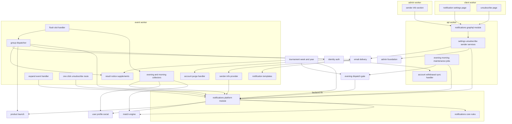
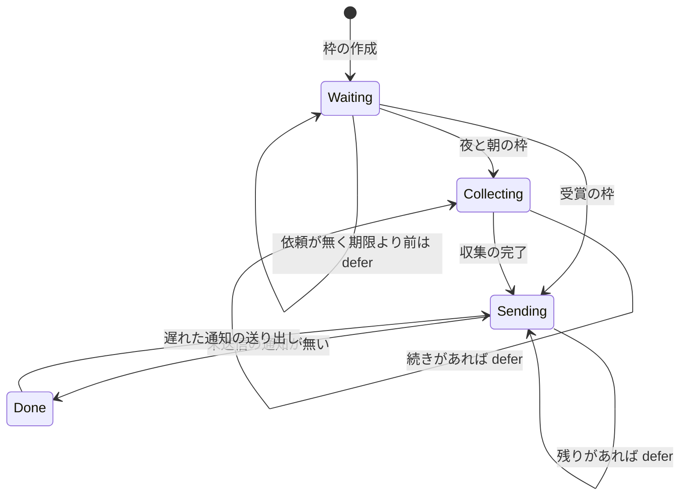
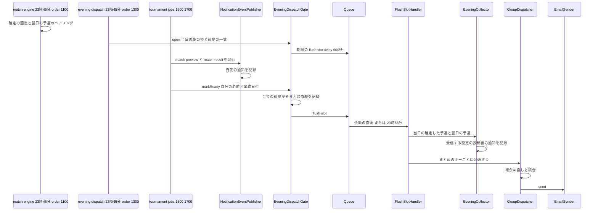
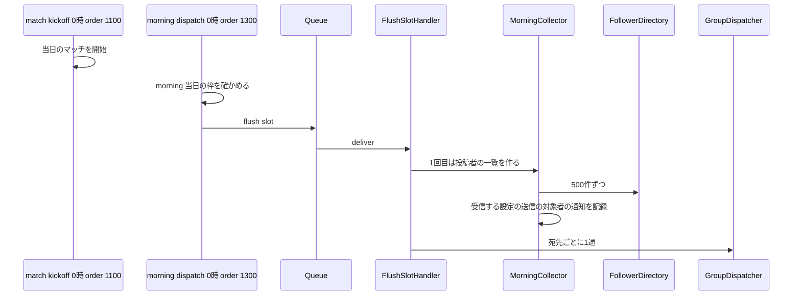
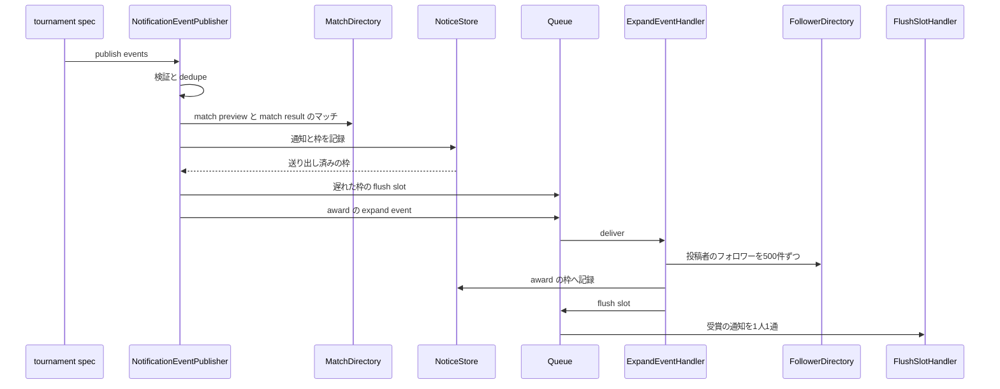
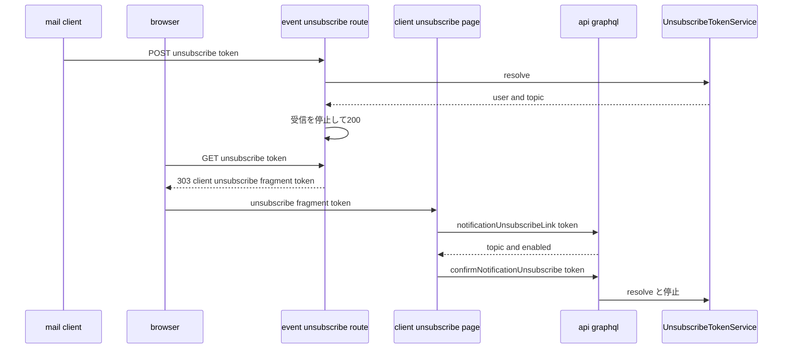
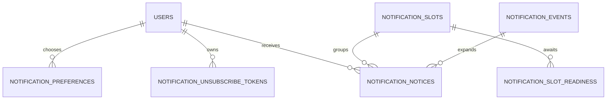

# Design Document

## Overview

**Purpose**: 4種類の通知メール(マッチ開始予告・勝敗結果・フォロー中ユーザーのマッチ開催・フォロー中ユーザーの受賞結果)を、利用者が種類ごとに選んだ受信設定(初期値はすべて受信しない)に従って送る。通知は宛先ごとの記録として、送る時刻の区切り(送信枠: 夜の23:45・朝の0:00・受賞の直後)とまとめのキーを持ち、枠ごとの送り出しで1通ずつにまとめる。これにより、勝敗結果と翌日予告の統合(FR-NOTIF-004)、開催通知の同日分の集約(FR-NOTIF-009)、Yearの1回戦の予告の前日までの保持(仮1)、遅れて届いた発行、重複の防止を同じ仕組みで扱う。夜の枠の送り出しは、トーナメントのspecの23:45の処理が本specの送り出しの入口(`EveningDispatchGate.markReady`)へ準備の完了を伝えた時点で始め、伝えない機能があれば23:55に始める(仮2)。送信はemail-deliveryの経路に乗せ、全ての通知メールに送信者情報・RFC 8058のヘッダー・本文の配信停止のリンクを付ける。トーナメントのspecのために通知イベントの契約(開始予告・結果・受賞)と結果の追記の登録口を定め、予選の開始予告と結果はmatch-engineのマッチの照会から本specが自ら作る。

**Users**: 利用者は`/settings/notifications`で受信設定を選び、抑止による除外の状態を確かめる。受信者はメールソフトのワンクリック、または本文のリンクから`/unsubscribe`の確認の操作で、ログインせずに配信を止める。最上位管理者は管理画面の設定ページ(`/settings`)で送信者情報を設定する。tournament-week・tournament-yearの開発者は`NotificationEventPublisher`で通知イベントを発行し、`RESULT_NOTICE_SUPPLEMENTS`で決済期限の追記を登録し、23:45の処理の最後に`EveningDispatchGate.markReady`で準備の完了を伝える(送り出しの前提の登録口`EVENING_DISPATCH_PARTICIPANTS`に自分の名前を登録する)。data-exportは`NotificationSettingsExport`で通知設定を出力する。

**Impact**: D1に7テーブル(受信設定・配信停止のトークンの種・送信者情報・通知イベント・送信枠・送信枠の準備の完了・通知)を足す。`apps/backend-lib`に通知の契約(`core/notifications`)・メール種別4つ・メッセージ種別2つと、共有部品(`workers/notifications`、apiとeventの両方に束縛)を新設する。apiにスキーマモジュール`notifications`・3つのジョブ(23:45・0:00・4:21)・夜の枠の送り出しの入口と前提の登録口・退会の同期の処理を、eventに送信枠の送り出し・受賞の展開・物理削除の処理・ワンクリックの配信停止の経路・4つのテンプレート・送信者情報の取得口の実装を、clientに通知設定ページと配信停止ページを、adminに送信者情報の区画を足す。eventに変数`EVENT_SITE_ORIGIN`を足す。新しいパッケージ・シークレット・Cronの式は無い。

### Goals

- FR-NOTIF-001・004・006〜010・012・016〜018・023とFR-ADMCF-024が動作し、予選・トーナメント・即時の終了・開始時点の決着・遅れた発行・送り出しの失敗のどの経路でも、要件と仮1〜仮7の決定に一致する。
- tournament-week・tournament-yearが本specのファイルを変えずに、通知イベントの発行と結果の追記の登録だけで通知を送れる。
- 本specが追加・変更したコードの単体テスト・Workers統合テスト・ブラウザテストがカバレッジ80%を満たす。

### Non-Goals

- 送信の流量制御・上限による待機・再試行・送信不能の検知・抑止リストの記録(email-delivery、FR-NOTIF-019〜022)。
- トランザクションメール、トーナメントのブラケット・ラウンドの進行・賞・決済期限の計算と、通知イベントの発行の実装(tournament-week・tournament-year)。
- 送信履歴の画面・再送の操作・通知の言語の切り替え・リアルタイムの通知。
- 要件定義書の改訂(roadmapのOut。必要な改訂は[research.md](research.md)の「要件定義書の改訂が必要な箇所」に記録した)。(2026-10-25に要件定義書へ適用済み)

## Boundary Commitments

### This Spec Owns

- 通知のデータ: `notification_preferences`・`notification_unsubscribe_tokens`・`notification_sender_settings`・`notification_events`・`notification_slots`・`notification_slot_readiness`・`notification_notices`(`apps/db/schema/notifications/`)。
- 通知の契約(`apps/backend-lib/core/notifications/`): 通知イベントの型と発行の口、送信枠と時刻、通知の計画(まとめ・統合・集約)、件名と文言、結果の追記の契約と登録の検証、配信停止のトークンの規則とURL、夜の枠の送り出しの入口の契約(`EveningDispatchGate`)、DIの識別子`NOTIFICATIONS_PLATFORM_TYPES`。メール種別4つ(`core/email/kinds/notifications.ts`)とメッセージ種別`notifications.flush-slot`・`notifications.expand-event`。
- 共有部品(`apps/backend-lib/workers/notifications/`): 受信設定・トークン・送信者情報の読み取り・送信枠・通知の記録・通知イベントの発行と展開・データエクスポートの部品と、両アプリ共通の束縛`NOTIFICATIONS_PLATFORM_MODULE`。
- apiの通知設定・配信停止・送信者情報のユースケース、スキーマモジュール`notifications`、ジョブ`notifications.evening-dispatch`・`notifications.morning-dispatch`・`notifications.maintenance`、夜の枠の送り出しの入口の束縛と送り出しの前提の登録口`EVENING_DISPATCH_PARTICIPANTS`(初版は空)、ユーザーライフサイクルの同期の処理`notifications.account-withdrawal`。
- eventの送信枠の送り出し(収集と送信)、受賞の展開、非同期の処理`notifications.account-purge`、ワンクリックの配信停止の経路(`POST`・`GET /unsubscribe`)、テンプレート4つ、送信者情報の取得口の実装`D1SenderInfoProvider`、結果の追記の登録口`RESULT_NOTICE_SUPPLEMENTS`(初版は空)。
- clientの`/settings/notifications`・`/unsubscribe`、adminの送信者情報の区画`notifications.sender-info`(30)、監査ログの操作種別`notification-sender.update`。
- 技術ドキュメント`backend/016-batched-notification-delivery.md`・`security/010-one-click-unsubscribe.md`の新規作成と、サービス仕様(文言規則・ページ配置・日次タイムライン・準拠方針)とオンボーディングの追記。

### Out of Boundary

- `email_suppressions`などメール送信基盤のデータ、送信の受付・Queueでの送信・描画・送信者情報の区画と配信停止のリンクの区画の配置(email-delivery)。本specは種別・テンプレート・取得口の実装を登録し、`EmailSender`と`SuppressionList`を呼ぶだけである。
- マッチ・Upvote・ペアリング・開始・確定(match-engine)、フォロー(user-profile-social)、プロダクト(product-launch)、利用者・メールアドレス・ニックネーム(identity-auth)、管理者・監査ログの保存(admin-foundation)。本specは照会口・記録の口だけを使い、それらのテーブルへ書き込まない。
- 管理画面の設定ページの枠とメニュー項目(ultras-subscription)、設定ページのシェル(identity-auth)。本specは区画とページの中身だけを持つ。
- 通知イベントを発行する判断と時点、結果の追記の中身(決済期限・Ultrasによる免除の表示)(tournament-week・tournament-year)。
- データエクスポートのZIP(data-export)、prodの送信者情報の設定と受信の確認(launch-readiness)。

### Allowed Dependencies

- backend-platform: `AppModule`・`PLATFORM_TYPES`(`Database`・`Clock`・`IdGenerator`・`KeyedHasher`・`MessagePublisher`)・`hashPurpose`・`AppError`・`getAppLogger`・`ulidPrimaryKey`・`timestamps`・`BusinessTime`(`fromBusinessDateTime`・`toBusinessDateTime`・`businessWeekOf`・`parseBusinessDate`・`BusinessDate`・`BusinessTimeOfDay`。前日・翌日の業務日付は固定オフセットのため24時間の加減で求める)・`ScheduledJobDefinition`・`ScheduledJobHandler`・`ScheduledJobContext`・`defineMessageContract`・`MESSAGE_CONTRACTS`・`MessageHandler`・`MessageHandlingResult`・`RetryPolicy`・`excludePath`。形を変えない。
- api-gateway: `defineSchemaModule`・`GraphQLContext`(`caller`・`session`)・`withValidatedArgs`・`DateTime`、`SessionView`。
- email-delivery: `EmailKind`・`defineEmailKind`・`EMAIL_KINDS`・`EmailSender`・`EmailSendError`・`SuppressionList`・`SuppressionState`・`SenderInfo`・`SenderInfoProvider`・`AlertThrottle`・`EMAIL_TYPES`・`isValidEmailAddress`・`formatUtcDateTime`・`formatUtcDate`・`EmailTemplate`・`defineEmailTemplate`・`EMAIL_TEMPLATES`・eventの`EMAIL_SENDER_INFO_PROVIDER`。
- match-engine: `MATCH_PLATFORM_TYPES`の`MatchDirectory`(`findMatches`・`listForDate`)・`MatchRecord`・`MatchKind`・`MatchStage`・`EntryResult`・`MatchDecision`・`MatchPhase`。
- identity-auth: `IDENTITY_PLATFORM_TYPES.UserContactDirectory`・`verifiedUsers()`・`users`(外部キーと`verifiedUsers()`の条件)・`AccountGuard`(`currentUser`・`requireWritableUser`)・`CurrentUser`・`UserLifecycleEvent`・`UserLifecycleSyncHandler`・`USER_LIFECYCLE_SYNC_HANDLERS`・`UserLifecycleAsyncHandler`・`USER_LIFECYCLE_ASYNC_HANDLERS`・`LifecycleHandlerOutcome`・`assertLifecycleHandlerName`・`LIFECYCLE_CONTINUE_DELAY_SECONDS`・`SETTINGS_NAV_ITEMS`・`_authenticated`のレイアウト・`readFragmentToken`・`viewerQueryOptions`・E2Eの`e2e/support/mailpit.ts`。
- user-profile-social: `PROFILE_PLATFORM_TYPES`の`FollowerDirectory`・`UserProfileDirectory`(`findSummaries`)。
- product-launch: `PRODUCT_PLATFORM_TYPES.ProductDirectory`(`findSummaries`)。
- admin-foundation: `requireAdmin`・`AuditLogRecorder`・`PreparedAuditEntry`・`buildAuditLogStatements`・`defineAuditAction`・`AUDIT_ACTIONS`・`AdminDirectory`・`RoleGate`・`useAdminRole`・`ConfirmActionDialog`・E2Eの`e2e/support/admin-bootstrap.ts`・`e2e/support/local-d1.ts`(`executeLocalD1`・`sqlStringLiteral`)。
- ultras-subscription: `AdminSettingsSection`・`ADMIN_SETTINGS_SECTIONS`。
- frontend-platform・content-processing: `executeGraphQL`・`graphqlQueryOptions`・`GraphQLClientError`・`useAppForm`・`applyServerFieldErrors`・`FormField`・`SubmitButton`・`notify`・`buildPageHead`・`ErrorState`・`LoadingSkeleton`・日時の表示部品・shadcn/uiの`switch`・`button`・`input`・`label`・`textarea`・`badge`・`runAxe`、`apps/common-lib`の書記素の文字数の数え方。
- npmパッケージ: 新規なし。
- 後続specは、`core/notifications`の公開の契約(`NotificationEvent`・`NotificationEventPublisher`・`ResultNoticeSupplement`・`ResultNoticeSupplementRegistration`・`NOTIFICATIONS_PLATFORM_TYPES`・`EveningDispatchGate`)、`workers/notifications`の`NOTIFICATIONS_PLATFORM_MODULE`、eventの`RESULT_NOTICE_SUPPLEMENTS`、apiの`EVENING_DISPATCH_PARTICIPANTS`、`NotificationSettingsExport`だけに依存し、本specのテーブルを読み書きしない。

### Revalidation Triggers

- `NotificationEvent`の種類と項目、`dedupe`の規則、`NotificationEventPublisher.publish`の拒否の理由(tournament-week・tournament-year)。
- 送信枠の時刻(23:45・0:00)、夜の枠の送り出しの入口`EveningDispatchGate.markReady`の形と呼ぶ時点・送り出しの前提の登録口`EVENING_DISPATCH_PARTICIPANTS`・23:55の期限(仮2、tournament-week・tournament-year)、開始予告を前日の枠に入れる規則(仮1)、統合の条件(tournament-week・tournament-year、日次タイムライン)。
- `ResultNoticeSupplement`・`ResultNoticeSupplementRegistration`の形と`order`の規約(tournament-week・tournament-year)。
- `NotificationSettingsExport`の形と項目(data-export、データエクスポートの文書の`notificationSettings`)。
- 通知種別の値(`match_preview`・`match_result`・`followed_user_match`・`followed_user_award`)とメール種別の名前と入力(data-export・文言規則)。
- 配信停止のURLの形(仮5)・`EVENT_SITE_ORIGIN`の名前と値(infra-deliveryの改訂1の表・launch-readiness)。
- 上流の`MatchDirectory`・`FollowerDirectory`・`ProductDirectory`・`UserProfileDirectory`・`UserContactDirectory`・`verifiedUsers()`・`SuppressionList`・`SenderInfoProvider`・`EmailTemplate`・`ALLOWED_EXTRA_HEADERS`・`AuditLogRecorder`・`ADMIN_SETTINGS_SECTIONS`・`SETTINGS_NAV_ITEMS`、match-engineの0:00・23:45のジョブの`order`、tournament-week・tournament-yearの23:45の組み合わせの時刻を変えたら、本specを確かめ直す。
- 仮1〜仮7(2026-10-24に開発者が確定)の規則(`previewSlotFor`・`EveningDispatchGate`と`EVENING_DISPATCH_DEADLINE_SECONDS`・送信者情報の未設定の扱い・統合したメールのヘッダー・URL・不戦勝の予告・非公開化の扱い)を変えるときは、tournament-week・tournament-yearとの契約を確かめ直す。

### 上流への影響

| 上流spec            | 変更                                                                                                                                                                                                                                                                                                                                     | 影響と再検証                                                                     |
| ------------------- | ---------------------------------------------------------------------------------------------------------------------------------------------------------------------------------------------------------------------------------------------------------------------------------------------------------------------------------------- | -------------------------------------------------------------------------------- |
| email-delivery      | `core/email/kinds/index.ts`に4種別、eventの`infrastructure/email/templates/index.ts`に4テンプレート、eventの`composition/email-registrations.ts`の`EMAIL_SENDER_INFO_PROVIDER`を`D1SenderInfoProvider`へ書き換え                                                                                                                         | 契約どおり。`createEmailKindRegistry`・`createEmailTemplateRegistry`の検査を通る |
| identity-auth       | apiの`composition/user-lifecycle-sync-handlers.ts`に`notifications.account-withdrawal`、eventの`composition/user-lifecycle-async-handlers.ts`に`notifications.account-purge`(1300)、clientの`composition/settings-navigation.ts`に`notifications`(40)                                                                                    | 契約どおり。`createAsyncLifecycleRegistry`の検証を通る                           |
| ultras-subscription | adminの`composition/admin-settings-sections.ts`に`notifications.sender-info`(30)                                                                                                                                                                                                                                                         | 予約どおり                                                                       |
| admin-foundation    | `apps/common-lib/admin/audit-actions/notifications.ts`と`index.ts`の連結                                                                                                                                                                                                                                                                 | 契約どおり。`createAuditActionCatalog`の検査を通る                               |
| backend-platform    | apiの`composition/scheduled-jobs.ts`に3つのジョブ、`core/messaging/contracts/index.ts`に2つのメッセージ種別、eventの`composition/message-handlers.ts`に2つの処理、eventの`composition/rate-limit-exclusions.ts`に`excludePath('/unsubscribe', 'POST')`、eventの`wrangler.jsonc`(3環境)と`composition/env-schema.ts`に`EVENT_SITE_ORIGIN` | 契約どおり。Cronの式は追加しない(0:00・23:45・4:21は登録済み)                    |
| api-gateway         | apiの`composition/graphql-modules.ts`に`notificationsSchemaModule`、client・adminの許可リストの再生成                                                                                                                                                                                                                                    | 契約どおり                                                                       |

- 上流specの文書の変更は無い。`EVENT_SITE_ORIGIN`の3環境の値の行は、infra-deliveryの改訂1が「ホスト名から導かれる変数の値」の表に加える(本specはその値をeventのWrangler設定に書く)。roadmapの帯の割り当ての表の本specの「使用中の値」は「4:21は1300、波及処理は1300」になる(本specはroadmapを編集しないため、コントローラーへ報告する)。

## Architecture

### Existing Architecture Analysis

- 上流の18specは設計・タスクとも承認済みで、本specのタスクはそれらの実装の完了を前提にする(roadmapの順でmatch-engineまでが先に実装される)。実装済みはdev-toolingだけである。
- apiとeventはクリーンアーキテクチャ(`domain`→`application`→`infrastructure`・`presentation`→`composition`)で、`application`は`lib/workers`・`db`を読み込めない(backend-platformの静的解析の規則)。上流の照会口(`MatchDirectory`など)は`lib/workers`にあるため、`application`は`core/notifications`のポートだけを参照し、上流の照会口を使う処理は`infrastructure`か`lib/workers`に置く。
- Cron Triggersはapiだけにあり、同じ時刻のジョブは`order`の昇順に直列に動く。0:00ではmatch-engineの開始(1100)、23:45ではmatch-engineのペアリング(1100)の後に本specの1300が動き、tournament-week(1500)・tournament-year(1700)の23:45の組み合わせはその後になる。そのため夜の枠の送り出しは、トーナメントの23:45のジョブが最後に呼ぶ本specの入口で始める(仮2)。
- email-deliveryは送信の受付で種別・入力・宛先・追加ヘッダーを検証し、eventのconsumerで抑止(通知メールの分類)・描画(送信者情報の取得口を含む)・送信を行う。

### Architecture Pattern & Boundary Map



**Architecture Integration**:

- Selected pattern: クリーンアーキテクチャと、送信枠ごとの通知の記録(送信箱)。送る時刻・まとめ・統合・メールの組み立ては`core/notifications`の純粋な関数、記録と照会は`workers/notifications`、送信枠の送り出しの段の進行はeventの`application`、上流の照会を使う収集と送信は`infrastructure`に置く。
- Domain/feature boundaries: 受信設定・トークン・送信者情報・通知の記録と送り出しは本spec、送信と抑止はemail-delivery、マッチはmatch-engine、フォローはuser-profile-social、通知を発行する判断と決済期限はトーナメントのspec。
- Existing patterns preserved: `backend-lib/workers/<ドメイン>`の共有の束縛、`<spec名>.<名詞句>`の処理とジョブの名前、`<ドメイン>.<動詞句>`のメッセージ種別、帯の`order`、登録箇所への追記による拡張(`ADMIN_SETTINGS_SECTIONS`・`SETTINGS_NAV_ITEMS`・`EMAIL_KINDS`・`EMAIL_TEMPLATES`と同じ形)、版による競合の検出と監査ログを同じ一括の書き込みに入れる形(ultras-subscriptionの機能フラグ)、`defer`による処理の継続(match-engine・identity-authの`continue`と同じ考え方)、`KeyedHasher`(NFR-SECUR-006)、フラグメントによるトークンの受け渡し(identity-auth)。
- New components rationale: 送信枠の記録は統合と集約と時刻の規則を満たすため(research.mdの比較)。夜の枠の送り出しの入口と前提の登録口は、帯の値の後に動くトーナメントの組み合わせの後で、遅延に頼らずに送り出すため(仮2)。トークンの種は組ごとに1つのトークンを再現するため。結果の追記の登録口は決済期限の判断をトーナメントに残すため。`EVENT_SITE_ORIGIN`はQueueの処理がヘッダーのURIを作るため。
- Steering compliance: Inversifyの`@inject`の明示、D1の制約(`db.batch()`・バインド変数100個以内・`onConflictDoNothing()`)、800行以内のファイル、1ファイル1コンポーネント、日時の`<time datetime>`、新しいパッケージなし。

**Dependency direction**: `apps/common-lib/notifications` → `apps/db/schema/notifications` → `backend-lib/core/notifications` → `backend-lib/workers/notifications` → 各アプリの`src`(`domain` → `application` → `infrastructure`・`presentation` → `composition`)。`common-lib`は他の層を読み込まない。`core/notifications`はD1・`lib/workers`を読み込まない(`BusinessTime`・`core/email`・`core/match`相当の型だけ)。apiとeventの`application/notifications`は`core/notifications`と`core/email`のポートだけを読み込み、`lib/workers`の照会口を使う処理は`infrastructure/notifications`に置く。client・adminは`common-lib`とGraphQLの操作だけを読み込む。違反はレビューと静的解析で誤りとして扱う。

### Technology Stack

| Layer     | Choice / Version                                                          | Role in Feature                                                                     | Notes                                                     |
| --------- | ------------------------------------------------------------------------- | ----------------------------------------------------------------------------------- | --------------------------------------------------------- |
| Frontend  | TanStack Start・Router・Query・shadcn/ui(`switch`)・react-hook-form(上流) | 通知設定ページ・配信停止ページ・送信者情報の区画                                    | 新規パッケージなし                                        |
| Backend   | Hono・Inversify・GraphQL Yoga(上流)                                       | スキーマモジュール・ユースケース・ワンクリックの経路                                | 既存                                                      |
| Email     | @react-email/components・@react-email/render(email-delivery)              | 4つのテンプレート                                                                   | eventの`infrastructure/email/templates/notifications`だけ |
| Data      | Cloudflare D1(Drizzle)                                                    | 7テーブル                                                                           | 新規のマイグレーション                                    |
| Messaging | Cloudflare Queues・Cron Triggers(上流)                                    | `notifications.flush-slot`・`notifications.expand-event`、0:00・23:45・4:21のジョブ | 新しいメッセージ種別2つ、Cronの式の追加なし               |
| Security  | Web Crypto(`KeyedHasher`のHMAC-SHA512、`crypto.getRandomValues`)          | 配信停止のトークンの導出と照合                                                      | 新しいシークレットなし(`HASH_PEPPER`)                     |

## File Structure Plan

### Directory Structure

```
apps/
├── common-lib/notifications/                                   # 4アプリ共通(各ファイルに*.unit.test.ts)
│   ├── notification-topics.ts                                  # NOTIFICATION_TOPICS・名称と説明
│   └── sender-info-rules.ts                                    # 送信者情報の上限(200書記素)と必須の判定
├── common-lib/admin/audit-actions/notifications.ts             # notification-sender.update
├── db/schema/notifications/                                    # テーブル定義(各ファイルに同名の*.unit.test.ts)
│   ├── notification-preferences.ts
│   ├── notification-unsubscribe-tokens.ts                      # 種と照合用のハッシュ
│   ├── notification-sender-settings.ts                         # 1行の設定と版
│   ├── notification-events.ts                                  # 発行された通知イベントと展開の状態
│   ├── notification-slots.ts                                   # 送信枠と送り出しの段・カーソル・リース・前提と依頼の時刻
│   ├── notification-slot-readiness.ts                          # 送信枠ごとの前提の機能の準備の完了
│   ├── notification-notices.ts                                 # 宛先ごとの通知とまとめのキー
│   └── index.ts
├── backend-lib/
│   ├── core/notifications/                                     # 純粋な契約(Bunの単体テスト)
│   │   ├── identifiers.ts                                      # NOTIFICATIONS_PLATFORM_TYPES(テストなし)
│   │   ├── ports.ts                                            # 共有部品のポートの型(テストなし)
│   │   ├── notification-event-contract.ts                      # NotificationEvent・検証・dedupe・NotificationEventPublisher
│   │   ├── notification-slots.ts                               # 送信枠のキーと時刻・previewSlotFor・resultSlotFor
│   │   ├── evening-dispatch.ts                                 # EveningDispatchGate(公開の契約)・EveningSlotOpener・前提の名前の検証・期限
│   │   ├── notice-plan.ts                                      # NoticeDraft・matchNoticeDrafts・groupKey・planGroupEmail
│   │   ├── notice-copy.ts                                      # 件名・マッチの表記・結果の文・賞の期間の表記
│   │   ├── notice-email.ts                                     # buildNoticeEmail(計画と照会の結果からメール種別の入力とヘッダー)
│   │   ├── result-notice-supplements.ts                        # 追記の型・検証・createResultNoticeSupplementRegistry
│   │   └── unsubscribe-token.ts                                # 用途・導出の入力・形式・URL・ヘッダー
│   ├── core/email/kinds/notifications.ts                       # 4つのメール種別と入力の検証
│   ├── core/messaging/contracts/notifications.ts               # FLUSH_NOTIFICATION_SLOT_MESSAGE・EXPAND_NOTIFICATION_EVENT_MESSAGE・NOTIFICATION_RETRY_POLICY
│   └── workers/notifications/                                  # api・event共通(apiのWorkers統合テスト)
│       ├── d1-notification-preference-store.ts                 # 受信設定と送信の対象者の絞り込み
│       ├── d1-unsubscribe-token-service.ts                     # 種の作成・トークンの導出・照合
│       ├── d1-sender-info-store.ts                             # 送信者情報の読み取り
│       ├── d1-notification-slot-store.ts                       # 枠の作成・リース・段の進行・期限切れの検索
│       ├── d1-evening-dispatch-gate.ts                         # 準備の完了の記録と送り出しの依頼(apiだけで束縛)
│       ├── d1-notification-notice-store.ts                     # 通知の記録(遅れた枠の検出)・まとめの読み取り・確定・削除
│       ├── notification-event-expander.ts                      # 開始予告・結果・受賞の展開
│       ├── notification-event-publisher.ts                     # 発行の検証・記録・展開・展開の依頼
│       ├── d1-notification-settings-export.ts                  # NotificationSettingsExport
│       ├── message-work-requester.ts                           # NotificationWorkRequester(送り出しと展開のメッセージの送信)
│       ├── sentry-notification-incident-reporter.ts            # NotificationIncidentReporter(遅れ・未設定・拒否の通知、api・event共通)
│       └── notifications-platform-module.ts                    # NOTIFICATIONS_PLATFORM_MODULE
├── api/src/
│   ├── application/notifications/                              # Bunの単体テスト
│   │   ├── notifications-types.ts                              # NOTIFICATIONS_TYPES
│   │   ├── ports.ts                                            # DeliveryStatusReader・SenderInfoWriter・NotificationMaintenanceStore
│   │   ├── notification-settings-service.ts                    # 閲覧者の設定の照会と変更
│   │   ├── unsubscribe-service.ts                              # トークンの照会と停止の確定
│   │   ├── sender-info-service.ts                              # 送信者情報の照会と保存(認可・検証・監査)
│   │   └── notification-jobs.ts                                # 23:45・0:00・4:21のジョブ
│   ├── infrastructure/notifications/                           # Workers統合テスト
│   │   ├── delivery-status-reader.ts                           # UserContactDirectoryとSuppressionList
│   │   ├── d1-sender-info-writer.ts                            # 版の条件付きの保存と監査ログの文
│   │   ├── d1-notification-maintenance-store.ts                # 期限切れ・古い記録の削除
│   │   └── account-withdrawal-sync-handler.ts                  # notifications.account-withdrawal
│   ├── presentation/graphql/modules/notifications/             # Workers統合テスト
│   │   ├── type-defs.ts
│   │   ├── inputs.ts
│   │   ├── errors.ts
│   │   ├── settings-resolvers.ts                               # viewerNotificationSettings・updateNotificationPreference
│   │   ├── unsubscribe-resolvers.ts                            # notificationUnsubscribeLink・confirmNotificationUnsubscribe
│   │   ├── sender-info-resolvers.ts                            # notificationSenderInfo・updateNotificationSenderInfo
│   │   └── index.ts                                            # notificationsSchemaModule
│   └── composition/
│       ├── notifications-module.ts                             # NOTIFICATIONS_MODULE(apiの束縛、EveningDispatchGateを含む)
│       └── evening-dispatch-participants.ts                    # EVENING_DISPATCH_PARTICIPANTS(初版は空。tournament-week・tournament-yearが追記)
├── event/src/
│   ├── application/notifications/                              # Bunの単体テスト
│   │   ├── event-notifications-types.ts                        # EVENT_NOTIFICATIONS_TYPES
│   │   ├── ports.ts                                            # SlotCollector・GroupDispatcher・SupplementSource
│   │   ├── flush-slot-handler.ts                               # notifications.flush-slot
│   │   ├── expand-event-handler.ts                             # notifications.expand-event
│   │   ├── one-click-unsubscribe.ts                            # トークンによる停止のユースケース
│   │   └── account-purge-handler.ts                            # purge_due 1300
│   ├── infrastructure/notifications/                           # Workers統合テスト
│   │   ├── evening-collector.ts                                # 当日の結果と翌日の予告(予選)
│   │   ├── morning-collector.ts                                # マッチ中の投稿者のフォロワー
│   │   ├── group-dispatcher.ts                                 # まとめの照会・確かめ直し・送信の依頼・確定
│   │   ├── registered-supplement-source.ts                     # RESULT_NOTICE_SUPPLEMENTSの呼び出し
│   │   └── d1-sender-info-provider.ts                          # email-deliveryのSenderInfoProviderの実装
│   ├── infrastructure/email/templates/notifications/           # Workers統合テスト(*.worker.test.tsx)
│   │   ├── match-preview-template.ts · match-preview-email-body.tsx
│   │   ├── match-result-template.ts · match-result-email-body.tsx
│   │   ├── followed-user-matches-template.ts · followed-user-matches-email-body.tsx
│   │   ├── followed-user-award-template.ts · followed-user-award-email-body.tsx
│   │   ├── result-supplement-block.tsx                         # 結果の追記の段落
│   │   └── notice-footer-links.tsx                             # 通知設定と追加の配信停止のリンク
│   ├── presentation/notifications/one-click-unsubscribe-route.ts   # POST・GET /unsubscribe
│   └── composition/
│       ├── notifications-module.ts
│       └── result-notice-supplements.ts                        # RESULT_NOTICE_SUPPLEMENTS(初版は空)
├── client/src/
│   ├── routes/_authenticated/settings/notifications.tsx        # /settings/notifications
│   ├── routes/unsubscribe.tsx                                  # /unsubscribe(フラグメントのトークン)
│   ├── components/notifications/                               # 1ファイル1コンポーネント(browser testを併置)
│   │   ├── notification-settings-panel.tsx
│   │   ├── notification-topic-switch.tsx
│   │   ├── delivery-status-notice.tsx                          # 抑止・未確認・停止中の案内
│   │   ├── unsubscribe-confirmation.tsx
│   │   └── notification-copy.ts                                # 画面の文言(*.unit.test.ts)
│   └── graphql/operations/notifications/
│       ├── notification-settings.ts
│       └── unsubscribe.ts
└── admin/src/
    ├── components/notifications/
    │   ├── sender-info-section.tsx                             # AdminSettingsSectionの部品
    │   └── sender-info-form.tsx
    └── graphql/operations/notifications/sender-info.ts
e2e/
├── client/notifications.e2e.test.ts                            # 通知設定・リンクとワンクリックの配信停止
├── admin/notification-sender.e2e.test.ts                       # 送信者情報の保存と監査ログ
└── support/notification-fixtures.ts                            # 受信設定とトークンの種をローカルD1に作り、トークンを導出する補助
docs/GUIDES/tech/
├── backend/016-batched-notification-delivery.md
└── security/010-one-click-unsubscribe.md
```

テストは各ファイルの隣に置く(`*.unit.test.ts`・`*.worker.test.ts`・`*.worker.test.tsx`・`*.browser.test.tsx`)。技術ドキュメントの番号は、`backend/014`・`security/008`までを先行のspecが使い、`backend/015`をengagementが、`security/009`をlaunch-readinessが取るため、その次の`backend/016`・`security/010`に固定する。

### Modified Files

- `apps/db/schema/index.ts`・`apps/db/migrations/<日時>_notifications/migration.sql` — 7テーブルの再エクスポートと、生成したマイグレーション(CHECK・一意索引)。mainの最新を取り込んでから生成する。
- `apps/common-lib/admin/audit-actions/index.ts` — 本specの操作種別の連結。
- `apps/backend-lib/core/email/kinds/index.ts` — 4種別を`EMAIL_KINDS`へ加える。
- `apps/backend-lib/core/messaging/contracts/index.ts` — 2つのメッセージ種別を`MESSAGE_CONTRACTS`へ加える。
- `apps/api/src/composition/modules.ts`・`graphql-modules.ts`・`scheduled-jobs.ts`・`user-lifecycle-sync-handlers.ts` — `NOTIFICATIONS_PLATFORM_MODULE`・`NOTIFICATIONS_MODULE`・`notificationsSchemaModule`・3つのジョブ・同期の処理。
- `apps/event/src/composition/modules.ts`・`message-handlers.ts`・`user-lifecycle-async-handlers.ts`・`email-registrations.ts`・`rate-limit-exclusions.ts`・`env-schema.ts` — 共有の束縛とeventの束縛と経路、2つのメッセージの処理、`notifications.account-purge`、`EMAIL_SENDER_INFO_PROVIDER`の差し替え、`excludePath('/unsubscribe', 'POST')`、`EVENT_SITE_ORIGIN`の検証。
- `apps/event/src/infrastructure/email/templates/index.ts` — 4テンプレートを`EMAIL_TEMPLATES`へ加える。
- `apps/event/wrangler.jsonc`・`worker-configuration.d.ts`・`vitest.worker.config.ts` — 3環境の`vars`の`EVENT_SITE_ORIGIN`と、テスト用の値(`https://event.test.example`)。
- `apps/client/src/composition/settings-navigation.ts` — `{ to: '/settings/notifications', label: '通知', order: 40 }`。
- `apps/admin/src/composition/admin-settings-sections.ts` — `{ id: 'notifications.sender-info', order: 30, component: SenderInfoSection }`。
- `docs/GUIDES/tech/backend/README.md`・`security/README.md` — 文書一覧の行。
- `docs/onboardings/project-values.md` — ジョブ・処理・メッセージ種別の名前と`order`、ハッシュの用途、監査ログの操作種別、変数`EVENT_SITE_ORIGIN`の3環境の値。
- `docs/GUIDES/service/design/003-text-and-copy-rules.md` — 通知メールの件名(敗北・両者敗北・不戦勝・統合の不戦勝)と本文の文、画面とエラーの文言。
- `docs/GUIDES/service/design/002-page-layouts.md` — `/unsubscribe#token={token}`への変更(仮5)、通知設定ページと配信停止ページの配置、管理画面の送信者情報の区画。
- `docs/GUIDES/service/overview/007-daily-timeline.md` — 23:45(1300、送り出しはトーナメントの組み合わせの準備の完了の後、遅くとも23:55)・0:00(1300)・4:21の表(1300)、トーナメントの開始予告の時刻(仮1)。
- `docs/GUIDES/service/legal/001-compliance-policy.md` — 通知メールのオプトアウト(配信停止の手段・トークン・送信者情報の未設定)、データ保持期間(受信設定・トークン・通知の記録)。
- `CLAUDE.md` — 「技術規則の参照先」に「通知メールを送る処理を書く前に: `backend/016`」。

## System Flows

### 送信枠の状態



- 送信枠: `evening:<日付>`(期日=その日の23:45、`settle_until`=送り出しの期限の23:55、送り出しの前提の一覧は、その夜の`open`か最初の`markReady`が未確定(NULL)のときだけ写す)、`morning:<日付>`(期日=その日の0:00、`settle_until`=期日)、`award:<イベントID>`(期日=`settle_until`=展開の完了)。枠の行は最初に通知を記録した時点か、ジョブ・入口が開いた時点で作る(どちらも`onConflictDoNothing()`)。待機の段は、送り出しの依頼(`dispatch_requested_at`)があるか`settle_until`を過ぎたら次の段へ進む。朝・受賞の枠は作成の時点で依頼済みとする。
- 1回の`notifications.flush-slot`の処理は、枠のリース(120秒)を取ってから1つの段を進め、続きがあれば`defer`(1秒)で同じメッセージを再び受け取る。リースを取れなければ30秒の`defer`。`Done`の枠に`pending`の通知があれば送信の段を行う(12.8)。

### 夜の送信枠(23:45)



- 収集(4.1・3.1): `MatchDirectory.listForDate({ date: D, kinds: ['qualifier'] })`のうち`decision`が決まったマッチの各側の投稿者で、`match_result`を受信する設定の送信の対象者に結果の通知を、`listForDate({ date: D+1, kinds: ['qualifier'] })`のうち`phase`が`scheduled`で側が2つのマッチの投稿者で、`match_preview`を受信する設定の送信の対象者に予告の通知を記録する(3.5・仮6)。トーナメントの通知は発行の時点で記録済みである(3.2・4.2)。
- 送信(4.4・4.5): 夜の枠のまとめのキーは`<枠>:<宛先>:<プロダクト>`で、同じキーの結果と予告は統合したメール、片方だけならその種別のメールになる。受信しない設定に変わった種別の通知は`topic_disabled`で送らない(7.2)。
- 23:45の判定はジョブの予定時刻の業務日付(23:44:59の起動は前日のジョブではない。ジョブは23:45にだけ登録される)。送り出しは、前提の全ての機能が準備の完了を伝えた時点で依頼され、依頼が無ければ`settle_until`(23:54:59は`defer`、23:55:00から収集)で始まる(13.1・13.8・15.2)。
- 送り出しの前提の扱い(仮2、research.mdの「夜の枠の送り出しの入口」):
  - 前提の機能が登録されていない(トーナメントのspecの実装より前): 本specの23:45のジョブが枠を開いた時点で依頼する(13.9)。
  - トーナメントの組み合わせが無い日(予選だけの日): トーナメントの23:45のジョブは毎日動き、組み合わせや進行の処理が無い日も最後に`markReady`を呼ぶ契約のため、予選だけの日も両方の呼び出しの直後に送り出す。
  - 一方のトーナメントだけが組み合わせを行う日: 他方も処理なしで呼ぶため、両方そろった時点で送り出す。一方のジョブが失敗して呼ばなければ23:55の期限で送り出し、呼ばなかった機能の名前を`evening-dispatch-incomplete`として報告する(13.8)。
  - 両方が同じ夜に呼ぶ: 準備の完了は`(slot_key, participant)`の一意索引で1回だけ記録し、依頼は`dispatch_requested_at IS NULL`かつ全ての前提がそろった条件付きの更新で1回だけ記録する。依頼を記録した呼び出しだけが送り出しのメッセージを送る(13.7)。
  - 遅れた非同期の処理: トーナメントは`markReady`の前に、その日に確定したマッチに基づく自分の処理(ラウンドの進行・通知イベントの発行)を同期で済ませる(確定のマッチイベントの処理が終わっていなければジョブの中で追いつく)。それでも送り出しの後に届いた発行は、統合せずに遅らせずに送る(12.8)。予選の結果と予告は本specが同期の状態から集めるため、非同期の処理を待たない。

### 朝の送信枠(0:00)



- 収集(5.1・5.5・7.8): 1回目の段で`listForDate({ date: D, kinds: ['qualifier', 'week', 'year'] })`のうち`phase`が`live`のマッチの側(投稿者とプロダクトが残るもの)を集め、`ProductDirectory.findSummaries(ids, 'visible')`で表示できるプロダクトに絞り、投稿者のIDの昇順の一覧(投稿者ごとの`matchId`・`productId`)を枠のカーソルへ保存する。以後の段は投稿者ごとに`FollowerDirectory.listVisibleFollowerIds`を500件ずつ読み、`followed_user_match`を受信する設定の送信の対象者に、投稿者の全ての対象の通知を記録する。1回の段は2,000件のフォロワーで区切る。
- 送信(5.2・5.3・5.6): 朝の枠のまとめのキーは`<枠>:<宛先>`で、30件までを1通にまとめ、残りの件数を添える。
- 0:00の判定は予定時刻の業務日付で決まり、23:59:59の業務時刻は前日になる(15.2)。

### 通知イベントの発行と受賞の展開



- `match_preview`は`previewSlotFor(matchDate)`(前日の夜の枠、3.2・3.3・仮1)、`match_result`は`resultSlotFor(matchDate)`(当日の夜の枠、4.2・4.7)へ記録する。`award`は`award:<イベントID>`の枠で、展開の完了の直後に送り出す(6.3)。
- 記録した枠が`sending`・`done`なら、その場で`notifications.flush-slot`を送り、統合せずに送る(12.8)。

### 配信停止



- ワンクリック(8.2〜8.5・8.7): `POST /unsubscribe?token=<トークン>`は本文を問わず(RFC 8058の`List-Unsubscribe=One-Click`を想定)、形式違反は400、照合できなければ404、照合できれば受信を停止して200(既に停止済みでも200)。IP単位の制限の対象外(`excludePath('/unsubscribe', 'POST')`)。
- リンク(9.2〜9.5・9.7): clientの`/unsubscribe`は`readFragmentToken`で`#token=`を読んでURLから消し、GraphQLの変数(要求の本文)で送る。開いただけでは照会だけを行い、確認のボタンで停止する。

## Requirements Traceability

| Requirement                       | Summary                            | Components                                                                                                 | Interfaces                                                                           | Flows                          |
| --------------------------------- | ---------------------------------- | ---------------------------------------------------------------------------------------------------------- | ------------------------------------------------------------------------------------ | ------------------------------ |
| 1.1                               | 4つの通知種別                      | NotificationTopics、NotificationSchema                                                                     | `NOTIFICATION_TOPICS`                                                                | —                              |
| 1.2                               | 初期値はすべて受信しない           | NotificationSchema、D1NotificationPreferenceStore                                                          | 行が無い種別は`false`                                                                | —                              |
| 1.3, 1.4, 1.5                     | 設定ページの表示と変更             | NotificationSettingsRoute、NotificationSettingsPanel、NotificationTopicSwitch、NotificationSettingsService | `viewerNotificationSettings`・`updateNotificationPreference`                         | —                              |
| 1.6                               | 停止中の拒否                       | NotificationSettingsService、DeliveryStatusNotice                                                          | `requireWritableUser`・`editable`                                                    | —                              |
| 1.7                               | 未確認の案内                       | NotificationSettingsService、DeliveryStatusNotice                                                          | `emailVerified`                                                                      | —                              |
| 1.8, 1.9                          | ログインの誘導とナビゲーション     | NotificationSettingsRoute、SettingsNavigation(上流)                                                        | `_authenticated`・`SETTINGS_NAV_ITEMS`                                               | —                              |
| 2.1, 2.2, 2.3, 2.4                | 抑止による除外の表示               | DeliveryStatusReader、NotificationSettingsService、DeliveryStatusNotice                                    | `SuppressionList.getStatus`・`DeliverySuppression`                                   | —                              |
| 3.1                               | 予選の開始予告                     | EveningCollector、NoticePlan、GroupDispatcher                                                              | `listForDate`・`matchNoticeDrafts`                                                   | 夜の送信枠                     |
| 3.2, 3.3                          | トーナメントの予告と前日までの保持 | NotificationEventPublisher、NotificationEventExpander、NotificationSlots                                   | `previewSlotFor`                                                                     | 通知イベントの発行と受賞の展開 |
| 3.4                               | 開始予告の件名と本文               | NoticeCopy、NoticeEmail、NotificationTemplates                                                             | `notifications.match-preview`                                                        | —                              |
| 3.5, 3.6                          | 不戦勝と開始済みの除外             | NoticePlan、NoticeEmail                                                                                    | `matchNoticeDrafts`・`buildNoticeEmail`の`stale`                                     | 夜の送信枠                     |
| 4.1, 4.2, 4.7                     | 勝敗結果の送り出し                 | EveningCollector、NotificationEventPublisher、NotificationSlots、GroupDispatcher                           | `resultSlotFor`                                                                      | 夜の送信枠                     |
| 4.3                               | 結果とスコアの文                   | NoticeCopy、NotificationTemplates                                                                          | `matchResultSubject`・`resultOutcomeOf`                                              | —                              |
| 4.4, 4.5                          | 統合と受信設定                     | NoticePlan、NoticeEmail                                                                                    | `planGroupEmail`                                                                     | 夜の送信枠                     |
| 4.6                               | 結果の追記                         | ResultNoticeSupplementContract、RegisteredSupplementSource、NotificationTemplates                          | `RESULT_NOTICE_SUPPLEMENTS`                                                          | —                              |
| 5.1, 5.5                          | 開催通知の対象                     | MorningCollector、NotificationJobs                                                                         | `listForDate`・`FollowerDirectory`                                                   | 朝の送信枠                     |
| 5.2, 5.3, 5.6                     | 集約と件名と上限                   | NoticePlan、NoticeCopy、NotificationTemplates                                                              | `planGroupEmail`・`DIGEST_ITEM_LIMIT`                                                | 朝の送信枠                     |
| 5.4                               | 開催通知の本文                     | NoticeEmail、NotificationTemplates                                                                         | `notifications.followed-user-matches`                                                | —                              |
| 6.1, 6.3                          | 受賞の展開と即時の送り出し         | NotificationEventPublisher、ExpandEventHandler、NotificationEventExpander                                  | `award`・`notifications.expand-event`                                                | 通知イベントの発行と受賞の展開 |
| 6.2                               | 受賞の件名と本文                   | NoticeCopy、NotificationTemplates                                                                          | `awardSubject`・`awardPeriodLabel`                                                   | —                              |
| 7.1, 7.2                          | 送信の対象者と確かめ直し           | D1NotificationPreferenceStore、GroupDispatcher、NoticePlan                                                 | `eligibleRecipients`・`enabledTopicsOf`                                              | 夜の送信枠                     |
| 7.3, 7.4                          | 送信基盤と抑止                     | GroupDispatcher                                                                                            | `EmailSender.send`・`SuppressionList.findSuppressed`                                 | 夜の送信枠                     |
| 7.5, 7.6                          | 送信者情報の表示と未設定           | D1SenderInfoProvider、GroupDispatcher、SentryNotificationIncidentReporter                                  | `SenderInfoProvider`・`sender_info_missing`                                          | —                              |
| 7.7, 7.8, 7.9                     | 表示できないプロダクト             | NoticeEmail、MorningCollector、GroupDispatcher                                                             | `own_product_unavailable`・「非公開のプロダクト」                                    | —                              |
| 7.10, 7.11                        | 本文構成とリンク                   | NotificationTemplates、NoticeEmail                                                                         | `EmailTemplate`                                                                      | —                              |
| 7.12                              | 重複の防止                         | NotificationSchema、D1NotificationNoticeStore、D1NotificationSlotStore                                     | `dedupe_key`・リース                                                                 | 送信枠の状態                   |
| 8.1, 8.6                          | ヘッダー                           | UnsubscribeTokenRules、NoticeEmail                                                                         | `listUnsubscribeHeaders`                                                             | —                              |
| 8.2, 8.3, 8.4, 8.5, 8.7           | ワンクリックの受け口               | OneClickUnsubscribeRoute、OneClickUnsubscribe、D1UnsubscribeTokenService                                   | `POST`・`GET /unsubscribe`・`excludePath`                                            | 配信停止                       |
| 9.1                               | 本文のリンク                       | NotificationTemplates、NoticeFooterLinks、NoticeEmail                                                      | `unsubscribePageUrl`                                                                 | —                              |
| 9.2, 9.3, 9.4, 9.5, 9.6, 9.7, 9.8 | 配信停止ページ                     | UnsubscribeRoute、UnsubscribeConfirmation、UnsubscribeService                                              | `notificationUnsubscribeLink`・`confirmNotificationUnsubscribe`・`readFragmentToken` | 配信停止                       |
| 10.1, 10.2, 10.3, 10.4            | トークンの発行と照合               | D1UnsubscribeTokenService、UnsubscribeTokenRules、NotificationSchema                                       | `tokensFor`・`resolve`                                                               | 配信停止                       |
| 10.5                              | 退会での無効化                     | AccountWithdrawalSyncHandler                                                                               | `USER_LIFECYCLE_SYNC_HANDLERS`                                                       | —                              |
| 10.6                              | トークンでできること               | UnsubscribeService、OneClickUnsubscribe                                                                    | `resolve`                                                                            | 配信停止                       |
| 11.1, 11.2, 11.3                  | 送信者情報の区画                   | SenderInfoSection、SenderInfoForm、SenderInfoService                                                       | `ADMIN_SETTINGS_SECTIONS`・`notificationSenderInfo`                                  | —                              |
| 11.4, 11.5, 11.6, 11.7            | 保存・検証・認可・監査・競合       | SenderInfoService、D1SenderInfoWriter、SenderInfoRules、NotificationAuditActions                           | `updateNotificationSenderInfo`・`notification-sender.update`                         | —                              |
| 11.8                              | 以後のメールへの反映               | D1SenderInfoProvider、D1SenderInfoStore                                                                    | `SenderInfoProvider.get`                                                             | —                              |
| 12.1, 12.2, 12.3, 12.4, 12.5      | 通知イベントの契約                 | NotificationEventContract、NotificationEventPublisher、NotificationsPlatformModule                         | `NotificationEventPublisher.publish`                                                 | 通知イベントの発行と受賞の展開 |
| 12.6                              | 予選は照会から作る                 | EveningCollector                                                                                           | `listForDate`                                                                        | 夜の送信枠                     |
| 12.7                              | 結果の追記の登録口                 | ResultNoticeSupplementContract、ResultNoticeSupplements、RegisteredSupplementSource                        | `createResultNoticeSupplementRegistry`                                               | —                              |
| 12.8                              | 遅れた発行                         | D1NotificationNoticeStore、NotificationEventPublisher、FlushSlotHandler                                    | `lateSlotKeys`                                                                       | 送信枠の状態                   |
| 13.1, 13.2                        | 送り出しの時刻                     | NotificationJobs、NotificationSlots、FlushSlotHandler、D1EveningDispatchGate                               | `EveningSlotOpener.open`・`EveningDispatchGate.markReady`                            | 夜の送信枠・朝の送信枠         |
| 13.7, 13.9                        | 送り出しの入口と前提の登録口       | EveningDispatchContract、D1EveningDispatchGate、EveningDispatchParticipants                                | `EveningDispatchGate.markReady`・`EVENING_DISPATCH_PARTICIPANTS`                     | 夜の送信枠                     |
| 13.8                              | 期限の送り出しと検知               | NotificationSlots、FlushSlotHandler、SentryNotificationIncidentReporter                                    | `EVENING_DISPATCH_DEADLINE_SECONDS`・`evening-dispatch-incomplete`                   | 夜の送信枠                     |
| 13.3                              | 失敗からの再開                     | FlushSlotHandler、D1NotificationSlotStore                                                                  | `NOTIFICATION_RETRY_POLICY`・カーソル                                                | 送信枠の状態                   |
| 13.4, 13.5                        | 日次の回復と削除                   | NotificationJobs、D1NotificationMaintenanceStore                                                           | `notifications.maintenance`                                                          | —                              |
| 13.6                              | 帯の値                             | NotificationJobs、AccountPurgeHandler                                                                      | `order` 1300                                                                         | —                              |
| 14.1                              | 退会の扱い                         | AccountWithdrawalSyncHandler                                                                               | `USER_LIFECYCLE_SYNC_HANDLERS`                                                       | —                              |
| 14.2                              | 物理削除                           | AccountPurgeHandler、D1NotificationNoticeStore                                                             | `USER_LIFECYCLE_ASYNC_HANDLERS`                                                      | —                              |
| 14.3                              | データエクスポート                 | D1NotificationSettingsExport                                                                               | `NotificationSettingsExport.find`                                                    | —                              |
| 14.4                              | ログの規則                         | 全コンポーネント(ログの規約)、SentryNotificationIncidentReporter                                           | `getAppLogger`                                                                       | —                              |
| 14.5                              | 宛先の照会                         | GroupDispatcher、DeliveryStatusReader                                                                      | `UserContactDirectory.findContact`                                                   | —                              |
| 15.1, 15.2, 15.3                  | テスト                             | Testing Strategy、NotificationE2E                                                                          | —                                                                                    | —                              |
| 15.4                              | 技術ドキュメント                   | NotificationTechDocs                                                                                       | —                                                                                    | —                              |
| 15.5                              | サービス仕様                       | NotificationServiceSpecs                                                                                   | —                                                                                    | —                              |

## Components and Interfaces

| Component                                                                                                                                                                                                                                                                             | Domain/Layer                      | Intent                                     | Req Coverage                                                                    | Key Dependencies                                     | Contracts      |
| ------------------------------------------------------------------------------------------------------------------------------------------------------------------------------------------------------------------------------------------------------------------------------------- | --------------------------------- | ------------------------------------------ | ------------------------------------------------------------------------------- | ---------------------------------------------------- | -------------- |
| NotificationTopics・SenderInfoRules・NotificationAuditActions                                                                                                                                                                                                                         | common-lib                        | 通知種別・送信者情報の規則・監査の操作種別 | 1.1, 11.4, 11.6                                                                 | 書記素の数え方 (P0)                                  | Service        |
| NotificationSchema                                                                                                                                                                                                                                                                    | db                                | 7テーブル                                  | 1.2, 7.12, 10.1, 10.2                                                           | identity-auth (P0)                                   | State          |
| NotificationEventContract・EveningDispatchContract・NotificationSlots・NoticePlan・NoticeCopy・NoticeEmail・ResultNoticeSupplementContract・UnsubscribeTokenRules・NotificationEmailKinds・NotificationMessages                                                                       | backend-lib/core                  | 契約と純粋な規則                           | 3.3〜3.6, 4.3〜4.6, 5.2〜5.4, 6.2, 8.1, 8.6, 12.1〜12.5, 12.7, 13.1, 13.7, 13.8 | BusinessTime (P0)、core/email (P0)                   | Service, Event |
| D1NotificationPreferenceStore・D1UnsubscribeTokenService・D1SenderInfoStore・D1NotificationSlotStore・D1NotificationNoticeStore・NotificationEventExpander・NotificationEventPublisher・D1NotificationSettingsExport・SentryNotificationIncidentReporter・NotificationsPlatformModule | backend-lib/workers               | 記録・照会・発行と展開・束縛               | 1.2, 3.2, 3.3, 4.2, 6.1, 7.1, 7.12, 10.1〜10.4, 12.1〜12.5, 12.8, 14.3          | D1 (P0)、MatchDirectory (P0)、FollowerDirectory (P0) | Service, State |
| NotificationSettingsService・UnsubscribeService・SenderInfoService・NotificationJobs・D1EveningDispatchGate・EveningDispatchParticipants                                                                                                                                              | api/application                   | 設定・配信停止・送信者情報・ジョブ         | 1.3〜1.7, 2.1〜2.4, 9.3〜9.5, 10.6, 11.2〜11.7, 13.1, 13.2, 13.4〜13.9          | AccountGuard (P0)、AuditLogRecorder (P0)             | Service, Batch |
| DeliveryStatusReader・D1SenderInfoWriter・D1NotificationMaintenanceStore・AccountWithdrawalSyncHandler                                                                                                                                                                                | api/infrastructure                | 上流の照会・保存・保守・退会               | 2.1, 2.4, 10.5, 11.6, 11.7, 13.4, 13.5, 14.1, 14.5                              | identity-auth (P0)、email-delivery (P0)              | State, Event   |
| NotificationsSchemaModule                                                                                                                                                                                                                                                             | api/presentation                  | GraphQLの型と操作                          | 1.3〜1.6, 2.1〜2.4, 9.2〜9.5, 11.2〜11.7                                        | api-gateway (P0)                                     | API            |
| FlushSlotHandler・ExpandEventHandler・OneClickUnsubscribe・AccountPurgeHandler                                                                                                                                                                                                        | event/application                 | 送り出しの段・受賞の展開・停止・物理削除   | 6.1, 6.3, 8.2, 8.3, 8.7, 12.8, 13.3, 14.2                                       | core/notifications (P0)                              | Batch, Event   |
| EveningCollector・MorningCollector・GroupDispatcher・RegisteredSupplementSource・D1SenderInfoProvider                                                                                                                                                                                 | event/infrastructure              | 収集・送信・追記・送信者情報               | 3.1, 4.1, 4.6, 5.1, 5.5, 7.1〜7.9, 11.8, 12.6, 14.4, 14.5                       | MatchDirectory (P0)、EmailSender (P0)                | Batch, Service |
| OneClickUnsubscribeRoute                                                                                                                                                                                                                                                              | event/presentation                | `POST`・`GET /unsubscribe`                 | 8.2〜8.5, 8.7                                                                   | Hono (P0)                                            | API            |
| NotificationTemplates(MatchPreview・MatchResult・FollowedUserMatches・FollowedUserAward・ResultSupplementBlock・NoticeFooterLinks)・ResultNoticeSupplements                                                                                                                           | event/infrastructure・composition | 4つのテンプレートと追記の登録口            | 3.4, 4.3, 4.4, 4.6, 5.2〜5.4, 6.2, 7.10, 7.11, 9.1, 12.7                        | email-deliveryのテンプレート基盤 (P0)                | Service        |
| NotificationSettingsRoute・NotificationSettingsPanel・NotificationTopicSwitch・DeliveryStatusNotice・NotificationCopy                                                                                                                                                                 | client                            | 通知設定ページ                             | 1.3〜1.9, 2.1〜2.4                                                              | SETTINGS_NAV_ITEMS (P0)                              | State          |
| UnsubscribeRoute・UnsubscribeConfirmation                                                                                                                                                                                                                                             | client                            | 配信停止ページ                             | 9.2〜9.8                                                                        | readFragmentToken (P0)                               | State          |
| SenderInfoSection・SenderInfoForm                                                                                                                                                                                                                                                     | admin                             | 送信者情報の区画                           | 11.1〜11.4, 11.7                                                                | ADMIN_SETTINGS_SECTIONS (P0)、RoleGate (P0)          | State          |
| NotificationE2E・NotificationFixtures                                                                                                                                                                                                                                                 | e2e                               | E2Eテストと補助                            | 15.3                                                                            | admin-bootstrap (P0)                                 | Batch          |
| NotificationTechDocs・NotificationServiceSpecs                                                                                                                                                                                                                                        | docs                              | 技術ドキュメントとサービス仕様             | 15.4, 15.5                                                                      | —                                                    | —              |

### common-lib

#### NotificationTopics・SenderInfoRules・NotificationAuditActions

**Contracts**: Service [x]

```typescript
// common-lib/notifications/notification-topics.ts
export declare const NOTIFICATION_TOPICS: readonly [
  'match_preview', // マッチ開始予告(FR-NOTIF-001)
  'match_result', // 勝敗結果(FR-NOTIF-004)
  'followed_user_match', // フォロー中ユーザーのマッチ開催(FR-NOTIF-006)
  'followed_user_award', // フォロー中ユーザーの受賞結果(FR-NOTIF-007)
];
export type NotificationTopic = (typeof NOTIFICATION_TOPICS)[number];
export declare const NOTIFICATION_TOPIC_COPY: Readonly<
  Record<
    NotificationTopic,
    { readonly label: string; readonly description: string }
  >
>; // 名称と説明は「Supporting References」の文言

// common-lib/notifications/sender-info-rules.ts
export declare const SENDER_INFO_MAX_LENGTH: 200; // 書記素
export type SenderInfoField = 'businessName' | 'contactEmail' | 'postalAddress';
export type SenderInfoViolation = {
  readonly field: SenderInfoField;
  readonly reason: 'required' | 'too_long';
};
export declare function checkSenderInfoLengths(input: {
  readonly businessName: string;
  readonly contactEmail: string;
  readonly postalAddress: string;
}): readonly SenderInfoViolation[]; // 前後の空白を除いた値で判定。メールアドレスの形式はサーバーがisValidEmailAddress、画面がzodのz.email()で確かめる

// common-lib/admin/audit-actions/notifications.ts
// defineAuditAction({ name: 'notification-sender.update', label: '通知メールの送信者情報の変更', targetKind: 'setting', reason: 'optional', detailKeys: ['fields'], maxTargets: 1 })
```

- `fields`は変更した項目の名前(`businessName,contactEmail`など)だけで、値を入れない(11.6)。

### db

#### NotificationSchema

**Contracts**: State [x]

- 7テーブルの列と索引は「Physical Data Model」に示す。`users`への外部キーは`ON DELETE`を指定せず、`notifications.account-purge`がidentity-authの最後の物理削除より前に自分の行を消す。マッチ・プロダクト・通知イベントへの参照は外部キーを持たない(上流の物理削除を妨げないため)。

### backend-lib/core

#### NotificationEventContract

| Field        | Detail                                       |
| ------------ | -------------------------------------------- |
| Intent       | 通知イベントの型・検証・重複のキーと発行の口 |
| Requirements | 12.1, 12.2, 12.3, 12.4, 12.5                 |

**Contracts**: Event [x] / Service [x]

```typescript
import type { z } from 'zod';

export declare const NOTIFICATION_EVENT_TYPES: readonly [
  'match_preview',
  'match_result',
  'award',
];
export type NotificationEventType = (typeof NOTIFICATION_EVENT_TYPES)[number];
export type AwardKind = 'product_of_the_week' | 'product_of_the_year';
export type NotificationEvent =
  | { readonly type: 'match_preview'; readonly matchId: string } // 側が2つのマッチの予告。前日の夜の枠で送る(仮1)
  | { readonly type: 'match_result'; readonly matchId: string } // 結果が確定したマッチ。当日の夜の枠で送る
  | {
      readonly type: 'award';
      readonly award: AwardKind;
      readonly period: string; // Weekは'2026-W37'(ISO週)、Yearは'2026'
      readonly productId: string;
    };
export declare const notificationEventSchema: z.ZodType<NotificationEvent>; // IDはULID、periodはawardに応じた形
export declare function notificationEventDedupeKey(
  event: NotificationEvent,
): string;
// 'match_preview:<matchId>' / 'match_result:<matchId>' / 'award:<award>:<period>:<productId>'

export interface NotificationPublishRequest {
  readonly publisher: string; // '<spec名>'(/^[a-z0-9-]+$/)。ログだけに使う
  readonly events: readonly NotificationEvent[]; // 1〜50件
  readonly at: Date;
}
export interface NotificationPublishResult {
  readonly recorded: number; // 新しく記録した通知イベント
  readonly duplicates: number; // 既に記録済み(12.4)
}
export type NotificationPublishErrorReason =
  | 'invalid-request' // 件数・publisherの形式
  | 'invalid-event' // 形式違反(12.5)
  | 'match-not-found'
  | 'match-not-decided' // match_resultで結果が未確定
  | 'match-not-previewable'; // match_previewで開始済み・決着済み
export declare class NotificationPublishError extends Error {
  readonly reason: NotificationPublishErrorReason;
  readonly eventIndex: number | null; // 最初に違反した要素
}
export interface NotificationEventPublisher {
  publish(
    request: NotificationPublishRequest,
  ): Promise<NotificationPublishResult>;
}
```

- 事前条件: 呼び出し元は結果の確定・ラウンドの進行などの自分の書き込みを確定させた後に呼ぶ。発行は冪等で、再試行される処理(マッチイベントの処理・ジョブ)から何度呼んでもよい(12.4)。
- 不変条件: 本文はIDと賞の期間だけで、名称・個人情報を持たない(12.2)。対象者・受信可否・時刻・統合は本specが決める(12.3)。
- 統合を望む結果と翌日の予告は、その夜の`EveningDispatchGate.markReady`を呼ぶ前に発行する。送り出しが始まった後の発行は統合せずに送る(12.8)。

#### NotificationSlots

| Field        | Detail                                   |
| ------------ | ---------------------------------------- |
| Intent       | 送信枠のキー・期日・送り出しの開始の時刻 |
| Requirements | 3.2, 3.3, 4.7, 13.1, 13.2, 13.8          |

**Contracts**: Service [x]

```typescript
export type NotificationSlotKind = 'evening' | 'morning' | 'award';
export interface NotificationSlot {
  readonly key: string; // 'evening:2026-10-24'・'morning:2026-10-24'・'award:<イベントID>'
  readonly kind: NotificationSlotKind;
  readonly dueAt: Date;
  readonly settleUntil: Date; // 依頼が無ければこの時刻まで送り出しを始めない(夜の枠の期限)
}
export declare const EVENING_SLOT_TIME: BusinessTimeOfDay; // 23:45
export declare const MORNING_SLOT_TIME: BusinessTimeOfDay; // 0:00
export declare const EVENING_DISPATCH_DEADLINE_SECONDS: 600; // 夜の枠の期限(23:55、仮2)
export declare function eveningSlot(date: BusinessDate): NotificationSlot;
export declare function morningSlot(date: BusinessDate): NotificationSlot;
export declare function awardSlot(eventId: string, at: Date): NotificationSlot;
export declare function previewSlotFor(
  matchDate: BusinessDate,
): NotificationSlot; // eveningSlot(matchDate − 1日)
export declare function resultSlotFor(
  matchDate: BusinessDate,
): NotificationSlot; // eveningSlot(matchDate)
export declare function parseSlotKey(key: string): NotificationSlot | undefined; // 形式違反はundefined
```

- 期日は`fromBusinessDateTime`で求め、夜の枠の`settleUntil`は期日+600秒(23:55)、朝は期日、受賞は`at`とする。

#### EveningDispatchContract・D1EveningDispatchGate・EveningDispatchParticipants

| Field        | Detail                                                                                  |
| ------------ | --------------------------------------------------------------------------------------- |
| Intent       | トーナメントのspecが23:45の処理の最後に準備の完了を伝える入口と、送り出しの前提の登録口 |
| Requirements | 13.1, 13.7, 13.8, 13.9                                                                  |

**Contracts**: Service [x] / State [x]

```typescript
// core/notifications/evening-dispatch.ts(公開の契約)
export interface EveningDispatchReadyInput {
  readonly participant: string; // '<spec名>.<名詞句>'。EVENING_DISPATCH_PARTICIPANTSに登録した名前
  readonly date: BusinessDate; // 23:45のジョブの予定時刻の業務日付(ScheduledJobContext.business.date)
  readonly at: Date;
}
export type EveningDispatchReadiness =
  | { readonly kind: 'waiting'; readonly missing: readonly string[] } // 他の前提が未完了
  | { readonly kind: 'dispatch-requested' } // この呼び出しで送り出しを依頼した
  | { readonly kind: 'already-requested' }; // 既に依頼済み(重複の呼び出し・期限の後)
export type EveningDispatchErrorReason = 'unknown-participant' | 'invalid-date';
export declare class EveningDispatchError extends Error {
  readonly reason: EveningDispatchErrorReason;
}
export interface EveningDispatchGate {
  markReady(
    input: EveningDispatchReadyInput,
  ): Promise<EveningDispatchReadiness>;
}
// 本specの23:45のジョブだけが使う(公開しない)
export interface EveningSlotOpener {
  open(date: BusinessDate, at: Date): Promise<{ readonly requested: boolean }>;
}
export declare const EVENING_DISPATCH_PARTICIPANT_PATTERN: RegExp; // /^[a-z0-9-]+\.[a-z0-9-]+$/
export declare function assertEveningDispatchParticipants(
  names: readonly string[],
): void; // 形式違反・重複で例外
// core/notifications/identifiers.ts
// NOTIFICATIONS_PLATFORM_TYPES.EveningDispatchGate = Symbol.for('notifications.EveningDispatchGate')
// NOTIFICATIONS_PLATFORM_TYPES.EveningSlotOpener = Symbol.for('notifications.EveningSlotOpener')
// NOTIFICATIONS_PLATFORM_TYPES.EveningDispatchParticipants = Symbol.for('notifications.EveningDispatchParticipants')

// apps/api/src/composition/evening-dispatch-participants.ts
export declare const EVENING_DISPATCH_PARTICIPANTS: readonly string[]; // 初版は空。tournament-weekとtournament-yearが自分の名前を1行ずつ追記する
```

- 呼ぶ側の契約(tournament-week・tournament-year): apiの毎日の23:45のジョブ(`order`はそれぞれの帯)の最後に、組み合わせ・ラウンドの進行・通知イベントの発行(`NotificationEventPublisher.publish`)を全て終えた後で、`markReady({ participant: <登録した名前>, date: context.business.date, at: clock.now() })`を1回呼ぶ。組み合わせや進行が無い日も呼ぶ。自分の処理が失敗したときは呼ばずに例外を投げ、本specの期限(23:55)の送り出しに任せる。戻り値で処理を変えない(ログにだけ使う)。
- `markReady`(`D1EveningDispatchGate`、冪等): (1)`participant`が`EVENING_DISPATCH_PARTICIPANTS`に無ければ`EveningDispatchError('unknown-participant')`。(2)夜の枠を`ensure`し、`fixParticipants`で前提の一覧(`EVENING_DISPATCH_PARTICIPANTS`の写し)を一覧が未確定(NULL)のときだけ書き込む。書き込んだ呼び出しは期限の送り出し(`flushSlot(key, max(0, settle_until − 現在時刻の秒数))`)を依頼する(本specのジョブが失敗した夜の備え)。(3)`notification_slot_readiness`へ`(slot_key, participant)`の`onConflictDoNothing()`で記録する。(4)`UPDATE notification_slots SET dispatch_requested_at = ? WHERE slot_key = ? AND dispatch_requested_at IS NULL AND phase = 'waiting' AND required_participants IS NOT NULL AND NOT EXISTS (前提の一覧のうち準備の完了が無い名前) RETURNING slot_key`で依頼を記録し、記録できた呼び出しだけが`flushSlot(key, 0)`を送って`dispatch-requested`を返す。記録できず依頼済み・待機の段でないなら`already-requested`、それ以外は`waiting`と未完了の名前を返す(13.7)。
- `open`(本specの`notifications.evening-dispatch`): 枠を`ensure`し、`fixParticipants`で前提の一覧を未確定のときだけ書き込み、書き込んだ場合は期限の送り出し(`markReady`の(2)と同じ秒数の求め方)を依頼する。その後、一覧が空なら(4)と同じ条件付きの更新で依頼して`flushSlot(key, 0)`を送る(13.9)。空でなければ直ちには依頼しない(13.1・13.8)。
- 枠は`ensure`の時点では前提の一覧を持たない(NULL)。通知の記録(`NotificationNoticeStore.record`)が数日前に作った夜の枠(Yearの1回戦の予告など)も同じで、その夜の`open`か最初の`markReady`が一覧を確定させる。一覧が未確定の枠は依頼されず、待機の段は期限まで進まない。
- 前提の一覧は最初に確定させた時点の写しで、その夜の途中の登録の変更に影響されない。`EVENING_DISPATCH_PARTICIPANTS`は起動の時点で`assertEveningDispatchParticipants`で検証する。`EveningDispatchGate`・`EveningSlotOpener`はapiの`NOTIFICATIONS_MODULE`だけが束縛する(Cron Triggersはapiだけにあるため)。

#### NoticePlan

| Field        | Detail                                            |
| ------------ | ------------------------------------------------- |
| Intent       | マッチからの通知の下書き・まとめのキー・1通の計画 |
| Requirements | 3.5, 4.4, 4.5, 5.2, 5.6, 7.2, 7.12                |

**Contracts**: Service [x]

```typescript
export interface NoticeDraft {
  readonly topic: NotificationTopic;
  readonly recipientUserId: string;
  readonly slot: NotificationSlot;
  readonly matchId: string | null;
  readonly entryId: string | null;
  readonly productId: string | null;
  readonly eventId: string | null;
}
export declare function noticeDedupeKey(draft: NoticeDraft): string; // '<topic>:<matchIdまたはeventId>:<entryIdまたはproductId>:<recipientUserId>'
export declare function groupKeyFor(draft: NoticeDraft): string; // evening: '<枠>:<宛先>:<productId>'、morning・award: '<枠>:<宛先>'
export interface MatchNoticeSource {
  readonly matchId: string;
  readonly matchDate: BusinessDate;
  readonly phase: MatchPhase;
  readonly decided: boolean;
  readonly entries: readonly {
    readonly entryId: string;
    readonly productId: string | null;
    readonly ownerUserId: string | null;
  }[];
}
export declare function matchNoticeDrafts(input: {
  readonly topic: 'match_preview' | 'match_result';
  readonly matches: readonly MatchNoticeSource[];
  readonly eligible: ReadonlySet<string>; // 受信する設定の送信の対象者
}): readonly NoticeDraft[];
// match_preview: phaseがscheduledで側が2つのマッチだけ(3.5・3.6)、枠はpreviewSlotFor
// match_result: decidedのマッチだけ、枠はresultSlotFor。投稿者・プロダクトの紐付けが無い側は除く

export type NoticeSkipReason =
  | 'topic_disabled'
  | 'recipient_unavailable'
  | 'email_not_verified'
  | 'suppressed'
  | 'sender_info_missing'
  | 'own_product_unavailable'
  | 'stale'
  | 'recipient_withdrawn'
  | 'send_rejected'
  | 'expired';
export interface PendingNotice extends NoticeDraft {
  readonly noticeId: string;
}
export declare const DIGEST_ITEM_LIMIT: 30;
export type NoticeEmailPlan =
  | {
      readonly kind: 'match-preview';
      readonly recipientUserId: string;
      readonly preview: PendingNotice;
    }
  | {
      readonly kind: 'match-result';
      readonly recipientUserId: string;
      readonly result: PendingNotice;
      readonly preview: PendingNotice | null; // 統合(4.4)
    }
  | {
      readonly kind: 'followed-user-matches';
      readonly recipientUserId: string;
      readonly items: readonly PendingNotice[]; // 30件まで、作成の順
      readonly omittedCount: number;
    }
  | {
      readonly kind: 'followed-user-award';
      readonly recipientUserId: string;
      readonly award: PendingNotice;
    };
export declare function planGroupEmail(input: {
  readonly notices: readonly PendingNotice[]; // 同じまとめのキー
  readonly enabledTopics: ReadonlySet<NotificationTopic> | undefined; // undefinedは送信の対象者でない
}): {
  readonly plan: NoticeEmailPlan | null;
  readonly skipped: readonly {
    readonly noticeId: string;
    readonly reason: NoticeSkipReason;
  }[];
};
```

- `planGroupEmail`: 送信の対象者でなければ全て`recipient_unavailable`。受信しない種別の通知は`topic_disabled`(7.2)。夜の枠は結果があれば`match-result`(予告が有効なら`preview`に入れる、4.4)、結果が無く予告だけなら`match-preview`、予告が無効なら`preview: null`(4.5)。朝の枠は`followed-user-matches`で31件目以降を`omittedCount`に数え、記録は送った扱いにする(5.6)。

#### NoticeCopy

**Contracts**: Service [x]

```typescript
export type ResultOutcome = 'won' | 'lost' | 'no_votes' | 'bye';
export declare function resultOutcomeOf(
  result: EntryResult,
  decision: MatchDecision,
): ResultOutcome | null;
// won→won、bye・walkover→bye、lostでdecisionがno_votes→no_votes、lostでboth_forfeited→null(送らない、仮7)、それ以外のlost→lost
export declare function matchLabel(input: {
  readonly kind: MatchKind;
  readonly round: number | null;
  readonly stage: MatchStage | null;
}): string; // '予選'・'Week 準決勝'・'Year 2回戦'
export declare function roundName(input: {
  readonly round: number | null;
  readonly stage: MatchStage | null;
}): string; // '準決勝'・'2回戦'
export declare function matchPreviewSubject(
  own: string,
  opponent: string,
): string;
export declare function matchResultSubject(input: {
  readonly own: string;
  readonly opponent: string | null; // nullは「非公開のプロダクト」
  readonly outcome: ResultOutcome;
  readonly ownVotes: number;
  readonly opponentVotes: number;
  readonly nextRoundName: string | null; // 統合(4.4)
}): string;
export declare function followedMatchesSubject(
  productNames: readonly string[],
  totalCount: number,
): string;
export declare function awardSubject(
  productName: string,
  award: AwardKind,
): string;
export declare function awardPeriodLabel(
  award: AwardKind,
  period: string,
): string; // '2026年第37週(9/7〜9/13)'・'2026年'
export declare const UNAVAILABLE_PRODUCT_NAME: '非公開のプロダクト';
export declare function suppressionReasonOf(
  reason: SuppressionReason,
): 'bounce' | 'complaint' | 'rejected'; // hard_bounce→bounce(データエクスポートと画面で共通)
```

- 件名と本文の文は「Supporting References」の表のとおり(3.4・4.3・4.4・5.2・5.3・6.2)。

#### NoticeEmail

| Field        | Detail                                                                |
| ------------ | --------------------------------------------------------------------- |
| Intent       | 1通の計画と照会の結果から、メール種別の入力とヘッダーを組み立てる     |
| Requirements | 3.4, 3.6, 4.3, 4.4, 4.6, 5.4, 6.2, 7.7, 7.8, 7.9, 7.11, 8.1, 8.6, 9.1 |

**Contracts**: Service [x]

```typescript
export interface NoticeEmailContext {
  readonly contact: { readonly email: string; readonly nickname: string };
  readonly matches: ReadonlyMap<string, MatchNoticeView>; // findMatchesの結果を表示用に写した値
  readonly products: ReadonlyMap<
    string,
    {
      readonly name: string;
      readonly handle: string;
      readonly ownerUserId: string;
    }
  >; // visibleだけ
  readonly makers: ReadonlyMap<string, { readonly nickname: string }>; // visibleだけ
  readonly tokens: ReadonlyMap<string, string>; // '<userId>:<topic>' → トークン
  readonly supplements: ReadonlyMap<string, readonly ResultNoticeSupplement[]>; // 結果の通知のID → 追記
  readonly origins: { readonly client: string; readonly event: string };
  readonly now: Date;
}
export interface MatchNoticeView {
  readonly matchId: string;
  readonly kind: MatchKind;
  readonly round: number | null;
  readonly stage: MatchStage | null;
  readonly startsAt: Date;
  readonly endsAt: Date;
  readonly phase: MatchPhase;
  readonly decision: MatchDecision | null;
  readonly entries: readonly {
    readonly entryId: string;
    readonly productId: string | null;
    readonly ownerUserId: string | null;
    readonly upvoteCount: number;
    readonly result: EntryResult | null;
  }[];
}
export type NoticeEmailBuild =
  | {
      readonly kind: 'email';
      readonly emailKind: AnyEmailKind; // core/email/kinds/notifications.tsの4種別
      readonly input: unknown; // 種別のinputSchemaを満たす値
      readonly headers: ExtraHeaders; // List-Unsubscribe・List-Unsubscribe-Post(オリジンがhttps:のときだけ)
      readonly sentNoticeIds: readonly string[];
      readonly skipped: readonly {
        readonly noticeId: string;
        readonly reason: NoticeSkipReason;
      }[];
    }
  | {
      readonly kind: 'skip';
      readonly skipped: readonly {
        readonly noticeId: string;
        readonly reason: NoticeSkipReason;
      }[];
    };
export declare function buildNoticeEmail(
  plan: NoticeEmailPlan,
  context: NoticeEmailContext,
): NoticeEmailBuild;
```

- 予告: マッチが`scheduled`でなくなった、側が2つでない、自分のプロダクトが`products`に無い場合は`stale`・`own_product_unavailable`(3.6・7.7)。統合したメールの予告の部分に当たれば予告だけを外し、結果だけのメールにする。
- 結果: `resultOutcomeOf`が`null`、または自分のプロダクトが無ければ`own_product_unavailable`(7.7)。相手のプロダクトが無ければ`UNAVAILABLE_PRODUCT_NAME`(7.9)。追記のうち行動のボタンを持つ最初のものを主要な行動にし、無ければ「自分のプロダクトを見る」(`<client>/my/products`)(4.6)。
- 開催通知: プロダクトまたは投稿者が表示できない項目を除き(7.8)、0件になれば`skip`。
- 受賞: プロダクトまたは投稿者が表示できなければ`skip`。ボタンは`<client>/p/<ハンドル>`。
- 全種別に`settingsUrl`(`<client>/settings/notifications`、7.11)と、主たる種別のトークンの`unsubscribeUrl`(9.1)・ヘッダー(8.1)を入れる。統合したメールのヘッダーは`match_result`のトークン(8.6・仮4)で、本文に`match_preview`の配信停止のリンクも入れる(9.1)。

#### ResultNoticeSupplementContract

| Field        | Detail                             |
| ------------ | ---------------------------------- |
| Intent       | 結果の追記の型・検証・登録口の検証 |
| Requirements | 4.6, 12.7                          |

**Contracts**: Service [x]

```typescript
import type { ServiceIdentifier } from 'inversify';

export interface ResultNoticeSupplementInput {
  readonly matchId: string;
  readonly kind: MatchKind;
  readonly round: number | null;
  readonly stage: MatchStage | null;
  readonly matchDate: BusinessDate;
  readonly entryId: string;
  readonly launchId: string | null;
  readonly productId: string;
  readonly ownerUserId: string;
  readonly result: EntryResult;
  readonly decidedAt: Date;
}
export interface ResultNoticeSupplement {
  readonly title: string; // 50文字以内
  readonly lines: readonly string[]; // 1〜5行、各200文字以内。日時はformatUtcDateTimeの表記
  readonly action?: { readonly label: string; readonly url: string }; // ラベル30文字以内、絶対URL
  readonly emphasized: boolean; // 期限の強調(日曜日ローンチなど)
}
export interface ResultNoticeSupplementProvider {
  supplementFor(
    input: ResultNoticeSupplementInput,
  ): Promise<ResultNoticeSupplement | undefined>; // 例外は送り出しの段の再試行
}
export interface ResultNoticeSupplementRegistration {
  readonly name: string; // '<spec名>.<名詞句>'(assertLifecycleHandlerName)
  readonly kinds: readonly MatchKind[];
  readonly order: number; // 同じ種別の中の順(昇順)。roadmapの帯(tournament-week 1500番台、tournament-year 1700番台)
  readonly provider: ServiceIdentifier<ResultNoticeSupplementProvider>;
}
export declare const resultNoticeSupplementSchema: z.ZodType<ResultNoticeSupplement>;
export declare function createResultNoticeSupplementRegistry(
  registrations: readonly ResultNoticeSupplementRegistration[],
): {
  providersFor(kind: MatchKind): readonly ResultNoticeSupplementRegistration[];
}; // 名前の形式違反・重複、同じ種別でのorderの重複で例外
```

#### UnsubscribeTokenRules

| Field        | Detail                                    |
| ------------ | ----------------------------------------- |
| Intent       | トークンの導出の入力・形式・URL・ヘッダー |
| Requirements | 8.1, 8.6, 9.1, 9.7, 10.2, 10.3            |

**Contracts**: Service [x]

```typescript
export declare const UNSUBSCRIBE_TOKEN_PURPOSE: 'notification-unsubscribe-token'; // hashPurposeへ渡す
export declare const UNSUBSCRIBE_LOOKUP_PURPOSE: 'notification-unsubscribe-lookup';
export declare function unsubscribeTokenSource(input: {
  readonly userId: string;
  readonly topic: NotificationTopic;
  readonly seed: string; // 32バイトの乱数のbase64url
}): string; // '<userId>:<topic>:<seed>'
export declare function isWellFormedUnsubscribeToken(value: string): boolean; // base64urlの86文字
export declare function unsubscribePageUrl(
  clientOrigin: string,
  token: string,
): string; // '<client>/unsubscribe#token=<token>'(仮5)
export declare function oneClickUnsubscribeUrl(
  eventOrigin: string,
  token: string,
): string; // '<event>/unsubscribe?token=<token>'
export declare function listUnsubscribeHeaders(
  eventOrigin: string,
  token: string,
): ExtraHeaders;
// eventOriginがhttps:なら { 'List-Unsubscribe': '<…>', 'List-Unsubscribe-Post': 'List-Unsubscribe=One-Click' }、それ以外(ローカル)は空
```

#### NotificationEmailKinds・NotificationMessages

**Contracts**: Event [x]

```typescript
// core/email/kinds/notifications.ts(category: 'notification')
export declare const MATCH_PREVIEW_EMAIL: EmailKind<
  'notifications.match-preview',
  MatchPreviewEmailInput
>;
export declare const MATCH_RESULT_EMAIL: EmailKind<
  'notifications.match-result',
  MatchResultEmailInput
>;
export declare const FOLLOWED_USER_MATCHES_EMAIL: EmailKind<
  'notifications.followed-user-matches',
  FollowedUserMatchesEmailInput
>;
export declare const FOLLOWED_USER_AWARD_EMAIL: EmailKind<
  'notifications.followed-user-award',
  FollowedUserAwardEmailInput
>;
export interface NoticeLinks {
  readonly settingsUrl: string;
  readonly unsubscribeUrl: string;
}
export interface MatchPreviewEmailInput extends NoticeLinks {
  readonly nickname: string;
  readonly ownProductName: string;
  readonly opponentProductName: string;
  readonly matchLabel: string;
  readonly startsAt: string; // ISO 8601(UTC)。テンプレートがformatUtcDateTimeで表記
  readonly endsAt: string;
  readonly topPageUrl: string;
}
export interface MatchResultEmailInput extends NoticeLinks {
  readonly nickname: string;
  readonly ownProductName: string;
  readonly opponentProductName: string; // 表示できなければ'非公開のプロダクト'
  readonly matchLabel: string;
  readonly outcome: 'won' | 'lost' | 'no_votes' | 'bye';
  readonly decidedByLastUpvote: boolean;
  readonly ownVotes: number;
  readonly opponentVotes: number;
  readonly supplements: readonly ResultNoticeSupplement[]; // 0〜3件
  readonly action: { readonly label: string; readonly url: string };
  readonly next: {
    readonly opponentProductName: string;
    readonly roundName: string;
    readonly matchLabel: string;
    readonly startsAt: string;
    readonly endsAt: string;
    readonly unsubscribeUrl: string; // match_previewの配信停止(9.1)
  } | null;
}
export interface FollowedUserMatchesEmailInput extends NoticeLinks {
  readonly nickname: string;
  readonly items: readonly {
    readonly productName: string;
    readonly makerNickname: string;
    readonly matchLabel: string;
    readonly opponentProductName: string;
  }[]; // 1〜30件
  readonly omittedCount: number;
  readonly topPageUrl: string;
}
export interface FollowedUserAwardEmailInput extends NoticeLinks {
  readonly nickname: string;
  readonly productName: string;
  readonly makerNickname: string;
  readonly award: AwardKind;
  readonly periodLabel: string;
  readonly productUrl: string;
}

// core/messaging/contracts/notifications.ts
export declare const FLUSH_NOTIFICATION_SLOT_MESSAGE: MessageContract<
  'notifications.flush-slot',
  { readonly slotKey: string }
>;
export declare const EXPAND_NOTIFICATION_EVENT_MESSAGE: MessageContract<
  'notifications.expand-event',
  { readonly eventId: string }
>;
export declare const NOTIFICATION_RETRY_POLICY: RetryPolicy; // maxAttempts 5・baseDelaySeconds 60・maxDelaySeconds 1800
export declare const NOTIFICATION_CONTINUE_DELAY_SECONDS: 1;
```

- メッセージの本文はキーとIDだけで、個人情報を含めない(14.4)。メール種別の入力の文字列はemail-deliveryの規則どおりJSXの子として描画され、エスケープされる。

### backend-lib/workers

#### D1NotificationPreferenceStore・D1UnsubscribeTokenService・D1SenderInfoStore

| Field        | Detail                                                 |
| ------------ | ------------------------------------------------------ |
| Intent       | 受信設定・送信の対象者の絞り込み・トークン・送信者情報 |
| Requirements | 1.2, 1.4, 7.1, 7.2, 10.1, 10.2, 10.3, 10.4, 11.8       |

**Contracts**: Service [x] / State [x]

```typescript
// core/notifications/ports.ts(型だけ)
export interface NotificationPreferenceStore {
  preferencesOf(
    userId: string,
  ): Promise<ReadonlyMap<NotificationTopic, boolean>>; // 4種別すべて、行が無ければfalse(1.2)
  setPreference(input: {
    readonly userId: string;
    readonly topic: NotificationTopic;
    readonly enabled: boolean;
    readonly at: Date;
  }): Promise<void>; // (user_id, topic)のupsert
  eligibleRecipients(
    userIds: readonly string[],
    topic: NotificationTopic,
  ): Promise<ReadonlySet<string>>; // enabledかつverifiedUsers()、重複を除き90件ずつ(7.1)
  enabledTopicsOf(
    userIds: readonly string[],
  ): Promise<ReadonlyMap<string, ReadonlySet<NotificationTopic>>>; // verifiedUsers()を満たす利用者だけをキーに持つ(7.2)
  deleteAllOf(userId: string): Promise<void>; // 物理削除の残りの防御
}
export interface NotificationWorkRequester {
  flushSlot(slotKey: string, delaySeconds: number): Promise<void>; // notifications.flush-slot(0〜43200秒)
  expandEvent(eventId: string): Promise<void>; // notifications.expand-event
}
export interface UnsubscribeTarget {
  readonly userId: string;
  readonly topic: NotificationTopic;
}
export interface UnsubscribeTokenService {
  tokensFor(
    targets: readonly UnsubscribeTarget[],
    at: Date,
  ): Promise<ReadonlyMap<string, string>>; // '<userId>:<topic>' → トークン。種が無ければ作る(10.1)
  resolve(token: string): Promise<UnsubscribeTarget | undefined>; // 形式違反・不一致・種の削除済み(退会)はundefined
  deleteAllOf(userId: string): Promise<void>; // 物理削除の残りの防御
}
export interface SenderInfoRecord extends SenderInfo {
  readonly settingId: string;
  readonly version: number;
  readonly updatedAt: Date;
  readonly updatedByAdminId: string | null;
}
export interface SenderInfoStore {
  get(): Promise<SenderInfoRecord | undefined>; // 未設定はundefined
}
```

- `eligibleRecipients`・`enabledTopicsOf`は`notification_preferences`と`users`を結合し`verifiedUsers()`で絞る(identity-authの部品の使い方どおり。メールアドレスとニックネームは読まない)。
- `tokensFor`: 対象の`(user_id, topic)`の種の行を`onConflictDoNothing()`で挿入し(種は`crypto.getRandomValues`の32バイト、照合用のハッシュは導出したトークンの`KeyedHasher.hash(UNSUBSCRIBE_LOOKUP_PURPOSE, token)`)、読み直した種から`KeyedHasher.hash(UNSUBSCRIBE_TOKEN_PURPOSE, unsubscribeTokenSource(...))`でトークンを導出する(10.1〜10.3)。平文を保存しない。
- `resolve`: `isWellFormedUnsubscribeToken`→照合用のハッシュの一意索引で1行→`KeyedHasher.verify(UNSUBSCRIBE_LOOKUP_PURPOSE, token, row.token_hash)`(タイミングセーフ、10.2)。種の行が退会で消えていればundefined(10.4・10.5)。
- `D1SenderInfoStore.get`は1行を読む。前後の空白を除いた値を保存するため、そのまま`SenderInfo`として返せる。

#### D1NotificationSlotStore・D1NotificationNoticeStore

| Field        | Detail                                           |
| ------------ | ------------------------------------------------ |
| Intent       | 送信枠の進行と通知の記録・まとめの読み取り・確定 |
| Requirements | 7.12, 12.8, 13.3, 13.4, 14.2                     |

**Contracts**: State [x]

```typescript
// core/notifications/ports.ts
export type SlotPhase = 'waiting' | 'collecting' | 'sending' | 'done';
export interface StoredSlot extends NotificationSlot {
  readonly phase: SlotPhase;
  readonly cursor: string | null; // 収集の段の進み具合(JSON)
  readonly requiredParticipants: readonly string[] | null; // 夜の枠の送り出しの前提(確定させた時点の写し)。未確定はnull
  readonly dispatchRequestedAt: Date | null;
}
export interface NotificationSlotStore {
  ensure(slot: NotificationSlot, at: Date): Promise<StoredSlot>; // onConflictDoNothingで作り、読み直す
  find(key: string): Promise<StoredSlot | undefined>;
  acquireLease(
    key: string,
    holder: string,
    now: Date,
    seconds: number,
  ): Promise<boolean>; // lease_untilが過ぎているか、保持者が同じ場合だけ取れる(defer後の同じ封筒は取り直せる)
  releaseLease(key: string, holder: string): Promise<void>;
  advance(
    key: string,
    holder: string,
    change: { readonly phase: SlotPhase; readonly cursor: string | null },
    at: Date,
  ): Promise<void>; // リースの保持者だけが更新できる
  listOverdue(before: Date, limit: number): Promise<readonly StoredSlot[]>; // doneでなく、settle_untilがbeforeより前
  missingParticipants(key: string): Promise<readonly string[] | null>; // 前提のうち準備の完了が無い名前。一覧が未確定ならnull(報告では「前提が未確定」とする)
  markDispatchRequested(key: string, at: Date): Promise<void>; // 期限による送り出しの記録(既にあれば変えない)
  fixParticipants(
    key: string,
    participants: readonly string[],
    at: Date,
  ): Promise<boolean>; // 一覧が未確定(NULL)のときだけ書き込み、書き込んだらtrue
  listDoneWithPending(
    before: Date,
    limit: number,
  ): Promise<readonly StoredSlot[]>; // doneで、作成がbeforeより前のpendingの通知がある
}
export interface NoticeGroup {
  readonly groupKey: string;
  readonly notices: readonly PendingNotice[];
}
export interface NotificationNoticeStore {
  record(
    drafts: readonly NoticeDraft[],
    at: Date,
  ): Promise<{
    readonly created: number;
    readonly lateSlotKeys: readonly string[]; // 記録した枠のうちsending・doneのもの(12.8)
  }>; // 枠をensureし、通知をdedupe_keyのonConflictDoNothingで挿入(1文12行まで)
  nextPendingGroups(
    slotKey: string,
    limit: number,
  ): Promise<readonly NoticeGroup[]>; // まとめのキーの昇順
  settle(
    entries: readonly {
      readonly noticeId: string;
      readonly status: 'sent' | 'skipped';
      readonly reason: NoticeSkipReason | null;
      readonly emailRequestId: string | null;
    }[],
    at: Date,
  ): Promise<void>; // pendingの行だけを更新
  deleteByRecipient(userId: string, limit: number): Promise<number>;
}
```

- `record`は`lateSlotKeys`を返し、呼び出し元がその枠へ`notifications.flush-slot`を遅らせずに送る(12.8)。
- `nextPendingGroups`は`(slot_key, status, group_key, id)`の索引で、`pending`の通知を持つまとめのキーを`limit`件読み、その通知をまとめて返す。

#### NotificationEventExpander・NotificationEventPublisher

| Field        | Detail                                                |
| ------------ | ----------------------------------------------------- |
| Intent       | 通知イベントの記録と、宛先ごとの通知への展開          |
| Requirements | 3.2, 3.3, 4.2, 6.1, 6.3, 12.1, 12.3, 12.4, 12.5, 12.8 |

**Contracts**: Service [x] / Batch [x]

```typescript
// core/notifications/ports.ts
export interface StoredNotificationEvent {
  readonly eventId: string;
  readonly event: NotificationEvent;
  readonly status: 'pending' | 'expanded';
  readonly cursor: string | null; // 受賞のフォロワーの進み具合
  readonly occurredAt: Date;
}
export interface NotificationEventExpander {
  expand(
    eventId: string,
    now: Date,
    budget: number,
  ): Promise<
    | {
        readonly kind: 'done';
        readonly lateSlotKeys: readonly string[];
        readonly flushSlotKey: string | null;
      }
    | { readonly kind: 'continue' }
  >;
}
```

- `publish`(`NotificationEventPublisher`の実装): (1)`notificationEventSchema`と件数・`publisher`の形式を検証(12.5)。(2)マッチの通知イベントは`MatchDirectory.findMatches`で読み、`match_result`は確定済み、`match_preview`は`scheduled`かを確かめる(違反は`NotificationPublishError`)。(3)`notification_events`へ`dedupe_key`の`onConflictDoNothing()`で挿入し、既にある行は`duplicates`に数える(12.4)。(4)新しく記録したマッチの通知イベントは同じ処理の中で`expand`し(宛先は2人以下)、受賞は`notifications.expand-event`を送る。(5)`lateSlotKeys`の枠へ`notifications.flush-slot`を送る(12.8)。メッセージの送信の失敗は記録を`pending`のまま残し、4:21の保守で送り直す。
- `expand`: `match_preview`・`match_result`は`findMatches`→各側の投稿者の`eligibleRecipients`(`match_preview`・`match_result`)→`matchNoticeDrafts`→`record`→`expanded`(3.2・3.3・4.2)。`award`は`ProductDirectory.findSummaries([productId], 'visible')`で投稿者を引き(表示できなければ0件で`expanded`)、`FollowerDirectory.listVisibleFollowerIds`を500件ずつ`budget`(2,000件)まで読み、`eligibleRecipients(..., 'followed_user_award')`の利用者を`awardSlot`へ記録し、カーソルをイベントの行に保存する。読み終えたら`expanded`にして`flushSlotKey`を返す(6.1・6.3)。

#### D1NotificationSettingsExport・NotificationsPlatformModule

**Contracts**: Service [x]

```typescript
export interface NotificationSettingsExportRecord {
  readonly matchPreview: boolean;
  readonly matchResult: boolean;
  readonly followedUserMatch: boolean;
  readonly followedUserAward: boolean;
  readonly suppressedReason: 'bounce' | 'complaint' | 'rejected' | null;
}
export interface NotificationSettingsExport {
  find(userId: string): Promise<NotificationSettingsExportRecord | undefined>; // 退会済み・物理削除済みはundefined(UserContactDirectoryに従う)
}
```

- `find`: `preferencesOf`と、`UserContactDirectory.findContact`のメールアドレスの`SuppressionList.getStatus`を`suppressionReasonOf`(`NoticeCopy`、`hard_bounce`→`bounce`)で写す(14.3)。apiの`DeliveryStatusReader`も同じ関数を使う。

```typescript
// core/notifications/ports.ts
export type NotificationIncident =
  | { readonly kind: 'slot-overdue'; readonly slotKey: string }
  | {
      readonly kind: 'evening-dispatch-incomplete';
      readonly slotKey: string;
      readonly missing: readonly string[] | null; // nullは前提が未確定(その夜にopenもmarkReadyも動かなかった)
    }
  | { readonly kind: 'sender-info-missing'; readonly skipped: number }
  | {
      readonly kind: 'send-rejected';
      readonly emailKind: string;
      readonly reason: string;
    }
  | { readonly kind: 'event-stalled'; readonly eventId: string };
export interface NotificationIncidentReporter {
  report(incident: NotificationIncident): void;
}
```

- `SentryNotificationIncidentReporter`(`workers/notifications/sentry-notification-incident-reporter.ts`): `@sentry/cloudflare`の`captureMessage`で、`slot-overdue`・`send-rejected`・`event-stalled`は`error`、`sender-info-missing`・`evening-dispatch-incomplete`は`warning`。タグ`notification_incident`、fingerprint`['notifications', <種類>]`。メールアドレス・名称・トークンを送らない(14.4)。apiの保守(4:21)とeventの送信の両方で使う。
- `MessageWorkRequester`(`NotificationWorkRequester`の実装)は`MessagePublisher.publish`で2つのメッセージを送る。apiとeventの`application`は`lib/workers`を読み込めないため、メッセージの送信をこのポート越しに行う。
- `NOTIFICATIONS_PLATFORM_MODULE`は上の部品と`NotificationEventPublisher`・`NotificationEventExpander`・`NotificationWorkRequester`・`NotificationIncidentReporter`を処理単位で束縛し、apiとeventの`composition/modules.ts`の両方へ入れる(12.1)。DIの識別子は`NOTIFICATIONS_PLATFORM_TYPES`(`Symbol.for('notifications.<名前>')`、`core/notifications/identifiers.ts`)。

### api

#### NotificationSettingsService・UnsubscribeService・SenderInfoService

| Field        | Detail                                                                                          |
| ------------ | ----------------------------------------------------------------------------------------------- |
| Intent       | 通知設定・配信停止・送信者情報のユースケース                                                    |
| Requirements | 1.3, 1.4, 1.6, 1.7, 2.1, 2.2, 2.3, 2.4, 9.3, 9.4, 9.5, 10.6, 11.2, 11.3, 11.4, 11.5, 11.6, 11.7 |

**Contracts**: Service [x]

```typescript
// application/notifications/ports.ts
export type DeliveryStatus =
  | { readonly kind: 'deliverable' }
  | {
      readonly kind: 'suppressed';
      readonly reason: 'bounce' | 'complaint' | 'rejected';
      readonly until: Date | null;
    }
  | { readonly kind: 'unknown' }; // 照会の失敗(2.4)
export interface DeliveryStatusReader {
  statusOf(userId: string): Promise<DeliveryStatus>;
}
export interface SenderInfoWriter {
  save(input: {
    readonly info: SenderInfo;
    readonly expectedVersion: number; // 未設定は0
    readonly adminId: string;
    readonly audit: PreparedAuditEntry;
    readonly at: Date;
  }): Promise<'saved' | 'version_conflict'>;
}
export interface NotificationMaintenanceStore {
  expirePending(dueBefore: Date, at: Date): Promise<number>;
  listStalePendingEvents(
    dispatchedBefore: Date,
    limit: number,
  ): Promise<
    readonly { readonly eventId: string; readonly dispatchCount: number }[]
  >;
  markEventsRedispatched(eventIds: readonly string[], at: Date): Promise<void>;
  deleteSettledBefore(cutoff: Date, limit: number): Promise<number>;
  deleteCompletedSlotsBefore(cutoff: Date, limit: number): Promise<number>; // pendingの通知が無い枠だけ
  deleteExpandedEventsBefore(cutoff: Date, limit: number): Promise<number>;
}

export interface NotificationSettingsView {
  readonly preferences: ReadonlyMap<NotificationTopic, boolean>;
  readonly delivery: DeliveryStatus;
  readonly emailVerified: boolean;
  readonly editable: boolean; // 停止中はfalse
}
export interface NotificationSettingsService {
  read(user: CurrentUser): Promise<NotificationSettingsView>;
  update(
    user: CurrentUser,
    topic: NotificationTopic,
    enabled: boolean,
    now: Date,
  ): Promise<NotificationSettingsView>;
}
export interface UnsubscribeService {
  inspect(token: string): Promise<{
    readonly topic: NotificationTopic;
    readonly enabled: boolean;
  } | null>; // 無効はnull(9.4)
  confirm(
    token: string,
    now: Date,
  ): Promise<{
    readonly topic: NotificationTopic;
    readonly alreadyDisabled: boolean;
  }>; // 無効はAppError invalid_link
}
export interface SenderInfoView {
  readonly info: SenderInfo | null; // 未設定はnull(11.2)
  readonly version: number; // 未設定は0
  readonly updatedAt: Date | null;
  readonly updatedByAdminId: string | null; // ニックネームはリゾルバがAdminDirectoryで引く
}
export type SenderInfoUpdateResult =
  | { readonly kind: 'saved'; readonly view: SenderInfoView }
  | {
      readonly kind: 'invalid';
      readonly violations: readonly {
        readonly field: SenderInfoField;
        readonly reason: 'required' | 'too_long' | 'invalid_email';
      }[];
    };
export interface SenderInfoService {
  read(): Promise<SenderInfoView>;
  update(input: {
    readonly adminId: string; // リゾルバがrequireAdmin(context, 'super_admin')で得た管理者
    readonly info: SenderInfo;
    readonly expectedVersion: number;
    readonly reason: string | undefined;
    readonly now: Date;
  }): Promise<SenderInfoUpdateResult>; // 版の不一致はAppError(version_conflict)
}
```

- 認可(`AccountGuard`・`requireAdmin`)はリゾルバ(presentation)が先に行い、ユースケースは利用者・管理者を引数で受け取る(`application`が`presentation`・`lib/workers`を読み込まない規則)。

- `NotificationSettingsService.update`: リゾルバが`AccountGuard.requireWritableUser`(未ログイン・停止中・退会済みを拒否、1.6)を先に行い、`setPreference`の後に`read`の結果を返す(1.4)。`read`の`delivery`は`DeliveryStatusReader`(`UserContactDirectory.findContact`→`SuppressionList.getStatus`、失敗は`unknown`、2.1〜2.4・14.5)、`emailVerified`は`CurrentUser`から読む(1.7)。
- `UnsubscribeService.confirm`: `resolve`→`preferencesOf`で現在の値→有効なら`setPreference(false)`。既に無効なら`alreadyDisabled: true`(9.5)。トークンでは停止だけを行う(10.6)。
- `SenderInfoService.update`: (リゾルバの`requireAdmin(context, 'super_admin')`、不足は`forbidden`、11.5)→値の前後の空白を除いて`checkSenderInfoLengths`と`isValidEmailAddress`(違反は`invalid`、リゾルバが`validation_error`と項目ごとの理由にする、11.4)→`AuditLogRecorder.prepare({ operatorAdminId: adminId, action: 'notification-sender.update', targetIds: [settingId], reason, detail: { fields }, occurredAt: now })`(11.6)→`SenderInfoWriter.save`(`version_conflict`はAppError、11.7)。`read`の変更者のニックネームは、リゾルバが`AdminDirectory`で引く(削除済みはnull)。

#### NotificationJobs

| Field        | Detail                                      |
| ------------ | ------------------------------------------- |
| Intent       | 23:45・0:00の送信枠を開くジョブと4:21の保守 |
| Requirements | 13.1, 13.2, 13.4, 13.5, 13.6                |

**Contracts**: Batch [x]

| ジョブの名前                     | 時刻  | `order` | 処理                                                                                                                                                                                                                                                                                                                                                                                                                                                |
| -------------------------------- | ----- | ------- | --------------------------------------------------------------------------------------------------------------------------------------------------------------------------------------------------------------------------------------------------------------------------------------------------------------------------------------------------------------------------------------------------------------------------------------------------- |
| `notifications.evening-dispatch` | 23:45 | 1300    | `EveningSlotOpener.open(業務日付)`。前提が空なら直ちに送り出しを依頼し、空でなければ期限(23:55)の送り出しだけを依頼する(13.1・13.8・13.9・仮2)                                                                                                                                                                                                                                                                                                      |
| `notifications.morning-dispatch` | 0:00  | 1300    | `ensure(morningSlot(業務日付))`→`notifications.flush-slot`を遅らせずに送る(13.2)                                                                                                                                                                                                                                                                                                                                                                    |
| `notifications.maintenance`      | 4:21  | 1300    | (1)前日の夜の枠と当日の朝の枠を`ensure`し、`done`でなければ送り出しを依頼。(2)`listOverdue(now − 1時間)`・`listDoneWithPending(now − 1時間)`の枠へ送り出しを依頼し`notification-slot-overdue`を報告(50件まで)。(3)10分を過ぎて`pending`の通知イベントへ展開を依頼(100件まで、3回目以降は報告)。(4)期日から3日を過ぎた`pending`の通知を`expired`にする。(5)確定・完了・展開から30日を過ぎた通知・枠・通知イベントを500件ずつ最大10回削除(13.4・13.5) |

- 送り出しと展開の依頼は`NotificationWorkRequester`(`flushSlot`・`expandEvent`)で行い、`NotificationSlotStore`・`NotificationMaintenanceStore`はポート越しに使う。
- Trigger: apiのCron Triggers(0:00は`0 8 * * *`、23:45は`45 7 * * *`、4:21は`21 12 * * *`。いずれも登録済み)。0:00はmatch-engineの開始(1100)の後、23:45はmatch-engineのペアリング(1100)の後に動き、tournament-week(1500)・tournament-year(1700)の組み合わせの後に送り出しを始めるのは、それらのジョブが最後に呼ぶ`EveningDispatchGate.markReady`による(13.1・13.2・13.7)。`order`は帯の1300番台(13.6)。全てのジョブは2回実行しても結果が変わらない。

#### DeliveryStatusReader・D1SenderInfoWriter・D1NotificationMaintenanceStore・AccountWithdrawalSyncHandler

**Contracts**: State [x] / Event [x]

- `D1SenderInfoWriter.save`: 1つの一括の書き込みで、(1)設定の行の挿入または`version = expectedVersion`の条件付きの更新(`CASE`式のNOT NULL制約の違反で版の不一致を全体の取り消しにする、ultras-subscriptionの機能フラグと同じ形)、(2)`buildAuditLogStatements(audit)`(11.6)。取り消しは`version_conflict`に変換する(11.7)。
- `AccountWithdrawalSyncHandler`(`notifications.account-withdrawal`、`withdrawn`): 利用者IDを条件にした集合の更新の文だけを返す。(1)`DELETE FROM notification_unsubscribe_tokens WHERE user_id = ?`(10.5)、(2)`DELETE FROM notification_preferences WHERE user_id = ?`、(3)`UPDATE notification_notices SET status = 'skipped', skip_reason = 'recipient_withdrawn', settled_at = ? WHERE recipient_user_id = ? AND status = 'pending'`(14.1)。停止・停止の解除には登録しない(10.4)。
- `D1NotificationMaintenanceStore`: `NotificationMaintenanceStore`(api/application/notifications/ports.ts)のD1の実装。削除は`id IN (SELECT ... LIMIT ?)`の形で1回の件数を区切る。
- `DeliveryStatusReader`: `UserContactDirectory.findContact`のメールアドレスを`SuppressionList.getStatus`へ渡し、`hard_bounce`→`bounce`に写す。連絡先が無い・照会の例外は`unknown`(2.4・14.5)。

#### NotificationsSchemaModule

**Contracts**: API [x]

```graphql
enum NotificationTopic {
  MATCH_PREVIEW
  MATCH_RESULT
  FOLLOWED_USER_MATCH
  FOLLOWED_USER_AWARD
}
enum DeliverySuppressionReason {
  BOUNCE
  COMPLAINT
  REJECTED
}
type NotificationPreference {
  topic: NotificationTopic!
  enabled: Boolean!
}
type DeliverySuppression {
  reason: DeliverySuppressionReason!
  "受信側の拒否による期限付きの除外の終了。期限なしはnull"
  until: DateTime
}
type NotificationSettings {
  preferences: [NotificationPreference!]!
  "除外されていなければnull"
  suppression: DeliverySuppression
  deliveryStatusAvailable: Boolean!
  emailVerified: Boolean!
  editable: Boolean!
}
type NotificationUnsubscribeLink {
  topic: NotificationTopic!
  enabled: Boolean!
}
type NotificationSenderInfo {
  businessName: String!
  contactEmail: String!
  postalAddress: String!
}
type NotificationSenderInfoState {
  "未設定はnull"
  info: NotificationSenderInfo
  version: Int!
  updatedAt: DateTime
  updatedByNickname: String
}
input UpdateNotificationPreferenceInput {
  topic: NotificationTopic!
  enabled: Boolean!
}
input UpdateNotificationSenderInfoInput {
  businessName: String!
  contactEmail: String!
  postalAddress: String!
  expectedVersion: Int!
  reason: String
}
type Query {
  viewerNotificationSettings: NotificationSettings!
  "無効なトークンはnull"
  notificationUnsubscribeLink(token: String!): NotificationUnsubscribeLink
  notificationSenderInfo: NotificationSenderInfoState!
}
type Mutation {
  updateNotificationPreference(
    input: UpdateNotificationPreferenceInput!
  ): NotificationSettings!
  confirmNotificationUnsubscribe(token: String!): NotificationUnsubscribeLink!
  updateNotificationSenderInfo(
    input: UpdateNotificationSenderInfoInput!
  ): NotificationSenderInfoState!
}
```

| 操作                                                            | 呼び出し元 | ログイン・権限                           | エラー                                                                                                |
| --------------------------------------------------------------- | ---------- | ---------------------------------------- | ----------------------------------------------------------------------------------------------------- |
| `viewerNotificationSettings`                                    | client     | ログイン必須(`AccountGuard.currentUser`) | `unauthenticated`                                                                                     |
| `updateNotificationPreference`                                  | client     | `requireWritableUser`                    | `unauthenticated`・`account_unavailable`・`validation_error`                                          |
| `notificationUnsubscribeLink`・`confirmNotificationUnsubscribe` | client     | 不要                                     | `invalid_link`(確定だけ)・`validation_error`(トークンは1〜200文字)                                    |
| `notificationSenderInfo`                                        | admin      | `requireAdmin(context, 'viewer')`        | `unauthenticated`・`forbidden`                                                                        |
| `updateNotificationSenderInfo`                                  | admin      | `requireAdmin(context, 'super_admin')`   | `unauthenticated`・`forbidden`・`validation_error`(項目ごと・理由は500書記素以内)・`version_conflict` |

- 呼び出し元が表の値でなければ`forbidden`。トークンは要求の本文(GraphQLの変数)で受け取り、ログに出さない(10.3)。`notificationUnsubscribeLink`は形式違反でもnullを返す(9.4)。

### event

#### FlushSlotHandler・ExpandEventHandler・OneClickUnsubscribe・AccountPurgeHandler

| Field        | Detail                                                     |
| ------------ | ---------------------------------------------------------- |
| Intent       | 送信枠の段の進行・受賞の展開・トークンによる停止・物理削除 |
| Requirements | 6.1, 6.3, 8.2, 8.3, 8.7, 10.6, 12.8, 13.3, 14.2            |

**Contracts**: Batch [x] / Event [x]

```typescript
// application/notifications/ports.ts
export interface SlotCollector {
  step(
    slot: StoredSlot,
    now: Date,
  ): Promise<{ readonly cursor: string | null; readonly done: boolean }>; // 夜・朝の枠ごとの実装
}
export interface GroupDispatcher {
  dispatchNext(
    slotKey: string,
    now: Date,
    limit: number,
  ): Promise<{
    readonly emails: number;
    readonly skipped: number;
    readonly more: boolean;
  }>;
}
export interface SupplementSource {
  supplementsFor(
    requests: readonly {
      readonly noticeId: string; // 結果の通知のID
      readonly input: ResultNoticeSupplementInput;
    }[],
  ): Promise<ReadonlyMap<string, readonly ResultNoticeSupplement[]>>; // 提供元の例外はそのまま投げる
}
```

- 異常の通知のポート`NotificationIncidentReporter`は、apiの保守とeventの送信の両方が使うため`core/notifications/ports.ts`に置く(「D1NotificationSettingsExport・NotificationsPlatformModule」の節)。

- `FlushSlotHandler`(`notifications.flush-slot`、`NOTIFICATION_RETRY_POLICY`): System Flows「送信枠の状態」の順。待機の段は、依頼があれば進み、依頼が無く`settle_until`より前なら残りの時間の`defer`、`settle_until`を過ぎたら依頼の時刻を記録して進み、前提のうち準備の完了が無い名前を`evening-dispatch-incomplete`として報告する(13.8)。リースの保持者は封筒のID(`meta.id`)。収集は夜なら`EveningCollector`、朝なら`MorningCollector`。送信は`GroupDispatcher.dispatchNext(slotKey, now, 20)`。例外はそのまま投げ、再試行では`pending`の通知とカーソルから再開する(13.3)。ログはカテゴリ`['event', 'notifications', 'flush']`、属性は`slotKey`・`phase`・件数だけ(14.4)。
- `ExpandEventHandler`(`notifications.expand-event`、`NOTIFICATION_RETRY_POLICY`): `NotificationEventExpander.expand(eventId, now, 2000)`が`continue`なら`defer`(1秒)、`done`なら`lateSlotKeys`と`flushSlotKey`へ`NotificationWorkRequester.flushSlot(key, 0)`(6.3・12.8)。
- `OneClickUnsubscribe.execute(token, now)`: `resolve`→無効なら`invalid`、有効なら`setPreference(false)`(既に無効でも成功、8.7)。トークンでは停止だけを行う(10.6)。
- `AccountPurgeHandler`(`notifications.account-purge`、`purge_due`、1300): `deleteByRecipient(userId, 1000)`が1,000件なら`continue`、未満なら受信設定と種の残りを消して`done`(14.2)。`users`への外部キーで物理削除を止めない。

#### EveningCollector・MorningCollector・GroupDispatcher・RegisteredSupplementSource・D1SenderInfoProvider

**Contracts**: Batch [x] / Service [x]

- `EveningCollector.step`: System Flows「夜の送信枠」の収集を1回で行う(予選のマッチは1日に数千件まで。投稿者の`eligibleRecipients`は90件ずつ)(3.1・4.1・12.6)。
- `MorningCollector.step`: System Flows「朝の送信枠」。カーソルは`{ owners: { ownerUserId, items: { matchId, productId }[] }[], ownerIndex, followAfter }`のJSONで、2,000件のフォロワーごとに`done: false`を返す(5.1・5.5)。
- `GroupDispatcher.dispatchNext`: (1)`nextPendingGroups(slotKey, 20)`。(2)`enabledTopicsOf`で確かめ直し、`planGroupEmail`(7.1・7.2)。(3)`SenderInfoStore.get()`が未設定なら全てを`sender_info_missing`にし、`AlertThrottle.tryAcquire('notifications-sender-info-missing', now, 3600)`が真なら報告(7.6・仮3)。(4)宛先ごとに`UserContactDirectory.findContact`(無い→`recipient_unavailable`、未確認→`email_not_verified`)、`SuppressionList.findSuppressed`(→`suppressed`)(7.3・7.4・14.5)。(5)`MatchDirectory.findMatches`・`ProductDirectory.findSummaries(ids, 'visible')`・`UserProfileDirectory.findSummaries(ids, 'visible')`を1回ずつ、結果の通知ごとに`SupplementSource`、主たる種別のトークンを`tokensFor`で1回。(6)`buildNoticeEmail`→`EmailSender.send({ kind, to, input, headers })`(`EmailSendError`は`send_rejected`で報告)→`settle`(送った通知は`sent`と送信要求の識別子)。
- `RegisteredSupplementSource`: `RESULT_NOTICE_SUPPLEMENTS`の`providersFor(kind)`を`order`順に処理単位のコンテナから解決して呼び、`resultNoticeSupplementSchema`に合わない追記は捨てて`warn`のログ(提供元の名前だけ)。3件まで(4.6)。
- `D1SenderInfoProvider`: email-deliveryの`SenderInfoProvider`の実装で、`SenderInfoStore.get()`の`SenderInfo`を返す。eventの`EMAIL_SENDER_INFO_PROVIDER`をこのクラスへ書き換える(7.5・11.8)。

#### OneClickUnsubscribeRoute

**Contracts**: API [x]

| Method | Endpoint                        | Request                                  | Response                                                                                            | Errors                                                                               |
| ------ | ------------------------------- | ---------------------------------------- | --------------------------------------------------------------------------------------------------- | ------------------------------------------------------------------------------------ |
| POST   | `/unsubscribe?token=<トークン>` | 本文は任意(`List-Unsubscribe=One-Click`) | 200 `text/plain`「配信を停止しました。」                                                            | 400(形式違反)「このリンクは無効です。」、404(照合できない)「このリンクは無効です。」 |
| GET    | `/unsubscribe?token=<トークン>` | —                                        | 303 `Location: <CLIENT_SITE_ORIGIN>/unsubscribe#token=<トークン>`(トークンが無ければ`/unsubscribe`) | —                                                                                    |

- 応答は`Cache-Control: no-store`・`Referrer-Policy: no-referrer`。POSTはCookie・認証を求めない(8.2)。`excludePath('/unsubscribe', 'POST')`でIP単位の制限の対象外(8.5)、GETは対象のまま。アクセスログはクエリを除くためトークンを残さない(9.7・10.3)。

#### NotificationTemplates・ResultNoticeSupplements

- 4つのテンプレートはemail-deliveryの`defineEmailTemplate`で定義し、`subject`は`NoticeCopy`、`greeting`はニックネーム、`action`は主要な行動、`unsubscribeUrl`は入力の`unsubscribeUrl`(7.10・9.1)。本文の部品は「Supporting References」の文。`ResultSupplementBlock`は追記を見出しと段落で描き、`emphasized`なら太字にする(4.6)。`NoticeFooterLinks`は通知設定のリンクと、統合したメールの`next.unsubscribeUrl`(予告の配信停止)を描く(7.11・9.1)。日時は`formatUtcDateTime`(7.10)。
- `RESULT_NOTICE_SUPPLEMENTS`(`composition/result-notice-supplements.ts`、`createResultNoticeSupplementRegistry`で検証)は初版で空。tournament-week・tournament-yearが追記する(12.7)。

### client

```typescript
// components/notifications/notification-copy.ts
export declare const SUPPRESSION_MESSAGES: Readonly<
  Record<'BOUNCE' | 'COMPLAINT' | 'REJECTED', string>
>;
export declare function unsubscribeQuestion(topicLabel: string): string; // '「勝敗結果」の通知メールの配信を停止しますか?'
```

#### NotificationSettingsRoute・NotificationSettingsPanel・NotificationTopicSwitch・DeliveryStatusNotice

- `routes/_authenticated/settings/notifications.tsx`: `_authenticated`の下に置き(未ログインはログインへ誘導して戻す、1.8)、`loader`で`viewerNotificationSettings`を`ensureQueryData`、`head`は`buildPageHead({ title: '通知', noIndex: true })`。ナビゲーションは`SETTINGS_NAV_ITEMS`の`notifications`(40)(1.9)。
- `NotificationSettingsPanel`: 見出し「通知メール」と説明(初期設定はすべて受け取らない旨、1.3)、`DeliveryStatusNotice`、通知種別ごとの`NotificationTopicSwitch`(`NOTIFICATION_TOPICS`の順)。
- `NotificationTopicSwitch`: shadcn/uiの`switch`(`aria-describedby`で説明)。切り替えで`updateNotificationPreference`を送り、送信中はスイッチを無効にし、成功でサーバーの値に更新して`notify.success('通知設定を保存しました。')`、失敗で元の値に保って`GraphQLClientError`の文言を`notify.error`(1.4・1.5)。`editable`が偽なら無効(1.6)。
- `DeliveryStatusNotice`: `suppression`があれば理由ごとの文言(`REJECTED`は`until`を`<time datetime>`)と`/settings/account`への導線(2.1〜2.3)、`deliveryStatusAvailable`が偽なら「配信の状態を確認できませんでした。」(2.4)、`emailVerified`が偽なら未確認の案内(1.7)、`editable`が偽なら停止中の案内(1.6)。

#### UnsubscribeRoute・UnsubscribeConfirmation

- `routes/unsubscribe.tsx`: ログイン不要。`head`は`buildPageHead({ title: '配信停止', noIndex: true })`(9.6)。描画の後に`readFragmentToken(location.hash)`でトークンを読みURLから消す(9.7)。トークンが無ければ無効の表示。
- `UnsubscribeConfirmation`: `notificationUnsubscribeLink`の結果で、無効は「このリンクは無効です。」と通知設定への導線(9.4)、`enabled`が偽は既に停止している旨(9.5)、それ以外は「「<種別>」の通知メールの配信を停止しますか?」と「配信を停止する」(9.2)。押下で`confirmNotificationUnsubscribe`、成功で停止した旨と「通知設定を開く」(`/settings/notifications`)(9.3)、失敗で「配信を停止できませんでした。時間をおいて再度お試しください。」と再試行(9.8)。メールアドレス・ニックネームを表示しない(9.6)。

### admin

#### SenderInfoSection・SenderInfoForm

- 登録: `ADMIN_SETTINGS_SECTIONS`に`{ id: 'notifications.sender-info', order: 30, component: SenderInfoSection }`(11.1)。
- `SenderInfoSection`: 見出し「通知メールの送信者情報」と説明、未設定なら「送信者情報が未設定のため、通知メールを送信していません。」の警告(11.2・仮3)、現在の値と最後に変更した日時(`<time datetime>`)と管理者のニックネーム。`RoleGate({ minimum: 'super_admin' })`のときだけ`SenderInfoForm`、それ以外は参照だけで「最上位管理者だけが変更できます」(11.3)。
- `SenderInfoForm`: `useAppForm`と`checkSenderInfoLengths`・`z.email()`の検証(フォーカスアウト、11.4)、保存は`ConfirmActionDialog`(`reason: 'optional'`・`audited: true`)で確定し`updateNotificationSenderInfo`、`validation_error`は`applyServerFieldErrors`、`version_conflict`は最新を読み直す案内(11.7)、成功で「送信者情報を保存しました。」。

### docs・e2e

#### NotificationTechDocs・NotificationServiceSpecs・NotificationE2E・NotificationFixtures

- `backend/016-batched-notification-delivery.md`(15.4): 送信枠ごとの通知の記録(枠のキーと期日・まとめのキー・重複のキー)、段(待機・収集・送信・完了)とリースと`defer`による継続、同じ時刻の後続の処理が準備の完了を伝えて送り出しを始める入口(前提の登録・冪等な依頼・期限による送り出し)、遅れた通知の扱い、送る直前の確かめ直し、受信設定の初期値、日次の回復と削除、少なくとも1回の送信の限界。
- `security/010-one-click-unsubscribe.md`(15.4): RFC 8058のヘッダーと受け口(POSTで止めGETで止めない・認証を求めない・IP制限の除外とトークンでの真正性)、組ごとのトークンを種とペッパーから導出し照合用のハッシュだけで引く方式、フラグメントとクエリによる受け渡しとアクセスログ・Refererの扱い、退会での無効化、DKIMの署名の対象の確認。本プロジェクト固有の値を含めない。
- サービス仕様(15.5): 文言規則(「Supporting References」の件名・本文・画面・エラーの文言)、ページ配置(`/unsubscribe#token={token}`への変更(仮5)、通知設定ページ・配信停止ページ・送信者情報の区画)、日次タイムライン(23:45の`notifications.evening-dispatch`(1300、送り出しはトーナメントのジョブの準備の完了の後、遅くとも23:55)・0:00の`notifications.morning-dispatch`(1300)・4:21の`notifications.maintenance`(1300)、トーナメントの開始予告は前日の23:45(仮1))、準拠方針(配信停止の手段・トークン・送信者情報の未設定の扱い・データ保持期間の行)、`docs/onboardings/project-values.md`。
- E2E(15.3)は「Testing Strategy」に示す。`e2e/support/notification-fixtures.ts`は、admin-foundationの`executeLocalD1`で受信設定とトークンの種の行を作り、シークレットとして注入された`HASH_PEPPER`でトークンを導出する(導出の方式は`security/010`のとおり、Web Cryptoで計算)。

## Data Models

### Domain Model

- **受信設定(NotificationPreference)**: 利用者と通知種別の組ごとに0か1件。行が無ければ受信しない(1.2)。
- **配信停止のトークンの種(UnsubscribeTokenSeed)**: 利用者と通知種別の組ごとに0か1件。種と照合用のハッシュを持ち、平文を持たない。退会で消える(10.5)。
- **送信者情報(SenderSetting)**: 1件。版で競合を検出する。
- **通知イベント(NotificationEvent)**: 発行ごとに1件(`dedupe_key`で一意)。`pending`→`expanded`。
- **送信枠(NotificationSlot)**: 枠のキーごとに1件。`waiting`→`collecting`→`sending`→`done`(→`sending`)。夜の枠は送り出しの前提の一覧(その夜の`open`か最初の`markReady`で確定させる)と依頼の時刻を持つ。
- **送信枠の準備の完了(SlotReadiness)**: 枠と前提の機能の組ごとに1件。
- **通知(NotificationNotice)**: 宛先と出どころごとに1件(`dedupe_key`)。`pending`→`sent`・`skipped`。
- **不変条件**: (1)同じ`dedupe_key`の通知は1件だけ(7.12)。(2)`sent`・`skipped`の通知は変わらない。(3)送信枠の段の更新はリースの保持者だけが行う。(4)トークンの平文を保存しない(10.3)。



### Physical Data Model

すべて`snake_case`、日時はエポックミリ秒の整数、IDはULID(`ulidPrimaryKey()`)、`timestamps()`を持つ。

| テーブル                          | 列(共通カラム以外)                                                                                                                                                                                                                                                              | 制約・索引                                                                                                                                        |
| --------------------------------- | ------------------------------------------------------------------------------------------------------------------------------------------------------------------------------------------------------------------------------------------------------------------------------- | ------------------------------------------------------------------------------------------------------------------------------------------------- |
| `notification_preferences`        | `user_id`(→`users.id`)・`topic` text・`enabled` integer(0・1)                                                                                                                                                                                                                   | `topic`のCHECK、`(user_id, topic)`一意、`(topic, enabled, user_id)`の索引                                                                         |
| `notification_unsubscribe_tokens` | `user_id`(→`users.id`)・`topic` text・`seed` text(base64url 43文字)・`token_hash` text                                                                                                                                                                                          | `topic`のCHECK、`(user_id, topic)`一意、`token_hash`一意                                                                                          |
| `notification_sender_settings`    | `setting_key` text(`'sender-info'`)・`business_name` text・`contact_email` text・`postal_address` text・`version` integer・`updated_by_admin_id` text?(外部キーなし)                                                                                                            | `setting_key`一意、`version >= 1`のCHECK                                                                                                          |
| `notification_events`             | `type` text・`dedupe_key` text・`publisher` text・`match_id` text?・`award` text?・`period` text?・`product_id` text?・`status` text・`cursor` text?・`occurred_at` integer・`expanded_at` integer?・`dispatch_count` integer・`last_dispatched_at` integer                     | `type`・`status`・`award`のCHECK、`dedupe_key`一意、`(status, last_dispatched_at)`・`(status, expanded_at)`の索引                                 |
| `notification_slots`              | `slot_key` text・`kind` text・`due_at` integer・`settle_until` integer・`required_participants` text?(JSONの配列)・`dispatch_requested_at` integer?・`phase` text・`cursor` text?・`lease_holder` text?・`lease_until` integer?・`started_at` integer?・`completed_at` integer? | `kind`・`phase`のCHECK、`slot_key`一意、`(phase, settle_until)`・`(phase, completed_at)`の索引                                                    |
| `notification_slot_readiness`     | `slot_key` text・`participant` text・`ready_at` integer                                                                                                                                                                                                                         | `(slot_key, participant)`一意。枠と同じく30日で削除する                                                                                           |
| `notification_notices`            | `dedupe_key` text・`slot_key` text・`group_key` text・`topic` text・`recipient_user_id`(→`users.id`)・`match_id` text?・`entry_id` text?・`product_id` text?・`event_id` text?・`status` text・`skip_reason` text?・`email_request_id` text?・`settled_at` integer?             | `topic`・`status`・`skip_reason`のCHECK、`dedupe_key`一意、`(slot_key, status, group_key, id)`・`recipient_user_id`・`(status, settled_at)`の索引 |

- `match_id`・`product_id`・`event_id`・`slot_key`は外部キーを持たない(上流の物理削除と本specの削除の順を縛らないため)。`users`への外部キーは`notifications.account-purge`がidentity-authの最後の物理削除より前に行を消す。
- 生成したマイグレーションにCHECK・一意索引が含まれることを単体テストと目視で確かめる(`db/001`)。

### Data Contracts & Integration

- tournament-week・tournament-year: `NotificationEvent`(IDと賞の期間だけ)。`ResultNoticeSupplement`(見出し・行・行動・強調)。
- email-delivery: 4種別の入力(`core/email/kinds/notifications.ts`)とヘッダー。入力の後方互換は本specの責任とし、項目の追加は任意の項目で行う(Queueに残る古い入力を受け付けるため)。
- データエクスポート: `NotificationSettingsExportRecord`が`account.json`の`notificationSettings`に対応する。
- GraphQL: 「NotificationsSchemaModule」のSDLが契約。client・adminの許可リストに本specの操作だけが載る。

## Error Handling

### Error Strategy

- 想定内の失敗は`AppError`で返し、画面が`extensions.code`で出し分ける。版の競合は一括の書き込みの取り消しで検出する。
- 送り出しの失敗は例外として再試行し(`NOTIFICATION_RETRY_POLICY`)、`pending`の通知とカーソルから再開する。上限ではbackend-platformのデッドレターとSentryで知らせ、4:21の保守で送り直す。
- 送らない判断(受信しない設定・抑止・送信者情報の未設定・表示できないプロダクト・古い予告)は例外にせず、通知を`skipped`と理由で確定する。
- 結果の追記の提供元の例外は送り出しの段の再試行にする(決済期限の欠けたメールを送らない)。形式に合わない追記は捨てる。

### Error Categories and Responses

| コード                                                | 種類(状態コード)    | 場面                           | 文言(文言規則に追加・既存)                                                                                    |
| ----------------------------------------------------- | ------------------- | ------------------------------ | ------------------------------------------------------------------------------------------------------------- |
| `invalid_link`                                        | 既存(identity-auth) | 配信停止の確定で無効なトークン | 画面は「このリンクは無効です。通知メールの受信は通知設定から変更できます。」                                  |
| `version_conflict`                                    | 既存                | 送信者情報の競合               | 既存の文言                                                                                                    |
| `validation_error`                                    | bad_request(400)    | 送信者情報の項目               | 「<項目>を入力してください。」「200文字以内で入力してください。」「メールアドレスの形式で入力してください。」 |
| `unauthenticated`・`account_unavailable`・`forbidden` | 既存                | 既存                           | 既存の文言                                                                                                    |

- 画面の状態・トーストの文言は「Supporting References」の表に示し、文言規則に追加する。

### Monitoring

- `getAppLogger(['api'|'event', 'application', 'notifications'])`で、枠・通知・通知イベント・マッチ・利用者の識別と件数・理由だけを記録する(14.4)。メールアドレス・ニックネーム・プロダクト名・トークン・送信者情報の値は記録しない。
- Sentry: `notification-slot-overdue`・`sender-info-missing`(1時間に1回)・`send-rejected`・`event-stalled`、メッセージの処理の再試行の上限(デッドレター)。`AppError`は送らない。

## Testing Strategy

- Unit Tests(Bun、`*.unit.test.ts`):
  - `notification-slots`: 夜の枠の期日(業務日付の23:45=UTCの翌日7:45)と`settle_until`(23:55)、朝の枠(0:00=UTCの8:00)、`previewSlotFor`が前日の夜の枠、`resultSlotFor`が当日、キーの往復と形式違反(3.3・13.1・13.2・15.2)。
  - `notice-plan`: `matchNoticeDrafts`(予告は`scheduled`で側が2つだけ・不戦勝の除外(仮6)・結果は確定だけ・紐付けの無い側の除外)、`noticeDedupeKey`・`groupKeyFor`、`planGroupEmail`(統合・片方だけ受信(4.5)・受信しない種別の`topic_disabled`・送信の対象者でない・31件目以降の`omittedCount`)(3.5・4.4・4.5・5.2・5.6・7.2)。
  - `notice-copy`: 件名の全ての形(勝利・敗北・両者敗北・不戦勝・統合・予告・開催の1件と複数・受賞)、`resultOutcomeOf`の写像(`both_forfeited`はnull)、`matchLabel`・`roundName`、`awardPeriodLabel`(ISO週の年末年始の境界)(3.4・4.3・5.2・5.3・6.2)。
  - `notice-email`: 古い予告の除外と統合からの予告の切り離し、自分のプロダクトの非公開化(仮7)、相手の「非公開のプロダクト」、開催通知の表示できない項目の除外と0件のskip、追記の行動のボタンの優先、ヘッダーがhttps:のときだけ・統合したメールのヘッダーが`match_result`のトークン(仮4)・本文の2つのリンク(3.6・4.6・7.7〜7.9・8.1・8.6・9.1)。
  - `result-notice-supplements`・`unsubscribe-token`・`notification-event-contract`: 登録の名前と順の重複の例外、追記の形式の検証、トークンの形式とURLとヘッダー、通知イベントの検証と重複のキー(8.1・12.4・12.5・12.7)。
  - common-lib: 通知種別の値、送信者情報の長さ(200書記素と201書記素・空白だけ)(11.4)。
  - ユースケース(模擬のポート): `NotificationSettingsService`(停止中の`editable`・未確認・照会の失敗で`unknown`)、`UnsubscribeService`(無効でnull・既に停止で`alreadyDisabled`)、`SenderInfoService`(ロール・検証・監査ログの準備・`version_conflict`)、`NotificationJobs`(業務時刻23:44:59と23:45:00の予定時刻で枠の日付・前提の有無による即時の依頼と期限の依頼、4:21の各段の上限)、`FlushSlotHandler`(依頼済みなら即時の収集・依頼が無いときの23:54:59の`defer`と23:55:00の収集と未完了の前提の報告・リースを取れないときの`defer`・段の進行・例外の再送出・`done`の枠の遅れた通知)、`ExpandEventHandler`(`continue`と`done`の送り出し)、`OneClickUnsubscribe`、`AccountPurgeHandler`(1,000件で`continue`)(1.6・1.7・2.4・9.4・9.5・11.5〜11.7・12.8・13.1〜13.4・14.2・15.2)。
- Integration Tests(Vitestのworkerd、`*.worker.test.ts(x)`、ローカルD1):
  - スキーマ: CHECK・一意索引(同じ`dedupe_key`の通知が1件・同じ組の種が1件・`token_hash`の一意)、`users`への外部キー(1.2・7.12・10.1)。
  - 共有部品: 受信設定の初期値と`upsert`、`eligibleRecipients`・`enabledTopicsOf`が停止中・未確認・退会済みを除き91件以上を分けて読むこと、トークンの導出が同じ組で同じ値・照合・別の用途の値が一致しないこと・種の削除で無効、送信枠のリースの排他と段の更新、通知の記録の重複の無視と`lateSlotKeys`、発行の検証(未確定の結果・開始済みの予告・不明なマッチ・51件)と重複・受賞の展開の500件ずつとカーソル、データエクスポートの項目と`bounce`の写像(1.2・3.2・3.3・6.1・7.1・7.12・10.1〜10.5・12.1〜12.5・12.8・14.3)。
  - api: 退会の同期の処理(identity-authの退会の確定と同じ一括の書き込みで種・受信設定が消え`pending`の通知が`recipient_withdrawn`になり、競合で本specの文も取り消される)、送信者情報の保存と監査ログが同じ一括の書き込みで、版の不一致で両方とも書かれないこと、保守の削除と期限切れ、スキーマモジュールの各操作の権限・エラーコード・`client`と`admin`以外の拒否・未設定の送信者情報・抑止の理由と期限(1.3〜1.7・2.1〜2.4・9.2〜9.5・10.5・11.2〜11.7・13.4・13.5・14.1)。
  - event: 夜の収集がmatch-engineの予選(当日の確定・翌日の予定)から受信する設定の投稿者だけの通知を作り再実行で増えないこと、朝の収集がマッチ中のマッチの投稿者のフォロワーを2,000件で区切ってカーソルで続け、表示できないプロダクトを除くこと、送信がEmailSenderの偽物に統合・集約・抑止・未設定・古い予告を正しく渡し`settle`すること、`D1SenderInfoProvider`の値、ワンクリックの経路(200・400・404・繰り返し・GETの303と`Location`・IP制限の除外・`Cache-Control`)、テンプレートの件名・本文・UTC表記・リンク・追記・統合の2つのリンク・エスケープ(4種別と`EMAIL_KINDS`・`EMAIL_TEMPLATES`の1対1)、`email.send`の封筒の`headers`(3.1・3.4・4.1・4.3・4.4・4.6・5.1〜5.6・6.2・7.3〜7.11・8.1〜8.5・8.7・9.1・11.8・12.6)。
  - 送り出しの入口(`D1EveningDispatchGate`、ローカルD1): 前提が2つで1つ目の呼び出しが`waiting`と残りの名前・2つ目が`dispatch-requested`で送り出しのメッセージが1通だけ・同じ呼び出しの繰り返しと期限の後の呼び出しが`already-requested`・登録の無い名前の`unknown-participant`・本specのジョブより先に呼ばれた場合に枠と前提の一覧と期限の送り出しを作ること・通知の記録が先に作った夜の枠に`open`が一覧を写して直ちには依頼しないこと・前提が空のときに`open`が直ちに依頼すること・2つの呼び出しを同時に行っても依頼が1回であること(13.1・13.7〜13.9・15.2)。
- E2E/UI Tests:
  - ブラウザテスト(`*.browser.test.tsx`、`runAxe`の違反0件): `NotificationTopicSwitch`(送信中・成功の通知・失敗で元に戻る・無効)、`NotificationSettingsPanel`(4種別の順と初期値の説明)、`DeliveryStatusNotice`(3つの理由・期限・未確認・停止中・照会の失敗)、`UnsubscribeConfirmation`(確認・成功・既に停止・無効・失敗の再試行・個人情報を出さない)、`SenderInfoSection`・`SenderInfoForm`(未設定の警告・ロールによる参照だけ・項目ごとの検証・競合の案内)(1.3〜1.7・2.1〜2.4・9.2〜9.6・9.8・11.1〜11.4・11.7)。
  - E2E(15.3): `e2e/client/notifications.e2e.test.ts`は、identity-authの`e2e/support/mailpit.ts`で確認済みの利用者を登録し(メールアドレスのドメインは`.example`)、`/settings/notifications`で4つが受信しない設定であること、2つを切り替えて再読み込みで保たれることを確かめる。続いて`notification-fixtures.ts`で`match_result`のトークンを作り、`/unsubscribe#token=<トークン>`を開いて確認のボタンで停止し、通知設定で受信しない設定になることを、`followed_user_award`のトークンでeventの`POST /unsubscribe?token=<トークン>`が200を返し通知設定に反映されることを確かめる。`e2e/admin/notification-sender.e2e.test.ts`は、admin-foundationの`e2e/support/admin-bootstrap.ts`で最上位管理者としてログインし、`/settings`の送信者情報の区画で3項目を保存し、監査ログの画面に`通知メールの送信者情報の変更`が載ることを確かめる。通知メールの送り出しの全体は時刻に依存するため、Workers統合テストで確かめる。
- Performance: 朝の収集で2,000件のフォロワーの段の所要時間と、20通の送信の段の所要時間を統合テストで記録する。

## Security Considerations

- 配信停止のトークン: 推測できない値(HMAC-SHA512の86文字)、照合用のハッシュの一意索引とタイミングセーフな照合、平文の非保存、退会での即時の無効化、できることは1つの種別の受信の停止だけ(10.1〜10.6)。ワンクリックの経路は認証を求めずIP制限の対象外のため、トークンの形式違反を本文を読まずに400で返す。
- 漏洩の経路: 本文のリンクはフラグメント(サーバー・アクセス解析に届かない)、ヘッダーのURIはクエリ(アクセスログから除かれる)、GraphQLは変数(要求の本文)で受け取る。応答に`Referrer-Policy: no-referrer`(9.7)。
- 認可: 受信設定は本人だけ(利用者IDはセッションから取る)。送信者情報の変更は最上位管理者だけ(サーバーの`requireAdmin`、画面の`RoleGate`は補助)で、監査ログに記録する(11.5・11.6)。
- 個人情報: 配信停止ページに個人情報を出さない(9.6)。ログ・Sentry・メッセージの本文に、メールアドレス・ニックネーム・名称・トークン・送信者情報の値を入れない(14.4)。監査ログの詳細は変更した項目の名前だけ。
- ヘッダーの注入: ヘッダーはemail-deliveryの許可リストと値の検証を通る。URLは固定の形の組み立てで、入力から作らない。
- 同意: 受信設定の初期値は受信しない(LR-005のオプトイン)。撤回は設定ページ・ワンクリック・リンクの3つの手段で同じ容易さにする。

## Performance & Scalability

- 夜の収集は予選のマッチを2回の照会で読み、投稿者の受信設定を90件ずつ照会する。送信の段は20通ごとに、照会をまとめて(マッチ1回・プロダクト1〜2回・利用者の表示1回・抑止1回・トークン1回)行い、連絡先だけを宛先ごとに引く。
- 朝の収集・受賞の展開は1回の処理を2,000件のフォロワーで区切る。受信設定の初期値が受信しないため、記録される通知は受信する設定の利用者の分だけである。
- 1文のバインド変数を100個以内にする(通知の挿入は1文12行まで、IDの照会は90件ずつ)。
- 通知・枠・通知イベントは30日で削除する。

## Migration Strategy

- 新しいテーブルを足すだけのExpandの変更で、既存のデータの移行は無い。
- 登録箇所への追記と、email-deliveryの送信者情報の取得口の差し替え(既定の未設定から本specの実装へ)を行う。送信者情報を設定するまでは、通知メールを送らない(仮3)。
- eventの`EVENT_SITE_ORIGIN`は環境の検証で必須にするため、変数の追加と検証の追加を同じ変更で行う。シークレットではないため、Infisicalへの登録は要らない。
- 開発者の手作業(AIエージェントは行わない): staging・prodで送信者情報を設定する、stagingで受信した通知メールの`List-Unsubscribe`・`List-Unsubscribe-Post`とDKIMの署名の対象を確かめる。

## Supporting References

### 本specが定める固有の値

| 項目                   | 値                                                                                                                                                                                                             |
| ---------------------- | -------------------------------------------------------------------------------------------------------------------------------------------------------------------------------------------------------------- |
| ユーザーの波及処理     | `notifications.account-withdrawal`(同期、`withdrawn`)、`notifications.account-purge`(`purge_due`、1300)                                                                                                        |
| ジョブ                 | `notifications.evening-dispatch`(23:45、1300)、`notifications.morning-dispatch`(0:00、1300)、`notifications.maintenance`(4:21、1300)                                                                           |
| メッセージ種別         | `notifications.flush-slot`・`notifications.expand-event`                                                                                                                                                       |
| メール種別             | `notifications.match-preview`・`notifications.match-result`・`notifications.followed-user-matches`・`notifications.followed-user-award`                                                                        |
| 登録口と`order`        | 夜の枠の送り出しの前提`EVENING_DISPATCH_PARTICIPANTS`(初版は空)、設定ページのナビゲーション`notifications` 40、管理画面の設定ページの区画`notifications.sender-info` 30、`RESULT_NOTICE_SUPPLEMENTS`(初版は空) |
| 監査ログの操作種別     | `notification-sender.update`(対象`setting`・理由`optional`・詳細`fields`)                                                                                                                                      |
| ハッシュの用途         | `notification-unsubscribe-token`・`notification-unsubscribe-lookup`                                                                                                                                            |
| 変数                   | eventの`EVENT_SITE_ORIGIN`(ローカル`http://localhost:48043`、staging`https://genai-example-2-event-staging.lab.kurachiweb.com`、prod`https://genai-example-2-event.lab.kurachiweb.com`)                        |
| 経路                   | event`POST`・`GET /unsubscribe?token=`、client`/unsubscribe#token=`・`/settings/notifications`                                                                                                                 |
| 上限・時間             | 夜の枠の送り出しの期限600秒(23:55)、送信の段20通、収集・展開の段2,000件、開催通知の30件、追記3件、リース120秒、保守の通知の期限切れ3日、記録の保持30日                                                         |
| 技術ドキュメントの番号 | `backend/016-batched-notification-delivery.md`・`security/010-one-click-unsubscribe.md`                                                                                                                        |

### 通知メールの文(文言規則に追加)

| 種別・場面          | 件名                                                             | 本文の要点                                                                                                                                                      |
| ------------------- | ---------------------------------------------------------------- | --------------------------------------------------------------------------------------------------------------------------------------------------------------- |
| 開始予告            | まもなくキックオフ: Pitch Notes vs Tactics Board(既存)           | 「明日、<自分>が<相手>と対戦します(<マッチの表記>)。」「キックオフ: 9月15日08:00(UTC)」「フルタイム: 9月16日07:40(UTC)」、ボタン「トップページを見る」          |
| 勝敗結果(勝利)      | フルタイム: Pitch Notesが12対9でTactics Boardに勝利(既存)        | 「<自分>は12対9で<相手>に勝利しました(<マッチの表記>)。」。最終Upvote時間なら「同数でしたが、最終Upvote時刻が早いため勝利しました。」                           |
| 勝敗結果(敗北)      | フルタイム: Pitch Notesは9対12でTactics Boardに敗れました        | 「<自分>は9対12で<相手>に敗れました。」。最終Upvote時間なら「同数でしたが、最終Upvote時刻が遅かったため敗れました。」                                           |
| 勝敗結果(両者敗北)  | フルタイム: Pitch NotesとTactics Boardは両者敗北(0対0)           | 「Upvoteが無かったため、両者敗北(0対0)となりました。」                                                                                                          |
| 勝敗結果(不戦勝)    | フルタイム: Pitch Notesは不戦勝                                  | 「対戦相手がいないため不戦勝となりました。」(相手の退会等による勝利も同じ表記)                                                                                  |
| 統合                | フルタイム: Pitch NotesがTactics Boardに勝利、明日は準決勝(既存) | 結果の文に続けて「明日は<ラウンド名>です。<相手>と対戦します。」とキックオフ・フルタイムの時刻。不戦勝の統合は「フルタイム: Pitch Notesは不戦勝、明日は準決勝」 |
| 開催通知(1件・複数) | 既存の2つ                                                        | 項目ごとに「<プロダクト>(<投稿者>さん)— <マッチの表記> vs <相手>」、残りは「ほか<n>件」、ボタン「トップページで応援する」                                       |
| 受賞結果            | Pitch NotesがProduct of the Weekを受賞(既存)                     | 「<投稿者>さんの<プロダクト>が<期間>のProduct of the Weekを受賞しました。」、ボタン「プロダクトを見る」                                                         |
| 全種別の末尾        | —                                                                | 「通知設定を変更する」(通知設定ページ)、配信停止の区画「この種類の通知メールの配信を停止する」、統合したメールは「開始予告の配信を停止する」も、送信者情報      |

### 画面の文言(文言規則に追加)

| 場面                           | 文言                                                                                                                                                                                                                                                                                                                                                                                                                                                                                                             |
| ------------------------------ | ---------------------------------------------------------------------------------------------------------------------------------------------------------------------------------------------------------------------------------------------------------------------------------------------------------------------------------------------------------------------------------------------------------------------------------------------------------------------------------------------------------------- |
| 通知設定の説明                 | 受け取る通知メールを種類ごとに選べます。初期設定ではすべて受け取らない設定です。                                                                                                                                                                                                                                                                                                                                                                                                                                 |
| 種別の説明                     | マッチ開始予告「自分のプロダクトのマッチの前日の夜に、対戦相手と開始時刻をお知らせします。」/勝敗結果「自分のプロダクトのマッチの当日の夜に、結果をお知らせします。勝ち進んだ場合は翌日のマッチの予告もまとめてお送りします。」/フォロー中ユーザーのマッチ開催「フォローしているユーザーのプロダクトのマッチが始まったら、その日の分を1通にまとめてお知らせします。」/フォロー中ユーザーの受賞結果「フォローしているユーザーのプロダクトがProduct of the Week・Product of the Yearを受賞したらお知らせします。」 |
| 保存(トースト)                 | 通知設定を保存しました。                                                                                                                                                                                                                                                                                                                                                                                                                                                                                         |
| 抑止(恒久的なバウンス)         | このメールアドレスに配信できなかったため、通知メールを停止しています。メールアドレスを変更すると再開できます。                                                                                                                                                                                                                                                                                                                                                                                                   |
| 抑止(苦情)                     | 迷惑メールとして報告されたため、通知メールを停止しています。メールアドレスを変更すると再開できます。                                                                                                                                                                                                                                                                                                                                                                                                             |
| 抑止(受信側の拒否)             | 受信側で拒否されたため、<日時>まで通知メールを停止しています。                                                                                                                                                                                                                                                                                                                                                                                                                                                   |
| 状態の照会の失敗               | 配信の状態を確認できませんでした。                                                                                                                                                                                                                                                                                                                                                                                                                                                                               |
| 未確認                         | メールアドレスの確認が完了するまで、通知メールは届きません。                                                                                                                                                                                                                                                                                                                                                                                                                                                     |
| 停止中                         | このアカウントは停止されているため、通知設定を変更できません。                                                                                                                                                                                                                                                                                                                                                                                                                                                   |
| 配信停止の確認・完了           | 「<種別>」の通知メールの配信を停止しますか?/配信を停止する/「<種別>」の通知メールの配信を停止しました。通知設定からいつでも再開できます。/通知設定を開く                                                                                                                                                                                                                                                                                                                                                         |
| 配信停止の既に停止・無効・失敗 | 「<種別>」の通知メールは既に配信を停止しています。/このリンクは無効です。通知メールの受信は通知設定から変更できます。/配信を停止できませんでした。時間をおいて再度お試しください。                                                                                                                                                                                                                                                                                                                               |
| 送信者情報の区画               | 通知メールの送信者情報/通知メールの末尾に表示します。各200文字以内で入力してください。/送信者情報が未設定のため、通知メールを送信していません。/最上位管理者だけが変更できます/送信者情報を保存しました。                                                                                                                                                                                                                                                                                                        |
