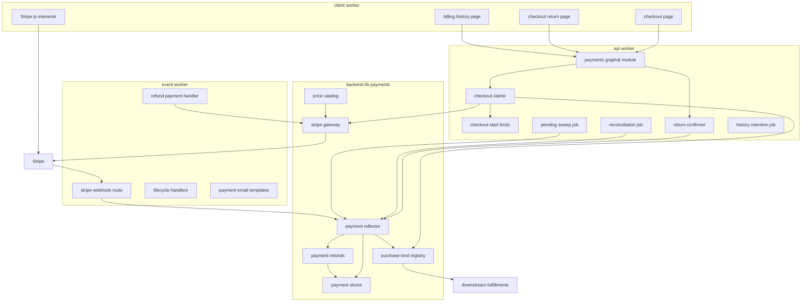
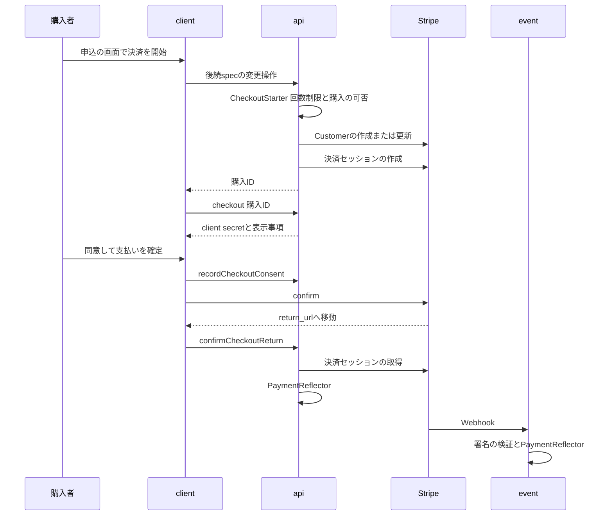
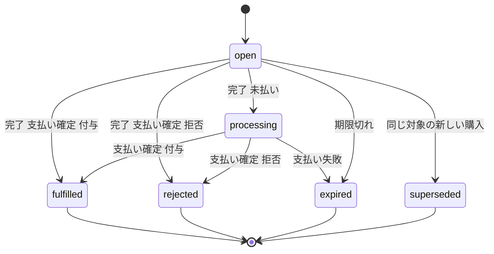
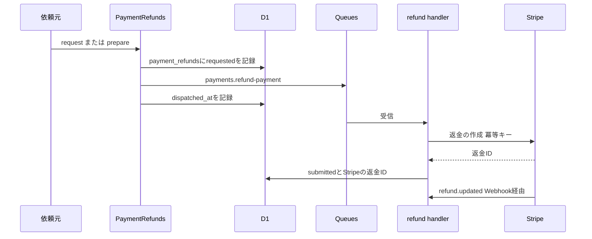
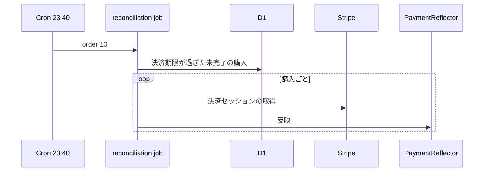

# Design Document

## Overview

**Purpose**: トーナメント参加費・スポンサー広告・Ultrasプランの決済を、Stripeの決済セッション(`ui_mode: 'elements'`)とPayment Elementで受け付け、決済・返金・チャージバック・定期課金の請求を、到着の順序や重複にかかわらず1回だけ決済履歴と購入の状態へ反映する。購入の内容に応じた権利の付与は、購入種別ごとの口(`PurchaseKindRegistration`)を通じて後続specへ委ね、権利を付与できなかった決済と二重決済は自動で全額返金する。

**Users**: 投稿者は申込の画面から決済画面(`/checkout/{購入ID}`)へ進み、最終確認画面の事項を確かめ同意して支払い、決済後のランディング(`/checkout/return`)で結果を見る。利用者は`/settings/billing`で決済履歴を見る。後続spec(tournament-week・tournament-year・sponsorship・ultras-subscription)の開発者は、購入種別の口と返金の部品・価格の照会・定期課金の状態の受け取り口を実装または利用する。運用者はStripeのダッシュボードで手動の返金・チャージバックに対応し、手順書に沿って環境を設定する。

**Impact**: `apps/backend-lib`に決済の共有部品(`core/payments`・`workers/payments`)を新設し、apiとeventの両方に同じ束縛(`PAYMENTS_PLATFORM_MODULE`)を入れる。apiに決済のスキーマモジュール・回数制限・突合と日次の確認のジョブを、eventにWebhookの経路・返金の実行・ユーザーライフサイクルの波及処理・メールのテンプレートを、clientに決済画面・決済後のランディング・決済履歴の画面を足す。D1に7テーブルを足し、Stripeのシークレットと変数を3つのWorkerへ加える。

### Goals

- FR-PYMNT-001〜018・SW-016・DR-015・016・018・LR-007〜009の決済画面と記録の部分が動作し、疎通確認用の購入種別(仮6)でE2Eテストを端から端まで通せる。
- Webhook・`return_url`・突合のどの組み合わせで同じ決済が届いても、権利の付与・決済履歴の記録・購入確認メールの依頼が1回だけ行われる。
- 権利を付与できなかった決済・反映の期限を過ぎた決済・二重決済が、利用者の操作なしに全額返金される。
- 本specが追加・変更したコードの単体テスト・Workers統合テスト・ブラウザテストがカバレッジ80%を満たす。

### Non-Goals

- 購入の対象の可否と権利の付与・剥奪の業務規則(後続spec)。Ultrasの状態管理・解約・Customer Portal・`/pricing`(ultras-subscription)。
- 停止・非公開化・強制終了などに伴う返金を自動で行うかの判断(Q1により後続spec)。
- 決済専用の管理画面、手動の返金とチャージバックの証拠の提出(Stripeのダッシュボード)。
- Stripeの領収書メール(Q3)、Webhookの送信元IPの許可リスト(research.mdの「採らなかった案」)。
- 要件定義書の改訂(roadmapのOut。必要な改訂は[research.md](research.md)の「要件定義書の改訂が必要な箇所」に記録した)。(2026-10-25に要件定義書へ適用済み)

## Boundary Commitments

### This Spec Owns

- 決済のデータ: `payment_customers`・`payment_purchases`・`payment_records`(決済履歴)・`payment_refunds`・`payment_stripe_objects`・`payment_price_snapshots`・`payment_batch_guards`の7テーブル(`apps/db/schema/payments/`)。
- Stripeとの通信のすべて(`StripeGateway`)。Customer・決済セッション・返金・価格・定期課金の解約とCustomer Portalのセッション(後続specが使う操作を含む)・Webhookの署名の検証。API版`2026-09-30.endive`の固定。
- 購入種別の定義(`apps/common-lib/payments/`)と、購入種別の口(`PurchaseKindRegistration`・`PurchaseOfferPolicy`・`PurchaseFulfillment`)、定期課金の状態の受け取り口(`SubscriptionEventSink`)の契約と登録箇所。
- 反映の処理(`PaymentReflector`)と、その入口(Webhookの経路・`return_url`の確定・突合・日次の確認)。
- 返金の共通部品(`PaymentRefunds`)と返金の実行(`payments.refund-payment`の処理)、未完了の決済セッションの失効の口(`OpenCheckoutExpirer`)。
- 決済の開始(`CheckoutStarter`)・回数制限(`CheckoutStartLimits`)・価格の照会(`PriceCatalog`)・決済履歴の照会(`PaymentHistoryReader`・`PaymentHistoryExport`)・収益の照会(`PaymentRevenueReport`・`RevenuePeriod`。ugc-moderationの週ごとの統計が使う。仮7)。
- GraphQLのスキーマモジュール`payments`(型`Money`・`CheckoutStart`・`Checkout`・`PaymentRecord`を含む)。
- 利用者側の`/checkout/{購入ID}`・`/checkout/return`・`/settings/billing`と、通貨の表示部品`MoneyText`(frontend-lib)。同意のチェックボックスの部品`Checkbox`はidentity-authが新設したfrontend-libの部品を使い、本specは作らない。
- メールの種別`payments.purchase-confirmation`・`payments.automatic-refund`とテンプレート。
- 定期実行のジョブ`payments.checkout-reconciliation`(23:40、`order` 10)・`payments.pending-checkout-sweep`(4:21、`order` 400)・`payments.history-retention`(4:21、`order` 410)、メッセージ種別`payments.refund-payment`、ユーザーライフサイクルの波及処理`payments.customer-erasure`(`purge_due`、`order` 400)・`payments.open-checkout-expiry`(`withdrawn`・`suspended`、`order` 410)。
- 技術ドキュメント`external/007`・`backend/009`・`operations/004`、サービス仕様の決済実装方針`features/004`の新規作成と、関連するサービス仕様の追記。

### Out of Boundary

- 購入の対象の可否・購入の内容の決定・権利の付与と剥奪(後続specが`PurchaseOfferPolicy`・`PurchaseFulfillment`を実装する)。広告の申込・トーナメントの参加資格・Ultrasの加入状態のデータ。
- Ultrasの状態の解釈と特典の判定、解約と支払い方法の更新の画面(ultras-subscriptionが`SubscriptionEventSink`を実装し、`StripeGateway`の操作を呼ぶ)。
- 後続specの申込の画面と、その画面から決済を始めるGraphQLの変更操作(後続specが`CheckoutStarter`を呼び、本specの型`CheckoutStart`を返す)。
- 停止・非公開化・強制終了などに伴う返金の判断と依頼(後続specが`PaymentRefunds`を呼ぶ)。
- データエクスポートのファイルの生成(data-exportが`PaymentHistoryExport`を呼ぶ)、週ごとの統計の集計と表示(ugc-moderation。純収益は本specの`PaymentRevenueReport`を呼んで得る。仮7)。
- 法的通知の本文の更新(開発者が管理画面で行う。本specは大枠を更新する)。
- Stripeのダッシュボードの設定作業そのもの(開発者が`operations/004`に沿って行う)と、prodのシークレットの登録(launch-readiness)。

### Allowed Dependencies

- backend-platform: `AppModule`・`PLATFORM_TYPES`(`Database`・`Clock`・`IdGenerator`・`KeyedHasher`・`MessagePublisher`・`RateLimitCounterClient`)・`ScheduledJobDefinition`・`defineMessageContract`・`MessageHandlerRegistration`・`RetryPolicy`・`hashRateLimitKey`・`excludePath`・`AppError`・`validateEnv`・`platformEnvShape`・`getAppLogger`・業務時刻の関数・`ulidPrimaryKey`・`timestamps`。形を変えない。
- api-gateway: `defineSchemaModule`・`GraphQLContext`(`resolve`・`session`・`assertHuman`)・`withValidatedArgs`・`CURSOR_PAGE_ARGS`・`toConnection`・`DateTime`のスカラー。形を変えない。
- identity-auth: `AccountGuard`(`requireUser`・`requireVerifiedUser`)・`CurrentUser`・`UserRecord.pseudonymousId`・`UserLifecycleAsyncRegistration`・`USER_LIFECYCLE_ASYNC_HANDLERS`・`AuthenticatedContext`・`SETTINGS_NAV_ITEMS`・`SettingsShell`・frontend-libの`Checkbox`(`apps/frontend-lib/components/ui/checkbox.tsx`、identity-authのタスク10.4が新設するshadcn/uiのCheckbox。決済画面の同意に使う)・`UserContactDirectory`(`IDENTITY_PLATFORM_TYPES.UserContactDirectory`、`apps/backend-lib/workers/identity`、api・eventの両方にidentity-authが束縛する。メールの宛先の照会に使う)。`users`テーブルは`id`(外部キーの参照先)だけに使い、列を直接読まず、書き込まない。
- email-delivery: `defineEmailKind`・`EMAIL_KINDS`・`EmailSender`・`EMAIL_TYPES`・`defineEmailTemplate`・`EMAIL_TEMPLATES`・`formatUtcDateTime`。
- frontend-platform: `CLIENT_SECURITY_POLICY`・`SecurityPolicySources`・`PublicRuntimeConfig`・`executeGraphQL`・`graphqlQueryOptions`・`GraphQLClientError`・`buildPageHead`・`DateTime`・`RelativeTime`・`NumberText`・`EmptyState`・`ErrorState`・`UnavailableNotice`・`LoadingSkeleton`・`notify`・shadcn/uiの部品・`runAxe`。
- legal-pages: `LEGAL_DOCUMENT_PATHS`(`apps/common-lib/legal/legal-documents.ts`)。
- infra-delivery: Wranglerの`secrets.required`・`vars`の3環境への記載、Infisicalのキーの表(`docs/onboardings/project-values.md`)、改訂1のWorkerごとのフォルダ(`/workers/api`・`/workers/event`。同じキーの`/`の値より優先される)と`WORKER_SCOPED_SECRETS`(`STRIPE_API_KEY`を含み、`/`の値を使わない)、ローカルの起動の`run-with-secrets --scope local --worker <api|event>`(仮7)。
- npmパッケージ: `stripe` 23.0.x(api・event)、`@stripe/stripe-js` 10.0.x・`@stripe/react-stripe-js` 7.0.0(client)。版は実装時に公開から2週間を過ぎた最新のパッチ版に完全固定する(Q6)。
- 後続specは、本specの`core/payments`・`workers/payments`の公開の契約(`PurchaseKindRegistration`・`PurchaseOfferPolicy`・`PurchaseFulfillment`・`SubscriptionEventSink`・`PaymentRefunds`・`OpenCheckoutExpirer`・`PriceCatalog`・`PaymentHistoryExport`・`PaymentRevenueReport`・`StripeGateway`のうち定期課金の操作・`CustomerDirectory`)と、それとは別にapiのアプリケーション層(`apps/api/src/application/payments/`)の`CheckoutStarter`(apiの決済モジュールが束縛し、apiの後続specだけが呼ぶ)だけに依存し、テーブルを直接読み書きしない。data-exportも決済履歴のテーブルを直接読まず、本specが所有するエクスポート部品`PaymentHistoryExport`を呼ぶ。

### Revalidation Triggers

- `PurchaseKindRegistration`・`PurchaseOfferPolicy`・`PurchaseOffer`・`PurchaseFulfillment`・`FulfillmentPlan`・`FulfillablePurchase`の形、権利の付与の文を反映と同じ一括の書き込みで確定する規則、`afterCommit`を確定させた側だけが1回呼ぶ規則(U1)(tournament-week・tournament-year・sponsorship・ultras-subscription)。
- `SubscriptionEventSink`・`SubscriptionChange`の形(`cancelAt`・`afterCommit`を含む、U1)と、古い通知を捨てる規則(ultras-subscription)。
- `PaymentRefunds`・`OpenCheckoutExpirer`の形・依頼キーの規則・返金の理由の値(tournament-week・tournament-year・ultras-subscription・ugc-moderation・sponsorship)。
- `PURCHASE_KINDS`の値と`payment_records`の`kind`・`purpose`・`status`の値(data-export・ugc-moderation・後続spec)。`payments.json`の形はデータエクスポートの文書と一致させる。
- 本specが所有・実装する収益の照会`PaymentRevenueReport`・`RevenuePeriod`(`core/payments/ports.ts`、実装`workers/payments/d1-payment-revenue-report.ts`、DIの識別子`PAYMENTS_TYPES.PaymentRevenueReport`、`PAYMENTS_PLATFORM_MODULE`での束縛)の形と純収益の定義(ugc-moderationが週ごとの統計の純収益に使う)。`payment_records`の`kind`・`status`・`purpose`の値の意味、`amount`の符号の規則(返金とチャージバックの損失を負の値で記録する)、`occurred_at`の意味、疎通確認の`payments_smoke`の扱い、チャージバックの段階ごとの記録の規則を変えるときは、`PaymentRevenueReport`の集計と、それを使うugc-moderationの統計を確かめ直す(仮7)。
- 23:40の突合の`order` 10(match-engineの23:40のジョブは`order`を10より大きくする)。
- GraphQLの`payments`モジュールの型・エラーコード(client・後続specの申込の画面)。
- `CLIENT_SECURITY_POLICY`へ加えたStripeの許可先と、`PublicRuntimeConfig.stripePublishableKey`(frontend-platform)。frontend-platformが`SecurityPolicySources`の形や許可先の形の規則を変えたら、本specを確かめ直す。
- Stripeのシークレット・変数の名前(infra-delivery・launch-readiness)。infra-deliveryのWorkerごとのフォルダの構成・優先の規則・`WORKER_SCOPED_SECRETS`の変更(api用とevent用の制限付きキーの登録先と、ローカルの起動のコマンドに効く。仮7)。
- identity-authの`AccountGuard`・`UserLifecycleAsyncRegistration`の`order`の範囲・`purge_due`の順序・`UserContactDirectory`の形(`findContact`が退会済み・物理削除済みの利用者で`undefined`を返す規則)・frontend-libの`Checkbox`のprops(ラベルの関連付け・チェック状態の受け渡し)を変えたら、本specを確かめ直す。
- ユーザーライフサイクルの波及処理の`order`は、各specが4:21のジョブの`order`と同じ百の位の帯を使う(spec横断レビュー、2026-10-23)。本specは400番台を使い、identity-auth(100番台、波及処理はidentity-auth専用の10000以上)・admin-foundation(200番台)・inquiry-chat(300番台)・media-pipeline(800番台)・email-delivery(900)・content-processing(950)と、roadmapの帯の割り当ての表で後続specに割り当てた帯(500番台・600番台・700番台・1000番台以降)と重ねない。帯の割り当てが変わったら、本specを確かめ直す。
- 後続specが`PURCHASE_KIND_REGISTRATIONS`・`SUBSCRIPTION_EVENT_SINKS`に登録するServiceIdentifierは、後続spec自身が`backend-lib/workers/<ドメイン>`の共有モジュールでapi・eventの両方に束縛する(反映が両アプリで動くため)。
- Stripe SDKのメジャー版とAPI版の変更(Webhook endpointのAPI版・テストの模擬応答・`operations/004`の手順を同時に更新する)。

## Architecture

### Existing Architecture Analysis

- 上流の11specは設計・タスクとも承認済みで、本specのタスクはそれらの実装の完了を前提にする(roadmapの順でlegal-pagesまでが先に実装される)。
- apiとeventは`backend-lib`を`lib/`として共有し、層は`domain`・`application`・`infrastructure`・`presentation`・`composition`で、依存の方向は静的解析で強制される。共有の束縛は`backend-lib/workers/<ドメイン>`のモジュールを両アプリの`composition/modules.ts`へ入れる(email-deliveryの`EMAIL_PLATFORM_MODULE`の前例)。
- Cron Triggersはapiだけにあり、ジョブは業務時刻の時・分で毎日動く。厳密カウンタはapiだけに束縛される。Queuesのconsumerはeventにある。
- D1は`db.transaction()`を使えない。状態の前進と関連の書き込みは、版の検査付きの一括の書き込み(legal-pages・identity-authの方式、`db/005`)で同時に確定する。
- 利用者側のCSPはアプリ全体に掛かり、許可先は`https://<ホスト>`の形だけである。

### Architecture Pattern & Boundary Map



**Architecture Integration**:

- Selected pattern: 共有の反映部品(`backend-lib`)を、4つの入口(Webhook・`return_url`・突合・日次の確認)から呼ぶ。外部への副作用(返金の実行・メール)は、D1の行の「依頼待ち」の状態を記録してから送る(取りこぼしは日次の確認で拾う)。
- Domain/feature boundaries: Stripeとの通信と決済の状態は本spec、「何を買ったか」の可否と権利は後続specの口の実装。後続specはD1の文だけで権利を付与する。
- Existing patterns preserved: 版の検査付きの一括の書き込み、`<spec名>.<名詞句>`のジョブ・波及処理の名前と`<ドメイン>.<動詞句>`のメッセージ種別、共有の束縛のモジュール、`apps/common-lib/<ドメイン>`の共有定義。
- New components rationale: 反映の入口が2つのWorkerにまたがるため、反映・ゲートウェイ・ストアを`backend-lib`に置く。購入種別ごとの差は口の登録に閉じ込める。
- Steering compliance: Inversifyの`@inject`の明示、D1の制約、Infisicalでのシークレット管理、`compatibility_date`、業務時刻(UTC-08:00)、800行以内のファイル。

**Dependency direction**: `apps/db/schema/payments` → `apps/common-lib/payments` → `backend-lib/core/payments`(純粋な規則・契約) → `backend-lib/workers/payments`(Stripe・D1の実装と反映) → 各アプリの`src`(`application` → `infrastructure`・`presentation` → `composition`)。後続specの口の実装は`backend-lib/workers/<ドメイン>`に置き、`backend-lib/core/payments`の契約だけを読み込む。`backend-lib/workers/payments`は後続specのファイルを読み込まず、登録箇所(`purchase-kind-registrations.ts`)だけが後続specの実装を集める。clientは`common-lib/payments`とGraphQLの操作だけを読み込む。

### Technology Stack

| Layer          | Choice / Version                                                                                                    | Role in Feature                                                                                                                                                                                                                                               | Notes                                                    |
| -------------- | ------------------------------------------------------------------------------------------------------------------- | ------------------------------------------------------------------------------------------------------------------------------------------------------------------------------------------------------------------------------------------------------------- | -------------------------------------------------------- |
| Frontend       | `@stripe/stripe-js` 10.0.x・`@stripe/react-stripe-js` 7.0.0(`/checkout`の`CheckoutElementsProvider`・`useCheckout`) | 決済画面のPayment Element・請求先住所の入力欄・支払いの確定                                                                                                                                                                                                   | 新規。決済画面と決済後のランディングでだけ動的に読み込む |
| Frontend       | TanStack Start・TanStack Query・shadcn/ui(frontend-platform)                                                        | 3つの画面・`MoneyText`(本spec)・`Checkbox`(identity-authが新設)                                                                                                                                                                                               | 既存                                                     |
| Backend        | `stripe` 23.0.x(`createFetchHttpClient()`・`createSubtleCryptoProvider()`、`apiVersion: '2026-09-30.endive'`)       | Stripeとの通信・Webhookの署名の検証                                                                                                                                                                                                                           | 新規。api・eventに入れる                                 |
| Backend        | Hono・Inversify・GraphQL Yoga(上流)                                                                                 | Webhookの経路・DI・スキーマモジュール                                                                                                                                                                                                                         | 既存                                                     |
| Data           | Cloudflare D1(Drizzle)                                                                                              | 7テーブル                                                                                                                                                                                                                                                     | 新規のマイグレーション                                   |
| Messaging      | Cloudflare Queues(`JOBS_QUEUE`)・Cron Triggers(api)                                                                 | 返金の実行・突合・日次の確認                                                                                                                                                                                                                                  | 既存のQueueを使う                                        |
| Infrastructure | Wrangler・Infisical                                                                                                 | シークレット`STRIPE_API_KEY`(api・event。Infisicalの`/workers/api`・`/workers/event`に別々の制限付きキー、仮7)・`STRIPE_WEBHOOK_SECRET`(event)、変数`STRIPE_PUBLISHABLE_KEY`(client)・`PAYMENTS_SMOKE_ENABLED`(api・event)・`CLIENT_SITE_ORIGIN`(eventへ追加) | 3環境に記載                                              |
| External       | Stripe(dev・stagingはsandbox、prodはライブモード)                                                                   | 決済・税・返金・定期課金                                                                                                                                                                                                                                      | 環境ごとにダッシュボードで設定(`operations/004`)         |

## File Structure Plan

### Directory Structure

```
apps/
├── db/schema/payments/                              # テーブル定義(各ファイルに同名の*.unit.test.ts)
│   ├── payment-customers.ts                         # 利用者とStripe Customerの1対1
│   ├── payment-purchases.ts                         # 購入(決済セッションごと)と部分一意索引
│   ├── payment-records.ts                           # 決済履歴(仮名化ID、7年)
│   ├── payment-refunds.ts                           # 返金の依頼と実行の状態
│   ├── payment-stripe-objects.ts                    # Stripeのオブジェクトごとの最終の発生時刻
│   ├── payment-batch-guards.ts                      # 版の検査の行(一括の書き込みの中で挿入して消す)
│   ├── payment-price-snapshots.ts                   # 価格の一時保持
│   └── index.ts
├── common-lib/payments/                             # 4アプリ共通の定義(各ファイルに同名の*.unit.test.ts)
│   ├── purchase-kinds.ts                            # PURCHASE_KINDS・名前・都度決済か定期課金か
│   ├── payment-record-values.ts                     # 決済履歴のkind・status・名前
│   ├── purchase-states.ts                           # 購入・返金・メールの依頼の状態と拒否の理由の値(テーブルの制約と規則が共有)
│   ├── checkout-consent.ts                          # 同意の文言と版CHECKOUT_CONSENT_VERSION
│   └── money.ts                                     # 最小通貨単位の整数とUSDの表示用の値
├── backend-lib/
│   ├── core/payments/                               # 純粋な契約と規則(Bunの単体テスト)
│   │   ├── identifiers.ts                           # PAYMENTS_TYPES(PaymentRevenueReportを含む)
│   │   ├── purchase-kind-contract.ts                # PurchaseKindRegistration・PurchaseOfferPolicy・PurchaseFulfillment・SubscriptionEventSink
│   │   ├── purchase-kind-registry.ts                # 登録の検証と購入種別からの解決
│   │   ├── ports.ts                                 # StripeGateway・各ストア・PaymentRefunds・PriceCatalog・CustomerDirectory・PaymentHistoryExport・PaymentRevenueReport・RevenuePeriod
│   │   ├── purchase-rules.ts                        # 状態の前進・有効期限・受付期限・反映の期限・拒否の理由
│   │   ├── refund-rules.ts                          # 金額の検証・Stripeの返金理由への対応
│   │   ├── stripe-event-mapping.ts                  # 通知を反映の指示へ正規化(受け付ける種類の一覧)
│   │   ├── refund-message.ts                        # PAYMENTS_REFUND_MESSAGE(payments.refund-payment)
│   │   └── stripe-api-version.ts                    # STRIPE_API_VERSION・CHECKOUT_INTEGRATION_IDENTIFIER
│   ├── core/messaging/contracts/index.ts            # 既存。PAYMENTS_REFUND_MESSAGEを加える
│   ├── core/email/kinds/
│   │   ├── payments-purchase-confirmation.ts        # 購入確認メールの種別
│   │   └── payments-automatic-refund.ts             # 自動返金の通知の種別
│   └── workers/payments/                            # 実行環境の部品(Workers統合テスト)
│       ├── stripe-client.ts                         # Stripeの生成(fetch・API版・再試行・時間切れ)
│       ├── stripe-gateway.ts                        # StripeGatewayの実装
│       ├── stripe-webhook-verifier.ts               # 署名の検証(Web Crypto)
│       ├── payment-owner-resolver.ts                # 返金・チャージバック・請求の持ち主の特定
│       ├── d1-customer-store.ts                     # CustomerStore・CustomerDirectory
│       ├── d1-purchase-store.ts                     # 購入の読み書きと状態の前進の文
│       ├── d1-payment-record-store.ts               # 決済履歴のupsert・挿入・一覧・削除
│       ├── d1-refund-store.ts                       # 返金の依頼の行
│       ├── d1-stripe-object-store.ts                # 最終の発生時刻の検査の文
│       ├── d1-price-snapshot-store.ts               # 価格の一時保持
│       ├── guarded-batch.ts                         # 版の検査の文(NOT NULL制約で取り消す)
│       ├── payment-reflector.ts                     # 反映の処理(決済セッション・請求・返金・チャージバック・定期課金)
│       ├── checkout-session-reflection.ts           # 決済セッションの反映(フルフィルメント・拒否・二重決済)
│       ├── open-checkout-expirer.ts                 # 未完了の決済セッションの失効(波及処理と後続specが使う)
│       ├── payment-refunds.ts                       # PaymentRefundsの実装(検証・行の追加・送信)
│       ├── purchase-notifier.ts                     # 購入確認メール・自動返金の通知の依頼と記録
│       ├── price-catalog.ts                         # PriceCatalogの実装
│       ├── payment-history-export.ts                # データエクスポート用の全件の読み出し
│       ├── d1-payment-revenue-report.ts             # PaymentRevenueReportの実装(期間ごとの純収益、ugc-moderationが使う)
│       ├── smoke-purchase.ts                        # 疎通確認用の購入種別(仮6)
│       ├── purchase-kind-registrations.ts           # PURCHASE_KIND_REGISTRATIONS・SUBSCRIPTION_EVENT_SINKS(後続specが追記)
│       └── payments-platform-module.ts              # PAYMENTS_PLATFORM_MODULE(両アプリ共通の束縛。PaymentRevenueReportを含む)
├── api/src/
│   ├── application/payments/                        # Bunの単体テスト
│   │   ├── api-payments-types.ts                    # API_PAYMENTS_TYPES
│   │   ├── checkout-starter.ts                      # 決済の開始(後続specと疎通確認が呼ぶ)
│   │   ├── checkout-start-limits.ts                 # 利用者単位の回数制限(仮2)
│   │   ├── checkout-reader.ts                       # 決済画面の表示用の情報
│   │   ├── checkout-consent-recorder.ts             # 同意の記録(Q3)
│   │   ├── checkout-return-confirmer.ts             # return_urlからの反映(FR-PYMNT-009)
│   │   ├── payment-history-reader.ts                # 決済履歴の一覧
│   │   └── jobs/
│   │       ├── checkout-reconciliation-job.ts       # 23:40の突合(order 10)
│   │       ├── pending-checkout-sweep-job.ts        # 4:21の未完了・依頼待ちの確認(order 400)
│   │       └── payment-history-retention-job.ts     # 4:21の7年の削除(order 410)
│   ├── presentation/graphql/modules/payments/       # スキーマモジュール(Workers統合テスト)
│   │   ├── type-defs.ts
│   │   ├── inputs.ts                                # 引数のzodスキーマ
│   │   ├── errors.ts                                # エラーコードと文言
│   │   ├── resolvers.ts
│   │   └── index.ts                                 # paymentsSchemaModule
│   └── composition/payments-module.ts               # apiの束縛(AppModule)
├── event/src/
│   ├── presentation/http/stripe-webhook-route.ts    # POST /webhooks/stripe
│   ├── application/payments/                        # Bunの単体テスト
│   │   ├── event-payments-types.ts                  # EVENT_PAYMENTS_TYPES
│   │   ├── stripe-webhook-receiver.ts               # 検証→正規化→反映
│   │   ├── refund-payment-handler.ts                # payments.refund-paymentの処理
│   │   ├── customer-erasure-handler.ts              # purge_dueの波及処理
│   │   └── open-checkout-expiry-handler.ts          # 退会・停止の波及処理
│   ├── infrastructure/email/templates/payments/     # 本文の*-body.tsxと定義の*-template.ts(2種)
│   └── composition/payments-module.ts               # eventの束縛(AppModule・経路)
├── frontend-lib/components/
│   └── payments/money-text.tsx                      # 税込USDの表示(stories・browser testを併置)。ui/checkbox.tsxはidentity-authが作る
└── client/src/
    ├── routes/_authenticated/checkout/$purchaseId.tsx
    ├── routes/_authenticated/checkout/return.tsx
    ├── routes/_authenticated/settings/billing.tsx
    ├── components/payments/                         # 1ファイル1コンポーネント(browser testを併置)
    │   ├── checkout-page.tsx                        # 状態ごとの出し分けと全体の配置
    │   ├── checkout-summary.tsx                     # 最終確認画面の表示事項(LR-008)
    │   ├── checkout-consent.tsx                     # 同意のチェックボックス(LR-007)
    │   ├── checkout-payment-form.tsx                # Payment Element・請求先住所・支払いの確定
    │   ├── checkout-deadline.tsx                    # 受付期限と残り時間
    │   ├── checkout-return-status.tsx               # 決済後のランディングの状態表示
    │   ├── payment-history-list.tsx                 # 決済履歴の一覧と続きの読み込み
    │   ├── payment-history-item.tsx                 # 1件の記録
    │   ├── smoke-checkout-button.tsx                # 疎通確認の決済の開始(prod以外だけ表示、仮6)
    │   └── stripe-loader.ts                         # 公開キーでStripe.jsを1回だけ読み込む
    └── graphql/operations/payments/
        ├── checkout.ts                              # checkout・recordCheckoutConsent・startSmokeCheckout
        ├── checkout-return.ts                       # confirmCheckoutReturn
        └── payment-history.ts                       # paymentHistory
```

テストは各ファイルの隣に置く(`*.unit.test.ts`・`*.worker.test.ts`・`*.browser.test.tsx`)。E2Eは`e2e/client/checkout.e2e.test.ts`・`e2e/client/billing.e2e.test.ts`。

- 収益の照会`PaymentRevenueReport`(`core/payments/ports.ts`の`PaymentRevenueReport`・`RevenuePeriod`、`workers/payments/d1-payment-revenue-report.ts`、`identifiers.ts`の`PAYMENTS_TYPES.PaymentRevenueReport`、`payments-platform-module.ts`の束縛)は、本specが所有し、タスク2.1・5.5・5.7で作る。利用者はugc-moderationの週ごとの統計で、決済履歴の値の意味を変えるときの再検証の対象である(Revalidation Triggers、仮7)。

### Modified Files

- `apps/db/schema/index.ts`・`apps/db/migrations/<日時>_payments/migration.sql` — 7テーブルの再エクスポートと生成したマイグレーション(mainの最新を取り込んでから生成する)。
- `apps/backend-lib/core/messaging/contracts/index.ts`・`core/email/kinds/index.ts` — `PAYMENTS_REFUND_MESSAGE`と2つのメールの種別を加える。
- `apps/api/src/composition/modules.ts`・`graphql-modules.ts`・`scheduled-jobs.ts`・`env-schema.ts` — `PAYMENTS_PLATFORM_MODULE`・apiの決済モジュール・スキーマモジュール・3つのジョブ・`STRIPE_API_KEY`・`PAYMENTS_SMOKE_ENABLED`の検証。
- `apps/event/src/composition/modules.ts`・`message-handlers.ts`・`user-lifecycle-async-handlers.ts`・`rate-limit-exclusions.ts`・`env-schema.ts` — 束縛と経路、`payments.refund-payment`の処理、2つの波及処理、`excludePath('/webhooks/stripe', 'POST')`、`STRIPE_API_KEY`・`STRIPE_WEBHOOK_SECRET`・`CLIENT_SITE_ORIGIN`・`PAYMENTS_SMOKE_ENABLED`の検証。
- `apps/event/src/infrastructure/email/templates/index.ts`(`EMAIL_TEMPLATES`) — 2つのテンプレートを加える。
- `apps/api/wrangler.jsonc`・`apps/event/wrangler.jsonc`・`apps/client/wrangler.jsonc`と各`worker-configuration.d.ts` — 3環境の`secrets.required`・`vars`、apiの`triggers.crons`に`40 7 * * *`を加える(4:21は既存)。
- `apps/api/package.json`・`apps/event/package.json`・`apps/client/package.json`・`bun.lock` — Stripeの3パッケージを完全固定で加える。
- `apps/client/src/composition/security-policy.ts` — `CLIENT_SECURITY_POLICY`に`scriptSrc: ['https://js.stripe.com']`・`frameSrc: ['https://js.stripe.com', 'https://hooks.stripe.com']`・`connectSrc: ['https://api.stripe.com']`・`permissions.payment: ['self', '"https://js.stripe.com"']`を加える。
- `apps/client/src/composition/settings-navigation.ts` — `{ to: '/settings/billing', label: '決済履歴', order: 70 }`を加える。
- clientの環境の検証と公開設定(frontend-platformの`ValidatedFrontendEnv`のclientの拡張・`toPublicRuntimeConfig`) — `STRIPE_PUBLISHABLE_KEY`を`pk_test_`または`pk_live_`で始まる文字列として検証し、`PublicRuntimeConfig.stripePublishableKey`(client専用、adminは`undefined`)へ渡す。content-processingの`CLIENT_SITE_ORIGIN`の追加と同じ手順で行う。
- `docs/onboardings/project-values.md` — Workerのシークレットのキーの一覧の節に`STRIPE_API_KEY`(apiは`/workers/api`、eventは`/workers/event`、必須。仮7)・`STRIPE_WEBHOOK_SECRET`(event、`/`、必須)の行、変数の値の表に`STRIPE_PUBLISHABLE_KEY`・`PAYMENTS_SMOKE_ENABLED`・eventの`CLIENT_SITE_ORIGIN`の行。
- `docs/onboardings/README.md` — ローカル開発でのWebhookの転送(`stripe listen --forward-to http://localhost:48043/webhooks/stripe`)と、その署名の秘密をInfisicalの`dev`へ登録する手順。api用とevent用のdevの制限付きキーをInfisicalの`dev`の`/workers/api`・`/workers/event`へ登録する手順(仮7)。api・eventのローカルの起動のコマンドはinfra-deliveryが`run-with-secrets --scope local --worker <api|event>`の形に改めており、本specは確かめるだけで書き換えない。
- `docs/onboardings/tech-stack.md` — 決済サービスの節にStripeの3パッケージの用途(版は`coding/002`を正とする旨)を追記する。
- `docs/GUIDES/tech/coding/002-dependency-versions.md` — 主要パッケージの一覧に`stripe`・`@stripe/stripe-js`・`@stripe/react-stripe-js`(API版と結び付くため完全固定)を加える。
- `docs/GUIDES/tech/external/README.md`・`backend/README.md`・`operations/README.md` — 文書一覧の表に行を加える。
- `docs/GUIDES/service/legal/004-legal-notice-outline.md` — 章5(支払方法・時期)に「クレジットカード・デビットカード、Apple Pay、Google Pay、Link(Linkでは登録したカードのほか、米国の銀行口座による即時銀行決済などが使える場合がある)」を記載する(Q2・仮1)。
- `docs/GUIDES/service/legal/001-compliance-policy.md`・`003-privacy-policy-outline.md` — 「データの保存場所」の委託先の箇条と「国外移転の記載事項」の`### Stripe(決済)`の項(移転先: 米国。移転の根拠: DPFを主とし、DPFが無効になった場合はStripeのDPAに含まれるSCCに拠る。措置: 共通の行を参照)。委託先の一覧のStripeの「渡す情報」に仮名化IDと請求先住所(Stripeが直接取得)を明記する。
- `docs/GUIDES/service/design/002-page-layouts.md` — URL構造に`/checkout/{購入ID}`(仮3)、決済前の最終確認画面に法的通知へのリンクはアンカー無しの`/legal`である旨(Q4)と請求先住所の入力欄、決済後のランディングの状態表示。
- `docs/GUIDES/service/design/003-text-and-copy-rules.md` — エラーメッセージと状態の文言に決済の文言(受付終了・決済を利用できない・操作の集中・カードの拒否・処理中・自動返金)、通知メールの件名に2種を加える。
- `docs/GUIDES/service/overview/002-pricing-and-plans.md` — 決済手段(Q2)、決済期限の無い購入の有効期限(仮4)、二重決済の自動返金(Q1)を追記する。
- `docs/GUIDES/service/overview/007-daily-timeline.md` — 23:40の突合のジョブ名と`order`、4:21の表に`payments.pending-checkout-sweep`(400)・`payments.history-retention`(410)。
- `docs/GUIDES/service/features/README.md` — `004-payments.md`の行を加える。

新規の文書:

- `docs/GUIDES/tech/external/007-stripe-payments.md` — API版とSDKの固定、制限付きキーの権限、決済セッション(`ui_mode: 'elements'`)の作成の項目、決済手段の絞り込み、税・現地通貨の設定、workerdでのWebhookの署名の検証、冪等キー、sandboxとローカルの転送。
- `docs/GUIDES/tech/backend/009-idempotent-event-reflection.md` — 外部の通知・戻りの画面・突合の3つの入口を1つの反映の処理にまとめる規約、対象ごとの状態の前進と発生時刻による巻き戻りの防止、外部の副作用の依頼待ちの記録と日次の確認。
- `docs/GUIDES/tech/operations/004-payment-data-operations.md` — 環境ごとのStripeの設定と検証の手順(決済手段の検証と、api用とevent用の制限付きキーをシークレット管理サービスのWorkerごとのフォルダへ別々に登録する手順を含む。仮7)、手動の返金、チャージバックへの対応、突合と返金の失敗の対処、鍵の更新、Webhook endpointのAPI版の更新。
- `docs/GUIDES/service/features/004-payments.md` — 決済実装方針(購入種別とフルフィルメント、反映の流れ、返金の分担、決済履歴の記録の規則、Linkの資金源の扱い)。

## System Flows

### 決済の開始から反映まで



- `return_url`とWebhookのどちらが先でも、購入の状態の前進を条件にした一括の書き込みが1つだけ確定し、後の側は既に反映済みの状態を返す。
- 同意の記録に失敗したら支払いを確定させない(4.5)。

### 購入の状態



- `rejected`は理由(`late`・`ineligible`・`duplicate`)を持ち、同じ一括の書き込みで全額返金の依頼(`payment_refunds`の`requested`)を記録する。
- `superseded`は新しい購入の作成時に記録し、Stripe上の旧セッションの失効は作成の後に行う。失効の前に旧セッションで支払いが確定した場合は、反映で`superseded`から`fulfilled`・`rejected`へ進められる(前進の元に`superseded`を含める)。

### 返金の依頼と実行



- 一時的な失敗は例外で再試行し(`maxAttempts` 5)、上限でデッドレターからSentryへ通知される(8.6)。恒久的な拒否は`failed`を記録し`captureMessage`で通知する(8.7)。
- 送信の失敗や中断で`dispatched_at`が空のままの行は、4:21の日次の確認で送り直す(10.6)。

### 23:40の突合



- 対象は`deadline_at`が実行時刻以前かつ24時間以内で、状態が`open`・`processing`・`superseded`の購入である。決済セッションの有効期限は決済期限以前なので、取得した状態は確定している(完了または失効)。
- 1件ずつ取得し、失敗した購入は記録して次へ進む(10.4)。

## Requirements Traceability

| Requirement                        | Summary                                            | Components                                                                       | Interfaces                                                            | Flows                  |
| ---------------------------------- | -------------------------------------------------- | -------------------------------------------------------------------------------- | --------------------------------------------------------------------- | ---------------------- |
| 1.1, 1.2, 1.3, 1.4                 | Customerの作成・再利用・更新・渡す情報             | CheckoutStarter、StripeGateway、D1CustomerStore                                  | `StripeGateway.ensureCustomer`・`CustomerStore`                       | 決済の開始             |
| 1.5, 1.6, 1.7                      | 物理削除での削除と履歴の保持                       | CustomerErasureHandler、StripeGateway、D1CustomerStore、D1PurchaseStore          | `UserLifecycleAsyncHandler`                                           | —                      |
| 2.1, 2.7                           | 購入種別と未登録の拒否                             | PurchaseKinds、PurchaseKindRegistry                                              | `PURCHASE_KINDS`・`PurchaseKindRegistry.resolve`                      | —                      |
| 2.2, 2.3, 2.4                      | 購入の内容と権利の付与の口・同時の確定             | PurchaseKindContract、CheckoutSessionReflection、GuardedBatch                    | `PurchaseOfferPolicy`・`PurchaseFulfillment`                          | 購入の状態             |
| 2.5, 2.6                           | 拒否の自動返金・完了の時だけ付与                   | CheckoutSessionReflection、PaymentRefunds                                        | `FulfillmentPlan`                                                     | 購入の状態             |
| 2.8, 2.9                           | 疎通確認用の購入種別                               | SmokePurchase、PurchaseKindRegistry                                              | `PurchaseKindRegistration.enabled`                                    | —                      |
| 2.10                               | 未完了の決済セッションの失効の口                   | OpenCheckoutExpirer                                                              | `OpenCheckoutExpirer.expireOpen`                                      | 購入の状態             |
| 2.11                               | 権利の付与の確定後の呼び出し(U1)                   | PurchaseKindContract、CheckoutSessionReflection                                  | `PurchaseFulfillment.afterCommit`                                     | 決済の開始から反映まで |
| 3.1, 3.2, 3.3, 3.4                 | 決済セッションの作成・価格・数量・USDと税          | CheckoutStarter、StripeGateway                                                   | `CheckoutStarter.start`・`StripeGateway.createCheckoutSession`        | 決済の開始             |
| 3.5, 3.6                           | 利用者の状態・受付期限の拒否                       | CheckoutStarter、PurchaseRules                                                   | `assertAcceptable`                                                    | —                      |
| 3.7, 3.8                           | 有効期限                                           | PurchaseRules                                                                    | `computeSessionExpiry`                                                | —                      |
| 3.9                                | 以前の未完了のセッションの失効                     | CheckoutStarter、D1PurchaseStore、StripeGateway                                  | `expireCheckoutSession`                                               | 購入の状態             |
| 3.10                               | 回数制限                                           | CheckoutStartLimits                                                              | `CheckoutStartLimits.consume`                                         | —                      |
| 3.11                               | Stripeの障害                                       | CheckoutStarter、StripeGateway                                                   | `StripeUnavailableError`                                              | —                      |
| 3.12                               | 購入IDの返却                                       | PaymentsSchemaModule                                                             | `CheckoutStart`                                                       | —                      |
| 4.1, 4.2, 4.3, 4.6                 | 最終確認画面の表示事項・期限・返金ポリシー・Ultras | CheckoutReader、CheckoutSummary、CheckoutDeadline                                | `Checkout`の型                                                        | —                      |
| 4.4, 4.5                           | 同意のチェックボックスと記録                       | CheckoutConsent(identity-authの`Checkbox`)、CheckoutConsentRecorder              | `recordCheckoutConsent`                                               | 決済の開始             |
| 4.7                                | 決済手段の絞り込み                                 | StripeGateway、CheckoutPaymentForm                                               | `allowed_payment_method_types`                                        | —                      |
| 4.8                                | USDとロケールの書式                                | MoneyText                                                                        | `MoneyTextProps`                                                      | —                      |
| 4.9, 4.10, 4.11, 4.13              | 状態ごとの案内・期限切れ・障害・失敗               | CheckoutPage、CheckoutPaymentForm、CheckoutReader                                | `CheckoutStatus`                                                      | —                      |
| 4.12                               | スクリプトの読み込みの範囲                         | StripeLoader、CLIENT_SECURITY_POLICY                                             | `loadStripeOnce`                                                      | —                      |
| 5.1, 5.7                           | `return_url`からの反映と冪等                       | CheckoutReturnConfirmer、PaymentReflector                                        | `confirmCheckoutReturn`                                               | 決済の開始             |
| 5.2, 5.3, 5.4, 5.5, 5.6            | ランディングの状態表示                             | CheckoutReturnStatus                                                             | `CheckoutReturnResult`                                                | —                      |
| 6.1, 6.2                           | 署名の検証と時刻の許容                             | StripeWebhookVerifier、StripeWebhookRoute                                        | `verify`                                                              | —                      |
| 6.3, 6.9                           | 受け付ける種類・結び付かない通知                   | StripeEventMapping、PaymentOwnerResolver                                         | `mapStripeEvent`                                                      | —                      |
| 6.4, 6.5, 6.6, 6.7                 | 冪等性・巻き戻り防止・失敗時の再送・同じ反映       | PaymentReflector、GuardedBatch、D1StripeObjectStore、D1PaymentRecordStore        | `PaymentReflector.reflect`                                            | 購入の状態             |
| 6.8                                | IP制限の除外                                       | rate-limit-exclusions                                                            | `excludePath`                                                         | —                      |
| 7.1, 7.2, 7.3, 7.4, 7.5, 7.6       | 決済セッションの反映と拒否                         | CheckoutSessionReflection、PurchaseRules                                         | `reflectCheckoutSession`                                              | 購入の状態             |
| 7.7                                | 定期課金の請求の記録                               | PaymentReflector、D1PaymentRecordStore                                           | `upsertInvoiceRecord`                                                 | —                      |
| 7.8, 7.9                           | 定期課金の状態の受け渡しと確定後の呼び出し(U1)     | PaymentReflector、SubscriptionEventSink、StripeGateway                           | `SubscriptionChange`(`cancelAt`)・`SubscriptionEventSink.afterCommit` | —                      |
| 8.1, 8.2, 8.3, 8.4, 8.5            | 返金の依頼の部品                                   | PaymentRefunds、RefundRules、D1RefundStore                                       | `PaymentRefunds.request`・`prepare`                                   | 返金                   |
| 8.6, 8.7                           | 返金の実行と失敗の検知                             | RefundPaymentHandler、StripeGateway                                              | `PAYMENTS_REFUND_MESSAGE`                                             | 返金                   |
| 8.8, 8.9                           | 返金の反映                                         | PaymentReflector、D1PaymentRecordStore                                           | `reflectRefund`                                                       | 返金                   |
| 8.10                               | 自動返金の通知                                     | PurchaseNotifier、自動返金のテンプレート                                         | `payments.automatic-refund`                                           | —                      |
| 9.1, 9.2, 9.3, 9.4, 9.5            | チャージバック                                     | PaymentReflector、StripeEventMapping                                             | `reflectDispute`                                                      | —                      |
| 10.1, 10.2, 10.3, 10.4             | 23:40の突合                                        | CheckoutReconciliationJob                                                        | `ScheduledJobDefinition`                                              | 突合                   |
| 10.5, 10.6                         | 4:21の日次の確認                                   | PendingCheckoutSweepJob、PurchaseNotifier、PaymentRefunds                        | `ScheduledJobDefinition`                                              | —                      |
| 11.1, 11.2, 11.3, 11.4, 11.5, 11.6 | 購入確認メール(追加事項はU2)                       | PurchaseNotifier、購入確認のテンプレート                                         | `payments.purchase-confirmation`                                      | —                      |
| 12.1, 12.2, 12.3, 12.4, 12.9       | 決済履歴の画面                                     | PaymentHistoryReader、PaymentHistoryList、PaymentHistoryItem、SETTINGS_NAV_ITEMS | `paymentHistory`                                                      | —                      |
| 12.5, 12.6                         | 仮名化IDと保持する項目                             | payment_records                                                                  | —                                                                     | —                      |
| 12.7                               | 7年の削除                                          | PaymentHistoryRetentionJob                                                       | `ScheduledJobDefinition`                                              | —                      |
| 12.8                               | データエクスポートの照会口                         | PaymentHistoryExport                                                             | `PaymentHistoryExport.listAll`                                        | —                      |
| 12.10                              | 期間ごとの純収益の照会                             | PaymentRevenueReport                                                             | `PaymentRevenueReport.netRevenue`                                     | —                      |
| 13.1, 13.2, 13.3, 13.4             | 価格の照会                                         | PriceCatalog、D1PriceSnapshotStore                                               | `PriceCatalog.getPrices`                                              | —                      |
| 13.5                               | 通貨の表示部品                                     | MoneyText                                                                        | `MoneyTextProps`                                                      | —                      |
| 14.1, 14.2, 14.3                   | 退会・停止での失効                                 | OpenCheckoutExpiryHandler、OpenCheckoutExpirer                                   | `UserLifecycleAsyncHandler`                                           | —                      |
| 15.1, 15.2, 15.3, 15.4, 15.6       | 環境・鍵・API版・設定の検証・現地通貨              | StripeClient、env-schema、StripeGateway                                          | `createStripeClient`・`validateEnv`                                   | —                      |
| 15.5                               | 決済情報を保存しない                               | Data Models                                                                      | —                                                                     | —                      |
| 15.7                               | 運用手順書                                         | PaymentsTechDocs(`operations/004`)                                               | —                                                                     | —                      |
| 15.8                               | 個人データを含めない記録                           | 全コンポーネント(ログの規約)                                                     | `getAppLogger`                                                        | —                      |
| 16.1, 16.2                         | テスト                                             | Testing Strategy                                                                 | —                                                                     | —                      |
| 16.3                               | 技術ドキュメント                                   | PaymentsTechDocs                                                                 | —                                                                     | —                      |
| 16.4, 16.5                         | サービス仕様                                       | PaymentsServiceSpecs                                                             | —                                                                     | —                      |

## Components and Interfaces

| Component                                                                                                                                                                              | Domain/Layer              | Intent                                                            | Req Coverage                                                             | Key Dependencies                               | Contracts |
| -------------------------------------------------------------------------------------------------------------------------------------------------------------------------------------- | ------------------------- | ----------------------------------------------------------------- | ------------------------------------------------------------------------ | ---------------------------------------------- | --------- |
| PurchaseKinds・PaymentRecordValues・CheckoutConsentText・Money                                                                                                                         | common-lib                | 4アプリ共通の値と名前                                             | 2.1, 4.4, 4.8, 12.1                                                      | zod (P2)                                       | State     |
| PurchaseKindContract・PurchaseKindRegistry                                                                                                                                             | backend-lib/core          | 購入種別の口と登録の検証                                          | 2.1〜2.9, 2.11, 7.8, 7.9                                                 | Inversify (P0)                                 | Service   |
| PurchaseRules・RefundRules・StripeEventMapping                                                                                                                                         | backend-lib/core          | 純粋な規則と正規化                                                | 3.5〜3.8, 6.3, 7.1〜7.6, 8.3, 9.1〜9.4                                   | —                                              | Service   |
| StripeClient・StripeGateway・StripeWebhookVerifier                                                                                                                                     | backend-lib/workers       | Stripeとの通信                                                    | 1.1〜1.6, 3.1〜3.4, 3.9, 3.11, 4.7, 6.1, 6.2, 7.8, 8.6, 15.1〜15.4, 15.6 | stripe (P0)                                    | Service   |
| PaymentOwnerResolver                                                                                                                                                                   | backend-lib/workers       | 返金・チャージバック・請求の持ち主の特定                          | 6.9, 8.8, 9.1                                                            | StripeGateway (P0)                             | Service   |
| D1各ストア・GuardedBatch                                                                                                                                                               | backend-lib/workers       | 7テーブルの読み書き                                               | 1.1, 6.4, 6.5, 12.5〜12.7                                                | D1 (P0)                                        | State     |
| PaymentReflector・CheckoutSessionReflection                                                                                                                                            | backend-lib/workers       | 反映の処理                                                        | 2.4〜2.6, 5.1, 5.7, 6.4〜6.7, 2.11, 7.1〜7.9, 8.8, 8.9, 9.1〜9.5         | 各ストア (P0)、登録 (P0)                       | Service   |
| OpenCheckoutExpirer                                                                                                                                                                    | backend-lib/workers       | 未完了の決済セッションの失効                                      | 2.10, 14.1〜14.3                                                         | StripeGateway (P0)                             | Service   |
| PaymentRefunds                                                                                                                                                                         | backend-lib/workers       | 返金の依頼                                                        | 8.1〜8.5, 10.6                                                           | D1RefundStore (P0)、MessagePublisher (P0)      | Service   |
| PurchaseNotifier                                                                                                                                                                       | backend-lib/workers       | メールの依頼と記録                                                | 8.10, 10.6, 11.1〜11.6                                                   | EmailSender (P0)、UserContactDirectory (P0)    | Service   |
| PriceCatalog                                                                                                                                                                           | backend-lib/workers       | 価格の照会                                                        | 13.1〜13.4                                                               | StripeGateway (P0)                             | Service   |
| PaymentHistoryExport                                                                                                                                                                   | backend-lib/workers       | 全件の読み出し                                                    | 12.8                                                                     | D1PaymentRecordStore (P0)                      | Service   |
| PaymentRevenueReport                                                                                                                                                                   | backend-lib/core・workers | 期間ごとの純収益の集計(ugc-moderationが使う)                      | 12.10                                                                    | payment_records (P0)                           | Service   |
| SmokePurchase                                                                                                                                                                          | backend-lib/workers       | 疎通確認用の購入種別                                              | 2.8, 2.9                                                                 | —                                              | Service   |
| CheckoutStarter・CheckoutStartLimits                                                                                                                                                   | api/application           | 決済の開始と回数制限                                              | 1.1〜1.4, 3.1〜3.12                                                      | AccountGuard (P0)、RateLimitCounterClient (P0) | Service   |
| CheckoutReader・CheckoutConsentRecorder・CheckoutReturnConfirmer・PaymentHistoryReader                                                                                                 | api/application           | 画面の照会と変更                                                  | 4.1〜4.11, 5.1〜5.7, 12.1〜12.3, 12.9                                    | 各ストア (P0)                                  | Service   |
| CheckoutReconciliationJob・PendingCheckoutSweepJob・PaymentHistoryRetentionJob                                                                                                         | api/application/jobs      | 定期実行                                                          | 10.1〜10.6, 12.7                                                         | PaymentReflector (P0)                          | Batch     |
| PaymentsSchemaModule                                                                                                                                                                   | api/presentation          | GraphQLの型と操作                                                 | 3.12, 4.\*, 5.\*, 12.\*                                                  | api-gateway (P0)                               | API       |
| StripeWebhookRoute・StripeWebhookReceiver                                                                                                                                              | event                     | Webhookの受け付け                                                 | 6.1〜6.9                                                                 | StripeWebhookVerifier (P0)                     | API       |
| RefundPaymentHandler                                                                                                                                                                   | event/application         | 返金の実行                                                        | 8.5〜8.7                                                                 | StripeGateway (P0)                             | Event     |
| CustomerErasureHandler・OpenCheckoutExpiryHandler                                                                                                                                      | event/application         | ライフサイクルの波及処理                                          | 1.5, 1.6, 14.1〜14.3                                                     | identity-auth (P0)                             | Event     |
| PaymentEmailKinds                                                                                                                                                                      | backend-lib/core          | 2種のメールの種別と入力の検証                                     | 11.2                                                                     | email-delivery (P0)                            | —         |
| PaymentEmailTemplates                                                                                                                                                                  | event/infrastructure      | 2種のメール                                                       | 8.10, 11.1, 11.5, 11.6                                                   | email-delivery (P0)                            | —         |
| CheckoutPage・CheckoutSummary・CheckoutConsent・CheckoutPaymentForm・CheckoutDeadline・CheckoutReturnStatus・PaymentHistoryList・PaymentHistoryItem・SmokeCheckoutButton・StripeLoader | client                    | 3つの画面                                                         | 4.\*, 5.2〜5.6, 12.1〜12.4                                               | `@stripe/react-stripe-js` (P0)                 | State     |
| MoneyText                                                                                                                                                                              | frontend-lib              | 通貨の表示部品                                                    | 4.8, 13.5                                                                | `NumberText` (P1)                              | State     |
| PaymentsTechDocs                                                                                                                                                                       | docs/GUIDES/tech          | 技術ドキュメント(`external/007`・`backend/009`・`operations/004`) | 15.7, 16.3                                                               | —                                              | —         |
| PaymentsServiceSpecs                                                                                                                                                                   | docs/GUIDES/service       | 決済実装方針と関連するサービス仕様                                | 16.4, 16.5                                                               | —                                              | —         |

### common-lib

#### PurchaseKinds・PaymentRecordValues・CheckoutConsentText・Money

| Field        | Detail                                                                  |
| ------------ | ----------------------------------------------------------------------- |
| Intent       | 購入種別・決済履歴の値・同意の文言・金額の値を、4アプリで同じ定義にする |
| Requirements | 2.1, 4.4, 4.8, 12.1                                                     |

```typescript
export declare const PURCHASE_KINDS: readonly [
  'week_tournament_entry',
  'year_tournament_entry',
  'sponsorship',
  'ultras',
  'payments_smoke',
];
export type PurchaseKind = (typeof PURCHASE_KINDS)[number];
export type PurchaseMode = 'payment' | 'subscription';
export declare const PURCHASE_KIND_MODES: Readonly<
  Record<PurchaseKind, PurchaseMode>
>; // ultrasだけsubscription
export declare const PURCHASE_KIND_LABELS: Readonly<
  Record<PurchaseKind, string>
>; // 「Weekトーナメント参加費」など

export type PaymentRecordKind =
  'one_time' | 'subscription' | 'refund' | 'dispute';
export type PaymentRecordStatus =
  | 'succeeded'
  | 'failed'
  | 'pending'
  | 'disputed'
  | 'dispute_won'
  | 'dispute_lost';
export declare const PAYMENT_RECORD_KIND_LABELS: Readonly<
  Record<PaymentRecordKind, string>
>;
export declare const PAYMENT_RECORD_STATUS_LABELS: Readonly<
  Record<PaymentRecordStatus, string>
>;

export declare const CHECKOUT_CONSENT_VERSION: '2026-10-23';
export declare const CHECKOUT_CONSENT_TEXT: string; // 役務の即時提供への同意と撤回権を失う旨の了知

export type MinorUnitAmount = number; // USDのセント。整数
export declare const PAYMENT_CURRENCY: 'usd';
export declare function isMinorUnitAmount(value: number): boolean; // 整数かつ絶対値が10,000,000以下
```

- `payments_smoke`は`purpose`の値としてdev・stagingの記録にだけ現れる(仮6)。データエクスポートの文書の`purpose`の4値は変えない。
- 同意の文言を変えるときは`CHECKOUT_CONSENT_VERSION`を改める。記録には版を残す(4.5、12.6)。

### backend-lib/core

#### PurchaseKindContract・PurchaseKindRegistry

| Field        | Detail                                                                                 |
| ------------ | -------------------------------------------------------------------------------------- |
| Intent       | 購入種別ごとの口(購入の可否と内容・権利の付与)と定期課金の受け取り口の契約、登録の検証 |
| Requirements | 2.1, 2.2, 2.3, 2.4, 2.5, 2.6, 2.7, 2.8, 2.9, 2.11, 7.8, 7.9                            |

**Contracts**: Service [x]

##### Service Interface

```typescript
import type { ServiceIdentifier } from 'inversify';
import type { BatchItem } from 'drizzle-orm/batch';
import type { Database } from '<backend-platformのDatabaseの型>'; // PLATFORM_TYPES.Databaseで解決する型

export interface PaymentsEnv {
  readonly STRIPE_API_KEY: string;
  readonly PAYMENTS_SMOKE_ENABLED: 'true' | 'false';
  readonly CLIENT_SITE_ORIGIN: string;
}

export interface PurchaseOfferRequest {
  readonly userId: string;
  readonly targetId: string | null; // 後続specの対象(申込のID・ローンチのIDなど)
  readonly now: Date;
}
export interface CheckoutSummaryText {
  readonly itemName: string; // 例「Weekトーナメント参加費」
  readonly quantityLabel: string; // 分量。例「1件」「7日間(2026年11月1日〜7日)」
  readonly serviceTiming: string; // 役務の提供時期
  readonly additionalNotes: readonly string[]; // Ultrasの自動更新・解約方法など(4.6)
}
export interface PurchaseOffer {
  readonly priceLookupKey: string; // Stripeの価格のlookup_key
  readonly quantity: number; // 1〜366の整数
  readonly relatedId: string | null; // 決済履歴のrelatedId(ローンチ・広告のID)
  readonly exclusivityKey: string | null; // 二重決済の判定の鍵。例 'launch:<ID>:week'
  readonly deadlineAt: Date | null; // 決済期限
  readonly acceptUntil: Date | null; // 受付期限(deadlineAtがあれば必須)
  readonly fulfillableUntil: Date | null; // 反映の期限
  readonly summary: CheckoutSummaryText;
  readonly requiresBotVerification: boolean; // 真ならCheckoutStarterがassertHumanを呼ぶ
}
export type PurchaseOfferDecision =
  | { readonly kind: 'available'; readonly offer: PurchaseOffer }
  | {
      readonly kind: 'unavailable';
      readonly code: string;
      readonly message: string;
    };

export interface PurchaseOfferPolicy {
  describe(request: PurchaseOfferRequest): Promise<PurchaseOfferDecision>;
}

export interface FulfillablePurchase {
  readonly purchaseId: string;
  readonly userId: string;
  readonly kind: PurchaseKind;
  readonly targetId: string | null;
  readonly relatedId: string | null;
  readonly quantity: number;
  readonly amountTotal: MinorUnitAmount;
  readonly paymentRecordId: string; // 決済履歴の記録のID(後続specが保存してよい)
  readonly paidAt: Date;
  readonly stripeSubscriptionId: string | null;
}
export type FulfillmentPlan =
  | {
      readonly kind: 'fulfill';
      readonly statements: readonly BatchItem<'sqlite'>[];
    }
  | { readonly kind: 'reject'; readonly reason: 'ineligible' };

export interface PurchaseFulfillment {
  prepare(
    purchase: FulfillablePurchase,
    db: Database,
  ): Promise<FulfillmentPlan>; // 副作用を持たない
  afterCommit?(purchase: FulfillablePurchase): Promise<void>; // fulfillの一括の書き込みが確定した後に1回(U1)。例外は呼び出し側がwarnのログにして続ける
}

export interface PurchaseKindRegistration {
  readonly kind: PurchaseKind;
  readonly offer: ServiceIdentifier<PurchaseOfferPolicy>;
  readonly fulfillment: ServiceIdentifier<PurchaseFulfillment>;
  readonly enabled?: (env: PaymentsEnv) => boolean; // 既定は常に有効
}

export type StripeSubscriptionStatus =
  | 'incomplete'
  | 'incomplete_expired'
  | 'trialing'
  | 'active'
  | 'past_due'
  | 'canceled'
  | 'unpaid'
  | 'paused';
export interface SubscriptionChange {
  readonly subscriptionId: string;
  readonly userId: string | null; // 物理削除の後はnull
  readonly pseudonymousId: string;
  readonly purchaseId: string | null;
  readonly status: StripeSubscriptionStatus;
  readonly cancelAtPeriodEnd: boolean;
  readonly cancelAt: Date | null; // Stripeのcancel_at。柔軟な請求モードの期間末の解約はこれだけで表される(U1)
  readonly currentPeriodEnd: Date | null;
  readonly endedAt: Date | null;
  readonly occurredAt: Date;
}
export interface SubscriptionEventSink {
  statementsFor(
    change: SubscriptionChange,
    db: Database,
  ): Promise<readonly BatchItem<'sqlite'>[]>;
  afterCommit?(change: SubscriptionChange): Promise<void>; // 定期課金の反映の一括の書き込みが確定した後に1回(U1)。例外はwarnのログだけ
}
export interface SubscriptionEventSinkRegistration {
  readonly name: string; // '<spec名>.<名詞句>'
  readonly sink: ServiceIdentifier<SubscriptionEventSink>;
}

export interface PurchaseKindRegistry {
  resolve(
    kind: PurchaseKind,
    env: PaymentsEnv,
  ): PurchaseKindRegistration | undefined; // 無効・未登録はundefined
}
export declare class PurchaseKindRegistrationError extends Error {}
export declare function createPurchaseKindRegistry(
  registrations: readonly PurchaseKindRegistration[],
): PurchaseKindRegistry; // 同じkindの重複で例外
```

- Preconditions: 後続specの`PurchaseFulfillment`の実装は`backend-lib/workers/<ドメイン>`に置き、D1の文だけを返す。外部の呼び出しやメッセージの送信を`prepare`で行わない。権利の付与の文は、条件を満たさなければ一意制約などで失敗する形にしてよい(失敗は拒否として扱い直す)。
- Postconditions: `prepare`は同じ購入で何度呼ばれても同じ判断を返す。`afterCommit`は、その呼び出しで`fulfill`の一括の書き込みを確定させた側だけが1回呼ぶ(拒否・反映済み・版の検査の失敗では呼ばない)。`afterCommit`の失敗は反映の結果を変えず、後続specが自分の依頼待ちの行と日次の確認で拾う(2.11、U1)。
- Invariants: `deadlineAt`があれば`acceptUntil`も`fulfillableUntil`もある。`acceptUntil ≤ deadlineAt ≤ fulfillableUntil`。`PurchaseOffer.quantity`は都度決済の日数(広告)または1。

#### PurchaseRules・RefundRules・StripeEventMapping

| Field        | Detail                                                                         |
| ------------ | ------------------------------------------------------------------------------ |
| Intent       | 購入の状態の前進・有効期限・拒否の理由、返金の金額の検証、Stripeの通知の正規化 |
| Requirements | 3.5, 3.6, 3.7, 3.8, 6.3, 7.1, 7.2, 7.3, 7.4, 7.5, 7.6, 8.3, 9.1, 9.2, 9.3, 9.4 |

**Contracts**: Service [x]

```typescript
// 値の定義はcommon-libのpurchase-states.ts(テーブルの値の制約と共有する)。同じファイルに、返金の依頼の状態
// (requested・submitted・succeeded・failed・canceled)とメールの依頼の状態(none・pending・requested・skipped)の値を置く
export type PurchaseStatus =
  'open' | 'processing' | 'fulfilled' | 'rejected' | 'expired' | 'superseded';
export type RejectionReason = 'late' | 'ineligible' | 'duplicate';

export declare const SESSION_DEFAULT_LIFETIME_MS: 86_400_000; // 24時間
export declare const SESSION_UNBOUNDED_LIFETIME_MS: 3_600_000; // 決済期限の無い購入は1時間(仮4)
export declare const SESSION_MIN_LIFETIME_MS: 1_800_000; // Stripeの下限30分
export declare function computeSessionExpiry(
  now: Date,
  deadlineAt: Date | null,
): Date;
export declare function assertAcceptable(now: Date, offer: PurchaseOffer): void; // 受付期限の後はAppError(unprocessable, checkout_closed)
export declare const ADVANCEABLE_FROM: Readonly<
  Record<
    'processing' | 'fulfilled' | 'rejected' | 'expired',
    readonly PurchaseStatus[]
  >
>;
export declare function decideCompletion(input: {
  readonly paidAt: Date;
  readonly fulfillableUntil: Date | null;
}):
  | { readonly kind: 'try_fulfill' }
  | { readonly kind: 'reject'; readonly reason: 'late' };

export declare function validateRefundAmount(input: {
  readonly requested: MinorUnitAmount | null;
  readonly paid: MinorUnitAmount;
  readonly alreadyRequested: MinorUnitAmount; // failed・canceledを除く依頼の合計
}):
  | { readonly kind: 'ok'; readonly amount: MinorUnitAmount }
  | {
      readonly kind: 'invalid';
      readonly code: 'invalid_amount' | 'amount_exceeds_refundable';
    };
export declare function toStripeRefundReason(
  reason: string,
): 'duplicate' | 'requested_by_customer';

export type ReflectionInstruction =
  | {
      readonly kind: 'checkout_session';
      readonly sessionId: string;
      readonly occurredAt: Date;
    }
  | {
      readonly kind: 'invoice';
      readonly invoiceId: string;
      readonly occurredAt: Date;
    }
  | {
      readonly kind: 'refund';
      readonly refundId: string;
      readonly occurredAt: Date;
    }
  | {
      readonly kind: 'dispute';
      readonly disputeId: string;
      readonly stage: 'funds_withdrawn' | 'funds_reinstated' | 'closed';
      readonly occurredAt: Date;
    }
  | {
      readonly kind: 'subscription';
      readonly subscriptionId: string;
      readonly occurredAt: Date;
    }
  | { readonly kind: 'ignored'; readonly eventType: string };
export declare const HANDLED_STRIPE_EVENT_TYPES: readonly string[];
export declare function mapStripeEvent(event: {
  readonly type: string;
  readonly created: number;
  readonly data: { readonly object: { readonly id: string } };
}): ReflectionInstruction;
```

- `HANDLED_STRIPE_EVENT_TYPES`は`checkout.session.completed`・`checkout.session.async_payment_succeeded`・`checkout.session.async_payment_failed`・`checkout.session.expired`・`invoice.paid`・`invoice.payment_failed`・`customer.subscription.created`・`customer.subscription.updated`・`customer.subscription.deleted`・`refund.created`・`refund.updated`・`refund.failed`・`charge.dispute.funds_withdrawn`・`charge.dispute.funds_reinstated`・`charge.dispute.closed`の15種で、Webhook endpointの購読の一覧と一致させる(`operations/004`)。他の種類は`ignored`(6.3)。
- 通知の発生時刻は`event.created`(秒)を使い、反映ではオブジェクトの最新の状態をStripeから取得し直す(通知の本文の古いスナップショットに依存しない)。
- `ADVANCEABLE_FROM`: `processing`へは`open`・`superseded`から、`fulfilled`・`rejected`へは`open`・`processing`・`superseded`から、`expired`へは`open`・`processing`・`superseded`から進める。完了した購入は戻らない(DR-016)。

### backend-lib/workers

#### StripeClient・StripeGateway・StripeWebhookVerifier

| Field        | Detail                                                                                                        |
| ------------ | ------------------------------------------------------------------------------------------------------------- |
| Intent       | Stripeとの通信を1か所に集め、API版・冪等キー・失敗の分類をそろえる                                            |
| Requirements | 1.1, 1.2, 1.3, 1.4, 1.5, 1.6, 3.1, 3.2, 3.3, 3.4, 3.9, 3.11, 4.7, 6.1, 6.2, 8.6, 15.1, 15.2, 15.3, 15.4, 15.6 |

**Responsibilities & Constraints**

- `createStripeClient(env)`は`new Stripe(env.STRIPE_API_KEY, { apiVersion: STRIPE_API_VERSION, httpClient: Stripe.createFetchHttpClient(), maxNetworkRetries, timeout: 10_000 })`を返す(apiは`maxNetworkRetries: 1`、eventは2)。キーは`rk_test_`・`rk_live_`で始まる制限付きキーだけを受け付ける(15.2)。
- 決済セッションは次の項目で作る: `ui_mode: 'elements'`、`mode`(購入種別による)、`customer`、`customer_update: { address: 'auto' }`、`line_items: [{ price: <lookup_keyから解決した価格ID>, quantity }]`、`automatic_tax: { enabled: true }`、`billing_address_collection: 'auto'`、`adaptive_pricing: { enabled: false }`、`allowed_payment_method_types: ['card', 'link']`、`return_url: <CLIENT_SITE_ORIGIN>/checkout/return?session_id={CHECKOUT_SESSION_ID}`、`expires_at`、`client_reference_id: <購入ID>`、`metadata`と`payment_intent_data.metadata`(都度決済)または`subscription_data.metadata`(定期課金)に`purchase_id`・`purchase_kind`・`pseudonymous_id`、`integration_identifier: CHECKOUT_INTEGRATION_IDENTIFIER`、冪等キー`checkout:<購入ID>`。`payment_method_types`は渡さない。
- 返金は`refunds.create({ payment_intent, amount?, reason, metadata: { refund_request_id, purchase_id } }, { idempotencyKey: 'refund:<依頼キー>' })`。
- Stripeの例外を分類する: `StripeConnectionError`・`StripeRateLimitError`・`StripeAPIError`・5xxは`StripeUnavailableError`(一時的)、`StripeInvalidRequestError`のうち`resource_missing`は`StripeNotFoundError`、他の4xxは`StripeRejectedError`(恒久的、Stripeのエラーコードを持つ)。
- 個人データ(メールアドレス・住所・カード)をログに出さない。Stripeのリクエストの`request-id`だけを記録する(15.8)。

**Contracts**: Service [x]

```typescript
export interface StripeCheckoutSessionInput {
  readonly purchaseId: string;
  readonly mode: PurchaseMode;
  readonly customerId: string;
  readonly priceId: string;
  readonly quantity: number;
  readonly expiresAt: Date;
  readonly metadata: Readonly<{
    purchase_id: string;
    purchase_kind: PurchaseKind;
    pseudonymous_id: string;
  }>;
}
export interface StripeCheckoutSessionSnapshot {
  readonly id: string;
  readonly status: 'open' | 'complete' | 'expired';
  readonly paymentStatus: 'paid' | 'unpaid' | 'no_payment_required';
  readonly clientSecret: string | null;
  readonly amountTotal: MinorUnitAmount | null;
  readonly currency: string | null;
  readonly expiresAt: Date;
  readonly paymentIntentId: string | null; // 定期課金は初回の請求の支払いから解決
  readonly invoiceId: string | null;
  readonly subscriptionId: string | null;
  readonly linkFundingSourceGroup: string | null; // Linkの資金源のグループ(仮1の調査用)
  readonly metadata: Readonly<Record<string, string>>;
}
export interface StripePrice {
  readonly lookupKey: string;
  readonly priceId: string;
  readonly unitAmount: MinorUnitAmount;
  readonly currency: 'usd';
  readonly recurringInterval: 'month' | null;
}
export interface StripeGateway {
  ensureCustomer(input: {
    readonly existingCustomerId: string | null;
    readonly email: string;
    readonly pseudonymousId: string;
  }): Promise<{ readonly customerId: string; readonly created: boolean }>;
  deleteCustomer(customerId: string): Promise<'deleted' | 'already_deleted'>;
  resolvePrices(lookupKeys: readonly string[]): Promise<readonly StripePrice[]>;
  createCheckoutSession(
    input: StripeCheckoutSessionInput,
  ): Promise<StripeCheckoutSessionSnapshot>;
  retrieveCheckoutSession(
    sessionId: string,
  ): Promise<StripeCheckoutSessionSnapshot>;
  expireCheckoutSession(sessionId: string): Promise<'expired' | 'not_open'>;
  retrieveInvoice(invoiceId: string): Promise<StripeInvoiceSnapshot>;
  retrieveRefund(refundId: string): Promise<StripeRefundSnapshot>;
  retrieveDispute(disputeId: string): Promise<StripeDisputeSnapshot>;
  retrieveSubscription(
    subscriptionId: string,
  ): Promise<StripeSubscriptionSnapshot>;
  createRefund(input: {
    readonly paymentIntentId: string;
    readonly amount: MinorUnitAmount | null;
    readonly reason: 'duplicate' | 'requested_by_customer';
    readonly refundRequestId: string;
    readonly purchaseId: string;
    readonly idempotencyKey: string;
  }): Promise<StripeRefundSnapshot>;
  cancelSubscription(
    subscriptionId: string,
    options: { readonly atPeriodEnd: boolean },
  ): Promise<'canceled' | 'already_canceled'>; // ultras-subscriptionも使う
  createPortalSession(input: {
    readonly customerId: string;
    readonly returnUrl: string;
  }): Promise<{ readonly url: string }>; // ultras-subscriptionが使う
  retrievePaymentIntentOwner(
    paymentIntentId: string,
  ): Promise<StripePaymentOwnerHint>; // メタデータと請求の定期課金のメタデータ
}
export interface StripeWebhookVerifier {
  verify(
    rawBody: string,
    signatureHeader: string | null,
  ): Promise<VerifiedStripeEvent>; // 失敗はStripeSignatureError
}
export declare const STRIPE_SIGNATURE_TOLERANCE_SECONDS: 300;
```

- `StripeSubscriptionSnapshot`は`cancel_at`(秒)を`cancelAt`(Date、無ければnull)として持つ(U1)。`cancelSubscription(atPeriodEnd: true)`は`cancel_at_period_end`のまま送る(非推奨だが同じ動作をする)。
- `StripeInvoiceSnapshot`・`StripeRefundSnapshot`・`StripeDisputeSnapshot`・`StripeSubscriptionSnapshot`・`StripePaymentOwnerHint`は、反映に要る項目(ID・状態・金額・関係するPaymentIntent・メタデータ・発生時刻)だけを持つ読み取り専用の型とし、Stripeの型を外へ出さない。
- `StripeWebhookVerifier`は`stripe.webhooks.constructEventAsync(rawBody, signature, secret, 300, Stripe.createSubtleCryptoProvider())`で検証する(6.1・6.2)。

#### PaymentOwnerResolver

| Field        | Detail                                                                         |
| ------------ | ------------------------------------------------------------------------------ |
| Intent       | 返金・チャージバック・請求が、どの利用者(仮名化ID)のどの購入のものかを特定する |
| Requirements | 6.9, 8.8, 9.1                                                                  |

- 順に試す: (1)PaymentIntentのIDで`payment_purchases`を引く。(2)PaymentIntentのメタデータの`pseudonymous_id`・`purchase_id`・`purchase_kind`。(3)請求の支払いから定期課金のメタデータ。どれでも特定できなければ`unresolved`を返し、反映しない(6.9、`warn`のログに対象のIDだけを残す)。
- 物理削除の後(購入の行が無い)でも、メタデータから仮名化IDと購入種別を特定できる。

#### D1各ストア・GuardedBatch

| Field        | Detail                                                  |
| ------------ | ------------------------------------------------------- |
| Intent       | 7テーブルの読み書き、版の検査付きの一括の書き込みの部品 |
| Requirements | 1.1, 1.5, 6.4, 6.5, 12.5, 12.6, 12.7                    |

**Contracts**: State [x]

```typescript
export interface GuardedBatch {
  // 先頭の文で対象を前進させ、guardTokenの行の存在をNOT NULL制約の副問い合わせで確かめ、満たさなければ全体を取り消す
  run(input: {
    readonly advance: BatchItem<'sqlite'>;
    readonly guard: {
      readonly table: 'payment_purchases' | 'payment_stripe_objects';
      readonly id: string;
      readonly token: string;
    };
    readonly rest: readonly BatchItem<'sqlite'>[];
  }): Promise<'committed' | 'guard_failed' | 'constraint_failed'>;
}
export interface PurchaseStore {
  create(record: NewPurchase): BatchItem<'sqlite'>;
  findById(purchaseId: string): Promise<PurchaseRecord | undefined>;
  findBySessionId(sessionId: string): Promise<PurchaseRecord | undefined>;
  findByPaymentIntentId(
    paymentIntentId: string,
  ): Promise<PurchaseRecord | undefined>; // PaymentOwnerResolver
  attachSession(input: {
    readonly purchaseId: string;
    readonly sessionId: string;
    readonly expiresAt: Date;
  }): Promise<void>; // CheckoutStarter
  findOpenByUser(userId: string): Promise<readonly PurchaseRecord[]>;
  findOpenByTarget(input: {
    readonly userId: string;
    readonly kind: PurchaseKind;
    readonly targetId: string | null;
  }): Promise<readonly PurchaseRecord[]>;
  findReconcilable(input: {
    readonly deadlineFrom: Date;
    readonly deadlineTo: Date;
    readonly limit: number;
  }): Promise<readonly PurchaseRecord[]>;
  findStaleOpen(input: {
    readonly expiredBefore: Date;
    readonly limit: number;
  }): Promise<readonly PurchaseRecord[]>;
  advance(input: {
    readonly purchaseId: string;
    readonly to: PurchaseStatus;
    readonly from: readonly PurchaseStatus[];
    readonly token: string;
    readonly patch: PurchasePatch;
  }): BatchItem<'sqlite'>;
  recordConsent(input: {
    readonly purchaseId: string;
    readonly userId: string;
    readonly consentedAt: Date;
    readonly version: string;
  }): Promise<'recorded' | 'not_open'>;
  deleteByUser(userId: string): BatchItem<'sqlite'>;
}
export interface PaymentRecordStore {
  insertCheckoutRecord(record: NewPaymentRecord): BatchItem<'sqlite'>; // 一意キーで重複を無視
  upsertByReference(record: NewPaymentRecord): BatchItem<'sqlite'>; // 発生時刻が新しくないときだけ更新(請求・返金)
  insertDisputeStage(record: NewPaymentRecord): BatchItem<'sqlite'>; // (stripe_reference, kind, status)の一意キーで重複を無視
  listByPseudonymousId(input: {
    readonly pseudonymousId: string;
    readonly first: number;
    readonly after: PaymentRecordCursor | null;
  }): Promise<readonly PaymentRecordRow[]>;
  listAllByPseudonymousId(
    pseudonymousId: string,
  ): Promise<readonly PaymentRecordRow[]>;
  deleteRecordedBefore(threshold: Date, limit: number): Promise<number>;
}
export interface StripeObjectStore {
  findLastEventAt(objectId: string): Promise<Date | undefined>;
  advance(input: {
    readonly objectId: string;
    readonly objectType: 'subscription';
    readonly occurredAt: Date;
    readonly token: string;
  }): BatchItem<'sqlite'>; // 発生時刻が新しいか同じときだけ更新
}
```

- `CustomerStore`(`find(userId)`・`save(userId, customerId)`・`delete(userId)`)・`CustomerDirectory`(`findCustomerId(userId)`、後続specが使う)・`RefundStore`(依頼の追加・状態の更新・依頼キーでの検索・依頼済みの合計・送信待ちの検索・利用者の行の削除`deleteByUser`)・`PriceSnapshotStore`も同じファイル構成で持つ。物理削除では`payment_refunds`→`payment_purchases`→`payment_customers`の順に消す(外部キー)。
- `IN`句とまとめての挿入はバインド変数100個以内に分ける。日次のジョブの削除は1回500件までを最大20回繰り返す。

#### PaymentReflector・CheckoutSessionReflection

| Field        | Detail                                                                                                                            |
| ------------ | --------------------------------------------------------------------------------------------------------------------------------- |
| Intent       | 4つの入口から呼ばれる、1回だけの反映                                                                                              |
| Requirements | 2.4, 2.5, 2.6, 5.1, 5.7, 6.4, 6.5, 6.6, 6.7, 7.1, 7.2, 7.3, 7.4, 7.5, 7.6, 7.7, 7.8, 7.9, 2.11, 8.8, 8.9, 9.1, 9.2, 9.3, 9.4, 9.5 |

**Responsibilities & Constraints**

- `reflect(instruction)`は`ReflectionInstruction`の種類ごとに、Stripeから対象の最新の状態を取得して反映する。Webhookは通知の発生時刻を、`return_url`・突合・日次の確認は取得した時刻を`occurredAt`に使う。
- 決済セッション(`CheckoutSessionReflection`):
  1. `findBySessionId`で購入を引く。無ければ`StripeCheckoutSessionSnapshot.metadata.purchase_id`(作成時に付けた購入ID)で`findById`を引く(決済セッションのIDの保存の前に通知が届いた場合)。どちらでも無ければ`unresolved`(ダッシュボードで作成した決済など、6.9)。
  2. `status = 'expired'`なら`expired`へ前進(7.6)。`complete`かつ`unpaid`なら`processing`へ前進し、`async_payment_failed`なら`expired`へ(7.2)。
  3. `complete`かつ`paid`なら、`decideCompletion`で反映の期限を確かめ(7.3)、期限内なら登録の`PurchaseFulfillment.prepare`を呼ぶ。`fulfill`なら[購入を`fulfilled`へ前進・決済履歴の記録・権利の付与の文・購入確認メールの依頼待ち]を、`reject`・期限切れなら[購入を`rejected`へ前進(理由)・決済履歴の記録・全額返金の依頼(`PaymentRefunds.prepareForReflection`)]を`GuardedBatch`で確定する。`processing`・`fulfilled`・`rejected`への前進の文は、決済セッションの結果の`stripe_payment_intent_id`・`stripe_invoice_id`・`stripe_subscription_id`・`amount_total`と、支払いが確定していれば`paid_at`(反映の時刻)・`reflected_at`を同じ文で購入に保存する(持ち主の特定・返金の依頼・返金の実行・購入確認メールがこの値に頼る)。
  4. `guard_failed`(他の入口が先に前進した)なら購入を読み直して現在の状態を返す。`constraint_failed`(`exclusivity_key`の部分一意索引、または後続specの文の制約)なら`prepare`を1回だけ呼び直し、二重決済なら理由`duplicate`、それ以外は`ineligible`として拒否の一括の書き込みを行う(7.4)。
  5. 確定の後、`PurchaseNotifier`で購入確認メールを依頼し、拒否なら`PaymentRefunds.dispatch`で返金を送る。`fulfill`を確定させた場合は、登録の`PurchaseFulfillment.afterCommit`があれば呼び、例外は`warn`のログにして結果を変えない(2.11、U1)。
- 決済履歴の記録: 都度決済は`kind = 'one_time'`・`stripe_reference = 決済セッションのID`、定期課金は`kind = 'subscription'`・`stripe_reference = 請求のID`。購入の同意の日時と版を記録に写す(12.6)。
- 請求(7.7): `invoice.paid`・`invoice.payment_failed`を、請求のIDの`upsertByReference`(`succeeded`・`failed`)で記録する。初回の請求は決済セッションの反映と同じ行になる(一意キー`(stripe_reference, kind)`)。持ち主は`PaymentOwnerResolver`で特定する。
- 返金(8.8): 返金のIDの`upsertByReference`で`kind = 'refund'`・負の金額・`pending`・`succeeded`・`failed`を記録し、本specの依頼(`metadata.refund_request_id`)なら`payment_refunds`の状態も更新する。成功した自動返金(依頼キーが`reflection:`で始まる依頼)は`PurchaseNotifier`で通知を依頼する(8.10)。権利の剥奪は依頼しない(8.9)。
- チャージバック(9.1〜9.4): `funds_withdrawn`は`disputed`・引き落とし額の負数、`funds_reinstated`は`dispute_won`・戻った額の正数、`closed`かつ`status = 'lost'`は`dispute_lost`・0を、段階ごとに挿入する。`closed`かつ`won`は`funds_reinstated`で記録済みのため挿入しない。照会の段階(`warning_*`)と、資金の移動が無いまま終わったものは記録しない(9.4)。権利は変えない(9.5)。
- 定期課金(7.8・7.9): `StripeObjectStore.findLastEventAt`より古い通知は捨てる。新しければ[`payment_stripe_objects`の前進・登録された`SubscriptionEventSink`の文]を`GuardedBatch`で確定する。`SubscriptionChange`には`StripeSubscriptionSnapshot`の`cancelAt`を写す。`committed`のときだけ各sinkの`afterCommit`を呼び、例外は`warn`のログにして結果を変えない(U1)。
- 反映の一時的な失敗(Stripeの`StripeUnavailableError`・D1の失敗)は例外として呼び出し元へ返し、部分的な書き込みを残さない(6.6)。

**Contracts**: Service [x]

```typescript
export type ReflectionOutcome =
  | { readonly kind: 'applied'; readonly purchaseStatus?: PurchaseStatus }
  | {
      readonly kind: 'already_applied';
      readonly purchaseStatus?: PurchaseStatus;
    }
  | { readonly kind: 'stale' } // 発生時刻が古い(DR-016)
  | { readonly kind: 'unresolved' } // 本サービスに結び付かない(6.9)
  | { readonly kind: 'ignored' };
export interface PaymentReflector {
  reflect(instruction: ReflectionInstruction): Promise<ReflectionOutcome>; // 一時的な失敗は例外
  reflectCheckoutSnapshot(
    snapshot: StripeCheckoutSessionSnapshot,
    occurredAt: Date,
  ): Promise<ReflectionOutcome>; // return_url・突合
}
```

#### OpenCheckoutExpirer

| Field        | Detail                                                                 |
| ------------ | ---------------------------------------------------------------------- |
| Intent       | 利用者・購入種別(・対象)を指定して、未完了の決済セッションを失効させる |
| Requirements | 2.10, 14.1, 14.2                                                       |

**Contracts**: Service [x]

```typescript
export interface OpenCheckoutExpirer {
  expireOpen(input: {
    readonly userId: string;
    readonly kinds: readonly PurchaseKind[] | 'all';
    readonly targetId?: string;
    readonly limit: number; // 1〜50
  }): Promise<{ readonly expired: number; readonly remaining: boolean }>; // Stripeの一時的な失敗は例外
}
```

- 対象の`open`・`processing`の購入ごとに`expireCheckoutSession`を呼び、`expired`へ前進させる。Stripe上で既に完了していた(`not_open`)購入は`retrieveCheckoutSession` → `reflectCheckoutSnapshot`で反映する(14.3)。
- 退会・停止の波及処理(`OpenCheckoutExpiryHandler`)と、後続specのFR-PPLAN-008(Ultrasの加入の確定)・FR-TOURW-027・FR-TOURY-030(参加資格の喪失)の処理が使う。Stripeを呼ぶため、後続specはeventの非同期の処理から呼ぶ。

#### PaymentRefunds

| Field        | Detail                                                          |
| ------------ | --------------------------------------------------------------- |
| Intent       | 全額・一部の返金の依頼を受け、1回だけ実行されるよう記録して送る |
| Requirements | 8.1, 8.2, 8.3, 8.4, 8.5, 10.6                                   |

**Contracts**: Service [x]

```typescript
export interface RefundRequestInput {
  readonly purchaseId: string;
  readonly amount: MinorUnitAmount | null; // nullは残りの全額
  readonly reason: string; // 小文字・数字・_の1〜64文字。例 'entitlement_lost'・'late'・'duplicate'
  readonly requestKey: string; // 依頼元が定める一意な鍵(1〜128文字)
}
export type RefundRequestResult =
  | {
      readonly kind: 'accepted';
      readonly refundRequestId: string;
      readonly duplicate: boolean;
    }
  | {
      readonly kind: 'rejected';
      readonly code:
        | 'purchase_not_found'
        | 'not_paid'
        | 'invalid_amount'
        | 'amount_exceeds_refundable'
        | 'invalid_request_key';
    };
export interface PaymentRefunds {
  request(input: RefundRequestInput): Promise<RefundRequestResult>; // 記録と送信まで行う
  prepare(input: RefundRequestInput): Promise<
    | {
        readonly kind: 'accepted';
        readonly refundRequestId: string;
        readonly duplicate: boolean; // trueは同じ依頼キーの既存の依頼。statementsは空
        readonly statements: readonly BatchItem<'sqlite'>[];
      }
    | Extract<RefundRequestResult, { kind: 'rejected' }>
  >; // 依頼元の一括の書き込みに含める。確定の後にdispatchを呼ぶ
  // 反映(CheckoutSessionReflection)だけが使う。購入を rejected へ前進させる同じ一括の書き込みで確定する前提で、
  // 購入の状態とPaymentIntentのIDの検査を省き、引数の支払額で全額の依頼の行を作る
  prepareForReflection(input: {
    readonly purchaseId: string;
    readonly amountPaid: MinorUnitAmount;
    readonly reason: RejectionReason;
    readonly requestKey: string; // 'reflection:<購入ID>'
  }): {
    readonly refundRequestId: string;
    readonly statements: readonly BatchItem<'sqlite'>[];
  };
  dispatch(refundRequestId: string): Promise<void>; // 送信とdispatched_atの記録。送信済みなら何もしない。失敗はログだけ(日次の確認で送り直す)
}
```

- Preconditions(`request`・`prepare`、後続specの経路): 購入が`fulfilled`または`rejected`で、`stripe_payment_intent_id`がある(8.4)。反映の前進の文がこれらの値を保存するため、確定後の購入は常にこの前提を満たす。
- `prepareForReflection`は読み取りを行わず、同じ一括の書き込みの前進の文が失敗すれば依頼の行も作られない。依頼キーは購入ごとに1つ(`reflection:`で始まる)で、反映のやり直しでも重複しない。
- `payment_refunds`はPaymentIntentのIDを持たない。どの経路(`request`・`prepare`・`prepareForReflection`)の依頼も、返金の実行(`RefundPaymentHandler`)が購入の`payment_purchases.stripe_payment_intent_id`(反映の前進の文が保存した値)を読んで`createRefund`に渡す。
- 自動返金(反映の期限切れ・付与できない・二重決済)は、依頼キーが`reflection:`で始まる依頼だけを指す。`request`・`prepare`は`reflection:`で始まる依頼キーを拒否し(`invalid_request_key`)、後続specの依頼が理由の値(`late`・`duplicate`など)にかかわらず自動返金として扱われないようにする。
- 金額の検証は`validateRefundAmount`(支払額 − 失敗・取り消し以外の依頼の合計)。ダッシュボードでの手動の返金は数えないため、超過はStripeの拒否として`failed`になる(8.7)。
- 同じ`requestKey`の2回目は既存の依頼を`duplicate: true`で返す(8.2)。`request`・`prepare`のどちらも、まず依頼キーの形式(1〜128文字、`reflection:`で始まらない)を検査し、合わなければ`invalid_request_key`を返し、次に依頼キーの照会を金額と購入の状態の検証より先に行い、既存の依頼があれば金額・理由が異なっていても拒否せずにその`refundRequestId`を返す(既存の依頼の金額が残りの額に数えられるため、検証を先に行うと2回目が`amount_exceeds_refundable`になってしまう)。`prepare`の2回目は`kind: 'accepted'`・`duplicate: true`・空の`statements`を返し、新しい行を作らない。依頼元は空の文のまま自分の一括の書き込みを確定してよく、`dispatch`は既存の依頼が送信済みなら何もしない。まだ確定していない2つの`prepare`が同じ依頼キーで文を作った場合は、`request_key`の一意制約で後から確定する一括の書き込みが失敗し、依頼元がやり直すと`duplicate: true`が返る。

#### PurchaseNotifier

| Field        | Detail                                                                 |
| ------------ | ---------------------------------------------------------------------- |
| Intent       | 購入確認メールと自動返金の通知メールを、依頼待ちの記録を伴って依頼する |
| Requirements | 8.10, 10.6, 11.1, 11.2, 11.3, 11.4, 11.5, 11.6                         |

- 購入の`confirmation_email_status`を`pending`(反映の一括の書き込みで記録)→`requested`(`EmailSender.send`の成功後)に進める。`requested`の購入では依頼しない(11.3)。Ultrasの更新の請求は購入ではないため対象外(11.4)。
- 自動返金の通知は`payment_refunds.notice_status`で同様に扱う(依頼キーが`reflection:`で始まる依頼だけ。理由の値では判定しない)。
- メールの入力は、購入種別の名前・分量・金額(USDの文字列)・購入日時(`formatUtcDateTime`)・役務の提供時期・最終確認画面の追加事項(購入の`summary_json`の`additionalNotes`。Ultrasの自動更新・毎月の請求額・解約の方法など、無ければ空、11.6・U2)・同意の日時と文言・返金ポリシーの要旨・決済履歴のURL(`CLIENT_SITE_ORIGIN` + `/settings/billing`)。宛先はidentity-authの`UserContactDirectory.findContact(userId)`の`email`で引く(api・eventの両方にidentity-authが束縛する共有の部品)。`undefined`(退会済み・物理削除済み・存在しない)なら送らずに`skipped`とする。停止中の利用者には宛先が返り、確定した購入の確認メールを送る(11.1)。`emailVerified`・`nickname`は判定に使わない(決済の開始は確認済みの利用者に限られる、3.5)。

#### PaymentRevenueReport

| Field        | Detail                                                       |
| ------------ | ------------------------------------------------------------ |
| Intent       | 期間ごとの純収益を決済履歴から集計する(ugc-moderationが使う) |
| Requirements | 12.10                                                        |

**Contracts**: Service [x]

```typescript
export interface RevenuePeriod {
  readonly from: Date; // 含む
  readonly to: Date; // 含まない
}
export interface PaymentRevenueReport {
  netRevenue(
    periods: readonly RevenuePeriod[],
  ): Promise<readonly MinorUnitAmount[]>; // 1〜60期間、入力の順
}
```

- 純収益: `payment_records`のうち`purpose <> 'payments_smoke'`の行で、(`kind IN ('one_time', 'subscription') AND status = 'succeeded'`)と(`kind = 'refund' AND status = 'succeeded'`)の`amount`を`occurred_at`の期間に、敗北が確定したチャージバック(`kind = 'dispute' AND status = 'dispute_lost'`の行)は、同じ`stripe_reference`の`status = 'disputed'`の行の`amount`(引き落とし額の負数)を、`dispute_lost`の行の`occurred_at`の期間に合計する。返金とチャージバックの引き落としは負の値で記録されているため、合計がそのまま純収益になる。`dispute_lost`の行の`amount`は0で記録されるため(チャージバックの記録の規則)、敗北の額は`disputed`の行から引く。`disputed`の行が無い`dispute_lost`は0として数える。
- 期間を最大40個ずつの組に分け、組ごとに1つの問い合わせ(期間ごとの`CASE`で集計。バインド変数は期間あたり2つで、D1の上限100に収まる)を作り、すべての組と、`disputed`の行が無い`dispute_lost`の行の`stripe_reference`を期間全体から最大10件読む問い合わせを、1回の`db.batch`で実行する。後者で見つかった`stripe_reference`は`warn`のログに残す(個人データは含めない)。期間は最大60個とする。各期間の合計は1件ごとの金額の範囲(`isMinorUnitAmount`)では検証しない。固定の値(`payments_smoke`・状態の値など)のバインドも上限に数えるため、チャージバックの行を先に(時刻・金額)の1つの導出表へまとめてから期間ごとの`CASE`を掛け、1組のバインド変数の数が100以下であることをテストで確かめる。期間が0個または61個以上、`from >= to`の期間は`AppError(invalid_argument)`。結果は入力の順で、該当が無い期間は0。
- 範囲の検索のため、`payment_records`に索引`(occurred_at)`を置く。
- 束縛: `PAYMENTS_TYPES.PaymentRevenueReport`を`PAYMENTS_PLATFORM_MODULE`に加える(api・eventの両方)。

#### PriceCatalog・PaymentHistoryExport・SmokePurchase

- `PriceCatalog.getPrices(lookupKeys)`: `payment_price_snapshots`が10分以内なら返し、古ければ`resolvePrices`で取り直して保存する。Stripeに到達できなければ古い値を`stale: true`で返し、値が無ければ`AppError(unavailable, payments_unavailable)`(13.1〜13.4)。決済の開始は`resolvePrices`を直接呼ぶ。
- `PaymentRevenueReport.netRevenue(periods)`: 後述「PaymentRevenueReport」のとおり(12.10)。
- `PaymentHistoryExport.listAll(pseudonymousId)`: `payments.json`の項目の配列を発生時刻の昇順で返す(12.8)。本specが所有するエクスポート部品で、data-exportはこれを呼び、決済履歴のテーブルを直接読まない。data-exportは引数の仮名化IDを、identity-authの`AccountExport.find(userId)`の`pseudonymousId`で得る(api・eventの両方にidentity-authが束縛する共有の部品。spec横断レビュー、2026-10-23)。
- `SmokePurchase`: `PurchaseOfferPolicy`(価格`payments_smoke`、数量1、期限無し、`exclusivityKey: null`)と`PurchaseFulfillment`(文を返さない`fulfill`)。`PurchaseKindRegistration.enabled`は`env.PAYMENTS_SMOKE_ENABLED === 'true'`(2.8・2.9)。

### api

#### CheckoutStarter・CheckoutStartLimits

| Field        | Detail                                                                            |
| ------------ | --------------------------------------------------------------------------------- |
| Intent       | 決済の開始(購入の作成・Customer・決済セッション)と、利用者単位の回数制限          |
| Requirements | 1.1, 1.2, 1.3, 1.4, 3.1, 3.2, 3.3, 3.4, 3.5, 3.6, 3.7, 3.8, 3.9, 3.10, 3.11, 3.12 |

**Contracts**: Service [x]

```typescript
export interface CheckoutStartInput {
  readonly session: SessionView;
  readonly kind: PurchaseKind;
  readonly targetId: string | null;
  readonly humanCheck?: () => Promise<void>; // GraphQLContext.assertHumanを渡す(requiresBotVerificationのとき)
}
export interface CheckoutStarter {
  start(input: CheckoutStartInput): Promise<{ readonly purchaseId: string }>;
}
export declare const CHECKOUT_START_RULE: {
  readonly name: 'payments-checkout:user';
  readonly limit: 20;
  readonly windowSeconds: 3600;
}; // 仮2
export interface CheckoutStartLimits {
  consume(userId: string, now: Date): Promise<void>; // 超過はAppError(rate_limited, rate_limit_exceeded, retryAfterSeconds)
}
```

- 手順: `AccountGuard.requireVerifiedUser`(3.5) → `CheckoutStartLimits.consume`(3.10) → 登録の解決(未登録は`AppError(unprocessable, purchase_kind_unavailable)`、2.7) → `PurchaseOfferPolicy.describe`(`unavailable`は`AppError(unprocessable, <code>)`) → `requiresBotVerification`なら`humanCheck` → `assertAcceptable`(3.6) → `resolvePrices` → `ensureCustomer`(1.1〜1.4) → 同じ対象の未完了の購入を`superseded`へ前進し、新しい購入を挿入(1つの一括の書き込み) → `createCheckoutSession`(有効期限は`computeSessionExpiry`、3.7・3.8) → 購入にセッションのIDを保存 → 旧セッションを`expireCheckoutSession`(失敗はログだけ、3.9)。
- Stripeの失敗は購入を`expired`にして`AppError(unavailable, payments_unavailable)`(3.11)。購入の行は残るが、利用者には見えず、決済画面では失効として扱う。
- 回数は決済の開始の要求ごとに数える(成否を問わない)。キーは`hashRateLimitKey(hasher, userId)`。

#### CheckoutReader・CheckoutConsentRecorder・CheckoutReturnConfirmer・PaymentHistoryReader

| Field        | Detail                                                                                              |
| ------------ | --------------------------------------------------------------------------------------------------- |
| Intent       | 決済画面・同意・決済後のランディング・決済履歴の照会と変更                                          |
| Requirements | 4.1, 4.2, 4.3, 4.5, 4.6, 4.9, 4.10, 4.11, 5.1, 5.2, 5.3, 5.4, 5.5, 5.6, 5.7, 12.1, 12.2, 12.3, 12.9 |

- `CheckoutReader.read(session, purchaseId)`: `requireUser`のうえで本人の購入だけを返し、他人・存在しないは`AppError(not_found, checkout_not_found)`(4.9)。`open`かつ有効期限内なら`retrieveCheckoutSession`で`clientSecret`を取り、到達できなければ`status: 'unavailable'`(4.11)。表示事項は購入作成時に保存した`summary`・金額・単価・数量・受付期限。
- `CheckoutConsentRecorder.record(session, purchaseId)`: 本人の`open`の購入にだけ同意の日時と`CHECKOUT_CONSENT_VERSION`を記録し、それ以外は`AppError(conflict, checkout_not_open)`(4.5)。同じ購入の再記録は最新の日時で上書きする。
- `CheckoutReturnConfirmer.confirm(session, sessionId)`: `cs_`で始まる255文字以内のIDだけを受け付け、`findBySessionId`で本人の購入か確かめ(他人・無しは`checkout_not_found`、5.6)、`retrieveCheckoutSession` → `reflectCheckoutSnapshot`を呼び、購入の状態と表示用の情報を返す(5.1・5.7)。Stripeに到達できなければ`status: 'processing'`を返し、画面が確かめ直す(5.3)。
- `PaymentHistoryReader.list(session, first, after)`: `requireUser`のうえで`pseudonymousId`の記録を`occurred_at`の降順・IDの降順のカーソルで返す(12.1・12.2・12.9)。`first`は1〜50、既定20。

#### CheckoutReconciliationJob・PendingCheckoutSweepJob・PaymentHistoryRetentionJob

| Field        | Detail                                                     |
| ------------ | ---------------------------------------------------------- |
| Intent       | 23:40の突合、4:21の未完了の購入と依頼待ちの確認、7年の削除 |
| Requirements | 10.1, 10.2, 10.3, 10.4, 10.5, 10.6, 12.7                   |

**Contracts**: Batch [x]

| ジョブの名前                       | 業務時刻 | `order` | 処理                                                                                                                                                                                                                                                  |
| ---------------------------------- | -------- | ------- | ----------------------------------------------------------------------------------------------------------------------------------------------------------------------------------------------------------------------------------------------------- |
| `payments.checkout-reconciliation` | 23:40    | 10      | `deadline_at`が実行時刻以前かつ24時間以内で`open`・`processing`・`superseded`の購入を最大200件、`retrieveCheckoutSession` → `reflectCheckoutSnapshot`。失敗した購入は`captureMessage`(タグ`job`・購入ID)で通知して続ける(10.1〜10.4)                  |
| `payments.pending-checkout-sweep`  | 4:21     | 400     | (1)有効期限を1時間以上過ぎた`open`・`processing`・`superseded`の購入を最大200件突合(10.5)。(2)`dispatched_at`が空で10分以上経った返金の依頼を最大100件`dispatch`。(3)`pending`のまま10分以上経った購入確認メール・自動返金の通知を最大100件依頼(10.6) |
| `payments.history-retention`       | 4:21     | 410     | `recorded_at`が実行時刻の7年前より前の決済履歴を1回500件、最大20回物理削除(12.7)                                                                                                                                                                      |

- Trigger: apiのCron Triggers(`40 7 * * *`・`21 12 * * *`)。23:40の`order` 10は、同時刻のマッチの確定(match-engine)より先に動くための値で、match-engineは10より大きい`order`を使う(10.2)。4:21の`order`は上流の100〜120・200・210・300・810〜830・900・950と重ならない。ジョブの名前と順序は日次タイムラインの表に載せる。
- Idempotency: すべての処理は2回実行しても結果が変わらない(反映は状態の前進、削除は条件付き)。件数の上限を超えた分は翌日(4:21)に続ける。23:40の対象は200件を超えない想定(週ごとの予選の勝者の数)で、超えた場合は`warn`を記録する。

#### PaymentsSchemaModule

| Field        | Detail                                                                                         |
| ------------ | ---------------------------------------------------------------------------------------------- |
| Intent       | 決済のGraphQLの型と操作                                                                        |
| Requirements | 3.12, 4.1, 4.2, 4.3, 4.5, 4.6, 4.9, 4.10, 4.11, 5.1, 5.2, 5.3, 5.4, 5.5, 5.6, 12.1, 12.2, 12.9 |

**Contracts**: API [x]

```graphql
enum PurchaseKind {
  WEEK_TOURNAMENT_ENTRY
  YEAR_TOURNAMENT_ENTRY
  SPONSORSHIP
  ULTRAS
  PAYMENTS_SMOKE
}
enum CheckoutStatus {
  OPEN
  PROCESSING
  COMPLETED
  REFUNDING
  EXPIRED
  UNAVAILABLE
}
enum CheckoutRejectionReason {
  LATE
  INELIGIBLE
  DUPLICATE
}
type Money {
  amount: Int!
  currency: String!
}
type CheckoutStart {
  purchaseId: ID!
}
type CheckoutSummary {
  itemName: String!
  quantityLabel: String!
  serviceTiming: String!
  additionalNotes: [String!]!
  isSubscription: Boolean!
}
type Checkout {
  purchaseId: ID!
  kind: PurchaseKind!
  status: CheckoutStatus!
  rejectionReason: CheckoutRejectionReason
  clientSecret: String
  unitPrice: Money!
  quantity: Int!
  total: Money!
  summary: CheckoutSummary!
  acceptUntil: DateTime
  expiresAt: DateTime!
  consentVersion: String!
  canRestart: Boolean!
}
type CheckoutReturnResult {
  checkout: Checkout!
}
enum PaymentRecordKind {
  ONE_TIME
  SUBSCRIPTION
  REFUND
  DISPUTE
}
enum PaymentRecordStatus {
  SUCCEEDED
  FAILED
  PENDING
  DISPUTED
  DISPUTE_WON
  DISPUTE_LOST
}
type PaymentRecord {
  id: ID!
  kind: PaymentRecordKind!
  purpose: PurchaseKind!
  amount: Money!
  quantity: Int
  status: PaymentRecordStatus!
  occurredAt: DateTime!
}
type PaymentRecordConnection {
  edges: [PaymentRecordEdge!]!
  pageInfo: PageInfo!
}
type PaymentRecordEdge {
  cursor: String!
  node: PaymentRecord!
}
type Query {
  checkout(purchaseId: ID!): Checkout!
  paymentHistory(first: Int, after: String): PaymentRecordConnection!
}
type Mutation {
  recordCheckoutConsent(purchaseId: ID!): Checkout!
  confirmCheckoutReturn(sessionId: String!): CheckoutReturnResult!
  startSmokeCheckout: CheckoutStart!
}
```

| 操作                    | 呼び出し元                                 | エラー                                                                                                                  |
| ----------------------- | ------------------------------------------ | ----------------------------------------------------------------------------------------------------------------------- |
| `checkout`              | client                                     | `unauthenticated`、`checkout_not_found`                                                                                 |
| `paymentHistory`        | client                                     | `unauthenticated`、`validation_error`                                                                                   |
| `recordCheckoutConsent` | client                                     | `unauthenticated`、`checkout_not_found`、`checkout_not_open`                                                            |
| `confirmCheckoutReturn` | client                                     | `unauthenticated`、`checkout_not_found`、`validation_error`                                                             |
| `startSmokeCheckout`    | client(`PAYMENTS_SMOKE_ENABLED`が真の環境) | `purchase_kind_unavailable`、`email_not_verified`、`account_unavailable`、`rate_limit_exceeded`、`payments_unavailable` |

- `canRestart`は、購入が`expired`・`superseded`で受付期限の前(期限が無ければ常に)のとき真(4.10・5.5)。やり直しは後続specの申込の画面(疎通確認は`startSmokeCheckout`)から行う。
- `REFUNDING`は`rejected`の購入(返金の依頼済み)。`UNAVAILABLE`はStripeに到達できず`clientSecret`を取れない状態(4.11)。
- 後続specの決済を始める変更操作は、本specの`CheckoutStart`を返す(各specが`type Mutation`にフィールドを足す)。

### event

#### StripeWebhookRoute・StripeWebhookReceiver

| Field        | Detail                                      |
| ------------ | ------------------------------------------- |
| Intent       | Webhookの受け付け(検証・正規化・反映・応答) |
| Requirements | 6.1, 6.2, 6.3, 6.4, 6.5, 6.6, 6.7, 6.8, 6.9 |

**Contracts**: API [x]

| Method | Endpoint                            | Request                      | Response                | Errors                                                                                                |
| ------ | ----------------------------------- | ---------------------------- | ----------------------- | ----------------------------------------------------------------------------------------------------- |
| POST   | `/webhooks/stripe`(eventのホスト名) | 生の本文、`Stripe-Signature` | 200 `{"received":true}` | 400(署名・本文の不正、`stripe_signature_invalid`)、413(1MiB超)、500(反映の一時的な失敗、Stripeが再送) |

- 本文は1MiBまでを文字列のまま読み、`StripeWebhookVerifier.verify`の後に`mapStripeEvent` → `PaymentReflector.reflect`。`applied`・`already_applied`・`stale`・`unresolved`・`ignored`はすべて200(6.3・6.9)。例外は500とし、`error`のログとSentryに通知の種類とIDだけを送る(6.6)。
- `rate-limit-exclusions.ts`に`excludePath('/webhooks/stripe', 'POST')`を登録する(6.8)。

#### RefundPaymentHandler

| Field        | Detail                                                |
| ------------ | ----------------------------------------------------- |
| Intent       | `payments.refund-payment`の処理(Stripeへの返金の作成) |
| Requirements | 8.5, 8.6, 8.7                                         |

**Contracts**: Event [x]

- Subscribed: `payments.refund-payment`(`{ refundRequestId: string }`、ULID)。`retry`: `{ maxAttempts: 5, baseDelaySeconds: 60, maxDelaySeconds: 3600 }`。
- 処理: 依頼の行を読み、`submitted`・`succeeded`なら`done`。依頼の`purchase_id`で購入を読み、`stripe_payment_intent_id`(反映の前進の文が保存した値)を取る(どの依頼の経路でも同じ読み方)。購入が定期課金で`rejected`なら先に`cancelSubscription(atPeriodEnd: false)`(既に解約済みは無視)。`createRefund`(PaymentIntentのID・冪等キー`refund:<依頼キー>`)の結果のIDを保存して`submitted`にする。購入やPaymentIntentのIDが無い依頼は`failed`(`missing_payment_intent`)とし、`captureMessage`で通知する。
- 失敗: `StripeUnavailableError`は例外(再試行、上限でデッドレター→Sentry、8.6)。`StripeRejectedError`は`failed`と拒否のコードを保存し、`captureMessage`(タグ`message_type`・`stripe_error_code`)で通知して`done`(8.7)。
- Idempotency: 同じメッセージを何度受けても、Stripeの冪等キーと行の状態で返金は1回。

#### CustomerErasureHandler・OpenCheckoutExpiryHandler

| Field        | Detail                                                                 |
| ------------ | ---------------------------------------------------------------------- |
| Intent       | 物理削除でのCustomerの削除、退会・停止での未完了の決済セッションの失効 |
| Requirements | 1.5, 1.6, 14.1, 14.2, 14.3                                             |

**Contracts**: Event [x]

| 名前                            | イベント                 | `order` | 処理                                                                                                                                                    |
| ------------------------------- | ------------------------ | ------- | ------------------------------------------------------------------------------------------------------------------------------------------------------- |
| `payments.customer-erasure`     | `purge_due`              | 400     | `deleteCustomer`(`already_deleted`は成功扱い) → `payment_refunds`・`payment_purchases`・`payment_customers`の利用者の行を削除。決済履歴は残す(1.5〜1.7) |
| `payments.open-checkout-expiry` | `withdrawn`・`suspended` | 410     | `OpenCheckoutExpirer.expireOpen({ kinds: 'all', limit: 50 })`。残りがあれば`continue`(14.1)                                                             |

- Stripeの一時的な失敗は例外(identity-authの`USER_LIFECYCLE_RETRY_POLICY`で再試行、1.6・14.2)。失効の前に支払いが確定した購入は通常どおり反映される(14.3)。
- `order`は本specの400番台(4:21のジョブと同じ帯)。`purge_due`のinquiry-chatの300の後に動き、どのイベントでも後続specの帯(500番台以降。roadmapの帯の割り当ての表)の前に動く。

### client

#### CheckoutPage・CheckoutSummary・CheckoutConsent・CheckoutPaymentForm・CheckoutDeadline・StripeLoader

| Field        | Detail                                                              |
| ------------ | ------------------------------------------------------------------- |
| Intent       | 決済画面(最終確認画面の事項・同意・入力欄・支払いの確定)            |
| Requirements | 4.1, 4.2, 4.3, 4.4, 4.5, 4.6, 4.7, 4.8, 4.9, 4.10, 4.11, 4.12, 4.13 |

**Contracts**: State [x]

```typescript
export interface CheckoutPageProps {
  readonly purchaseId: string;
}
export interface CheckoutPaymentFormProps {
  readonly clientSecret: string;
  readonly consentGiven: boolean;
  readonly onBeforeConfirm: () => Promise<boolean>; // recordCheckoutConsentの成否
}
export declare function loadStripeOnce(
  publishableKey: string,
): Promise<Stripe | null>; // @stripe/stripe-jsのloadStripeを1回だけ
```

- ルート`/_authenticated/checkout/$purchaseId`のloaderで`checkout`を取得し、`status`で出し分ける: `OPEN`は表示事項・同意・入力欄、`COMPLETED`は完了の案内と決済履歴への導線、`EXPIRED`は`canRestart`に応じたやり直しの案内、`UNAVAILABLE`は`UnavailableNotice`(4.9〜4.11)。`checkout_not_found`は`notFound()`。ページは`noIndex`。
- 配置(上から): `CheckoutSummary`(分量・税込の販売価格`MoneyText`・支払方法「クレジットカード・デビットカード、Apple Pay、Google Pay、Link」・支払時期・役務の提供時期・Ultrasの追加事項)、`CheckoutDeadline`(受付期限の`DateTime`と`RelativeTime`)、返金ポリシーの要旨と`LEGAL_DOCUMENT_PATHS['legal-notice']`へのリンク(`/legal`、アンカー無し、4.3)、`CheckoutConsent`(`Checkbox`と`CHECKOUT_CONSENT_TEXT`、4.4)、`CheckoutPaymentForm`(`CheckoutElementsProvider`の中に`PaymentElement`と`BillingAddressElement`、支払うボタン)。
- 支払うボタンは同意が無い、または`checkout.canConfirm`が偽の間は無効。押下で`onBeforeConfirm`(同意の記録)が成功したときだけ`actions.confirm()`を呼ぶ(4.5)。確定の失敗はStripeのメッセージを入力欄の近くに`role="alert"`で示す(4.13)。
- `StripeLoader`は決済画面と決済後のランディングのコンポーネントからだけ動的に読み込まれ、他のページのバンドルに含めない(4.12)。`CheckoutElementsProvider`には`elementsOptions.appearance`(デザインのトークン)と`adaptivePricing: { allowed: false }`を渡す(15.6)。
- 決済手段は決済セッション側で絞られ、画面では選ばせない(4.7)。
- `PROCESSING`のときは「支払いを確認しています」と決済後のランディングへの導線を、`REFUNDING`のときは権利を付与できなかった理由と全額を返金する旨を表示し、入力欄を出さない(4.9)。

#### CheckoutReturnStatus・PaymentHistoryList・PaymentHistoryItem・SmokeCheckoutButton

- `SmokeCheckoutButton`は`PublicRuntimeConfig.environment`が`prod`以外のときだけ決済履歴の画面の末尾に表示し、`startSmokeCheckout`の結果の購入IDで`/checkout/{購入ID}`へ移動する。疎通確認の購入の`canRestart`の導線もこのボタンへ向ける(仮6)。

- `/_authenticated/checkout/return`は`session_id`の検索パラメーターを検証し、`confirmCheckoutReturn`を呼んで`CheckoutReturnStatus`に渡す。`PROCESSING`の間は3秒ごと最大20回確かめ直し、その後は決済履歴での確認を案内する(5.3)。`COMPLETED`は購入の内容と、購入種別ごとの導線(Weekトーナメント・Yearトーナメントは`/my/products`、広告は`/settings/sponsorships`、Ultrasは`/settings/plan`、疎通確認は無し)と決済履歴への導線(5.2)。`REFUNDING`は理由と全額返金の旨(5.4)。`EXPIRED`は未完了の旨と`canRestart`の導線(5.5)。`checkout_not_found`は見つからない旨(5.6)。
- `/_authenticated/settings/billing`は`SettingsShell`の中に`PaymentHistoryList`を置く。20件ずつ`paymentHistory`を読み、「さらに表示」で続きを読む(12.2)。0件は`EmptyState`(12.3)。`PaymentHistoryItem`は`DateTime`(`dateTime`)・`PURCHASE_KIND_LABELS`・`PAYMENT_RECORD_KIND_LABELS`・数量・`MoneyText`(符号付き)・`PAYMENT_RECORD_STATUS_LABELS`を表示する(12.1)。

### frontend-lib

#### MoneyText

```typescript
export interface MoneyTextProps {
  readonly amount: number; // 最小通貨単位の整数(セント)
  readonly signDisplay?: 'auto' | 'exceptZero';
}
```

- `MoneyText`は`NumberText`の書式(閲覧者のロケール)で`style: 'currency'`・`currency: 'USD'`を表示し、末尾に「(税込)」を付けない(税込の旨は画面の文言で示す)。後続specの申込の画面も使う(13.5)。
- 同意のチェックボックス(`CheckoutConsent`)は、identity-authのタスク10.4が新設するfrontend-libの`Checkbox`(shadcn/ui、stories・browser test併置)を使う。本specはチェックボックスの部品を作らない。

## Data Models

### Domain Model

- **購入(Purchase)**: 1つの決済セッションに対応する集約。状態(`open`→`processing`→`fulfilled`・`rejected`、`open`→`expired`・`superseded`)は前進だけで、完了した購入は戻らない。権利の付与・決済履歴の記録・自動返金の依頼は、状態の前進と同じ一括の書き込みで確定する。
- **決済履歴の記録(PaymentRecord)**: Stripe側の1つの事象(決済・請求・返金・チャージバックの段階)。仮名化IDで利用者と結び付き、利用者の物理削除の後も7年残る。
- **返金の依頼(RefundRequest)**: 依頼キーで一意。`requested`→`submitted`→`succeeded`・`failed`。
- **不変条件**: `exclusivity_key`が同じ購入のうち`fulfilled`は高々1つ。1つの購入の返金の依頼の合計は支払額を超えない。決済情報(カード番号など)は保存しない(15.5)。

### Physical Data Model

すべて`snake_case`、日時はエポックミリ秒の整数、IDはULID(`ulidPrimaryKey()`)、`timestamps()`を持つ。

**`payment_customers`**

| 列                   | 型   | 制約                           |
| -------------------- | ---- | ------------------------------ |
| `user_id`            | text | 主キー、`users.id`への外部キー |
| `stripe_customer_id` | text | NOT NULL、一意                 |

**`payment_purchases`**

| 列                                                                        | 型            | 制約・説明                                           |
| ------------------------------------------------------------------------- | ------------- | ---------------------------------------------------- |
| `id`                                                                      | text          | 主キー(購入ID)                                       |
| `user_id`                                                                 | text          | NOT NULL、`users.id`への外部キー                     |
| `kind`                                                                    | text          | NOT NULL、`PURCHASE_KINDS`                           |
| `target_id`・`related_id`                                                 | text          | NULL可                                               |
| `exclusivity_key`                                                         | text          | NULL可。`status = 'fulfilled'`の行に限る部分一意索引 |
| `status`                                                                  | text          | NOT NULL、`PurchaseStatus`                           |
| `rejection_reason`                                                        | text          | NULL可、`late`・`ineligible`・`duplicate`            |
| `state_token`                                                             | text          | NOT NULL。前進ごとに新しいULID(版の検査に使う)       |
| `price_lookup_key`・`stripe_price_id`                                     | text          | NOT NULL                                             |
| `unit_amount`・`quantity`・`amount_total`                                 | integer       | 単価・数量・支払額(反映時にStripeの値で更新)         |
| `summary_json`                                                            | text          | NOT NULL。`CheckoutSummaryText`のJSON                |
| `deadline_at`・`accept_until`・`fulfillable_until`                        | integer       | NULL可                                               |
| `expires_at`                                                              | integer       | NOT NULL                                             |
| `stripe_checkout_session_id`                                              | text          | 一意、作成直後はNULL                                 |
| `stripe_payment_intent_id`・`stripe_invoice_id`・`stripe_subscription_id` | text          | NULL可。PaymentIntentは索引                          |
| `consented_at`・`consent_version`                                         | integer・text | NULL可(4.5)                                          |
| `paid_at`・`reflected_at`                                                 | integer       | NULL可                                               |
| `confirmation_email_status`                                               | text          | `none`・`pending`・`requested`・`skipped`            |
| `last_event_at`                                                           | integer       | NULL可                                               |

索引: `(user_id, status)`、`(status, deadline_at)`、`(status, expires_at)`、`(user_id, kind, target_id, status)`。

**`payment_records`**(決済履歴)

| 列                                | 型            | 制約・説明                                                             |
| --------------------------------- | ------------- | ---------------------------------------------------------------------- |
| `id`                              | text          | 主キー(`payments.json`の`id`)                                          |
| `pseudonymous_id`                 | text          | NOT NULL、外部キー無し(12.5)、索引`(pseudonymous_id, occurred_at, id)` |
| `kind`・`purpose`・`status`       | text          | NOT NULL(`payments.json`の値)                                          |
| `amount`                          | integer       | NOT NULL。返金・引き落としは負                                         |
| `currency`                        | text          | NOT NULL、`usd`                                                        |
| `quantity`                        | integer       | NULL可                                                                 |
| `stripe_reference`                | text          | NOT NULL                                                               |
| `related_id`・`purchase_id`       | text          | NULL可(外部キー無し)                                                   |
| `consented_at`・`consent_version` | integer・text | NULL可(12.6)                                                           |
| `link_funding_source_group`       | text          | NULL可(仮1の調査用、エクスポートしない)                                |
| `occurred_at`・`last_event_at`    | integer       | NOT NULL                                                               |
| `recorded_at`                     | integer       | NOT NULL(7年の起点、12.7)、索引                                        |

索引(追加): `(occurred_at)`(収益の照会の期間の検索、12.10)。

一意: 決済・請求・返金は`(stripe_reference, kind)`(部分一意索引、`kind <> 'dispute'`)、チャージバックは`(stripe_reference, kind, status)`。

**`payment_refunds`**: `id`(主キー)・`purchase_id`(外部キー)・`request_key`(一意)・`amount`・`reason`・`status`(`requested`・`submitted`・`succeeded`・`failed`・`canceled`)・`stripe_refund_id`(一意、NULL可)・`failure_code`・`dispatched_at`・`notice_status`(`none`・`pending`・`requested`・`skipped`)。

**`payment_stripe_objects`**: `object_id`(主キー)・`object_type`(`subscription`)・`last_event_at`・`state_token`。

**`payment_price_snapshots`**: `lookup_key`(主キー)・`stripe_price_id`・`unit_amount`・`currency`・`recurring_interval`・`fetched_at`。

**`payment_batch_guards`**: `token`(主キー)・`object_id`(NOT NULL)。`GuardedBatch`が一括の書き込みの2文目で`INSERT INTO payment_batch_guards(token, object_id) VALUES (?, (SELECT <主キー> FROM <対象の表> WHERE <主キー> = ? AND state_token = ?))`を実行し、前進していなければ`object_id`がNULLになってNOT NULL制約の違反で一括の書き込み全体を取り消す。同じ一括の書き込みの最後の文で行を消すため、確定後に行は残らない(legal-pages・identity-authと同じ方式、`db/005`)。

### Data Contracts & Integration

- `payments.json`(データエクスポート): `id`・`kind`・`purpose`・`amount`・`currency`・`quantity`・`status`・`stripeReference`・`relatedId`・`occurredAt`を`payment_records`から写す。`consented_at`・`link_funding_source_group`・`purchase_id`は出さない。
- Stripeのメタデータ: `purchase_id`・`purchase_kind`・`pseudonymous_id`だけを決済セッション・PaymentIntent・定期課金に付ける(1.4)。
- メッセージ`payments.refund-payment`: `{ refundRequestId: string }`(ULID)、封筒はbackend-platformの`QueueEnvelope`。

## Error Handling

### Error Strategy

- 利用者の操作の失敗は`AppError`で返し、GraphQLの`extensions.code`で画面が出し分ける。Stripeの一時的な障害は`payments_unavailable`(503)として縮退の案内を出す。
- 反映の一時的な失敗は例外とし、Webhookは500でStripeの再送を、突合・日次の確認は次の回の実行を、`return_url`は画面の確かめ直しを頼る。
- 外部への副作用(返金・メール)は依頼待ちの行を先に確定し、送信の失敗は日次の確認で拾う。

### Error Categories and Responses

| コード                                                         | 種類          | 場面                             | 文言(文言規則に追加)                                                           |
| -------------------------------------------------------------- | ------------- | -------------------------------- | ------------------------------------------------------------------------------ |
| `checkout_closed`                                              | 422           | 受付期限の後の開始(3.6)          | 「決済の受付は終了しました。」                                                 |
| `purchase_kind_unavailable`                                    | 422           | 未登録・無効の購入種別(2.7・2.9) | 「この決済は現在ご利用いただけません。」                                       |
| `payments_unavailable`                                         | 503           | Stripeの障害(3.11・4.11・13.4)   | 「現在、決済をご利用いただけません。閲覧やその他の操作はご利用いただけます。」 |
| `rate_limit_exceeded`                                          | 429           | 回数制限(3.10)                   | 既存の「操作が集中しています。しばらく待ってから再度お試しください。」         |
| `checkout_not_found`                                           | 404           | 他人・存在しない購入(4.9・5.6)   | 「お探しの決済は見つかりませんでした。」                                       |
| `checkout_not_open`                                            | 409           | 完了・失効後の同意の記録         | 「この決済は既に完了しているか、受付が終了しています。」                       |
| `email_not_verified`・`account_unavailable`・`unauthenticated` | 403・403・401 | 利用者の状態(3.5)                | identity-authの既存の文言                                                      |
| `stripe_signature_invalid`                                     | 400           | Webhookの署名の不正(6.1)         | 画面に出さない                                                                 |

### Monitoring

- `getAppLogger(['api'|'event', 'application', 'payments'])`で、購入ID・StripeのオブジェクトのID・通知の種類・Stripeの`request-id`だけを記録する(15.8)。
- Sentry: 反映の例外(`captureException`、タグ`stripe_event_type`)、返金の恒久的な拒否(`captureMessage`、タグ`stripe_error_code`)、突合の失敗(タグ`job`)、結び付かない通知は`warn`のログだけ。
- 設定の不足(`EnvValidationError`)は起動時に`configuration_error`として検知される(15.4)。

## Testing Strategy

- Unit Tests(Bun、`*.unit.test.ts`):
  - `purchase-rules`: 有効期限(期限の無い購入は1時間、期限のある購入は24時間と決済期限の早い方、30分未満にならない)、受付期限の境界(23:00ちょうどは拒否)、`decideCompletion`の反映の期限の境界、`ADVANCEABLE_FROM`の前進だけ(3.6〜3.8、7.3)。
  - `stripe-event-mapping`: 15種の通知の正規化と他の種類の`ignored`、チャージバックの段階の対応(6.3、9.1〜9.4)。
  - `refund-rules`: 残りの全額・一部・超過・0以下・非整数(8.1・8.3)。
  - `purchase-kind-registry`: 重複の拒否、`enabled`が偽の購入種別の未解決(2.7〜2.9)。
  - `CheckoutStarter`・`CheckoutReturnConfirmer`・ジョブ・event側の処理(模擬のポート): 開始の手順の順序、Stripeの失敗で購入が失効になる、旧セッションの`superseded`、23:40の失敗の継続(3.1〜3.11、10.1〜10.4)。
- Integration Tests(Vitestのworkerd、`*.worker.test.ts`、Stripeは模擬の`StripeGateway`またはfetchの模擬応答):
  - Webhookの経路: Stripe SDKの`generateTestHeaderStringAsync`で作った正しい署名は200、署名の改ざん・5分超の古い時刻は400、IP制限で数えられない(6.1・6.2・6.8)。
  - 反映の冪等性: 同じ決済セッションを`return_url`とWebhookから同時に反映しても、決済履歴1件・権利の付与の文1回・購入確認メールの依頼1回(5.7・6.4・6.7)。
  - 巻き戻り: 定期課金の古い通知が新しい通知の後に届いても状態が戻らない。返金の`succeeded`の後に届いた`pending`の通知で戻らない(6.5)。
  - 拒否: 反映の期限の後の支払い・`prepare`の拒否・二重決済(部分一意索引の違反)で、`rejected`と返金の依頼が同時に確定する(2.5・7.3〜7.5)。
  - 確定後の呼び出し(U1): `fulfill`を確定させた側だけが`PurchaseFulfillment.afterCommit`を1回呼び、拒否・反映済み・版の検査の失敗では呼ばない。定期課金の反映は`committed`のときだけ`SubscriptionEventSink.afterCommit`を呼ぶ。`afterCommit`の例外で反映の結果が変わらない。定期課金の`cancel_at`が`SubscriptionChange.cancelAt`に写る(2.11・7.8・7.9)。
  - 購入確認メールの追加事項(U2): `summary_json`の`additionalNotes`が本文の「購入の内容」の下に箇条書きで載り、追加事項の無い購入では見出しも出ない(11.6)。
  - 返金の処理: 一時的な失敗の再試行とデッドレター、恒久的な拒否の`failed`、同じ依頼キーの2回目の重複(8.2・8.6・8.7)。
  - ライフサイクル: `purge_due`でCustomerと購入の行が消え、決済履歴が残る。`withdrawn`で未完了の決済セッションが失効する(1.5〜1.7、14.1)。
  - 日次の確認: `dispatched_at`が空の依頼と`pending`のメールが依頼し直され、`requested`は依頼されない(10.6・11.3)。7年の削除の境界(12.7)。
  - 回数制限: 21回目が`rate_limit_exceeded`と`Retry-After`(3.10)。
  - 収益の照会(12.10、仮7): 期間ごとの成功した決済・請求の合計、成功した返金の差し引き、`dispute_lost`の期間に`disputed`の引き落とし額が差し引かれ`dispute_won`で戻ったチャージバックは差し引かれないこと、失敗・処理中の行と`payments_smoke`の除外、期間の境界(`from`を含み`to`を含まない)、入力の順と該当の無い期間の0、60個の期間が1回の`db.batch`で成功すること、`disputed`の行が無い`dispute_lost`が0として数えられ`warn`のログに残ること、0個・61個・`from >= to`の拒否。
- E2E/UI Tests:
  - ブラウザテスト(`*.browser.test.tsx`、`runAxe`の違反0件): `CheckoutPage`の状態ごとの出し分け、同意が無い間の支払うボタンの無効、同意の記録の失敗で確定しない、`CheckoutSummary`の表示事項とアンカー無しの`/legal`へのリンク、`PaymentHistoryList`の続きの読み込みと0件、`MoneyText`のロケールと符号(4.1〜4.13、12.1〜12.3、13.5)。Stripe.jsは`CheckoutElementsProvider`の模擬で置き換える。
  - E2E(`e2e/client/billing.e2e.test.ts`): 決済履歴の画面の表示と、ナビゲーションの「決済履歴」の項目(12.1・12.4)。
  - E2E(`e2e/client/checkout.e2e.test.ts`): 疎通確認用の購入種別で、決済画面の表示事項→同意→テストカード(`4242 4242 4242 4242`)での支払い→決済後のランディングの完了→決済履歴への記録、CSPの違反が出ないこと(2.8、4.\*、5.2、12.1)。Stripeのsandboxのキーと`stripe listen`の転送が要るため、それらが揃うローカル・stagingの検証で実行し、無い環境では対象外である旨を表示して終わる(e2eの「対象0件の表示」の規約)。
- 手動の検証(`operations/004`、タスクで記録): sandboxで作成した決済セッションの`payment_method_types`がカードとLinkだけであること、決済画面にカード・Apple Pay・Google Pay・Linkだけが出ること、Linkの即時銀行決済のテストで`payment_status = 'paid'`の完了通知が届くこと、決済履歴の`link_funding_source_group`の記録(Q2・仮1)。

## Security Considerations

- 鍵: api・eventで別々の制限付きキー(apiはCheckout Sessions・Customers・Prices・PaymentIntents・Invoicesの読み書きのうち必要なもの、eventはそれに加えRefunds・Subscriptionsの書き込みとDisputes・Chargesの読み取り)。権限の表は`operations/004`に置き、後続specが操作を足すときに更新する(15.2)。2つのキーは同じ名前`STRIPE_API_KEY`で、infra-deliveryのWorkerごとのフォルダ(`/workers/api`・`/workers/event`)に別々に登録し、各Workerには自分のキーだけが渡る。共通のフォルダ`/`に置いた値は`WORKER_SCOPED_SECRETS`により使われず、Workerごとのフォルダに無ければデプロイが必須の欠落で止まる(仮7)。
- Webhook: 署名の検証と5分の時刻の許容。生の本文で検証し、検証の前に本文を解釈しない。経路はIP制限の対象外(backend-platformのQ1)。
- 認可: 決済画面・同意・`return_url`の確定・決済履歴は本人の購入・記録だけを返し、他人の購入は存在しないものとして扱う(状態を明かさない)。`return_url`の`session_id`は推測されても本人の購入でなければ反映の結果を返さない(反映そのものは冪等で害が無い)。
- CSRF: 変更操作はfrontend-platformのBFFのCSRFの検査の下にある。決済の確定はStripe.jsからStripeへ直接送られ、本サービスの経路を通らない。
- データ最小化: Stripeへはメールアドレスと仮名化IDだけを渡す。決済情報は保存しない(DR-008)。ログ・Sentryに個人データを含めない。

## Performance & Scalability

- 決済の開始はStripeへ最大4回の呼び出し(価格・Customer・セッション・旧セッションの失効)で、各10秒の時間切れ。旧セッションの失効の失敗は待たない。
- 価格の照会はD1の一時保持で、申込の画面の表示ごとのStripeの呼び出しを避ける(13.2)。
- 23:40の突合は最大200件を直列に取得する(各1秒未満の想定で、Cronの実行時間の範囲に収まる)。

## Migration Strategy

- 新しいテーブルだけを足すExpandの変更で、既存のデータの移行は無い。マイグレーションはmainの最新を取り込んでから生成し、衝突したら生成し直す。
- シークレットを必須にする変更をmainへマージする前に、開発者がInfisicalの`staging`へ`STRIPE_API_KEY`(apiの制限付きキーを`/workers/api`、eventの制限付きキーを`/workers/event`へ。仮7)・`STRIPE_WEBHOOK_SECRET`(event、`/`)を登録し、stagingのsandboxでWebhook endpoint(`https://<eventのホスト名>/webhooks/stripe`、API版`2026-09-30.endive`、15種の購読)を作る。prodの値とライブモードの設定はlaunch-readinessがリリース時に行う。
- 公開キー`STRIPE_PUBLISHABLE_KEY`(clientのWranglerの`vars`)は、最初にローカルとstagingへ形式の検証を通る仮の値(`pk_test_`で始まる)を置き、ローカルはdev用のsandboxの公開キーへ、stagingはmainへのマージ前に開発者が用意するstaging用のsandboxの公開キーへ置き換える。prodはinfra-deliveryの`TURNSTILE_SITE_KEY`と同じく形式の検証を通る仮の値(`pk_live_`で始まる)を置き、launch-readinessがライブモードの公開キーへ置き換える。
- 後続specが購入種別を登録するまで、prodでは購入を開始できない(疎通確認は無効)。
