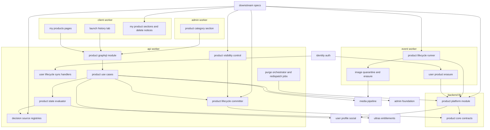
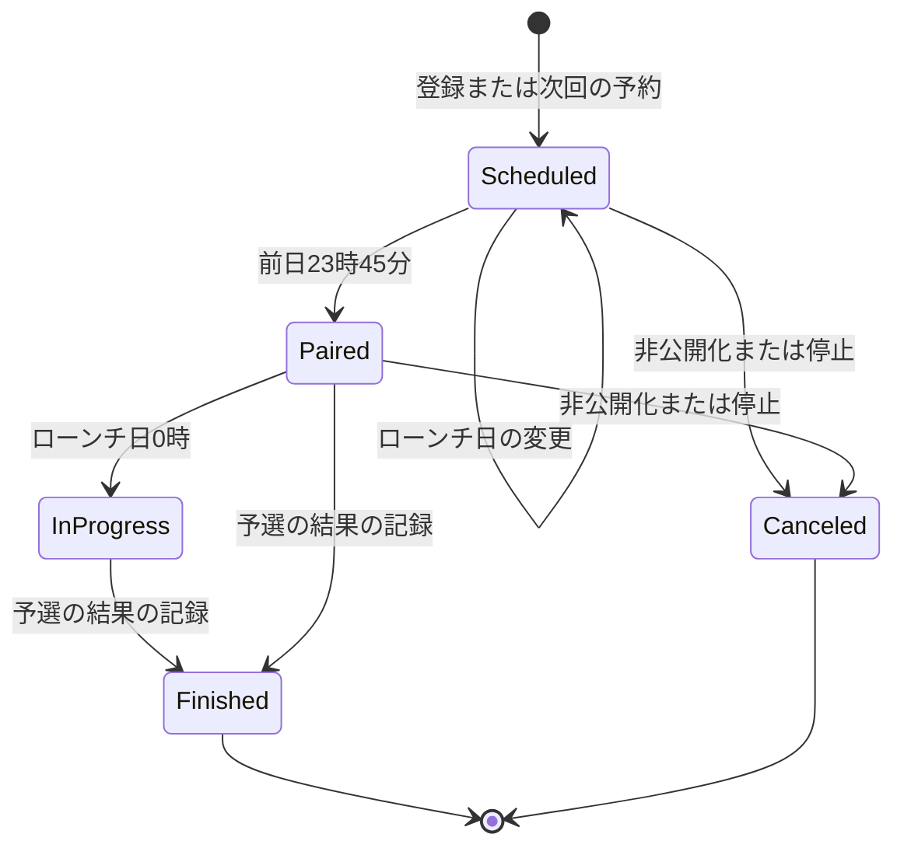
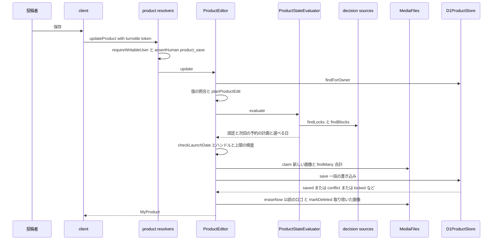
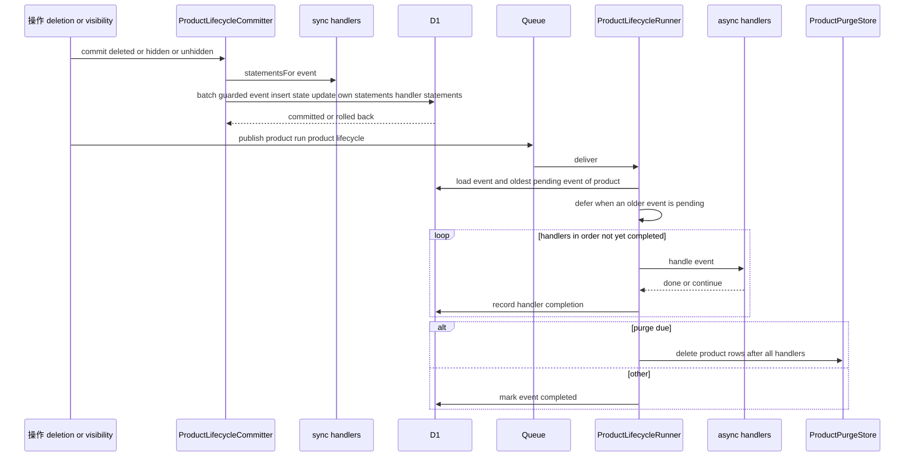
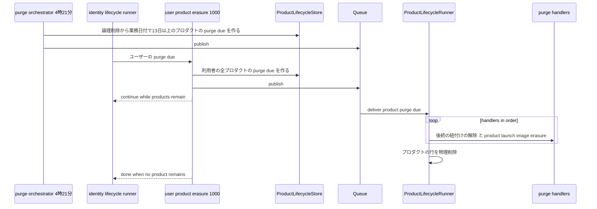
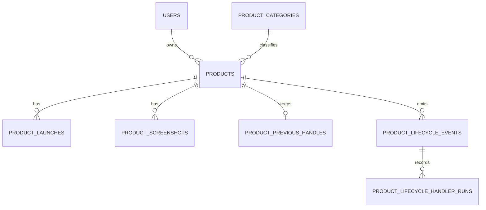

# Design Document

## Overview

**Purpose**: 投稿者のプロダクト(ロゴ・名称・タグライン・カテゴリ・ハンドル・外部WebサイトURL・説明文・スクリーンショット)と、予選への参加の予約であるローンチを実装する。ローンチはプロダクトとは別の記録で、ローンチ日・取消・予選の結果を持ち、状態(予定・ペアリング済み・マッチ中・終了・取消)を時刻から導く。ローンチ日の選べる範囲(23:40の境界・敗北後の間隔・上限)、次回の予約の禁止、マッチ直前・マッチ中の固定を本specが判定し、トーナメントに関わる条件は後続specが供給元の登録口へ加える。プロダクトの論理削除・非公開化・復元・物理削除をプロダクトライフサイクルイベントとして後続specへ伝え、物理削除ではマッチ記録などの紐付けを先に解除させる。プロダクトカテゴリのマスタと、管理画面のカテゴリのページの区画も持つ。

**Users**: 投稿者は`/my/products`で自分のプロダクトの状態を確かめ、`/my/products/new`で登録と最初のローンチの予約を行い、`/my/products/{handle}/edit`で編集・ローンチ日の変更・次回の予約・削除を行う。閲覧者は公開プロフィールの「ローンチ履歴」でプロダクトを知る。モデレーター以上の管理者は`/categories`でプロダクトカテゴリを管理する。後続spec(match-engine・directory-discovery・tournament-week・tournament-year・sponsorship・engagement・ugc-moderation・data-export・public-api)の開発者は、照会口・結果の記録の口・ライフサイクルの登録口・判定の供給元の登録口・画面の登録口を使う。

**Impact**: D1に7テーブル(プロダクトカテゴリ・プロダクト・スクリーンショット・プロダクトの旧ハンドル・ローンチ・ライフサイクルイベント・処理の完了の記録)と可視性の条件を足す。`apps/backend-lib`にプロダクトの契約(`core/product`)と共有部品(`workers/product`、apiとeventの両方に束縛)を新設する。apiにスキーマモジュール`product`・ユースケース・ライフサイクルの確定・2つの同期の波及処理・4:21の2つのジョブを、eventにプロダクトライフサイクルの実行器と3つの非同期の処理を、clientに3つの画面とローンチ履歴のタブを、adminにプロダクトカテゴリの区画を、frontend-libにカレンダーの部品(仮10)を足す。上流のファイルは、契約で定められた登録箇所への追記だけを変える。新しいシークレットは無く、新しいパッケージは`react-day-picker`(仮10)だけである。

### Goals

- FR-PRDCT-001〜021・FR-RELCH-001〜005・FR-ADMCF-006〜008が動作し、登録→予約→ペアリング済み→マッチ中→結果の記録→次回の予約、非公開化→取消→復元、削除→物理削除、退会→論理削除→物理削除のどの経路でも、要件と仮1〜仮14の決定に一致する。
- 後続specが本specのファイルを変えずに、ライフサイクルの処理・判定の条件・ローンチ履歴の要約と受賞・自分のプロダクトの画面の区画・削除の注意書きを加えられる。
- 本specが追加・変更したコードの単体テスト・Workers統合テスト・ブラウザテストがカバレッジ80%を満たす。

### Non-Goals

- ペアリング・マッチの進行・勝敗の判定・Upvote(match-engine)、ディレクトリ・プロダクト詳細ページ・検索の索引・旧ハンドルの302の応答(directory-discovery)。
- トーナメントの参加資格・結果確定待ち・トーナメントのマッチ直前とマッチ中の判定・受賞(tournament-week・tournament-year)。本specは供給元の登録口だけを持つ。
- 非公開化・復元の管理画面・理由・監査・通知(ugc-moderation)、停止に伴う画像の隔離と退会者の全ファイルの物理削除(user-profile-social)。
- 要件定義書の改訂(roadmapのOut。必要な改訂は[research.md](research.md)の「要件定義書の改訂が必要な箇所」に記録した)。(2026-10-25に要件定義書へ適用済み)

## Boundary Commitments

### This Spec Owns

- プロダクトのデータ: `product_categories`・`products`・`product_screenshots`・`product_previous_handles`・`product_launches`・`product_lifecycle_events`・`product_lifecycle_handler_runs`(`apps/db/schema/product/`)と、可視のプロダクトの条件`visibleProducts()`・勝利のローンチの条件`wonLaunchExists()`・カテゴリの条件`productInCategory()`(仮11)。
- 入力規則と定数(`apps/common-lib/product/`): 名称・タグライン・説明文・ハンドルの上限、画像の用途と上限、スクリーンショットの枚数(仮6)、ローンチ日の上限(仮4)、標準カテゴリの定数。監査の操作種別`apps/common-lib/admin/audit-actions/product-launch.ts`。
- ライフサイクルとローンチの状態の契約(`apps/backend-lib/core/product/`): イベントの種類・非同期の処理の登録と検証・再試行の方針、`deriveLaunchStatus`、予選の結果からの要約と受賞のまとめの規則`fallbackLaunchSummary`・`groupAwards`、メッセージ種別`product.run-product-lifecycle`。
- 共有部品(`apps/backend-lib/workers/product/`): ハンドルの対象`PRODUCT_HANDLE_NAMESPACE`・`PRODUCT_CATEGORY_HANDLE_NAMESPACE`、`ProductDirectory`・`ProductCategoryDirectory`・`ScheduledLaunchDirectory`・`LaunchOutcomeRecorder`・`ProductExport`・`LaunchExport`・`ProductLifecycleStore`・管理画面のプロダクトの検索の照会`AdminProductDirectory`(`D1AdminProductDirectory`・`PRODUCT_PLATFORM_TYPES.AdminProductDirectory`、ugc-moderationが使う、仮13)と、両アプリ共通の束縛`PRODUCT_PLATFORM_MODULE`。
- apiのプロダクトのユースケース・判定・D1の実装・スキーマモジュール`product`、判定の供給元の契約と登録口(`RELAUNCH_CONDITION_SOURCES`・`PRODUCT_LOCK_SOURCES`・`LAUNCH_SUMMARY_SOURCES`)、ライフサイクルの確定`ProductLifecycleCommitter`と同期の処理の登録口`PRODUCT_LIFECYCLE_SYNC_HANDLERS`、保存の登録口`PRODUCT_SAVE_HOOKS`(仮11)、非公開化・復元の操作口`ProductVisibilityControl`、ユーザーライフサイクルの同期の波及処理`product-launch.withdrawal`・`product-launch.launch-cancellation`、4:21のジョブ`product-launch.purge-orchestrator`(1000)・`product-launch.lifecycle-redispatch`(1010)。
- eventのプロダクトライフサイクルの実行器`ProductLifecycleRunner`と非同期の処理の登録口`PRODUCT_LIFECYCLE_ASYNC_HANDLERS`、本specの処理`product-launch.image-quarantine`(`hidden`・`unhidden`、1000)・`product-launch.image-erasure`(`purge_due`、1000)、ユーザーライフサイクルの非同期の波及処理`product-launch.product-erasure`(`purge_due`、1000)。
- media-pipelineの用途`product-logo`・`product-screenshot`の登録。
- clientの画面: `/my/products`・`/my/products/new`・`/my/products/$handle/edit`、公開プロフィールのタブ`launches`(10)と受賞バッジの区画`product-launch.award-badges`(`PUBLIC_PROFILE_BADGES`の10、仮14)、登録口`MY_PRODUCT_SECTIONS`・`PRODUCT_DELETE_NOTICES`(初版は空)。adminのプロダクトカテゴリの区画(`CATEGORY_SECTIONS`の10)。frontend-libのカレンダー`components/ui/calendar.tsx`(仮10)。
- 技術ドキュメント`backend/012-aggregate-lifecycle-events.md`・`backend/013-pluggable-decision-sources.md`・`frontend/012-business-date-calendar.md`の新規作成と、サービス仕様(ページ配置・文言規則・再ローンチ規則・日次タイムライン・準拠方針)とオンボーディングの追記。

### Out of Boundary

- `users`の定義・ユーザーライフサイクルの発行と実行器(identity-auth)。本specは波及処理の登録と`users`の読み取り(`visibleUsers`)だけを行う。
- ハンドルの規則と部品(user-profile-social)。本specは対象の記述を定義し、部品を呼ぶ。公開プロフィールのページの枠(user-profile-social)。本specはタブの中身だけを持つ。
- マッチ記録・ペアリング・勝敗(match-engine)。本specは予選の結果(勝利・敗北と確定の日時)の写しを記録の口で受け取るだけである。
- ディレクトリの一覧・検索・プロダクト詳細ページ・`/p/{handle}`の転送の応答(directory-discovery)。
- トーナメントの条件の中身、受賞の記録(tournament-week・tournament-year)。
- 非公開化・復元の画面・理由・監査ログ・投稿者への通知(ugc-moderation)。
- 画像の受け付け・判定・配信・隔離の移動・物理削除の実行(media-pipeline)、停止の隔離`user_suspended`と退会者の全ファイルの削除(user-profile-social)。
- Ultrasの加入状態(ultras-subscription)。本specは`isEntitledAt`の結果と`UltrasPromotionGate`だけを使う。
- 後続specの行の削除・紐付けの解除・索引の更新・広告の停止・返金(各後続specの処理)。

### Allowed Dependencies

- backend-platform: `AppModule`・`PLATFORM_TYPES`(`Database`・`Clock`・`IdGenerator`・`MessagePublisher`)・`AppError`・`getAppLogger`・`ulidPrimaryKey`・`timestamps`・`softDelete`・`textNoCase`・`BusinessTime`(`toBusinessDateTime`・`fromBusinessDateTime`・`parseBusinessDate`・`BusinessDate`)・`ScheduledJobDefinition`・`defineMessageContract`・`MESSAGE_CONTRACTS`・`MessageHandler`・`MessageHandlingResult`・`RetryPolicy`。形を変えない。
- api-gateway: `defineSchemaModule`・`GraphQLContext`(`resolve`・`assertHuman`・`caller`・`session`・`loaders`)・`withValidatedArgs`・`CURSOR_PAGE_ARGS`・`encodeCursor`・`decodeCursor`・`toConnection`・`defineLoader`・`DateTime`・`PageInfo`、`SessionView`。
- identity-auth: `AccountGuard`(`currentUser`・`requireUser`・`requireWritableUser`・`requireVerifiedUser`)・`CurrentUser`・`IDENTITY_TYPES`・`visibleUsers`・`users`(`id`・`status`・`deleted_at`・`email_verified_at`の読み取り)・`UserLifecycleSyncHandler`・`UserLifecycleSyncRegistration`・`USER_LIFECYCLE_SYNC_HANDLERS`・`UserLifecycleAsyncHandler`・`UserLifecycleAsyncRegistration`・`USER_LIFECYCLE_ASYNC_HANDLERS`・`LifecycleHandlerOutcome`・`assertLifecycleHandlerName`・`LIFECYCLE_CONTINUE_DELAY_SECONDS`・`_authenticated`のレイアウト・`viewerQueryOptions`・`RootAuthContext`・E2Eの`e2e/support/mailpit.ts`。
- user-profile-social: `HANDLE_PATTERN`・`checkHandleFormat`・`isSameHandle`・`isReservedHandle`・`IMPERSONATION_RESERVED_HANDLES`・`previousHandleColumns`・`defineHandleNamespace`・`resolveHandle`・`isHandleOccupied`・`handleOccupiedCondition`・`previousHandleUpsert`・`previousHandleSoftDelete`・`previousHandleDelete`・`previousHandleRelease`(user-profile-socialの仮2(B)の改訂で加わる文)・`checkExternalUrl`・`externalUrlHost`・`EXTERNAL_URL_MAX_LENGTH`・`UserProfileDirectory`・`PROFILE_PLATFORM_TYPES`・GraphQLの`HandleAvailability`(列挙)・`PUBLIC_PROFILE_TABS`・`PublicProfileTab`・`PUBLIC_PROFILE_BADGES`・`PublicProfileBadgeSection`(仮14)・`PublicProfileSectionContext`。
- media-pipeline: `defineUploadPurpose`・`UPLOAD_PURPOSES`・`IMAGE_MEDIA_TYPES`・`MediaFiles`(`claim`・`eraseNow`・`markDeleted`・`findMany`)・`MediaQuarantine`(`addReason`・`removeReason`)・`MEDIA_TYPES`・`toMediaImage`・`mediaFileLoader`・GraphQLの`MediaImage`・`ImageUploadField`・`MediaPicture`。
- content-processing: `countGraphemes`・`hasForbiddenCharacters`・`markdownTextSchema`・`MarkdownEditor`・`useMarkdownOptions`。
- ultras-subscription: `ULTRAS_TYPES.UltrasEntitlements`の`isEntitledAt`、`UltrasPromotionGate`。
- admin-foundation: `requireAdmin`・`CurrentAdmin`・`AuditLogRecorder`・`PreparedAuditEntry`・`buildAuditLogStatements`・`defineAuditAction`・`AUDIT_ACTIONS`・`checkCategoryName`・`CATEGORY_NAME_MAX`・`CategoryMasterEditor`・`useAdminRole`・`RoleGate`・E2Eの`e2e/support/admin-bootstrap.ts`。
- inquiry-chat: `CATEGORY_SECTIONS`・`CategorySection`(登録の追記だけ)。
- frontend-platform: `executeGraphQL`・`graphqlQueryOptions`・`GraphQLClientError`・`useAppForm`・`FormField`・`SubmitButton`・`applyServerFieldErrors`・`useTurnstileToken`・`TurnstileWidget`・`buildPageHead`・`NotFoundView`・`ErrorState`・`PartialErrorState`・`EmptyState`・`LoadingSkeleton`・`notify`・`DateTime`の表示部品・shadcn/uiの部品(ボタン・カード・バッジ・ダイアログ・アラートダイアログ・ツールチップ・セレクト)・`runAxe`。
- npmパッケージ: 新規は`react-day-picker`(9系、仮10。2026-10-24に開発者が承認して確定)だけ。
- 後続specは、`core/product`・`workers/product`の公開の契約、`visibleProducts()`・`wonLaunchExists()`・`productInCategory()`、apiの判定の供給元の契約と3つの登録口・`PRODUCT_LIFECYCLE_SYNC_HANDLERS`・`PRODUCT_SAVE_HOOKS`・`ProductVisibilityControl`・`ProductDescriptionEditor`、eventの`PRODUCT_LIFECYCLE_ASYNC_HANDLERS`、GraphQLの`productOwnerStatus`・`ProductCategory`、clientの`MY_PRODUCT_SECTIONS`・`PRODUCT_DELETE_NOTICES`だけに依存し、本specのテーブルへ書き込まない。読み取りの問い合わせで本specのテーブルを結合してよいのは`visibleProducts()`・`wonLaunchExists()`・`productInCategory()`を使う絞り込みと、それらで絞った`products.id`・`products.category_id`による並べ替え・集計(カテゴリごとの件数など)だけとする(仮11)。管理画面のプロダクトの検索(名称・ハンドルの部分一致、最新のローンチの状態・公開の状態による絞り込み)はこの範囲を超えるため、後続specの問い合わせには許さず、本specが所有して実装する`AdminProductDirectory`の中にだけ置く明示の例外とする(ugc-moderationは`AdminProductDirectory`を呼び、本specのテーブルを結合しない。仮13)。

### Revalidation Triggers

- `ProductLifecycleEventType`・`ProductLifecycleEvent`・`ProductLifecycleAsyncRegistration`・`ProductLifecycleSyncRegistration`の形、`order`の帯(roadmapの帯の割り当てと同じ)、同じプロダクトの順序・物理削除の順の規則(match-engine・directory-discovery・engagement・sponsorship・tournament-week・tournament-year・ugc-moderation)。
- `deriveLaunchStatus`の境界(前日23:45・0:00)と`LaunchStatus`の値(data-exportの`launches.json`の`status`、match-engine)。
- `ScheduledLaunchDirectory`・`LaunchOutcomeRecorder`の形と、記録を拒否する条件(match-engine)。
- `RelaunchConditionSource`・`ProductLockSource`・`LaunchSummarySource`の形、失敗時の扱い(判定は拒否、表示は縮退)(tournament-week・tournament-year)。
- `PRODUCT_SAVE_HOOKS`の`ProductSaveHook`の形、呼ぶ保存の種類(登録・編集・説明文の更新)、文を加える位置(一括の書き込みの末尾)と確定の後の失敗の扱い(directory-discovery。登録口は他の後続specにも開いている)。`productInCategory()`の条件と、結合してよい列(directory-discovery)。`fallbackLaunchSummary`・`groupAwards`の文言と並び(directory-discovery、ローンチ履歴と同じ表示)。仮11が開発者の確認で変われば、directory-discoveryの仮4の登録と索引の更新を確かめ直す。
- `visibleProducts()`・`wonLaunchExists()`の条件と、`ProductDirectory`・`ProductCategoryDirectory`・`ProductExport`・`LaunchExport`の形(directory-discovery・match-engine・sponsorship・data-export・public-api)。データエクスポートの文書の`products.json`・`launches.json`の項目が変わったら確かめ直す。
- `ProductVisibilityControl`の形と結果(ugc-moderation)。`ProductDescriptionEditor`が非公開化中に`product_hidden`(conflict)を投げる規則と`ProductStore.updateDescription`の`'hidden'`(public-api、仮12)。
- `MY_PRODUCT_SECTIONS`・`PRODUCT_DELETE_NOTICES`の形(tournament-week・tournament-year・sponsorship)。
- `AdminProductDirectory`・`AdminProductRecord`・`AdminProductSearchFilter`・`AdminProductLaunchState`・`AdminProductVisibility`の形、DIの識別子`PRODUCT_PLATFORM_TYPES.AdminProductDirectory`と置き場所(`apps/backend-lib/workers/product/admin-product-directory.ts`)、最新のローンチの状態と公開の状態の導き方、`countRegisteredAt`の数え方(ugc-moderation、仮13)。`products`・`product_launches`の列・`deriveLaunchStatus`の境界・非公開化の扱いを変えたら、この照会とugc-moderationの`/products`・週ごとの統計を確かめ直す。
- `PUBLIC_PROFILE_BADGES`への`product-launch.award-badges`(10)の登録と、受賞の集計の範囲(ローンチ履歴の対象と同じ)・`LaunchSummarySource`の`awards`の使い方(user-profile-social・tournament-week・tournament-year、仮14)。
- 2026-10-24に開発者が確定した仮1〜仮14(仮4はB、仮5の旧ハンドルはuser-profile-socialの仮2のB、他は推奨どおり)を変える場合は、該当する規則(`computeLaunchDateWindow`・`LAUNCH_DATE_HORIZON_DAYS`・`PRODUCT_HANDLE_NAMESPACE`・保存の条件・カテゴリの規則・カレンダー・`PRODUCT_SAVE_HOOKS`・`productInCategory()`・`AdminProductDirectory`・受賞バッジの区画)を確かめ直す。
- user-profile-socialのハンドル基盤の仮2(B)の改訂(`isHandleOccupied`・`handleOccupiedCondition`が他の対象の旧ハンドルを使用中としないこと、旧ハンドルを他の対象が設定したときに元の保持者の行を消す`previousHandleRelease`の名前と形)。本specの登録・保存の一括の書き込みと使用可否の判定がそれに依存する。
- 上流の`AccountGuard`・`visibleUsers`・ユーザーライフサイクルの登録口、ハンドル基盤の部品、`MediaFiles`・`MediaQuarantine`、`UltrasEntitlements`、`CATEGORY_SECTIONS`・`CategoryMasterEditor`・`AuditLogRecorder`、`PUBLIC_PROFILE_TABS`・`PUBLIC_PROFILE_BADGES`の形を変えたら、本specを確かめ直す。
- 後続specのテーブルが`media_files`へ外部キーを張らないこと(user-profile-socialの610の物理削除を止めないため)と、本specのテーブルを外部キーで参照する行をプロダクトの`purge_due`の処理で消すこと。

### 上流への影響

| 上流spec            | 変更                                                                                                                                                                                                                                                                                                                  | 影響と再検証                                                                                                                                                                                            |
| ------------------- | --------------------------------------------------------------------------------------------------------------------------------------------------------------------------------------------------------------------------------------------------------------------------------------------------------------------- | ------------------------------------------------------------------------------------------------------------------------------------------------------------------------------------------------------- |
| identity-auth       | `apps/api/src/composition/user-lifecycle-sync-handlers.ts`に`product-launch.withdrawal`・`product-launch.launch-cancellation`、`apps/event/src/composition/user-lifecycle-async-handlers.ts`に`product-launch.product-erasure`(1000)                                                                                  | 契約どおり。`createAsyncLifecycleRegistry`の検証(`purge_due`での`order`の重複)を通る                                                                                                                    |
| user-profile-social | `apps/client/src/composition/public-profile-sections.ts`の`PUBLIC_PROFILE_TABS`に`launches`(10)                                                                                                                                                                                                                       | 契約どおり。公開プロフィールの既定のタブが「ローンチ履歴」になる                                                                                                                                        |
| user-profile-social | 同じファイルの`PUBLIC_PROFILE_BADGES`に`{ id: 'product-launch.award-badges', order: 10, Section: ProfileAwardBadges }`(仮14)                                                                                                                                                                                          | 契約どおり(登録箇所への追記だけ)。初版は空だった受賞バッジの区画が、フォロワー数の下に出る(user-profile-socialの8.5)。user-profile-socialの文書は、受賞バッジの区画を登録するspecを本specとして記載する |
| user-profile-social | 変更しない。ハンドル基盤の仮2(B)の改訂(user-profile-socialが行う)に依存する: `isHandleOccupied`・`handleOccupiedCondition`は他の対象の旧ハンドルを使用中としない。旧ハンドルを他の対象が設定したときに元の保持者の行を消す文`previousHandleRelease(db, ns, { handle, exceptOwnerId }): BatchItem<'sqlite'>`を提供する | 本specの登録・保存の一括の書き込み(2.11)と使用可否(2.6)がその改訂を前提にする。名前と形はuser-profile-socialの改訂に合わせ、違えば本specの記述を直す                                                    |
| media-pipeline      | `apps/api/src/composition/upload-purposes.ts`の`UPLOAD_PURPOSES`に`product-logo`・`product-screenshot`                                                                                                                                                                                                                | 契約どおり                                                                                                                                                                                              |
| admin-foundation    | `apps/common-lib/admin/audit-actions/product-launch.ts`を足し、`audit-actions/index.ts`の連結へ加える                                                                                                                                                                                                                 | 契約どおり                                                                                                                                                                                              |
| inquiry-chat        | `apps/admin/src/composition/category-sections.ts`の`CATEGORY_SECTIONS`に`product-launch.product-categories`(10)                                                                                                                                                                                                       | 契約どおり。カテゴリのページの先頭の区画になる                                                                                                                                                          |
| backend-platform    | apiの`scheduled-jobs.ts`に2つのジョブ、`core/messaging/contracts/index.ts`に`product.run-product-lifecycle`、eventの`message-handlers.ts`に実行器                                                                                                                                                                     | 契約どおり。4:21の式は上流で加わっている                                                                                                                                                                |
| frontend-platform   | `apps/frontend-lib/components/ui/calendar.tsx`と`react-day-picker`の追加(仮10、確定)                                                                                                                                                                                                                                  | frontend-libの規約(1ファイル1コンポーネント・stories・`runAxe`)に従う新しい部品。既存の部品は変えない                                                                                                   |

- 本specは上流specの文書を変更しない(ハンドル基盤の仮2(B)の改訂はuser-profile-socialが行う)。roadmapの帯の割り当ての表の本specの「使用中の値」は「4:21は1000・1010、波及処理は1000」になる(本specはroadmapを編集しないため、コントローラーへ報告する)。

## Architecture

### Existing Architecture Analysis

- 上流の15specは設計・タスクとも承認済みで、本specのタスクはそれらの実装の完了を前提にする(roadmapの順でuser-profile-socialまでが先に実装される。help-centerはroadmapで本specの前にあり、本specと依存しない)。実装済みはdev-toolingだけである。
- apiはクリーンアーキテクチャ(`domain`→`application`→`infrastructure`・`presentation`→`composition`)、処理単位のDIコンテナ、D1の`db.batch()`による1トランザクションの書き込み、`CASE`式のNOT NULL制約の違反による一括の書き込みの取り消しを使う。Cron Triggersはapiだけにあり、重い処理はQueuesでeventへ委ねる。
- ユーザーライフサイクルの同期の波及処理はapiの確定と同じ一括の書き込み、非同期の波及処理はeventの実行器で、`purge_due`の全処理の後に`users`が消える。ドメインのテーブルはファイルのIDを外部キー無しで持つ。

### Architecture Pattern & Boundary Map



**Architecture Integration**:

- Selected pattern: クリーンアーキテクチャ。時刻と状態の規則はapiの`domain/product`と`core/product`の純粋な関数、ユースケースはポート越しにD1・media-pipeline・判定の供給元を使う。状態の変化を伝える経路は、identity-authのユーザーライフサイクルと同じ形のプロダクトライフサイクル(確定の一括の書き込み・非同期の実行器・日次の送り直し・最後の物理削除)にする。
- Domain/feature boundaries: プロダクト・ローンチ・カテゴリ・プロダクトのライフサイクルは本spec、マッチと結果の判定はmatch-engine、トーナメントの条件と要約はトーナメントのspec、ハンドルの規則はuser-profile-social、ファイルはmedia-pipeline。
- Existing patterns preserved: `backend-lib/workers/<ドメイン>`の共有の束縛、`<spec名>.<名詞句>`の処理とジョブの名前、`<ドメイン>.<動詞句>`のメッセージ種別、帯の`order`、登録箇所への追記による拡張(`SETTINGS_NAV_ITEMS`・`CATEGORY_SECTIONS`と同じ形)、`CASE`式による取り消し、`encodeCursor`のカーソル。
- New components rationale: ローンチの記録と状態は、次回の予約の禁止・固定・ローンチ履歴・掲載済みの判定を本specのテーブルだけで行うため(research.mdの比較)。プロダクトライフサイクルは物理削除の順序(後続の紐付けの解除が先)を帯の外の値を使わずに保つため。判定の供給元の登録口は、型の拡張を禁じるapi-gatewayの規約のもとで後続specが条件と要約を加えるため。
- Steering compliance: Inversifyの`@inject`の明示、D1の制約(`db.batch()`・バインド変数100個以内・部分一意索引)、`textNoCase`の作成時の指定、800行以内のファイル、1ファイル1コンポーネント、日時の`<time datetime>`、新しいパッケージは`react-day-picker`だけ(仮10、2026-10-24に承認して確定)。

**Dependency direction**: `apps/common-lib/product` → `apps/db/schema/product` → `backend-lib/core/product` → `backend-lib/workers/product` → 各アプリの`src`(`domain` → `application` → `infrastructure`・`presentation` → `composition`)。`common-lib`は他の層を読み込まない。`core/product`はD1を読み込まない(`BusinessTime`と型だけ)。clientとadminは`common-lib`とGraphQLの操作だけを読み込む。違反はレビューで誤りとして扱う。

### Technology Stack

| Layer     | Choice / Version                                                                                                               | Role in Feature                                                  | Notes                                      |
| --------- | ------------------------------------------------------------------------------------------------------------------------------ | ---------------------------------------------------------------- | ------------------------------------------ |
| Frontend  | TanStack Start・Router・Query・shadcn/ui(上流)、`MarkdownEditor`・`ImageUploadField`(上流)、`react-day-picker` 9系(仮10、確定) | 自分のプロダクトの画面・登録・編集・ローンチ履歴・カテゴリの区画 | 実装時点の9系の最新の安定版に完全固定する  |
| Backend   | Hono・Inversify・GraphQL Yoga(上流)                                                                                            | スキーマモジュール・ユースケース・ライフサイクル                 | 既存                                       |
| Data      | Cloudflare D1(Drizzle)                                                                                                         | 7テーブル・部分一意索引                                          | 新規のマイグレーション(`textNoCase`)       |
| Messaging | Cloudflare Queues・Cron Triggers(上流)                                                                                         | `product.run-product-lifecycle`、4:21の2つのジョブ               | 新しいメッセージ種別1つ                    |
| External  | Turnstile(上流)                                                                                                                | 登録・編集・削除のbot対策                                        | `action`は`product_save`・`product_delete` |

## File Structure Plan

### Directory Structure

```
apps/
├── common-lib/                                           # 4アプリ共通(各ファイルに同名の*.unit.test.ts)
│   ├── product/product-input-rules.ts                    # 上限・用途・PRODUCT_HANDLE_RULE・PRODUCT_CATEGORY_HANDLE_RULE・PRODUCT_SCREENSHOTS_MAX(仮6)・LAUNCH_DATE_HORIZON_DAYS(仮4)・checkProductName・checkTagline
│   ├── product/product-category-constants.ts             # PRODUCT_CATEGORY_OTHER_ID・NAME・HANDLE
│   └── admin/audit-actions/product-launch.ts             # product-category.create・update・delete
├── db/schema/product/                                    # テーブル定義(各ファイルに同名の*.unit.test.ts)
│   ├── product-categories.ts
│   ├── products.ts                                       # version・hidden_at・deleted_at・latest_launch_date
│   ├── product-screenshots.ts
│   ├── product-previous-handles.ts                       # previousHandleColumns
│   ├── product-launches.ts                               # 部分一意索引(未確定かつ取消でないローンチはプロダクトに1つ)
│   ├── product-lifecycle-events.ts
│   ├── product-lifecycle-handler-runs.ts
│   ├── visibility.ts                                     # visibleProducts・wonLaunchExists・productInCategory(仮11)
│   └── index.ts
├── backend-lib/
│   ├── core/product/                                     # 純粋な契約(Bunの単体テスト)
│   │   ├── product-lifecycle.ts                          # イベントの型・非同期の登録・createProductLifecycleRegistry・PRODUCT_LIFECYCLE_RETRY_POLICY
│   │   ├── launch-status.ts                              # LaunchStatus・deriveLaunchStatus・qualifierLockThresholdDate
│   │   └── launch-summary.ts                             # fallbackLaunchSummary・groupAwards(directory-discoveryも使う)
│   ├── core/messaging/contracts/product.ts               # RUN_PRODUCT_LIFECYCLE_MESSAGE
│   └── workers/product/                                  # api・event共通の部品(Workers統合テスト)
│       ├── product-platform-types.ts                     # PRODUCT_PLATFORM_TYPES(テストなし)
│       ├── product-handle-namespaces.ts                  # PRODUCT_HANDLE_NAMESPACE・PRODUCT_CATEGORY_HANDLE_NAMESPACE
│       ├── product-directory.ts                          # ProductSummaryRecord・ProductDirectory(型)
│       ├── d1-product-directory.ts
│       ├── product-category-directory.ts                 # ProductCategoryRecord・ProductCategoryDirectory(型)
│       ├── d1-product-category-directory.ts
│       ├── launch-schedule.ts                            # ScheduledLaunchDirectory・LaunchOutcomeRecorder(型)
│       ├── d1-launch-schedule.ts
│       ├── product-export.ts                             # ProductExport・LaunchExport(型)
│       ├── d1-product-export.ts
│       ├── product-lifecycle-store.ts                    # ProductLifecycleStore(型とD1の実装)
│       ├── admin-product-directory.ts                    # AdminProductDirectory・D1AdminProductDirectory(ugc-moderationの管理画面の検索、仮13)
│       └── product-platform-module.ts                    # PRODUCT_PLATFORM_MODULE
├── api/src/
│   ├── domain/product/                                   # 純粋な規則(Bunの単体テスト)
│   │   ├── launch-date-rules.ts                          # computeLaunchDateWindow・checkLaunchDate
│   │   ├── launch-plan.ts                                # decideLaunchPlan(予約・変更・禁止・固定の決定)
│   │   └── product-edit-plan.ts                          # ハンドル・ロゴ・スクリーンショット・カテゴリ・ローンチの変更の決定
│   ├── application/product/                              # ユースケース(Bunの単体テスト)
│   │   ├── product-types.ts                              # PRODUCT_TYPES
│   │   ├── ports.ts                                      # ProductStore・LaunchHistoryStore・ProductCategoryStoreと各型
│   │   ├── decision-sources.ts                           # 3つの供給元の契約と登録の型
│   │   ├── product-save-hooks.ts                         # ProductSaveHook・ProductSaveHookRegistration・ProductSaveHooks・createProductSaveHooks(仮11)
│   │   ├── product-state-evaluator.ts                    # 固定・次回の予約・選べる日の判定
│   │   ├── product-registration.ts
│   │   ├── product-editor.ts
│   │   ├── product-deletion.ts
│   │   ├── product-description-editor.ts                 # 公開APIの説明文の更新
│   │   ├── my-products-reader.ts                         # 一覧・1件・新規の選べる日・所有者の状態
│   │   ├── product-handle-availability-checker.ts
│   │   ├── launch-history-reader.ts
│   │   ├── product-category-service.ts
│   │   ├── product-visibility-control.ts                 # 非公開化・復元の操作口(ugc-moderationが呼ぶ)
│   │   └── product-maintenance-jobs.ts                   # purge-orchestrator・lifecycle-redispatch
│   ├── infrastructure/product/                           # Workers統合テスト
│   │   ├── d1-product-store.ts                           # 読み取り・登録・保存の一括の書き込み
│   │   ├── product-save-guards.ts                        # CASE式の条件(版・状態・ハンドル・固定・非公開化)
│   │   ├── d1-launch-history-store.ts
│   │   ├── d1-product-category-store.ts
│   │   ├── product-lifecycle-sync-handler.ts             # ProductLifecycleSyncHandler・登録の型(他specが実装)
│   │   ├── d1-product-lifecycle-committer.ts             # deleted・hidden・unhiddenの確定
│   │   ├── product-withdrawal-sync-handler.ts            # product-launch.withdrawal
│   │   └── launch-cancellation-sync-handler.ts           # product-launch.launch-cancellation
│   ├── presentation/graphql/modules/product/             # スキーマモジュール(Workers統合テスト)
│   │   ├── type-defs.ts
│   │   ├── inputs.ts                                     # zodスキーマ(common-libの規則とmarkdownTextSchema)
│   │   ├── errors.ts                                     # エラーコードと文言
│   │   ├── product-views.ts                              # ローンチ・計画・カテゴリの項目のリゾルバ
│   │   ├── my-product-resolvers.ts                       # myProducts・myProduct・newProductLaunchWindow・productHandleAvailability・productOwnerStatus・3つのミューテーション
│   │   ├── launch-history-resolvers.ts                   # launchHistory・profileAwards(仮14)
│   │   ├── category-resolvers.ts                         # productCategories・管理者の4操作
│   │   └── index.ts                                      # productSchemaModule
│   └── composition/
│       ├── product-module.ts                             # PRODUCT_MODULE(apiの束縛)
│       ├── product-decision-sources.ts                   # RELAUNCH_CONDITION_SOURCES・PRODUCT_LOCK_SOURCES・LAUNCH_SUMMARY_SOURCES(初版は空)
│       ├── product-lifecycle-sync-handlers.ts            # PRODUCT_LIFECYCLE_SYNC_HANDLERS(初版は空)
│       └── product-save-hooks.ts                         # PRODUCT_SAVE_HOOKS(初版は空、仮11)
├── event/src/
│   ├── application/product/                              # Bunの単体テスト
│   │   ├── event-product-types.ts                        # EVENT_PRODUCT_TYPES
│   │   ├── ports.ts                                      # ProductPurgeStore
│   │   ├── product-lifecycle-runner.ts                   # product.run-product-lifecycle
│   │   ├── product-image-quarantine-handler.ts           # hidden・unhidden 1000
│   │   ├── product-image-erasure-handler.ts              # purge_due 1000
│   │   └── user-product-erasure-handler.ts               # ユーザーのpurge_due 1000
│   ├── infrastructure/product/d1-product-purge-store.ts  # 画像のIDの読み取りと最後の物理削除
│   └── composition/
│       ├── product-module.ts
│       └── product-lifecycle-async-handlers.ts           # PRODUCT_LIFECYCLE_ASYNC_HANDLERS(初版は本specの2件)
├── frontend-lib/components/ui/calendar.tsx               # shadcn/uiのカレンダー(仮10で確定、stories・browser test)
├── client/src/
│   ├── routes/_authenticated/my/products/index.tsx       # /my/products
│   ├── routes/_authenticated/my/products/new.tsx         # /my/products/new
│   ├── routes/_authenticated/my/products/$handle/edit.tsx # /my/products/{handle}/edit
│   ├── composition/my-product-sections.ts                # MY_PRODUCT_SECTIONS(後続specが追記、初版は空)
│   ├── composition/product-delete-notices.ts             # PRODUCT_DELETE_NOTICES(後続specが追記、初版は空)
│   ├── components/product/                               # 1ファイル1コンポーネント(browser testを併置)
│   │   ├── product-section-types.ts                      # MyProductSectionContext・各登録の型(テストなし)
│   │   ├── my-product-list-page.tsx                      # 一覧の枠・状態表示・続き
│   │   ├── my-product-card.tsx                           # 1件の項目と登録された区画
│   │   ├── launch-status-text.tsx                        # ローンチの状態の文言とキックオフの日時
│   │   ├── launch-plan-notice.tsx                        # 次回の予約・固定・非公開化の案内
│   │   ├── product-form.tsx                              # 登録・編集の共通のフォーム
│   │   ├── product-form-schema.ts                        # フォームのzodスキーマ(テストは*.unit.test.ts)
│   │   ├── logo-field.tsx
│   │   ├── screenshots-field.tsx
│   │   ├── product-handle-field.tsx
│   │   ├── category-select.tsx
│   │   ├── launch-date-field.tsx                         # カレンダー・選べない理由・キックオフの表示
│   │   ├── product-edit-page.tsx                         # 編集画面の枠(状態・フォーム・削除)
│   │   └── product-delete-dialog.tsx                     # 確認と登録された注意書き
│   ├── components/launch-history/
│   │   ├── launch-history-count.tsx                      # タブの件数
│   │   ├── launch-history-panel.tsx                      # 一覧・案内・状態・続き
│   │   ├── launch-history-item.tsx                       # 1件(ローンチ3件と「他◯回を表示」)
│   │   ├── award-badge-list.tsx                          # 受賞バッジの並び(LaunchHistoryItemと公開プロフィールの区画で共用、仮14)
│   │   └── profile-award-badges.tsx                      # 公開プロフィールの受賞バッジの区画(仮14)
│   ├── composition/public-profile-sections.ts            # (変更)PUBLIC_PROFILE_TABSにlaunches 10、PUBLIC_PROFILE_BADGESにproduct-launch.award-badges 10を追記
│   └── graphql/operations/product/
│       ├── my-products.ts                                # myProducts・myProduct・newProductLaunchWindow・productHandleAvailability
│       ├── product-mutations.ts                          # registerProduct・updateProduct・deleteProduct
│       ├── product-categories.ts                         # productCategories
│       └── launch-history.ts                             # launchHistory・profileAwards(仮14)
└── admin/src/
    ├── components/categories/product-category-section.tsx
    └── graphql/operations/product/product-categories.ts   # 一覧と3つの操作
e2e/
├── client/product.e2e.test.ts                            # 登録・一覧・編集・ハンドルの変更・削除
└── admin/product-categories.e2e.test.ts                  # 追加・変更・削除の拒否
docs/GUIDES/tech/
├── backend/012-aggregate-lifecycle-events.md             # 集約のライフサイクルイベントの規約
├── backend/013-pluggable-decision-sources.md             # 後続が条件を加える判定の拡張点
└── frontend/012-business-date-calendar.md                # 業務日付の選択とカレンダー
```

テストは各ファイルの隣に置く(`*.unit.test.ts`・`*.worker.test.ts`・`*.browser.test.tsx`)。技術ドキュメントの番号は、roadmapの順で本specより前のuser-profile-social(`backend/011`・`db/006`)とhelp-center(`frontend/011-table-of-contents.md`)の後の空き番号`backend/012`・`backend/013`・`frontend/012`に固定する。help-centerが節を加える`backend/011-handle-namespaces.md`は、本specでは変更しない。

### Modified Files

- `apps/db/schema/index.ts`・`apps/db/migrations/<日時>_product_launch/migration.sql` — 7テーブルの再エクスポートと、生成したマイグレーション(`textNoCase`・CHECK・部分一意索引・標準カテゴリ「その他」の初期データ)。mainの最新を取り込んでから生成する。
- `apps/common-lib/admin/audit-actions/index.ts` — `product-launch.ts`の連結。
- `apps/backend-lib/core/messaging/contracts/index.ts` — `RUN_PRODUCT_LIFECYCLE_MESSAGE`。
- `apps/api/src/composition/modules.ts`・`graphql-modules.ts`・`scheduled-jobs.ts`・`upload-purposes.ts`・`user-lifecycle-sync-handlers.ts` — `PRODUCT_PLATFORM_MODULE`・`PRODUCT_MODULE`・`productSchemaModule`・2つのジョブ・2つの用途・2つの同期の波及処理。
- `apps/event/src/composition/modules.ts`・`message-handlers.ts`・`user-lifecycle-async-handlers.ts` — `PRODUCT_PLATFORM_MODULE`・eventの束縛・実行器・`product-launch.product-erasure`。
- `apps/client/src/composition/public-profile-sections.ts` — `PUBLIC_PROFILE_TABS`に`{ id: 'launches', label: 'ローンチ履歴', order: 10, Count: LaunchHistoryCount, Panel: LaunchHistoryPanel }`、`PUBLIC_PROFILE_BADGES`に`{ id: 'product-launch.award-badges', order: 10, Section: ProfileAwardBadges }`(仮14)。
- `apps/admin/src/composition/category-sections.ts` — `{ id: 'product-launch.product-categories', order: 10, title: 'プロダクトカテゴリ', component: ProductCategorySection }`。
- `apps/frontend-lib/package.json`・`apps/client/package.json`・`apps/admin/package.json`・各`bun.lock` — `react-day-picker`(実装時点の9系の最新の安定版を、3つの`package.json`へ同じ版で完全固定し、`--exact`で版を明示して実行時の依存として追加する)。
- `docs/GUIDES/tech/backend/README.md`・`frontend/README.md` — 文書一覧の行。`react-day-picker`は`coding/002`の主要パッケージの一覧の対象(版が食い違うと基底設定・プリセットが動かない、または組み合わせられる版の範囲が狭いもの)ではないため一覧には載せず、同文書の「一覧に無いパッケージでも、共有ディレクトリのコードが実行時に使うものは、利用側アプリが共有ディレクトリ側と同じ版で宣言する」と共有ディレクトリの文書の規則に従う(`coding/002`は変更しない)。
- `docs/onboardings/tech-stack.md` — UI・スタイリングの`react-day-picker`の行はコントローラーが追加済みのため、本specは変更しない。
- `docs/onboardings/project-values.md` — 波及処理・ジョブ・処理の名前と`order`、用途、bot対策の`action`、メッセージ種別。
- `docs/GUIDES/service/design/002-page-layouts.md` — 自分のプロダクトの画面・登録・編集の配置、ローンチ履歴の取消の扱い、カテゴリの区画、非公開化中の編集(仮7)。
- `docs/GUIDES/service/design/003-text-and-copy-rules.md` — 本specのエラー・状態・トーストの文言、スクリーンショットの枚数(仮6)。
- `docs/GUIDES/service/overview/006-relaunch-rules.md` — 仮1・仮7の注記と、選べる日の上限(仮4)。
- `docs/GUIDES/service/overview/007-daily-timeline.md` — 4:21のジョブの表に1000・1010。
- `docs/GUIDES/service/legal/001-compliance-policy.md` — 注5に論理削除したプロダクトのハンドルの扱い(仮5)。
- `CLAUDE.md` — 「技術規則の参照先」に「集約の状態の変化を他の機能へ伝える処理を作る前に: `backend/012`」。

## System Flows

### ローンチの状態と時刻の境界



- `deriveLaunchStatus(launch, now)`の判定の順: `cancelledAt`があれば`canceled`→`outcome`があれば`finished`→`now`がローンチ日の0:00以降なら`in_progress`→前日23:45以降なら`paired`→それ以外は`scheduled`。
- 予選のマッチ直前・マッチ中の固定は`paired`・`in_progress`、次回の予約の禁止(FR-RELCH-005)は直近のローンチが`scheduled`・`paired`・`in_progress`。ローンチ日の変更は直近のローンチが`scheduled`のときだけ受け付ける。
- 取消(`Paired --> Canceled`)は、非公開化・停止の時点でローンチ日が今日より後のもの。ローンチ日が今日(マッチ中)のものは取り消さず、match-engineがマッチを終了して結果を記録する。

### 次回の予約と保存



- 一括の書き込みの並び: (1)`products`の更新。`user_id`を`CASE WHEN <条件> THEN user_id ELSE NULL END`にし、条件を満たさなければNOT NULL制約の違反で全体を取り消す。条件は、版の一致・未削除・投稿者が可視・ハンドルを別の文字列に変えるなら`handleOccupiedCondition(PRODUCT_HANDLE_NAMESPACE, handle, { exceptOwnerId })`でないこと(他のプロダクトの現在のハンドルだけを見る。旧ハンドルは使用中としない、仮5)・ローンチ日かカテゴリを変えるなら予選の固定の条件(下記)・次回の予約なら`hidden_at IS NULL`。(2)ハンドルを別の文字列に変えたときだけ、他のプロダクトが同じハンドルを旧ハンドルとして保持していればその行を消す`previousHandleRelease(db, PRODUCT_HANDLE_NAMESPACE, { handle, exceptOwnerId })`と、自分の変更前のハンドルの`previousHandleUpsert`(2.11・仮5)。(3)スクリーンショットの全削除と最大20行の挿入。(4)ローンチの変更があれば、次回の予約は`product_launches`の挿入(部分一意索引で同時の予約も防ぐ)、ローンチ日の変更は`UPDATE product_launches SET launch_date = ? WHERE id = ? AND outcome IS NULL AND cancelled_at IS NULL`。(5)ローンチの変更があれば`latest_launch_date`を取消を含む全ローンチの最新の日に更新する。(6)末尾に、`PRODUCT_SAVE_HOOKS`の各処理の`statementsFor({ productId, at })`の文を登録の順に加える(登録・説明文の更新でも同じ、仮11)。
- 予選の固定の条件(SQL): `NOT EXISTS (SELECT 1 FROM product_launches WHERE product_id = products.id AND outcome IS NULL AND cancelled_at IS NULL AND launch_date <= ?)`。`?`は`qualifierLockThresholdDate(now)`(23:45以降なら明日、それより前なら今日の業務日付)。読み取りから書き込みまでの間に23:45をまたいでも固定が破られない(6.6)。
- 失敗の分類は読み直しで行う(未削除でない→`product_not_found`、投稿者が可視でない→`account_unavailable`、版が違う→`product_update_conflict`、固定の期間→`product_locked`、非公開化→`product_hidden`、それ以外の条件と一意索引の違反→`handle_unavailable`)。
- 画像の`claim`は既に紐付け済みなら変えないため、保存の失敗後の再送でも成功する。以前の画像の削除は確定の後だけ行い、失敗はmedia-pipelineの日次バッチが完了させる(`warn`のログにファイルのIDだけ)。
- 確定の後に、`PRODUCT_SAVE_HOOKS`の各処理の`afterCommit({ productId })`を登録の順に呼ぶ。例外は`warn`のログ(処理の名前とプロダクトのIDだけ)を残して次の処理へ進み、保存の結果を変えない。`statementsFor`の例外は保存の失敗(500)とし、何も書き込まない(仮11)。

### プロダクトライフサイクルイベント



- イベントの挿入の`product_id`を`CASE WHEN <状態の条件> THEN ? ELSE NULL END`にし、条件(削除は版の一致・未削除・投稿者が可視・予選の固定でない、非公開化は未削除かつ`hidden_at IS NULL`、復元は未削除かつ`hidden_at IS NOT NULL`)を満たさなければ全体を取り消す。
- 本specの文: 削除は`products.deleted_at`と`previousHandleSoftDelete`(旧ハンドルの転送を止める。現在のハンドルは物理削除まで使用中のまま、旧ハンドルは他のプロダクトが設定できる、仮5)。非公開化は`hidden_at`と未開始のローンチの取消(`launch_date > 今日`、12.7)。復元は`hidden_at = NULL`だけで、取消を戻さない(12.9)。
- 送信の失敗はイベントを`pending`のまま残し、4:21の`product-launch.lifecycle-redispatch`が送り直す(12.5)。非同期の処理の例外は`PRODUCT_LIFECYCLE_RETRY_POLICY`(5回・300秒から倍・上限3600秒)で再試行され、上限でデッドレターとSentryに通知される。

### 物理削除



- `product-launch.purge-orchestrator`は、`deleted_at < 業務日付(実行日 − 12日)の0:00`(業務日付で13日以上前の論理削除)で`purge_due`の無いプロダクトを200件まで選んでイベントを作り、送る(8.4)。論理削除から14日を過ぎて行が残るプロダクトを数え、0件でなければ`product-purge-overdue`をSentryへ報告する(8.6)。
- ユーザーの`purge_due`(`product-launch.product-erasure`、1000)は、その利用者のプロダクトの行が無ければ`done`。あれば`purge_due`の無いものに作って送り、`continue`を返す。全プロダクトの`purge_due`が作られてから10分を過ぎても行が残っていれば例外を投げ、identity-authの再試行の間隔(300秒から倍)に任せる(5秒ごとの`continue`の空回りを避ける)。
- 実行器は`purge_due`の全処理の後に、`product_lifecycle_handler_runs`・`product_lifecycle_events`・`product_launches`・`product_screenshots`・`product_previous_handles`・`products`をこの順に1つの一括の書き込みで消す(8.4・13.4)。後続specの行が外部キーで残っていれば失敗し、イベントは`pending`のまま残り期限超過で検知される。

## Requirements Traceability

| Requirement                                                 | Summary                                | Components                                                                                          | Interfaces                                                                                   | Flows                            |
| ----------------------------------------------------------- | -------------------------------------- | --------------------------------------------------------------------------------------------------- | -------------------------------------------------------------------------------------------- | -------------------------------- |
| 1.1, 1.2, 1.3, 1.4, 1.5                                     | 登録と入力の検証                       | ProductInputRules、ProductInputs、ProductFormSchema、ProductRegistration、ProductForm               | `registerProduct`                                                                            | 次回の予約と保存                 |
| 1.6, 1.7, 1.8                                               | bot対策・未確認・停止中                | MyProductResolvers、ProductRegistration、ProductEditor、ProductDeletion、MyProductRoutes            | `assertHuman('product_save')`・`requireVerifiedUser`                                         | 次回の予約と保存                 |
| 1.9, 1.10, 1.11                                             | フォーカスアウト・登録後・未ログイン   | ProductForm、MyProductRoutes                                                                        | `_authenticated`                                                                             | —                                |
| 2.1, 2.2, 2.3, 2.4, 2.5                                     | ハンドルの規則と使用中                 | ProductInputRules、ProductHandleNamespaces、ProductEditPlan、D1ProductStore、ProductSaveGuards      | `PRODUCT_HANDLE_NAMESPACE`・`handleOccupiedCondition`                                        | 次回の予約と保存                 |
| 2.6                                                         | フォーカスアウトの使用可否             | ProductHandleAvailabilityChecker、ProductHandleField                                                | `productHandleAvailability`                                                                  | —                                |
| 2.7, 2.8, 2.9, 2.10, 2.11                                   | 旧ハンドルと解決                       | ProductEditPlan、D1ProductStore、ProductDirectory、D1ProductLifecycleCommitter、ProductHandleField  | `previousHandleUpsert`・`previousHandleRelease`・`resolveHandle`・`previousHandleSoftDelete` | プロダクトライフサイクルイベント |
| 3.1, 3.2, 3.3                                               | ロゴとスクリーンショットの上限         | ProductInputRules、LogoField、ScreenshotsField、ProductEditor                                       | `product-logo`・`product-screenshot`・`MediaFiles.findMany`                                  | —                                |
| 3.4, 3.5, 3.6, 3.7                                          | 紐付け・順序・削除                     | ProductEditor、ProductEditPlan、D1ProductStore                                                      | `MediaFiles.claim`・`eraseNow`・`markDeleted`                                                | 次回の予約と保存                 |
| 3.8                                                         | プレースホルダー                       | MyProductCard、LaunchHistoryItem、LogoField                                                         | `MediaPicture`                                                                               | —                                |
| 4.1, 4.2, 4.3, 4.4, 4.5, 4.11, 4.12                         | 選べる日の規則                         | LaunchDateRules、ProductStateEvaluator                                                              | `computeLaunchDateWindow`                                                                    | ローンチの状態と時刻の境界       |
| 4.6                                                         | Ultrasの判定時点                       | ProductStateEvaluator                                                                               | `UltrasEntitlements.isEntitledAt`                                                            | —                                |
| 4.7                                                         | サーバーでの検証                       | LaunchDateRules、ProductEditor、ProductRegistration                                                 | `checkLaunchDate`・`launch_date_unavailable`                                                 | 次回の予約と保存                 |
| 4.8, 4.9, 4.10                                              | カレンダーとUltrasの導線               | LaunchDateField、Calendar、LaunchPlanNotice                                                         | `LaunchDateWindow`・`UltrasPromotionGate`                                                    | —                                |
| 5.1, 5.2, 5.7, 5.9, 5.10                                    | 次回の予約と変更                       | LaunchPlan、ProductStateEvaluator、ProductEditor、D1ProductStore                                    | `decideLaunchPlan`・部分一意索引                                                             | 次回の予約と保存                 |
| 5.3, 5.4, 5.5, 5.6                                          | 拡張点                                 | DecisionSources、ProductStateEvaluator、LaunchPlanNotice                                            | `RelaunchConditionSource`・`RELAUNCH_CONDITION_SOURCES`                                      | —                                |
| 5.8                                                         | 非公開化中の予約                       | LaunchPlan、ProductSaveGuards                                                                       | `product_hidden`                                                                             | —                                |
| 6.1, 6.6                                                    | 予選の固定                             | LaunchStatus、ProductSaveGuards、D1ProductLifecycleCommitter                                        | `qualifierLockThresholdDate`                                                                 | ローンチの状態と時刻の境界       |
| 6.2, 6.5                                                    | 固定の拡張点                           | DecisionSources、ProductStateEvaluator                                                              | `ProductLockSource`・`PRODUCT_LOCK_SOURCES`                                                  | —                                |
| 6.3, 6.4                                                    | 編集画面の固定の表示                   | ProductEditPage、LaunchPlanNotice、ProductForm、ProductEditor                                       | `ProductLaunchPlan.locks`                                                                    | —                                |
| 7.1, 7.4, 7.5, 7.6, 7.7                                     | 編集画面                               | MyProductRoutes、ProductEditPage、MyProductsReader                                                  | `myProduct`・`MyProductRedirect`                                                             | —                                |
| 7.2, 7.3                                                    | 編集の保存と競合                       | ProductEditor、D1ProductStore                                                                       | `updateProduct`・`expectedVersion`                                                           | 次回の予約と保存                 |
| 7.8, 7.9                                                    | 公開APIの説明文と非公開化の拒否        | ProductDescriptionEditor、D1ProductStore、ProductSaveGuards                                         | application層のユースケース・`updateDescription`の`hidden`                                   | —                                |
| 8.1, 8.2, 8.3                                               | 削除と確認                             | ProductDeletion、ProductDeleteDialog、ProductDeleteNotices                                          | `deleteProduct`・`PRODUCT_DELETE_NOTICES`                                                    | プロダクトライフサイクルイベント |
| 8.4, 8.5, 8.6, 8.8                                          | 物理削除                               | ProductMaintenanceJobs、ProductLifecycleRunner、ProductImageErasureHandler、D1ProductPurgeStore     | `purge_due`                                                                                  | 物理削除                         |
| 8.7                                                         | 論理削除中の除外                       | ProductDirectory、D1ProductStore、D1LaunchHistoryStore、ProductExport                               | `deleted_at IS NULL`                                                                         | —                                |
| 9.1, 9.2, 9.3, 9.5, 9.6, 9.7, 9.8                           | 自分のプロダクトの画面                 | MyProductListPage、MyProductCard、LaunchStatusText、MyProductsReader                                | `myProducts`                                                                                 | —                                |
| 9.4                                                         | 画面の区画                             | MyProductSections、MyProductCard、ProductEditPage                                                   | `MY_PRODUCT_SECTIONS`                                                                        | —                                |
| 10.1, 10.3, 10.4, 10.5, 10.7, 10.8, 10.9, 10.10             | ローンチ履歴の表示                     | LaunchHistoryCount、LaunchHistoryPanel、LaunchHistoryItem                                           | `PUBLIC_PROFILE_TABS`・`launchHistory`                                                       | —                                |
| 10.2, 10.6                                                  | 対象と要約                             | LaunchHistoryReader、D1LaunchHistoryStore、DecisionSources                                          | `LaunchSummarySource`・`wonLaunchExists`                                                     | —                                |
| 10.11                                                       | 公開プロフィールの受賞バッジ(仮14)     | LaunchHistoryReader、LaunchSummaryRules、LaunchHistoryResolvers、ProfileAwardBadges、AwardBadgeList | `PUBLIC_PROFILE_BADGES`・`profileAwards`・`groupAwards`                                      | —                                |
| 11.1, 11.2, 11.3, 11.4, 11.5, 11.6, 11.7, 11.8, 11.9, 11.11 | カテゴリのマスタ                       | ProductCategoryService、D1ProductCategoryStore、ProductCategoryConstants、ProductAuditActions       | `createProductCategory`・`updateProductCategory`・`deleteProductCategory`                    | —                                |
| 11.10                                                       | カテゴリの区画                         | ProductCategorySection                                                                              | `CATEGORY_SECTIONS`・`CategoryMasterEditor`                                                  | —                                |
| 11.12                                                       | ハンドルからの解決                     | ProductCategoryDirectory                                                                            | `findByHandle`                                                                               | —                                |
| 12.1, 12.2, 12.3, 12.10                                     | 契約と同期の処理                       | ProductLifecycleContract、ProductLifecycleSyncHandlerContract、D1ProductLifecycleCommitter          | `PRODUCT_LIFECYCLE_SYNC_HANDLERS`・`createProductLifecycleRegistry`                          | プロダクトライフサイクルイベント |
| 12.4, 12.5                                                  | 非同期の処理と再試行                   | ProductLifecycleRunner、ProductLifecycleStore、ProductMaintenanceJobs                               | `PRODUCT_LIFECYCLE_ASYNC_HANDLERS`・`RUN_PRODUCT_LIFECYCLE_MESSAGE`                          | プロダクトライフサイクルイベント |
| 12.6, 12.7, 12.9                                            | 非公開化・復元の操作口と取消           | ProductVisibilityControl、D1ProductLifecycleCommitter                                               | `hide`・`unhide`                                                                             | プロダクトライフサイクルイベント |
| 12.8                                                        | 画像の隔離と復元                       | ProductImageQuarantineHandler                                                                       | `MediaQuarantine.addReason`・`removeReason`                                                  | —                                |
| 13.1                                                        | 退会の論理削除                         | ProductWithdrawalSyncHandler                                                                        | `UserLifecycleSyncHandler`                                                                   | —                                |
| 13.2, 13.3                                                  | 停止の取消                             | LaunchCancellationSyncHandler                                                                       | `UserLifecycleSyncHandler`                                                                   | —                                |
| 13.4                                                        | ユーザーの物理削除                     | UserProductErasureHandler、ProductLifecycleRunner                                                   | `UserLifecycleAsyncHandler`                                                                  | 物理削除                         |
| 13.5                                                        | 帯の値                                 | ProductMaintenanceJobs、UserProductErasureHandler、ProductImageQuarantineHandler                    | `order` 1000・1010                                                                           | —                                |
| 14.1                                                        | 可視の条件                             | ProductVisibility                                                                                   | `visibleProducts`・`wonLaunchExists`                                                         | —                                |
| 14.2, 14.3                                                  | 予定のローンチと結果の記録             | LaunchSchedule                                                                                      | `ScheduledLaunchDirectory`・`LaunchOutcomeRecorder`                                          | ローンチの状態と時刻の境界       |
| 14.4                                                        | 表示用の照会                           | ProductDirectory、ProductCategoryDirectory                                                          | `findSummaries`・`findDetail`・`listLaunches`                                                | —                                |
| 14.5                                                        | 所有者の状態                           | MyProductsReader、MyProductResolvers                                                                | `productOwnerStatus`                                                                         | —                                |
| 14.6                                                        | エクスポート                           | ProductExport                                                                                       | `ProductExport.listByUser`・`LaunchExport.listByUser`                                        | —                                |
| 14.7                                                        | api・event                             | ProductPlatformModule                                                                               | `PRODUCT_PLATFORM_MODULE`                                                                    | —                                |
| 14.8                                                        | ログ                                   | 全コンポーネント(ログの規約)                                                                        | `getAppLogger`                                                                               | —                                |
| 14.9                                                        | 保存の登録口                           | ProductSaveHooks、D1ProductStore、ProductRegistration、ProductEditor、ProductDescriptionEditor      | `PRODUCT_SAVE_HOOKS`・`ProductSaveHook`                                                      | 次回の予約と保存                 |
| 14.10                                                       | カテゴリの条件                         | ProductVisibility                                                                                   | `productInCategory`                                                                          | —                                |
| 14.11                                                       | 要約と受賞のまとめの規則               | LaunchSummaryRules、LaunchHistoryReader                                                             | `fallbackLaunchSummary`・`groupAwards`                                                       | —                                |
| 14.12                                                       | 管理画面のプロダクトの検索の照会(仮13) | AdminProductDirectory、ProductPlatformModule                                                        | `AdminProductDirectory.search`・`countRegisteredAt`                                          | —                                |
| 15.1, 15.2, 15.3                                            | テスト                                 | Testing Strategy                                                                                    | —                                                                                            | —                                |
| 15.4                                                        | 技術ドキュメント                       | ProductTechDocs                                                                                     | —                                                                                            | —                                |
| 15.5                                                        | サービス仕様                           | ProductServiceSpecs                                                                                 | —                                                                                            | —                                |

## Components and Interfaces

| Component                                                                                                                                                                    | Domain/Layer        | Intent                                                     | Req Coverage                                                                           | Key Dependencies                                          | Contracts      |
| ---------------------------------------------------------------------------------------------------------------------------------------------------------------------------- | ------------------- | ---------------------------------------------------------- | -------------------------------------------------------------------------------------- | --------------------------------------------------------- | -------------- |
| ProductInputRules・ProductCategoryConstants・ProductAuditActions                                                                                                             | common-lib          | 上限・用途・標準カテゴリ・監査の操作種別                   | 1.1, 1.2, 2.1, 3.1, 3.2, 4.3, 11.1, 11.8                                               | content-processing (P0)、handles (P0)                     | Service        |
| ProductSchema・ProductVisibility                                                                                                                                             | db                  | 7テーブルと可視・勝利・カテゴリの条件                      | 2.3, 5.10, 8.7, 11.1, 12.1, 14.1, 14.10                                                | backend-platform (P0)、identity-auth (P0)                 | State          |
| ProductLifecycleContract・LaunchStatus・LaunchSummaryRules                                                                                                                   | backend-lib/core    | イベントの型と登録の検証・ローンチの状態・要約の規則       | 5.2, 6.1, 10.6, 12.1, 12.4, 12.10, 14.11                                               | identity-auth (P1)、BusinessTime (P0)                     | Event          |
| ProductHandleNamespaces・ProductDirectory・ProductCategoryDirectory                                                                                                          | backend-lib/product | ハンドルの対象・表示用の照会・カテゴリの照会               | 2.3, 2.8, 2.9, 8.7, 11.12, 14.4                                                        | handles (P0)                                              | Service        |
| LaunchSchedule(ScheduledLaunchDirectory・LaunchOutcomeRecorder)                                                                                                              | backend-lib/product | 予定のローンチと結果の記録                                 | 14.2, 14.3                                                                             | D1 (P0)                                                   | Service        |
| ProductExport・ProductLifecycleStore・ProductPlatformModule                                                                                                                  | backend-lib/product | エクスポート・イベントの記録・共通の束縛                   | 12.4, 12.5, 14.6, 14.7, 14.12                                                          | D1 (P0)                                                   | Service        |
| AdminProductDirectory                                                                                                                                                        | backend-lib/product | ugc-moderationの管理画面のプロダクトの検索と数え上げ(仮13) | 14.12                                                                                  | D1 (P0)、identity-auth (P0)                               | Service        |
| LaunchDateRules・LaunchPlan・ProductEditPlan                                                                                                                                 | api/domain          | 選べる日・予約の計画・変更の決定                           | 2.7, 3.6, 3.7, 4.1〜4.5, 4.11, 4.12, 5.1, 5.2, 5.7〜5.9                                | BusinessTime (P0)                                         | Service        |
| DecisionSources・ProductStateEvaluator                                                                                                                                       | api/application     | 供給元の契約と判定                                         | 4.6, 5.3〜5.6, 6.2, 6.5, 10.6                                                          | UltrasEntitlements (P0)、後続specの供給元 (P1)            | Service        |
| ProductSaveHooks                                                                                                                                                             | api/application     | 保存の一括の書き込みに後続specの文を加える登録口(仮11)     | 14.9                                                                                   | 後続specの処理 (P1)                                       | Event          |
| ProductRegistration・ProductEditor・ProductDeletion・ProductDescriptionEditor                                                                                                | api/application     | 登録・編集・削除・説明文の更新                             | 1.1〜1.8, 2.3〜2.7, 3.3〜3.7, 4.7, 5.1, 6.4, 7.2, 7.3, 7.8, 7.9, 8.1, 14.9             | MediaFiles (P0)、ProductStore (P0)                        | Service        |
| MyProductsReader・ProductHandleAvailabilityChecker・LaunchHistoryReader                                                                                                      | api/application     | 一覧・1件・状態・使用可否・ローンチ履歴・受賞の集計        | 2.6, 7.1, 7.4, 7.5, 9.1, 9.2, 10.2, 10.6, 10.11, 14.5                                  | ProductStore (P0)、UserProfileDirectory (P0)              | Service        |
| ProductCategoryService                                                                                                                                                       | api/application     | カテゴリのマスタ                                           | 11.2〜11.9, 11.11                                                                      | AuditLogRecorder (P0)                                     | Service        |
| ProductVisibilityControl・ProductMaintenanceJobs                                                                                                                             | api/application     | 非公開化・復元の操作口と4:21のジョブ                       | 8.4, 8.6, 12.5, 12.6, 12.7, 12.9, 13.5                                                 | ProductLifecycleCommitter (P0)                            | Service, Batch |
| D1ProductStore・ProductSaveGuards・D1LaunchHistoryStore・D1ProductCategoryStore                                                                                              | api/infrastructure  | D1の実装                                                   | 2.5, 5.10, 6.1, 6.6, 7.3, 7.9, 10.2, 11.3〜11.6, 14.9                                  | D1 (P0)                                                   | State          |
| ProductLifecycleSyncHandlerContract・D1ProductLifecycleCommitter                                                                                                             | api/infrastructure  | 同期の処理の契約とイベントの確定                           | 2.9, 12.2, 12.3, 12.7, 12.9                                                            | D1 (P0)                                                   | Event          |
| ProductWithdrawalSyncHandler・LaunchCancellationSyncHandler                                                                                                                  | api/infrastructure  | 退会・停止の同期の波及処理                                 | 13.1, 13.2, 13.3                                                                       | identity-auth (P0)                                        | Event          |
| ProductSchemaModule(ProductInputs・ProductViews・MyProductResolvers・LaunchHistoryResolvers・CategoryResolvers)                                                              | api/presentation    | GraphQLの型と操作                                          | 1.\*, 2.6, 4.7, 5.\*, 6.3, 7.\*, 8.1, 10.\*, 11.\*, 14.5                               | api-gateway (P0)                                          | API            |
| ProductLifecycleRunner・ProductImageQuarantineHandler・ProductImageErasureHandler・UserProductErasureHandler・D1ProductPurgeStore                                            | event               | 実行器・本specの処理・物理削除                             | 8.4, 8.5, 8.6, 8.8, 12.4, 12.5, 12.8, 13.4, 13.5                                       | MediaFiles・MediaQuarantine (P0)                          | Event, Batch   |
| Calendar                                                                                                                                                                     | frontend-lib        | shadcn/uiのカレンダー(仮10)                                | 4.8                                                                                    | react-day-picker (P0)                                     | State          |
| MyProductRoutes・MyProductListPage・MyProductCard・LaunchStatusText・LaunchPlanNotice・MyProductSections                                                                     | client              | 自分のプロダクトの画面                                     | 1.11, 7.4, 7.5, 9.\*                                                                   | MediaPicture (P0)                                         | State          |
| ProductForm・ProductFormSchema・LogoField・ScreenshotsField・ProductHandleField・CategorySelect・LaunchDateField・ProductEditPage・ProductDeleteDialog・ProductDeleteNotices | client              | 登録・編集・削除の画面                                     | 1.5, 1.7, 1.9, 1.10, 2.6, 2.10, 3.1〜3.3, 3.8, 4.8〜4.10, 6.3, 7.1, 7.6, 7.7, 8.2, 8.3 | MarkdownEditor (P0)、ImageUploadField (P0)、Calendar (P0) | State          |
| LaunchHistoryCount・LaunchHistoryPanel・LaunchHistoryItem                                                                                                                    | client              | 公開プロフィールのローンチ履歴                             | 10.1, 10.3〜10.10                                                                      | PUBLIC_PROFILE_TABS (P0)                                  | State          |
| ProfileAwardBadges・AwardBadgeList                                                                                                                                           | client              | 公開プロフィールの受賞バッジの区画(仮14)                   | 10.4, 10.11                                                                            | PUBLIC_PROFILE_BADGES (P0)                                | State          |
| ProductCategorySection                                                                                                                                                       | admin               | カテゴリのページの区画                                     | 11.7, 11.10                                                                            | CategoryMasterEditor (P0)                                 | State          |
| ProductTechDocs・ProductServiceSpecs                                                                                                                                         | docs                | 技術ドキュメントとサービス仕様                             | 15.4, 15.5                                                                             | —                                                         | —              |

### common-lib

#### ProductInputRules・ProductCategoryConstants・ProductAuditActions

| Field        | Detail                                         |
| ------------ | ---------------------------------------------- |
| Intent       | 入力の上限・画像の用途・標準カテゴリ・操作種別 |
| Requirements | 1.1, 1.2, 2.1, 3.1, 3.2, 4.3, 11.1, 11.8       |

**Contracts**: Service [x]

```typescript
// product/product-input-rules.ts
export declare const PRODUCT_NAME_MAX_GRAPHEMES: 50;
export declare const PRODUCT_TAGLINE_MAX_GRAPHEMES: 100;
export declare const PRODUCT_DESCRIPTION_MAX_GRAPHEMES: 20000;
export declare const PRODUCT_HANDLE_RULE: HandleRule; // maxLength 50、reservedWords IMPERSONATION_RESERVED_HANDLES
export declare const PRODUCT_CATEGORY_HANDLE_RULE: HandleRule; // maxLength 50、reservedWords []
export declare const PRODUCT_LOGO_PURPOSE: 'product-logo';
export declare const PRODUCT_LOGO_MAX_BYTES: 512000; // 500kB
export declare const PRODUCT_SCREENSHOT_PURPOSE: 'product-screenshot';
export declare const PRODUCT_SCREENSHOT_MAX_BYTES: 5242880; // 5MB
export declare const PRODUCT_SCREENSHOTS_TOTAL_MAX_BYTES: 10485760; // 10MB
export declare const PRODUCT_SCREENSHOTS_MAX: 20; // 1回の選択とプロダクトあたり(仮6)
export declare const LAUNCH_DATE_HORIZON_DAYS: 90; // 仮4(2026-10-24に開発者が確定。推奨の365日と異なるB)
export type RequiredTextCheck =
  'ok' | 'empty' | 'too-long' | 'forbidden-characters';
export declare function checkProductName(value: string): RequiredTextCheck; // 前後の空白を除いて1〜50書記素
export declare function checkTagline(value: string): RequiredTextCheck; // 前後の空白を除いて1〜100書記素
export declare function checkScreenshotTotals(
  sizes: readonly number[],
): 'ok' | 'too-many' | 'too-large';
// product/product-category-constants.ts
export declare const PRODUCT_CATEGORY_OTHER_ID: '01JD0000000000000000000000'; // 初期データの固定ULID
export declare const PRODUCT_CATEGORY_OTHER_NAME: 'その他';
export declare const PRODUCT_CATEGORY_OTHER_HANDLE: 'other';
```

- 書記素と禁止文字はcontent-processingの`countGraphemes`・`hasForbiddenCharacters`、ハンドルの形式はuser-profile-socialの`checkHandleFormat`、外部URLは`checkExternalUrl`、カテゴリ名はadmin-foundationの`checkCategoryName`を使う。zodは使わず、各アプリの検証規則(apiの`inputs.ts`、clientの`product-form-schema.ts`)がこれらから組み立てる(user-profile-socialと同じ方針)。
- `audit-actions/product-launch.ts`: `product-category.create`・`product-category.update`・`product-category.delete`(対象`category`・理由`optional`・詳細なし・`maxTargets` 1)。名前・ハンドルの値を詳細に入れない(11.8)。

### db

#### ProductSchema・ProductVisibility

**Contracts**: State [x]

```typescript
// visibility.ts
export declare function visibleProducts(): SQL; // products.deleted_at IS NULL AND products.hidden_at IS NULL AND visibleUsers()。usersとの結合を前提にする
export declare function wonLaunchExists(): SQL; // EXISTS (SELECT 1 FROM product_launches WHERE product_id = products.id AND outcome = 'won' AND cancelled_at IS NULL)
export declare function productInCategory(categoryId: string): SQL; // products.category_id = ?(仮11)
```

- 利用例: `db.select().from(products).innerJoin(users, eq(products.userId, users.id)).where(and(visibleProducts(), wonLaunchExists()))`(掲載済みのプロダクト)。
- 列と索引は「Physical Data Model」に示す。外部キーは`ON DELETE`を指定しない。画像のIDは`media_files`への外部キーを持たない。
- `productInCategory(categoryId)`はdirectory-discoveryのカテゴリの絞り込みのために足す(仮11)。後続specは、これと`visibleProducts()`・`wonLaunchExists()`で絞った`products.id`・`products.category_id`を並べ替え・集計(カテゴリごとの掲載数など)に使ってよく、それ以外の列を読まない(14.10)。

### backend-lib/core

#### ProductLifecycleContract・LaunchStatus

| Field        | Detail                                                         |
| ------------ | -------------------------------------------------------------- |
| Intent       | プロダクトライフサイクルの型と登録の検証、ローンチの状態の導出 |
| Requirements | 5.2, 6.1, 12.1, 12.4, 12.10                                    |

**Contracts**: Event [x] / Service [x]

```typescript
import type { ServiceIdentifier } from 'inversify';
import type { LifecycleHandlerOutcome } from '../identity/user-lifecycle.ts';

// product-lifecycle.ts
export declare const PRODUCT_LIFECYCLE_EVENT_TYPES: readonly [
  'deleted',
  'hidden',
  'unhidden',
  'purge_due',
];
export type ProductLifecycleEventType =
  (typeof PRODUCT_LIFECYCLE_EVENT_TYPES)[number];
export type SyncProductLifecycleEventType = Exclude<
  ProductLifecycleEventType,
  'purge_due'
>;
export interface ProductLifecycleEvent {
  readonly id: string; // ULID
  readonly productId: string;
  readonly ownerUserId: string;
  readonly type: ProductLifecycleEventType;
  readonly occurredAt: Date;
}
export interface ProductLifecycleAsyncHandler {
  handle(event: ProductLifecycleEvent): Promise<LifecycleHandlerOutcome>; // 例外は再試行。冪等にする
}
export interface ProductLifecycleAsyncRegistration {
  readonly name: string; // '<spec名>.<名詞句>'(assertLifecycleHandlerName)
  readonly events: readonly ProductLifecycleEventType[];
  readonly order: number; // 同じ種類の中での実行順(昇順)。roadmapの帯(product-launch 1000番台、match-engine 1100番台…)
  readonly handler: ServiceIdentifier<ProductLifecycleAsyncHandler>;
}
export interface ProductLifecycleRegistry {
  handlersFor(
    type: ProductLifecycleEventType,
  ): readonly ProductLifecycleAsyncRegistration[]; // order昇順
}
export declare function createProductLifecycleRegistry(
  registrations: readonly ProductLifecycleAsyncRegistration[],
): ProductLifecycleRegistry; // 名前の形式違反・重複、同じ種類でのorderの重複で例外(LifecycleRegistrationError)
export declare const PRODUCT_LIFECYCLE_RETRY_POLICY: RetryPolicy; // maxAttempts 5・baseDelaySeconds 300・maxDelaySeconds 3600

// launch-status.ts
export type LaunchStatus =
  'scheduled' | 'paired' | 'in_progress' | 'finished' | 'canceled';
export type QualifierOutcome = 'won' | 'lost';
export interface LaunchFacts {
  readonly launchDate: BusinessDate;
  readonly outcome: QualifierOutcome | null;
  readonly cancelledAt: Date | null;
}
export declare const PAIRING_TIME: BusinessTimeOfDay; // 23:45
export declare const LAUNCH_SELECTION_CUTOFF: BusinessTimeOfDay; // 23:40
export declare function deriveLaunchStatus(
  launch: LaunchFacts,
  now: Date,
): LaunchStatus;
export declare function qualifierLockThresholdDate(now: Date): BusinessDate; // 23:45以降は明日、それより前は今日
export declare function kickoffAt(launchDate: BusinessDate): Date; // ローンチ日の0:00(業務時刻)
```

- 配送保証は少なくとも1回で、非同期の処理は冪等にする。同じプロダクトのイベントは発生順(`occurredAt`、同時刻はIDの昇順)に処理する。異なるプロダクトの間の順序は保証しない。
- 種類の意味: `deleted`は投稿者による個別の論理削除だけ(退会による論理削除はユーザーライフサイクルの`withdrawn`で伝わる)。`hidden`・`unhidden`は管理者の非公開化・復元。`purge_due`は物理削除の時期の到来(個別の削除から13日、または退会者の物理削除)で、各処理は自分の行の削除または紐付けの解除を行い、全処理の後に本specが行を消す。
- `order`の帯はroadmapのユーザーライフサイクルと同じ割り当てを使う(sponsorshipのbriefの「product-launchが契約で定める規則」)。
- 規約は`backend/012`に記載する。

#### LaunchSummaryRules

**Contracts**: Service [x]

```typescript
// launch-summary.ts
export interface LaunchSummaryView {
  readonly label: string;
  readonly inMatch: boolean;
}
export declare function fallbackLaunchSummary(launch: {
  readonly status: LaunchStatus;
  readonly outcome: QualifierOutcome | null;
}): LaunchSummaryView; // scheduled・paired→キックオフ予定、in_progress→予選マッチ中(inMatch)、finishedのwon→ディレクトリ掲載、lost→予選敗北、canceled→取消
export declare function groupAwards(
  awards: readonly { readonly kind: 'week' | 'year'; readonly label: string }[],
): readonly {
  readonly kind: 'week' | 'year';
  readonly count: number;
  readonly labels: readonly string[];
}[]; // Yearを先頭、labelsは受け取った順
```

- 純粋な関数で、`LaunchRecord`・`ProductAwardContribution`をそのまま渡せる(構造的部分型)。本specの`LaunchHistoryReader`と、directory-discoveryのプロダクト詳細・ディレクトリの縮退の表示が同じ文言を使うために共有する(14.11)。directory-discoveryは自分の`launch-summary-fallback.ts`をこれの再エクスポートにできる(任意)。

#### ProductLifecycleMessage

```typescript
// core/messaging/contracts/product.ts
export declare const RUN_PRODUCT_LIFECYCLE_MESSAGE: MessageContract<
  'product.run-product-lifecycle',
  { readonly eventId: string }
>; // ULID
```

- 本文にプロダクトの名前・ハンドルを入れない。

### backend-lib/workers/product

#### ProductHandleNamespaces・ProductDirectory・ProductCategoryDirectory

| Field        | Detail                                                     |
| ------------ | ---------------------------------------------------------- |
| Intent       | ハンドルの対象の記述と、他specが使う表示用・カテゴリの照会 |
| Requirements | 2.3, 2.8, 2.9, 8.7, 11.12, 14.4                            |

**Contracts**: Service [x]

```typescript
// product-handle-namespaces.ts
export declare const PRODUCT_HANDLE_NAMESPACE: HandleNamespace;
// name 'product'、rule PRODUCT_HANDLE_RULE
// current: products(ownerId products.id、handle products.handle、activeCondition products.deleted_at IS NULL)
// previous: product_previous_handles(ownerId product_id、handle、deletedAt)
export declare const PRODUCT_CATEGORY_HANDLE_NAMESPACE: HandleNamespace;
// name 'product-category'、rule PRODUCT_CATEGORY_HANDLE_RULE、current: product_categories、previousなし

// product-directory.ts
export interface ProductSummaryRecord {
  readonly productId: string;
  readonly ownerUserId: string;
  readonly handle: string;
  readonly name: string;
  readonly tagline: string;
  readonly category: {
    readonly id: string;
    readonly name: string;
    readonly handle: string;
  };
  readonly websiteUrl: string;
  readonly logoFileId: string;
  readonly hidden: boolean;
  readonly visible: boolean; // visibleProducts()に当たる
  readonly listed: boolean; // visibleかつwonLaunchExists()
  readonly createdAt: Date;
}
export type ProductLookupScope = 'visible' | 'not-deleted'; // 可視だけ / 非公開化・停止中の投稿者を含む
export interface ProductDetailRecord {
  readonly productId: string;
  readonly descriptionMarkdown: string;
  readonly screenshotFileIds: readonly string[]; // 表示順
}
export interface LaunchRecord {
  readonly launchId: string;
  readonly productId: string;
  readonly number: number; // 第◯回(取消を除き、ローンチ日の古い順に1から)。取消は0
  readonly launchDate: BusinessDate;
  readonly status: LaunchStatus; // 照会の時点で導いた値
  readonly outcome: QualifierOutcome | null;
  readonly decidedAt: Date | null;
}
export type ProductHandleResolution =
  | { readonly kind: 'current'; readonly product: ProductSummaryRecord }
  | { readonly kind: 'previous'; readonly product: ProductSummaryRecord } // product.handleは現在のハンドル
  | { readonly kind: 'none' };
export interface ProductDirectory {
  findSummaries(
    productIds: readonly string[],
    scope: ProductLookupScope,
  ): Promise<ReadonlyMap<string, ProductSummaryRecord>>; // 重複を除き90件ずつ。論理削除済みは返さない
  resolveHandle(handle: string): Promise<ProductHandleResolution>; // 論理削除済みは解決しない。可視かどうかは呼び出し元が判断する
  findDetail(productId: string): Promise<ProductDetailRecord | undefined>; // 論理削除済みはundefined
  listLaunches(
    productIds: readonly string[],
    now: Date,
  ): Promise<ReadonlyMap<string, readonly LaunchRecord[]>>; // ローンチ日の新しい順、取消を含む
}

// product-category-directory.ts
export interface ProductCategoryRecord {
  readonly id: string;
  readonly name: string;
  readonly handle: string;
  readonly systemDefault: boolean;
  readonly createdAt: Date;
}
export interface ProductCategoryDirectory {
  list(): Promise<readonly ProductCategoryRecord[]>; // 追加の順、「その他」を末尾(仮8)
  findByHandle(handle: string): Promise<ProductCategoryRecord | undefined>; // 大文字小文字を区別しない(11.12)
}
```

- `findSummaries`は`products`・`users`・`product_categories`の結合を1回の問い合わせ(IDのバインド変数は90個以内)で読み、`visible`・`listed`は`visibleProducts()`・`wonLaunchExists()`の式の値を列として読む。
- 後続specは`products`などを直接読まずにこれを使う。プロダクト詳細(directory-discovery)は、`resolveHandle`の結果の`visible`・`listed`と閲覧者が投稿者かで公開範囲を決める。

#### LaunchSchedule(ScheduledLaunchDirectory・LaunchOutcomeRecorder)

| Field        | Detail                                         |
| ------------ | ---------------------------------------------- |
| Intent       | match-engineへの予定のローンチと結果の記録の口 |
| Requirements | 14.2, 14.3                                     |

**Contracts**: Service [x]

```typescript
export interface ScheduledLaunch {
  readonly launchId: string;
  readonly productId: string;
  readonly ownerUserId: string;
  readonly categoryId: string;
}
export interface ScheduledLaunchDirectory {
  listForDate(input: {
    readonly launchDate: BusinessDate;
    readonly after: string | undefined; // 直前のページの最後のローンチのID
    readonly limit: number; // 1〜500
  }): Promise<{
    readonly launches: readonly ScheduledLaunch[]; // ローンチのIDの昇順
    readonly next: string | undefined;
  }>; // 取消でなく結果が未確定で、プロダクトが可視のもの
}
export interface OutcomeEntry {
  readonly launchId: string;
  readonly outcome: QualifierOutcome;
  readonly decidedAt: Date;
}
export type OutcomeRecordResult =
  | 'recorded'
  | 'already-recorded' // 同じ結果が既にある(冪等)
  | 'conflict' // 異なる結果が既にある。書き換えない
  | 'not-recordable'; // 存在しない・取消・プロダクトが論理削除済み
export interface LaunchOutcomeRecorder {
  record(
    entries: readonly OutcomeEntry[],
  ): Promise<ReadonlyMap<string, OutcomeRecordResult>>; // 1〜200件。文は1回の一括の書き込み
}
```

- `record`は`UPDATE product_launches SET outcome = ?, decided_at = ? WHERE id = ? AND outcome IS NULL AND cancelled_at IS NULL AND EXISTS (SELECT 1 FROM products WHERE id = product_launches.product_id AND deleted_at IS NULL)`を項目ごとに並べた一括の書き込みとし、変更の件数が0の項目は読み直して`already-recorded`・`conflict`・`not-recordable`に分ける(14.3)。
- 不戦勝・相手の退会等による勝利は`won`、両者敗北は`lost`として記録する(match-engineの責任)。記録しないとローンチはマッチ中のまま固定される(Risks)。

#### ProductExport・ProductLifecycleStore・ProductPlatformModule

**Contracts**: Service [x]

```typescript
// product-export.ts
export interface ProductExportRecord {
  readonly id: string;
  readonly handle: string;
  readonly name: string;
  readonly tagline: string;
  readonly categoryName: string; // エクスポート時点のカテゴリ名
  readonly websiteUrl: string;
  readonly descriptionMarkdown: string;
  readonly logoFileId: string; // data-exportがmedia-pipelineで元のファイル名・隔離・実体を引く
  readonly screenshotFileIds: readonly string[]; // 表示順
  readonly createdAt: Date;
  readonly updatedAt: Date;
  readonly deletedAt: Date | null;
  readonly hiddenByAdmin: boolean;
}
export interface LaunchExportRecord {
  readonly id: string;
  readonly productId: string;
  readonly launchDate: BusinessDate;
  readonly status: LaunchStatus;
}
export interface ProductExport {
  listByUser(userId: string): Promise<readonly ProductExportRecord[]>; // 論理削除済みを含む・作成の順
}
export interface LaunchExport {
  listByUser(userId: string, now: Date): Promise<readonly LaunchExportRecord[]>; // ローンチ日の古い順
}

// product-lifecycle-store.ts
export interface StoredProductLifecycleEvent extends ProductLifecycleEvent {
  readonly status: 'pending' | 'completed';
  readonly dispatchCount: number;
  readonly lastDispatchedAt: Date;
}
export interface ProductLifecycleStore {
  findEvent(eventId: string): Promise<StoredProductLifecycleEvent | undefined>;
  findOldestPending(
    productId: string,
  ): Promise<StoredProductLifecycleEvent | undefined>;
  completedHandlers(eventId: string): Promise<ReadonlySet<string>>;
  markHandlerCompleted(
    eventId: string,
    handlerName: string,
    at: Date,
  ): Promise<void>; // 重複は無視
  markEventCompleted(eventId: string, at: Date): Promise<void>;
  listStalePending(
    dispatchedBefore: Date,
    limit: number,
  ): Promise<readonly StoredProductLifecycleEvent[]>;
  markRedispatched(eventIds: readonly string[], at: Date): Promise<void>;
  createPurgeDueEvents(
    productIds: readonly string[],
    at: Date,
  ): Promise<readonly ProductLifecycleEvent[]>; // 既にあるプロダクトは作らない
  listPurgeCandidates(
    deletedBefore: Date,
    limit: number,
  ): Promise<readonly string[]>; // purge_dueの無い論理削除済み
  listOwnedProductIds(
    userId: string,
    limit: number,
  ): Promise<readonly string[]>; // 行の残る全プロダクト(論理削除済みを含む)
  purgeDueCreatedAt(
    productIds: readonly string[],
  ): Promise<ReadonlyMap<string, Date>>;
  countOverduePurges(deletedBefore: Date): Promise<number>;
}
export declare function createProductLifecycleStore(
  db: Database,
  ids: IdGenerator,
): ProductLifecycleStore;
```

- `createPurgeDueEvents`は`purge_due`の部分一意索引(プロダクトごとに1件)と`onConflictDoNothing()`で、2回実行しても1件にする。`IN`句と挿入はバインド変数100個以内に分ける。
- `PRODUCT_PLATFORM_MODULE`: `ProductDirectory`・`ProductCategoryDirectory`・`ScheduledLaunchDirectory`・`LaunchOutcomeRecorder`・`ProductExport`・`LaunchExport`・`ProductLifecycleStore`・`AdminProductDirectory`(仮13)を処理単位で束縛し、apiとeventの`composition/modules.ts`の両方へ入れる(14.7)。DIの識別子は`PRODUCT_PLATFORM_TYPES`(`Symbol.for('product.<名前>')`)。

#### AdminProductDirectory

| Field        | Detail                                                                                     |
| ------------ | ------------------------------------------------------------------------------------------ |
| Intent       | ugc-moderationの管理画面がプロダクトを検索・一覧し、週ごとの登録数を数えるための照会(仮13) |
| Requirements | 14.12(spec横断レビュー、2026-10-24。ugc-moderationが使う)                                  |

**Responsibilities & Constraints**

- 契約の形は本specの設計を正とし、本specが所有して実装する。ugc-moderationはこの契約を使う側である。名称・ハンドルの部分一致や最新のローンチの状態による絞り込みは、後続specに許す結合の範囲(仮11)を超えるため、本specのディレクトリの中にだけ置く明示の例外である。ugc-moderationは`products`・`product_launches`を直接読まず、`PRODUCT_PLATFORM_TYPES.AdminProductDirectory`を`@inject`で受け取る。
- 管理画面とGraphQLの操作はugc-moderationが持つ。

**Contracts**: Service [x]

```typescript
// admin-product-directory.ts
export type AdminProductLaunchState =
  'scheduled' | 'in_progress' | 'won' | 'lost' | 'canceled';
export type AdminProductVisibility = 'visible' | 'hidden' | 'owner_suspended';
export interface AdminProductRecord {
  readonly productId: string;
  readonly ownerUserId: string;
  readonly handle: string;
  readonly name: string;
  readonly category: { readonly id: string; readonly name: string };
  readonly logoFileId: string;
  readonly hiddenAt: Date | null;
  readonly visibility: AdminProductVisibility; // hidden_atがあればhidden、無く投稿者が停止中ならowner_suspended
  readonly latestLaunch: {
    readonly launchId: string;
    readonly launchDate: BusinessDate;
    readonly state: AdminProductLaunchState;
  } | null;
  readonly createdAt: Date;
}
export interface AdminProductSearchFilter {
  readonly name?: string; // 部分一致
  readonly handle?: string; // 部分一致
  readonly ownerUserId?: string;
  readonly categoryId?: string;
  readonly launchState?: AdminProductLaunchState;
  readonly visibility?: AdminProductVisibility;
}
export interface AdminProductDirectory {
  search(
    filter: AdminProductSearchFilter,
    page: { readonly after?: string; readonly limit: number },
    now: Date,
  ): Promise<{
    readonly products: readonly AdminProductRecord[];
    readonly nextCursor: string | null;
  }>; // 論理削除済みを除く、(created_at, id)の降順
  countRegisteredAt(at: Date): Promise<number>; // created_at < atかつ(deleted_at IS NULLまたはdeleted_at >= at)
}
export declare class D1AdminProductDirectory implements AdminProductDirectory {
  constructor(db: Database); // @inject(PLATFORM_TYPES.Database)
}
```

- `search`: `products`・`product_categories`・`users`(投稿者の`status`だけ)と、最新のローンチ(`products.latest_launch_date`と同じ日のローンチのうちIDの降順の先頭)を結合し、`products.deleted_at IS NULL`の行を条件の`AND`で絞り、`(created_at, id)`の降順に`limit + 1`件読む。`limit`はidentity-authの`AdminUserDirectory`と同じ1〜50で、外なら`AppError(bad_request, validation_error)`。部分一致は`LIKE ? ESCAPE '\'`で入力の`%`・`_`・`\`を逃がす。カーソルは`base64url('<ミリ秒>:<ID>')`で、形式が違えば`AppError(bad_request, validation_error)`。
- 最新のローンチの状態(ugc-moderationの仮6): `cancelled_at`があれば`canceled`、`outcome`が`won`・`lost`ならその値、未確定でローンチ日が`now`の業務日付より後なら`scheduled`(`deriveLaunchStatus`の`scheduled`・`paired`)、それ以外の未確定は`in_progress`(結果の記録待ちを含む)。`launchState`の絞り込みは同じ条件のSQLの式で行い、結果の値と食い違わないことをテストで確かめる。ローンチが1つも無い行は`latestLaunch: null`で、`launchState`の絞り込みでは一致しない。
- 公開の状態: `hidden_at`があれば`hidden`、無く投稿者の`users.status = 'suspended'`なら`owner_suspended`、それ以外は`visible`。`visibility`の絞り込みも同じ式で行う。退会済みの投稿者のプロダクトは退会の同期の波及処理で論理削除済みのため含まれない。
- `countRegisteredAt`: `created_at < ? AND (deleted_at IS NULL OR deleted_at >= ?)`の件数(物理削除済みは数えない)。
- 説明文・スクリーンショット・外部URL・投稿者のメールアドレスは返さない。D1への問い合わせの失敗は例外のまま投げる。

### api/domain

#### LaunchDateRules・LaunchPlan・ProductEditPlan

| Field        | Detail                                                                      |
| ------------ | --------------------------------------------------------------------------- |
| Intent       | 選べる日・予約の計画・変更の決定の純粋な規則                                |
| Requirements | 2.7, 3.6, 3.7, 4.1, 4.2, 4.3, 4.4, 4.5, 4.11, 4.12, 5.1, 5.2, 5.7, 5.8, 5.9 |

**Contracts**: Service [x]

```typescript
// launch-date-rules.ts
export type LaunchDateUnavailableReason =
  'pairing_deadline' | 'relaunch_interval' | 'out_of_range';
export interface LaunchDateWindow {
  readonly earliest: BusinessDate;
  readonly latest: BusinessDate; // 今日 + LAUNCH_DATE_HORIZON_DAYS
  readonly unavailable: readonly {
    readonly from: BusinessDate;
    readonly to: BusinessDate;
    readonly reason: LaunchDateUnavailableReason;
  }[]; // 今日以降でearliestより前の範囲と、latestの翌日
  readonly relaunchIntervalDays: 7 | 2 | null; // 敗北後の間隔が効いていれば日数
}
export declare function computeLaunchDateWindow(input: {
  readonly now: Date;
  readonly basis: {
    readonly launchDate: BusinessDate;
    readonly outcome: QualifierOutcome;
  } | null; // 判定の基準の終了したローンチ
  readonly entitled: boolean; // Ultrasの特典(basisが敗北のときだけ意味を持つ)
}): LaunchDateWindow;
export type LaunchDateCheck =
  | { readonly ok: true }
  | {
      readonly ok: false;
      readonly reason: LaunchDateUnavailableReason;
      readonly earliest: BusinessDate;
      readonly latest: BusinessDate;
    };
export declare function checkLaunchDate(
  window: LaunchDateWindow,
  date: BusinessDate,
): LaunchDateCheck;

// launch-plan.ts
export interface PlanBlock {
  readonly code: string; // 'launch_scheduled'・'qualifier_in_progress'・'product_hidden'・供給元の値
  readonly message: string;
  readonly releaseAt: Date | null;
}
export interface PlanLock {
  readonly code: string; // 'qualifier_match'・供給元の値
  readonly message: string;
}
export type LaunchPlan =
  | { readonly mode: 'new'; readonly basis: LaunchFacts | null } // 次回の予約ができる
  | {
      readonly mode: 'reschedule';
      readonly launchId: string;
      readonly current: BusinessDate;
      readonly basis: LaunchFacts | null;
    }
  | { readonly mode: 'blocked'; readonly blocks: readonly PlanBlock[] }
  | { readonly mode: 'unknown' }; // 供給元の失敗
export declare function decideLaunchPlan(input: {
  readonly now: Date;
  readonly hidden: boolean;
  readonly launches: readonly (LaunchFacts & { readonly id: string })[]; // ローンチ日の新しい順、取消を含む
  readonly sourceBlocks: readonly PlanBlock[] | 'unavailable';
}): LaunchPlan;
export declare function decideLocks(input: {
  readonly now: Date;
  readonly launches: readonly (LaunchFacts & { readonly id: string })[];
  readonly sourceLocks: readonly PlanLock[] | 'unavailable';
}): {
  readonly locked: boolean;
  readonly locks: readonly PlanLock[];
  readonly unknown: boolean;
};

// product-edit-plan.ts
export type HandleChange =
  | { readonly kind: 'none' }
  | { readonly kind: 'case-only'; readonly next: string }
  | {
      readonly kind: 'changed';
      readonly next: string;
      readonly previous: string;
    };
export interface ProductEditPlan {
  readonly handle: HandleChange;
  readonly logo:
    | { readonly kind: 'keep' }
    | {
        readonly kind: 'replace';
        readonly fileId: string;
        readonly replaced: string;
      };
  readonly screenshots: {
    readonly added: readonly string[];
    readonly removed: readonly string[];
    readonly order: readonly string[];
  };
  readonly categoryChanged: boolean;
  readonly launch:
    | { readonly kind: 'none' }
    | { readonly kind: 'reserve'; readonly date: BusinessDate }
    | {
        readonly kind: 'reschedule';
        readonly launchId: string;
        readonly date: BusinessDate;
      };
}
export declare function planProductEdit(
  current: {
    readonly handle: string;
    readonly logoFileId: string;
    readonly screenshotFileIds: readonly string[];
    readonly categoryId: string;
  },
  input: {
    readonly handle: string;
    readonly logoFileId: string;
    readonly screenshotFileIds: readonly string[];
    readonly categoryId: string;
    readonly launchDate: BusinessDate | null; // nullはローンチを変えない
  },
  plan: LaunchPlan,
): ProductEditPlan | { readonly error: 'launch-not-allowed' };
```

- `computeLaunchDateWindow`: 基本の下限は`now`が23:40より前なら明日、以降なら明後日(4.1・4.2)。`basis`が敗北なら`basis.launchDate + (entitled ? 2 : 7)`と比べて遅い方を`earliest`にする(4.4・4.5)。`basis`が勝利・`null`なら間隔を掛けない(4.12・仮1)。`latest`は今日 + 90日(4.3、仮4)。
- `decideLaunchPlan`: 直近のローンチ(取消を除く最新、4.11)の状態が`scheduled`なら`reschedule`(`basis`はそれより前の終了したローンチ、5.7)、`paired`なら`blocked`(`launch_scheduled`「このプロダクトはローンチ予定があるため再ローンチできません。」)、`in_progress`なら`blocked`(`qualifier_in_progress`「このプロダクトは予選マッチに参加中のため再ローンチできません。」)(5.2)。終了またはローンチが無ければ、`hidden`なら`blocked`(`product_hidden`、5.8)、`sourceBlocks`が`unavailable`なら`unknown`(5.6)、1件以上なら`blocked`(5.3・5.4)、無ければ`new`(`basis`は直近の終了したローンチ、5.1・5.5)。
- `decideLocks`: 直近のローンチが`paired`・`in_progress`なら`qualifier_match`(「マッチ直前・マッチ中のため、ローンチ日・カテゴリの変更と削除はできません。」、6.1)を加え、`sourceLocks`を合わせる(6.2)。`unavailable`なら`unknown`(6.5)。
- `planProductEdit`: ハンドルは完全一致→`none`、`isSameHandle`→`case-only`、それ以外→`changed`(2.7)。ロゴは同じIDなら`keep`、違えば`replace`(3.6)。スクリーンショットは入力の順を`order`、増えたIDを`added`、無くなったIDを`removed`(3.5・3.7)。`launchDate`が`reschedule`の`current`と同じなら`none`。`new`で日付があれば`reserve`、`reschedule`で違う日付なら`reschedule`、それ以外の計画で日付があれば`launch-not-allowed`。予約の取りやめ(日付の削除)は入力の形として存在しない(5.9・仮3)。

### api/application

#### DecisionSources・ProductStateEvaluator

| Field        | Detail                                                       |
| ------------ | ------------------------------------------------------------ |
| Intent       | 後続specが条件と要約を加える供給元の契約と、固定・予約の判定 |
| Requirements | 4.6, 5.3, 5.4, 5.5, 5.6, 6.2, 6.5, 10.6                      |

**Contracts**: Service [x]

```typescript
// decision-sources.ts
export interface DecisionSubject {
  readonly productId: string;
  readonly ownerUserId: string;
  readonly latestLaunch: {
    readonly launchId: string;
    readonly launchDate: BusinessDate;
    readonly status: LaunchStatus;
    readonly outcome: QualifierOutcome | null;
  } | null; // 取消を除く直近のローンチ
}
export interface RelaunchBlock {
  readonly productId: string;
  readonly code: string; // '<spec名>.<名詞句>' 例: 'tournament-week.result-pending'
  readonly message: string; // 文言規則の「再ローンチ不可」の文言
  readonly releaseAt: Date | null; // 解除の日時が決まっていれば(参加資格を得る前の決済期限など)
}
export interface RelaunchConditionSource {
  findBlocks(input: {
    readonly subjects: readonly DecisionSubject[];
    readonly at: Date;
  }): Promise<readonly RelaunchBlock[]>; // 該当するものだけ
}
export interface ProductLockEntry {
  readonly productId: string;
  readonly code: string;
  readonly message: string;
}
export interface ProductLockSource {
  findLocks(input: {
    readonly subjects: readonly DecisionSubject[];
    readonly at: Date;
  }): Promise<readonly ProductLockEntry[]>;
}
export interface LaunchSummaryContribution {
  readonly launchId: string;
  readonly label: string; // 例: 'Product of the Week'・'Week準々決勝敗退'・'Week準決勝マッチ中'
  readonly inMatch: boolean; // 「トップページで見る」を添える
  readonly rank: number; // 複数の供給元が同じローンチに返したら大きい方を使う
}
export interface ProductAwardContribution {
  readonly productId: string;
  readonly kind: 'week' | 'year';
  readonly label: string; // ツールチップの1行(例: '2026年第37週')
}
export interface LaunchSummarySource {
  summarize(input: {
    readonly launches: readonly {
      readonly launchId: string;
      readonly productId: string;
      readonly outcome: QualifierOutcome | null;
    }[];
    readonly at: Date;
  }): Promise<{
    readonly launches: readonly LaunchSummaryContribution[];
    readonly awards: readonly ProductAwardContribution[];
  }>;
}
export interface DecisionSourceRegistration<T> {
  readonly name: string; // '<spec名>.<名詞句>'
  readonly order: number;
  readonly source: ServiceIdentifier<T>;
}
// composition/product-decision-sources.ts(後続specが追記、初版は空)
export declare const RELAUNCH_CONDITION_SOURCES: readonly DecisionSourceRegistration<RelaunchConditionSource>[];
export declare const PRODUCT_LOCK_SOURCES: readonly DecisionSourceRegistration<ProductLockSource>[];
export declare const LAUNCH_SUMMARY_SOURCES: readonly DecisionSourceRegistration<LaunchSummarySource>[];

// product-state-evaluator.ts
export interface ProductState {
  readonly productId: string;
  readonly latestLaunch: LaunchRecord | null;
  readonly plan: LaunchPlan;
  readonly locks: {
    readonly locked: boolean;
    readonly locks: readonly PlanLock[];
    readonly unknown: boolean;
  };
  readonly window: LaunchDateWindow | null; // planがnew・rescheduleのとき
  readonly ultrasEntitled: boolean;
}
export interface ProductStateEvaluator {
  evaluate(input: {
    readonly ownerUserId: string;
    readonly products: readonly {
      readonly productId: string;
      readonly hidden: boolean;
      readonly launches: readonly LaunchRecord[];
    }[]; // 1〜20件
    readonly at: Date;
  }): Promise<ReadonlyMap<string, ProductState>>;
}
```

- `evaluate`の手順: (1)各プロダクトの`DecisionSubject`を作る。(2)登録された`RelaunchConditionSource`・`ProductLockSource`を`order`順にそれぞれ1回ずつ呼ぶ。例外は`warn`のログ(供給元の名前だけ)を残し、その種類を`unavailable`として扱う(5.6・6.5)。(3)`decideLocks`・`decideLaunchPlan`。(4)`basis`が敗北のプロダクトがあれば`UltrasEntitlements.isEntitledAt(ownerUserId, at)`を1回だけ呼び(4.6)、`computeLaunchDateWindow`。Ultrasの判定の例外は`unknown`にする(判定を誤らないため)。
- 供給元の登録の検証(名前の形式・重複)は`assertLifecycleHandlerName`と同じ規則で`composition`の単体テストが行う。
- 規約(一覧単位の呼び出し・該当だけを返す・判定は失敗で拒否、表示は縮退)は`backend/013`に記載する。

#### ProductSaveHooks

| Field        | Detail                                                                           |
| ------------ | -------------------------------------------------------------------------------- |
| Intent       | プロダクトの保存の一括の書き込みに後続specの文を加え、確定の後に処理を呼ぶ登録口 |
| Requirements | 14.9                                                                             |

**Contracts**: Event [x]

```typescript
// application/product/product-save-hooks.ts(drizzleの型だけを読み込む)
import type { BatchItem } from 'drizzle-orm/batch';
import type { ServiceIdentifier } from 'inversify';

export interface ProductSaveHook {
  statementsFor(
    input: { readonly productId: string; readonly at: Date },
    db: Database,
  ): Promise<readonly BatchItem<'sqlite'>[]>; // 読み取りはしてよい。書き込みは返す文だけで、プロダクトIDを条件にする
  afterCommit(input: { readonly productId: string }): Promise<void>; // 確定の後。失敗は保存を失敗させない
}
export interface ProductSaveHookRegistration {
  readonly name: string; // '<spec名>.<名詞句>'(assertLifecycleHandlerName)
  readonly hook: ServiceIdentifier<ProductSaveHook>;
}
export interface ProductSaveHooks {
  statementsFor(
    input: { readonly productId: string; readonly at: Date },
    db: Database,
  ): Promise<readonly BatchItem<'sqlite'>[]>; // 登録の順に連結
  runAfterCommit(input: { readonly productId: string }): Promise<void>; // 登録の順。例外はwarnのログで続ける
}
export declare function createProductSaveHooks(
  registrations: readonly ProductSaveHookRegistration[],
  resolve: <T>(identifier: ServiceIdentifier<T>) => T,
): ProductSaveHooks; // 名前の形式違反・重複で例外
// composition/product-save-hooks.ts(後続specが追記、初版は空)
export declare const PRODUCT_SAVE_HOOKS: readonly ProductSaveHookRegistration[];
```

- 呼ぶ保存: 登録(`registerProduct`)・編集(`updateProduct`、次回の予約とローンチ日の変更を含む)・公開APIの説明文の更新(`ProductDescriptionEditor`)。復元・停止の解除・削除・非公開化はライフサイクルの登録口で伝わるため、ここでは呼ばない。
- 用途の例: directory-discoveryの`directory-discovery.product-index-refresh`(掲載中なら索引を更新待ちにして確定の後に更新を要求する、directory-discoveryの仮4)。engagement・sponsorship・ugc-moderationも、保存と同時に確定したい文や確定の後の通知に使える。
- 規約(文はプロダクトIDを条件にした更新だけ、確定の後の処理は冪等にする)は`backend/013`に記載する。

#### ProductRegistration・ProductEditor・ProductDeletion・ProductDescriptionEditor

| Field        | Detail                                                                                                                  |
| ------------ | ----------------------------------------------------------------------------------------------------------------------- |
| Intent       | 登録・編集(次回の予約とローンチ日の変更を含む)・削除・公開APIの説明文の更新                                             |
| Requirements | 1.1, 1.2, 1.3, 1.4, 1.6, 1.7, 1.8, 2.3, 2.4, 2.5, 2.7, 3.3, 3.4, 3.6, 3.7, 4.7, 5.1, 6.4, 7.2, 7.3, 7.8, 7.9, 8.1, 14.9 |

**Contracts**: Service [x]

```typescript
export interface ProductFieldsInput {
  readonly name: string; // 前後の空白を除いた値
  readonly tagline: string;
  readonly categoryId: string;
  readonly handle: string;
  readonly websiteUrl: string;
  readonly descriptionMarkdown: string;
  readonly logoFileId: string;
  readonly screenshotFileIds: readonly string[]; // 0〜20件、表示順
}
export interface ProductRegistrationInput extends ProductFieldsInput {
  readonly launchDate: BusinessDate; // 仮2
}
export interface ProductUpdateInput extends ProductFieldsInput {
  readonly productHandle: string; // 編集画面を開いたハンドル
  readonly expectedVersion: number;
  readonly launchDate: BusinessDate | null; // nullはローンチを変えない
}
export interface MyProductView {
  readonly productId: string;
  readonly handle: string;
  readonly previousHandle: string | null;
  readonly name: string;
  readonly tagline: string;
  readonly category: ProductCategoryRecord;
  readonly websiteUrl: string;
  readonly descriptionMarkdown: string;
  readonly logoFileId: string;
  readonly screenshotFileIds: readonly string[];
  readonly hidden: boolean;
  readonly listed: boolean;
  readonly version: number;
  readonly state: ProductState;
}
export interface ProductRegistration {
  register(
    user: CurrentUser,
    input: ProductRegistrationInput,
  ): Promise<MyProductView>;
}
export interface ProductEditor {
  update(user: CurrentUser, input: ProductUpdateInput): Promise<MyProductView>;
}
export interface ProductDeletion {
  delete(
    user: CurrentUser,
    input: { readonly productHandle: string; readonly expectedVersion: number },
  ): Promise<void>;
}
export interface ProductDescriptionEditor {
  update(
    user: CurrentUser,
    input: {
      readonly productHandle: string;
      readonly descriptionMarkdown: string;
    },
  ): Promise<void>; // 公開APIの経路(FR-PAPI-004)
}
```

- `register`(リゾルバが`requireVerifiedUser`の後、1.7・1.8): (1)カテゴリの存在(`category_not_found`、1.4)。(2)ハンドルの予約語(`isReservedHandle(PRODUCT_HANDLE_RULE)`)と`ProductStore.isHandleOccupied`(他のプロダクトの現在のハンドル、論理削除済みを含む。他のプロダクトの旧ハンドルは使用中としない、2.3・2.4・仮5)で`handle_unavailable`。(3)`computeLaunchDateWindow({ basis: null })`と`checkLaunchDate`(`launch_date_unavailable`、詳細に`earliest`・`latest`、4.7)。(4)画像の`claim`(ロゴ`product-logo`・スクリーンショット`product-screenshot`、保有者は本人)と`findMany`のバイト数で`checkScreenshotTotals`(`invalid_upload`・`screenshot_limit_exceeded`、3.3・3.4)。(5)`ProductStore.insert`(製品・最初のローンチ・スクリーンショットの一括の書き込み、`user_id`の`CASE`式で投稿者が確認済みで可視・ハンドルが使用中でないこと、他のプロダクトが同じハンドルを旧ハンドルとして保持していれば`previousHandleRelease`でその行を消すこと、2.5・2.11)。
- `update`(リゾルバが`requireWritableUser`の後): (1)`ProductStore.findForOwner(userId, productHandle)`(現在のハンドルで本人のもの。無ければ`product_not_found`)と版の照合(`product_update_conflict`、7.3)。(2)`ProductStateEvaluator.evaluate`。(3)`planProductEdit`(`launch-not-allowed`は計画が`blocked`なら`relaunch_blocked`と最初の理由、`unknown`なら`decision_unavailable`)。(4)カテゴリかローンチを変えるとき、固定なら`product_locked`、固定が`unknown`なら`decision_unavailable`(6.1・6.2・6.5)。それ以外の項目は固定の期間でも保存する(6.4)。(5)ローンチの日付を`checkLaunchDate`(`state.window`、4.7)。(6)ハンドルが`changed`で自分の旧ハンドルと`isSameHandle`でなければ予約語と使用中の判定(2.3〜2.5)。(7)新しい画像の`claim`と合計(3.3・3.4)。(8)`ProductStore.save`。(9)確定の後に`replaced`のロゴを`eraseNow`(3.6)、`removed`のスクリーンショットを`markDeleted`(3.7)。失敗は結果を変えず`warn`のログ(ファイルのIDだけ)。
- `delete`(リゾルバが`requireWritableUser`の後): `findForOwner`→版→`evaluate`の固定(`product_locked`・`decision_unavailable`)→`ProductLifecycleCommitter.commit({ type: 'deleted', productId, expectedVersion, at })`→`MessagePublisher.publish(RUN_PRODUCT_LIFECYCLE_MESSAGE)`。送信の失敗は成功として扱い、日次の送り直しに任せる(8.1)。
- `ProductDescriptionEditor`: `findForOwner`(無ければ`product_not_found`)→`markdownTextSchema`と同じ規則の検証→`ProductStore.updateDescription`(版を1増やす)→結果が`hidden`なら`AppError({ kind: 'conflict', code: 'product_hidden', message: 'このプロダクトは公開が停止されているため、説明文を更新できません。' })`、`not-found`なら`AppError({ kind: 'not_found', code: 'product_not_found' })`、`account-unavailable`なら`requireWritableUser`と同じ`account_unavailable`(403)を投げ、確定の後の処理を呼ばない→`saved`なら`ProductSaveHooks.runAfterCommit`。bot対策の検証をユースケースに含めない(7.8)。利用者はpublic-apiだけで、非公開化中の拒否は公開APIの経路の規則である(7.9、仮12)。画面の`updateProduct`は仮7のとおり非公開化中も内容の編集を受け付ける。
- 3つの保存(`register`・`update`・`ProductDescriptionEditor`)は、ストアの一括の書き込みの末尾に`PRODUCT_SAVE_HOOKS`の文を入れ(ストアが`ProductSaveHooks`から受け取る)、確定の後に`ProductSaveHooks.runAfterCommit`を呼ぶ(14.9、仮11)。削除・非公開化・復元はプロダクトライフサイクル、退会・停止・停止解除はユーザーライフサイクルで伝わるため、保存の登録口では呼ばない。
- 未確認の利用者は登録だけを拒否し、編集・削除は拒否しない(research.mdの確認済み事項)。

#### MyProductsReader・ProductHandleAvailabilityChecker・LaunchHistoryReader

| Field        | Detail                                                |
| ------------ | ----------------------------------------------------- |
| Intent       | 自分のプロダクト・使用可否・ローンチ履歴の照会        |
| Requirements | 2.6, 7.1, 7.4, 7.5, 9.1, 9.2, 10.2, 10.6, 10.11, 14.5 |

**Contracts**: Service [x]

```typescript
export type MyProductLookup =
  | { readonly kind: 'product'; readonly product: MyProductView }
  | { readonly kind: 'redirect'; readonly handle: string } // 自分のプロダクトの旧ハンドル
  | { readonly kind: 'not-found' };
export interface MyProductsReader {
  list(
    user: CurrentUser,
    page: { readonly first: number; readonly after: string | undefined },
  ): Promise<{
    readonly nodes: readonly MyProductView[];
    readonly hasNextPage: boolean;
    readonly endCursor: string | null;
  }>; // 論理削除していない自分のプロダクト、最新のローンチ日の新しい順(9.1)
  find(user: CurrentUser, handle: string): Promise<MyProductLookup>; // 他人・論理削除済み・不在はnot-found(7.4・7.5)
  newProductWindow(user: CurrentUser, at: Date): LaunchDateWindow; // 登録画面の選べる日
  ownerStatus(
    user: CurrentUser,
    handle: string,
  ): Promise<{
    readonly latestLaunch: LaunchRecord | null;
    readonly state: ProductState;
  } | null>; // 本人のプロダクトだけ(14.5)
}
export interface ProductHandleAvailabilityChecker {
  check(
    user: CurrentUser,
    handle: string,
    productHandle: string | undefined,
  ): Promise<'available' | 'unavailable' | 'invalid'>;
}
export interface LaunchHistoryItemView {
  readonly product: ProductSummaryRecord;
  readonly launches: readonly (LaunchRecord & {
    readonly summary: { readonly label: string; readonly inMatch: boolean };
  })[]; // 取消を除く、新しい順
  readonly awards: readonly {
    readonly kind: 'week' | 'year';
    readonly count: number;
    readonly labels: readonly string[];
  }[]; // yearを先頭
}
export interface LaunchHistoryReader {
  list(
    session: SessionView,
    input: {
      readonly userHandle: string;
      readonly first: number; // 1〜20
      readonly after: string | undefined;
    },
  ): Promise<{
    readonly viewerIsOwner: boolean;
    readonly ownerSuspended: boolean;
    readonly totalCount: number;
    readonly nodes: readonly LaunchHistoryItemView[];
    readonly hasNextPage: boolean;
    readonly endCursor: string | null;
  } | null>; // 利用者を表示できなければnull
  awards(
    session: SessionView,
    input: {
      readonly userHandle: string;
    },
  ): Promise<
    | readonly {
        readonly kind: 'week' | 'year';
        readonly count: number;
        readonly labels: readonly string[];
      }[]
    | null
  >; // 公開プロフィールの受賞バッジ(仮14)。yearを先頭、labelsは'<プロダクト名> <受賞のラベル>'。利用者を表示できなければnull
}
```

- 一覧のカーソルは`encodeCursor({ d: <latest_launch_date>, id: <プロダクトのID> })`で、21件を読み先頭20件と続きの有無を返す。各ページの状態は`ProductStateEvaluator.evaluate`を1回(20件まとめて)呼ぶ(9.2)。
- `check`: 形式違反→`invalid`、編集中の自分のプロダクトの現在・旧ハンドルと`isSameHandle`→`available`、予約語・使用中(他のプロダクトの現在のハンドル)→`unavailable`、他のプロダクトの旧ハンドルは`available`(2.6・2.11)。
- `LaunchHistoryReader.list`: (1)`UserProfileDirectory.resolveHandle(userHandle)`。`none`、または停止中で閲覧者が本人でなければ`null`。(2)本人なら論理削除していない非公開化でないプロダクト、他人なら`visibleProducts() AND wonLaunchExists()`のプロダクトを対象にする(10.2)。(3)`totalCount`と1ページ。(4)ローンチを一括で読み、取消を除く(第◯回の番号は取消を除いて数える)。(5)`LAUNCH_SUMMARY_SOURCES`を`order`順に呼び、`rank`の大きい要約を採る。供給の無いローンチと供給元の失敗(`warn`のログ)では`fallbackLaunchSummary`で予選の結果から要約を作る(10.6・14.11)。受賞は`groupAwards`で種類ごとに数とラベルにまとめる。
- `LaunchHistoryReader.awards`(仮14、10.11): (1)(2)は`list`と同じ(表示できない利用者は`null`、対象はローンチ履歴と同じプロダクト)。(3)対象のプロダクトを`LaunchHistoryStore.list`で90件ずつ最後まで読む。(4)各ページのローンチを`list`と同じ方法で一括で読み、取消を除いて`LAUNCH_SUMMARY_SOURCES`を`order`順に呼び、`awards`だけを使う。(5)各受賞の`label`の前にプロダクトの名称を付けた`'<名称> <label>'`をラベルにし、全ページの受賞をまとめて`groupAwards`に渡す(Yearが先頭、ラベルは受け取った順)。供給元の失敗はその供給元の受賞を除き、`warn`のログ(供給元の名前だけ)を残す。予選の結果からは受賞を導けないため縮退の値は無い。受賞が無ければ空の配列を返す。

#### ProductCategoryService

| Field        | Detail                                                |
| ------------ | ----------------------------------------------------- |
| Intent       | プロダクトカテゴリのマスタと監査ログ                  |
| Requirements | 11.2, 11.3, 11.4, 11.5, 11.6, 11.7, 11.8, 11.9, 11.11 |

**Contracts**: Service [x]

```typescript
export interface ProductCategoryInput {
  readonly name: string; // 前後の空白を除いた値
  readonly handle: string;
}
export interface ProductCategoryService {
  list(): Promise<readonly ProductCategoryRecord[]>; // 追加の順、「その他」を末尾(11.9)
  create(
    admin: CurrentAdmin,
    input: ProductCategoryInput,
    reason: string | undefined,
  ): Promise<ProductCategoryRecord>;
  update(
    admin: CurrentAdmin,
    id: string,
    input: ProductCategoryInput,
    reason: string | undefined,
  ): Promise<ProductCategoryRecord>;
  delete(
    admin: CurrentAdmin,
    id: string,
    reason: string | undefined,
  ): Promise<void>;
}
```

- 権限はリゾルバの`requireAdmin(session, caller, 'moderator')`で確かめる(11.7)。`checkCategoryName`(11.2・11.3)・`checkHandleFormat(PRODUCT_CATEGORY_HANDLE_RULE)`(11.4)→「その他」は更新・削除を`product_category_protected`(11.5)→`AuditLogRecorder.prepare`(11.8)→ストア。名前・ハンドルの一意索引の違反は`product_category_name_taken`・`product_category_handle_taken`(11.3・11.4)。ハンドルの変更で旧ハンドルを保持しない(11.11)。
- 削除: ストアの一括の書き込みの先頭で、`UPDATE product_categories SET name = CASE WHEN system_default = 0 AND NOT EXISTS (SELECT 1 FROM products WHERE category_id = ?) THEN name ELSE NULL END WHERE id = ?`(`name`はNOT NULL)により、紐付く行(論理削除済みを含む、仮9)があれば監査ログを含めて取り消す。読み直しで`product_category_in_use`・`product_category_protected`・`not_found`に分ける(11.6)。

#### ProductVisibilityControl・ProductMaintenanceJobs

| Field        | Detail                                      |
| ------------ | ------------------------------------------- |
| Intent       | 非公開化・復元の操作口と、4:21の2つのジョブ |
| Requirements | 8.4, 8.6, 12.5, 12.6, 12.7, 12.9, 13.5      |

**Contracts**: Service [x] / Batch [x]

```typescript
export type VisibilityChangeResult = 'changed' | 'unchanged';
export interface ProductVisibilityControl {
  hide(productId: string, at: Date): Promise<VisibilityChangeResult>; // 論理削除済み・不在はAppError(not_found)
  unhide(productId: string, at: Date): Promise<VisibilityChangeResult>;
}
```

- 呼び出し元(ugc-moderation)が管理者の権限・理由・監査ログ・通知を持つ。本操作口は呼び出し元の主体を判定しない(identity-authの`UserSuspension`と同じ形)。`hide`は`ProductLifecycleCommitter.commit({ type: 'hidden' })`(未開始のローンチの取消を含む、12.7)→送信。`unhide`は`unhidden`で、取消を戻さない(12.9)。既に同じ状態なら`unchanged`でイベントを作らない(12.6)。ugc-moderationは、必要なら自分の同期の処理を`PRODUCT_LIFECYCLE_SYNC_HANDLERS`に登録して、理由の記録を同じ一括の書き込みに含められる。

| ジョブの名前                          | 時刻 | `order` | 処理                                                                                                                                                                                             |
| ------------------------------------- | ---- | ------- | ------------------------------------------------------------------------------------------------------------------------------------------------------------------------------------------------ |
| `product-launch.purge-orchestrator`   | 4:21 | 1000    | (1)`listPurgeCandidates(業務日付(実行日 − 12日)の0:00, 200)`→`createPurgeDueEvents`→送信(8.4)。(2)`countOverduePurges(実行時刻 − 14日)`が0件でなければ`product-purge-overdue`をSentryへ報告(8.6) |
| `product-launch.lifecycle-redispatch` | 4:21 | 1010    | 最後の送信から1時間以上`pending`のイベントを100件まで送り直し、`markRedispatched`(12.5)                                                                                                          |

- Trigger: apiのCron Triggers(`21 12 * * *`、上流で追加済み)。`order`は帯の1000番台(13.5)。ジョブの名前と順序は日次タイムラインの4:21の表に載せる。どちらも2回実行しても結果が変わらない。

### api/infrastructure

#### D1ProductStore・ProductSaveGuards・D1LaunchHistoryStore・D1ProductCategoryStore

**Contracts**: State [x]

```typescript
// application/product/ports.ts
export interface ProductSnapshot extends Omit<
  MyProductView,
  'state' | 'listed'
> {
  readonly ownerUserId: string;
  readonly launches: readonly LaunchRecord[];
}
export type ProductSaveResult =
  | 'saved'
  | 'conflict' // 版が違う
  | 'handle-unavailable'
  | 'locked' // 予選の固定の期間
  | 'hidden' // 次回の予約で非公開化中
  | 'account-unavailable'
  | 'not-found';
export interface ProductStore {
  findForOwner(
    ownerUserId: string,
    handle: string,
    now: Date,
  ): Promise<ProductSnapshot | undefined>; // 現在のハンドルで本人のもの。他人・論理削除済み・旧ハンドルはundefined
  resolveOwnPreviousHandle(
    ownerUserId: string,
    handle: string,
  ): Promise<string | undefined>; // 本人の論理削除していないプロダクトの旧ハンドルなら現在のハンドル
  listForOwner(input: {
    readonly ownerUserId: string;
    readonly limit: number;
    readonly before:
      | { readonly latestLaunchDate: BusinessDate; readonly id: string }
      | undefined;
    readonly now: Date;
  }): Promise<readonly ProductSnapshot[]>;
  isHandleOccupied(handle: string, exceptProductId?: string): Promise<boolean>; // D1の実装はハンドル基盤のisHandleOccupied(PRODUCT_HANDLE_NAMESPACE)を呼ぶ。他のプロダクトの現在のハンドル(論理削除済みを含む)だけを使用中とする(仮5)
  categoryExists(categoryId: string): Promise<boolean>;
  insert(input: {
    readonly productId: string;
    readonly launchId: string;
    readonly ownerUserId: string;
    readonly fields: ProductFieldsInput;
    readonly launchDate: BusinessDate;
    readonly screenshotIds: readonly string[]; // 行のID
    readonly now: Date;
  }): Promise<'saved' | 'handle-unavailable' | 'account-unavailable'>;
  save(input: {
    readonly productId: string;
    readonly expectedVersion: number;
    readonly fields: ProductFieldsInput;
    readonly plan: ProductEditPlan;
    readonly previousHandleId: string;
    readonly newLaunchId: string;
    readonly screenshotIds: readonly string[];
    readonly now: Date;
  }): Promise<ProductSaveResult>;
  updateDescription(input: {
    readonly productId: string;
    readonly descriptionMarkdown: string;
    readonly now: Date;
  }): Promise<'saved' | 'not-found' | 'account-unavailable' | 'hidden'>; // 書き込みの時点で非公開化中なら'hidden'(仮12)
}
export interface LaunchHistoryStore {
  count(input: {
    readonly userId: string;
    readonly scope: 'owner' | 'public';
  }): Promise<number>;
  list(input: {
    readonly userId: string;
    readonly scope: 'owner' | 'public';
    readonly limit: number;
    readonly before:
      | { readonly latestLaunchDate: BusinessDate; readonly id: string }
      | undefined;
  }): Promise<readonly ProductSummaryRecord[]>;
}
export interface ProductCategoryStore {
  list(): Promise<readonly ProductCategoryRecord[]>;
  findById(id: string): Promise<ProductCategoryRecord | undefined>;
  insert(
    input: {
      readonly id: string;
      readonly name: string;
      readonly handle: string;
      readonly at: Date;
    },
    audit: PreparedAuditEntry,
  ): Promise<'created' | 'name-taken' | 'handle-taken'>;
  update(
    input: {
      readonly id: string;
      readonly name: string;
      readonly handle: string;
      readonly at: Date;
    },
    audit: PreparedAuditEntry,
  ): Promise<
    'updated' | 'name-taken' | 'handle-taken' | 'not-found' | 'protected'
  >;
  delete(
    id: string,
    audit: PreparedAuditEntry,
  ): Promise<'deleted' | 'in-use' | 'not-found' | 'protected'>;
}
```

- `ProductSaveGuards`(`product-save-guards.ts`): 保存・登録・削除・ライフサイクルの確定の`CASE`式に使う条件を関数で作る。`ownerWritable(userIdColumn)`(`visibleUsers()`と同じ条件)、`ownerVerified`(加えて`email_verified_at IS NOT NULL`)、`versionMatches(expected)`、`notDeleted`、`notHidden`、`qualifierUnlocked(thresholdDate)`(System Flowsの式)、`handleFree(handle, exceptProductId)`(`handleOccupiedCondition`の否定。他のプロダクトの現在のハンドルだけを見る)。
- `insert`の一括の書き込み: (1)`products`の挿入(`user_id`は`CASE WHEN ownerVerified AND handleFree THEN ? ELSE NULL END`)。(2)他のプロダクトが同じハンドルを旧ハンドルとして保持していればその行を消す`previousHandleRelease`(2.11・仮5)。(3)`product_launches`の挿入。(4)スクリーンショットの挿入(1文あたりバインド変数100個以内)。`products.latest_launch_date`はローンチ日。
- `save`: System Flows「次回の予約と保存」の並び。`version`を1増やす。ローンチの挿入・日付の変更があれば、最後の文で`UPDATE products SET latest_launch_date = (SELECT MAX(launch_date) FROM product_launches WHERE product_id = ?) WHERE id = ?`とし、取消を含む全ローンチの最新の日にする(取消のローンチが新しい予約より後の日のこともあるため)。
- `insert`・`save`・`updateDescription`は、`ProductSaveHooks.statementsFor({ productId, at: now }, db)`の文を一括の書き込みの末尾に加える(14.9、仮11)。条件の`CASE`式で取り消されれば、登録された処理の文も一緒に取り消される。
- `updateDescription`の一括の書き込み: (1)`products`の更新(`description_markdown`・`version + 1`・`updated_at`)。`user_id`を`CASE WHEN notDeleted AND ownerWritable AND notHidden THEN user_id ELSE NULL END`にし、満たさなければ全体を取り消す(仮12)。(2)保存の登録口の文。取り消しは読み直しで、優先の順に、論理削除済み・不在を`not-found`、投稿者が書き込めない状態(呼び出し元の`requireWritableUser`の後の同時の停止・退会)を`account-unavailable`(`save`の分類と同じ)、`hidden_at`があれば`hidden`に分ける。事前の判定(public-apiの`MyProductsReader.find`の`hidden`)と書き込みの間に非公開化されても、説明文は書き込まれない(7.9)。
- `D1LaunchHistoryStore`: `products`と`users`を結合し、`public`は`visibleProducts() AND wonLaunchExists()`、`owner`は`products.deleted_at IS NULL AND products.hidden_at IS NULL`。並びは`(latest_launch_date DESC, id DESC)`で、索引`(user_id, latest_launch_date, id)`を使う。
- `D1ProductCategoryStore`: 一意索引の違反を列で`name-taken`・`handle-taken`に変換する。監査ログは`buildAuditLogStatements`で同じ一括の書き込みに含める。

#### ProductLifecycleSyncHandlerContract・D1ProductLifecycleCommitter

| Field        | Detail                                             |
| ------------ | -------------------------------------------------- |
| Intent       | 同期の処理の契約と、状態の条件付きのイベントの確定 |
| Requirements | 2.9, 12.2, 12.3, 12.7, 12.9                        |

**Contracts**: Service [x] / Event [x]

```typescript
// infrastructure/product/product-lifecycle-sync-handler.ts
export interface ProductLifecycleSyncHandler {
  statementsFor(
    event: ProductLifecycleEvent,
    db: Database,
  ): Promise<readonly BatchItem<'sqlite'>[]>; // 読み取りはしてよいが、書き込みは返す文だけ
}
export interface ProductLifecycleSyncRegistration {
  readonly name: string; // '<spec名>.<名詞句>'
  readonly events: readonly SyncProductLifecycleEventType[];
  readonly handler: ServiceIdentifier<ProductLifecycleSyncHandler>;
}
// composition/product-lifecycle-sync-handlers.ts
export declare const PRODUCT_LIFECYCLE_SYNC_HANDLERS: readonly ProductLifecycleSyncRegistration[]; // 初版は空

export interface ProductLifecycleCommand {
  readonly type: SyncProductLifecycleEventType;
  readonly productId: string;
  readonly expectedVersion?: number; // deletedだけ
  readonly at: Date;
}
export type ProductLifecycleCommitResult =
  | { readonly kind: 'committed'; readonly event: ProductLifecycleEvent }
  | { readonly kind: 'unchanged' } // hidden・unhiddenで既に同じ状態
  | {
      readonly kind: 'rejected';
      readonly reason:
        'not-found' | 'conflict' | 'locked' | 'account-unavailable';
    };
export interface ProductLifecycleCommitter {
  commit(
    command: ProductLifecycleCommand,
  ): Promise<ProductLifecycleCommitResult>;
}
```

- 一括の書き込みの並び(12.3): (1)イベントの挿入(`product_id`の`CASE`式で状態の条件、System Flows)。(2)`products`の更新(`deleted`は`deleted_at`、`hidden`は`hidden_at`、`unhidden`は`hidden_at = NULL`、いずれも`version + 1`)。(3)本specの文(`deleted`は`previousHandleSoftDelete(PRODUCT_HANDLE_NAMESPACE)`(2.9)、`hidden`は`UPDATE product_launches SET cancelled_at = ? WHERE product_id = ? AND outcome IS NULL AND cancelled_at IS NULL AND launch_date > <今日>`(12.7))。(4)登録された同期の処理の文(登録の順)。失敗は読み直しで分類する。
- 規約: 同期の処理はプロダクトIDを条件にした集合に対する更新だけを返す。マッチの即時の終了(match-engine)などに使う。

#### ProductWithdrawalSyncHandler・LaunchCancellationSyncHandler

**Contracts**: Event [x]

- 登録: `USER_LIFECYCLE_SYNC_HANDLERS`に`{ name: 'product-launch.withdrawal', events: ['withdrawn'], handler: PRODUCT_TYPES.ProductWithdrawalSyncHandler }`と`{ name: 'product-launch.launch-cancellation', events: ['suspended'], handler: PRODUCT_TYPES.LaunchCancellationSyncHandler }`。
- `product-launch.withdrawal`(13.1): `UPDATE products SET deleted_at = ?, version = version + 1, updated_at = ? WHERE user_id = ? AND deleted_at IS NULL`と、`UPDATE product_previous_handles SET deleted_at = ?, updated_at = ? WHERE deleted_at IS NULL AND product_id IN (SELECT id FROM products WHERE user_id = ?)`の2文。ローンチはプロダクトの論理削除に従う(ローンチの照会はすべてプロダクトの`deleted_at`で絞る)。プロダクトの`deleted`イベントは作らない(research.mdの決定)。
- `product-launch.launch-cancellation`(13.2): `UPDATE product_launches SET cancelled_at = ?, updated_at = ? WHERE outcome IS NULL AND cancelled_at IS NULL AND launch_date > ? AND product_id IN (SELECT id FROM products WHERE user_id = ? AND deleted_at IS NULL)`(`?`は`event.occurredAt`の業務日付)。停止解除には登録しない(13.3)。

### api/presentation

#### ProductSchemaModule

**Contracts**: API [x]

```graphql
enum LaunchStatus {
  SCHEDULED
  PAIRED
  IN_PROGRESS
  FINISHED
  CANCELED
}
enum QualifierOutcome {
  WON
  LOST
}
enum LaunchDateUnavailableReason {
  PAIRING_DEADLINE
  RELAUNCH_INTERVAL
  OUT_OF_RANGE
}
enum LaunchPlanMode {
  NEW
  RESCHEDULE
  BLOCKED
  UNKNOWN
}
type ProductCategory {
  id: ID!
  name: String!
  handle: String!
  systemDefault: Boolean!
}
type LaunchSummary {
  label: String!
  inMatch: Boolean!
}
type ProductLaunch {
  id: ID!
  number: Int!
  launchDate: String!
  kickoffAt: DateTime!
  status: LaunchStatus!
  outcome: QualifierOutcome
  summary: LaunchSummary!
}
type LaunchDateRange {
  from: String!
  to: String!
  reason: LaunchDateUnavailableReason!
}
type LaunchDateWindow {
  earliest: String!
  latest: String!
  unavailable: [LaunchDateRange!]!
  relaunchIntervalDays: Int
}
type RelaunchBlockView {
  code: String!
  message: String!
  releaseAt: DateTime
}
type ProductLockView {
  code: String!
  message: String!
}
type ProductLaunchPlan {
  mode: LaunchPlanMode!
  currentLaunchDate: String
  window: LaunchDateWindow
  blocks: [RelaunchBlockView!]!
  locked: Boolean!
  locks: [ProductLockView!]!
  lockUnknown: Boolean!
  ultrasEntitled: Boolean!
}
type ProductScreenshot {
  fileId: ID!
  image: MediaImage
}
type MyProduct {
  handle: String!
  previousHandle: String
  name: String!
  tagline: String!
  category: ProductCategory!
  websiteUrl: String!
  description: String!
  logoFileId: ID!
  logo: MediaImage
  screenshots: [ProductScreenshot!]!
  hidden: Boolean!
  listed: Boolean!
  version: Int!
  latestLaunch: ProductLaunch
  plan: ProductLaunchPlan!
}
type MyProductRedirect {
  handle: String!
}
union MyProductResult = MyProduct | MyProductRedirect
type MyProductConnection {
  nodes: [MyProduct!]!
  pageInfo: PageInfo!
}
type ProductOwnerStatus {
  latestLaunch: ProductLaunch
  plan: ProductLaunchPlan!
}
enum ProductAwardKind {
  WEEK
  YEAR
}
type ProductAward {
  kind: ProductAwardKind!
  count: Int!
  labels: [String!]!
}
type LaunchHistoryProduct {
  handle: String!
  name: String!
  tagline: String!
  category: ProductCategory!
  websiteUrl: String!
  logo: MediaImage
  listed: Boolean!
}
type LaunchHistoryItem {
  product: LaunchHistoryProduct!
  launches: [ProductLaunch!]!
  awards: [ProductAward!]!
}
type LaunchHistoryConnection {
  viewerIsOwner: Boolean!
  ownerSuspended: Boolean!
  totalCount: Int!
  nodes: [LaunchHistoryItem!]!
  pageInfo: PageInfo!
}
input ProductFieldsInput {
  name: String!
  tagline: String!
  categoryId: ID!
  handle: String!
  websiteUrl: String!
  description: String!
  logoFileId: ID!
  screenshotFileIds: [ID!]!
}
input RegisterProductInput {
  fields: ProductFieldsInput!
  launchDate: String!
}
input UpdateProductInput {
  productHandle: String!
  expectedVersion: Int!
  fields: ProductFieldsInput!
  launchDate: String
}
input ProductCategoryInput {
  name: String!
  handle: String!
}
type Query {
  myProducts(first: Int!, after: String): MyProductConnection!
  "他人・論理削除済み・不在はnull(404)"
  myProduct(handle: String!): MyProductResult
  newProductLaunchWindow: LaunchDateWindow!
  productHandleAvailability(
    handle: String!
    productHandle: String
  ): HandleAvailability!
  "本人のプロダクトだけ。それ以外はnull"
  productOwnerStatus(productHandle: String!): ProductOwnerStatus
  productCategories: [ProductCategory!]!
  "利用者を表示できなければnull"
  launchHistory(
    userHandle: String!
    first: Int!
    after: String
  ): LaunchHistoryConnection
  "公開プロフィールの受賞バッジ(仮14)。利用者を表示できなければnull"
  profileAwards(userHandle: String!): [ProductAward!]
  adminProductCategories: [ProductCategory!]!
}
type Mutation {
  registerProduct(input: RegisterProductInput!): MyProduct!
  updateProduct(input: UpdateProductInput!): MyProduct!
  deleteProduct(productHandle: String!, expectedVersion: Int!): Boolean!
  createProductCategory(
    input: ProductCategoryInput!
    reason: String
  ): ProductCategory!
  updateProductCategory(
    id: ID!
    input: ProductCategoryInput!
    reason: String
  ): ProductCategory!
  deleteProductCategory(id: ID!, reason: String): Boolean!
}
```

| 操作                                                                      | 呼び出し元    | ログイン・権限           | bot対策の`action` | エラー                                                                                                                                                                                                                         |
| ------------------------------------------------------------------------- | ------------- | ------------------------ | ----------------- | ------------------------------------------------------------------------------------------------------------------------------------------------------------------------------------------------------------------------------ |
| `myProducts`・`myProduct`・`newProductLaunchWindow`・`productOwnerStatus` | client        | `requireUser`            | なし              | `unauthenticated`・`validation_error`(`first`は1〜20)・`invalid_cursor`                                                                                                                                                        |
| `productHandleAvailability`                                               | client        | `requireUser`            | なし              | `unauthenticated`・`validation_error`(51文字以上)                                                                                                                                                                              |
| `registerProduct`                                                         | client        | `requireVerifiedUser`    | `product_save`    | `unauthenticated`・`email_not_verified`・`account_unavailable`・`bot_verification_*`・`validation_error`・`category_not_found`・`handle_unavailable`・`launch_date_unavailable`・`invalid_upload`・`screenshot_limit_exceeded` |
| `updateProduct`                                                           | client        | `requireWritableUser`    | `product_save`    | 上に加えて`product_not_found`・`product_update_conflict`・`product_locked`・`relaunch_blocked`・`product_hidden`・`decision_unavailable`(`email_not_verified`を除く)                                                           |
| `deleteProduct`                                                           | client        | `requireWritableUser`    | `product_delete`  | `unauthenticated`・`account_unavailable`・`bot_verification_*`・`product_not_found`・`product_update_conflict`・`product_locked`・`decision_unavailable`                                                                       |
| `productCategories`                                                       | client・admin | 不要                     | なし              | —                                                                                                                                                                                                                              |
| `launchHistory`                                                           | client        | 不要                     | なし              | `validation_error`・`invalid_cursor`(nullは表示できない利用者)                                                                                                                                                                 |
| `profileAwards`(仮14)                                                     | client        | 不要                     | なし              | `validation_error`(ハンドルの形式。nullは表示できない利用者)                                                                                                                                                                   |
| `adminProductCategories`                                                  | admin         | `requireAdmin` viewer    | なし              | `unauthenticated`・`forbidden`                                                                                                                                                                                                 |
| `createProductCategory`・`updateProductCategory`・`deleteProductCategory` | admin         | `requireAdmin` moderator | なし              | `forbidden`・`validation_error`・`product_category_name_taken`・`product_category_handle_taken`・`product_category_protected`・`product_category_in_use`・`not_found`                                                          |

- 呼び出し元が表の値でなければ`forbidden`。bot対策は、ログインと状態の確認の後に`context.assertHuman(action)`で行う(1.6)。
- `ProductInputs`(`inputs.ts`、`withValidatedArgs`): 名称`checkProductName`、タグライン`checkTagline`、ハンドル`checkHandleFormat(PRODUCT_HANDLE_RULE)`、外部URL`checkExternalUrl`、説明文`markdownTextSchema({ label: '説明文', maxGraphemes: 20000, required: true })`、スクリーンショットのIDは0〜20件で重複なし、ローンチ日は`YYYY-MM-DD`(`parseBusinessDate`)。違反は`validation_error`と欄ごとの詳細(`fields.screenshotFileIds`など)。
- `ProductViews`(`product-views.ts`): `ProductLaunch.kickoffAt`(`kickoffAt`)、`MyProduct.logo`・`ProductScreenshot.image`・`LaunchHistoryProduct.logo`(`mediaFileLoader`→`toMediaImage`)、`productCategoryLoader`。`productOwnerStatus`はdirectory-discoveryのプロダクト詳細の投稿者本人向けの操作が使う(14.5)。

### event

#### ProductLifecycleRunner・ProductImageQuarantineHandler・ProductImageErasureHandler・UserProductErasureHandler・D1ProductPurgeStore

**Contracts**: Event [x] / Batch [x]

```typescript
// application/product/ports.ts
export interface ProductPurgeStore {
  imageFileIds(productId: string): Promise<readonly string[] | undefined>; // ロゴとスクリーンショット。行が無ければundefined
  purge(productId: string): Promise<void>; // 処理の記録・イベント・ローンチ・スクリーンショット・旧ハンドル・プロダクトを1つの一括の書き込みで物理削除
}
export declare class ProductLifecycleRunner implements MessageHandler<{
  readonly eventId: string;
}> {
  handle(
    body: { readonly eventId: string },
    meta: MessageMeta,
  ): Promise<MessageHandlingResult>;
}
```

- `ProductLifecycleRunner`(`product.run-product-lifecycle`、`PRODUCT_LIFECYCLE_RETRY_POLICY`): (1)イベントが無い・`completed`なら`done`。(2)同じプロダクトのより前の`pending`のイベントがあれば60秒の`defer`。(3)`ProductLifecycleRegistry.handlersFor(type)`のうち未完了のものを順に実行し、`done`なら完了を記録、`continue`なら`LIFECYCLE_CONTINUE_DELAY_SECONDS`(5)の`defer`(12.4)。(4)`purge_due`なら`ProductPurgeStore.purge`(8.4)。(5)それ以外は`markEventCompleted`。例外はそのまま投げる(12.5・8.6)。ログはカテゴリ`['event', 'product', 'lifecycle']`、属性`eventId`・`type`・`handler`・`outcome`(プロダクトのIDは出してよい、名前・ハンドルは出さない)。

| 名前                              | 種類                             | `order` | 処理                                                                                                                                                                             |
| --------------------------------- | -------------------------------- | ------- | -------------------------------------------------------------------------------------------------------------------------------------------------------------------------------- |
| `product-launch.image-quarantine` | プロダクトの`hidden`・`unhidden` | 1000    | `imageFileIds`の画像に`MediaQuarantine.addReason(ids, 'product_hidden')`、復元では`removeReason`。行が無ければ`done`。他の理由の残る画像はmedia-pipelineの規則で隔離のまま(12.8) |
| `product-launch.image-erasure`    | プロダクトの`purge_due`          | 1000    | `imageFileIds`を`MediaFiles.eraseNow`(既に消えたものは数えない)。`done`(8.4)                                                                                                     |
| `product-launch.product-erasure`  | ユーザーの`purge_due`            | 1000    | `listOwnedProductIds(userId, 50)`が空なら`done`。`purge_due`の無いものに`createPurgeDueEvents`→送信。全件の作成から10分以上経って行が残れば例外、それ以外は`continue`(13.4)      |

- 前の2件は`PRODUCT_LIFECYCLE_ASYNC_HANDLERS`(`composition/product-lifecycle-async-handlers.ts`、`createProductLifecycleRegistry`で検証)、3件目は`USER_LIFECYCLE_ASYNC_HANDLERS`へ加える。いずれも冪等(対象を呼び出しのたびにD1から求め直す、8.8)。
- 退会者の画像はuser-profile-socialの610で既に消えていることがあり、`eraseNow`は存在しないIDを数えずに成功する前提で使う(media-pipelineの契約を確かめるテストを置く)。

### frontend-lib

#### Calendar

- `components/ui/calendar.tsx`: shadcn/uiのカレンダー(`react-day-picker`の`DayPicker`、仮10)。月の切り替え・キーボード操作・`modifiers`・`components`の差し替えをそのまま公開し、本プロジェクトのデザイントークンで描く。GraphQLとアプリの型に依存せず、Storybookに載せる。
- `react-day-picker`は2026-10-24に開発者が承認して確定した(仮10)。版は実装時点の9系の最新の安定版に完全固定し、`apps/frontend-lib/package.json`・`apps/client/package.json`・`apps/admin/package.json`で同じ版にする(`coding/002`の共有ディレクトリの規則)。

### client

```typescript
// components/product/product-section-types.ts
export interface MyProductSectionContext {
  readonly productHandle: string;
  readonly productName: string;
  readonly hidden: boolean;
  readonly placement: 'list' | 'edit';
}
export interface MyProductSection {
  readonly id: string; // '<spec名>.<名詞句>'
  readonly order: number;
  readonly component: ComponentType<{
    readonly product: MyProductSectionContext;
  }>; // 自分でデータを取得し、該当しなければnullを描画
}
export interface ProductDeleteNotice {
  readonly id: string;
  readonly order: number;
  readonly component: ComponentType<{ readonly productHandle: string }>; // 該当しなければnullを描画
}
// composition/my-product-sections.ts
export declare const MY_PRODUCT_SECTIONS: readonly MyProductSection[]; // 初版は空。tournament-week・tournament-yearが参加費の導線を追記
// composition/product-delete-notices.ts
export declare const PRODUCT_DELETE_NOTICES: readonly ProductDeleteNotice[]; // 初版は空。tournament-week・tournament-year・sponsorshipが追記
```

#### MyProductRoutes・MyProductListPage・MyProductCard・LaunchStatusText・LaunchPlanNotice

- ルート(`_authenticated`の下、未ログインはログインへ誘導して戻す、1.11): `/my/products`(`MyProductListPage`)、`/my/products/new`(`ProductForm`の登録)、`/my/products/$handle/edit`(`loader`で`myProduct`を読み、`null`は`notFound()`(7.4)、`MyProductRedirect`は`redirect({ to: '/my/products/$handle/edit', params, statusCode: 302 })`(7.5))。`head`は`buildPageHead`(「自分のプロダクト」「プロダクトを登録」「<名称>を編集」)。
- `MyProductListPage`: `h1`「自分のプロダクト」と説明文、右上に「新しいプロダクトを登録」(主要ボタン、9.6)。`useInfiniteQuery`で`myProducts`を`first: 20`、「さらに読み込む」(9.1)。0件は`EmptyState`(「まだプロダクトはありません。」と、ローンチ日に予選マッチで1対1の対戦が始まり勝利するとディレクトリに掲載される旨と登録への導線、9.5)。初回ローディングはカードの形のスケルトン、取得エラーは`ErrorState`(再試行・問い合わせ)。停止中は上部に停止中の案内(問い合わせへの導線)を出し、登録と編集の導線を無効にする(9.7)。
- `MyProductCard`: 左にロゴ(`MediaPicture`の`square` 64、プレースホルダーは名称の頭文字、3.8)、名称・ハンドル(`@`なし)・カテゴリのバッジ、非公開化中は「公開停止中」のバッジ。`LaunchStatusText`(直近のローンチ)と`LaunchPlanNotice`(次回の予約)を並べ、操作は「編集」と、非公開化中でなければ「詳細を見る」(`/p/<ハンドル>`、9.3)。カードの下に`MY_PRODUCT_SECTIONS`を`order`順に個別のエラー境界で描く(9.4)。PCは横並び、640px未満は縦に積む。
- `LaunchStatusText`: `scheduled`・`paired`は「キックオフ予定」と`<time datetime>`の利用者のタイムゾーンの日時と相対表現(「あと2日」)、`in_progress`は「予選マッチ中」と「トップページで見る」、`finished`は「ディレクトリ掲載」または「予選敗北」とローンチ日、`canceled`は「取消」(9.2・9.8)。
- `LaunchPlanNotice`: `new`は「このプロダクトは◯月◯日以降のローンチ日を選べます。」と「次回のローンチを予約」(編集画面へ)、`reschedule`は「ローンチ日は編集画面で変更できます。」、`blocked`は理由の文言と解除の日時(あれば)、`unknown`は「ローンチの状態を確認できませんでした。」。固定の期間は「マッチ直前・マッチ中のため、ローンチ日・カテゴリの変更と削除はできません。」(5.2・5.4・6.3)。

#### ProductForm・ProductFormSchema・LogoField・ScreenshotsField・ProductHandleField・CategorySelect・LaunchDateField・ProductEditPage・ProductDeleteDialog

- `ProductForm`(登録と編集で共通): `useAppForm`と`product-form-schema.ts`(サーバーと同じ定数と判定、1.1〜1.3)。1カラム(最大幅768px)で、見出し付きの区画を上から「基本情報」(ロゴ・名称・タグライン・カテゴリ・ハンドル・外部WebサイトURL)・「説明文」(`MarkdownEditor`、`maxGraphemes` 20000、`preview`はプロダクト詳細と同じ`useMarkdownOptions({ externalLinkRel: ['noopener'] })`、1.5)・「スクリーンショット」・「ローンチ日」の順に置き、末尾にbot対策のウィジェット(`action` `product_save`)と送信のボタン(登録は「ローンチを予約🚀」、編集は「変更を保存」)。各欄はフォーカスアウトで検証する(1.9)。サーバーのエラーは`applyServerFieldErrors`で欄へ、`product_update_conflict`は再読み込みの案内、`launch_date_unavailable`はローンチ日の欄に選べる最も早い日を示す。未確認の利用者には登録画面の上部に確認が必要な旨と確認メールの再送への導線を出し、入力と送信を無効にする(1.7)。成功は登録で「プロダクトを登録しました。」とキックオフの日時の`notify`を出して`/my/products`へ(1.10)、編集で「変更を保存しました。」と、ハンドルが変わっていれば新しい編集画面のURLへ`replace`(7.6)。
- `LogoField`: `ImageUploadField`(`constraints: { purpose: 'product-logo', allowedTypes: IMAGE_MEDIA_TYPES, maxBytes: 512000, subjectLabel: 'ロゴ' }`、`edit: { aspect: 1, maxLongSide: 512 }`、3.1)と現在のロゴの表示・「ロゴを差し替え」。
- `ScreenshotsField`: `ImageUploadField`(`multiple`、`maxBytes: 5242880`、`maxCount: 20`、`maxTotalBytes: 10485760`、`existingCount`・`existingTotalBytes`は現在の値、`edit: { aspect: 'free', maxLongSide: 1920 }`、3.2・3.3)。選択の順に`screenshot-thumb`の一覧と各画像の「取り除く」、枚数と合計の表示(「3/20枚・2.1MB/10MB」)。
- `ProductHandleField`: `/p/`の接頭辞付きの入力欄。フォーカスアウトで形式→`productHandleAvailability`(編集中は`productHandle`を渡す)、`UNAVAILABLE`で「このハンドルは既に使われています。別の文字列を入力してください。」(2.6)。保持中の旧ハンドルがあれば「以前のハンドル◯◯は、次にハンドルを変更するか他のプロダクトが同じハンドルを設定するまで、新しいURLへ転送されます。」(2.10)。
- `CategorySelect`: `productCategories`の順(追加の順・「その他」が末尾)のセレクト。固定の期間は無効にして理由を`aria-describedby`で示す(6.3)。
- `LaunchDateField`: 登録は`newProductLaunchWindow`、編集は`plan.window`を描く。`Calendar`に、`earliest`〜`latest`の外と`unavailable`の範囲を`aria-disabled`の日として渡し(選べないがフォーカスでき、ツールチップと`aria-label`で「ペアリングの締め切りを過ぎています」「敗北後の間隔のため選べません」「選べる期間の外です」を示す)、選択でキックオフの日時(利用者のタイムゾーン、`<time datetime>`)と相対表現を表示する(4.8・4.9)。敗北後の間隔が効いていてUltrasの特典を受けていなければ、`UltrasPromotionGate`の中に「Ultrasなら敗北後2日で再ローンチできます。」と料金ページへのリンクを置く(4.10)。編集では計画が`reschedule`なら現在の日を選択済みで変更でき、`new`なら「次回のローンチを予約」(選ばなければ予約しない)、`blocked`・`unknown`・固定ならカレンダーを出さず`LaunchPlanNotice`を出す(5.1〜5.4・6.3)。表示中に23:40を過ぎたら(1分ごとの判定)選べる日を取り直す。
- `ProductEditPage`: 上部に状態のカード(`LaunchStatusText`・`LaunchPlanNotice`・非公開化中の案内と問い合わせへの導線(7.7)・`MY_PRODUCT_SECTIONS`の`edit`の区画)、`ProductForm`(固定の期間はカテゴリとローンチ日だけを無効、6.3・6.4)、末尾の「危険な操作」の区画に「プロダクトを削除」(固定の期間は無効と理由)。
- `ProductDeleteDialog`: アラートダイアログで「プロダクト『<名称>』を削除しますか?」、本文に「ローンチ予定と過去のローンチの記録が削除され、元に戻せません。」、`PRODUCT_DELETE_NOTICES`を`order`順に個別のエラー境界で描き、bot対策のウィジェット(`action` `product_delete`)と「削除」(破壊的操作の色)(8.2・8.3)。成功で「プロダクトを削除しました。」と`/my/products`へ。

#### LaunchHistoryCount・LaunchHistoryPanel・LaunchHistoryItem

- 登録: `PUBLIC_PROFILE_TABS`に`{ id: 'launches', label: 'ローンチ履歴', order: 10, Count: LaunchHistoryCount, Panel: LaunchHistoryPanel }`(10.1)。最小の`order`のため既定のタブになる。
- `LaunchHistoryCount`・`LaunchHistoryPanel`は同じ問い合わせ(`launchHistory`、`first: 20`)を使い、件数は`totalCount`。パネルは`useInfiniteQuery`の「さらに読み込む」(10.3)。本人で未掲載のプロダクトがあれば一覧の上に「未掲載のプロダクトはあなたにだけ表示されています。予選で勝利するとディレクトリに掲載され、誰でも見られるようになります。」(10.8)。0件は「まだローンチしたプロダクトはありません。」と、本人には説明とローンチの予約への導線(10.10)。タブの取得エラーは「ローンチしたプロダクトを読み込めませんでした。時間をおいて再度お試しください。」と再試行、続きのエラーは`PartialErrorState`。
- `LaunchHistoryItem`: ロゴ(`square` 64)・受賞バッジ(`AwardBadgeList`。ゴールド、Yearを先頭、複数は「×3」、ツールチップにラベル)・名称(`/p/<ハンドル>`へのリンクを項目全体に広げる)・タグライン(2行で省略)・カテゴリ(`/p?category=<ハンドル>`)・「サイトを開く」(`target="_blank"`、`listed`なら`rel="noopener"`、それ以外は`rel="noopener ugc"`、10.7)・本人に「編集」(10.4)。ローンチは「第◯回」・ローンチ日・要約を3件まで、残りは「他◯回を表示」(10.5)。`inMatch`は「トップページで見る」、キックオフ予定は利用者のタイムゾーンの日時と相対表現。本人で未掲載は「未掲載・あなたにだけ表示」のバッジ(10.8)。閲覧者が停止中の本人なら「非公開」のバッジを付けて薄く表示し、リンク・「サイトを開く」・「編集」を出さない(10.9)。

#### ProfileAwardBadges・AwardBadgeList

- 登録(仮14): user-profile-socialの`PUBLIC_PROFILE_BADGES`に`{ id: 'product-launch.award-badges', order: 10, Section: ProfileAwardBadges }`(10.11)。受賞を扱うのは本specの`groupAwards`と`LAUNCH_SUMMARY_SOURCES`のため、トーナメントのspecではなく本specが登録する。
- `AwardBadgeList({ awards })`: `groupAwards`の結果を受け取り、種類ごとに1つのゴールドのバッジ(Yearを先頭、`count`が2以上なら「×3」のように回数)を描く。各バッジはフォーカスでき、ツールチップに`labels`を1行ずつ列挙し、同じ内容を読み上げ用の文言(`aria-describedby`)で示す。空の配列なら何も描かない。`LaunchHistoryItem`の受賞バッジも同じ部品で描く(10.4)。
- `ProfileAwardBadges(context)`: `profileAwards(userHandle: context.handle)`を読み、`AwardBadgeList`で描く。結果が`null`・空の配列・取得エラーのときは何も描かず(区画ごと出さない)、公開プロフィールの他の区画の表示を止めない(エラーは区画の中で捕まえ、再試行の操作は出さない)。読み込み中も何も描かない(人物情報のレイアウトをずらさないため)。ラベルは`'<プロダクト名> <受賞の週・年>'`(ページ配置「受賞バッジは閲覧者に表示されるプロダクトの受賞を集計し…ツールチップには受賞したプロダクト名と週・年を列挙する」)。

### admin

#### ProductCategorySection

- 登録: `CATEGORY_SECTIONS`に`{ id: 'product-launch.product-categories', order: 10, title: 'プロダクトカテゴリ', component: ProductCategorySection }`(11.10)。
- `CategoryMasterEditor`(`withHandle: true`、`canEdit`は`useAdminRole`がモデレーター以上、`systemDefault`は「その他」)。ハンドルの検証は`checkHandleFormat(PRODUCT_CATEGORY_HANDLE_RULE)`、名前は`checkCategoryName`を呼ぶ側が渡す。操作の拒否(`product_category_in_use`など)は`GraphQLClientError`の文言をそのまま表示する(11.3〜11.7)。理由は任意で、監査ログに記録される旨を表示する(11.8)。

### docs

#### ProductTechDocs・ProductServiceSpecs

- `backend/012-aggregate-lifecycle-events.md`: 集約のライフサイクルイベントの規約(イベントの記録と状態の条件付きの確定、同期の文と非同期の処理、同じ集約の発生順、完了の記録と冪等、`continue`と再試行、滞ったイベントの日次の送り直し、物理削除は全処理の後に最後に行う、親の集約の物理削除から子の集約の物理削除のイベントを作って待つ、処理の`order`の帯)。本プロジェクト固有の値を含めない(15.4)。
- `backend/013-pluggable-decision-sources.md`: 後続の機能が判定の条件と表示の要約を加える供給元の登録口と、保存の一括の書き込みに文を加え確定の後に処理を呼ぶ登録口(仮11)の規約(一覧単位の呼び出し、該当だけを返す、判定は失敗で拒否し表示は縮退、名前と順の規則、型の拡張を使わない理由)(15.4)。
- `frontend/012-business-date-calendar.md`: 固定の時差の業務日付をカレンダーで選ばせる規約(選べる範囲をサーバーから受け取る、選べない日をフォーカスできる無効の日にして理由を示す、利用者のタイムゾーンでの開始の日時と相対表現、境界の時刻の取り直し)。
- サービス仕様(15.5): ページ配置(「自分のプロダクト(`/my/products`)」の節と「プロダクト登録・編集」への追記: 画面の区画の並び・状態の文言・非公開化中の編集(仮7)・取消のローンチはローンチ履歴に出さない・カテゴリの区画)、文言規則(Error Handlingの表と状態・トーストの文言、スクリーンショットの枚数(仮6))、再ローンチ規則(仮1・仮4・仮7の注記)、日次タイムライン(4:21の表に1000・1010)、準拠方針(注5に仮5)、`docs/onboardings/project-values.md`(処理・ジョブの名前と`order`、用途、bot対策の`action`、メッセージ種別)、tech-stack.mdと`coding/002`(仮10)。

## Data Models

### Domain Model

- **プロダクト(Product)**: 投稿者1人に0件以上。版(`version`)で同時の編集を検出する。状態は可視・非公開化中・論理削除済み。ハンドルは1つで、旧ハンドルを1つまで保持する。
- **ローンチ(Launch)**: プロダクトの子。ローンチ日・取消の日時・予選の結果と確定の日時を持ち、状態は導出する。結果が未確定で取消でないローンチはプロダクトに1つまで。
- **スクリーンショット(ProductScreenshot)**: プロダクトの子。位置0〜19で順序を表す(仮6)。
- **プロダクトカテゴリ(ProductCategory)**: 名前とハンドル(どちらも大文字小文字を区別せずに一意)。標準カテゴリ「その他」は1つで固定のID・ハンドル`other`。
- **プロダクトライフサイクルイベント(ProductLifecycleEvent)**: プロダクトごとの発生順の記録。`pending`→`completed`。`purge_due`はプロダクトに1つまで。
- **不変条件**: (1)プロダクトの現在のハンドルは、全プロダクト(論理削除済みを含む)の現在のハンドルの中で一意。旧ハンドルは旧ハンドルの中で一意で、他のプロダクトが現在のハンドルとして設定した時点で元の保持者の行を消すため、ある文字列を現在のハンドルに持つプロダクトと旧ハンドルに持つプロダクトは同時に2つ存在しない(仮5)。(2)結果が未確定で取消でないローンチはプロダクトに1つ。(3)結果は一度記録したら変えない。(4)プロダクトの行は、全ての`purge_due`の処理が完了するまで物理削除しない。



### Physical Data Model

すべて`snake_case`、日時はエポックミリ秒の整数、業務日付は`YYYY-MM-DD`の文字列、IDはULID(`ulidPrimaryKey()`)、`timestamps()`を持つ。外部キーは`ON DELETE`を指定しない。

| テーブル                         | 列(共通カラム以外)                                                                                                                                                                                                                                                                                                      | 制約・索引                                                                                                                                                    |
| -------------------------------- | ----------------------------------------------------------------------------------------------------------------------------------------------------------------------------------------------------------------------------------------------------------------------------------------------------------------------- | ------------------------------------------------------------------------------------------------------------------------------------------------------------- |
| `product_categories`             | `name` text collate nocase・`handle` text collate nocase(`textNoCase`)・`system_default` integer(0・1)                                                                                                                                                                                                                  | `name`一意・`handle`一意、`system_default`のCHECK、初期データ「その他」(`PRODUCT_CATEGORY_OTHER_ID`・`other`)                                                 |
| `products`                       | `user_id`(→`users.id`)・`category_id`(→`product_categories.id`)・`handle` text collate nocase・`name` text・`tagline` text・`website_url` text・`description_markdown` text・`logo_file_id` text(外部キーなし)・`latest_launch_date` text・`version` integer・`hidden_at` integer?・`deleted_at` integer?(`softDelete`) | `handle`一意、`(user_id, latest_launch_date, id)`・`category_id`・`deleted_at`の索引                                                                          |
| `product_screenshots`            | `product_id`(→`products.id`)・`position` integer・`file_id` text(外部キーなし)                                                                                                                                                                                                                                          | `(product_id, position)`一意、`position`のCHECK(0〜19)                                                                                                        |
| `product_previous_handles`       | `previousHandleColumns({ ownerColumnName: 'product_id', references: products.id })`・`deleted_at` integer?                                                                                                                                                                                                              | `product_id`一意、`handle`一意(nocase)                                                                                                                        |
| `product_launches`               | `product_id`(→`products.id`)・`launch_date` text・`outcome` text?・`decided_at` integer?・`cancelled_at` integer?                                                                                                                                                                                                       | `outcome`のCHECK(`won`・`lost`)、部分一意索引`product_id`(`outcome IS NULL AND cancelled_at IS NULL`)、`(launch_date, id)`・`(product_id, launch_date)`の索引 |
| `product_lifecycle_events`       | `product_id`(→`products.id`)・`owner_user_id` text・`type` text・`occurred_at` integer・`status` text・`dispatch_count` integer・`last_dispatched_at` integer・`completed_at` integer?                                                                                                                                  | `type`・`status`のCHECK、部分一意索引`product_id`(`type = 'purge_due'`)、`(product_id, status, occurred_at, id)`・`(status, last_dispatched_at)`の索引        |
| `product_lifecycle_handler_runs` | `event_id`(→`product_lifecycle_events.id`)・`handler_name` text・`completed_at` integer                                                                                                                                                                                                                                 | `(event_id, handler_name)`一意                                                                                                                                |

- `product_categories.name`・`handle`、`products.handle`、`product_previous_handles.handle`は作成時に`textNoCase`で定義する(後から変えるとテーブルの作り直しになる、`db/001`)。生成したマイグレーションに`COLLATE NOCASE`・CHECK・部分一意索引・初期データが含まれることを単体テストと目視で確かめる。
- `logo_file_id`・`file_id`はmedia-pipelineの`media_files`を参照しない(ファイルの物理削除を妨げないため)。
- `owner_user_id`は外部キーを持たない(イベントの記録の参照だけで、プロダクトの物理削除で一緒に消える)。

### Data Contracts & Integration

- データエクスポート: `products.json`は`ProductExportRecord`から(`category`は`categoryName`、画像の項目はdata-exportがmedia-pipelineで引く)、`launches.json`のローンチの項目(`id`・`productId`・`launchDate`・`status`)は`LaunchExportRecord`から組み立てる。`matches`・`awards`はmatch-engine・トーナメントのspecが持つ。
- match-engine: `ScheduledLaunch`・`OutcomeEntry`(「LaunchSchedule」)。
- GraphQL: 「ProductSchemaModule」のSDLが契約。利用者側と管理者側の許可リストにそれぞれの操作だけが載る。

## Error Handling

### Error Strategy

- 想定内の失敗は`AppError`で返し、画面が`extensions.code`で出し分ける。保存の競合は一括の書き込みの取り消しと読み直しで分類する。
- 判定(固定・次回の予約)の供給元の失敗は、関係する操作を`decision_unavailable`で拒否する(安全側)。表示(ローンチ履歴の要約・受賞)の供給元の失敗は予選の結果からの要約で縮退する。Ultrasの判定の失敗は選べる日を出さず`decision_unavailable`にする。
- 画像の削除の失敗は保存の結果を変えない(media-pipelineの日次バッチが完了させる)。ライフサイクルの送信の失敗は日次の送り直しで回復する。非同期の処理の例外は再試行に任せる。

### Error Categories and Responses

| コード                                                                                                                                                                | 種類(状態コード)   | 場面                                              | 文言(文言規則に追加・既存)                                                                                                                                                                                                                         |
| --------------------------------------------------------------------------------------------------------------------------------------------------------------------- | ------------------ | ------------------------------------------------- | -------------------------------------------------------------------------------------------------------------------------------------------------------------------------------------------------------------------------------------------------- |
| `handle_unavailable`                                                                                                                                                  | conflict(409)      | 使用中・予約語(2.3〜2.5)                          | 既存「このハンドルは既に使われています。別の文字列を入力してください。」(詳細`fields.handle`)                                                                                                                                                      |
| `launch_date_unavailable`                                                                                                                                             | unprocessable(422) | 選べない日(4.7)                                   | 敗北後の間隔は既存「このプロダクトは9月28日以降のローンチ日を選べます。」、それ以外は「ローンチ日は10月25日〜2027年1月21日の間で選んでください。」(詳細`earliest`・`latest`)                                                                       |
| `relaunch_blocked`                                                                                                                                                    | conflict(409)      | 次回の予約の禁止(5.2〜5.4)                        | 既存の「再ローンチ不可」の文言、または供給元の文言                                                                                                                                                                                                 |
| `product_hidden`                                                                                                                                                      | conflict(409)      | 非公開化中の予約(5.8)、公開APIの説明文の更新(7.9) | 予約は「このプロダクトは公開が停止されているため、ローンチを予約できません。」、説明文の更新は「このプロダクトは公開が停止されているため、説明文を更新できません。」(public-apiは上流の`AppError`をそのまま返すため、事前の判定にも同じ文言を使う) |
| `product_locked`                                                                                                                                                      | conflict(409)      | 固定の期間(6.1・6.2)                              | 「マッチ直前・マッチ中のため、ローンチ日・カテゴリの変更と削除はできません。」                                                                                                                                                                     |
| `decision_unavailable`                                                                                                                                                | unavailable(503)   | 供給元・Ultrasの判定の失敗(5.6・6.5)              | 「ローンチの状態を確認できませんでした。時間をおいて再度お試しください。」                                                                                                                                                                         |
| `product_update_conflict`                                                                                                                                             | conflict(409)      | 版の違い(6.6・7.3)                                | 「プロダクトが別の画面で変更されました。最新の内容を読み込んでから操作してください。」                                                                                                                                                             |
| `product_not_found`                                                                                                                                                   | not_found(404)     | 他人・論理削除済み・不在(7.4)                     | 存在しないページの文言                                                                                                                                                                                                                             |
| `category_not_found`                                                                                                                                                  | unprocessable(422) | 存在しないカテゴリ(1.4)                           | 「カテゴリをもう一度選択してください。」                                                                                                                                                                                                           |
| `invalid_upload`                                                                                                                                                      | unprocessable(422) | 本人の保存済みの画像でない(3.4)                   | 「画像をもう一度選択してください。」                                                                                                                                                                                                               |
| `screenshot_limit_exceeded`                                                                                                                                           | unprocessable(422) | 枚数・合計の超過(3.3)                             | 「スクリーンショットは20枚・合計10MB以内にしてください。」                                                                                                                                                                                         |
| `product_category_name_taken`・`product_category_handle_taken`                                                                                                        | conflict(409)      | カテゴリの重複(11.3・11.4)                        | 「このカテゴリ名は既に使われています。」・既存のハンドルの重複の文言                                                                                                                                                                               |
| `product_category_protected`                                                                                                                                          | unprocessable(422) | 「その他」の変更・削除(11.5)                      | 「標準カテゴリ「その他」は変更・削除できません。」                                                                                                                                                                                                 |
| `product_category_in_use`                                                                                                                                             | conflict(409)      | 紐付くプロダクト(11.6)                            | 「このカテゴリにはプロダクトが紐付いているため削除できません。削除から14日以内のプロダクトも含みます。」                                                                                                                                           |
| `validation_error`                                                                                                                                                    | bad_request(400)   | 入力                                              | 欄ごとの文言。文字数は既存の「文字数超過」の形、外部URLは既存の「外部WebサイトURLの形式違反」                                                                                                                                                      |
| `email_not_verified`・`account_unavailable`・`unauthenticated`・`bot_verification_failed`・`bot_verification_unavailable`・`forbidden`・`invalid_cursor`・`not_found` | 既存               | 既存                                              | 既存の文言                                                                                                                                                                                                                                         |

- 状態・トーストの文言(文言規則に追加): 「プロダクトを登録しました。」(キックオフの日時を添える)、「変更を保存しました。」、「次回のローンチを予約しました。」、「プロダクトを削除しました。」、自分のプロダクトの0件「まだプロダクトはありません。」、非公開化中「このプロダクトは公開が停止されています。内容を直したら、お問い合わせから確認を依頼してください。」、停止中「このアカウントは停止されているため、プロダクトは登録・変更できません。」、削除の確認(「プロダクト『◯◯』を削除しますか?」・「ローンチ予定と過去のローンチの記録が削除され、元に戻せません。」)、カレンダーの理由(「ペアリングの締め切りを過ぎています」「敗北後の間隔のため選べません」「選べる期間の外です」)、Ultrasの導線「Ultrasなら敗北後2日で再ローンチできます。」、ローンチ履歴の要約(「キックオフ予定」「予選マッチ中」「ディレクトリ掲載」「予選敗北」)。

### Monitoring

- `getAppLogger(['api'|'event', 'application', 'product'])`で、プロダクトID・ローンチID・イベントID・結果の種類・件数だけを記録する(14.8)。説明文・外部WebサイトURL・入力されたハンドル・名称は記録しない。
- Sentry: `product-purge-overdue`(4:21)、非同期の処理の再試行の上限(デッドレター)。`AppError`は送らない。

## Testing Strategy

- Unit Tests(Bun、`*.unit.test.ts`):
  - `launch-status`: 前日23:44と23:45、0:00の前後、結果・取消の優先、`qualifierLockThresholdDate`の23:44・23:45(6.1・15.2)。
  - `launch-summary`: 5つの状態と結果ごとの文言と`inMatch`、受賞のまとめ(Yearが先頭・数・ラベルの順)(14.11)。`product-save-hooks`: 登録の名前の検証、文の連結の順、確定の後の例外を続けること(14.9)。
  - `launch-date-rules`: 23:39で翌日・23:40で翌々日、90日後と91日後、敗北(09-07)で未加入09-14・Ultras 09-09、勝利と`null`で間隔なし(仮1)、`checkLaunchDate`の理由(4.1〜4.5・4.12・15.2)。
  - `launch-plan`: 直近のローンチの状態ごとの計画と文言、取消の除外、非公開化、供給元の`unavailable`・該当あり、`reschedule`の基準が前の終了したローンチであること、固定の判定(4.11・5.1〜5.9・6.1・6.2・6.5)。
  - `product-edit-plan`: ハンドルの`none`・`case-only`・`changed`、ロゴの差し替え、スクリーンショットの追加・削除・順序、同じ日付のローンチの変更なし、計画と合わない日付の拒否(2.7・3.5〜3.7)。
  - `product-input-rules`・`product-lifecycle`: 50・100書記素の境界、ハンドル50・51文字と予約語、`checkScreenshotTotals`の20・21枚と10,485,760・10,485,761バイト、登録の名前の形式違反・重複・同じ種類での`order`の重複の例外(1.1・2.1・3.2・12.10)。
  - ユースケース(模擬のポート): `ProductRegistration`・`ProductEditor`の判定の順序と各エラー、固定の期間に名称だけの変更が通ること、画像の`claim`の失敗で保存しないこと、確定の後のロゴの`eraseNow`とスクリーンショットの`markDeleted`、`ProductStateEvaluator`の供給元の呼び出しが1回ずつであることと例外の扱い、`LaunchHistoryReader`の対象・要約の`rank`と縮退・受賞のまとめ、`LaunchHistoryReader.awards`の対象(本人・他人)と表示できない利用者の`null`・91件以上のプロダクトの全ページの集計・ラベルの`'<名称> <label>'`・供給元の失敗でその供給元の受賞だけを除くこと(10.11)、`ProductCategoryService`の権限以外の分岐、3つの非同期の処理と実行器の`continue`・`defer`・例外(4.6・5.6・6.4・10.6・11.\*・12.4・13.4)。
- Integration Tests(Vitestのworkerd、`*.worker.test.ts`、ローカルD1):
  - スキーマ: 部分一意索引で未確定のローンチを2つ作れない、`purge_due`を2つ作れない、大文字小文字だけが違うハンドル・カテゴリ名を作れない、`position`のCHECK(5.10・2.2)。
  - 保存: 同じハンドルの同時の2つの登録で1つだけ成功、論理削除済みのプロダクトの現在のハンドルの拒否と、他のプロダクトの旧ハンドル(論理削除済みのプロダクトのものを含む)を設定すると同じ一括の書き込みで元の保持者の行が消え解決が新しいプロダクトに移ること、他のプロダクトの同じ旧ハンドルを2つのプロダクトが同時に設定すると一方だけが成功し、元の保持者の行が消え、解決は成功した方へ移ること(仮5)、版の競合、23:45をまたいだ固定の取り消し(時計を進める)、停止中の投稿者の取り消し、非公開化中の予約の取り消し、`latest_launch_date`の更新(2.3〜2.5・2.11・5.8・6.6・7.3)。
  - ライフサイクル: 削除で旧ハンドルの解決が止まり、現在のハンドルは使用中のまま残り、旧ハンドルは他のプロダクトが設定できること、非公開化で未開始のローンチ(明日以降)だけが取消になり今日のローンチが残ること、復元で取消が戻らないこと、登録した同期の処理の文の失敗で全体が取り消されること、実行器の順序・完了の記録・同じプロダクトの古いイベントの待ち、`purge_due`の後に全行が消え`users`の物理削除が外部キーで失敗しないこと(2.9・8.4・8.5・12.3〜12.9)。
  - ユーザーライフサイクル: identity-authの退会の確定でプロダクト・旧ハンドルが論理削除されること、停止で未開始のローンチが取消になること、ユーザーの`purge_due`で2つのプロダクトの`purge_due`が作られ、消えた後に`done`になること(13.1〜13.4)。
  - 説明文の更新: 非公開化中のプロダクトで`hidden`を返し説明文と版が変わらないこと、`findForOwner`で非公開化されていない状態を読んだ後に`hidden_at`を直接書き込んでから`updateDescription`を呼ぶと`hidden`になり登録された処理の文も取り消されること、非公開化と投稿者の停止が重なると`account-unavailable`になること、`ProductDescriptionEditor`が`product_hidden`(conflict、文言「このプロダクトは公開が停止されているため、説明文を更新できません。」)を投げ確定の後の処理を呼ばないこと(7.9・仮12)。
  - 保存の登録口: テスト用に登録した処理の文が登録・編集・説明文の更新の一括の書き込みに入り、条件の取り消しで一緒に取り消されること、登録した文が実行時に失敗する(制約の違反)と一括の書き込み全体が取り消されどの行も変わらないこと、`statementsFor`の例外で何も書き込まず呼び出し元へ例外が伝わること、確定の後の処理の例外が保存の結果を変えず、取り消された保存では呼ばれないこと。`productInCategory()`で絞った掲載済みのプロダクトとカテゴリごとの件数(14.9・14.10)。
  - 共有部品: `ProductDirectory`の可視・掲載済み・論理削除の除外・旧ハンドルの解決、`ScheduledLaunchDirectory`が取消・非公開化・停止中の投稿者を除くこと、`LaunchOutcomeRecorder`の4つの結果、`ProductExport`・`LaunchExport`の項目と論理削除済みの包含、カテゴリの`findByHandle`(8.7・11.12・14.1〜14.4・14.6)。
  - `D1AdminProductDirectory`(仮13): 論理削除済みを除き`(created_at, id)`の降順に並ぶこと、名称・ハンドルの部分一致と`%`・`_`・`\`の逃がし、投稿者・カテゴリの絞り込み、最新のローンチの状態の5値(取消・勝利・敗北・明日以降の未確定・今日と過去の未確定)とその絞り込みが同じ結果になること、同じ日の複数のローンチでIDの降順の先頭を採ること、ローンチの無いプロダクトの`null`、公開の状態の3値(非公開化を停止中より優先)とその絞り込み、`limit`の境界とカーソルの続き・不正なカーソルの拒否、`countRegisteredAt`が時点以後の登録を数えず時点以後の論理削除を数えること、api・eventのコンテナから`PRODUCT_PLATFORM_TYPES.AdminProductDirectory`を解決できること(14.12)。
  - スキーマモジュール: 各操作の権限・bot対策の順の拒否とエラーコード、`client`・`admin`以外の呼び出し元の拒否、`myProduct`の転送とnull、`launchHistory`の他人・本人・停止中の本人とnull、`profileAwards`のテスト用の供給元の受賞のまとめと表示できない利用者のnull、画像の項目の`objectKey`のnull(1.6〜1.8・7.4・7.5・10.2・10.11)。
  - カテゴリ: 「その他」の変更・削除の拒否、紐付く(論理削除済みを含む)カテゴリの削除の拒否と監査ログが残らないこと、成功時の監査ログの記録(11.5・11.6・11.8)。
  - media-pipelineの実装を使い、非公開化で画像に`product_hidden`が付き、復元で外れ、`user_suspended`を持つ画像は隔離のまま残ること(12.8)。
- E2E/UI Tests:
  - ブラウザテスト(`*.browser.test.tsx`、`runAxe`の違反0件): `Calendar`(キーボード・無効の日のフォーカスと理由)、`LaunchDateField`(選べない日の理由・キックオフの表示・Ultrasの導線の出し分け・23:40の取り直し)、`ProductForm`(フォーカスアウトの検証・ハンドルの使用可否・画像の上限の事前表示・固定の期間の無効・未確認の無効)、`MyProductListPage`・`MyProductCard`(状態の文言・区画の登録と1つの失敗が他を止めないこと・0件・停止中)、`ProductDeleteDialog`(注意書きの登録)、`LaunchHistoryPanel`・`LaunchHistoryItem`(本人・他人・停止中の本人・`rel`・3件と「他◯回」・受賞)、`AwardBadgeList`・`ProfileAwardBadges`(Yearが先頭・「×N」・ツールチップと読み上げ用の文言のプロダクト名と週・年、空・null・取得エラーで何も描かないこと、仮14)、`ProductCategorySection`(権限による操作の出し分け)(1.5・1.7・1.9・2.6・3.3・4.8〜4.10・6.3・8.2・8.3・9.\*・10.\*・11.10)。
  - E2E(`e2e/client/product.e2e.test.ts`): 確認済みの利用者(メールアドレスのドメインは`.example`)で、ロゴ・スクリーンショット・説明文・カテゴリ・ハンドル・ローンチ日を入力して登録→`/my/products`に「キックオフ予定」で表示→編集でハンドルを変更して旧ハンドルの編集画面のURLが新しいURLへ移ること→ローンチ日の変更→公開プロフィールのローンチ履歴に本人だけ未掲載のバッジ付きで出ること→削除の確認で一覧から消えること(15.3)。Turnstileはローカルの常に成功するキーを使い、時刻に依存する境界はWorkers統合テストで確かめる。
  - E2E(`e2e/admin/product-categories.e2e.test.ts`): admin-foundationの`e2e/support/admin-bootstrap.ts`で管理者としてログインし、カテゴリの追加・名前とハンドルの変更→「その他」の削除が拒否されること→利用者側でそのカテゴリのプロダクトを登録した後に削除が拒否されること(15.3)。Ultrasの機能フラグで結果が変わる表示は確かめない(roadmapの「プラン判定」)。

## Security Considerations

- 認可: 自分のプロダクトの操作はすべて本人だけ(利用者IDはセッションから取り、プロダクトはハンドルと所有者の両方で引く)。他人のプロダクトのハンドルは不在と同じ404にする(NFR-SECUR-008)。カテゴリの操作はモデレーター以上、ライフサイクルの非公開化・復元の操作口はugc-moderationの権限の判定の後だけに呼ばれる。
- XSS: 外部WebサイトURLは保存前に`checkExternalUrl`(NFR-SECUR-044)、表示でも確かめてから`href`にする。説明文はcontent-processingのサニタイズを経て描画する。名称・タグラインはReactのテキストとして描く。
- bot対策: 登録・編集(`product_save`)・削除(`product_delete`)でTurnstileを検証する(FR-PRDCT-014、LR-003)。
- 情報の推測の防止: 編集画面の404は他人・論理削除済み・不在で同一。ローンチ履歴は他人に非公開化・未掲載・論理削除済みのプロダクトを返さない。
- データ最小化: 新しい個人データは無い(プロダクトの内容は公開を前提とした投稿)。ログに説明文・URLを含めない。

## Performance & Scalability

- 自分のプロダクトの画面とローンチ履歴は、1ページ(20件)につきプロダクトの読み取り1回・ローンチの一括の読み取り1回・供給元ごとに1回・Ultrasの判定は高々1回で、画像は`mediaFileLoader`で一括に引く(NFR-PERF-003・004)。公開プロフィールの受賞バッジ(仮14)は、対象のプロダクト90件ごとにプロダクト・ローンチの読み取りと供給元の呼び出しを1回ずつ行う(1人のプロダクトは通常は数件のため、ほとんどが1回で終わる)。
- 並べ替えは`latest_launch_date`の索引、予定のローンチの読み取りは`(launch_date, id)`の索引、ライフサイクルの待ちは`(product_id, status, occurred_at, id)`の索引を使う。
- 物理削除は1回の呼び出しで1プロダクトの行を1つの一括の書き込みで消す(スクリーンショット20行・ローンチは数百行以内を想定)。ユーザーの物理削除は50件ずつイベントを作る。

## Migration Strategy

- 新しいテーブルを足すだけのExpandの変更で、既存のデータの移行は無い。標準カテゴリ「その他」はマイグレーションの初期データで作る。
- 登録箇所への追記は既存の契約の形を変えない。公開プロフィールの既定のタブが「ローンチ履歴」になる。
- 新しいシークレット・変数は無い。新しいパッケージ`react-day-picker`(仮10、2026-10-24に確定)は、タスク1.4で9系の最新の安定版を完全固定で追加する。
- match-engineの実装までの間、stagingでは予選の結果が記録されず、ローンチ日を過ぎたローンチがマッチ中のまま固定される(次回の予約ができない)。検証で必要なら、ローカルD1・stagingのD1へ結果を記録する手順(`wrangler d1 execute`)を運用の報告に載せる。

## Supporting References

### 本specが定める固有の値

| 項目                   | 値                                                                                                                                                                                                             |
| ---------------------- | -------------------------------------------------------------------------------------------------------------------------------------------------------------------------------------------------------------- |
| 用途                   | `product-logo`(images・利用者・画像5形式・512,000バイト、編集は正方形・長辺512px)、`product-screenshot`(images・利用者・画像5形式・5,242,880バイト、編集は自由な比率・長辺1,920px)                             |
| ユーザーの波及処理     | `product-launch.withdrawal`(同期、`withdrawn`)、`product-launch.launch-cancellation`(同期、`suspended`)、`product-launch.product-erasure`(`purge_due`、1000)                                                   |
| プロダクトの処理       | `product-launch.image-quarantine`(`hidden`・`unhidden`、1000)、`product-launch.image-erasure`(`purge_due`、1000)                                                                                               |
| 4:21のジョブ           | `product-launch.purge-orchestrator`(1000)、`product-launch.lifecycle-redispatch`(1010)                                                                                                                         |
| メッセージ種別         | `product.run-product-lifecycle`                                                                                                                                                                                |
| bot対策の`action`      | `product_save`・`product_delete`                                                                                                                                                                               |
| 登録口と`order`        | 公開プロフィールのタブ`launches` 10、受賞バッジの区画`product-launch.award-badges` 10(仮14)、カテゴリの区画`product-launch.product-categories` 10、保存の登録口`PRODUCT_SAVE_HOOKS`(初版は空、仮11)            |
| 上限                   | 名称50・タグライン100・説明文20,000書記素、ハンドル50文字、スクリーンショット20枚・合計10,485,760バイト(仮6)、ローンチ日は今日から90日後まで(仮4)、一覧20件、物理削除の作成200件/日、ユーザーの物理削除50件/回 |
| 標準カテゴリ           | `PRODUCT_CATEGORY_OTHER_ID` `01JD0000000000000000000000`、名前「その他」、ハンドル`other`                                                                                                                      |
| 技術ドキュメントの番号 | `backend/012-aggregate-lifecycle-events.md`・`backend/013-pluggable-decision-sources.md`・`frontend/012-business-date-calendar.md`                                                                             |
