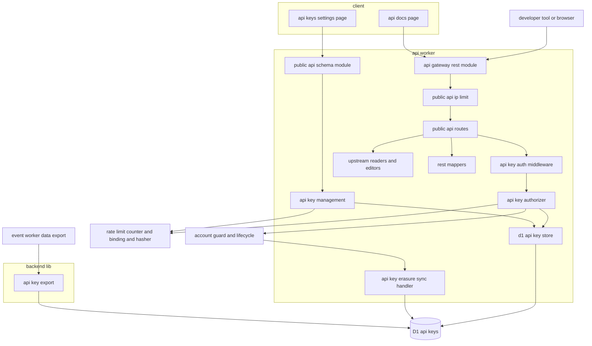
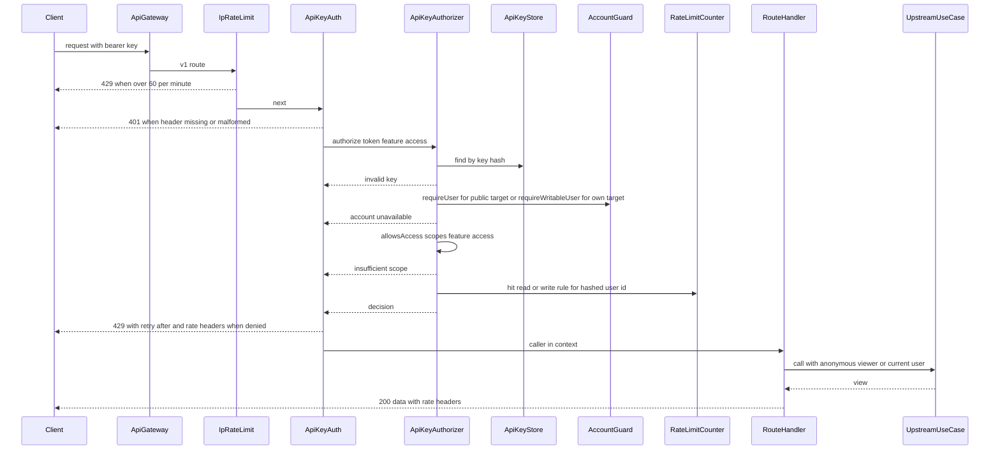
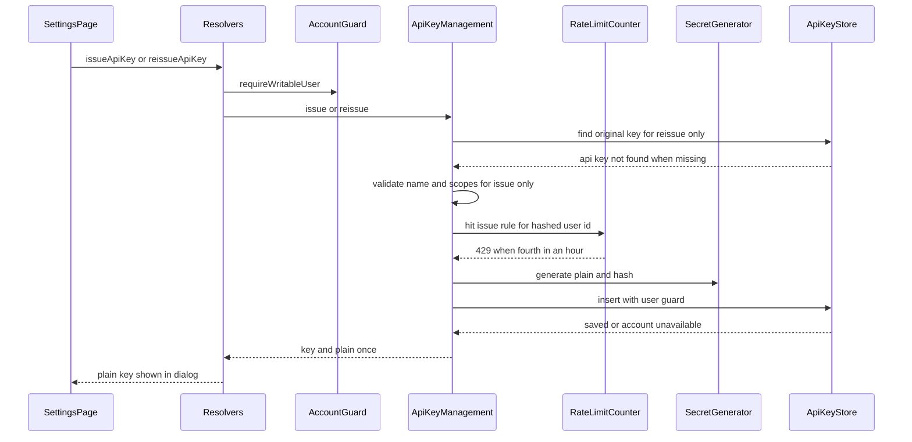

# Design Document

## Overview

**Purpose**: 利用者が設定ページで発行するAPIキーで認証する公開REST API(`/v1`)を、APIサーバー(`apps/api`)に実装する。APIキーは名前と7つの機能の権限スコープを持ち、ハッシュだけを保存する。公開APIは、掲載中のプロダクト・カテゴリ・ローンチ履歴とマッチ・サポーターとUpvote履歴・コメント・評価の集計・公開プロフィールの読み取りと、自分のプロフィールとプロダクトの説明文の読み取り・更新を、上流のドメインspecのユースケースを呼んで提供する。キーの発行・利用者単位の読み取りと書き込み・送信元IPアドレス単位の3つの回数の制限を掛け、OpenAPIの仕様書を利用者側の`/api-docs`のSwagger UIで参照できるようにする。

**Users**: 開発者である利用者は`/settings/api-keys`でキーを発行・編集・再発行・削除し、自分のツールから公開APIを呼び、`/api-docs`で仕様を読んで試す。後続spec(data-export)はAPIキーの出力用の照会を、launch-readinessは回数の制限と仕様書を検証に使う。

**Impact**: api-gatewayの`composition/rest-routes.ts`(初版は空)に経路を、`graphql-modules.ts`にAPIキーの管理のスキーマモジュールを加える。D1に`api_keys`を新設する。apiにRate Limitingバインディング`PUBLIC_API_RATE_LIMITER`と変数`IMAGES_ORIGIN`を、clientに変数`PUBLIC_API_ORIGIN`とCSPの`connect-src`の許可先を加える。

### Goals

- 要件定義書4.19の全機能(FR-PAPI-001〜011)とFR-RLMIT-005・007・008・017・019・NFR-SECUR-038・039・045・NFR-MAINT-007を満たす。
- 公開データの読み取りが画面の未ログインの閲覧者と同じ公開範囲になり、上流の業務ルールを重複して持たない。
- 経路の追加が「機能と操作の宣言・検証規則・上流のユースケースの呼び出し・写像」だけで済み、OpenAPIの仕様書と実装が食い違わない。
- 変更したファイルのカバレッジが80%以上になり、一括検査に参加する。

### Non-Goals

- 公開APIによる投稿・Upvote・コメント・評価・フォロー・画像のアップロード・キー管理(キーの管理は画面のGraphQLだけ)。
- 公開RESTの骨格・エラー形式・CORSの算出・プリフライト(api-gateway)、業務ルールと公開範囲の判定(各ドメインspec)、データエクスポートのZIP(data-export)。
- APIキーの最終利用日時の記録、IPアドレスの許可リスト、有料の上位の回数の枠。

## Boundary Commitments

### This Spec Owns

- APIキーのデータ`api_keys`(`apps/db/schema/public-api/`)と、その発行・一覧・編集・再発行・削除・照合、平文の形式と発行の回数の制限。
- 公開APIの認証・停止中の利用者の拒否・権限スコープの判定・利用者単位とIP単位の回数の制限・`X-RateLimit-*`のヘッダー。
- 公開RESTの経路(`/v1/products`・`/v1/product-categories`・`/v1/users`・`/v1/me`の下)とその要求・応答のスキーマ・写像・エラーコード、経路の定義の補助`definePublicApiRoute`。
- 仕様書の説明`PUBLIC_API_DOCUMENT_INFO`(api-gatewayの改訂1の`createRestModule`の`info`で渡す)。
- APIキーの管理のGraphQLスキーマモジュール`publicApi`、利用者側の`/settings/api-keys`と`/api-docs`の画面と部品。
- 退会の同期の波及処理`public-api.api-key-erasure`と、データエクスポートが使う`ApiKeyExport`(`apps/backend-lib/workers/public-api/`)。
- 技術ドキュメント`backend/020-api-key-authentication.md`・`frontend/019-self-hosted-api-reference.md`と、`backend/003`・`backend/005`への追記、ページ配置・文言規則の本機能の節。

### Out of Boundary

- `/v1`の基準パス・`createRestModule`・`defaultHook`・応答のスキーマ部品・CORSの値の算出・プリフライト・仕様書の経路(api-gateway)。本specは登録箇所へ追記する。仕様書の`servers`(`/v1`)と`info`の受け渡しはapi-gatewayの改訂1が提供する。
- 掲載の条件・プロダクト詳細の公開範囲・対戦相手の表示・ローンチの要約(directory-discovery・product-launch)、サポーターとUpvote履歴の条件(match-engine)、コメントの置き換えと評価の集計の条件(engagement)、プロフィールの検証と保存・公開プロフィールの公開範囲(user-profile-social)、説明文の保存と保存の登録口(product-launch)、利用者の状態の判定と退会の確定(identity-auth)。
- 回数の制限の部品(`RateLimitCounter`・`bindingRateLimit`)・ハッシュの部品・Worker単位のIP制限(backend-platform)。
- 画像の配信・隔離(media-pipeline)、clientの環境の検証とCSPの組み立ての部品そのもの(frontend-platform。本specは先例どおりclientの拡張を加える)。
- データエクスポートのZIPの組み立てと要求の画面(data-export)、本番の値の登録と負荷の検証(launch-readiness)。

### Allowed Dependencies

- api-gateway: `PUBLIC_API_BASE_PATH`・`API_KEY_SECURITY`・`PublicApiApp`・`PublicRestRoutes`・`dataEnvelope`・`offsetListEnvelope`・`cursorListEnvelope`・`errorResponses`・`ErrorEnvelopeSchema`・`createRestModule`(改訂1の`options.info`)・`GraphQLSchemaModule`・`defineSchemaModule`・`withValidatedArgs`・ページングの補助・`SessionAccess`。
- backend-platform: `RateLimitCounterClient`・`CounterRule`・`CounterDecision`・`hashRateLimitKey`・`bindingRateLimit`・`RateLimitExclusion`・`KeyedHasher`・`hashPurpose`・`AppError`・`toErrorResponse`・`PLATFORM_TYPES`・`AppModule`・`ulidPrimaryKey`・`timestamps`・`Database`・ログのカテゴリ規約・伏せ字の`REDACTION_PATTERNS`(改訂1で`lsk_`のキーを含む)。
- identity-auth: `AccountGuard`(`requireUser`・`requireWritableUser`)・`CurrentUser`・`SessionView`・`IDENTITY_TYPES`・`visibleUsers()`・`users`(外部キーと`visibleUsers()`の結合)・`UserLifecycleSyncHandler`・`USER_LIFECYCLE_SYNC_HANDLERS`・`SETTINGS_NAV_ITEMS`・`AuthenticatedContext`。
- directory-discovery: `DIRECTORY_TYPES`の`DirectoryReader`・`DirectoryCategoryReader`・`ProductPageReader`、`decideProductPageAccess`、`common-lib/directory`の`DIRECTORY_PAGE_SIZE`・`DIRECTORY_SORTS`・`DIRECTORY_SEARCH_MAX_GRAPHEMES`。
- product-launch: `PRODUCT_PLATFORM_TYPES.ProductDirectory`(`resolveHandle`)、`PRODUCT_TYPES`の`MyProductsReader`(`list`・`find`)・`ProductDescriptionEditor`(仮12で`product_hidden`・`product_not_found`・`account_unavailable`を投げる)、`PRODUCT_HANDLE_RULE`、説明文の上限の定数。
- match-engine: `MATCH_PLATFORM_TYPES`の`MatchDirectory`(`findMatches`)・`SupporterDirectory`、`MATCH_TYPES.UpvoteHistoryReader`。
- engagement: `ENGAGEMENT_TYPES`の`CommentReader`・`RatingService`。
- user-profile-social: `PROFILE_TYPES`の`MyProfileReader`・`ProfileEditor`・`PublicProfileReader`、`PROFILE_PLATFORM_TYPES.UserProfileDirectory`、`common-lib/profile`・`common-lib/url`の規則、`USER_HANDLE_RULE`。
- media-pipeline: `MEDIA_TYPES.MediaFiles`(`findMany`)、`common-lib/media`の`buildImagePath`・`fallbackFormatOf`。
- content-processing: `markdownTextSchema`(説明文・自己紹介の検証)、`countGraphemes`。
- frontend-platform: `buildPageHead`・`ErrorState`・`EmptyState`・`LoadingSkeleton`・`notify`・`useAppForm`・`AppForm`・`FormField`・`SubmitButton`・shadcn/uiの部品・`graphqlQueryOptions`・`DateTime`・`PublicRuntimeConfig`。
- 上流のファイルへの変更は、登録箇所への追記と、clientの環境の拡張(先例のある手順)に限る。上流のテーブルへは書き込まず、`users`は外部キーと`visibleUsers()`の条件の結合だけに使う。
- 依存の方向は「Dependency Direction」に従う。

### Revalidation Triggers

- `ApiKeyExport`の形・並び(data-export)。データエクスポート仕様の`apiKeys`の項目が変わったら確かめ直す。
- 公開RESTの経路・応答の項目・エラーコード・回数の上限(外部の利用者、launch-readiness)。項目の削除・名前の変更は`/v2`を要する破壊的変更として扱う。
- 上流のビューの形(`DirectoryPageView`・`ProductPageView`・`MyProfileView`・`PublicProfileView`・`MyProductView`・`CommentReader`・`UpvoteHistoryReader`・`SupporterRecord`・`ProductRatingView`)の変更。写像の単体テストが壊れる。
- `AccountGuard`が`AuthenticatedPrincipal.sessionId`でセッションのレコードを照合する実装に変わること(本specはAPIキーのIDを入れた疑似のセッションIDを渡す)。
- api-gatewayの`createRestModule`の登録の順序(先頭の登録の`use`が仕様の経路とプリフライトの前に動くこと)、改訂1の`servers`・`info`(渡した`info`が既定を丸ごと置き換えること)の変更。
- product-launchの仮12の`ProductDescriptionEditor`のエラーコードと文言、backend-platformの改訂1の`REDACTION_PATTERNS`と改訂3のSentryの伏せ字の範囲の変更。
- infra-deliveryの改訂1の「ホスト名から導かれる変数の値」の表のapiの`IMAGES_ORIGIN`・clientの`PUBLIC_API_ORIGIN`の値の変更。
- 仮1〜仮4は2026-10-24に開発者が確定した。経路の対象(公開データ・自分のデータ)の分類(仮1)と、再発行が元のキーを残すこと(仮2)は、外部の利用者が依存する振る舞いのため、変えるときは`/v1`の破壊的変更として扱う。`swagger-ui-dist`(仮4)の系列を5.33から上げるときは`SwaggerUiViewer`の読み込みとCSPの検査を確かめ直す。

### 上流への影響

本specが依頼した上流の変更は、次のとおり上流specの改訂として反映され、2026-10-24に開発者が確定した。本specはそれらを契約どおりに使い、上流のファイルを変えない。

- api-gateway(改訂1、タスク承認済み): `createRestModule<E extends PlatformEnv>(routes: readonly PublicRestRoutes<E>[], options?: { readonly info?: { readonly title: string; readonly version: string; readonly description?: string } })`。`doc31`の設定に`servers: [{ url: PUBLIC_API_BASE_PATH }]`(`/v1`)が入る。既定の`info`は`Launch Stadium Public API`・`1.0.0`で、渡した`info`は項目ごとに合わせず既定を丸ごと置き換える。本specは`PUBLIC_API_DOCUMENT_INFO`(`title`・`version`・`description`の全て)を`api-worker.ts`の呼び出しで渡す。
- backend-platform(改訂1): `REDACTION_PATTERNS`の先頭に`lsk_[A-Za-z0-9_-]{43}`(`g`フラグ、`[REDACTED]`へ置き換え)が入る。backend-platformの改訂3(開発者が決定)で、Sentryの除去は`REDACTION_PATTERNS`を例外のメッセージと型・イベントのメッセージ(`logentry`を含む)・パンくずのメッセージとデータ・要求のURL・トランザクションとスパンの名前・説明・データに適用し、全て`[REDACTED]`に置き換える(backend-platformの要件9.2)。本specはそれに頼らず、平文のキーを例外・`AppError`のメッセージ・ログの本文に入れない。
- product-launch(仮12、タスク承認済み): `ProductStore.updateDescription`は`'saved' | 'not-found' | 'account-unavailable' | 'hidden'`を返し、`ProductDescriptionEditor.update`は`AppError({ kind: 'conflict', code: 'product_hidden', message: 'このプロダクトは公開が停止されているため、説明文を更新できません。' })`・`product_not_found`・`account_unavailable`を投げる。`OwnProductDescriptionService.update`はこれらを変えずにそのまま返し、自分の事前の判定の`product_hidden`にも同じ文言を使う。
- infra-delivery(改訂1): 「ホスト名から導かれる変数の値」の表に、apiの`IMAGES_ORIGIN`とclientの`PUBLIC_API_ORIGIN`の行(3環境の値)が入る。本specはその値をapi・clientのWrangler設定に書き(tasks.mdの1.4・1.5)、表を編集しない。

## Architecture

### Existing Architecture Analysis

- `apps/api`・`apps/client`などは上流specの実装前で、本specのタスクは上流(特にapi-gateway・identity-auth・directory-discovery・engagement)の実装の完了を前提にする。
- api-gatewayの公開REST: `createRestModule`が`PUBLIC_REST_ROUTES`の各関数に`OpenAPIHono`の子のアプリを渡し、`ApiKeyAuth`(Bearer)を登録し、`doc31`で`/openapi.json`、`OPTIONS /*`(204)を加えて`/v1`へマウントする。検証の失敗は`defaultHook`が`AppError(bad_request, validation_error)`にし、backend-platformの`onError`が400にする。外部経路の後処理がCORS(`*`・経路表のメソッド・`Authorization`、更新系は`Content-Type`)とセキュリティヘッダーを付ける。
- apiのWorkerは全要求にWorker単位のIP制限(10秒100回)を掛ける。公開APIのIP単位の制限(1分60回)はその内側に本specが掛ける。
- 層の配置とテストの分担(`domain`・`application`はBunの単体テスト、`infrastructure`・`presentation`・`composition`はWorkers統合テスト)、`@inject`の明示はbackend-platformに従う。

### Architecture Pattern & Boundary Map



**Architecture Integration**:

- Selected pattern: クリーンアーキテクチャ(apiの`domain`→`application`→`infrastructure`・`presentation`→`composition`)。RESTの経路は表現層に置き、上流のapplication層のユースケースを呼ぶ。APIキーの照合と管理は本specのユースケースとポートで行う。
- Domain/feature boundaries: キーのデータと照合・権限・回数の制限は本spec、読み取りと更新の業務と公開範囲は上流、骨格とCORSはapi-gateway。
- Existing patterns preserved: 登録箇所への追記、`<spec名>.<名詞句>`の波及処理の名前、`CASE`式のNOT NULL制約の違反による一括の書き込みの取り消し、`Symbol.for('<ドメイン>.<名前>')`のDIの識別子、`backend-lib/workers/<ドメイン>`の出力用の照会。
- New components rationale: 「Components and Interfaces」の各ブロックを参照。経路の補助は13経路の重複(認証・権限・回数・エラー応答の宣言)を1か所にまとめるために作る。
- Steering compliance: Inversifyの`@inject`の明示、D1の制約(`db.batch()`・`CASE`式・バインド変数100個以内)、テーブルの作成時の命名規則、Infisical(新しいシークレットなし)、800行以内のファイル、1ファイル1コンポーネント、日時の`<time datetime>`。

### Dependency Direction

- サーバー: `apps/common-lib/public-api` → `apps/db/schema/public-api` → `apps/backend-lib/workers/public-api` → apiの`domain/public-api` → `application/public-api` → `infrastructure/public-api`・`presentation/rest/public-api`・`presentation/graphql/modules/public-api` → `composition`。
- `presentation/rest/public-api`は`presentation/gateway`・`presentation/rest`(api-gateway)を読み込み、`presentation/graphql`を読み込まない。`presentation/graphql/modules/public-api`は`presentation/rest`を読み込まない。
- `common-lib/public-api`は他のどの層も読み込まない(clientも読み込む)。
- client: `common-lib/public-api` → `graphql/operations/public-api` → `components/public-api` → `routes`。`swagger-ui-dist`は`components/public-api/swagger-ui-viewer.tsx`の動的な読み込みだけで参照する。

### Technology Stack

| Layer          | Choice / Version                                                                                                     | Role in Feature                         | Notes                                                      |
| -------------- | -------------------------------------------------------------------------------------------------------------------- | --------------------------------------- | ---------------------------------------------------------- |
| Backend        | Hono・@hono/zod-openapi 1.6.3・zod 4.6.5・Inversify(上流の版)                                                        | 公開RESTの経路・検証・OpenAPIの記載・DI | 既存                                                       |
| Backend        | GraphQL Yoga(api-gateway)                                                                                            | APIキーの管理の操作                     | 既存                                                       |
| Data           | Cloudflare D1(Drizzle v1 RC)                                                                                         | `api_keys`                              | 新規のマイグレーション                                     |
| Infrastructure | Durable Objects(`RateLimitCounter`)・Rate Limitingバインディング`PUBLIC_API_RATE_LIMITER`(`limit: 60`・`period: 60`) | 発行・利用者単位・IP単位の回数の制限    | バインディングは新規。`namespace_id`はapi 1005・2005・3005 |
| Security       | Web Crypto API(`KeyedHasher`、HMAC-SHA512)・`crypto.getRandomValues`                                                 | キーの乱数とハッシュ                    | 既存                                                       |
| Frontend       | TanStack Start・Router・Query・shadcn/ui(frontend-platform)                                                          | 管理画面とSwagger UIのページ            | 既存                                                       |
| Frontend       | swagger-ui-dist 5.33系(導入時に公開から2週間以上経った最新の5.33.xへ完全に固定、仮4は2026-10-24に確定)               | Swagger UIの描画(ブラウザだけ)          | 新規。tech-stack.mdに記載済み                              |

## File Structure Plan

### Directory Structure

```
apps/
├── common-lib/public-api/
│   └── api-key-rules.ts                              # 名前の上限・7機能と値・初期値・表示名・checkApiKeyName・isAllowedScopeLevel(*.unit.test.ts)
├── db/schema/public-api/
│   ├── api-keys.ts                                   # api_keys(*.unit.test.ts)
│   └── index.ts
├── backend-lib/workers/public-api/                   # api・event共通(Workers統合テスト)
│   ├── public-api-platform-types.ts                  # PUBLIC_API_PLATFORM_TYPES(テストなし)
│   ├── api-key-export.ts                             # ApiKeyExport・ApiKeyExportRecord(型)とD1ApiKeyExport
│   └── public-api-platform-module.ts                 # PUBLIC_API_PLATFORM_MODULE
├── api/src/
│   ├── domain/public-api/                            # 純粋な規則(Bunの単体テスト)
│   │   ├── api-key-token.ts                          # 平文の形式・Authorizationの解析
│   │   └── api-key-scopes.ts                         # ApiAccess・ApiTarget・allowsAccess
│   ├── application/public-api/                       # ユースケース(Bunの単体テスト)
│   │   ├── public-api-types.ts                       # PUBLIC_API_TYPES(テストなし)
│   │   ├── ports.ts                                  # ApiKeyStore・ApiKeySecretGenerator・ApiKeyRecord(テストなし)
│   │   ├── rate-limit-rules.ts                       # 3つのCounterRuleと選択・IP単位の制限の定数
│   │   ├── session-views.ts                          # ANONYMOUS_SESSION_VIEW・apiKeySessionView
│   │   ├── api-key-management.ts                     # 一覧・発行・編集・再発行・削除
│   │   ├── api-key-authorizer.ts                     # 照合・状態・権限・回数の制限
│   │   ├── public-supporter-reader.ts                # サポーターの一覧(プロダクトとマッチの確かめ)
│   │   ├── public-profile-updater.ts                 # 部分更新を全項目の更新へ合成
│   │   └── own-product-description-service.ts        # 自分のプロダクトの一覧と説明文の更新
│   ├── infrastructure/public-api/                    # Workers統合テスト
│   │   ├── d1-api-key-store.ts                       # api_keysの読み書き(CASE式の条件)
│   │   ├── crypto-api-key-secret-generator.ts        # 乱数の平文とハッシュ
│   │   └── api-key-erasure-sync-handler.ts           # 退会の同期の波及処理
│   ├── presentation/graphql/modules/public-api/      # スキーマモジュール(Workers統合テスト)
│   │   ├── type-defs.ts
│   │   ├── inputs.ts                                 # zodスキーマ(common-libの規則)
│   │   ├── errors.ts                                 # エラーコードと文言
│   │   ├── resolvers.ts                              # myApiKeys・issueApiKey・updateApiKey・reissueApiKey・deleteApiKey
│   │   └── index.ts                                  # publicApiSchemaModule
│   ├── presentation/rest/public-api/                 # 公開RESTの経路(Workers統合テスト、mappersは単体テスト)
│   │   ├── public-api-errors.ts                      # エラーコード・文言・AppErrorの生成
│   │   ├── route-definition.ts                       # definePublicApiRoute・PublicApiFeatureの記載・経路の変数の型
│   │   ├── api-key-auth.ts                           # 経路ごとの中間処理(Bearer・照合・回数のヘッダー)
│   │   ├── ip-rate-limit.ts                          # publicApiIpRateLimitRoutes(先頭の登録)
│   │   ├── schemas/common.ts                         # 画像・利用者の表示・カーソルの問い合わせ
│   │   ├── schemas/products.ts                       # プロダクト・カテゴリ・ローンチ・マッチ・一覧の問い合わせ
│   │   ├── schemas/upvotes.ts                        # サポーター・Upvote履歴
│   │   ├── schemas/engagement.ts                     # コメント・評価の集計
│   │   ├── schemas/profiles.ts                       # 公開プロフィール・自分のプロフィール・更新の本文
│   │   ├── schemas/my-products.ts                    # 自分のプロダクト・説明文の本文
│   │   ├── mappers/common-mappers.ts                 # toApiImage・toUserSummary・ページのURL(*.unit.test.ts)
│   │   ├── mappers/product-mappers.ts                # 一覧の項目・詳細・ローンチ・マッチ(*.unit.test.ts)
│   │   ├── mappers/upvote-mappers.ts                 # サポーター・Upvote履歴(*.unit.test.ts)
│   │   ├── mappers/engagement-mappers.ts             # コメント・評価(*.unit.test.ts)
│   │   ├── mappers/profile-mappers.ts                # 公開プロフィール・自分のプロフィール(*.unit.test.ts)
│   │   ├── mappers/my-product-mappers.ts             # 自分のプロダクト(*.unit.test.ts)
│   │   ├── media-lookup.ts                           # 写像に必要な画像と利用者の表示情報の一括の照会
│   │   ├── product-resolution.ts                     # プロダクトのハンドルの解決と旧ハンドルの302の応答(経路の共用)
│   │   ├── routes/product-routes.ts                  # /products・/products/{handle}・/product-categories・/products/{handle}/launches
│   │   ├── routes/upvote-routes.ts                   # /products/{handle}/matches/{match_id}/supporters・/users/{handle}/upvotes
│   │   ├── routes/engagement-routes.ts               # /products/{handle}/launches/{launch_id}/comments・/products/{handle}/rating-summary
│   │   ├── routes/profile-routes.ts                  # /users/{handle}・/me/profile(GET・PATCH)
│   │   ├── routes/my-product-routes.ts               # /me/products・/me/products/{handle}/description
│   │   └── index.ts                                  # PUBLIC_API_REST_ROUTES(IP制限を先頭)
│   └── composition/
│       ├── public-api-module.ts                      # PUBLIC_API_MODULE(apiの束縛)
│       └── public-api-document-info.ts               # PUBLIC_API_DOCUMENT_INFO(api-gatewayの改訂1の`info`へ渡す)
├── client/src/
│   ├── routes/_authenticated/settings/api-keys.tsx   # /settings/api-keys
│   ├── routes/api-docs.tsx                           # /api-docs(ログイン不要)
│   ├── graphql/operations/public-api/api-keys.ts     # 一覧・発行・編集・再発行・削除の操作
│   └── components/public-api/                        # 1ファイル1コンポーネント(*.browser.test.tsxを併置)
│       ├── api-key-settings-page.tsx                 # 見出し・停止中の案内・発行のボタン・一覧
│       ├── api-key-list.tsx                          # 一覧・0件・失敗・さらに表示
│       ├── api-key-list-item.tsx                     # 1件(名前・権限の要約・発行日時・操作)
│       ├── api-key-form-dialog.tsx                   # 発行・編集のフォーム
│       ├── api-key-scope-fields.tsx                  # 7機能の権限スコープの選択欄
│       ├── issued-api-key-dialog.tsx                 # 平文の1度だけの表示とコピー
│       ├── api-key-confirm-dialog.tsx                # 削除・再発行の確認
│       ├── api-key-form-schema.ts                    # フォームのzodスキーマ(*.unit.test.ts)
│       ├── api-docs-page.tsx                         # 見出し・説明・SwaggerUiViewer
│       ├── swagger-ui-viewer.tsx                     # 仕様書の取得とSwagger UIの遅延読み込み
│       └── openapi-document.ts                       # 仕様書の取得とserversの絶対URL化(*.unit.test.ts)
e2e/
├── client/public-api.e2e.test.ts                     # 発行・読み取り・403・説明文の更新・削除で401
├── client/api-docs.e2e.test.ts                       # Swagger UIの表示とCSP違反なし・外部オリジンへの要求なし
└── support/public-api.ts                             # 公開APIのオリジンの解決と要求の補助(テストではないファイル)
docs/GUIDES/tech/
├── backend/020-api-key-authentication.md             # APIキーの発行・保存・Bearer認証・権限スコープ・キーの持ち主単位とIP単位の回数の制限
└── frontend/019-self-hosted-api-reference.md         # Swagger UIの同一オリジンの配信とCSP
```

テストは各ファイルの隣に置く(`*.unit.test.ts`・`*.worker.test.ts`・`*.browser.test.tsx`)。技術ドキュメントの番号は、完了済みspecのdesign.mdが`backend/018`・`frontend/017`まで使い、並行して作られるtournament-yearが各ディレクトリの最小の空き番号(`backend/019`・`frontend/018`)を取るため、1つ飛ばした`backend/020`・`frontend/019`にした。

### Modified Files

- `apps/db/schema/index.ts`・`apps/db/migrations/<日時>_public_api/migration.sql` — `api_keys`の再エクスポートと生成したマイグレーション。mainの最新を取り込んでから生成する。
- `apps/api/src/composition/rest-routes.ts` — `...PUBLIC_API_REST_ROUTES`を追記し、IP制限が先頭である必要を注記する。
- `apps/api/src/composition/graphql-modules.ts` — `publicApiSchemaModule`を追記する。
- `apps/api/src/composition/modules.ts` — `PUBLIC_API_PLATFORM_MODULE`・`PUBLIC_API_MODULE`を追記する。
- `apps/api/src/composition/user-lifecycle-sync-handlers.ts` — `{ name: 'public-api.api-key-erasure', events: ['withdrawn'], handler: PUBLIC_API_TYPES.ApiKeyErasureSyncHandler }`を追記する。
- `apps/api/src/composition/env-schema.ts`・`apps/api/wrangler.jsonc`・型の宣言 — `PUBLIC_API_RATE_LIMITER`(`ratelimits`、3環境の`namespace_id`)と`IMAGES_ORIGIN`(`vars`)を加える。
- `apps/api/src/composition/api-worker.ts` — `createRestModule`へ`{ info: PUBLIC_API_DOCUMENT_INFO }`を渡す(api-gatewayの改訂1、tasks.mdの7.2)。
- `apps/event/src/composition/modules.ts` — `PUBLIC_API_PLATFORM_MODULE`を追記する(data-exportが使う)。
- `apps/frontend-lib/server/env/frontend-env.ts`・`apps/frontend-lib/server/http/security-policy.ts`と各単体テスト — clientの`PUBLIC_API_ORIGIN`(URLのオリジン、clientだけ必須)を検証し、`PublicRuntimeConfig.publicApiOrigin`(adminは`undefined`)へ渡し、`runtimeSecurityPolicySources`の`connectSrc`に値があれば加える(content-processingの`CLIENT_SITE_ORIGIN`・paymentsの`STRIPE_PUBLISHABLE_KEY`と同じ手順)。
- `apps/client/wrangler.jsonc`・`apps/client/test/config/wrangler-config.unit.test.ts` — `PUBLIC_API_ORIGIN`の3環境の値。
- `apps/api/test/config/wrangler-config.unit.test.ts` — `PUBLIC_API_RATE_LIMITER`の3環境の`namespace_id`・`limit`・`period`(`PUBLIC_API_IP_RATE_LIMIT`と一致)と`IMAGES_ORIGIN`の検査(1.4・4.3)。
- `apps/client/src/composition/settings-navigation.ts` — `{ to: '/settings/api-keys', label: 'APIキー', order: 90 }`を追記する。
- `apps/client/package.json`・`bun.lock` — `swagger-ui-dist`(5.33.xを`--exact`で完全に固定)。導入先がclientだけのため、`docs/GUIDES/tech/coding/002-dependency-versions.md`の主要パッケージの一覧(アプリ間で版をそろえる対象)には加えない。
- `docs/GUIDES/tech/backend/003-rate-limiting-and-bot-verification.md` — 同じWorkerで用途の異なる2つ目のRate Limitingの名前空間を使う規約と、キーの持ち主単位の厳密な制限との組み合わせを追記する。
- `docs/GUIDES/tech/backend/005-public-rest-api.md` — 認証の中間処理を経路ごとに掛ける規約、公開データの読み取りで閲覧者を未ログインとして扱う規約、画像の絶対URLの返し方を追記する。
- `docs/GUIDES/tech/backend/README.md`・`frontend/README.md` — 文書一覧へ追記する。
- `docs/GUIDES/service/design/002-page-layouts.md` — 「APIキー(`/settings/api-keys`)」と「APIドキュメント(`/api-docs`)」の節を加える。
- `docs/GUIDES/service/design/003-text-and-copy-rules.md` — 本機能のエラー・状態・確認の文言を加える。
- `docs/onboardings/project-values.md` — `PUBLIC_API_RATE_LIMITER`の`namespace_id`、`PUBLIC_API_ORIGIN`(client)・`IMAGES_ORIGIN`(api)の値、APIキーの接頭辞`lsk_`を記載する。
- `docs/onboardings/tech-stack.md` — `swagger-ui-dist`の記載はコントローラーが反映済みで、本specは変えない。

## System Flows

### 公開APIの要求



- IP単位の制限は`OPTIONS`を除く基準パスの全要求(仕様書の配信を含む)に掛かる(13.4)。プリフライトと仕様書の配信は認証を求めない(7.1)。
- 経路は対象として公開データ(`public`)か自分のデータ(`own`)を宣言する。停止中の持ち主のキーは、`public`の経路では処理し、`own`の経路では403`account_unavailable`にする(5.2・仮1)。
- 認証の失敗・停止中の拒否・権限の不足は利用者単位の回数を消費しない(13.6)。利用者単位の回数は、読み取りの経路と書き込みの経路で別の規則を使い、利用者の全キーで合算する(13.1・13.2)。
- 公開データの経路は閲覧者を未ログインとして上流を呼び、`/v1/me`の経路はキーの持ち主の`CurrentUser`で呼ぶ(8.8)。

### APIキーの発行と再発行



- 再発行は、最初に元のキーを読み(無ければ回数を消費せずに`api_key_not_found`)、名前と権限スコープを複写して、発行と同じ処理(回数の制限→乱数とハッシュ→挿入)で新しいキーを加える。元のキーは変えずに残す(3.4・仮2)。同時に有効なキーの数に上限は無く(1.5)、回数の制限は再発行にも掛かる(4.1)。
- 挿入の`user_id`は「利用者が可視(`visibleUsers()`)」のときだけ値になる`CASE`式とし、違反は保存しない(1.8)。再発行の読み取りと挿入の間に元のキーが削除されても、複写した値で発行を続ける(元のキーの有無は新しいキーの有効性に関わらないため)。

## Requirements Traceability

| Requirement                        | Summary                            | Components                                                                                                 | Interfaces                                                               | Flows         |
| ---------------------------------- | ---------------------------------- | ---------------------------------------------------------------------------------------------------------- | ------------------------------------------------------------------------ | ------------- |
| 1.1, 1.3, 1.4                      | 発行と名前・権限の検証             | ApiKeyRules、ApiKeyManagement、PublicApiSchemaModule、CryptoApiKeySecretGenerator                          | `issueApiKey`・`ApiKeyManagement.issue`                                  | 発行と再発行  |
| 1.2, 1.9                           | ハッシュの保存と平文の扱い         | CryptoApiKeySecretGenerator、D1ApiKeyStore、ApiKeyExport、PublicApiSchemaModule                            | `ApiKeySecretGenerator.generate`・`hashPurpose('public-api-key')`        | 発行と再発行  |
| 1.5                                | 有効なキーの数に上限なし           | D1ApiKeyStore                                                                                              | —                                                                        | —             |
| 1.6, 1.8                           | 停止中・退会済みの拒否             | PublicApiSchemaModule、D1ApiKeyStore                                                                       | `requireWritableUser`・`CASE`式                                          | 発行と再発行  |
| 1.7                                | 未確認を拒否しない                 | PublicApiSchemaModule                                                                                      | `requireWritableUser`                                                    | —             |
| 2.1                                | 7機能と値                          | ApiKeyRules、ApiKeysSchema、ApiKeyScopeFields                                                              | `API_KEY_FEATURES`                                                       | —             |
| 2.2, 2.3                           | 経路ごとの機能と操作の判定         | ApiKeyScopes、ApiKeyAuthorizer、PublicApiRouteDefinition                                                   | `allowsAccess`・`insufficient_scope`                                     | 公開APIの要求 |
| 2.4                                | 編集の即時の反映                   | ApiKeyAuthorizer、D1ApiKeyStore                                                                            | `findByHash`                                                             | 公開APIの要求 |
| 2.5                                | 仕様書への記載                     | PublicApiRouteDefinition                                                                                   | `definePublicApiRoute`                                                   | —             |
| 3.1, 3.2                           | 一覧                               | ApiKeyManagement、D1ApiKeyStore、PublicApiSchemaModule                                                     | `myApiKeys`                                                              | —             |
| 3.3                                | 編集                               | ApiKeyManagement、D1ApiKeyStore                                                                            | `updateApiKey`                                                           | —             |
| 3.4                                | 再発行                             | ApiKeyManagement、D1ApiKeyStore                                                                            | `reissueApiKey`・`insert`                                                | 発行と再発行  |
| 3.5                                | 削除                               | ApiKeyManagement、D1ApiKeyStore                                                                            | `deleteApiKey`                                                           | —             |
| 3.6                                | 他人・不在の区別なし               | ApiKeyManagement                                                                                           | `api_key_not_found`                                                      | —             |
| 3.7, 3.8                           | 停止中の操作の範囲                 | PublicApiSchemaModule                                                                                      | `requireUser`・`requireWritableUser`                                     | —             |
| 4.1, 4.2, 4.3, 4.4                 | 発行の回数の制限                   | RateLimitRules、ApiKeyManagement                                                                           | `API_KEY_ISSUE_RULE`・`RateLimitCounterClient`                           | 発行と再発行  |
| 5.1                                | 退会で全削除                       | ApiKeyErasureSyncHandler                                                                                   | `USER_LIFECYCLE_SYNC_HANDLERS`                                           | —             |
| 5.2, 5.3                           | 停止中の拒否と解除後の再認証       | ApiKeyAuthorizer、SessionViews、PublicApiRouteDefinition(`ApiTarget`)                                      | `requireUser`(public)・`requireWritableUser`(own)・`account_unavailable` | 公開APIの要求 |
| 5.4, 5.5                           | 停止で消さない・物理削除を妨げない | ApiKeyErasureSyncHandler、D1ApiKeyStore                                                                    | `CASE`式                                                                 | —             |
| 6.1, 6.2, 6.3, 6.4                 | 画面の配置とフォーム               | ApiKeySettingsRoute、ApiKeySettingsPage、ApiKeyList、ApiKeyFormDialog、ApiKeyScopeFields、ApiKeyFormSchema | `SETTINGS_NAV_ITEMS`                                                     | —             |
| 6.5                                | 平文の1度だけの表示                | IssuedApiKeyDialog                                                                                         | `IssuedApiKey.plainKey`                                                  | 発行と再発行  |
| 6.6                                | 削除・再発行の確認                 | ApiKeyConfirmDialog                                                                                        | —                                                                        | —             |
| 6.7, 6.8, 6.9, 6.10, 6.11          | 状態と文言                         | ApiKeySettingsPage、ApiKeyList、ApiKeyListItem                                                             | `ErrorState`・`EmptyState`・`DateTime`                                   | —             |
| 7.1, 7.2, 7.3                      | Bearerの認証                       | ApiKeyToken、ApiKeyAuth、ApiKeyAuthorizer                                                                  | `parseBearerAuthorization`・`WWW-Authenticate`                           | 公開APIの要求 |
| 7.4, 7.5                           | ハッシュの照合と要求ごとの判定     | ApiKeyAuthorizer、D1ApiKeyStore                                                                            | `findByHash`                                                             | 公開APIの要求 |
| 8.1, 8.2, 8.3                      | プロダクトの一覧                   | ProductRoutes、ProductMappers、MediaLookup                                                                 | `GET /v1/products`・`DirectoryReader`                                    | 公開APIの要求 |
| 8.4, 8.5, 8.6                      | プロダクトの詳細と旧ハンドル       | ProductRoutes、ProductMappers                                                                              | `GET /v1/products/{handle}`・`ProductPageReader`                         | 公開APIの要求 |
| 8.7                                | カテゴリの一覧                     | ProductRoutes                                                                                              | `GET /v1/product-categories`                                             | —             |
| 8.8                                | 未ログインとして扱う               | SessionViews、ProductRoutes、UpvoteRoutes、EngagementRoutes、ProfileRoutes                                 | `viewer: undefined`・`ANONYMOUS_SESSION_VIEW`                            | 公開APIの要求 |
| 8.9                                | 隔離中の画像は空                   | CommonMappers                                                                                              | `toApiImage`                                                             | —             |
| 9.1, 9.2                           | ローンチ履歴とマッチ               | ProductRoutes、ProductMappers                                                                              | `GET /v1/products/{handle}/launches`                                     | —             |
| 9.3, 9.6                           | サポーター                         | UpvoteRoutes、PublicSupporterReader、UpvoteMappers                                                         | `GET .../matches/{match_id}/supporters`                                  | —             |
| 9.4, 9.7                           | Upvote履歴                         | UpvoteRoutes、UpvoteMappers                                                                                | `GET /v1/users/{handle}/upvotes`・`UpvoteHistoryReader`                  | —             |
| 9.5                                | 除外                               | PublicSupporterReader、UpvoteRoutes                                                                        | `SupporterDirectory`・`UpvoteHistoryReader`                              | —             |
| 10.1, 10.2, 10.5                   | コメント                           | EngagementRoutes、EngagementMappers                                                                        | `GET .../launches/{launch_id}/comments`・`CommentReader`                 | —             |
| 10.3, 10.4                         | 評価の集計                         | EngagementRoutes、EngagementMappers                                                                        | `GET .../rating-summary`・`RatingService.read`                           | —             |
| 11.1                               | 自分のプロフィール                 | ProfileRoutes、ProfileMappers                                                                              | `GET /v1/me/profile`                                                     | —             |
| 11.2, 11.3, 11.4, 11.7             | プロフィールの更新                 | ProfileRoutes、PublicProfileUpdater                                                                        | `PATCH /v1/me/profile`・`ProfileEditor`                                  | 公開APIの要求 |
| 11.5, 11.6                         | 公開プロフィール                   | ProfileRoutes、ProfileMappers                                                                              | `GET /v1/users/{handle}`・`PublicProfileReader`                          | —             |
| 12.1                               | 自分のプロダクトの一覧             | MyProductRoutes、OwnProductDescriptionService                                                              | `GET /v1/me/products`・`MyProductsReader.list`                           | —             |
| 12.2, 12.3, 12.4, 12.5, 12.6       | 説明文の更新                       | MyProductRoutes、OwnProductDescriptionService                                                              | `PUT /v1/me/products/{handle}/description`                               | 公開APIの要求 |
| 13.1, 13.2, 13.3, 13.6, 13.7, 13.8 | 利用者単位の回数の制限             | RateLimitRules、ApiKeyAuthorizer、ApiKeyAuth                                                               | `PUBLIC_API_READ_RULE`・`PUBLIC_API_WRITE_RULE`・`X-RateLimit-*`         | 公開APIの要求 |
| 13.4                               | IP単位の回数の制限                 | PublicApiIpRateLimit                                                                                       | `PUBLIC_API_RATE_LIMITER`                                                | 公開APIの要求 |
| 13.5                               | 429と再試行の秒数                  | ApiKeyAuth、PublicApiIpRateLimit                                                                           | `Retry-After`                                                            | 公開APIの要求 |
| 14.1, 14.2, 14.3                   | 応答の形式                         | RestSchemas、PublicApiRouteDefinition、各Mapper                                                            | `dataEnvelope`・`offsetListEnvelope`・`cursorListEnvelope`               | —             |
| 14.4                               | 仕様書                             | PublicApiRouteDefinition、PublicApiDocumentInfo                                                            | `doc31`(api-gateway)                                                     | —             |
| 14.5                               | CORS                               | 各Routes(経路表への登録)                                                                                   | api-gatewayの`createPublicApiCorsPolicy`                                 | —             |
| 14.6                               | 非公開の情報を含めない             | 各Mapper、RestSchemas                                                                                      | 応答のスキーマ                                                           | —             |
| 15.1, 15.2, 15.3, 15.7             | Swagger UIの描画                   | ApiDocsRoute、SwaggerUiViewer、OpenApiDocument、ClientEnvExtension                                         | `swagger-ui-dist`・`connectSrc`                                          | —             |
| 15.4, 15.5, 15.6                   | 状態と説明                         | ApiDocsPage、SwaggerUiViewer                                                                               | `LoadingSkeleton`・`ErrorState`                                          | —             |
| 16.1                               | エクスポートの照会                 | ApiKeyExport、PublicApiPlatformModule                                                                      | `ApiKeyExport.listByUser`                                                | —             |
| 16.2                               | ログの内容                         | ApiKeyAuth、PublicApiErrors                                                                                | ログのカテゴリ`['api', 'public-api']`                                    | —             |
| 16.3                               | 一括の照会                         | MediaLookup、上流のユースケース                                                                            | `MediaFiles.findMany`・`UserProfileDirectory.findSummaries`              | —             |
| 16.4                               | 帯の値                             | ApiKeyErasureSyncHandler                                                                                   | 同期の波及処理(`order`なし)                                              | —             |
| 17.1, 17.2, 17.3                   | テスト                             | Testing Strategyの各項目                                                                                   | —                                                                        | —             |
| 17.4, 17.5                         | 文書                               | PublicApiDocs                                                                                              | `backend/020`・`frontend/019`                                            | —             |

## Components and Interfaces

| Component                                                  | Domain/Layer          | Intent                                             | Req Coverage                                            | Key Dependencies (P0/P1)                                            | Contracts      |
| ---------------------------------------------------------- | --------------------- | -------------------------------------------------- | ------------------------------------------------------- | ------------------------------------------------------------------- | -------------- |
| ApiKeyRules                                                | common-lib            | 名前と権限スコープの規則・表示名                   | 1.3, 1.4, 2.1, 6.3, 6.4                                 | —                                                                   | Service        |
| ApiKeysSchema                                              | db                    | `api_keys`                                         | 1.2, 1.5, 2.1, 5.5                                      | identity-authの`users` (P0)                                         | State          |
| ApiKeyExport・PublicApiPlatformModule                      | backend-lib/workers   | データエクスポートの照会                           | 16.1, 1.9                                               | D1 (P0)                                                             | Service        |
| ApiKeyToken・ApiKeyScopes                                  | api/domain            | 平文の形式とBearerの解析、権限の判定               | 2.2, 2.3, 7.2, 7.3                                      | ApiKeyRules (P0)                                                    | Service        |
| RateLimitRules・SessionViews                               | api/application       | 回数の規則、未ログインとキーの持ち主のセッション   | 4.1, 5.2, 8.8, 13.1                                     | backend-platform (P0)、identity-auth (P0)                           | Service        |
| ApiKeyManagement                                           | api/application       | キーの一覧・発行・編集・再発行・削除               | 1.1〜1.4, 3.1〜3.6, 4.1〜4.4                            | ApiKeyStore (P0)、RateLimitCounterClient (P0)                       | Service        |
| ApiKeyAuthorizer                                           | api/application       | 照合・状態・権限・利用者単位の回数                 | 2.2〜2.4, 5.2, 5.3, 7.3〜7.5, 13.1〜13.3, 13.6, 13.8    | ApiKeyStore (P0)、AccountGuard (P0)、RateLimitCounterClient (P0)    | Service        |
| PublicSupporterReader                                      | api/application       | サポーターの一覧                                   | 9.3, 9.5, 9.6                                           | ProductDirectory (P0)、MatchDirectory (P0)、SupporterDirectory (P0) | Service        |
| PublicProfileUpdater                                       | api/application       | 部分更新の合成                                     | 11.2, 11.3, 11.4, 11.7                                  | MyProfileReader (P0)、ProfileEditor (P0)                            | Service        |
| OwnProductDescriptionService                               | api/application       | 自分のプロダクトの一覧と説明文の更新               | 12.1〜12.6                                              | MyProductsReader (P0)、ProductDescriptionEditor (P0)                | Service        |
| D1ApiKeyStore・CryptoApiKeySecretGenerator                 | api/infrastructure    | 読み書きと乱数・ハッシュ                           | 1.1, 1.2, 1.5, 1.8, 3.1〜3.5, 5.5, 7.4                  | D1 (P0)、KeyedHasher (P0)                                           | Service, State |
| ApiKeyErasureSyncHandler                                   | api/infrastructure    | 退会の同期の波及処理                               | 5.1, 5.4, 16.4                                          | identity-auth (P0)                                                  | Event          |
| PublicApiSchemaModule                                      | api/presentation      | キーの管理のGraphQL                                | 1.1, 1.6, 1.7, 3.1〜3.8                                 | ApiKeyManagement (P0)、AccountGuard (P0)                            | API            |
| PublicApiRouteDefinition・ApiKeyAuth                       | api/presentation/rest | 経路の宣言と認証の中間処理                         | 2.2, 2.5, 5.2, 7.1〜7.3, 13.5, 13.7, 14.4, 16.2         | ApiKeyAuthorizer (P0)、api-gateway (P0)                             | API            |
| PublicApiIpRateLimit                                       | api/presentation/rest | IP単位の回数の制限                                 | 13.4, 13.5                                              | `bindingRateLimit` (P0)                                             | API            |
| PublicApiRoutes(5ファイル)・RestSchemas                    | api/presentation/rest | 公開する経路と応答の形                             | 8.\*, 9.\*, 10.\*, 11.\*, 12.\*, 14.1〜14.3, 14.5, 14.6 | 上流のユースケース (P0)                                             | API            |
| RestMappers・CommonMappers・MediaLookup・ProductResolution | api/presentation/rest | ビューから応答への写像・一括の照会・ハンドルの解決 | 8.2, 8.5, 8.6, 8.9, 14.1, 14.3, 14.6, 16.3              | MediaFiles (P1)、UserProfileDirectory (P1)                          | Service        |
| PublicApiModule・PublicApiDocumentInfo                     | api/composition       | 束縛と仕様書の説明                                 | 14.4                                                    | api-gatewayの改訂1 (P0)                                             | State          |
| ClientEnvExtension                                         | frontend-lib          | `PUBLIC_API_ORIGIN`と`connect-src`                 | 15.2, 15.7                                              | frontend-platform (P0)                                              | State          |
| ApiKey画面の部品                                           | client                | 管理画面                                           | 6.1〜6.11                                               | PublicApiSchemaModule (P0)、identity-authの設定ページ (P0)          | State          |
| ApiDocsPage・SwaggerUiViewer・OpenApiDocument              | client                | Swagger UIのページ                                 | 15.1〜15.7                                              | `swagger-ui-dist` (P0)                                              | State          |
| PublicApiDocs                                              | docs                  | 技術ドキュメントとサービス仕様                     | 17.4, 17.5                                              | —                                                                   | —              |

### common-lib・db

#### ApiKeyRules

**Contracts**: Service [x]

```typescript
// apps/common-lib/public-api/api-key-rules.ts
export declare const API_KEY_NAME_MAX_GRAPHEMES: 50;
export declare const API_KEY_READ_FEATURES: readonly [
  'products',
  'launches',
  'upvotes',
  'comments',
  'ratings',
];
export declare const API_KEY_WRITE_FEATURES: readonly [
  'profile',
  'productDescriptions',
];
export type ApiKeyReadFeature = (typeof API_KEY_READ_FEATURES)[number];
export type ApiKeyWriteFeature = (typeof API_KEY_WRITE_FEATURES)[number];
export type ApiKeyFeature = ApiKeyReadFeature | ApiKeyWriteFeature;
export type ApiKeyReadLevel = 'none' | 'read';
export type ApiKeyWriteLevel = 'none' | 'read' | 'read_write';
export type ApiKeyScopes = {
  readonly [F in ApiKeyReadFeature]: ApiKeyReadLevel;
} & { readonly [F in ApiKeyWriteFeature]: ApiKeyWriteLevel };
export declare const API_KEY_FEATURES: readonly ApiKeyFeature[]; // 表示の順(products・launches・upvotes・comments・ratings・profile・productDescriptions)
export declare const API_KEY_FEATURE_LABELS: Readonly<
  Record<ApiKeyFeature, string>
>; // プロダクト・ローンチ履歴・Upvote・コメント・評価・プロフィール・プロダクトの説明文
export declare const API_KEY_LEVEL_LABELS: Readonly<
  Record<ApiKeyWriteLevel, string>
>; // 無効・読み取り・読み書き
export declare const DEFAULT_ISSUE_SCOPES: ApiKeyScopes; // 読み取りの5機能はread、profile・productDescriptionsはnone(6.4)
export declare function isAllowedScopeLevel(
  feature: ApiKeyFeature,
  level: string,
): boolean; // 1.4
export type ApiKeyNameCheck =
  | { readonly ok: true; readonly name: string }
  | { readonly ok: false; readonly reason: 'required' | 'too_long' };
export declare function checkApiKeyName(raw: string): ApiKeyNameCheck; // 前後の空白を除き1〜50書記素(1.3)
```

- 書記素の数え方はcontent-processingの`countGraphemes`と同じ規則を使い、common-libの中で読み込む(common-lib内の参照)。

#### ApiKeysSchema

**Contracts**: State [x]

| 列                                                                                     | 型                      | 制約                                                      |
| -------------------------------------------------------------------------------------- | ----------------------- | --------------------------------------------------------- |
| `id`                                                                                   | text                    | 主キー(ULID、`ulidPrimaryKey()`)                          |
| `user_id`                                                                              | text                    | NOT NULL、`users.id`への外部キー(`ON DELETE`を指定しない) |
| `name`                                                                                 | text                    | NOT NULL                                                  |
| `key_hash`                                                                             | text                    | NOT NULL、一意(`KeyedHasher`のbase64url 86文字)           |
| `scope_products`・`scope_launches`・`scope_upvotes`・`scope_comments`・`scope_ratings` | text                    | NOT NULL、CHECK(`'none'`・`'read'`)                       |
| `scope_profile`・`scope_product_descriptions`                                          | text                    | NOT NULL、CHECK(`'none'`・`'read'`・`'read_write'`)       |
| `created_at`・`updated_at`                                                             | integer(`timestamp_ms`) | `timestamps()`                                            |

- 索引: `key_hash`の一意索引(照合)、`(user_id, created_at, id)`(一覧と退会の削除)。
- 論理削除の列を持たない。削除・退会は行を物理削除する(削除済みのキーを認証しない、3.5)。

### backend-lib/workers

#### ApiKeyExport・PublicApiPlatformModule

**Contracts**: Service [x]

```typescript
// api-key-export.ts
export interface ApiKeyExportRecord {
  readonly name: string;
  readonly scopes: ApiKeyScopes; // common-libの型(キーはcamelCase、値はnone・read・read_write)
  readonly createdAt: Date;
}
export interface ApiKeyExport {
  listByUser(userId: string): Promise<readonly ApiKeyExportRecord[]>; // 発行の古い順。平文とハッシュを返さない
}
export declare class D1ApiKeyExport implements ApiKeyExport {
  constructor(db: Database); // @inject(PLATFORM_TYPES.Database)
}
// public-api-platform-types.ts
export declare const PUBLIC_API_PLATFORM_TYPES: {
  readonly ApiKeyExport: symbol;
}; // Symbol.for('public-api.ApiKeyExport')
// public-api-platform-module.ts
export declare const PUBLIC_API_PLATFORM_MODULE: AppModule; // ApiKeyExportを処理単位で束縛
```

- apiとeventの`composition/modules.ts`の両方へ入れる(data-exportはeventのQueueの処理で使う、16.1)。D1の例外はそのまま投げ、data-exportの再試行に任せる。

### api/domain

#### ApiKeyToken・ApiKeyScopes

**Contracts**: Service [x]

```typescript
// api-key-token.ts
export declare const API_KEY_TOKEN_PREFIX: 'lsk_';
export declare const API_KEY_TOKEN_PATTERN: RegExp; // /^lsk_[A-Za-z0-9_-]{43}$/
export type BearerParseResult =
  | { readonly kind: 'token'; readonly token: string }
  | { readonly kind: 'missing' } // ヘッダーが無い
  | { readonly kind: 'malformed' }; // Bearerでない・空
export declare function parseBearerAuthorization(
  header: string | undefined,
): BearerParseResult; // 方式名は大文字小文字を区別しない(RFC 6750)
export declare function isWellFormedApiKey(token: string): boolean;

// api-key-scopes.ts
export type ApiAccess = 'read' | 'write';
export type ApiTarget = 'public' | 'own'; // 公開データの経路か、キーの持ち主の自分のデータの経路か(仮1)
export declare function allowsAccess(
  scopes: ApiKeyScopes,
  feature: ApiKeyFeature,
  access: ApiAccess,
): boolean; // readはread以上、writeはread_writeだけ(2.2)
```

- 書き込みの操作を持つ機能は`profile`・`productDescriptions`だけであり、読み取りの5機能に`write`を問うと常に偽になる。

### api/application

#### RateLimitRules・SessionViews

**Contracts**: Service [x]

```typescript
// rate-limit-rules.ts
export declare const API_KEY_ISSUE_RULE: CounterRule; // { name: 'api-key-issue-by-user', limit: 3, windowSeconds: 3600 }(4.1・4.3)
export declare const PUBLIC_API_READ_RULE: CounterRule; // { name: 'public-api-read-by-user', limit: 30, windowSeconds: 60 }(13.1・13.3)
export declare const PUBLIC_API_WRITE_RULE: CounterRule; // { name: 'public-api-write-by-user', limit: 15, windowSeconds: 60 }
export declare function ruleForAccess(access: ApiAccess): CounterRule;
export declare const PUBLIC_API_IP_RATE_LIMIT: {
  readonly limit: 60;
  readonly periodSeconds: 60;
}; // Wrangler設定の値と照合し、仕様書の説明とbindingRateLimitのperiodSecondsに使う(13.4)

// session-views.ts
export declare const ANONYMOUS_SESSION_VIEW: SessionView; // principal()は常に{ kind: 'anonymous' }(8.8)
export declare function apiKeySessionView(input: {
  readonly userId: string;
  readonly keyId: string;
}): SessionView;
// principal()は{ kind: 'authenticated', subjectKind: 'user', subjectId: userId, sessionId: 'api-key:' + keyId }
```

- キーは`hashRateLimitKey(hasher, userId)`で作る(13.8)。DurableObjectのオブジェクト名は`<rule.name>:<ハッシュ>`(backend-platform)。

#### ApiKeyManagement

| Field        | Detail                                                                    |
| ------------ | ------------------------------------------------------------------------- |
| Intent       | 自分のキーの一覧・発行・編集・再発行・削除                                |
| Requirements | 1.1, 1.2, 1.3, 1.4, 1.8, 3.1, 3.2, 3.3, 3.4, 3.5, 3.6, 4.1, 4.2, 4.3, 4.4 |

**Contracts**: Service [x]

```typescript
export interface ApiKeyView {
  readonly id: string;
  readonly name: string;
  readonly scopes: ApiKeyScopes;
  readonly createdAt: Date;
}
export interface IssuedApiKey {
  readonly apiKey: ApiKeyView;
  readonly plainKey: string; // 応答でだけ返す(1.2)
}
export interface ApiKeyInput {
  readonly name: string;
  readonly scopes: Readonly<Record<ApiKeyFeature, string>>; // 検証前の値
}
export interface ApiKeyManagement {
  list(
    user: CurrentUser,
    page: { readonly first: number; readonly after: string | undefined },
  ): Promise<{
    readonly nodes: readonly ApiKeyView[];
    readonly hasNextPage: boolean;
    readonly endCursor: string | null;
  }>; // firstは1〜50、発行の新しい順(3.1・3.2)
  issue(
    user: CurrentUser,
    input: ApiKeyInput,
    now: Date,
  ): Promise<IssuedApiKey>;
  update(
    user: CurrentUser,
    keyId: string,
    input: ApiKeyInput,
    now: Date,
  ): Promise<ApiKeyView>;
  reissue(user: CurrentUser, keyId: string, now: Date): Promise<IssuedApiKey>;
  delete(user: CurrentUser, keyId: string): Promise<void>;
}
```

- `issue`: (1)`checkApiKeyName`・`isAllowedScopeLevel`で検証し、違反は`AppError(bad_request, validation_error)`と項目ごとの`details`(`name`・`scopes.<機能>`、1.3・1.4)。(2)`RateLimitCounterClient.hit(API_KEY_ISSUE_RULE, key)`→`assertWithinLimit`(429、4.2)。(3)`ApiKeySecretGenerator.generate()`。(4)`ApiKeyStore.insert`。`account-unavailable`は`AppError(forbidden, account_unavailable)`(1.8)。
- `update`: 検証→`ApiKeyStore.update`。`not-found`は`AppError(not_found, api_key_not_found)`(3.6)。回数に数えない(4.4)。
- `reissue`: `ApiKeyStore.findForOwner`(無ければ`api_key_not_found`)で元の名前と権限スコープを読み、`issue`の(2)〜(4)と同じ処理(回数の制限→`generate`→`ApiKeyStore.insert`)で新しいキーを加える。元のキーは変えない(3.4・仮2)。
- `delete`: `ApiKeyStore.delete`が偽なら`api_key_not_found`。回数に数えない。
- 利用者の状態の確認は、リゾルバの`requireWritableUser`(発行・編集・再発行)・`requireUser`(一覧・削除)と、挿入の`CASE`式で行う(3.7・3.8・1.8)。

#### ApiKeyAuthorizer

| Field        | Detail                                                               |
| ------------ | -------------------------------------------------------------------- |
| Intent       | 平文のキーから要求を処理してよいかを決め、呼び出し元を返す           |
| Requirements | 2.2, 2.3, 2.4, 5.2, 5.3, 7.3, 7.4, 7.5, 13.1, 13.2, 13.3, 13.6, 13.8 |

**Contracts**: Service [x]

```typescript
export interface PublicApiCaller {
  readonly keyId: string;
  readonly user: CurrentUser;
  readonly scopes: ApiKeyScopes;
}
export interface ApiKeyAuthorization {
  readonly caller: PublicApiCaller;
  readonly rateLimit: {
    readonly limit: number;
    readonly remaining: number;
    readonly resetAt: number;
  };
}
export interface ApiKeyAuthorizer {
  authorize(input: {
    readonly token: string;
    readonly feature: ApiKeyFeature;
    readonly access: ApiAccess;
    readonly target: ApiTarget;
    readonly now: Date;
  }): Promise<ApiKeyAuthorization>;
}
```

- 手順: (1)`isWellFormedApiKey`が偽なら`AppError(unauthenticated, invalid_api_key)`。(2)`KeyedHasher.hash(hashPurpose('public-api-key'), token)`→`ApiKeyStore.findByHash`。無ければ`invalid_api_key`(7.3・7.4)。(3)`target`が`own`なら`AccountGuard.requireWritableUser(apiKeySessionView(...))`、`public`なら`AccountGuard.requireUser(...)`。停止中は`own`でだけ`account_unavailable`(403)のまま投げ、`public`では処理を続ける(5.2・仮1)。利用者が見つからない`unauthenticated`は`invalid_api_key`へ変換する。(4)`allowsAccess`が偽なら`AppError(forbidden, insufficient_scope)`(2.3)。(5)`RateLimitCounterClient.hit(ruleForAccess(access), hashRateLimitKey(hasher, userId))`。拒否なら`rateLimit`の値を添えた`AppError(rate_limited, rate_limit_exceeded, retryAfterSeconds)`を投げる(13.1)。
- (1)〜(4)の失敗は(5)より前で返るため、回数を消費しない(13.6)。毎回キーの行を読むため、権限の編集と削除は次の要求から効く(2.4・7.5)。停止の解除の後は`own`の経路でも(3)が通る(5.3)。停止中の持ち主の公開データの読み取りでは、閲覧者を未ログインとして上流を呼ぶため、停止中の持ち主自身のデータは結果に含まれない(FR-PAPI-009)。
- 失敗の`AppError`には、ApiKeyAuthがヘッダーに使う`rateLimit`(429のときだけ)を`PublicApiRateLimitError`(`AppError`の派生)として持たせる。

#### PublicSupporterReader・PublicProfileUpdater・OwnProductDescriptionService

**Contracts**: Service [x]

```typescript
export interface PublicSupporterReader {
  list(input: {
    readonly productHandle: string;
    readonly matchId: string;
    readonly after: string | undefined;
    readonly now: Date;
  }): Promise<
    | {
        readonly kind: 'page';
        readonly supporters: readonly SupporterRecord[];
        readonly hasNextPage: boolean;
        readonly endCursor: string | null;
      }
    | { readonly kind: 'redirect'; readonly handle: string }
    | { readonly kind: 'not-found' }
  >;
}
export interface PublicProfilePatch {
  readonly nickname?: string;
  readonly handle?: string;
  readonly headline?: string | null;
  readonly bioMarkdown?: string | null;
  readonly websites?: readonly WebsiteInput[];
}
export interface PublicProfileUpdater {
  update(user: CurrentUser, patch: PublicProfilePatch): Promise<MyProfileView>;
}
export interface OwnProductDescriptionService {
  list(
    user: CurrentUser,
    page: { readonly after: string | undefined },
  ): Promise<{
    readonly nodes: readonly MyProductView[];
    readonly hasNextPage: boolean;
    readonly endCursor: string | null;
  }>; // 20件(12.1)
  update(
    user: CurrentUser,
    input: {
      readonly productHandle: string;
      readonly descriptionMarkdown: string;
    },
  ): Promise<MyProductView>;
}
```

- `PublicSupporterReader.list`: (1)`checkHandleFormat(PRODUCT_HANDLE_RULE)`の違反は`not-found`。(2)`ProductDirectory.resolveHandle`→`decideProductPageAccess({ resolution, viewerUserId: undefined })`(`redirect`・`not-found`はそのまま)。(3)`MatchDirectory.findMatches([matchId], now)`で、そのプロダクトの側があり、`phase`が`finished`であることを確かめ、違えば`not-found`(9.6)。(4)`SupporterDirectory.listSupporters({ entryId, after: decodeCursor(after), limit: 20 })`(上限が20のため1件多く読めない)。20件なら`hasNextPage`を真にし、最後の行から`endCursor`を作る(続きが0件のときは次の要求が空の`data`と`has_next: false`を返す)。カーソルはdirectory-discoveryの`SupporterListReader`と同じ`encodeCursor({ upvotedAt, upvoteId })`とし、復号できない値は`AppError(bad_request, validation_error)`(`cursor`)にする(9.3・9.5)。
- `PublicProfileUpdater.update`: (1)`MyProfileReader.read(user)`。(2)指定の項目だけを上書きし、`expectedHandle`と`avatarFileId`は現在の値にする(11.2・11.3)。(3)`ProfileEditor.update`。上流の`AppError`(`handle_unavailable`・`profile_update_conflict`・`account_unavailable`など)はそのまま返す(11.4・11.7)。
- `OwnProductDescriptionService.update`: (1)`MyProductsReader.find(user, handle)`。`not-found`は`AppError(not_found, product_not_found)`(12.4)。`redirect`は現在のハンドルで読み直す(本人のプロダクトのため公開の問題が無い)。(2)`hidden`なら`AppError({ kind: 'conflict', code: 'product_hidden', message: 'このプロダクトは公開が停止されているため、説明文を更新できません。' })`(product-launchの仮12と同じ文言、12.5)。(3)`ProductDescriptionEditor.update(user, { productHandle: 現在のハンドル, descriptionMarkdown })`(保存の登録口が動く、12.3)。判定と書き込みの間の非公開化・削除・停止は、エディターが投げる`product_hidden`・`product_not_found`・`account_unavailable`を変えずにそのまま返す。(4)`find`で読み直して返す(12.2)。

### api/infrastructure

#### D1ApiKeyStore・CryptoApiKeySecretGenerator

**Contracts**: Service [x] / State [x]

```typescript
// application/public-api/ports.ts
export interface ApiKeyRecord {
  readonly id: string;
  readonly userId: string;
  readonly name: string;
  readonly scopes: ApiKeyScopes;
  readonly createdAt: Date;
}
export interface NewApiKey {
  readonly id: string;
  readonly userId: string;
  readonly name: string;
  readonly keyHash: string;
  readonly scopes: ApiKeyScopes;
  readonly at: Date;
}
export interface ApiKeyStore {
  findByHash(keyHash: string): Promise<ApiKeyRecord | undefined>;
  findForOwner(
    userId: string,
    keyId: string,
  ): Promise<ApiKeyRecord | undefined>;
  listByUser(
    userId: string,
    input: {
      readonly limit: number;
      readonly before:
        { readonly createdAt: Date; readonly id: string } | undefined;
    },
  ): Promise<readonly ApiKeyRecord[]>; // (created_at DESC, id DESC)
  insert(key: NewApiKey): Promise<'saved' | 'account-unavailable'>;
  update(input: {
    readonly userId: string;
    readonly keyId: string;
    readonly name: string;
    readonly scopes: ApiKeyScopes;
    readonly at: Date;
  }): Promise<'updated' | 'not-found'>;
  delete(userId: string, keyId: string): Promise<boolean>;
}
export interface ApiKeySecretGenerator {
  generate(): Promise<{ readonly plain: string; readonly hash: string }>; // lsk_+32バイトのbase64url、hashPurpose('public-api-key')のハッシュ
}
```

- `insert`: `INSERT INTO api_keys (...) VALUES (?, CASE WHEN EXISTS (SELECT 1 FROM users WHERE users.id = ? AND <visibleUsers()>) THEN ? ELSE NULL END, ...)`。NOT NULL制約の違反を`account-unavailable`に変換する(1.8・5.5)。
- `update`: `UPDATE ... WHERE id = ? AND user_id = ?`の変更件数が0なら`not-found`。
- 一覧のカーソルは`encodeCursor({ c: created_at, id })`。`first + 1`件を読む。
- `CryptoApiKeySecretGenerator`は`crypto.getRandomValues`の32バイトをbase64url(パディングなし)にし、`KeyedHasher.hash`でハッシュを作る。

#### ApiKeyErasureSyncHandler

**Contracts**: Event [x]

- 登録: `USER_LIFECYCLE_SYNC_HANDLERS`に`{ name: 'public-api.api-key-erasure', events: ['withdrawn'], handler: PUBLIC_API_TYPES.ApiKeyErasureSyncHandler }`。`statementsFor`は読み取りをせず`DELETE FROM api_keys WHERE user_id = ?`の1文を返す(集合の更新の規約、5.1)。
- 停止・停止の解除には登録しない(5.4)。物理削除の時点では退会の確定で行が消えており、発行の`CASE`式で退会済みの利用者の行を作らないため、`purge_due`の非同期の波及処理と4:21のジョブは持たない(5.5・16.4)。

### api/presentation/graphql

#### PublicApiSchemaModule

**Contracts**: API [x]

```graphql
enum ApiKeyReadLevel {
  NONE
  READ
}
enum ApiKeyWriteLevel {
  NONE
  READ
  READ_WRITE
}
type ApiKeyScopes {
  products: ApiKeyReadLevel!
  launches: ApiKeyReadLevel!
  upvotes: ApiKeyReadLevel!
  comments: ApiKeyReadLevel!
  ratings: ApiKeyReadLevel!
  profile: ApiKeyWriteLevel!
  productDescriptions: ApiKeyWriteLevel!
}
type ApiKey {
  id: ID!
  name: String!
  scopes: ApiKeyScopes!
  createdAt: DateTime!
}
type ApiKeyConnection {
  nodes: [ApiKey!]!
  pageInfo: PageInfo!
}
type IssuedApiKey {
  apiKey: ApiKey!
  plainKey: String!
}
input ApiKeyScopesInput {
  products: ApiKeyReadLevel!
  launches: ApiKeyReadLevel!
  upvotes: ApiKeyReadLevel!
  comments: ApiKeyReadLevel!
  ratings: ApiKeyReadLevel!
  profile: ApiKeyWriteLevel!
  productDescriptions: ApiKeyWriteLevel!
}
input ApiKeyInput {
  name: String!
  scopes: ApiKeyScopesInput!
}
type Query {
  myApiKeys(first: Int = 50, after: String): ApiKeyConnection!
}
type Mutation {
  issueApiKey(input: ApiKeyInput!): IssuedApiKey!
  updateApiKey(id: ID!, input: ApiKeyInput!): ApiKey!
  reissueApiKey(id: ID!): IssuedApiKey!
  deleteApiKey(id: ID!): ID!
}
```

| 操作            | 呼び出し元 | 利用者の判定          | bot判定 | エラーコード                                                                         |
| --------------- | ---------- | --------------------- | ------- | ------------------------------------------------------------------------------------ |
| `myApiKeys`     | client     | `requireUser`         | なし    | `unauthenticated`・`validation_error`                                                |
| `issueApiKey`   | client     | `requireWritableUser` | なし    | `unauthenticated`・`account_unavailable`・`validation_error`・`rate_limit_exceeded`  |
| `updateApiKey`  | client     | `requireWritableUser` | なし    | `unauthenticated`・`account_unavailable`・`validation_error`・`api_key_not_found`    |
| `reissueApiKey` | client     | `requireWritableUser` | なし    | `unauthenticated`・`account_unavailable`・`api_key_not_found`・`rate_limit_exceeded` |
| `deleteApiKey`  | client     | `requireUser`         | なし    | `unauthenticated`・`api_key_not_found`                                               |

- 引数は`withValidatedArgs`(`inputs.ts`、common-libの規則)で検証する。列挙の値はGraphQLの大文字とcommon-libの小文字を`errors.ts`の隣の写像で変換する。
- `plainKey`は応答でだけ返し、操作ログ(操作名だけ)にも残らない(1.9)。
- 停止中の`deleteApiKey`を許すのは、漏洩したキーの無効化を停止中も行えるようにするためである(3.8)。

### api/presentation/rest

#### PublicApiRouteDefinition・ApiKeyAuth

| Field        | Detail                                                   |
| ------------ | -------------------------------------------------------- |
| Intent       | 経路の機能と操作の宣言、認証・権限・回数の制限の中間処理 |
| Requirements | 2.2, 2.5, 5.2, 7.1, 7.2, 7.3, 13.5, 13.7, 14.4, 16.2     |

**Contracts**: API [x]

```typescript
import type { RouteConfig } from '@hono/zod-openapi';

export interface PublicApiRouteVariables {
  readonly publicApiCaller: PublicApiCaller;
}
export declare function definePublicApiRoute<
  R extends Omit<RouteConfig, 'security' | 'middleware'>,
>(
  config: R & {
    readonly feature: ApiKeyFeature;
    readonly access: ApiAccess;
    readonly target: ApiTarget;
  },
): R & Pick<RouteConfig, 'security' | 'middleware'>;
// security: API_KEY_SECURITY、middleware: [apiKeyAuth(feature, access, target)]、
// responses: 経路の定義にerrorResponses([401, 403, 429])を加える、
// description: 経路の説明の末尾に「必要な権限: <機能の表示名>の<読み取り|読み書き>」を加える(2.5)
export declare function apiKeyAuth(
  feature: ApiKeyFeature,
  access: ApiAccess,
  target: ApiTarget,
): MiddlewareHandler<{ Variables: PublicApiRouteVariables }>;
```

- `apiKeyAuth`: (1)`parseBearerAuthorization(c.req.header('Authorization'))`。`missing`・`malformed`は`AppError(unauthenticated, unauthenticated)`(7.2)。(2)`ApiKeyAuthorizer.authorize`。(3)成功なら`X-RateLimit-Limit`・`X-RateLimit-Remaining`・`X-RateLimit-Reset`(エポック秒)を応答に付けて次へ進む(13.7)。
- 401の応答は`toErrorResponse`の本文に`WWW-Authenticate: Bearer realm="public-api"`(無効なキーは`error="invalid_token"`を加える)を付けて中間処理が返す(7.2・7.3)。429は`Retry-After`(`toErrorResponse`)と`X-RateLimit-*`を付ける(13.5・13.7)。403・その他は`AppError`を投げ、backend-platformの`onError`に任せる。
- ログ(カテゴリ`['api', 'public-api']`): 拒否の種類・キーのID・利用者のID・経路のパターン・状態コードだけを`info`で記録する。`Authorization`・平文・本文を記録しない(16.2)。

#### PublicApiIpRateLimit

**Contracts**: API [x]

```typescript
export declare const PUBLIC_API_IP_RATE_LIMIT_KEY_PREFIX: 'public-api:';
export declare const publicApiIpRateLimitRoutes: PublicRestRoutes<ApiEnv>;
// (api) => api.use('*', bindingRateLimit({ binding: (env) => env.PUBLIC_API_RATE_LIMITER, key: (_, ip) => 'public-api:' + (ip ?? 'unknown'), periodSeconds: PUBLIC_API_IP_RATE_LIMIT.periodSeconds, exclusions: [(request) => request.method === 'OPTIONS'] }))
```

- `PUBLIC_API_REST_ROUTES`の先頭に置き、`createRestModule`が後から加える`/openapi.json`にも掛かる(13.4)。超過は`bindingRateLimit`が429・`Retry-After: 60`・`rate_limit_exceeded`を返す(13.5)。
- Wrangler設定: `ratelimits`に`{ name: 'PUBLIC_API_RATE_LIMITER', namespace_id: '1005', simple: { limit: 60, period: 60 } }`(staging `2005`・prod `3005`)。

#### PublicApiRoutes・RestSchemas

**Contracts**: API [x]

| Method | Endpoint                                              | 機能・操作                 | Request                                       | Response                                              | Errors                       |
| ------ | ----------------------------------------------------- | -------------------------- | --------------------------------------------- | ----------------------------------------------------- | ---------------------------- |
| GET    | `/v1/products`                                        | products・read             | `q`・`category`・`from`・`to`・`sort`・`page` | `offsetListEnvelope(ProductListItem)`(`per_page` 20)  | 400・401・403・429           |
| GET    | `/v1/products/{handle}`                               | products・read             | パス                                          | `dataEnvelope(ProductDetail)`・302                    | 401・403・404・429           |
| GET    | `/v1/product-categories`                              | products・read             | なし                                          | `dataEnvelope(ProductCategory[])`                     | 401・403・429                |
| GET    | `/v1/products/{handle}/launches`                      | launches・read             | パス                                          | `dataEnvelope(Launch[])`・302                         | 401・403・404・429           |
| GET    | `/v1/products/{handle}/matches/{match_id}/supporters` | upvotes・read              | `cursor`                                      | `cursorListEnvelope(Supporter)`・302                  | 400・401・403・404・429      |
| GET    | `/v1/users/{handle}/upvotes`                          | upvotes・read              | `cursor`                                      | `cursorListEnvelope(UpvoteHistoryEntry)`+`meta.total` | 400・401・403・404・429      |
| GET    | `/v1/products/{handle}/launches/{launch_id}/comments` | comments・read             | `cursor`                                      | `cursorListEnvelope(CommentThread)`・302              | 400・401・403・404・429      |
| GET    | `/v1/products/{handle}/rating-summary`                | ratings・read              | パス                                          | `dataEnvelope(RatingSummary)`・302                    | 401・403・404・429           |
| GET    | `/v1/users/{handle}`                                  | profile・read              | パス                                          | `dataEnvelope(PublicProfile)`・302                    | 401・403・404・429           |
| GET    | `/v1/me/profile`                                      | profile・read              | なし                                          | `dataEnvelope(MyProfile)`                             | 401・403・429                |
| PATCH  | `/v1/me/profile`                                      | profile・write             | `MyProfilePatch`(1項目以上)                   | `dataEnvelope(MyProfile)`                             | 400・401・403・409・429      |
| GET    | `/v1/me/products`                                     | productDescriptions・read  | `cursor`                                      | `cursorListEnvelope(MyProduct)`                       | 400・401・403・429           |
| PUT    | `/v1/me/products/{handle}/description`                | productDescriptions・write | `{ description_markdown }`                    | `dataEnvelope(MyProduct)`                             | 400・401・403・404・409・429 |

- 対象(仮1): `/v1/me`の下の4経路(自分のプロフィールの読み取りと更新、自分のプロダクトの一覧と説明文の更新)は`own`、それ以外の9経路は`public`である。`own`の経路は停止中の持ち主のキーで403`account_unavailable`になる(5.2)。

- `GET /v1/products`の検証(8.3): `q`は前後の空白を除いて1〜50書記素、`category`はプロダクトカテゴリのハンドルの形式、`from`・`to`は実在する`YYYY-MM-DD`で`from <= to`、`sort`は`DIRECTORY_SORTS`(`relevance`は`q`があるときだけ)、`page`は1以上の整数。検証を通った値を`DirectoryReader.read({ raw, viewer: undefined, now })`へ渡し、`applied.category`が無ければ(存在しないカテゴリ)`validation_error`(`category`)にする。範囲外の`page`は空の`data`と正しい`meta`を返す(8.1)。
- プロダクトのパスの経路は`ProductPageReader.read({ handle, viewer: undefined, now })`(詳細・ローンチ履歴)、`ProductDirectory.resolveHandle`と`decideProductPageAccess`(コメント・評価)で解決し、`redirect`は現在のハンドルに置き換えた同じパス(クエリを保つ)への302、`not-found`は404`product_not_found`にする(8.5・8.6)。
- コメントは`CommentReader.page({ productId, launchId, viewer: undefined, after, now })`、nullは404`launch_not_found`(10.5)。評価は`RatingService.read({ productId, viewer: undefined, now })`(10.3・10.4)。
- Upvote履歴は`UpvoteHistoryReader.read({ userHandle, viewer: undefined, first: 20, after, now })`、nullは404`user_not_found`(9.4・9.7)。公開プロフィールは`PublicProfileReader.find(ANONYMOUS_SESSION_VIEW, handle)`(11.5・11.6)。
- `PATCH /v1/me/profile`の本文(`MyProfilePatch`): `nickname`・`handle`・`headline`(null可)・`bio_markdown`(null可)・`websites`(`{ name, url }[]`)の任意の組で、未知の項目は400。検証はuser-profile-socialの`common-lib/profile`・`common-lib/url`の規則と`markdownTextSchema`(5,000書記素)で行う(11.2・11.4)。`avatar`を含めると400(11.3)。
- `PUT /v1/me/products/{handle}/description`の本文は`description_markdown`(必須・20,000書記素、`markdownTextSchema`)だけ(12.2・12.6)。
- カーソルは上流の`endCursor`(不透明な文字列)をそのまま`next_cursor`に入れ、形式違反の`cursor`は400`validation_error`(`cursor`)にする(14.2)。

```typescript
// 応答の主な型(snake_case、schemas/*.ts のzodスキーマから導く)
interface ApiImage {
  readonly url: string;
  readonly width: number | null;
  readonly height: number | null;
} // null全体は隔離中・削除待ち(8.9)
interface UserSummary {
  readonly handle: string;
  readonly nickname: string;
  readonly avatar: ApiImage | null;
  readonly profile_url: string;
}
interface ProductListItem {
  readonly id: string;
  readonly handle: string;
  readonly name: string;
  readonly tagline: string;
  readonly category: { readonly handle: string; readonly name: string };
  readonly website_url: string;
  readonly logo: ApiImage | null;
  readonly owner: UserSummary | null;
  readonly base_win: {
    readonly launch_date: string;
    readonly kind: 'victory' | 'bye' | 'early';
    readonly upvote_count: number | null;
  };
  readonly awards: readonly {
    readonly kind: 'week' | 'year';
    readonly count: number;
  }[];
  readonly page_url: string; // CLIENT_SITE_ORIGIN + /p/{handle}
}
interface ProductDetail extends Omit<ProductListItem, 'base_win'> {
  readonly description_markdown: string;
  readonly screenshots: readonly (ApiImage | null)[];
  readonly first_launch_date: string | null;
  readonly launch_count: number;
  readonly record: { readonly wins: number; readonly losses: number };
}
interface Launch {
  readonly id: string;
  readonly number: number;
  readonly launch_date: string;
  readonly status: string;
  readonly summary: string;
  readonly matches: readonly {
    readonly id: string;
    readonly kind: string;
    readonly round: number | null;
    readonly stage: string | null;
    readonly match_date: string;
    readonly result: string;
    readonly decision: string;
    readonly ended_early: boolean;
    readonly upvote_count: number;
    readonly opponent_upvote_count: number | null;
    readonly opponent:
      | { readonly kind: 'none' | 'private' }
      | { readonly kind: 'unlisted'; readonly name: string }
      | {
          readonly kind: 'listed';
          readonly handle: string;
          readonly name: string;
        };
  }[];
}
interface Supporter {
  readonly user: UserSummary;
  readonly upvoted_at: string;
}
interface UpvoteHistoryEntry {
  readonly match_id: string;
  readonly kind: string;
  readonly round: number | null;
  readonly stage: string | null;
  readonly match_date: string;
  readonly live: boolean;
  readonly product: {
    readonly handle: string;
    readonly name: string;
    readonly logo: ApiImage | null;
  } | null;
}
interface CommentNode {
  readonly id: string;
  readonly depth: 1 | 2 | 3;
  readonly removed: boolean;
  readonly author: UserSummary | null;
  readonly body_markdown: string | null;
  readonly created_at: string | null;
  readonly edited: boolean;
}
interface CommentThread extends CommentNode {
  readonly replies: readonly CommentNode[];
}
interface RatingSummary {
  readonly average: number | null;
  readonly count: number;
}
interface PublicProfile {
  readonly handle: string;
  readonly nickname: string;
  readonly headline: string | null;
  readonly bio_markdown: string | null;
  readonly avatar: ApiImage | null;
  readonly websites: readonly {
    readonly name: string | null;
    readonly url: string;
  }[];
  readonly follower_count: number;
  readonly ultras: boolean;
  readonly profile_url: string;
}
interface MyProfile extends Omit<PublicProfile, 'follower_count' | 'ultras'> {
  readonly previous_handle: string | null;
}
interface MyProduct {
  readonly id: string;
  readonly handle: string;
  readonly name: string;
  readonly description_markdown: string;
  readonly listed: boolean;
  readonly hidden: boolean;
  readonly page_url: string;
}
```

- 応答のスキーマは要求したキー・ハッシュ・メールアドレス・利用者のIDを持たない(14.6)。日時はISO 8601のUTC、基準時刻の日付は`YYYY-MM-DD`(14.3)。
- 全ての経路を`definePublicApiRoute`で定義するため、api-gatewayの経路表とCORSに自動で反映される(14.5)。

#### RestMappers・CommonMappers・MediaLookup・ProductResolution

**Contracts**: Service [x]

```typescript
export declare function toApiImage(
  file: MediaFileView | undefined,
  variant: ImageVariantName,
  origin: string,
): ApiImage | null; // objectKeyがnullならnull(8.9)。URLはorigin + buildImagePath(objectKey, variant, fallbackFormatOf(contentType))
export interface MediaLookup {
  load(input: {
    readonly fileIds: readonly string[];
    readonly userIds: readonly string[];
  }): Promise<{
    readonly files: ReadonlyMap<string, MediaFileView>;
    readonly users: ReadonlyMap<string, UserSummaryRecord>;
  }>; // MediaFiles.findManyとUserProfileDirectory.findSummaries(ids, 'visible')を1回ずつ(16.3)
}
```

- `ProductResolution`: `resolvePublicProduct(handle)`(ハンドルの形式・`ProductDirectory.resolveHandle`・`decideProductPageAccess({ viewerUserId: undefined })`で`current`・`redirect`・`not-found`)と`redirectToCurrentHandle(c, handle)`(パスのハンドルを置き換えクエリを保った302)を、プロダクトのパスを持つ経路が共用する(8.5・8.6)。
- 画像のバリアント: ロゴ・プロフィール画像は`square-lg`、スクリーンショットは`screenshot-full`。オリジンはapiの変数`IMAGES_ORIGIN`、プロフィールとプロダクトのページのURLは`CLIENT_SITE_ORIGIN`(identity-authが加えた変数)から作る。
- 写像は純粋な関数とし、上流のビューの各種類(勝利・不戦勝・早期の不戦勝、対戦相手の4種類、置き換え表示のコメント)を単体テストで確かめる。

### api/composition

#### PublicApiModule・PublicApiDocumentInfo

- `PUBLIC_API_MODULE`: `ApiKeyStore`(D1)・`ApiKeySecretGenerator`・`ApiKeyManagement`・`ApiKeyAuthorizer`・`PublicSupporterReader`・`PublicProfileUpdater`・`OwnProductDescriptionService`・`MediaLookup`・`ApiKeyErasureSyncHandler`を処理単位で束縛する。DIの識別子は`PUBLIC_API_TYPES`(`Symbol.for('public-api.<名前>')`)。`RateLimitCounterClient`は`RATE_LIMIT_COUNTER`から作る。
- `PUBLIC_API_DOCUMENT_INFO`: `{ title: 'Launch Stadium Public API', version: '1.0.0', description }`。`description`は認証(Bearer、`/settings/api-keys`で発行)・権限スコープの一覧・回数の制限(利用者単位の読み取り30回/分・書き込み15回/分、IP単位60回/分)・ページ分けの方式を説明する(14.4)。api-gatewayの改訂1の`createRestModule(routes, { info: PUBLIC_API_DOCUMENT_INFO })`として`api-worker.ts`で渡す。渡した`info`は既定を丸ごと置き換えるため、`title`・`version`・`description`の全てを持つ。

### frontend-lib

#### ClientEnvExtension

**Contracts**: State [x]

- `ValidatedFrontendEnv`のclientの拡張に`PUBLIC_API_ORIGIN: string`(URLのオリジン、clientだけ必須)を加え、`toPublicRuntimeConfig`で`publicApiOrigin`(adminは`undefined`)へ渡す。`runtimeSecurityPolicySources(env)`は値があれば`connectSrc`に加える(`mergeSecurityPolicySources`の許可先の形の規則に合う、15.2・15.7)。
- 値: ローカル`http://localhost:48042`、staging`https://genai-example-2-api-staging.lab.kurachiweb.com`、prod`https://genai-example-2-api.lab.kurachiweb.com`(`project-values.md`)。

### client

#### ApiKey画面の部品(ApiKeySettingsRoute・ApiKeySettingsPage・ApiKeyList・ApiKeyListItem・ApiKeyFormDialog・ApiKeyScopeFields・IssuedApiKeyDialog・ApiKeyConfirmDialog・ApiKeyFormSchema)

**Contracts**: State [x]

```typescript
export interface ApiKeyFormValues {
  readonly name: string;
  readonly scopes: ApiKeyScopes;
}
export declare const apiKeyFormSchema: z.ZodType<ApiKeyFormValues>; // checkApiKeyName・isAllowedScopeLevel(6.3)
```

- `ApiKeySettingsRoute`(`routes/_authenticated/settings/api-keys.tsx`): identity-authの設定ページのシェルの下に置き、`myApiKeys`をローダーで先読みする。タイトルは「APIキー」(6.1)。
- `ApiKeySettingsPage`: 見出し`h1`「APIキー」と説明(「APIキーを使うと、公開APIからプロダクトなどの公開データを読み取ったり、自分のプロフィールとプロダクトの説明文を更新したりできます。」と`/api-docs`への「APIドキュメント」)、「APIキーを発行」、`ApiKeyList`。停止中(`viewer.status`が`SUSPENDED`)は「このアカウントは停止されているため、APIキーの発行・編集・再発行はできません。発行済みのキーは削除できます。」を示し、発行・編集・再発行を無効にする(6.10)。
- `ApiKeyList`: 発行の新しい順、50件を超えれば「さらに表示」。0件は`EmptyState`(「APIキーはまだありません。」と説明・`/api-docs`、6.9)。失敗は`ErrorState`(6.8)。
- `ApiKeyListItem`: 名前・権限の要約(「読み取り: プロダクト、ローンチ履歴」「読み書き: プロフィール」のように値ごとに機能の表示名を並べ、全て無効なら「権限なし」)・発行日時(`DateTime`、6.11)・「編集」「再発行」「削除」。
- `ApiKeyFormDialog`: 発行と編集で共用する。名前の入力(50文字、40文字を超えたらカウンター)と`ApiKeyScopeFields`(機能ごとのラジオグループ。読み取りの5機能は2択、2機能は3択)。発行の初期値は`DEFAULT_ISSUE_SCOPES`(6.4)。429は文言規則のレート制限の文言(6.7)。
- `IssuedApiKeyDialog`: 平文を読み取り専用の等幅の欄に示し、「コピー」(`navigator.clipboard.writeText`、成功で「APIキーをコピーしました。」、失敗で「APIキーをコピーできませんでした。」)と「このキーは今しか表示されません。安全な場所に保管してください。」を添える。閉じると平文の状態を破棄し、問い合わせのキャッシュにも残さない(6.5)。
- `ApiKeyConfirmDialog`: 削除は「APIキー『{名前}』を削除しますか?」・「このキーを使った要求はすぐに使えなくなります。」・「削除」、再発行は「APIキー『{名前}』を再発行しますか?」・「同じ名前と権限の新しいキーを追加で発行します。今のキーはそのまま使えます。不要になったら削除してください。」・「再発行」(6.6・仮2)。

#### ApiDocsPage・SwaggerUiViewer・OpenApiDocument

**Contracts**: State [x]

```typescript
// openapi-document.ts(純粋)
export declare function openApiDocumentUrl(publicApiOrigin: string): string; // <origin>/v1/openapi.json
export declare function withAbsoluteServers(
  document: Record<string, unknown>,
  publicApiOrigin: string,
): Record<string, unknown>; // 相対のserversのURLを公開APIのオリジンで絶対URLにする。serversが無ければ<origin>/v1を入れる
```

- `ApiDocsRoute`(`routes/api-docs.tsx`): ログイン不要。`buildPageHead`でタイトル「APIドキュメント」と正規のURL(15.1)。
- `ApiDocsPage`: `h1`「APIドキュメント」、APIキーの発行場所(`/settings/api-keys`へのリンク)・認証(`Authorization: Bearer <APIキー>`)・回数の制限の概要の説明、その下に`SwaggerUiViewer`(15.6)。
- `SwaggerUiViewer`: ブラウザでだけ動く。(1)`fetch(openApiDocumentUrl(publicApiOrigin))`。読み込み中は`LoadingSkeleton`(15.4)、失敗は`ErrorState`(文言は要件15.5、再試行・問い合わせ)。(2)`import('swagger-ui-dist/swagger-ui-bundle.js')`と`import('swagger-ui-dist/swagger-ui.css')`を動的に読み込み、`SwaggerUIBundle({ domNode, spec: withAbsoluteServers(document, origin), presets: [SwaggerUIBundle.presets.apis], validatorUrl: null, persistAuthorization: false, deepLinking: false })`(15.2・15.3)。(3)外側の要素を明るい配色に固定する(Swagger UIはダークモードを持たない)。
- 動的な読み込みのチャンクは同一オリジンから配信され、CSPの`script-src 'self'`・`style-src 'self' 'unsafe-inline'`・`img-src data:`で動く。追加する許可先は`connect-src`の公開APIのオリジンだけ(15.7)。

### docs

#### PublicApiDocs

- `backend/020-api-key-authentication.md`: APIキーの形式(接頭辞と乱数)・ハッシュによる保存と照合・平文の1度だけの表示・Bearerの解析と`WWW-Authenticate`・機能と操作による権限スコープ・認証と回数の制限の順序・キーの持ち主単位の厳密な制限とIP単位のバインディングの制限・`X-RateLimit-*`・退会での削除。本プロジェクト固有の値(接頭辞・上限・機能名)を書かない(17.4)。
- `frontend/019-self-hosted-api-reference.md`: Swagger UIを外部の配信網なしに同一オリジンで配信する手順(配布物の束の直接の読み込み、動的な読み込み、`validatorUrl`、認証の保存の無効化、相対の`servers`の絶対URL化、CSPの許可先は`connect-src`だけ)(17.4)。
- ページ配置・文言規則の更新は「Modified Files」のとおり(17.5)。

## Data Models

### Domain Model

- 集約: APIキー(利用者に従属する)。不変条件は「平文を保存しない」「`read_write`は`profile`・`productDescriptions`だけ」「退会済み・停止中の利用者のキーを作らない」「退会でその利用者のキーが全て消える」。
- 権限スコープは7つの機能の値の組で、キーごとに独立に編集できる。キーの文字列は変わらない。再発行は同じ名前と権限スコープの別のキーを加え、元のキーを残す(仮2)ため、同じ名前のキーが複数並び得る(一覧は発行日時で区別する)。

### Logical Data Model

- `api_keys` N : 1 `users`。外部キーは`ON DELETE`を指定せず、退会の同期の波及処理で行を先に消す(identity-authの規約)。
- 一括の書き込み: 発行と再発行は挿入の1文。退会の削除は退会の確定の一括の書き込みに含まれる。

### Data Contracts & Integration

- REST: 「PublicApiRoutes・RestSchemas」の表と型。エラーは共通の形式で、本specのエラーコードは次のとおり。

| コード                | 状態 | 場面                                                                                                                                           |
| --------------------- | ---- | ---------------------------------------------------------------------------------------------------------------------------------------------- |
| `unauthenticated`     | 401  | `Authorization`が無い・Bearerでない                                                                                                            |
| `invalid_api_key`     | 401  | 形式違反・不在・削除済みのキー                                                                                                                 |
| `account_unavailable` | 403  | キーの持ち主が停止中で、自分のデータの経路を要求した(仮1)                                                                                      |
| `insufficient_scope`  | 403  | 権限スコープの不足                                                                                                                             |
| `product_not_found`   | 404  | プロダクトが見つからない・掲載中でない・本人のものでない                                                                                       |
| `user_not_found`      | 404  | 利用者が見つからない・停止中                                                                                                                   |
| `launch_not_found`    | 404  | ローンチが見つからない                                                                                                                         |
| `match_not_found`     | 404  | マッチが見つからない・そのプロダクトのものでない・未確定                                                                                       |
| `product_hidden`      | 409  | 非公開化中のプロダクトの説明文の更新(文言は「このプロダクトは公開が停止されているため、説明文を更新できません。」、product-launchの仮12と同じ) |
| `validation_error`    | 400  | 検証の失敗(api-gateway)                                                                                                                        |
| `rate_limit_exceeded` | 429  | 回数の制限(backend-platform)                                                                                                                   |
| 上流のコード          | —    | `handle_unavailable`・`profile_update_conflict`などはそのまま                                                                                  |

- GraphQL: 「PublicApiSchemaModule」。データエクスポート: `ApiKeyExportRecord`。

## Error Handling

### Error Strategy

- 想定内の失敗は`AppError`で表し、backend-platformの`onError`が共通の形式にする。401と429は中間処理が`WWW-Authenticate`・`X-RateLimit-*`を付けて直接返す。
- 上流のユースケースの`AppError`はそのまま返す。想定外の例外は500`internal_error`とSentry(`authorization`ヘッダーは除外済み)。
- Durable Objectの呼び出しの失敗(一時的な障害)は例外のまま500にし、回数の制限を黙って外さない。

### Error Categories and Responses

- **User Errors(4xx)**: 検証の失敗は400と項目ごとの`details`。認証の失敗は401(理由を区別しない)。権限・停止は403。存在しない・公開範囲外は404(理由を区別しない)。非公開化中の更新は409。
- **System Errors(5xx)**: D1・Durable Objectの障害は500。Rate Limitingバインディングの障害はbackend-platformの`bindingRateLimit`の方針に従う。
- **画面**: 発行の429は文言規則のレート制限の文言、`account_unavailable`は停止中の案内、`api_key_not_found`は一覧を読み直して「APIキーが見つかりませんでした。一覧を更新しました。」を通知する。

### Monitoring

- 公開APIの拒否(401・403・429)をカテゴリ`['api', 'public-api']`の`info`で、キーのID・利用者のID・経路のパターン・状態コードだけ記録する。平文・本文は記録しない(16.2)。
- 発行・再発行・削除をカテゴリ`['api', 'public-api', 'key']`の`info`で、キーのID・利用者のIDだけ記録する。

## Testing Strategy

- **Unit Tests**:
  - `ApiKeyRules`: 名前の空・空白だけ・50書記素・51書記素(絵文字を含む)、7機能の許される値と`read_write`の拒否(1.3・1.4・2.1)。
  - `ApiKeyToken`・`ApiKeyScopes`: Bearerの大文字小文字・空・別の方式・接頭辞と長さの違反、全機能×全値×2操作の`allowsAccess`の表(2.2・7.2・7.3)。
  - `ApiKeyManagement`・`ApiKeyAuthorizer`(模擬のポート): 判定の順序(形式→照合→状態→権限→回数)と、失敗が回数を消費しないこと、停止中・利用者不在の変換、再発行で元の名前と権限を引き継ぎ元のキーを残すこと、再発行が発行の回数に数えられること、対象`public`の経路で停止中の持ち主のキーが通り`own`の経路で403になること、編集・削除が回数に数えないこと(2.3・3.4・4.4・5.2・13.6)。
  - `PublicProfileUpdater`・`OwnProductDescriptionService`・`PublicSupporterReader`: 部分更新で画像と未指定の項目が保たれること、旧ハンドルの読み直し、非公開化の409、他人・未確定のマッチの404(9.6・11.2・11.3・12.4・12.5)。
  - 写像(`toApiImage`・各Mapper): 隔離中の画像、基準勝利の3種類、対戦相手の4種類、置き換え表示のコメント、日時と日付の形式(8.9・9.2・10.2・14.3)。
- **Integration Tests(Workers)**:
  - `D1ApiKeyStore`: 発行の`CASE`式(停止中・退会済みで保存しない)、他人のキーを`findForOwner`で引くと`undefined`になること、再発行の後に元のキーと新しいキーの両方で照合できること、一覧のカーソル、`ApiKeyExport`の並びと平文・ハッシュの不在(1.8・3.4・16.1)。
  - 退会の同期の波及処理: identity-authの退会の確定でキーが全て消え、停止では消えないこと(5.1・5.4)。
  - 公開APIの経路(`api-worker.ts`の組み立てを使う): ヘッダーの欠落・形式違反・不在・削除済みのキーの401と`WWW-Authenticate`、全経路の権限不足の403、停止中の持ち主のキーで公開データの経路が200・自分のデータの4経路が403で、解除後は全て200、読み取り30回目と31回目・書き込み15回目と16回目の429と`Retry-After`・`X-RateLimit-*`、1分後のリセット、IP単位の60回目と61回目(仕様書の配信を含み、`OPTIONS`を数えない)、CORSのヘッダー(更新の経路の`Content-Type`)(7.\*・13.\*・14.5・17.2)。
  - 読み取りの経路: 掲載中・未掲載・非公開化・停止中の投稿者・論理削除のプロダクトの200と404、旧ハンドルの302、一覧の検証の400、存在しないカテゴリの400、コメントの置き換え、無効化した評価の除外、停止中の利用者の公開プロフィールとUpvote履歴の404(8.\*・9.\*・10.\*・11.5・11.6)。
  - 更新の経路: プロフィールの部分更新と予約語のハンドルの拒否、`avatar`の400、説明文の更新で保存の登録口(directory-discoveryの索引の更新待ち)が動くこと、非公開化の409、他人のプロダクトの404(11.\*・12.\*)。
  - GraphQL: 5つの操作のエラーコード、発行の3回目と4回目、停止中の削除の許可(3.\*・4.\*)。
- **Browser Tests**: `ApiKeyFormDialog`(検証の表示・初期値・カウンター)・`IssuedApiKeyDialog`(コピーの成功と失敗の通知、閉じた後の非表示)・`ApiKeyConfirmDialog`・`ApiKeyList`(0件・失敗・さらに表示)・`ApiKeySettingsPage`(停止中の無効化)・`SwaggerUiViewer`(読み込み中・失敗の表示。Swagger UIの束は模擬の読み込み関数に差し替える)と、各部品のaxe-coreの検査(6.\*・15.4・15.5)。
- **E2E Tests**:
  - `e2e/client/public-api.e2e.test.ts`: identity-authの`e2e/support/mailpit.ts`で確認済みの利用者を登録し、product-launchの画面でプロダクトを登録し、directory-discoveryの`e2e/support/directory-fixtures.ts`で掲載中にする。`/settings/api-keys`で「プロダクト」読み取り・「プロダクトの説明文」読み書きのキーを発行して平文を控え、`e2e/support/public-api.ts`で`GET /v1/products/{handle}`が200、`GET /v1/me/profile`が403、`PUT /v1/me/products/{handle}/description`が200で説明文が変わること、キーを再発行すると元のキーと新しいキーの両方で200になり、元のキーを削除すると元のキーは401・新しいキーは200になることを確かめる(17.3・3.4)。
  - `e2e/client/api-docs.e2e.test.ts`: `/api-docs`でSwagger UIに経路の一覧が表示され、frontend-platformの`e2e/support/security-assertions.ts`でCSPの違反が無く、外部のオリジンへの要求が無いことを確かめる(15.7・17.3)。
- **Performance**: 公開データの経路で、1要求あたりの上流の照会が項目の数に比例しないこと(写像の前の一括の照会、`MediaLookup`の呼び出しが1回)をWorkers統合テストで確かめる(16.3)。

## Security Considerations

- APIキーは平文を保存せず、HMAC-SHA512(用途`public-api-key`)のハッシュの一致で引く。ハッシュは攻撃者が制御できないため、索引の比較の時間からキーを推測できない(7.4・NFR-SECUR-006)。
- 総当たりはIP単位の制限(1分60回)とWorker単位の制限が抑える。キーは256ビットの乱数で、推測は現実的でない。
- 公開データの経路は閲覧者を未ログインとして扱い、キーの持ち主の権限で非公開のデータを返さない。自分のデータの経路だけがキーの持ち主の`CurrentUser`を使う。
- CORSは`*`だがCookieを使わず(`Access-Control-Allow-Credentials`なし)、ブラウザの資格情報が漏れない(NFR-SECUR-045)。
- 平文は発行の応答のダイアログでだけ示し、問い合わせのキャッシュ・ログ・エクスポートに残さない。Swagger UIで入力したキーは保存しない(15.3)。
- 停止中の利用者のキーは、自分のデータの経路(読み取りと書き込み)で拒否し、公開データの読み取りだけを許す(仮1)。公開データは未ログインの閲覧者と同じ範囲であり、停止中の持ち主自身のデータは含まれない。退会でキーは全て消える(FR-PAPI-008)。
- ログの本文はbackend-platformの改訂1の`REDACTION_PATTERNS`でキーの形の文字列を伏せ、Sentryは改訂3で同じ`REDACTION_PATTERNS`を例外のメッセージと型・イベントのメッセージ(`logentry`を含む)・パンくずのメッセージとデータ・要求のURL・トランザクションとスパンの名前・説明・データにも掛ける(backend-platformの要件9.2)。本specはこれらに頼らず、平文のキーをメッセージ・`AppError`の`message`・`details`に入れない。

## Performance & Scalability

- 公開APIの1要求は、IP単位のバインディング(拠点内で近似)・キーの照合(一意索引の1行)・利用者の読み取り(`AccountGuard`)・Durable Objectの1回の呼び出し・上流のユースケースで構成する。上流のユースケースは一括の照会でN+1を避けている。
- 利用者単位の制限は利用者ごとのDurable Objectに分散し、同じ利用者の同時要求を正確に数える。
- Swagger UIの束は`/api-docs`の動的な読み込みのチャンクに限り、他のページのバンドルを増やさない。

## Migration Strategy

- 新しいテーブルの追加だけで、既存のデータの移行は無い。マイグレーションはinfra-deliveryのCIで適用される。
- Rate Limitingバインディングの追加と変数の追加はWrangler設定の変更で、デプロイで反映される。新しいシークレットは無い。
- api-gatewayの改訂1により、仕様書の`servers`は相対の`/v1`になる。`/api-docs`のページは`spec`で渡すため、相対の`servers`を公開APIのオリジンの絶対URLへ補正する。
