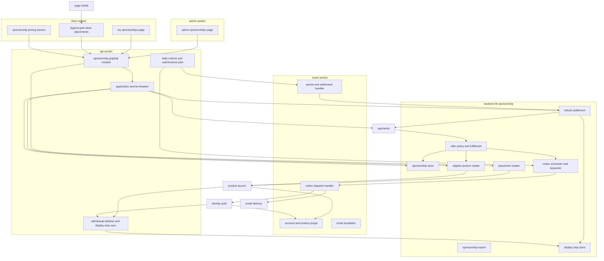
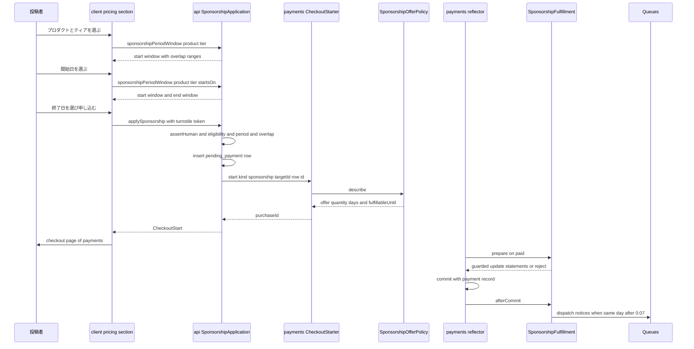
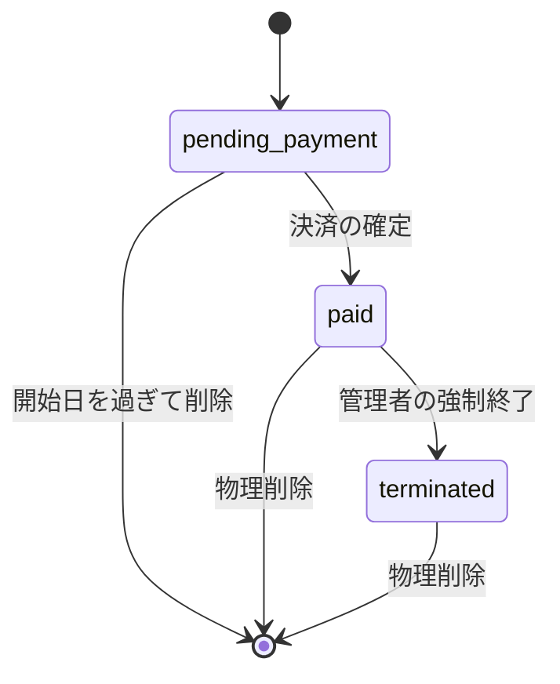
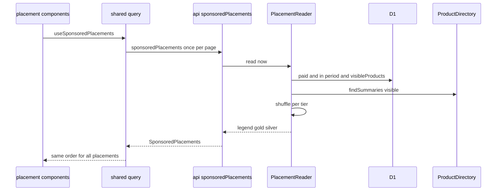
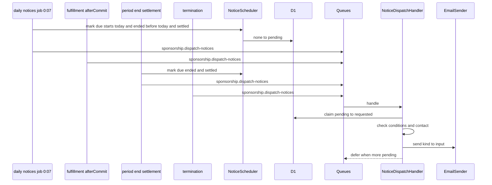
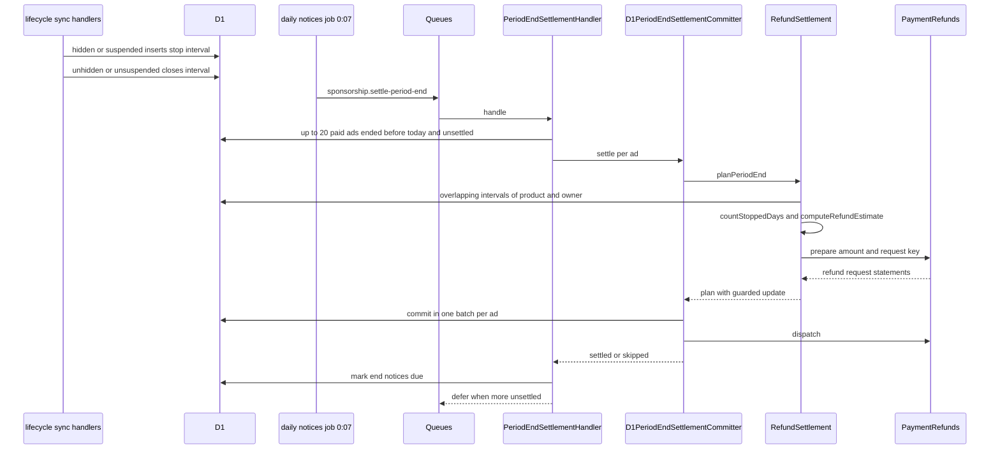
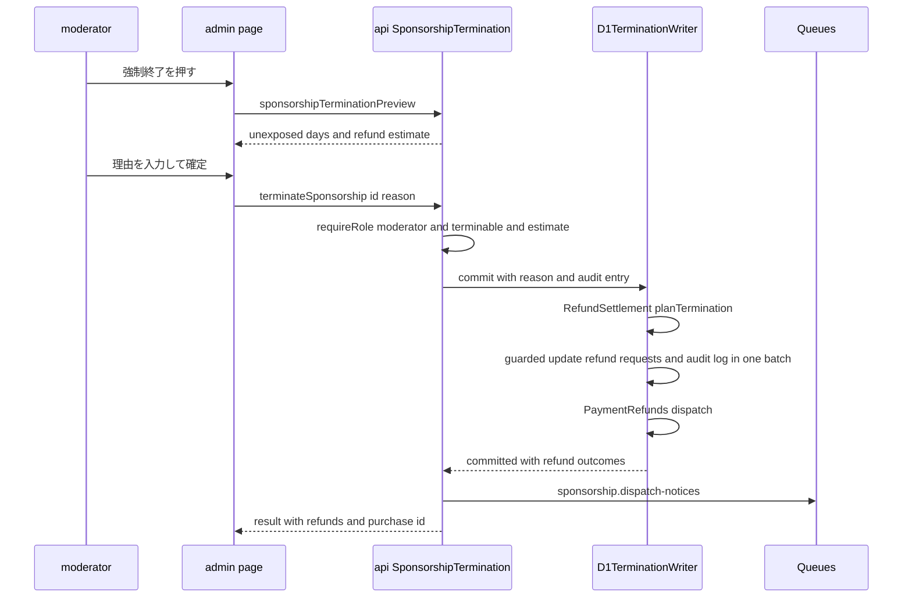
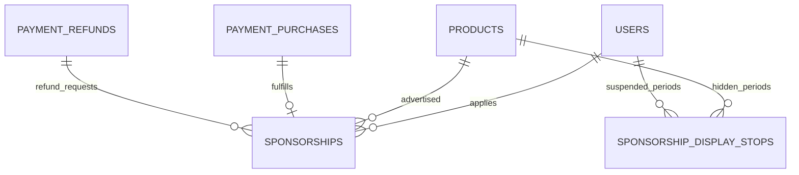

# Design Document

## Overview

**Purpose**: 投稿者が自分の過去にローンチしたプロダクトのスポンサー広告を、ティア(Legend・Gold・Silver)と基準時刻の日付の掲載期間を選んで申し込み、日数×単価の都度決済で支払えるようにする。申込は未決済の行として記録し、paymentsの`CheckoutStarter`で決済を始め、決済の確定はpaymentsの購入種別の口(`PurchaseOfferPolicy`・`PurchaseFulfillment`)で受け取って掲載権を1回だけ確定する。広告スペースは、トップページ・ディレクトリ・プロダクト詳細ページの区画の登録口へティアごとの部品として加え、表示の条件(決済済み・強制終了でない・期間内・プロダクトが可視)を表示の時点の1回の問い合わせで判定し、同じティアの中をサーバーが無作為に並べた結果で描画する。毎日0:07に開始・終了の通知の依頼を記録し、イベントサーバーのキューの処理がメールを送る。管理者は申込状況の一覧から理由付きで強制終了し、未掲載日数と返金目安額を確かめる。強制終了は未掲載日数分を、プロダクトの非公開化・投稿者の停止による表示停止は表示を止めた日数分を、paymentsの`PaymentRefunds`で金額を指定して日割りで自動的に返金する(仮3、2026-10-24に開発者が選択肢Bで確定)。表示停止の区間は非公開化・停止の確定と同じ書き込みで記録し、表示停止の返金は掲載の終わり(掲載終了日の翌日の0:07、強制終了ではその確定)に広告ごとに1回だけ求めて依頼する。

**Users**: 投稿者は料金ページ(`/pricing`)で申し込み、決済画面(payments)で支払い、自分の広告一覧(`/settings/sponsorships`)で掲載状況を確かめ、通知メールを受け取る。閲覧者は各ページの広告を見て、広告主のサイトを別タブで開く。管理者は管理画面の`/sponsorships`で申込状況を見て強制終了する。後続spec(data-export)はエクスポートの部品を、ugc-moderationは非公開化・停止の操作で本specの表示の条件を間接に動かす。

**Impact**: D1に2テーブル(`sponsorships`・`sponsorship_display_stops`)を足す。`apps/common-lib/sponsorship`に期間・状態・返金目安額の規則、`apps/backend-lib/core/sponsorship`にapi・eventのapplication層と後続specが受け取る契約とDIの識別子、`apps/backend-lib/workers/sponsorship`に申込のストア・表示の読み取り・購入種別の口の実装・エクスポートの部品・表示停止の区間のストア・日割りの返金の精算と両アプリ共通の束縛を新設する。apiにスキーマモジュール`sponsorship`・申込と強制終了のユースケース・0:07と4:21のジョブ(日割りの返金の精算の依頼を含む)・退会とプロダクトの削除と表示停止の同期の処理を、eventに通知の送信の処理・掲載の終わりの表示停止の返金の精算の処理・2つの物理削除の処理・3つのメールのテンプレートを、clientに料金ページの区画・広告スペースの部品・自分の広告一覧・削除の確認の注記を、adminに一覧と強制終了の画面を足す。apiの`wrangler.jsonc`のルートの`triggers.crons`に`7 8 * * *`(0:07)を足す。上流のファイルは、契約で定められた登録箇所への追記と、実装前のギャップ分析の決定(G1〜G6、2026-11-18に開発者が確定)による3つの共用化と、登録で期待値が変わる上流のテストの書き換えだけを変える。共用化は、返金の拒否の写像`refundRejectionOutcome`の`core/tournament`から`core/payments`への移設(G1)、業務日付の加算と日数の数え方の`backend-lib/core/time`から`common-lib/time`への移設(G3)、clientの暦日の写し(`calendarDayOf`・`businessDateOfCalendarDay`)の`components/product/`から`components/time/`への移設(G2、`frontend/012`の中立の置き場所の規則)である。新しいシークレット・パッケージは無い。

### Goals

- FR-SPONS-001〜023・FR-ADMUG-044〜046・LR-002が動作し、申込→決済→掲載→表示停止と再開→終了、強制終了、退会・削除・物理削除のどの経路でも、要件と仮1〜仮6の決定(2026-10-24に開発者が確定)と実装前のギャップ分析の決定G1〜G6(2026-11-18に開発者が確定)に一致する。
- 共用化で移した部品の利用者(tournament-week・tournament-year・product-launchなど)の振る舞いとテストの期待値を変えない。
- 決済のWebhook・決済後のランディング・突合のどの組み合わせで反映されても、掲載権の付与と開始通知の依頼が1回だけ行われる。
- 強制終了の未掲載日数分と表示停止の日数分の返金が、処理の再実行や競合があっても広告ごと・種類ごとに1回だけ、金額を指定して依頼される。
- 本specが追加・変更したコードの単体テスト・Workers統合テスト・ブラウザテストがカバレッジ80%を満たす。

### Non-Goals

- Stripeとの通信、決済画面・最終確認画面・決済後のランディング・決済履歴、購入確認メール、自動返金の実行(payments)。
- 返金の実行・決済履歴への反映・返金の依頼の送り直し(payments)、統計の収益の集計(ugc-moderation)、データエクスポートのZIP(data-export)。
- 掲載枠の在庫と売り切れ(仮1)、広告の表示回数・クリックの計測(準拠方針)、広告の審査の工程。
- 要件定義書の改訂(roadmapのOut。必要な改訂は[research.md](research.md)の「要件定義書の改訂が必要な箇所」に記録した)。(2026-10-25に要件定義書へ適用済み)

## Boundary Commitments

### This Spec Owns

- 申込のデータ: `sponsorships`(`apps/db/schema/sponsorship/`)。掲載権・強制終了・通知の依頼・日割りの返金の依頼の状態を含む。表示停止の区間`sponsorship_display_stops`(プロダクトの非公開化と投稿者の停止の始まりと終わり)。
- 申込の規則(`apps/common-lib/sponsorship/`): ティアと価格の`lookup_key`、掲載期間の検証と選べる範囲、状態の導出と表示名、未掲載日数と返金目安額、表示停止日数。日付の加算と日数は共用の`apps/common-lib/time/business-date-arithmetic.ts`を使い、独自に持たない(G3)。
- 共用化の移設(G1〜G3): `apps/common-lib/time/business-date-arithmetic.ts`(`addBusinessDays`・`countBusinessDaysInclusive`。`backend-lib/core/time/business-time.ts`の`addBusinessDays`はこれを使う形にし、既存の読み込み先は変えない)、`apps/backend-lib/core/payments/refund-rejection.ts`(`core/tournament/refund-rejection.ts`から移し、tournament-week・yearの読み込み先を書き換える)、clientの`components/time/business-date-calendar.ts`(`components/product/launch-date-calendar.ts`の`calendarDayOf`・`businessDateOfCalendarDay`を移し、productの読み込み先を書き換える)。移した部品の振る舞いと、利用者のテストの期待値は変えない。
- 共有部品: 申込のストア`SponsorshipStore`、表示の読み取り`PlacementReader`、申込の対象の判定`EligibleProductReader`、購入種別`sponsorship`の`SponsorshipOfferPolicy`・`SponsorshipFulfillment`、通知の予定と依頼(`NoticeScheduler`・`NoticeRequester`)、表示停止の区間のストア`DisplayStopStore`と区間の記録の文`DisplayStopStatements`、強制終了の返金の見積もり`RefundEstimator`と日割りの返金の精算`RefundSettlement`、データエクスポートの部品`SponsorshipExport`、両アプリ共通の束縛を作る`createSponsorshipPlatformModule(appName)`。application層と後続specが受け取る契約(`SponsorshipStore`・`EligibleProductReader`・`PlacementReader`・`NoticeScheduler`・`NoticeRequester`・`DisplayStopStore`・`RefundEstimator`・`SponsorshipExport`と入出力の型)と識別子`SPONSORSHIP_PLATFORM_TYPES`は`apps/backend-lib/core/sponsorship`(`ports.ts`・`identifiers.ts`)、D1の実装・購入種別の口の実装と登録の定数`SPONSORSHIP_PURCHASE_KIND_REGISTRATION`(`sponsorship-registrations.ts`)・データベースの文を返す契約(`DisplayStopStatements`・`RefundSettlement`)と束縛は`apps/backend-lib/workers/sponsorship`に置く。メッセージ種別`sponsorship.dispatch-notices`・`sponsorship.settle-period-end`とメール種別3つ。
- apiのユースケース(申込・決済の再開・料金の照会・掲載期間の選べる範囲の照会・自分の一覧・削除の確認の件数・管理者の一覧・強制終了)、スキーマモジュール`sponsorship`、ジョブ`sponsorship.daily-notices`(0:07)・`sponsorship.maintenance`(4:21)、ユーザーの同期の処理`sponsorship.account-withdrawal`・`sponsorship.account-display-stop`、プロダクトの同期の処理`sponsorship.product-deletion`・`sponsorship.product-display-stop`、監査ログの操作種別`sponsorship.terminate`。
- eventの通知の送信の処理`sponsorship.dispatch-notices`・掲載の終わりの精算の処理`sponsorship.settle-period-end`、非同期の処理`sponsorship.account-purge`(ユーザー)・`sponsorship.product-purge`(プロダクト)、テンプレート3つ。精算と物理削除の書き込みは、application層のポート(`PeriodEndSettlementCommitter`・`SponsorshipPurgeStore`)とinfrastructure層の実装(`D1PeriodEndSettlementCommitter`・`D1SponsorshipPurgeStore`)に分ける。apiの強制終了の書き込みも同じく、ポート`SponsorshipTerminationWriter`と実装`D1TerminationWriter`に分ける。
- clientの料金ページの区画`sponsorship.sponsorship-pricing`、広告スペースの部品(Legend・Gold・Silver・Goldの一覧への差し込み)とその登録、`/settings/sponsorships`、削除の確認の注記`sponsorship.active-ads`。adminの`/sponsorships`。
- 技術ドキュメント`backend/018-date-range-entitlements.md`(`backend/009`・`010`・`017`と重なる規約はリンクにし、本specに固有の規約に絞る、G6)・`frontend/017-sponsored-placements.md`の新規作成と、共用化に合わせた`backend/017`・`backend/019`・`frontend/012`の部品の置き場所の記述の更新、サービス仕様(ページ配置・文言規則・日次タイムライン)の追記と更新済みの文書(返金ポリシー・料金とプラン・決済実装方針・データエクスポート)の一致の確認、オンボーディングの追記。

### Out of Boundary

- 決済のデータと処理(購入・決済履歴・返金・Webhook・突合・決済画面)(payments)。本specは口の実装と`CheckoutStarter`・`PriceCatalog`・`PaymentRefunds`の呼び出しだけを行い、決済のテーブルを読み書きしない(Workers統合テストとE2Eの補助が作るテスト専用の購入の行を除く)。
- プロダクト・ローンチ・利用者のデータ(product-launch・identity-auth・user-profile-social)。本specは照会口と`visibleProducts()`の絞り込みだけを使い、それらのテーブルへ書き込まない。
- ページの枠と区画の登録口(match-engine・directory-discovery・ultras-subscription・identity-auth・admin-foundation・product-launch)。本specは区画の中身と登録の行だけを持つ。
- 非公開化・停止の操作と通知(ugc-moderation)、プロダクトの削除・退会の操作(product-launch・identity-auth)、メールの描画と送信の基盤(email-delivery)、監査ログの保存と閲覧(admin-foundation)。
- 返金の依頼の記録・Stripeでの実行・決済履歴への反映・依頼の送り直し(payments)。本specは`PaymentRefundStatements.prepare`・`PaymentRefunds.dispatch`で金額と依頼キーを指定して依頼するだけで、Stripeを呼ばない。

### Allowed Dependencies

- backend-platform: `AppModule`・`PLATFORM_TYPES`(`Database`・`Clock`・`IdGenerator`・`MessagePublisher`)・`AppError`・`getAppLogger`・`ulidPrimaryKey`・`timestamps`・`BusinessTime`(`core/time/business-time.ts`の`toBusinessDateTime`・`fromBusinessDateTime`・`parseBusinessDate`・`addBusinessDays`・`BusinessDate`・`BusinessTimeOfDay`)、共用の`common-lib/time/business-date-arithmetic.ts`(`addBusinessDays`・`countBusinessDaysInclusive`。G3で本specが`core/time`から移す)・`common-lib/time/business-date-label.ts`(`formatBusinessDateWithWeekdayLabel`)、`ScheduledJobDefinition`(`{ name, at, order, handler }`。時刻は`at`の業務時刻で宣言する)・`ScheduledJobHandler`・`ScheduledJobContext`・`SCHEDULED_JOBS`・`defineMessageContract`・`MESSAGE_CONTRACTS`・`MessageHandler`・`MessageHandlingResult`(`done`・`defer`)・`MessageHandlerRegistration`、Sentryの`captureEvent`(定型の文言を`logentry`、まとめる単位を`fingerprint`に置く。`infra/004`の「同じ文言を繰り返し送る通知」。前例は`workers/payments/refund-failure-reporting.ts`・`workers/week-tournament/week-entry-follow-up.ts`)、E2Eの`e2e/support/scheduled-trigger.ts`(`triggerScheduled({ worker, businessDate, businessTime })`。`businessTime`は必須の`"HH:mm"`)。形を変えない。
- api-gateway: `defineSchemaModule`・`GraphQLContext`(`caller`・`session`・`assertHuman`・`loaders`)・`withValidatedArgs`・`encodeCursor`・`decodeCursor`・`DateTime`・`PageInfo`。
- payments: `core/payments`の`PurchaseOfferPolicy`・`PurchaseOffer`・`PurchaseOfferDecision`(`unavailable`は`code`と`message`が必須)・`PurchaseOfferRequest`・`PriceCatalog`・`PAYMENTS_TYPES`・`MinorUnitAmount`、`core/payments`の`FulfillablePurchase`・`PaymentRefunds`(`dispatch`)・`RefundRequestInput`・`RefundRequestResult`(拒否は`purchase_not_found`・`not_paid`・`invalid_amount`・`amount_exceeds_refundable`・`invalid_request_key`の5種類)・`refundRejectionOutcome`(`core/payments/refund-rejection.ts`、G1で本specが`core/tournament`から移す)、`workers/payments`のデータベースの文を扱う契約`PurchaseKindRegistration`・`PurchaseFulfillment`・`FulfillmentPlan`(`reject`の理由は`ineligible`だけ)・`PaymentRefundStatements`(`prepare`。依頼キーの形式違反は`invalid_request_key`、理由の形式違反は`RangeError`、同じ依頼キーの2回目は金額の検証より先に`duplicate: true`と空の文を返す。`workers/sponsorship`とinfrastructure層だけが使う)・`PURCHASE_KIND_REGISTRATIONS`(`apps/backend-lib/workers/payments/purchase-kind-registrations.ts`)、apiの`CheckoutStarter`・`API_PAYMENTS_TYPES`・GraphQLの`Money`・`CheckoutStart`・frontend-libの`MoneyText`・`UnavailableNotice`。購入種別の値`sponsorship`(`common-lib/payments/purchase-kinds.ts`・購入と決済履歴のCHECK・GraphQLの`PurchaseKind`)はpaymentsが追加済みで、本specは値を足さない。
- identity-auth: `AccountGuard`(`currentUser`・`requireUser`・`requireWritableUser`・`requireVerifiedUser`)・`CurrentUser`・`UserLifecycleEvent`・`UserLifecycleSyncHandler`(apiの`infrastructure/identity/user-lifecycle-sync-handler.ts`の`statementsFor(event, db)`。登録は`{ name, events, handler }`で`order`を持たず一覧の順に動く)・`USER_LIFECYCLE_SYNC_HANDLERS`・`UserLifecycleAsyncHandler`・`USER_LIFECYCLE_ASYNC_HANDLERS`・`LifecycleHandlerOutcome`・`core/identity`の`IDENTITY_PLATFORM_TYPES.UserContactDirectory`(`findContact`)・`users`(外部キーと`visibleProducts()`の結合だけ)・`SETTINGS_NAV_ITEMS`・`SettingsShell`・`_authenticated`のレイアウト・`viewerQueryOptions`・`useViewer`(`ClientViewer`の`status`(`ACTIVE`・`SUSPENDED`)・`emailVerified`)・E2Eの`e2e/support/mailpit.ts`。
- product-launch: `core/product`の`PRODUCT_PLATFORM_TYPES`・`ProductDirectory`(`findSummaries`・`resolveHandle`・`listLaunches`)・`ProductSummaryRecord`・`LaunchExport`(`listByUser`)・`ProductExport`(`listByUser`)、`visibleProducts()`(`sponsorships`と`products`・`users`を結合した表示の絞り込みだけ)、`products`への外部キー、`ProductLifecycleEvent`・`ProductLifecycleSyncHandler`(apiの`infrastructure/product/product-lifecycle-sync-handler.ts`。登録はユーザーと同じ形)・`PRODUCT_LIFECYCLE_SYNC_HANDLERS`・`ProductLifecycleAsyncHandler`・`PRODUCT_LIFECYCLE_ASYNC_HANDLERS`(`backend/012`の集約のライフサイクルの規約)、`LaunchStatus`、clientの`ProductDeleteNotice`(`{ productHandle }`を受け取る)・`PRODUCT_DELETE_NOTICES`・`components/product/launch-date-calendar.ts`(G2で暦日の写しを`components/time/`へ移し、`unavailableReasonOn`は残す)。
- match-engine: clientの`TopPageSection`・`TopPageSectionContext`・`TOP_PAGE_SECTIONS`・`QualifierListInsert`・`QUALIFIER_LIST_INSERTS`。
- directory-discovery: clientの`DirectorySection`・`DirectorySectionContext`・`DIRECTORY_PAGE_SECTIONS`・`DirectoryListInsert`・`DIRECTORY_LIST_INSERTS`・`ProductPageSection`・`ProductPageContext`・`PRODUCT_PAGE_SECTIONS`。
- ultras-subscription: clientの`PricingSection`・`PRICING_SECTIONS`。
- user-profile-social: `core/profile`の`PROFILE_PLATFORM_TYPES.UserProfileDirectory`(`findSummaries`、管理画面の申込者のニックネーム)・`checkExternalUrl`。
- media-pipeline: `mediaFileLoader`・`toMediaImage`・GraphQLの`MediaImage`、frontend-libの画面の部品`MediaPicture`(`display: { kind: 'square', size: 32 | 64 }`)。
- email-delivery: `defineEmailKind`・`EMAIL_KINDS`・`EmailSender`・`EmailSendError`・`EMAIL_TYPES`・`defineEmailTemplate`・`EMAIL_TEMPLATES`。
- admin-foundation: `requireAdmin`・`CurrentAdmin`・`AuditLogRecorder`・`PreparedAuditEntry`・`buildAuditLogStatements`・`defineAuditAction`・`AUDIT_ACTIONS`・`checkAuditReason`・`AUDIT_REASON_MAX`・`ADMIN_NAV_ITEMS`・`AdminPageHeader`・`AdminFilterBar`・`AdminDataTable`(前後のカーソルの`pagination`)・`ConfirmActionDialog`(`title`・`description`は`ReactNode`)・`ReasonField`・`RoleGate`・`useAdminRole`、frontend-libの`cursor-trail.ts`(前のページへ戻るカーソルの積み重ね)、管理画面の一覧の規約(`frontend/009`。絞り込みとカーソルはURLの検索パラメータに持ち、不正な値は未指定として捨てる。前例は`routes/_authenticated/audit-logs/index.tsx`)・E2Eの`e2e/support/admin-bootstrap.ts`・`e2e/support/local-d1.ts`(`executeLocalD1`・`sqlStringLiteral`)。
- frontend-platform: `executeGraphQL`・`graphqlQueryOptions`・`graphqlMutationOptions`・`GraphQLClientError`・`useTurnstileToken`・`TurnstileWidget`・`buildSitePageHead`(client)・`buildAdminPageHead`(admin)・`ErrorState`・`EmptyState`・`LoadingSkeleton`・`notify`・日時の表示部品(`DateTime`。業務日付には使わない)・shadcn/uiの部品(ボタン・カード・バッジ・セレクト・ラジオグループ・ラベル・`Calendar`(`unavailableReasonOf`。前例は`components/product/launch-date-field.tsx`の画面に直接置く形))・`runAxe`・デザイントークン・`errorMessageOf`・各アプリの`src/composition/app-profile.ts`のプロファイル(`CLIENT_PROFILE`・`ADMIN_PROFILE`)、clientの`components/time/use-boundary-refresh.ts`(`useBoundaryRefresh`)・`components/time/business-date-calendar.ts`(G2で移す暦日の写し)、業務日付のカレンダーの規約(`frontend/012`)、区画の規約(`frontend/013`。ページが区画の後ろに描画済みの目印を置き、何も描かない区画の枠を畳む)。決済の開始の画面は、tournament-week・yearの`components/tournament/tournament-entry-checkout.tsx`の形(成功で`/checkout/$purchaseId`へ遷移、`payments_unavailable`で`UnavailableNotice`とボタンの無効化、送信中の`aria-disabled`・`aria-busy`)に合わせる。
  - GraphQLの操作は各アプリの`src/graphql/operations/sponsorship/`に1ファイル1操作の`*.graphql`で書き、操作名を利用者側は`Client`、管理者側は`Admin`で始める。画面は`src/graphql/generated/graphql.ts`の`<操作名>Document`と型を読み、`graphql()`と`gql.ts`・`index.ts`を使わない(frontend-platformの「操作の追加手順」)。
  - 失敗の文言: `GraphQLClientError`でない例外に代えて画面に出す文言(`ErrorState`・`PartialErrorState`の`message`、フォームの失敗の文言、トースト)は`errorMessageOf(error, <プロファイル>.contactAvailable)`で選び、例外の`message`を直接出さない。管理者側は`ADMIN_PROFILE`を使い、`ErrorState`・`UnexpectedErrorView`に`contactHref`を渡さない(問い合わせの画面が無いため、問い合わせの導線と問い合わせを促す文を出さない)。
  - bot判定の`TurnstileWidget`は非表示のウィジェットで場所を取らないため、申込のフォームと決済の再開のボタンの近くに判定の枠の表示と場所を設けない。
- npmパッケージ: 新規なし。
- api・eventのapplication層は`**/lib/workers/**`を型も含めて読み込めないため(backend-platformの層の規則)、上流の契約と識別子は`core/<ドメイン>`から読み込む。`workers`の契約(paymentsの`PurchaseFulfillment`・`PaymentRefundStatements`、本specの`DisplayStopStatements`・`RefundSettlement`、上流の同期の処理の文)は`workers/sponsorship`とinfrastructure層だけが使う。
- 後続specは、`common-lib/sponsorship`の公開の規則、`core/sponsorship`の`SponsorshipExport`と`SPONSORSHIP_PLATFORM_TYPES`だけに依存し、本specのテーブルを読み書きしない。

### Revalidation Triggers

- `SponsorshipExport`の形と`sponsorships.json`の項目・状態の値(data-export、データエクスポートの文書)。
- `core/sponsorship`の契約(`SponsorshipStore`・`EligibleProductReader`・`PlacementReader`・`NoticeScheduler`・`NoticeRequester`・`DisplayStopStore`・`RefundEstimator`・`SponsorshipExport`)と`SPONSORSHIP_PLATFORM_TYPES`の置き場所。application層が`**/lib/workers/**`を読み込めない規則(backend-platform)が変わっても、置き場所を`workers`へ戻さない(本specと後続specのapplication層が読み込むため)。上流の契約の置き場所(`core/product`・`core/identity`・`core/profile`・`core/payments`と`workers/payments`の分け方)を変えたら、本specの読み込み先を確かめ直す。
- 表示の条件(決済済み・強制終了でない・期間内・`visibleProducts()`)と、状態の値(`SPONSORSHIP_STATUSES`)の変更(ugc-moderation・data-export)。
- 処理の名前と`order`(1600)、0:07のCronの式(backend-platformのCronの一致の検査・日次タイムライン)。
- 上流の`PurchaseOfferPolicy`・`PurchaseFulfillment`・`FulfillablePurchase`・`CheckoutStarter`・`PriceCatalog`・`PaymentRefundStatements`(`prepare`の拒否の理由・同じ依頼キーの2回目の扱い・依頼キーと理由の値の規則)の形、反映の期限と`exclusivityKey`の規則、決済期限の無い購入の有効期限(paymentsの仮4)を変えたら、本specを確かめ直す。
- 上流の`TOP_PAGE_SECTIONS`・`QUALIFIER_LIST_INSERTS`・`DIRECTORY_PAGE_SECTIONS`・`DIRECTORY_LIST_INSERTS`・`PRODUCT_PAGE_SECTIONS`・`PRICING_SECTIONS`・`PRODUCT_DELETE_NOTICES`・`SETTINGS_NAV_ITEMS`・`ADMIN_NAV_ITEMS`の形・置き場所の描画(特にトップページの`banner`のグリッドと、ディレクトリの`aside`の配置)を変えたら、広告スペースの部品を確かめ直す。
- 上流の`ProductDirectory`・`LaunchExport`・`ProductExport`・`visibleProducts()`・`UserContactDirectory`・`UserProfileDirectory`・`AuditLogRecorder`・`EmailSender`の形を変えたら、本specを確かめ直す。
- backend-platformの改訂2の`triggerScheduled`の引数(`worker`・`businessDate`・`businessTime`)を変えたら、E2Eの0:07のジョブの起動(tasks.mdの11.1・11.2)を確かめ直す。
- 上流のユーザー(`suspended`・`unsuspended`・`withdrawn`)とプロダクト(`hidden`・`unhidden`・`deleted`)の同期の処理の呼ばれ方(確定と同じ書き込み、`occurredAt`)を変えたら、表示停止の区間の記録と表示停止日数を確かめ直す。
- 返金ポリシー(法的通知の大枠)の広告の行と表示停止日数の数え方(日の一部でも停止した日を数える)を変えたら、`countStoppedDays`・`RefundSettlement`を確かめ直す(ugc-moderationの停止・非公開化の通知の文面も合わせる)。
- 返金の拒否の写像(`core/payments/refund-rejection.ts`の`refundRejectionOutcome`)・拒否のコード・`backend/017`の返金の後処理の規約を変えたら、本specの返金の状態(`already_refunded`・`rejected`)と、tournament-week・yearの扱いを合わせて確かめ直す。
- 共用の業務日付の計算(`common-lib/time/business-date-arithmetic.ts`)と暦日の写し(clientの`components/time/business-date-calendar.ts`)、業務日付のカレンダーの規約(`frontend/012`の`DateWindowView`の形)を変えたら、掲載期間の選べる範囲と申込の画面を確かめ直す。

### 上流への影響

| 上流spec                         | 変更                                                                                                                                                                                                                                                                                                                                                                                                                                                                                                       | 影響と再検証                                                                                                                      |
| -------------------------------- | ---------------------------------------------------------------------------------------------------------------------------------------------------------------------------------------------------------------------------------------------------------------------------------------------------------------------------------------------------------------------------------------------------------------------------------------------------------------------------------------------------------- | --------------------------------------------------------------------------------------------------------------------------------- |
| payments                         | `apps/backend-lib/workers/payments/purchase-kind-registrations.ts`の`PURCHASE_KIND_REGISTRATIONS`に`SPONSORSHIP_PURCHASE_KIND_REGISTRATION`(`workers/sponsorship/sponsorship-registrations.ts`)。`core/tournament/refund-rejection.ts`(と単体テスト)を`core/payments/refund-rejection.ts`へ移す(G1)。テストの「未登録の購入種別」の例`sponsorship`を、登録されていない別の値へ差し替える(B-2)                                                                                                              | 契約どおり。`createPurchaseKindRegistry`の重複の検査を通る。写像の振る舞いは変えない                                              |
| tournament-week・tournament-year | `workers/week-tournament/week-entry-follow-up.ts`・`workers/year-tournament/year-entry-follow-up.ts`と`core/week-tournament/week-entry-rules.unit.test.ts`・`core/year-tournament/year-entry-rules.unit.test.ts`の`refundRejectionOutcome`の読み込み先を`core/payments`へ書き換える(G1)                                                                                                                                                                                                                    | 振る舞いとテストの期待値は変えない。承認済みの両specのdesign.md・tasks.mdは書き換えず、移した後の置き場所は本specの設計を正とする |
| backend-platform(共用の時刻)     | `core/time/business-time.ts`の`addBusinessDays`を、`common-lib/time/business-date-arithmetic.ts`の関数を使う形にする(G3)。公開の名前・引数・戻り値の型(`BusinessDate`)は変えない                                                                                                                                                                                                                                                                                                                           | 既存の利用者(tournament-week・year・product-launchなど)の読み込み先は変わらない                                                   |
| product-launch(client)           | `components/product/launch-date-calendar.ts`の`calendarDayOf`・`businessDateOfCalendarDay`を`components/time/business-date-calendar.ts`へ移し、`launch-date-field.tsx`と単体テストの読み込み先を書き換える。`unavailableReasonOn`はproductに残す(G2)                                                                                                                                                                                                                                                       | 振る舞いとテストの期待値は変えない                                                                                                |
| ultras-subscription              | clientの`composition/pricing-sections.ts`に`sponsorship.sponsorship-pricing`(20)                                                                                                                                                                                                                                                                                                                                                                                                                           | 予約どおり                                                                                                                        |
| match-engine                     | clientの`composition/top-page-sections.ts`の`TOP_PAGE_SECTIONS`に`sponsorship.legend`(banner 5)・`sponsorship.gold`(aside 10)・`sponsorship.silver`(bottom 10)、`QUALIFIER_LIST_INSERTS`に`sponsorship.gold-insert`(10、2件ごと)                                                                                                                                                                                                                                                                           | 申し送りどおり                                                                                                                    |
| directory-discovery              | clientの`composition/directory-sections.ts`の`DIRECTORY_PAGE_SECTIONS`に`sponsorship.legend`(banner 10)・`sponsorship.gold`(aside 10)・`sponsorship.silver`(bottom 10)と`DIRECTORY_LIST_INSERTS`に`sponsorship.gold-insert`(10、2件ごと)(仮4)、`composition/product-page-sections.ts`の`PRODUCT_PAGE_SECTIONS`に`sponsorship.legend`(banner 10)・`sponsorship.gold`(aside 30)・`sponsorship.silver`(bottom 20)                                                                                             | 予約どおり。ディレクトリへの登録は仮3の登録口を使う                                                                               |
| product-launch                   | apiの`composition/product-lifecycle-sync-handlers.ts`に`sponsorship.product-deletion`(`deleted`)・`sponsorship.product-display-stop`(`hidden`・`unhidden`)、eventの`composition/product-lifecycle-async-handlers.ts`に`sponsorship.product-purge`(`purge_due`、1600)、clientの`composition/product-delete-notices.ts`に`sponsorship.active-ads`(30)                                                                                                                                                        | 契約どおり。`createProductLifecycleRegistry`の検証を通る                                                                          |
| identity-auth                    | apiの`composition/user-lifecycle-sync-handlers.ts`に`sponsorship.account-withdrawal`(`withdrawn`)・`sponsorship.account-display-stop`(`suspended`・`unsuspended`)、eventの`composition/user-lifecycle-async-handlers.ts`に`sponsorship.account-purge`(`purge_due`、1600)、clientの`composition/settings-navigation.ts`に`/settings/sponsorships`(80)                                                                                                                                                       | 契約どおり                                                                                                                        |
| admin-foundation                 | `apps/common-lib/admin/audit-actions/sponsorship.ts`と`index.ts`の連結、adminの`composition/admin-navigation.ts`に`/sponsorships`(90)                                                                                                                                                                                                                                                                                                                                                                      | 契約どおり。`createAuditActionCatalog`の検査を通る                                                                                |
| email-delivery                   | `core/email/kinds/index.ts`に3種別、eventの`infrastructure/email/templates/index.ts`に3テンプレート                                                                                                                                                                                                                                                                                                                                                                                                        | 契約どおり                                                                                                                        |
| backend-platform                 | apiの`composition/scheduled-jobs.ts`の`SCHEDULED_JOBS`に2つのジョブ、apiの`wrangler.jsonc`のルートの`triggers.crons`だけに`7 8 * * *`(環境へ継承されるため`env.staging`・`env.prod`には書かない。project-values.mdの規則)と`test/config/cron-sync.unit.test.ts`の期待値、`core/messaging/contracts/index.ts`に`sponsorship.dispatch-notices`・`sponsorship.settle-period-end`、eventの`composition/message-handlers.ts`に2つの処理。`SCHEDULED_RUN_BUDGETS`に0:07の予算は足さない(`infra/003`で必須でない) | 契約どおり。Cronの式の一致の検査を通る。4:21の`21 12 * * *`は登録済み                                                             |
| api-gateway                      | apiの`composition/graphql-modules.ts`に`sponsorshipSchemaModule`、client・adminの許可リストの再生成                                                                                                                                                                                                                                                                                                                                                                                                        | 契約どおり                                                                                                                        |

- roadmapの帯の割り当ての表の本specの「使用中の値」は「4:21は1600、波及処理は1600」になる(0:07のジョブも1600。本specはroadmapを編集しないため、コントローラーへ報告する)。
- 上流specのファイルの変更は、登録箇所への追記と、上の表の共用化(G1〜G3)と、次の上流のテストの書き換え(B-2)だけである。paymentsの`PaymentRefunds`は契約どおりに呼ぶ(依頼キーは`backend/017`の形の`sponsorship:<購入ID>:sponsorship_terminated`・`sponsorship:<購入ID>:sponsorship_display_stopped`で、`reflection:`で始めない、G5)。
- 上流のテストの書き換え(B-2): 本specの登録で、登録口の一覧を完全一致で確かめる上流のテストと、`sponsorship`を未登録の購入種別の例に使うpaymentsのテストが落ちる。各登録のタスクは、登録の前に登録口の名前と`'sponsorship'`で上流のテストを検索して書き換え、完了状態にapiとeventのWorkers統合テストの全件の実行を含める(名前を参照せず振る舞いで影響を受けるテストは検索で拾えないため)。2026-11-18の時点で該当する主なテストは次のとおり。
  - payments: `workers/payments/checkout-session-reflection.rejection.worker.test.ts`・`payments-platform-module.worker.test.ts`(未登録の購入種別の例。project-values.mdの申し送り)
  - client: `components/top/top-page-sections.browser.test.ts`・`components/directory/directory-sections.browser.test.ts`・`components/product-page/product-page-sections.browser.test.ts`・`components/product/product-section-registries.browser.test.ts`・`components/settings/settings-nav-order.unit.test.ts`
  - admin: `components/layout/admin-nav-order.unit.test.ts`
  - backend-lib: `core/email/kinds/index.unit.test.ts`・`core/messaging/contracts/index.unit.test.ts`
  - api: `test/config/cron-sync.unit.test.ts`・`domain/admin/audit-entry.unit.test.ts`・各モジュールのWorkers統合テスト
  - event: `composition/product-lifecycle-async-handlers.unit.test.ts`・各モジュールのWorkers統合テスト

## Architecture

### Existing Architecture Analysis

- 上流のspecと並行のengagement・notifications・tournament-week・tournament-yearは実装済みで、本specが使う契約の名前・置き場所・形は実装前のギャップ分析(2026-11-18、research.md)で照合した。登録口の`order`(トップページ・ディレクトリ・詳細ページ・料金20・設定80・管理メニュー90・削除の注記30・非同期の1600・4:21の1600)はすべて空いているか予約済みで、0:07に他のジョブは無い。
- apiはクリーンアーキテクチャ(`domain`→`application`→`infrastructure`・`presentation`→`composition`)、処理単位のDIコンテナ、D1の`db.batch()`を使う。条件付きの前進は、条件を満たさなければNOT NULL制約の違反で一括の書き込み全体を取り消す文で表す(identity-auth・paymentsの方式、`db/005`)。
- paymentsの反映はapi(決済後のランディング・突合)とevent(Webhook)の両方で動くため、購入種別の口の実装は`backend-lib/workers/<ドメイン>`に置き、両アプリに同じ束縛を入れる(paymentsのRevalidation Triggers)。口の`prepare`は副作用を持たずD1の文だけを返し、`afterCommit`は確定させた側だけが1回呼ぶ。
- Cron Triggersはapiだけにあり、重い処理と外部への送信はeventのQueueの処理へ委ねる。メールはemail-deliveryの`EmailSender`が`email.send`をQueueへ送り、eventが描画して送る。
- backend-platformの層の規則([層構成と合成ルート](../../../docs/GUIDES/tech/backend/002-layered-architecture-on-workers.md))により、api・eventの`src/application/**`・`src/domain/**`は`**/lib/workers/**`を型だけでも読み込めず、application層はデータベースの接続・SQLの文・一括の書き込みを扱わない。application層が受け取る契約と識別子は`core/<ドメイン>`に置き、文を返す契約は`workers`に置いて`infrastructure`と`workers`だけが使う。

### Architecture Pattern & Boundary Map



**Architecture Integration**:

- Selected pattern: クリーンアーキテクチャ。期間・状態・返金目安額は`common-lib`の純粋な関数、application層が受け取る契約と識別子は`backend-lib/core/sponsorship`、決済の口と表示の読み取りの実装は`backend-lib/workers/sponsorship`の部品、ユースケースはapiの`application`。データベースの文を組み立てて一括の書き込みを実行する処理(強制終了・掲載の終わりの精算・物理削除)は、application層のポートとinfrastructure層の実装に分ける。表示の条件は写しを持たず表示の時点の問い合わせで判定する(research.mdの比較)。
- Domain/feature boundaries: 申込・掲載権・表示の条件・通知・強制終了は本spec、決済はpayments、プロダクトと可視性はproduct-launch、ページの枠はmatch-engine・directory-discovery・ultras-subscription・identity-auth・admin-foundation。
- Existing patterns preserved: `backend-lib/workers/<ドメイン>`の共有の束縛、`<spec名>.<名詞句>`の処理とジョブの名前、`<ドメイン>.<動詞句>`のメッセージ種別、帯の`order`、登録箇所への追記による拡張、依頼待ちの状態を記録してから外部へ送る方式(paymentsの返金とメールの依頼と同じ形)、条件付きの前進の文。
- New components rationale: `NoticeScheduler`・`NoticeRequester`は、0:07のジョブ・4:21の確認・決済の反映(仮2)・強制終了の4つの契機から同じ依頼待ちの記録と送信の処理を使うため。`EligibleProductReader`は申込の画面・申込の受付・決済の確定で同じ判定を使うため。`DisplayStopStore`・`RefundSettlement`は、強制終了と掲載の終わりの2つの契機から同じ日割りの返金の計算と依頼を使うため(仮3)。
- Steering compliance: Inversifyの`@inject`の明示、D1の制約(`db.batch()`・バインド変数100個以内)、800行以内のファイル、1ファイル1コンポーネント、日時の`<time datetime>`、新しいパッケージなし。

**Dependency direction**: `apps/common-lib/time` → `apps/common-lib/sponsorship` → `apps/db/schema/sponsorship` → `backend-lib/core/messaging/contracts/sponsorship.ts`・`backend-lib/core/email/kinds/sponsorship.ts`・`backend-lib/core/sponsorship`(契約・識別子・純粋な部品) → `backend-lib/workers/sponsorship`(D1・購入種別の口の実装・文を返す契約) → 各アプリの`src`(`domain` → `application` → `infrastructure`・`presentation` → `composition`)。`common-lib`は他の層を読み込まない(`common-lib/sponsorship`は`common-lib/time`だけを読み込む)。`backend-lib/core/time/business-time.ts`は`common-lib/time/business-date-arithmetic.ts`を読み込む。`backend-lib/core/sponsorship`は`core`の他の部品(`core/product`の`ProductSummaryRecord`など)と`common-lib/sponsorship`だけを読み込み、`workers`と`apps/db`を読み込まない。`backend-lib/workers/sponsorship`は`core/sponsorship`・`core/payments`・`core/product`・`core/identity`の契約と`workers/payments`の文を扱う契約(`PurchaseFulfillment`・`PaymentRefunds`)だけを読み込み、`backend-lib/workers/payments`の登録箇所(`purchase-kind-registrations.ts`)と各アプリの`infrastructure`・`composition`からだけ参照される。api・eventのapplication層は`**/lib/workers/**`を型も含めて読み込めないため、受け取る契約と識別子を`core/sponsorship`から読み込み、`workers`の部品を使わない(identity-authの`core/identity`・media-pipelineの`core/media`と同じ配置)。client・adminは`common-lib/sponsorship`とGraphQLの操作と上流の画面部品だけを読み込む。

### Technology Stack

| Layer     | Choice / Version                                             | Role in Feature                                                                     | Notes                                                        |
| --------- | ------------------------------------------------------------ | ----------------------------------------------------------------------------------- | ------------------------------------------------------------ |
| Frontend  | TanStack Start・Router・Query・shadcn/ui・lucide-react(上流) | 料金ページの区画・広告スペース・自分の一覧・管理画面                                | 日付は共通部品の`Calendar`で選ばせる(G2)、新規パッケージなし |
| Backend   | Hono・Inversify・GraphQL Yoga(上流)                          | スキーマモジュール・ユースケース・ジョブ・処理                                      | 既存                                                         |
| Data      | Cloudflare D1(Drizzle)                                       | `sponsorships`・`sponsorship_display_stops`                                         | 新規のマイグレーション                                       |
| Messaging | Cloudflare Queues(`JOBS_QUEUE`)・Cron Triggers(api)          | `sponsorship.dispatch-notices`・`sponsorship.settle-period-end`・0:07と4:21のジョブ | Cronの式`7 8 * * *`を追加                                    |
| External  | Stripe(payments経由)                                         | 価格の照会・決済                                                                    | 本specは直接呼ばない。価格の`lookup_key`3つ                  |

## File Structure Plan

### Directory Structure

```
apps/
├── common-lib/time/
│   └── business-date-arithmetic.ts                            # (G3で新設)addBusinessDays・countBusinessDaysInclusiveと、暦日の解析・UTCの0:00・整形の補助(core/time/business-time.tsの非公開の関数を移し、business-time.tsの他の関数もここから読み込む)(同名の*.unit.test.ts)
├── common-lib/sponsorship/                                    # 4アプリ共通(各ファイルに同名の*.unit.test.ts)
│   ├── sponsorship-tiers.ts                                   # SPONSORSHIP_TIERS・表示名・価格のlookup_key・ラベルの文言
│   ├── sponsorship-period.ts                                  # 期間の上限・検証・重なり・選べる範囲(computePeriodWindows)。日付の計算はcommon-lib/timeを使う
│   ├── sponsorship-status.ts                                  # 保存の状態・導出の状態・表示名・エクスポートの状態
│   └── refund-estimate.ts                                     # 未掲載日数・表示停止日数と返金目安額
├── db/schema/sponsorship/                                     # テーブル定義(同名の*.unit.test.ts)
│   ├── sponsorships.ts
│   ├── sponsorship-display-stops.ts                           # 表示停止の区間
│   └── index.ts
├── backend-lib/
│   ├── core/messaging/contracts/sponsorship.ts                # SPONSORSHIP_DISPATCH_NOTICES_MESSAGE・SPONSORSHIP_SETTLE_PERIOD_END_MESSAGE
│   ├── core/email/kinds/sponsorship.ts                        # 3つのメール種別(入力のzodスキーマ)と一覧SPONSORSHIP_EMAIL_KINDS
│   ├── core/payments/refund-rejection.ts                      # (G1でcore/tournamentから移す)refundRejectionOutcome・RefundRejectionCode・RefundRejectionOutcome(同名の*.unit.test.tsも移す)
│   ├── core/sponsorship/                                      # api・eventと後続specのapplication層が読み込める部品(Bunの単体テスト)
│   │   ├── ports.ts                                           # SponsorshipStore・EligibleProductReader・PlacementReader・NoticeScheduler・NoticeRequester・DisplayStopStore・RefundEstimator・SponsorshipExportの契約と型(RefundOutcomeなど)
│   │   ├── shuffle-by-tier.ts                                 # shuffleByTier・createUniformRandom(Fisher-Yates、同名の*.unit.test.ts)
│   │   ├── offer-rejection.ts                                 # 拒否の文言SPONSORSHIP_OFFER_REJECTION_MESSAGES(文言の唯一の出どころ。application層の申込の受付とpresentation層のerrors.tsも読む)
│   │   ├── notice-schedule.ts                                 # SPONSORSHIP_DAILY_NOTICES_TIME(0:07。反映の口とジョブが共有)
│   │   └── identifiers.ts                                     # SPONSORSHIP_PLATFORM_TYPES(api・event共通の識別子、同名の*.unit.test.ts)
│   └── workers/sponsorship/                                   # D1の実装・購入種別の口・文を返す契約と束縛(api・event共通、各ファイルに同名の*.worker.test.ts)
│       ├── d1-sponsorship-store.ts                            # SponsorshipStoreのD1実装(作成・照会・一覧・重なり・削除)
│       ├── d1-eligible-product-reader.ts                      # EligibleProductReaderの実装
│       ├── d1-placement-reader.ts                             # PlacementReaderのD1実装(無作為の並びはshuffleByTier)
│       ├── sponsorship-offer-policy.ts                        # PurchaseOfferPolicyの実装(反映の期限は開始日の翌日0:00の1ミリ秒前)
│       ├── sponsorship-payability.ts                          # describeとprepareが共有する期間・対象・重なりの判定(payabilityRejectionOf)
│       ├── sponsorship-fulfillment.ts                         # PurchaseFulfillmentの実装(条件付きの前進の文)
│       ├── sponsorship-registrations.ts                       # SPONSORSHIP_PURCHASE_KIND_REGISTRATION(paymentsのpurchase-kind-registrations.tsが読み込む)
│       ├── sponsorship-incident-reporting.ts                  # 返金の返金済み・拒否のSentryへの通知(captureEvent、指紋['sponsorship', <異常の種類>])
│       ├── d1-notice-scheduler.ts                             # NoticeSchedulerのD1実装(依頼待ちの記録の2文を1回の一括の書き込みで実行)
│       ├── queue-notice-requester.ts                          # NoticeRequesterの実装(sponsorship.dispatch-notices・sponsorship.settle-period-endの送信)
│       ├── display-stop-statements.ts                         # DisplayStopStatements(区間の記録の文を返す契約と実装。infrastructure層の同期の処理だけが使う)
│       ├── d1-display-stop-store.ts                           # DisplayStopStoreのD1実装(重なる区間の照会・削除)
│       ├── refund-settlement.ts                               # RefundSettlement(返金の計画の文と依頼を返す契約。infrastructure層だけが使う)とRefundEstimatorを兼ねる実装
│       ├── d1-sponsorship-export.ts                           # SponsorshipExportの実装(sponsorships.jsonの項目)
│       ├── sponsorship-platform-module.ts                     # createSponsorshipPlatformModule(appName)
│       └── testing/                                           # テストだけが読み込む補助(テストなし)
│           ├── sponsorship-fixtures.ts                        # Workers統合テストの申込・購入・プロダクト・利用者の行の作成と片付け
│           ├── observability-recording.ts                     # ログとSentryへの送信の記録
│           └── sponsorship-platform-implementations.ts        # DIの名前とクラスの表
├── api/src/
│   ├── application/sponsorship/                               # ユースケース(Bunの単体テスト)
│   │   ├── sponsorship-types.ts                               # SPONSORSHIP_TYPES
│   │   ├── sponsorship-application.ts                         # 申込と決済の再開
│   │   ├── sponsorship-offer-reader.ts                        # 料金ページの価格と申込の対象、掲載期間の選べる範囲(readPeriodWindow)
│   │   ├── my-sponsorships-reader.ts                          # 自分の一覧と削除の確認の件数
│   │   ├── admin-sponsorships-reader.ts                       # 管理画面の一覧
│   │   ├── sponsorship-termination.ts                         # 強制終了の照会と確定(書き込みのポートSponsorshipTerminationWriterを含む)
│   │   └── jobs/
│   │       ├── daily-notices-job.ts                           # 0:07(order 1600)
│   │       └── maintenance-job.ts                             # 4:21(order 1600)
│   ├── infrastructure/sponsorship/                            # Workers統合テスト
│   │   ├── account-withdrawal-sync-handler.ts                 # sponsorship.account-withdrawal
│   │   ├── product-deletion-sync-handler.ts                   # sponsorship.product-deletion
│   │   ├── display-stop-sync-handlers.ts                      # sponsorship.product-display-stop・sponsorship.account-display-stop
│   │   └── d1-termination-writer.ts                           # SponsorshipTerminationWriterの実装(返金の計画・強制終了と返金の依頼と監査ログの一括の書き込み・依頼の送信)
│   ├── presentation/graphql/modules/sponsorship/              # スキーマモジュール(Workers統合テスト)
│   │   ├── type-defs.ts
│   │   ├── inputs.ts                                          # 引数の検証
│   │   ├── errors.ts                                          # エラーコードと文言
│   │   ├── sponsorship-views.ts                               # logo・websiteUrl・amountPaidなどのリゾルバ
│   │   ├── client-resolvers.ts                                # 料金・広告・自分の一覧・申込・再開・削除の確認の件数
│   │   ├── admin-resolvers.ts                                 # 管理画面の一覧・強制終了の照会と確定
│   │   └── index.ts                                           # sponsorshipSchemaModule
│   └── composition/sponsorship-module.ts                      # apiの束縛
├── api/test/config/sponsorship-scheduled-jobs.unit.test.ts    # 2つのジョブの登録(名前・時刻・order 1600・処理)の検査(他の*-scheduled-jobs.unit.test.tsと同じ形)
├── event/src/
│   ├── application/sponsorship/                               # Bunの単体テスト
│   │   ├── event-sponsorship-types.ts                         # EVENT_SPONSORSHIP_TYPES
│   │   ├── ports.ts                                           # PeriodEndSettlementCommitter・PeriodEndSettlementFailureReporter・SponsorshipPurgeStore・NoticeClaimStore
│   │   ├── notice-dispatch-handler.ts                         # sponsorship.dispatch-notices
│   │   ├── period-end-settlement-handler.ts                   # sponsorship.settle-period-end(表示停止の返金の精算)
│   │   ├── account-purge-handler.ts                           # ユーザーのpurge_due 1600
│   │   └── product-purge-handler.ts                           # プロダクトのpurge_due 1600
│   ├── infrastructure/sponsorship/                            # Workers統合テスト
│   │   ├── d1-period-end-settlement-committer.ts              # 返金の計画・申込の列の更新と返金の依頼の一括の書き込み・依頼の送信
│   │   ├── sentry-period-end-settlement-failure-reporter.ts   # 広告ごとの精算の例外のerrorのログとcaptureException
│   │   ├── d1-sponsorship-purge-store.ts                      # 申込の行と主体の表示停止の区間の物理削除
│   │   └── d1-notice-claim-store.ts                           # 依頼待ちの通知の取得と状態の更新
│   ├── infrastructure/email/templates/sponsorship/            # 本文の*-body.tsxと定義の*-template.ts(3種)
│   └── composition/sponsorship-module.ts
├── common-lib/admin/audit-actions/sponsorship.ts              # sponsorship.terminate
├── client/src/
│   ├── routes/_authenticated/settings/sponsorships.tsx        # /settings/sponsorships
│   ├── components/time/business-date-calendar.ts              # (G2でcomponents/product/launch-date-calendar.tsから移す)calendarDayOf・businessDateOfCalendarDay(同名の*.unit.test.ts)
│   ├── graphql/sponsorship.ts                                 # 取得の補助(照会のキーとqueryOptions。frontend/006の取得の補助、同名の*.unit.test.ts)
│   ├── components/sponsorship/                                # 1ファイル1コンポーネント(browser testを併置)
│   │   ├── sponsorship-messages.ts                            # 画面の文言(文言規則の文、選べない日の理由の文言を含む)
│   │   ├── sponsorship-pricing-section.tsx                    # 料金ページの区画(20)
│   │   ├── tier-price-list.tsx                                # 3ティアの単価と表示位置の説明
│   │   ├── sponsorship-application-form.tsx                   # プロダクト・ティア・期間・合計・申込
│   │   ├── sponsorship-period-field.tsx                       # 開始日と終了日の2つのCalendar(選べる範囲はサーバーから、0:00の取り直し)
│   │   ├── sponsorship-date-reasons.ts                         # 選べる範囲から日の選べない理由を求める(sponsorshipUnavailableReasonOn、単体テスト)
│   │   ├── sponsorship-period-text.tsx                        # 掲載期間の業務日付の<time>表示(開始日〜終了日と日数)
│   │   ├── sponsor-label.tsx                                  # 「スポンサー」のラベル
│   │   ├── sponsored-ad-card.tsx                              # 1枚の広告(ティアごとの表示内容)
│   │   ├── legend-placement.tsx                               # Legendのグリッド
│   │   ├── gold-ad-stack.tsx                                  # Goldの縦の並びと申込の導線
│   │   ├── gold-list-placement.tsx                            # 一覧のあるページのGold(1024px以上の列と未満の余り)
│   │   ├── gold-sidebar-placement.tsx                         # プロダクト詳細ページのGold
│   │   ├── gold-list-insert.tsx                               # 一覧へのGoldの差し込み
│   │   ├── silver-placement.tsx                               # Silverの折り返しの並び(器はclassNameで受け取る)
│   │   ├── top-page-silver-placement.tsx                      # トップページの下部のSilver(TopPageSilverPlacement、ページの本文と同じ最大幅と余白を渡す)
│   │   ├── sponsored-placement-boundary.tsx                   # 部品の側の境界(SponsoredPlacementBoundary、読み込み中も失敗も何も描かない)
│   │   ├── viewport-only.ts                                   # 画面幅の印VIEWPORT_ONLY_ATTRIBUTES(data-wide-only・data-narrow-only)
│   │   ├── sponsorship-apply-link.tsx                         # 料金ページへの申込の導線
│   │   ├── gold-insert-tracker.ts                             # 描画済みの差し込みの数の共有(テストは単体)
│   │   ├── use-sponsored-placements.ts                        # 広告の取得の共有の照会
│   │   ├── my-sponsorship-list.tsx                            # 自分の一覧と続きの読み込み
│   │   ├── my-sponsorship-item.tsx                            # 1件の申込
│   │   ├── resume-checkout-button.tsx                         # 決済へ進む(bot判定付き)
│   │   └── product-sponsorship-delete-notice.tsx              # 削除の確認の注記
│   └── graphql/operations/sponsorship/                        # 1ファイル1操作の*.graphql(操作名はClientで始める)
│       ├── sponsorship-offer.graphql                          # sponsorshipOffer
│       ├── sponsorship-period-window.graphql                  # sponsorshipPeriodWindow
│       ├── sponsored-placements.graphql                       # sponsoredPlacements
│       ├── my-sponsorships.graphql                            # mySponsorships
│       ├── apply-sponsorship.graphql · resume-sponsorship-checkout.graphql   # applySponsorship・resumeSponsorshipCheckout
│       └── active-sponsorship-count.graphql                   # activeSponsorshipCount
├── frontend-lib/components/sponsorship/sponsorship-status-badge.tsx   # 掲載状況の表示(clientとadminが使うため共通部品に置く)
└── admin/src/
    ├── routes/_authenticated/sponsorships/index.tsx           # /sponsorships(validateSearch・loaderDeps・loaderとhead)
    ├── components/pages/sponsorships-page.tsx                 # SponsorshipsPage(題名・絞り込み・結果の表示・一覧)
    ├── graphql/admin-sponsorships.ts                          # 取得の補助(queryOptionsとloadAdminSponsorshipsPage・列挙の写し)
    ├── components/sponsorship/
    │   ├── admin-sponsorship-search.ts                        # URLの検索パラメータ(status・tier・after)の検証(不正な値は未指定として捨てる、単体テスト)
    │   ├── admin-sponsorship-table.tsx                        # 一覧・絞り込み・ページ移動
    │   ├── sponsorship-status-filter.tsx                      # 掲載状況とティアの絞り込み
    │   ├── terminate-sponsorship-dialog.tsx                   # 返金目安額の照会と理由の入力
    │   └── termination-result-notice.tsx                      # 確定した返金目安額と購入の識別
    └── graphql/operations/sponsorship/                        # 1ファイル1操作の*.graphql(操作名はAdminで始める。adminSponsorships・sponsorshipTerminationPreview・terminateSponsorship)
e2e/
├── client/sponsorship.e2e.test.ts                             # 表示・一覧・通知(常に)、申込と決済(sandboxがある環境だけ)
├── client/sponsorship-steps.ts                                # 利用者側の画面の操作の手順(料金ページの申込・カレンダーの選択・自分の一覧の確認)
├── admin/sponsorship-termination.e2e.test.ts                  # 一覧・強制終了・返金目安額・通知
├── admin/sponsorship-termination-steps.ts                     # 管理画面の操作の手順(絞り込み・強制終了の確認と確定)
├── support/sponsorship-fixture-sql.ts                         # ローカルD1へ入れるSQLの組み立て(ローンチ済みのプロダクト・申込・対応する決済済みの購入の行(テスト専用))(同名の*.unit.test.ts)
└── support/sponsorship-fixtures.ts                            # 上のSQLをexecuteLocalD1で実行する補助
docs/GUIDES/tech/
├── backend/018-date-range-entitlements.md
└── frontend/017-sponsored-placements.md
```

テストは各ファイルの隣に置く(`*.unit.test.ts`・`*.worker.test.ts`・`*.browser.test.tsx`)。技術ドキュメントの番号は、全ての完了済みspecのdesign.mdが使う番号の後で、並行して作成中のengagement(各ディレクトリの最も小さい空き番号)とtournament-week(空き番号を1つ飛ばす)と重ならないよう、空き番号を2つ飛ばした`backend/018`・`frontend/017`に固定する(重なればコントローラーの調整に従う)。

### Modified Files

- `apps/db/schema/index.ts`・`apps/db/migrations/<日時>_sponsorship/migration.sql` — テーブルの再エクスポートと生成したマイグレーション(CHECK・部分索引)。mainの最新を取り込んでから生成する。
- `apps/backend-lib/core/messaging/contracts/index.ts`・`core/email/kinds/index.ts` — メッセージ種別と3つのメール種別(`SPONSORSHIP_EMAIL_KINDS`)。
- `apps/backend-lib/workers/payments/purchase-kind-registrations.ts` — `SPONSORSHIP_PURCHASE_KIND_REGISTRATION`の登録。
- 共用化(G1〜G3): `apps/backend-lib/core/tournament/refund-rejection.ts`と単体テストを`core/payments/`へ移し、`workers/week-tournament/week-entry-follow-up.ts`・`workers/year-tournament/year-entry-follow-up.ts`・`core/week-tournament/week-entry-rules.unit.test.ts`・`core/year-tournament/year-entry-rules.unit.test.ts`の読み込み先を書き換える。`apps/backend-lib/core/time/business-time.ts`の`addBusinessDays`を`common-lib/time/business-date-arithmetic.ts`を使う形にする(公開の形は変えない)。`apps/client/src/components/product/launch-date-calendar.ts`の暦日の写しを`components/time/business-date-calendar.ts`へ移し、`launch-date-field.tsx`と`launch-date-calendar.unit.test.ts`の読み込み先を書き換える。
- 上流のテストの書き換え(B-2): 「上流への影響」の一覧のテスト。
- `apps/api/src/composition/modules.ts`・`graphql-modules.ts`・`scheduled-jobs.ts`・`user-lifecycle-sync-handlers.ts`・`product-lifecycle-sync-handlers.ts` — `createSponsorshipPlatformModule('api')`・apiの束縛・スキーマモジュール・2つのジョブ・4つの同期の処理。
- `apps/api/wrangler.jsonc` — ルートの`triggers.crons`に`7 8 * * *`(環境へ継承される)。`apps/api/test/config/cron-sync.unit.test.ts`の期待値。
- `apps/event/src/composition/modules.ts`・`message-handlers.ts`・`user-lifecycle-async-handlers.ts`・`product-lifecycle-async-handlers.ts`・`infrastructure/email/templates/index.ts` — 束縛・送信の処理と精算の処理・2つの物理削除の処理・3テンプレート。
- `apps/common-lib/admin/audit-actions/index.ts` — 連結に`sponsorship`を加える。
- `apps/client/src/composition/pricing-sections.ts`・`top-page-sections.ts`・`directory-sections.ts`・`product-page-sections.ts`・`settings-navigation.ts`・`product-delete-notices.ts` — 区画・差し込み・ナビゲーション・注記の登録。
- `apps/client/src/head/page-heads.ts` — `/settings/sponsorships`の`head`(`buildSitePageHead`)。
- `apps/admin/src/composition/admin-navigation.ts` — メニューの登録。
- clientとadminの`src/graphql/generated/`(各アプリの`bun run graphql:generate`)と、apiの許可リスト(`bun run graphql:allowlist`)。
- `docs/GUIDES/tech/backend/README.md`・`frontend/README.md` — 文書一覧の行。
- 共用化に合わせた技術ドキュメントの部品の名前と置き場所の記述: `backend/017`(返金の拒否の写像の例を`core/payments/refund-rejection.ts`に)、`backend/019`(業務日付の加算と日数の数え方を`common-lib/time`に)、`frontend/012`(暦日の写しを中立の`components/time/`に)。規約の本文は変えない。
- `docs/onboardings/project-values.md` — 処理とジョブの名前と`order`、Cronの式、価格の`lookup_key`、bot判定の`action`、区画と登録の`order`、Sentryの指紋とタグ、返金の依頼キーと理由。tournament-week・yearの行の`core/tournament/refund-rejection.ts`の参照を`core/payments`へ、paymentsの「未登録の購入種別の例は`sponsorship`」の申し送りを差し替えた値へ改める。
- `docs/GUIDES/service/design/002-page-layouts.md` — ディレクトリの広告(仮4)、広告スペースの補足(仮1・モバイルのGoldの余りの位置・プロダクト詳細ページのGold)、料金ページの申込の区画、`/settings/sponsorships`の状態、管理画面の一覧と強制終了。
- `docs/GUIDES/service/design/003-text-and-copy-rules.md` — 本specのエラー・状態の文言、通知メールの本文の構成の補足。
- `docs/GUIDES/service/legal/004-legal-notice-outline.md` — 返金ポリシーの広告の行(強制終了は未掲載日数分、表示停止は表示を止めた日数分を日割りで自動で返金、削除と退会では返金しない)は2026-11-18の時点で更新済みのため、表示停止日数の数え方・返金の時機(掲載の終わり)との一致を確かめ、欠けていれば足す(仮3)。
- `docs/GUIDES/service/legal/002-terms-of-service-outline.md` — 有料サービス・モデレーションの行の広告の返金の扱い(強制終了と表示停止の日割りの自動返金、仮3)の一致を確かめ、欠けていれば足す。
- `docs/GUIDES/service/overview/002-pricing-and-plans.md` — スポンサー広告の節は更新済み(返金ポリシーを参照)のため、価格の`lookup_key`、掲載期間の上限(仮6、要件定義書のFR-SPONS-004を参照)、重なり(仮5)、枠の上限なし(仮1)の記述との一致を確かめ、欠けていれば足す。
- `docs/GUIDES/service/features/004-payments.md` — 購入種別と自動返金の記述(更新済み)と、本specの返金の依頼キーと理由・返金の拒否の扱い(G1)との一致を確かめる。
- `docs/GUIDES/service/overview/007-daily-timeline.md` — 0:07のジョブの名前と`order`、4:21の表に`sponsorship.maintenance`(1600)。
- `docs/GUIDES/service/features/001-user-data-export.md` — `sponsorships.json`の`status`の補足(プロダクトの削除で終わった広告は`ended`、表示停止中は`scheduled`・`active`)。
- `CLAUDE.md` — 「技術規則の参照先」に「日付の範囲で有効になる購入済みの権利を作る前に: `backend/018`」と「有料で掲載する広告をページの区画や一覧の差し込みとして表示する前に: `frontend/017`」、ディレクトリ構成の`backend/`・`frontend/`の範囲の記述(リポジトリの`README.md`と`docs/GUIDES/tech/README.md`の範囲の記述も同じ)。

## System Flows

### 申込から掲載権の確定まで



- 申込の画面は期間の規則を持たず、選べる範囲をサーバーから受け取る(G2、`frontend/012`)。プロダクトとティアを選ぶと開始日の範囲を、開始日を選ぶと加えて終了日の範囲を受け取る(「掲載期間の選べる範囲」)。
- 申込の受付は、bot判定 → 申込の対象・期間・重なりの判定 → 行の挿入 → `CheckoutStarter.start`の順に行う。`CheckoutStarter`が例外を返したら、その操作で挿入した行を消して例外を返す(2.9)。
- `SponsorshipOfferPolicy.describe`は行を読み直して同じ判定を行い、数量を日数、反映の期限を掲載開始日の翌日0:00の1ミリ秒前(paymentsの`decideCompletion`は期限ちょうどの支払いを期限内とするため、翌日0:00ちょうどの確定を期限切れにする)、`exclusivityKey`を`sponsorship:<申込ID>`にする(3.3・3.4)。決済期限は持たないため、決済セッションはpaymentsの仮4により作成から1時間で失効する。
- `SponsorshipFulfillment.prepare`の判定に通らなければ`reject`(`ineligible`)を返し、paymentsが全額を自動で返金する(3.2)。判定に通れば条件付きの前進の文を返し、文の条件が確定の時点で崩れていれば(同時の削除・重なり)一括の書き込みが取り消され、paymentsが`prepare`を呼び直して拒否になる。

### 掲載期間の選べる範囲

選べる範囲は`frontend/012`の`DateWindowView`の形(`earliest`・`latest`・理由付きの`unavailable`)で、サーバーの純粋な関数`computePeriodWindows`(`common-lib/sponsorship/sponsorship-period.ts`)が、今日・開始日(任意)・同じプロダクトと同じティアの決済済みの掲載期間(`SponsorshipStore.listPaidPeriods`)から求める(1.4〜1.8)。

| 範囲                           | `earliest` | `latest`                                                                               | `unavailable`                                                                                                               |
| ------------------------------ | ---------- | -------------------------------------------------------------------------------------- | --------------------------------------------------------------------------------------------------------------------------- |
| 開始日                         | 今日       | 今日+365日                                                                             | 決済済みの掲載期間(今日以降に掛かるもの)の各日(`OVERLAP`)                                                                   |
| 終了日(開始日を渡したときだけ) | 開始日     | 開始日+365日と、開始日より後に始まる最初の決済済みの掲載期間の開始日の前日のうち早い方 | 開始日より後に始まる最初の決済済みの掲載期間の開始日から開始日+365日まで(`OVERLAP`。その日を終了日にすると期間が重なるため) |

- `unavailable`の範囲は、開始日では`[earliest, latest]`に、終了日では`[開始日, 開始日+365日]`に切り詰め、切り詰めて空になる範囲(今日より前に終わる期間、開始日+365日より後に始まる期間)は作らない。今日をまたぐ決済済みの期間は今日からの範囲になり、今日より前の日は`PAST`のまま示される。
- 範囲の外の日の理由は画面が範囲の種類から決める。開始日は`earliest`より前を`PAST`(1.6の文言)、`latest`より後を`OUT_OF_RANGE`(1.6の文言)、終了日は`earliest`より前を`BEFORE_START`、`latest`より後を`TOO_LONG`(いずれも1.7の文言)とする。`OVERLAP`は1.8の理由の文言。理由は`unavailable`を先に判定する。
- 渡した開始日が開始日の範囲で選べない日(範囲の外・決済済みの期間の中)のときは、エラーにせず終了日の範囲を`null`で返す。画面は開始日の範囲から選んだ開始日の理由を求めて示し、終了日のカレンダーを閉じて選び直させる(0:00を越えた後と、申込で`sponsorship_overlap`を受けて取り直した後に起きる、1.8・1.11)。`startsOn`の形式違反(`YYYY-MM-DD`でない・実在しない日付)だけを`validation_error`にする。
- 日付の加算は`common-lib/time`の`addBusinessDays`、日数は`countBusinessDaysInclusive`で求め、画面は日数×単価の合計の表示にだけ`countBusinessDaysInclusive`を使う(G3)。
- 照会は申込の対象のプロダクトだけに答え(`isEligible`、対象外は`sponsorship_product_ineligible`)、他人のプロダクトの掲載期間を返さない。表示中に0:00を越えたら、照会が返す次の0:00の時点(`nextDayStartsAt`)で`useBoundaryRefresh`により取り直す(1.11)。受付と決済の確定では同じ規則で確かめ直す(1.10)。

### 申込の状態



- 保存する状態は`pending_payment`・`paid`・`terminated`の3つで、利用者と管理者に見せる状態(`deriveSponsorshipStatus`)は保存の状態・掲載期間・今日・プロダクトの表示の可否から導く。

| 保存の状態        | 条件                                                     | 見せる状態        |
| ----------------- | -------------------------------------------------------- | ----------------- |
| `pending_payment` | —                                                        | `PENDING_PAYMENT` |
| `paid`            | プロダクトが論理削除されている、または今日が終了日より後 | `ENDED`           |
| `paid`            | 開始日より前で、プロダクトが表示できない(非公開化・停止) | `PAUSED`          |
| `paid`            | 開始日より前                                             | `SCHEDULED`       |
| `paid`            | 期間内で、プロダクトが表示できない                       | `PAUSED`          |
| `paid`            | 期間内                                                   | `ACTIVE`          |
| `terminated`      | —                                                        | `TERMINATED`      |

- 退会による論理削除(`deleted_at`)の行は、表示・通知・一覧・管理画面・エクスポートのどの対象にもならない(11.1)。
- 投稿者がプロダクトを論理削除すると、`sponsorship.product-deletion`が同じ書き込みで`product_deleted_at`を記録し、見せる状態は「終了」になる。管理画面の掲載状況の絞り込み・強制終了・重なりの判定・削除の確認の件数は、照会を介さずこの列で判定する(7.7・9.3・10.8・11.5)。

### 広告の表示



- 問い合わせの形(`workers/sponsorship/d1-placement-reader.ts`):

```sql
SELECT sponsorships.id, sponsorships.tier, sponsorships.product_id
FROM sponsorships
JOIN products ON products.id = sponsorships.product_id
JOIN users ON users.id = products.user_id
WHERE sponsorships.state = 'paid' AND sponsorships.deleted_at IS NULL
  AND sponsorships.starts_on <= ?1 AND sponsorships.ends_on >= ?1
  AND <visibleProducts()>
```

- `?1`は表示の時点の基準時刻の今日(`YYYY-MM-DD`)で、0:00の切り替わりで掲載が始まり終わる(4.1・4.4)。非公開化・停止・退会・論理削除は`visibleProducts()`が除き、解除されれば次の照会から含まれる(4.2・4.3・4.6)。件数の上限は設けない(4.5、仮1)。
- 並びはティアごとに`crypto.getRandomValues`によるFisher-Yatesの並べ替えで、照会のたびに変わる(6.1)。1回のページの表示の全ての区画は同じ照会の結果(同じキャッシュのキー)を使うため、一覧への差し込みと余りが同じ順になる。
- 1024px未満のGoldは、一覧への差し込み(`GoldListInsert`)が`position`番目(1から)の広告を描き、一覧の下の余り(`GoldListPlacement`の1024px未満の部分)は描画済みの差し込みの数`k`(`GoldInsertTracker`)より後の広告を描く(5.4)。`k`はクライアントの描画の後に決まるため、余りの部分だけはサーバーで描かずに復元の後に描く(一覧の下のため、上の内容の位置を動かさない)。1024px以上の列と差し込みはサーバーで描く(5.9)。

### 開始・終了・強制終了の通知



| 契機                                        | 依頼待ちにする通知 | 条件(依頼待ちにする時点)                                                                                                                            |
| ------------------------------------------- | ------------------ | --------------------------------------------------------------------------------------------------------------------------------------------------- |
| 0:07のジョブ                                | 開始               | `state = 'paid'`・論理削除なし・`starts_on = 今日`・`start_notice = 'none'`(8.1)                                                                    |
| 0:07のジョブ                                | 終了               | `state = 'paid'`・論理削除なし・`ends_on`が今日より前・`end_notice = 'none'`・表示停止の返金の精算済み(`stop_refund_status`が`none`以外)(8.2・14.3) |
| 決済の確定(仮2)                             | 開始               | 決済の確定の時刻が開始日の0:07以降(前進の文で`start_notice = 'pending'`にする)(8.4)                                                                 |
| 強制終了                                    | 強制終了           | 強制終了の一括の書き込みで`termination_notice = 'pending'`(10.5)                                                                                    |
| 4:21のジョブ                                | 開始・終了         | 0:07のジョブと同じ条件(0:07の失敗と、0:07の直前の決済の確定との競合を拾う)。依頼待ちが残っていれば送信を依頼する(8.9)                               |
| 精算の処理(`sponsorship.settle-period-end`) | 終了               | 精算の後に、0:07のジョブと同じ条件(`ends_on`が今日より前・精算済み)で記録し、送信を依頼する(8.2・14.3)                                              |

- 送信の処理は、依頼待ちの通知を最大20件読み、通知ごとに`pending`→`requested`の条件付きの更新で取り(同時の処理で重ねて送らない、8.5)、送信の時点の条件を確かめる。開始は、`state = 'paid'`・論理削除なし・今日が終了日以前・プロダクトが`visible`(8.6)。終了は、`state = 'paid'`・論理削除なし・プロダクトが論理削除されていない(8.7)。強制終了は`state = 'terminated'`・論理削除なし。条件に合わない・宛先が無い(`UserContactDirectory`が`undefined`)なら`skipped`にする。依頼待ちの読み出しと状態の更新は、eventのapplication層のポート`NoticeClaimStore`を通し、条件付きの更新の文はinfrastructure層の`D1NoticeClaimStore`が実行する。
- `EmailSender.send`の`EmailSendError`(恒久的)は`skipped`と`warn`、それ以外の失敗は`pending`に戻して例外を返し、メッセージの再試行に任せる(8.9)。依頼待ちが残れば`defer`(5秒)で続ける。
- 0:07のジョブ・4:21のジョブ・決済の確定・強制終了の送信の依頼(メッセージの送信)が失敗しても、依頼待ちの行が残り、次の4:21のジョブが送り直す(8.9)。
- 0:07のジョブは、掲載終了日が過ぎた広告の表示停止の返金の精算を`sponsorship.settle-period-end`のメッセージでeventへ委ねる(「表示停止の日割りの返金」)。掲載終了通知は精算の後にだけ依頼待ちになり(精算の処理が精算した後に依頼待ちの記録と送信の依頼を行う)、本文に表示停止の返金の日数と金額を含められる(8.8・14.3)。

### 表示停止の日割りの返金



- **返金の時機(設計の決定)**: 表示停止の返金は、非公開化の取り消し・停止の解除のたびではなく、掲載の終わりに広告ごとに1回だけ求めて依頼する。掲載の終わりは、掲載終了日の翌日の0:07のジョブが依頼する精算のメッセージの処理(1回20件、残れば続ける。漏れは4:21のジョブが依頼し直す)と、強制終了の確定である。精算は1件ごとに区間の照会・paymentsの読み取り・一括の書き込み・依頼の送信で数回の往復を要するため、定期実行の時間とサブリクエストの予算(backend-platformの改訂2の目安)に収まるよう、Cronの処理では行わずeventのメッセージの処理へ分ける。区間が掲載の終わりまで続いても、掲載の終わりで数えを打ち切れるため、解除を待たない。非公開化と停止が重なった日や、区間が何度も始まり終わる場合も、1回の計算で1日として数えられ、二重の返金が起きない。依頼キーは`sponsorship:<購入ID>:sponsorship_display_stopped`で、再実行でも2回目はpaymentsが既存の依頼を返す(14.3・14.6、G5)。
- **表示停止日数**: 掲載期間のうち、数え終わりの日(掲載終了日、強制終了では強制終了日の前日)までの日で、その日の一部でもプロダクトの非公開化または投稿者の停止の区間に含まれる日の数。区間の始まりと終わりは確定の時刻(`occurredAt`)で記録し、基準時刻の日付に直して数える(終わりが0:00ちょうどの日は含めない)(14.2)。
- **強制終了**: 強制終了日以降は未掲載日数として返金目安額で返金するため、表示停止日数は強制終了日の前日までで数え、同じ日を2回返金しない(14.4)。
- **返金しない場合**: 返金額が0、申込の論理削除(退会)・プロダクトの論理削除のある広告は依頼せず`not_needed`にする(14.5・14.9)。退会とプロダクトの削除の同期の処理が、未精算の広告を同じ書き込みで`not_needed`にする。掲載終了日の翌日0:00から0:07の精算までの数分の間に退会・削除が確定した広告も返金しない(返金ポリシーの「削除・退会に伴う掲載終了」と同じ扱いにし、精算の漏れを作らない単純さを優先する)。
- **依頼できない場合**(G1、`backend/017`の[返金の後処理](../../../docs/GUIDES/tech/backend/017-single-elimination-brackets.md#返金の後処理)): `PaymentRefundStatements.prepare`の拒否は、共用の写像`refundRejectionOutcome`(`core/payments/refund-rejection.ts`)で返金の状態にする。どの場合も強制終了と掲載の終わりの処理を止めない。
  - `amount_exceeds_refundable`: 金額`null`(残りの全額)で1回だけ依頼し直す(14.7)。依頼し直しの結果を下の写像で扱う(残りが0なら再び`amount_exceeds_refundable`になり、`already_refunded`として運営者へ知らせる)。
  - `not_paid`・`purchase_not_found`: `not_needed`(返金不要)にし、知らせない(14.8)。
  - `amount_exceeds_refundable`(依頼し直しの後): `already_refunded`(返金済み)にし、`captureEvent`(レベル`warning`、異常の種類`refund-already-settled`)で知らせる(14.7)。
  - `invalid_amount`・`invalid_request_key`と、理由の形式違反で`prepare`が投げる`RangeError`: `rejected`(拒否)にして再処理から外し、`captureEvent`(レベル`error`、異常の種類`refund-rejected`)で知らせる(14.12)。理由は定数`SPONSORSHIP_REFUND_REASONS`のため通常は起きない。
  - 依頼の送信(`dispatch`)の失敗は、paymentsの4:21の日次の確認が送り直す(14.10)。
- **利用者への通知**: paymentsの自動返金の通知メールは`reflection:`で始まる依頼(paymentsの自動返金)だけに送られるため、本specの日割りの返金は本specのメールで知らせる。強制終了の返金は強制終了の通知、表示停止の返金は掲載終了通知(強制終了ではその通知)に、依頼した日数と金額を載せる(8.8・10.5)。`requested`以外の返金(`not_needed`・`already_refunded`・`rejected`)はメールに載せず、`already_refunded`・`rejected`は運営者がSentryの通知から対応する。
- **依頼キーと金額の上限**(G5): 依頼キーは`backend/017`の`<接頭辞>:<購入のID>:<理由>`の形で、広告ごと・返金の種類ごとに`sponsorship:<購入ID>:sponsorship_terminated`と`sponsorship:<購入ID>:sponsorship_display_stopped`の2つ(1つの購入は1つの申込に対応するため、広告ごとに一意)。表示停止の返金は掲載の終わりに1回だけ、停止の後の強制終了でも強制終了の返金とは別の鍵になる(paymentsは同じ鍵を1回しか実行しない)。金額はpaymentsが数える返金できる残り(支払額−取り消し・失敗以外の依頼の合計)を超えると拒否されるため、その場合は金額`null`(残りの全額)で依頼し直して残りで頭打ちにする。端数はそれぞれの返金額でセント未満を切り捨てる(14.6・14.7)。
- **物理削除との関係**: 利用者の物理削除の後はpaymentsの購入の行が消え、依頼は`purchase_not_found`で拒否される。本specは退会(物理削除の前提)とプロダクトの論理削除の広告の表示停止の返金を依頼しない(`not_needed`、返金ポリシー)ため、精算は物理削除より前に終わるか不要になる。強制終了は退会済みの申込に行えない。それでも`purchase_not_found`になった場合は写像のとおり`not_needed`にし、返金しない扱いで処理を進める(14.8・14.9)。

### 強制終了



- 強制終了できるのは`state = 'paid'`・論理削除なし・`ends_on`が今日以降で、プロダクトが論理削除されていない申込(掲載予定・掲載中・表示停止中)だけで、それ以外は`sponsorship_not_terminable`(10.8)。前進の文の条件(`CASE WHEN state = 'paid' AND deleted_at IS NULL AND product_deleted_at IS NULL AND ends_on >= ? THEN 'terminated' ELSE NULL END`)で同時の強制終了・終了の切り替わり・退会と競合しても1回だけ確定する。
- 未掲載日数と返金目安額は、照会と確定で同じ`RefundEstimator.estimateTermination`(中で`computeUnexposedDays`・`computeRefundEstimate`。今日は処理の時点の基準時刻)を使う(10.3)。確定では、infrastructure層の`D1TerminationWriter`の中で`RefundSettlement.planTermination`が、返金目安額(依頼キー`sponsorship:<購入ID>:sponsorship_terminated`、理由`sponsorship_terminated`)と、強制終了日の前日までの表示停止の返金額(依頼キー`sponsorship:<購入ID>:sponsorship_display_stopped`、理由`sponsorship_display_stopped`)の2つの依頼の文を作り、強制終了の前進の文・監査ログと同じ一括の書き込みで確定する。前進の文が取り消されれば依頼の行と監査ログも作られないため、同時の2回の強制終了でも監査ログは1件で、`buildAuditLogStatements`の条件(`guard`)は渡さない。確定の後に`PaymentRefunds.dispatch`で送る(10.4・10.7・10.11・14.4・14.6)。
- 2つの計画は順に作る(強制終了の返金の文を先に作り、表示停止の返金の`prepare`はまだ確定していない強制終了の依頼を残りの額に数えない)。未掲載日数と表示停止日数は同じ日を含まないため、2つの合計は支払った金額を超えず、管理者の手動の返金が無ければ`amount_exceeds_refundable`は起きない。
- 強制終了の返金が残りの全額(金額`null`で受け付けられた)か`already_refunded`になったときは、表示停止の返金額が0なら`not_needed`(14.5)を優先し、正の額のときだけ、残りが無いため表示停止の返金を`prepare`せずに`already_refunded`とし、`refund-already-settled`の`warning`で表示停止の分として1回だけ知らせる(確定前の残りの全額の依頼を表示停止の`prepare`が数えず、Stripeで失敗する二重の依頼を作らないため、14.5・14.7)。

## Requirements Traceability

| Requirement                                 | Summary                     | Components                                                                                                                                                            | Interfaces                                                                       | Flows                      |
| ------------------------------------------- | --------------------------- | --------------------------------------------------------------------------------------------------------------------------------------------------------------------- | -------------------------------------------------------------------------------- | -------------------------- |
| 1.1, 1.2, 1.9                               | 申込の対象                  | EligibleProductReader、SponsorshipOfferReader、SponsorshipApplicationForm                                                                                             | `sponsorshipOffer.eligibleProducts`・`listEligible`・`isEligible`                | 申込から掲載権の確定まで   |
| 1.3, 1.4, 1.5                               | ティアと掲載期間            | SponsorshipTiers、SponsorshipPeriod、BusinessDateArithmetic、SponsorshipApplication                                                                                   | `validatePeriod`・`countBusinessDaysInclusive`                                   | —                          |
| 1.6, 1.7, 1.11                              | 掲載期間のカレンダー        | SponsorshipPeriod、SponsorshipOfferReader、SponsorshipPeriodField、SponsorshipDateReasons、BusinessDateCalendar                                                       | `computePeriodWindows`・`sponsorshipPeriodWindow`・`useBoundaryRefresh`          | 掲載期間の選べる範囲       |
| 1.8                                         | 重なり                      | SponsorshipPeriod、D1SponsorshipStore、SponsorshipApplication、SponsorshipPeriodField                                                                                 | `hasPaidOverlap`・`listPaidPeriods`・`OVERLAP`                                   | 掲載期間の選べる範囲       |
| 1.10                                        | 受付と確定での再判定        | SponsorshipApplication、SponsorshipOfferPolicy、SponsorshipFulfillment                                                                                                | `describe`・`prepare`                                                            | 申込から掲載権の確定まで   |
| 2.1, 2.2, 2.3, 2.4, 2.5                     | 価格の表示と導線            | SponsorshipPricingSection、TierPriceList、SponsorshipApplicationForm、SponsorshipOfferReader                                                                          | `PriceCatalog.getPrices`・`MoneyText`                                            | —                          |
| 2.6, 2.7, 2.8, 2.9, 2.10                    | 申込と決済の開始            | SponsorshipApplication、SponsorshipOfferPolicy、ClientResolvers                                                                                                       | `applySponsorship`・`CheckoutStarter.start`・`assertHuman`                       | 申込から掲載権の確定まで   |
| 2.11, 2.12                                  | 決済の再開                  | SponsorshipApplication、ResumeCheckoutButton                                                                                                                          | `resumeSponsorshipCheckout`                                                      | 申込から掲載権の確定まで   |
| 2.13                                        | 未決済の削除                | MaintenanceJob、D1SponsorshipStore                                                                                                                                    | `deleteExpiredUnpaid`                                                            | —                          |
| 3.1, 3.2, 3.3, 3.4                          | 掲載権の確定と拒否          | SponsorshipFulfillment、SponsorshipOfferPolicy                                                                                                                        | `FulfillmentPlan`・`exclusivityKey`・`fulfillableUntil`                          | 申込から掲載権の確定まで   |
| 3.5, 3.6                                    | 返金・期間の不変            | SponsorshipFulfillment、PlacementReader                                                                                                                               | —                                                                                | 申込の状態                 |
| 4.1, 4.2, 4.3, 4.4, 4.5, 4.6                | 表示の条件                  | PlacementReader                                                                                                                                                       | `visibleProducts()`                                                              | 広告の表示                 |
| 5.1                                         | 3ページへの配置             | 区画の登録(SponsorshipPlacementsRegistration)                                                                                                                         | `TOP_PAGE_SECTIONS`・`DIRECTORY_PAGE_SECTIONS`・`PRODUCT_PAGE_SECTIONS`          | —                          |
| 5.2                                         | Legend                      | LegendPlacement、SponsoredAdCard                                                                                                                                      | —                                                                                | —                          |
| 5.3, 5.4                                    | Gold                        | GoldListPlacement、GoldSidebarPlacement、GoldListInsert、GoldAdStack、GoldInsertTracker                                                                               | `QUALIFIER_LIST_INSERTS`・`DIRECTORY_LIST_INSERTS`                               | 広告の表示                 |
| 5.5                                         | Silver                      | SilverPlacement                                                                                                                                                       | —                                                                                | —                          |
| 5.6                                         | 表示内容                    | SponsoredAdCard、SponsorshipViews                                                                                                                                     | `MediaPicture`                                                                   | —                          |
| 5.7, 5.8                                    | 申込の導線と0件             | SponsorshipApplyLink、GoldAdStack、SilverPlacement、LegendPlacement                                                                                                   | `viewer.signedIn`                                                                | —                          |
| 5.9, 5.10, 5.11                             | SSR・失敗・静止             | UseSponsoredPlacements、各Placement                                                                                                                                   | `useSuspenseQuery`                                                               | 広告の表示                 |
| 6.1                                         | 無作為の並び                | PlacementReader、UseSponsoredPlacements、GoldInsertTracker                                                                                                            | `shuffleByTier`                                                                  | 広告の表示                 |
| 6.2, 6.3, 6.4, 6.5                          | リンクとラベル              | SponsoredAdCard、SponsorLabel、SponsorshipViews                                                                                                                       | `checkExternalUrl`                                                               | —                          |
| 6.6                                         | 計測しない                  | PlacementReader、SponsoredAdCard                                                                                                                                      | —                                                                                | —                          |
| 7.1, 7.2, 7.3, 7.4, 7.5, 7.6, 7.7, 7.8, 7.9 | 自分の一覧                  | MySponsorshipsReader、MySponsorshipList、MySponsorshipItem、SponsorshipStatusBadge、ResumeCheckoutButton                                                              | `mySponsorships`・`deriveSponsorshipStatus`                                      | 申込の状態                 |
| 7.10                                        | 設定のナビゲーション        | 登録(`SETTINGS_NAV_ITEMS`)、SettingsSponsorshipsRoute                                                                                                                 | `SETTINGS_NAV_ITEMS`                                                             | —                          |
| 8.1, 8.2, 8.3                               | 0:07の通知                  | DailyNoticesJob、NoticeScheduler、NoticeRequester、NoticeDispatchHandler                                                                                              | `sponsorship.dispatch-notices`                                                   | 開始・終了・強制終了の通知 |
| 8.4                                         | 当日0:07以降の開始通知      | SponsorshipFulfillment、NoticeRequester                                                                                                                               | `afterCommit`                                                                    | 開始・終了・強制終了の通知 |
| 8.5, 8.6, 8.7, 8.8, 8.9                     | 1回だけ・条件・本文・再試行 | NoticeDispatchHandler、NoticeClaimStore、SponsorshipEmailTemplates、MaintenanceJob                                                                                    | `EmailSender.send`                                                               | 開始・終了・強制終了の通知 |
| 9.1, 9.2, 9.3, 9.4, 9.5, 9.6                | 管理者の一覧                | AdminSponsorshipsReader、AdminSponsorshipTable、SponsorshipStatusFilter、AdminResolvers                                                                               | `adminSponsorships`・`ADMIN_NAV_ITEMS`                                           | —                          |
| 10.1, 10.2, 10.3, 10.9, 10.10               | 強制終了の照会と入力        | SponsorshipTermination、TerminateSponsorshipDialog、RefundEstimate                                                                                                    | `sponsorshipTerminationPreview`                                                  | 強制終了                   |
| 10.4, 10.5, 10.6, 10.7, 10.8, 10.11         | 強制終了の確定と通知        | SponsorshipTermination、D1TerminationWriter、TerminationResultNotice、NoticeDispatchHandler                                                                           | `terminateSponsorship`・`sponsorship.terminate`                                  | 強制終了                   |
| 11.1                                        | 退会                        | AccountWithdrawalSyncHandler、ProductDeletionSyncHandler                                                                                                              | `USER_LIFECYCLE_SYNC_HANDLERS`・`PRODUCT_LIFECYCLE_SYNC_HANDLERS`                | —                          |
| 11.2, 11.3                                  | 物理削除                    | AccountPurgeHandler、ProductPurgeHandler、SponsorshipPurgeStore                                                                                                       | `USER_LIFECYCLE_ASYNC_HANDLERS`・`PRODUCT_LIFECYCLE_ASYNC_HANDLERS`              | —                          |
| 11.4, 11.5                                  | 削除の確認の注記            | ProductSponsorshipDeleteNotice、MySponsorshipsReader                                                                                                                  | `PRODUCT_DELETE_NOTICES`・`activeSponsorshipCount`                               | —                          |
| 11.6                                        | 決済履歴を消さない          | AccountPurgeHandler、ProductPurgeHandler                                                                                                                              | —                                                                                | —                          |
| 12.1                                        | エクスポートの部品          | SponsorshipExport                                                                                                                                                     | `SponsorshipExport.listByUser`                                                   | —                          |
| 12.2, 12.5, 12.6                            | 帯の値・再試行・冪等        | DailyNoticesJob、MaintenanceJob、NoticeDispatchHandler、各処理                                                                                                        | `order` 1600                                                                     | 開始・終了・強制終了の通知 |
| 12.3                                        | ログ                        | 全コンポーネント                                                                                                                                                      | `getAppLogger`                                                                   | —                          |
| 12.4                                        | まとめた照会                | PlacementReader、MySponsorshipsReader、AdminSponsorshipsReader                                                                                                        | `findSummaries`・`mediaFileLoader`                                               | 広告の表示                 |
| 13.1, 13.2, 13.3                            | テスト                      | Testing Strategy                                                                                                                                                      | —                                                                                | —                          |
| 13.4                                        | 技術ドキュメント            | SponsorshipTechDocs                                                                                                                                                   | —                                                                                | —                          |
| 13.5                                        | サービス仕様                | SponsorshipServiceSpecs                                                                                                                                               | —                                                                                | —                          |
| 14.1                                        | 表示停止の区間の記録        | DisplayStopSyncHandlers、DisplayStopStatements                                                                                                                        | `PRODUCT_LIFECYCLE_SYNC_HANDLERS`・`USER_LIFECYCLE_SYNC_HANDLERS`                | 表示停止の日割りの返金     |
| 14.2, 14.5, 14.10                           | 日数・0円・委任             | RefundEstimate、RefundSettlement                                                                                                                                      | `countStoppedDays`・`PaymentRefundStatements.prepare`・`PaymentRefunds.dispatch` | 表示停止の日割りの返金     |
| 14.7, 14.8, 14.12                           | 残り・返金不要・拒否        | RefundSettlement、RefundRejection、SponsorshipIncidentReporting                                                                                                       | `refundRejectionOutcome`・`captureEvent`                                         | 表示停止の日割りの返金     |
| 14.3, 14.6, 14.9                            | 掲載の終わりの精算と1回だけ | DailyNoticesJob、MaintenanceJob、PeriodEndSettlementHandler、PeriodEndSettlementCommitter、RefundSettlement、AccountWithdrawalSyncHandler、ProductDeletionSyncHandler | `planPeriodEnd`・依頼キー                                                        | 表示停止の日割りの返金     |
| 14.4                                        | 強制終了の返金              | SponsorshipTermination、RefundSettlement、D1TerminationWriter                                                                                                         | `planTermination`                                                                | 強制終了                   |
| 14.11                                       | 一覧の返金の表示            | MySponsorshipsReader、MySponsorshipItem                                                                                                                               | `MySponsorship.terminationRefund`・`displayStopRefund`                           | —                          |

## Components and Interfaces

| Component                                                                                                                                                                                                                                 | Domain/Layer                                                                                       | Intent                                                      | Req Coverage                                                 | Key Dependencies                                                                                                        | Contracts    |
| ----------------------------------------------------------------------------------------------------------------------------------------------------------------------------------------------------------------------------------------- | -------------------------------------------------------------------------------------------------- | ----------------------------------------------------------- | ------------------------------------------------------------ | ----------------------------------------------------------------------------------------------------------------------- | ------------ |
| SponsorshipTiers・SponsorshipPeriod・SponsorshipStatus・RefundEstimate                                                                                                                                                                    | common-lib                                                                                         | ティア・期間・選べる範囲・状態・返金目安額の規則            | 1.3〜1.8, 3.6, 7.3, 10.3, 14.2                               | BusinessDateArithmetic (P0)                                                                                             | Service      |
| BusinessDateArithmetic・RefundRejection・BusinessDateCalendar(共用化の移設)                                                                                                                                                               | common-lib/time・backend-lib/core/payments・client/components/time                                 | 業務日付の加算と日数・返金の拒否の写像・暦日の写し          | 1.4〜1.7, 14.7, 14.8, 14.12                                  | —                                                                                                                       | Service      |
| SponsorshipsSchema                                                                                                                                                                                                                        | db                                                                                                 | 申込のテーブル                                              | 3.1, 11.1〜11.3, 14.1                                        | product-launch (P0)、identity-auth (P0)                                                                                 | State        |
| SponsorshipMessage・SponsorshipEmailKinds                                                                                                                                                                                                 | backend-lib/core                                                                                   | メッセージ種別とメール種別                                  | 8.3, 8.8                                                     | backend-platform (P0)、email-delivery (P0)                                                                              | Event        |
| SponsorshipContracts(ports・identifiers・shuffleByTier)                                                                                                                                                                                   | backend-lib/core                                                                                   | application層と後続specが受け取る契約・識別子・無作為の並び | 4.\*, 6.1, 12.1                                              | core/product (P0)                                                                                                       | Service      |
| SponsorshipStore(D1SponsorshipStore)・EligibleProductReader・PlacementReader・SponsorshipExport・SponsorshipPlatformModule                                                                                                                | backend-lib/core(契約)・backend-lib/workers(実装)                                                  | 申込の読み書き・対象の判定・表示・出力                      | 1.1, 1.8, 2.13, 4.\*, 6.1, 6.6, 12.1, 12.4                   | ProductDirectory (P0)、LaunchExport (P0)、D1 (P0)                                                                       | Service      |
| SponsorshipOfferPolicy・SponsorshipFulfillment・SponsorshipRegistrations                                                                                                                                                                  | backend-lib/workers                                                                                | 購入種別`sponsorship`の口と登録の定数                       | 1.10, 2.6, 2.10, 3.1〜3.5, 8.4                               | payments (P0)                                                                                                           | Service      |
| NoticeScheduler・NoticeRequester                                                                                                                                                                                                          | backend-lib/core(契約)・backend-lib/workers(実装)                                                  | 通知の依頼待ちの記録と送信の依頼                            | 8.1〜8.4, 8.9                                                | MessagePublisher (P0)                                                                                                   | Service      |
| DisplayStopStore・DisplayStopStatements・RefundEstimator・RefundSettlement・SponsorshipIncidentReporting                                                                                                                                  | backend-lib/core(DisplayStopStore・RefundEstimatorの契約)・backend-lib/workers(実装と文を返す契約) | 表示停止の区間と日割りの返金の依頼と運営者への知らせ        | 10.2, 10.7, 10.11, 14.1〜14.10, 14.12                        | PaymentRefunds (P0)、RefundRejection (P0)、D1 (P0)                                                                      | Service      |
| DisplayStopSyncHandlers                                                                                                                                                                                                                   | api/infrastructure                                                                                 | 非公開化・停止の区間の記録                                  | 14.1                                                         | identity-auth (P0)、product-launch (P0)、DisplayStopStatements (P0)                                                     | Event        |
| SponsorshipApplication・SponsorshipOfferReader・MySponsorshipsReader・AdminSponsorshipsReader・SponsorshipTermination                                                                                                                     | api/application                                                                                    | 申込・照会・強制終了                                        | 1.\*, 2.\*, 7.\*, 9.\*, 10.\*, 11.4, 11.5, 14.4, 14.8, 14.11 | CheckoutStarter (P0)、AuditLogRecorder (P0)、SponsorshipTerminationWriter (P0)                                          | Service      |
| DailyNoticesJob・MaintenanceJob                                                                                                                                                                                                           | api/application                                                                                    | 0:07と4:21のジョブ                                          | 2.13, 8.1, 8.2, 8.9, 12.2, 12.5, 12.6, 14.3, 14.6            | NoticeScheduler・NoticeRequester・DisplayStopStore (P0)                                                                 | Batch        |
| AccountWithdrawalSyncHandler・ProductDeletionSyncHandler・D1TerminationWriter                                                                                                                                                             | api/infrastructure                                                                                 | 退会の論理削除・削除の記録・強制終了の書き込み              | 7.7, 9.3, 10.4, 11.1, 11.5, 10.7, 14.4, 14.9                 | identity-auth (P0)、admin-foundation (P0)、RefundSettlement (P0)                                                        | Event, State |
| SponsorshipSchemaModule(SponsorshipViews・ClientResolvers・AdminResolvers)                                                                                                                                                                | api/presentation                                                                                   | GraphQLの型と操作                                           | 2.\*, 5.6, 6.2, 6.3, 7.\*, 9.\*, 10.\*, 11.4, 14.11          | api-gateway (P0)                                                                                                        | API          |
| NoticeDispatchHandler・AccountPurgeHandler・ProductPurgeHandler・SponsorshipEmailTemplates・PeriodEndSettlementHandler                                                                                                                    | event                                                                                              | 通知の送信・物理削除・本文                                  | 8.5〜8.9, 10.5, 11.2, 11.3, 11.6, 14.3, 14.6                 | EmailSender (P0)、UserContactDirectory (P0)、PeriodEndSettlementCommitter・SponsorshipPurgeStore・NoticeClaimStore (P0) | Event, Batch |
| D1PeriodEndSettlementCommitter・D1SponsorshipPurgeStore・D1NoticeClaimStore                                                                                                                                                               | event/infrastructure                                                                               | 精算・物理削除・通知の状態の書き込み                        | 8.5, 11.2, 11.3, 14.3, 14.6                                  | RefundSettlement (P0)、D1 (P0)                                                                                          | Batch        |
| SponsorshipPricingSection・TierPriceList・SponsorshipApplicationForm・SponsorshipPeriodField・SponsorshipDateReasons・SponsorshipMessages・SponsorshipQueries                                                                             | client                                                                                             | 料金ページの区画と申込                                      | 1.2, 1.6〜1.8, 1.11, 2.1〜2.8, 2.11                          | PRICING_SECTIONS (P0)、Calendar (P0)、BusinessDateCalendar (P0)、MoneyText (P1)                                         | State        |
| SponsorLabel・SponsoredAdCard・LegendPlacement・GoldAdStack・GoldListPlacement・GoldSidebarPlacement・GoldListInsert・SilverPlacement・SponsorshipApplyLink・GoldInsertTracker・UseSponsoredPlacements・SponsorshipPlacementsRegistration | client                                                                                             | 広告スペース                                                | 5.\*, 6.\*                                                   | 各ページの区画の登録口 (P0)                                                                                             | State        |
| SettingsSponsorshipsRoute・MySponsorshipList・MySponsorshipItem・SponsorshipStatusBadge・SponsorshipPeriodText・ResumeCheckoutButton・ProductSponsorshipDeleteNotice                                                                      | client                                                                                             | 自分の一覧と削除の確認の注記                                | 2.11, 2.12, 7.\*, 11.4, 14.11                                | SettingsShell (P0)、PRODUCT_DELETE_NOTICES (P1)                                                                         | State        |
| AdminSponsorshipsRoute・AdminSponsorshipSearch・AdminSponsorshipTable・SponsorshipStatusFilter・TerminateSponsorshipDialog・TerminationResultNotice                                                                                       | admin                                                                                              | 一覧と強制終了                                              | 9.\*, 10.1, 10.2, 10.6, 10.9                                 | AdminDataTable (P0)、ConfirmActionDialog (P0)、cursor-trail (P1)                                                        | State        |
| SponsorshipAuditActions                                                                                                                                                                                                                   | common-lib/admin                                                                                   | 監査ログの操作種別                                          | 10.4                                                         | admin-foundation (P0)                                                                                                   | State        |
| SponsorshipTechDocs・SponsorshipServiceSpecs                                                                                                                                                                                              | docs                                                                                               | 技術ドキュメントとサービス仕様                              | 13.4, 13.5                                                   | —                                                                                                                       | —            |

### common-lib

#### SponsorshipTiers・SponsorshipPeriod・SponsorshipStatus・RefundEstimate

**Contracts**: Service [x]

```typescript
// sponsorship-tiers.ts
export declare const SPONSORSHIP_TIERS: readonly ['legend', 'gold', 'silver']; // 目立つ順
export type SponsorshipTier = (typeof SPONSORSHIP_TIERS)[number];
export declare const SPONSORSHIP_TIER_LABELS: Readonly<
  Record<SponsorshipTier, string>
>; // 'Legend'・'Gold'・'Silver'
export declare const SPONSORSHIP_PRICE_LOOKUP_KEYS: Readonly<
  Record<SponsorshipTier, string>
>; // 'sponsorship_legend_daily'・'sponsorship_gold_daily'・'sponsorship_silver_daily'
export declare const SPONSOR_LABEL_TEXT: 'スポンサー';

// sponsorship-period.ts(BusinessDateStringはYYYY-MM-DDの文字列の型。BusinessTimeを読み込まず、日付の計算はcommon-lib/time/business-date-arithmetic.tsを使う)
export declare const SPONSORSHIP_MAX_DAYS: 366;
export declare const SPONSORSHIP_MAX_LEAD_DAYS: 365;
export type SponsorshipDateUnavailableReason =
  'past' | 'out_of_range' | 'before_start' | 'too_long' | 'overlap'; // 範囲の外の4つは画面が範囲の種類から決め、overlapはサーバーがunavailableで返す
export interface SponsorshipDateWindow {
  readonly earliest: BusinessDateString;
  readonly latest: BusinessDateString;
  readonly unavailable: readonly {
    readonly from: BusinessDateString;
    readonly to: BusinessDateString; // 両端を含む
    readonly reason: 'overlap';
  }[];
}
export declare function computePeriodWindows(input: {
  readonly today: BusinessDateString;
  readonly startsOn: BusinessDateString | null; // 選んだ開始日。未選択はnull
  readonly paidPeriods: readonly {
    readonly startsOn: BusinessDateString;
    readonly endsOn: BusinessDateString;
  }[]; // 同じプロダクト・同じティアの決済済み(強制終了と論理削除・プロダクトの論理削除を除く)の掲載期間
}): {
  readonly start: SponsorshipDateWindow;
  readonly end: SponsorshipDateWindow | null; // startsOnがnull、またはstartで選べない日(範囲の外・決済済みの期間の中)ならnull
};
export interface PeriodViolations {
  readonly startsOn?: 'invalid' | 'past' | 'too-far';
  readonly endsOn?: 'invalid' | 'before-start' | 'too-long';
}
export declare function validatePeriod(input: {
  readonly startsOn: string;
  readonly endsOn: string;
  readonly today: BusinessDateString;
}): PeriodViolations; // 違反が無ければ空のオブジェクト(1.4〜1.7)
export declare function periodsOverlap(
  a: {
    readonly startsOn: BusinessDateString;
    readonly endsOn: BusinessDateString;
  },
  b: {
    readonly startsOn: BusinessDateString;
    readonly endsOn: BusinessDateString;
  },
): boolean;

// sponsorship-status.ts
export type SponsorshipState = 'pending_payment' | 'paid' | 'terminated';
export declare const SPONSORSHIP_STATUSES: readonly [
  'pending_payment',
  'scheduled',
  'active',
  'paused',
  'ended',
  'terminated',
];
export type SponsorshipStatus = (typeof SPONSORSHIP_STATUSES)[number];
export type ProductAvailability = 'visible' | 'hidden' | 'deleted'; // hiddenは非公開化または投稿者の停止
export declare function deriveSponsorshipStatus(input: {
  readonly state: SponsorshipState;
  readonly startsOn: BusinessDateString;
  readonly endsOn: BusinessDateString;
  readonly product: ProductAvailability;
  readonly today: BusinessDateString;
}): SponsorshipStatus; // 「申込の状態」の表
export declare const SPONSORSHIP_STATUS_LABELS: Readonly<
  Record<SponsorshipStatus, string>
>; // 未決済・掲載予定・掲載中・表示停止中・終了・強制終了
export type SponsorshipExportStatus =
  'pending_payment' | 'scheduled' | 'active' | 'ended' | 'terminated';
export declare function toExportStatus(
  status: SponsorshipStatus,
  startsOn: BusinessDateString,
  today: BusinessDateString,
): SponsorshipExportStatus; // pausedは開始日より前ならscheduled、以降ならactive
export declare function isTerminable(input: {
  readonly state: SponsorshipState;
  readonly endsOn: BusinessDateString;
  readonly product: ProductAvailability;
  readonly today: BusinessDateString;
}): boolean; // paidで、endsOnが今日以降で、プロダクトが論理削除されていない(表示停止中を含む)

// refund-estimate.ts
export declare function computeUnexposedDays(input: {
  readonly startsOn: BusinessDateString;
  readonly endsOn: BusinessDateString;
  readonly today: BusinessDateString;
}): number; // max(today, startsOn)からendsOnまで(両端を含む)。endsOnより後は0
export declare function computeRefundEstimate(input: {
  readonly amountTotal: number; // 最小通貨単位の整数
  readonly days: number;
  readonly unexposedDays: number;
}): number; // floor(amountTotal × unexposedDays ÷ days)。表示停止の返金額もunexposedDaysに表示停止日数を渡して求める
export declare function countStoppedDays(input: {
  readonly startsOn: BusinessDateString;
  readonly until: BusinessDateString; // 数え終わりの日(掲載終了日、強制終了では強制終了日の前日)
  readonly stops: readonly {
    readonly fromDate: BusinessDateString; // 区間の始まりの日
    readonly toDate: BusinessDateString | null; // 区間の最後の瞬間を含む日。継続中はnull
  }[];
}): number; // startsOn〜untilのうち、いずれかの区間に含まれる日の数(重なりは1日)。until < startsOnなら0
```

- `validatePeriod`は、実在しない日付を`invalid`、`startsOn < today`を`past`、`startsOn > addBusinessDays(today, 365)`を`too-far`、`endsOn < startsOn`を`before-start`、`countBusinessDaysInclusive(startsOn, endsOn) > 366`を`too-long`にする(1.5〜1.7、仮6)。受付と決済の確定でサーバーだけが使い、画面は使わない(G2)。
- `computePeriodWindows`は「掲載期間の選べる範囲」の表のとおりに範囲を求める純粋な関数で、`validatePeriod`と同じ上限と`periodsOverlap`と同じ重なりの判定を使う(1.6〜1.8)。決済済みの期間は`starts_on`の昇順で受け取り、今日より前に終わるものは無視する。
- 日付の前後は`YYYY-MM-DD`の文字列の比較で判定し、日付の加算と日数は`common-lib/time`の関数だけで求め、ミリ秒の差を日数に割る計算を本specに書かない(`backend/019`、G3)。
- 返金目安額と表示停止の返金額の計算は、整数の掛け算の後に割り算をして切り捨てる(浮動小数点の誤差を作らない、10.3・14.2)。未掲載日数(強制終了日以降)と表示停止日数(強制終了日の前日まで)は重ならないため、2つの返金の合計は支払った金額を超えない。日数は`countBusinessDaysInclusive`で数える。

#### BusinessDateArithmetic・RefundRejection・BusinessDateCalendar(共用化の移設)

**Contracts**: Service [x]

```typescript
// common-lib/time/business-date-arithmetic.ts(G3。core/time/business-time.tsの非公開の解析・UTCの0:00・整形を移す)
export declare function addBusinessDays(date: string, days: number): string; // YYYY-MM-DD。負は過去。形式違反・実在しない日付はRangeError
export declare function countBusinessDaysInclusive(
  from: string,
  to: string,
): number; // fromからtoまでの日数(両端を含む)。to < fromなら0
export interface CalendarDate {
  readonly year: number;
  readonly month: number;
  readonly day: number;
}
export declare function parseCalendarDate(value: string): CalendarDate; // YYYY-MM-DDの形式と実在の検査。違反はRangeError(business-time.tsのtoCalendarDateを移す)
export declare function utcMidnightOf(date: CalendarDate): Date;
export declare function formatCalendarDate(utcMidnight: Date): string; // YYYY-MM-DD

// backend-lib/core/time/business-time.ts(公開の形は変えない)
export declare function addBusinessDays(
  date: BusinessDate,
  days: number,
): BusinessDate; // common-lib/timeのaddBusinessDaysの結果をBusinessDateとして返す

// backend-lib/core/payments/refund-rejection.ts(G1。core/tournament/refund-rejection.tsから中身を変えずに移す)
export type RefundRejectionCode = Extract<
  RefundRequestResult,
  { readonly kind: 'rejected' }
>['code'];
export type RefundRejectionOutcome =
  | { readonly refundStatus: 'not_needed'; readonly report: false }
  | { readonly refundStatus: 'already_refunded'; readonly report: true }
  | { readonly refundStatus: 'rejected'; readonly report: true };
export declare function refundRejectionOutcome(
  code: RefundRejectionCode,
): RefundRejectionOutcome;

// client/src/components/time/business-date-calendar.ts(G2。components/product/launch-date-calendar.tsから中身を変えずに移す)
export declare const calendarDayOf: (businessDate: string) => Date; // 業務日付を同じ暦日のローカルの0:00へ
export declare const businessDateOfCalendarDay: (day: Date) => string;
```

- `countBusinessDaysInclusive`は、両端の暦日のUTCの0:00同士の差から日数を求める。UTCは夏時間を持たないため差は1日の倍数で割り切れ、業務時刻の時点の差を日数に割る計算(`backend/019`が禁じるもの)とは異なる。暦日の差の計算はこの関数1つに閉じ、`backend/019`の共通ライブラリの表にこの関数を加える。
- `business-time.ts`の`toBusinessDateTime`・`fromBusinessDateTime`・`parseBusinessDate`・`businessWeekdayOf`・`businessWeekOf`も同じ解析・UTCの0:00・整形を使うため、それらの非公開の補助を削除して`common-lib/time`の`parseCalendarDate`・`utcMidnightOf`・`formatCalendarDate`を読み込む(同じ解析の規則を2か所に持たない)。`business-time.ts`の公開の関数の形と振る舞いは変えない。
- 移設は、元の場所の単体テストを移した先へ移し、期待値を変えずに通すことを完了の条件にする。`core/time`の`addBusinessDays`の利用者(tournament-week・year・product-launchなど)は読み込み先を変えない。
- `refundRejectionOutcome`の利用者はtournament-week・yearの`*-entry-follow-up.ts`と本specの`RefundSettlement`で、読み込み先を`core/payments/refund-rejection.ts`に書き換える。理由の形式違反(`RangeError`)は写像の外で、各利用者が`rejected`として扱う(`backend/017`)。
- clientの`unavailableReasonOn`(ローンチ日の理由)は`components/product/launch-date-calendar.ts`に残し、暦日の写しだけを移す。本specの理由は`components/sponsorship/sponsorship-date-reasons.ts`の`sponsorshipUnavailableReasonOn`が決める。

### db

#### SponsorshipsSchema

**Contracts**: State [x]

```typescript
export const sponsorships = snakeCase.table(
  'sponsorships',
  {
    id: ulidPrimaryKey(),
    userId: text()
      .notNull()
      .references(() => users.id),
    productId: text()
      .notNull()
      .references(() => products.id),
    tier: text().notNull(), // CHECK IN ('legend','gold','silver')
    startsOn: text().notNull(), // YYYY-MM-DD(基準時刻)
    endsOn: text().notNull(),
    days: integer().notNull(), // CHECK BETWEEN 1 AND 366
    state: text().notNull(), // CHECK IN ('pending_payment','paid','terminated')
    purchaseId: text(), // 掲載権を確定した購入(paymentsのpurchaseId)
    paymentRecordId: text(), // 決済履歴の記録の識別(sponsorships.jsonのpaymentId)
    amountTotal: integer(), // 最小通貨単位
    paidAt: integer(),
    terminatedAt: integer(),
    terminationReason: text(),
    startNotice: text().notNull().default('none'), // CHECK IN ('none','pending','requested','skipped')
    endNotice: text().notNull().default('none'),
    terminationNotice: text().notNull().default('none'),
    productDeletedAt: integer(), // 投稿者によるプロダクトの論理削除の日時(sponsorship.product-deletion)
    terminationRefundStatus: text().notNull().default('none'), // CHECK IN ('none','requested','not_needed','already_refunded','rejected')
    terminationRefundDays: integer(),
    terminationRefundAmount: integer(),
    terminationRefundRequestId: text(), // paymentsの返金の依頼の識別
    stopRefundStatus: text().notNull().default('none'), // CHECK IN ('none','requested','not_needed','already_refunded','rejected')
    stopRefundDays: integer(),
    stopRefundAmount: integer(),
    stopRefundRequestId: text(),
    deletedAt: integer(),
    ...timestamps(),
  },
  (table) => [
    index('sponsorships_display_idx').on(
      table.state,
      table.startsOn,
      table.endsOn,
    ),
    index('sponsorships_user_idx').on(table.userId, table.createdAt),
    index('sponsorships_product_tier_idx').on(
      table.productId,
      table.tier,
      table.state,
    ),
    index('sponsorships_created_idx').on(table.createdAt),
    index('sponsorships_unsettled_end_idx')
      .on(table.endsOn)
      .where(
        sql`state = 'paid' AND deleted_at IS NULL AND (stop_refund_status = 'none' OR end_notice = 'none')`, // 問い合わせ側も'paid'・'none'をリテラルで書き、部分索引を使わせる
      ),
    index('sponsorships_pending_notice_idx')
      .on(table.updatedAt)
      .where(
        sql`start_notice = 'pending' OR end_notice = 'pending' OR termination_notice = 'pending'`,
      ),
  ],
);
```

- `state = 'paid'`の行は`purchase_id`・`payment_record_id`・`amount_total`・`paid_at`を持ち、`state = 'terminated'`の行は加えて`terminated_at`・`termination_reason`を持つ(CHECK制約で表す)。
- 外部キーは`ON DELETE`を指定しない。`products`の行はproduct-launchの最後の物理削除より前に本specの`sponsorship.product-purge`が、`users`の行はidentity-authの最後の物理削除より前に`sponsorship.account-purge`が消す(11.2・11.3)。

```typescript
// sponsorship-display-stops.ts
export const sponsorshipDisplayStops = snakeCase.table(
  'sponsorship_display_stops',
  {
    id: ulidPrimaryKey(),
    subjectKind: text().notNull(), // CHECK IN ('product','user')
    subjectId: text().notNull(), // プロダクトIDまたは利用者ID(外部キーなし)
    startedAt: integer().notNull(), // 非公開化・停止の確定の時刻
    endedAt: integer(), // 復元・停止の解除の確定の時刻。継続中はnull
    ...timestamps(),
  },
  (table) => [
    index('sponsorship_display_stops_subject_idx').on(
      table.subjectKind,
      table.subjectId,
      table.startedAt,
    ),
  ],
);
```

- 区間は広告の有無によらず非公開化・停止のたびに記録し(停止の時点で掲載予定の広告が無くても、後で決済される広告は無いため問題ない)、終わりから400日を過ぎた区間を4:21のジョブが消す(最長366日の掲載期間と重なり得ないため)。物理削除の時期には主体の区間も消す(11.2・11.3)。外部キーを持たないため、上流の物理削除を妨げない。

### backend-lib/core

#### SponsorshipMessage・SponsorshipEmailKinds

**Contracts**: Event [x]

```typescript
// core/messaging/contracts/sponsorship.ts
export declare const SPONSORSHIP_DISPATCH_NOTICES_MESSAGE: MessageContract<
  'sponsorship.dispatch-notices',
  { readonly requestedAt: string } // ISO 8601。本文に個人情報を含めない
>;
export declare const SPONSORSHIP_SETTLE_PERIOD_END_MESSAGE: MessageContract<
  'sponsorship.settle-period-end',
  { readonly requestedAt: string } // 対象は行の状態から決まる
>;

// core/email/kinds/sponsorship.ts(いずれもcategory 'transactional')
interface SponsorshipNoticeBase {
  readonly nickname: string;
  readonly productName: string;
  readonly tierLabel: string; // 'Gold'など
  readonly startsOn: string; // YYYY-MM-DD
  readonly endsOn: string;
  readonly days: number;
  readonly listUrl: string; // CLIENT_SITE_ORIGIN + '/settings/sponsorships'
}
export declare const SPONSORSHIP_START_NOTICE_EMAIL: EmailKind<
  'sponsorship.start-notice',
  SponsorshipNoticeBase
>;
interface SponsorshipRefundNotice {
  readonly days: number;
  readonly amount: string; // 「$12.34」(USD)。残りの全額で依頼したときは「残りの全額」
}
export declare const SPONSORSHIP_END_NOTICE_EMAIL: EmailKind<
  'sponsorship.end-notice',
  SponsorshipNoticeBase & {
    readonly stopRefund: SponsorshipRefundNotice | null;
  }
>;
export declare const SPONSORSHIP_TERMINATION_NOTICE_EMAIL: EmailKind<
  'sponsorship.termination-notice',
  SponsorshipNoticeBase & {
    readonly terminatedOn: string;
    readonly reason: string;
    readonly legalUrl: string;
    readonly terminationRefund: SponsorshipRefundNotice | null;
    readonly stopRefund: SponsorshipRefundNotice | null;
  } // legalUrlはCLIENT_SITE_ORIGIN + '/legal'
>;
```

- 件名は文言規則の通知メールの件名(「{名称}のスポンサー広告掲載が始まりました」「{名称}のスポンサー広告掲載期間が終了しました」「{名称}のスポンサー広告掲載を終了しました」)。本文は宛名・本文・自分の広告一覧へのボタンで、掲載期間は「2026年11月1日〜11月7日(UTC-08:00の日付)」と表す。配信停止のリンクを持たない(8.8)。強制終了の本文は理由・強制終了日と、未掲載日数分と表示停止の日数分を決済に使った支払い方法へ自動で返金する旨(日数と金額、反映まで数日かかる場合がある旨)と法的通知へのリンクを含む(10.5)。掲載終了通知は、表示停止の返金があればその日数と金額を自動で返金する旨を含む(8.8・14.3)。

### backend-lib/core・backend-lib/workers

#### SponsorshipStore・EligibleProductReader・PlacementReader・SponsorshipExport

**Contracts**: Service [x]

```typescript
// core/sponsorship/ports.ts(D1の実装はworkers/sponsorship/d1-sponsorship-store.ts)
export interface SponsorshipRecord {
  readonly id: string;
  readonly userId: string;
  readonly productId: string;
  readonly tier: SponsorshipTier;
  readonly startsOn: BusinessDate;
  readonly endsOn: BusinessDate;
  readonly days: number;
  readonly state: SponsorshipState;
  readonly purchaseId: string | null;
  readonly paymentRecordId: string | null;
  readonly amountTotal: number | null;
  readonly paidAt: Date | null;
  readonly terminatedAt: Date | null;
  readonly terminationReason: string | null;
  readonly productDeletedAt: Date | null;
  readonly terminationRefund: SponsorshipRefundRecord;
  readonly stopRefund: SponsorshipRefundRecord;
  readonly createdAt: Date;
}
export interface SponsorshipRefundRecord {
  readonly status: 'none' | RefundStatus;
  readonly days: number | null;
  readonly amount: number | null; // 残りの全額で依頼したときはnull
  readonly refundRequestId: string | null;
}
export interface AdminSponsorshipFilter {
  readonly status?:
    'pending_payment' | 'scheduled' | 'active' | 'ended' | 'terminated'; // activeは表示停止中を含む。endedはproduct_deleted_atのある決済済みを含み、scheduled・activeはそれを除く
  readonly tier?: SponsorshipTier;
}
export interface SponsorshipStore {
  create(
    input: {
      readonly userId: string;
      readonly productId: string;
      readonly tier: SponsorshipTier;
      readonly startsOn: BusinessDate;
      readonly endsOn: BusinessDate;
      readonly days: number;
    },
    at: Date,
  ): Promise<SponsorshipRecord>;
  findById(id: string): Promise<SponsorshipRecord | undefined>; // 論理削除済みはundefined
  hasPaidOverlap(input: {
    readonly productId: string;
    readonly tier: SponsorshipTier;
    readonly startsOn: BusinessDate;
    readonly endsOn: BusinessDate;
    readonly excludeId?: string;
  }): Promise<boolean>; // state = 'paid'(強制終了を除く)・論理削除なし・product_deleted_atなしで1日でも重なる
  listPaidPeriods(input: {
    readonly productId: string;
    readonly tier: SponsorshipTier;
    readonly endsOnOrAfter: BusinessDate; // 今日
  }): Promise<
    readonly {
      readonly startsOn: BusinessDate;
      readonly endsOn: BusinessDate;
    }[]
  >; // hasPaidOverlapと同じ条件の掲載期間をstarts_onの昇順で(computePeriodWindowsの入力、1.8)。重ならないため最大でも366件程度
  listByOwner(
    userId: string,
    page: { readonly first: number; readonly after?: string },
  ): Promise<{
    readonly records: readonly SponsorshipRecord[];
    readonly hasNextPage: boolean;
  }>; // created_atとidの降順
  listForAdmin(
    filter: AdminSponsorshipFilter,
    today: BusinessDate,
    page: { readonly first: number; readonly after?: string },
  ): Promise<{
    readonly records: readonly SponsorshipRecord[];
    readonly hasNextPage: boolean;
  }>;
  countActiveForProduct(
    productId: string,
    today: BusinessDate,
  ): Promise<number>; // paid・論理削除なし・product_deleted_atなし・ends_onが今日以降
  deleteUnpaid(id: string): Promise<void>; // 申込の操作の失敗の後始末(pending_paymentだけ)
  deleteExpiredUnpaid(today: BusinessDate, limit: number): Promise<number>; // pending_paymentでstarts_onが今日より前
  listUnsettledEnded(
    today: BusinessDate,
    limit: number,
  ): Promise<readonly SponsorshipRecord[]>; // paid・論理削除なし・プロダクトの論理削除なし・ends_onが今日より前・stop_refund_status = 'none'を、ends_onとidの昇順で
}

// core/sponsorship/ports.ts(続き。実装はworkers/sponsorship/d1-eligible-product-reader.ts)
export interface EligibleProduct {
  readonly productId: string;
  readonly handle: string;
  readonly name: string;
  readonly logoFileId: string;
}
export interface EligibleProductReader {
  list(userId: string, now: Date): Promise<readonly EligibleProduct[]>; // 名称の順
  isEligible(userId: string, productId: string, now: Date): Promise<boolean>;
}

// core/sponsorship/ports.ts(続き。D1の実装はworkers/sponsorship/d1-placement-reader.ts)
export interface PlacedAd {
  readonly sponsorshipId: string;
  readonly tier: SponsorshipTier;
  readonly product: ProductSummaryRecord;
}
export interface PlacementReader {
  read(
    now: Date,
  ): Promise<Readonly<Record<SponsorshipTier, readonly PlacedAd[]>>>; // ティアごとに無作為の順
}
// core/sponsorship/shuffle-by-tier.ts(純粋)
export declare function shuffleByTier<T>(
  items: readonly T[],
  random: (bound: number) => number,
): readonly T[]; // Fisher-Yates。randomは0以上bound未満の整数

// core/sponsorship/ports.ts(続き。実装はworkers/sponsorship/d1-sponsorship-export.ts)
export interface SponsorshipExportRecord {
  readonly id: string;
  readonly product: { readonly name: string; readonly handle: string };
  readonly tier: SponsorshipTier;
  readonly startsOn: string;
  readonly endsOn: string;
  readonly days: number;
  readonly status: SponsorshipExportStatus;
  readonly paymentId: string | null;
  readonly createdAt: Date;
}
export interface SponsorshipExport {
  listByUser(
    userId: string,
    now: Date,
  ): Promise<readonly SponsorshipExportRecord[]>; // 論理削除済みを除く・申込の順
}

// core/sponsorship/identifiers.ts
export declare const SPONSORSHIP_PLATFORM_TYPES: {
  readonly SponsorshipStore: unique symbol;
  readonly EligibleProductReader: unique symbol;
  readonly PlacementReader: unique symbol;
  readonly SponsorshipOfferPolicy: unique symbol;
  readonly SponsorshipFulfillment: unique symbol;
  readonly NoticeScheduler: unique symbol;
  readonly NoticeRequester: unique symbol;
  readonly DisplayStopStore: unique symbol;
  readonly DisplayStopStatements: unique symbol;
  readonly RefundEstimator: unique symbol;
  readonly RefundSettlement: unique symbol;
  readonly SponsorshipExport: unique symbol;
}; // Object.freezeした凍結のオブジェクト。値はSymbol.for('sponsorship.<名前>')
```

- 置き場所: api・eventのapplication層と後続spec(data-export)から読み込めるよう、契約と入出力の型は`apps/backend-lib/core/sponsorship/ports.ts`、識別子は`core/sponsorship/identifiers.ts`(`core/media/identifiers.ts`と同じ形で、同名の`*.unit.test.ts`で値と凍結を確かめる)、純粋な`shuffleByTier`は`core/sponsorship/shuffle-by-tier.ts`に置き、D1の実装・購入種別の口・文を返す契約と束縛だけを`apps/backend-lib/workers/sponsorship`に置く(application層は`**/lib/workers/**`を型も含めて読み込めないため)。`core/sponsorship`は`apps/db`と`workers`を読み込まない。`DisplayStopStatements`・`RefundSettlement`の識別子も同じ`SPONSORSHIP_PLATFORM_TYPES`に置くが、契約の型は`workers/sponsorship`にあり、infrastructure層と`workers/sponsorship`だけが受け取る。
- `EligibleProductReader.list`: product-launchの`LaunchExport.listByUser(userId, now)`から`status`が`in_progress`・`finished`のローンチのプロダクトのIDを集め、`ProductDirectory.findSummaries(ids, 'visible')`で可視のものを得て、`ownerUserId`が利用者のものに絞る(1.1)。`isEligible`は`findSummaries([productId], 'visible')`と`ProductDirectory.listLaunches([productId], now)`で同じ判定を1件で行う。`LaunchExport`は利用者単位のローンチの読み出しとしてproduct-launchが`core/product`の公開の契約に置いた部品で、本specはその読み取りだけを使う。
- `PlacementReader.read`は「広告の表示」の問い合わせでIDを得て、`ProductDirectory.findSummaries(ids, 'visible')`(90件ずつ)で表示の情報を読み、問い合わせとの間に可視でなくなったものを除き、ティアごとに`shuffleByTier`(乱数は`crypto.getRandomValues`)で並べる(4.\*・6.1・12.4)。表示とクリックを記録しない(6.6)。
- `SponsorshipExport.listByUser`は、本specの行とproduct-launchの`ProductExport.listByUser(userId)`(論理削除済みを含む)でプロダクトの名称とハンドルを得て、`deriveSponsorshipStatus`→`toExportStatus`で状態を求める(プロダクトの論理削除で終わった広告は`ended`)。data-exportは本specのテーブルを直接読まずにこれを呼ぶ(12.1)。
- `createSponsorshipPlatformModule(appName)`(`workers/sponsorship/sponsorship-platform-module.ts`、モジュール名`sponsorship-platform`)はストア・3つの読み取り・口の2つ・通知の2つ・エクスポート・表示停止の区間のストアと記録の文・返金の見積もりと精算を`inSingletonScope`で束縛し、apiとeventの`composition/modules.ts`の両方へ`createSponsorshipPlatformModule('api')`・`('event')`で入れる(ログのカテゴリにアプリ名が要るため、tournament-yearの前例どおり定数でなく関数)。8つは`.to()`、`SponsorshipFulfillment`・`D1RefundSettlement`は`toDynamicValue`で作り、`RefundEstimator`は`RefundSettlement`と同じインスタンスにする。DIの識別子は`core/sponsorship`の`SPONSORSHIP_PLATFORM_TYPES`(`Symbol.for('sponsorship.<名前>')`)。DIの名前とクラスの表はテストの補助`workers/sponsorship/testing/sponsorship-platform-implementations.ts`に置く。

#### SponsorshipOfferPolicy・SponsorshipFulfillment

**Contracts**: Service [x]

```typescript
// workers/sponsorship/sponsorship-offer-policy.ts・sponsorship-fulfillment.ts(PurchaseOfferPolicy・FulfillablePurchaseはcore/payments、PurchaseFulfillment・FulfillmentPlan・PurchaseKindRegistrationはworkers/paymentsの契約)
export declare class SponsorshipOfferPolicy implements PurchaseOfferPolicy {
  describe(request: PurchaseOfferRequest): Promise<PurchaseOfferDecision>; // targetIdは申込ID
}
export declare class SponsorshipFulfillment implements PurchaseFulfillment {
  prepare(
    purchase: FulfillablePurchase,
    db: Database,
  ): Promise<FulfillmentPlan>;
  afterCommit(purchase: FulfillablePurchase): Promise<void>;
}
export declare const SPONSORSHIP_OFFER_REJECTION_MESSAGES: Readonly<
  Record<
    | 'sponsorship_not_payable'
    | 'sponsorship_period_invalid'
    | 'sponsorship_product_ineligible'
    | 'sponsorship_overlap',
    string
  >
>; // core/sponsorship/offer-rejection.tsに置く(application層の申込の受付が読むため、型SponsorshipOfferRejectionCodeも)。文言規則の文。application層のsponsorship-errors.tsとpresentation層のerrors.tsもここから読み込む
// workers/sponsorship/sponsorship-registrations.ts
export declare const SPONSORSHIP_PURCHASE_KIND_REGISTRATION: PurchaseKindRegistration; // { kind: 'sponsorship', offer: SPONSORSHIP_PLATFORM_TYPES.SponsorshipOfferPolicy, fulfillment: SPONSORSHIP_PLATFORM_TYPES.SponsorshipFulfillment }(ULTRAS_・WEEK_TOURNAMENT_の登録の定数と同じ形)
```

- `describe`の判定の順: 申込が存在し論理削除されておらず、`userId`が一致し、`state = 'pending_payment'` → でなければ`unavailable`(`sponsorship_not_payable`)。開始日が今日より前 → `sponsorship_not_payable`(2.12)。`validatePeriod`の違反 → `sponsorship_period_invalid`。`EligibleProductReader.isEligible`が偽 → `sponsorship_product_ineligible`(1.9)。`hasPaidOverlap` → `sponsorship_overlap`(1.8)。`unavailable`は`code`と、`SPONSORSHIP_OFFER_REJECTION_MESSAGES`の`message`を返す。
- `PurchaseOffer`: `priceLookupKey`は`SPONSORSHIP_PRICE_LOOKUP_KEYS[tier]`、`quantity`は`days`、`relatedId`は申込ID、`exclusivityKey`は`sponsorship:<申込ID>`(3.4)、`deadlineAt`・`acceptUntil`は`null`、`fulfillableUntil`は`fromBusinessDateTime(addBusinessDays(startsOn, 1), 0:00)`の1ミリ秒前(`fulfillableUntilOf`。paymentsは期限ちょうどの支払いを期限内とするため、翌日0:00以降を期限切れにする、3.3)、`requiresBotVerification`は`false`(本specの変更操作が先に検証する)、`summary`は`itemName`「スポンサー広告(Gold)」・`quantityLabel`「7日間(2026年11月1日〜11月7日)」・`serviceTiming`「選んだ掲載期間(2026年11月1日〜11月7日、UTC-08:00の日付)」・`additionalNotes`は文言規則の3行(掲載期間は基準時刻の日付で区切る旨、プロダクトの公開停止やアカウントの停止で表示を止めても掲載期間は延長されず、表示を止めた日数分と管理者の強制終了による未掲載日数分は掲載の終わり(強制終了ではその時点)に日割りで自動で返金される旨、プロダクトの削除や退会で掲載が終わった場合は返金されない旨)(2.10・仮3)。
- `prepare`: `targetId`の申込を読み、`describe`と同じ判定(期間・対象・重なり。開始日の判定を除く。反映の期限はpaymentsが判定する)を`purchase.paidAt`の時点で行う。判定は`sponsorship-payability.ts`の`payabilityRejectionOf`に置き、`describe`と共有する。通らなければ`{ kind: 'reject', reason: 'ineligible' }`(3.2)。通れば1つの文を返す。決済済み・強制終了の申込(同じ申込の2回目の決済)は拒否せずに文を返す。文が購入の一意索引とNOT NULLの違反で失敗し、paymentsの`reflectPaid`が`isDuplicate`で二重決済(`duplicate`)にする(`prepare`で拒否するとpaymentsは`isDuplicate`を見ずに`ineligible`にするため)。

```sql
UPDATE sponsorships SET
  state = CASE WHEN state = 'pending_payment' AND deleted_at IS NULL AND NOT EXISTS (
            SELECT 1 FROM sponsorships AS other
            WHERE other.product_id = sponsorships.product_id AND other.tier = sponsorships.tier
              AND other.state = 'paid' AND other.deleted_at IS NULL AND other.product_deleted_at IS NULL AND other.id <> sponsorships.id
              AND other.starts_on <= sponsorships.ends_on AND other.ends_on >= sponsorships.starts_on)
          THEN 'paid' ELSE NULL END,
  purchase_id = ?, payment_record_id = ?, amount_total = ?, paid_at = ?,
  start_notice = ?, updated_at = ?
WHERE id = ?
```

- `start_notice`は、`paidAt`の基準時刻の日付が開始日で、時刻が0:07(`core/sponsorship/notice-schedule.ts`の`SPONSORSHIP_DAILY_NOTICES_TIME`。0:07のジョブの登録と共有する)以降なら`'pending'`、それ以外は`'none'`(8.4、仮2)。条件が確定の時点で崩れていればNOT NULL制約の違反で一括の書き込みが取り消され、paymentsが`prepare`を呼び直して拒否になる(3.2・3.4)。
- `afterCommit`: 前進の文で`start_notice`を`'pending'`にした場合だけ`NoticeRequester.request()`を呼ぶ。失敗は`warn`のログで、4:21のジョブが送り直す(8.4・8.9)。
- 返金・チャージバックの反映は本specの口を呼ばないため、掲載権は変わらない(3.5)。

#### NoticeScheduler・NoticeRequester

**Contracts**: Service [x]

```typescript
// core/sponsorship/ports.ts(続き。実装はworkers/sponsorship/d1-notice-scheduler.ts・queue-notice-requester.ts)
export interface NoticeScheduler {
  markDue(today: BusinessDate): Promise<void>; // 開始(starts_on = today)と終了(ends_on < today・stop_refund_status <> 'none')をnone→pendingにする2文を1回の一括の書き込みで実行する
  hasPending(): Promise<boolean>;
}
export interface NoticeRequester {
  request(): Promise<void>; // sponsorship.dispatch-noticesを1件送る。失敗は例外
  requestSettlement(): Promise<void>; // sponsorship.settle-period-endを1件送る。失敗は例外
}
```

- `markDue`は集合の条件付きの更新だけで、2回実行しても結果が変わらない(12.6)。終了の文の条件は「開始・終了・強制終了の通知」の表のとおり、表示停止の返金の精算済みを含む。文の組み立てと一括の書き込みは`D1NoticeScheduler`の中に閉じ、application層(0:07・4:21のジョブ、精算の処理)はデータベースの接続と文を扱わない。
- `NoticeRequester`の実装は`PLATFORM_TYPES.MessagePublisher`と、本文の`requestedAt`のための`PLATFORM_TYPES.Clock`を`workers/sponsorship`の中で受け取り、application層は`NoticeRequester`の契約だけを受け取る(application層が`MessagePublisher`を直接受け取らない)。

#### DisplayStopStore・DisplayStopStatements・RefundEstimator・RefundSettlement

**Contracts**: Service [x]

```typescript
// core/sponsorship/ports.ts(続き。D1の実装はworkers/sponsorship/d1-display-stop-store.ts・refund-settlement.ts)
export type DisplayStopSubject =
  | { readonly kind: 'product'; readonly productId: string }
  | { readonly kind: 'user'; readonly userId: string };
export interface DisplayStopInterval {
  readonly startedAt: Date;
  readonly endedAt: Date | null;
}
export interface DisplayStopStore {
  listOverlapping(input: {
    readonly productId: string;
    readonly userId: string;
    readonly from: Date; // 掲載開始日の0:00
    readonly to: Date; // 数え終わりの日の翌日0:00
  }): Promise<readonly DisplayStopInterval[]>; // プロダクトと投稿者の両方の区間
  deleteSubject(subject: DisplayStopSubject): Promise<void>;
  deleteEndedBefore(cutoff: Date, limit: number): Promise<number>;
}
export type RefundKind = 'termination' | 'display_stop';
export type RefundStatus =
  'requested' | 'not_needed' | 'already_refunded' | 'rejected'; // not_needed・already_refunded・rejectedはcore/paymentsのrefundRejectionOutcomeの返金の状態と同じ値
export interface RefundOutcome {
  readonly kind: RefundKind;
  readonly days: number;
  readonly amount: number | null; // 依頼した額(最小通貨単位)。残りの全額で依頼し直したときはnull
  readonly status: RefundStatus;
  readonly refundRequestId: string | null;
}
export interface RefundEstimator {
  estimateTermination(
    record: SponsorshipRecord,
    today: BusinessDate,
  ): Promise<{
    readonly unexposedDays: number;
    readonly refundEstimate: number;
    readonly stoppedDays: number;
    readonly stopRefundAmount: number;
  }>; // 照会(preview)用。paymentsを呼ばない
}
export declare const SPONSORSHIP_REFUND_REASONS: {
  readonly termination: 'sponsorship_terminated';
  readonly displayStop: 'sponsorship_display_stopped';
};

// workers/sponsorship/display-stop-statements.ts(データベースの文を返す契約と実装。infrastructure層の同期の処理だけが使う)
export interface DisplayStopStatements {
  startStatement(
    subject: DisplayStopSubject,
    at: Date,
    db: Database,
  ): BatchItem<'sqlite'>; // 継続中の区間が無いときだけ挿入する(INSERT … SELECT … WHERE NOT EXISTS)
  endStatement(
    subject: DisplayStopSubject,
    at: Date,
    db: Database,
  ): BatchItem<'sqlite'>; // 継続中の区間のended_atを記録する
}

// workers/sponsorship/refund-settlement.ts(データベースの文を返す契約。D1TerminationWriter・D1PeriodEndSettlementCommitterだけが使う。実装はRefundEstimatorを兼ねる)
export interface RefundPlan extends RefundOutcome {
  readonly statements: readonly BatchItem<'sqlite'>[]; // PaymentRefundStatements.prepareが返した文
  readonly incident: RefundIncident | null; // Pick<SponsorshipIncidentReport, 'incident' | 'sponsorshipId' | 'code'>。確定の後のdispatchで送る知らせ。取り消された計画や再配信で誤った・重複した知らせを出さないため、計画の時点では送らない
}
export interface RefundSettlement {
  planTermination(
    record: SponsorshipRecord,
    today: BusinessDate,
  ): Promise<{
    readonly termination: RefundPlan; // 未掲載日数分(依頼キーsponsorship:<購入ID>:sponsorship_terminated)
    readonly displayStop: RefundPlan; // 強制終了日の前日までの表示停止日数分(依頼キーsponsorship:<購入ID>:sponsorship_display_stopped)
  }>;
  planPeriodEnd(record: SponsorshipRecord): Promise<RefundPlan>; // 掲載終了日までの表示停止日数分
  periodEndStatement(
    record: SponsorshipRecord,
    plan: RefundPlan,
    at: Date,
    db: Database,
  ): BatchItem<'sqlite'>; // stop_refund_*の更新。条件(state = 'paid'・論理削除なし・プロダクトの論理削除なし・stop_refund_status = 'none')が崩れればNOT NULL制約の違反で全体を取り消す
  dispatch(plans: readonly RefundPlan[]): Promise<void>; // 確定の後に全ての結果の計画を渡す。requestedの依頼をPaymentRefunds.dispatchで送り(失敗はwarnだけ)、計画のincidentがあれば運営者へ知らせる
}
```

- 分け方: application層(強制終了の照会)は文を扱わない`RefundEstimator`だけを`core/sponsorship`から受け取る。返金の計画は`PaymentRefundStatements.prepare`(paymentsの`workers/payments/statement-contracts.ts`の契約)が返す文を含み、区間の記録は確定と同じ書き込みの文を返すため、`RefundSettlement`・`DisplayStopStatements`は`workers/sponsorship`に置き、infrastructure層の書き込みの実装(`D1TerminationWriter`・`D1PeriodEndSettlementCommitter`・同期の処理)だけが使う。`RefundOutcome`は`RefundPlan`から文を除いた結果で、書き込みのポートがapplication層へ返す。
- 計画の手順: (1)日数を求める(強制終了は`computeUnexposedDays`、表示停止は`listOverlapping`の区間を基準時刻の日付に直して`countStoppedDays`)。(2)金額は`computeRefundEstimate`。0なら`not_needed`(14.5)。(3)`PaymentRefundStatements.prepare({ purchaseId, amount, reason, requestKey })`。`accepted`なら`requested`と文(同じ依頼キーの2回目はpaymentsが既存の依頼の識別を返し、新しい行を作らない、14.6)。`amount_exceeds_refundable`なら金額`null`(残りの全額)で1回だけ依頼し直し、受け付けられれば申込の`*_refund_amount`を`null`(残りの全額)として記録する(14.7)。通知・自分の一覧・管理画面は`null`を「残りの全額」と表示する(自分の一覧の文言は「表示を止めた{n}日分(残りの全額)を返金します」「未掲載の{n}日分(残りの全額)を返金します」)。(4)拒否(依頼し直しの拒否を含む)は`refundRejectionOutcome`で`not_needed`・`already_refunded`・`rejected`のいずれかにし、文なしで記録する。理由の形式違反の`RangeError`は`rejected`にする。`report`が真なら計画の`incident`に知らせを持たせ、確定の後の`dispatch`で`reportSponsorshipIncident`の`captureEvent`を送る(取り消された計画や再配信で誤った・重複した知らせを出さないため。確定と`dispatch`の間で処理が止まると知らせが欠けるのは前例と同じ)(14.7・14.8・14.12)。区間の時点から日付への変換は、`startedAt`の業務日付と`endedAt`の1ミリ秒前の業務日付(0:00ちょうどの解除は前日)、継続中は`null`、`endedAt <= startedAt`の区間は無視する。`amountTotal`が`null`なら0、`purchaseId`が`null`なら`not_needed`にする。
- `reportSponsorshipIncident`は、タグの`sponsorship_id`を`core/ids/uppercase-ulid.ts`の`isUppercaseUlid`で検査し、大文字のULIDでなければ`unknown`にする(タグは除去の処理の対象外のため。tournament-weekの`workers/week-tournament/incident-tags.ts`の`safeTagOf`と同じ規則で、本specは`week-tournament`を読み込まない)。`refund_code`は拒否のコードの固定の値だけを入れる。同じ値をカテゴリ`[<アプリ名>, 'sponsorship', 'refund']`のログ(`refund-already-settled`は`warn`、`refund-rejected`は`error`)にも残す。
- 日数と金額は、`requested`以外でも求めた値を`*_refund_days`・`*_refund_amount`に残し(返金額0の`not_needed`は`days`・`amount`に0を記録する。退会・プロダクトの削除の同期の処理が付ける`not_needed`は`null`のまま。画面と通知は`requested`だけを表示するため違いは表に出ない)、管理画面の結果と運営者の調査に使う。

```typescript
// workers/sponsorship/sponsorship-incident-reporting.ts
export type SponsorshipIncident = 'refund-already-settled' | 'refund-rejected';
export type SponsorshipIncidentCode = RefundRejectionCode | 'invalid_reason';
export declare function reportSponsorshipIncident(input: {
  readonly appName: 'api' | 'event'; // ログのカテゴリ[<アプリ名>, 'sponsorship', 'refund']に使う
  readonly incident: SponsorshipIncident; // refund-already-settledはwarning、refund-rejectedはerror
  readonly sponsorshipId: string;
  readonly refundKind: RefundKind;
  readonly code: SponsorshipIncidentCode;
}): void; // captureEvent({ level, logentry: { message }, fingerprint: ['sponsorship', incident], tags: { sponsorship_incident, sponsorship_id, refund_kind, refund_code } })と、同じ値のwarn・errorのログ。名称・理由・金額を含めない
```

- 申込が論理削除されている、またはプロダクトの論理削除がある広告の表示停止は返金しない(14.9)。`SponsorshipRecord`は申込の論理削除を持たないため、精算の中で判定せず、`findById`と未精算の照会の除外、退会・プロダクトの削除の同期の処理の`not_needed`、`periodEndStatement`の条件で守る。返金の実行と決済履歴への反映はpaymentsが行い、本specはStripeを呼ばない(14.10)。

### api/application

#### SponsorshipApplication・SponsorshipOfferReader

**Contracts**: Service [x]

```typescript
export interface ApplySponsorshipInput {
  readonly productId: string;
  readonly tier: SponsorshipTier;
  readonly startsOn: string;
  readonly endsOn: string;
}
export interface SponsorshipApplication {
  apply(input: {
    readonly session: SessionView;
    readonly fields: ApplySponsorshipInput;
    readonly humanCheck: () => Promise<void>;
    readonly now: Date;
  }): Promise<{ readonly purchaseId: string }>;
  resume(input: {
    readonly session: SessionView;
    readonly sponsorshipId: string;
    readonly humanCheck: () => Promise<void>;
    readonly now: Date;
  }): Promise<{ readonly purchaseId: string }>;
}
export interface SponsorshipOfferView {
  readonly tiers: readonly {
    readonly tier: SponsorshipTier;
    readonly unitPrice: CheckoutMoney | null; // 金額と通貨(GraphQLのMoneyに通貨が要る、Ultrasの前例)
  }[]; // 価格の照会の失敗(payments_unavailable)は全てnull、照会の結果に無いティアはそのティアだけnull
  readonly eligibleProducts: readonly EligibleProduct[] | null; // 未ログインはnull
}
export interface SponsorshipPeriodWindowView {
  readonly businessToday: BusinessDate;
  readonly nextDayStartsAt: Date; // 次の基準時刻の0:00(画面のuseBoundaryRefreshの境界、1.11)
  readonly start: SponsorshipDateWindow;
  readonly end: SponsorshipDateWindow | null; // startsOnを渡さない、またはstartsOnが開始日の範囲で選べない日ならnull
}
export interface SponsorshipOfferReader {
  read(input: {
    readonly viewer: CurrentUser | undefined;
    readonly now: Date;
  }): Promise<SponsorshipOfferView>;
  readPeriodWindow(input: {
    readonly session: SessionView;
    readonly productId: string;
    readonly tier: SponsorshipTier;
    readonly startsOn: string | null;
    readonly now: Date;
  }): Promise<SponsorshipPeriodWindowView>;
}
```

- `apply`の手順: `AccountGuard.requireVerifiedUser`(停止中は`account_unavailable`、未確認は`email_not_verified`、2.5・2.8) → `humanCheck`(`assertHuman('sponsorship_apply')`、2.6・2.7) → `validatePeriod`(違反は`AppError(bad_request, validation_error)`の項目ごとの詳細) → `isEligible`(`sponsorship_product_ineligible`) → `hasPaidOverlap`(`sponsorship_overlap`) → `SponsorshipStore.create` → `CheckoutStarter.start({ session, kind: 'sponsorship', targetId })`。`CheckoutStarter`の例外では`deleteUnpaid`で行を消して例外を返す(2.9)。
- `resume`の手順: `requireVerifiedUser` → `humanCheck` → 他人の申込・存在しない申込は`sponsorship_not_found`、本人の決済済み・強制終了の申込と開始日が今日より前の申込は`sponsorship_not_payable`(2.12。Error Handlingの表と文言規則に合わせる) → `CheckoutStarter.start`(判定は`describe`が行う、2.11)。`CheckoutStarter`に`humanCheck`を渡さない(購入の可否の口がbot判定を求めないため)。
- `SponsorshipOfferReader.read`: `PriceCatalog.getPrices`(3つの`lookup_key`)が`payments_unavailable`なら`unitPrice`を全て`null`にする(2.3)。照会の結果に一部の価格が無ければ、そのティアだけ`null`にして警告のログを残す。ログイン中なら`EligibleProductReader.list`(1.2)。
- `SponsorshipOfferReader.readPeriodWindow`: `requireUser` → `isEligible`(偽は`sponsorship_product_ineligible`、他人のプロダクトの掲載期間を返さない) → `startsOn`が`YYYY-MM-DD`でない・実在しない日付なら`validation_error`(`parseBusinessDate`) → `listPaidPeriods({ productId, tier, endsOnOrAfter: 今日 })` → `computePeriodWindows`。開始日が選べない日でもエラーにせず`end`を`null`で返す(1.6〜1.8・1.11)。`nextDayStartsAt`は`fromBusinessDateTime(addBusinessDays(今日, 1), 0:00)`。停止中・未確認の利用者にも答える(申込のボタンの無効は画面が`viewer`で判定する)。

#### MySponsorshipsReader・AdminSponsorshipsReader

**Contracts**: Service [x]

```typescript
export interface SponsorshipView {
  readonly record: SponsorshipRecord;
  readonly product: ProductSummaryRecord | undefined; // 論理削除済みはundefined
  readonly status: SponsorshipStatus;
}
export interface MySponsorshipsReader {
  list(input: {
    readonly session: SessionView;
    readonly first: number;
    readonly after?: string;
    readonly now: Date;
  }): Promise<MySponsorshipsPage>; // { views, hasNextPage, endCursor, nextDayStartsAt }。endCursorはストアの不透明なカーソルをGraphQLのpageInfoへそのまま渡す
  countActiveForProduct(input: {
    readonly session: SessionView;
    readonly productHandle: string;
    readonly now: Date;
  }): Promise<number>; // 本人のプロダクトでなければ0
}
// ロールの確認の関数。presentation層が(minimum) => requireAdmin(context, minimum)を渡す
export type AdminRoleRequirement = (
  minimum: AdminRole,
) => Promise<CurrentAdmin>;
export interface AdminSponsorshipsReader {
  list(input: {
    readonly requireRole: AdminRoleRequirement;
    readonly filter: AdminSponsorshipFilter;
    readonly first: number;
    readonly after?: string;
    readonly now: Date;
  }): Promise<{
    readonly views: readonly (SponsorshipView & {
      readonly applicantNickname: string | null; // 照会に無い申込者はnull
      readonly terminable: boolean;
    })[];
    readonly hasNextPage: boolean;
    readonly endCursor: string | null;
  }>;
}
```

- `MySponsorshipsReader.list`: `requireUser`(停止中も閲覧できる) → `listByOwner` → ページのプロダクトのIDで`findSummaries(ids, 'not-deleted')`を1回(12.4) → `productDeletedAt`があるもの・返らないものを`deleted`、`visible`が偽のものを`hidden`として`deriveSponsorshipStatus`(7.3・7.4・7.7)。
- `countActiveForProduct`: `requireUser` → `ProductDirectory.resolveHandle`で`ownerUserId`が本人のときだけ`countActiveForProduct`(11.4)。
- `AdminSponsorshipsReader.list`: 入力の`requireRole('viewer')`(9.5。`AdminAuthorizer`はapiの`application/admin`にあり、`backend/002`の層の規則で他の機能のapplication層を読めないため、ロールの確認を関数で受け取る。presentation層のロールの不足のログも保たれる。`security/007`の「ユースケースが最低のロールを宣言する形」) → `listForAdmin`(`first`は50) → `findSummaries(ids, 'not-deleted')`と`UserProfileDirectory.findSummaries(userIds, 'not-withdrawn')`を1回ずつ(9.2・9.4)。申込者は停止中でも一覧に出すため、停止中を含む`not-withdrawn`で引く。

#### SponsorshipTermination

**Contracts**: Service [x]

```typescript
export interface TerminationPreview {
  readonly sponsorshipId: string;
  readonly days: number;
  readonly amountTotal: number;
  readonly unexposedDays: number;
  readonly refundEstimate: number;
  readonly stoppedDays: number; // 強制終了日の前日までの表示停止日数
  readonly stopRefundAmount: number;
}
export interface TerminationResult extends TerminationPreview {
  readonly terminatedOn: BusinessDate;
  readonly purchaseId: string;
  readonly terminationRefundStatus: RefundStatus; // GraphQLではnot_neededをnullにする
  readonly stopRefundStatus: RefundStatus;
  readonly terminationRefundRequested: number | null; // 依頼した額。残りの全額・依頼しなかったときはnull
  readonly stopRefundRequested: number | null;
}
export interface SponsorshipTermination {
  preview(input: {
    readonly requireRole: AdminRoleRequirement;
    readonly sponsorshipId: string;
    readonly now: Date;
  }): Promise<TerminationPreview>;
  terminate(input: {
    readonly requireRole: AdminRoleRequirement;
    readonly sponsorshipId: string;
    readonly reason: string;
    readonly now: Date;
  }): Promise<TerminationResult>;
}
// 同じファイルの書き込みのポート(実装はinfrastructure/sponsorship/d1-termination-writer.ts)
export type TerminationCommitResult =
  | {
      readonly kind: 'committed';
      readonly termination: RefundOutcome; // 未掲載日数分の返金の結果
      readonly displayStop: RefundOutcome; // 強制終了日の前日までの表示停止日数分の返金の結果
    }
  | { readonly kind: 'not_terminable' };
export interface SponsorshipTerminationWriter {
  commit(input: {
    readonly record: SponsorshipRecord;
    readonly today: BusinessDate;
    readonly reason: string;
    readonly at: Date;
    readonly audit: PreparedAuditEntry;
  }): Promise<TerminationCommitResult>; // 返金の計画・強制終了の前進と返金の依頼と監査ログの一括の書き込み・確定の後の依頼の送信(失敗はwarn)
}
```

- `preview`・`terminate`は入力の`requireRole('moderator')`(10.10、`AdminSponsorshipsReader`と同じ形) → `findById`(論理削除済みは無い) → `product_deleted_at`でプロダクトの論理削除を判定する → 申込が無い・`isTerminable`が偽(未決済・終了・強制終了済み・プロダクトの論理削除で終了)なら`AppError(conflict, sponsorship_not_terminable)`(10.8) → `RefundEstimator.estimateTermination(record, today)`で未掲載日数・返金目安額・表示停止日数・表示停止の返金額を得る(10.3。`computeUnexposedDays`・`computeRefundEstimate`を直接呼ばず、見積もりの1か所に閉じる)。管理画面の一覧の`terminable`も同じ`isTerminable`で求める。購入IDか金額が欠けた申込は素の`Error`にする(CHECK制約で起きない)。
- `terminate`は加えて、見積もりの後に`AuditLogRecorder.prepare({ action: 'sponsorship.terminate', targetIds: [id], reason, detail: { unexposedDays, refundEstimate, stoppedDays, stopRefundAmount }, occurredAt })`(詳細の値は文字列)で理由を検証する(空・空白だけ・500文字超は`validation_error`の`field: 'reason'`、10.9。`checkAuditReason`は空を検出しないため使わず、`prepare`の検証とトリムに任せる。見積もりは読み取りだけのため、検証より先でも副作用は無い)。`prepare`がトリムした理由を書き込みに渡す → `SponsorshipTerminationWriter.commit`(14.4) → `not_terminable`なら`sponsorship_not_terminable` → `NoticeRequester.request()`(失敗は`warn`、10.5) → 結果を返す(10.4・10.6)。`preview`は`RefundEstimator.estimateTermination`で同じ日数と金額を返し、paymentsを呼ばない(10.2)。
- 依存: ユースケースはapplication層に置き、`SponsorshipStore`・`RefundEstimator`・`NoticeRequester`の型を`core/sponsorship`から読み込み、`SPONSORSHIP_PLATFORM_TYPES`の識別子で受け取る。返金の計画の文(`RefundSettlement`)・`PaymentRefunds`・データベースの接続は`D1TerminationWriter`の中に閉じ、application層は`**/lib/workers/**`を読み込まない(identity-authの`UserLifecycleCommitter`と同じ分け方)。

#### DailyNoticesJob・MaintenanceJob

**Contracts**: Batch [x]

| ジョブの名前                | 業務時刻 | `order` | 処理                                                                                                                                                                                                                                                                                                              |
| --------------------------- | -------- | ------- | ----------------------------------------------------------------------------------------------------------------------------------------------------------------------------------------------------------------------------------------------------------------------------------------------------------------- |
| `sponsorship.daily-notices` | 0:07     | 1600    | (1)`NoticeScheduler.markDue(今日)`(2文を1回の一括の書き込みで実行する)と`NoticeRequester.request()`(8.1〜8.3)。(2)`NoticeRequester.requestSettlement()`で`sponsorship.settle-period-end`を送る(14.3)                                                                                                              |
| `sponsorship.maintenance`   | 4:21     | 1600    | (1)`deleteExpiredUnpaid(今日, 500)`を最大20回(2.13)。(2)未精算の終了した広告があれば`NoticeRequester.requestSettlement()`(0:07の送信の失敗と精算の漏れの補い、14.3)。(3)`markDue(今日)`(0:07の失敗と競合の補い)。(4)`deleteEndedBefore(今日 − 400日, 500)`。(5)`hasPending()`なら`NoticeRequester.request()`(8.9) |

- Trigger: apiのCron Triggers。0:07の`7 8 * * *`は、apiの`wrangler.jsonc`のルートの`triggers.crons`だけに新しく足す(環境へ継承される。4:21の`21 12 * * *`は既存)。0:07の時間の予算は足さない。0:07は他のspecのジョブが無い時刻で、帯の値1600を使う。0:07の時刻は`core/sponsorship/notice-schedule.ts`の`SPONSORSHIP_DAILY_NOTICES_TIME`を反映の口と共有する。各手順は順に行い、最初の例外で止めて伝える(残りは次の4:21で拾う)。0:07は`markDue`→`request()`→`requestSettlement()`を無条件に行う。4:21の区間の削除の境界は`displayStopRetentionCutoff(今日)`(今日−400日の0:00、ちょうどの区間は残す)で、件数だけを属性に持つ情報のログを残す。4:21の1600はroadmapの帯の割り当てのとおりで、上流の値(〜1500)の後に動く(12.2)。
- Idempotency: 削除は条件付き、依頼待ちと精算は`none`からだけ進め、返金の依頼キーは広告ごと・種類ごとに一意なため、2回実行しても結果が変わらない(12.6・14.6)。精算の一括の書き込みが条件の崩れで取り消された広告は、読み直して次へ進む。例外はbackend-platformの定期実行の規約でSentryへ通知される(12.5)。
- 依存: ジョブはapplication層に置き、`SponsorshipStore`・`NoticeScheduler`・`NoticeRequester`・`DisplayStopStore`の型を`core/sponsorship`から読み込み、`SPONSORSHIP_PLATFORM_TYPES`の識別子で受け取る。データベースの接続・文・一括の書き込みとメッセージの送信の部品を直接扱わず、`**/lib/workers/**`を読み込まない。

### api/infrastructure

#### AccountWithdrawalSyncHandler・ProductDeletionSyncHandler・DisplayStopSyncHandlers・D1TerminationWriter

**Contracts**: Event [x] / State [x]

- 登録: `USER_LIFECYCLE_SYNC_HANDLERS`に`{ name: 'sponsorship.account-withdrawal', events: ['withdrawn'], handler: SPONSORSHIP_TYPES.AccountWithdrawalSyncHandler }`。`UPDATE sponsorships SET deleted_at = ?, stop_refund_status = CASE WHEN stop_refund_status = 'none' THEN 'not_needed' ELSE stop_refund_status END, updated_at = ? WHERE user_id = ? AND deleted_at IS NULL`の1文を返し、読み取りをしない(11.1・14.9)。未完了の決済セッションの失効はpaymentsの`payments.open-checkout-expiry`(全ての購入種別)が行う。
- 登録: `PRODUCT_LIFECYCLE_SYNC_HANDLERS`に`{ name: 'sponsorship.product-deletion', events: ['deleted'], handler: SPONSORSHIP_TYPES.ProductDeletionSyncHandler }`。`UPDATE sponsorships SET product_deleted_at = ?, stop_refund_status = CASE WHEN stop_refund_status = 'none' THEN 'not_needed' ELSE stop_refund_status END, updated_at = ? WHERE product_id = ? AND product_deleted_at IS NULL`の1文を返し、読み取りをしない(7.7・9.3・11.5・14.9)。プロダクトの`deleted`は投稿者による個別の削除だけで、退会による削除は`sponsorship.account-withdrawal`が扱う。
- 登録: `PRODUCT_LIFECYCLE_SYNC_HANDLERS`に`{ name: 'sponsorship.product-display-stop', events: ['hidden', 'unhidden'], handler: SPONSORSHIP_TYPES.ProductDisplayStopSyncHandler }`、`USER_LIFECYCLE_SYNC_HANDLERS`に`{ name: 'sponsorship.account-display-stop', events: ['suspended', 'unsuspended'], handler: SPONSORSHIP_TYPES.AccountDisplayStopSyncHandler }`。非公開化・停止は`workers/sponsorship`の`DisplayStopStatements.startStatement`、復元・停止の解除は`endStatement`の1文を、イベントの`occurredAt`で返す(14.1)。確定と同じ書き込みに入るため、確定が取り消されれば区間も記録されない。
- `D1TerminationWriter.commit`: `RefundSettlement.planTermination(record, today)`で2つの返金の計画(依頼の文を含む)を作り、[`UPDATE sponsorships SET state = CASE WHEN state = 'paid' AND deleted_at IS NULL AND product_deleted_at IS NULL AND ends_on >= ? THEN 'terminated' ELSE NULL END, terminated_at = ?, termination_reason = ?, termination_notice = 'pending', termination_refund_status = ?, termination_refund_days = ?, termination_refund_amount = ?, termination_refund_request_id = ?, stop_refund_status = ?, stop_refund_days = ?, stop_refund_amount = ?, stop_refund_request_id = ?, updated_at = ? WHERE id = ?`、2つの`RefundPlan`の文、`buildAuditLogStatements(audit)`]を1回の`db.batch()`で確定し、NOT NULL制約の違反を`not_terminable`に変換する(10.4・10.7・10.8・14.4)。確定の後に`RefundSettlement.dispatch`で依頼を送り(失敗は`warn`、10.7)、2つの計画から文を除いた`RefundOutcome`を返す。`RefundSettlement`・`DisplayStopStatements`・上流の同期の処理の契約は`workers`の文を扱う契約のため、infrastructure層のこれらの部品だけが読み込む。

### api/presentation

#### SponsorshipSchemaModule

**Contracts**: API [x]

```graphql
enum SponsorshipTier {
  LEGEND
  GOLD
  SILVER
}
enum SponsorshipStatus {
  PENDING_PAYMENT
  SCHEDULED
  ACTIVE
  PAUSED
  ENDED
  TERMINATED
}
type SponsorshipTierOffer {
  tier: SponsorshipTier!
  "取得できなければnull"
  unitPrice: Money
}
type SponsorableProduct {
  id: ID!
  handle: String!
  name: String!
  logo: MediaImage
}
type SponsorshipOffer {
  tiers: [SponsorshipTierOffer!]!
  "未ログインはnull"
  eligibleProducts: [SponsorableProduct!]
}
"選べない理由。範囲の外の日の理由(PAST・OUT_OF_RANGE・BEFORE_START・TOO_LONG)は画面が範囲の種類から決める"
enum SponsorshipDateUnavailableReason {
  OVERLAP
}
"選べない日の範囲(両端を含む業務日付)"
type SponsorshipDateRange {
  from: String!
  to: String!
  reason: SponsorshipDateUnavailableReason!
}
"選べる業務日付。earliestからlatestまでのうちunavailableの範囲を除く日を選べる(frontend/012のDateWindowView)"
type SponsorshipDateWindow {
  earliest: String!
  latest: String!
  unavailable: [SponsorshipDateRange!]!
}
type SponsorshipPeriodWindow {
  businessToday: String!
  "次の基準時刻の0:00。画面はこの時点で取り直す"
  nextDayStartsAt: DateTime!
  start: SponsorshipDateWindow!
  "startsOnを渡さなければnull"
  end: SponsorshipDateWindow
}
type SponsoredAd {
  id: ID!
  tier: SponsorshipTier!
  productName: String!
  "Silverはnull"
  tagline: String
  logo: MediaImage
  "検証を通らなければnull"
  websiteUrl: String
}
type SponsoredPlacements {
  legend: [SponsoredAd!]!
  gold: [SponsoredAd!]!
  silver: [SponsoredAd!]!
}
type SponsorshipProduct {
  handle: String!
  name: String!
  logo: MediaImage
  listed: Boolean!
}
type MySponsorship {
  id: ID!
  "論理削除済みはnull"
  product: SponsorshipProduct
  tier: SponsorshipTier!
  startsOn: String!
  endsOn: String!
  days: Int!
  amountPaid: Money
  status: SponsorshipStatus!
  terminatedOn: String
  terminationReason: String
  "強制終了の未掲載日数分の返金。無ければnull"
  terminationRefund: SponsorshipRefund
  "表示停止の日数分の返金。精算前・無ければnull"
  displayStopRefund: SponsorshipRefund
  canResume: Boolean!
  createdAt: DateTime!
}
enum SponsorshipRefundStatus {
  REQUESTED
  ALREADY_REFUNDED
  REJECTED
}
type SponsorshipRefund {
  days: Int!
  "残りの全額で依頼したときはnull"
  amount: Money
  status: SponsorshipRefundStatus!
}
type MySponsorshipConnection {
  nodes: [MySponsorship!]!
  pageInfo: PageInfo!
  "次の基準時刻の0:00。掲載予定から掲載中・掲載中から終了への切り替わりで取り直す"
  nextDayStartsAt: DateTime!
}
input ApplySponsorshipInput {
  productId: ID!
  tier: SponsorshipTier!
  startsOn: String!
  endsOn: String!
}
enum AdminSponsorshipStatusFilter {
  PENDING_PAYMENT
  SCHEDULED
  ACTIVE
  ENDED
  TERMINATED
}
input AdminSponsorshipFilter {
  status: AdminSponsorshipStatusFilter
  tier: SponsorshipTier
}
type AdminSponsorship {
  id: ID!
  productName: String
  productHandle: String
  productDeleted: Boolean!
  applicantNickname: String
  tier: SponsorshipTier!
  startsOn: String!
  endsOn: String!
  days: Int!
  amountPaid: Money
  status: SponsorshipStatus!
  terminable: Boolean!
  purchaseId: ID
  createdAt: DateTime!
}
type AdminSponsorshipConnection {
  nodes: [AdminSponsorship!]!
  pageInfo: PageInfo!
}
type SponsorshipTerminationPreview {
  id: ID!
  days: Int!
  amountPaid: Money!
  unexposedDays: Int!
  refundEstimate: Money!
  stoppedDays: Int!
  stopRefundAmount: Money!
}
type SponsorshipTerminationResult {
  id: ID!
  terminatedOn: String!
  days: Int!
  amountPaid: Money!
  unexposedDays: Int!
  refundEstimate: Money!
  stoppedDays: Int!
  stopRefundAmount: Money!
  "返金額が0ならnull"
  terminationRefundStatus: SponsorshipRefundStatus
  stopRefundStatus: SponsorshipRefundStatus
  "実際に依頼した額。残りの全額で依頼したとき・依頼しなかったときはnull(画面は状態と合わせて「残りの全額」などと示す)"
  terminationRefundRequested: Money
  stopRefundRequested: Money
  purchaseId: ID!
}
type Query {
  sponsorshipOffer: SponsorshipOffer!
  sponsorshipPeriodWindow(
    productId: ID!
    tier: SponsorshipTier!
    startsOn: String
  ): SponsorshipPeriodWindow!
  sponsoredPlacements: SponsoredPlacements!
  mySponsorships(first: Int!, after: String): MySponsorshipConnection!
  activeSponsorshipCount(productHandle: String!): Int!
  adminSponsorships(
    filter: AdminSponsorshipFilter
    first: Int!
    after: String
  ): AdminSponsorshipConnection!
  sponsorshipTerminationPreview(id: ID!): SponsorshipTerminationPreview!
}
type Mutation {
  applySponsorship(input: ApplySponsorshipInput!): CheckoutStart!
  resumeSponsorshipCheckout(id: ID!): CheckoutStart!
  terminateSponsorship(id: ID!, reason: String!): SponsorshipTerminationResult!
}
```

| 操作                                                    | 呼び出し元 | ログイン・権限             | bot対策の`action`   | エラー                                                                                                                                                                                                                                        |
| ------------------------------------------------------- | ---------- | -------------------------- | ------------------- | --------------------------------------------------------------------------------------------------------------------------------------------------------------------------------------------------------------------------------------------- |
| `sponsorshipOffer`・`sponsoredPlacements`               | client     | 不要                       | なし                | —(価格はnullで縮退)                                                                                                                                                                                                                           |
| `sponsorshipPeriodWindow`                               | client     | `requireUser`              | なし                | `unauthenticated`・`validation_error`(`startsOn`の形式違反だけ。選べない開始日は`end: null`)・`sponsorship_product_ineligible`                                                                                                                |
| `mySponsorships`・`activeSponsorshipCount`              | client     | `requireUser`              | なし                | `unauthenticated`・`validation_error`(`first`は1〜20)・`invalid_cursor`                                                                                                                                                                       |
| `applySponsorship`                                      | client     | `requireVerifiedUser`      | `sponsorship_apply` | `unauthenticated`・`email_not_verified`・`account_unavailable`・`bot_verification_*`・`validation_error`・`sponsorship_product_ineligible`・`sponsorship_overlap`・`rate_limit_exceeded`・`payments_unavailable`・`purchase_kind_unavailable` |
| `resumeSponsorshipCheckout`                             | client     | `requireVerifiedUser`      | `sponsorship_apply` | 上に加えて`sponsorship_not_found`・`sponsorship_not_payable`                                                                                                                                                                                  |
| `adminSponsorships`                                     | admin      | `requireRole('viewer')`    | なし                | `unauthenticated`・`forbidden`・`validation_error`(`first`は1〜50)・`invalid_cursor`                                                                                                                                                          |
| `sponsorshipTerminationPreview`・`terminateSponsorship` | admin      | `requireRole('moderator')` | なし                | `unauthenticated`・`forbidden`・`sponsorship_not_terminable`・`validation_error`(理由)                                                                                                                                                        |

- 呼び出し元が表の値でなければ`forbidden`。管理者側の操作は、呼び出し元→`withValidatedArgs`→ユースケースの`requireRole`の順に確かめる(`resolver-support.ts`の`roleRequirementOf(context)`が`(minimum) => requireAdmin(context, minimum)`を作って渡す)。`SponsorshipViews`(`sponsorship-views.ts`): `logo`は`mediaFileLoader`→`toMediaImage`、`websiteUrl`は`checkExternalUrl`が`ok`でなければ`null`(6.3)、`tagline`はSilverで`null`(5.6)、`amountPaid`・`unitPrice`・`refundEstimate`はpaymentsの`Money`(`amount`は最小通貨単位、`currency`は`usd`)、`canResume`は`PENDING_PAYMENT`かつ開始日が今日以降(7.6)。`terminationRefund`・`displayStopRefund`は`*_refund_status`が`requested`・`already_refunded`・`rejected`のときだけ日数と金額と状態を返し、`none`・`not_needed`では`null`にする(14.11)。引数の検証の失敗は`withValidatedArgs`の`AppError{ kind: 'bad_request', code: 'validation_error' }`で返す。購入の可否の口の拒否の文言は`core/sponsorship/offer-rejection.ts`の`SPONSORSHIP_OFFER_REJECTION_MESSAGES`を唯一の出どころとし、application層の`sponsorship-errors.ts`とpresentation層の`errors.ts`はそこから読み込む(`PurchaseOfferDecision`の`unavailable`は`code`と`message`が必須)。
- 管理者側の`productName`・`productHandle`は論理削除済みで`null`、`applicantNickname`は`UserProfileDirectory`が返さなければ`null`。

### event

#### NoticeDispatchHandler・AccountPurgeHandler・ProductPurgeHandler

**Contracts**: Event [x] / Batch [x]

| 名前                            | 登録口                             | 種類        | `order` | 処理                                                                                                                                                                                                                                                                                                                                                                                                                                                                                                                                                                                                                                                                                                                                                                                                                                                                                                                                                                                                                                                                                                                                                                                                                               |
| ------------------------------- | ---------------------------------- | ----------- | ------- | ---------------------------------------------------------------------------------------------------------------------------------------------------------------------------------------------------------------------------------------------------------------------------------------------------------------------------------------------------------------------------------------------------------------------------------------------------------------------------------------------------------------------------------------------------------------------------------------------------------------------------------------------------------------------------------------------------------------------------------------------------------------------------------------------------------------------------------------------------------------------------------------------------------------------------------------------------------------------------------------------------------------------------------------------------------------------------------------------------------------------------------------------------------------------------------------------------------------------------------- |
| `sponsorship.dispatch-notices`  | `MESSAGE_HANDLERS`                 | メッセージ  | —       | 「開始・終了・強制終了の通知」の送信の処理。最大20件、残れば`defer`(5秒)。再試行は既定の方針(5回)                                                                                                                                                                                                                                                                                                                                                                                                                                                                                                                                                                                                                                                                                                                                                                                                                                                                                                                                                                                                                                                                                                                                  |
| `sponsorship.settle-period-end` | `MESSAGE_HANDLERS`                 | メッセージ  | —       | `listUnsettledEnded(今日, 20)`の広告を1件ずつ`PeriodEndSettlementCommitter.settle`で精算する(実装が`planPeriodEnd`→[`periodEndStatement`・依頼の文]の一括の書き込み(前進の文を先に置き、同時の精算はNOT NULL制約の違反として取り消しと判定する)→`dispatch`を行う)。返金の拒否以外の例外(D1の失敗など)は広告ごとに`PeriodEndSettlementFailureReporter.report`(実装`SentryPeriodEndSettlementFailureReporter`がerrorのログと`captureException`、タグ`message_type`・`sponsorship_id`(ULIDでなければ`unknown`))で知らせて次の広告へ進む。条件の崩れで取り消された広告(`skipped`)は飛ばす。その後に`NoticeScheduler.markDue(今日)`と`NoticeRequester.request()`を必ず行う。20件を処理して1件以上精算できれば`defer`(5秒)で続け、全件が例外の回は続けない(次の4:21・0:07で再試行)。常に例外になる広告が先頭に溜まって後ろを止めないよう、1回の処理の中で例外になった申込IDを数えずに`20+除いた数`で読み足してメモリ上で除く。1回に除く件数は`PERIOD_END_FAILURE_LIMIT`(20)で打ち切り(系統的な障害で1回の処理がWorkersの上限に当たらないため。読み取りは最大40件)、続けるのは20件を処理し1件以上精算し例外の上限に達していないときだけにする。未精算の一覧の読み取りの失敗は依頼待ちの記録をせずに投げ、再試行に任せる(14.3・14.6・12.5) |
| `sponsorship.account-purge`     | `USER_LIFECYCLE_ASYNC_HANDLERS`    | `purge_due` | 1600    | `SponsorshipPurgeStore.purgeByUser(userId)`(実装は`DELETE FROM sponsorships WHERE user_id = ?`と利用者の表示停止の区間の削除)。`done`(11.2)                                                                                                                                                                                                                                                                                                                                                                                                                                                                                                                                                                                                                                                                                                                                                                                                                                                                                                                                                                                                                                                                                        |
| `sponsorship.product-purge`     | `PRODUCT_LIFECYCLE_ASYNC_HANDLERS` | `purge_due` | 1600    | `SponsorshipPurgeStore.purgeByProduct(productId)`(実装は`DELETE FROM sponsorships WHERE product_id = ?`とプロダクトの表示停止の区間の削除)。`done`(11.3)                                                                                                                                                                                                                                                                                                                                                                                                                                                                                                                                                                                                                                                                                                                                                                                                                                                                                                                                                                                                                                                                           |

```typescript
// event/src/application/sponsorship/ports.ts(実装はevent/src/infrastructure/sponsorship/)
export type SponsorshipNoticeKind = 'start' | 'end' | 'termination';
export interface PendingSponsorshipNotice {
  readonly sponsorshipId: string;
  readonly kind: SponsorshipNoticeKind;
}
export interface NoticeClaimStore {
  listPending(limit: number): Promise<readonly PendingSponsorshipNotice[]>;
  claim(
    notice: PendingSponsorshipNotice,
    at: Date,
  ): Promise<
    | { readonly kind: 'claimed'; readonly record: SponsorshipRecord }
    | { readonly kind: 'deleted' } // 論理削除済みの申込(SponsorshipRecordが論理削除を表せないため分ける。処理はskippedにする)
    | undefined
  >; // pending→requestedの条件付きの更新。取れなければundefined(8.5)。取った後の読み取りの失敗はストアがpendingへ戻す
  markSkipped(notice: PendingSponsorshipNotice, at: Date): Promise<void>;
  release(notice: PendingSponsorshipNotice, at: Date): Promise<void>; // requested→pending(一時的な失敗、8.9)
}
export type PeriodEndSettlementResult =
  | { readonly kind: 'settled'; readonly displayStop: RefundOutcome }
  | { readonly kind: 'skipped' }; // 条件の崩れ(同時の精算を含む)で一括の書き込みが取り消された
export interface PeriodEndSettlementCommitter {
  settle(
    record: SponsorshipRecord,
    at: Date,
  ): Promise<PeriodEndSettlementResult>; // 返金の拒否以外の例外はそのまま投げる
}
export interface PeriodEndSettlementFailure {
  readonly sponsorshipId: string;
  readonly error: unknown;
}
export interface PeriodEndSettlementFailureReporter {
  report(failure: PeriodEndSettlementFailure): void; // 実装はinfrastructure層のSentryPeriodEndSettlementFailureReporter。識別子を足さず、処理のtoDynamicValueの中で作る
}
export interface SponsorshipPurgeStore {
  purgeByUser(userId: string): Promise<void>; // 申込の行と利用者の表示停止の区間
  purgeByProduct(productId: string): Promise<void>; // 申込の行とプロダクトの表示停止の区間
}
```

- 送信の処理の宛先は`UserContactDirectory.findContact(userId)`の`email`と`nickname`、プロダクトの名称は`ProductDirectory.findSummaries([productId], 'not-deleted')`で引く(8.6〜8.8)。掲載終了通知には`stop_refund_*`、強制終了の通知には`termination_refund_*`と`stop_refund_*`の日数と金額(`requested`のときだけ)を入力に渡す(8.8・10.5)。
- 送る時点の条件(8.6〜8.8): 開始は決済済み・今日が終了日以前・プロダクトが`'visible'`(非公開化・投稿者の停止・削除を含めて送らない)、終了は決済済み・`productDeletedAt`無し・`'not-deleted'`で存在、強制終了は強制終了の状態・`'not-deleted'`で存在(強制終了の後にプロダクトが削除されると名称を示せないため送らない)。論理削除・強制終了の依頼待ちも`listPending`で読んで`skipped`にする(除くと4:21のジョブの`hasPending`が真のまま残り、毎日空の依頼を送り続けるため)。`listPending`は`INDEXED BY sponsorships_pending_notice_idx`(`'pending'`のリテラル)。金額は処理の中で「$12.34」の形、残りの全額は「残りの全額」にし、返金は`requested`だけを入力に渡す。
- 置き場所: 4つのポートはeventのapplication層に置き、実装`D1NoticeClaimStore`・`D1PeriodEndSettlementCommitter`(`RefundSettlement`の計画の文と`db.batch()`・確定の後の`dispatch`)・`D1SponsorshipPurgeStore`(申込の行の削除と`DisplayStopStore.deleteSubject`)・`SentryPeriodEndSettlementFailureReporter`はinfrastructure層に置く。eventのapplication層の処理は`SponsorshipStore`・`NoticeScheduler`・`NoticeRequester`・`UserContactDirectory`・`ProductDirectory`の型を`core/<ドメイン>`から読み込み、データベースの接続・文・一括の書き込みを扱わず、`**/lib/workers/**`を読み込まない。
- 物理削除の処理は決済履歴に触れない(paymentsの`payment_records`は仮名化IDで保持される、11.6)。いずれも2回実行しても結果が変わらない。
- ログはカテゴリ`['event', 'sponsorship']`、属性は申込・プロダクト・利用者のIDと件数と結果の種類だけ(12.3)。

### client

```typescript
// 区画の部品は上流の文脈の型と構造的に互換なpropsだけを受け取る
interface SponsoredPlacementProps {
  readonly viewer: { readonly signedIn: boolean }; // TopPageSectionContext・DirectorySectionContext・ProductPageContextが持つ
}
// use-sponsored-placements.ts
export declare function sponsoredPlacementsQueryOptions(): ReturnType<
  typeof graphqlQueryOptions<
    SponsoredPlacementsQuery,
    SponsoredPlacementsQueryVariables
  >
>; // { ...graphqlQueryOptions(ClientSponsoredPlacementsDocument, {}), staleTime: 60_000 }。キーはfrontend/006の取得の補助の規約(操作のIDと変数)で、閲覧者のIDを入れない
export declare function useSponsoredPlacements(): SponsoredPlacementsQuery['sponsoredPlacements']; // useSuspenseQuery
// gold-insert-tracker.ts
export interface GoldInsertTracker {
  register(position: number): () => void; // 解除の関数を返す
  subscribe(listener: () => void): () => void;
  getSnapshot(): number; // 描画済みの差し込みの数
  getServerSnapshot(): null; // サーバーでは未確定
}
export declare function createGoldInsertTracker(): GoldInsertTracker; // メソッドはthisに依らないクロージャ。同じ位置の重複は1つと数え、解除の関数の2回目は何もしない
export declare const goldInsertTracker: GoldInsertTracker;
// sponsored-placement-boundary.tsx
export declare function SponsoredPlacementBoundary(props: {
  readonly children: ReactNode;
}): ReactElement; // CatchBoundary(errorComponentは何も描かない)+Suspense fallback={null}。GraphQLClientError以外の失敗だけreportUnexpectedErrorInBrowser
// viewport-only.ts
export declare const VIEWPORT_ONLY_ATTRIBUTES: {
  readonly wide: { readonly 'data-wide-only': '' }; // 1024px以上だけ表示する要素
  readonly narrow: { readonly 'data-narrow-only': '' }; // 1024px未満だけ表示する要素
};
```

#### 広告スペースの部品と登録(SponsorshipPlacementsRegistration)

| 部品                     | 登録口と`order`                                                                                      | 描画                                                                                                                                                                                                                                                                                                   |
| ------------------------ | ---------------------------------------------------------------------------------------------------- | ------------------------------------------------------------------------------------------------------------------------------------------------------------------------------------------------------------------------------------------------------------------------------------------------------ |
| `LegendPlacement`        | `TOP_PAGE_SECTIONS` banner 5、`DIRECTORY_PAGE_SECTIONS` banner 10、`PRODUCT_PAGE_SECTIONS` banner 10 | `<section aria-label="Legendスポンサー広告">`、親のグリッドにかかわらず行の全幅(`col-span-full`)で、2列(767px以下)・3列(768〜1279px)・4列(1280px以上)のグリッド。0件なら何も描かない(5.2・5.8)                                                                                                         |
| `GoldListPlacement`      | `TOP_PAGE_SECTIONS` aside 10、`DIRECTORY_PAGE_SECTIONS` aside 10                                     | 1024px以上は幅280pxの`GoldAdStack`(全件・`sticky`、`shownOn="wide"`で`data-wide-only`)。ディレクトリの横の列(320px)では列の先頭(左)に寄せ、残りは余白にする(G4)。1024px未満は`GoldInsertTracker`の数`k`より後の広告の`GoldAdStack`(`shownOn="narrow"`で`data-narrow-only`、復元の後だけ描く)(5.3・5.4) |
| `GoldSidebarPlacement`   | `PRODUCT_PAGE_SECTIONS` aside 30                                                                     | 全ての幅で`GoldAdStack`(全件)。1024px以上は幅280pxでサイドバー(20rem・22rem)の先頭(左)に寄せる(G4)(5.3・5.4)                                                                                                                                                                                           |
| `GoldListInsert`         | `QUALIFIER_LIST_INSERTS` 10(`every` 2)、`DIRECTORY_LIST_INSERTS` 10(`every` 2)                       | 1024px未満だけ(`lg:hidden`と`data-narrow-only`)、`position`番目のGoldの広告を1枚描き、`useEffect`で`goldInsertTracker.register(position)`(1024px以上でも登録する)。該当する広告が無ければ何も描かず登録もしない(5.4)                                                                                   |
| `SilverPlacement`        | `DIRECTORY_PAGE_SECTIONS` bottom 10、`PRODUCT_PAGE_SECTIONS` bottom 20(通報の10の後)                 | `<section aria-label="Silverスポンサー広告">`、折り返しの横並び、末尾にログイン中だけ`SponsorshipApplyLink`。0件かつ未ログインなら何も描かない(5.5・5.7・5.8)。器(最大幅と余白)は置き場所が持ち、部品は持たない                                                                                        |
| `TopPageSilverPlacement` | `TOP_PAGE_SECTIONS` bottom 10                                                                        | トップページの`bottom`は幅の器を持たないため、`SilverPlacement`に`className`で`mx-auto w-full max-w-7xl px-4 pt-10`(本文と同じ最大幅・余白と、本文の列の器と同じ上の間隔)を渡す                                                                                                                        |

- `GoldAdStack`: `<section aria-label="Goldスポンサー広告">`、カードの縦の並び(1024px以上は`lg:w-70`の280px、未満は置き場所の幅いっぱい、G4)、末尾にログイン中だけ`SponsorshipApplyLink`。0件かつ未ログインなら何も描かない(5.7・5.8)。トップページの横の列は幅を持たず部品の幅で決まり、ディレクトリと詳細ページの列は上流のページの幅のまま変えない。
- 各部品が何も描かない(`null`)とき、空の枠と列はページが区画の後ろに置く描画済みの目印(`data-<ページ>-section-rendered`)と`display: contents`・`:has()`で畳まれる(`frontend/013`)。部品は目印を描かない。ディレクトリの一覧の差し込みはページの`<li data-directory-insert>`の中に描かれるため、`GoldListInsert`は`li`を描かない。ディレクトリとプロダクト詳細ページの`bottom`は既に`max-w-7xl px-4`の器の中にあるため、`SilverPlacement`は器を持たず、トップページだけ`TopPageSilverPlacement`が器を渡す。
- 画面幅で表示を切り替える要素は、表示されない幅でも描画済みのため目印の規則では畳まれない(1024px以上の差し込みの空の`li`と`gap`、1024px未満で未ログインかつGoldを全件差し込みが描いたときの横の列の`hidden lg:flex`の`section`と`gap`)。画面幅をJSで判定するとサーバーの描画との一致(5.9)を壊すため、`VIEWPORT_ONLY_ATTRIBUTES`の印と`@media`の規則で畳む(`frontend/013`の「画面幅で表示を切り替える区画」)。ディレクトリは`directory.css`の`@media (width < 64rem)`で横の列、`@media (width >= 64rem)`で差し込みの`li`を畳み、トップページは横の列に`data-top-page-aside`を足して`top-page.css`の`@media (width < 64rem)`で畳む。
- 差し込みの登録は`useEffect`の中だけで行う(サーバーの描画では効果が動かず、リクエストをまたいで数が残らないため。余りは一覧の下にあり、描画の後に縮んでも上の内容の位置を動かさないため`useLayoutEffect`にしない)。画面の遷移では、差し込みの登録まで余りが全件を描いてから縮む。
- `SponsoredAdCard`: Legend・Goldは`MediaPicture`(表示の大きさ64px)・`SponsorLabel`・名称・タグライン(2行で省略)、Silverは`MediaPicture`(32px)・`SponsorLabel`・名称(5.6)。`websiteUrl`があればカード全体に広げたリンク(`target="_blank" rel="sponsored noopener"`、読み上げの名前「{名称}のサイトを別タブで開く(スポンサー広告)」)、無ければリンクにしない(6.2・6.3・6.5)。画面外の画像は`loading="lazy"`(画像バリアントの規則)。演出のアニメーションを使わない(5.11)。
- `SponsorLabel`: 「スポンサー」を、Silverは銀・Goldは金・Legendは光沢感のある黒のグラデーションのデザイントークンで表示する(6.4、デザイン原則)。
- `SponsorshipApplyLink`: 「スポンサー広告を申し込む」(`/pricing#sponsorship`)(5.7)。
- 各部品は自分の`SponsoredPlacementBoundary`(`CatchBoundary`と`Suspense fallback={null}`)の中で`useSponsoredPlacements`を呼び、サーバーのストリーミングの描画で初回のHTMLに含める(5.9)。取得の失敗は部品の側の境界が閉じ込め、何も描かない(5.10)。ページの登録口の区画の境界(`RecoverableSlot`)は失敗の表示と再試行を出し、5.10に合わないため、そこまで失敗を伝えない。`GraphQLClientError`でない失敗だけを`reportUnexpectedErrorInBrowser`で送る(前例`profile-tab-count.tsx`)。1回のページの表示の全ての部品は同じ照会の結果を使う(6.1)。

#### SponsorshipPricingSection・TierPriceList・SponsorshipApplicationForm

- `SponsorshipPricingSection`(`PRICING_SECTIONS`の`{ id: 'sponsorship.sponsorship-pricing', order: 20, title: 'スポンサー広告', component: SponsorshipPricingSection }`。料金ページが区画ごとに`RecoverableSlot`で包み、読み込み中と失敗の間は`title`の見出しを補うため、`title`は部品が描く見出しと同じ文言にする): 見出し「スポンサー広告」(`id="sponsorship"`)・`TierPriceList`・`SponsorshipApplicationForm`。`sponsorshipOffer`と`viewerQueryOptions`を読む(2.1)。
- `TierPriceList`: ティアごとに`SponsorLabel`・`MoneyText`の「/日」の単価(`null`は「現在表示できません」、2.3)・表示位置(Legend「各ページの上部に大きく表示」、Gold「メインコンテンツの横と一覧の間に表示」、Silver「ページの下部に表示」)・表示内容(ロゴ・名称・タグライン/ロゴ・名称)(2.1)。
- `SponsorshipApplicationForm`: 未ログインは「ログインして申し込む」(`/auth/login?redirect=/pricing`、2.4)。停止中(`useViewer`の`status === 'SUSPENDED'`)は無効と停止中の文言(2.8)、未確認(`emailVerified`が偽)は無効とメール未確認の文言(2.5)。それ以外は、プロダクトのセレクト(`eligibleProducts`、0件は案内と`/my/products`への導線、1.2)、ティアのラジオグループ、`SponsorshipPeriodField`、日数と合計(`MoneyText`、単価×`countBusinessDaysInclusive`の日数、2.2)、返金の扱いの注記(2.10の追加事項と同じ文言)、「申し込む」(開始日と終了日の両方を選ぶまでと、取り直しで選択中の日に選べない理由が付いた間は無効、1.7・1.11)。bot判定の`TurnstileWidget`(`action` `sponsorship_apply`)は非表示で場所を取らず、判定の失敗の文言だけを出す。送信で`applySponsorship`(トークンは`consume()`)→`/checkout/$purchaseId`へ遷移(2.6)。送信中はボタンを`aria-disabled`・`aria-busy`にし、`payments_unavailable`はボタンを無効にして`UnavailableNotice`を示す(`TournamentEntryCheckout`の前例)。`GraphQLClientError`のコードで文言規則の文言を出し、重なりと対象外はフォームの上部に示し、重なり(`sponsorship_overlap`)を受けたら選べる範囲を取り直す(1.8・1.9・2.7・2.9)。`GraphQLClientError`でない例外は`errorMessageOf(error, CLIENT_PROFILE.contactAvailable)`の文言を示す。
- `SponsorshipPeriodField`(G2、`frontend/012`): 開始日と終了日の2つの`Calendar`(`mode="single"`、`LaunchDateField`と同じく画面に直接置く)。プロダクトとティアが決まると`sponsorshipPeriodWindow`(取得の補助`graphql/sponsorship.ts`)で開始日の範囲を、開始日を選ぶと`startsOn`付きで開始日と終了日の範囲を受け取る。`end`が`null`で返る(選んだ開始日が選べなくなった)ときは、開始日の範囲から求めた理由を開始日の欄に示し、終了日のカレンダーを閉じ、入力中の値を消さずに開始日を選び直させる。照会の失敗(通信・`sponsorship_product_ineligible`)は欄の位置に`errorMessageOf`の文言と再試行のボタンを示し、フォームの他の入力を保つ。選べない日は`unavailableReasonOf`に`sponsorshipUnavailableReasonOn`の理由の文言を渡し、`DayPicker`の`disabled`を使わない。カレンダーの「今日」と表示を始める月は`businessToday`の暦日(`calendarDayOf`)。業務日付とカレンダーの日は`components/time/business-date-calendar.ts`で写す。選んだ日は欄ごとに業務日付の`<time dateTime>`と`formatBusinessDateLabel`で示す(`SponsorshipPeriodText`は日数を常に出し、フォームの「日数」の行と重なるため使わない)。選択中の日の理由は日の名前と欄の下の文言で示す。カレンダーの最後の月(`endMonth`)は`lastShownDateOf(window)`(`latest`と`unavailable`の各`to`のうち最も遅い日)の月にする。終了日の範囲の`unavailable`は`latest`より後に並ぶため、`latest`の月で止めると重なりの日の理由を示せない(`frontend/012`の「選べない日の示し方」)。カレンダーの「今日」の印もサーバーの`businessToday`にする。表示中は`useBoundaryRefresh([nextDayStartsAt], 取り直し)`で0:00を越えたら範囲を取り直し、入力中の値は消さず、選べなくなった日は理由とともに選び直させる(1.11)。開始日を別の日に選び直し、新しい範囲が届いた後に、終了日が新しい範囲の外であれば選択を外す(選択済みの開始日の再度の押下と0:00の取り直しでは外さない)。必須の欄のため、選んだ日をもう一度押しても解除しない(`Calendar`の`required`)。
- `sponsorshipUnavailableReasonOn(window, date, kind)`(SponsorshipDateReasons、`sponsorship-date-reasons.ts`): `unavailable`に含まれれば`overlap`、`kind`が`start`なら`earliest`より前を`past`・`latest`より後を`out_of_range`、`end`なら`earliest`より前を`before_start`・`latest`より後を`too_long`。文言は`sponsorship-messages.ts`(`past`・`out_of_range`は1.6の文言、`before_start`・`too_long`は1.7の文言、`overlap`は1.8の理由の文言)。

#### SettingsSponsorshipsRoute・MySponsorshipList・MySponsorshipItem・SponsorshipStatusBadge・ResumeCheckoutButton・ProductSponsorshipDeleteNotice

- `routes/_authenticated/settings/sponsorships.tsx`: `SettingsShell`の中に`h1`「スポンサー広告」と`MySponsorshipList`。`head`は`head/page-heads.ts`に足す`buildSitePageHead({ title: 'スポンサー広告' })`の関数。ナビゲーションは`SETTINGS_NAV_ITEMS`の`{ to: '/settings/sponsorships', label: 'スポンサー広告', order: 80 }`(7.10)。
- `MySponsorshipList`: `useInfiniteQuery`で`mySponsorships`を`first: 20`、「さらに表示」(7.1。続きの読み込みは`components/product/my-product-list.tsx`の前例に合わせる)。`useBoundaryRefresh([nextDayStartsAt], 取り直し)`で0:00に掲載状況の切り替わりを取り直す(`frontend/012`の表示中の境界の取り直し、定期再取得は使わない)。0件は`EmptyState`(「まだスポンサー広告の申込はありません。」と料金ページへの導線、7.8)、取得と続きの読み込みの失敗は`PartialErrorState`で要件7.9の固定の文(`sponsorship-messages.ts`の`MY_SPONSORSHIPS_LOAD_ERROR_MESSAGE`「スポンサー広告の一覧を読み込めませんでした。時間をおいて再度お試しください。解決しない場合はお問い合わせください。」、Error Handlingの状態の文言と同じ)と再試行を示し、初回はカードの形のスケルトン。0:00の取り直しは読み込んだ全ページを`query.refetch()`で取り直す。
- `MySponsorshipItem`: ロゴと名称(`listed`なら`/p/<ハンドル>`へのリンク、論理削除済みは「削除したプロダクト」)・`SponsorLabel`とティア名・`SponsorshipPeriodText`の開始日〜終了日(業務日付の`<time dateTime>`と`formatBusinessDateLabel`。日時の表示部品`DateTime`に渡さない)と「◯日間」・`MoneyText`の支払った金額(未決済は「—」)・`SponsorshipStatusBadge`(7.2・7.3・7.7)。`PAUSED`は表示停止の注記(7.4)、`TERMINATED`は強制終了日と理由(7.5)、`terminationRefund`・`displayStopRefund`があれば、`REQUESTED`は「未掲載の{n}日分{金額}を返金します」「表示を止めた{n}日分{金額}を返金します」、`ALREADY_REFUNDED`は「未掲載の{n}日分は返金済みです」「表示を止めた{n}日分は返金済みです」、`REJECTED`は「返金の手続きでお問い合わせが必要です。お問い合わせください。」(14.11、G1)、`canResume`なら`ResumeCheckoutButton`(7.6)。
- `SponsorshipStatusBadge`: clientとadminの両方が使うため、共通部品`apps/frontend-lib/components/sponsorship/sponsorship-status-badge.tsx`に置く(`Badge`の変種。`frontend/005`の部品の一覧に記載)。
- `ResumeCheckoutButton`: 「決済へ進む」と、非表示で場所を取らない`TurnstileWidget`(`sponsorship_apply`)。`resumeSponsorshipCheckout`→`/checkout/{購入ID}`。`sponsorship_not_payable`は文言を通知し一覧を取り直す(2.11・2.12)。
- `ProductSponsorshipDeleteNotice`(`PRODUCT_DELETE_NOTICES`の`{ id: 'sponsorship.active-ads', order: 30 }`): `activeSponsorshipCount(productHandle)`が1以上なら「このプロダクトの掲載中・掲載予定のスポンサー広告は終了し、返金されません。」を表示し、0・失敗なら何も描かない(11.4・11.5)。

### admin

#### AdminSponsorshipsRoute・AdminSponsorshipTable・SponsorshipStatusFilter・TerminateSponsorshipDialog・TerminationResultNotice

- `routes/_authenticated/sponsorships/index.tsx`とページの部品`components/pages/sponsorships-page.tsx`の`SponsorshipsPage`(既存の管理画面のページと同じ形): `head`は`head/page-heads.ts`の`buildAdminPageHead({ title: 'スポンサー広告' })`、loaderは`graphql/admin-sponsorships.ts`の`loadAdminSponsorshipsPage`。`AdminPageHeader`(「スポンサー広告」)・`SponsorshipStatusFilter`(`AdminFilterBar`の中の掲載状況とティアのセレクト、URLの検索パラメーター`status`・`tier`)・`AdminSponsorshipTable`。メニューは`ADMIN_NAV_ITEMS`の`{ to: '/sponsorships', label: 'スポンサー広告', order: 90 }`(9.3・9.5)。
- `AdminSponsorshipSearch`(`admin-sponsorship-search.ts`): 一覧の規約(`frontend/009`)どおり、絞り込み(`status`・`tier`)とページのカーソル(`after`)をURLの検索パラメータに持ち、ルートの`validateSearch`のzodスキーマで検証し、不正な値は未指定として捨てる。ルートは`loaderDeps`と`loader`で取得し、絞り込みの変更でカーソルを捨てる(前例は`routes/_authenticated/audit-logs/index.tsx`・`audit-log-search.ts`)。
- `AdminSponsorshipTable`: `AdminDataTable`(50件、`pagination`の前後のページ。前のページへはfrontend-libの`cursor-trail.ts`のカーソルの積み重ねで戻る)。列は申込ID・プロダクト(名称・`@`なしのハンドル、論理削除済みは「削除済みのプロダクト」)・申込者・ティア・期間と日数・支払った金額・掲載状況(`PAUSED`は「表示停止中」の印)・申込日時、`terminable`の行に`RoleGate`(モデレーター以上)の「強制終了」(9.1・9.2・9.4・10.1)。失敗は`AdminDataTable`の`error`(文言は`errorMessageOf(error, ADMIN_PROFILE.contactAvailable)`、問い合わせの導線を出さない。9.6)。
- `TerminateSponsorshipDialog`: 開いたときに`sponsorshipTerminationPreview`を読み、`ConfirmActionDialog`(`reason: 'required'`・`audited: true`・`failureMessageOf`は`(error) => errorMessageOf(error, ADMIN_PROFILE.contactAvailable)`)の説明に「未掲載日数{n}日・返金目安額{金額}(支払った金額{金額}・{days}日間)」と、表示停止があれば「これまでの表示停止{n}日分{金額}」と、「強制終了を確定すると、これらの金額が自動で返金されます。」を表示する(10.2)。理由の検証は`ReasonField`(10.9)。確定で`terminateSponsorship`。確定の失敗はダイアログの中に`failureMessageOf`の文言で示して理由の入力を保ち、`sponsorship_not_terminable`ではさらに一覧を取り直す(10.8)。照会の失敗も`errorMessageOf(error, ADMIN_PROFILE.contactAvailable)`の文言を示す。
- `TerminationResultNotice`: 確定の後に、強制終了日・未掲載日数・返金目安額・表示停止の返金額と、依頼した額(残りの全額で依頼したときは「(残りの全額)」)、それぞれの返金の依頼の結果(`REQUESTED`は「自動の返金を依頼しました。」、`ALREADY_REFUNDED`は「返金できる残りが無いため、自動の返金を依頼しませんでした。Stripeのダッシュボードで返金の状況を確かめてください。」、`REJECTED`は「自動の返金を依頼できませんでした。Stripeのダッシュボードで対応してください。」、`null`(返金額0・返金不要)は何も示さない)、決済を探すための購入ID(コピーのボタン付き)を表示する(10.6・14.7・14.8・14.12、G1)。

### docs

#### SponsorshipAuditActions・SponsorshipTechDocs・SponsorshipServiceSpecs

- `audit-actions/sponsorship.ts`: `sponsorship.terminate`(ラベル「スポンサー広告の強制終了」・対象`sponsorship`・理由`required`・詳細`unexposedDays`・`refundEstimate`・`stoppedDays`・`stopRefundAmount`・`maxTargets` 1)(10.4)。
- `backend/018-date-range-entitlements.md`(13.4、G6): 日付の範囲で有効になる購入済みの権利の規約。本文は本specに固有の規約に絞る: 業務日付の両端を含む期間と0:00の切り替わり、保存の状態と導出の状態の分離、表示の時点の可否の判定と写しを持たない判断、選べる範囲の求め方(後に続く決済済みの期間で終了日を打ち切る)、重なりの判定を前進の文の条件に含める方法、日次の開始・終了の通知を依頼待ちの列で記録し送信を非同期にする方法と時刻の直後の確定との競合の補い、日割りの目安額の整数の計算、利用できなかった区間の記録と日の一部の停止を1日と数える数え方、権利の終わりに1回だけ日割りの返金を依頼する時機。既存の文書と重なる規約は節へリンクする: 条件付きの前進と反映の期限・返金の依頼の口(`backend/009`)、権利の期間と時点の判定(`backend/010`)、NOT NULLの違反による競合の塞ぎ方・返金の依頼キーの形と拒否の分類(`backend/017`)、業務日付の加算と日数(`backend/019`)。
- `frontend/017-sponsored-placements.md`(13.4): サーバーで描画する広告の枠の規約(1ページ1回の共有の照会、サーバーの無作為の並びとクライアントの復元の一致、`rel="sponsored noopener"`と広告のラベルと読み上げの名前、一覧への差し込みと余りの数の共有と復元の後の描画、件数0のときの表示、計測をしない方針、部品の側のエラーの境界(読み込み中も失敗も何も描かない))、画面幅で表示を切り替える区画の畳み方は`frontend/013`に足す。
- 既存の技術ドキュメントの追記(13.4): `frontend/013`に画面幅で表示を切り替える区画の印と`@media`の畳み方、`frontend/012`に`latest`より後に並ぶ`unavailable`の日を示すカレンダーの最後の月、`backend/008`の記録の規約に前進の文の違反を先に起こすための監査ログの文の位置の例外(強制終了)、`infra/004`の送信する例外の表に権利の終わりの精算の権利ごとの失敗を、本プロジェクト固有の値を含めない形で足す。共用化(G1〜G3)に合わせて`backend/017`・`backend/019`・`frontend/012`の部品の名前と置き場所を直す。
- サービス仕様(13.5): ページ配置(ディレクトリの広告スペースと仮4の注記、広告スペースの補足(仮1、モバイルのGoldの余りは一覧の下、プロダクト詳細ページのGoldはサイドバーの位置)、料金ページの申込の区画、`/settings/sponsorships`の状態、管理画面の一覧と強制終了)、文言規則(Error Handlingの文言・通知メールの本文の補足)、返金ポリシー(仮3の2行を強制終了と表示停止の日割りの自動返金へ)、利用規約の大枠(広告の返金の扱い)、料金とプラン(価格の`lookup_key`・仮1・仮5・仮6・仮3)、日次タイムライン(0:07と4:21のジョブ)、データエクスポートの文書(状態の補足)、`docs/onboardings/project-values.md`(処理とジョブの名前と`order`・Cronの式・価格の`lookup_key`・bot判定の`action`・区画の`order`)。

## Data Models

### Domain Model

- **申込(Sponsorship)**: 1つのプロダクト・1つのティア・1つの掲載期間。状態は`pending_payment`→`paid`→(`terminated`)。退会で論理削除され、物理削除の時期に消える。
- **掲載権**: `state = 'paid'`の申込が持つ。購入(`purchase_id`)・決済履歴の記録(`payment_record_id`)・支払った金額を保持する。
- **表示中の広告**: 掲載権があり強制終了でない申込のうち、今日が掲載期間内で、プロダクトが`visibleProducts()`に当たるもの。写しを持たず照会で導く。
- **通知の依頼**: 開始・終了・強制終了のそれぞれの状態(`none`→`pending`→`requested`・`skipped`)。
- **日割りの返金の依頼**: 強制終了と表示停止のそれぞれの状態(`none`→`requested`・`not_needed`・`already_refunded`・`rejected`)・日数・金額・paymentsの依頼の識別。
- **表示停止の区間(DisplayStop)**: プロダクトの非公開化または投稿者の停止の始まりと終わり。広告の写しではなく主体ごとに持ち、広告の掲載の終わりに重なる区間から表示停止日数を求める。
- **不変条件**: (1)1つの申込に掲載権は1回だけ(`exclusivityKey`と条件付きの前進)。(2)同じプロダクト・同じティアの`paid`の申込の掲載期間は重ならない(仮5)。(3)`terminated`は`paid`からだけ。(4)各通知は`requested`に1回だけ進む。(5)1つの申込の返金の依頼は種類ごとに1回だけで、未掲載日数と表示停止日数は同じ日を含まない。



### Physical Data Model

すべて`snake_case`、日時はエポックミリ秒の整数、IDはULID(`ulidPrimaryKey()`)。日付は`YYYY-MM-DD`の文字列(基準時刻)。`payment_purchases`は外部キーで参照しない(paymentsのテーブルを結合しない)。

| テーブル                    | 列(共通カラム以外)                                                                                                                                                                                                                                                                                                                                                                                                                                                                                                  | 制約・索引                                                                                                                                                                                                                                                                                                                                                                                                                                                        |
| --------------------------- | ------------------------------------------------------------------------------------------------------------------------------------------------------------------------------------------------------------------------------------------------------------------------------------------------------------------------------------------------------------------------------------------------------------------------------------------------------------------------------------------------------------------- | ----------------------------------------------------------------------------------------------------------------------------------------------------------------------------------------------------------------------------------------------------------------------------------------------------------------------------------------------------------------------------------------------------------------------------------------------------------------- |
| `sponsorships`              | `user_id`(→`users.id`)・`product_id`(→`products.id`)・`tier`・`starts_on`・`ends_on`・`days`・`state`・`purchase_id`・`payment_record_id`・`amount_total`・`paid_at`・`terminated_at`・`termination_reason`・`start_notice`・`end_notice`・`termination_notice`・`product_deleted_at`・`termination_refund_status`・`termination_refund_days`・`termination_refund_amount`・`termination_refund_request_id`・`stop_refund_status`・`stop_refund_days`・`stop_refund_amount`・`stop_refund_request_id`・`deleted_at` | CHECK(`tier`・`state`・3つの通知の値・2つの返金の状態の値・`days`の1〜366・`paid`と`terminated`の列の有無)、`sponsorships_display_idx`(`state`・`starts_on`・`ends_on`)・`sponsorships_user_idx`(`user_id`・`created_at`)・`sponsorships_product_tier_idx`(`product_id`・`tier`・`state`)・`sponsorships_created_idx`・`sponsorships_pending_notice_idx`(部分索引)・`sponsorships_unsettled_end_idx`(`ends_on`、未精算か終了通知の未依頼の決済済みだけの部分索引) |
| `sponsorship_display_stops` | `subject_kind`・`subject_id`・`started_at`・`ended_at`                                                                                                                                                                                                                                                                                                                                                                                                                                                              | CHECK(`subject_kind`)、`sponsorship_display_stops_subject_idx`(`subject_kind`・`subject_id`・`started_at`)、外部キーなし                                                                                                                                                                                                                                                                                                                                          |

- 表示の問い合わせは`sponsorships_display_idx`とproduct-launchの`products`の主キー・identity-authの`users`の主キーを使い、上流のテーブルに索引を足さない。

### Data Contracts & Integration

- GraphQL: 「SponsorshipSchemaModule」のSDLが契約。利用者側と管理者側の許可リストに本specの操作が載る。
- 購入種別`sponsorship`: `relatedId`は申込ID(決済履歴の`relatedId`、データエクスポートの`payments.json`)、数量は日数。
- メッセージ`sponsorship.dispatch-notices`・`sponsorship.settle-period-end`: 本文は依頼の時刻だけで、送る対象・精算する対象は行の状態から決まる。
- 返金の依頼: paymentsの`PaymentRefundStatements.prepare`の`RefundRequestInput`(`purchaseId`・`amount`・`reason`は`sponsorship_terminated`または`sponsorship_display_stopped`・`requestKey`は`sponsorship:<購入ID>:<理由>`)。決済履歴には返金の記録として残る(paymentsのWebhookの反映)。
- エクスポート: `SponsorshipExportRecord`がデータエクスポートの文書の`sponsorships.json`の1件に対応する。

## Error Handling

### Error Strategy

- 申込の入力の誤りは項目ごとの`validation_error`、対象外・重なり・決済できない申込は業務のエラーコードで返し、画面はフォーム上部と項目に文言を示す。
- 決済の開始の失敗(回数制限・決済サービスの障害)はpaymentsのエラーコードをそのまま返し、記録した申込を消す(2.9)。
- 決済の確定の時点の条件の崩れは、paymentsの拒否(全額の自動返金)に任せる(3.2)。
- 広告の取得の失敗は各部品の側のエラーの境界(`SponsoredPlacementBoundary`)に閉じ込め、何も描かずにページの表示を止めない(5.10)。価格の取得の失敗は価格を`null`で返して申込を無効にする(2.3)。
- 通知の送信の失敗は依頼待ちの状態とメッセージの再試行・4:21の送り直しで回復する(8.9)。
- 画面に出す失敗の文言は`errorMessageOf(error, <プロファイル>.contactAvailable)`で選ぶ(利用者側は`CLIENT_PROFILE`、管理者側は`ADMIN_PROFILE`)。管理者側の画面は`ErrorState`・`UnexpectedErrorView`に`contactHref`を渡さず、問い合わせの導線と問い合わせを促す文を出さない。
- 返金の依頼の拒否は「表示停止の日割りの返金」の「依頼できない場合」のとおり、共用の写像で返金不要・返金済み・拒否に分け、強制終了と掲載の終わりの処理を止めない(14.7・14.8・14.12)。依頼の送信の失敗はpaymentsの日次の確認が、Stripeでの返金の失敗はpaymentsの`failed`とSentryへの通知が扱う。

### Error Categories and Responses

| コード                                                                                                           | 種類(状態コード)   | 場面                                                                                                                | 文言(文言規則に追加)                                                                                                     |
| ---------------------------------------------------------------------------------------------------------------- | ------------------ | ------------------------------------------------------------------------------------------------------------------- | ------------------------------------------------------------------------------------------------------------------------ |
| `validation_error`                                                                                               | bad_request(400)   | 期間の違反(受付)・選べる範囲の照会の`startsOn`の形式違反(画面は送らないため、汎用の入力エラーの文言)・理由・`first` | 「開始日は今日から1年以内の日付を選んでください。」「終了日は開始日から366日以内の、開始日以降の日付を選んでください。」 |
| `sponsorship_product_ineligible`                                                                                 | unprocessable(422) | 対象外のプロダクト                                                                                                  | 「このプロダクトはスポンサー広告を申し込めません。」                                                                     |
| `sponsorship_overlap`                                                                                            | conflict(409)      | 同じティアの重なり(仮5)                                                                                             | 「このプロダクトは選んだ期間に同じティアの広告を掲載中または掲載予定です。期間を変えて申し込んでください。」             |
| `sponsorship_not_found`                                                                                          | not_found(404)     | 他人・存在しない申込の再開                                                                                          | 「この申込は見つかりませんでした。」                                                                                     |
| `sponsorship_not_payable`                                                                                        | conflict(409)      | 開始日を過ぎた・決済済みの申込の再開                                                                                | 「掲載開始日を過ぎたため、この申込は決済できません。新しく申し込んでください。」                                         |
| `sponsorship_not_terminable`                                                                                     | conflict(409)      | 終了・強制終了済み・未決済の強制終了                                                                                | 「この広告は強制終了できません。一覧を再読み込みしてください。」                                                         |
| `email_not_verified`・`account_unavailable`・`bot_verification_*`・`rate_limit_exceeded`・`payments_unavailable` | 既存               | 申込・再開                                                                                                          | 既存                                                                                                                     |

- 状態の文言(文言規則に追加): 「スポンサー広告を申し込めるプロダクトがありません。ローンチ日を迎えたプロダクトから選べます。」、「現在表示できません」(既存)、「スポンサー」(広告ラベル)、「スポンサー広告を申し込む」、「まだスポンサー広告の申込はありません。」、「スポンサー広告の一覧を読み込めませんでした。時間をおいて再度お試しください。解決しない場合はお問い合わせください。」、「プロダクトの公開停止またはアカウントの停止により表示を止めています。掲載期間は延長されず、表示を止めた日数分は掲載の終わりに自動で返金されます。」、「削除したプロダクト」、「削除済みのプロダクト」、「このプロダクトの掲載中・掲載予定のスポンサー広告は終了し、返金されません。」、状態の表示名(未決済・掲載予定・掲載中・表示停止中・終了・強制終了)、強制終了の確認の説明と「強制終了を確定すると、これらの金額が自動で返金されます。」、返金の結果(「自動の返金を依頼しました。」「返金できる残りが無いため、自動の返金を依頼しませんでした。Stripeのダッシュボードで返金の状況を確かめてください。」「自動の返金を依頼できませんでした。Stripeのダッシュボードで対応してください。」)、自分の一覧の返金の表示(「未掲載の{n}日分{金額}を返金します」「表示を止めた{n}日分{金額}を返金します」「未掲載の{n}日分は返金済みです」「表示を止めた{n}日分は返金済みです」「返金の手続きでお問い合わせが必要です。お問い合わせください。」)、掲載期間のカレンダーの選べない理由(「開始日は今日から1年以内の日付を選んでください。」「終了日は開始日から366日以内の、開始日以降の日付を選んでください。」「同じティアの広告の掲載期間と重なるため選べません。」)、決済画面の追加事項の3行(表示停止と強制終了の日割りの自動返金を含む)。
- ugc-moderationの通知の段落(文言規則に追加。ugc-moderationの設計が文言規則の文として参照し、本specのタスク1.4が書く。ugc-moderationは返金を依頼せず、本specの扱いをこの文で伝える):
  - プロダクトの非公開化の通知の段落: 「このプロダクトのスポンサー広告は、公開を停止している間は表示されません。掲載期間は延長されませんが、表示を停止した日数分(1日のうち一部でも停止した日を含みます)の広告料金を、広告の掲載期間が終わった時点で日割りにより自動で返金します。掲載期間が終わる前に退会した場合や、プロダクトを削除した場合は返金されません。」
  - 利用者の停止の通知の段落: 「停止中は、あなたのスポンサー広告は表示されません。掲載期間は延長されませんが、表示を停止した日数分(1日のうち一部でも停止した日を含みます)の広告料金を、各広告の掲載期間が終わった時点で日割りにより自動で返金します。掲載期間が終わる前に退会した場合や、プロダクトを削除した場合は返金されません。」

### Monitoring

- apiのユースケースは`['api', 'application', 'sponsorship']`、eventの処理は`['event', 'sponsorship']`、apiとeventの両方で動く共有の部品は`[<アプリ名>, 'sponsorship', 'fulfillment' | 'refund']`のカテゴリで、申込・プロダクト・利用者のIDと件数・結果の種類だけを記録する(12.3)。名称・メールアドレス・ハンドル・理由は記録しない。
- ジョブとメッセージの処理の例外はbackend-platformの規約でSentryへ通知され、再試行の上限はデッドレターから通知される(12.5)。`afterCommit`・強制終了の後の送信の依頼の失敗は`warn`(4:21で回復)。返金の依頼の返金済み・拒否は`SponsorshipIncidentReporting`の`captureEvent`(指紋`['sponsorship', <異常の種類>]`、タグ`sponsorship_incident`・`sponsorship_id`・`refund_kind`・`refund_code`。申込IDと拒否のコードだけを含める。前例はtournament-weekの`['tournament', <異常の種類>]`)。返金不要(`not_needed`)は知らせない(14.8)。

## Testing Strategy

- Unit Tests(Bun、`*.unit.test.ts`):
  - `sponsorship-period`: 今日・365日後・366日後の開始日、366日と367日の期間、終了日が開始日より前、実在しない日付、重なりの両端(終了日と開始日が同じ日)(1.4〜1.8)。
  - `sponsorship-status`: 「申込の状態」の表の全ての行(開始日の前日・当日・終了日・翌日、非公開化・論理削除)、`toExportStatus`の`paused`の振り分け、`isTerminable`(3.6・7.3・7.4・7.7)。
  - `refund-estimate`: 掲載前(全日数)・初日・最終日(1日)・終了日の翌日(0)の未掲載日数、端数の切り捨て(例: 2,100セント×1÷7)、表示停止日数(掲載前に始まった停止・日の途中の停止と解除・0:00ちょうどの解除・非公開化と停止の重なり・継続中の区間・数え終わりが開始日より前・強制終了日をまたぐ停止)(10.3・14.2)。
  - `core/sponsorship/identifiers`: `SPONSORSHIP_PLATFORM_TYPES`の各値が`Symbol.for('sponsorship.<名前>')`で、オブジェクトが凍結されていること(`core/media/identifiers.unit.test.ts`と同じ形)。`shuffle-by-tier`: 乱数を差し替えて全ての並びを作り得ること(6.1)。
  - `RefundSettlement`(模擬の`PaymentRefundStatements`・`PaymentRefunds`): 0円で依頼しないこと、`amount_exceeds_refundable`で残りの全額で1回だけ依頼し直し、受け付けられれば金額`null`で`requested`、再び拒否されれば`already_refunded`と`warning`の`captureEvent`になること、`not_paid`・`purchase_not_found`が`not_needed`で知らせないこと、`invalid_amount`・`invalid_request_key`・理由の`RangeError`が`rejected`と`error`の`captureEvent`になること、依頼キーが`sponsorship:<購入ID>:<理由>`であること、同じ依頼キーの2回目、強制終了の2つの依頼の日数が重ならないこと、強制終了の返金が残りの全額か`already_refunded`になったとき表示停止の`prepare`を呼ばずに`already_refunded`になり`warning`が1回だけ送られること(表示停止の返金額が0なら`not_needed`)、論理削除とプロダクトの論理削除での`not_needed`(14.4〜14.9・14.12、G1・G5)。
  - 共用化の移設: `common-lib/time/business-date-arithmetic`(月末・年末・うるう年をまたぐ加算、負の日数、両端を含む日数、`to < from`の0、形式違反と実在しない日付の`RangeError`)と、移した`core/payments/refund-rejection`・`core/time/business-time`・clientの`components/time/business-date-calendar`の既存の単体テストが期待値を変えずに通ること(G1〜G3)。
  - `computePeriodWindows`: 開始日の範囲(今日〜365日後、決済済みの期間の`overlap`、今日より前に終わる期間の無視)、終了日の範囲(開始日+365日での打ち切り、後に続く決済済みの期間の開始日の前日での打ち切りとその後の`overlap`、開始日の当日に始まる期間・隣り合う期間)、範囲の切り詰め(今日をまたぐ期間、開始日+365日より後に始まる期間で範囲を作らないこと)、開始日が範囲の外・決済済みの期間の中の場合に`end`が`null`になること(1.6〜1.8・1.11)。
  - client: `sponsorshipUnavailableReasonOn`の範囲の種類ごとの理由(1.6〜1.8)、`graphql/sponsorship.ts`の照会のキー。admin: `admin-sponsorship-search.ts`の不正な値の捨て方(9.3)。
  - ユースケース(模擬のポート。書き込みのポート`SponsorshipTerminationWriter`も偽物): `SponsorshipApplication`の判定の順(bot判定の前に記録しない、停止中・未確認、重なり・対象外)と`CheckoutStarter`の失敗での行の削除、`resume`の他人・開始日の経過、`SponsorshipOfferReader`の価格の縮退、`SponsorshipTermination`のロール・終了済み・理由の検証・監査の詳細、ジョブの手順(1.8〜1.10・2.5〜2.13・10.\*)。
  - event: `NoticeDispatchHandler`の条件ごとの`skipped`(開始の表示停止・強制終了、終了の退会・削除)、`EmailSendError`の`skipped`と一時的な失敗の`pending`への戻し、20件を超えると`defer`(8.5〜8.9)。
  - event(偽の`PeriodEndSettlementCommitter`・`NoticeClaimStore`・`SponsorshipPurgeStore`): `PeriodEndSettlementHandler`の広告ごとの例外の分離と次への進行、`skipped`の広告の飛ばし、続けるかどうかの判定、精算の後に必ず依頼待ちの記録と送信の依頼を行うこと(14.3・14.6・12.5)。
- Integration Tests(Vitestのworkerd、`*.worker.test.ts`、ローカルD1。返金の依頼を確かめるテストは、`workers/sponsorship/testing/sponsorship-fixtures.ts`の`insertSponsorshipPurchase`が申込の`purchase_id`(`paidColumnsOf`と同じ購入ID)に対応するpaymentsの購入の行(`fulfilled`・ダミーのPaymentIntentのID・`amount_total`)をテスト専用の書き込みとして作り、`PaymentRefundStatements.prepare`が実際の行を読む):
  - `PlacementReader`: 開始日・終了日と基準時刻の0:00の前後での表示の有無、未決済・強制終了・論理削除・非公開化・投稿者の停止と退会の除外、解除で戻ること、件数の上限が無いこと、ティアごとの並びが乱数で変わること(4.\*・6.1・13.2)。
  - 購入種別の口(paymentsの反映を模擬のStripeで実行): 決済の確定で`paid`と金額・記録の識別が保存されること、申込の論理削除・プロダクトの非公開化・重なりで拒否になること、前進の文の条件が崩れたときに取り消されて拒否になること、開始日の翌日0:00以降の確定が反映の期限切れになること、同じ申込の2回目の決済が二重決済になること、開始日の0:07以降の確定で開始通知が依頼待ちになり`afterCommit`で送信が依頼されること、0:07より前なら`none`のままであること(3.\*・8.4・13.2)。
  - `EligibleProductReader`: キックオフ前・取消だけのローンチのプロダクトの除外、マッチ中と確定済みの包含、非公開化・他人のプロダクトの除外(1.1)。
  - ジョブと送信の処理: 0:07のジョブが当日開始と、終了日が過ぎて表示停止の返金を精算した広告(終了日が2日以上前のものを含む)だけを依頼待ちにし、未精算の広告を依頼待ちにしないこと、2回実行で変わらないこと、送信の処理が1回だけ送りMailpitに届くこと、4:21のジョブが開始日を過ぎた未決済を消し依頼待ちを送り直すこと(2.13・8.1〜8.3・8.5・12.6)。
  - 強制終了(`D1TerminationWriter`): 監査ログと2つの返金の依頼(paymentsの`payment_refunds`の行、依頼キー`sponsorship:<購入ID>:<理由>`)と同じ一括の書き込みで確定し、同時の2回目が`sponsorship_not_terminable`になり返金の依頼と監査ログが増えないこと(監査ログは1件)、管理者が全額を返金済みの購入で`already_refunded`になり強制終了は確定すること、表示から消えること、通知が依頼されること(10.4・10.5・10.7・10.8・14.4・14.6)。
  - eventのinfrastructure層: `D1PeriodEndSettlementCommitter`が申込の列の更新と返金の依頼を同じ一括の書き込みで確定し、条件の崩れ(同時の精算)で両方が取り消されて`skipped`になること、`D1NoticeClaimStore`が同じ通知を2回取らないこと、`D1SponsorshipPurgeStore`が申込の行と主体の表示停止の区間を消すこと(8.5・11.2・11.3・14.3・14.6)。
  - 表示停止の返金: product-launchの非公開化と復元・identity-authの停止と解除の確定で区間が記録され、確定の失敗で記録されないこと、掲載終了日の翌日の0:07のジョブが依頼する精算のメッセージの処理で表示停止日数分の返金が1回だけ依頼され、2回の処理で増えず、精算の後にだけ掲載終了通知が依頼待ちになること、退会・プロダクトの論理削除の広告で依頼されないこと(14.1・14.3・14.6・14.9)。
  - 波及処理: 退会の確定で論理削除され表示と一覧から消えること、プロダクトの削除の確定と同じ書き込みで`product_deleted_at`が記録され、管理画面の「終了」の絞り込みに入り「掲載中」から外れ、強制終了できなくなること、ユーザー・プロダクトの`purge_due`で行が消えproduct-launch・identity-authの最後の物理削除が外部キーで失敗しないこと(11.1〜11.3)。
  - 掲載期間の選べる範囲(`D1SponsorshipStore.listPaidPeriods`と`sponsorshipPeriodWindow`): 同じプロダクト・同じティアの決済済みの期間だけが`OVERLAP`になり、強制終了・未決済・他のティア・プロダクトの論理削除のある申込が含まれないこと、他人のプロダクトが`sponsorship_product_ineligible`になること、開始日が決済済みの期間の中なら`end`が`null`になること、`startsOn`の形式違反が`validation_error`になること(1.6〜1.8)。
  - スキーマモジュール: `sponsoredPlacements`の`tagline`・`websiteUrl`の縮退、`mySponsorships`の状態と他人の申込の非表示、`activeSponsorshipCount`の本人以外の0、`adminSponsorships`の絞り込みとロール、`client`・`admin`以外の拒否(5.6・6.3・7.\*・9.\*・11.4)。
  - `SponsorshipExport`: `sponsorships.json`の項目と状態、論理削除済みのプロダクトの名称(12.1)。
  - 層の規則: api・eventの`src/application/sponsorship/**`に`**/lib/workers/**`の読み込み(型だけの読み込みを含む)とデータベースの接続の読み込みが無いことを、各アプリの静的解析(backend-platformの`createBackendLayerRules`)で確かめる。`core/sponsorship`が`workers`・`apps/db`を読み込まないことも検査担当のアプリの静的解析で確かめる。
- E2E/UI Tests:
  - ブラウザテスト(`*.browser.test.tsx`、`runAxe`の違反0件): `SponsoredAdCard`(ティアごとの表示内容・`rel`・読み上げの名前・リンクの無い場合)、`SponsorLabel`、`LegendPlacement`(0件と列)、`GoldListPlacement`と`GoldListInsert`(差し込みと余りの数、サーバーの描画で余りを描かないこと)、`SilverPlacement`・`GoldAdStack`(ログイン中の導線と0件)、`SponsorshipApplicationForm`(未ログイン・未確認・停止中・対象0件・合計・両方の日を選ぶまでの無効・送信・`payments_unavailable`)、`SponsorshipPeriodField`(選べない日の理由の名前とツールチップ、選べない日にフォーカスできて選べないこと、開始日の選び直しで範囲の外の終了日が外れること、0:00の境界での取り直しで入力が残ること、偽の時計で業務日付とローカルの日付が食い違う時間帯)、`TierPriceList`(価格の縮退)、`MySponsorshipItem`(6つの状態・削除したプロダクト・決済へ進む)、`ProductSponsorshipDeleteNotice`、`TerminateSponsorshipDialog`(返金目安額・理由の必須・確定後の購入ID)、`AdminSponsorshipTable`(ロールによる操作の有無)、`TerminationResultNotice`(返金の状態ごとの文言)、`MySponsorshipItem`の返金の状態ごとの文言(14.11)。
  - E2E(`e2e/client/sponsorship.e2e.test.ts`と画面の操作の手順`e2e/client/sponsorship-steps.ts`。tournament-week・yearの`*-steps.ts`・`e2e/support/*-fixture-sql.ts`と同じ構成): identity-authの`e2e/support/mailpit.ts`で確認済みの利用者を登録し、product-launchの画面でプロダクトを登録し、`e2e/support/sponsorship-fixtures.ts`(SQLの組み立ては単体テスト付きの`sponsorship-fixture-sql.ts`、実行はadmin-foundationの`executeLocalD1`)でローンチ日を過去にする。常に実行する部分: 補助で今日から始まる決済済みの申込を作り、トップページ・ディレクトリ・プロダクト詳細ページにラベル「スポンサー」と`rel="sponsored noopener"`付きの広告が出ること、自分の広告一覧に「掲載中」と出ること、backend-platformの改訂2の`triggerScheduled({ worker: 'api', businessDate: <当日の業務日付>, businessTime: '00:07' })`で0:07のジョブを動かすと掲載開始通知メールがMailpitに届くこと。補助で決済済みの申込を作った同じプロダクト・同じティアで、料金ページのカレンダーにその期間の日が理由付きの選べない日として示されること(1.8)。Stripeのsandboxのキーと`stripe listen`の転送がある環境だけで実行する部分: 料金ページのカレンダーで開始日と終了日を選んで申し込み、テストカードで支払い、決済後のランディングから自分の広告一覧へ進み、当日開始の広告の掲載開始通知が届くこと(仮2)(13.3)。無い環境では対象外である旨を表示する(e2eの「対象0件の表示」の規約)。
  - E2E(`e2e/client/sponsorship.e2e.test.ts`、frontend-platformの申し送り、第4回の判断44): 本specの広告の区画は、ロードマップの順で最初に取得の遅い区画をストリーミングで後から表示するため、frontend-platformの要件14.3を確かめる。トップページの応答の本文を流れのまま読み、主要な内容が広告の区画の内容より前に届き、広告の区画の内容が`Suspense`の境界の後から同じ応答の中に届くことと、ハイドレーションの後に広告の照会を取得し直さないことを確かめる(5.9、tasks.mdの11.4)。
  - E2E(`e2e/admin/sponsorship-termination.e2e.test.ts`と`e2e/admin/sponsorship-termination-steps.ts`): `e2e/support/admin-bootstrap.ts`でモデレーターとしてログインし、補助で作った決済済みの申込(対応する決済済みの購入の行を含む)を一覧で絞り込み、強制終了の確認で返金目安額を確かめ、理由を入力して確定し、自動の返金の依頼の結果と購入IDが表示され、paymentsの返金の依頼が記録され、(返金の実行はローカルではStripeに届かず、送信の失敗はpaymentsの規約どおり記録とSentryへの通知になるため、確かめるのは依頼の行と依頼済みの結果までとする)監査ログに記録され、未掲載日数分の返金の日数と金額を含む強制終了の通知メールが届き、clientのトップページから広告が消えることを確かめる。閲覧のみの管理者には「強制終了」が出ないことも確かめる(13.3)。

## Security Considerations

- 認可: 申込・再開・自分の一覧・削除の確認の件数は本人の申込とプロダクトだけを扱い、他人の申込の存在を区別しない(`sponsorship_not_found`)。管理者の操作は`requireAdmin`でロールを確かめ、強制終了はモデレーター以上に限る(10.10)。
- bot対策: 申込と再開はbot判定の検証の後にだけ行を作る(FR-SPONS-015)。決済の開始の回数制限はpaymentsの`CheckoutStartLimits`が掛ける。
- 決済の整合: 掲載権は決済の反映でだけ付与され、クライアントからの値(金額・数量)は使わない。数量はサーバーが行から求め、価格はStripeで解決される(payments)。
- 外部リンク: `checkExternalUrl`が`ok`のURLだけをリンクにし、`rel="sponsored noopener"`で開く(6.2・6.3)。名称・タグラインはReactのテキストとして描く。
- 個人情報: 通知の宛先は`UserContactDirectory`で送信の時点に引き、本specの行・メッセージ・ログに保持しない。強制終了の理由は監査ログと同じ規則(個人情報を含めない旨の表示)で入力させる。広告の計測をしない(6.6)。

## Performance & Scalability

- 1回のページの表示の広告の取得は、本specの問い合わせ1回と`ProductDirectory.findSummaries`(90件ずつ)と画像のローダー1回で、広告の数に比例した問い合わせをしない(12.4)。目標はGraphQLの95パーセンタイル300ms(NFR-PERF-007)の内で、表示の問い合わせは`sponsorships_display_idx`の範囲だけを読む。
- 広告は全ての区画が同じ照会の結果を使い、1ページで1回だけ取得する。初回はサーバーで描画し(NFR-PERF-001)、1024px未満のGoldの余りだけを復元の後に描く。
- 0:07・4:21のジョブは集合の更新とメッセージの送信だけで、往復の数は件数によらない。掲載の終わりの精算は1件ごとに約6〜7回の往復(区間の照会・paymentsの読み取り2〜3回・一括の書き込み・依頼の送信と記録)を要するため、eventのメッセージの処理で1回20件(約140往復、数秒)ずつ行い、メールの送信も20件ずつのメッセージの処理に分ける(Workersの30秒の目安とサブリクエストの上限、backend-platformの改訂2の時間の予算)。

## Migration Strategy

- 新しいテーブル2つを足すだけのExpandの変更で、既存のデータの移行は無い。本specのデプロイより前の非公開化・停止の区間は記録されないが、広告もデプロイの後にだけ決済されるため影響しない。
- Stripeの価格`sponsorship_legend_daily`・`sponsorship_gold_daily`・`sponsorship_silver_daily`(1日あたりの税込の単価)を、開発者が3環境のダッシュボードで作る(paymentsの`operations/004`の手順)。無い環境では価格が「現在表示できません」になり申し込めない。
- apiの`wrangler.jsonc`のルートの`triggers.crons`への`7 8 * * *`の追加は、環境(staging・prod)へ継承され、デプロイで反映される(反映に最大15分)。
- 共用化の移設(G1〜G3)は振る舞いを変えないため、データの移行は無い。移設は本specの最初のタスクで行い、移した部品の利用者の既存のテストが期待値を変えずに通ることを確かめてから本specの部品を作る。

## Supporting References

### 本specが定める固有の値

| 項目                   | 値                                                                                                                                                                                                                                                                                                                                                                                                                                                                           |
| ---------------------- | ---------------------------------------------------------------------------------------------------------------------------------------------------------------------------------------------------------------------------------------------------------------------------------------------------------------------------------------------------------------------------------------------------------------------------------------------------------------------------- |
| 購入種別               | `sponsorship`(価格の`lookup_key`は`sponsorship_legend_daily`・`sponsorship_gold_daily`・`sponsorship_silver_daily`、`exclusivityKey`は`sponsorship:<申込ID>`)                                                                                                                                                                                                                                                                                                                |
| ジョブ                 | `sponsorship.daily-notices`(0:07、`7 8 * * *`、1600)、`sponsorship.maintenance`(4:21、1600)                                                                                                                                                                                                                                                                                                                                                                                  |
| メッセージ種別         | `sponsorship.dispatch-notices`・`sponsorship.settle-period-end`                                                                                                                                                                                                                                                                                                                                                                                                              |
| 波及処理               | `sponsorship.account-withdrawal`(同期、`withdrawn`)、`sponsorship.account-display-stop`(同期、`suspended`・`unsuspended`)、`sponsorship.product-deletion`(プロダクトの同期、`deleted`)、`sponsorship.product-display-stop`(プロダクトの同期、`hidden`・`unhidden`)、`sponsorship.account-purge`(`purge_due`、1600)、`sponsorship.product-purge`(プロダクトの`purge_due`、1600)                                                                                               |
| メール種別             | `sponsorship.start-notice`・`sponsorship.end-notice`・`sponsorship.termination-notice`(いずれも取引上の通知)                                                                                                                                                                                                                                                                                                                                                                 |
| 監査ログの操作種別     | `sponsorship.terminate`                                                                                                                                                                                                                                                                                                                                                                                                                                                      |
| 返金の依頼             | 依頼キー`sponsorship:<購入ID>:sponsorship_terminated`(理由`sponsorship_terminated`)・`sponsorship:<購入ID>:sponsorship_display_stopped`(理由`sponsorship_display_stopped`)、拒否は`refundRejectionOutcome`で返金不要・返金済み・拒否に分け、Sentryの指紋`['sponsorship', 'refund-already-settled' \| 'refund-rejected']`とタグ`sponsorship_incident`・`sponsorship_id`・`refund_kind`・`refund_code`で知らせる、精算はメッセージの処理で1回20件、区間の保持は終わりから400日 |
| bot判定の`action`      | `sponsorship_apply`                                                                                                                                                                                                                                                                                                                                                                                                                                                          |
| 登録口と`order`        | `PRICING_SECTIONS` 20、`TOP_PAGE_SECTIONS` banner 5・aside 10・bottom 10、`QUALIFIER_LIST_INSERTS` 10、`DIRECTORY_PAGE_SECTIONS` banner 10・aside 10・bottom 10、`DIRECTORY_LIST_INSERTS` 10、`PRODUCT_PAGE_SECTIONS` banner 10・aside 30・bottom 20、`SETTINGS_NAV_ITEMS` 80、`ADMIN_NAV_ITEMS` 90、`PRODUCT_DELETE_NOTICES` 30                                                                                                                                             |
| 上限                   | 掲載期間1〜366日、開始日は今日から365日後まで、自分の一覧20件ずつ、管理画面50件ずつ、送信の処理20件ずつ、未決済の削除500件×20回                                                                                                                                                                                                                                                                                                                                              |
| 技術ドキュメントの番号 | `backend/018-date-range-entitlements.md`・`frontend/017-sponsored-placements.md`                                                                                                                                                                                                                                                                                                                                                                                             |
