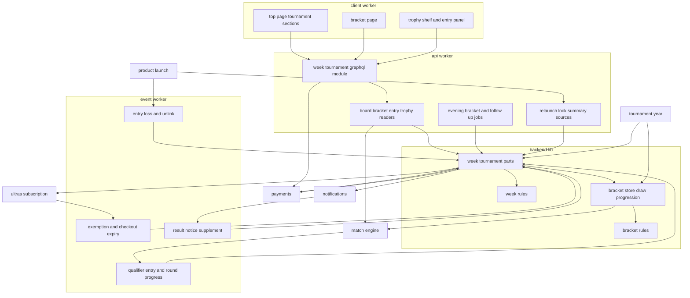
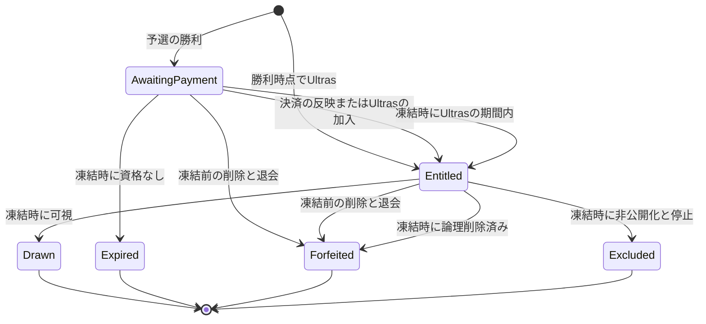
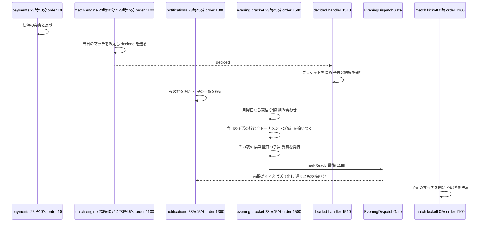
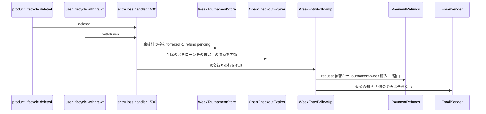
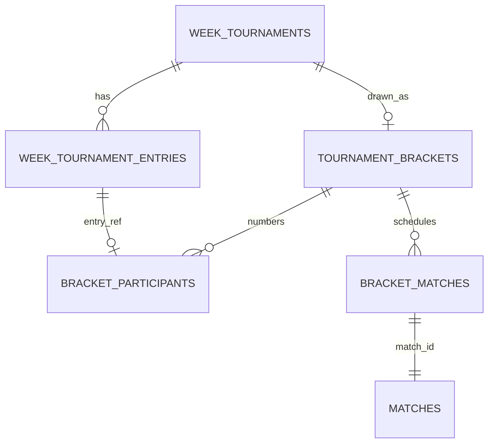

# Design Document

## Overview

**Purpose**: 予選で勝利したプロダクトによるProduct of the Week決定トーナメント(Weekトーナメント)を実装する。予選の勝利ごとに参加の枠を作り、翌週月曜日の決済期限までの参加費の決済(paymentsの購入種別`week_tournament_entry`)またはUltrasの特典による免除で参加資格を与える。月曜日23:45に週のトーナメントを凍結して枠を分類し、シードと1回戦を決め、match-engineのマッチとして1日1ラウンドで進め、不戦勝の連鎖・参加0件と1件・決勝の結果でProduct of the Week賞を授与する。シード・組み合わせ・ラウンドの進行・不戦勝の規則と記録は、Yearトーナメントが再利用できる汎用のブラケット(`core/tournament`・`workers/tournament`)として提供する。

**Users**: 予選の勝者の投稿者は、プロダクト詳細ページと自分のプロダクトの画面で参加費を支払い、状態を確かめる。閲覧者はトップページでトーナメントのマッチを見てUpvoteし、ブラケットのページで組み合わせと結果を見て、プロダクト詳細ページでトロフィーを見る。後続spec(tournament-year・ugc-moderation・data-export)の開発者は、ブラケットの部品・Week優勝の照会・トロフィーの供給元の登録口・受賞のエクスポートの部品を使う。

**Impact**: D1に5テーブル(汎用のブラケット・参加者・ブラケットのマッチ、Weekの週のトーナメント・参加の枠)を足す。`apps/common-lib/tournament`・`apps/backend-lib/core/tournament`・`core/week-tournament`・`workers/tournament`・`workers/week-tournament`(apiとeventの両方に束縛)を新設する。apiにスキーマモジュール`week-tournament`・2つのジョブ(23:45の夜の処理・4:21の再処理)・夜の送り出しの前提の登録・判定の供給元3つ・トロフィーの供給元の登録口を、eventにマッチイベント・ライフサイクル・Ultrasの知らせの処理と結果通知の追記とメールのテンプレートを、clientにトップページの2区画・ブラケットのページ・プロダクト詳細の2区画・自分のプロダクトの区画・削除の注意書きを足す。上流のファイルは、契約で定められた登録箇所への追記だけを変える。新しいシークレット・パッケージ・メッセージ種別は無い。

### Goals

- FR-TOURW-001〜027と、Weekトーナメントに関わるFR-PYMNT-010・FR-PPLAN-006・008・FR-RELCH-004・FR-PRDCT-014・FR-NOTIF-001・004・006・007が、参加の枠→決済または免除→凍結と分類→組み合わせ→1日1ラウンドの進行→終了と賞、削除・退会・停止・非公開化・Ultrasの加入・決済の反映の遅れのどの経路でも、要件と仮1〜仮7の決定に一致する。
- tournament-yearが本specのファイルを変えずに、ブラケットの規則・記録・進行と、Week優勝の照会・トロフィーの区画を使える。
- 本specが追加・変更したコードの単体テスト・Workers統合テスト・ブラウザテストがカバレッジ80%を満たす。

### Non-Goals

- Product of the Yearのトーナメントと決勝日の設定(tournament-year)。
- マッチの記録・Upvote・開始と確定・即時の終了と開始時点の決着・予選のペアリング(match-engine)。
- Stripeとの通信・決済画面・突合・反映の期限切れと二重決済の返金・返金の実行(payments)。通知の対象者と送信(notifications)。特典の判定(ultras-subscription)。停止・非公開化の操作(ugc-moderation)。
- 要件定義書の改訂(roadmapのOut。必要な改訂は[research.md](research.md)の「要件定義書の改訂が必要な箇所」に記録した)。(2026-10-25に要件定義書へ適用済み)

## Boundary Commitments

### This Spec Owns

- 汎用のブラケットのデータ: `tournament_brackets`・`bracket_participants`・`bracket_matches`(`apps/db/schema/tournament/`)。種類(`week`・`year`)とトーナメントの識別子で区別し、書き込みは`workers/tournament`の部品だけが行う。
- Weekのデータ: `week_tournaments`・`week_tournament_entries`(同じディレクトリ)。参加の枠の状態・参加資格の出どころ・返金の依頼と知らせの状態・受賞の記録。
- ブラケットの規則(`apps/backend-lib/core/tournament/`): シード数・抽選番号・1回戦・2回戦の枠の配置・固定のブラケット・不戦勝の伝播・終了の判定・ラウンド名と段階・表示の配置・実施日の方針。
- Weekの規則(`apps/backend-lib/core/week-tournament/`): 週と期限・並びの比較・枠の状態と返金の理由・返金の知らせのメール種別`tournament-week.entry-refund`。
- 共有部品(`apps/backend-lib/workers/tournament/`): `BracketStore`・`BracketDraw`・`BracketProgression`と`TOURNAMENT_PLATFORM_MODULE`。(`workers/week-tournament/`): `WeekTournamentStore`・`WeekEntryRegistrar`・`WeekEntryOfferPolicy`・`WeekEntryFulfillment`・`WeekDrawService`・`WeekProgressionService`・`WeekEntryFollowUp`・`WeekNotificationPublisher`・`WeekChampionDirectory`・`WeekAwardExport`と`WEEK_TOURNAMENT_PLATFORM_MODULE`。
- apiのスキーマモジュール`week-tournament`、照会(トップページ・ブラケット・参加費の導線・トロフィー)、参加の決済の開始、判定の供給元3つ、トロフィーの供給元の登録口`TOURNAMENT_TROPHY_SOURCES`、ジョブ`tournament-week.evening-bracket`(23:45、1500。組み合わせ・進行・追いつき・通知の発行の後に夜の送り出しの準備の完了を伝える)・`tournament-week.entry-follow-up`(4:21、1500)、notificationsの送り出しの前提`tournament-week.evening-bracket`の登録。
- eventの処理: マッチイベント`tournament-week.qualifier-entry`(1500)・`tournament-week.decided-round-progress`(1510)、プロダクトライフサイクル`tournament-week.product-entry-loss`(`deleted`、1500)・`tournament-week.entry-unlink`(`purge_due`、1500)、ユーザーライフサイクル`tournament-week.account-entry-loss`(`withdrawn`、1500)、Ultrasの知らせ`tournament-week.ultras-entry-exemption`(1500)・`tournament-week.open-entry-checkout-expiry`(1510)、結果通知の追記`tournament-week.entry-deadline`(`qualifier`、1500)、返金の知らせのテンプレート。
- clientの`/tournaments/week/$week`、トップページの区画`tournament-week.matches`(`main` 20)・`tournament-week.final`(`showcase` 20)、プロダクト詳細の`tournament-week.trophies`(`main` 10)・`tournament-week.entry`(投稿者本人向けの操作 10)、自分のプロダクトの`tournament-week.entry`(10)、削除の注意書き`tournament-week.entry-loss`(10)。
- 技術ドキュメント`backend/017-single-elimination-brackets.md`・`frontend/016-tournament-bracket-view.md`の新規作成と、サービス仕様(Weekトーナメント規則・日次タイムライン・ページ配置・文言規則・返金ポリシー・決済実装方針)とオンボーディングの追記。

### Out of Boundary

- `matches`などマッチのデータ・マッチの開始と確定・開始時点の決着・即時の終了(match-engine)。本specは`MatchScheduler`で予定を作り、照会口と確定のイベントで結果を知るだけで、マッチのテーブルへ書き込まない。
- `products`・`product_launches`・再ローンチの判定の本体・削除と非公開化の確定(product-launch)。本specは照会口と供給元の登録口だけを使う。
- 決済のデータ・Stripe・突合・反映・返金の実行と決済履歴・反映の期限切れと二重決済の自動返金(payments)。本specは購入種別の口を実装し、`PaymentRefunds`・`OpenCheckoutExpirer`・`CheckoutStarter`・`PriceCatalog`を呼ぶ。
- Ultrasの加入状態と特典の判定・機能フラグ(ultras-subscription)、通知の対象者・受信可否・送信の時刻と統合(notifications)、停止・非公開化の操作と理由・通知(ugc-moderation)、Yearの参加資格・日程・決勝日(tournament-year)、データエクスポートのZIP(data-export)。

### Allowed Dependencies

- backend-platform: `AppModule`・`PLATFORM_TYPES`(`Database`・`Clock`・`IdGenerator`)・`AppError`・`getAppLogger`・`captureMessage`の規約・`ulidPrimaryKey`・`timestamps`・`BusinessTime`(`toBusinessDateTime`・`fromBusinessDateTime`・`parseBusinessDate`・`BusinessDate`・`BusinessTimeOfDay`)・`ScheduledJobDefinition`・`ScheduledJobHandler`。形を変えない。E2Eの`e2e/support/scheduled-trigger.ts`の`triggerScheduled`(backend-platformの改訂2。ローカルの定期実行の起動は独自に作らない)。
- api-gateway: `defineSchemaModule`・`GraphQLContext`(`resolve`・`session`・`loaders`)・`withValidatedArgs`・`defineLoader`・`DateTime`。
- identity-auth: `AccountGuard`(`currentUser`・`requireUser`)・`CurrentUser`・`users`(外部キーだけ)・`UserLifecycleAsyncRegistration`・`USER_LIFECYCLE_ASYNC_HANDLERS`・`LifecycleHandlerOutcome`・`assertLifecycleHandlerName`・`UserContactDirectory`(`IDENTITY_PLATFORM_TYPES.UserContactDirectory`)。
- product-launch: `ProductDirectory`(`findSummaries`・`listLaunches`・`resolveHandle`)・`PRODUCT_PLATFORM_TYPES`・`products`・`product_launches`への外部キー・`ProductLifecycleAsyncRegistration`・`PRODUCT_LIFECYCLE_ASYNC_HANDLERS`・`RelaunchConditionSource`・`ProductLockSource`・`LaunchSummarySource`・`DecisionSourceRegistration`・`RELAUNCH_CONDITION_SOURCES`・`PRODUCT_LOCK_SOURCES`・`LAUNCH_SUMMARY_SOURCES`・`kickoffAt`、clientの`MY_PRODUCT_SECTIONS`・`MyProductSection`・`PRODUCT_DELETE_NOTICES`・`ProductDeleteNotice`。
- match-engine: `MATCH_PLATFORM_TYPES`の`MatchScheduler`・`MatchDirectory`、`MatchKind`・`MatchStage`・`EntryResult`・`isWinningResult`・`MatchRecord`・`MatchEvent`・`MatchEventHandler`・`MatchEventRegistration`・`MATCH_EVENT_HANDLERS`、apiの`MatchViewReader`・`matchViewLoader`・GraphQLの`Match`・`MatchProduct`・`MatchBye`・`MatchEntry`、clientの`TOP_PAGE_SECTIONS`・`TopPageSection`・`MatchCard`・`ByeList`・`useUpvote`・`useServerCountdown`・`LIVE_REFRESH_QUERY_OPTIONS`。
- payments: `PurchaseKindRegistration`・`PurchaseOfferPolicy`・`PurchaseOffer`・`PurchaseFulfillment`・`FulfillablePurchase`・`FulfillmentPlan`・`PURCHASE_KIND_REGISTRATIONS`・`PaymentRefunds`・`OpenCheckoutExpirer`・`PriceCatalog`・`PAYMENTS_TYPES`・apiの`CheckoutStarter`・GraphQLの`CheckoutStart`・`Money`・frontend-libの`MoneyText`。
- ultras-subscription: `ULTRAS_TYPES.UltrasEntitlements`(`wasEntitledDuring`・`entitledUsersDuring`)・`UltrasActivation`・`UltrasActivationHandlerRegistration`・`ULTRAS_ACTIVATION_HANDLERS`・clientの`UltrasPromotionGate`。
- notifications: `NOTIFICATIONS_PLATFORM_TYPES.NotificationEventPublisher`・`NotificationEvent`・`NotificationPublishError`・`ResultNoticeSupplementProvider`・`ResultNoticeSupplementRegistration`・`RESULT_NOTICE_SUPPLEMENTS`、apiだけの`NOTIFICATIONS_PLATFORM_TYPES.EveningDispatchGate`(`EveningDispatchGate`・`EveningDispatchReadiness`・`EveningDispatchError`、`core/notifications/evening-dispatch.ts`)・`EVENING_DISPATCH_PARTICIPANTS`(`apps/api/src/composition/evening-dispatch-participants.ts`、登録の追記だけ)(notificationsの仮2)。
- directory-discovery: `PRODUCT_PAGE_SECTIONS`・`ProductPageSection`・`ProductPageContext`・`PRODUCT_OWNER_ACTIONS`・`ProductOwnerAction`。
- email-delivery: `defineEmailKind`・`EMAIL_KINDS`・`EmailSender`・`EMAIL_TYPES`・`defineEmailTemplate`・`EMAIL_TEMPLATES`・`formatUtcDateTime`。
- frontend-platform: `executeGraphQL`・`graphqlQueryOptions`・`GraphQLClientError`・`buildPageHead`・`NotFoundView`・`ErrorState`・`PartialErrorState`・`UnavailableNotice`・`LoadingSkeleton`・`notify`・`DateTime`・`RelativeTime`・shadcn/uiの部品(ボタン・バッジ・タブ・ツールチップ)・`runAxe`・デザイントークン。
- admin-foundation: E2Eの`e2e/support/local-d1.ts`(`executeLocalD1`・`sqlStringLiteral`)。
- npmパッケージ: 新規なし。
- 後続spec(tournament-year)は、`core/tournament`の規則、`workers/tournament`の`BracketDraw`・`BracketProgression`・`BracketStore`の読み取り、`WeekChampionDirectory`、`TOURNAMENT_TROPHY_SOURCES`、apiの`buildBracketRoundsView`とGraphQLの`BracketRound`・`BracketNode`・`BracketSlot`の型、clientの`components/bracket/`の`BracketRoundColumn`・`BracketRoundTabs`・`BracketMatchCard`・`BracketChampion`と`BracketRoundFields`・`BracketMatchProductFields`のフラグメント(仮7)だけに依存し、本specのテーブルへ直接書き込まない。data-exportは`WeekAwardExport`だけを呼ぶ。ugc-moderationは停止・非公開化をidentity-auth・product-launchのライフサイクルで発火すればよく、本specを直接呼ばない。

### Revalidation Triggers

- `BracketShape`・`drawBracket`・`decideNext`・`bracketLayout`・`RoundSchedulePolicy`・`BracketDraw.create`・`BracketProgression.advance`・`AdvanceResult`の形と規則(tournament-year)。
- `tournament_brackets`などの汎用のテーブルの列と`kind`の値(tournament-year・data-export)。
- `WeekChampionDirectory`・`WeekAwardExport`・`TrophySource`の形(tournament-year・data-export)。
- ジョブ・処理の名前と`order`(23:45のジョブは1500、処理は1500・1510)、23:45の順序(match-engine・notifications・tournament-year)。
- notificationsの`EveningDispatchGate.markReady`の形・呼ぶ時点の規約・`EVENING_DISPATCH_PARTICIPANTS`・送り出しの期限(23:55)(notificationsの仮2)。
- 購入種別`week_tournament_entry`の`PurchaseOffer`の期限の値・`exclusivityKey`・返金の依頼キーと理由の値(payments・ugc-moderation)。
- `LaunchSummaryContribution`の`rank`(Week 10〜50、Yearはそれより大きく)と文言(directory-discovery・product-launch)。
- `buildBracketRoundsView`・`BracketRoundsView`の形、GraphQLの`BracketRound`・`BracketNode`・`BracketSlot`、`BracketRoundFields`・`BracketMatchProductFields`のフラグメントと`components/bracket/`の4部品の引数(`rounds`・`champion`・`awarded`・`finished`)(tournament-year、仮7)。
- 確定した仮1〜仮7(2026-10-24に開発者が確定)の決定を将来変えるときは、該当する規則(`WeekRelaunchConditionSource`・`WeekDrawService`の分類・`WeekEntryFollowUp`・`/tournaments/week/$week`・`WeekEntryFulfillment`の新しいローンチの検査)を確かめ直す。
- 上流の`MatchScheduler`・`MatchDirectory`・`MATCH_EVENT_HANDLERS`・`TOP_PAGE_SECTIONS`・`MatchCard`・`ByeList`、paymentsの購入種別の口・`PaymentRefunds`・`OpenCheckoutExpirer`、`UltrasEntitlements`・`UltrasActivationHandlerRegistration`、`NotificationEventPublisher`・`ResultNoticeSupplementRegistration`、product-launchの3つの供給元の契約・`ProductDirectory`・ライフサイクルの登録口・`MY_PRODUCT_SECTIONS`・`PRODUCT_DELETE_NOTICES`、directory-discoveryの`PRODUCT_PAGE_SECTIONS`・`PRODUCT_OWNER_ACTIONS`の形を変えたら、本specを確かめ直す。
- backend-platformの改訂2の`triggerScheduled`の引数(`worker`・`businessDate`・`businessTime`)と業務時刻の規則が変われば、E2Eの補助と時刻を進める手順を確かめ直す。

### 上流への影響

| 上流spec                                                        | 変更                                                                                                                                                                                                                                                                                               | 影響と再検証                                                                                                                    |
| --------------------------------------------------------------- | -------------------------------------------------------------------------------------------------------------------------------------------------------------------------------------------------------------------------------------------------------------------------------------------------- | ------------------------------------------------------------------------------------------------------------------------------- |
| match-engine                                                    | eventの`composition/match-event-handlers.ts`に2件、clientの`composition/top-page-sections.ts`に2件                                                                                                                                                                                                 | 契約どおり。`createMatchEventRegistry`の検証を通る                                                                              |
| payments                                                        | `apps/backend-lib/workers/payments/purchase-kind-registrations.ts`に`week_tournament_entry`                                                                                                                                                                                                        | 契約どおり。`createPurchaseKindRegistry`の検証を通る                                                                            |
| ultras-subscription                                             | eventの`composition/ultras-activation-handlers.ts`に2件(1500・1510)                                                                                                                                                                                                                                | 契約どおり(`order`は100以上)                                                                                                    |
| notifications                                                   | eventの`composition/result-notice-supplements.ts`に1件(`qualifier`、1500)、apiの`composition/evening-dispatch-participants.ts`に`'tournament-week.evening-bracket'`                                                                                                                                | 契約どおり                                                                                                                      |
| product-launch                                                  | apiの`composition/product-decision-sources.ts`に3件、eventの`composition/product-lifecycle-async-handlers.ts`に2件、clientの`composition/my-product-sections.ts`・`product-delete-notices.ts`に各1件                                                                                               | 契約どおり                                                                                                                      |
| directory-discovery                                             | clientの`composition/product-page-sections.ts`の`PRODUCT_PAGE_SECTIONS`(`main` 10)・`PRODUCT_OWNER_ACTIONS`(10)                                                                                                                                                                                    | 予約どおり                                                                                                                      |
| identity-auth                                                   | eventの`composition/user-lifecycle-async-handlers.ts`に1件(`withdrawn`、1500)                                                                                                                                                                                                                      | 契約どおり                                                                                                                      |
| backend-platform                                                | apiの`composition/scheduled-jobs.ts`に2件(23:45の1500・4:21の1500、式は上流で追加済み)                                                                                                                                                                                                             | 契約どおり。Cronの式の一致の検査を通る。E2Eは改訂2の共用の補助`triggerScheduled`を前提にする(本specは補助を変更しない)          |
| email-delivery                                                  | `core/email/kinds/index.ts`に1種別、eventの`infrastructure/email/templates/index.ts`に1テンプレート                                                                                                                                                                                                | 契約どおり(1対1の検査)                                                                                                          |
| match-engine(本specが依頼した改訂、match-engineの仮7として確定) | `ByeCard`の文言を`match.kind`で切り替え、トーナメント(`week`・`year`)の不戦勝は「対戦相手不在のため不戦勝。次のラウンドへ進みます。」、早期の勝利は「対戦相手が不在になったためマッチ終了。{n}票のUpvoteで確定し、次のラウンドへ進みます。」とする(現行は予選向けの「ディレクトリに掲載されます」) | match-engineのspecが仮7(2026-10-24に確定)として反映した。本specは`ByeList`・`ByeCard`を使うだけで、文言の実装とテストを持たない |

- roadmapの帯の割り当ての表の本specの「使用中の値」は「4:21は1500、波及処理は1500」になる(23:45のジョブ1500、プロダクトライフサイクル1500、マッチイベント1500・1510、Ultrasの知らせ1500・1510、結果通知の追記1500)。本specはroadmapを編集しないため、コントローラーへ報告する。

## Architecture

### Existing Architecture Analysis

- 上流の20specは設計・タスクとも承認済みで、本specのタスクはそれらの実装の完了を前提にする。実装済みはdev-toolingだけである。roadmapは本specの依存をmatch-engine・payments・notifications・directory-discoveryと宣言する。directory-discoveryは`PRODUCT_PAGE_SECTIONS`(`main` 10)・`PRODUCT_OWNER_ACTIONS`(10)への登録のための上流である。
- apiはクリーンアーキテクチャ(`domain`→`application`→`infrastructure`・`presentation`→`composition`)、D1の`db.batch()`による1トランザクションの書き込み、`CASE`式のNOT NULL制約の違反による取り消し、Cron Triggers(apiだけ、同じ時刻は`order`の昇順、失敗は次を止めない)を使う。
- match-engineのマッチは0:00(1100)に開始し23:40(1100)に確定する。確定・開始時点の決着・即時の終了は`decided`のマッチイベントとして少なくとも1回届く。paymentsの反映は`PurchaseFulfillment.prepare`の文を反映と同じ一括の書き込みで確定する。

### Architecture Pattern & Boundary Map



**Architecture Integration**:

- Selected pattern: クリーンアーキテクチャ。ブラケットとWeekの規則は`core`の純粋な関数、記録と進行は`workers`の部品(apiとeventの両方に束縛)、照会と画面の組み立てはapiのアプリケーション層、外部の処理(マッチ・決済・特典・通知)は上流の部品越しに使う。
- Domain/feature boundaries: 汎用のブラケット(種類で区別)とWeek固有(週・枠・賞)を別のテーブルと部品に分け、tournament-yearは前者とWeek優勝の照会だけを使う。マッチの状態はmatch-engine、決済の状態はpaymentsが持ち、本specは結果の写しと識別子だけを持つ。
- Existing patterns preserved: `backend-lib/workers/<ドメイン>`の共有の束縛、`<spec名>.<名詞句>`の名前、帯の`order`、登録箇所への追記、条件付きの書き込みと`onConflictDoNothing()`による冪等性、`CASE`式による取り消し、`LIVE_REFRESH_QUERY_OPTIONS`の再取得。
- New components rationale: 凍結は組み合わせ決定と同時の変更の競合を1点で断つため。2つの進行の経路は0:00の開始に確実に間に合わせるため。トロフィーの供給元の登録口は1つの区画にYearとWeekを並べるため。ブラケットの表示の組み立て(`buildBracketRoundsView`)とフラグメントで受ける画面の部品は、Yearのブラケットのページが同じ表示を再利用するため(仮7)。
- Steering compliance: `@inject`の明示、D1の制約(`db.batch()`・バインド変数100個以内・`transaction()`を使わない)、800行以内のファイル、1ファイル1コンポーネント、日時の`<time datetime>`、新しいパッケージなし。

**Dependency direction**: `apps/common-lib/tournament` → `apps/db/schema/tournament` → `backend-lib/core/tournament` → `backend-lib/core/week-tournament` → `backend-lib/workers/tournament` → `backend-lib/workers/week-tournament` → 各アプリの`src`(`application` → `infrastructure`・`presentation` → `composition`)。`core/tournament`はWeekを読み込まない。`workers/tournament`は`workers/week-tournament`を読み込まない。clientは`common-lib`とGraphQLの操作だけを読み込む。違反はレビューで誤りとして扱う。

### Technology Stack

| Layer     | Choice / Version                                             | Role in Feature                                                           | Notes                                       |
| --------- | ------------------------------------------------------------ | ------------------------------------------------------------------------- | ------------------------------------------- |
| Frontend  | TanStack Start・Router・Query・shadcn/ui・lucide-react(上流) | トップページの区画・ブラケットのページ・トロフィー・参加費の導線          | 新規パッケージなし                          |
| Backend   | Hono・Inversify・GraphQL Yoga(上流)                          | スキーマモジュール・ユースケース・ジョブ・イベントの処理                  | 既存                                        |
| Data      | Cloudflare D1(Drizzle)                                       | 5テーブル                                                                 | 新規のマイグレーション                      |
| Messaging | Cloudflare Queues・Cron Triggers(上流)                       | 既存のマッチイベント・ライフサイクル・Ultrasの知らせ、23:45と4:21のジョブ | 新しいメッセージ種別・Cronの式なし          |
| External  | Stripe(paymentsの部品越し)                                   | 参加費の決済・返金・未完了の決済の失効                                    | 価格の`lookup_key`は`week_tournament_entry` |

## File Structure Plan

### Directory Structure

```
apps/
├── common-lib/tournament/                                    # 各ファイルに同名の*.unit.test.ts
│   ├── week-period.ts                                        # isoWeekKey・parseIsoWeek・weekStartOf・formatWeekPeriodLabel
│   └── round-name.ts                                         # tournamentRoundName
├── db/schema/tournament/                                     # テーブル定義(各ファイルに同名の*.unit.test.ts)
│   ├── tournament-brackets.ts
│   ├── bracket-participants.ts
│   ├── bracket-matches.ts
│   ├── week-tournaments.ts
│   ├── week-tournament-entries.ts
│   └── index.ts
├── backend-lib/
│   ├── core/tournament/                                      # 純粋なブラケットの規則(Bunの単体テスト)
│   │   ├── bracket-shape.ts                                  # BracketShape・bracketShape・roundSlotCount・roundStage・seedPlacementOrder
│   │   ├── bracket-draw-rules.ts                             # drawBracket
│   │   ├── bracket-progress-rules.ts                         # BracketState・decideNext・nextRoundOccupants
│   │   ├── bracket-layout.ts                                 # bracketLayout(未来のラウンドの表示の配置)
│   │   └── round-schedule.ts                                 # RoundSchedulePolicy・TOURNAMENT_MATCH_HOURS・tournamentMatchWindow・dailyRoundPolicy
│   ├── core/week-tournament/                                 # Weekの規則(Bunの単体テスト)
│   │   ├── week-schedule.ts                                  # entryWindowFor・weekFirstRoundDate・isSundayLaunch・WEEK_ENTRY_PRICE_LOOKUP_KEY
│   │   ├── week-ordering.ts                                  # weekSeedOrder・weekNonSeedOrder
│   │   ├── week-entry-rules.ts                               # WeekEntryStatus・WeekEntryCloseReason・refundReasonFor・WEEK_REFUND_REQUEST_KEY
│   │   └── week-entry-refund-email.ts                        # TOURNAMENT_WEEK_ENTRY_REFUND_EMAIL
│   └── workers/
│       ├── tournament/                                       # 汎用のブラケットの部品(Workers統合テスト)
│       │   ├── tournament-platform-types.ts                  # TOURNAMENT_PLATFORM_TYPES(テストなし)
│       │   ├── bracket-store.ts                              # BracketStore・BracketRecord(型)
│       │   ├── d1-bracket-store.ts
│       │   ├── bracket-draw.ts                               # BracketDraw
│       │   ├── bracket-progression.ts                        # BracketProgression・AdvanceResult
│       │   └── tournament-platform-module.ts                 # TOURNAMENT_PLATFORM_MODULE
│       └── week-tournament/                                  # Weekの部品(Workers統合テスト)
│           ├── week-tournament-types.ts                      # WEEK_TOURNAMENT_TYPES(テストなし)
│           ├── week-tournament-store.ts                      # WeekTournamentStore・WeekEntryRecord(型)
│           ├── d1-week-tournament-store.ts
│           ├── week-entry-registrar.ts                       # 予選の勝利からの枠の作成と免除
│           ├── week-entry-offer-policy.ts                    # PurchaseOfferPolicy
│           ├── week-entry-fulfillment.ts                     # PurchaseFulfillment
│           ├── week-draw-service.ts                          # 凍結・分類・組み合わせ
│           ├── week-progression-service.ts                   # 進行・賞・通知の発行
│           ├── week-entry-follow-up.ts                       # 返金の依頼と知らせ
│           ├── week-notification-publisher.ts                # 通知イベントの組み立てと発行
│           ├── week-champion-directory.ts                    # Week優勝の照会(tournament-year)
│           ├── week-award-export.ts                          # 受賞のエクスポート(data-export)
│           └── week-tournament-platform-module.ts            # WEEK_TOURNAMENT_PLATFORM_MODULE
├── api/src/
│   ├── application/tournament/                               # 種類によらない表示の組み立てとトロフィー(Bunの単体テスト)
│   │   ├── bracket-view-builder.ts                           # buildBracketRoundsView・BracketRoundsView(Week・Yearのブラケットの表示、仮7)
│   │   ├── trophy-source.ts                                  # TrophySource・TrophySourceRegistration
│   │   └── product-trophy-reader.ts
│   ├── application/week-tournament/                          # Bunの単体テスト
│   │   ├── week-tournament-api-types.ts                      # WEEK_TOURNAMENT_API_TYPES
│   │   ├── week-board-reader.ts                              # トップページの区画
│   │   ├── week-bracket-reader.ts                            # ブラケットのページ
│   │   ├── week-entry-panel-reader.ts                        # 参加費の導線
│   │   ├── week-entry-checkout.ts                            # 決済の開始(CheckoutStarterの呼び出し)
│   │   ├── week-relaunch-condition-source.ts                 # tournament-week.result-pending
│   │   ├── week-product-lock-source.ts                       # tournament-week.bracket-lock
│   │   ├── week-launch-summary-source.ts                     # tournament-week.launch-summary
│   │   ├── week-trophy-source.ts                             # tournament-week.week-trophies
│   │   └── week-tournament-jobs.ts                           # 2つのジョブ(23:45の夜の処理・4:21の再処理)
│   ├── presentation/graphql/modules/week-tournament/         # スキーマモジュール(Workers統合テスト)
│   │   ├── type-defs.ts
│   │   ├── errors.ts
│   │   ├── board-resolvers.ts                                # weekTournamentBoard
│   │   ├── bracket-resolvers.ts                              # weekBracket
│   │   ├── entry-resolvers.ts                                # myWeekEntry・startWeekTournamentCheckout
│   │   ├── trophy-resolvers.ts                               # productTrophies
│   │   └── index.ts                                          # weekTournamentSchemaModule
│   └── composition/
│       ├── week-tournament-module.ts                         # WEEK_TOURNAMENT_API_MODULE
│       └── tournament-trophy-sources.ts                      # TOURNAMENT_TROPHY_SOURCES(初版はWeekの1件)
├── event/src/
│   ├── application/week-tournament/                          # Bunの単体テスト
│   │   ├── event-week-tournament-types.ts                    # EVENT_WEEK_TOURNAMENT_TYPES
│   │   ├── qualifier-entry-handler.ts                        # decided・予選・1500
│   │   ├── round-progress-handler.ts                         # decided week 1510
│   │   ├── product-entry-loss-handler.ts                     # プロダクトのdeleted 1500
│   │   ├── account-entry-loss-handler.ts                     # ユーザーのwithdrawn 1500
│   │   ├── entry-unlink-handler.ts                           # プロダクトのpurge_due 1500
│   │   ├── week-ultras-entry-exemption-handler.ts            # Ultrasの知らせ・1500
│   │   ├── week-open-entry-checkout-expiry-handler.ts        # Ultrasの知らせ・1510
│   │   └── week-entry-supplement-provider.ts                 # 結果通知の追記
│   ├── infrastructure/email/templates/                       # email-deliveryのテンプレートの置き場所(*.worker.test.tsx)
│   │   ├── week-entry-refund-template.ts
│   │   └── week-entry-refund-email-body.tsx
│   └── composition/week-tournament-module.ts                 # EVENT_WEEK_TOURNAMENT_MODULE
├── client/src/
│   ├── routes/tournaments/week/$week.tsx                     # ブラケットのページ(仮4)
│   ├── components/week-tournament/                           # 1ファイル1コンポーネント(browser testを併置)
│   │   ├── week-board-model.ts                               # 対戦カードと不戦勝の分類・決勝の判定(*.unit.test.ts)
│   │   ├── week-tournament-section.tsx                       # main 20
│   │   ├── week-final-showcase.tsx                           # showcase 20
│   │   ├── week-section-heading.tsx
│   │   ├── week-entry-panel.tsx                              # 参加費の導線の本体
│   │   ├── entry-deadline.tsx                                # 期限・相対表現・秒読み
│   │   ├── week-entry-owner-action.tsx                       # PRODUCT_OWNER_ACTIONSの包み
│   │   ├── week-entry-my-product-section.tsx                 # MY_PRODUCT_SECTIONSの包み
│   │   ├── week-entry-delete-notice.tsx
│   │   └── week-bracket-page.tsx                             # Weekのブラケットのページの組み立て(共用の4部品へweekBracketの結果を渡す)
│   ├── components/bracket/                                   # Week・Yearで共用(仮7)。WeekBracketの型に依存しない
│   │   ├── bracket-view-props.ts                             # BracketViewProps(テストなし)
│   │   ├── bracket-round-column.tsx
│   │   ├── bracket-match-card.tsx
│   │   ├── bracket-round-tabs.tsx                            # 768px未満のラウンドの切り替え
│   │   └── bracket-champion.tsx
│   ├── components/trophy/
│   │   ├── trophy-shelf.tsx                                  # main 10
│   │   └── trophy-art.tsx                                    # モックアップのトロフィーのSVGの移植
│   └── graphql/operations/week-tournament/
│       ├── week-board.ts
│       ├── week-bracket.ts                                   # weekBracketと、Yearも使うフラグメントBracketRoundFields・BracketMatchProductFields(仮7)
│       ├── week-entry.ts
│       └── product-trophies.ts
e2e/
├── client/week-tournament.e2e.test.ts                        # 参加費の決済・組み合わせ・トップページ・受賞(ジョブは共用のtriggerScheduledで起動)
└── support/week-tournament-fixtures.ts                       # ローカルD1に予選の勝者と参加の枠を作る補助
docs/GUIDES/tech/
├── backend/017-single-elimination-brackets.md
└── frontend/016-tournament-bracket-view.md
```

テストは各ファイルの隣に置く(`*.unit.test.ts`・`*.worker.test.ts`・`*.browser.test.tsx`)。技術ドキュメントの番号は、完了済みspecのdesign.mdの計画(`backend`は001〜014・016、`frontend`は001〜014)を確かめ、並行して作成するengagementが各ディレクトリの最小の空き番号(`backend/015`・`frontend/015`)を取り、本specは空き番号を1つ飛ばした次(`backend/017`・`frontend/016`)、sponsorshipは2つ飛ばす取り決めに従って固定する。

### Modified Files

- `apps/db/schema/index.ts`・`apps/db/migrations/<日時>_tournament_week/migration.sql` — 5テーブルの再エクスポートと、生成したマイグレーション(CHECK・一意索引)。mainの最新を取り込んでから生成する。
- `apps/backend-lib/core/email/kinds/index.ts` — `TOURNAMENT_WEEK_ENTRY_REFUND_EMAIL`。
- `apps/backend-lib/workers/payments/purchase-kind-registrations.ts` — `{ kind: 'week_tournament_entry', offer: WEEK_TOURNAMENT_TYPES.WeekEntryOfferPolicy, fulfillment: WEEK_TOURNAMENT_TYPES.WeekEntryFulfillment }`。
- `apps/api/src/composition/modules.ts`・`graphql-modules.ts`・`scheduled-jobs.ts`・`product-decision-sources.ts` — 2つの共有モジュールとapiの束縛、`weekTournamentSchemaModule`、2つのジョブ、3つの供給元。
- `apps/api/src/composition/evening-dispatch-participants.ts` — `EVENING_DISPATCH_PARTICIPANTS`に`'tournament-week.evening-bracket'`を1行追記する(notificationsの仮2)。
- `apps/event/src/composition/modules.ts`・`match-event-handlers.ts`・`product-lifecycle-async-handlers.ts`・`user-lifecycle-async-handlers.ts`・`ultras-activation-handlers.ts`・`result-notice-supplements.ts`・`apps/event/src/infrastructure/email/templates/index.ts` — 共有モジュールとeventの束縛、8件の登録、テンプレート。
- `apps/client/src/composition/top-page-sections.ts`・`product-page-sections.ts`・`my-product-sections.ts`・`product-delete-notices.ts` — 区画の登録。
- `docs/GUIDES/tech/backend/README.md`・`frontend/README.md` — 文書一覧の行。
- `docs/onboardings/project-values.md` — ジョブ・処理・登録の名前と`order`、価格の`lookup_key`、メール種別、返金の依頼キーの形。
- `docs/GUIDES/service/overview/004-week-tournament-rules.md` — 仮2・仮3・仮5の注記、凍結の時点、ラウンドの遅れの回復、ブラケットのページ。
- `docs/GUIDES/service/overview/007-daily-timeline.md` — 23:45の`tournament-week.evening-bracket`(1500、最後に夜の送り出しの準備の完了を伝える)、4:21の表に1500。
- `docs/GUIDES/service/design/002-page-layouts.md` — ブラケットのページ(仮4)、トーナメントの区画の見出しと導線、トロフィーの区画、参加費の導線の状態、削除の注意書き。
- `docs/GUIDES/service/design/003-text-and-copy-rules.md` — 本specのエラー・状態・メールの文言(Supporting References)。
- `docs/GUIDES/service/legal/004-legal-notice-outline.md` — 返金ポリシーの「ユーザー停止やプロダクト非公開化に伴うトーナメント参加資格停止」の行を「組み合わせ決定の時点で非公開化・停止中のため参加資格を停止した場合は、決済した参加費を自動で全額返金する。組み合わせ決定の後の停止・非公開化による不戦敗は返金しない」に改める(仮3、Weekの部分。Yearはtournament-yearが判断する)。
- `docs/GUIDES/service/features/004-payments.md`(paymentsの決済実装方針) — 購入種別の表にWeekトーナメント参加費の期限・反映の期限・返金の依頼キーの行を追記する(契約どおり)。
- `CLAUDE.md` — 「技術規則の参照先」に「トーナメントのブラケットを組む前に: `backend/017`」。

## System Flows

### 参加の枠の状態



- 凍結(`week_tournaments.draw_started_at`)の後は、資格を変える全ての書き込み(反映・免除・喪失)が条件の不一致で何もしない。`Forfeited`・`Excluded`で`purchase_id`があれば`refund_status = 'pending'`を同じ文で記録する(4.1・4.2・4.4・4.5)。

### 決済期限から翌日の開始まで



- 決済セッションの有効期限は決済期限(23:35)以前で、受付期限(23:00)の後は開始できない(paymentsの`assertAcceptable`)。反映の期限(23:45)の後の完了はpaymentsが自動で返金する(2.2・2.7・2.9)。
- 23:45のジョブ`tournament-week.evening-bracket`は毎晩、組み合わせや進行が無い日も含めて、全ての処理と通知イベントの発行を終えた後に`EveningDispatchGate.markReady`を最後に1回呼ぶ。いずれかが失敗したら呼ばずに例外を投げ、送り出しはnotificationsの期限(23:55)に任せる(12.7・12.8、notificationsの仮2)。
- `decided`の処理と23:45のジョブは同じ`WeekProgressionService.advance`を呼ぶ。どちらが先でも、次ラウンドの位置とマッチIDは先に挿入した側にそろう(6.3・6.9)。

### 組み合わせ決定(`WeekDrawService.drawDue`)

1. 補完: 決済期限が過ぎた週について、`MatchDirectory.listForDate({ date, kinds: ['qualifier'] })`を週の7日分読み、勝利した側(`isWinningResult`、ローンチ・プロダクト・投稿者の紐付けあり)の枠を`WeekEntryRegistrar.register`で作る(既存は`onConflictDoNothing()`、1.5)。
2. 凍結: `UPDATE week_tournaments SET draw_started_at = ?, status = 'drawing' WHERE id = ? AND draw_started_at IS NULL`。既に凍結済みなら続きから行う(5.2)。
3. 分類(90件ずつ): `awaiting_payment`・`entitled`の枠について、`ProductDirectory.findSummaries(ids, 'not-deleted')`に無ければ`forfeited`(`deleted`)、`visible`が偽なら`excluded`(`hidden_or_suspended`)。`awaiting_payment`は`UltrasEntitlements.entitledUsersDuring`で候補を絞ったうえで`wasEntitledDuring(投稿者, won_at, deadline_at)`が真なら`entitled`(`ultras`)として扱い、偽なら`expired`(`deadline`)。残りの`entitled`は`drawn`。1つの一括の書き込みで、状態・理由・`closed_at`・`refund_status`(購入があれば`pending`、無ければ`not_needed`)を`status IN ('awaiting_payment', 'entitled')`の条件付きで記録する(3.5・4.4・5.2)。
4. 組み合わせ: `drawn`の枠を候補に`BracketDraw.create({ kind: 'week', tournamentId, candidates, order: { seed: weekSeedOrder, nonSeed: weekNonSeedOrder }, policy: dailyRoundPolicy(weekFirstRoundDate(weekStart)), now })`(5.3〜5.10)。
5. 記録: `week_tournaments`に`bracket_id`・`drawn_at`・`status`(`in_progress`、または参加0・1なら`finished`と`outcome`)を条件付きで書く。
6. 後処理: `WeekProgressionService.applyResult`で受賞(参加1)と予告の発行、`WeekEntryFollowUp.processTournament`で返金の依頼と知らせ(4.2・4.5・4.8・12.1)。

### ラウンドの進行(`BracketProgression.advance`)

1. ブラケットと参加者と記録済みのマッチを読む。`status = 'finished'`なら終了の結果を返す。
2. 現ラウンドの`planned`のマッチ(予定の作成の前に中断したもの)は、実施日の0:00を過ぎていれば実施日を方針の次の日に改めてから`MatchScheduler.schedule`し、`scheduled`にする(6.10)。
3. 現ラウンドの`scheduled`のマッチを`MatchDirectory.findMatches`で読み、確定したものの勝者(結果が`won`・`bye`・`walkover`の側の抽選番号、無ければなし)を`status = 'scheduled'`の条件付きで写し、敗者の`eliminated_round`を記録する。
4. 未確定のマッチがあれば`waiting`を返す。
5. `decideNext`の結果が`schedule`なら、実施日を`policy.nextRoundDate(現ラウンドの実施日, now)`で決め、位置ごとに新しいマッチIDで`bracket_matches`へ`onConflictDoNothing()`で挿入して読み直し、50件ずつ`MatchScheduler.schedule`して`scheduled`にする(6.2・6.5・6.7)。`finish`なら`UPDATE tournament_brackets SET status = 'finished', outcome = ?, champion_participant_no = ?, finished_at = ? WHERE id = ? AND status = 'active'`(7.1〜7.3)。
6. 結果(`AdvanceResult`)に、現ラウンドの確定したマッチのID、次ラウンドの側が2つのマッチのID、終了の有無と優勝者の`entry_ref`、この呼び出しで終了を確定したかを入れる。

### 参加資格の喪失と返金



- 返金の依頼が失敗した枠は`pending`のまま残り、4:21の`tournament-week.entry-follow-up`が依頼し直す(4.7)。退会では、未完了の決済の失効はpaymentsの`payments.open-checkout-expiry`(410)が先に行う。

## Requirements Traceability

| Requirement                            | Summary                  | Components                                                                                                                                                       | Interfaces                                                          | Flows                      |
| -------------------------------------- | ------------------------ | ---------------------------------------------------------------------------------------------------------------------------------------------------------------- | ------------------------------------------------------------------- | -------------------------- |
| 1.1, 1.2, 1.3, 1.4, 1.6                | 参加の枠                 | WeekEntryRegistrar、QualifierEntryHandler、WeekSchedule、WeekTournamentStore                                                                                     | `MATCH_EVENT_HANDLERS`・`WeekEntryRegistrar.register`               | 参加の枠の状態             |
| 1.5                                    | 枠の補完                 | WeekDrawService、WeekEntryRegistrar                                                                                                                              | `MatchDirectory.listForDate`                                        | 組み合わせ決定             |
| 2.1, 2.2, 2.3, 2.4                     | 決済の開始と表示         | WeekEntryOfferPolicy、WeekEntryCheckout、EntryResolvers                                                                                                          | `PurchaseOfferPolicy.describe`・`startWeekTournamentCheckout`       | 決済期限から翌日の開始まで |
| 2.5, 2.6, 2.7, 2.8, 2.9                | 反映と参加資格           | WeekEntryFulfillment、WeekTournamentStore                                                                                                                        | `PurchaseFulfillment.prepare`                                       | 参加の枠の状態             |
| 2.10                                   | 決済の縮退               | WeekEntryPanelReader、WeekEntryPanel                                                                                                                             | `myWeekEntry.feeAvailable`                                          | —                          |
| 3.1                                    | 勝利時点の免除           | WeekEntryRegistrar                                                                                                                                               | `wasEntitledDuring`                                                 | 参加の枠の状態             |
| 3.2, 3.4                               | 加入時点の免除           | WeekUltrasEntryExemptionHandler、WeekTournamentStore                                                                                                             | `ULTRAS_ACTIVATION_HANDLERS`                                        | —                          |
| 3.3                                    | 未完了の決済の失効       | WeekOpenEntryCheckoutExpiryHandler                                                                                                                               | `OpenCheckoutExpirer.expireOpen`                                    | —                          |
| 3.5                                    | 組み合わせ決定時点の免除 | WeekDrawService                                                                                                                                                  | `entitledUsersDuring`・`wasEntitledDuring`                          | 組み合わせ決定             |
| 3.6, 3.7, 3.8                          | 免除の不変条件           | WeekEntryRules、WeekEntryFulfillment、WeekEntryRegistrar                                                                                                         | —                                                                   | 参加の枠の状態             |
| 4.1, 4.3                               | 削除・退会による喪失     | ProductEntryLossHandler、AccountEntryLossHandler、WeekTournamentStore                                                                                            | `PRODUCT_LIFECYCLE_ASYNC_HANDLERS`・`USER_LIFECYCLE_ASYNC_HANDLERS` | 参加資格の喪失と返金       |
| 4.2, 4.5, 4.7, 4.8                     | 返金の依頼と知らせ       | WeekEntryFollowUp、WeekTournamentJobs、WeekEntryRefundTemplate                                                                                                   | `PaymentRefunds.request`・`EmailSender.send`                        | 参加資格の喪失と返金       |
| 4.4                                    | 停止・非公開化の除外     | WeekDrawService                                                                                                                                                  | `ProductDirectory.findSummaries`                                    | 組み合わせ決定             |
| 4.6, 4.9                               | 返金しない場合と境界     | WeekEntryRules、WeekEntryFollowUp                                                                                                                                | —                                                                   | —                          |
| 5.1, 5.2                               | 時刻と凍結               | WeekDrawService、WeekTournamentJobs                                                                                                                              | `tournament-week.evening-bracket`                                   | 組み合わせ決定             |
| 5.3, 5.4, 5.5, 5.6, 5.7, 5.11          | シードと組み合わせ       | BracketShape、BracketDrawRules、BracketProgressRules、WeekOrdering、BracketDraw                                                                                  | `bracketShape`・`drawBracket`・`seedPlacementOrder`・`decideNext`   | 組み合わせ決定             |
| 5.8, 5.9, 5.10                         | 参加0・1・2              | BracketProgressRules、BracketDraw、WeekProgressionService                                                                                                        | `decideNext`                                                        | 組み合わせ決定             |
| 6.1                                    | マッチの時刻             | RoundSchedule                                                                                                                                                    | `tournamentMatchWindow`                                             | —                          |
| 6.2, 6.3, 6.9, 6.10                    | 日ごとの進行と回復       | BracketProgression、WeekProgressionService、RoundProgressHandler、WeekTournamentJobs、RoundSchedule                                                              | `advance`・`dailyRoundPolicy`                                       | ラウンドの進行             |
| 6.4                                    | マッチの規則の委譲       | BracketProgression                                                                                                                                               | `MatchScheduler.schedule`                                           | 決済期限から翌日の開始まで |
| 6.5, 6.6, 6.7                          | 不戦勝                   | BracketProgressRules、BracketProgression                                                                                                                         | `nextRoundOccupants`                                                | ラウンドの進行             |
| 6.8                                    | ラウンドと段階           | BracketShape、TournamentRoundName                                                                                                                                | `roundStage`・`tournamentRoundName`                                 | —                          |
| 7.1, 7.2, 7.3                          | 終了と賞                 | BracketProgressRules、BracketProgression、WeekProgressionService                                                                                                 | `decideNext`・`AdvanceResult`                                       | ラウンドの進行             |
| 7.4                                    | 受賞の記録               | WeekTournamentStore、WeekProgressionService                                                                                                                      | `recordFinish`                                                      | —                          |
| 7.5                                    | Week優勝の照会           | WeekChampionDirectory                                                                                                                                            | `listChampions`                                                     | —                          |
| 7.6                                    | 掲載と賞を変えない       | WeekEntryRules                                                                                                                                                   | —                                                                   | —                          |
| 8.1, 8.2, 8.3, 8.4, 8.5, 8.6, 8.7, 8.8 | トップページの区画       | WeekBoardReader、BoardResolvers、WeekTournamentSection、WeekFinalShowcase、WeekSectionHeading、WeekBoardModel                                                    | `weekTournamentBoard`・`TOP_PAGE_SECTIONS`                          | —                          |
| 9.1, 9.2, 9.3, 9.4, 9.5, 9.6           | ブラケットのページ       | WeekBracketReader、BracketViewBuilder、BracketResolvers、BracketLayout、WeekBracketPage、BracketRoundColumn、BracketMatchCard、BracketRoundTabs、BracketChampion | `weekBracket`・`bracketLayout`                                      | —                          |
| 10.1, 10.2, 10.3, 10.4, 10.5, 10.6     | 参加費の導線             | WeekEntryPanelReader、EntryResolvers、WeekEntryPanel、EntryDeadline、WeekEntryOwnerAction、WeekEntryMyProductSection                                             | `myWeekEntry`・`PRODUCT_OWNER_ACTIONS`・`MY_PRODUCT_SECTIONS`       | —                          |
| 10.7                                   | 削除の注意書き           | WeekEntryDeleteNotice                                                                                                                                            | `PRODUCT_DELETE_NOTICES`                                            | —                          |
| 10.8, 10.10                            | トロフィー               | ProductTrophyReader、TrophySource、WeekTrophySource、TrophyResolvers、TrophyShelf、TrophyArt                                                                     | `productTrophies`・`TOURNAMENT_TROPHY_SOURCES`                      | —                          |
| 10.9                                   | 要約と受賞の供給         | WeekLaunchSummarySource                                                                                                                                          | `LAUNCH_SUMMARY_SOURCES`                                            | —                          |
| 11.1, 11.2, 11.3, 11.4, 11.6           | 再ローンチの禁止         | WeekRelaunchConditionSource                                                                                                                                      | `RELAUNCH_CONDITION_SOURCES`                                        | —                          |
| 11.5                                   | 編集の固定               | WeekProductLockSource                                                                                                                                            | `PRODUCT_LOCK_SOURCES`                                              | —                          |
| 12.1, 12.2, 12.3, 12.4, 12.5           | 通知イベント             | WeekNotificationPublisher、WeekProgressionService、WeekDrawService、WeekTournamentJobs                                                                           | `NotificationEventPublisher.publish`                                | 決済期限から翌日の開始まで |
| 12.6                                   | 結果通知の追記           | WeekEntrySupplementProvider                                                                                                                                      | `RESULT_NOTICE_SUPPLEMENTS`                                         | —                          |
| 12.7, 12.8                             | 夜の送り出しの準備の完了 | WeekTournamentJobs、WeekNotificationPublisher                                                                                                                    | `EveningDispatchGate.markReady`・`EVENING_DISPATCH_PARTICIPANTS`    | 決済期限から翌日の開始まで |
| 13.1, 13.2, 13.4                       | 汎用の規則               | BracketShape、BracketDrawRules、BracketProgressRules、BracketLayout、RoundSchedule                                                                               | `RoundSchedulePolicy`・比較の引数                                   | —                          |
| 13.3, 13.5                             | 汎用の記録と分割         | BracketStore、BracketDraw、BracketProgression、TournamentPlatformModule、BracketViewBuilder                                                                      | `BracketDraw.create`・`BracketProgression.advance`                  | ラウンドの進行             |
| 14.1                                   | 帯の値                   | WeekTournamentJobs、各処理の登録                                                                                                                                 | `order` 1500・1510                                                  | —                          |
| 14.2                                   | 処理の順序               | WeekTournamentJobs                                                                                                                                               | 23:45の`order`                                                      | 決済期限から翌日の開始まで |
| 14.3                                   | 物理削除                 | EntryUnlinkHandler、BracketStore                                                                                                                                 | `PRODUCT_LIFECYCLE_ASYNC_HANDLERS`                                  | —                          |
| 14.4                                   | エクスポート             | WeekAwardExport                                                                                                                                                  | `listForLaunches`                                                   | —                          |
| 14.5, 14.6                             | ログと検知               | 全コンポーネント(ログの規約)、WeekTournamentJobs                                                                                                                 | `getAppLogger`・`captureMessage`                                    | —                          |
| 14.7                                   | 問い合わせの集約         | WeekBoardReader、WeekBracketReader                                                                                                                               | `matchViewLoader`・`findMatches`                                    | —                          |
| 15.1, 15.2, 15.3, 15.4                 | テスト                   | Testing Strategy                                                                                                                                                 | —                                                                   | —                          |
| 15.5                                   | 技術ドキュメント         | TournamentTechDocs                                                                                                                                               | —                                                                   | —                          |
| 15.6                                   | サービス仕様             | TournamentServiceSpecs                                                                                                                                           | —                                                                   | —                          |

## Components and Interfaces

| Component                                                                                                                     | Domain/Layer            | Intent                                        | Req Coverage                                                 | Key Dependencies (P0/P1)                                                    | Contracts      |
| ----------------------------------------------------------------------------------------------------------------------------- | ----------------------- | --------------------------------------------- | ------------------------------------------------------------ | --------------------------------------------------------------------------- | -------------- |
| WeekPeriod・TournamentRoundName                                                                                               | common-lib              | 週の識別と表記・ラウンド名                    | 1.6, 6.8, 8.2                                                | —                                                                           | Service        |
| TournamentSchema・WeekTournamentSchema                                                                                        | db                      | 5テーブル                                     | 7.4, 13.3, 14.3                                              | match-engine・product-launchのテーブル(P0)                                  | State          |
| BracketShape・BracketDrawRules・BracketProgressRules・BracketLayout・RoundSchedule                                            | core/tournament         | 純粋なブラケットの規則                        | 5.3〜5.11, 6.1, 6.5〜6.8, 7.1〜7.3, 9.2, 13.1, 13.2, 13.4    | `BusinessTime`(P0)                                                          | Service        |
| WeekSchedule・WeekOrdering・WeekEntryRules・WeekEmailKinds                                                                    | core/week-tournament    | Weekの期限・並び・枠の状態・メール種別        | 1.6, 3.6〜3.8, 4.6, 4.8, 5.4, 5.5, 7.6                       | core/tournament(P0)                                                         | Service        |
| BracketStore・BracketDraw・BracketProgression・TournamentPlatformModule                                                       | workers/tournament      | 汎用の記録・組み合わせ・進行                  | 5.3〜5.10, 6.2〜6.10, 7.1〜7.3, 13.3, 13.5                   | MatchScheduler(P0)、MatchDirectory(P0)                                      | Service, Batch |
| WeekTournamentStore・WeekEntryRegistrar・WeekDrawService・WeekProgressionService                                              | workers/week-tournament | 週と枠・組み合わせ決定・進行と賞              | 1.1〜1.6, 3.1, 3.5, 4.4, 5.1, 5.2, 7.4, 12.1〜12.4           | BracketDraw(P0)、UltrasEntitlements(P0)、ProductDirectory(P0)               | Service, Batch |
| WeekEntryOfferPolicy・WeekEntryFulfillment                                                                                    | workers/week-tournament | 購入種別`week_tournament_entry`               | 2.1〜2.9, 3.6, 3.7                                           | payments(P0)                                                                | Service        |
| WeekEntryFollowUp・WeekNotificationPublisher・WeekChampionDirectory・WeekAwardExport                                          | workers/week-tournament | 返金と知らせ・通知・照会とエクスポート        | 4.2, 4.5, 4.7, 4.8, 7.5, 12.1〜12.5, 12.7, 14.4              | PaymentRefunds(P0)、NotificationEventPublisher(P0)、WeekTournamentStore(P0) | Service        |
| BracketViewBuilder                                                                                                            | api/application         | 種類によらないブラケットの表示の組み立て(仮7) | 9.2, 9.3, 9.4, 13.3                                          | BracketRecord(P0)、MatchView(P0)                                            | Service        |
| WeekBoardReader・WeekBracketReader・WeekEntryPanelReader・WeekEntryCheckout                                                   | api/application         | 照会と決済の開始                              | 2.1〜2.4, 2.10, 8.\*, 9.\*, 10.1〜10.6, 14.7                 | MatchViewReader(P0)、CheckoutStarter(P0)                                    | Service        |
| WeekRelaunchConditionSource・WeekProductLockSource・WeekLaunchSummarySource                                                   | api/application         | product-launchへの条件と要約                  | 10.9, 11.\*                                                  | WeekTournamentStore(P0)                                                     | Service        |
| TrophySource・ProductTrophyReader・WeekTrophySource                                                                           | api/application         | トロフィーの供給元と照会                      | 10.8, 10.10                                                  | ProductDirectory(P1)                                                        | Service        |
| WeekTournamentJobs                                                                                                            | api/application         | 2つのジョブ(夜の処理と準備の完了・再処理)     | 1.5, 4.7, 5.1, 6.3, 12.2, 12.3, 12.7, 12.8, 14.1, 14.2, 14.6 | WeekDrawService(P0)、EveningDispatchGate(P0)                                | Batch          |
| WeekTournamentSchemaModule(BoardResolvers・BracketResolvers・EntryResolvers・TrophyResolvers)                                 | api/presentation        | GraphQL                                       | 2.1〜2.4, 8.\*, 9.\*, 10.\*                                  | 上記の照会(P0)                                                              | API            |
| QualifierEntryHandler・RoundProgressHandler                                                                                   | event                   | 確定のマッチイベントの処理                    | 1.1, 6.3                                                     | MATCH_EVENT_HANDLERS(P0)                                                    | Event          |
| ProductEntryLossHandler・AccountEntryLossHandler・EntryUnlinkHandler                                                          | event                   | ライフサイクルの処理                          | 4.1〜4.3, 14.3                                               | ライフサイクルの登録口(P0)                                                  | Event          |
| WeekUltrasEntryExemptionHandler・WeekOpenEntryCheckoutExpiryHandler                                                           | event                   | Ultrasの知らせの処理                          | 3.2〜3.4                                                     | ULTRAS_ACTIVATION_HANDLERS(P0)、OpenCheckoutExpirer(P0)                     | Event          |
| WeekEntrySupplementProvider・WeekEntryRefundTemplate                                                                          | event                   | 結果通知の追記・返金の知らせ                  | 4.8, 12.6                                                    | RESULT_NOTICE_SUPPLEMENTS(P0)、EMAIL_TEMPLATES(P0)                          | Service        |
| WeekTournamentSection・WeekFinalShowcase・WeekSectionHeading・WeekBoardModel                                                  | client                  | トップページの区画                            | 8.\*                                                         | MatchCard(P0)、ByeList(P0)                                                  | State          |
| WeekBracketPage                                                                                                               | client                  | Weekのブラケットのページの組み立て            | 9.\*                                                         | weekBracket(P0)                                                             | State          |
| BracketRoundColumn・BracketMatchCard・BracketRoundTabs・BracketChampion・BracketViewProps(共用、仮7)                          | client                  | ブラケットの表示の部品(Week・Year)            | 9.2〜9.5, 13.3                                               | BracketRoundFields(P0)、BracketMatchProductFields(P0)                       | State          |
| WeekEntryPanel・EntryDeadline・WeekEntryOwnerAction・WeekEntryMyProductSection・WeekEntryDeleteNotice・TrophyShelf・TrophyArt | client                  | プロダクトの画面の区画                        | 10.\*                                                        | myWeekEntry(P0)、UltrasPromotionGate(P1)                                    | State          |
| TournamentTechDocs・TournamentServiceSpecs・WeekTournamentE2E・WeekTournamentFixtures                                         | docs・e2e               | 文書とE2E                                     | 15.\*                                                        | —                                                                           | —              |

### common-lib

#### WeekPeriod・TournamentRoundName

**Contracts**: Service [x]

```typescript
// week-period.ts(BusinessDateは'YYYY-MM-DD'の文字列)
export type IsoWeekKey = `${number}-W${string}`; // '2026-W37'
export declare function weekStartOf(date: string): string; // その日を含む週の月曜日
export declare function isoWeekKey(weekStart: string): IsoWeekKey; // ISO週の年と番号
export declare function parseIsoWeek(
  key: string,
): { readonly weekStart: string } | undefined; // 形式違反・存在しない週はundefined
export declare function formatWeekPeriodLabel(weekStart: string): string; // '2026年第37週(9/7〜9/13)'

// round-name.ts
export declare function tournamentRoundName(input: {
  readonly round: number;
  readonly slotCount: number; // そのラウンドの残り参加数(1回戦はN、以降はP/2^(r−2))
}): string; // 8→'準々決勝'・4→'準決勝'・2→'決勝'、それ以外は'<round>回戦'
```

- ISO週の年はその週の木曜日の年とする(12/29〜1/4は翌年の第1週)。notificationsの`awardPeriodLabel`と同じ表記になることを単体テストで確かめる。

### db

#### TournamentSchema・WeekTournamentSchema

- 列と索引は「Physical Data Model」に示す。外部キーは`ON DELETE`を指定しない(物理削除の前に紐付けを解除する)。`bracket_matches.match_id`はマッチの予定の作成より前に挿入するため`matches`への外部キーを持たない。

### backend-lib/core/tournament

#### BracketShape・BracketDrawRules・BracketProgressRules・BracketLayout・RoundSchedule

| Field        | Detail                                                                                                       |
| ------------ | ------------------------------------------------------------------------------------------------------------ |
| Intent       | 種類に依存しないシングルエリミネーションの規則                                                               |
| Requirements | 5.3, 5.4, 5.5, 5.6, 5.7, 5.8, 5.9, 5.10, 5.11, 6.1, 6.5, 6.6, 6.7, 6.8, 7.1, 7.2, 7.3, 9.2, 13.1, 13.2, 13.4 |

**Contracts**: Service [x]

```typescript
import type { MatchStage } from '../match/match-model.ts';

// bracket-shape.ts
export interface BracketShape {
  readonly participantCount: number; // N(0以上)
  readonly secondRoundSize: number; // P(N≥2のとき、N未満で最大の2の冪。N≤1は0)
  readonly seedCount: number; // S = 2P − N(N≤1は0)
  readonly firstRoundMatchCount: number; // (N − S) / 2
  readonly roundCount: number; // N≥2はceil(log2 N)、N≤1は0
}
export declare function bracketShape(participantCount: number): BracketShape; // 負・非整数は例外
export declare function roundSlotCount(
  shape: BracketShape,
  round: number,
): number; // 1回戦はN、r≥2はP/2^(r−2)
export declare function roundStage(
  shape: BracketShape,
  round: number,
): MatchStage | null; // 8・4・2で準々決勝・準決勝・決勝
export declare function seedPlacementOrder(size: number): readonly number[]; // [1,2]から挿入を繰り返した列。size=8なら[1,8,4,5,2,7,3,6]

// bracket-draw-rules.ts
export type Comparator<T> = (a: T, b: T) => number;
export interface DrawCandidate<T> {
  readonly ref: string; // 呼び出し元の枠のID
  readonly tieBreaker: string; // なお同順のときの昇順の鍵(ローンチのID)
  readonly value: T;
}
export interface DrawnParticipant {
  readonly ref: string;
  readonly participantNo: number; // シードは1〜S、非シードはS+1〜N
}
export declare function drawBracket<T>(
  candidates: readonly DrawCandidate<T>[],
  order: { readonly seed: Comparator<T>; readonly nonSeed: Comparator<T> },
): {
  readonly shape: BracketShape;
  readonly participants: readonly DrawnParticipant[];
}; // 同じ入力なら同じ結果

// bracket-progress-rules.ts
export interface PlannedNode {
  readonly round: number;
  readonly position: number; // 1始まり
  readonly participants: readonly [number] | readonly [number, number]; // 抽選番号。1つなら不戦勝のマッチ
}
export interface RecordedNode extends PlannedNode {
  readonly outcome:
    | { readonly kind: 'winner'; readonly participantNo: number }
    | { readonly kind: 'none' }
    | null; // null=未確定
}
export interface BracketState {
  readonly shape: BracketShape;
  readonly nodes: readonly RecordedNode[]; // 予定を作ったマッチ
}
export type ProgressDecision =
  | { readonly kind: 'wait' }
  | {
      readonly kind: 'schedule';
      readonly round: number;
      readonly nodes: readonly PlannedNode[];
    }
  | { readonly kind: 'finish'; readonly championNo: number | null };
export declare function nextRoundOccupants(
  state: BracketState,
  round: number,
): ReadonlyMap<number, number | null>; // 次ラウンドの枠の番号→抽選番号(空はnull)
export declare function decideNext(state: BracketState): ProgressDecision;

// bracket-layout.ts(表示用。未来のラウンドを含む)
export type SlotFeed =
  | { readonly kind: 'participant'; readonly participantNo: number }
  | {
      readonly kind: 'winner_of';
      readonly round: number;
      readonly position: number;
    };
export interface LayoutNode {
  readonly round: number;
  readonly position: number;
  readonly feeds: readonly [SlotFeed, SlotFeed];
}
export declare function bracketLayout(
  shape: BracketShape,
): readonly LayoutNode[]; // ラウンドの昇順・位置の昇順

// round-schedule.ts
export interface RoundSchedulePolicy {
  readonly firstRoundDate: BusinessDate;
  nextRoundDate(previousRoundDate: BusinessDate, now: Date): BusinessDate;
}
export declare const TOURNAMENT_MATCH_HOURS: {
  readonly kickoff: BusinessTimeOfDay;
  readonly fullTime: BusinessTimeOfDay;
}; // 0:00・23:40
export declare function tournamentMatchWindow(date: BusinessDate): {
  readonly startsAt: Date;
  readonly endsAt: Date;
};
export declare function dailyRoundPolicy(
  plannedFirstRoundDate: BusinessDate,
  now: Date,
): RoundSchedulePolicy;
// firstRoundDateはmax(予定の1回戦の日, 現在の業務日付+1)、nextRoundDateはmax(前ラウンドの日+1, 現在の業務日付+1)
```

- `drawBracket`: 候補を`order.seed`と`tieBreaker`の昇順で並べ上位S個を1〜S番、残りを`order.nonSeed`と`tieBreaker`で並べS+1〜N番にする(5.4・5.5)。
- `decideNext`: 記録が無ければ、N = 0は`finish(null)`、N = 1は`finish(1)`、それ以外は1回戦(k番の位置にS+2k−1とS+2k)を`schedule`(5.8〜5.10)。現ラウンドに未確定があれば`wait`。現ラウンドが最終ラウンドなら決勝の勝者(なしならnull)で`finish`(7.1・7.3)。それ以外は`nextRoundOccupants`の空でない数cが0なら`finish(null)`、1ならその番号で`finish`(7.2・7.3)、2以上なら少なくとも1つの枠が埋まった位置だけを`schedule`する(6.5・6.7)。
- `nextRoundOccupants`: 2回戦の枠i(1〜P)は、i ≤ Sならシードi、i > Sなら1回戦i−Sの勝者。対戦は`seedPlacementOrder(P)`の列の先頭から2個ずつ(5.6)。3回戦以降の位置pは前ラウンドの位置2p−1と2pの勝者(位置の記録が無ければ空、5.7)。
- `bracketLayout`の`feeds`は同じ規則の表示用の表現で、`decideNext`と同じ単体テストの例(N = 13)で一致を確かめる。

### backend-lib/core/week-tournament

#### WeekSchedule・WeekOrdering・WeekEntryRules・WeekEmailKinds

**Contracts**: Service [x]

```typescript
// week-schedule.ts
export declare const WEEK_ENTRY_PRICE_LOOKUP_KEY: 'week_tournament_entry';
export interface WeekEntryWindow {
  readonly weekStart: BusinessDate;
  readonly acceptUntil: Date; // 翌週月曜日23:00
  readonly deadlineAt: Date; // 同23:35
  readonly drawAt: Date; // 同23:45
}
export declare function entryWindowFor(
  weekStart: BusinessDate,
): WeekEntryWindow;
export declare function weekFirstRoundDate(
  weekStart: BusinessDate,
): BusinessDate; // 翌週火曜日
export declare function isSundayLaunch(launchDate: BusinessDate): boolean;

// week-ordering.ts
export interface WeekOrderingKey {
  readonly launchDate: BusinessDate;
  readonly upvoteCount: number;
  readonly lastUpvoteElapsedMs: number | null; // null(Upvote数0)は末尾
}
export declare const weekSeedOrder: Comparator<WeekOrderingKey>; // Upvote数の降順→最終Upvote時間の昇順
export declare const weekNonSeedOrder: Comparator<WeekOrderingKey>; // ローンチ日の昇順→Upvote数の降順→最終Upvote時間の昇順

// week-entry-rules.ts
export type WeekEntryStatus =
  | 'awaiting_payment'
  | 'entitled'
  | 'drawn'
  | 'expired'
  | 'forfeited'
  | 'excluded';
export type WeekEntryCloseReason =
  'deadline' | 'deleted' | 'withdrawn' | 'hidden_or_suspended' | 'late_entry';
export type WeekEntitlementSource = 'payment' | 'ultras';
export type WeekRefundReason = 'entitlement_lost' | 'entitlement_suspended';
export declare function refundReasonFor(
  status: 'forfeited' | 'excluded',
): WeekRefundReason;
export declare function weekRefundRequestKey(
  purchaseId: string,
  reason: WeekRefundReason,
): string; // 'tournament-week:<購入ID>:<理由>'
export declare const GRANTABLE_STATUSES: readonly ['awaiting_payment']; // 参加資格を与えられる状態

// week-entry-refund-email.ts
export interface WeekEntryRefundEmailInput {
  readonly nickname: string;
  readonly weekLabel: string; // formatWeekPeriodLabel
  readonly launchDate: string; // 'YYYY-MM-DD'
  readonly reason: WeekRefundReason;
  readonly billingUrl: string; // <client>/settings/billing
}
export declare const TOURNAMENT_WEEK_ENTRY_REFUND_EMAIL: EmailKind<
  'tournament-week.entry-refund',
  WeekEntryRefundEmailInput
>; // category 'transactional'
```

- 免除・決済で得た参加資格(`entitled`・`drawn`)は、Ultrasの解約や特典の終了で戻さない(3.8)。決済済みの参加費をUltrasの加入で返金しない(3.6)。参加資格の状態は予選の掲載と受賞に影響しない(7.6)。返金の理由は`forfeited`→`entitlement_lost`、`excluded`→`entitlement_suspended`で、経路によらず同じ依頼キーになる。

### backend-lib/workers/tournament

#### BracketStore・BracketDraw・BracketProgression・TournamentPlatformModule

| Field        | Detail                                                                             |
| ------------ | ---------------------------------------------------------------------------------- |
| Intent       | 種類と識別子で区別するブラケットの記録・組み合わせの作成・冪等な進行               |
| Requirements | 5.3, 5.8, 5.9, 5.10, 6.2, 6.3, 6.4, 6.5, 6.7, 6.9, 6.10, 7.1, 7.2, 7.3, 13.3, 13.5 |

**Contracts**: Service [x] / Batch [x]

```typescript
export type BracketKind = Exclude<MatchKind, 'qualifier'>; // 'week' | 'year'
export interface BracketParticipantInput {
  readonly ref: string;
  readonly tieBreaker: string;
  readonly launchId: string;
  readonly productId: string;
  readonly ownerUserId: string;
}
export interface BracketRecord {
  readonly bracketId: string;
  readonly kind: BracketKind;
  readonly tournamentId: string;
  readonly shape: BracketShape;
  readonly firstRoundDate: BusinessDate | null;
  readonly status: 'active' | 'finished';
  readonly outcome: 'champion' | 'no_award' | null;
  readonly championRef: string | null;
  readonly participants: readonly {
    readonly participantNo: number;
    readonly ref: string;
    readonly productId: string | null;
    readonly launchId: string | null;
    readonly ownerUserId: string | null;
    readonly eliminatedRound: number | null;
  }[];
  readonly matches: readonly {
    readonly matchId: string;
    readonly round: number;
    readonly position: number;
    readonly matchDate: BusinessDate;
    readonly participantNos: readonly [number] | readonly [number, number];
    readonly status: 'planned' | 'scheduled' | 'decided';
    readonly winnerNo: number | null;
  }[];
}
export interface BracketStore {
  findByTournament(
    kind: BracketKind,
    tournamentId: string,
  ): Promise<BracketRecord | undefined>;
  findById(bracketId: string): Promise<BracketRecord | undefined>;
  findByMatchIds(matchIds: readonly string[]): Promise<
    ReadonlyMap<
      string,
      {
        readonly bracketId: string;
        readonly kind: BracketKind;
        readonly tournamentId: string;
      }
    >
  >; // 90件ずつ
  findAliveRefs(
    kind: BracketKind,
    refs: readonly string[],
  ): Promise<ReadonlySet<string>>; // 勝ち残り(active・未敗退・優勝でない)
  unlinkProduct(productId: string): Promise<number>; // 参加者のproduct_id・launch_id・owner_user_idをnullにする
}
export type AdvanceResult =
  | {
      readonly kind: 'waiting';
      readonly bracketId: string;
      readonly decidedMatchIds: readonly string[];
      readonly previewMatchIds: readonly string[];
    }
  | {
      readonly kind: 'scheduled';
      readonly bracketId: string;
      readonly round: number;
      readonly late: boolean;
      readonly decidedMatchIds: readonly string[];
      readonly previewMatchIds: readonly string[];
    }
  | {
      readonly kind: 'finished';
      readonly bracketId: string;
      readonly championRef: string | null;
      readonly newlyFinished: boolean;
      readonly decidedMatchIds: readonly string[];
    };
export interface BracketDrawCandidate<T> extends DrawCandidate<T> {
  readonly participant: BracketParticipantInput; // refとtieBreakerはDrawCandidateと同じ値
}
export interface BracketDraw {
  create<T>(input: {
    readonly kind: BracketKind;
    readonly tournamentId: string;
    readonly candidates: readonly BracketDrawCandidate<T>[]; // 比較の型Tは呼び出し元が決める(WeekはWeekOrderingKey)
    readonly order: {
      readonly seed: Comparator<T>;
      readonly nonSeed: Comparator<T>;
    };
    readonly policy: RoundSchedulePolicy;
    readonly now: Date;
  }): Promise<AdvanceResult>; // 既にあれば記録を再利用して進行だけ行う
}
export interface BracketProgression {
  advance(
    bracketId: string,
    policy: RoundSchedulePolicy,
    now: Date,
  ): Promise<AdvanceResult>; // 何度呼んでも同じ結果
}
```

- `BracketDraw.create`: (1)`tournament_brackets`を`(kind, tournament_id)`の一意索引と`onConflictDoNothing()`で挿入して読み直す。(2)`drawBracket`の結果の参加者を90件ずつ`(bracket_id, participant_no)`の`onConflictDoNothing()`で挿入する(再実行で同じ候補なら同じ番号になる)。(3)`BracketProgression.advance`を呼ぶ(5.3〜5.10)。
- `BracketProgression.advance`: System Flows「ラウンドの進行」の手順。`MatchScheduler.schedule`の入力は`kind`・`round`・`roundStage`・`matchDate`・`tournamentMatchWindow`・側(抽選番号の昇順の参加者のローンチ・プロダクト・投稿者)。紐付けを解除済みの参加者は空の側として扱う。遅れ(`policy`が前ラウンドの翌日より後の日を返した)は`warn`のログと`captureMessage`(タグ`job`・`bracketId`、6.10)。
- D1の書き込みは参加者・マッチの位置を50件ずつの一括の書き込みにし、IDのバインド変数を90個以内に分ける(13.5)。
- `TOURNAMENT_PLATFORM_MODULE`は3つの部品を処理単位で束縛し、apiとeventの`composition/modules.ts`の両方へ入れる。DIの識別子は`TOURNAMENT_PLATFORM_TYPES`(`Symbol.for('tournament.<名前>')`)。

### backend-lib/workers/week-tournament

#### WeekTournamentStore・WeekEntryRegistrar

| Field        | Detail                                                         |
| ------------ | -------------------------------------------------------------- |
| Intent       | 週のトーナメントと参加の枠の読み書き、予選の勝利からの枠の作成 |
| Requirements | 1.1, 1.2, 1.3, 1.4, 1.6, 3.1, 3.2, 3.4, 4.1, 7.4               |

**Contracts**: Service [x]

```typescript
export interface WeekTournamentRecord {
  readonly tournamentId: string;
  readonly window: WeekEntryWindow;
  readonly status: 'open' | 'drawing' | 'in_progress' | 'finished';
  readonly drawStartedAt: Date | null;
  readonly bracketId: string | null;
  readonly outcome: 'awarded' | 'no_award' | null;
  readonly championEntryId: string | null;
  readonly awardedAt: Date | null;
}
export interface WeekEntryRecord {
  readonly entryId: string;
  readonly tournamentId: string;
  readonly launchId: string | null;
  readonly productId: string | null;
  readonly ownerUserId: string | null;
  readonly launchDate: BusinessDate;
  readonly qualifierUpvoteCount: number;
  readonly qualifierLastUpvoteElapsedMs: number | null;
  readonly wonAt: Date;
  readonly status: WeekEntryStatus;
  readonly entitlementSource: WeekEntitlementSource | null;
  readonly purchaseId: string | null;
  readonly closeReason: WeekEntryCloseReason | null;
  readonly refundStatus: 'none' | 'pending' | 'requested' | 'not_needed';
  readonly refundNoticeStatus: 'none' | 'pending' | 'sent' | 'skipped';
}
export interface WeekTournamentStore {
  ensureTournament(
    weekStart: BusinessDate,
    at: Date,
  ): Promise<WeekTournamentRecord>; // week_startの一意索引でonConflictDoNothing
  findTournament(
    tournamentId: string,
  ): Promise<WeekTournamentRecord | undefined>;
  findTournamentByWeek(
    weekStart: BusinessDate,
  ): Promise<WeekTournamentRecord | undefined>;
  listDue(now: Date, limit: number): Promise<readonly WeekTournamentRecord[]>; // draw_at ≤ nowかつopen・drawing
  listInProgress(limit: number): Promise<readonly WeekTournamentRecord[]>;
  findEntriesByLaunch(
    launchIds: readonly string[],
  ): Promise<ReadonlyMap<string, WeekEntryRecord>>; // 90件ずつ
  findEntry(entryId: string): Promise<WeekEntryRecord | undefined>;
  listEntriesForClassification(
    tournamentId: string,
    afterEntryId: string | undefined,
    limit: number,
  ): Promise<readonly WeekEntryRecord[]>; // awaiting_payment・entitled
  listDrawnEntries(tournamentId: string): Promise<readonly WeekEntryRecord[]>;
  insertEntry(entry: NewWeekEntry): Promise<'inserted' | 'exists'>; // launch_idと(tournament_id, product_id)の一意索引
  grantByUltras(
    userId: string,
    activatedAt: Date,
    at: Date,
  ): Promise<readonly string[]>; // 凍結前のawaiting_paymentでwon_at ≤ activatedAt ≤ deadline_at
  forfeitByProduct(
    productId: string,
    reason: 'deleted',
    at: Date,
  ): Promise<readonly string[]>; // 凍結前のawaiting_payment・entitled
  forfeitByOwner(
    userId: string,
    reason: 'withdrawn',
    at: Date,
  ): Promise<readonly string[]>;
  classify(
    updates: readonly {
      readonly entryId: string;
      readonly status:
        'drawn' | 'expired' | 'forfeited' | 'excluded' | 'entitled';
      readonly closeReason: WeekEntryCloseReason | null;
      readonly entitlementSource?: 'ultras';
    }[],
    at: Date,
  ): Promise<void>; // 50件ずつ、status IN (awaiting_payment, entitled)の条件付き
  markDrawn(
    tournamentId: string,
    bracketId: string,
    finished: {
      readonly outcome: 'awarded' | 'no_award';
      readonly championEntryId: string | null;
    } | null,
    at: Date,
  ): Promise<void>;
  recordFinish(
    tournamentId: string,
    outcome: 'awarded' | 'no_award',
    championEntryId: string | null,
    at: Date,
  ): Promise<boolean>; // status ≠ finishedの条件付き。確定させたらtrue
  listAwardedBetween(
    from: Date,
    to: Date,
  ): Promise<
    readonly {
      readonly weekStart: BusinessDate;
      readonly productId: string;
    }[]
  >; // awarded_atが[from, to)の受賞。紐付けを解除した受賞は除く(publishNightが使う)
  listPendingFollowUps(
    olderThan: Date,
    limit: number,
  ): Promise<readonly WeekEntryRecord[]>; // refund_status pendingまたはnotice pending
  markRefundRequested(entryId: string, at: Date): Promise<void>;
  markRefundNotNeeded(entryId: string, at: Date): Promise<void>;
  markNotice(
    entryId: string,
    status: 'sent' | 'skipped',
    at: Date,
  ): Promise<void>;
  unlinkOrDeleteByProduct(
    productId: string,
  ): Promise<{ readonly unlinked: number; readonly deleted: number }>;
}
export interface WeekEntryRegistrar {
  registerFromMatch(match: MatchRecord, at: Date): Promise<readonly string[]>; // 作った枠のID
}
```

- `registerFromMatch`(1.1〜1.4・3.1): 予選のマッチの側のうち`isWinningResult(result)`で、ローンチ・プロダクト・投稿者の紐付けがあるものについて、`weekStartOf(matchDate)`の`ensureTournament`→凍結済みなら`expired`(`late_entry`)で挿入して`captureMessage`→未凍結なら`UltrasEntitlements.wasEntitledDuring(投稿者, decidedAt, deadlineAt)`が真なら`entitled`(`ultras`)、偽なら`awaiting_payment`で挿入する。Upvote数と`lastUpvoteElapsedMs`は`MatchRecord`の確定値を写す(1.2)。トーナメントのマッチと敗北の側には作らない(1.3)。
- 凍結前の条件は`AND tournament_id IN (SELECT id FROM week_tournaments WHERE draw_started_at IS NULL)`を各文に付ける(3.2・4.1)。
- 期限は`ensureTournament`の作成時に`entryWindowFor(weekStart)`で求めて行の列(`accept_until`・`deadline_at`・`draw_at`)に保存し、以後の判定(`WeekEntryOfferPolicy`・`WeekEntryFulfillment`・`listDue`・`grantByUltras`・`WeekRelaunchConditionSource`・`WeekEntrySupplementProvider`)はすべて保存した列を読む(`entryWindowFor`を呼び直さない)。E2Eの補助は列を書き換えて時刻を進められる。

#### WeekEntryOfferPolicy・WeekEntryFulfillment

| Field        | Detail                                                      |
| ------------ | ----------------------------------------------------------- |
| Intent       | 購入種別`week_tournament_entry`の可否・内容・参加資格の付与 |
| Requirements | 2.1, 2.2, 2.3, 2.4, 2.5, 2.6, 2.7, 2.8, 2.9, 3.6, 3.7       |

**Contracts**: Service [x]

- `describe({ userId, targetId, now })`(`targetId`はローンチのID): 枠が無い・投稿者でない→`unavailable`(`week_entry_not_found`)。`entitled`・`drawn`→`week_entry_already_entitled`。`expired`・`forfeited`・`excluded`・凍結済み→`week_entry_closed`。`ProductDirectory.findSummaries([productId], 'not-deleted')`が`visible`でない→`week_entry_product_unavailable`。`wasEntitledDuring(userId, wonAt, min(now, deadlineAt))`が真→`week_entry_exempt`(知らせの処理で付与される)。それ以外は`available`で`PurchaseOffer`を返す(2.1・2.4)。受付期限の後はpaymentsの`assertAcceptable`が`checkout_closed`で拒否する(2.2)。
- `PurchaseOffer`: `priceLookupKey: 'week_tournament_entry'`、`quantity: 1`、`relatedId: <ローンチのID>`、`exclusivityKey: 'launch:<ローンチのID>:week'`、`deadlineAt`(23:35)・`acceptUntil`(23:00)・`fulfillableUntil`(23:45)、`requiresBotVerification: false`、`summary`: `itemName`「Weekトーナメント参加費」、`quantityLabel`「1件(<週の表記>のWeekトーナメント)」、`serviceTiming`「決済の反映後ただちに参加資格を付与し、<決済期限の日付>23:45(UTC-08:00)に組み合わせを決定します」、`additionalNotes`は「組み合わせ決定前にプロダクトを削除・退会すると参加資格を失い、参加費は自動で全額返金されます」「トーナメントの不戦勝・不戦敗・両者敗北による返金はありません」(2.3)。
- `prepare(purchase, db)`: 枠(`targetId`)・投稿者の一致・`awaiting_payment`・未凍結・`ProductDirectory`で論理削除されていないこと、さらに`paidAt`ではなく反映の時刻が`deadlineAt`より後なら`listLaunches`で枠のローンチより新しい取消でないローンチが無いこと(仮5)を確かめ、満たさなければ`{ kind: 'reject', reason: 'ineligible' }`(2.7・2.8)。満たせば`fulfill`で1文を返す: `UPDATE week_tournament_entries SET status = CASE WHEN status = 'awaiting_payment' AND tournament_id IN (SELECT id FROM week_tournaments WHERE draw_started_at IS NULL) THEN 'entitled' ELSE NULL END, entitlement_source = 'payment', purchase_id = ?, entitled_at = ?, updated_at = ? WHERE id = ?`。同時の変更で条件を満たさなければNOT NULL制約の違反でpaymentsの一括の書き込みが取り消され、paymentsが`prepare`を呼び直して拒否(自動返金)にする(2.5〜2.7・2.9)。`afterCommit`は持たない。
- 同じ購入の反映の重複はpaymentsの状態の前進で1回になる(2.6)。決済期限の後のUltrasの加入は`grantByUltras`の`activatedAt ≤ deadline_at`で参加資格を与えない(3.7)。

#### WeekDrawService・WeekProgressionService・WeekNotificationPublisher

| Field        | Detail                                                                                         |
| ------------ | ---------------------------------------------------------------------------------------------- |
| Intent       | 組み合わせ決定、ラウンドの進行と賞、通知イベントの発行                                         |
| Requirements | 1.5, 3.5, 4.4, 5.1, 5.2, 5.8, 5.9, 6.3, 7.1, 7.2, 7.3, 7.4, 12.1, 12.2, 12.3, 12.4, 12.5, 12.7 |

**Contracts**: Service [x] / Batch [x]

```typescript
export interface WeekDrawService {
  drawDue(now: Date): Promise<{
    readonly drawn: readonly string[];
    readonly failed: readonly string[];
  }>; // 1回に最大4週
}
export interface WeekProgressionService {
  advance(tournamentId: string, now: Date): Promise<AdvanceResult | undefined>; // 進行中でなければundefined
  advanceAll(
    now: Date,
  ): Promise<{ readonly advanced: number; readonly failed: readonly string[] }>;
  applyResult(
    tournament: WeekTournamentRecord,
    result: AdvanceResult,
    now: Date,
  ): Promise<void>; // 賞の記録と通知の発行
}
export interface WeekNotificationPublisher {
  publishRound(input: {
    readonly decidedMatchIds: readonly string[];
    readonly previewMatchIds: readonly string[];
    readonly at: Date;
  }): Promise<void>;
  publishAward(input: {
    readonly weekStart: BusinessDate;
    readonly productId: string;
    readonly at: Date;
  }): Promise<void>;
  publishNight(input: {
    readonly date: BusinessDate;
    readonly at: Date;
  }): Promise<void>; // その夜の全ての発行(23:45のジョブ)
}
```

- `drawDue`: System Flows「組み合わせ決定」の手順。週ごとに独立して行い、失敗した週は`captureMessage`(タグ`job`・`tournamentId`)で通知して次の週へ進み、`failed`で返す(呼び出し元の23:45のジョブは全てを試した後に例外を投げる、14.6・12.8)。
- `applyResult`: `finished`なら`recordFinish`(`championRef`は枠のID)。確定させた場合だけ、優勝者があれば`publishAward`(7.4・12.4)。どの結果でも`publishRound`で`decidedMatchIds`を`match_result`、`previewMatchIds`を`match_preview`として発行する(12.1〜12.3)。
- `publishRound`: 50件ずつ`NotificationEventPublisher.publish({ publisher: 'tournament-week', events, at })`。`NotificationPublishError`の`match-not-previewable`(開始済み)は`info`のログで捨て、その他の拒否は`error`のログ、一時的な失敗は呼び出し元へ返す(イベントの処理は再試行、ジョブは次のトーナメントへ進み23:45の再実行で補う)。発行は`dedupe`で冪等である(12.5)。
- `publishNight`: `MatchDirectory.listForDate`で、その日のWeekの確定したマッチを`match_result`、翌日のWeekの`scheduled`で側が2つのマッチを`match_preview`、その日に受賞を記録した週の受賞(`WeekTournamentStore.listAwardedBetween(業務日付の0:00, at)`)を`award`として、`publishRound`・`publishAward`と同じ規則で発行する(冪等。`decided`の処理や`applyResult`が既に発行したものは重複として数えられる)(12.1〜12.4)。一時的な失敗は例外にする。
- 発行の時刻: `decided`の処理(23:40の直後)と23:45のジョブの中で行い、23:45のジョブは`publishNight`を終えてから`EveningDispatchGate.markReady`を呼ぶ。そのため結果と翌日の予告は夜の送り出しの前にそろい、1通に統合される。`markReady`の後に届いた発行(遅れたイベントの処理)はnotificationsが統合せずに送る(12.2・12.3・12.7)。

#### WeekEntryFollowUp・WeekChampionDirectory・WeekAwardExport

**Contracts**: Service [x]

```typescript
export interface WeekEntryFollowUp {
  process(entryIds: readonly string[], now: Date): Promise<void>; // 返金待ち・知らせ待ちの枠
  processTournament(tournamentId: string, now: Date): Promise<void>;
}
export interface WeekChampion {
  readonly tournamentId: string;
  readonly weekStart: BusinessDate;
  readonly productId: string;
  readonly launchId: string;
  readonly ownerUserId: string;
  readonly awardedAt: Date;
}
export interface WeekChampionDirectory {
  listChampions(input: {
    readonly awardedFrom: Date | null;
    readonly awardedBefore: Date;
  }): Promise<readonly WeekChampion[]>; // 受賞の昇順。紐付けを解除済みの受賞は除く
}
export interface WeekAwardExport {
  listForLaunches(launchIds: readonly string[]): Promise<
    ReadonlyMap<
      string,
      readonly {
        readonly kind: 'product_of_the_week';
        readonly period: IsoWeekKey;
      }[]
    >
  >;
}
```

- `process`: `refund_status = 'pending'`の枠は`PaymentRefunds.request({ purchaseId, amount: null, reason: refundReasonFor(status), requestKey: weekRefundRequestKey(...) })`。`accepted`(重複を含む)なら`requested`と`refund_notice_status = 'pending'`、`rejected`(`not_paid`・`purchase_not_found`)なら`not_needed`と`error`のログ。`refund_notice_status = 'pending'`の枠は`UserContactDirectory.findContact(ownerUserId)`が`undefined`なら`skipped`、あれば`EmailSender.send(TOURNAMENT_WEEK_ENTRY_REFUND_EMAIL, ...)`して`sent`(4.2・4.5・4.7・4.8)。一時的な失敗は例外にして呼び出し元の再試行と4:21の再処理に任せる。
- 返金の実行・決済履歴・反映の期限切れと二重決済の返金はpaymentsが行う(4.9)。
- `WEEK_TOURNAMENT_PLATFORM_MODULE`は本節の全部品を処理単位で束縛し、apiとeventの両方へ入れる。DIの識別子は`WEEK_TOURNAMENT_TYPES`(`Symbol.for('tournament-week.<名前>')`)。

### api/application

#### WeekBoardReader・WeekBracketReader・WeekEntryPanelReader・WeekEntryCheckout

| Field        | Detail                                                                                                  |
| ------------ | ------------------------------------------------------------------------------------------------------- |
| Intent       | トップページ・ブラケット・参加費の導線の照会と決済の開始                                                |
| Requirements | 2.1, 2.2, 2.3, 2.4, 2.10, 8.1, 8.2, 8.3, 8.4, 8.5, 8.7, 9.1, 9.2, 9.3, 9.4, 9.6, 10.1, 10.3, 10.6, 14.7 |

**Contracts**: Service [x]

```typescript
export interface WeekBoardRound {
  readonly tournament: WeekTournamentRecord;
  readonly round: number;
  readonly roundName: string;
  readonly finalDate: BusinessDate; // 1回戦の日 + ラウンド数 − 1(遅れがあれば実際の予定)
  readonly isFinal: boolean;
  readonly matchIds: readonly string[];
}
export interface WeekBoardReader {
  read(date: BusinessDate, now: Date): Promise<readonly WeekBoardRound[]>; // 1回戦の日の昇順(FR-TOURW-013)
}
export interface WeekBracketView {
  readonly tournament: WeekTournamentRecord;
  readonly rounds: BracketRoundsView; // buildBracketRoundsViewの結果(仮7)
  readonly champion: MatchProductView | null; // championNoの参加者のプロダクト。表示できなければnull
}
export interface WeekBracketReader {
  read(weekKey: string, now: Date): Promise<WeekBracketView | undefined>; // 不正・未決定はundefined
}
export interface WeekEntryPanel {
  readonly entry: WeekEntryRecord;
  readonly tournament: WeekTournamentRecord;
  readonly exempt: boolean;
  readonly fee: { readonly amount: number; readonly currency: 'usd' } | null; // 取得できなければnull(縮退)
  readonly progress: {
    readonly alive: boolean;
    readonly eliminatedRound: number | null;
    readonly champion: boolean;
  } | null;
}
export interface WeekEntryPanelReader {
  readForOwner(
    viewer: CurrentUser,
    productHandle: string,
    now: Date,
  ): Promise<WeekEntryPanel | null>; // 本人でない・枠が無いはnull
}
export interface WeekEntryCheckout {
  start(
    session: SessionView,
    launchId: string,
  ): Promise<{ readonly purchaseId: string }>; // CheckoutStarter.start(kind week_tournament_entry)
}
```

- `WeekBoardReader.read`: `MatchDirectory.listForDate({ date, kinds: ['week'], now })`のIDを`BracketStore.findByMatchIds`でトーナメントへ分け、トーナメントごとに1行(8.1・8.3)。マッチの表示は`matchViewLoader`でまとめて引く(14.7)。
- `WeekBracketReader.read`: `parseIsoWeek`→`findTournamentByWeek`→`BracketStore.findById`→記録済みのマッチの`MatchViewReader.findViews`(90件ずつ)→`buildBracketRoundsView`。優勝のプロダクトは`championNo`の参加者の`ProductDirectory.findSummaries([productId], 'visible')`から`MatchProductView`を作る(表示できなければnull)。表示できないプロダクトは`MatchProductView`が`null`になり、画面は「非公開のプロダクト」とする(9.2〜9.4)。

#### BracketViewBuilder(仮7)

| Field        | Detail                                                                 |
| ------------ | ---------------------------------------------------------------------- |
| Intent       | 種類によらないブラケットの表示の値を、記録とマッチの表示から組み立てる |
| Requirements | 9.2, 9.3, 9.4, 13.3                                                    |

**Contracts**: Service [x]

```typescript
// apps/api/src/application/tournament/bracket-view-builder.ts(純粋な関数。D1を読み込まない)
export interface BracketSlotView {
  readonly participantNo: number | null; // 未確定の枠はnull
  readonly seed: number | null; // シードなら抽選番号(1〜S)
  readonly feedLabel: string | null; // 未来の枠の表記(「1回戦第3試合の勝者」)
  readonly product: MatchProductView | null; // マッチの表示から。表示できない・未来の枠はnull
  readonly upvoteCount: number | null;
  readonly result: EntryResult | null;
}
export interface BracketNodeView {
  readonly position: number;
  readonly match: MatchView | null; // 予定を作っていない位置はnull
  readonly slots: readonly [BracketSlotView, BracketSlotView];
}
export interface BracketRoundView {
  readonly round: number;
  readonly name: string; // tournamentRoundName
  readonly date: BusinessDate; // 記録済みのマッチの実施日、無ければ前のラウンドの翌日(遅れの回復は現在の業務日付の翌日以降)
  readonly nodes: readonly BracketNodeView[]; // 位置の昇順。両側が空と確定した位置は含めない
}
export interface BracketRoundsView {
  readonly participantCount: number;
  readonly seedCount: number;
  readonly rounds: readonly BracketRoundView[]; // ラウンドの昇順。参加0・1は空
  readonly championNo: number | null;
}
export declare function buildBracketRoundsView(input: {
  readonly record: BracketRecord;
  readonly matchViews: ReadonlyMap<string, MatchView>; // 記録済みのマッチのID→表示
  readonly now: Date;
}): BracketRoundsView;
```

- `bracketLayout(record.shape)`の位置に、記録済みのマッチ(`record.matches`)と`matchViews`を重ねる。予定を作った位置は`match`と側(抽選番号の順)を、未来の位置は`feeds`から「シード<n>」(シード、プロダクトは未定の扱い)または「<ラウンド名>第<位置>試合の勝者」の`feedLabel`を出す。同じ入力なら同じ値を返す(13.3)。
- GraphQLの`BracketRound`・`BracketNode`・`BracketSlot`のリゾルバはこの値だけを読み、Week・Yearのどちらの照会からも同じ型で返す。tournament-yearは`YearBracket.rounds`に結果をそのまま返す(仮7、tournament-yearの依頼)。
- `WeekEntryPanelReader`: `ProductDirectory.resolveHandle`で本人のプロダクトか確かめ、`listLaunches`の直近の取消でないローンチの枠を返す。`exempt`は`entitlementSource = 'ultras'`、または`awaiting_payment`で`wasEntitledDuring(投稿者, wonAt, min(now, deadlineAt))`が真。`fee`は`PriceCatalog.getPrices(['week_tournament_entry'])`(到達できず値も無ければnull、2.10・10.1・10.3・10.6)。

#### WeekRelaunchConditionSource・WeekProductLockSource・WeekLaunchSummarySource

| Field        | Detail                                         |
| ------------ | ---------------------------------------------- |
| Intent       | product-launchへの再ローンチ・固定・要約の供給 |
| Requirements | 10.9, 11.1, 11.2, 11.3, 11.4, 11.5, 11.6       |

**Contracts**: Service [x]

- `findBlocks({ subjects, at })`: `latestLaunch.outcome === 'won'`の対象について`findEntriesByLaunch`と`BracketStore.findAliveRefs`を1回ずつ呼ぶ。枠が無いか`awaiting_payment`なら、決済期限(週の行があればその`deadline_at`、行が無ければ`entryWindowFor(weekStartOf(launchDate)).deadlineAt`)より前だけ`{ code: 'tournament-week.entry-pending', releaseAt: deadlineAt }`(11.1・11.6)。`entitled`、または`drawn`で勝ち残りなら`{ code: 'tournament-week.result-pending', releaseAt: null }`(11.2)。`expired`・`forfeited`・`excluded`・敗退・優勝は返さない(11.3・11.4、仮1)。`message`は文言規則の「再ローンチ不可(Week・参加前)」「同(Week・参加中)」の定型の部分で、解除の日付は呼び出し元が`releaseAt`から表示する。
- `findLocks`: 勝ち残りの`drawn`の枠と、凍結済みで組み合わせを書き終える前のトーナメントの`drawn`の枠のプロダクトに`{ code: 'tournament-week.bracket-lock', message: 'Weekトーナメントに勝ち残っているため、ローンチ日・カテゴリの変更と削除はできません。' }`(11.5)。
- `summarize`: 枠ごとに、優勝→「Product of the Week」(rank 50)、勝ち残りでその日のマッチが`live`→「Week<ラウンド名>マッチ中」(`inMatch`、40)、勝ち残り→「Week<次のラウンド名>進出」(30)、敗退→「Week<ラウンド名>敗退」(30)、`entitled`→「Weekトーナメント参加決定」(20)、受付中の`awaiting_payment`→「Weekトーナメント参加受付中」(10)。受賞は`{ kind: 'week', label: formatWeekPeriodLabel(weekStart) }`(10.9)。

#### TrophySource・ProductTrophyReader・WeekTrophySource

**Contracts**: Service [x]

```typescript
export interface TrophyRecord {
  readonly kind: 'week' | 'year';
  readonly period: string; // '2026-W37'・'2026'
  readonly periodLabel: string; // '2026年第37週(9/7〜9/13)'・'2026年'
  readonly awardedAt: Date;
  readonly bracketPath: string | null; // '/tournaments/week/2026-W37'
}
export interface TrophySource {
  listTrophies(productId: string): Promise<readonly TrophyRecord[]>;
}
export interface TrophySourceRegistration {
  readonly name: string; // '<spec名>.<名詞句>'
  readonly order: number;
  readonly source: ServiceIdentifier<TrophySource>;
}
// composition/tournament-trophy-sources.ts
export declare const TOURNAMENT_TROPHY_SOURCES: readonly TrophySourceRegistration[]; // 初版はtournament-week.week-trophies(20)。tournament-yearがYearを追記(10)
export interface ProductTrophyReader {
  read(
    productHandle: string,
    viewer: CurrentUser | undefined,
  ): Promise<readonly TrophyRecord[] | null>; // 詳細ページの公開範囲で見えなければnull
}
```

- `ProductTrophyReader.read`: `resolveHandle`の`visible`(または本人)で公開範囲を判定し、登録の全供給元を呼んでYearを先頭、同じ種類は`awardedAt`の降順に並べる。供給元の例外は`warn`のログでその供給元を除く(10.8・10.10)。

#### WeekTournamentJobs

**Contracts**: Batch [x]

| ジョブの名前                      | 業務時刻 | `order` | 処理                                                                                                                                                                                                                                                                                                                                                                                                                                                                                                                                                                                                                                                                                                                                                                                                                                                                                                                                                                                                                                                                      |
| --------------------------------- | -------- | ------- | ------------------------------------------------------------------------------------------------------------------------------------------------------------------------------------------------------------------------------------------------------------------------------------------------------------------------------------------------------------------------------------------------------------------------------------------------------------------------------------------------------------------------------------------------------------------------------------------------------------------------------------------------------------------------------------------------------------------------------------------------------------------------------------------------------------------------------------------------------------------------------------------------------------------------------------------------------------------------------------------------------------------------------------------------------------------------- |
| `tournament-week.evening-bracket` | 23:45    | 1500    | 毎晩次の順に行う(System Flows「決済期限から翌日の開始まで」)。(1)`WeekDrawService.drawDue(now)`(月曜日以外は対象が無い。遅れた週の回復は曜日によらず行う)。(2)その日に確定した予選の枠の追いつき(`MatchDirectory.listForDate(当日, ['qualifier'])`の確定したマッチを`WeekEntryRegistrar.registerFromMatch`)。(3)`WeekProgressionService.advanceAll(now)`(進行中のトーナメントを最大50件。`MatchDirectory`から結果を読むため、処理の済んでいない確定のマッチイベントに同期で追いつく)。(4)`WeekNotificationPublisher.publishNight({ date: context.business.date, at: clock.now() })`(`at`はこの時点の時刻で、(1)〜(3)で記録した受賞を範囲に含む)。(5)(1)〜(4)のいずれかが例外を投げた、または`drawDue`・`advanceAll`の`failed`が空でなければ`captureMessage`の後に例外を投げ、`markReady`を呼ばない。(6)`EveningDispatchGate.markReady({ participant: 'tournament-week.evening-bracket', date: context.business.date, at: clock.now() })`を最後に1回呼び、戻り値はログにだけ使う(`EveningDispatchError`は例外のまま)(1.5・3.5・4.4・5.1・5.2・6.3・12.2・12.3・12.7・12.8) |
| `tournament-week.entry-follow-up` | 4:21     | 1500    | `listPendingFollowUps(10分前, 100)`を`WeekEntryFollowUp.process`(4.7)                                                                                                                                                                                                                                                                                                                                                                                                                                                                                                                                                                                                                                                                                                                                                                                                                                                                                                                                                                                                     |

- Trigger: apiのCron Triggers(`45 7 * * *`・`21 12 * * *`、上流で追加済み)。23:45はmatch-engine(1100)・notifications(1300)の後、4:21は上流(100〜1300)の後に動く(14.1・14.2)。夜の送り出しは、notificationsの`EVENING_DISPATCH_PARTICIPANTS`の全ての前提(本specとtournament-year)が準備の完了を伝えた時点、遅くとも23:55に始まる(notificationsの仮2)。
- Idempotency: すべて条件付きの書き込みと`onConflictDoNothing()`で、2回実行しても結果が変わらない(14.6)。

### api/presentation

#### WeekTournamentSchemaModule

**Contracts**: API [x]

```graphql
enum WeekEntryStatus {
  AWAITING_PAYMENT
  ENTITLED
  DRAWN
  EXPIRED
  FORFEITED
  EXCLUDED
}
enum WeekEntryCloseReason {
  DEADLINE
  DELETED
  WITHDRAWN
  HIDDEN_OR_SUSPENDED
  LATE_ENTRY
}
enum WeekTournamentStatus {
  OPEN
  DRAWING
  IN_PROGRESS
  FINISHED
}
enum TrophyKind {
  WEEK
  YEAR
}
type WeekTournamentSummary {
  week: String!
  label: String!
  firstRoundDate: String
  finalDate: String
  status: WeekTournamentStatus!
  awarded: Boolean
}
type WeekTournamentRoundBoard {
  tournament: WeekTournamentSummary!
  round: Int!
  roundName: String!
  final: Boolean!
  matches: [Match!]!
  byes: [MatchBye!]!
  bracketPath: String!
}
type WeekTournamentBoard {
  date: String!
  serverTime: DateTime!
  rounds: [WeekTournamentRoundBoard!]!
}
type BracketSlot {
  participantNo: Int
  seed: Int
  feedLabel: String
  product: MatchProduct
  upvoteCount: Int
  result: MatchEntryResult
}
type BracketNode {
  position: Int!
  match: Match
  slots: [BracketSlot!]!
}
type BracketRound {
  round: Int!
  name: String!
  date: String!
  nodes: [BracketNode!]!
}
type WeekBracket {
  tournament: WeekTournamentSummary!
  participantCount: Int!
  seedCount: Int!
  rounds: [BracketRound!]!
  champion: MatchProduct
}
type WeekEntryProgress {
  alive: Boolean!
  eliminatedRoundName: String
  champion: Boolean!
}
type WeekEntryPanel {
  launchId: ID!
  week: String!
  weekLabel: String!
  status: WeekEntryStatus!
  closeReason: WeekEntryCloseReason
  exempt: Boolean!
  acceptUntil: DateTime!
  deadlineAt: DateTime!
  fee: Money
  serverTime: DateTime!
  progress: WeekEntryProgress
  bracketPath: String
}
type Trophy {
  kind: TrophyKind!
  period: String!
  periodLabel: String!
  awardedAt: DateTime!
  bracketPath: String
}
type Query {
  weekTournamentBoard(date: String!): WeekTournamentBoard!
  weekBracket(week: String!): WeekBracket
  myWeekEntry(productHandle: String!): WeekEntryPanel
  productTrophies(productHandle: String!): [Trophy!]
}
type Mutation {
  startWeekTournamentCheckout(launchId: ID!): CheckoutStart!
}
```

| 操作                          | 認可                                     | 入力の検証             | エラー                                                                                                                                                                                                                                 |
| ----------------------------- | ---------------------------------------- | ---------------------- | -------------------------------------------------------------------------------------------------------------------------------------------------------------------------------------------------------------------------------------- |
| `weekTournamentBoard`         | 不要                                     | `date`は業務日付の形式 | 形式違反は`bad_user_input`                                                                                                                                                                                                             |
| `weekBracket`                 | 不要                                     | `week`は`YYYY-Www`     | 不正・未決定は`null`(画面は404、9.6)                                                                                                                                                                                                   |
| `myWeekEntry`                 | `requireUser`                            | ハンドルの形式         | 本人でない・枠が無いは`null`                                                                                                                                                                                                           |
| `productTrophies`             | 不要                                     | ハンドルの形式         | 見えないプロダクトは`null`                                                                                                                                                                                                             |
| `startWeekTournamentCheckout` | `CheckoutStarter`が`requireVerifiedUser` | ULIDの形式             | `week_entry_not_found`・`week_entry_already_entitled`・`week_entry_closed`・`week_entry_product_unavailable`・`week_entry_exempt`(いずれも`unprocessable`)、paymentsの`checkout_closed`・`payments_unavailable`・`rate_limit_exceeded` |

- `WeekBracket`の`participantCount`・`seedCount`・`rounds`は`BracketRoundsView`の値、`champion`は`WeekBracketView.champion`。`BracketRound`・`BracketNode`・`BracketSlot`は`BracketRoundsView`の値だけから解決し(`BracketNode.match`は`MatchView`をそのまま`Match`として返す)、`WeekBracket`に依存しない(仮7)。
- `byes`は側が1つのマッチと、即時の終了で`walkover`になったマッチ(`endedEarly`)で、`matches`は側が2つで即時の終了でないマッチ(8.4)。`bracketPath`は`/tournaments/week/<ISO週>`(8.2)。
- ルート型への項目の追加は`Query`・`Mutation`だけで、上流の型は変えない。api-gatewayのスキーマモジュールの規約に従い、`extend`を使わず`type Query { ... }`・`type Mutation { ... }`をそのまま書き、同名のルート型の結合はYogaに任せる。persisted operationsの許可リストはclientの操作の追加後に再生成する。

### event

#### QualifierEntryHandler・RoundProgressHandler

| 名前                                     | 登録口                 | イベント・種別         | `order` | 処理                                                                                                    |
| ---------------------------------------- | ---------------------- | ---------------------- | ------- | ------------------------------------------------------------------------------------------------------- |
| `tournament-week.qualifier-entry`        | `MATCH_EVENT_HANDLERS` | `decided`・`qualifier` | 1500    | `MatchDirectory.findMatches([matchId])`→`WeekEntryRegistrar.registerFromMatch`(1.1)                     |
| `tournament-week.decided-round-progress` | `MATCH_EVENT_HANDLERS` | `decided`・`week`      | 1510    | `BracketStore.findByMatchIds`→`WeekProgressionService.advance`→`applyResult`(6.3・7.1〜7.3・12.1〜12.4) |

- 両方とも冪等で、例外は`MATCH_EVENT_RETRY_POLICY`で再試行される。

#### ProductEntryLossHandler・AccountEntryLossHandler・EntryUnlinkHandler

| 名前                                 | 登録口                             | イベント    | `order` | 処理                                                                                                                                                                                                                          |
| ------------------------------------ | ---------------------------------- | ----------- | ------- | ----------------------------------------------------------------------------------------------------------------------------------------------------------------------------------------------------------------------------- |
| `tournament-week.product-entry-loss` | `PRODUCT_LIFECYCLE_ASYNC_HANDLERS` | `deleted`   | 1500    | `forfeitByProduct`→枠のローンチごとに`OpenCheckoutExpirer.expireOpen({ userId: ownerUserId, kinds: ['week_tournament_entry'], targetId: launchId, limit: 50 })`→その製品の返金待ちの枠を`WeekEntryFollowUp.process`(4.1〜4.3) |
| `tournament-week.account-entry-loss` | `USER_LIFECYCLE_ASYNC_HANDLERS`    | `withdrawn` | 1500    | `forfeitByOwner`→返金待ちの枠を`WeekEntryFollowUp.process`(知らせは`findContact`が`undefined`のため送られない)(4.1・4.2・4.8)                                                                                                 |
| `tournament-week.entry-unlink`       | `PRODUCT_LIFECYCLE_ASYNC_HANDLERS` | `purge_due` | 1500    | `unlinkOrDeleteByProduct`と`BracketStore.unlinkProduct`(14.3)                                                                                                                                                                 |

- 凍結の後に届いた`deleted`・`withdrawn`は`forfeit*`が0件になり、組み合わせ決定の分類で`forfeited`になった枠の返金待ちだけを処理する(同じ依頼キー)。`expireOpen`の`remaining`が真なら`continue`を返す。

#### WeekUltrasEntryExemptionHandler・WeekOpenEntryCheckoutExpiryHandler

| 名前                                         | `order` | 処理                                                                                                                                                                  |
| -------------------------------------------- | ------- | --------------------------------------------------------------------------------------------------------------------------------------------------------------------- |
| `tournament-week.ultras-entry-exemption`     | 1500    | `grantByUltras(activation.userId, activation.activatedAt, now)`(3.2・3.4)                                                                                             |
| `tournament-week.open-entry-checkout-expiry` | 1510    | `OpenCheckoutExpirer.expireOpen({ userId, kinds: ['week_tournament_entry'], limit: 50 })`を`remaining`が偽になるまで最大5回。残れば例外で知らせ全体を再試行(3.3・3.4) |

- 失効の前に決済が完了していた場合はpaymentsの反映で`prepare`が呼ばれ、既に`entitled`なら拒否(自動返金)になる。

#### WeekEntrySupplementProvider・WeekEntryRefundTemplate

- 登録: `RESULT_NOTICE_SUPPLEMENTS`に`{ name: 'tournament-week.entry-deadline', kinds: ['qualifier'], order: 1500, provider: EVENT_WEEK_TOURNAMENT_TYPES.WeekEntrySupplementProvider }`。
- `supplementFor(input)`(12.6): 結果が勝利(`isWinningResult`)で`launchId`があるときだけ返す。枠が`entitled`(`ultras`)なら`{ title: 'Weekトーナメントの参加資格を得ました', lines: ['Ultrasの特典により参加費は免除されます。参加のための操作は不要です。', '組み合わせは<決済期限の日時(UTC)>に決定します。'], emphasized: false }`。`awaiting_payment`(または枠の作成前)で受付期限より前なら`{ title: 'Weekトーナメントに参加できます', lines: ['参加費の決済期限: <受付期限の日時(formatUtcDateTime)>', '期限までに決済すると、Product of the Weekを決めるトーナメントに参加できます。'], action: { label: '参加費を支払う', url: '<CLIENT_SITE_ORIGIN>/p/<ハンドル>' }, emphasized: isSundayLaunch(matchDate) }`。それ以外は`undefined`。ハンドルは`ProductDirectory.findSummaries([productId], 'visible')`で引き、見えなければ`action`を省く。
- `week-entry-refund-template.ts`: 件名「Weekトーナメントの参加費を返金します」、本文は宛名・週の表記・ローンチ日・理由(`entitlement_lost`は「組み合わせ決定前にプロダクトが削除されたため」、`entitlement_suspended`は「組み合わせ決定の時点でプロダクトが公開されていなかったため」)・全額を返金する旨と反映まで数日かかる場合がある旨・決済履歴への導線(4.8)。

### client

```typescript
// graphql/operations/week-tournament/week-bracket.ts(仮7)
// client presetのgraphql()の文書。型は生成物のBracketRoundFieldsFragment・BracketMatchProductFieldsFragment(fragmentMaskingは無効)
export declare const BracketMatchProductFields: TypedDocumentNode<BracketMatchProductFieldsFragment>; // fragment BracketMatchProductFields on MatchProduct { handle name tagline category { id name handle } websiteUrl logo { id objectKey fallbackFormat width height } listed }
export declare const BracketRoundFields: TypedDocumentNode<BracketRoundFieldsFragment>; // fragment BracketRoundFields on BracketRound { round name date nodes { position match { id kind round stage date phase decision endedEarly } slots { participantNo seed feedLabel product { ...BracketMatchProductFields } upvoteCount result } } }
// components/bracket/bracket-view-props.ts
export interface BracketViewProps {
  readonly rounds: readonly BracketRoundFieldsFragment[];
  readonly champion: BracketMatchProductFieldsFragment | null; // 本specが書き出すMatchProductのフラグメントの型
  readonly awarded: boolean; // 賞を授与したか。真でchampionがnullなら「非公開のプロダクト」の受賞と表示する(参加1でroundsが空の場合を含む)
  readonly finished: boolean; // トーナメントが終了したか(awardedが偽なら受賞なしの表示に使う)
}
// components/week-tournament/week-board-model.ts
export declare function splitBoardRound(round: WeekBoardRoundFragment): {
  readonly cards: readonly MatchFragment[];
  readonly byes: readonly MatchByeFragment[];
}; // サーバーの分類をそのまま使い、並びは位置の昇順
```

- 不戦勝の一覧の文言(トーナメントでは「次のラウンドへ進みます」)はmatch-engineの`ByeCard`が`match.kind`で切り替える(本specが依頼した改訂として、match-engineの仮7(2026-10-24に確定)が提供)。本specの区画は`ByeList`へマッチを渡すだけである。
- `WeekTournamentSection`(`main` 20): `weekTournamentBoard(board.date)`を`LIVE_REFRESH_QUERY_OPTIONS`で取得し、`final`でない行ごとに`WeekSectionHeading`(トロフィーのアイコン・「Product of the Weekトーナメント」・ラウンド名・週の表記・決勝日の`<time datetime>`・「ブラケットを見る」)、`MatchCard`(`useUpvote`、段階の印は`tournamentRoundName`、2列は1280px以上)、`ByeList`を描く。行が無ければ`null`(8.1〜8.4・8.6・8.7)。取得の失敗は`PartialErrorState`で区画だけ縮退する(8.8)。
- `WeekFinalShowcase`(`showcase` 20): `final`の行を全幅で描き、モックアップの演出(紙吹雪は`prefers-reduced-motion: reduce`で止める)と、確定の後は「フルタイム！<名称>がProduct of the Weekを受賞🎉」または「フルタイム。0対0で両者敗北。今回の受賞プロダクトはありません」を`role="status"`で表示する(8.5)。
- `WeekBracketPage`(`routes/tournaments/week/$week.tsx`が描く`components/week-tournament/week-bracket-page.tsx`): `loader`で`weekBracket`を`ensureQueryData`し、`null`は`notFound()`(9.6)。`head`は`buildPageHead({ title: '<週の表記> Product of the Weekトーナメント' })`。`BracketRoundColumn`・`BracketRoundTabs`・`BracketMatchCard`・`BracketChampion`は`BracketRoundFields`のフラグメントと`MatchProduct`の型だけを受け(下記の`BracketViewProps`)、`WeekBracket`の型に依存しない(仮7、tournament-yearが同じ部品を使う)。768px以上は`BracketRoundColumn`をCSSのグリッドで横に並べ(横スクロールは`overflow-x: auto`の領域の中だけ)、未満は`BracketRoundTabs`(shadcn/uiのタブ、既定は進行中のラウンド)で1列にする(9.5)。`BracketMatchCard`は`<article>`にラウンドと位置の見出し、各側のシードの番号・プロダクト(`MatchProduct`が`null`なら「非公開のプロダクト」)・Upvote数・勝敗・不戦勝・未来の枠は「1回戦第3試合の勝者」(9.2〜9.4)。`BracketChampion`は`awarded`が真なら受賞(`champion`がnullなら「非公開のプロダクト」が受賞)、`awarded`が偽で`finished`が真なら受賞なし(9.3・9.4)。`WeekBracketPage`は`awarded`を`WeekBracket.tournament.awarded`から渡し、nullは偽とする。`WeekTournamentSummary.awarded`は`outcome`が`awarded`なら真、`no_award`なら偽、終了前はnull。開催中のラウンドは`LIVE_REFRESH_QUERY_OPTIONS`で取り直す。
- `WeekEntryPanel`(`myWeekEntry`): 状態ごとの表示(10.1・10.3・10.6)。`AWAITING_PAYMENT`で受付期限より前は`EntryDeadline`(`<time datetime>`・`RelativeTime`、受付期限まで48時間未満は注意色と`useServerCountdown`の「時:分:秒」、`role="timer"`、10.2)と「Weekトーナメントに参加」ボタン(`MoneyText`の参加費、押下で`startWeekTournamentCheckout`→`/checkout/<購入ID>`)。`fee`が`null`、または`payments_unavailable`のときはボタンを無効にし`UnavailableNotice`(10.5)。未加入者には`UltrasPromotionGate`で包んだUltrasの案内と`/pricing`へのリンク(10.4)。`exempt`は「参加費免除。Ultrasの特典によりWeekトーナメントの参加資格を得ています。参加のための操作は不要です。」(10.3)。
- `WeekEntryOwnerAction`(`PRODUCT_OWNER_ACTIONS`の10)・`WeekEntryMyProductSection`(`MY_PRODUCT_SECTIONS`の10): `WeekEntryPanel`を描く薄い包み。
- `WeekEntryDeleteNotice`(`PRODUCT_DELETE_NOTICES`の10): `myWeekEntry`が`AWAITING_PAYMENT`・`ENTITLED`のとき「このプロダクトを削除するとWeekトーナメントの参加資格を失います。支払った参加費は自動で全額返金されます。」(10.7)。
- `TrophyShelf`(`PRODUCT_PAGE_SECTIONS`の`main` 10): `productTrophies`が1件以上のとき、モックアップの棚(Yearは大きく先頭、Weekは新しい順、週の表記と受賞日の`<time datetime>`、ブラケットへのリンク)。`TrophyArt`はモックアップのSVGの移植で`aria-hidden`(10.8)。

### docs

#### TournamentTechDocs・TournamentServiceSpecs

- `backend/017-single-elimination-brackets.md`(15.5): 抽選番号によるブラケットの表現、シード数と配置の列、純粋な規則と進行の記録の分離、予定を作ったマッチだけの記録、2つの経路からの冪等な進行(位置の`onConflictDoNothing()`と読み直し)、凍結による締め切りと同時の変更の扱い、遅れの回復、本プロジェクト固有の値を含めない。
- `frontend/016-tournament-bracket-view.md`(15.5): ラウンドの列と1列の切り替え、横スクロールを領域に閉じる、マッチを`<article>`と見出しで構造化する、未来の枠の表記、読み上げとキーボードでのたどり方、開催中の再取得。
- サービス仕様(15.6): Modified Filesのとおり。

## Data Models

### Domain Model



- 集約: 週のトーナメント(枠を含む)と、ブラケット(参加者とマッチを含む)。週のトーナメントの`bracket_id`と参加者の`entry_ref`で結ぶ。
- 不変条件: 1つのローンチに枠は1つ、1つの週に同じプロダクトの枠は1つ。凍結の後に枠の資格は変わらない。1つのトーナメントの受賞は1回。ブラケットの参加者の番号は1〜Nで重複しない。1つの位置のマッチは1つ。

### Physical Data Model

**`tournament_brackets`**: `id`(ULID、主キー)・`kind`(`week`・`year`のCHECK)・`tournament_id`(text)・`participant_count`・`seed_count`・`second_round_size`・`round_count`(integer)・`first_round_date`(text、null可)・`status`(`active`・`finished`)・`outcome`(`champion`・`no_award`、null可)・`champion_participant_no`(null可)・`finished_at`(null可)・`timestamps`。一意索引`(kind, tournament_id)`。CHECK: `status = 'finished'`なら`outcome`が非null、`outcome = 'champion'`なら`champion_participant_no`が非null。

**`bracket_participants`**: `id`(ULID)・`bracket_id`(外部キー)・`participant_no`(integer)・`entry_ref`(text)・`launch_id`(`product_launches`、null可)・`product_id`(`products`、null可)・`owner_user_id`(`users`、null可)・`eliminated_round`(null可)・`timestamps`。一意索引`(bracket_id, participant_no)`・`(bracket_id, entry_ref)`、索引`(product_id)`。

**`bracket_matches`**: `match_id`(主キー、マッチのID)・`bracket_id`(外部キー)・`round`・`position`・`match_date`(text)・`participant1_no`(NOT NULL)・`participant2_no`(null可)・`status`(`planned`・`scheduled`・`decided`)・`winner_participant_no`(null可)・`decided_at`(null可)・`timestamps`。一意索引`(bracket_id, round, position)`、索引`(bracket_id, status)`。

**`week_tournaments`**: `id`(ULID)・`week_start`(text、一意)・`accept_until`・`deadline_at`・`draw_at`(エポックミリ秒)・`status`(`open`・`drawing`・`in_progress`・`finished`)・`draw_started_at`・`drawn_at`(null可)・`bracket_id`(外部キー、null可)・`outcome`(`awarded`・`no_award`、null可)・`champion_entry_id`(null可)・`awarded_at`・`finished_at`(null可)・`timestamps`。索引`(status, draw_at)`。

**`week_tournament_entries`**: `id`(ULID)・`tournament_id`(外部キー)・`launch_id`(`product_launches`、null可、一意)・`product_id`(`products`、null可)・`owner_user_id`(`users`、null可)・`launch_date`(text)・`qualifier_match_id`(text)・`qualifier_upvote_count`(integer)・`qualifier_last_upvote_elapsed_ms`(null可)・`won_at`・`status`(6値のCHECK、NOT NULL)・`entitlement_source`(`payment`・`ultras`、null可)・`purchase_id`(text、null可)・`entitled_at`・`closed_at`(null可)・`close_reason`(5値のCHECK、null可)・`refund_status`(`none`・`pending`・`requested`・`not_needed`、既定`none`)・`refund_requested_at`(null可)・`refund_notice_status`(`none`・`pending`・`sent`・`skipped`、既定`none`)・`timestamps`。一意索引`(tournament_id, product_id)`、索引`(owner_user_id, status)`・`(tournament_id, status)`・`(refund_status, updated_at)`・`(refund_notice_status, updated_at)`。CHECK: `status IN ('entitled', 'drawn')`なら`entitlement_source`が非null、`entitlement_source = 'payment'`なら`purchase_id`が非null。

- `purchase_id`はpaymentsの購入のIDで外部キーを張らない(paymentsの表を直接読まない)。
- 物理削除: プロダクトの`purge_due`で、`drawn`の枠と参加者は紐付けの列をnullにし、それ以外の枠は削除する(14.3)。受賞は週のトーナメントの`champion_entry_id`に残り、紐付けを解除した受賞は照会とエクスポートから除く。

### Data Contracts & Integration

- 購入種別: 上記の`PurchaseOffer`と`prepare`の文。返金の依頼キー`tournament-week:<購入ID>:entitlement_lost`・`tournament-week:<購入ID>:entitlement_suspended`。
- 通知イベント: `{ type: 'match_preview' | 'match_result', matchId }`・`{ type: 'award', award: 'product_of_the_week', period: '<ISO週>', productId }`。
- データエクスポート: `launches.json`の`awards[]`へ`{ kind: 'product_of_the_week', period }`(`WeekAwardExport`)。マッチは`MatchExport`(match-engine)が出す。

## Error Handling

### Error Strategy

- 判定の供給元(再ローンチ・固定)の例外はproduct-launchが`unavailable`として予約と保存を拒否し、要約の例外は表示の縮退になる(product-launchの規約)。本specの供給元は1回の問い合わせで読み、例外を握りつぶさない。
- 組み合わせ決定・進行は週・トーナメントごとに独立させ、1つの失敗が他を止めない。凍結と位置の挿入の後で中断しても、次の実行が続きから行う。
- 決済の開始の拒否は`AppError(unprocessable, <code>)`で、画面は文言規則の文言を出す。

### Error Categories and Responses

| 種類                   | 例                                                         | 応答                                                                                                                             |
| ---------------------- | ---------------------------------------------------------- | -------------------------------------------------------------------------------------------------------------------------------- |
| 利用者の誤り           | 他人の枠・期限後・資格を得た枠の決済の開始                 | `week_entry_*`の`unprocessable`、paymentsの`checkout_closed`                                                                     |
| 業務の競合             | 凍結と反映の同時の発生                                     | 反映の文のNOT NULL制約の違反→paymentsが拒否して自動返金                                                                          |
| 外部の一時的な失敗     | Stripe・Queue・D1                                          | イベントの処理は再試行、ジョブは`captureMessage`で通知し次の実行で補う                                                           |
| 進行の遅れ             | 0:00を過ぎてから次ラウンドを作る                           | 実施日を1日遅らせ`round-late`を`captureMessage`                                                                                  |
| 23:45の夜の処理の失敗  | 組み合わせ・予選の枠の追いつき・進行・発行のいずれかの失敗 | 全てを試した後に例外を投げ`markReady`を呼ばない。送り出しはnotificationsの23:55の期限(`evening-dispatch-incomplete`が報告される) |
| 返金の依頼の拒否       | `not_paid`・`purchase_not_found`                           | `not_needed`と`error`のログ(購入のIDだけ)                                                                                        |
| 遅れて届いた予選の勝利 | 凍結の後の`decided`                                        | `expired`(`late_entry`)で記録し`captureMessage`                                                                                  |

### Monitoring

- ログは`getAppLogger`で、トーナメント・枠・ブラケット・マッチ・購入の識別と件数だけを記録し、名称・メールアドレス・ハンドルを含めない(14.5)。`captureMessage`のタグは`job`・`tournamentId`・`bracketId`・理由(`round-late`・`draw-failed`・`late-entry`・`refund-rejected`)。

## Testing Strategy

- 単体テスト(`*.unit.test.ts`):
  - `bracket-shape`: Nが0・1・2・3・5・6・7・8・13・100・128・129・200のP・S・1回戦のマッチ数・ラウンド数(Weekトーナメント規則の表)、`seedPlacementOrder(2・4・8・16)`、`roundStage`と`tournamentRoundName`(N = 3・4・8・13)(15.2)。
  - `bracket-draw-rules`・`week-ordering`: N = 13の例のシード(A・C・D)と1回戦(E×F、G×H、I×B、J×K、L×M)、同順の`tieBreaker`、Upvote数0の末尾(5.4・5.5・5.11)。
  - `bracket-progress-rules`・`bracket-layout`: 2回戦の配置(N = 13の準々決勝)、固定のブラケット、1回戦M4の両者敗北でCが2日続けて不戦勝になる例、全滅で受賞なし、残り1で受賞、N = 0・1・2、決勝の両者敗北、表示の配置と進行の一致(6.5〜6.7・7.1〜7.3)。
  - `week-schedule`・`week-period`: 期限の時刻、ISO週の年の境界(12/29〜1/4)、日曜日の判定、`dailyRoundPolicy`の遅れ(23:45と翌0:10の実行)。
  - アプリケーション層: `WeekRelaunchConditionSource`(期限の前後、各状態、勝利の確定から枠の作成までの間)、`WeekLaunchSummarySource`の文言とrank、`ProductTrophyReader`の並びと供給元の失敗、`WeekEntrySupplementProvider`の3つの場合と日曜日の強調。
- Workers統合テスト(`*.worker.test.ts`):
  - 時刻の境界: 受付期限22:59と23:00の決済の開始、決済期限23:34と23:35(反映の期限内と仮5の新しいローンチ)、組み合わせ決定の23:44と23:45(15.3)。
  - 反映: 同じ購入の重複の反映が1回の付与、凍結の後の反映がNOT NULL制約の違反で拒否、資格を得た枠への2件目の決済の拒否、削除済みのプロダクトの拒否(2.5〜2.8)。
  - 組み合わせ決定: 凍結→分類(可視・非公開化・停止・論理削除・Ultrasの期間内・期限切れ)→ブラケット→マッチの予定(match-engineのテーブルで確認)、再実行で重複しない、参加200で分割の書き込み、凍結と削除・Ultrasの加入の同時の発生(3.5・4.4・5.1〜5.10・13.5)。
  - 夜の処理(notificationsの実際の`EveningDispatchGate`): その夜の結果・翌日の予告・受賞が全て発行された後で本specの`markReady`が記録され、本specの準備の完了の前にはnotificationsが送り出しを依頼しないこと、2回の実行で発行が重複しないこと(12.3・12.7)。呼び出しの順・処理の無い夜・失敗時に呼ばないことはアプリケーション層の単体テスト(部品と入口は偽物)で確かめる(12.7・12.8)。
  - 進行: `decided`の処理と23:45のジョブの同時の実行で次ラウンドのマッチが1組、側が1つのマッチ、0:00の後の回復で翌日に作る、決勝の確定で受賞と通知の発行(6.2〜6.10・7.1〜7.4・12.1〜12.4)。
  - 喪失と返金: `deleted`・`withdrawn`の処理、凍結の前後、同じ依頼キーの重複の防止、4:21の再処理、退会済みの知らせの`skipped`(4.1〜4.8)。
  - Ultrasの知らせ: 期限の前後の加入、重複の知らせ、未完了の決済の失効(3.2〜3.4)。
  - GraphQL: `weekTournamentBoard`の並び(重なる2つのトーナメント)と分類、`weekBracket`の非公開のプロダクトと404、`myWeekEntry`の本人の判定、`startWeekTournamentCheckout`のエラーコード(8.3・9.4・9.6・10.\*)。
- ブラウザテスト(`*.browser.test.tsx`、`runAxe`の違反0件): 共用の4部品をフラグメントの値だけで描けること(仮7)、`WeekTournamentSection`(区画の有無・不戦勝の一覧・縮退)、`WeekFinalShowcase`(受賞・受賞なし・視差効果の軽減)、`WeekBracketPage`の列とタブ(画面幅767pxと768px、キーボード)、`WeekEntryPanel`の全状態・48時間の境界・縮退・Ultrasの案内の有無、`WeekEntryDeleteNotice`、`TrophyShelf`の並び。
- E2E(`e2e/client/week-tournament.e2e.test.ts`): `week-tournament-fixtures.ts`がローカルD1に先週の予選の勝者の枠を作り、(1)投稿者がプロダクト詳細ページの「Weekトーナメントに参加」から決済画面へ進みテストカードで支払い、参加資格を得た表示になる(paymentsのE2Eと同じく`stripe listen`の転送が要る)、(2)backend-platformの改訂2の共用の補助`triggerScheduled`(`e2e/support/scheduled-trigger.ts`、`worker: 'api'`、当日の業務日付と業務時刻`23:40`・`23:45`)で23:40と23:45のジョブを動かし、トップページにトーナメントの区画と対戦カードが表示されブラケットのページで組み合わせが見える、(3)決勝の確定を同じ補助で動かす23:40と23:45のジョブで進め、プロダクト詳細ページのトロフィーに受賞が表示される(15.4)。Ultrasの案内は機能フラグで表示が変わるため確かめない(roadmapのShared seams)。

## Security Considerations

- 決済の開始は本人の枠だけ(`describe`で投稿者の一致)で、認証・確認済みの判定と回数制限はpaymentsの`CheckoutStarter`が行う。参加資格の付与は`prepare`の文だけで行い、クライアントの入力で状態を変える操作は無い。
- `myWeekEntry`は`requireUser`と本人の判定で他人の決済状態を返さない。ブラケット・トロフィーは表示できないプロダクトの名前とリンクを出さない(公開範囲)。
- メールの宛先は`UserContactDirectory`で引き、`users`の列を直接読まない。返金の知らせに決済の詳細(カード番号など)を含めない。

## Performance & Scalability

- 1つの週の参加は数十〜数百(1回戦の上限は週の予選の勝者の数)。組み合わせ決定は参加200で、分類4回・参加者4回・マッチ2回程度の一括の書き込みと`MatchScheduler`2回で、CPU時間とバインド変数の上限に収まる(13.5)。
- トップページの区画は30秒ごとの取り直しで、`listForDate`1回・`findByMatchIds`1回・`matchViewLoader`のまとめた読み取りに限る(14.7)。ブラケットのページはマッチの数(最大N−1)に比例するが、読み取りは90件ずつのまとめた問い合わせである。

## Migration Strategy

- 新しいテーブルだけを足すマイグレーション1つ。既存のデータの移行は無い。stagingでは最初の月曜日の23:45から動き、それより前の週の予選の勝利は補完の対象外(過去の週は凍結済みとして扱わない)。リリース前のデータは無いため、prodはそのまま有効になる。

## Supporting References

### 本specが定める固有の値

| 項目                 | 値                                                                                                                                                                                                                                                                                                         |
| -------------------- | ---------------------------------------------------------------------------------------------------------------------------------------------------------------------------------------------------------------------------------------------------------------------------------------------------------- |
| ジョブ               | `tournament-week.evening-bracket`(23:45、1500、最後に`markReady`)・`tournament-week.entry-follow-up`(4:21、1500)。夜の送り出しの前提の名前も`tournament-week.evening-bracket`                                                                                                                              |
| マッチイベントの処理 | `tournament-week.qualifier-entry`(`decided`・`qualifier`、1500)・`tournament-week.decided-round-progress`(`decided`・`week`、1510)                                                                                                                                                                         |
| ライフサイクルの処理 | `tournament-week.product-entry-loss`(プロダクトの`deleted`、1500)・`tournament-week.entry-unlink`(プロダクトの`purge_due`、1500)・`tournament-week.account-entry-loss`(ユーザーの`withdrawn`、1500)                                                                                                        |
| Ultrasの知らせの処理 | `tournament-week.ultras-entry-exemption`(1500)・`tournament-week.open-entry-checkout-expiry`(1510)                                                                                                                                                                                                         |
| 結果通知の追記       | `tournament-week.entry-deadline`(`qualifier`、1500)                                                                                                                                                                                                                                                        |
| 判定の供給元         | `tournament-week.result-pending`(再ローンチ、1500)・`tournament-week.bracket-lock`(固定、1500)・`tournament-week.launch-summary`(要約、1500)。ブロックのコードは`tournament-week.entry-pending`・`tournament-week.result-pending`                                                                          |
| トロフィーの供給元   | `tournament-week.week-trophies`(20)。tournament-yearのYearは10                                                                                                                                                                                                                                             |
| 画面の登録           | `TOP_PAGE_SECTIONS`の`tournament-week.matches`(`main` 20)・`tournament-week.final`(`showcase` 20)、`PRODUCT_PAGE_SECTIONS`の`tournament-week.trophies`(`main` 10)、`PRODUCT_OWNER_ACTIONS`・`MY_PRODUCT_SECTIONS`の`tournament-week.entry`(10)、`PRODUCT_DELETE_NOTICES`の`tournament-week.entry-loss`(10) |
| 購入種別・価格       | `week_tournament_entry`、価格の`lookup_key`は`week_tournament_entry`(参考価格$5)                                                                                                                                                                                                                           |
| 返金                 | 依頼キー`tournament-week:<購入ID>:<理由>`、理由`entitlement_lost`・`entitlement_suspended`                                                                                                                                                                                                                 |
| メール種別           | `tournament-week.entry-refund`(トランザクション)                                                                                                                                                                                                                                                           |
| URL                  | `/tournaments/week/<ISO週>`(例`/tournaments/week/2026-W37`)                                                                                                                                                                                                                                                |
| 要約のrank           | Product of the Week 50・マッチ中40・進出と敗退30・参加決定20・参加受付中10(tournament-yearは60以上を推奨)                                                                                                                                                                                                  |

文言規則に追加する文言: エラー「このWeekトーナメントの参加枠は見つかりません。」(`week_entry_not_found`)、「このプロダクトはWeekトーナメントの参加資格を得ています。」(`week_entry_already_entitled`)、「Weekトーナメントの参加受付は終了しました。」(`week_entry_closed`・`checkout_closed`)、「このプロダクトは現在Weekトーナメントに参加できません。」(`week_entry_product_unavailable`)、「Ultrasの特典により参加費は免除されます。」(`week_entry_exempt`)、固定「Weekトーナメントに勝ち残っているため、ローンチ日・カテゴリの変更と削除はできません。」、削除の注意書き(10.7)、状態「参加資格を得ました。組み合わせは<日時>に決定します。」「組み合わせに参加しています。」「<ラウンド名>で敗退しました。」「決済期限までに参加費の決済が無かったため参加できませんでした。」「組み合わせ決定の時点でプロダクトが公開されていなかったため参加できませんでした。参加費は返金されます。」、ブラケットの「ブラケットを見る」「<ラウンド>第<n>試合の勝者」「シード<n>」「受賞プロダクトはありません」、返金の知らせの件名(上記)。
