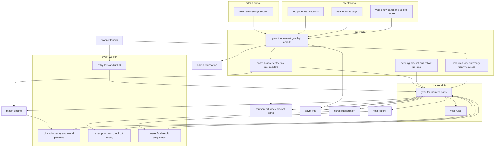
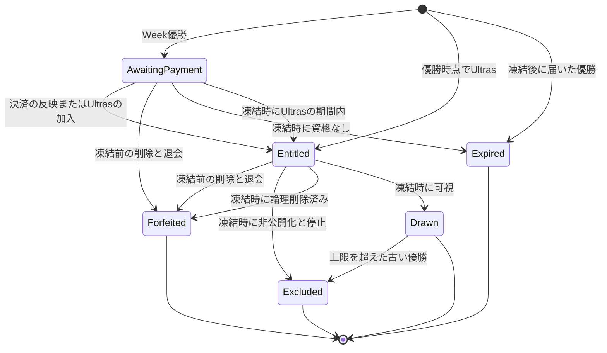
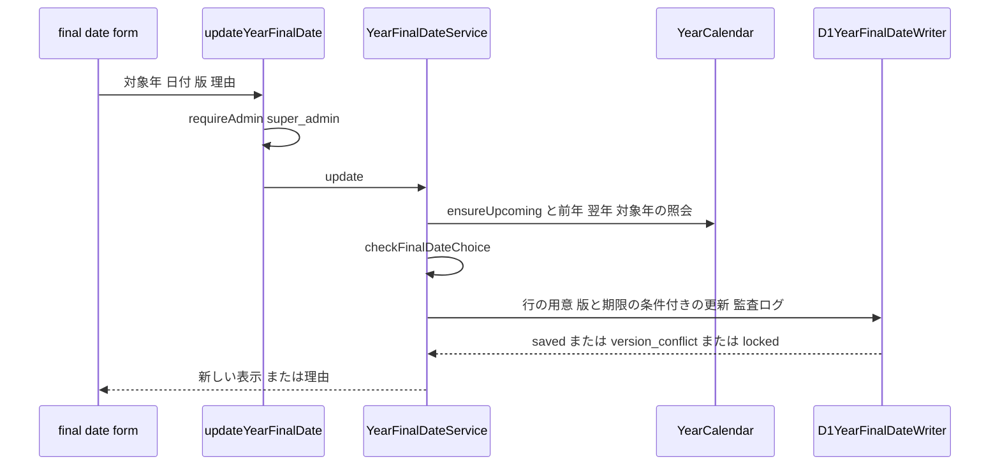
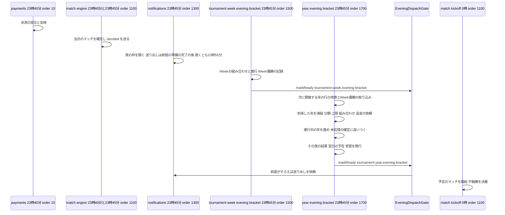
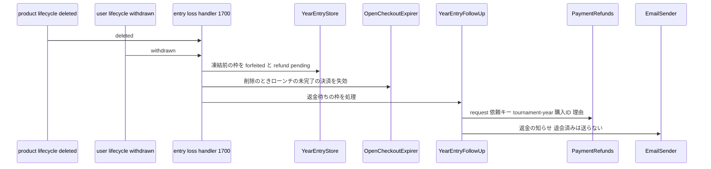
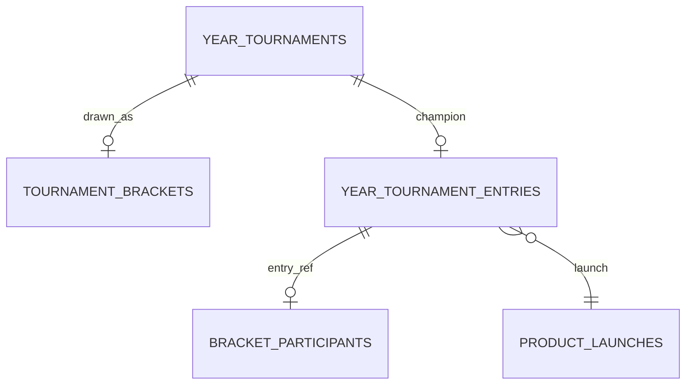

# Design Document

## Overview

**Purpose**: Product of the Weekの優勝作によるProduct of the Year決定トーナメント(Yearトーナメント)と、その決勝実施日の設定を実装する。最上位管理者が管理画面の設定ページで年ごとの決勝実施日(日曜日)を設定し、未設定なら5月の最終日曜日とする。決勝日から逆算した期限を年の行に保存し、Week優勝ごとに参加の枠を作り、決済期限までの参加費の決済(paymentsの購入種別`year_tournament_entry`)またはUltrasの特典による免除で参加資格を与える。決勝日の6日前の23:45に年のトーナメントを凍結して枠を分類し(非公開化・停止・参加数の上限による除外を含む)、tournament-weekの汎用のブラケットで組み合わせを決め、決勝日から逆算した日に1回戦を行い、1日1ラウンドで決勝日にProduct of the Year賞を授与する。

**Users**: Week優勝の投稿者は、プロダクト詳細ページと自分のプロダクトの画面で参加費を支払い、状態を確かめる。閲覧者はトップページでYearトーナメントのマッチを見てUpvoteし、ブラケットのページで組み合わせと結果を見て、プロダクト詳細ページでトロフィーを見る。最上位管理者は管理画面の`/settings`で決勝実施日を設定し、他の管理者は参照する。後続spec(ugc-moderation・data-export)の開発者は、除外と返金の扱いと受賞のエクスポートの部品を使う。

**Impact**: D1に2テーブル(年のトーナメント・参加の枠)を足す。`apps/backend-lib/core/year-tournament`・`workers/year-tournament`(apiとeventの両方に束縛)を新設する。apiにスキーマモジュール`year-tournament`・2つのジョブ(23:45の夜の処理と夜の送り出しの準備の完了の通知、4:21の再処理)・判定の供給元3つ・トロフィーの供給元1つ・決勝実施日の照会と保存を、eventにマッチイベント・ライフサイクル・Ultrasの知らせの処理と結果通知の追記とメールのテンプレートを、clientにトップページの2区画・ブラケットのページ・投稿者本人向けの操作・自分のプロダクトの区画・削除の注意書きを、adminに設定ページの決勝実施日の区画を足す。上流のファイルは、契約で定められた登録箇所への追記だけを変える。新しいシークレット・パッケージ・メッセージ種別・Cronの式は無い。

### Goals

- FR-TOURY-001〜030・FR-ADMCF-001〜003・006・007と、Yearトーナメントに関わるFR-PYMNT-010・FR-PPLAN-006・008・FR-RELCH-004・FR-PRDCT-014・FR-NOTIF-001・004・006・007・FR-ADMAG-001が、決勝日の設定→Week優勝の参加の枠→決済または免除→凍結と分類→組み合わせ→決勝日に向けた1日1ラウンドの進行→終了と賞、削除・退会・停止・非公開化・上限超過・Ultrasの加入・決済の反映の遅れ・決勝日の変更のどの経路でも、要件と仮1〜仮8の決定に一致する。
- シード・組み合わせ・進行・不戦勝の規則と記録を実装せず、tournament-weekの部品を使う。
- 本specが追加・変更したコードの単体テスト・Workers統合テスト・ブラウザテストがカバレッジ80%を満たす。

### Non-Goals

- ブラケットの汎用の規則・記録・進行、Weekトーナメント、Week優勝の記録、トロフィーの区画そのもの(tournament-week)。
- マッチの記録・Upvote・開始と確定・即時の終了と開始時点の決着(match-engine)。
- Stripeとの通信・決済画面・突合・反映の期限切れと二重決済の返金・返金の実行(payments)。通知の対象者と送信(notifications)。特典の判定と設定ページの枠(ultras-subscription)。管理者の認可・監査ログの記録と閲覧(admin-foundation)。停止・非公開化の操作(ugc-moderation)。
- 要件定義書の改訂(roadmapのOut。必要な改訂は[research.md](research.md)の「要件定義書の改訂が必要な箇所」に記録した)。(2026-10-25に要件定義書へ適用済み)

## Boundary Commitments

### This Spec Owns

- Yearのデータ: `year_tournaments`(年ごとの決勝実施日・期限・凍結と進行の状態・受賞)・`year_tournament_entries`(Week優勝ごとの参加の枠、参加資格の出どころ・返金の依頼と知らせの状態)(`apps/db/schema/year-tournament/`)。
- Yearの規則(`apps/backend-lib/core/year-tournament/`): 既定の決勝日と決勝日からの期限・1回戦の日、選べる決勝日と検証、対象年の判定、並びの比較と参加数の上限、枠の状態と返金の理由・依頼キー、返金の知らせのメール種別`tournament-year.entry-refund`。
- 共有部品(`apps/backend-lib/workers/year-tournament/`): `YearTournamentStore`・`YearEntryStore`・`YearCalendar`・`YearEntryRegistrar`・`YearEntryOfferPolicy`・`YearEntryFulfillment`・`YearDrawService`・`YearProgressionService`・`YearEntryFollowUp`・`YearNotificationPublisher`・`YearAwardExport`と`YEAR_TOURNAMENT_PLATFORM_MODULE`。
- apiのスキーマモジュール`year-tournament`、照会(トップページ・ブラケット・参加費の導線・決勝実施日)、参加の決済の開始、決勝実施日の保存と監査ログ、判定の供給元3つ、トロフィーの供給元`tournament-year.year-trophies`、ジョブ`tournament-year.evening-bracket`(23:45、1700)・`tournament-year.entry-follow-up`(4:21、1700)、notificationsの夜の枠の送り出しの前提の登録`tournament-year.evening-bracket`(`EVENING_DISPATCH_PARTICIPANTS`)。
- eventの処理: マッチイベント`tournament-year.week-champion-entry`(`decided`・`week`、1700)・`tournament-year.decided-round-progress`(`decided`・`year`、1710)、プロダクトライフサイクル`tournament-year.product-entry-loss`(`deleted`、1700)・`tournament-year.entry-unlink`(`purge_due`、1700)、ユーザーライフサイクル`tournament-year.account-entry-loss`(`withdrawn`、1700)、Ultrasの知らせ`tournament-year.ultras-entry-exemption`(1700)・`tournament-year.open-entry-checkout-expiry`(1710)、結果通知の追記`tournament-year.entry-deadline`(`week`、1700)、返金の知らせのテンプレート。
- clientの`/tournaments/year/$year`、トップページの区画`tournament-year.matches`(`main` 10)・`tournament-year.final`(`showcase` 10)、プロダクト詳細の投稿者本人向けの操作`tournament-year.entry`(20)、自分のプロダクトの`tournament-year.entry`(20)、削除の注意書き`tournament-year.entry-loss`(20)。
- adminの設定ページの区画`tournament-year.final-date`(10)と監査ログの操作種別`year-final-date.update`。
- 技術ドキュメント`backend/019-anchor-date-schedules.md`・`frontend/018-server-provided-date-choices.md`の新規作成と、サービス仕様(Yearトーナメント規則・日次タイムライン・ページ配置・文言規則・返金ポリシー・決済実装方針)とオンボーディングの追記。

### Out of Boundary

- `tournament_brackets`・`bracket_participants`・`bracket_matches`とWeekのテーブル、ブラケットの規則・組み合わせの作成・進行・物理削除での参加者の紐付けの解除(tournament-week)。本specは`BracketDraw`・`BracketProgression`で書き、`BracketStore`は読むだけにする。Week優勝は`WeekChampionDirectory`で読むだけにする。
- `matches`などマッチのデータ・マッチの開始と確定・開始時点の決着・即時の終了(match-engine)。
- `products`・`product_launches`・再ローンチの判定の本体・削除と非公開化の確定(product-launch)。
- 決済のデータ・Stripe・突合・反映・返金の実行と決済履歴(payments)。Ultrasの加入状態と特典の判定・設定ページの枠とメニュー(ultras-subscription)。管理者のデータ・認可の判定・監査ログの保存と閲覧(admin-foundation)。通知の対象者・受信可否・送信の時刻と統合(notifications)。停止・非公開化の操作(ugc-moderation)。データエクスポートのZIP(data-export)。

### Allowed Dependencies

- backend-platform: `AppModule`・`PLATFORM_TYPES`(`Database`・`Clock`・`IdGenerator`)・`AppError`・`getAppLogger`・`captureMessage`の規約・`ulidPrimaryKey`・`timestamps`・`BusinessTime`(`toBusinessDateTime`・`fromBusinessDateTime`・`parseBusinessDate`・`BusinessDate`・`BusinessTimeOfDay`)・`ScheduledJobDefinition`・`ScheduledJobHandler`。形を変えない。E2Eの`e2e/support/scheduled-trigger.ts`の`triggerScheduled`(backend-platformの改訂2。ローカルの定期実行の起動は独自に作らない)。
- api-gateway: `defineSchemaModule`・`GraphQLContext`(`resolve`・`session`・`caller`・`loaders`)・`withValidatedArgs`・`DateTime`。
- identity-auth: `AccountGuard`(`requireUser`)・`CurrentUser`・`users`(外部キーだけ)・`UserLifecycleAsyncRegistration`・`USER_LIFECYCLE_ASYNC_HANDLERS`・`LifecycleHandlerOutcome`・`assertLifecycleHandlerName`・`UserContactDirectory`(`IDENTITY_PLATFORM_TYPES.UserContactDirectory`)。
- admin-foundation: `requireAdmin`・`AuditLogRecorder`・`PreparedAuditEntry`・`buildAuditLogStatements`・`defineAuditAction`・`AUDIT_ACTIONS`・`AdminDirectory`・`AdminRole`・adminの`RoleGate`・`ConfirmActionDialog`、E2Eの`e2e/support/admin-bootstrap.ts`(`signInAsNewAdmin`)・`e2e/support/local-d1.ts`(`executeLocalD1`・`sqlStringLiteral`)。
- tournament-week: `core/tournament`(`bracketShape`・`dailyRoundPolicy`・`RoundSchedulePolicy`・`Comparator`・`DrawCandidate`)、`workers/tournament`の`TOURNAMENT_PLATFORM_TYPES`・`BracketDraw`・`BracketProgression`・`AdvanceResult`・`BracketRecord`・`BracketStore`の読み取り(`findByTournament`・`findById`・`findByMatchIds`・`findAliveRefs`)、`WEEK_TOURNAMENT_TYPES.WeekChampionDirectory`・`WeekChampion`、apiの`TrophySource`・`TrophyRecord`・`TrophySourceRegistration`・`TOURNAMENT_TROPHY_SOURCES`・GraphQLの`BracketRound`・`BracketNode`・`BracketSlot`、`common-lib/tournament`の`tournamentRoundName`・`formatWeekPeriodLabel`・`isoWeekKey`、apiの`buildBracketRoundsView`・`BracketRoundsView`(`apps/api/src/application/tournament/bracket-view-builder.ts`の純粋な関数。DIに束縛しない)、clientの`components/bracket/`(`BracketRoundColumn`・`BracketRoundTabs`・`BracketMatchCard`・`BracketChampion`と引数の`BracketViewProps`)と`src/graphql/operations/week-tournament/`の`.graphql`に置かれたフラグメント`BracketRoundFields`(`BracketRound`)・`BracketMatchProductFields`(`MatchProduct`。型は`src/graphql/generated/graphql.ts`の`BracketRoundFieldsFragment`・`BracketMatchProductFieldsFragment`)。組み立ての関数・フラグメント・`BracketViewProps`で受ける部品はtournament-weekの仮7で提供される。
- match-engine: `MATCH_PLATFORM_TYPES`の`MatchDirectory`(`findQualifierResults`・`findMatches`・`listForDate`)、`MatchKind`・`MatchStage`・`EntryResult`・`isWinningResult`・`MatchEvent`・`MatchEventHandler`・`MatchEventRegistration`・`MATCH_EVENT_HANDLERS`、apiの`MatchViewReader`・`matchViewLoader`・GraphQLの`Match`・`MatchProduct`・`MatchBye`、clientの`TOP_PAGE_SECTIONS`・`TopPageSection`・`MatchCard`・`ByeList`・`useUpvote`・`LIVE_REFRESH_QUERY_OPTIONS`。
- payments: `PurchaseKindRegistration`・`PurchaseOfferPolicy`・`PurchaseOffer`・`PurchaseFulfillment`・`FulfillablePurchase`・`FulfillmentPlan`・`PURCHASE_KIND_REGISTRATIONS`・`PaymentRefunds`・`OpenCheckoutExpirer`・`PriceCatalog`・`PAYMENTS_TYPES`・apiの`CheckoutStarter`・GraphQLの`CheckoutStart`・`Money`・frontend-libの`MoneyText`。
- ultras-subscription: `ULTRAS_TYPES.UltrasEntitlements`(`wasEntitledDuring`・`entitledUsersDuring`)・`UltrasActivation`・`UltrasActivationHandlerRegistration`・`ULTRAS_ACTIVATION_HANDLERS`・adminの`AdminSettingsSection`・`ADMIN_SETTINGS_SECTIONS`。
- notifications: `NOTIFICATIONS_PLATFORM_TYPES.EveningDispatchGate`(apiだけ)・`EveningDispatchGate.markReady`・`EveningDispatchReadiness`・`EveningDispatchError`・apiの`EVENING_DISPATCH_PARTICIPANTS`(`apps/api/src/composition/evening-dispatch-participants.ts`)、`NOTIFICATIONS_PLATFORM_TYPES.NotificationEventPublisher`・`NotificationEvent`・`NotificationPublishError`・`ResultNoticeSupplementProvider`・`ResultNoticeSupplementInput`・`ResultNoticeSupplementRegistration`・`RESULT_NOTICE_SUPPLEMENTS`。
- product-launch: `ProductDirectory`(`findSummaries`・`listLaunches`・`resolveHandle`)・`PRODUCT_PLATFORM_TYPES`・`products`・`product_launches`への外部キー・`ProductLifecycleAsyncRegistration`・`PRODUCT_LIFECYCLE_ASYNC_HANDLERS`・`RelaunchConditionSource`・`ProductLockSource`・`LaunchSummarySource`・`DecisionSourceRegistration`・3つの登録口、clientの`MY_PRODUCT_SECTIONS`・`MyProductSection`・`PRODUCT_DELETE_NOTICES`・`ProductDeleteNotice`。
- directory-discovery: `PRODUCT_OWNER_ACTIONS`・`ProductOwnerAction`。
- email-delivery: `defineEmailKind`・`EMAIL_KINDS`・`EmailSender`・`EMAIL_TYPES`・`defineEmailTemplate`・`EMAIL_TEMPLATES`・`formatUtcDateTime`。
- frontend-platform: `executeGraphQL`・`graphqlQueryOptions`・`GraphQLClientError`・`errorMessageOf`・`buildPageHead`・`NotFoundView`・`ErrorState`・`PartialErrorState`・`UnavailableNotice`・`LoadingSkeleton`・`notify`・`DateTime`・`RelativeTime`・shadcn/uiの部品(ボタン・バッジ・セレクト・テキストエリア)・`runAxe`・デザイントークン、adminの`ADMIN_PROFILE`(`contactAvailable`)、GraphQLの操作の追加手順(`src/graphql/operations/**/*.graphql`・操作名の接頭辞`Client`・`Admin`・`src/graphql/generated/graphql.ts`の生成物)。
- npmパッケージ: 新規なし。
- 後続spec(data-export)は`YearAwardExport`だけを呼ぶ。ugc-moderationは停止・非公開化をidentity-auth・product-launchのライフサイクルで発火すればよく、本specを直接呼ばない。

### Revalidation Triggers

- `year_tournaments`・`year_tournament_entries`の列・状態の値・`classified_year`の意味(data-export・ugc-moderation)。
- `YearAwardExport`の形(data-export)。
- ジョブ・処理の名前と`order`(23:45のジョブは1700、処理は1700・1710)、23:45の順序(tournament-weekの`tournament-week.evening-bracket`(1500)の後)、夜の枠の送り出しの前提の名前`tournament-year.evening-bracket`と`markReady`を呼ぶ時点(notifications・tournament-week)。
- 購入種別`year_tournament_entry`の`PurchaseOffer`の期限の値・`exclusivityKey`・返金の依頼キーと理由の値(payments・ugc-moderation)。
- `LaunchSummaryContribution`の`rank`(60〜100)と文言(directory-discovery・product-launch)。
- 監査ログの操作種別`year-final-date.update`の詳細の鍵(admin-foundation)。
- 仮1〜仮8(2026-10-24に開発者が確定)の決定を変えるときは、該当する規則(`resolveTargetYear`・`checkFinalDateChoice`・`selectWithinCapacity`・`YearDrawService`の分類・`YearEntryFollowUp`・`/tournaments/year/$year`・`YearEntryFulfillment`の新しいローンチの検査)を確かめ直す。
- 上流のtournament-weekの`BracketDraw.create`・`BracketProgression.advance`・`AdvanceResult`・`dailyRoundPolicy`・`BracketStore`・`WeekChampionDirectory`・`TrophySource`・`buildBracketRoundsView`・`BracketRoundsView`・`BracketRoundFields`・`BracketMatchProductFields`・`BracketViewProps`(`rounds`・`champion`・`awarded`・`finished`)・`components/bracket/`の4部品の形(tournament-weekの仮7)、`BracketStore.unlinkProduct`が種類によらず解除する規則、match-engineの`MatchDirectory`・`MATCH_EVENT_HANDLERS`の直列の実行・`TOP_PAGE_SECTIONS`・`MatchCard`・`ByeList`、paymentsの購入種別の口・`PaymentRefunds`・`OpenCheckoutExpirer`、`UltrasEntitlements`・`UltrasActivationHandlerRegistration`・`ADMIN_SETTINGS_SECTIONS`、`requireAdmin`・`AuditLogRecorder`・`buildAuditLogStatements`、`NotificationEventPublisher`・`ResultNoticeSupplementRegistration`・`EveningDispatchGate.markReady`の形と`EVENING_DISPATCH_PARTICIPANTS`・23:55の期限(notificationsの仮2)、product-launchの3つの供給元の契約・`ProductDirectory`・ライフサイクルの登録口・`MY_PRODUCT_SECTIONS`・`PRODUCT_DELETE_NOTICES`、directory-discoveryの`PRODUCT_OWNER_ACTIONS`の形を変えたら、本specを確かめ直す。
- backend-platformの改訂2の`triggerScheduled`の引数(`worker`・`businessDate`・`businessTime`)と業務時刻の規則が変われば、E2Eの補助と時刻を進める手順を確かめ直す。

### 上流への影響

| 上流spec                                        | 変更                                                                                                                                                                                                                                                                                                                                                                                                                                                                                                                                                                                                                                                                                                                                                                                                                           | 影響と再検証                                                                                                                                                                                                                                                                                  |
| ----------------------------------------------- | ------------------------------------------------------------------------------------------------------------------------------------------------------------------------------------------------------------------------------------------------------------------------------------------------------------------------------------------------------------------------------------------------------------------------------------------------------------------------------------------------------------------------------------------------------------------------------------------------------------------------------------------------------------------------------------------------------------------------------------------------------------------------------------------------------------------------------ | --------------------------------------------------------------------------------------------------------------------------------------------------------------------------------------------------------------------------------------------------------------------------------------------- |
| tournament-week                                 | apiの`composition/tournament-trophy-sources.ts`に`tournament-year.year-trophies`(10)                                                                                                                                                                                                                                                                                                                                                                                                                                                                                                                                                                                                                                                                                                                                           | 契約どおり(Yearは10と予約済み)                                                                                                                                                                                                                                                                |
| match-engine                                    | eventの`composition/match-event-handlers.ts`に2件、clientの`composition/top-page-sections.ts`に2件                                                                                                                                                                                                                                                                                                                                                                                                                                                                                                                                                                                                                                                                                                                             | 契約どおり。`createMatchEventRegistry`の検証を通る                                                                                                                                                                                                                                            |
| payments                                        | `apps/backend-lib/workers/payments/purchase-kind-registrations.ts`に`year_tournament_entry`                                                                                                                                                                                                                                                                                                                                                                                                                                                                                                                                                                                                                                                                                                                                    | 契約どおり。`createPurchaseKindRegistry`の検証を通る                                                                                                                                                                                                                                          |
| ultras-subscription                             | eventの`composition/ultras-activation-handlers.ts`に2件(1700・1710)、adminの`composition/admin-settings-sections.ts`に1件(10)                                                                                                                                                                                                                                                                                                                                                                                                                                                                                                                                                                                                                                                                                                  | 契約どおり(`order`は100以上、区画の10は予約済み)                                                                                                                                                                                                                                              |
| admin-foundation                                | `apps/common-lib/admin/audit-actions/tournament-year.ts`と`index.ts`の連結                                                                                                                                                                                                                                                                                                                                                                                                                                                                                                                                                                                                                                                                                                                                                     | 契約どおり。`createAuditActionCatalog`の検査を通る                                                                                                                                                                                                                                            |
| notifications                                   | eventの`composition/result-notice-supplements.ts`に1件(`week`、1700)、apiの`composition/evening-dispatch-participants.ts`の`EVENING_DISPATCH_PARTICIPANTS`に`tournament-year.evening-bracket`の1行                                                                                                                                                                                                                                                                                                                                                                                                                                                                                                                                                                                                                             | 契約どおり                                                                                                                                                                                                                                                                                    |
| product-launch                                  | apiの`composition/product-decision-sources.ts`に3件、eventの`composition/product-lifecycle-async-handlers.ts`に2件、clientの`composition/my-product-sections.ts`・`product-delete-notices.ts`に各1件(20)                                                                                                                                                                                                                                                                                                                                                                                                                                                                                                                                                                                                                       | 契約どおり(tournament-weekは10、sponsorshipは30)                                                                                                                                                                                                                                              |
| directory-discovery                             | clientの`composition/product-page-sections.ts`の`PRODUCT_OWNER_ACTIONS`(20)                                                                                                                                                                                                                                                                                                                                                                                                                                                                                                                                                                                                                                                                                                                                                    | 予約どおり                                                                                                                                                                                                                                                                                    |
| identity-auth                                   | eventの`composition/user-lifecycle-async-handlers.ts`に1件(`withdrawn`、1700)                                                                                                                                                                                                                                                                                                                                                                                                                                                                                                                                                                                                                                                                                                                                                  | 契約どおり                                                                                                                                                                                                                                                                                    |
| backend-platform                                | apiの`composition/scheduled-jobs.ts`に2件(23:45の1700・4:21の1700。式は上流で追加済み)                                                                                                                                                                                                                                                                                                                                                                                                                                                                                                                                                                                                                                                                                                                                         | 契約どおり。Cronの式の一致の検査を通る。E2Eは改訂2の共用の補助`triggerScheduled`を前提にする(本specは補助を変更しない)                                                                                                                                                                        |
| email-delivery                                  | `core/email/kinds/index.ts`に1種別、eventの`infrastructure/email/templates/index.ts`に1テンプレート                                                                                                                                                                                                                                                                                                                                                                                                                                                                                                                                                                                                                                                                                                                            | 契約どおり(1対1の検査)                                                                                                                                                                                                                                                                        |
| tournament-week(tournament-weekの仮7で提供済み) | 変更しない。tournament-weekの仮7(本specの依頼による)が、(1)apiの`apps/api/src/application/tournament/bracket-view-builder.ts`の純粋な関数`buildBracketRoundsView({ record, matchViews, now }): BracketRoundsView`(`participantCount`・`seedCount`・`rounds`・`championNo`。DIに束縛しない。シードの最初のマッチの予定が作られるまでは、その枠を「シード<n>」とし、プロダクトを出さない)と、GraphQLの`BracketRound`・`BracketNode`・`BracketSlot`をこの値だけから解決するリゾルバ、(2)clientの`src/graphql/operations/week-tournament/`の`.graphql`に置くフラグメント`BracketRoundFields`(`BracketRound`)・`BracketMatchProductFields`(`MatchProduct`)(型は`src/graphql/generated/graphql.ts`の`…Fragment`)と、`BracketViewProps`(`rounds: readonly BracketRoundFieldsFragment[]`・`champion: BracketMatchProductFieldsFragment | null`・`awarded: boolean`・`finished: boolean`。`awarded`が真で`champion`がnullなら「非公開のプロダクト」の受賞と表示する)で受ける`BracketRoundColumn`・`BracketRoundTabs`・`BracketMatchCard`・`BracketChampion`を提供する(Weekのページは`components/week-tournament/week-bracket-page.tsx`) | 本specは関数・フラグメント・部品を使うだけで、それらの実装とテストを持たない。tournament-weekのタスク6.6(組み立て)・6.10(GraphQLのリゾルバ)・7.1(フラグメント)・7.4(共用の部品)の完了を、本specのタスク5.8・5.11・6.1・6.4の前提にする |

- roadmapの帯の割り当ての表の本specの「使用中の値」は「4:21は1700、波及処理は1700」になる(23:45のジョブ1700、プロダクトライフサイクル1700、マッチイベント1700・1710、Ultrasの知らせ1700・1710、結果通知の追記1700)。本specはroadmapを編集しないため、コントローラーへ報告する。

## Architecture

### Existing Architecture Analysis

- 上流の23specは設計・タスクとも承認済みで、本specのタスクはそれらの実装の完了を前提にする。実装済みはdev-toolingだけである。roadmapが宣言する直接の依存はtournament-weekだが、本specは`PRODUCT_OWNER_ACTIONS`(20)へ登録するため、directory-discoveryも上流として扱う(23specに含まれる)。
- apiはクリーンアーキテクチャ(`domain`→`application`→`infrastructure`・`presentation`→`composition`)、D1の`db.batch()`による1トランザクションの書き込み、`CASE`式のNOT NULL制約の違反による取り消し、Cron Triggers(apiだけ、同じ時刻は`order`の昇順、失敗は次を止めない)を使う。
- tournament-weekのブラケットは種類と識別子で区別され、`BracketDraw.create`(参加者の番号の記録と1回戦の予定)と`BracketProgression.advance`(結果の写し・次ラウンドの予定・終了の確定を冪等に行う)をYearから呼べる。Week優勝は`decided`の処理(1510)・23:45のジョブ`tournament-week.evening-bracket`(1500)で記録され、`WeekChampionDirectory`で読める。
- match-engineのマッチイベントの実行器は、同じイベントに登録された処理を`order`の昇順に直列に動かし、例外の処理より後を止めて再試行する。

### Architecture Pattern & Boundary Map



**Architecture Integration**:

- Selected pattern: クリーンアーキテクチャ。Yearの規則は`core`の純粋な関数、記録・組み合わせ決定・進行は`workers`の部品(apiとeventの両方に束縛)、照会と画面の組み立てと決勝実施日の保存はapiのアプリケーション層、ブラケット・マッチ・決済・特典・通知・監査ログは上流の部品越しに使う。
- Domain/feature boundaries: Year固有のデータ(年と枠)だけを本specのテーブルに持ち、ブラケットはtournament-weekの部品越しに書く。マッチの状態はmatch-engine、決済の状態はpayments、Week優勝はtournament-weekが持ち、本specは識別子と確定値の写しだけを持つ。
- Existing patterns preserved: `backend-lib/workers/<ドメイン>`の共有の束縛、`<spec名>.<名詞句>`の名前、帯の`order`、登録箇所への追記、条件付きの書き込みと`onConflictDoNothing()`による冪等性、`CASE`式による取り消し、期限を行の列に保存して正とする規則(tournament-week)、設定の版の条件付きの保存と監査ログの一体の確定(notifications・ultras-subscription)。
- New components rationale: `YearCalendar`は行の無い年の既定の日と行の列を1つの照会にまとめ、対象年の判定を全ての部品で同じにするため。枠に対象年を保存しないのは、決勝日の変更・初年度・遅れを付け替え無しに扱うため(research.mdの「対象期間の表し方」)。
- Steering compliance: `@inject`の明示、D1の制約(`db.batch()`・バインド変数100個以内・`transaction()`を使わない)、800行以内のファイル、1ファイル1コンポーネント、日時の`<time datetime>`、新しいパッケージなし。

**Dependency direction**: `apps/db/schema/year-tournament` → `backend-lib/core/year-tournament` → `backend-lib/workers/year-tournament` → 各アプリの`src`(`application` → `infrastructure`・`presentation` → `composition`)。`core/year-tournament`は`core/tournament`と`BusinessTime`だけを読み込み、`core/week-tournament`を読み込まない。`workers/year-tournament`は`workers/tournament`の公開の部品と`WeekChampionDirectory`を読み込み、tournament-weekのテーブル定義を読み込まない。client・adminはGraphQLの操作と上流の部品だけを読み込む。違反はレビューで誤りとして扱う。

### Technology Stack

| Layer     | Choice / Version                                             | Role in Feature                                                           | Notes                                       |
| --------- | ------------------------------------------------------------ | ------------------------------------------------------------------------- | ------------------------------------------- |
| Frontend  | TanStack Start・Router・Query・shadcn/ui・lucide-react(上流) | トップページの区画・ブラケットのページ・参加費の導線・管理画面の区画      | 新規パッケージなし                          |
| Backend   | Hono・Inversify・GraphQL Yoga(上流)                          | スキーマモジュール・ユースケース・ジョブ・イベントの処理                  | 既存                                        |
| Data      | Cloudflare D1(Drizzle)                                       | 2テーブル                                                                 | 新規のマイグレーション                      |
| Messaging | Cloudflare Queues・Cron Triggers(上流)                       | 既存のマッチイベント・ライフサイクル・Ultrasの知らせ、23:45と4:21のジョブ | 新しいメッセージ種別・Cronの式なし          |
| External  | Stripe(paymentsの部品越し)                                   | 参加費の決済・返金・未完了の決済の失効                                    | 価格の`lookup_key`は`year_tournament_entry` |

## File Structure Plan

### Directory Structure

```
apps/
├── db/schema/year-tournament/                                # テーブル定義(各ファイルに同名の*.unit.test.ts)
│   ├── year-tournaments.ts
│   ├── year-tournament-entries.ts
│   └── index.ts
├── common-lib/admin/audit-actions/tournament-year.ts         # year-final-date.update(*.unit.test.ts)
├── backend-lib/
│   ├── core/year-tournament/                                 # Yearの純粋な規則(Bunの単体テスト)
│   │   ├── year-schedule.ts                                  # YEAR_*の定数・defaultFinalDate・yearScheduleFor・yearFirstRoundDate
│   │   ├── final-date-choice.ts                              # editableYears・checkFinalDateChoice・finalDateChoices・nextYearGapWarning
│   │   ├── year-target-rules.ts                              # resolveTargetYear
│   │   ├── year-ordering.ts                                  # yearSeedOrder・yearNonSeedOrder・selectWithinCapacity
│   │   ├── year-entry-rules.ts                               # YearEntryStatus・YearEntryCloseReason・refundReasonFor・yearRefundRequestKey
│   │   └── year-entry-refund-email.ts                        # TOURNAMENT_YEAR_ENTRY_REFUND_EMAIL
│   └── workers/year-tournament/                              # Yearの部品(Workers統合テスト)
│       ├── year-tournament-types.ts                          # YEAR_TOURNAMENT_TYPES(テストなし)
│       ├── year-tournament-store.ts                          # YearTournamentStore・YearTournamentRecord(型)
│       ├── d1-year-tournament-store.ts
│       ├── year-entry-store.ts                               # YearEntryStore・YearEntryRecord(型)
│       ├── d1-year-entry-store.ts
│       ├── year-calendar.ts                                  # 行と既定の日をまとめた年の照会・対象年の判定・行の用意
│       ├── year-entry-registrar.ts                           # Week優勝からの枠の作成と免除
│       ├── year-entry-offer-policy.ts                        # PurchaseOfferPolicy
│       ├── year-entry-fulfillment.ts                         # PurchaseFulfillment
│       ├── year-draw-service.ts                              # 凍結・分類・上限・組み合わせ
│       ├── year-progression-service.ts                       # 進行・賞・通知の発行
│       ├── year-entry-follow-up.ts                           # 返金の依頼と知らせ
│       ├── year-notification-publisher.ts                    # 通知イベントの組み立てと発行
│       ├── year-award-export.ts                              # 受賞のエクスポート(data-export)
│       └── year-tournament-platform-module.ts                # YEAR_TOURNAMENT_PLATFORM_MODULE
├── api/src/
│   ├── application/year-tournament/                          # Bunの単体テスト
│   │   ├── year-tournament-api-types.ts                      # YEAR_TOURNAMENT_API_TYPES
│   │   ├── year-board-reader.ts                              # トップページの区画
│   │   ├── year-bracket-reader.ts                            # ブラケットのページ
│   │   ├── year-entry-panel-reader.ts                        # 参加費の導線
│   │   ├── year-entry-checkout.ts                            # 決済の開始(CheckoutStarterの呼び出し)
│   │   ├── year-final-date-service.ts                        # 決勝実施日の照会と保存
│   │   ├── year-relaunch-condition-source.ts                 # tournament-year.result-pending
│   │   ├── year-product-lock-source.ts                       # tournament-year.bracket-lock
│   │   ├── year-launch-summary-source.ts                     # tournament-year.launch-summary
│   │   ├── year-trophy-source.ts                             # tournament-year.year-trophies
│   │   └── year-tournament-jobs.ts                           # 2つのジョブ(23:45の夜の処理、4:21の再処理)
│   ├── infrastructure/year-tournament/
│   │   └── d1-year-final-date-writer.ts                      # 版の条件付きの保存と監査ログ(*.worker.test.ts)
│   ├── presentation/graphql/modules/year-tournament/         # スキーマモジュール(Workers統合テスト)
│   │   ├── type-defs.ts
│   │   ├── errors.ts
│   │   ├── board-resolvers.ts                                # yearTournamentBoard
│   │   ├── bracket-resolvers.ts                              # yearBracket
│   │   ├── entry-resolvers.ts                                # myYearEntry・startYearTournamentCheckout
│   │   ├── final-date-resolvers.ts                           # yearFinalDateSettings・updateYearFinalDate
│   │   └── index.ts                                          # yearTournamentSchemaModule
│   └── composition/year-tournament-module.ts                 # YEAR_TOURNAMENT_API_MODULE
├── event/src/
│   ├── application/year-tournament/                          # Bunの単体テスト
│   │   ├── event-year-tournament-types.ts                    # EVENT_YEAR_TOURNAMENT_TYPES
│   │   ├── week-champion-entry-handler.ts                    # decided week 1700
│   │   ├── round-progress-handler.ts                         # decided year 1710
│   │   ├── product-entry-loss-handler.ts                     # プロダクトのdeleted 1700
│   │   ├── account-entry-loss-handler.ts                     # ユーザーのwithdrawn 1700
│   │   ├── entry-unlink-handler.ts                           # プロダクトのpurge_due 1700
│   │   ├── year-ultras-entry-exemption-handler.ts            # Ultrasの知らせ(1700)
│   │   ├── year-open-entry-checkout-expiry-handler.ts        # Ultrasの知らせ(1710)
│   │   └── year-entry-supplement-provider.ts                 # Week決勝の勝利の結果通知への追記
│   ├── infrastructure/email/templates/                       # email-deliveryのテンプレートの置き場所(*.worker.test.tsx)
│   │   ├── year-entry-refund-template.ts
│   │   └── year-entry-refund-email-body.tsx
│   └── composition/year-tournament-module.ts                 # EVENT_YEAR_TOURNAMENT_MODULE
├── client/src/
│   ├── routes/tournaments/year/$year.tsx                     # ブラケットのページ(仮5)
│   ├── components/year-tournament/                           # 1ファイル1コンポーネント(browser testを併置)
│   │   ├── year-tournament-section.tsx                       # main 10
│   │   ├── year-final-showcase.tsx                           # showcase 10
│   │   ├── year-section-heading.tsx
│   │   ├── year-bracket-page.tsx                             # tournament-weekの共用の4部品へBracketViewPropsを渡す(tournament-weekの仮7)
│   │   ├── year-entry-panel.tsx                              # 参加費の導線の本体
│   │   ├── year-entry-status-copy.ts                         # 状態ごとの文言の選択(*.unit.test.ts)
│   │   ├── year-entry-owner-action.tsx                       # PRODUCT_OWNER_ACTIONSの包み
│   │   ├── year-entry-my-product-section.tsx                 # MY_PRODUCT_SECTIONSの包み
│   │   └── year-entry-delete-notice.tsx
│   └── graphql/operations/year-tournament/                   # 1ファイル1操作の.graphql(操作名はClientで始める)
│       ├── year-tournament-board.graphql                     # ClientYearTournamentBoard
│       ├── year-bracket.graphql                              # ClientYearBracket(BracketRoundFields・BracketMatchProductFieldsを展開)
│       ├── my-year-entry.graphql                             # ClientMyYearEntry
│       └── start-year-tournament-checkout.graphql            # ClientStartYearTournamentCheckout
├── admin/src/
│   ├── components/tournament-year/                           # 1ファイル1コンポーネント(browser testを併置)
│   │   ├── final-date-section.tsx                            # ADMIN_SETTINGS_SECTIONSの区画
│   │   ├── final-date-year-card.tsx                          # 年ごとの表示
│   │   ├── final-date-form.tsx                               # 候補の選択・理由・確認
│   │   └── final-date-labels.ts                              # 業務日付と拒否の理由の表記(*.unit.test.ts)
│   └── graphql/operations/tournament-year/                   # 1ファイル1操作の.graphql(操作名はAdminで始める)
│       ├── year-final-date-settings.graphql                  # AdminYearFinalDateSettings
│       └── update-year-final-date.graphql                    # AdminUpdateYearFinalDate
e2e/
├── client/year-tournament.e2e.test.ts                        # 参加費の決済・組み合わせ・トップページ・受賞(ジョブは共用のtriggerScheduledで起動)
├── admin/year-final-date.e2e.test.ts                         # 決勝実施日の保存と監査ログ
└── support/year-tournament-fixtures.ts                       # ローカルD1にWeek優勝の枠と年の行を作る補助
docs/GUIDES/tech/
├── backend/019-anchor-date-schedules.md
└── frontend/018-server-provided-date-choices.md
```

テストは各ファイルの隣に置く(`*.unit.test.ts`・`*.worker.test.ts`・`*.worker.test.tsx`・`*.browser.test.tsx`)。技術ドキュメントの番号は、完了済みspecのdesign.mdの計画(`backend`は001〜018、`frontend`は001〜017)を確かめ、各ディレクトリの最小の空き番号(`backend/019`・`frontend/018`)を本specが取り、並行して作成するpublic-apiは1つ飛ばす取り決めに従って固定する。

### Modified Files

- `apps/db/schema/index.ts`・`apps/db/migrations/<日時>_tournament_year/migration.sql` — 2テーブルの再エクスポートと、生成したマイグレーション(CHECK・一意索引)。mainの最新を取り込んでから生成する。
- `apps/common-lib/admin/audit-actions/index.ts` — 本specの操作種別の連結。
- `apps/backend-lib/core/email/kinds/index.ts` — `TOURNAMENT_YEAR_ENTRY_REFUND_EMAIL`。
- `apps/backend-lib/workers/payments/purchase-kind-registrations.ts` — `{ kind: 'year_tournament_entry', offer: YEAR_TOURNAMENT_TYPES.YearEntryOfferPolicy, fulfillment: YEAR_TOURNAMENT_TYPES.YearEntryFulfillment }`。
- `apps/api/src/composition/modules.ts`・`graphql-modules.ts`・`scheduled-jobs.ts`・`product-decision-sources.ts`・`tournament-trophy-sources.ts`・`evening-dispatch-participants.ts` — 共有モジュールとapiの束縛、`yearTournamentSchemaModule`、2つのジョブ、3つの供給元、トロフィーの供給元、夜の枠の送り出しの前提の名前`tournament-year.evening-bracket`。
- `apps/event/src/composition/modules.ts`・`match-event-handlers.ts`・`product-lifecycle-async-handlers.ts`・`user-lifecycle-async-handlers.ts`・`ultras-activation-handlers.ts`・`result-notice-supplements.ts`・`apps/event/src/infrastructure/email/templates/index.ts` — 共有モジュールとeventの束縛、8件の登録、テンプレート。
- `apps/client/src/composition/top-page-sections.ts`・`product-page-sections.ts`・`my-product-sections.ts`・`product-delete-notices.ts` — 区画の登録。
- `apps/admin/src/composition/admin-settings-sections.ts` — `{ id: 'tournament-year.final-date', order: 10, component: FinalDateSection }`。
- `docs/GUIDES/tech/backend/README.md`・`frontend/README.md` — 文書一覧の行。
- `docs/onboardings/project-values.md` — ジョブ・処理・登録の名前と`order`、価格の`lookup_key`、メール種別、返金の依頼キーの形、監査ログの操作種別。
- `docs/GUIDES/service/overview/005-year-tournament-rules.md` — 確定した決定の仮1(前年の決勝日と初年度)・仮2(64を超える参加)・仮3・仮4(除外と返金)・仮6(期限の後の反映)の規則を加え、凍結の時点、ラウンドの遅れの回復、ブラケットのページ(仮5)、「参加数上限64(決勝日設定の制約により保証)」の記述の訂正を加える。
- `docs/GUIDES/service/overview/007-daily-timeline.md` — 23:45の`tournament-year.evening-bracket`(1700。Week優勝の取り込み→組み合わせ決定→進行→通知の発行→夜の送り出しの準備の完了の通知)、4:21の表に1700、年次タイムラインの組み合わせ決定の順序。23:50の送り出しの前提を書かない(送り出しは前提の全機能の準備の完了の後、遅くとも23:55)。
- `docs/GUIDES/service/design/002-page-layouts.md` — Yearのブラケットのページ(仮5)、トップページのYearの区画の見出しと導線、Yearの参加費の導線の状態、削除の注意書き、管理画面の設定の決勝実施日の区画。
- `docs/GUIDES/service/design/003-text-and-copy-rules.md` — 本specのエラー・状態・メール・管理画面の文言(Supporting References)。
- `docs/GUIDES/service/legal/004-legal-notice-outline.md` — 返金ポリシーの「ユーザー停止やプロダクト非公開化に伴うトーナメント参加資格停止」の行をWeek・Yearに共通の文言(組み合わせ決定の時点で非公開化・停止中のため参加資格を停止した場合は自動で全額返金、組み合わせ決定の後の停止・非公開化による不戦敗は返金しない)に改め、「Yearトーナメントの参加数の上限による参加資格停止: 決済した参加費を自動で全額返金する」の行を加える(仮4)。
- `docs/GUIDES/service/features/004-*.md`(paymentsの決済実装方針) — 購入種別の表にYearトーナメント参加費の期限・反映の期限・返金の依頼キーの行を追記する(契約どおり)。
- `CLAUDE.md` — 「技術規則の参照先」に「管理者が設定する日付から期限を逆算する前に: `backend/019`」。

## System Flows

### 参加の枠の状態



- 枠は対象年を持たない。終わっていない枠(`awaiting_payment`・`entitled`)の対象年は「組み合わせ決定を始めていない年のうち、決済期限日がWeek優勝の日より後の最も早い年」である(`resolveTargetYear`)。組み合わせ決定の分類が枠を終えるときに`classified_year`を記録する。
- 凍結(`year_tournaments.draw_started_at`)の後は、その年の決済期限日より前のWeek優勝の枠について、資格を変える全ての書き込み(反映・免除・喪失・取り込み)が条件の不一致で何もしないか、期限切れ(`late_entry`)になる。`Forfeited`・`Excluded`で`purchase_id`があれば`refund_status = 'pending'`を同じ文で記録する(6.1・6.2・6.4〜6.6)。

### 決勝実施日の保存



- 保存の文は`final_date_version = ? AND draw_started_at IS NULL AND change_lock_at > ?`(変更前の期限)を`CASE`式の条件にし、満たさなければNOT NULL制約の違反で行の用意・更新・監査ログをまとめて取り消す。取り消しは読み直して`locked`(変更期限・凍結)か`version_conflict`に分ける(2.7・2.10・2.11)。
- 枠の対象年は保存しないため、保存で枠を書き換えない。以後の照会と判定が新しい列から対象期間と期限を求める(1.3・3.8・13.6)。

### 組み合わせ決定の日の23:45



- 決済セッションの有効期限は決済期限(23:35)以前で、受付期限(23:00)の後は開始できない(paymentsの`assertAcceptable`)。反映の期限(23:45)の後の完了はpaymentsが自動で返金する(4.2・4.7・4.9)。
- 1回戦は組み合わせ決定の翌日以降(決勝日の5日前〜決勝日)で、1回戦の予告は組み合わせ決定の時点で発行し、notificationsが前日の夜の枠まで保持する(14.1)。
- `tournament-year.evening-bracket`は毎晩、組み合わせや進行の無い夜も、全ての処理と発行を終えた最後に`EveningDispatchGate.markReady`を呼ぶ。処理のどれかが失敗した夜は呼ばずに例外を投げ、notificationsが23:55の期限で送り出し、呼ばなかった前提を`evening-dispatch-incomplete`として検知する(14.7)。
- `decided`の処理と23:45のジョブは同じ`YearProgressionService.advance`を呼ぶ。どちらが先でも、次ラウンドの位置とマッチIDはtournament-weekの部品が先に挿入した側にそろえる(8.2・8.8)。

### Week優勝の取り込み(`YearEntryRegistrar.syncChampions`)

1. `WeekChampionDirectory.listChampions({ awardedFrom, awardedBefore: now })`でWeek優勝を読む(`decided`・`week`の処理は直近8日、23:45のジョブは`YearCalendar.openPeriodStart`(凍結済みの最新の年の決済期限日の0:00、無ければ起点なし)から)。
2. `YearEntryStore.findByWeekTournaments`で既存の枠を除き、残りのローンチについて`MatchDirectory.findQualifierResults`で予選のマッチを引き、`findMatches`の側の`upvoteCount`・`lastUpvoteElapsedMs`と`matchDate`(ローンチ日)を写す(3.2)。予選が見つからない枠は作らず`captureMessage`(次の実行で再試行)。
3. `YearCalendar.resolveAward(Week優勝の日, now)`で対象年を求め、`open`なら`UltrasEntitlements.wasEntitledDuring(投稿者, Week優勝の日時, その年の決済期限)`が真なら`entitled`(`ultras`)、偽なら`awaiting_payment`で挿入する(5.1)。`late`なら期限切れで挿入する(3.7)。
4. 挿入は1文で、凍結済みの年のうち決済期限日がWeek優勝の日より後の年があれば`expired`(`late_entry`、`classified_year`はその年)にし、`week_tournament_id`の一意索引で`onConflictDoNothing()`する。手順3の判定と挿入の間に凍結されても、文の条件で期限切れになる(3.3・3.7)。

### 組み合わせ決定(`YearDrawService.drawDue`)

1. 補完: 到来した年(`draw_at ≤ now`かつ`open`・`drawing`の行)ごとに`syncChampions`を起点なしで呼ぶ。
2. 凍結: `UPDATE year_tournaments SET draw_started_at = ?, status = 'drawing' WHERE id = ? AND draw_started_at IS NULL`。既に凍結済みなら続きから行う(7.2)。
3. 分類(90件ずつ): `status IN ('awaiting_payment', 'entitled') AND awarded_date < deadline_date`の枠について、`ProductDirectory.findSummaries(ids, 'not-deleted')`に無ければ`forfeited`(`deleted`)、`visible`が偽なら`excluded`(`hidden_or_suspended`)。`awaiting_payment`は`entitledUsersDuring`で候補を絞ったうえで`wasEntitledDuring(投稿者, awarded_at, deadline_at)`が真なら`drawn`(出どころ`ultras`)、偽なら`expired`(`deadline`)。可視の`entitled`は`drawn`。1つの一括の書き込みで、状態・理由・`closed_at`・`classified_year`・`refund_status`(購入があれば`pending`、無ければ`not_needed`)を`status IN ('awaiting_payment', 'entitled')`の条件付きで記録する(5.5・6.4・7.11)。
4. 上限: その年の`drawn`が64を超えれば、`selectWithinCapacity`でWeek優勝の日時の古い順の超過分を`excluded`(`over_capacity`)にする(6.5)。再実行しても同じ枠を選ぶ。
5. 組み合わせ: その年の`drawn`の枠を候補に`BracketDraw.create({ kind: 'year', tournamentId: <年の行のID>, candidates, order: { seed: yearSeedOrder, nonSeed: yearNonSeedOrder }, policy: dailyRoundPolicy(yearFirstRoundDate(final_date, N) ?? final_date, now), now })`(7.3〜7.10)。
6. 記録: 年の行に`bracket_id`・`first_round_date`・`participant_count`・`drawn_at`・`status`(`in_progress`、または参加0・1なら`finished`と`outcome`)を条件付きで書く。
7. 後処理: `YearProgressionService.applyResult`で受賞(参加1)と予告の発行、`YearEntryFollowUp.processYear`で返金の依頼と知らせ(6.6・6.9・14.1)。

### 参加資格の喪失と返金



- 返金の依頼が失敗した枠は`pending`のまま残り、4:21の`tournament-year.entry-follow-up`が依頼し直す(6.8)。退会では、未完了の決済の失効はpaymentsの`payments.open-checkout-expiry`(410)が先に行う。

## Requirements Traceability

| Requirement                                    | Summary                    | Components                                                                                                                 | Interfaces                                                          | Flows                     |
| ---------------------------------------------- | -------------------------- | -------------------------------------------------------------------------------------------------------------------------- | ------------------------------------------------------------------- | ------------------------- |
| 1.1, 1.2, 1.3, 1.6                             | 決勝日と期限               | YearSchedule、YearCalendar、YearTournamentStore                                                                            | `defaultFinalDate`・`yearScheduleFor`・`YearCalendar.describe`      | 決勝実施日の保存          |
| 1.4, 1.5                                       | 1回戦の日とマッチの時刻    | YearSchedule、YearDrawService                                                                                              | `yearFirstRoundDate`・`dailyRoundPolicy`・`tournamentMatchWindow`   | 組み合わせ決定            |
| 2.1, 2.2, 2.3, 2.12, 2.13                      | 区画の表示と操作           | FinalDateSection、FinalDateYearCard、FinalDateForm、FinalDateLabels、YearFinalDateService                                  | `yearFinalDateSettings`・`ADMIN_SETTINGS_SECTIONS`                  | 決勝実施日の保存          |
| 2.4, 2.5, 2.6, 2.8                             | 選べる日付と検証           | FinalDateChoice、YearFinalDateService                                                                                      | `checkFinalDateChoice`・`finalDateChoices`・`editableYears`         | 決勝実施日の保存          |
| 2.7, 2.9, 2.10, 2.11                           | 期限・認可・監査・競合     | YearFinalDateService、D1YearFinalDateWriter、FinalDateResolvers、YearAuditActions                                          | `updateYearFinalDate`・`year-final-date.update`                     | 決勝実施日の保存          |
| 3.1, 3.2, 3.3                                  | 枠の作成                   | YearEntryRegistrar、WeekChampionEntryHandler、YearTournamentJobs、YearEntryStore                                           | `syncChampions`・`MATCH_EVENT_HANDLERS`                             | Week優勝の取り込み        |
| 3.4, 3.5, 3.6, 3.8, 3.9                        | 対象年                     | YearTargetRules、YearCalendar、YearDrawService                                                                             | `resolveTargetYear`・`resolveAward`・`openPeriodStart`              | 組み合わせ決定            |
| 3.7                                            | 遅れた枠                   | YearEntryStore、YearEntryRegistrar                                                                                         | `insertFromChampion`                                                | Week優勝の取り込み        |
| 4.1, 4.2, 4.3, 4.4                             | 決済の開始と表示           | YearEntryOfferPolicy、YearEntryCheckout、EntryResolvers                                                                    | `PurchaseOfferPolicy.describe`・`startYearTournamentCheckout`       | 組み合わせ決定の日の23:45 |
| 4.5, 4.6, 4.7, 4.8, 4.9                        | 反映と参加資格             | YearEntryFulfillment、YearEntryStore                                                                                       | `PurchaseFulfillment.prepare`                                       | 参加の枠の状態            |
| 4.10                                           | 決済の縮退                 | YearEntryPanelReader、YearEntryPanel                                                                                       | `myYearEntry.fee`                                                   | —                         |
| 5.1                                            | 優勝時点の免除             | YearEntryRegistrar                                                                                                         | `wasEntitledDuring`                                                 | Week優勝の取り込み        |
| 5.2, 5.4                                       | 加入時点の免除             | YearUltrasEntryExemptionHandler、YearEntryStore                                                                            | `ULTRAS_ACTIVATION_HANDLERS`・`grantByUltras`                       | —                         |
| 5.3                                            | 未完了の決済の失効         | YearOpenEntryCheckoutExpiryHandler                                                                                         | `OpenCheckoutExpirer.expireOpen`                                    | —                         |
| 5.5                                            | 組み合わせ決定時点の免除   | YearDrawService                                                                                                            | `entitledUsersDuring`・`wasEntitledDuring`                          | 組み合わせ決定            |
| 5.6, 5.7, 5.8                                  | 免除の不変条件             | YearEntryRules、YearEntryFulfillment、YearUltrasEntryExemptionHandler                                                      | —                                                                   | 参加の枠の状態            |
| 6.1, 6.3                                       | 削除・退会による喪失       | ProductEntryLossHandler、AccountEntryLossHandler、YearEntryStore                                                           | `PRODUCT_LIFECYCLE_ASYNC_HANDLERS`・`USER_LIFECYCLE_ASYNC_HANDLERS` | 参加資格の喪失と返金      |
| 6.2, 6.6, 6.8, 6.9                             | 返金の依頼と知らせ         | YearEntryFollowUp、YearTournamentJobs、YearEntryRefundTemplate、YearEmailKinds                                             | `PaymentRefunds.request`・`EmailSender.send`                        | 参加資格の喪失と返金      |
| 6.4, 6.5                                       | 停止・非公開化・上限の除外 | YearDrawService、YearOrdering、YearEntryStore                                                                              | `ProductDirectory.findSummaries`・`selectWithinCapacity`            | 組み合わせ決定            |
| 6.7, 6.10                                      | 返金しない場合と境界       | YearEntryRules、YearEntryFollowUp                                                                                          | —                                                                   | —                         |
| 7.1, 7.2                                       | 時刻と凍結                 | YearDrawService、YearTournamentJobs                                                                                        | `tournament-year.evening-bracket`                                   | 組み合わせ決定の日の23:45 |
| 7.3, 7.4, 7.5, 7.6, 7.10                       | シードと組み合わせ         | YearOrdering、YearDrawService(tournament-weekの`BracketDraw`)                                                              | `yearSeedOrder`・`yearNonSeedOrder`・`BracketDraw.create`           | 組み合わせ決定            |
| 7.7, 7.8, 7.9                                  | 参加0・1・2                | YearDrawService、YearProgressionService、YearSchedule                                                                      | `AdvanceResult`・`yearFirstRoundDate`                               | 組み合わせ決定            |
| 7.11                                           | 枠の結果の記録             | YearEntryStore                                                                                                             | `classify`・`classified_year`                                       | 組み合わせ決定            |
| 8.1, 8.2, 8.8, 8.9, 8.10                       | 日ごとの進行と回復         | YearProgressionService、RoundProgressHandler、YearTournamentJobs                                                           | `BracketProgression.advance`・`dailyRoundPolicy`                    | 組み合わせ決定の日の23:45 |
| 8.3, 8.4, 8.5, 8.6, 8.7                        | マッチの規則と不戦勝       | YearProgressionService(tournament-weekの`BracketProgression`・match-engine)                                                | `AdvanceResult`                                                     | —                         |
| 9.1, 9.2, 9.3, 9.4                             | 終了と賞                   | YearProgressionService、YearTournamentStore                                                                                | `recordFinish`                                                      | —                         |
| 9.5                                            | 掲載と賞を変えない         | YearEntryRules                                                                                                             | —                                                                   | —                         |
| 10.1, 10.2, 10.3, 10.4, 10.5, 10.6, 10.7, 10.8 | トップページの区画         | YearBoardReader、BoardResolvers、YearTournamentSection、YearFinalShowcase、YearSectionHeading                              | `yearTournamentBoard`・`TOP_PAGE_SECTIONS`                          | —                         |
| 11.1, 11.2, 11.3, 11.4, 11.5, 11.6             | ブラケットのページ         | YearBracketReader、BracketResolvers、YearBracketPage                                                                       | `yearBracket`・`buildBracketRoundsView`                             | —                         |
| 12.1, 12.2, 12.3, 12.4, 12.5                   | 参加費の導線               | YearEntryPanelReader、EntryResolvers、YearEntryPanel、YearEntryStatusCopy、YearEntryOwnerAction、YearEntryMyProductSection | `myYearEntry`・`PRODUCT_OWNER_ACTIONS`・`MY_PRODUCT_SECTIONS`       | —                         |
| 12.6                                           | 削除の注意書き             | YearEntryDeleteNotice                                                                                                      | `PRODUCT_DELETE_NOTICES`                                            | —                         |
| 12.7                                           | トロフィー                 | YearTrophySource                                                                                                           | `TOURNAMENT_TROPHY_SOURCES`                                         | —                         |
| 12.8                                           | 要約と受賞の供給           | YearLaunchSummarySource                                                                                                    | `LAUNCH_SUMMARY_SOURCES`                                            | —                         |
| 13.1, 13.2, 13.3, 13.4, 13.6                   | 再ローンチの禁止           | YearRelaunchConditionSource、YearCalendar                                                                                  | `RELAUNCH_CONDITION_SOURCES`                                        | —                         |
| 13.5                                           | 編集の固定                 | YearProductLockSource                                                                                                      | `PRODUCT_LOCK_SOURCES`                                              | —                         |
| 14.1, 14.2, 14.3, 14.4, 14.5                   | 通知イベント               | YearNotificationPublisher、YearProgressionService、YearDrawService                                                         | `NotificationEventPublisher.publish`                                | 組み合わせ決定の日の23:45 |
| 14.6                                           | 結果通知の追記             | YearEntrySupplementProvider                                                                                                | `RESULT_NOTICE_SUPPLEMENTS`                                         | —                         |
| 14.7                                           | 夜の送り出しの準備の完了   | YearTournamentJobs                                                                                                         | `EveningDispatchGate.markReady`・`EVENING_DISPATCH_PARTICIPANTS`    | 組み合わせ決定の日の23:45 |
| 15.1                                           | ブラケットの再利用         | YearDrawService、YearProgressionService、YearBracketReader                                                                 | `BracketDraw`・`BracketProgression`・`BracketStore`                 | 組み合わせ決定            |
| 15.2, 15.3                                     | 帯の値と処理の順序         | YearTournamentJobs、各処理の登録                                                                                           | `order` 1700・1710                                                  | 組み合わせ決定の日の23:45 |
| 15.4                                           | 物理削除                   | EntryUnlinkHandler、YearEntryStore                                                                                         | `PRODUCT_LIFECYCLE_ASYNC_HANDLERS`                                  | —                         |
| 15.5                                           | エクスポート               | YearAwardExport                                                                                                            | `listForLaunches`                                                   | —                         |
| 15.6, 15.7                                     | ログと検知                 | 全コンポーネント(ログの規約)、YearTournamentJobs                                                                           | `getAppLogger`・`captureMessage`                                    | —                         |
| 15.8                                           | 問い合わせの集約           | YearBoardReader、YearBracketReader                                                                                         | `matchViewLoader`・`MatchViewReader.findViews`                      | —                         |
| 16.1, 16.2, 16.3, 16.4                         | テスト                     | Testing Strategy、YearTournamentE2E、YearTournamentFixtures                                                                | —                                                                   | —                         |
| 16.5                                           | 技術ドキュメント           | YearTechDocs                                                                                                               | —                                                                   | —                         |
| 16.6                                           | サービス仕様               | YearServiceSpecs                                                                                                           | —                                                                   | —                         |

## Components and Interfaces

| Component                                                                                                   | Domain/Layer            | Intent                                       | Req Coverage                                                              | Key Dependencies (P0/P1)                                                                                          | Contracts      |
| ----------------------------------------------------------------------------------------------------------- | ----------------------- | -------------------------------------------- | ------------------------------------------------------------------------- | ----------------------------------------------------------------------------------------------------------------- | -------------- |
| YearTournamentSchema                                                                                        | db                      | 2テーブル                                    | 7.11, 9.4, 15.4                                                           | product-launch・identity-authのテーブル(P0)                                                                       | State          |
| YearAuditActions                                                                                            | common-lib              | 監査ログの操作種別                           | 2.10                                                                      | defineAuditAction(P0)                                                                                             | Service        |
| YearSchedule・FinalDateChoice・YearTargetRules                                                              | core/year-tournament    | 決勝日・期限・選べる日付・対象年             | 1.1〜1.6, 2.4〜2.6, 2.8, 2.12, 3.4〜3.6, 3.9                              | `BusinessTime`(P0)、`bracketShape`(P0)                                                                            | Service        |
| YearOrdering・YearEntryRules・YearEmailKinds                                                                | core/year-tournament    | 並び・上限・枠の状態・返金の理由・メール種別 | 5.6〜5.8, 6.5, 6.7, 6.9, 7.4, 7.5, 9.5                                    | `Comparator`(P0)                                                                                                  | Service        |
| YearTournamentStore・YearEntryStore・YearCalendar                                                           | workers/year-tournament | 年と枠の読み書き、年の照会と対象年           | 1.1〜1.3, 3.3〜3.9, 4.5, 5.2, 6.1, 7.11, 9.4, 15.4                        | Database(P0)                                                                                                      | Service, State |
| YearEntryRegistrar                                                                                          | workers/year-tournament | Week優勝からの枠の作成                       | 3.1, 3.2, 3.3, 3.7, 5.1                                                   | WeekChampionDirectory(P0)、MatchDirectory(P0)、UltrasEntitlements(P0)                                             | Service, Batch |
| YearEntryOfferPolicy・YearEntryFulfillment                                                                  | workers/year-tournament | 購入種別`year_tournament_entry`              | 4.1〜4.9, 5.6, 5.7                                                        | payments(P0)                                                                                                      | Service        |
| YearDrawService・YearProgressionService・YearNotificationPublisher                                          | workers/year-tournament | 組み合わせ決定・進行と賞・通知               | 1.4, 1.5, 5.5, 6.4, 6.5, 7.1〜7.10, 8.1〜8.10, 9.1〜9.4, 14.1〜14.5, 15.1 | BracketDraw(P0)、BracketProgression(P0)、NotificationEventPublisher(P0)                                           | Service, Batch |
| YearEntryFollowUp・YearAwardExport                                                                          | workers/year-tournament | 返金と知らせ・エクスポート                   | 6.2, 6.6, 6.8, 6.9, 6.10, 15.5                                            | PaymentRefunds(P0)、UserContactDirectory(P0)                                                                      | Service        |
| YearBoardReader・YearBracketReader・YearEntryPanelReader・YearEntryCheckout                                 | api/application         | 照会と決済の開始                             | 4.1〜4.4, 4.10, 10.1〜10.8, 11.1〜11.6, 12.1〜12.5, 15.8                  | MatchViewReader(P0)、CheckoutStarter(P0)、buildBracketRoundsView(P0)                                              | Service        |
| YearFinalDateService・D1YearFinalDateWriter                                                                 | api                     | 決勝日の照会と保存                           | 2.1〜2.13                                                                 | AuditLogRecorder(P0)、YearCalendar(P0)                                                                            | Service, State |
| YearRelaunchConditionSource・YearProductLockSource・YearLaunchSummarySource・YearTrophySource               | api/application         | product-launch・トロフィーへの供給           | 12.7, 12.8, 13.1〜13.6                                                    | YearEntryStore(P0)、BracketStore(P0)、WeekChampionDirectory(P1)                                                   | Service        |
| YearTournamentJobs                                                                                          | api/application         | 2つのジョブと夜の送り出しの準備の完了        | 3.1, 6.8, 7.1, 8.2, 14.7, 15.2, 15.3, 15.7                                | YearDrawService(P0)、EveningDispatchGate(P0)                                                                      | Batch          |
| YearTournamentSchemaModule(BoardResolvers・BracketResolvers・EntryResolvers・FinalDateResolvers)            | api/presentation        | GraphQL                                      | 2.1〜2.13, 4.1〜4.4, 10.1〜10.8, 11.1〜11.6, 12.1〜12.8                   | 上記の照会(P0)                                                                                                    | API            |
| WeekChampionEntryHandler・RoundProgressHandler                                                              | event                   | 確定のマッチイベントの処理                   | 3.1, 8.2                                                                  | MATCH_EVENT_HANDLERS(P0)                                                                                          | Event          |
| ProductEntryLossHandler・AccountEntryLossHandler・EntryUnlinkHandler                                        | event                   | ライフサイクルの処理                         | 6.1〜6.3, 15.4                                                            | ライフサイクルの登録口(P0)                                                                                        | Event          |
| YearUltrasEntryExemptionHandler・YearOpenEntryCheckoutExpiryHandler                                         | event                   | Ultrasの知らせの処理                         | 5.2〜5.4, 5.7                                                             | ULTRAS_ACTIVATION_HANDLERS(P0)、OpenCheckoutExpirer(P0)                                                           | Event          |
| YearEntrySupplementProvider・YearEntryRefundTemplate                                                        | event                   | 結果通知の追記・返金の知らせ                 | 6.9, 14.6                                                                 | RESULT_NOTICE_SUPPLEMENTS(P0)、EMAIL_TEMPLATES(P0)                                                                | Service        |
| YearTournamentSection・YearFinalShowcase・YearSectionHeading                                                | client                  | トップページの区画                           | 10.1〜10.8                                                                | MatchCard(P0)、ByeList(P0)                                                                                        | State          |
| YearBracketPage                                                                                             | client                  | ブラケットのページ                           | 11.1〜11.6                                                                | tournament-weekの`components/bracket/`・`BracketViewProps`・`BracketRoundFields`・`BracketMatchProductFields`(P0) | State          |
| YearEntryPanel・YearEntryStatusCopy・YearEntryOwnerAction・YearEntryMyProductSection・YearEntryDeleteNotice | client                  | プロダクトの画面の区画                       | 12.1〜12.6                                                                | myYearEntry(P0)                                                                                                   | State          |
| FinalDateSection・FinalDateYearCard・FinalDateForm・FinalDateLabels                                         | admin                   | 設定ページの区画                             | 2.1〜2.3, 2.11〜2.13                                                      | ADMIN_SETTINGS_SECTIONS(P0)、RoleGate(P0)、ConfirmActionDialog(P0)                                                | State          |
| YearTechDocs・YearServiceSpecs・YearTournamentE2E・YearTournamentFixtures                                   | docs・e2e               | 文書とE2E                                    | 16.1〜16.6                                                                | admin-bootstrap(P0)、local-d1(P0)                                                                                 | —              |

### db

#### YearTournamentSchema

- 列と索引は「Physical Data Model」に示す。外部キーは`ON DELETE`を指定しない(物理削除の前に紐付けを解除する)。`week_tournament_id`・`purchase_id`・`final_date_updated_by_admin_id`は他のspecの識別子で外部キーを張らない(他のspecのテーブルを直接読まない)。

### common-lib

#### YearAuditActions

```typescript
// common-lib/admin/audit-actions/tournament-year.ts
export declare const TOURNAMENT_YEAR_AUDIT_ACTIONS: readonly [
  AuditActionDefinition, // name 'year-final-date.update'・label 'Yearトーナメント決勝実施日の変更'・targetKind 'setting'・reason 'optional'・detailKeys ['year', 'fromDate', 'toDate', 'fromSource']・maxTargets 1
];
```

- 対象の識別子は`year-final-date:<対象年>`(1〜64文字の`[A-Za-z0-9._:-]`の規則を満たす)。詳細の値は日付と`explicit`・`default`だけで、個人情報を含まない(2.10)。

### backend-lib/core/year-tournament

#### YearSchedule・FinalDateChoice・YearTargetRules

| Field        | Detail                                                            |
| ------------ | ----------------------------------------------------------------- |
| Intent       | 決勝日を起点とする期限・1回戦の日・選べる日付・対象年の純粋な規則 |
| Requirements | 1.1, 1.2, 1.4, 1.6, 2.4, 2.5, 2.6, 2.8, 2.12, 3.4, 3.5, 3.6, 3.9  |

**Contracts**: Service [x]

```typescript
// year-schedule.ts(BusinessDateは'YYYY-MM-DD'の業務日付)
export declare const YEAR_ENTRY_PRICE_LOOKUP_KEY: 'year_tournament_entry';
export declare const YEAR_MAX_PARTICIPANTS: 64;
export declare const FINAL_DATE_MIN_LEAD_DAYS: 8; // FR-ADMCF-002
export declare const FINAL_DATE_MAX_GAP_DAYS: 448; // 64週(FR-ADMCF-003)
export interface YearSchedule {
  readonly year: number;
  readonly finalDate: BusinessDate;
  readonly deadlineDate: BusinessDate; // 決勝日の6日前
  readonly acceptUntil: Date; // 同23:00
  readonly deadlineAt: Date; // 同23:35
  readonly drawAt: Date; // 同23:45
  readonly changeLockAt: Date; // 決勝日の7日前の0:00
}
export declare function defaultFinalDate(year: number): BusinessDate; // 5月の最終日曜日
export declare function yearScheduleFor(
  year: number,
  finalDate: BusinessDate,
): YearSchedule;
export declare function yearFirstRoundDate(
  finalDate: BusinessDate,
  participantCount: number,
): BusinessDate | null;
// N≤1はnull、それ以外は決勝日 −(bracketShape(N).roundCount − 1)日。N>64は例外(上限は呼び出し元が先に適用する)

// final-date-choice.ts
export type FinalDateViolation =
  | 'year_not_editable' // 現在の年と翌年以外
  | 'not_sunday'
  | 'out_of_year'
  | 'too_soon' // その日の0:00が現在から8日後より前
  | 'too_far_from_previous' // 前年の決勝日の448日後以降
  | 'too_far_from_next' // 翌年の設定済みの決勝日が448日後以降
  | 'locked'; // 変更前の変更期限以降、または凍結済み
export interface FinalDateContext {
  readonly year: number;
  readonly now: Date;
  readonly current: YearSchedule; // 変更前の実効の日程
  readonly drawStarted: boolean;
  readonly previousFinalDate: BusinessDate | null; // 仮1の「設定されている」とき
  readonly nextExplicitFinalDate: BusinessDate | null; // 翌年が設定済みのとき(仮8)
}
export declare function editableYears(now: Date): readonly [number, number]; // 現在の業務日付の年と翌年
export declare function isFinalDateChangeable(
  context: FinalDateContext,
): boolean; // now < current.changeLockAtかつ未凍結
export declare function checkFinalDateChoice(
  date: BusinessDate,
  context: FinalDateContext,
): FinalDateViolation | null;
export declare function finalDateChoices(
  context: FinalDateContext,
): readonly BusinessDate[]; // 対象年の日曜日のうちcheckがnull、昇順(変更できなければ空)
export declare function nextYearGapWarning(input: {
  readonly finalDate: BusinessDate;
  readonly nextYearDefault: BusinessDate | null; // 翌年が未設定のときの既定の日
}): BusinessDate | null; // 既定の日が448日後以降ならその日(2.12)

// year-target-rules.ts
export type YearState =
  | 'planned' // 行が無く、組み合わせ決定の時刻が未来(開催する予定)
  | 'open' // 行があり、凍結していない
  | 'frozen' // 凍結済み
  | 'not_held'; // 行が無く、組み合わせ決定の時刻を過ぎた(開催しなかった)
export interface YearCalendarYear {
  readonly year: number;
  readonly schedule: YearSchedule;
  readonly source: 'explicit' | 'default';
  readonly state: YearState;
}
export type TargetYearResolution =
  | { readonly kind: 'open'; readonly year: YearCalendarYear }
  | { readonly kind: 'late'; readonly year: number };
export declare function resolveTargetYear(
  awardedDate: BusinessDate,
  lookup: (year: number) => YearCalendarYear,
): TargetYearResolution;
// Week優勝の日の年から順に、not_heldを飛ばし、awardedDate < deadlineDateの最初の年を選ぶ。frozenならlate、planned・openならopen
export declare function isPreviousYearSet(previous: YearCalendarYear): boolean; // planned・open・frozenなら真(仮1)
```

- 曜日・月末・日数の計算は`BusinessTime`の業務日付で行い、UTCの日付と取り違えない。`yearScheduleFor`は決勝日が対象年の日曜日でなければ例外にする(検証は`checkFinalDateChoice`が先に行う)。
- `checkFinalDateChoice`の順: `year_not_editable`→`locked`→`not_sunday`→`out_of_year`→`too_soon`(`fromBusinessDateTime(date, 0:00) < now + 8日`)→`too_far_from_previous`(`date ≥ previous + 448日`)→`too_far_from_next`(`next ≥ date + 448日`)(2.4〜2.8)。
- `resolveTargetYear`は高々4年(Week優勝の日の年〜3年後)を調べる。1月初旬の決勝日で決済期限日が前年の12月になる場合も、決済期限日の比較で正しく選ぶ(3.4・3.5・3.9)。

#### YearOrdering・YearEntryRules・YearEmailKinds

**Contracts**: Service [x]

```typescript
// year-ordering.ts
export interface YearOrderingKey {
  readonly launchDate: BusinessDate;
  readonly upvoteCount: number;
  readonly lastUpvoteElapsedMs: number | null; // null(Upvote数0)は末尾
}
export declare const yearSeedOrder: Comparator<YearOrderingKey>; // Upvote数の降順→最終Upvote時間の昇順
export declare const yearNonSeedOrder: Comparator<YearOrderingKey>; // ローンチ日の昇順→Upvote数の降順→最終Upvote時間の昇順
export declare function selectWithinCapacity<
  T extends {
    readonly ref: string;
    readonly awardedAt: Date;
    readonly tieBreaker: string;
  },
>(
  entries: readonly T[],
  max: number,
): { readonly kept: readonly T[]; readonly overflow: readonly T[] }; // Week優勝の日時の新しい順(同時刻はtieBreakerの昇順)にmax件を残す

// year-entry-rules.ts
export type YearEntryStatus =
  | 'awaiting_payment'
  | 'entitled'
  | 'drawn'
  | 'expired'
  | 'forfeited'
  | 'excluded';
export type YearEntryCloseReason =
  | 'deadline'
  | 'deleted'
  | 'withdrawn'
  | 'hidden_or_suspended'
  | 'over_capacity'
  | 'late_entry';
export type YearEntitlementSource = 'payment' | 'ultras';
export type YearRefundReason =
  'entitlement_lost' | 'entitlement_suspended' | 'capacity_exceeded';
export declare const OPEN_ENTRY_STATUSES: readonly [
  'awaiting_payment',
  'entitled',
];
export declare function refundReasonFor(
  status: 'forfeited' | 'excluded',
  closeReason: YearEntryCloseReason,
): YearRefundReason; // forfeited→entitlement_lost、excluded+over_capacity→capacity_exceeded、excluded→entitlement_suspended
export declare function yearRefundRequestKey(
  purchaseId: string,
  reason: YearRefundReason,
): string; // 'tournament-year:<購入ID>:<理由>'

// year-entry-refund-email.ts
export interface YearEntryRefundEmailInput {
  readonly nickname: string;
  readonly yearLabel: string; // '2027年'
  readonly weekLabel: string; // formatWeekPeriodLabel
  readonly reason: YearRefundReason;
  readonly billingUrl: string; // <client>/settings/billing
}
export declare const TOURNAMENT_YEAR_ENTRY_REFUND_EMAIL: EmailKind<
  'tournament-year.entry-refund',
  YearEntryRefundEmailInput
>; // category 'transactional'
```

- Yearの並びはYearトーナメント規則がWeekと同じ規則を定めるが、本specは`core/week-tournament`に依存しないため同じ規則の関数を持つ(数行。単体テストでN = 13の例を固定する)。
- 免除・決済で得た参加資格(`entitled`・`drawn`)は、Ultrasの解約や特典の終了で戻さない(5.8)。決済済みの参加費をUltrasの加入で返金しない(5.6)。参加資格の状態はWeekの賞と掲載に影響しない(9.5)。組み合わせ決定の後の不戦敗では返金しない(6.7)。

### backend-lib/workers/year-tournament

#### YearTournamentStore・YearEntryStore・YearCalendar

| Field        | Detail                                                                           |
| ------------ | -------------------------------------------------------------------------------- |
| Intent       | 年と枠の読み書き、行と既定の日をまとめた年の照会と対象年の判定                   |
| Requirements | 1.1, 1.2, 1.3, 3.3, 3.4, 3.5, 3.6, 3.7, 3.8, 3.9, 4.5, 5.2, 6.1, 7.11, 9.4, 15.4 |

**Contracts**: Service [x] / State [x]

```typescript
export interface YearTournamentRecord {
  readonly yearTournamentId: string;
  readonly year: number;
  readonly schedule: YearSchedule; // 行の列(final_date・deadline_date・accept_until・deadline_at・draw_at・change_lock_at)
  readonly source: 'explicit' | 'default';
  readonly version: number; // 決勝日の版(0は未設定)
  readonly updatedAt: Date | null;
  readonly updatedByAdminId: string | null;
  readonly status: 'open' | 'drawing' | 'in_progress' | 'finished';
  readonly drawStartedAt: Date | null;
  readonly bracketId: string | null;
  readonly firstRoundDate: BusinessDate | null;
  readonly participantCount: number | null;
  readonly outcome: 'awarded' | 'no_award' | null;
  readonly championEntryId: string | null;
  readonly awardedAt: Date | null;
}
export interface YearTournamentStore {
  ensureYear(
    year: number,
    schedule: YearSchedule,
    at: Date,
  ): Promise<YearTournamentRecord>; // yearの一意索引でonConflictDoNothing、既定の日の列で作る
  findByYears(
    years: readonly number[],
  ): Promise<ReadonlyMap<number, YearTournamentRecord>>;
  findById(yearTournamentId: string): Promise<YearTournamentRecord | undefined>;
  listDue(now: Date, limit: number): Promise<readonly YearTournamentRecord[]>; // draw_at ≤ nowかつopen・drawing、年の昇順
  listInProgress(limit: number): Promise<readonly YearTournamentRecord[]>;
  latestFrozenDeadlineDate(): Promise<BusinessDate | null>;
  freeze(yearTournamentId: string, at: Date): Promise<'frozen' | 'already'>;
  markDrawn(
    yearTournamentId: string,
    input: {
      readonly bracketId: string;
      readonly firstRoundDate: BusinessDate | null;
      readonly participantCount: number;
      readonly finished: {
        readonly outcome: 'awarded' | 'no_award';
        readonly championEntryId: string | null;
      } | null;
    },
    at: Date,
  ): Promise<void>;
  recordFinish(
    yearTournamentId: string,
    outcome: 'awarded' | 'no_award',
    championEntryId: string | null,
    at: Date,
  ): Promise<boolean>; // status ≠ finishedの条件付き。確定させたらtrue
  listAwardsByProducts(productIds: readonly string[]): Promise<
    readonly {
      readonly productId: string;
      readonly launchId: string;
      readonly year: number;
      readonly awardedAt: Date;
    }[]
  >; // 90件ずつ、紐付けを解除した受賞は除く
}
export interface YearEntryRecord {
  readonly entryId: string;
  readonly weekTournamentId: string;
  readonly weekPeriod: string; // '2026-W37'
  readonly launchId: string | null;
  readonly productId: string | null;
  readonly ownerUserId: string | null;
  readonly launchDate: BusinessDate;
  readonly qualifierUpvoteCount: number;
  readonly qualifierLastUpvoteElapsedMs: number | null;
  readonly awardedAt: Date;
  readonly awardedDate: BusinessDate;
  readonly status: YearEntryStatus;
  readonly entitlementSource: YearEntitlementSource | null;
  readonly purchaseId: string | null;
  readonly closeReason: YearEntryCloseReason | null;
  readonly classifiedYear: number | null;
  readonly refundStatus: 'none' | 'pending' | 'requested' | 'not_needed';
  readonly refundNoticeStatus: 'none' | 'pending' | 'sent' | 'skipped';
}
export interface NewYearEntry {
  readonly entryId: string;
  readonly weekTournamentId: string;
  readonly weekPeriod: string;
  readonly launchId: string;
  readonly productId: string;
  readonly ownerUserId: string;
  readonly launchDate: BusinessDate;
  readonly qualifierMatchId: string;
  readonly qualifierUpvoteCount: number;
  readonly qualifierLastUpvoteElapsedMs: number | null;
  readonly awardedAt: Date;
  readonly awardedDate: BusinessDate;
  readonly initialStatus: 'awaiting_payment' | 'entitled'; // entitledは出どころultras
}
export interface YearEntryStore {
  insertFromChampion(
    entry: NewYearEntry,
    at: Date,
  ): Promise<'inserted' | 'late' | 'exists'>; // 凍結済みの年の決済期限日が後ならexpired(late_entry)
  findByWeekTournaments(ids: readonly string[]): Promise<ReadonlySet<string>>; // 90件ずつ
  findByLaunches(
    launchIds: readonly string[],
  ): Promise<ReadonlyMap<string, YearEntryRecord>>; // 90件ずつ
  findEntry(entryId: string): Promise<YearEntryRecord | undefined>;
  listOpenByOwner(userId: string): Promise<readonly YearEntryRecord[]>;
  listCandidates(
    deadlineDate: BusinessDate,
    afterEntryId: string | undefined,
    limit: number,
  ): Promise<readonly YearEntryRecord[]>; // awaiting_payment・entitledでawarded_date < deadlineDate
  listDrawn(year: number): Promise<readonly YearEntryRecord[]>;
  grantByUltras(
    entryIds: readonly string[],
    at: Date,
  ): Promise<readonly string[]>; // awaiting_paymentかつ凍結の対象外の条件付き
  forfeitByProduct(productId: string, at: Date): Promise<readonly string[]>; // 凍結の対象外のawaiting_payment・entitled
  forfeitByOwner(userId: string, at: Date): Promise<readonly string[]>;
  classify(
    year: number,
    updates: readonly {
      readonly entryId: string;
      readonly status: 'drawn' | 'expired' | 'forfeited' | 'excluded';
      readonly closeReason: YearEntryCloseReason | null;
      readonly entitlementSource?: 'ultras';
    }[],
    at: Date,
  ): Promise<void>; // 50件ずつ、status IN (awaiting_payment, entitled)の条件付き
  excludeOverCapacity(
    year: number,
    entryIds: readonly string[],
    at: Date,
  ): Promise<void>; // status = 'drawn'の条件付き
  listPendingFollowUps(
    olderThan: Date,
    limit: number,
  ): Promise<readonly YearEntryRecord[]>;
  markRefundRequested(entryId: string, at: Date): Promise<void>;
  markRefundNotNeeded(entryId: string, at: Date): Promise<void>;
  markNotice(
    entryId: string,
    status: 'sent' | 'skipped',
    at: Date,
  ): Promise<void>;
  unlinkOrDeleteByProduct(
    productId: string,
  ): Promise<{ readonly unlinked: number; readonly deleted: number }>;
}
export interface YearCalendar {
  describe(
    years: readonly number[],
    now: Date,
  ): Promise<
    ReadonlyMap<
      number,
      YearCalendarYear & { readonly record: YearTournamentRecord | null }
    >
  >;
  resolveAward(
    awardedDate: BusinessDate,
    now: Date,
  ): Promise<TargetYearResolution>;
  upcoming(now: Date): Promise<YearCalendarYear>; // 現在の年から順に、planned・openの最初の年
  ensureUpcoming(now: Date): Promise<YearTournamentRecord>; // upcomingの行が無ければ既定の日で作る
  openPeriodStart(now: Date): Promise<Date | null>; // 凍結済みの最新の年の決済期限日の0:00(無ければnull)
}
```

- 「凍結の対象外」の条件は、各文に`AND NOT EXISTS (SELECT 1 FROM year_tournaments y WHERE y.draw_started_at IS NOT NULL AND y.deadline_date > year_tournament_entries.awarded_date)`を付けて表す(4.7・5.2・6.1)。
- `insertFromChampion`は1文の`INSERT ... SELECT`で、上の条件の否定(凍結済みの年が後)なら`status = 'expired'`・`close_reason = 'late_entry'`・`classified_year`(その年の最小)・`refund_status = 'not_needed'`、それ以外は`initialStatus`(`entitled`なら`entitlement_source = 'ultras'`)で挿入し、`week_tournament_id`の一意索引で`onConflictDoNothing()`する。結果は読み直して返す(3.3・3.7)。
- `describe`は対象の年の行を1回で読み、行の無い年は`defaultFinalDate`から日程を求め、`drawAt > now`なら`planned`、それ以外は`not_held`とする。行は`draw_started_at`の有無で`open`・`frozen`。`describe`・`resolveAward`は行を作らない。`resolveAward`は`describe`(Week優勝の日の年〜3年後)と`resolveTargetYear`を使う(3.4〜3.6・3.9)。組み合わせ決定の分類が終わる前の終わっていない枠は、`resolveAward`が凍結済みのその年を`late`として返す。参加費の導線・再ローンチの供給元は、終わっていない枠の`late`を「組み合わせ決定の途中の年」として扱い、期限切れとはみなさない。
- `openPeriodStart`は凍結済みの行の`deadline_date`の最大の日の0:00を返す。
- 期限の列は行の作成時と決勝日の保存時に`yearScheduleFor`で求めて保存し、以後の判定はすべて列を読む(`yearScheduleFor`を呼び直さない)。E2Eの補助は列を書き換えて時刻を進められる(1.3)。
- 年の行は`ensureUpcoming`・決勝日の保存でだけ作り、組み合わせ決定の時刻を過ぎた年には作らない(作るとその年の組み合わせ決定が遅れの回復として動くため)。
- `unlinkOrDeleteByProduct`: `drawn`・`classified_year`があり組み合わせに入った枠は`product_id`・`launch_id`・`owner_user_id`をnullにし、それ以外の枠は削除する(15.4)。年の行の`champion_entry_id`は残り、紐付けを解除した受賞は照会とエクスポートから除く。ブラケットの参加者の紐付けはtournament-weekの`tournament-week.entry-unlink`が種類によらず解除する。

#### YearEntryRegistrar

| Field        | Detail                                       |
| ------------ | -------------------------------------------- |
| Intent       | Week優勝からの参加の枠の作成と優勝時点の免除 |
| Requirements | 3.1, 3.2, 3.3, 3.7, 5.1                      |

**Contracts**: Service [x] / Batch [x]

```typescript
export interface YearEntryRegistrar {
  syncChampions(input: {
    readonly awardedFrom: Date | null;
    readonly now: Date;
  }): Promise<{
    readonly created: readonly string[];
    readonly late: readonly string[];
    readonly skipped: number;
  }>;
}
```

- 手順はSystem Flows「Week優勝の取り込み」。1回の呼び出しの読み取りは、`listChampions` 1回・`findByWeekTournaments`・`findQualifierResults`・`findMatches`(各90件ずつ)・`YearCalendar.describe` 1回・`entitledUsersDuring`(候補を絞る)と、絞った投稿者ごとの`wasEntitledDuring`に限る。遅れは`captureMessage`(タグ`job`・`weekTournamentId`、理由`late-entry`)。

#### YearEntryOfferPolicy・YearEntryFulfillment

| Field        | Detail                                                      |
| ------------ | ----------------------------------------------------------- |
| Intent       | 購入種別`year_tournament_entry`の可否・内容・参加資格の付与 |
| Requirements | 4.1, 4.2, 4.3, 4.4, 4.5, 4.6, 4.7, 4.8, 4.9, 5.6, 5.7       |

**Contracts**: Service [x]

- `describe({ userId, targetId, now })`(`targetId`はWeek優勝したローンチのID): 枠が無い・投稿者でない→`unavailable`(`year_entry_not_found`)。`entitled`・`drawn`→`year_entry_already_entitled`。`expired`・`forfeited`・`excluded`、または`resolveAward`が`late`→`year_entry_closed`。`ProductDirectory.findSummaries([productId], 'not-deleted')`が`visible`でない→`year_entry_product_unavailable`。`wasEntitledDuring(userId, awardedAt, min(now, deadlineAt))`が真→`year_entry_exempt`(知らせの処理と組み合わせ決定で付与される)。それ以外は`available`で`PurchaseOffer`を返す(4.1・4.4)。受付期限の後はpaymentsの`assertAcceptable`が`checkout_closed`で拒否する(4.2)。
- `PurchaseOffer`: `priceLookupKey: 'year_tournament_entry'`、`quantity: 1`、`relatedId: <ローンチのID>`、`exclusivityKey: 'launch:<ローンチのID>:year'`、対象年の日程(`YearCalendar`の行の列、行が無ければ既定の日から求めた日程。`describe`は行を作らない)の`deadlineAt`(23:35)・`acceptUntil`(23:00)・`fulfillableUntil`(=`drawAt`、23:45)、`requiresBotVerification: false`、`summary`: `itemName`「Yearトーナメント参加費」、`quantityLabel`「1件(<年>年のYearトーナメント)」、`serviceTiming`「決済の反映後ただちに参加資格を付与し、<決済期限日>23:45(UTC-08:00)に組み合わせを決定します。決勝は<決勝日>です」、`additionalNotes`は「組み合わせ決定前にプロダクトを削除・退会すると参加資格を失い、参加費は自動で全額返金されます」「トーナメントの不戦勝・不戦敗・両者敗北による返金はありません」「決勝実施日は変更期限(決勝の7日前)まで変わることがあり、変更後の日程で行います」(4.3)。
- `prepare(purchase, db)`: 枠(`targetId`)・投稿者の一致・`awaiting_payment`・凍結の対象外・`ProductDirectory`で論理削除されていないこと、さらに反映の時刻が対象年の`deadlineAt`より後なら`listLaunches`で枠のローンチより新しい取消でないローンチが無いこと(仮6)を確かめ、満たさなければ`{ kind: 'reject', reason: 'ineligible' }`(4.7・4.8)。満たせば`fulfill`で1文を返す: `UPDATE year_tournament_entries SET status = CASE WHEN status = 'awaiting_payment' AND NOT EXISTS (<凍結の条件>) THEN 'entitled' ELSE NULL END, entitlement_source = 'payment', purchase_id = ?, entitled_at = ?, updated_at = ? WHERE id = ?`。同時の変更で条件を満たさなければNOT NULL制約の違反でpaymentsの一括の書き込みが取り消され、paymentsが`prepare`を呼び直して拒否(自動返金)にする(4.5〜4.7・4.9)。`afterCommit`は持たない。
- 同じ購入の反映の重複はpaymentsの状態の前進で1回になる(4.6)。決済期限の後のUltrasの加入は`YearUltrasEntryExemptionHandler`の`activatedAt ≤ deadlineAt`の判定で参加資格を与えない(5.7)。

#### YearDrawService・YearProgressionService・YearNotificationPublisher

| Field        | Detail                                                                                                                                                                                          |
| ------------ | ----------------------------------------------------------------------------------------------------------------------------------------------------------------------------------------------- |
| Intent       | 組み合わせ決定、ラウンドの進行と賞、通知イベントの発行                                                                                                                                          |
| Requirements | 1.4, 1.5, 3.4, 3.5, 5.5, 6.4, 6.5, 7.1, 7.2, 7.3, 7.4, 7.5, 7.6, 7.7, 7.8, 7.9, 7.10, 8.1, 8.2, 8.3, 8.4, 8.5, 8.6, 8.7, 8.8, 8.9, 8.10, 9.1, 9.2, 9.3, 9.4, 14.1, 14.2, 14.3, 14.4, 14.5, 15.1 |

**Contracts**: Service [x] / Batch [x]

```typescript
export interface YearDrawService {
  drawDue(now: Date): Promise<{
    readonly drawn: readonly number[];
    readonly failed: readonly number[];
  }>; // 1回に最大2年
}
export interface YearProgressionService {
  advance(
    yearTournamentId: string,
    now: Date,
  ): Promise<AdvanceResult | undefined>; // 進行中でなければundefined
  advanceAll(
    now: Date,
  ): Promise<{ readonly advanced: number; readonly failed: readonly number[] }>;
  applyResult(
    tournament: YearTournamentRecord,
    result: AdvanceResult,
    now: Date,
  ): Promise<void>; // 賞の記録と通知の発行
}
export interface YearNotificationPublisher {
  publishRound(input: {
    readonly decidedMatchIds: readonly string[];
    readonly previewMatchIds: readonly string[];
    readonly at: Date;
  }): Promise<void>;
  publishAward(input: {
    readonly year: number;
    readonly productId: string;
    readonly at: Date;
  }): Promise<void>;
  publishEvening(input: {
    readonly date: BusinessDate; // 23:45のジョブの予定時刻の業務日付
    readonly at: Date;
  }): Promise<void>; // その夜の結果・翌日の予告・その日の受賞をまとめて発行(冪等)
}
```

- `drawDue`: System Flows「組み合わせ決定」の手順。年ごとに独立して行い、失敗した年は`captureMessage`(タグ`job`・`year`)で通知して次の年へ進む(15.7)。Yearの比較の型は`YearOrderingKey`、`BracketDrawCandidate`の`ref`は枠のID、`tieBreaker`はローンチのID、`participant`はローンチ・プロダクト・投稿者(7.3〜7.6)。1回戦の日は`yearFirstRoundDate`、マッチの時刻は`tournamentMatchWindow`(tournament-weekの部品が使う)で0:00と23:40(1.4・1.5・7.9)。組み合わせ決定から1回戦までの日にはマッチの予定が無い(8.10)。
- `advance`: `BracketProgression.advance(bracketId, dailyRoundPolicy(first_round_date, now), now)`を呼び、`applyResult`する。勝敗・即時の終了・開始時点の決着・不戦勝の連鎖・段階の記録・遅れの回復はtournament-weekの部品とmatch-engineが行う(8.1〜8.9)。
- `applyResult`: `finished`なら`recordFinish`(`championRef`は枠のID)。確定させた場合だけ、優勝者があれば`publishAward`(9.1〜9.4・14.4)。どの結果でも`publishRound`で`decidedMatchIds`を`match_result`、`previewMatchIds`を`match_preview`として発行する(14.1〜14.3)。
- `publishRound`: 50件ずつ`NotificationEventPublisher.publish({ publisher: 'tournament-year', events, at })`。`match-not-previewable`は`info`のログで捨て、その他の拒否は`error`のログ、一時的な失敗は呼び出し元へ返す。発行は`dedupe`で冪等である(14.5)。`publishAward`は`{ type: 'award', award: 'product_of_the_year', period: '<対象年>', productId }`。
- `publishEvening`: `MatchDirectory.listForDate({ date, kinds: ['year'] })`の結果が確定したマッチを`match_result`、`listForDate({ date: 翌日, kinds: ['year'] })`の側が2つで開始前のマッチを`match_preview`、受賞の日時の業務日付が`date`の年の受賞(`YearTournamentStore.findByYears([dateの年 − 1, dateの年, dateの年 + 1])`(ラウンドの遅れで翌年に受賞する場合と、1月初旬の決勝日で参加1の受賞が前年12月の組み合わせ決定の夜になる場合を含む)で読み、`awardedAt`の業務日付が`date`で`outcome`が`awarded`の行に絞り、`championEntryId`の枠を`YearEntryStore.findEntry`で引いてプロダクトのIDを得る。紐付けを解除した枠は除く)を`award`として、`publishRound`・`publishAward`と同じ規則で発行する。`decided`の処理と進行の中で既に発行したものは`dedupe`で重ならない(14.1〜14.5)。
- 発行の時刻: `decided`の処理(23:40の直後)と23:45の`tournament-year.evening-bracket`の中で行い、そのジョブの`markReady`より前になる。数日前の組み合わせ決定で発行した1回戦の予告は、notificationsが前日の夜の枠まで保持する(14.1〜14.3・14.7)。

#### YearEntryFollowUp・YearAwardExport

**Contracts**: Service [x]

```typescript
export interface YearEntryFollowUp {
  process(entryIds: readonly string[], now: Date): Promise<void>; // 返金待ち・知らせ待ちの枠
  processYear(year: number, now: Date): Promise<void>;
}
export interface YearAwardExport {
  listForLaunches(launchIds: readonly string[]): Promise<
    ReadonlyMap<
      string,
      readonly {
        readonly kind: 'product_of_the_year';
        readonly period: string;
      }[]
    >
  >; // periodは'2026'
}
```

- `process`: `refund_status = 'pending'`の枠は`PaymentRefunds.request({ purchaseId, amount: null, reason: refundReasonFor(status, closeReason), requestKey: yearRefundRequestKey(...) })`。`accepted`(重複を含む)なら`requested`と`refund_notice_status = 'pending'`、`rejected`(`not_paid`・`purchase_not_found`)なら`not_needed`と`error`のログ。`refund_notice_status = 'pending'`の枠は`UserContactDirectory.findContact(ownerUserId)`が`undefined`なら`skipped`、あれば`EmailSender.send(TOURNAMENT_YEAR_ENTRY_REFUND_EMAIL, ...)`して`sent`(6.2・6.6・6.8・6.9)。一時的な失敗は例外にして呼び出し元の再試行と4:21の再処理に任せる。
- 返金の実行・決済履歴・反映の期限切れと二重決済の返金はpaymentsが行う(6.10)。
- `YEAR_TOURNAMENT_PLATFORM_MODULE`は本節の全部品を処理単位で束縛し、apiとeventの両方へ入れる。DIの識別子は`YEAR_TOURNAMENT_TYPES`(`Symbol.for('tournament-year.<名前>')`)。

### api/application

#### YearBoardReader・YearBracketReader・YearEntryPanelReader・YearEntryCheckout

| Field        | Detail                                                                                                                   |
| ------------ | ------------------------------------------------------------------------------------------------------------------------ |
| Intent       | トップページ・ブラケット・参加費の導線の照会と決済の開始                                                                 |
| Requirements | 4.1, 4.2, 4.3, 4.4, 4.10, 10.1, 10.2, 10.3, 10.4, 10.5, 10.7, 11.1, 11.2, 11.3, 11.4, 11.6, 12.1, 12.2, 12.3, 12.5, 15.8 |

**Contracts**: Service [x]

```typescript
export interface YearBoardRound {
  readonly tournament: YearTournamentRecord;
  readonly round: number;
  readonly roundName: string;
  readonly finalDate: BusinessDate; // 1回戦の日 + ラウンド数 − 1(遅れがあれば実際の予定)
  readonly isFinal: boolean;
  readonly matchIds: readonly string[];
}
export interface YearBoardReader {
  read(date: BusinessDate, now: Date): Promise<readonly YearBoardRound[]>;
}
export interface YearBracketView {
  readonly tournament: YearTournamentRecord;
  readonly rounds: BracketRoundsView; // tournament-weekのbuildBracketRoundsViewの結果(tournament-weekの仮7)
  readonly champion: MatchProductView | null; // championNoの参加者のプロダクト。表示できなければnull
}
export interface YearBracketReader {
  read(yearKey: string, now: Date): Promise<YearBracketView | undefined>; // 4桁の年でない・行が無い・未決定はundefined
}
export interface YearEntryPanel {
  readonly entry: YearEntryRecord;
  readonly year: YearCalendarYear;
  readonly exempt: boolean;
  readonly fee: { readonly amount: number; readonly currency: 'usd' } | null; // 取得できなければnull(縮退)
  readonly progress: {
    readonly alive: boolean;
    readonly eliminatedRound: number | null;
    readonly champion: boolean;
  } | null;
}
export interface YearEntryPanelReader {
  readForOwner(
    viewer: CurrentUser,
    productHandle: string,
    now: Date,
  ): Promise<YearEntryPanel | null>; // 本人でない・枠が無いはnull
}
export interface YearEntryCheckout {
  start(
    session: SessionView,
    launchId: string,
  ): Promise<{ readonly purchaseId: string }>; // CheckoutStarter.start({ kind: 'year_tournament_entry', targetId })
}
```

- `YearBoardReader.read`: `MatchDirectory.listForDate({ date, kinds: ['year'], now })`のIDを`BracketStore.findByMatchIds`でブラケットへ分け、`kind = 'year'`の`tournamentId`(年の行のID)ごとに1行(10.1)。年の行が無いブラケットは除く。マッチの表示は`matchViewLoader`でまとめて引く(15.8)。
- `YearBracketReader.read`: `^\d{4}$`→`findByYears`→`BracketStore.findById`→記録済みのマッチの`MatchViewReader.findViews`(90件ずつ)→`buildBracketRoundsView`。優勝のプロダクトは`championNo`の参加者の`ProductDirectory.findSummaries([productId], 'visible')`から`MatchProductView`を作る(表示できなければnull、tournament-weekの`WeekBracketReader`と同じ)。シードの最初のマッチの予定が作られるまでは、その枠を「シード<n>」とし、プロダクトを出さない(組み立ての規則)。表示できないプロダクトは`MatchProductView`が`null`になり、画面は「非公開のプロダクト」とする(11.2〜11.4・11.6)。
- `YearEntryPanelReader`: `ProductDirectory.resolveHandle`で本人のプロダクトか確かめ、`listLaunches`の直近の取消でないローンチの枠を返す。年は終わっていない枠なら`resolveAward`、終わった枠なら`classified_year`の行。`exempt`は`entitlementSource = 'ultras'`、または`awaiting_payment`で`wasEntitledDuring(投稿者, awardedAt, min(now, deadlineAt))`が真。`fee`は`PriceCatalog.getPrices(['year_tournament_entry'])`(到達できず値も無ければnull)。`progress`は`BracketStore.findAliveRefs('year', [entryId])`と年の行の`champion_entry_id`・ブラケットの参加者の`eliminatedRound`(4.10・12.1〜12.3・12.5)。

#### YearFinalDateService・D1YearFinalDateWriter

| Field        | Detail                                                              |
| ------------ | ------------------------------------------------------------------- |
| Intent       | 決勝実施日の照会と、検証・版・監査ログを伴う保存                    |
| Requirements | 2.1, 2.2, 2.3, 2.4, 2.5, 2.6, 2.7, 2.8, 2.9, 2.10, 2.11, 2.12, 2.13 |

**Contracts**: Service [x] / State [x]

```typescript
export interface YearFinalDateView {
  readonly year: number;
  readonly schedule: YearSchedule;
  readonly source: 'explicit' | 'default';
  readonly changeable: boolean;
  readonly lockReason: 'locked' | null; // 変更期限以降・凍結済み
  readonly choices: readonly BusinessDate[];
  readonly previousFinalDate: BusinessDate | null;
  readonly nextFinalDate: {
    readonly date: BusinessDate;
    readonly source: 'explicit' | 'default';
  } | null;
  readonly nextYearGapWarning: BusinessDate | null;
  readonly version: number;
  readonly updatedAt: Date | null;
  readonly updatedByAdminId: string | null;
}
export interface YearFinalDateService {
  read(now: Date): Promise<readonly [YearFinalDateView, YearFinalDateView]>; // 現在の年と翌年
  update(input: {
    readonly adminId: string;
    readonly year: number;
    readonly finalDate: BusinessDate;
    readonly expectedVersion: number;
    readonly reason?: string;
    readonly now: Date;
  }): Promise<YearFinalDateView>; // 違反はAppError(bad_request, validation_error, reason)、競合はAppError(conflict, version_conflict)、期限はAppError(unprocessable, final_date_locked)
}
export interface YearFinalDateWriter {
  save(input: {
    readonly yearTournamentId: string; // 新しい行のときに使うID
    readonly schedule: YearSchedule; // 新しい日程
    readonly defaultSchedule: YearSchedule; // 行が無いときの用意に使う既定の日程
    readonly expectedVersion: number;
    readonly adminId: string;
    readonly audit: PreparedAuditEntry;
    readonly now: Date;
  }): Promise<'saved' | 'version_conflict' | 'locked'>;
}
```

- `read`: `YearCalendar.ensureUpcoming`→`describe([Y−1, Y, Y+1, Y+2])`(Yは現在の年)→年ごとに`FinalDateContext`(前年は`isPreviousYearSet`のときだけ、翌年は`source = 'explicit'`のときだけ)を作り、`isFinalDateChangeable`・`finalDateChoices`・`nextYearGapWarning`を求める(2.1・2.4〜2.6・2.12)。変更者のニックネームはリゾルバが`AdminDirectory`で引く(削除済みはnull)。
- `update`: (リゾルバの`requireAdmin(context, 'super_admin')`、不足は`forbidden`、2.9)→`read`と同じ文脈で`checkFinalDateChoice`(違反は`validation_error`と理由、2.4〜2.8)→`AuditLogRecorder.prepare({ operatorAdminId, action: 'year-final-date.update', targetIds: ['year-final-date:<年>'], reason, detail: { year, fromDate, toDate, fromSource }, occurredAt: now })`(2.10)→`YearFinalDateWriter.save`。`locked`は`final_date_locked`、`version_conflict`は`version_conflict`(2.7・2.11)。
- `D1YearFinalDateWriter.save`: 1つの一括の書き込みで、(1)`INSERT ... ON CONFLICT(year) DO NOTHING`(既定の日程の行の用意)、(2)`UPDATE year_tournaments SET final_date = ?, final_date_source = 'explicit', deadline_date = ?, accept_until = ?, deadline_at = ?, draw_at = ?, change_lock_at = ?, final_date_version = CASE WHEN final_date_version = ? AND draw_started_at IS NULL AND change_lock_at > ? THEN final_date_version + 1 ELSE NULL END, final_date_updated_at = ?, final_date_updated_by_admin_id = ?, updated_at = ? WHERE year = ?`、(3)`buildAuditLogStatements(audit)`。取り消しは行を読み直して、凍結済みまたは`change_lock_at ≤ now`なら`locked`、それ以外は`version_conflict`に変換する(2.7・2.10・2.11)。

#### YearRelaunchConditionSource・YearProductLockSource・YearLaunchSummarySource・YearTrophySource

| Field        | Detail                                                     |
| ------------ | ---------------------------------------------------------- |
| Intent       | product-launchへの再ローンチ・固定・要約、トロフィーの供給 |
| Requirements | 12.7, 12.8, 13.1, 13.2, 13.3, 13.4, 13.5, 13.6             |

**Contracts**: Service [x]

- `findBlocks({ subjects, at })`: `latestLaunch.outcome === 'won'`の対象について`findByLaunches`・`BracketStore.findAliveRefs('year', 枠のID)`・`YearCalendar.describe`を1回ずつ呼ぶ。枠の無いローンチについては`WeekChampionDirectory.listChampions({ awardedFrom: openPeriodStart, awardedBefore: at })`を1回引き、Week優勝したローンチを受付中の枠と同じに扱う(13.4)。受付中(`awaiting_payment`、または枠の作成前のWeek優勝)で対象年の`deadlineAt`より前なら`{ code: 'tournament-year.entry-pending', releaseAt: deadlineAt }`(13.1・13.6)。`entitled`、`drawn`で勝ち残り、または対象年が凍結済みで分類前の`entitled`(`resolveAward`が`late`を返す終わっていない枠)なら`{ code: 'tournament-year.result-pending', releaseAt: null }`(13.2)。期限切れ・喪失・除外・敗退・優勝は返さない(13.3)。`message`は文言規則の「再ローンチ不可(Year・参加前)」「同(Year・参加中)」の定型の部分で、解除の日付は呼び出し元が`releaseAt`から表示する。
- `findLocks`: 勝ち残りの`drawn`の枠と、凍結済みで組み合わせを書き終える前の年の`entitled`・`drawn`の枠のプロダクトに`{ code: 'tournament-year.bracket-lock', message: 'Yearトーナメントに勝ち残っているため、ローンチ日・カテゴリの変更と削除はできません。' }`(13.5)。
- `summarize`: 枠ごとに、優勝→「Product of the Year」(rank 100)、勝ち残りでその日のマッチが`live`→「Year<ラウンド名>マッチ中」(`inMatch`、90)、勝ち残りで1試合以上を終えた→「Year<次のラウンド名>進出」(80)、敗退→「Year<ラウンド名>敗退」(80)、`entitled`・まだ試合の無い`drawn`→「Yearトーナメント参加決定」(70)、受付中の`awaiting_payment`→「Yearトーナメント参加受付中」(60)。受賞は`{ kind: 'year', label: '<対象年>年' }`(12.8)。
- `YearTrophySource.listTrophies(productId)`: `listAwardsByProducts([productId])`を`{ kind: 'year', period: '<年>', periodLabel: '<年>年', awardedAt, bracketPath: '/tournaments/year/<年>' }`にする。並び(Yearを先頭)はtournament-weekの`ProductTrophyReader`が行う(12.7)。

#### YearTournamentJobs

**Contracts**: Batch [x]

| ジョブの名前                      | 業務時刻 | `order` | 処理                                                                                                                                                                                                                                                                                                                                                                                                                                                                                                                                                                                                                                                                                                 |
| --------------------------------- | -------- | ------- | ---------------------------------------------------------------------------------------------------------------------------------------------------------------------------------------------------------------------------------------------------------------------------------------------------------------------------------------------------------------------------------------------------------------------------------------------------------------------------------------------------------------------------------------------------------------------------------------------------------------------------------------------------------------------------------------------------- |
| `tournament-year.evening-bracket` | 23:45    | 1700    | 毎晩、次の順に行う。(1)`YearCalendar.ensureUpcoming(now)`と`YearEntryRegistrar.syncChampions({ awardedFrom: openPeriodStart, now })`(3.1)。(2)`YearDrawService.drawDue(now)`。到来した年が無ければ何もしない(遅れた年の回復は曜日によらず行う)(5.5・6.4・6.5・7.1・7.2)。(3)`YearProgressionService.advanceAll(now)`。確定のマッチイベントの処理が終わっていなくても、マッチの結果から同期で追いつく(8.2)。(4)`YearNotificationPublisher.publishEvening({ date: context.business.date, at })`(14.1〜14.4)。(5)(1)〜(4)が全て成功したときだけ、`EveningDispatchGate.markReady({ participant: 'tournament-year.evening-bracket', date: context.business.date, at: clock.now() })`を最後に1回呼ぶ(14.7) |
| `tournament-year.entry-follow-up` | 4:21     | 1700    | `listPendingFollowUps(10分前, 100)`を`YearEntryFollowUp.process`(6.8)                                                                                                                                                                                                                                                                                                                                                                                                                                                                                                                                                                                                                                |

- Trigger: apiのCron Triggers(`45 7 * * *`・`21 12 * * *`、上流で追加済み)。23:45はmatch-engine(1100)・notifications(1300)・tournament-week(`tournament-week.evening-bracket`、1500)の後、4:21は上流(100〜1600)の後に動く(15.2・15.3)。
- 23:45のジョブの失敗: (1)〜(4)は年ごと・段ごとに失敗を集めて残りを続け、失敗は`captureMessage`(タグ`job`・`year`)で通知する。1つでも失敗した夜は`markReady`を呼ばずに例外を投げ、notificationsの23:55の期限の送り出しに任せる(14.7・15.7)。`markReady`の戻り値(`waiting`・`dispatch-requested`・`already-requested`)はログにだけ使い、処理を分けない。`EveningDispatchError`(`unknown-participant`・`invalid-date`)はそのまま例外にする。
- Idempotency: すべて条件付きの書き込みと`onConflictDoNothing()`で、2回実行しても結果が変わらない(15.7)。`markReady`も冪等である(notificationsの契約)。

### api/presentation

#### YearTournamentSchemaModule

**Contracts**: API [x]

```graphql
enum YearEntryStatus {
  AWAITING_PAYMENT
  ENTITLED
  DRAWN
  EXPIRED
  FORFEITED
  EXCLUDED
}
enum YearEntryCloseReason {
  DEADLINE
  DELETED
  WITHDRAWN
  HIDDEN_OR_SUSPENDED
  OVER_CAPACITY
  LATE_ENTRY
}
enum YearTournamentStatus {
  OPEN
  DRAWING
  IN_PROGRESS
  FINISHED
}
enum YearFinalDateSource {
  EXPLICIT
  DEFAULT
}
type YearTournamentSummary {
  year: Int!
  label: String!
  finalDate: String!
  firstRoundDate: String
  status: YearTournamentStatus!
  awarded: Boolean
}
type YearTournamentRoundBoard {
  tournament: YearTournamentSummary!
  round: Int!
  roundName: String!
  final: Boolean!
  finalDate: String!
  matches: [Match!]!
  byes: [MatchBye!]!
  bracketPath: String!
}
type YearTournamentBoard {
  date: String!
  serverTime: DateTime!
  rounds: [YearTournamentRoundBoard!]!
}
type YearBracket {
  tournament: YearTournamentSummary!
  participantCount: Int!
  seedCount: Int!
  rounds: [BracketRound!]!
  champion: MatchProduct
}
type YearEntryProgress {
  alive: Boolean!
  eliminatedRoundName: String
  champion: Boolean!
}
type YearEntryPanel {
  launchId: ID!
  year: Int!
  yearLabel: String!
  weekLabel: String!
  finalDate: String!
  status: YearEntryStatus!
  closeReason: YearEntryCloseReason
  refundable: Boolean!
  exempt: Boolean!
  acceptUntil: DateTime!
  deadlineAt: DateTime!
  drawAt: DateTime!
  fee: Money
  serverTime: DateTime!
  progress: YearEntryProgress
  bracketPath: String
}
type YearFinalDateUpdater {
  nickname: String
}
type YearFinalDateSetting {
  year: Int!
  finalDate: String!
  source: YearFinalDateSource!
  acceptUntil: DateTime!
  deadlineAt: DateTime!
  drawAt: DateTime!
  changeLockAt: DateTime!
  changeable: Boolean!
  choices: [String!]!
  previousYearFinalDate: String
  nextYearFinalDate: String
  nextYearSource: YearFinalDateSource
  nextYearGapWarningDate: String
  version: Int!
  updatedAt: DateTime
  updatedBy: YearFinalDateUpdater
}
type YearFinalDateSettings {
  serverTime: DateTime!
  settings: [YearFinalDateSetting!]!
}
input UpdateYearFinalDateInput {
  year: Int!
  finalDate: String!
  expectedVersion: Int!
  reason: String
}
type Query {
  yearTournamentBoard(date: String!): YearTournamentBoard!
  yearBracket(year: String!): YearBracket
  myYearEntry(productHandle: String!): YearEntryPanel
  yearFinalDateSettings: YearFinalDateSettings!
}
type Mutation {
  startYearTournamentCheckout(launchId: ID!): CheckoutStart!
  updateYearFinalDate(input: UpdateYearFinalDateInput!): YearFinalDateSetting!
}
```

| 操作                          | 呼び出し元 | 認可                                     | 入力の検証                                                                                   | エラー                                                                                                                                                                                                                                 |
| ----------------------------- | ---------- | ---------------------------------------- | -------------------------------------------------------------------------------------------- | -------------------------------------------------------------------------------------------------------------------------------------------------------------------------------------------------------------------------------------- |
| `yearTournamentBoard`         | client     | 不要                                     | `date`は業務日付の形式                                                                       | 形式違反は`bad_user_input`                                                                                                                                                                                                             |
| `yearBracket`                 | client     | 不要                                     | `year`は文字列(4桁でなければ`null`)                                                          | 不正・未決定は`null`(画面は404、11.6)                                                                                                                                                                                                  |
| `myYearEntry`                 | client     | `requireUser`                            | ハンドルの形式                                                                               | 本人でない・枠が無いは`null`                                                                                                                                                                                                           |
| `startYearTournamentCheckout` | client     | `CheckoutStarter`が`requireVerifiedUser` | ULIDの形式                                                                                   | `year_entry_not_found`・`year_entry_already_entitled`・`year_entry_closed`・`year_entry_product_unavailable`・`year_entry_exempt`(いずれも`unprocessable`)、paymentsの`checkout_closed`・`payments_unavailable`・`rate_limit_exceeded` |
| `yearFinalDateSettings`       | admin      | `requireAdmin(context, 'viewer')`        | なし                                                                                         | `unauthenticated`・`forbidden`                                                                                                                                                                                                         |
| `updateYearFinalDate`         | admin      | `requireAdmin(context, 'super_admin')`   | `year`は整数、`finalDate`は業務日付、`reason`は500書記素以内、`expectedVersion`は0以上の整数 | `unauthenticated`・`forbidden`・`validation_error`(理由`year_not_editable`・`not_sunday`・`out_of_year`・`too_soon`・`too_far_from_previous`・`too_far_from_next`、理由の入力の超過)・`final_date_locked`・`version_conflict`          |

- `byes`は側が1つのマッチと、即時の終了で`walkover`になったマッチ(`endedEarly`)で、`matches`は側が2つで即時の終了でないマッチ(10.4)。不戦勝の一覧の文言はmatch-engineの`ByeCard`が`match.kind`で切り替える(match-engineの仮7で`year`もトーナメントの文言)。`bracketPath`は`/tournaments/year/<年>`(10.2)。
- `YearBracket.rounds`はtournament-weekの`BracketRound`型を参照し、型を再定義しない。`rounds`には`buildBracketRoundsView`の結果の`rounds`(`BracketRoundView`の配列)を、`participantCount`・`seedCount`には同じ結果の値をそのまま返し、`BracketNode.match`などの解決はtournament-weekのリゾルバに任せる(tournament-weekの仮7)。`champion`は`YearBracketView.champion`。
- `YearTournamentSummary.awarded`はtournament-weekの`WeekTournamentSummary.awarded`と同じ規則で、年の行の`outcome`が`awarded`なら真、`no_award`なら偽、終了の前(null)はnullを返す。優勝のプロダクトが表示できなくなっても(非公開化・論理削除・投稿者の停止)真のままで、`YearBracket.champion`だけがnullになる(11.3・11.4)。
- `refundable`は`purchase_id`があり`refund_status`が`pending`・`requested`のとき真(12.5)。
- ルート型への項目の追加は`Query`・`Mutation`だけで、上流の型は変えない。api-gatewayのスキーマモジュールの規約に従い、`extend`を使わず`type Query { ... }`・`type Mutation { ... }`をそのまま書き、同名のルート型の結合はYogaに任せる。persisted operationsの許可リストはclient・adminの操作の追加後に再生成する。

### event

#### WeekChampionEntryHandler・RoundProgressHandler

| 名前                                     | 登録口                 | イベント・種別    | `order` | 処理                                                                                                                                       |
| ---------------------------------------- | ---------------------- | ----------------- | ------- | ------------------------------------------------------------------------------------------------------------------------------------------ |
| `tournament-year.week-champion-entry`    | `MATCH_EVENT_HANDLERS` | `decided`・`week` | 1700    | `YearEntryRegistrar.syncChampions({ awardedFrom: event.occurredAt − 8日, now })`(同じイベントのtournament-weekの1510の処理の後に動く)(3.1) |
| `tournament-year.decided-round-progress` | `MATCH_EVENT_HANDLERS` | `decided`・`year` | 1710    | `BracketStore.findByMatchIds`→`kind = 'year'`なら`YearProgressionService.advance`→`applyResult`(8.2・9.1〜9.3・14.1〜14.4)                 |

- 両方とも冪等で、例外は`MATCH_EVENT_RETRY_POLICY`で再試行される。

#### ProductEntryLossHandler・AccountEntryLossHandler・EntryUnlinkHandler

| 名前                                 | 登録口                             | イベント    | `order` | 処理                                                                                                                                                                                                                          |
| ------------------------------------ | ---------------------------------- | ----------- | ------- | ----------------------------------------------------------------------------------------------------------------------------------------------------------------------------------------------------------------------------- |
| `tournament-year.product-entry-loss` | `PRODUCT_LIFECYCLE_ASYNC_HANDLERS` | `deleted`   | 1700    | `forfeitByProduct`→枠のローンチごとに`OpenCheckoutExpirer.expireOpen({ userId: ownerUserId, kinds: ['year_tournament_entry'], targetId: launchId, limit: 50 })`→その製品の返金待ちの枠を`YearEntryFollowUp.process`(6.1〜6.3) |
| `tournament-year.account-entry-loss` | `USER_LIFECYCLE_ASYNC_HANDLERS`    | `withdrawn` | 1700    | `forfeitByOwner`→返金待ちの枠を`YearEntryFollowUp.process`(知らせは`findContact`が`undefined`のため送られない)(6.1・6.2・6.9)                                                                                                 |
| `tournament-year.entry-unlink`       | `PRODUCT_LIFECYCLE_ASYNC_HANDLERS` | `purge_due` | 1700    | `unlinkOrDeleteByProduct`(15.4)                                                                                                                                                                                               |

- 凍結の後に届いた`deleted`・`withdrawn`は`forfeit*`が0件になり、組み合わせ決定の分類で`forfeited`になった枠の返金待ちだけを処理する(同じ依頼キー)。`expireOpen`の`remaining`が真なら`continue`を返す。

#### YearUltrasEntryExemptionHandler・YearOpenEntryCheckoutExpiryHandler

| 名前                                         | `order` | 処理                                                                                                                                                                         |
| -------------------------------------------- | ------- | ---------------------------------------------------------------------------------------------------------------------------------------------------------------------------- |
| `tournament-year.ultras-entry-exemption`     | 1700    | `listOpenByOwner(activation.userId)`の`awaiting_payment`の枠ごとに`resolveAward`で対象年を求め、`awardedAt ≤ activatedAt ≤ deadlineAt`のものを`grantByUltras`(5.2・5.4・5.7) |
| `tournament-year.open-entry-checkout-expiry` | 1710    | `OpenCheckoutExpirer.expireOpen({ userId, kinds: ['year_tournament_entry'], limit: 50 })`を`remaining`が偽になるまで最大5回。残れば例外で知らせ全体を再試行(5.3・5.4)        |

- 失効の前に決済が完了していた場合はpaymentsの反映で`prepare`が呼ばれ、既に`entitled`なら拒否(自動返金)になる。

#### YearEntrySupplementProvider・YearEntryRefundTemplate

- 登録: `RESULT_NOTICE_SUPPLEMENTS`に`{ name: 'tournament-year.entry-deadline', kinds: ['week'], order: 1700, provider: EVENT_YEAR_TOURNAMENT_TYPES.YearEntrySupplementProvider }`。
- `supplementFor(input)`(14.6): 結果が勝利(`isWinningResult`)で`launchId`があり、そのローンチの枠があるとき(Week優勝の側だけ)に返す。枠が`entitled`(`ultras`)なら`{ title: 'Yearトーナメントの参加資格を得ました', lines: ['Ultrasの特典により参加費は免除されます。参加のための操作は不要です。', '組み合わせは<組み合わせ決定の日時(formatUtcDateTime)>に決定します。'], emphasized: false }`。`awaiting_payment`で受付期限より前なら`{ title: 'Yearトーナメントに参加できます', lines: ['参加費の決済期限: <受付期限の日時(formatUtcDateTime)>', '期限までに決済すると、<年>年のProduct of the Yearを決めるトーナメントに参加できます。決勝は<決勝日>です。'], action: { label: '参加費を支払う', url: '<CLIENT_SITE_ORIGIN>/p/<ハンドル>' }, emphasized: false }`。それ以外は`undefined`。ハンドルは`ProductDirectory.findSummaries([productId], 'visible')`で引き、見えなければ`action`を省く。結果通知の送り出しは、23:45の`tournament-year.evening-bracket`(1700)がWeek優勝の取り込みを終えて`markReady`を呼んだ後に始まるため、通常は枠が作成済みである。Yearのジョブが失敗して23:55の期限で送り出された夜に枠が無ければ、追記を返さない(`undefined`)。
- `year-entry-refund-template.ts`: 件名「Yearトーナメントの参加費を返金します」、本文は宛名・対象年・Week優勝の週の表記・理由(`entitlement_lost`は「組み合わせ決定前にプロダクトが削除されたため」、`entitlement_suspended`は「組み合わせ決定の時点でプロダクトが公開されていなかったため」、`capacity_exceeded`は「参加数が上限の64を超え、Week優勝の日時が古い順に参加の対象外となったため」)・全額を返金する旨と反映まで数日かかる場合がある旨・決済履歴への導線(6.9)。

### client

- 操作はclientの`src/graphql/operations/year-tournament/`、adminの`src/graphql/operations/tournament-year/`に1ファイル1操作の`.graphql`で書き、`graphql()`を呼ばない。操作名はclientが`Client`、adminが`Admin`で始め(File Structure Plan)、`ClientYearBracket`はtournament-weekのフラグメント`BracketRoundFields`・`BracketMatchProductFields`を名前で展開し、再定義しない。画面は`src/graphql/generated/graphql.ts`の`<操作名>Document`と生成された型を読み、`gql.ts`・`index.ts`を読まない(frontend-platformの「操作の追加手順」)。
- `YearTournamentSection`(`main` 10): `yearTournamentBoard(board.date)`を`LIVE_REFRESH_QUERY_OPTIONS`で取得し、`final`でない行ごとに`YearSectionHeading`(トロフィーのアイコン・「Product of the Yearトーナメント」・ラウンド名・対象年の表記・決勝日の`<time datetime>`・「ブラケットを見る」の通常のリンク`bracketPath`)、`MatchCard`(`useUpvote`、段階の印は`tournamentRoundName`、2列は1280px以上)、`ByeList`を描く。行が無ければ`null`(10.1・10.2・10.4・10.6・10.7)。取得の失敗は`PartialErrorState`で区画だけ縮退する(10.8)。`main`の10はWeek(20)・予選(30)より上になる(10.3)。
- `YearFinalShowcase`(`showcase` 10): `final`の行を全幅で描き、tournament-weekの決勝の演出と同じ構成(紙吹雪は`prefers-reduced-motion: reduce`で止める)で、確定の後は「フルタイム！<名称>がProduct of the Yearを受賞🎉」または「フルタイム。0対0で両者敗北。今回の受賞プロダクトはありません」を`role="status"`で表示する(10.5)。
- `YearBracketPage`(`routes/tournaments/year/$year.tsx`): `loader`で`yearBracket`を`ensureQueryData`し、`null`は`notFound()`(11.6)。`head`は`buildPageHead({ title: '<年>年のProduct of the Yearトーナメント' })`。tournament-weekの共用の`BracketRoundColumn`(768px以上)・`BracketRoundTabs`(767px以下)・`BracketMatchCard`・`BracketChampion`に、`BracketViewProps`(`rounds`は`yearBracket.rounds`の`BracketRoundFields`の値、`champion`は`BracketMatchProductFields`の値、`awarded`は`yearBracket.tournament.awarded`(nullは偽)、`finished`は年の状態が`FINISHED`か)を渡す。受賞したプロダクトが表示できなくなった年は`champion`がnullで`awarded`が真になり、部品が「非公開のプロダクト」の受賞を表示する(tournament-weekの仮7。Weekのページ`components/week-tournament/week-bracket-page.tsx`と同じ組み立て)。`yearBracket`の操作は`BracketRoundFields`・`BracketMatchProductFields`を展開する。見出しに対象年・決勝日・参加数とシード数を置く。開催中のラウンドは`LIVE_REFRESH_QUERY_OPTIONS`で取り直す(11.1〜11.5)。
- `YearEntryPanel`(`myYearEntry`): `AWAITING_PAYMENT`で受付期限より前は、対象年・決勝日・Week優勝の週の表記、「参加費の決済期限」(`<time datetime>`・`RelativeTime`、受付期限の23:00)と「Yearトーナメントに参加」ボタン(`MoneyText`の参加費、押下で`startYearTournamentCheckout`→`/checkout/<購入ID>`)。`fee`が`null`、または`payments_unavailable`のときはボタンを無効にし`UnavailableNotice`(12.1・12.2・12.4)。`exempt`は「参加費免除。Ultrasの特典によりYearトーナメントの参加資格を得ています。参加のための操作は不要です。」(12.3)。その他の状態と押下の後のエラーは`YearEntryStatusCopy`の文言(12.5)。
- `YearEntryStatusCopy`(純粋な関数): 状態・理由・`refundable`・進行から、Supporting Referencesの状態の文言を1つ選ぶ。
- `YearEntryOwnerAction`(`PRODUCT_OWNER_ACTIONS`の20)・`YearEntryMyProductSection`(`MY_PRODUCT_SECTIONS`の20): `YearEntryPanel`を描く薄い包み。
- `YearEntryDeleteNotice`(`PRODUCT_DELETE_NOTICES`の20): `myYearEntry`が`AWAITING_PAYMENT`・`ENTITLED`のとき「このプロダクトを削除するとYearトーナメントの参加資格を失います。支払った参加費は自動で全額返金されます。」(12.6)。
- トロフィーはtournament-weekの`TrophyShelf`が、本specの供給元の受賞をYearの先頭に大きく描く(12.7)。

### admin

- 登録: `ADMIN_SETTINGS_SECTIONS`に`{ id: 'tournament-year.final-date', order: 10, component: FinalDateSection }`。
- `FinalDateSection`: 見出し「Yearトーナメントの決勝実施日」と説明(「欧州サッカーのリーグ最終節に合わせて、各年の決勝実施日(日曜日)を設定します。未設定の年は5月の最終日曜日に行います。」)、`yearFinalDateSettings`の2年分を`FinalDateYearCard`で並べる(2.1)。取得の失敗は区画の中の`ErrorState`(再試行)で縮退し、`contactHref`を渡さない(管理者側は問い合わせの画面を持たない)。文言は`errorMessageOf(error, ADMIN_PROFILE.contactAvailable)`で選ぶ。
- `FinalDateYearCard`: 対象年、決勝実施日(業務日付の`<time datetime="YYYY-MM-DD">`と「2027年5月30日(日)」の表記)と「設定済み」「既定(5月の最終日曜日)」のバッジ、受付期限・組み合わせ決定・変更期限の`DateTime`、最後に変更した日時と管理者のニックネーム、翌年の注意(2.12)。`RoleGate({ minimum: 'super_admin' })`かつ`changeable`のときだけ`FinalDateForm`、それ以外は参照だけで「最上位管理者だけが変更できます」または「変更期限(決勝の7日前)を過ぎたため変更できません」(2.2・2.3)。
- `FinalDateForm`: 候補(`choices`)の`<select>`(ラベル付き、既定の選択は現在の日、候補が無ければ選べる日が無い旨)と任意の理由(500書記素以内、個人情報を含めない旨の注記)、保存は`ConfirmActionDialog`(`reason: 'optional'`・`audited: true`・`failureMessageOf`)で、確認の文に変更後の受付期限・組み合わせ決定と対象期間が変わる旨を出す(2.13)。成功で「決勝実施日を保存しました。」。保存の失敗は、部品が理由の入力を保ったままダイアログの中に`failureMessageOf(error)`の文言を`role="alert"`で示す。`failureMessageOf`は、`validation_error`なら理由の文言、`final_date_locked`なら期限の文言、`version_conflict`なら最新を読み直す案内(2.11、`FinalDateLabels`)を返し、それ以外は`errorMessageOf(error, ADMIN_PROFILE.contactAvailable)`を返して問い合わせを促す文を出さない。
- `FinalDateLabels`(純粋な関数): 業務日付の表記(曜日つき)と、拒否の理由ごとの文言(Supporting References)。

### docs

#### YearTechDocs・YearServiceSpecs

- `backend/019-anchor-date-schedules.md`(16.5): 起点の日付(設定値と既定値)から期限・締め切り・日程を純粋な関数で導く規約、導いた期限を行の列に保存して正とし変更時に同じ書き込みで書き直す、変更の締め切りと版と凍結を1つの条件付きの更新で検査する、期間の所属を保存せず日付と凍結の状態で判定する(付け替えを持たない)、凍結した期間に遅れて届いた記録の扱い、業務時刻での曜日と月末の計算、本プロジェクト固有の値を含めない。
- `frontend/018-server-provided-date-choices.md`(16.5): 選べる日が限られる日付の入力は、サーバーが返す候補の`<select>`にする(候補と検証の規則を1か所に保つ)、候補が無いときと変更できないときの表示、業務時刻の日付を`<time datetime>`の日付で示す、確認のダイアログでの影響の明示、版の競合の案内。
- サービス仕様(16.6): Modified Filesのとおり。

## Data Models

### Domain Model



- 集約: 年のトーナメント(決勝日・期限・凍結と進行・受賞)と、参加の枠(Week優勝1件)。枠は終わるまで年を持たず、`classified_year`で終えた年を記録する。ブラケット(tournament-week)とは年の行の`bracket_id`と参加者の`entry_ref`(枠のID)で結ぶ。
- 不変条件: 1つのWeek優勝(`week_tournament_id`)とローンチに枠は1つ。年は1つの対象年に1行。凍結の後に、その年の決済期限日より前のWeek優勝の枠の資格は変わらない。1つの年の受賞は1回。年の行は組み合わせ決定の時刻が未来のときだけ作られる。

### Physical Data Model

**`year_tournaments`**: `id`(ULID、主キー)・`year`(integer、一意、1000〜9999のCHECK)・`final_date`(text)・`final_date_source`(`explicit`・`default`のCHECK)・`final_date_version`(integer、既定0、0以上)・`final_date_updated_at`(null可)・`final_date_updated_by_admin_id`(text、null可、外部キーなし)・`deadline_date`(text)・`accept_until`・`deadline_at`・`draw_at`・`change_lock_at`(エポックミリ秒)・`status`(`open`・`drawing`・`in_progress`・`finished`)・`draw_started_at`・`drawn_at`(null可)・`bracket_id`(`tournament_brackets`への外部キー、null可)・`first_round_date`(text、null可)・`participant_count`(null可)・`outcome`(`awarded`・`no_award`、null可)・`champion_entry_id`(null可)・`awarded_at`・`finished_at`(null可)・`timestamps`。索引`(status, draw_at)`・`(draw_started_at, deadline_date)`。CHECK: `final_date_source = 'explicit'`なら`final_date_version ≥ 1`、`status = 'finished'`なら`outcome`が非null、`outcome = 'awarded'`なら`champion_entry_id`が非null。

**`year_tournament_entries`**: `id`(ULID)・`week_tournament_id`(text、一意、外部キーなし)・`week_period`(text)・`launch_id`(`product_launches`、null可、一意)・`product_id`(`products`、null可)・`owner_user_id`(`users`、null可)・`launch_date`(text)・`qualifier_match_id`(text)・`qualifier_upvote_count`(integer)・`qualifier_last_upvote_elapsed_ms`(null可)・`awarded_at`(エポックミリ秒)・`awarded_date`(text)・`status`(6値のCHECK、NOT NULL)・`entitlement_source`(`payment`・`ultras`、null可)・`purchase_id`(text、null可)・`entitled_at`・`closed_at`(null可)・`close_reason`(6値のCHECK、null可)・`classified_year`(integer、null可)・`refund_status`(`none`・`pending`・`requested`・`not_needed`、既定`none`)・`refund_requested_at`(null可)・`refund_notice_status`(`none`・`pending`・`sent`・`skipped`、既定`none`)・`timestamps`。索引`(status, awarded_date)`・`(owner_user_id, status)`・`(product_id)`・`(classified_year, status)`・`(refund_status, updated_at)`・`(refund_notice_status, updated_at)`。CHECK: `status IN ('entitled', 'drawn')`なら`entitlement_source`が非null、`entitlement_source = 'payment'`なら`purchase_id`が非null、`status IN ('drawn', 'excluded')`または`close_reason = 'late_entry'`なら`classified_year`が非null。

- `purchase_id`はpaymentsの購入のIDで外部キーを張らない(paymentsの表を直接読まない)。
- 物理削除: プロダクトの`purge_due`で、組み合わせに入った枠は紐付けの列をnullにし、それ以外の枠は削除する(15.4)。

### Data Contracts & Integration

- 購入種別: 上記の`PurchaseOffer`と`prepare`の文。返金の依頼キー`tournament-year:<購入ID>:entitlement_lost`・`entitlement_suspended`・`capacity_exceeded`。
- 通知イベント: `{ type: 'match_preview' | 'match_result', matchId }`・`{ type: 'award', award: 'product_of_the_year', period: '<対象年>', productId }`。
- 監査ログ: `year-final-date.update`(対象`year-final-date:<年>`、詳細`year`・`fromDate`・`toDate`・`fromSource`)。
- データエクスポート: `launches.json`の`awards[]`へ`{ kind: 'product_of_the_year', period }`(`YearAwardExport`)。

## Error Handling

### Error Strategy

- 判定の供給元(再ローンチ・固定)の例外はproduct-launchが`unavailable`として予約と保存を拒否し、要約の例外は表示の縮退になる(product-launchの規約)。本specの供給元は1回の問い合わせで読み、例外を握りつぶさない。
- 組み合わせ決定・進行は年ごとに独立させ、1つの失敗が他を止めない。凍結と位置の挿入の後で中断しても、次の実行が続きから行う。
- 決済の開始の拒否は`AppError(unprocessable, <code>)`、決勝実施日の保存の拒否は`validation_error`・`final_date_locked`・`version_conflict`で、画面は文言規則の文言を出す。

### Error Categories and Responses

| 種類                 | 例                                                           | 応答                                                                                                |
| -------------------- | ------------------------------------------------------------ | --------------------------------------------------------------------------------------------------- |
| 利用者の誤り         | 他人の枠・期限後・資格を得た枠の決済の開始                   | `year_entry_*`の`unprocessable`、paymentsの`checkout_closed`                                        |
| 管理者の誤り         | 日曜日でない日・8日後より前・64週以上空く日                  | `validation_error`と理由                                                                            |
| 権限・期限           | 最上位管理者以外の保存、変更期限以降の保存                   | `forbidden`、`final_date_locked`                                                                    |
| 業務の競合           | 凍結と反映の同時の発生、管理者の同時の保存                   | 反映の文のNOT NULL制約の違反→paymentsが拒否して自動返金、保存の`version_conflict`                   |
| 外部の一時的な失敗   | Stripe・Queue・D1                                            | イベントの処理は再試行、ジョブは`captureMessage`で通知し次の実行で補う                              |
| 進行の遅れ           | 0:00を過ぎてから次ラウンドを作る                             | tournament-weekの部品が実施日を1日遅らせ`round-late`を`captureMessage`                              |
| 返金の依頼の拒否     | `not_paid`・`purchase_not_found`                             | `not_needed`と`error`のログ(購入のIDだけ)                                                           |
| 遅れて届いたWeek優勝 | 凍結の後の取り込み                                           | `expired`(`late_entry`)で記録し`captureMessage`                                                     |
| 年の行の用意の失敗   | 23:45の`tournament-year.evening-bracket`の(1)の失敗          | `captureMessage`。その夜は`markReady`を呼ばずに例外(次の行と同じ)。翌晩と管理画面の照会で用意し直す |
| 夜の処理の失敗       | 23:45の`tournament-year.evening-bracket`のいずれかの段の失敗 | `markReady`を呼ばずに例外。notificationsが23:55に送り出し、`evening-dispatch-incomplete`で検知する  |

### Monitoring

- ログは`getAppLogger`で、対象年・枠・ブラケット・マッチ・購入・管理者の識別と件数だけを記録し、名称・メールアドレス・ハンドルを含めない(15.6)。`captureMessage`のタグは`job`・`year`・`bracketId`・理由(`round-late`・`draw-failed`・`late-entry`・`refund-rejected`・`qualifier-missing`・`calendar-failed`)。

## Testing Strategy

- 単体テスト(`*.unit.test.ts`):
  - `year-schedule`: 既定の決勝日(2026-05-31・2027-05-30・2028-05-28・2029-05-27など5月31日が日曜日の年と月曜日の年)、決勝日からの決済期限日・受付期限23:00・決済期限23:35・組み合わせ決定23:45・変更期限(7日前0:00)、1回戦の日(N = 2は決勝日、3・4は1日前、5・8は2日前、9・16は3日前、17・32は4日前、33・64は5日前、N ≤ 1はnull、65は例外)(16.2)。
  - `final-date-choice`: 現在の年と翌年、日曜日と対象年、8日後の境界(0:00がちょうど8日後は可、1ミリ秒足りなければ不可)、前年から447日と448日、翌年が設定済みの447日と448日、変更期限の前後と凍結、候補の一覧、翌年の既定の日の注意(16.2)。
  - `year-target-rules`: 決済期限日の前日と当日のWeek優勝、開催しなかった前年の枠が今年へ移ること(初年度)、凍結済みの年への遅れ、1月初旬の決勝日(決済期限日が前年の12月)、`isPreviousYearSet`(16.2)。
  - `year-ordering`: Yearトーナメント規則のN = 13の例(シードP2・P7・P11、1回戦P1×P3・P4×P5・P6×P8・P9×P10・P12×P13)、同日のローンチの同順、Upvote数0の末尾、`selectWithinCapacity`の64件と65件・同時刻の`tieBreaker`(16.2)。
  - `year-entry-rules`・監査の操作種別: 返金の理由の写像と依頼キー、操作種別の定義の検証。
  - アプリケーション層: `YearRelaunchConditionSource`(期限の前後、各状態、枠の作成前のWeek優勝、決勝日の変更後の解除の日時)、`YearProductLockSource`、`YearLaunchSummarySource`の文言とrank、`YearTrophySource`、`YearFinalDateService`(ロールの拒否はリゾルバ、検証の理由、監査ログの準備、競合と期限の変換)、`YearEntryPanelReader`、`YearTournamentJobs`(23:45の5段の順序、組み合わせも進行も無い夜も`markReady`を最後に1回呼ぶこと、どの段の失敗でも残りを続けたうえで`markReady`を呼ばずに例外になること、`markReady`の3つの戻り値で処理が変わらないこと、`EveningDispatchError`の伝わり方、`date`がジョブの業務日付であること)、`YearEntrySupplementProvider`の3つの場合、eventの各処理。
- Workers統合テスト(`*.worker.test.ts`):
  - 時刻の境界: 受付期限22:59と23:00の決済の開始、決済期限23:34と23:35(反映と仮6の新しいローンチ)、組み合わせ決定の23:44と23:45、変更期限の決勝日の8日前の23:59と7日前の0:00の保存(16.3)。
  - 枠: 取り込みの重複、優勝時点の免除、凍結と同時の取り込みの期限切れ、予選の欠落の飛ばし(3.1〜3.3・3.7・5.1)。
  - 反映: 同じ購入の重複の反映が1回の付与、凍結の後の反映がNOT NULL制約の違反で拒否、資格を得た枠への2件目の決済の拒否、削除済みのプロダクトの拒否(4.5〜4.8)。
  - 組み合わせ決定: 凍結→分類(可視・非公開化・停止・論理削除・Ultrasの期間内・期限切れ)→上限(65件で最も古い1件の除外と返金待ち)→ブラケット→マッチの予定(match-engineのテーブルで確認)、再実行で重複しない、凍結と削除・Ultrasの加入・Week優勝の同時の発生、初年度の起点なし(3.4〜3.6・5.5・6.4・6.5・7.1〜7.11)。
  - 夜の発行: `publishEvening`がその日の確定したYearのマッチの結果・翌日の側が2つのマッチの予告・その日の受賞を発行し、2回呼んでも重ならないこと(14.1〜14.5)。
  - 進行: `decided`の処理と23:45のジョブの同時の実行で次ラウンドのマッチが1組、確定のマッチイベントの処理より前に23:45のジョブが進めて追いつくこと、組み合わせ決定から1回戦までの空白の日、決勝の確定で受賞と通知の発行(8.1〜8.10・9.1〜9.5・14.1〜14.4)。
  - 喪失と返金: `deleted`・`withdrawn`の処理、凍結の前後、同じ依頼キーの重複の防止、4:21の再処理、退会済みの知らせの`skipped`(6.1〜6.9)。
  - Ultrasの知らせ: 期限の前後の加入、重複の知らせ、未完了の決済の失効(5.2〜5.4・5.7)。
  - 決勝実施日: 保存と期限の列の書き直しと監査ログの一体の確定、版の競合、変更期限・凍結の`locked`、行の無い年の保存、保存の後に対象期間が移ること(1.3・2.7・2.10・2.11・3.8)。
  - GraphQL: `yearTournamentBoard`の分類、`yearBracket`の非公開のプロダクト・優勝のプロダクト・受賞したプロダクトが表示できない年の`champion`がnullで`tournament.awarded`が真・受賞なしの年の`awarded`が偽・終了前のnull・最初のマッチの前のシードの「シード<n>」と404、`myYearEntry`の本人の判定、`startYearTournamentCheckout`のエラーコード、`yearFinalDateSettings`・`updateYearFinalDate`のロールとエラー(2.1〜2.13・10.1〜10.8・11.1〜11.6・12.1〜12.8)。
- ブラウザテスト(`*.browser.test.tsx`、`runAxe`の違反0件): `YearTournamentSection`(区画の有無・不戦勝の一覧・縮退)、`YearFinalShowcase`(受賞・受賞なし・視差効果の軽減)、`YearBracketPage`(見出しと、tournament-weekの共用の4部品への`BracketViewProps`(`rounds`・`champion`・`awarded`・`finished`)の受け渡し、受賞したプロダクトが表示できない年の`champion`がnullで`awarded`が真、404)、`YearEntryPanel`の全状態・縮退・免除、`YearEntryDeleteNotice`、`FinalDateSection`・`FinalDateYearCard`・`FinalDateForm`(ロールと期限による参照だけ・候補の選択・確認の文・理由の上限・競合の案内・翌年の注意)。
- E2E:
  - `e2e/client/year-tournament.e2e.test.ts`: `year-tournament-fixtures.ts`がローカルD1に、他のE2Eと重ならない過去の対象年(既存の`year < 2026`の最大+1、1001から)の年の行と、その年の決済期限日より前のWeek優勝の枠2件(1件は受付中、1件はUltrasで参加資格)を作る。(1)投稿者がプロダクト詳細ページの「Yearトーナメントに参加」から決済画面へ進みテストカードで支払い、参加資格を得た表示になる(paymentsのE2Eと同じく`stripe listen`の転送が要る)、(2)年の行の期限の列を過去へ移し、backend-platformの改訂2の共用の補助`triggerScheduled`(`e2e/support/scheduled-trigger.ts`、`worker: 'api'`、当日の業務日付と業務時刻`23:40`・`23:45`)で23:40と23:45のジョブを動かし、参加2の決勝が予定されブラケットのページで組み合わせが見える、(3)決勝を今日の開始済みにしてトップページのYearの決勝の区画を確かめ、終了を過去へ移して同じ補助で動かす23:40と23:45のジョブで確定と進行を行い、プロダクト詳細ページのトロフィーにProduct of the Yearが表示される(16.4)。
  - `e2e/admin/year-final-date.e2e.test.ts`: `signInAsNewAdmin`で最上位管理者としてログインし、設定ページの翌年のカードで現在と違う候補を選んで保存し、監査ログの画面に「Yearトーナメント決勝実施日の変更」が出ることを確かめる。`viewer`のロールでは参照だけであることを確かめる(16.4)。

## Security Considerations

- 決済の開始は本人の枠だけ(`describe`で投稿者の一致)で、認証・確認済みの判定と回数制限はpaymentsの`CheckoutStarter`が行う。参加資格の付与は`prepare`の文だけで行い、クライアントの入力で状態を変える操作は無い。
- `myYearEntry`は`requireUser`と本人の判定で他人の決済状態を返さない。ブラケット・トロフィーは表示できないプロダクトの名前とリンクを出さない(公開範囲)。
- 決勝実施日の保存はサーバー側の`requireAdmin(context, 'super_admin')`で認可し、画面の`RoleGate`は補助である。入力はサーバー側で`checkFinalDateChoice`により再検証し、候補の一覧に頼らない。監査ログの理由に個人情報を含めない旨を入力欄に注記する(FR-ADMAG-001)。
- メールの宛先は`UserContactDirectory`で引き、`users`の列を直接読まない。返金の知らせに決済の詳細(カード番号など)を含めない。

## Performance & Scalability

- 1つの年の参加は高々64(上限)で、分類の対象は初年度でも数百件に収まる。組み合わせ決定は分類の一括の書き込み数回・参加者とマッチの書き込み(tournament-weekの部品が50件ずつ)で、CPU時間とバインド変数の上限に収まる。
- トップページの区画は30秒ごとの取り直しで、`listForDate`1回・`findByMatchIds`1回・年の行の読み取り1回・`matchViewLoader`のまとめた読み取りに限る(15.8)。ブラケットのページはマッチの数(最大63)の読み取りを90件ずつまとめる。
- 再ローンチの判定の供給元は、枠・勝ち残り・年・Week優勝(枠の無いローンチがあるとき)の読み取りを各1回に限る。

## Migration Strategy

- 新しいテーブルだけを足すマイグレーション1つ。既存のデータの移行は無い。staging・prodとも、最初の23:45の`tournament-year.evening-bracket`で次に開催する年の行が既定の日で作られ、本specの導入より前に確定したWeek優勝は、前年に開催していないため初年度の対象として取り込まれる(仮1)。リリース前のデータは無いため、prodはそのまま有効になる。

## Supporting References

### 本specが定める固有の値

| 項目                 | 値                                                                                                                                                                                                                                                                                                      |
| -------------------- | ------------------------------------------------------------------------------------------------------------------------------------------------------------------------------------------------------------------------------------------------------------------------------------------------------- |
| ジョブ               | `tournament-year.evening-bracket`(23:45、1700)・`tournament-year.entry-follow-up`(4:21、1700)。夜の枠の送り出しの前提の名前は`tournament-year.evening-bracket`                                                                                                                                          |
| マッチイベントの処理 | `tournament-year.week-champion-entry`(`decided`・`week`、1700)・`tournament-year.decided-round-progress`(`decided`・`year`、1710)                                                                                                                                                                       |
| ライフサイクルの処理 | `tournament-year.product-entry-loss`(プロダクトの`deleted`、1700)・`tournament-year.entry-unlink`(プロダクトの`purge_due`、1700)・`tournament-year.account-entry-loss`(ユーザーの`withdrawn`、1700)                                                                                                     |
| Ultrasの知らせの処理 | `tournament-year.ultras-entry-exemption`(1700)・`tournament-year.open-entry-checkout-expiry`(1710)                                                                                                                                                                                                      |
| 結果通知の追記       | `tournament-year.entry-deadline`(`week`、1700)                                                                                                                                                                                                                                                          |
| 判定の供給元         | `tournament-year.result-pending`(再ローンチ、1700)・`tournament-year.bracket-lock`(固定、1700)・`tournament-year.launch-summary`(要約、1700)。ブロックのコードは`tournament-year.entry-pending`・`tournament-year.result-pending`                                                                       |
| トロフィーの供給元   | `tournament-year.year-trophies`(10)                                                                                                                                                                                                                                                                     |
| 画面の登録           | `TOP_PAGE_SECTIONS`の`tournament-year.matches`(`main` 10)・`tournament-year.final`(`showcase` 10)、`PRODUCT_OWNER_ACTIONS`・`MY_PRODUCT_SECTIONS`の`tournament-year.entry`(20)、`PRODUCT_DELETE_NOTICES`の`tournament-year.entry-loss`(20)、`ADMIN_SETTINGS_SECTIONS`の`tournament-year.final-date`(10) |
| 購入種別・価格       | `year_tournament_entry`、価格の`lookup_key`は`year_tournament_entry`(参考価格$20)                                                                                                                                                                                                                       |
| 返金                 | 依頼キー`tournament-year:<購入ID>:<理由>`、理由`entitlement_lost`・`entitlement_suspended`・`capacity_exceeded`                                                                                                                                                                                         |
| メール種別           | `tournament-year.entry-refund`(トランザクション)                                                                                                                                                                                                                                                        |
| 監査ログ             | `year-final-date.update`(対象`setting`、理由は任意)                                                                                                                                                                                                                                                     |
| URL                  | `/tournaments/year/<年>`(例`/tournaments/year/2027`)                                                                                                                                                                                                                                                    |
| 要約のrank           | Product of the Year 100・マッチ中90・進出と敗退80・参加決定70・参加受付中60                                                                                                                                                                                                                             |

文言規則に追加する文言:

- エラー: 「このYearトーナメントの参加枠は見つかりません。」(`year_entry_not_found`)、「このプロダクトはYearトーナメントの参加資格を得ています。」(`year_entry_already_entitled`)、「Yearトーナメントの参加受付は終了しました。」(`year_entry_closed`・`checkout_closed`)、「このプロダクトは現在Yearトーナメントに参加できません。」(`year_entry_product_unavailable`)、「Ultrasの特典により参加費は免除されます。」(`year_entry_exempt`)。
- 固定: 「Yearトーナメントに勝ち残っているため、ローンチ日・カテゴリの変更と削除はできません。」。削除の注意書き(12.6)。
- 状態: 「<週の表記>のProduct of the Week受賞により、<年>年のYearトーナメントに参加できます。決勝は<決勝日>です。」「参加資格を得ました。組み合わせは<日時>に決定します。」「組み合わせに参加しています。」「<ラウンド名>で敗退しました。」「Product of the Yearを受賞しました。」「決済期限までに参加費の決済が無かったため参加できませんでした。」「組み合わせ決定の時点でプロダクトが公開されていなかったため参加できませんでした。」「参加数の上限(64)を超えたため参加できませんでした。」「プロダクトの削除により参加資格を失いました。」「組み合わせ決定の後にWeek優勝が反映されたため参加できませんでした。」、返金の対象のとき末尾に「参加費は自動で全額返金されます。」。
- ブラケット・トップページ: 「Product of the Yearトーナメント」「ブラケットを見る」、決勝の結果の2文(上記)。
- 管理画面: 見出しと説明(上記)、「設定済み」「既定(5月の最終日曜日)」「最上位管理者だけが変更できます」「変更期限(決勝の7日前)を過ぎたため変更できません」「選べる日付がありません」、確認「<年>年の決勝実施日を<日付>に変更しますか?受付期限は<日時>、組み合わせ決定は<日時>になり、対象となるWeek優勝の期間も変わります。」、成功「決勝実施日を保存しました。」、注意「翌年の決勝実施日が未設定のため、既定の<日付>では64週以上空きます。参加数を64以下に保つため、翌年の決勝実施日を設定してください。」、拒否の理由「現在の年か翌年を選んでください。」(`year_not_editable`)・「日曜日を選んでください。」(`not_sunday`)・「対象年の日付を選んでください。」(`out_of_year`)・「現在から8日後以降の日付を選んでください。」(`too_soon`)・「前年の決勝実施日(<日付>)から64週以上空く日付は選べません。」(`too_far_from_previous`)・「翌年の決勝実施日(<日付>)まで64週以上空く日付は選べません。」(`too_far_from_next`)・「決勝実施日の7日前を過ぎたため変更できません。」(`final_date_locked`)。
- 返金の知らせ: 件名(上記)と3つの理由の文。
