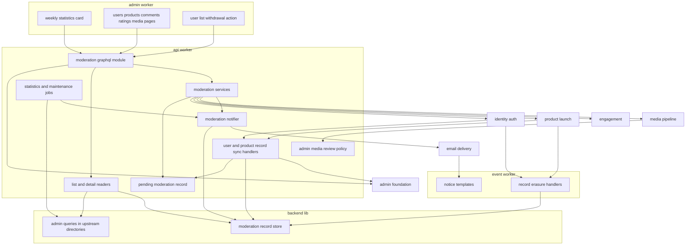
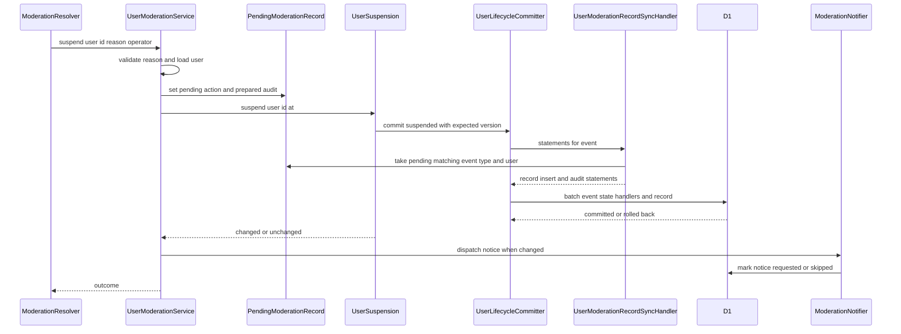
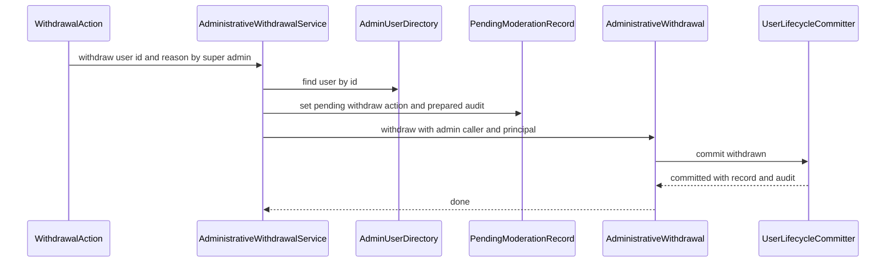
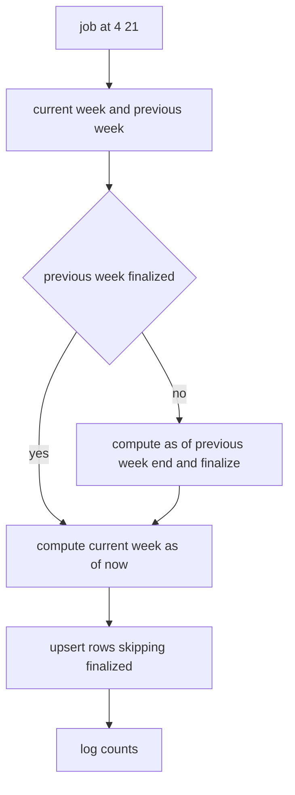
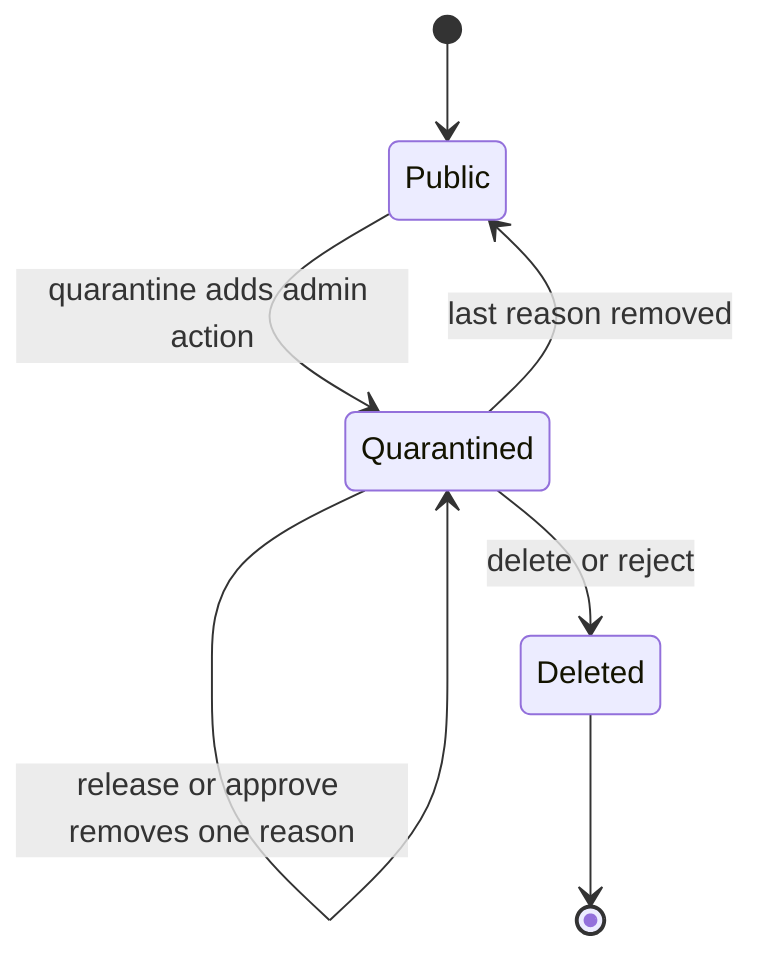

# Design Document

## Overview

**Purpose**: 管理者側のユーザー生成コンテンツ(UGC)管理を、APIサーバー(`apps/api`)・イベントサーバー(`apps/event`)・管理者側フロントエンドサーバー(`apps/admin`)にまたがって実装する。ダッシュボードの週ごとの統計のカード、ユーザー・プロダクト・コメント・評価・画像モデレーションの各管理画面、最上位管理者がユーザー一覧から行う運営者による代理の退会を提供する。停止・停止解除・代理の退会はidentity-authの操作口、非公開化・復元はproduct-launchの操作口で上流のライフサイクルイベントとして発火し、波及処理(マッチ・画像・索引・広告・トーナメント・Ultras)は各specの登録済みの処理に任せる。本specは「誰が・何に・なぜ」措置したかを、監査ログと措置の記録として状態の変更と同じ一括の書き込みで確定し、投稿者へ通知メールを送る。

**Users**: モデレーター以上の管理者は`/users`・`/products`・`/comments`・`/ratings`・`/media-moderation`で検索と措置を行い、最上位管理者は`/users`の項目から代理の退会を行う。閲覧のみの管理者は各ページを参照する。全ロールの管理者はダッシュボード(`/`)で統計を見る。措置を受けた投稿者はメールで知らせを受け取る。後続spec(content-reporting)の開発者は、措置のユースケースとプロダクト詳細の区画の登録口を使う。

**Impact**: D1に2テーブル(措置の記録・週ごとの統計)を足す。`apps/common-lib/moderation`・`apps/backend-lib/core/moderation`・`workers/moderation`(apiとeventの両方に束縛)を新設する。apiにスキーマモジュール`moderation`・措置と照会のユースケース・同期の処理2つ・ジョブ2つ・隔離画像の閲覧の判定を、eventに物理削除の処理2つと3つのメールのテンプレートを、adminに5ページ・ダッシュボードのカード・ユーザー一覧の代理の退会の操作・プロダクト詳細の区画の登録口を足す。管理画面の一覧と統計に要る読み取りだけの照会は、所有する上流spec(identity-auth・product-launch・engagement・payments)が提供し、本specは使うだけである(「上流への影響」)。新しいシークレット・メッセージ種別・Cronの式は無い。新しいパッケージはグラフの描画のRecharts1つである(仮2、2026-10-24に開発者が承認して確定)。

### Goals

- FR-ADMUG-001〜014・019(投稿者への通知)・025〜028と、FR-ADMAG-001〜003のうち本specの操作が、要件と、2026-10-24に開発者が確定した仮1〜仮9の決定に一致する。
- 状態を変える措置の監査ログと措置の記録が、状態の変更と同じ一括の書き込みで確定し、競合や既に同じ状態のときに何も残らない。
- 波及処理を実装せず、上流のライフサイクルと操作口だけで連鎖させる。
- 本specが追加・変更したコードの単体テスト・Workers統合テスト・ブラウザテストがカバレッジ80%を満たす。

### Non-Goals

- 通報の管理・集約・申出者への通知・権利侵害の照会(content-reporting)。スポンサー広告の強制終了(sponsorship)。
- 波及処理の中身(match-engine・product-launch・media-pipeline・user-profile-social・directory-discovery・sponsorship・tournament-week・tournament-year・ultras-subscription・identity-auth)。
- 監査ログの保存と閲覧画面・管理者の認可の部品・管理画面のシェル(admin-foundation)。問い合わせの画面と問い合わせの詳細の操作(inquiry-chat)。代理の退会の依頼の受け付け・本人の意思の確かめ・完了の知らせ(運営者がシステムの外で行う)。
- 措置の取り消し・評価の無効化・画像の操作の投稿者への通知(FR-ADMUG-019の対象外)。
- 要件定義書の改訂(roadmapのOut。必要な改訂は[research.md](research.md)の「要件定義書の改訂が必要な箇所」に記録した)。(2026-10-25に要件定義書へ適用済み)

## Boundary Commitments

### This Spec Owns

- 本specのデータ: `moderation_actions`(措置の記録と通知の状態)・`moderation_weekly_statistics`(週ごとの統計のスナップショット)(`apps/db/schema/moderation/`)。
- 措置の規則(`apps/common-lib/moderation/`): 措置の種類・理由の要否と上限・通知の要否・表示名(状態・隔離理由・用途・使い捨て判定)。監査ログの操作種別`apps/common-lib/admin/audit-actions/ugc-moderation.ts`(13種)。
- 統計の週の規則(`apps/backend-lib/core/moderation/`)と、3つのメール種別`ugc-moderation.user-suspended`・`ugc-moderation.product-hidden`・`ugc-moderation.comment-hidden`(`core/email/kinds/ugc-moderation.ts`)。
- 共有部品(`apps/backend-lib/workers/moderation/`): `ModerationRecordStore`と`MODERATION_PLATFORM_MODULE`。
- apiのスキーマモジュール`moderation`、措置のユースケース6つ(`UserModerationService`・`AdministrativeWithdrawalService`・`ProductModerationService`・`CommentModerationService`・`RatingModerationService`・`ImageModerationService`)、照会6つ、要求単位の保留中の措置`PendingModerationRecord`と同期の処理`ugc-moderation.user-moderation-record`・`ugc-moderation.product-moderation-record`、通知`ModerationNotifier`、隔離画像の閲覧の判定`AdminRoleMediaReviewPolicy`、ジョブ`ugc-moderation.weekly-statistics`(4:21、1900)・`ugc-moderation.maintenance`(4:21、1910)。
- eventの処理`ugc-moderation.account-record-erasure`(ユーザーの`purge_due`、1900)・`ugc-moderation.product-record-erasure`(プロダクトの`purge_due`、1900)と3つのテンプレート。
- adminの`/users`・`/products`・`/products/$productId`・`/comments`・`/ratings`・`/media-moderation`、ダッシュボードのカード`ugc-moderation.weekly-statistics`(10)、ユーザー一覧の代理の退会の操作(最上位管理者だけ)、プロダクト詳細の区画の登録口`ADMIN_PRODUCT_DETAIL_SECTIONS`(初版は空)。
- 技術ドキュメント`backend/021-cross-aggregate-admin-action-records.md`・`db/008-weekly-aggregate-snapshots.md`・`frontend/020-admin-search-and-moderation-actions.md`の新規作成と、サービス仕様(ページ配置・文言規則・準拠方針・日次タイムライン)の追記と`features/006-content-moderation.md`の新規作成、オンボーディングの追記。

### Out of Boundary

- `users`の状態の遷移・退会の確定・物理削除(identity-auth)。本specは`UserSuspension`・`AdministrativeWithdrawal`を呼び、`users`へ書き込まない。
- `products`・`product_launches`の状態の遷移・未開始のローンチの取り消し・ロゴとスクリーンショットの隔離(product-launch)。本specは`ProductVisibilityControl`を呼ぶ。
- `launch_comments`・`product_ratings`の状態の変更(engagement)。本specは`CommentModerationControl`・`RatingModerationControl`を呼ぶ。
- 隔離理由のデータ・バケット間の移動・削除の実行・FR-ADMUG-028の不変条件(media-pipeline)。本specは`MediaQuarantine`・`MediaFiles`を呼び、`AdminMediaReviewPolicy`の束縛を差し替える。
- 停止・停止解除に伴う画像の隔離理由の付け外し(user-profile-social)、マッチの即時の終了・Upvoteの論理削除(match-engine)、索引(directory-discovery)、広告の表示の条件と表示停止の日割り返金(sponsorship)、トーナメントの分類と自動返金(tournament-week・tournament-year)、Ultrasの解約(ultras-subscription)。
- 監査ログのテーブル・記録の部品・閲覧画面、`user.email-search`の定義(admin-foundation)。問い合わせのデータと画面(inquiry-chat)。決済履歴のデータ(payments)。
- 通報からの措置の画面・申出者への通知(content-reporting)。本specは措置のユースケースとプロダクト詳細の区画の登録口を提供するだけである。
- 管理画面の利用者・プロダクト・コメント・評価の一覧と時点の総数・期間ごとの純収益の照会の実装と束縛(`AdminUserDirectory`はidentity-authの仮7、`AdminProductDirectory`はproduct-launchの仮13、`AdminCommentDirectory`・`AdminRatingDirectory`はengagementの仮6、`PaymentRevenueReport`はpaymentsの仮7。いずれも2026-10-24に開発者が上流の所有・実装と確定)。本specは契約どおりに使うだけで、それらのファイルを作らない。

### Allowed Dependencies

- backend-platform: `AppModule`・`PLATFORM_TYPES`(`Database`・`Clock`・`IdGenerator`)・`AppError`・`getAppLogger`・`captureMessage`の規約・`ulidPrimaryKey`・`timestamps`・`BusinessTime`(`toBusinessDateTime`・`fromBusinessDateTime`・`parseBusinessDate`・`BusinessDate`)・`ScheduledJobDefinition`・`ScheduledJobHandler`、E2Eの`e2e/support/scheduled-trigger.ts`(`triggerScheduled`、backend-platformの改訂2)。形を変えない。
- api-gateway: `defineSchemaModule`・`GraphQLContext`(`resolve`・`session`・`caller`・`loaders`)・`withValidatedArgs`・`CURSOR_PAGE_ARGS`・`encodeCursor`・`decodeCursor`・`toConnection`・`PageInfo`・`DateTime`、`SessionView`。
- admin-foundation: `requireAdmin`・`CurrentAdmin`・`AdminRole`・`hasRole`・`AuditLogRecorder`(`prepare`・`record`)・`PreparedAuditEntry`・`buildAuditLogStatements`・`defineAuditAction`・`AUDIT_ACTIONS`・`AUDIT_REASON_MAX`・`checkAuditReason`・`AdminDirectory`・`ADMIN_PLATFORM_TYPES`、adminの`ADMIN_NAV_ITEMS`・`DASHBOARD_CARDS`・`DashboardCard`・`DashboardCardFrame`・`RoleGate`・`useAdminRole`、frontend-libの`AdminPageHeader`・`AdminDataTable`・`AdminFilterBar`・`ConfirmActionDialog`・`ReasonField`・`AdminAvatar`、E2Eの`e2e/support/admin-bootstrap.ts`(`signInAsNewAdmin`)・`e2e/support/local-d1.ts`(`executeLocalD1`・`sqlStringLiteral`)。
- identity-auth: `IDENTITY_TYPES.UserSuspension`・`IDENTITY_TYPES.AdministrativeWithdrawal`・`SuspensionResult`・`UserLifecycleEvent`・`UserLifecycleSyncHandler`・`UserLifecycleSyncRegistration`・`USER_LIFECYCLE_SYNC_HANDLERS`・`UserLifecycleAsyncHandler`・`UserLifecycleAsyncRegistration`・`USER_LIFECYCLE_ASYNC_HANDLERS`・`LifecycleHandlerOutcome`・`assertLifecycleHandlerName`・`IDENTITY_PLATFORM_TYPES.UserContactDirectory`・`DisposableEmailStatus`・`IDENTITY_PLATFORM_TYPES.AdminUserDirectory`(`AdminUserDirectory`・`AdminUserRecord`・`AdminUserSearchFilter`・`AdminUserStatus`、identity-authの仮7が実装・束縛)、E2Eの`e2e/support/mailpit.ts`。
- product-launch: `PRODUCT_TYPES`の`ProductVisibilityControl`・`VisibilityChangeResult`・`ProductLifecycleEvent`・`ProductLifecycleSyncHandler`・`ProductLifecycleSyncRegistration`・`PRODUCT_LIFECYCLE_SYNC_HANDLERS`・`ProductLifecycleAsyncHandler`・`PRODUCT_LIFECYCLE_ASYNC_HANDLERS`、`PRODUCT_PLATFORM_TYPES`の`ProductDirectory`(`findSummaries`・`findDetail`・`listLaunches`・`resolveHandle`)・`ProductCategoryDirectory`・`LaunchStatus`・`deriveLaunchStatus`、`PRODUCT_PLATFORM_TYPES.AdminProductDirectory`(`AdminProductDirectory`・`AdminProductRecord`・`AdminProductSearchFilter`・`AdminProductLaunchState`・`AdminProductVisibility`、product-launchの仮13が実装・束縛)。
- engagement: `ENGAGEMENT_TYPES`の`CommentModerationControl`・`RatingModerationControl`・`ModerationChangeResult`、`ENGAGEMENT_PLATFORM_TYPES`の`CommentStore.findByIds`・`RatingStore.summaries`、`ENGAGEMENT_PLATFORM_TYPES`の`AdminCommentDirectory`・`AdminRatingDirectory`(`AdminCommentRecord`・`AdminCommentSearchFilter`・`AdminCommentState`・`AdminRatingRecord`・`AdminRatingState`、engagementの仮6が実装・束縛)。
- media-pipeline: `MEDIA_TYPES`の`MediaFiles`(`findMany`・`eraseNow`)・`MediaQuarantine`(`addReason`・`removeReason`・`listByReason`)・`MediaFileView`・`QuarantineReason`・`QuarantinedImage`・`ModerationFinding`、apiの`AdminMediaReviewPolicy`・`FILE_ACCESS_TYPES`と束縛の置き場所`composition/media-review-policy.ts`、frontend-libの`downloadPathOf`・`MediaPlaceholder`、adminの中継の経路`FILE_DOWNLOAD_RELAY_ROUTE`(media-pipelineが登録済み)。
- user-profile-social: `PROFILE_PLATFORM_TYPES.UserProfileDirectory`(`findSummaries`・`resolveHandle`)。
- match-engine: `MATCH_PLATFORM_TYPES.MatchDirectory`(`summarizeDaily`・`listByLaunches`)・`MatchKind`・`MatchStage`・`EntryResult`。
- payments: `MinorUnitAmount`、GraphQLの`Money`、`PAYMENTS_TYPES.PaymentRevenueReport`(`PaymentRevenueReport`・`RevenuePeriod`、統計の群、paymentsの仮7が実装・束縛)。
- content-processing: `countGraphemes`、adminの`MarkdownContent`。
- email-delivery: `defineEmailKind`・`EMAIL_KINDS`・`EmailSender`・`EMAIL_TYPES`・`defineEmailTemplate`・`EMAIL_TEMPLATES`・`formatUtcDateTime`。
- frontend-platform: `executeGraphQL`・`graphqlQueryOptions`・`GraphQLClientError`・`notify`・`DateTime`・`NumberText`・`EmptyState`・`ErrorState`・`PartialErrorState`・`LoadingSkeleton`・`NotFoundView`・shadcn/uiの部品(ボタン・バッジ・ダイアログ・タブ・セレクト・テーブル)・`runAxe`、paymentsの`MoneyText`。
- npmパッケージ: 新規は`recharts`(3.10.1、または実装時点で公開から2週間以上たつ3系の最新の安定版、管理者側だけ、版を完全に固定する。仮2、2026-10-24に確定)だけ。peerの`react-is`が無ければ管理者側のReactと同じメジャーの版を完全に固定して加える。
- 後続spec(content-reporting)は、apiの`MODERATION_TYPES`の措置のユースケース(`ProductModerationService`・`CommentModerationService`・`UserModerationService`)とその`statements`の引数、adminの`ADMIN_PRODUCT_DETAIL_SECTIONS`だけに依存し、本specのテーブルへ直接書き込まない。

### Revalidation Triggers

- `moderation_actions`の列・措置の種類の値・通知の状態の値(content-reporting)。
- 措置のユースケースの入力(`statements`を含む)と結果`ModerationOutcome`の形、`ADMIN_PRODUCT_DETAIL_SECTIONS`の`AdminProductDetailContext`(content-reporting)。
- 監査ログの操作種別13種の名前・対象の種類・理由の要否・詳細の鍵(admin-foundation・content-reporting)。
- ジョブ・処理の名前と`order`(4:21の1900・1910、`purge_due`の1900)(日次タイムラインの表)。
- 上流が提供する管理画面の照会(措置の群): `AdminUserDirectory`(identity-authの仮7)・`AdminProductDirectory`(product-launchの仮13)・`AdminCommentDirectory`・`AdminRatingDirectory`(engagementの仮6)の形と、検索の照合(仮3)・絞り込みの値(仮6)・コメントの状態の意味。所有するspecが変えたら、本specの照会(`AdminUserReader`・`AdminProductReader`・`AdminCommentReader`・`AdminRatingReader`)と措置のユースケース(`UserModerationService`・`AdministrativeWithdrawalService`・`RatingModerationService`)を確かめ直す。
- 週ごとの統計の継ぎ目(統計の群。措置の群とは別に確かめ直す): `moderation_weekly_statistics`の列と確定の規則、統計の値の定義(仮1)とグラフ(仮2)、上流が提供する`PaymentRevenueReport`(paymentsの仮7)の形と純収益の解釈(`payment_records`の`kind`・`status`・`purpose`・金額の符号)、上流が提供する`AdminUserDirectory.countRegisteredAt`・`AdminProductDirectory.countRegisteredAt`(identity-authの仮7・product-launchの仮13)の時点の総数の定義、`MatchDirectory.summarizeDaily`の形、`DASHBOARD_CARDS`。変われば統計のタスク群(タスク7)の部品(`StatisticsWeek`・`WeeklyStatisticsStore`・`WeeklyStatisticsJob`・`WeeklyStatisticsReader`・統計のカード・表・グラフ)だけを確かめ直し、措置の部品には及ばない。
- 仮1〜仮9は2026-10-24に開発者が確定した。今後の改訂で決定(統計の定義・グラフ・検索の照合・代理の退会の権限と起点と知らせ・絞り込みの値・画像の記録・通知の文面と返金の扱い・理由の要否)が変われば、該当する規則を確かめ直す。sponsorshipの仮3(広告の日割り返金)や要件14.9(返金しない条件)の文言が変われば、通知のテンプレートの広告の段落を確かめ直す。
- 上流の`UserSuspension`・`AdministrativeWithdrawal`・`ProductVisibilityControl`・`CommentModerationControl`・`RatingModerationControl`・`MediaQuarantine`・`MediaFiles`・`AdminMediaReviewPolicy`の形、ライフサイクルの同期の処理を状態の変更と同じ一括の書き込みに入れて処理単位のコンテナから解決する規則、`requireAdmin`・`AuditLogRecorder`・`buildAuditLogStatements`、`ADMIN_NAV_ITEMS`、`UserContactDirectory`・`UserProfileDirectory`・`ProductDirectory`・`MatchDirectory.listByLaunches`の形を変えたら、本specを確かめ直す。

### 上流への影響

| 上流spec          | 変更                                                                                                                                                                                                                                                                                                                                                                                                                                                                                 | 影響と再検証                                                                                                                                                                                        |
| ----------------- | ------------------------------------------------------------------------------------------------------------------------------------------------------------------------------------------------------------------------------------------------------------------------------------------------------------------------------------------------------------------------------------------------------------------------------------------------------------------------------------ | --------------------------------------------------------------------------------------------------------------------------------------------------------------------------------------------------- |
| identity-auth     | (1)`AdminUserDirectory`(`D1AdminUserDirectory`・`IDENTITY_PLATFORM_TYPES.AdminUserDirectory`、`IDENTITY_PLATFORM_MODULE`の束縛)はidentity-authの仮7が所有・実装・束縛する。本specは使うだけで、identity-authのディレクトリへファイルを加えない。(2)apiの`composition/user-lifecycle-sync-handlers.ts`に`ugc-moderation.user-moderation-record`、eventの`composition/user-lifecycle-async-handlers.ts`に`ugc-moderation.account-record-erasure`(`purge_due`、1900)                    | (1)identity-authの仮7(identity-authのタスク3.7)の完了が、本specの利用者の照会・停止・代理の退会(措置の群)と統計の集計(統計の群)のタスクの前提。(2)は契約どおり                                      |
| product-launch    | (1)`AdminProductDirectory`(`D1AdminProductDirectory`・`PRODUCT_PLATFORM_TYPES.AdminProductDirectory`、`PRODUCT_PLATFORM_MODULE`の束縛)はproduct-launchの仮13が所有・実装・束縛する。本specは使うだけで、product-launchのディレクトリへファイルを加えない。(2)apiの`composition/product-lifecycle-sync-handlers.ts`に`ugc-moderation.product-moderation-record`、eventの`composition/product-lifecycle-async-handlers.ts`に`ugc-moderation.product-record-erasure`(`purge_due`、1900) | (1)product-launchの仮13(product-launchのタスク2.6)の完了が、本specのプロダクトの一覧の照会(措置の群)と統計の集計(統計の群)のタスクの前提。(2)は契約どおり                                           |
| engagement        | `AdminCommentDirectory`・`AdminRatingDirectory`(`workers/engagement/admin-comment-directory.ts`・`admin-rating-directory.ts`、`ENGAGEMENT_PLATFORM_TYPES`・`ENGAGEMENT_PLATFORM_MODULE`の束縛)はengagementの仮6が所有・実装・束縛する(2026-10-24に開発者が確定)。本specは使うだけで、engagementのディレクトリへファイルを加えない                                                                                                                                                    | engagementの仮6(engagementのタスク2.7、識別子はタスク2.1)の完了が、本specのコメントと評価の照会・評価の措置のタスクの前提。形(シグネチャ)は本書の写しと同じ                                         |
| payments          | `PaymentRevenueReport`・`RevenuePeriod`(`core/payments/ports.ts`、`PAYMENTS_TYPES.PaymentRevenueReport`、`workers/payments/d1-payment-revenue-report.ts`、`PAYMENTS_PLATFORM_MODULE`の束縛)はpaymentsの仮7が所有・実装・束縛する(2026-10-24に開発者が確定)。本specは使うだけで、paymentsのディレクトリへファイルを加えない。返金は依頼しない(仮8)                                                                                                                                    | paymentsの仮7(paymentsのタスク5.5・5.7)の完了が、本specの統計の集計のタスクの前提。形(シグネチャ)と純収益の解釈は本書の写しと同じ                                                                   |
| inquiry-chat      | 変更しない。代理の退会の起点はユーザー一覧だけになり(仮4)、問い合わせの詳細の操作の登録口と問い合わせの依頼者の照会(inquiry-chatの仮7)を使わない                                                                                                                                                                                                                                                                                                                                     | inquiry-chatの仮7は取り下げられた。inquiry-chatの設計は代理の退会をユーザー一覧から行う記述に直っている(反映済み)。問い合わせの詳細の操作の登録口に本specの予定は残っていない(2026-10-24に確かめた) |
| media-pipeline    | apiの`composition/media-review-policy.ts`の`FILE_ACCESS_TYPES.AdminMediaReviewPolicy`の束縛を、既定の全拒否から本specの`AdminRoleMediaReviewPolicy`へ差し替える                                                                                                                                                                                                                                                                                                                      | media-pipelineの契約どおり(「ugc-moderationが`AdminMediaReviewPolicy`を差し替える」)。既定の全拒否の単体テストの期待値は本specのタスクが直す                                                        |
| admin-foundation  | `apps/common-lib/admin/audit-actions/ugc-moderation.ts`と`index.ts`の連結、adminの`composition/admin-navigation.ts`に5件(20・30・40・50・60)、`composition/dashboard-cards.ts`に1件(10)。代理の退会は最上位管理者だけ(仮4)で、Q3の「モデレーターは要件が最上位管理者に限っていない更新操作を行える」の例外としてページ配置のロールの一覧に載せる(本specのタスクが書く)                                                                                                               | 契約どおり(仮6のURLと`order`、Q2のカード)                                                                                                                                                           |
| backend-platform  | apiの`composition/scheduled-jobs.ts`に2件(4:21の式は上流で追加済み)、api・eventの`composition/modules.ts`に`MODERATION_PLATFORM_MODULE`、apiに`MODERATION_MODULE`、eventに`EVENT_MODERATION_MODULE`                                                                                                                                                                                                                                                                                  | 契約どおり                                                                                                                                                                                          |
| api-gateway       | apiの`composition/graphql-modules.ts`に`moderationSchemaModule`、adminの許可リストの再生成                                                                                                                                                                                                                                                                                                                                                                                           | 契約どおり                                                                                                                                                                                          |
| email-delivery    | `core/email/kinds/index.ts`に3種別、eventの`infrastructure/email/templates/index.ts`に3テンプレート                                                                                                                                                                                                                                                                                                                                                                                  | 契約どおり                                                                                                                                                                                          |
| frontend-platform | `apps/admin/package.json`に`recharts`(仮2、2026-10-24に確定。版を完全に固定する)                                                                                                                                                                                                                                                                                                                                                                                                     | SSRでは描画しない部品として追加し、`ADMIN_SECURITY_POLICY`は変えない                                                                                                                                |

- roadmapの帯の割り当ての表の本specの「使用中の値」は「4:21は1900・1910、波及処理は1900」になる(ユーザー・プロダクトの`purge_due`の1900)。本specはroadmapを編集しないため、コントローラーへ報告する。

## Architecture

### Existing Architecture Analysis

- 上流の25specは設計・タスクとも承認済みで、本specのタスクはそれらの実装の完了を前提にする。実装済みはdev-toolingだけである。
- apiはクリーンアーキテクチャ(`domain`→`application`→`infrastructure`・`presentation`→`composition`)と処理単位(HTTPの要求ごと)のDIコンテナ、D1の`db.batch()`による1トランザクションの書き込み、`CASE`式のNOT NULL制約の違反による取り消しを使う。
- identity-authの`UserLifecycleCommitter`とproduct-launchの`ProductLifecycleCommitter`は、イベントの挿入(版・状態の条件付き)→状態の更新→自分の文→登録された同期の処理の文を1つの`db.batch()`で確定し、同期の処理は処理単位のコンテナから解決される。条件を満たさなければ全体が取り消される。
- engagementの`CommentModerationControl`・`RatingModerationControl`は呼び出し側の`statements`を状態の変更と同じ一括の書き込みに入れる。media-pipelineの`MediaQuarantine`は理由を確定してから移動を依頼し、呼び出し側の文は受け取らない。

### Architecture Pattern & Boundary Map



**Architecture Integration**:

- Selected pattern: クリーンアーキテクチャ。措置の規則は`common-lib`・`core`の純粋な関数、措置の記録は`workers/moderation`のストア(apiとeventの両方に束縛)、措置・照会・通知・統計はapiのアプリケーション層、文の組み立て(監査ログの文を含む)はapiのインフラ層、上流のデータは上流の操作口と照会越しに使う。
- Domain/feature boundaries: 本specのテーブルは措置の記録と統計だけで、利用者・プロダクト・コメント・評価・画像の状態は上流が持つ。上流の状態の変更と本specの記録は、上流の確定の一括の書き込みに本specの文を載せて一体にする(同期の処理または`statements`)。
- Existing patterns preserved: `backend-lib/workers/<ドメイン>`の共有の束縛、`<spec名>.<名詞句>`の名前、帯の`order`、登録箇所への追記、`buildAuditLogStatements`を操作と同じ一括の書き込みに含める規約(admin-foundationの`backend/008`)、管理画面の`DashboardCardFrame`・`ConfirmActionDialog`・`AdminDataTable`、依頼待ちの記録と日次の送り直し(payments・sponsorship)。
- New components rationale: `PendingModerationRecord`は、文を受け取らない上流の操作口(`UserSuspension`・`AdministrativeWithdrawal`・`ProductVisibilityControl`)でも、上流の確定と同じ一括の書き込みで記録を確定するため(research.mdの「記録の一体の確定」)。上流の照会の追加は、管理画面の一覧と統計が、各specが直接の読み取りを禁じた表を読む必要があるため(利用者・プロダクト・コメント・評価・収益の照会はすべて所有するspecが作る)。
- 週ごとの統計は、措置とは独立した継ぎ目(テーブル・週の規則・収益の照会・ジョブ・照会・カード)として扱い、タスク群とRevalidation Triggersを措置の群と分ける。措置の部品は統計の部品を読み込まず、統計の部品は措置の部品を読み込まない(共有するのは、apiの`MODERATION_TYPES`・`MODERATION_MODULE`・スキーマモジュール`moderation`の置き場所、adminのGraphQLの許可リスト、`common-lib/moderation`の統計の表示の週数`STATISTICS_WEEKS_SHOWN`だけである)。
- Steering compliance: `@inject`の明示、D1の制約(`db.batch()`・バインド変数100個以内・`transaction()`を使わない)、800行以内のファイル、1ファイル1コンポーネント、日時の`<time datetime>`、ログに個人情報を含めない。

**Dependency direction**: `apps/common-lib/moderation` → `apps/db/schema/moderation` → `backend-lib/core/moderation` → `backend-lib/workers/moderation` → 各アプリの`src`(`application` → `infrastructure`・`presentation` → `composition`)。`core/moderation`は`BusinessTime`と`common-lib/moderation`だけを読み込む。`workers/moderation`は本specのテーブルだけを読み書きし、上流のテーブル定義を読み込まない。上流の照会は上流specが持ち、本specはそのDIの識別子と型だけを使う。apiの`application/moderation`は`infrastructure/admin`(`buildAuditLogStatements`)を読み込まず、ポート`ModerationStatements`越しに使う。adminはGraphQLの操作と上流の部品だけを読み込む。違反はレビューで誤りとして扱う。

### Technology Stack

| Layer     | Choice / Version                                                                         | Role in Feature                                                   | Notes                                                     |
| --------- | ---------------------------------------------------------------------------------------- | ----------------------------------------------------------------- | --------------------------------------------------------- |
| Frontend  | TanStack Start・Router・Query・shadcn/ui(上流)、Recharts 3.10.1(または3系の最新の安定版) | 5ページ・カード・代理の退会の操作、統計のグラフ                   | Rechartsは新規(仮2、確定)。SSRでは描画しない              |
| Backend   | Hono・Inversify・GraphQL Yoga(上流)                                                      | スキーマモジュール・ユースケース・同期の処理・ジョブ・eventの処理 | 既存                                                      |
| Data      | Cloudflare D1(Drizzle)                                                                   | 2テーブル、上流の照会                                             | 新規のマイグレーション2つ(措置の記録と週ごとの統計)       |
| Messaging | Cron Triggers・Queues(上流)                                                              | 4:21のジョブ、ライフサイクルの`purge_due`、メールの送信の依頼     | 新しいメッセージ種別・Cronの式なし                        |
| Storage   | Cloudflare R2(media-pipeline越し)                                                        | 隔離画像の同一オリジンの表示                                      | media-pipelineの`/_bff/files/*`と`AdminMediaReviewPolicy` |

## File Structure Plan

### Directory Structure

```
apps/
├── common-lib/moderation/                                   # 4アプリ共通(各ファイルに同名の*.unit.test.ts)
│   ├── moderation-actions.ts                                # 措置の種類・対象の種類・理由の要否・通知の要否・イベントの種類との対応
│   └── moderation-labels.ts                                 # 措置・状態・隔離理由・用途・使い捨て判定・ローンチ状態の表示名
├── common-lib/admin/audit-actions/ugc-moderation.ts         # 監査ログの操作種別13種
├── db/schema/moderation/                                    # テーブル定義(同名の*.unit.test.ts)
│   ├── moderation-actions.ts
│   ├── moderation-weekly-statistics.ts
│   └── index.ts
├── backend-lib/
│   ├── core/moderation/
│   │   └── statistics-week.ts                               # 週の開始・範囲・確定の判定・表示の対象の週(*.unit.test.ts)
│   ├── core/email/kinds/ugc-moderation.ts                   # 3つのメール種別(入力のzodスキーマ)
│   └── workers/moderation/                                  # api・event共通(Workers統合テスト)
│       ├── moderation-platform-types.ts                     # MODERATION_PLATFORM_TYPES(テストなし)
│       ├── moderation-record-store.ts                       # ModerationRecordStore(型とD1の実装)
│       └── moderation-platform-module.ts                    # MODERATION_PLATFORM_MODULE
├── api/src/
│   ├── application/moderation/                              # ユースケース(Bunの単体テスト)
│   │   ├── moderation-types.ts                              # MODERATION_TYPES(テストなし)
│   │   ├── ports.ts                                         # ModerationStatements・WeeklyStatisticsStore・ModerationCommand・ModerationOutcome
│   │   ├── pending-moderation-record.ts                     # 要求単位の保留中の措置
│   │   ├── moderation-reason.ts                             # 理由の正規化と検証(要否・500書記素)
│   │   ├── user-moderation-service.ts                       # 停止・停止解除
│   │   ├── administrative-withdrawal-service.ts             # 代理の退会(対象の確かめ)
│   │   ├── product-moderation-service.ts                    # 非公開化・復元
│   │   ├── comment-moderation-service.ts                    # コメントの非公開化・復元
│   │   ├── rating-moderation-service.ts                     # 評価の無効化・取り消し
│   │   ├── image-moderation-service.ts                      # 公開承認・個別の隔離・隔離の解除・削除
│   │   ├── moderation-notifier.ts                           # 通知の組み立て・送信の依頼・状態の更新
│   │   ├── admin-user-reader.ts                             # 一覧・メールアドレス検索の監査ログ
│   │   ├── admin-product-reader.ts                          # 一覧・詳細
│   │   ├── admin-comment-reader.ts
│   │   ├── admin-rating-reader.ts
│   │   ├── quarantined-image-reader.ts
│   │   ├── weekly-statistics-reader.ts
│   │   ├── admin-role-media-review-policy.ts                # AdminMediaReviewPolicyの実装
│   │   └── jobs/
│   │       ├── weekly-statistics-job.ts                     # 4:21(order 1900)
│   │       └── moderation-maintenance-job.ts                # 4:21(order 1910)
│   ├── infrastructure/moderation/                           # Workers統合テスト
│   │   ├── d1-moderation-statements.ts                      # 記録と監査ログの文・単独の一括の書き込み
│   │   ├── user-moderation-record-sync-handler.ts           # ugc-moderation.user-moderation-record
│   │   ├── product-moderation-record-sync-handler.ts        # ugc-moderation.product-moderation-record
│   │   └── d1-weekly-statistics-store.ts                    # 週の行のupsert・読み取り
│   ├── presentation/graphql/modules/moderation/             # スキーマモジュール(Workers統合テスト)
│   │   ├── type-defs.ts
│   │   ├── inputs.ts                                        # 引数の検証(withValidatedArgs)
│   │   ├── errors.ts                                        # エラーコードと文言
│   │   ├── statistics-resolvers.ts
│   │   ├── user-resolvers.ts                                # 一覧・停止・停止解除・代理の退会
│   │   ├── product-resolvers.ts
│   │   ├── engagement-resolvers.ts                          # コメントと評価
│   │   ├── image-resolvers.ts
│   │   └── index.ts                                         # moderationSchemaModule
│   └── composition/moderation-module.ts                     # MODERATION_MODULE(apiの束縛・同期の処理・ジョブ)
├── event/src/
│   ├── application/moderation/                              # Bunの単体テスト
│   │   ├── event-moderation-types.ts
│   │   ├── account-record-erasure-handler.ts                # ユーザーのpurge_due 1900
│   │   └── product-record-erasure-handler.ts                # プロダクトのpurge_due 1900
│   ├── infrastructure/email/templates/ugc-moderation/       # 本文の*-body.tsxと定義の*-template.ts(3種)
│   └── composition/moderation-module.ts                     # EVENT_MODERATION_MODULE
└── admin/src/
    ├── routes/_authenticated/
    │   ├── users.tsx · comments.tsx · ratings.tsx · media-moderation.tsx
    │   └── products/index.tsx · products/$productId.tsx
    ├── composition/admin-product-detail-sections.ts         # ADMIN_PRODUCT_DETAIL_SECTIONS(初版は空、後続specが追記)
    ├── components/moderation/                               # 1ファイル1コンポーネント(browser testを併置)
    │   ├── shared/
    │   │   ├── moderation-search.ts                         # 検索パラメータのスキーマと変換(*.unit.test.ts)
    │   │   ├── use-moderation-mutation.ts                   # 措置の実行・通知・照会の無効化
    │   │   ├── moderation-action-dialog.tsx                 # ConfirmActionDialogに影響の一覧を添える
    │   │   ├── admin-media-image.tsx                        # 同一オリジンの画像と代わりの表示
    │   │   └── moderation-note.tsx                          # 最新の措置の理由と日時
    │   ├── statistics/
    │   │   ├── statistics-series.ts                         # 週の値から系列と増減を作る(*.unit.test.ts)
    │   │   ├── weekly-statistics-card.tsx                   # DASHBOARD_CARDSの10
    │   │   ├── weekly-statistics-table.tsx                  # 数値の表
    │   │   ├── weekly-statistics-chart.tsx                  # グラフ(Recharts、SSRでは描画しない)
    │   │   └── chart/                                       # shadcn/uiのchartの部品(部分ごとのファイル、1ファイル1コンポーネント。共有ディレクトリに置かない)
    │   ├── users/ user-filters.tsx · user-table.tsx · user-status-cell.tsx · user-moderation-actions.tsx
    │   ├── products/ product-filters.tsx · product-table.tsx · product-detail-view.tsx · product-images-panel.tsx
    │   │   · product-ratings-panel.tsx · product-launches-panel.tsx · product-visibility-actions.tsx
    │   │   · admin-product-detail-sections-view.tsx · admin-product-detail-section-types.ts(型、テストなし)
    │   ├── comments/ comment-filters.tsx · comment-table.tsx · comment-moderation-actions.tsx
    │   ├── ratings/ rating-filters.tsx · rating-table.tsx · rating-moderation-actions.tsx
    │   ├── media/ quarantine-reason-tabs.tsx · quarantined-image-list.tsx · quarantined-image-card.tsx
    │   │   · image-moderation-actions.tsx · quarantine-image-button.tsx
    │   └── withdrawal/ administrative-withdrawal-action.tsx · administrative-withdrawal-dialog.tsx
    └── graphql/operations/moderation/
        ├── statistics.ts · users.ts · products.ts · comments.ts · ratings.ts · images.ts
        └── mutations.ts                                     # 13の措置の操作
e2e/
├── support/moderation-fixtures.ts                           # ローカルD1に措置の対象(コメント・評価・停止中の利用者など)を作る補助
└── admin/
    ├── user-moderation.e2e.test.ts · product-moderation.e2e.test.ts · engagement-moderation.e2e.test.ts
    ├── media-moderation.e2e.test.ts · administrative-withdrawal.e2e.test.ts · weekly-statistics.e2e.test.ts
docs/
├── GUIDES/tech/backend/021-cross-aggregate-admin-action-records.md
├── GUIDES/tech/db/008-weekly-aggregate-snapshots.md
├── GUIDES/tech/frontend/020-admin-search-and-moderation-actions.md
└── GUIDES/service/features/006-content-moderation.md
```

テストは各ファイルの隣に置く(`*.unit.test.ts`・`*.worker.test.ts`・`*.browser.test.tsx`)。`AdminUserDirectory`・`AdminProductDirectory`・`AdminCommentDirectory`・`AdminRatingDirectory`・`PaymentRevenueReport`のファイルとテストは各上流spec(identity-authの仮7・product-launchの仮13・engagementの仮6・paymentsの仮7)が作るため、本specの計画に含めない。技術ドキュメントの番号は、全ての完了済みspecのdesign.mdが使う番号(`backend`001〜020・`frontend`001〜019・`db`001〜007)の後の最小の空き番号`backend/021`・`frontend/020`・`db/008`に固定する。

### Modified Files

- `apps/db/schema/index.ts`・`apps/db/migrations/<日時>_ugc_moderation/migration.sql`・`apps/db/migrations/<日時>_ugc_moderation_statistics/migration.sql` — 本specのテーブルの再エクスポートと、措置の記録(`moderation_actions`)と週ごとの統計(`moderation_weekly_statistics`)の別々に生成したマイグレーション(CHECK・索引)。統計の群を措置の群と別に作れるよう分ける。それぞれmainの最新を取り込んでから生成する。
- `apps/common-lib/admin/audit-actions/index.ts` — 連結に`ugc-moderation`を加える。
- `apps/backend-lib/core/email/kinds/index.ts`・`apps/event/src/infrastructure/email/templates/index.ts` — 3種別と3テンプレート。
- `apps/api/src/composition/modules.ts`・`graphql-modules.ts`・`scheduled-jobs.ts`・`user-lifecycle-sync-handlers.ts`・`product-lifecycle-sync-handlers.ts`・`media-review-policy.ts` — モジュール・スキーマモジュール・2つのジョブ・2つの同期の処理・隔離画像の閲覧の判定の差し替え。
- `apps/event/src/composition/modules.ts`・`user-lifecycle-async-handlers.ts`・`product-lifecycle-async-handlers.ts` — モジュール・2つの物理削除の処理。
- `apps/admin/src/composition/admin-navigation.ts`・`dashboard-cards.ts` — メニュー5件・カード。
- `apps/admin/package.json`・`bun.lock` — `recharts`(版を完全に固定、`^`・`~`を付けない)。
- adminのGraphQLの許可リストと生成した型。
- `docs/GUIDES/tech/backend/README.md`・`db/README.md`・`frontend/README.md` — 文書一覧の行。
- `docs/onboardings/project-values.md` — ジョブ・処理・同期の処理・登録の名前と`order`、メール種別、監査ログの操作種別、統計の表示の週数。
- `docs/onboardings/tech-stack.md` — 変更しない(「グラフ描画」のRechartsの項は開発者の承認の際に追加済み)。`docs/GUIDES/tech/coding/002-dependency-versions.md`の主要パッケージの一覧は、アプリ間で版をそろえるパッケージだけを載せるため、管理者側だけが使うRechartsは載せない。
- `docs/GUIDES/service/design/002-page-layouts.md` — 管理者側のユーザー・プロダクト(一覧と詳細)・コメント・評価・画像モデレーションのページの構成、ダッシュボードの統計のカード、ユーザー一覧の代理の退会の操作(最上位管理者だけ)と、メニューごとの必要なロールの一覧の代理の退会の行。
- `docs/GUIDES/service/design/003-text-and-copy-rules.md` — 本specのエラー・確認・状態の文言、通知メールの本文の要点(広告の段落の文はsponsorshipが載せる項目を参照し、本specは書き直さない)。
- `docs/GUIDES/service/legal/001-compliance-policy.md` — データ保持期間の一覧に措置の記録(3年、または対象の利用者・プロダクトの物理削除まで)・週ごとの統計(無期限、個人を含まない集計値)、「モデレーションと透明性」に代理の退会(最上位管理者がユーザー一覧から行い、本人の意思の確かめと完了の知らせは運営者がシステムの外のメールで行う。仮4・仮5)。
- `docs/GUIDES/service/overview/007-daily-timeline.md` — 4:21の表に`ugc-moderation.weekly-statistics`(1900)・`ugc-moderation.maintenance`(1910)。
- `CLAUDE.md` — 「技術規則の参照先」に「他の集約の状態遷移と一緒に管理操作を記録する前に: `backend/021`」。

## System Flows

### 停止・非公開化の記録の一体の確定



- `UserSuspension`が`unchanged`を返したとき(既に同じ状態)はイベントも同期の処理も無く、保留中の措置を破棄して`changed: false`を返す(4.7)。版の競合は`account_state_conflict`で、記録も監査ログも残らない(4.11)。
- `changed`なのに保留中の措置が取り出されていなければ、束縛の誤りとして`captureMessage`(`moderation-record-missing`)で通知する。状態は変わっているため結果は成功として返す。
- プロダクトの非公開化・復元(`ProductVisibilityControl`→`ProductLifecycleCommitter`→`ProductModerationRecordSyncHandler`)と代理の退会(`AdministrativeWithdrawal`→`withdrawn`)も同じ流れである。コメントと評価は保留中の措置を使わず、`statements`で直接渡す。

### 代理の退会



- 代理の退会は最上位管理者だけが行う(リゾルバの`requireAdmin(context, 'super_admin')`、仮4)。起点はユーザー一覧の項目だけで、問い合わせの詳細からの導線は設けない。サーバーは対象を利用者のIDで読み直し、退会済み・不在なら`user_not_found`を返す。
- 依頼の受け付け・本人の意思の確かめ・退会の完了の知らせは、運営者がシステムの外のメールで行う。システムはメールを送らず、措置の記録の通知の状態は`none`である(仮5)。理由は必須で、監査ログと措置の記録に残る。

### 週ごとの統計の集計(4:21)



- 各週の値: 収益は`PaymentRevenueReport.netRevenue`、利用者数とプロダクト数は`countRegisteredAt(週の終わり、今週は実行時刻)`、予選実施数とUpvote数は`MatchDirectory.summarizeDaily({ from: 週の月曜日, to: 週の日曜日(今週は実行日) })`の合計(仮1)。
- 書き込みは`INSERT ... ON CONFLICT(week_start) DO UPDATE ... WHERE moderation_weekly_statistics.finalized = 0`で、確定した週を書き換えず、何度実行しても行は1つ(2.5・2.6)。ジョブが1週間以上止まると間の週は欠け、表に出ない(Risks)。

### 画像の操作



- 公開承認は自動判定の理由、隔離の解除は管理者操作の理由だけを外し、非公開化・ユーザー停止の理由は外さない(11.6・11.9・11.12)。公開に戻すかはmedia-pipelineの`desiredLocation`が全理由で決める(FR-ADMUG-028)。
- 削除は隔離画像(理由が1つ以上)だけを受け付け、`MediaFiles.eraseNow`を呼ぶ。公開中の画像は先に個別の隔離を経る。
- 記録は媒体の操作の後に、措置の記録と監査ログを1つの一括の書き込みで書く。記録の失敗はエラーを返し、再実行は媒体の操作が冪等(理由の追加・解除は変化が無ければ何もしない、削除済みのファイルは記録だけを書く)なため結果が重ならない。

## Requirements Traceability

| Requirement                                                                                           | Summary              | Components                                                                                                                                        | Interfaces                                                          | Flows                |
| ----------------------------------------------------------------------------------------------------- | -------------------- | ------------------------------------------------------------------------------------------------------------------------------------------------- | ------------------------------------------------------------------- | -------------------- |
| 1.1, 1.2, 1.3, 1.4, 1.5, 1.6, 1.7, 1.8, 1.9                                                           | 統計のカード         | WeeklyStatisticsCard、WeeklyStatisticsTable、WeeklyStatisticsChart、StatisticsSeries、WeeklyStatisticsReader                                      | `adminWeeklyStatistics`・`DASHBOARD_CARDS`                          | —                    |
| 2.1, 2.2, 2.3, 2.4, 2.5, 2.6, 2.7, 2.8                                                                | 統計の集計           | WeeklyStatisticsJob、StatisticsWeek、D1WeeklyStatisticsStore、AdminUserDirectory、AdminProductDirectory、PaymentRevenueReport                     | `countRegisteredAt`・`netRevenue`・`summarizeDaily`                 | 週ごとの統計の集計   |
| 3.1, 3.2, 3.3, 3.4, 3.5, 3.6, 3.7, 3.8, 3.9, 3.10                                                     | ユーザー一覧と検索   | AdminUserReader、AdminUserDirectory、UsersPage(UserFilters・UserTable・UserStatusCell)、ModerationSearch                                          | `adminUsers`・`user.email-search`                                   | —                    |
| 4.1, 4.2, 4.3, 4.4, 4.5, 4.6, 4.7, 4.8, 4.9, 4.10, 4.11, 4.12                                         | 停止と停止解除       | UserModerationService、PendingModerationRecord、UserModerationRecordSyncHandler、ModerationReason、UserModerationActions                          | `suspendUser`・`unsuspendUser`・`UserSuspension`                    | 停止・非公開化の記録 |
| 5.1, 5.2, 5.3, 5.4, 5.5, 5.6, 5.7, 5.8, 5.9, 5.10, 5.11, 5.12, 5.13                                   | 代理の退会           | AdministrativeWithdrawalAction、AdministrativeWithdrawalService、AdminUserDirectory、PendingModerationRecord、UserModerationRecordSyncHandler     | `withdrawUserByAdministrator`・`AdministrativeWithdrawal`           | 代理の退会           |
| 6.1, 6.2, 6.3, 6.4, 6.5, 6.6                                                                          | プロダクト一覧       | AdminProductReader、AdminProductDirectory、ProductsPage(ProductFilters・ProductTable)                                                             | `adminProducts`                                                     | —                    |
| 7.1, 7.2, 7.3, 7.4, 7.5, 7.6, 7.7, 7.8                                                                | プロダクト詳細       | AdminProductReader、ProductDetailView、ProductImagesPanel、ProductRatingsPanel、ProductLaunchesPanel、AdminProductDetailSections、AdminMediaImage | `adminProduct`・`ADMIN_PRODUCT_DETAIL_SECTIONS`                     | —                    |
| 8.1, 8.2, 8.3, 8.4, 8.5, 8.6, 8.7, 8.8, 8.9, 8.10, 8.11                                               | 非公開化と復元       | ProductModerationService、ProductModerationRecordSyncHandler、ProductVisibilityActions                                                            | `hideProduct`・`unhideProduct`・`ProductVisibilityControl`          | 停止・非公開化の記録 |
| 9.1, 9.2, 9.3, 9.4, 9.5, 9.6, 9.7, 9.8, 9.9, 9.10, 9.11                                               | コメントの管理       | AdminCommentReader、AdminCommentDirectory、CommentModerationService、CommentsPage                                                                 | `adminComments`・`hideComment`・`unhideComment`                     | —                    |
| 10.1, 10.2, 10.3, 10.4, 10.5, 10.6, 10.7, 10.8, 10.9                                                  | 評価の無効化         | AdminRatingReader、AdminRatingDirectory、RatingModerationService、RatingsPage、RatingModerationActions                                            | `adminRatings`・`invalidateRating`・`revalidateRating`              | —                    |
| 11.1, 11.2, 11.3, 11.4, 11.5, 11.6, 11.7, 11.8, 11.9, 11.10, 11.11, 11.12, 11.13, 11.14, 11.15, 11.16 | 画像のモデレーション | QuarantinedImageReader、ImageModerationService、AdminRoleMediaReviewPolicy、MediaModerationPage、QuarantineImageButton、AdminMediaImage           | `adminQuarantinedImages`・4つの画像の操作・`AdminMediaReviewPolicy` | 画像の操作           |
| 12.1, 12.2, 12.3, 12.4, 12.5, 12.6, 12.7, 12.8, 12.9, 12.10                                           | 措置の通知           | ModerationNotifier、ModerationEmailKinds、ModerationEmailTemplates、ModerationMaintenanceJob                                                      | 3つのメール種別・`EmailSender`                                      | 停止・非公開化の記録 |
| 13.1, 13.2, 13.3, 13.4, 13.5, 13.6, 13.7, 13.8                                                        | 監査ログと措置の記録 | ModerationAuditActions、D1ModerationStatements、ModerationRecordStore、RecordErasureHandlers、ModerationMaintenanceJob                            | `buildAuditLogStatements`・`moderation_actions`                     | 停止・非公開化の記録 |
| 14.1, 14.2, 14.3, 14.4, 14.5, 14.6, 14.7, 14.8                                                        | 権限と共通の振る舞い | ModerationNavigation、ModerationSchemaModule、ModerationActionDialog、UseModerationMutation                                                       | `requireAdmin`・`ADMIN_NAV_ITEMS`                                   | —                    |
| 15.1, 15.2, 15.3, 15.4, 15.5, 15.6, 15.7                                                              | 連携と運用           | 措置のユースケース、上流への照会、ModerationModule、ジョブ・処理の登録                                                                            | 各登録口・`ModerationCommand.statements`                            | —                    |
| 16.1, 16.2, 16.3, 16.4, 16.5, 16.6                                                                    | ドキュメントとテスト | 全コンポーネントのテスト、ModerationE2E、ModerationTechDocs、ModerationServiceSpecs                                                               | —                                                                   | —                    |

## Components and Interfaces

| Component                                                          | Domain/Layer          | Intent                                                 | Req Coverage                                                                                                              | Key Dependencies (P0/P1)                    | Contracts      |
| ------------------------------------------------------------------ | --------------------- | ------------------------------------------------------ | ------------------------------------------------------------------------------------------------------------------------- | ------------------------------------------- | -------------- |
| ModerationActions・ModerationLabels                                | common-lib            | 措置の種類・理由と通知の要否・表示名                   | 4.9, 8.9, 9.10, 10.9, 11.13, 12.9, 13.1                                                                                   | AUDIT_REASON_MAX (P0)                       | State          |
| ModerationAuditActions                                             | common-lib/admin      | 監査ログの操作種別13種                                 | 13.1, 13.2, 11.13                                                                                                         | defineAuditAction (P0)                      | State          |
| ModerationSchema                                                   | db                    | 措置の記録と週ごとの統計のテーブル                     | 2.5, 2.6, 13.5, 12.8                                                                                                      | Drizzle (P0)                                | State          |
| StatisticsWeek                                                     | backend-lib/core      | 週の開始・範囲・確定・表示の週                         | 1.2, 1.5, 2.1, 2.5                                                                                                        | BusinessTime (P0)                           | Service        |
| ModerationEmailKinds                                               | backend-lib/core      | 3つのメール種別                                        | 12.1, 12.2, 12.3, 12.4, 12.5, 12.6                                                                                        | defineEmailKind (P0)                        | Event          |
| ModerationRecordStore                                              | backend-lib/workers   | 措置の記録の文・照会・通知の状態・削除                 | 13.5, 13.6, 13.7, 12.7, 12.8                                                                                              | D1 (P0)                                     | Service, State |
| AdminUserDirectory(identity-authの仮7が提供)                       | workers/identity      | 利用者の一覧・ID・メールアドレス・時点の総数(使うだけ) | 3.1, 3.2, 3.4, 2.3, 5.5                                                                                                   | users (P0)                                  | Service        |
| AdminProductDirectory(product-launchの仮13が提供)                  | workers/product       | プロダクトの一覧・時点の総数(使うだけ)                 | 6.1, 6.2, 6.3, 2.3                                                                                                        | products (P0)                               | Service        |
| AdminCommentDirectory・AdminRatingDirectory(engagementの仮6が提供) | workers/engagement    | コメントと評価の一覧(使うだけ)                         | 9.1, 9.2, 9.3, 10.1, 10.2, 7.2                                                                                            | launch_comments・product_ratings (P0)       | Service        |
| PaymentRevenueReport(統計の群、paymentsの仮7が提供)                | core/workers payments | 期間ごとの純収益(使うだけ)                             | 2.2                                                                                                                       | payment_records (P0)                        | Service        |
| PendingModerationRecord・RecordSyncHandlers                        | api                   | 文を受けない操作口での記録の一体の確定                 | 4.4, 5.8, 8.4, 13.4                                                                                                       | ライフサイクルの確定(P0)                    | Service, Event |
| D1ModerationStatements                                             | api/infrastructure    | 記録と監査ログの文・単独の書き込み                     | 9.8, 10.6, 11.13, 13.4                                                                                                    | buildAuditLogStatements (P0)                | Service        |
| 措置のユースケース6つ                                              | api/application       | 検証・対象の確かめ・上流の操作・結果                   | 4.2〜4.11, 5.5〜5.11, 5.13, 8.2〜8.10, 9.6〜9.10, 10.4〜10.9, 11.6〜11.14, 15.1, 15.7                                     | 上流の操作口(P0)                            | Service        |
| ModerationNotifier                                                 | api/application       | 通知の組み立てと送信の依頼                             | 12.1〜12.10                                                                                                               | EmailSender (P0)・UserContactDirectory (P0) | Service        |
| 照会6つ                                                            | api/application       | 一覧・詳細・統計の照会                                 | 1.9, 3.1〜3.6, 6.1〜6.6, 7.1〜7.8, 9.1〜9.3, 10.1〜10.2, 11.1〜11.2, 15.6                                                 | 上流の照会(P0)                              | Service        |
| AdminRoleMediaReviewPolicy                                         | api/application       | 隔離画像を閲覧できる管理者の判定                       | 11.3, 11.4                                                                                                                | AdminDirectory (P0)                         | Service        |
| WeeklyStatisticsJob・ModerationMaintenanceJob                      | api/application       | 統計・通知の送り直し・保持期間                         | 2.1〜2.8, 12.8, 13.7, 15.5                                                                                                | 上流の照会(P0)                              | Batch          |
| ModerationSchemaModule                                             | api/presentation      | GraphQLの照会と措置・認可                              | 14.2, 14.3, 14.4                                                                                                          | requireAdmin (P0)                           | API            |
| RecordErasureHandlers                                              | event                 | 物理削除の時期の記録の削除                             | 13.6                                                                                                                      | ModerationRecordStore (P0)                  | Event          |
| ModerationEmailTemplates                                           | event                 | 3つの本文                                              | 12.4, 12.5, 12.6                                                                                                          | defineEmailTemplate (P0)                    | —              |
| admin画面の部品                                                    | admin                 | 5ページ・カード・操作                                  | 1.1〜1.8, 3.7〜3.10, 4.1, 4.12, 5.1〜5.4, 5.10, 5.12, 6.4, 7.5, 8.1, 8.11, 9.4, 9.5, 9.11, 10.3, 11.10, 11.16, 14.1〜14.8 | GraphQLの操作(P0)                           | State          |

### common-lib

#### ModerationActions・ModerationLabels

**Contracts**: State [x]

```typescript
// moderation-actions.ts
export declare const MODERATION_ACTIONS: readonly [
  'user.suspend',
  'user.unsuspend',
  'user.administrative-withdraw',
  'product.hide',
  'product.unhide',
  'comment.hide',
  'comment.unhide',
  'rating.invalidate',
  'rating.revalidate',
  'image.approve',
  'image.quarantine',
  'image.release',
  'image.delete',
];
export type ModerationAction = (typeof MODERATION_ACTIONS)[number];
export type ModerationTargetKind =
  'user' | 'product' | 'comment' | 'rating' | 'image';
export type ReasonRequirement = 'required' | 'optional';
export type NoticePolicy = 'deferred' | 'none'; // deferredは依頼待ちで送り直す
export interface ModerationActionDefinition {
  readonly action: ModerationAction;
  readonly targetKind: ModerationTargetKind;
  readonly reason: ReasonRequirement;
  readonly notice: NoticePolicy;
  readonly lifecycleEvent:
    'suspended' | 'unsuspended' | 'withdrawn' | 'hidden' | 'unhidden' | null;
}
export declare const MODERATION_ACTION_DEFINITIONS: Readonly<
  Record<ModerationAction, ModerationActionDefinition>
>;
export type NoticeStatus = 'none' | 'pending' | 'requested' | 'skipped';
export declare const MODERATION_REASON_MAX: 500; // AUDIT_REASON_MAXと同じ値
export type ReasonCheck = 'ok' | 'required' | 'too-long';
export declare function checkModerationReason(
  action: ModerationAction,
  reason: string | undefined,
): ReasonCheck; // 前後の空白を除いた書記素で数える
export declare const NOTICE_EXCERPT_MAX: 100; // 通知のコメントの抜粋の書記素
export declare const ADMIN_LIST_PAGE_SIZE: 50;
export declare const STATISTICS_WEEKS_SHOWN: 26;

// moderation-labels.ts
export declare const MODERATION_ACTION_LABELS: Readonly<
  Record<ModerationAction, string>
>; // 「ユーザーの停止」など
export declare const QUARANTINE_REASON_LABELS: Readonly<
  Record<QuarantineReason, string>
>; // 自動判定・非公開化・ユーザー停止・管理者操作
export declare const MEDIA_PURPOSE_LABELS: Readonly<Record<string, string>>; // user-avatar→プロフィール画像など、未知の用途は用途名
export declare const DISPOSABLE_EMAIL_LABELS: Readonly<
  Record<'disposable' | 'regular' | 'undetermined' | 'unverified', string>
>;
export declare const ADMIN_LAUNCH_STATE_LABELS: Readonly<
  Record<AdminProductLaunchState, string>
>; // 予約中・予選マッチ中・勝利・敗北・取消
export declare const ADMIN_COMMENT_STATE_LABELS: Readonly<
  Record<AdminCommentState, string>
>;
```

- 理由の要否(仮9、2026-10-24に開発者が確定): 画像の4つの操作(`image.*`)だけ`optional`、他の9種(停止・停止解除・代理の退会・非公開化・復元・コメントの非公開化と復元・無効化・無効化の取り消し)は`required`。通知(12.9): `deferred`は`user.suspend`・`product.hide`・`comment.hide`、他は`none`(代理の退会も`none`、仮5)。
- `QuarantineReason`(media-pipeline)と`AdminProductLaunchState`・`AdminCommentState`(上流が提供する照会)は型だけを読み込む。common-libは他の層を読み込まない規則のため、型の写しを`moderation-labels.ts`に置き、単体テストで上流の値の一覧と一致することを確かめる。

#### ModerationAuditActions

- `defineAuditAction`で13種を定義する。名前は`MODERATION_ACTIONS`と同じ値、表示名は`MODERATION_ACTION_LABELS`、`targetKind`は`user`・`product`・`comment`・`rating`・`image`、`reason`は上記の要否、`maxTargets`は1、`detailKeys`はすべて空。
- メールアドレス検索は、admin-foundationの`user.email-search`をそのまま使う(本specでは定義しない)。

### db

#### ModerationSchema

**Contracts**: State [x]

- 列と索引は「Physical Data Model」に示す。他specのID(利用者・プロダクト・コメント・評価・画像・管理者・イベント)に外部キーを張らない(措置の記録が物理削除を止めないため。削除は本specの処理が行う)。

### backend-lib/core

#### StatisticsWeek

**Contracts**: Service [x]

```typescript
export interface StatisticsWeekRange {
  readonly weekStart: BusinessDate; // 月曜日
  readonly from: Date; // 月曜日0:00(UTC-08:00)
  readonly to: Date; // 翌週の月曜日0:00
}
export declare function weekOf(at: Date): StatisticsWeekRange;
export declare function previousWeek(
  week: StatisticsWeekRange,
): StatisticsWeekRange;
export declare function weeksToCompute(now: Date): {
  readonly current: StatisticsWeekRange;
  readonly previous: StatisticsWeekRange;
};
export declare function isWeekFinished(
  week: StatisticsWeekRange,
  now: Date,
): boolean; // to <= now
export declare function lastDayOf(week: StatisticsWeekRange): BusinessDate; // 日曜日
```

- 純粋な関数で、`BusinessTime`の変換だけを使う。年をまたぐ週もISO週と同じく月曜日始まりで扱う。

#### ModerationEmailKinds

| 種別の名前                      | 分類          | 入力                                                               | 件名(文言規則)                   |
| ------------------------------- | ------------- | ------------------------------------------------------------------ | -------------------------------- |
| `ugc-moderation.user-suspended` | transactional | `{ nickname, reason, suspendedAt, contactUrl }`                    | アカウントが停止されました       |
| `ugc-moderation.product-hidden` | transactional | `{ nickname, productName, reason, hiddenAt, contactUrl }`          | プロダクトの公開が停止されました |
| `ugc-moderation.comment-hidden` | transactional | `{ nickname, productName, excerpt, reason, hiddenAt, contactUrl }` | コメントの公開が停止されました   |

- 日時はISO 8601(UTC)の文字列で、本文は`formatUtcDateTime`でUTCを明記する。`contactUrl`は`<CLIENT_SITE_ORIGIN>/contact`。停止と非公開化の本文の固定の段落(要件12.4・12.5、仮8)はテンプレートが持ち、入力に含めない。配信停止のリンクを持たない(トランザクションメール)。
- 広告の段落は、sponsorshipの仮3の確定によりsponsorshipが文言規則へ載せる次の文と一字一句同じにする。
  - `ugc-moderation.user-suspended`: 「停止中は、あなたのスポンサー広告は表示されません。掲載期間は延長されませんが、表示を停止した日数分(1日のうち一部でも停止した日を含みます)の広告料金を、各広告の掲載期間が終わった時点で日割りにより自動で返金します。掲載期間が終わる前に退会した場合や、プロダクトを削除した場合は返金されません。」
  - `ugc-moderation.product-hidden`: 「このプロダクトのスポンサー広告は、公開を停止している間は表示されません。掲載期間は延長されませんが、表示を停止した日数分(1日のうち一部でも停止した日を含みます)の広告料金を、広告の掲載期間が終わった時点で日割りにより自動で返金します。掲載期間が終わる前に退会した場合や、プロダクトを削除した場合は返金されません。」

### backend-lib/workers/moderation

#### ModerationRecordStore

**Contracts**: Service [x] / State [x]

```typescript
export interface NewModerationRecord {
  readonly id: string; // ULID
  readonly action: ModerationAction;
  readonly targetId: string; // 利用者・プロダクト・コメント・評価・画像のID
  readonly subjectUserId: string | null; // 対象に関わる利用者(本人・投稿者・評価者・画像の保有者)
  readonly productId: string | null; // 対象に関わるプロダクト(プロダクト・コメントと評価の対象)
  readonly operatorAdminId: string;
  readonly reason: string | null;
  readonly lifecycleEventId: string | null; // 同期の処理が入れる
  readonly occurredAt: Date;
  readonly noticeStatus: NoticeStatus;
}
export interface ModerationRecord extends NewModerationRecord {
  readonly noticeRequestedAt: Date | null;
}
export interface LatestModeration {
  readonly action: ModerationAction;
  readonly reason: string | null;
  readonly occurredAt: Date;
}
export interface ModerationRecordStore {
  insertStatement(record: NewModerationRecord): BatchItem<'sqlite'>;
  find(id: string): Promise<ModerationRecord | undefined>;
  latestFor(input: {
    readonly targetIds: readonly string[]; // 90件ずつ
    readonly actions: readonly ModerationAction[]; // 例 ['user.suspend']
  }): Promise<ReadonlyMap<string, LatestModeration>>;
  listPendingNotices(input: {
    readonly occurredBefore: Date;
    readonly limit: number;
  }): Promise<readonly ModerationRecord[]>; // 古い順
  markNotice(input: {
    readonly id: string;
    readonly from: 'pending';
    readonly to: 'requested' | 'skipped';
    readonly at: Date;
  }): Promise<boolean>; // 条件付きの更新。変わらなければfalse
  eraseBySubjectUser(
    userId: string,
    limit: number,
  ): Promise<{ readonly remaining: boolean }>;
  eraseByProduct(
    productId: string,
    limit: number,
  ): Promise<{ readonly remaining: boolean }>;
  eraseOccurredBefore(threshold: Date, limit: number): Promise<number>;
}
```

- `latestFor`は`(target_kind, target_id, occurred_at)`の索引で、対象ごとに指定した種類の最新の1件を1回の問い合わせ(ウィンドウ関数または相関副問い合わせ)で読む。
- 削除は`id IN (SELECT id ... LIMIT ?)`の1文で、件数が上限に達したら`remaining: true`。
- `MODERATION_PLATFORM_MODULE`がapiとeventの`composition/modules.ts`の両方へ入る。DIの識別子は`MODERATION_PLATFORM_TYPES`(`Symbol.for('moderation.<名前>')`)。

### backend-lib(上流の共有ディレクトリの照会)

管理画面の一覧と統計の照会`AdminUserDirectory`・`AdminProductDirectory`・`AdminCommentDirectory`・`AdminRatingDirectory`・`PaymentRevenueReport`は、所有するspec(identity-authの仮7・product-launchの仮13・engagementの仮6・paymentsの仮7)が所有・実装・束縛する(2026-10-24に開発者が確定)。本specは使うだけである。下に示す形は本specが使う契約の写しで、正本は各上流specのdesign.mdである(上流が形を変えるときは、Revalidation Triggersに従って本specを確かめ直す)。

#### AdminUserDirectory(`workers/identity/admin-user-directory.ts`、identity-authの仮7が提供)

**Contracts**: Service [x]

```typescript
export type AdminUserStatus = 'active' | 'suspended';
export interface AdminUserRecord {
  readonly userId: string;
  readonly pseudonymousId: string;
  readonly handle: string;
  readonly nickname: string;
  readonly status: AdminUserStatus;
  readonly suspendedAt: Date | null;
  readonly registeredAt: Date;
  readonly emailVerified: boolean;
  readonly disposableEmailStatus: DisposableEmailStatus | null; // 確認前はnull
}
export interface AdminUserSearchFilter {
  readonly handle?: string; // 大文字小文字を区別しない部分一致
  readonly nickname?: string; // 同上
  readonly email?: string; // 大文字小文字を区別しない完全一致(仮3)
  readonly status?: AdminUserStatus;
}
export interface AdminUserDirectory {
  search(
    filter: AdminUserSearchFilter,
    page: { readonly after?: string; readonly limit: number }, // 1〜50
  ): Promise<{
    readonly users: readonly AdminUserRecord[];
    readonly nextCursor: string | null;
  }>; // 退会済みを除く、(created_at, id)の降順
  findByIds(
    userIds: readonly string[],
  ): Promise<ReadonlyMap<string, AdminUserRecord>>; // 退会済みを除く、90件ずつ
  findByEmail(email: string): Promise<AdminUserRecord | undefined>; // 退会していない利用者の完全一致
  countRegisteredAt(at: Date): Promise<number>; // created_at < atかつ(deleted_at IS NULLまたはdeleted_at >= at)
}
export declare class D1AdminUserDirectory implements AdminUserDirectory {
  constructor(db: Database); // @inject(PLATFORM_TYPES.Database)
}
```

- 部分一致は`LIKE ? ESCAPE '\'`で、入力の`%`・`_`・`\`を逃がす。SQLiteの`LIKE`がASCIIの大文字小文字を区別しないため、大文字小文字を区別しない(`nickname`は`COLLATE NOCASE`を持たない。identity-authの仮7の設計と同じ)。カーソルは`base64url('<ミリ秒>:<ID>')`。
- 束縛はidentity-authが`IDENTITY_PLATFORM_TYPES.AdminUserDirectory`として`IDENTITY_PLATFORM_MODULE`に加える(identity-authの仮7)。本specはapiで解決して使う。

#### AdminProductDirectory(`workers/product/admin-product-directory.ts`、product-launchの仮13が提供)

**Contracts**: Service [x]

```typescript
export type AdminProductLaunchState =
  'scheduled' | 'in_progress' | 'won' | 'lost' | 'canceled';
export type AdminProductVisibility = 'visible' | 'hidden' | 'owner_suspended';
export interface AdminProductRecord {
  readonly productId: string;
  readonly ownerUserId: string;
  readonly handle: string;
  readonly name: string;
  readonly category: { readonly id: string; readonly name: string };
  readonly logoFileId: string;
  readonly hiddenAt: Date | null;
  readonly visibility: AdminProductVisibility; // hidden_atがあればhidden、無く投稿者が停止中ならowner_suspended
  readonly latestLaunch: {
    readonly launchId: string;
    readonly launchDate: BusinessDate;
    readonly state: AdminProductLaunchState;
  } | null;
  readonly createdAt: Date;
}
export interface AdminProductSearchFilter {
  readonly name?: string; // 部分一致
  readonly handle?: string; // 部分一致
  readonly ownerUserId?: string;
  readonly categoryId?: string;
  readonly launchState?: AdminProductLaunchState;
  readonly visibility?: AdminProductVisibility;
}
export interface AdminProductDirectory {
  search(
    filter: AdminProductSearchFilter,
    page: { readonly after?: string; readonly limit: number },
    now: Date,
  ): Promise<{
    readonly products: readonly AdminProductRecord[];
    readonly nextCursor: string | null;
  }>; // 論理削除済みを除く、(created_at, id)の降順
  countRegisteredAt(at: Date): Promise<number>; // created_at < atかつ(deleted_at IS NULLまたはdeleted_at >= at)
}
```

- 最新のローンチは`products.latest_launch_date`と同じ日のローンチ(同日はIDの降順の先頭)。状態(仮6): `cancelled_at`があれば`canceled`、`outcome`が`won`・`lost`ならその値、未確定でローンチ日が今日(業務日付)より後なら`scheduled`(`deriveLaunchStatus`の`scheduled`・`paired`)、それ以外の未確定は`in_progress`(結果の記録待ちを含む)。絞り込みは同じ条件の式で行う。
- 束縛はproduct-launchが`PRODUCT_PLATFORM_TYPES.AdminProductDirectory`として`PRODUCT_PLATFORM_MODULE`に加える(product-launchの仮13)。本specはapiで解決して使う。

#### AdminCommentDirectory・AdminRatingDirectory(`workers/engagement/`、engagementの仮6が提供)

**Contracts**: Service [x]

```typescript
export type AdminCommentState =
  'hidden' | 'deleted' | 'anonymized' | 'author_unavailable' | 'shown';
export interface AdminCommentRecord {
  readonly commentId: string;
  readonly productId: string;
  readonly launchId: string;
  readonly authorUserId: string | null;
  readonly excerpt: string; // 本文の先頭200文字(匿名化は空)
  readonly createdAt: Date;
  readonly editedAt: Date | null;
  readonly state: AdminCommentState; // hidden_at>deleted_at>anonymized_at>投稿者が不可視>表示中の優先
}
export interface AdminCommentSearchFilter {
  readonly authorUserId?: string;
  readonly productId?: string;
  readonly postedFrom?: Date; // 含む
  readonly postedBefore?: Date; // 含まない
  readonly state?: AdminCommentState;
}
export interface AdminCommentDirectory {
  search(
    filter: AdminCommentSearchFilter,
    page: { readonly after?: string; readonly limit: number },
  ): Promise<{
    readonly comments: readonly AdminCommentRecord[];
    readonly nextCursor: string | null;
  }>; // (created_at, id)の降順
}
export type AdminRatingState = 'valid' | 'invalidated';
export interface AdminRatingRecord {
  readonly ratingId: string;
  readonly productId: string;
  readonly userId: string;
  readonly score: RatingScore;
  readonly invalidatedAt: Date | null;
  readonly createdAt: Date;
  readonly updatedAt: Date;
}
export interface AdminRatingDirectory {
  search(
    filter: {
      readonly productId?: string;
      readonly userId?: string;
      readonly state?: AdminRatingState;
    },
    page: { readonly after?: string; readonly limit: number },
  ): Promise<{
    readonly ratings: readonly AdminRatingRecord[];
    readonly nextCursor: string | null;
  }>; // deleted_atの無い行、(updated_at, id)の降順
  findByIds(
    ratingIds: readonly string[],
  ): Promise<ReadonlyMap<string, AdminRatingRecord>>; // deleted_atの無い行
}
```

- 状態の`author_unavailable`は`displayableComment()`と同じ`visibleUsers()`の外部結合で判定する。束縛はengagementが`ENGAGEMENT_PLATFORM_TYPES.AdminCommentDirectory`・`AdminRatingDirectory`として`ENGAGEMENT_PLATFORM_MODULE`に加える(engagementの仮6)。本specはapiで解決して使う。

#### PaymentRevenueReport(`core/payments/ports.ts`・`workers/payments/d1-payment-revenue-report.ts`、統計の群、paymentsの仮7が提供)

**Contracts**: Service [x]

```typescript
export interface RevenuePeriod {
  readonly from: Date; // 含む
  readonly to: Date; // 含まない
}
export interface PaymentRevenueReport {
  netRevenue(
    periods: readonly RevenuePeriod[],
  ): Promise<readonly MinorUnitAmount[]>; // 1〜60期間、入力の順
}
```

- 純収益(仮1)の定義はpaymentsの要件12.10と設計を正とし、本書では繰り返さない。要点: 期間内に成功した都度決済と請求の合計から、成功した返金と、敗北が確定したチャージバックの引き落とし(負の額の`disputed`の行の額を、`dispute_lost`が発生した期間で差し引く)を引き、勝ったチャージバックと決着していないチャージバックは数えず、動作確認用の決済を除く。1回の呼び出しで1〜60期間を入力の順に返す。
- 束縛はpaymentsが`PAYMENTS_TYPES.PaymentRevenueReport`として`PAYMENTS_PLATFORM_MODULE`に加える(paymentsの仮7)。本specはapiで解決して使う。

### api/application

#### PendingModerationRecord・ModerationStatements

**Contracts**: Service [x]

```typescript
// ports.ts
export interface ModerationOperator {
  readonly adminId: string;
}
export interface ModerationCommand {
  readonly targetId: string;
  readonly reason: string | undefined;
  readonly operator: ModerationOperator;
  readonly at: Date;
  readonly statements?: readonly BatchItem<'sqlite'>[]; // 呼び出し側(content-reporting)の文。状態の変更と同じ一括の書き込みに入る
}
export interface ModerationOutcome {
  readonly changed: boolean;
  readonly actionId: string | null; // 変化が無ければnull
}
export interface ModerationStatements {
  forRecord(
    record: NewModerationRecord,
    audit: PreparedAuditEntry,
  ): readonly BatchItem<'sqlite'>[]; // 記録の挿入と監査ログの文
  commit(statements: readonly BatchItem<'sqlite'>[]): Promise<void>; // 単独の一括の書き込み(画像の操作)
}

// pending-moderation-record.ts
export interface PendingModeration {
  readonly record: Omit<NewModerationRecord, 'lifecycleEventId' | 'occurredAt'>;
  readonly lifecycleEvent:
    'suspended' | 'unsuspended' | 'withdrawn' | 'hidden' | 'unhidden';
  readonly audit: PreparedAuditEntry;
  readonly extraStatements: readonly BatchItem<'sqlite'>[];
}
export interface PendingModerationRecord {
  set(pending: PendingModeration): void; // 1つの要求に1件。置き済みならAppError(internal)
  take(event: {
    readonly type: string;
    readonly targetId: string;
  }): PendingModeration | undefined; // 種類と対象が一致したときだけ取り出し、以後は空
  wasTaken(): boolean;
  clear(): void;
}
```

- `PendingModerationRecord`は処理単位のコンテナで1つ(要求をまたがない)。同期の処理は同じコンテナから解決されるため、保留中の措置を読める。
- `UserModerationRecordSyncHandler.statementsFor(event, db)`: `take({ type: event.type, targetId: event.userId })`が無ければ`[]`(本人の退会など、措置でないイベント)。あれば`forRecord({ ...record, lifecycleEventId: event.id, occurredAt: event.occurredAt }, audit)`と`extraStatements`を返す。登録は`USER_LIFECYCLE_SYNC_HANDLERS`に`{ name: 'ugc-moderation.user-moderation-record', events: ['suspended', 'unsuspended', 'withdrawn'], handler: MODERATION_TYPES.UserModerationRecordSyncHandler }`。
- `ProductModerationRecordSyncHandler`も同じで、対象は`event.productId`、登録は`PRODUCT_LIFECYCLE_SYNC_HANDLERS`に`{ name: 'ugc-moderation.product-moderation-record', events: ['hidden', 'unhidden'], handler: MODERATION_TYPES.ProductModerationRecordSyncHandler }`(product-launchの`ProductLifecycleSyncRegistration`の必須の`handler`)。
- `D1ModerationStatements.forRecord`: `ModerationRecordStore.insertStatement`→`buildAuditLogStatements(db, audit)`の順。

#### 措置のユースケース

**Contracts**: Service [x]

```typescript
export interface UserModerationService {
  suspend(command: ModerationCommand): Promise<ModerationOutcome>;
  unsuspend(command: ModerationCommand): Promise<ModerationOutcome>;
}
export interface AdministrativeWithdrawalCommandInput {
  readonly userId: string;
  readonly reason: string | undefined;
  readonly operator: ModerationOperator;
  readonly caller: string; // GraphQLContext.caller
  readonly principal: Principal; // GraphQLContext.session.principal()
  readonly at: Date;
}
export interface AdministrativeWithdrawalService {
  withdraw(
    input: AdministrativeWithdrawalCommandInput,
  ): Promise<ModerationOutcome>;
}
export interface ProductModerationService {
  hide(command: ModerationCommand): Promise<ModerationOutcome>;
  unhide(command: ModerationCommand): Promise<ModerationOutcome>;
}
export interface CommentModerationService {
  hide(command: ModerationCommand): Promise<ModerationOutcome>;
  unhide(command: ModerationCommand): Promise<ModerationOutcome>;
}
export interface RatingModerationService {
  invalidate(command: ModerationCommand): Promise<ModerationOutcome>;
  revalidate(command: ModerationCommand): Promise<ModerationOutcome>;
}
export interface ImageModerationService {
  approve(command: ModerationCommand): Promise<ModerationOutcome>; // 自動判定の理由を外す
  quarantine(command: ModerationCommand): Promise<ModerationOutcome>; // 管理者操作の理由を加える
  release(command: ModerationCommand): Promise<ModerationOutcome>; // 管理者操作の理由を外す
  remove(command: ModerationCommand): Promise<ModerationOutcome>; // 隔離画像を削除する
}
```

- 共通の手順: `checkModerationReason`(違反は`AppError(bad_request, validation_error)`、詳細`reason`)→対象を上流の照会で読む(無ければ`not_found`と各コード)→既に同じ状態なら`{ changed: false, actionId: null }`→`AuditLogRecorder.prepare`→上流の操作→`deferred`の通知なら`ModerationNotifier.dispatch(actionId)`(例外は`warning`のログで握り、結果は成功)。
- `UserModerationService`: 対象は`AdminUserDirectory.findByIds`(`not_found`は`user_not_found`)。監査ログの対象は仮名化ID、記録の`subjectUserId`は利用者のID。`PendingModerationRecord.set`→`UserSuspension.suspend`・`unsuspend`。`account_state_conflict`はそのまま返す(4.11)。
- `AdministrativeWithdrawalService`: 「代理の退会」の流れ。理由は必須。対象は`AdminUserDirectory.findByIds`(退会済み・不在は`user_not_found`)。監査ログの対象は仮名化ID、記録の`subjectUserId`は利用者のID、通知の状態は`none`。`PendingModerationRecord.set`→`AdministrativeWithdrawal.withdraw({ userId, caller, operator: principal, at })`。上流の`not_found`は`user_not_found`、`account_state_conflict`はそのまま返す。メールを送らない(仮5)。
- `ProductModerationService`: 対象は`ProductDirectory.findSummaries([id], 'not-deleted')`(`product_not_found`)。`hidden`で状態を判定する。記録の`subjectUserId`は投稿者、`productId`は対象。`PendingModerationRecord.set`→`ProductVisibilityControl.hide`・`unhide`。
- `CommentModerationService`: 対象は`CommentStore.findByIds`(`comment_not_found`)、状態は`hiddenAt`。`statements`に`forRecord`と呼び出し側の文を渡して`CommentModerationControl.hide`・`unhide`を呼ぶ。上流が`unchanged`を返したら(同時の変更)記録の文も書かれないため、`changed: false`とする。
- `RatingModerationService`: 対象は`AdminRatingDirectory.findByIds`(`rating_not_found`)、状態は`invalidatedAt`。通知しない(10.7)。
- `ImageModerationService`: 対象は`MediaFiles.findMany`。画像用の用途で削除待ちでないことを求める(`image_not_found`)。`approve`は`auto`、`release`は`admin_action`の理由を持つこと、`remove`は理由が1つ以上あることを求め、満たさなければ`image_action_not_applicable`(`unprocessable`)。`quarantine`は`admin_action`を既に持てば`changed: false`。媒体の操作の後に`ModerationStatements.commit(forRecord(...))`。`remove`で既に削除済み(記録が無い)の再実行は`image_not_found`を返す。
- 全ユースケースは`requireAdmin`を行わない。認可はリゾルバ(`requireAdmin(context, 'moderator')`、代理の退会は`'super_admin'`)と、content-reportingのリゾルバが行う(15.7)。

#### ModerationNotifier

**Contracts**: Service [x]

```typescript
export interface ModerationNotifier {
  dispatch(actionId: string): Promise<'requested' | 'skipped' | 'not-pending'>;
}
```

- `find(actionId)`が`pending`でなければ`not-pending`。種類ごとに入力を組み立てる: 停止は`UserContactDirectory.findContact(subjectUserId)`、非公開化は`ProductDirectory.findSummaries([productId], 'not-deleted')`の名称と投稿者の連絡先、コメントは`CommentStore.findByIds`の本文の先頭100書記素(`countGraphemes`の分割)と対象のプロダクトの名称と投稿者の連絡先。宛先が`undefined`(退会済み・物理削除済み)なら`markNotice(pending→skipped)`(12.7)。
- `EmailSender.send`の成功の後に`markNotice(pending→requested)`。送信の例外は呼び出し元へ投げ、状態は`pending`のまま残る(ジョブが送り直す、12.8)。

#### 照会

| 照会                            | 入力                                      | 処理                                                                                                                                                                                                                                                                                                                                                              |
| ------------------------------- | ----------------------------------------- | ----------------------------------------------------------------------------------------------------------------------------------------------------------------------------------------------------------------------------------------------------------------------------------------------------------------------------------------------------------------- |
| `AdminUserReader.list`          | 絞り込み・`first`(1〜50)・`after`・操作者 | `AdminUserDirectory.search`→`UserProfileDirectory.findSummaries(ids, 'not-withdrawn')`(プロフィール画像のID)→`MediaFiles.findMany`(画像の隔離理由)→停止中の利用者の`latestFor(['user.suspend'])`。メールアドレスの絞り込みがあれば結果を返す前に`AuditLogRecorder.record({ action: 'user.email-search', targetIds: 仮名化ID })`(失敗なら結果を返さない、3.5・3.6) |
| `AdminProductReader.list`       | 絞り込み(投稿者のハンドル)・ページ        | 投稿者のハンドルを`UserProfileDirectory.resolveHandle`で利用者のIDにし(無ければ空の結果)→`AdminProductDirectory.search`→投稿者の`findSummaries`                                                                                                                                                                                                                   |
| `AdminProductReader.categories` | なし                                      | `ProductCategoryDirectory.list()`(絞り込みの選択肢)                                                                                                                                                                                                                                                                                                               |
| `AdminProductReader.detail`     | プロダクトのID                            | `ProductDirectory.findSummaries([id], 'not-deleted')`・`findDetail`・`listLaunches`→`MatchDirectory.listByLaunches`→対戦相手の`findSummaries(not-deleted)`→`MediaFiles.findMany`(ロゴとスクリーンショットの隔離理由)→`RatingStore.summaries`→`latestFor(['product.hide'])`。各照会を1回ずつ行う                                                                   |
| `AdminCommentReader.list`       | 投稿者・プロダクトのハンドル・期間・状態  | ハンドルの解決→`AdminCommentDirectory.search`→投稿者とプロダクトの表示名を各1回                                                                                                                                                                                                                                                                                   |
| `AdminRatingReader.list`        | プロダクト・評価者のハンドル・状態        | 同上で`AdminRatingDirectory.search`                                                                                                                                                                                                                                                                                                                               |
| `QuarantinedImageReader.list`   | 隔離理由・カーソル                        | `MediaQuarantine.listByReason({ reason, cursor, limit: 50 })`→保有者の`UserProfileDirectory.findSummaries`・`AdminDirectory.findProfiles`                                                                                                                                                                                                                         |
| `WeeklyStatisticsReader`        | なし                                      | `WeeklyStatisticsStore.listRecent(STATISTICS_WEEKS_SHOWN + 1)`(確定した26週と今週、週の古い順)と最後の集計日時                                                                                                                                                                                                                                                    |

#### AdminRoleMediaReviewPolicy

- `canReview({ principal, file })`: `principal.subjectKind === 'admin'`、`file.storage === 'images'`、`AdminDirectory.findProfiles([principal.subjectId])`に含まれる(有効な管理者、ロールは問わない)ときだけ真(11.4)。media-pipelineの`FileContentRoute`は呼び出し元が管理者側であることを先に確かめる。

#### WeeklyStatisticsJob・ModerationMaintenanceJob

**Contracts**: Batch [x]

| ジョブの名前                       | 時刻 | `order` | 処理                                                                                                                                                                                                                |
| ---------------------------------- | ---- | ------- | ------------------------------------------------------------------------------------------------------------------------------------------------------------------------------------------------------------------- |
| `ugc-moderation.weekly-statistics` | 4:21 | 1900    | 「週ごとの統計の集計」の流れ。前週が未確定なら週の終わりの時点で集計して確定し、今週を実行時刻の時点で集計する。照会の失敗は`captureMessage`(`statistics-failed`)で、次の実行で集計し直す                           |
| `ugc-moderation.maintenance`       | 4:21 | 1910    | (1)`listPendingNotices({ occurredBefore: 実行時刻 − 1時間, limit: 100 })`を`dispatch`し、失敗の件数が1以上なら`captureMessage`(`notice-redispatch-failed`)。(2)`eraseOccurredBefore(実行時刻 − 3年, 500)`を最大10回 |

- Trigger: apiのCron Triggers(`21 12 * * *`、上流で追加済み)。どちらも2回実行しても結果が変わらない。上流の値より前に動く必要は無い。

#### WeeklyStatisticsStore

```typescript
export interface WeeklyStatisticsRow {
  readonly weekStart: BusinessDate;
  readonly netRevenue: MinorUnitAmount;
  readonly usersTotal: number;
  readonly productsTotal: number;
  readonly qualifierMatches: number;
  readonly upvotes: number;
  readonly finalized: boolean;
  readonly computedAt: Date;
}
export interface WeeklyStatisticsStore {
  upsert(rows: readonly WeeklyStatisticsRow[]): Promise<void>; // 確定済みの週は書き換えない
  findFinalized(weekStart: BusinessDate): Promise<boolean>;
  listRecent(limit: number): Promise<readonly WeeklyStatisticsRow[]>; // 週の古い順
}
```

### api/presentation

#### ModerationSchemaModule

**Contracts**: API [x]

```graphql
enum AdminUserStatus {
  ACTIVE
  SUSPENDED
}
enum DisposableEmailCheck {
  DISPOSABLE
  REGULAR
  UNDETERMINED
  UNVERIFIED
}
enum QuarantineReason {
  AUTO
  PRODUCT_HIDDEN
  USER_SUSPENDED
  ADMIN_ACTION
}
enum AdminProductLaunchState {
  SCHEDULED
  IN_PROGRESS
  WON
  LOST
  CANCELED
}
enum AdminProductVisibility {
  VISIBLE
  HIDDEN
  OWNER_SUSPENDED
}
enum AdminCommentState {
  HIDDEN
  DELETED
  ANONYMIZED
  AUTHOR_UNAVAILABLE
  SHOWN
}
enum AdminRatingState {
  VALID
  INVALIDATED
}
type ModerationNote {
  reason: String
  occurredAt: DateTime!
}
type AdminMediaFile {
  id: ID!
  path: String!
  quarantined: Boolean!
  quarantineReasons: [QuarantineReason!]!
}
type AdminUserSummary {
  id: ID!
  handle: String!
  nickname: String!
  suspended: Boolean!
}
type AdminUser {
  id: ID!
  handle: String!
  nickname: String!
  avatar: AdminMediaFile
  registeredAt: DateTime!
  disposableEmail: DisposableEmailCheck!
  status: AdminUserStatus!
  suspendedAt: DateTime
  latestSuspension: ModerationNote
}
type AdminProduct {
  id: ID!
  handle: String!
  name: String!
  logo: AdminMediaFile
  owner: AdminUserSummary
  category: AdminCategoryRef!
  latestLaunchDate: String
  latestLaunchState: AdminProductLaunchState
  visibility: AdminProductVisibility!
}
type AdminCategoryRef {
  id: ID!
  name: String!
}
type AdminMatchResult {
  id: ID!
  kind: String!
  round: Int
  stage: String
  matchDate: String!
  upvoteCount: Int!
  result: String
  opponentName: String
}
type AdminLaunch {
  id: ID!
  number: Int!
  launchDate: String!
  status: String!
  matches: [AdminMatchResult!]!
}
type AdminRatingSummary {
  average: Float
  count: Int!
}
type AdminProductDetail {
  product: AdminProduct!
  tagline: String!
  descriptionMarkdown: String!
  websiteUrl: String!
  screenshots: [AdminMediaFile!]!
  hiddenAt: DateTime
  latestHide: ModerationNote
  ratingSummary: AdminRatingSummary!
  launches: [AdminLaunch!]!
}
type AdminComment {
  id: ID!
  excerpt: String!
  author: AdminUserSummary
  productName: String
  productId: ID!
  launchId: ID!
  createdAt: DateTime!
  state: AdminCommentState!
  latestHide: ModerationNote
}
type AdminRating {
  id: ID!
  rater: AdminUserSummary
  productName: String
  productId: ID!
  score: Int!
  createdAt: DateTime!
  updatedAt: DateTime!
  state: AdminRatingState!
  latestInvalidation: ModerationNote
}
type AdminImageOwner {
  kind: String!
  id: ID!
  nickname: String
  handle: String
}
type AdminQuarantinedImage {
  file: AdminMediaFile!
  purpose: String!
  owner: AdminImageOwner
  quarantinedAt: DateTime!
  findings: [String!]!
}
type AdminQuarantinedImagePage {
  items: [AdminQuarantinedImage!]!
  nextCursor: String
}
type AdminStatisticsWeek {
  weekStart: String!
  finalized: Boolean!
  netRevenue: Money!
  users: Int!
  products: Int!
  qualifierMatches: Int!
  upvotes: Int!
}
type AdminWeeklyStatistics {
  weeks: [AdminStatisticsWeek!]!
  lastComputedAt: DateTime
}
type ModerationOutcome {
  changed: Boolean!
}
input AdminUserFilter {
  handle: String
  nickname: String
  email: String
  status: AdminUserStatus
}
input AdminProductFilter {
  name: String
  handle: String
  ownerHandle: String
  categoryId: ID
  launchState: AdminProductLaunchState
  visibility: AdminProductVisibility
}
input AdminCommentFilter {
  authorHandle: String
  productHandle: String
  postedFrom: DateTime
  postedBefore: DateTime
  state: AdminCommentState
}
input AdminRatingFilter {
  productHandle: String
  raterHandle: String
  state: AdminRatingState
}
input AdministrativeWithdrawalInput {
  userId: ID!
  reason: String!
}
type Query {
  adminWeeklyStatistics: AdminWeeklyStatistics!
  adminUsers(
    filter: AdminUserFilter
    first: Int!
    after: String
  ): AdminUserConnection!
  adminProducts(
    filter: AdminProductFilter
    first: Int!
    after: String
  ): AdminProductConnection!
  adminProduct(id: ID!): AdminProductDetail
  adminProductCategories: [AdminCategoryRef!]!
  adminProductRatings(
    productId: ID!
    first: Int!
    after: String
  ): AdminRatingConnection!
  adminComments(
    filter: AdminCommentFilter
    first: Int!
    after: String
  ): AdminCommentConnection!
  adminRatings(
    filter: AdminRatingFilter
    first: Int!
    after: String
  ): AdminRatingConnection!
  adminQuarantinedImages(
    reason: QuarantineReason!
    after: String
  ): AdminQuarantinedImagePage!
}
type Mutation {
  suspendUser(id: ID!, reason: String!): ModerationOutcome!
  unsuspendUser(id: ID!, reason: String!): ModerationOutcome!
  withdrawUserByAdministrator(
    input: AdministrativeWithdrawalInput!
  ): ModerationOutcome!
  hideProduct(id: ID!, reason: String!): ModerationOutcome!
  unhideProduct(id: ID!, reason: String!): ModerationOutcome!
  hideComment(id: ID!, reason: String!): ModerationOutcome!
  unhideComment(id: ID!, reason: String!): ModerationOutcome!
  invalidateRating(id: ID!, reason: String!): ModerationOutcome!
  revalidateRating(id: ID!, reason: String!): ModerationOutcome!
  approveQuarantinedImage(fileId: ID!, reason: String): ModerationOutcome!
  quarantineImage(fileId: ID!, reason: String): ModerationOutcome!
  releaseQuarantinedImage(fileId: ID!, reason: String): ModerationOutcome!
  deleteQuarantinedImage(fileId: ID!, reason: String): ModerationOutcome!
}
```

- `*Connection`はapi-gatewayの`toConnection`の形。`AdminMediaFile.path`は`downloadPathOf(id)`(`/_bff/files/<id>`)。`Money`はpaymentsの型を使い、本specは定義しない。型の拡張は`Query`・`Mutation`だけで上流の型を変えない。
- 認可: 全`Query`は`requireAdmin(context, 'viewer')`、全`Mutation`は`requireAdmin(context, 'moderator')`(`withdrawUserByAdministrator`だけは`'super_admin'`、仮4)(14.2〜14.4・5.10)。`requireAdmin`は呼び出し元が管理者側でない要求を拒否する。
- 入力の検証(`withValidatedArgs`): `first`は1〜50、ハンドル・ニックネーム・名称の検索語は1〜100文字(前後の空白を除く)、メールアドレスは254文字以内、期間は`postedFrom < postedBefore`、理由は500書記素以内(要否はユースケースが判定)。
- エラーコード: `validation_error`(詳細`reason`など)・`user_not_found`・`product_not_found`・`comment_not_found`・`rating_not_found`・`image_not_found`(`not_found`)、`image_action_not_applicable`(`unprocessable`)、`account_state_conflict`(`conflict`)、`forbidden`・`unauthenticated`。文言は文言規則に載せる。

### event

#### RecordErasureHandlers

**Contracts**: Event [x]

| 処理の名前                              | 種類                    | `order` | 処理                                                                            |
| --------------------------------------- | ----------------------- | ------- | ------------------------------------------------------------------------------- |
| `ugc-moderation.account-record-erasure` | ユーザーの`purge_due`   | 1900    | `eraseBySubjectUser(userId, 500)`。残りがあれば`continue`、無ければ`done`(13.6) |
| `ugc-moderation.product-record-erasure` | プロダクトの`purge_due` | 1900    | `eraseByProduct(productId, 500)`。同上                                          |

- 冪等(対象を毎回求め直す)。例外は上流の再試行の方針に任せる。

#### ModerationEmailTemplates

- 3種の本文は文言規則の本文の構成(宛名・本文・問い合わせへのボタン・送信者情報)に従う。停止の本文は要件12.4、非公開化は12.5の段落を含む。理由は改行を保ったプレーンテキストで差し込み、HTMLとして解釈しない。

### admin

画面の部品はGraphQLの操作と上流の部品だけを使う、新しい境界を持たない部品である。

| 部品                                      | 内容                                                                                                                                                                                                                                                                                                                                                                                                                                                                                                                               |
| ----------------------------------------- | ---------------------------------------------------------------------------------------------------------------------------------------------------------------------------------------------------------------------------------------------------------------------------------------------------------------------------------------------------------------------------------------------------------------------------------------------------------------------------------------------------------------------------------- |
| 登録(admin-navigation・dashboard-cards)   | `ADMIN_NAV_ITEMS`にユーザー`/users`(20)・プロダクト`/products`(30)・コメント`/comments`(40)・評価`/ratings`(50)・画像モデレーション`/media-moderation`(60)。`DASHBOARD_CARDS`に`{ id: 'ugc-moderation.weekly-statistics', order: 10, width: 'full', component: WeeklyStatisticsCard }`                                                                                                                                                                                                                                             |
| `WeeklyStatisticsCard`                    | `adminWeeklyStatistics`を取得し、`DashboardCardFrame`(題「週ごとの統計」)で状態を出す。各指標の直近の確定した週の値と前週からの増減(`StatisticsSeries`)、グラフ(`WeeklyStatisticsChart`)、同じ値の`WeeklyStatisticsTable`。行が無ければ「統計はまだ集計されていません。」                                                                                                                                                                                                                                                          |
| `WeeklyStatisticsTable`                   | `<table>`の`<caption>`・週の開始日の`<time datetime>`・金額の`MoneyText`・今週の行に「集計中」                                                                                                                                                                                                                                                                                                                                                                                                                                     |
| `WeeklyStatisticsChart`                   | 指標ごとの小さな折れ線グラフ5つ(Recharts、shadcn/uiの`chart`の部品)。`chart`の部品は`components/moderation/statistics/chart/`に部分ごとのファイルへ分けて置き、フロントエンド共通ファイルに置かない(共有ディレクトリがRechartsを読み込まないため)。TanStack Routerの`ClientOnly`(fallbackは同じ高さの空の枠)で包んでクライアントでだけ描画し、図には`aria-hidden`を付けて表を正とする(要件1.4)                                                                                                                                     |
| `ModerationSearch`                        | 各ページの検索パラメータのzodスキーマ(空文字は未指定、ページは`after`)と、GraphQLの絞り込みへの変換。TanStack Routerの`validateSearch`に渡す(3.8・6.4・9.4・10.2)                                                                                                                                                                                                                                                                                                                                                                  |
| `ModerationActionDialog`                  | `ConfirmActionDialog`(`reason`は措置の要否、`audited: true`)に、影響の一覧(4.12・5.12・8.11)を添える。失敗は入力を保ったまま文言を出す(14.7)                                                                                                                                                                                                                                                                                                                                                                                       |
| `UseModerationMutation`                   | 措置の操作を実行し、成功で`notify`(「◯◯しました」・変化が無ければ「既に◯◯です」)と該当する照会の無効化(14.6)                                                                                                                                                                                                                                                                                                                                                                                                                       |
| `AdminMediaImage`                         | ``(同一オリジン)と、読み込みの失敗・削除済みで`MediaPlaceholder`(11.16)                                                                                                                                                                                                                                                                                                                                                                                                                                            |
| `/users`の部品                            | `UserFilters`(ハンドル・ニックネーム・メールアドレス・停止状態、メールアドレスの欄の近くに「メールアドレスの検索は監査ログに記録されます。」)、`UserTable`(`AdminDataTable`)、`UserStatusCell`(停止日時と最新の理由)、`UserModerationActions`(`RoleGate minimum="moderator"`、停止・停止解除・プロフィール画像の隔離)                                                                                                                                                                                                              |
| `/products`・`/products/$productId`の部品 | `ProductFilters`(カテゴリの選択肢は`adminProductCategories`)、`ProductTable`、`ProductDetailView`(説明文は`MarkdownContent`、外部URLは`rel="noopener noreferrer"`)、`ProductImagesPanel`(ロゴとスクリーンショットと`QuarantineImageButton`)、`ProductRatingsPanel`(`adminProductRatings`と`RatingModerationActions`)、`ProductLaunchesPanel`、`ProductVisibilityActions`、`AdminProductDetailSectionsView`                                                                                                                         |
| `ADMIN_PRODUCT_DETAIL_SECTIONS`           | `{ id: string; order: number; component: ComponentType<{ product: AdminProductDetailContext }> }`、`AdminProductDetailContext`は`{ productId: string; ownerUserId: string \| null }`。`order`順に並べ区画ごとにエラー境界で包み、空なら何も描画しない(7.5)                                                                                                                                                                                                                                                                         |
| `/comments`・`/ratings`の部品             | 絞り込み・表・措置の操作。本文の抜粋は文字列として表示する(9.11)                                                                                                                                                                                                                                                                                                                                                                                                                                                                   |
| `/media-moderation`の部品                 | `QuarantineReasonTabs`(4つの理由、URLの`reason`)、`QuarantinedImageList`(続きの読み込み)、`QuarantinedImageCard`(画像・用途・保有者・日時・全理由・検出内容)、`ImageModerationActions`(理由に応じて公開承認・公開拒否・隔離の解除・削除)                                                                                                                                                                                                                                                                                           |
| `AdministrativeWithdrawalAction`          | `UserTable`の各項目の操作に置き、`RoleGate minimum="super_admin"`で最上位管理者にだけ表示する。`AdministrativeWithdrawalDialog`で対象の利用者(ニックネーム・ハンドル・停止状態)、退会は取り消せない旨、本人の意思の確かめと退会の完了の知らせは運営者がシステムの外のメールで行う旨を示し、理由を必須で受けて`withdrawUserByAdministrator`を呼ぶ。ダイアログは`ModerationActionDialog`(`ConfirmActionDialog`の`audited: true`)の上に作り、監査ログに記録される旨と理由の欄の個人情報の注記を示す(5.1〜5.4・5.10・5.12・13.3・14.5) |

## Data Models

### Domain Model

- **措置の記録(ModerationRecord)**: 1回の措置。対象(種類とID)・関わる利用者とプロダクト・操作者・理由・日時・通知の状態を持つ。状態を変える措置は上流の状態の変更と同じ一括の書き込みで作られ、作られた後は通知の状態だけが`pending`→`requested`・`skipped`へ進む。
- **週の統計(WeeklyStatistics)**: 週ごとの5つの値。未確定の間は集計のたびに上書きし、確定の後は変えない。
- **不変条件**: (1)状態を変える措置の記録は、上流の状態の変更と監査ログと同時にだけ存在する。(2)通知の依頼は1つの記録につき高々1回(`pending`からの条件付きの更新)。(3)物理削除された利用者・プロダクトに関わる記録は残らない。(4)確定した週の値は変わらない。

### Physical Data Model

すべて`snake_case`、日時はエポックミリ秒の整数、業務日付は`YYYY-MM-DD`の文字列、IDはULID(`ulidPrimaryKey()`)、`timestamps()`を持つ。

| テーブル                       | 列(共通カラム以外)                                                                                                                                                                                                                                  | 制約・索引                                                                                                                                                                                   |
| ------------------------------ | --------------------------------------------------------------------------------------------------------------------------------------------------------------------------------------------------------------------------------------------------- | -------------------------------------------------------------------------------------------------------------------------------------------------------------------------------------------- |
| `moderation_actions`           | `action` text・`target_kind` text・`target_id` text・`subject_user_id` text?・`product_id` text?・`operator_admin_id` text・`reason` text?・`lifecycle_event_id` text?・`occurred_at` integer・`notice_status` text・`notice_requested_at` integer? | `action`・`target_kind`・`notice_status`のCHECK、`(target_kind, target_id, occurred_at)`・`(notice_status, occurred_at)`・`subject_user_id`・`product_id`・`occurred_at`の索引。外部キーなし |
| `moderation_weekly_statistics` | `week_start` text(主キー)・`net_revenue` integer・`users_total` integer・`products_total` integer・`qualifier_matches` integer・`upvotes` integer・`finalized` integer(0・1)・`computed_at` integer                                                 | `finalized`のCHECK、件数の0以上のCHECK。`ulidPrimaryKey()`を使わず`week_start`を主キーにする                                                                                                 |

- `reason`は500書記素以内で、検証はアプリケーション層。メールアドレス・検索文字列は保存しない。

### Data Contracts & Integration

- GraphQL: 「ModerationSchemaModule」のSDLが契約。管理者側の許可リストにだけ載る。
- メール: 「ModerationEmailKinds」の3種(すべてトランザクションメール)。
- 後続spec: content-reportingは措置のユースケースを`statements`付きで呼び、通報の状態の更新を同じ一括の書き込みで確定する。結果の`actionId`で自分の記録と結べる。

## Error Handling

### Error Strategy

- 措置は検証→対象の確認→上流の操作の順で、上流の一括の書き込みの失敗(条件・版)は記録ごと取り消され、`account_state_conflict`などをそのまま返す。
- 通知の失敗は措置を取り消さず、`pending`のまま日次で送り直す。代理の退会はメールを送らない(仮5)。
- 照会の一部(プロダクト詳細の区画・ダッシュボードのカード)の失敗は、その部分だけを縮退させる。

### Error Categories and Responses

| 種類               | 例                                                                     | 応答                                                    |
| ------------------ | ---------------------------------------------------------------------- | ------------------------------------------------------- |
| 管理者の誤り       | 理由が空・500書記素超、期間の逆転                                      | `validation_error`と詳細                                |
| 権限               | 閲覧のみの措置、最上位管理者でない代理の退会、管理者側以外・未ログイン | `forbidden`・`unauthenticated`                          |
| 対象なし           | 退会済みの利用者、論理削除済みのプロダクト                             | `*_not_found`                                           |
| 業務の規則         | 自動判定の理由が無い画像の公開承認                                     | `image_action_not_applicable`                           |
| 競合               | 同じ利用者の同時の状態の変更                                           | `account_state_conflict`(画面は読み直しの案内)          |
| 既に同じ状態       | 停止中の利用者の停止                                                   | `changed: false`(エラーにしない)                        |
| 外部の一時的な失敗 | メールの送信の依頼・D1・Queue                                          | 通知は`pending`のまま送り直し、ジョブは`captureMessage` |
| 記録の取り出し漏れ | 状態は変わったが同期の処理が記録を返さない                             | `captureMessage`(`moderation-record-missing`)           |

### Monitoring

- ログは`getAppLogger`で、措置の種類・対象と操作者のID・結果・件数だけを記録し、メールアドレス・ハンドル・ニックネーム・名称・理由・検索文字列を含めない(15.4)。`captureMessage`のタグは`job`・理由(`statistics-failed`・`notice-redispatch-failed`・`moderation-record-missing`)。

## Testing Strategy

- 単体テスト(`*.unit.test.ts`):
  - `moderation-actions`: 13種の定義、理由の要否と500・501書記素と空白だけ、通知の要否、イベントの種類との対応(16.2)。`moderation-labels`の上流の値との一致。
  - `statistics-week`: 月曜日0:00の前後、日曜日23:59、年をまたぐ週(12月29日〜1月4日)、`isWeekFinished`の境界(16.2)。
  - 監査の操作種別: 13種の検証と集約の重複の検査。
  - アプリケーション層: 各措置のユースケース(理由の検証・対象なし・既に同じ状態・`unchanged`での保留の破棄・取り出し漏れの通知・通知の例外を握ること)、`AdministrativeWithdrawalService`(理由の必須、退会済み・不在、停止中の受け付け、メールを送らないこと)、`ImageModerationService`の理由ごとの可否、`ModerationNotifier`の種類ごとの入力と宛先なし、照会のメールアドレス検索の記録と記録の失敗、`AdminRoleMediaReviewPolicy`、2つのジョブ、eventの2つの処理。
  - adminの`moderation-search`・`statistics-series`(増減、行の欠け、今週)。
- Workers統合テスト(`*.worker.test.ts`):
  - 停止・停止解除: 状態・イベント・措置の記録・監査ログ(仮名化ID)が1回の一括の書き込みで確定、既に同じ状態で何も残らない、版の競合で何も残らない、本人の退会では記録が作られない(4.4・4.7・4.11・13.4)。
  - 非公開化・復元: 状態・未開始のローンチの取り消し・記録・監査ログの一体の確定と、`unchanged`(8.4・8.7)。
  - コメント・評価: `statements`での一体の確定と`unchanged`(9.8・10.6)。
  - 代理の退会: 退会の確定と記録・監査ログの一体の確定、メールを送らないこと、退会済みの`user_not_found`、最上位管理者以外の拒否(5.5〜5.10)。
  - 画像: 理由の追加・解除の後の記録、削除、権限の判定で隔離画像が管理者側だけから読めること(11.4・11.6〜11.13)。
  - メールアドレス検索の監査ログ(結果の仮名化ID・0件の対象なし・検索文字列を含まない、3.5)。
  - 統計: 2回実行して行が1つ、確定した週を書き換えない、前週の確定(2.5・2.6)。上流の照会(`netRevenue`の値の解釈、`AdminCommentDirectory`・`AdminRatingDirectory`の絞り込みとカーソル、`countRegisteredAt`、利用者・プロダクトの検索の部分一致の逃がし)は、paymentsの仮7・engagementの仮6・identity-authの仮7・product-launchの仮13のテストが確かめる。
  - 通知の送り直し: `pending`の1時間以上前だけ、`requested`へ1回だけ進む、宛先なしの`skipped`(12.7・12.8)。
  - 物理削除: 利用者・プロダクトの記録の削除と`continue`、保持期間の削除(13.6・13.7)。
  - GraphQL: ロールごとの許可と拒否、各エラーコード、接続の形(14.2〜14.4)。
- ブラウザテスト(`*.browser.test.tsx`、`runAxe`の違反0件): `WeeklyStatisticsCard`(値・増減・集計中・行なし・エラーの縮退)、`WeeklyStatisticsTable`、5ページの絞り込みとURLの保持・表・空の状態、`ModerationActionDialog`(理由の要否・上限・影響の一覧・失敗で入力を保つ)、`UserStatusCell`、`ProductDetailView`の各区画と`ADMIN_PRODUCT_DETAIL_SECTIONS`の空と失敗、`QuarantinedImageCard`の理由ごとの操作、`AdminMediaImage`の代わりの表示、`AdministrativeWithdrawalAction`(最上位管理者だけに表示・確認の文・理由の必須)、`WeeklyStatisticsChart`(5つの指標のグラフが直近26週と今週の値を持つこと・サーバー側の描画(`renderToString`)がfallbackの枠の目印だけで`svg`を含まずクライアントの描画でグラフが出ること・表の上に並ぶこと)。
- E2E(管理者は`signInAsNewAdmin`のモデレーター、代理の退会だけ最上位管理者。利用者は`mailpit.ts`で登録し、掲載中のプロダクトはdirectory-discoveryの`directory-fixtures.ts`で作る):
  - `user-moderation.e2e.test.ts`: `/users`でハンドルを検索して停止→ディレクトリからその利用者のプロダクトが消える→Mailpitに「アカウントが停止されました」→`/audit-logs`に「ユーザーの停止」→停止解除で戻る(16.4)。
  - `product-moderation.e2e.test.ts`: プロダクトの詳細で非公開化→利用者側のプロダクト詳細が他者に404→通知メール→復元(16.4)。
  - `engagement-moderation.e2e.test.ts`: `moderation-fixtures.ts`で作ったコメントを非公開化→利用者側で「このコメントは削除されました。」、評価の無効化で平均が変わる。
  - `media-moderation.e2e.test.ts`: 利用者が99×99のプロフィール画像を登録(代替の判定で隔離)→`/media-moderation`の自動判定のタブで画像が表示される(読み込みの成功)→公開承認で一覧から消える(16.4)。
  - `administrative-withdrawal.e2e.test.ts`: 最上位管理者で、登録した利用者を`/users`で検索し、理由を入力して代理の退会→その利用者でログインできない→`/audit-logs`に代理の退会の記録→退会の完了のメールが送られない。モデレーターのユーザー一覧には操作が表示されない(16.4)。
  - `weekly-statistics.e2e.test.ts`: backend-platformの改訂2の`triggerScheduled({ worker: 'api', businessDate, businessTime: '04:21' })`(`e2e/support/scheduled-trigger.ts`)で4:21のジョブを動かし(独自の起動の補助を作らない)、ダッシュボードの統計のカードの表に今週の行が出る(16.4)。

## Security Considerations

- 全ての照会と措置はサーバー側の`requireAdmin`で認可し(照会は閲覧のみ以上、措置はモデレーター以上、代理の退会は最上位管理者)、画面の`RoleGate`は補助である。上流の操作口は主体を判定しないため、本specのリゾルバ(と後続specのリゾルバ)の認可が唯一の門である。
- メールアドレスは完全一致の検索だけに使い、一覧に表示せず、検索のたびに結果の仮名化IDを監査ログに記録し、検索文字列を記録しない(FR-ADMAG-003)。
- 代理の退会は取り消せないため、最上位管理者だけに限り、理由を必須にし、サーバーで対象を利用者のIDで読み直す(仮4)。本人の意思の確かめはシステムの外で行い、濫用は監査ログ(理由を含む)で追跡できる。
- 隔離画像は管理者側の同一オリジンからだけ配信し、有効な管理者でなければ404にする。管理者側のCSP(`ADMIN_SECURITY_POLICY`)の`img-src`が自身のオリジンを許すことを前提にし、タスクで確かめる(許さなければfrontend-platformの再検証として`self`の追加を依頼する)。SVGは``で表示してスクリプトを実行させず、応答はmedia-pipelineの`attachment`・`no-store`・`nosniff`を保つ。
- 理由は通知メールに差し込むため、入力欄で個人情報を含めない旨を注記し、テンプレートはHTMLとして解釈しない。コメントの抜粋も文字列として扱う。

## Performance & Scalability

- 一覧は1ページ50件で、上流の照会・表示名・最新の理由をそれぞれ1回(90件ずつ)にまとめる(15.6)。プロダクトの詳細はローンチ・マッチ・対戦相手・画像・評価の照会を各1回にする。
- 部分一致の検索は索引を使えないが、管理画面の利用者だけが使い、件数の上限とカーソルのページ分けで1回の読み取りを抑える。件数が増えて遅くなる場合の全文検索への移行はlaunch-readinessの性能の検証で判断する(Risks)。
- 統計は日次の集計の結果を読むだけで、表示のたびに集計しない。集計はD1への集計の問い合わせを週ごとに数回で、4:21の直列のジョブの予算(roadmapのRequirement Ambiguities)に収まる。

## Migration Strategy

- 新しいテーブルだけを足すマイグレーション2つ(措置の記録と週ごとの統計。統計の群を別に作るため分ける)。既存のデータの移行は無い。統計は最初の4:21のジョブから、その週と前週の行ができる(それより前の週は無い)。上流への照会の追加はテーブルを変えない。

## Supporting References

### 本specが定める固有の値

| 項目         | 値                                                                                                                                                                          |
| ------------ | --------------------------------------------------------------------------------------------------------------------------------------------------------------------------- |
| ジョブ       | `ugc-moderation.weekly-statistics`(4:21、1900)・`ugc-moderation.maintenance`(4:21、1910)                                                                                    |
| 同期の処理   | `ugc-moderation.user-moderation-record`(`suspended`・`unsuspended`・`withdrawn`)・`ugc-moderation.product-moderation-record`(`hidden`・`unhidden`)                          |
| 非同期の処理 | `ugc-moderation.account-record-erasure`(ユーザーの`purge_due`、1900)・`ugc-moderation.product-record-erasure`(プロダクトの`purge_due`、1900)                                |
| 画面の登録   | `ADMIN_NAV_ITEMS`の`/users`(20)・`/products`(30)・`/comments`(40)・`/ratings`(50)・`/media-moderation`(60)、`DASHBOARD_CARDS`の`ugc-moderation.weekly-statistics`(10、全幅) |
| メール種別   | `ugc-moderation.user-suspended`・`ugc-moderation.product-hidden`・`ugc-moderation.comment-hidden`(トランザクション)                                                         |
| 監査ログ     | `MODERATION_ACTIONS`の13種(対象`user`・`product`・`comment`・`rating`・`image`)。メールアドレス検索はadmin-foundationの`user.email-search`                                  |
| 件数         | 一覧50件、統計の表示26週と今週、通知の抜粋100書記素、コメントの一覧の抜粋200文字、送り直し100件、記録の保持3年                                                              |

文言規則に追加する文言:

- 見出しと説明: 「ユーザー」「プロダクト」「コメント」「評価」「画像モデレーション」「週ごとの統計」と各ページの説明。
- 確認: 停止「<ニックネーム>を停止しますか?この利用者のプロフィール・プロダクト・コメント・評価は他の利用者に表示されなくなり、未開始のマッチ予定は取り消されます(停止を解除しても戻りません)。利用者へ停止の通知を送ります。」、停止解除、非公開化「<名称>を非公開にしますか?未開始のマッチ予定は取り消され、復元しても戻りません。投稿者へ通知を送ります。」、復元、コメントの非公開化と復元、評価の無効化と取り消し、画像の公開承認・公開拒否・隔離・隔離の解除・削除、代理の退会「<ニックネーム>を退会させますか?退会は取り消せず、利用者のデータは退会の規則どおりに削除されます。」と注記「本人の意思の確かめと退会の完了の知らせは、システムの外のメールで行ってください。」。
- 成功: 「<措置>しました。」、変化なし: 「既に停止中です。」「既に利用中です。」「既に非公開です。」「既に公開中です。」など。
- エラー: 「理由を入力してください。」・「理由は500文字以内で入力してください。」(`validation_error`)、「利用者が見つかりません。」(`user_not_found`)、「プロダクトが見つかりません。」(`product_not_found`)、「コメントが見つかりません。」(`comment_not_found`)、「評価が見つかりません。」(`rating_not_found`)、「画像が見つかりません。」(`image_not_found`)、「この画像にはこの操作を行えません。」(`image_action_not_applicable`)、「他の操作で状態が変わりました。最新の内容を読み込んでからやり直してください。」(`account_state_conflict`)。
- 状態: 「利用中」「停止中」、使い捨て判定「使い捨て」「通常」「判定できず」「未確認」、公開状態「公開中」「非公開化中」「投稿者が停止中」、コメントの状態「表示中」「管理者が非公開化」「投稿者が削除」「匿名化済み」「投稿者が退会・停止中」、評価「有効」「無効化済み」、隔離理由「自動判定」「非公開化」「ユーザー停止」「管理者操作」、「集計中」「統計はまだ集計されていません。」、「メールアドレスの検索は監査ログに記録されます。」。
- 通知メール: 件名(「ModerationEmailKinds」)と、停止・非公開化の固定の段落(要件12.4・12.5)。
