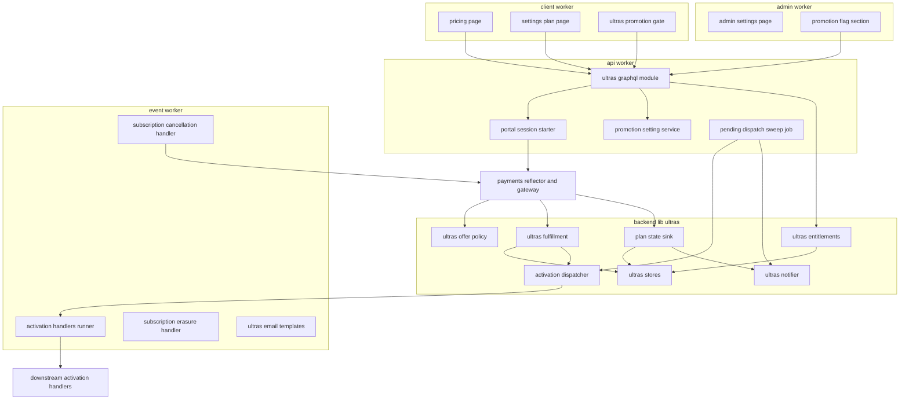
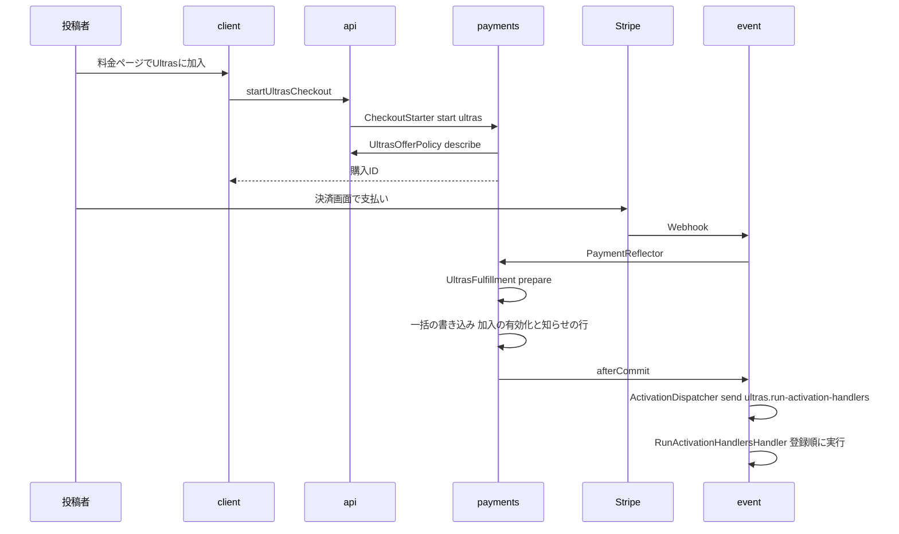
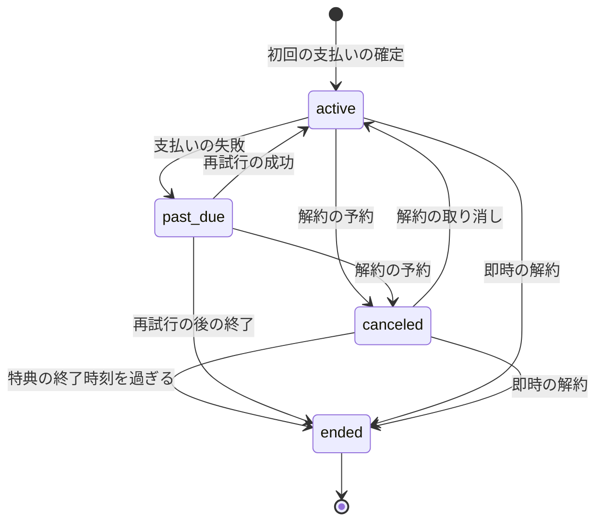
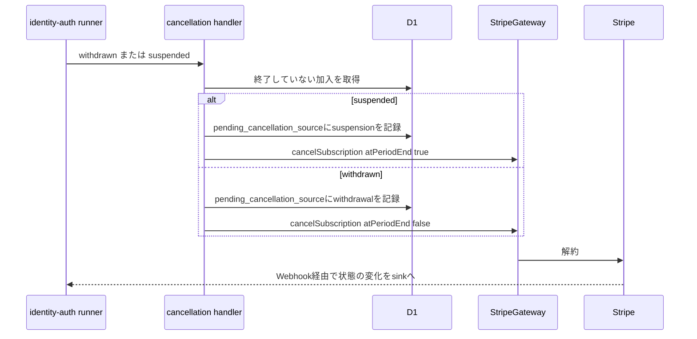

# Design Document

## Overview

**Purpose**: 有料プランUltrasの加入・加入状態の管理・特典の判定を1か所に集める。paymentsの購入種別の口(`ultras`)で加入を有効にし、定期課金の状態の受け取り口(`SubscriptionEventSink`)でStripe側の変化を加入状態に取り込み、加入ごとの「特典の継続期間」(開始時刻から特典の終了時刻までの区間)を保存する。特典を消費する機能は、Stripeの状態を見ずに、この区間に対する「指定時点・指定期間で特典を受けられるか」の判定(`UltrasEntitlements`)だけに依存する。

**Users**: 投稿者は料金ページ(`/pricing`)で価格と特典を確かめて加入し、プラン管理画面(`/settings/plan`)で状態を確認し、Customer Portalで支払い方法の更新・解約・解約の取り消しを行う。最上位管理者は管理画面の設定ページ(`/settings`)で有料プランへの導線の機能フラグを切り替える。後続spec(user-profile-social・product-launch・tournament-week・tournament-year)の開発者は特典の判定と加入が有効になった知らせのハンドラを使い、sponsorship・tournament-year・notificationsは料金ページと管理画面の設定ページに区画を登録する。

**Impact**: `apps/backend-lib`にUltrasの共有部品(`core/ultras`・`workers/ultras`)を新設し、apiとeventの両方に同じ束縛(`ULTRAS_PLATFORM_MODULE`)を入れる。paymentsの購入種別の登録箇所に`ultras`を加え、paymentsが仮5により提供する「確定の後の呼び出し」と「解約の予定時刻」を使う(paymentsのU1)。apiにスキーマモジュール・Portalの回数制限・日次の確認のジョブを、eventに加入が有効になった知らせの処理・退会と停止の解約・物理削除の波及処理・メールのテンプレートを、clientに料金ページとプラン管理画面を、adminに設定ページとフラグの区画を足す。D1に4テーブルを足す。新しいシークレットは無い。

### Goals

- FR-PPLAN-001〜013・FR-ADMCF-022が動作し、加入→支払いの失敗→回復、解約の予約→取り消し、解約の予約→末日の終了、停止→期間末の解約、退会→即時の解約のどの経路でも、加入状態と特典の判定が料金とプランの表(と要件フェーズの決定Q1〜Q8)に一致する。
- 特典の判定が、通知の到着順・再送・過去の時点の指定にかかわらず同じ結果を返す。
- 加入が有効になった知らせが、加入1件につき確実に1回、登録された処理へ届く。
- 本specが追加・変更したコードの単体テスト・Workers統合テスト・ブラウザテストがカバレッジ80%を満たす。

### Non-Goals

- Stripeとの通信・決済画面・最終確認画面・決済後のランディング・決済履歴・購入確認メールの実装(payments)。
- 参加費の免除の適用・参加資格の付与・未完了の参加費の決済セッションの失効(tournament-week・tournament-year)、再ローンチの間隔の適用(product-launch)、加入表示の描画(user-profile-social)。
- 料金ページのスポンサー広告の区画(sponsorship)、管理画面の設定ページの決勝日(tournament-year)・送信者情報(notifications)の区画。
- 解約の受付以外の自動のメール(特典の終了・更新の予告)、Stripeの顧客向けメール(Q8)。
- 要件定義書の改訂(roadmapのOut。必要な改訂は[research.md](research.md)の「要件定義書の改訂が必要な箇所」に記録した)。(2026-10-25に要件定義書へ適用済み)

## Boundary Commitments

### This Spec Owns

- Ultrasのデータ: `ultras_subscriptions`(加入と特典の継続期間)・`ultras_activations`(加入が有効になった知らせ)・`ultras_notices`(メールの依頼)・`ultras_settings`(機能フラグ)の4テーブル(`apps/db/schema/ultras/`)。
- 加入状態の導出規則と特典の継続期間の規則(`backend-lib/core/ultras`)、特典の判定`UltrasEntitlements`・データエクスポートの照会`UltrasPlanExport`・機能フラグの照会`UltrasPromotionFlagReader`(`backend-lib/workers/ultras`)。
- paymentsの口の実装: 購入種別`ultras`の`PurchaseOfferPolicy`・`PurchaseFulfillment`と、`SubscriptionEventSink`(`ultras-subscription.plan-state`)。
- 加入が有効になった知らせの契約と登録箇所(`UltrasActivationHandlerRegistration`・`ULTRAS_ACTIVATION_HANDLERS`)と、その実行(メッセージ種別`ultras.run-activation-handlers`)。
- GraphQLのスキーマモジュール`ultras`(利用者側の`ultrasOffer`・`viewerUltras`・`startUltrasCheckout`・`createUltrasPortalSession`、管理者側の`ultrasPromotionSetting`・`updateUltrasPromotionSetting`)。
- 利用者側の`/pricing`(ページの枠・区画の登録箇所`PRICING_SECTIONS`・Ultrasの区画)と`/settings/plan`、導線の表示の可否の部品`UltrasPromotionGate`。管理者側の`/settings`(ページの枠・区画の登録箇所`ADMIN_SETTINGS_SECTIONS`・フラグの区画)とメニュー項目。
- メールの種別`ultras.payment-failed`・`ultras.cancellation-accepted`(仮1)とテンプレート、監査ログの操作種別`ultras-promotion.update`。
- 定期実行のジョブ`ultras-subscription.pending-dispatch-sweep`(4:21、`order` 500)、ユーザーライフサイクルの波及処理`ultras-subscription.subscription-cancellation`(`withdrawn`・`suspended`、`order` 500)・`ultras-subscription.subscription-erasure`(`purge_due`、`order` 500)。
- 技術ドキュメント`backend/010`・`external/008`の新規作成、`operations/004`への定期課金の節の追記、サービス仕様の`features/005`の新規作成と関連するサービス仕様の追記。

### Out of Boundary

- Stripeとの通信と決済の状態(payments)。本specは`StripeGateway`の定期課金の操作(`cancelSubscription`・`createPortalSession`)と`CustomerDirectory`・`CheckoutStarter`・`PriceCatalog`を呼ぶだけで、Stripeの型やpaymentsのテーブルを直接扱わない。
- 古い通知の破棄(DR-016)と冪等性(DR-015)、権利を付与できない購入の定期課金の解約と全額返金(payments)。
- 加入が有効になった知らせを受けた後の処理(未完了の参加費の決済セッションの失効・参加資格の付与)の中身(tournament-week・tournament-year)。
- 特典の判定の結果の使い方(加入表示・再ローンチの間隔・参加費の免除)と、トーナメント参加費の画面などに出す導線の描画(各後続spec。表示の可否は`UltrasPromotionGate`・`UltrasPromotionFlagReader`で決める)。
- 停止・停止の解除・退会の操作そのもの(ugc-moderation・identity-auth)。
- 法的通知の本文の更新(開発者が管理画面で行う)と、Stripeのダッシュボードの設定作業そのもの(開発者が`operations/004`に沿って行う)。

### Allowed Dependencies

- backend-platform: `AppModule`・`PLATFORM_TYPES`(`Database`・`Clock`・`IdGenerator`・`KeyedHasher`・`MessagePublisher`・`RateLimitCounterClient`)・`ScheduledJobDefinition`・`defineMessageContract`・`MessageHandlerRegistration`・`RetryPolicy`・`hashRateLimitKey`・`AppError`・`getAppLogger`・業務時刻の関数(`toBusinessDateTime`・`fromBusinessDateTime`)・`ulidPrimaryKey`・`timestamps`。形を変えない。
- api-gateway: `defineSchemaModule`・`GraphQLContext`・`withValidatedArgs`・`DateTime`のスカラー。形を変えない。
- identity-auth: `AccountGuard`(`currentUser`・`requireWritableUser`・`requireVerifiedUser`)・`UserLifecycleAsyncRegistration`・`USER_LIFECYCLE_ASYNC_HANDLERS`・`SETTINGS_NAV_ITEMS`・`SettingsShell`・`_authenticated`のレイアウト・`UserContactDirectory`(`IDENTITY_PLATFORM_TYPES.UserContactDirectory`、`apps/backend-lib/workers/identity`、api・eventの両方にidentity-authが束縛する。メールの宛先と宛名の照会に使う)。`users`テーブルは`id`(外部キーの参照先)だけに使い、列を直接読まず、書き込まない。
- admin-foundation: `requireAdmin`・`AdminDirectory`・`AuditLogRecorder`・`buildAuditLogStatements`・`defineAuditAction`・`AUDIT_ACTIONS`・`ADMIN_NAV_ITEMS`・`RoleGate`・`useAdminRole`・`AdminPageHeader`・`ConfirmActionDialog`・E2Eの補助`e2e/support/admin-bootstrap.ts`(指定したロールの管理者としてのログイン)と`e2e/support/local-d1.ts`(`executeLocalD1`・`sqlStringLiteral`。E2Eでの機能フラグの設定)。
- dev-tooling: ルートの`playwright.config.ts`と`e2e/support/playwright-config.ts`の`createPlaywrightConfig`(プロジェクトの組み立て)、テスト方針の文書`docs/GUIDES/tech/testing/001-test-strategy.md`。タスク10.1で、共有の行を書き換えるE2Eを直列にする組み立てと記述を加える(上流への影響)。
- payments: `PurchaseKindRegistration`・`PurchaseOfferPolicy`・`PurchaseFulfillment`・`SubscriptionEventSink`・`SubscriptionChange`・`PURCHASE_KIND_REGISTRATIONS`・`SUBSCRIPTION_EVENT_SINKS`・apiのアプリケーション層の`CheckoutStarter`・`StripeGateway`の`cancelSubscription`・`createPortalSession`・`CustomerDirectory`・`PriceCatalog`・GraphQLの`Money`・`CheckoutStart`・`MoneyText`。仮5の追加(`afterCommit`・`cancelAt`)と仮3の追加(購入確認メールの追加事項)は、paymentsの要件・設計・タスクに反映済み(paymentsのU1・U2、2026-10-23に開発者が承認)で、paymentsのタスクが先に実装する。本specはpaymentsのコードを変更しない。
- email-delivery: `defineEmailKind`・`EMAIL_KINDS`・`EmailSender`・`EMAIL_TYPES`・`defineEmailTemplate`・`EMAIL_TEMPLATES`・`formatUtcDateTime`。
- frontend-platform: `executeGraphQL`・`graphqlQueryOptions`・`GraphQLClientError`・`errorMessageOf`・`buildPageHead`・`DateTime`・`EmptyState`・`ErrorState`・`UnavailableNotice`・`LoadingSkeleton`・`notify`・shadcn/uiの部品・`runAxe`、adminの`ADMIN_PROFILE`(`contactAvailable`)、GraphQLの操作の追加手順(`src/graphql/operations/**/*.graphql`・操作名の接頭辞`Client`・`Admin`・`src/graphql/generated/graphql.ts`の生成物)。
- npmパッケージ: 新規は無い。
- 後続specは本specの`core/ultras`・`workers/ultras`の公開の契約(`UltrasEntitlements`・`UltrasPromotionFlagReader`・`UltrasPlanExport`・`UltrasActivationHandlerRegistration`)と、clientの`UltrasPromotionGate`・管理画面の`ADMIN_SETTINGS_SECTIONS`・料金ページの`PRICING_SECTIONS`だけに依存し、テーブルを直接読み書きしない。data-exportも本specのテーブルを直接読まず、本specが所有するエクスポート部品`UltrasPlanExport`を呼ぶ。

### Revalidation Triggers

- `UltrasEntitlements`の形と判定の規則(特典の継続期間の両端の含め方、特典の終了時刻の日の境界)(user-profile-social・product-launch・tournament-week・tournament-year)。
- `UltrasActivation`・`UltrasActivationHandlerRegistration`の形・配送保証(少なくとも1回)・`order`の範囲(tournament-week・tournament-year)。
- `UltrasPromotionFlagReader`・`UltrasPromotionGate`の形と、フラグの意味(未加入者への導線と新規加入)(tournament-week・tournament-year・product-launchなど導線を出す全spec)。
- `PRICING_SECTIONS`・`ADMIN_SETTINGS_SECTIONS`の形と`order`(sponsorship・tournament-year・notifications)。
- `UltrasPlanExport`の形と`plan.status`の値(data-export。データエクスポートの文書と一致させる)。
- paymentsの`SubscriptionChange`・`SubscriptionEventSink`・`PurchaseFulfillment`の形、または古い通知を捨てる規則を変えたら、本specを確かめ直す(仮5で本specが足す`afterCommit`・`cancelAt`を含む)。
- identity-authのユーザーライフサイクルの`order`の範囲・`purge_due`の順序・`UserContactDirectory`の形(`findContact`が退会済み・物理削除済みの利用者で`undefined`を返す規則)、admin-foundationの`requireAdmin`・`AuditLogRecorder`の形を変えたら、本specを確かめ直す。
- 4:21の`order` 500、波及処理の`order` 500(同じ時刻・種類に登録する全spec)。波及処理の`order`は、各specが4:21のジョブの`order`と同じ百の位の帯を使う(spec横断レビュー、2026-10-23)。本specは500番台を使い、identity-auth(100番台と10000以上)・admin-foundation(200番台)・inquiry-chat(300番台)・payments(400番台)・media-pipeline(800番台)・email-delivery(900)・content-processing(950)の帯と重ねない。帯の割り当てが変わったら、本specを確かめ直す。
- dev-toolingの`createPlaywrightConfig`の形・プロジェクトの名前の規則(`<対象>`・`<対象>-reachability`)、admin-foundationの`executeLocalD1`・`sqlStringLiteral`の形を変えたら、本specのE2Eとその設定を確かめ直す。

### 上流への影響

| 上流spec    | 変更                                                                                                                                                                                                                                                                                                                                                                                                                                | 影響と再検証                                                                                                                                                                                                                                                                                                               |
| ----------- | ----------------------------------------------------------------------------------------------------------------------------------------------------------------------------------------------------------------------------------------------------------------------------------------------------------------------------------------------------------------------------------------------------------------------------------- | -------------------------------------------------------------------------------------------------------------------------------------------------------------------------------------------------------------------------------------------------------------------------------------------------------------------------- |
| dev-tooling | `e2e/support/playwright-config.ts`の`createPlaywrightConfig`(と`playwright-config.unit.test.ts`)・ルートの`playwright.config.ts`に、指定したE2Eのファイルを対象ごとのプロジェクトから外し(`testIgnore`)、別のプロジェクトに分けて`dependencies`で直列にする組み立てを加え、Ultrasの2ファイルに使う。`docs/GUIDES/tech/testing/001-test-strategy.md`のE2Eの節に「共有の行を書き換えるE2Eはプロジェクトの依存で直列にする」旨を加える | ワーカーの数・既存の対象ごとのプロジェクトと到達確認のプロジェクトの名前と依存は変えず、他のspecのE2Eの並行実行に影響させない。`playwright-config.unit.test.ts`の既存のテストが通ることと、Playwrightの一覧の表示で確かめる。文書はプロジェクト名と固有の値を含めずに書く。dev-toolingのファイルの変更のため再検証を求める |

- 後続specへの申し送り: UltrasのE2Eは機能フラグの行を書き換えるため、フラグの値で表示が変わる画面を確かめる後続specのE2Eは、Ultrasのプロジェクトの依存に加えるか、フラグの値で結果が変わる部分を確かめない(roadmapのShared seams「プラン判定」、product-launch・tournament-week・tournament-yearのbrief)。

## Architecture

### Existing Architecture Analysis

- 上流の13specは設計・タスクとも承認済みで、本specのタスクはそれらの実装の完了を前提にする(roadmapの順でpaymentsまでが先に実装される)。
- paymentsの反映は、api(`return_url`・突合・日次の確認)とevent(Webhook)の両方で動き、購入種別の口と定期課金の受け取り口の実装を、反映と同じ一括の書き込みに含める。口の実装は`backend-lib/workers/<ドメイン>`に置き、D1の文だけを返す(副作用を持たない)。
- paymentsの口には確定の後に呼ばれる場所が無く、口の実装はメールやメッセージを送れない。本specは加入が有効になった知らせとメールを依頼待ちの行として一括の書き込みに含め、paymentsの確定の後の呼び出し(仮5、paymentsのU1)と4:21の日次の確認で送り出す。
- Cron Triggersはapiだけにあり、ジョブは業務時刻の時・分で毎日動く。厳密カウンタはapiだけに束縛される。Queuesのconsumerはeventにある。
- API版`2026-09-30.endive`の新しい定期課金は柔軟な請求モードで作られ、課金期間の末日の解約は`cancel_at`の時刻で表される(`cancel_at_period_end`は偽のまま)。paymentsの`SubscriptionChange`に`cancelAt`を足すことを、仮5としてpaymentsへ反映した(paymentsのU1、research.md)。

### Architecture Pattern & Boundary Map



**Architecture Integration**:

- Selected pattern: paymentsの口(購入種別・定期課金の受け取り)を実装し、加入状態を「特典の継続期間」という区間で保存する。判定は区間に対する問い合わせだけで行う。外部への副作用(知らせ・メール)は依頼待ちの行を一括の書き込みに含め、確定の後と日次の確認で送り出す(paymentsの返金とメールの依頼と同じ方式)。
- Domain/feature boundaries: Stripeとの通信と決済の状態はpayments、加入状態と特典の判定は本spec、特典の使い道は後続spec。
- Existing patterns preserved: `backend-lib/workers/<ドメイン>`の共有の束縛、`<spec名>.<名詞句>`のジョブ・波及処理の名前と`<ドメイン>.<動詞句>`のメッセージ種別・`<ドメイン>.<名詞句>`のメール種別、版の検査付きの一括の書き込み(`db/005`)、登録箇所への追記による区画の追加(`SETTINGS_NAV_ITEMS`・`ADMIN_NAV_ITEMS`・`DASHBOARD_CARDS`と同じ形)。
- New components rationale: 判定と口の実装が2つのWorkerにまたがるため`backend-lib`に置く。料金ページと管理画面の設定ページは複数のspecが区画を載せるため、枠と登録箇所を先に作る(仮6)。
- Steering compliance: Inversifyの`@inject`の明示、D1の制約(`db.batch()`・バインド変数100個以内)、業務時刻(UTC-08:00)、Infisicalでのシークレット管理(新規は無し)、800行以内のファイル、1ファイル1コンポーネント。

**Dependency direction**: `apps/db/schema/ultras` → `apps/common-lib/ultras` → `backend-lib/core/ultras`(純粋な規則・契約) → `backend-lib/workers/ultras`(D1の実装とpaymentsの口の実装) → 各アプリの`src`(`application` → `infrastructure`・`presentation` → `composition`)。`backend-lib/workers/ultras`は`backend-lib/core/payments`の契約と`backend-lib/workers/payments`の登録箇所(`purchase-kind-registrations.ts`)からだけ参照される。clientとadminは`common-lib/ultras`とGraphQLの操作だけを読み込む。

### Technology Stack

| Layer     | Choice / Version                                                                    | Role in Feature                                  | Notes                                            |
| --------- | ----------------------------------------------------------------------------------- | ------------------------------------------------ | ------------------------------------------------ |
| Frontend  | TanStack Start・TanStack Query・shadcn/ui(frontend-platform)、`MoneyText`(payments) | 料金ページ・プラン管理画面・管理画面の設定ページ | 既存                                             |
| Backend   | Hono・Inversify・GraphQL Yoga(上流)、paymentsの口と`StripeGateway`                  | スキーマモジュール・口の実装・波及処理           | 既存                                             |
| Data      | Cloudflare D1(Drizzle)                                                              | 4テーブル                                        | 新規のマイグレーション(機能フラグの初期行を含む) |
| Messaging | Cloudflare Queues(`JOBS_QUEUE`)・Cron Triggers(api)                                 | 知らせの実行・日次の確認                         | 既存のQueue                                      |
| External  | Stripe Billing・Customer Portal(payments経由)                                       | 定期課金・Portal                                 | 環境ごとにダッシュボードで設定(`operations/004`) |

## File Structure Plan

### Directory Structure

```
apps/
├── db/schema/ultras/                                   # テーブル定義(各ファイルに同名の*.unit.test.ts)
│   ├── ultras-subscriptions.ts                         # 加入・Stripe側の値・特典の継続期間
│   ├── ultras-activations.ts                           # 加入が有効になった知らせの依頼待ち
│   ├── ultras-notices.ts                               # メールの依頼待ち
│   ├── ultras-settings.ts                              # 機能フラグ
│   └── index.ts
├── common-lib/ultras/                                  # 4アプリ共通の定義(各ファイルに同名の*.unit.test.ts)
│   ├── plan-status.ts                                  # ULTRAS_PLAN_STATUSES・表示名・ULTRAS_PRICE_LOOKUP_KEY
│   └── promotion-flag.ts                               # ULTRAS_PROMOTION_FLAG_KEY・初期値(仮2)
├── common-lib/admin/audit-actions/ultras-subscription.ts # ultras-promotion.update
├── backend-lib/
│   ├── core/ultras/                                    # 純粋な契約と規則(Bunの単体テスト)
│   │   ├── identifiers.ts                              # ULTRAS_TYPES
│   │   ├── entitlement-rules.ts                        # 特典の終了時刻・加入状態の導出・区間の判定
│   │   ├── subscription-transition.ts                  # 定期課金の変化から加入の更新とメールの依頼を決める
│   │   ├── activation-contract.ts                      # UltrasActivation・登録の型と検証
│   │   ├── activation-message.ts                       # ULTRAS_RUN_ACTIVATION_HANDLERS_MESSAGE
│   │   └── ports.ts                                    # UltrasEntitlements・ストア・フラグの照会・エクスポート
│   ├── core/email/kinds/
│   │   ├── ultras-payment-failed.ts                    # 支払いの失敗のメールの種別
│   │   └── ultras-cancellation-accepted.ts             # 解約の受付の確認の種別(仮1)
│   └── workers/ultras/                                 # 実行環境の部品(Workers統合テスト)
│       ├── d1-subscription-store.ts                    # 加入の読み書き・区間の問い合わせ・物理削除
│       ├── d1-activation-store.ts                      # 知らせの行
│       ├── d1-notice-store.ts                          # メールの依頼の行
│       ├── d1-promotion-flag-reader.ts                 # UltrasPromotionFlagReader
│       ├── ultras-entitlements.ts                      # UltrasEntitlementsの実装
│       ├── ultras-offer-policy.ts                      # PurchaseOfferPolicy(ultras)
│       ├── ultras-fulfillment.ts                       # PurchaseFulfillment(ultras)
│       ├── plan-state-sink.ts                          # SubscriptionEventSink
│       ├── activation-dispatcher.ts                    # 知らせの送り出しとdispatched_atの記録
│       ├── ultras-notifier.ts                          # メールの依頼とrequestedの記録
│       ├── ultras-plan-export.ts                       # データエクスポート用のplan
│       └── ultras-platform-module.ts                   # ULTRAS_PLATFORM_MODULE(両アプリ共通の束縛)
├── api/src/
│   ├── application/ultras/                             # Bunの単体テスト
│   │   ├── api-ultras-types.ts                         # API_ULTRAS_TYPES
│   │   ├── ultras-plan-reader.ts                       # ultrasOffer・viewerUltras
│   │   ├── ultras-checkout.ts                          # startUltrasCheckout(CheckoutStarterを呼ぶ)
│   │   ├── portal-session-starter.ts                   # Portalのセッションの作成
│   │   ├── portal-session-limits.ts                    # 利用者単位の回数制限(仮4)
│   │   ├── promotion-setting-service.ts                # フラグの照会・変更(監査ログ)
│   │   └── jobs/pending-dispatch-sweep-job.ts          # 4:21の送り出し直しと後始末(order 500)
│   ├── infrastructure/ultras/d1-promotion-setting-writer.ts # 版の検査付きの変更と監査ログの文
│   ├── presentation/graphql/modules/ultras/            # スキーマモジュール(Workers統合テスト)
│   │   ├── type-defs.ts
│   │   ├── inputs.ts
│   │   ├── errors.ts
│   │   ├── resolvers.ts
│   │   └── index.ts                                    # ultrasSchemaModule
│   └── composition/ultras-module.ts                    # apiの束縛
├── event/src/
│   ├── application/ultras/                             # Bunの単体テスト
│   │   ├── event-ultras-types.ts                       # EVENT_ULTRAS_TYPES
│   │   ├── run-activation-handlers-handler.ts          # ultras.run-activation-handlersの処理
│   │   ├── subscription-cancellation-handler.ts        # withdrawn・suspendedの波及処理
│   │   └── subscription-erasure-handler.ts             # purge_dueの波及処理
│   ├── infrastructure/email/templates/ultras/          # 本文の*-body.tsxと定義の*-template.ts(2種)
│   ├── composition/ultras-activation-handlers.ts       # ULTRAS_ACTIVATION_HANDLERS(後続specが追記、初版は空)
│   └── composition/ultras-module.ts                    # eventの束縛
├── client/src/
│   ├── routes/pricing.tsx                              # /pricing(ログイン不要)
│   ├── routes/_authenticated/settings/plan.tsx         # /settings/plan
│   ├── composition/pricing-sections.ts                 # PRICING_SECTIONS(sponsorshipが追記)
│   ├── components/ultras/                              # 1ファイル1コンポーネント(browser testを併置)
│   │   ├── pricing-page.tsx                            # 区画の並びと法的通知へのリンク
│   │   ├── ultras-pricing-section.tsx                  # 料金ページのUltrasの区画
│   │   ├── ultras-benefit-list.tsx                     # 特典と条件の一覧
│   │   ├── ultras-subscribe-button.tsx                 # 加入ボタン(未ログイン・未確認・不可の出し分け)
│   │   ├── plan-status-panel.tsx                       # 加入状態ごとの表示
│   │   ├── portal-button.tsx                           # Portalを開く
│   │   ├── portal-return-notice.tsx                    # Portalから戻った直後の反映待ち
│   │   ├── plan-page.tsx                               # プラン管理画面の全体
│   │   └── ultras-promotion-gate.tsx                   # 導線の表示の可否(後続specも使う)
│   └── graphql/operations/ultras/                      # 1ファイル1操作の.graphql(操作名はClientで始める)
│       ├── ultras-offer.graphql                        # ClientUltrasOffer(ultrasOffer)
│       ├── viewer-ultras.graphql                       # ClientViewerUltras(viewerUltras)
│       ├── start-ultras-checkout.graphql               # ClientStartUltrasCheckout(startUltrasCheckout)
│       └── create-ultras-portal-session.graphql        # ClientCreateUltrasPortalSession(createUltrasPortalSession)
└── admin/src/
    ├── routes/_authenticated/settings/index.tsx        # /settings
    ├── composition/admin-settings-sections.ts          # ADMIN_SETTINGS_SECTIONS(tournament-year・notificationsが追記)
    ├── components/settings/admin-settings-page.tsx     # 区画の並び
    ├── components/ultras/promotion-setting-section.tsx # フラグの区画
    └── graphql/operations/ultras/                      # 1ファイル1操作の.graphql(操作名はAdminで始める)
        ├── ultras-promotion-setting.graphql            # AdminUltrasPromotionSetting(ultrasPromotionSetting)
        └── update-ultras-promotion-setting.graphql     # AdminUpdateUltrasPromotionSetting(updateUltrasPromotionSetting)
```

テストは各ファイルの隣に置く(`*.unit.test.ts`・`*.worker.test.ts`・`*.browser.test.tsx`)。E2Eは`e2e/client/ultras.e2e.test.ts`・`e2e/admin/ultras-promotion.e2e.test.ts`。

### Modified Files

- `apps/db/schema/index.ts`・`apps/db/migrations/<日時>_ultras/migration.sql` — 4テーブルの再エクスポートと生成したマイグレーション。機能フラグの初期行(`setting_key = 'ultras_promotion'`・`enabled = 0`・`version = 0`、ID・`state_token`は固定のULID、`created_at`・`updated_at`は固定のエポックミリ秒、`updated_by_admin_id`はNULL)を同じマイグレーションの末尾に挿入する(仮2)。mainの最新を取り込んでから生成する。
- `apps/common-lib/admin/audit-actions/index.ts` — `ultras-subscription.ts`の配列を連結する。
- `apps/backend-lib/core/messaging/contracts/index.ts`・`core/email/kinds/index.ts` — メッセージ種別と2つのメールの種別を加える(種別とテンプレートは同じタスクで足す)。
- `apps/backend-lib/workers/payments/purchase-kind-registrations.ts` — `PURCHASE_KIND_REGISTRATIONS`に`ultras`、`SUBSCRIPTION_EVENT_SINKS`に`ultras-subscription.plan-state`を加える。
- `apps/api/src/composition/modules.ts`・`graphql-modules.ts`・`scheduled-jobs.ts` — `ULTRAS_PLATFORM_MODULE`・apiのUltrasモジュール・スキーマモジュール・ジョブ。
- `apps/event/src/composition/modules.ts`・`message-handlers.ts`・`user-lifecycle-async-handlers.ts`・`infrastructure/email/templates/index.ts` — 束縛、`ultras.run-activation-handlers`の処理、2つの波及処理、2つのテンプレート。
- `apps/client/src/composition/settings-navigation.ts` — `{ to: '/settings/plan', label: 'プラン', order: 60 }`。
- `apps/admin/src/composition/admin-navigation.ts` — `{ to: '/settings', label: '設定', order: 130 }`。
- `docs/onboardings/tech-stack.md` — Stripe Customer Portalの用途を「Ultrasの支払い方法の更新・解約・解約の取り消し」に改める(Q6)。
- `docs/GUIDES/tech/backend/README.md`・`external/README.md` — 文書一覧の表に行を加える。
- `docs/GUIDES/tech/operations/004-payment-data-operations.md` — 「定期課金とCustomer Portal」の節(価格`ultras_monthly`の作成、Portalの機能、再試行の後の解約、顧客向けメールの停止、api・eventの制限付きキーへのSubscriptions・Customer Portalの権限、test clockによる検証)を加える。
- `docs/GUIDES/service/legal/004-legal-notice-outline.md` — 返金ポリシーの「ユーザー停止に伴う定期課金(Ultras)」の行を「定期課金を課金期間の末日に終わるよう解約する(FR-PPLAN-012)。返金しない」に直し(Q3)、「退会に伴う定期課金の解約: 即時に解約し、返金しない」(Q7)・「トーナメント参加費の決済後のUltras加入: 返金しない」(Q2)の行を加える。章8に解約はCustomer Portalで行う旨と解約の受付の確認メール(仮1)を加える。他の行は変えない。
- `docs/GUIDES/service/legal/001-compliance-policy.md` — LR-007の行に、退会時の即時の解約・解約の受付の確認(仮1)・購入確認メールの自動更新の条件(仮3)を加える。
- `docs/GUIDES/service/overview/002-pricing-and-plans.md` — 免除の判定時点の確定(Q1)、決済後に加入した場合の返金なし(Q2)、特典の終了時刻(Q4)、機能フラグの範囲と初期値(Q5・仮2)、停止・退会の扱い(Q3・Q7)、支払いの失敗と解約の受付のメール(Q8・仮1)。
- `docs/GUIDES/service/design/002-page-layouts.md` — `/pricing`の「フラグがオフなら404」を「Ultrasの区画を未加入者に表示しない」に直し(Q5)、`/settings/plan`をPortalに一本化した配置(Q6)・状態ごとの表示・Portalから戻った直後の表示、管理者側の「設定」ページの区画の並び(仮6)を記載する。
- `docs/GUIDES/service/design/003-text-and-copy-rules.md` — 加入状態の表示名、プラン管理画面・料金ページの文言、エラーの文言、通知メールの件名2種を加える。
- `docs/GUIDES/service/overview/007-daily-timeline.md` — 4:21の表に`ultras-subscription.pending-dispatch-sweep`(500)を加える。
- `docs/GUIDES/service/features/README.md` — `005-ultras-subscription.md`の行を加える。
- `e2e/support/playwright-config.ts`・`playwright-config.unit.test.ts`・ルートの`playwright.config.ts`(dev-toolingの所有) — 指定したE2Eのファイルを対象ごとのプロジェクトから外して別のプロジェクトに分け、`dependencies`で直列にする組み立てを加え、`e2e/client/ultras.e2e.test.ts`・`e2e/admin/ultras-promotion.e2e.test.ts`に使う(adminの側をclientの側の後に実行する)。ワーカーの数は変えない(上流への影響)。
- `docs/GUIDES/tech/testing/001-test-strategy.md`(dev-toolingの所有) — E2Eの節に「共有の行を書き換えるE2Eはプロジェクトの依存で直列にする」旨を、プロジェクト名と固有の値を含めずに加える。

新規の文書:

- `docs/GUIDES/tech/backend/010-subscription-entitlements.md` — 外部の定期課金の状態から特典の継続期間(区間)を導く規約、業務日付の日の終わりへの切り上げ、区間に対する時点・期間の判定と一括の判定、通知の到着順への対応、確定の後の副作用と日次の確認、知らせのハンドラの冪等性の規約。
- `docs/GUIDES/tech/external/008-stripe-billing-portal.md` — 定期課金の状態の対応(柔軟な請求モードの`cancel_at`を含む)、Customer Portalの機能の設定とセッションの作成、再試行の後の扱いの設定、顧客向けメールの停止、test clockによる検証。
- `docs/GUIDES/service/features/005-ultras-subscription.md` — Ultrasの実装方針(加入状態の導出表、特典の継続期間、加入が有効になった知らせ、機能フラグ、メール)。

## System Flows

### 加入から有効化まで



- `return_url`(api)とWebhook(event)のどちらが先でも、paymentsの購入の前進で一括の書き込みは1回だけ確定する。`afterCommit`は確定させた側だけが呼ぶ。送り出しに失敗しても行は`dispatched_at`が空のまま残り、4:21に送り直す。
- `prepare`は加入の開始時刻(支払いの確定の時刻)に同じ利用者の別の加入の特典の継続期間が重なれば拒否し、paymentsが定期課金を解約して全額返金する(1.8)。同時の確定は、特典の継続期間が開いている加入を利用者ごとに1つに限る部分一意索引の違反で片方が取り消され、paymentsが`prepare`を呼び直して拒否になる(1.9)。

### 加入状態の遷移



- 加入状態は保存せず、Stripe側の値と特典の終了時刻から、問い合わせの時刻ごとに導く(`derivePlanStatus`)。`ended`へは時刻の経過だけで移るため、終了のための定期実行は要らない。
- 特典の終了時刻は、解約の予約で「課金期間の最後の瞬間(予定時刻`cancelAt`、無ければ課金期間の終了時刻の直前)を含む業務日付の翌日0:00」、予約の取り消しで空、終了の状態(`canceled`・`unpaid`・`incomplete_expired`・`paused`)で「予約があり終了の時刻が予定時刻以後なら同じ翌日0:00、それ以外は終了の時刻」に決まる。一度終了の状態で決めた値は変えない(3.4)。

### 退会・停止による解約



- 解約の結果は、Webhookで届く定期課金の状態の変化としてだけ加入状態に反映する(7.8)。`pending_cancellation_source`は、sinkが解約の予約を受け取ったときに解約の受付の確認メールを送らない判断に使う(8.4)。
- 停止の解除(`unsuspended`)には波及処理を登録しない(7.4)。

## Requirements Traceability

| Requirement             | Summary                                | Components                                                                                                           | Interfaces                                                             | Flows                |
| ----------------------- | -------------------------------------- | -------------------------------------------------------------------------------------------------------------------- | ---------------------------------------------------------------------- | -------------------- |
| 1.1, 1.2                | 加入の開始と価格                       | UltrasCheckout、UltrasPlanReader、UltrasSubscribeButton、UltrasPricingSection                                        | `startUltrasCheckout`・`ultrasOffer`                                   | 加入から有効化まで   |
| 1.3                     | 最終確認画面の追加事項                 | UltrasOfferPolicy                                                                                                    | `CheckoutSummaryText.additionalNotes`                                  | 加入から有効化まで   |
| 1.4, 1.5, 1.6           | 加入の拒否                             | UltrasOfferPolicy、UltrasCheckout                                                                                    | `PurchaseOfferDecision`                                                | —                    |
| 1.7, 1.8, 1.9           | 有効化と二重の加入の防止               | UltrasFulfillment、D1SubscriptionStore                                                                               | `PurchaseFulfillment.prepare`                                          | 加入から有効化まで   |
| 2.1〜2.11               | 加入状態の管理                         | PlanStateSink、SubscriptionTransition、EntitlementRules、D1SubscriptionStore                                         | `SubscriptionEventSink`・`applySubscriptionChange`・`derivePlanStatus` | 加入状態の遷移       |
| 2.12                    | 返金・チャージバックで変えない         | PlanStateSink(定期課金の変化だけを扱う)                                                                              | —                                                                      | —                    |
| 3.1〜3.5, 3.7           | 特典の判定                             | UltrasEntitlements、EntitlementRules                                                                                 | `UltrasEntitlements`                                                   | —                    |
| 3.6                     | 現在の加入状態の照会                   | UltrasEntitlements                                                                                                   | `currentPlan`                                                          | —                    |
| 4.1〜4.5                | 加入が有効になった知らせ               | UltrasFulfillment、ActivationDispatcher、RunActivationHandlersHandler、PendingDispatchSweepJob、ActivationContract   | `ULTRAS_RUN_ACTIVATION_HANDLERS_MESSAGE`                               | 加入から有効化まで   |
| 4.6                     | 冪等性の規約                           | UltrasTechDocs(`backend/010`)                                                                                        | —                                                                      | —                    |
| 5.1〜5.9                | プラン管理画面                         | PlanPage、PlanStatusPanel、PortalButton、PortalReturnNotice、UltrasPlanReader、SETTINGS_NAV_ITEMS                    | `viewerUltras`                                                         | —                    |
| 6.1, 6.2, 6.5, 6.6, 6.7 | Portalのセッション                     | PortalSessionStarter、PortalSessionLimits、PortalButton                                                              | `createUltrasPortalSession`                                            | —                    |
| 6.3, 6.4                | Portalの機能と決済手段                 | UltrasTechDocs(`operations/004`・`external/008`)                                                                     | —                                                                      | —                    |
| 6.8                     | Portalの結果の反映                     | PlanStateSink                                                                                                        | `SubscriptionEventSink`                                                | 加入状態の遷移       |
| 7.1〜7.7                | 退会・停止の解約                       | SubscriptionCancellationHandler                                                                                      | `UserLifecycleAsyncHandler`・`StripeGateway.cancelSubscription`        | 退会・停止による解約 |
| 7.8                     | 解約の結果の反映                       | PlanStateSink                                                                                                        | —                                                                      | 退会・停止による解約 |
| 8.1, 8.2, 8.3, 8.4      | 支払いの失敗と解約の受付のメール       | SubscriptionTransition、PlanStateSink、UltrasNotifier、UltrasEmailKinds、UltrasEmailTemplates                        | `ultras.payment-failed`・`ultras.cancellation-accepted`                | —                    |
| 8.5, 8.10               | 終了のメールとStripeのメールを使わない | SubscriptionTransition、UltrasTechDocs                                                                               | —                                                                      | —                    |
| 8.6, 8.7, 8.8, 8.9      | メールの分類・日時・宛先・送り直し     | UltrasEmailKinds、UltrasNotifier、PendingDispatchSweepJob                                                            | `EmailSender`・`UserContactDirectory.findContact`                      | —                    |
| 9.1〜9.8                | 料金ページ                             | PricingPage、PricingSections、UltrasPricingSection、UltrasBenefitList、UltrasSubscribeButton、UltrasPlanReader       | `ultrasOffer`・`viewerUltras`                                          | —                    |
| 10.1〜10.4, 10.9        | 管理画面のフラグ                       | AdminSettingsPage、AdminSettingsSections、PromotionSettingSection、PromotionSettingService、D1PromotionSettingWriter | `ultrasPromotionSetting`・`updateUltrasPromotionSetting`               | —                    |
| 10.5, 10.6, 10.7, 10.8  | フラグの意味と照会                     | UltrasPromotionFlagReader、UltrasOfferPolicy、UltrasPromotionGate、UltrasPlanReader                                  | `UltrasPromotionFlagReader`                                            | —                    |
| 11.1                    | 物理削除                               | SubscriptionErasureHandler、各ストア                                                                                 | `UserLifecycleAsyncHandler`                                            | —                    |
| 11.2                    | エクスポートの照会口                   | UltrasPlanExport                                                                                                     | `UltrasPlanExport.find`                                                | —                    |
| 11.3                    | 古い行の後始末                         | PendingDispatchSweepJob                                                                                              | `ScheduledJobDefinition`                                               | —                    |
| 12.1, 12.2              | 運用手順書                             | UltrasTechDocs(`operations/004`)                                                                                     | —                                                                      | —                    |
| 12.3                    | 個人データを含めない記録               | 全コンポーネント(ログの規約)                                                                                         | `getAppLogger`                                                         | —                    |
| 13.1, 13.2              | テスト                                 | Testing Strategy                                                                                                     | —                                                                      | —                    |
| 13.3                    | 技術ドキュメント                       | UltrasTechDocs                                                                                                       | —                                                                      | —                    |
| 13.4, 13.5              | サービス仕様                           | UltrasServiceSpecs                                                                                                   | —                                                                      | —                    |

## Components and Interfaces

| Component                                                                                    | Domain/Layer         | Intent                                               | Req Coverage                            | Key Dependencies                                                   | Contracts |
| -------------------------------------------------------------------------------------------- | -------------------- | ---------------------------------------------------- | --------------------------------------- | ------------------------------------------------------------------ | --------- |
| PlanStatusValues・PromotionFlagValues                                                        | common-lib           | 加入状態の値と表示名・価格の`lookup_key`・フラグの鍵 | 2.2〜2.9, 10.5                          | —                                                                  | State     |
| UltrasAuditActions                                                                           | common-lib           | 監査ログの操作種別                                   | 10.2                                    | admin-foundation (P0)                                              | State     |
| EntitlementRules・SubscriptionTransition                                                     | backend-lib/core     | 特典の終了時刻・加入状態の導出・変化の解釈           | 2.1〜2.11, 3.1〜3.4, 8.1〜8.5           | 業務時刻 (P0)                                                      | Service   |
| ActivationContract・ActivationMessage                                                        | backend-lib/core     | 知らせの契約・登録の検証・メッセージ種別             | 4.1, 4.3, 4.4                           | backend-platform (P0)                                              | Event     |
| UltrasEmailKinds                                                                             | backend-lib/core     | 2種のメールの種別                                    | 8.1, 8.3, 8.6, 8.7                      | email-delivery (P0)                                                | —         |
| D1各ストア・UltrasPromotionFlagReader                                                        | backend-lib/workers  | 4テーブルの読み書き・フラグ                          | 1.7〜1.9, 2.\*, 10.5, 11.1              | D1 (P0)                                                            | State     |
| UltrasEntitlements                                                                           | backend-lib/workers  | 特典の判定と現在の加入状態                           | 3.1〜3.7                                | D1SubscriptionStore (P0)                                           | Service   |
| UltrasOfferPolicy                                                                            | backend-lib/workers  | 購入の可否と内容                                     | 1.2〜1.6, 10.6                          | PriceCatalog (P0)、UltrasEntitlements (P0)                         | Service   |
| UltrasFulfillment                                                                            | backend-lib/workers  | 加入の有効化と知らせの行                             | 1.7〜1.9, 4.1, 4.2                      | D1SubscriptionStore (P0)                                           | Service   |
| PlanStateSink                                                                                | backend-lib/workers  | 定期課金の変化の取り込み                             | 2.1〜2.12, 6.8, 7.8, 8.1〜8.4           | SubscriptionTransition (P0)                                        | Service   |
| ActivationDispatcher・UltrasNotifier                                                         | backend-lib/workers  | 知らせとメールの送り出し                             | 4.1, 4.5, 8.1, 8.3, 8.8, 8.9            | MessagePublisher (P0)、EmailSender (P0)、UserContactDirectory (P0) | Service   |
| UltrasPlanExport                                                                             | backend-lib/workers  | データエクスポートの`plan`                           | 11.2                                    | D1SubscriptionStore (P0)                                           | Service   |
| UltrasPlatformModule                                                                         | backend-lib/workers  | 両アプリ共通の束縛                                   | —                                       | Inversify (P0)                                                     | —         |
| UltrasPlanReader・UltrasCheckout                                                             | api/application      | 画面の照会と加入の開始                               | 1.1, 1.2, 3.6, 5.1〜5.5, 9.2〜9.7, 10.7 | CheckoutStarter (P0)                                               | Service   |
| PortalSessionStarter・PortalSessionLimits                                                    | api/application      | Portalのセッションと回数制限                         | 6.1, 6.2, 6.5〜6.7                      | StripeGateway (P0)、RateLimitCounterClient (P0)                    | Service   |
| PromotionSettingService・D1PromotionSettingWriter                                            | api                  | フラグの照会・変更と監査ログ                         | 10.1〜10.4                              | AuditLogRecorder (P0)                                              | Service   |
| PendingDispatchSweepJob                                                                      | api/application/jobs | 送り出し直しと後始末                                 | 4.5, 8.9, 11.3                          | ActivationDispatcher (P0)                                          | Batch     |
| UltrasSchemaModule                                                                           | api/presentation     | GraphQLの型と操作                                    | 1.\*, 5.\*, 6.\*, 9.\*, 10.\*           | api-gateway (P0)                                                   | API       |
| RunActivationHandlersHandler                                                                 | event/application    | 知らせの実行                                         | 4.1, 4.4                                | ULTRAS_ACTIVATION_HANDLERS (P0)                                    | Event     |
| SubscriptionCancellationHandler・SubscriptionErasureHandler                                  | event/application    | 退会・停止の解約と物理削除                           | 7.1〜7.7, 11.1                          | identity-auth (P0)、StripeGateway (P0)                             | Event     |
| UltrasEmailTemplates                                                                         | event/infrastructure | 2種のメール                                          | 8.1, 8.3, 8.7                           | email-delivery (P0)                                                | —         |
| PricingPage・PricingSections・UltrasPricingSection・UltrasBenefitList・UltrasSubscribeButton | client               | 料金ページ                                           | 1.1, 1.2, 9.1〜9.8                      | MoneyText (P1)                                                     | State     |
| PlanPage・PlanStatusPanel・PortalButton・PortalReturnNotice                                  | client               | プラン管理画面                                       | 5.1〜5.9, 6.1, 6.2, 6.7                 | SettingsShell (P0)                                                 | State     |
| UltrasPromotionGate                                                                          | client               | 導線の表示の可否                                     | 10.6, 10.8                              | —                                                                  | State     |
| AdminSettingsPage・AdminSettingsSections・PromotionSettingSection                            | admin                | 設定ページとフラグの区画                             | 10.1〜10.4, 10.9                        | RoleGate (P0)、ConfirmActionDialog (P0)                            | State     |
| UltrasTechDocs                                                                               | docs/GUIDES/tech     | `backend/010`・`external/008`・`operations/004`の節  | 4.6, 6.3, 6.4, 8.10, 12.1, 12.2, 13.3   | —                                                                  | —         |
| UltrasServiceSpecs                                                                           | docs/GUIDES/service  | Ultrasの実装方針と関連するサービス仕様               | 13.4, 13.5                              | —                                                                  | —         |

### common-lib

#### PlanStatusValues・PromotionFlagValues・UltrasAuditActions

```typescript
// plan-status.ts
export declare const ULTRAS_PLAN_STATUSES: readonly [
  'active',
  'past_due',
  'canceled',
  'ended',
];
export type UltrasPlanStatus = (typeof ULTRAS_PLAN_STATUSES)[number];
export declare const ULTRAS_PLAN_STATUS_LABELS: Readonly<
  Record<UltrasPlanStatus, string>
>; // 有効・支払いの再試行中・解約済み・終了
export declare const ULTRAS_ENTITLED_STATUSES: readonly UltrasPlanStatus[]; // active・past_due・canceled
export declare const ULTRAS_PRICE_LOOKUP_KEY: 'ultras_monthly';
// promotion-flag.ts
export declare const ULTRAS_PROMOTION_FLAG_KEY: 'ultras_promotion';
export declare const ULTRAS_PROMOTION_FLAG_DEFAULT: false; // 仮2
// audit-actions/ultras-subscription.ts
export declare const ULTRAS_AUDIT_ACTIONS: readonly AuditActionDefinition[];
// ultras-promotion.update: label「Ultras導線の機能フラグの変更」、targetKind 'setting'、reason 'optional'、detailKeys ['enabled']、maxTargets 1
```

### backend-lib/core

#### EntitlementRules・SubscriptionTransition

| Field        | Detail                                                                                    |
| ------------ | ----------------------------------------------------------------------------------------- |
| Intent       | 特典の終了時刻・加入状態・区間の判定と、定期課金の変化の解釈を純粋な関数で表す            |
| Requirements | 2.1, 2.2, 2.3, 2.4, 2.5, 2.6, 2.7, 2.8, 2.9, 2.10, 3.1, 3.2, 3.4, 8.1, 8.2, 8.3, 8.4, 8.5 |

**Contracts**: Service [x]

```typescript
export type StripeSubscriptionStatus =
  | 'incomplete'
  | 'incomplete_expired'
  | 'trialing'
  | 'active'
  | 'past_due'
  | 'canceled'
  | 'unpaid'
  | 'paused';
export type CancellationSource = 'user' | 'suspension' | 'withdrawal';

export interface SubscriptionSnapshot {
  readonly stripeStatus: StripeSubscriptionStatus;
  readonly cancelScheduled: boolean; // cancelAtPeriodEnd または cancelAt がある
  readonly cancelAt: Date | null;
  readonly currentPeriodEnd: Date | null;
  readonly endedAt: Date | null;
  readonly startedAt: Date | null; // 加入が有効になった時刻(未有効はnull)
  readonly benefitEndsAt: Date | null; // 特典の終了時刻(開いているならnull)
  readonly benefitEndFixed: boolean; // 終了の状態で決めた値か
  readonly canceledAt: Date | null; // 解約の操作の時刻
  readonly cancellationSource: CancellationSource | null;
  readonly pendingCancellationSource: Exclude<
    CancellationSource,
    'user'
  > | null;
  readonly pastDueSince: Date | null;
}

export declare function endOfBusinessDayContaining(instant: Date): Date; // その業務日付の翌日0:00(UTC-08:00)。区間の右端は含まない
export declare function benefitEndForScheduledEnd(scheduledEnd: Date): Date; // 期間の最後の瞬間(scheduledEnd − 1ms)を含む業務日付の翌日0:00。課金期間は終了時刻を含まないため
export declare function derivePlanStatus(
  snapshot: SubscriptionSnapshot,
  now: Date,
): UltrasPlanStatus | null; // 未有効はnull
export declare function isEntitledAt(
  snapshot: Pick<SubscriptionSnapshot, 'startedAt' | 'benefitEndsAt'>,
  at: Date,
): boolean; // startedAt ≤ at < benefitEndsAt(空は無限)
export declare function overlapsPeriod(
  snapshot: Pick<SubscriptionSnapshot, 'startedAt' | 'benefitEndsAt'>,
  from: Date,
  to: Date,
): boolean; // startedAt ≤ to かつ (benefitEndsAt 空 または benefitEndsAt > from)

export interface SubscriptionChangeInput {
  readonly status: StripeSubscriptionStatus;
  readonly cancelAtPeriodEnd: boolean;
  readonly cancelAt: Date | null;
  readonly currentPeriodEnd: Date | null;
  readonly endedAt: Date | null;
  readonly occurredAt: Date;
}
// UltrasNoticeKind('payment_failed' | 'cancellation_accepted')はports.tsで定義し(2.1)、ここでは読み込んで使う
export interface SubscriptionTransitionResult {
  readonly next: SubscriptionSnapshot;
  readonly notices: readonly {
    readonly kind: UltrasNoticeKind;
    readonly dedupeKey: string;
    readonly benefitEndsAt: Date | null;
    readonly acceptedAt: Date;
  }[];
}
export declare function applySubscriptionChange(
  previous: SubscriptionSnapshot,
  change: SubscriptionChangeInput,
  stripeSubscriptionId: string,
): SubscriptionTransitionResult;
```

- `derivePlanStatus`: 未有効はnull。`benefitEndsAt`があり`now ≥ benefitEndsAt`なら`ended`。Stripe側が`past_due`なら`past_due`。`benefitEndsAt`があれば`canceled`。それ以外は`active`(2.2〜2.9)。
- `applySubscriptionChange`の規則:
  - Stripe側の値(状態・予約・予定時刻・課金期間の終了・終了の時刻)は常に最新に置き換える(2.1・2.10)。
  - `benefitEndFixed`が真なら`benefitEndsAt`を変えない(3.4)。
  - 終了の状態(`canceled`・`unpaid`・`incomplete_expired`・`paused`): 予定時刻`T = cancelAt ?? currentPeriodEnd`について、(以前または今回の)予約があり`endedAt ≥ T`なら`benefitEndForScheduledEnd(T)`、それ以外は`endedAt ?? occurredAt`を`benefitEndsAt`とし、`benefitEndFixed = true`(2.5〜2.7)。`unpaid`・`paused`は本サービスの設定では起きない状態として`warn`のログを残す。
  - 終了していない状態で予約がある: `benefitEndsAt = benefitEndForScheduledEnd(T)`。予約が無い: `benefitEndsAt = null`(2.4・2.8)。
  - 予約が偽→真に変わり、加入が有効なら`canceledAt = occurredAt`、`cancellationSource = pendingCancellationSource ?? 'user'`、`pendingCancellationSource`は残す。`user`なら`cancellation_accepted`(`dedupeKey = 'cancellation_accepted:<定期課金のID>:<occurredAtのミリ秒>'`)を返す(8.3・8.4)。真→偽(取り消し)なら`canceledAt`・`cancellationSource`を空にする。
  - Stripe側が`past_due`以外から`past_due`になり、加入が有効なら`pastDueSince = occurredAt`とし、`payment_failed`(`dedupeKey = 'payment_failed:<定期課金のID>:<pastDueSinceのミリ秒>'`)を返す。`past_due`のままなら返さない(8.1・8.2)。`past_due`から抜けたら`pastDueSince`を空にする。
  - 終了(`ended`への変化)のメールは返さない(8.5)。
- 境界の例(テストで確かめる): 課金期間の終了が`2026-11-05T18:00:00Z`(業務日付11-05の10:00)なら特典の終了時刻は`2026-11-06T08:00:00Z`(11-05の23:59:59.999まで特典)。終了が`2026-11-06T08:00:00Z`ちょうど(業務日付11-06の0:00)なら、課金期間の最後の瞬間は11-05に属するため`2026-11-06T08:00:00Z`。終了が`2026-11-06T08:00:00.001Z`なら`2026-11-07T08:00:00Z`。

#### ActivationContract・ActivationMessage

**Contracts**: Event [x]

```typescript
export interface UltrasActivation {
  readonly activationId: string; // ULID
  readonly userId: string;
  readonly stripeSubscriptionId: string;
  readonly activatedAt: Date; // 加入の開始時刻(支払いの確定の時刻)
}
export interface UltrasActivationHandler {
  handle(activation: UltrasActivation): Promise<void>; // 例外は再試行。冪等にする
}
export interface UltrasActivationHandlerRegistration {
  readonly name: string; // '<spec名>.<名詞句>' 例 'tournament-week.open-entry-checkout-expiry'
  readonly order: number; // 昇順に実行
  readonly handler: ServiceIdentifier<UltrasActivationHandler>;
}
export declare function createUltrasActivationRegistry(
  registrations: readonly UltrasActivationHandlerRegistration[],
): readonly UltrasActivationHandlerRegistration[]; // 名前の形式違反・重複・orderの重複で例外、order昇順で返す
export declare const ULTRAS_RUN_ACTIVATION_HANDLERS_MESSAGE: MessageContract<
  'ultras.run-activation-handlers',
  { readonly activationId: string }
>;
export declare const ULTRAS_ACTIVATION_RETRY_POLICY: RetryPolicy; // maxAttempts 5・baseDelaySeconds 60・maxDelaySeconds 3600
```

- 配送保証: 少なくとも1回。ハンドラはStripeを呼んでよい(eventの非同期の処理として動く)。ハンドラの1つが例外を投げたら全体を再試行するため、すべてのハンドラを冪等にする(4.4・4.6)。
- 解約の取り消し・支払いの失敗からの回復では知らせを作らない(4.3、`ultras_activations`は加入の有効化でだけ挿入する)。

#### UltrasEmailKinds

- `ultras.payment-failed`(トランザクション、入力`{ nickname: string; planUrl: string }`)、`ultras.cancellation-accepted`(トランザクション、入力`{ nickname: string; acceptedAtUtc: string; benefitEndsAtUtc: string; planUrl: string }`)。日時は`formatUtcDateTime`の文字列(8.6・8.7)。種別とテンプレートは同じタスクで`EMAIL_KINDS`・`EMAIL_TEMPLATES`に加える(email-deliveryの1対1の検査)。

### backend-lib/workers

#### D1各ストア・UltrasPromotionFlagReader

**Contracts**: State [x]

```typescript
// ports.ts(2.1)
export type UltrasNoticeKind = 'payment_failed' | 'cancellation_accepted';
export interface SubscriptionRow extends SubscriptionSnapshot {
  readonly id: string;
  readonly stripeSubscriptionId: string;
  readonly userId: string;
  readonly purchaseId: string | null;
}
export interface SubscriptionStore {
  findByStripeId(
    stripeSubscriptionId: string,
  ): Promise<SubscriptionRow | undefined>;
  upsertStripeState(input: {
    readonly row: SubscriptionRow;
  }): BatchItem<'sqlite'>; // sinkの列だけを更新(onConflictDoUpdate)
  activate(input: {
    readonly stripeSubscriptionId: string;
    readonly userId: string;
    readonly purchaseId: string;
    readonly startedAt: Date;
    readonly id: string;
  }): BatchItem<'sqlite'>; // 無ければ挿入(状態active)、あればstarted_at・user_id・purchase_idだけ更新
  findEntitledOverlapping(input: {
    readonly userId: string;
    readonly at: Date;
    readonly excludeStripeId?: string;
  }): Promise<SubscriptionRow | undefined>;
  findOverlapping(input: {
    readonly userIds: readonly string[];
    readonly from: Date;
    readonly to: Date;
  }): Promise<
    readonly Pick<SubscriptionRow, 'userId' | 'startedAt' | 'benefitEndsAt'>[]
  >; // 90件ずつに分ける
  findLatestActivated(userId: string): Promise<SubscriptionRow | undefined>; // started_atの降順の先頭
  findCancellable(userId: string): Promise<readonly SubscriptionRow[]>; // 終了していないStripe側の状態の行
  markPendingCancellation(input: {
    readonly id: string;
    readonly source: 'suspension' | 'withdrawal';
  }): Promise<void>;
  deleteByUser(userId: string): BatchItem<'sqlite'>;
}
export interface ActivationStore {
  insertIfAbsent(input: {
    readonly id: string;
    readonly userId: string;
    readonly stripeSubscriptionId: string;
    readonly activatedAt: Date;
  }): BatchItem<'sqlite'>; // 定期課金のIDで一意
  findById(id: string): Promise<UltrasActivationRow | undefined>;
  findByStripeId(
    stripeSubscriptionId: string,
  ): Promise<UltrasActivationRow | undefined>;
  markDispatched(id: string, at: Date): Promise<void>;
  markCompleted(id: string, at: Date): Promise<void>;
  findUndispatched(input: {
    readonly createdBefore: Date;
    readonly redispatchBefore: Date;
    readonly limit: number;
  }): Promise<readonly UltrasActivationRow[]>;
  deleteCompletedBefore(threshold: Date, limit: number): Promise<number>;
  deleteByUser(userId: string): BatchItem<'sqlite'>;
}
export interface NoticeStore {
  insertIfAbsent(input: {
    readonly id: string;
    readonly userId: string;
    readonly stripeSubscriptionId: string;
    readonly kind: UltrasNoticeKind;
    readonly dedupeKey: string;
    readonly payload: Readonly<Record<string, string>>;
  }): BatchItem<'sqlite'>;
  findPendingBySubscription(
    stripeSubscriptionId: string,
  ): Promise<readonly UltrasNoticeRow[]>;
  findPendingBefore(
    threshold: Date,
    limit: number,
  ): Promise<readonly UltrasNoticeRow[]>;
  markRequested(id: string, at: Date): Promise<'updated' | 'not_pending'>; // pendingのときだけ
  markSkipped(id: string, at: Date): Promise<void>;
  deleteFinishedBefore(threshold: Date, limit: number): Promise<number>;
  deleteByUser(userId: string): BatchItem<'sqlite'>;
}
export interface UltrasPromotionFlagReader {
  isEnabled(): Promise<boolean>; // 行が無ければULTRAS_PROMOTION_FLAG_DEFAULT
}
```

- 物理削除では`ultras_notices`→`ultras_activations`→`ultras_subscriptions`の順に1つの一括の書き込みで消す(11.1)。
- `IN`句はバインド変数100個以内(利用者90件ずつ)に分ける。日次の削除は1回500件までを最大20回繰り返す。
- メールの宛先と宛名は本specでは読み取らず、identity-authの共有の部品`UserContactDirectory`(`IDENTITY_PLATFORM_TYPES.UserContactDirectory`、api・eventの両方にidentity-authが束縛する)を`UltrasNotifier`が使う。

#### UltrasEntitlements・UltrasPlanExport

| Field        | Detail                                         |
| ------------ | ---------------------------------------------- |
| Intent       | 特典の判定と現在の加入状態・エクスポートの照会 |
| Requirements | 3.1, 3.2, 3.3, 3.4, 3.5, 3.6, 3.7, 11.2        |

**Contracts**: Service [x]

```typescript
export interface UltrasPlanView {
  readonly status: UltrasPlanStatus;
  readonly startedAt: Date;
  readonly currentPeriodEndsAt: Date | null;
  readonly benefitEndsAt: Date | null;
  readonly canceledAt: Date | null;
}
export interface UltrasEntitlements {
  isEntitledAt(userId: string, at: Date): Promise<boolean>;
  wasEntitledDuring(userId: string, from: Date, to: Date): Promise<boolean>; // 両端を含む期間との重なり
  entitledUsersAt(
    userIds: readonly string[],
    at: Date,
  ): Promise<ReadonlySet<string>>;
  entitledUsersDuring(
    userIds: readonly string[],
    from: Date,
    to: Date,
  ): Promise<ReadonlySet<string>>;
  currentPlan(userId: string, now: Date): Promise<UltrasPlanView | null>; // 最新の有効化された加入。無ければnull
}
export interface UltrasPlanExport {
  find(
    userId: string,
    now: Date,
  ): Promise<{
    readonly name: 'ultras';
    readonly status: UltrasPlanStatus;
    readonly startedAt: Date;
    readonly currentPeriodEndsAt: Date | null;
    readonly canceledAt: Date | null;
  } | null>;
}
```

- 判定は`started_at`と`benefit_ends_at`だけを使い、機能フラグを読まない(3.5)。
- `UltrasPlanExport`は本specが所有するエクスポート部品で、data-exportはこれを呼んで`plan`を作り、本specのテーブルを直接読まない(11.2)。
- 後続specの使い方(`backend/010`と`features/005`に記載): 加入表示と再ローンチの間隔は`isEntitledAt(userId, now)`、参加費の免除は勝利の確定時刻`w`と決済期限`d`に対し`wasEntitledDuring(userId, w, d)`(Q1。組み合わせ決定の時点でも同じ答えになる)。

#### UltrasOfferPolicy

| Field        | Detail                             |
| ------------ | ---------------------------------- |
| Intent       | 購入種別`ultras`の購入の可否と内容 |
| Requirements | 1.2, 1.3, 1.4, 1.5, 1.6, 10.6      |

- `describe({ userId, now })`: (1)`UltrasPromotionFlagReader.isEnabled()`が偽なら`unavailable`(`ultras_unavailable`、1.6)。(2)`UltrasEntitlements.currentPlan`が`canceled`なら`unavailable`(`ultras_resume_in_portal`)、`active`・`past_due`なら`unavailable`(`ultras_already_subscribed`)(1.5)。(3)`PriceCatalog.getPrices([ULTRAS_PRICE_LOOKUP_KEY])`で月額の価格を取り、`available`で`PurchaseOffer`を返す。利用者の状態(未確認・停止中)は`CheckoutStarter`の`requireVerifiedUser`が先に拒否する(1.4)。
- `PurchaseOffer`: `priceLookupKey: 'ultras_monthly'`、`quantity: 1`、`relatedId: null`、`exclusivityKey: null`、`deadlineAt`・`acceptUntil`・`fulfillableUntil: null`、`requiresBotVerification: false`、`summary`: `itemName`「Ultrasプラン」、`quantityLabel`「1か月(毎月自動更新)」、`serviceTiming`「決済完了後ただちに」、`additionalNotes`は文言規則の4行(毎月の更新日に自動で請求する旨と毎月の請求額、プラン管理画面からいつでも解約でき課金期間の末日まで特典が続く旨、日割りの返金が無い旨、支払い済みのトーナメント参加費は返金されない旨)(1.3・Q2)。

#### UltrasFulfillment

| Field        | Detail                                               |
| ------------ | ---------------------------------------------------- |
| Intent       | 支払いの確定での加入の有効化と、知らせの依頼待ちの行 |
| Requirements | 1.7, 1.8, 1.9, 4.1, 4.2                              |

- `prepare(purchase, db)`: `stripeSubscriptionId`が無ければ`reject`(`ineligible`、`error`のログ)。`findEntitledOverlapping({ userId, at: purchase.paidAt, excludeStripeId })`があれば`reject`(1.8)。無ければ`fulfill`で[`SubscriptionStore.activate`(開始時刻は`paidAt`)、`ActivationStore.insertIfAbsent`]を返す(1.7・4.2)。
- 同時の確定(1.9): `ultras_subscriptions`の部分一意索引(`user_id`、`started_at IS NOT NULL AND benefit_ends_at IS NULL`)の違反でpaymentsの一括の書き込みが取り消され、paymentsが`prepare`を呼び直すと先に確定した加入が見つかり`reject`になる。
- `afterCommit(purchase)`(仮5): `ActivationStore.findByStripeId` → `ActivationDispatcher.dispatch`。

#### PlanStateSink

| Field        | Detail                                                           |
| ------------ | ---------------------------------------------------------------- |
| Intent       | 定期課金の状態の変化を加入へ取り込み、メールの依頼待ちを記録する |
| Requirements | 2.1〜2.12, 6.8, 7.8, 8.1〜8.4                                    |

- 登録: `SUBSCRIPTION_EVENT_SINKS`に`{ name: 'ultras-subscription.plan-state', sink: ULTRAS_TYPES.PlanStateSink }`。
- `statementsFor(change, db)`: `change.userId`がnullなら空(2.11)。`findByStripeId`(無ければ未有効の空の値)に`applySubscriptionChange`を適用し、[`upsertStripeState`、通知ごとの`NoticeStore.insertIfAbsent`]を返す。未有効の行のStripe側の値も保存し、有効化の時に使う(2.10)。古い通知はpaymentsが捨てるため、本specは届いた変化を最新として扱う。
- `afterCommit(change)`(仮5): `UltrasNotifier.sendPendingFor(change.subscriptionId)`。
- 返金・チャージバックは定期課金の変化ではないため、この口には届かない(2.12)。

#### ActivationDispatcher・UltrasNotifier

- `ActivationDispatcher.dispatch(activationId)`: `MessagePublisher`で`ultras.run-activation-handlers`を送り、成功したら`markDispatched`。失敗は`warn`のログだけで、4:21に送り直す(4.5)。
- `UltrasNotifier.sendPendingFor(stripeSubscriptionId)`・`send(notice)`: identity-authの`UserContactDirectory.findContact(userId)`で宛先(`email`)と宛名(`nickname`)を引き、`undefined`(退会済み・物理削除済み・存在しない)なら`markSkipped`(8.8)。あれば`EmailSender.send`(種別ごとの入力、`planUrl = CLIENT_SITE_ORIGIN + '/settings/plan'`)の成功後に`markRequested`。停止中の利用者には宛先が返り、支払いの失敗のメールを送る(8.1)。停止・退会による解約では解約の受付の確認メールの依頼を作らないため(8.4)、宛先の側で停止中を除く判定は要らない。`emailVerified`は判定に使わない(加入は確認済みの利用者に限られる、1.4)。`not_pending`なら何もしない(同じメールを2回依頼しない、8.9)。

#### UltrasPlatformModule

- `ULTRAS_PLATFORM_MODULE`: 各ストア・リーダー・`UltrasEntitlements`・`UltrasPlanExport`・`UltrasOfferPolicy`・`UltrasFulfillment`・`PlanStateSink`・`ActivationDispatcher`・`UltrasNotifier`を処理単位で束縛する。apiとeventの`composition/modules.ts`の両方へ入れる(paymentsの反映が両アプリで動くため)。

#### paymentsへの追加の前提(仮5・仮3、paymentsのU1・U2)

paymentsのタスク(2.1・2.4・3.2・5.2〜5.4)が実装する契約で、本specは使うだけである。本specのファイルには現れない。

```typescript
// paymentsのbackend-lib/core/payments/purchase-kind-contract.ts(paymentsのU1)
export interface PurchaseFulfillment {
  prepare(
    purchase: FulfillablePurchase,
    db: Database,
  ): Promise<FulfillmentPlan>;
  afterCommit?(purchase: FulfillablePurchase): Promise<void>; // fulfillの一括の書き込みが確定した後に1回。例外は呼び出し側がwarnのログにして続ける
}
export interface SubscriptionEventSink {
  statementsFor(
    change: SubscriptionChange,
    db: Database,
  ): Promise<readonly BatchItem<'sqlite'>[]>;
  afterCommit?(change: SubscriptionChange): Promise<void>;
}
export interface SubscriptionChange {
  /* 既存の項目 */ readonly cancelAt: Date | null;
} // Stripeのcancel_at(柔軟な請求モードの期間末の解約)
```

- `CheckoutSessionReflection`は手順5(確定の後)で、`fulfill`を確定させた場合だけ登録の`afterCommit`を呼ぶ。`PaymentReflector`の定期課金の反映は`GuardedBatch`が`committed`のときだけ各sinkの`afterCommit`を呼ぶ。どちらも例外を`warn`のログにして反映の結果を変えない(依頼待ちの行は日次の確認で拾う)。
- `StripeSubscriptionSnapshot`に`cancelAt`(`cancel_at`の秒をDateへ)を足し、`SubscriptionChange`へ写す。`cancelSubscription(atPeriodEnd: true)`は既存のまま(`cancel_at_period_end`は非推奨だが同じ動作をする、research.md)。
- 購入確認メール(仮3): `PurchaseNotifier`の入力に購入の`summary.additionalNotes`を加え、本文の「購入の内容」の下に箇条書きで載せる(Ultras以外の購入は空で、見出しを出さない)。

### api

#### UltrasPlanReader・UltrasCheckout

- `UltrasPlanReader.offer()`: `{ promotionEnabled: UltrasPromotionFlagReader.isEnabled(), price: PriceCatalog.getPrices(['ultras_monthly'])の結果(到達できず値も無ければnull), priceStale }`(1.2・9.2・9.7)。ログイン不要。
- `UltrasPlanReader.viewer(session)`: `AccountGuard.currentUser`が無ければnull。あれば`{ plan: UltrasEntitlements.currentPlan(userId, now), entitled: isEntitledAt(userId, now), canOpenPortal: plan !== null }`(3.6・5.1〜5.5・9.3)。
- `UltrasCheckout.start(context)`: `CheckoutStarter.start({ session, kind: 'ultras', targetId: null })`(1.1)。`describe`の`unavailable`は`AppError(unprocessable, <code>)`として返る。

#### PortalSessionStarter・PortalSessionLimits

- `start(session)`: `AccountGuard.requireWritableUser`(停止中は`account_unavailable`、6.5) → `PortalSessionLimits.consume`(規則`ultras-portal:user`、20回/3600秒、`hashRateLimitKey`、超過は`rate_limit_exceeded`、6.6) → `SubscriptionStore.findLatestActivated`と`CustomerDirectory.findCustomerId`のどちらかが無ければ`AppError(unprocessable, ultras_portal_unavailable)`(6.5) → `StripeGateway.createPortalSession({ customerId, returnUrl: CLIENT_SITE_ORIGIN + '/settings/plan?portal=returned' })` → `{ url }`(6.2)。`StripeUnavailableError`は`AppError(unavailable, payments_unavailable)`(6.7)。

#### PromotionSettingService・D1PromotionSettingWriter

- `read(context)`: `requireAdmin(context, 'viewer')` → `{ enabled, version, updatedAt, updatedByNickname }`(`AdminDirectory.findProfiles`、削除済みはnull)(10.1)。
- `update(context, { enabled, expectedVersion, reason })`: `requireAdmin(context, 'super_admin')`(不足は`forbidden`、10.3) → `AuditLogRecorder.prepare({ operatorAdminId: currentAdmin.id, action: 'ultras-promotion.update', targetIds: [settingId], reason, detail: { enabled: String(enabled) }, occurredAt: clock.now() })`(admin-foundationの`AuditEntryInput`。対象の種類は操作種別の定義の`targetKind: 'setting'`で決まる。`reason`は空なら省く) → `D1PromotionSettingWriter.write`(10.2)。
- `write`: 1つの一括の書き込みで、(1)`UPDATE ultras_settings SET enabled = ?, version = version + 1, state_token = ?, updated_by_admin_id = ?, updated_at = ? WHERE setting_key = ? AND version = ?`、(2)版の照合の文`INSERT INTO ultras_settings (id, setting_key, …) SELECT NULL, … WHERE NOT EXISTS (SELECT 1 FROM ultras_settings WHERE setting_key = ? AND state_token = ?)`(照合に失敗すると主キーにNULLを入れてNOT NULL制約の違反で一括の書き込み全体を取り消す、`db/005`の方式)、(3)`buildAuditLogStatements`の文。違反は`AppError(conflict, version_conflict)`(10.4)。

#### PendingDispatchSweepJob

| ジョブの名前                                 | 業務時刻 | `order` | 処理                                                                                                                                                                                                                                                                                                                   |
| -------------------------------------------- | -------- | ------- | ---------------------------------------------------------------------------------------------------------------------------------------------------------------------------------------------------------------------------------------------------------------------------------------------------------------------- |
| `ultras-subscription.pending-dispatch-sweep` | 4:21     | 500     | (1)`completed_at`が空で、`dispatched_at`が空かつ作成から10分以上、または`dispatched_at`から24時間以上の知らせを最大100件`dispatch`(4.5)。(2)`pending`のまま10分以上のメールの依頼を最大100件`send`(8.9)。(3)完了から30日以上の知らせと、`requested`・`skipped`から30日以上のメールの依頼を1回500件・最大20回削除(11.3) |

- Trigger: apiのCron Triggers(`21 12 * * *`、既存)。`order` 500は上流の100〜120・200・210・300・400・410・810〜830・900・950と重ならない。日次タイムラインの表に載せる。
- 再送された知らせは、ハンドラの冪等性で結果が変わらない。

#### UltrasSchemaModule

**Contracts**: API [x]

```graphql
enum UltrasPlanStatus {
  ACTIVE
  PAST_DUE
  CANCELED
  ENDED
}
type UltrasOffer {
  promotionEnabled: Boolean!
  price: Money
  priceStale: Boolean!
}
type UltrasPlan {
  status: UltrasPlanStatus!
  startedAt: DateTime!
  currentPeriodEndsAt: DateTime
  benefitEndsAt: DateTime
  canceledAt: DateTime
}
type ViewerUltras {
  plan: UltrasPlan
  entitled: Boolean!
  canOpenPortal: Boolean!
}
type UltrasPortalSession {
  url: String!
}
type UltrasPromotionSetting {
  enabled: Boolean!
  version: Int!
  updatedAt: DateTime
  updatedByNickname: String
}
input UpdateUltrasPromotionSettingInput {
  enabled: Boolean!
  expectedVersion: Int!
  reason: String
}
type Query {
  ultrasOffer: UltrasOffer!
  viewerUltras: ViewerUltras
  ultrasPromotionSetting: UltrasPromotionSetting!
}
type Mutation {
  startUltrasCheckout: CheckoutStart!
  createUltrasPortalSession: UltrasPortalSession!
  updateUltrasPromotionSetting(
    input: UpdateUltrasPromotionSettingInput!
  ): UltrasPromotionSetting!
}
```

| 操作                           | 呼び出し元           | エラー                                                                                                                                                                                      |
| ------------------------------ | -------------------- | ------------------------------------------------------------------------------------------------------------------------------------------------------------------------------------------- |
| `ultrasOffer`                  | client(ログイン不要) | —                                                                                                                                                                                           |
| `viewerUltras`                 | client               | — (未ログインはnull)                                                                                                                                                                        |
| `startUltrasCheckout`          | client               | `unauthenticated`・`email_not_verified`・`account_unavailable`・`ultras_unavailable`・`ultras_already_subscribed`・`ultras_resume_in_portal`・`rate_limit_exceeded`・`payments_unavailable` |
| `createUltrasPortalSession`    | client               | `unauthenticated`・`account_unavailable`・`ultras_portal_unavailable`・`rate_limit_exceeded`・`payments_unavailable`                                                                        |
| `ultrasPromotionSetting`       | admin                | `unauthenticated`・`forbidden`                                                                                                                                                              |
| `updateUltrasPromotionSetting` | admin                | `unauthenticated`・`forbidden`・`validation_error`(理由は500書記素以内)・`version_conflict`                                                                                                 |

- 管理者側の操作は`requireAdmin`で`caller`が`admin`でなければ拒否し、利用者側の操作は`caller`が`client`のときだけ受け付ける。

### event

#### RunActivationHandlersHandler

- Subscribed: `ultras.run-activation-handlers`(`{ activationId }`)。`retry`: `ULTRAS_ACTIVATION_RETRY_POLICY`。
- 処理: 行が無い・`completed_at`があれば何もしない。`createUltrasActivationRegistry(ULTRAS_ACTIVATION_HANDLERS)`の順に各ハンドラの`handle`を呼び、すべて成功したら`markCompleted`。例外は再試行し、上限でデッドレターからSentryへ通知される(4.1・4.4)。初版の`ULTRAS_ACTIVATION_HANDLERS`は空で、tournament-week・tournament-yearが追記する(`order`は100以上を各spec、本specは使わない)。

#### SubscriptionCancellationHandler・SubscriptionErasureHandler

| 名前                                            | イベント                 | `order` | 処理                                                                                                                                                                                                                                                                                               |
| ----------------------------------------------- | ------------------------ | ------- | -------------------------------------------------------------------------------------------------------------------------------------------------------------------------------------------------------------------------------------------------------------------------------------------------- |
| `ultras-subscription.subscription-cancellation` | `withdrawn`・`suspended` | 500     | `findCancellable`の行ごとに、`withdrawn`なら`markPendingCancellation('withdrawal')` → `cancelSubscription(atPeriodEnd: false)`、`suspended`なら予約が無い行だけ`markPendingCancellation('suspension')` → `cancelSubscription(atPeriodEnd: true)`。`already_canceled`は成功扱い(7.1〜7.3・7.5・7.7) |
| `ultras-subscription.subscription-erasure`      | `purge_due`              | 500     | `ultras_notices`・`ultras_activations`・`ultras_subscriptions`の利用者の行を1つの一括の書き込みで削除(11.1)                                                                                                                                                                                        |

- Stripeの一時的な失敗は例外(identity-authの`USER_LIFECYCLE_RETRY_POLICY`で再試行、上限でSentry、7.6)。停止の解除には登録しない(7.4)。
- `order` 500は本specの500番台(4:21のジョブと同じ帯)。`withdrawn`・`suspended`ではpaymentsの`payments.open-checkout-expiry`(410)の後に動き、未完了のUltrasの決済セッションの失効を先に済ませる。`purge_due`ではinquiry-chat(300)・paymentsの`payments.customer-erasure`(400)の後に動く。

#### UltrasEmailTemplates

- `payment-failed-template.ts`: 件名「Ultrasの支払いに失敗しました」、本文は支払いに失敗した旨・再試行の間は特典が続く旨・再試行がすべて失敗すると特典が終了する旨・プラン管理画面で支払い方法を更新するよう促す導線(8.1)。
- `cancellation-accepted-template.ts`: 件名「Ultrasの解約を受け付けました」、本文は受け付けた日時(UTC)・特典の終了日時(UTC)・それまで特典が続く旨・プラン管理画面から解約を取り消せる旨(8.3・8.7)。

### client

- 操作はclient・adminの`src/graphql/operations/ultras/`に1ファイル1操作の`.graphql`で書き、`graphql()`を呼ばない。操作名はclientが`Client`、adminが`Admin`で始め(File Structure Plan)、画面は`src/graphql/generated/graphql.ts`の`<操作名>Document`と生成された型を読み、`gql.ts`・`index.ts`を読まない(frontend-platformの「操作の追加手順」)。

#### PricingPage・PricingSections・UltrasPricingSection・UltrasBenefitList・UltrasSubscribeButton

```typescript
export interface PricingSection {
  readonly id: string;
  readonly order: number;
  readonly component: ComponentType;
}
export declare const PRICING_SECTIONS: readonly PricingSection[]; // 初版は ultras(10)。sponsorshipが sponsorship(20)を追記
```

- `/pricing`(ログイン不要、`buildPageHead`でタイトル「料金」と説明、9.8): `PRICING_SECTIONS`を`order`順に並べ、末尾に法的通知(`/legal`)へのリンクを置く(9.1)。区画が1つも表示されないときもリンクは出す。
- `UltrasPricingSection`: `ultrasOffer`と`viewerUltras`を取得し、`promotionEnabled`が偽かつ`entitled`が偽なら何も描画しない(9.6)。描画するときは価格(`MoneyText`、取得できなければ「現在表示できません」、9.7)・`UltrasBenefitList`・`entitled`なら現在の加入状態とプラン管理画面への導線、そうでなければ`UltrasSubscribeButton`(9.2・9.3)。
- `UltrasSubscribeButton`: 未ログインはログインへの導線(戻り先`/pricing`、9.4)、未確認は無効と理由(9.5)、価格が無いときは無効(9.7)、押下で`startUltrasCheckout` → `/checkout/{購入ID}`へ遷移(1.1)。エラーは`GraphQLClientError`のコードで文言規則の文言を出す。

#### PlanPage・PlanStatusPanel・PortalButton・PortalReturnNotice

- `/_authenticated/settings/plan`(ログイン必須、未ログインは`_authenticated`のレイアウトがログインへ誘導、5.9): `SettingsShell`の中に`PlanPage`。`SETTINGS_NAV_ITEMS`に「プラン」(order 60、5.8)。
- `PlanStatusPanel`: 状態ごとの表示(5.2〜5.5)。日時は`DateTime`(`<time datetime>`、閲覧者のタイムゾーン、5.6)。未加入・`ended`で`promotionEnabled`が真なら加入の導線(`UltrasSubscribeButton`)、偽なら「現在、新規の加入を受け付けていません」。
- `PortalButton`(`canOpenPortal`のときだけ、6.1): ラベル「解約・支払い方法の管理」。押下で`createUltrasPortalSession` → `window.location.assign(url)`(6.2)。`payments_unavailable`は`UnavailableNotice`(6.7)、`rate_limit_exceeded`は文言規則の文言。
- `PortalReturnNotice`: 検索パラメーター`portal=returned`のとき、「変更を反映しています」を表示し、`viewerUltras`を5秒ごとに最大12回取得し直す(5.7)。

#### UltrasPromotionGate

```typescript
export interface UltrasPromotionGateProps {
  readonly children: ReactNode;
  readonly fallback?: ReactNode;
}
```

- `ultrasOffer.promotionEnabled`が真のときだけ`children`を描画する。後続specの画面(トーナメント参加費の画面のUltrasの案内など)は、未加入者への導線をこの部品で包む(10.6・10.8)。読み込み中とエラーのときは描画しない(導線を出し過ぎない側に倒す)。

### admin

#### AdminSettingsPage・AdminSettingsSections・PromotionSettingSection

```typescript
export interface AdminSettingsSection {
  readonly id: string;
  readonly order: number;
  readonly component: ComponentType;
}
export declare const ADMIN_SETTINGS_SECTIONS: readonly AdminSettingsSection[]; // 初版は ultras-promotion(20)。tournament-yearが決勝日(10)、notificationsが送信者情報(30)を追記
```

- `/_authenticated/settings/index.tsx`: `AdminPageHeader`「設定」と`ADMIN_SETTINGS_SECTIONS`を`order`順に並べる(10.9)。`ADMIN_NAV_ITEMS`に`{ to: '/settings', label: '設定', order: 130 }`。
- `PromotionSettingSection`: 現在の値・最後に変更した日時(`DateTime`)と管理者のニックネームを表示する(10.1)。`RoleGate({ minimum: 'super_admin' })`のときだけスイッチを有効にし、それ以外は参照だけで「最上位管理者だけが変更できます」と示す(10.3)。切り替えは`ConfirmActionDialog`(`reason: 'optional'`・`audited: true`・`failureMessageOf`)で確定する(10.2)。切り替えの失敗は、部品が理由の入力を保ったままダイアログの中に`failureMessageOf(error)`の文言を`role="alert"`で示す。`failureMessageOf`は`version_conflict`なら最新を読み直す案内(10.4)を、それ以外は`errorMessageOf(error, ADMIN_PROFILE.contactAvailable)`を返す。説明文に「オフにすると未加入者への導線と新規加入を止めます。加入中の利用者には影響しません」(10.7)。
- 失敗の表示(管理者側は問い合わせの画面を持たない): `PromotionSettingSection`の取得の失敗は区画の中の`ErrorState`(再試行)で縮退し、`contactHref`を渡さない。`GraphQLClientError`でない例外に代えて出す文言(`ErrorState`・`ConfirmActionDialog`の`failureMessageOf`・トースト)は`errorMessageOf(error, ADMIN_PROFILE.contactAvailable)`で選び、問い合わせを促す文を出さない。

## Data Models

### Domain Model

- **加入(UltrasSubscription)**: Stripeの定期課金1件に対応する集約。Stripe側の値(状態・予約・予定時刻・課金期間の終了・終了の時刻)と、本サービスの値(開始時刻・特典の終了時刻・解約の操作の時刻と出どころ)を持つ。加入状態は保存せず導く。
- **特典の継続期間**: `[started_at, benefit_ends_at)`。`benefit_ends_at`が空なら右に開く。終了の状態で決めた値は変わらない。
- **加入が有効になった知らせ(UltrasActivation)**: 加入1件に1つ。`dispatched_at`→`completed_at`。
- **メールの依頼(UltrasNotice)**: `dedupe_key`で一意。`pending`→`requested`・`skipped`。
- **機能フラグ(UltrasSetting)**: 鍵ごとに1行。版で競合を検出する。
- **不変条件**: 利用者ごとに、特典の継続期間が右に開いた有効な加入は高々1つ。

### Physical Data Model

すべて`snake_case`、日時はエポックミリ秒の整数、IDはULID(`ulidPrimaryKey()`)、`timestamps()`を持つ。

**`ultras_subscriptions`**

| 列                                                   | 型      | 制約・説明                             |
| ---------------------------------------------------- | ------- | -------------------------------------- |
| `id`                                                 | text    | 主キー                                 |
| `stripe_subscription_id`                             | text    | NOT NULL、一意                         |
| `user_id`                                            | text    | NOT NULL、`users.id`への外部キー       |
| `purchase_id`                                        | text    | NULL可(paymentsの購入ID、外部キー無し) |
| `stripe_status`                                      | text    | NOT NULL                               |
| `cancel_scheduled`                                   | integer | NOT NULL、0・1                         |
| `cancel_at`・`current_period_end`・`ended_at`        | integer | NULL可                                 |
| `started_at`                                         | integer | NULL可(有効化の時刻)                   |
| `benefit_ends_at`                                    | integer | NULL可                                 |
| `benefit_end_fixed`                                  | integer | NOT NULL、0・1                         |
| `canceled_at`                                        | integer | NULL可                                 |
| `cancellation_source`・`pending_cancellation_source` | text    | NULL可                                 |
| `past_due_since`                                     | integer | NULL可                                 |

索引: `(user_id, started_at)`、部分一意`(user_id) WHERE started_at IS NOT NULL AND benefit_ends_at IS NULL`、`(stripe_status)`。

**`ultras_activations`**: `id`(主キー)・`user_id`(外部キー)・`stripe_subscription_id`(一意)・`activated_at`・`dispatched_at`(NULL可)・`completed_at`(NULL可)。索引`(completed_at, dispatched_at)`。

**`ultras_notices`**: `id`(主キー)・`user_id`(外部キー)・`stripe_subscription_id`(索引)・`kind`(`payment_failed`・`cancellation_accepted`)・`dedupe_key`(一意)・`payload_json`・`status`(`pending`・`requested`・`skipped`)・`finished_at`(NULL可)。索引`(status, created_at)`。

**`ultras_settings`**: `id`(主キー)・`setting_key`(一意)・`enabled`(0・1)・`version`(整数)・`state_token`(NOT NULL)・`updated_by_admin_id`(NULL可、外部キー無し。管理者の物理削除で消えないため)。マイグレーションで`ultras_promotion`の行(`enabled = 0`、NOT NULLの列はすべて固定値)を挿入する(仮2)。

### Data Contracts & Integration

- データエクスポートの`plan`: `name`(`ultras`)・`status`・`startedAt`・`currentPeriodEndsAt`・`canceledAt`を、最新の有効化された加入から作る(11.2)。データエクスポートの文書の形を変えない。
- メッセージ`ultras.run-activation-handlers`: `{ activationId: string }`(ULID)、封筒はbackend-platformの`QueueEnvelope`。
- Stripeのメタデータは本specでは付けない(paymentsが購入ID・購入種別・仮名化IDを定期課金に付ける)。

## Error Handling

### Error Strategy

- 利用者の操作の失敗は`AppError`で返し、画面が`extensions.code`で出し分ける。Stripeの一時的な障害は`payments_unavailable`として縮退の案内を出す。
- 口の実装(`prepare`・`statementsFor`)の例外はpaymentsの反映の一時的な失敗として扱われ、Webhookの再送などで再試行される。
- 外部への副作用(知らせ・メール)は依頼待ちの行を先に確定し、送り出しの失敗は4:21の日次の確認で拾う。

### Error Categories and Responses

| コード                                                                                                  | 種類                    | 場面                            | 文言(文言規則に追加)                                                                                                   |
| ------------------------------------------------------------------------------------------------------- | ----------------------- | ------------------------------- | ---------------------------------------------------------------------------------------------------------------------- |
| `ultras_unavailable`                                                                                    | 422                     | フラグがオフの加入(1.6)         | 「現在、Ultrasの新規の加入を受け付けていません。」                                                                     |
| `ultras_already_subscribed`                                                                             | 422                     | 加入中の加入(1.5)               | 「既にUltrasに加入しています。」                                                                                       |
| `ultras_resume_in_portal`                                                                               | 422                     | 解約済みで継続期間内の加入(1.5) | 「解約済みのUltrasは課金期間の末日まで有効です。継続するには「解約・支払い方法の管理」から解約を取り消してください。」 |
| `ultras_portal_unavailable`                                                                             | 422                     | 加入したことが無い(6.5)         | 「Ultrasに加入したことが無いため、管理画面を開けません。」                                                             |
| `version_conflict`                                                                                      | 409                     | フラグの競合(10.4)              | 「他の管理者が設定を変更しました。最新の内容を読み込んでから操作してください。」                                       |
| `payments_unavailable`・`rate_limit_exceeded`・`email_not_verified`・`account_unavailable`・`forbidden` | 503・429・403・403・403 | 既存                            | 既存の文言                                                                                                             |

### Monitoring

- `getAppLogger(['api'|'event', 'application', 'ultras'])`で、加入のID・定期課金のID・知らせのID・ジョブの件数だけを記録する(12.3)。メールアドレスとニックネームは記録しない。
- Sentry: 知らせの処理のデッドレター(backend-platformの既定)、解約の再試行の上限(identity-authの既定)、`unpaid`・`paused`の受信と`stripeSubscriptionId`の無い購入(`captureMessage`)。

## Testing Strategy

- Unit Tests(Bun、`*.unit.test.ts`):
  - `entitlement-rules`: `endOfBusinessDayContaining`・`benefitEndForScheduledEnd`の境界(業務日付の0:00ちょうど・0:00の1ミリ秒後・23:59:59.999)、`derivePlanStatus`の4状態と未有効、`isEntitledAt`の左端を含み右端を含まないこと、`overlapsPeriod`の両端(2.2〜2.9、3.1・3.2)。
  - `subscription-transition`: 予約→終了の猶予(Q4)、支払いの失敗→終了の即時、即時の解約、予約の取り消し、`cancelAt`だけの予約(柔軟な請求モード)、`benefitEndFixed`の後に届いた変化で値が変わらないこと、有効化の前の変化の保存、`past_due`の通知の1回だけ、解約の受付の通知が`user`のときだけ(2.1〜2.10、3.4、8.1〜8.5)。
  - `activation-contract`: 名前の形式・重複・`order`の重複の拒否と昇順(4.1)。
  - api・eventのユースケース(模擬のポート): `UltrasOfferPolicy`の拒否の順序(フラグ→加入中→解約済み)と追加事項の4行、`PortalSessionStarter`の拒否と戻り先、`PromotionSettingService`のロールと監査ログの準備、`SubscriptionCancellationHandler`の退会と停止の出し分け・予約済みの停止の無処理・`already_canceled`、`RunActivationHandlersHandler`の順序と完了済みの無処理、ジョブの3つの処理(1.3〜1.6、6.2・6.5・6.6、7.1〜7.7、10.2・10.3、4.1・4.5、11.3)。
- Integration Tests(Vitestのworkerd、`*.worker.test.ts`、Stripeは模擬の`StripeGateway`):
  - paymentsの反映を通した加入: `ultras`の決済セッションの完了で加入が有効になり、知らせの行が1つでき、`afterCommit`でメッセージが送られる。Webhookと`return_url`の同時の反映でも知らせは1つ(1.7・4.1・4.2)。
  - 二重の加入: 継続期間内の利用者の2つ目の加入が拒否され、paymentsの返金の依頼ができる。同時の2つの確定で1つだけが有効になる(1.8・1.9)。
  - sinkの順序: `customer.subscription.updated`が有効化の前に届いても、有効化の後の加入状態に反映される。古い通知はpaymentsが捨てる(2.10)。
  - 特典の判定: 過去の時点・期間・90件を超える一括の判定(3.1〜3.4)。
  - フラグの変更: 版の照合の失敗で設定と監査ログのどちらも変わらない。成功で両方が確定する(10.2・10.4)。
  - ライフサイクル: `purge_due`で3テーブルの行が消える。`withdrawn`・`suspended`で解約が呼ばれる(7.1・7.2・11.1)。
  - メール: `past_due`への変化で`ultras.payment-failed`が1回だけ依頼され、テンプレートが日本語の件名と本文・UTCの日時を描画する。退会済みの利用者は`skipped`(8.1・8.2・8.6〜8.8)。
  - 回数制限: Portalの21回目が`rate_limit_exceeded`(6.6)。
- E2E/UI Tests:
  - ブラウザテスト(`*.browser.test.tsx`、`runAxe`の違反0件): `UltrasPricingSection`のフラグと加入状態による出し分け・価格が無いとき、`UltrasSubscribeButton`の未ログイン・未確認・押下、`PlanStatusPanel`の4状態と未加入、`PortalReturnNotice`の確かめ直し、`UltrasPromotionGate`、`PromotionSettingSection`のロールによる参照だけと確認のダイアログ・競合(1.1、5.2〜5.7、9.2〜9.7、10.1〜10.4)。
  - E2E(`e2e/client/ultras.e2e.test.ts`): 各テストの直前に、admin-foundationの`e2e/support/local-d1.ts`の`executeLocalD1`で`UPDATE ultras_settings SET enabled = <0か1>, version = version + 1, state_token = <新しい値>, updated_at = <ミリ秒> WHERE setting_key = 'ultras_promotion'`を実行して機能フラグを設定する(文字列の値は`sqlStringLiteral`でリテラルにする。本specはローカルのD1へ書き込む手順を独自に作らない)。未ログインの料金ページで価格と特典が見えること、フラグがオフで未加入者にUltrasの区画が出ないこと、プラン管理画面のナビゲーションの項目(5.8、9.1・9.4・9.6)。Stripeのsandboxと`stripe listen`の転送が揃う環境では、テストカードでの加入→プラン管理画面の`active`の表示→「解約・支払い方法の管理」でPortalのURLへ移ることまでを確かめ、揃わない環境では対象外である旨を表示して終わる(1.1・1.7・5.2・6.2)。
  - E2E(`e2e/admin/ultras-promotion.e2e.test.ts`): 最上位管理者がフラグを切り替え、監査ログに記録が出ること(10.2)。管理者のログインは、admin-foundationが`e2e/support/admin-bootstrap.ts`に用意する補助(招待の発行・完了・指定したロールでのログイン)を使い、本specは独自に作らない。
- 手動の検証(手順の一般的な形は`operations/004`、本サービス固有のテーブル名・列名・期待値はタスク10.2と`features/005`が持つ): test clock付きのCustomerをsandboxで作り、ローカルの利用者とCustomerの対応に結び付けてから決済する。同じ利用者で2つ目の加入は拒否されるため、シナリオ(支払いの失敗→再試行の後の終了、Portalでの解約の予約→取り消し→再度の予約→末日の終了)ごとに利用者を分ける。支払いの失敗は、成功するカードで加入した後にPortalで支払い方法を`4000 0000 0000 0341`に差し替え、test clockを次の更新日の後へ進めて再現する。test clockの時刻はアプリの実時刻より先に進むため、終了の後も画面は`canceled`に見えるのが正しく、終了はD1に保存した特典の終了時刻・Stripe側の状態・確定済みの印で確かめる(12.2)。

## Security Considerations

- 認可: 利用者側の照会・変更は本人の加入だけを扱う(利用者IDはセッションから取り、引数で受け取らない)。Portalのセッションは本人のStripe Customerにだけ作る。フラグの変更は最上位管理者だけ(サーバー側で`requireAdmin`、画面の`RoleGate`は補助)。
- 回数制限: Portalのセッションの作成を利用者ごとに1時間20回に制限する(仮4)。
- CSRF: 変更操作はfrontend-platformのBFFのCSRFの検査の下にある。Portalへの移動は、APIが返したStripeのURLへのトップレベルの遷移だけで、CSPの変更は要らない。
- データ最小化: Stripeへ新しい個人データを渡さない。ログ・Sentryに個人データを含めない。

## Performance & Scalability

- 特典の判定は索引`(user_id, started_at)`の範囲の問い合わせで、一括の判定は90件ずつに分ける(バインド変数100個以内)。
- 料金ページの表示はD1の読み取り2回(フラグ・加入)と価格の一時保持(payments)で、Stripeを呼ばない。
- 加入状態は時刻から導くため、終了のための定期実行は要らない。

## Migration Strategy

- 新しいテーブルだけを足すExpandの変更で、既存のデータの移行は無い。機能フラグの初期行はマイグレーションで挿入する(オフ、仮2)。
- paymentsの口への追加(`afterCommit`・`cancelAt`)は省略可能な項目の追加で、既存の購入種別の実装に影響しない。
- 新しいシークレットは無い。Stripeの価格(`ultras_monthly`)・Customer Portal・再試行の設定・顧客向けメールの停止・制限付きキーの権限は、stagingのsandboxでmainへのマージ前に開発者が`operations/004`に沿って設定する。prodはlaunch-readinessがリリース時に設定し、フラグをオンにする。
