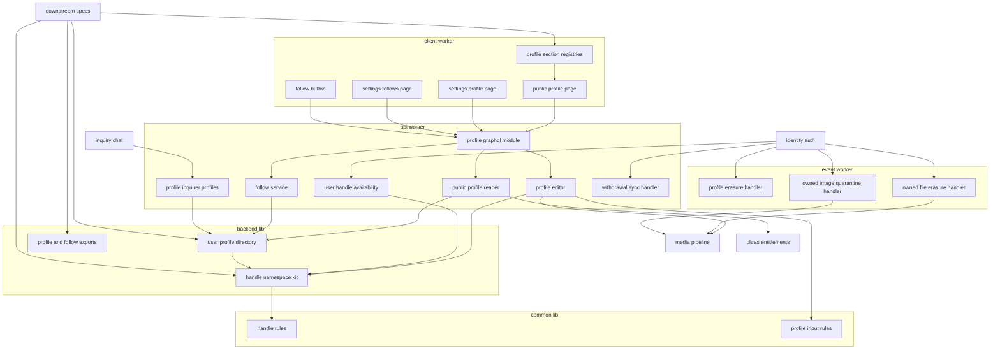
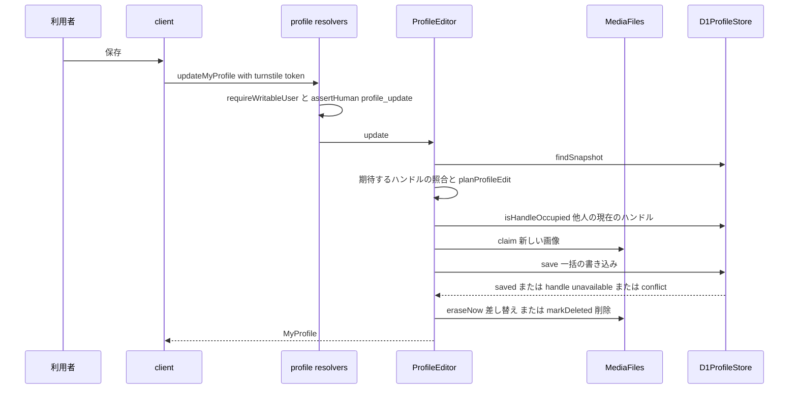
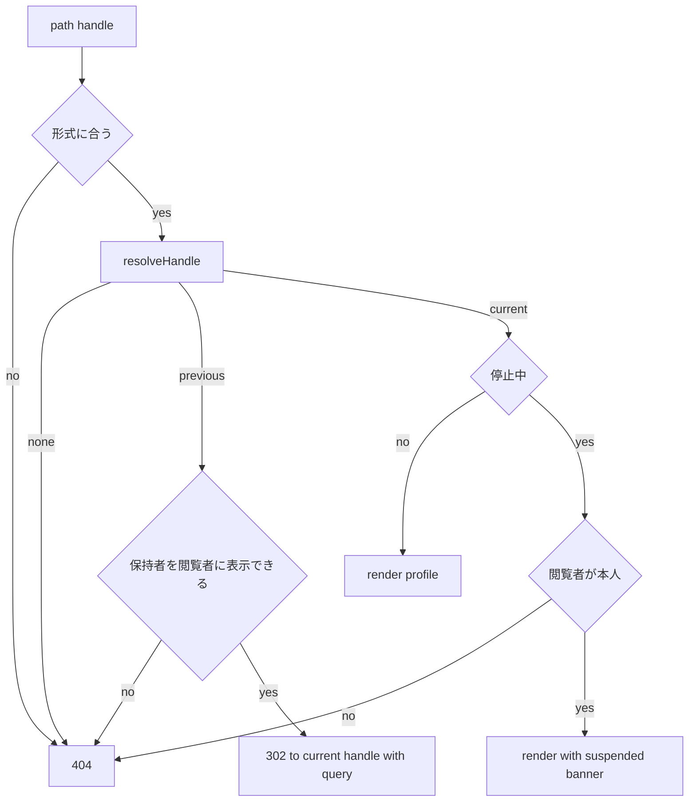
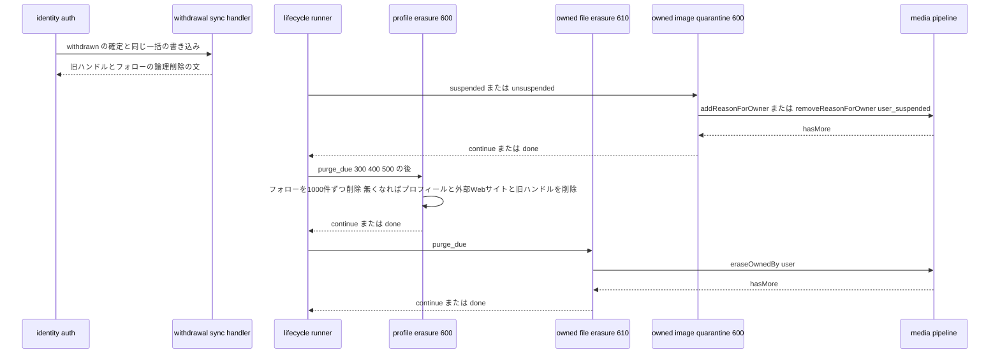
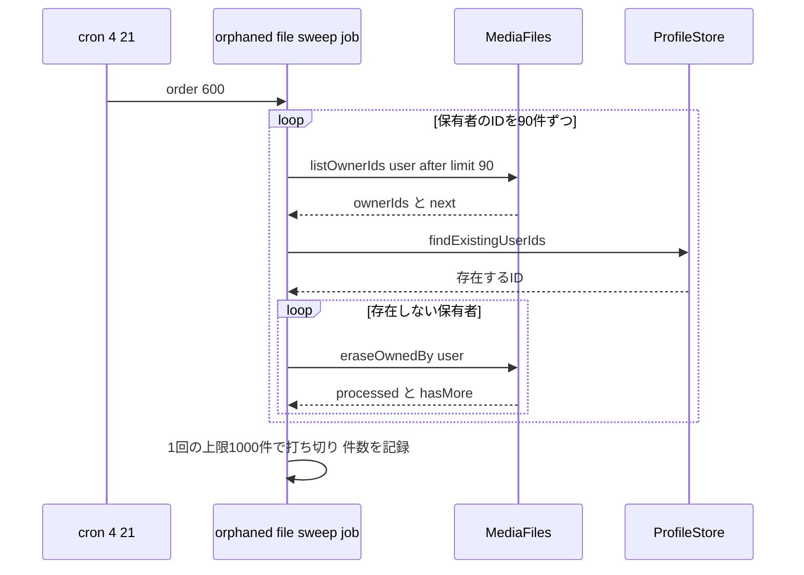

# Design Document

## Overview

**Purpose**: 利用者のプロフィール(ニックネーム・ハンドル・プロフィール画像・ヘッドライン・自己紹介・外部Webサイト)と、利用者間のフォローを実装する。ハンドルは、利用者以外の対象(プロダクト・ヘルプ記事・プロダクトカテゴリ)も同じ規則で使えるハンドル基盤として作る。基盤は、純粋な規則(`apps/common-lib/handles`)と、対象のテーブルの記述を受け取るD1の部品(`apps/backend-lib/workers/handles`)からなり、大文字小文字を区別しない使用中の判定・予約語・旧ハンドルの保持と解決と、他の対象の旧ハンドルを設定したときのその旧ハンドルの削除を提供する。公開プロフィールページ`/@{handle}`の枠は本specが所有し、ローンチ履歴・Upvote履歴などの区画は後続specが登録箇所に加える。

**Users**: 利用者は`/settings/profile`でプロフィールを編集し、`/@{handle}`で公開し、他の利用者の公開プロフィールでフォロー・フォロー解除し、`/settings/follows`で自分のフォロー中・フォロワーを確かめる。後続spec(product-launch・help-center)の開発者はハンドル基盤を、product-launch・match-engine・content-reportingは公開プロフィールの登録箇所を、directory-discoveryはフォローボタンを、engagement・match-engineは利用者の表示の型と照会を、notificationsはフォロワーの照会を、data-exportはプロフィールとフォローの照会を、public-apiはプロフィールの照会と更新のユースケースを使う。

**Impact**: D1に5テーブル(プロフィール・外部Webサイト・利用者の旧ハンドル・フォローと、旧ハンドルの列の共通の定義)を足す。`apps/backend-lib`にハンドル基盤(`workers/handles`)とプロフィールの共有部品(`workers/profile`)を新設し、apiとeventの両方に同じ束縛(`PROFILE_PLATFORM_MODULE`)を入れる。apiにスキーマモジュール`profile`・プロフィールとフォローのユースケース・退会の同期の波及処理を、eventに物理削除・停止の非同期の波及処理を、clientに公開プロフィールページ・プロフィール編集画面・フォロー一覧の画面・フォローボタンを足す。apiの4:21の定期実行に、保有者の利用者が存在しないファイルを物理削除するジョブ`user-profile-social.orphaned-file-sweep`(`order` 600、仮1)を1つ足す。上流のファイルは、契約で定められた登録箇所への追記と、identity-authの`HANDLE_AVAILABILITY`・inquiry-chatの`INQUIRY_TYPES.InquirerProfiles`の束縛の差し替えだけを変える。上流の契約への追加は、media-pipelineの`MediaFiles.listOwnerIds`(仮1のジョブが保有者のIDを列挙するため)だけを依頼する。新しいシークレット・パッケージは無い。

### Goals

- FR-UPROF-001〜013・FR-FOLOW-001〜010が動作し、ハンドルの変更→旧URLの302→再変更、他人の旧ハンドルの設定とその旧ハンドルの削除(仮2)、停止→画像の隔離→停止解除、退会→論理削除→物理削除、保有者の居ないファイルの日次の削除(仮1)のどの経路でも、要件と2026-10-24に確定した仮1〜仮3の決定に一致する。
- ハンドル基盤を、product-launch・help-centerが対象の記述を渡すだけで同じ規則で使える。
- 公開プロフィールに、後続specが本specのファイルを変えずにタブ・バッジ・メニューの項目を加えられる。
- 本specが追加・変更したコードの単体テスト・Workers統合テスト・ブラウザテストがカバレッジ80%を満たす。

### Non-Goals

- 公開プロフィールの「ローンチ履歴」(product-launch)・「Upvote履歴」(match-engine)のタブ、受賞バッジの区画(product-launch)、「このユーザーを通報」の項目(content-reporting)の中身。
- プロダクト・ヘルプ記事・プロダクトカテゴリのハンドルの保存・転送の実装(product-launch・help-center)。
- フォロワーへの通知メールと受信設定(notifications)、停止・退会の操作(ugc-moderation・identity-auth)、ファイルの受け付け・判定・配信・削除の実行(media-pipeline)、データエクスポートのファイルの生成(data-export)、公開APIの経路(public-api)。
- 要件定義書の改訂(roadmapのOut。必要な改訂は[research.md](research.md)の「要件定義書の改訂が必要な箇所」に記録した)。(2026-10-25に要件定義書へ適用済み)

## Boundary Commitments

### This Spec Owns

- ハンドル基盤: `apps/common-lib/handles`(文字種の規則・形式の検査・大文字小文字の同一視・予約語の判定・なりすまし対策の予約語一覧)、`apps/db/schema/handles/previous-handle-columns.ts`(旧ハンドルのテーブルの共通の列)、`apps/backend-lib/workers/handles`(対象の記述`HandleNamespace`・解決・使用中の判定と`CASE`式の条件・旧ハンドルの置き換えと削除の文・他の対象の旧ハンドルを解放する文`previousHandleRelease`)。
- プロフィールとフォローのデータ: `user_profiles`・`user_profile_websites`・`user_previous_handles`(`apps/db/schema/profile/`)と`user_follows`(`apps/db/schema/follow/`)。`users.nickname`・`users.handle`の変更(列の定義はidentity-auth)。
- 入力規則(`apps/common-lib/profile/profile-input-rules.ts`)と外部URLの規則(`apps/common-lib/url/external-url.ts`。product-launchも使う)。
- 共有部品(`apps/backend-lib/workers/profile`): 利用者のハンドルの対象の記述`USER_HANDLE_NAMESPACE`、利用者の表示の照会とハンドルの解決`UserProfileDirectory`、データエクスポートの`ProfileExport`・`FollowExport`、通知の`FollowerDirectory`、両アプリ共通の束縛`PROFILE_PLATFORM_MODULE`。
- apiのプロフィールとフォローのユースケース・D1の実装・スキーマモジュール`profile`(`publicProfile`・`myProfile`・`handleAvailability`・`myFollowing`・`myFollowers`・`updateMyProfile`・`followUser`・`unfollowUser`と共通の型`UserSummary`・`userSummaryLoader`)、identity-authの`HandleAvailability`の実装`UserHandleAvailability`、inquiry-chatの`InquirerProfiles`の実装`ProfileInquirerProfiles`、退会の同期の波及処理`user-profile-social.withdrawal`。
- eventの非同期の波及処理: `user-profile-social.profile-erasure`(`purge_due`、`order` 600)・`user-profile-social.owned-file-erasure`(`purge_due`、`order` 610)・`user-profile-social.owned-image-quarantine`(`suspended`・`unsuspended`、`order` 600)。
- apiの4:21のジョブ`user-profile-social.orphaned-file-sweep`(`order` 600、仮1)。
- media-pipelineの用途`user-avatar`(画像5形式・512,000バイト・利用者)の登録。
- clientの画面: 公開プロフィールページ`/@{$handle}`の枠と区画の登録箇所(`PUBLIC_PROFILE_TABS`・`PUBLIC_PROFILE_BADGES`・`PUBLIC_PROFILE_MENU_ITEMS`)、`/settings/profile`・`/settings/follows`、フォローボタン`FollowButton`と利用者のアバター`UserAvatar`(他specも使う)。
- 技術ドキュメント`backend/011-handle-namespaces.md`・`db/006-user-relationship-lists.md`の新規作成と`backend/007-user-lifecycle-events.md`への節の追記、サービス仕様(ページ配置・文言規則・準拠方針・データエクスポート)の追記。

### Out of Boundary

- `users`の列の定義・状態の遷移・初期ハンドルの生成・ライフサイクルイベントの発行と実行器(identity-auth)。本specは`nickname`・`handle`の更新と、波及処理の登録と`HANDLE_AVAILABILITY`の差し替えだけを行う。
- ファイルの受け付け・検証・判定・配信・隔離の移動・物理削除の実行(media-pipeline)。本specは用途の登録・`claim`・`eraseNow`・`markDeleted`・保有者単位の操作を呼ぶだけである。
- 公開プロフィールの区画の中身(各後続spec)、フォロワーへの通知(notifications)、エクスポートのZIP(data-export)、公開APIの経路と権限(public-api)。
- プロダクト・ヘルプ記事・プロダクトカテゴリの旧ハンドルのテーブル・保存・転送・退会時の論理削除(product-launch・help-center)。本specは部品だけを提供する。
- inquiry-chatの管理画面の一覧の送信者のニックネームの読み取り(`D1InquiryAdminReader`の`users`の結合)。置き換えない。
- Ultrasの加入状態(ultras-subscription)。本specは`UltrasEntitlements.isEntitledAt`の結果だけを使う。

### Allowed Dependencies

- backend-platform: `AppModule`・`PLATFORM_TYPES`(`Database`・`Clock`・`IdGenerator`)・`ScheduledJobDefinition`と`scheduled-jobs.ts`の登録箇所・`AppError`・`getAppLogger`・`ulidPrimaryKey`・`timestamps`・`softDelete`・`notDeleted`・`textNoCase`。形を変えない。
- api-gateway: `defineSchemaModule`・`GraphQLContext`(`resolve`・`assertHuman`・`loaders`)・`withValidatedArgs`・`defineLoader`・`encodeCursor`・`decodeCursor`・`toConnection`・`DateTime`・`PageInfo`、`SessionView`。形を変えない。
- identity-auth: `AccountGuard`(`currentUser`・`requireUser`・`requireWritableUser`・`requireVerifiedUser`)・`IDENTITY_TYPES`・`visibleUsers`・`users`(`id`・`nickname`・`handle`・`status`・`deleted_at`・`created_at`の読み取りと、`nickname`・`handle`・`updated_at`の更新)・`HandleAvailability`・`HANDLE_AVAILABILITY`・`GENERATED_HANDLE_LENGTH`・`GENERATED_HANDLE_ALPHABET`(テストだけ)・`UserLifecycleSyncHandler`・`UserLifecycleSyncRegistration`・`USER_LIFECYCLE_SYNC_HANDLERS`・`UserLifecycleAsyncHandler`・`UserLifecycleAsyncRegistration`・`USER_LIFECYCLE_ASYNC_HANDLERS`・`LifecycleHandlerOutcome`・`checkNickname`・`NICKNAME_MAX_GRAPHEMES`・`SETTINGS_NAV_ITEMS`・`SettingsShell`・`_authenticated`のレイアウト・`RootAuthContext`・`viewerQueryOptions`・`LoginRequiredDialog`・E2Eの`e2e/support/mailpit.ts`。
- media-pipeline: `defineUploadPurpose`・`UPLOAD_PURPOSES`・`IMAGE_MEDIA_TYPES`・`MediaFiles`(`claim`・`eraseNow`・`markDeleted`・`eraseOwnedBy`、仮1で追加を依頼する`listOwnerIds`)・`MediaQuarantine`(`addReasonForOwner`・`removeReasonForOwner`)・`MEDIA_TYPES`・`toMediaImage`・`mediaFileLoader`・GraphQLの`MediaImage`・`ImageUploadField`・`MediaPicture`・`MediaPlaceholder`。`listOwnerIds`の追加のほかは形を変えない。
- content-processing: `countGraphemes`・`hasForbiddenCharacters`・`markdownTextSchema`・`MarkdownEditor`・`useMarkdownOptions`・`useRenderedMarkdown`・`CollapsibleMarkdownContent`。
- ultras-subscription: `ULTRAS_TYPES.UltrasEntitlements`の`isEntitledAt`。
- inquiry-chat: `InquirerProfiles`・`InquirerProfile`・`INQUIRY_TYPES.InquirerProfiles`(束縛の差し替えだけ)。
- frontend-platform: `executeGraphQL`・`graphqlQueryOptions`・`GraphQLClientError`・`useAppForm`・`FormField`・`SubmitButton`・`applyServerFieldErrors`・`useTurnstileToken`・`TurnstileWidget`・`buildPageHead`・`PublicRuntimeConfig.clientSiteOrigin`・`NotFoundView`・`ErrorState`・`PartialErrorState`・`EmptyState`・`LoadingSkeleton`・`notify`・shadcn/uiの部品(タブ・ドロップダウンメニュー・ツールチップ・ボタン)・`runAxe`。
- npmパッケージ: 新規は無い。
- 後続specは、`common-lib/handles`・`previousHandleColumns`・`workers/handles`の公開の関数、`workers/profile`の契約(`UserProfileDirectory`・`ProfileExport`・`FollowExport`・`FollowerDirectory`)、apiの`MyProfileReader`・`ProfileEditor`・GraphQLの`UserSummary`・`userSummaryLoader`、clientの`FollowButton`・`UserAvatar`と3つの登録箇所だけに依存し、本specのテーブルを直接読み書きしない。

### Revalidation Triggers

- ハンドルの規則(`HANDLE_PATTERN`・大文字小文字の同一視・予約語の完全一致)と`HandleNamespace`・`resolveHandle`・`isHandleOccupied`・`handleOccupiedCondition`・`previousHandleUpsert`・`previousHandleRelease`・`previousHandleColumns`の形(product-launch・help-center・プロダクトカテゴリを扱うspec)。仮2(2026-10-24に選択肢Bで確定)により、他の対象の旧ハンドルは使用中に数えず、それを現在のハンドルとして保存する一括の書き込みに`previousHandleRelease`を含めてその旧ハンドルを削除する。この規則を変えたら、ハンドル基盤を使う全specを確かめ直す。
- `IMPERSONATION_RESERVED_HANDLES`の語(product-launch。ページ配置と一致させる)。
- `USER_HANDLE_RULE`(25文字)とidentity-authの初期ハンドルの形式(`GENERATED_HANDLE_LENGTH`・`GENERATED_HANDLE_ALPHABET`)の整合(identity-auth)。
- `PUBLIC_PROFILE_TABS`・`PUBLIC_PROFILE_BADGES`・`PUBLIC_PROFILE_MENU_ITEMS`と`PublicProfileSectionContext`の形(product-launch(タブ`launches`と受賞バッジの区画`product-launch.award-badges`)・match-engine・content-reporting)。
- `FollowButtonProps`・`UserAvatarProps`・GraphQLの`UserSummary`・`userSummaryLoader`の形(directory-discovery・engagement・match-engine)。
- `UserProfileDirectory`・`ProfileExport`・`FollowExport`・`FollowerDirectory`の形と、可視の利用者の扱い(product-launch・notifications・data-export)。データエクスポートの文書の`profile.json`・`follows.json`の項目が変わったら確かめ直す。
- 波及処理の`order`(`purge_due`の600・610、`suspended`・`unsuspended`の600)と、4:21のジョブ`user-profile-social.orphaned-file-sweep`の`order` 600。本specは600番台を使い、identity-auth(100番台・10000以上)・admin-foundation(200番台)・inquiry-chat(300番台)・payments(400番台)・ultras-subscription(500番台)・media-pipeline(800番台)・email-delivery(900〜949)・content-processing(950〜999)・後続spec(1000番台以降)の帯と重ねない。後続specのテーブルが`media_files`へ外部キーを張ると、`purge_due`の610のファイルの物理削除が失敗するため、ファイルのIDは外部キー無しで持つ。
- identity-authの`users`の列・`visibleUsers`・`AccountGuard`・ライフサイクルの登録口の形・`HandleAvailability`の形、media-pipelineの`MediaFiles`(`listOwnerIds`を含む)・`MediaQuarantine`・`OWNER_OPERATION_BATCH_LIMIT`・`hasMore`の意味、inquiry-chatの`InquirerProfiles`の形、ultras-subscriptionの`UltrasEntitlements`の形を変えたら、本specを確かめ直す。

### 上流への影響

| 上流spec       | 変更                                                                                                                                                                                      | 影響と再検証                                                                                                                                                                                                                                                        |
| -------------- | ----------------------------------------------------------------------------------------------------------------------------------------------------------------------------------------- | ------------------------------------------------------------------------------------------------------------------------------------------------------------------------------------------------------------------------------------------------------------------- |
| identity-auth  | `apps/api/src/composition/identity-registrations.ts`の`HANDLE_AVAILABILITY`を`PROFILE_TYPES.UserHandleAvailability`へ差し替える。`SETTINGS_NAV_ITEMS`に`profile`(10)・`follows`(50)を足す | 差し替えはidentity-authの契約どおり。登録時の初期ハンドルの判定に旧ハンドルと予約語が加わる。`/settings`の移動先が最小の`order`の`/settings/profile`に変わるため、identity-authのテストが移動先を`/settings/account`と確かめていれば本specのタスク8.2で期待値を直す |
| inquiry-chat   | `apps/api/src/composition/inquiry-module.ts`の`INQUIRY_TYPES.InquirerProfiles`の束縛を`ProfileInquirerProfiles`へ差し替える                                                               | inquiry-chatの契約どおり(形を変えない)。既定の`D1InquirerProfiles`とそのテストは残す。問い合わせフォームと管理画面の詳細にプロフィール画像が出る                                                                                                                    |
| media-pipeline | `apps/api/src/composition/upload-purposes.ts`の`UPLOAD_PURPOSES`に`user-avatar`を足す                                                                                                     | 契約どおり                                                                                                                                                                                                                                                          |
| media-pipeline | `MediaFiles`に`listOwnerIds({ kind, after, limit })`を加える(仮1。本specは依頼するだけで、media-pipelineのコードと文書は変えない)                                                         | 契約への追加。media-pipelineのspecとタスクに反映して実装されるまで、本specのタスク6.3を保留する                                                                                                                                                                     |

- 上流specの文書の変更は本specでは行わない。media-pipelineへの`listOwnerIds`の追加は依頼として報告する。roadmapの帯の割り当ての表の本specの「使用中の値」は「4:21は600、波及処理は600・610」になる(本specはroadmapを編集しないため、コントローラーへ報告する)。

## Architecture

### Existing Architecture Analysis

- 上流の14specは設計・タスクとも承認済みで、本specのタスクはそれらの実装の完了を前提にする(roadmapの順でultras-subscriptionまでが先に実装される)。実装済みはdev-toolingだけである。
- `users.handle`は`text collate nocase`で全行一意。旧ハンドルは本specのテーブルに置くため、現在のハンドルの衝突は保存の一括の書き込みの先頭の文の`CASE`式で、他人の旧ハンドルとの重なりは同じ一括の書き込みに含めるその旧ハンドルの削除の文(`previousHandleRelease`、仮2)で防ぐ(identity-authの`UserLifecycleCommitter`と同じ方式)。D1の`db.batch()`は1つのトランザクションで直列に確定する。
- ライフサイクルの同期の波及処理はapi(退会の確定と同じ一括の書き込み)、非同期の波及処理はevent(`identity.run-user-lifecycle`の実行器)で動く。`purge_due`の全波及処理の完了後にidentity-authが`users`の行を消す。
- ドメインのテーブルはファイルのIDを`media_files`への外部キー無しで持つ(inquiry-chat・admin-foundation)。保有者単位の操作は1回1,000件で`hasMore`を返す。
- マークダウンの描画はフロントエンドで行い、APIは原文の文字列を返す。

### Architecture Pattern & Boundary Map



**Architecture Integration**:

- Selected pattern: クリーンアーキテクチャ(apiの`domain`→`application`→`infrastructure`・`presentation`→`composition`)。ハンドル基盤は「純粋な規則」と「対象の記述を受け取るD1の関数」に分け、プロフィール・フォローのユースケースはポート越しにD1を使う。外部への副作用(画像の削除)は保存の確定の後に呼び、失敗はmedia-pipelineの日次バッチに任せる。
- Domain/feature boundaries: ハンドルの規則と旧ハンドルは本spec、`users`の定義とライフサイクルはidentity-auth、ファイルはmedia-pipeline、特典はultras-subscription、区画の中身は後続spec。
- Existing patterns preserved: `backend-lib/workers/<ドメイン>`の共有の束縛、`<spec名>.<名詞句>`の波及処理の名前、登録箇所への追記による区画の追加(`SETTINGS_NAV_ITEMS`・`PRICING_SECTIONS`と同じ形)、`CASE`式のNOT NULL制約の違反による一括の書き込みの取り消し、カーソルの`encodeCursor`。
- New components rationale: ハンドル基盤は3つの後続specが使うため共有ディレクトリに置く。利用者の表示の照会は、プロフィール画像のIDを持つ本specだけが提供できる。エクスポート・通知の照会はeventで動くため`backend-lib/workers/profile`に置く。
- Steering compliance: Inversifyの`@inject`の明示、D1の制約(`db.batch()`・バインド変数100個以内・`onConflictDoNothing`)、テーブルの作成時の`textNoCase`、Infisical(新規なし)、800行以内のファイル、1ファイル1コンポーネント、日時の`<time datetime>`。

**Dependency direction**: `apps/common-lib/{handles,profile,url}` → `apps/db/schema/{handles,profile,follow}` → `backend-lib/workers/handles` → `backend-lib/workers/profile` → 各アプリの`src`(`domain` → `application` → `infrastructure`・`presentation` → `composition`)。`common-lib`は他のどの層も読み込まない。clientは`common-lib`とGraphQLの操作だけを読み込む。`workers/handles`は`workers/profile`を読み込まない(利用者に閉じない)。

### Technology Stack

| Layer     | Choice / Version                                                                                        | Role in Feature                                          | Notes                                   |
| --------- | ------------------------------------------------------------------------------------------------------- | -------------------------------------------------------- | --------------------------------------- |
| Frontend  | TanStack Start・Router・Query・shadcn/ui(frontend-platform)、`MarkdownEditor`・`ImageUploadField`(上流) | 公開プロフィール・編集画面・フォロー一覧・フォローボタン | ルート`/@{$handle}`(接頭辞付きの引数)   |
| Backend   | Hono・Inversify・GraphQL Yoga(上流)                                                                     | スキーマモジュール・ユースケース・波及処理               | 既存                                    |
| Data      | Cloudflare D1(Drizzle)                                                                                  | 4テーブル                                                | 新規のマイグレーション(`textNoCase`)    |
| Messaging | Cloudflare Queues(identity-authの`identity.run-user-lifecycle`)・Cron Triggers(api、4:21)               | 非同期の波及処理・保有者の居ないファイルの日次の削除     | 新しいメッセージ種別は無い。ジョブは1つ |
| External  | Turnstile(backend-platform・frontend-platform経由)                                                      | プロフィールの保存・フォローのbot対策                    | `action`は`profile_update`・`follow`    |

## File Structure Plan

### Directory Structure

```
apps/
├── common-lib/                                         # 4アプリ共通(各ファイルに同名の*.unit.test.ts)
│   ├── handles/handle-rules.ts                         # HANDLE_PATTERN・HandleRule・checkHandleFormat・toHandleKey・isSameHandle・isReservedHandle・IMPERSONATION_RESERVED_HANDLES
│   ├── profile/profile-input-rules.ts                  # USER_HANDLE_RULE・各上限・PROFILE_WEBSITES_MAX(10、仮3)・USER_AVATAR_PURPOSE・USER_AVATAR_MAX_BYTES・checkHeadline・checkWebsiteName
│   └── url/external-url.ts                             # EXTERNAL_URL_MAX_LENGTH・checkExternalUrl・externalUrlHost(product-launchも使う)
├── db/schema/                                          # テーブル定義(各ファイルに同名の*.unit.test.ts)
│   ├── handles/previous-handle-columns.ts              # previousHandleColumns(旧ハンドルのテーブルの共通の列)
│   ├── profile/
│   │   ├── user-profiles.ts                            # ヘッドライン・自己紹介・プロフィール画像のID
│   │   ├── user-profile-websites.ts                    # 外部Webサイト(位置・名前・URL)
│   │   ├── user-previous-handles.ts                    # 利用者の旧ハンドル(1人1件)
│   │   └── index.ts
│   └── follow/
│       ├── user-follows.ts                             # フォロー(組の一意・自分自身のCHECK)
│       └── index.ts
├── backend-lib/workers/
│   ├── handles/                                        # ハンドル基盤のD1の部品(Workers統合テスト)
│   │   ├── handle-namespace.ts                         # HandleNamespace・HandleSource・defineHandleNamespace
│   │   ├── handle-queries.ts                           # resolveHandle・isHandleOccupied・handleOccupiedCondition
│   │   └── previous-handle-statements.ts               # previousHandleUpsert・previousHandleRelease・previousHandleSoftDelete・previousHandleDelete
│   └── profile/                                        # api・event共通の部品(Workers統合テスト)
│       ├── profile-platform-types.ts                   # PROFILE_PLATFORM_TYPES(テストなし)
│       ├── user-handle-namespace.ts                    # USER_HANDLE_NAMESPACE
│       ├── user-profile-directory.ts                   # UserSummaryRecord・UserHandleResolution・UserProfileDirectory(型)
│       ├── d1-user-profile-directory.ts                # 表示の照会とハンドルの解決
│       ├── profile-export.ts                           # ProfileExportRecord・ProfileExport(型)
│       ├── d1-profile-export.ts
│       ├── follow-directory.ts                         # FollowExport・FollowerDirectory(型)
│       ├── d1-follow-directory.ts
│       └── profile-platform-module.ts                  # PROFILE_PLATFORM_MODULE
├── api/src/
│   ├── domain/profile/                                 # 純粋な規則(Bunの単体テスト)
│   │   ├── profile-edit-plan.ts                        # ハンドルの変更の種類・旧ハンドル・画像の操作の決定
│   │   └── website-list.ts                             # 外部Webサイトの正規化と件数の検査
│   ├── application/profile/                            # ユースケース(Bunの単体テスト)
│   │   ├── profile-types.ts                            # PROFILE_TYPES
│   │   ├── ports.ts                                    # ProfileStore・PublicProfileStore・FollowStoreと各型
│   │   ├── profile-editor.ts                           # ProfileEditor(保存。public-apiも使う)
│   │   ├── my-profile-reader.ts                        # MyProfileReader(public-apiも使う)
│   │   ├── public-profile-reader.ts                    # 公開プロフィールの解決・公開範囲・転送
│   │   ├── handle-availability-checker.ts              # 編集画面の使用可否
│   │   ├── user-handle-availability.ts                 # identity-authのHandleAvailabilityの実装
│   │   ├── follow-service.ts                           # フォロー・フォロー解除
│   │   ├── follow-list-reader.ts                       # 自分のフォロー中・フォロワー
│   │   └── jobs/orphaned-file-sweep-job.ts             # 4:21の保有者の居ないファイルの物理削除(order 600、仮1)
│   ├── infrastructure/profile/                         # Workers統合テスト
│   │   ├── d1-profile-store.ts                         # 編集の読み取りと保存の一括の書き込み
│   │   ├── d1-public-profile-store.ts                  # 公開プロフィールの読み取り(1回のbatch)
│   │   ├── d1-follow-store.ts                          # フォローの記録・削除・数・一覧
│   │   ├── profile-inquirer-profiles.ts                # inquiry-chatのInquirerProfilesの画像付きの実装
│   │   └── profile-withdrawal-sync-handler.ts          # 退会の同期の波及処理(論理削除の文)
│   ├── presentation/graphql/modules/profile/           # スキーマモジュール(Workers統合テスト)
│   │   ├── type-defs.ts
│   │   ├── inputs.ts                                   # zodスキーマ(common-libの規則とmarkdownTextSchema)
│   │   ├── errors.ts                                   # エラーコードと文言
│   │   ├── user-summary.ts                             # UserSummaryの項目のリゾルバとuserSummaryLoader
│   │   ├── profile-resolvers.ts                        # publicProfile・myProfile・handleAvailability・updateMyProfile
│   │   ├── follow-resolvers.ts                         # myFollowing・myFollowers・followUser・unfollowUser
│   │   └── index.ts                                    # profileSchemaModule
│   └── composition/profile-module.ts                   # PROFILE_MODULE(apiの束縛)
├── event/src/
│   ├── application/profile/                            # Bunの単体テスト
│   │   ├── event-profile-types.ts                      # EVENT_PROFILE_TYPES
│   │   ├── ports.ts                                    # ProfilePurgeStore
│   │   ├── profile-erasure-handler.ts                  # purge_due 600
│   │   ├── owned-file-erasure-handler.ts               # purge_due 610
│   │   └── owned-image-quarantine-handler.ts           # suspended・unsuspended 600
│   ├── infrastructure/profile/d1-profile-purge-store.ts # フォロー1,000件ずつと残りの行の物理削除
│   └── composition/profile-module.ts                   # eventの束縛
└── client/src/
    ├── routes/@{$handle}.tsx                           # /@{handle}(ログイン不要、302・404の分岐)
    ├── routes/_authenticated/settings/profile.tsx      # /settings/profile
    ├── routes/_authenticated/settings/follows.tsx      # /settings/follows
    ├── composition/public-profile-sections.ts          # PUBLIC_PROFILE_TABS・BADGES・MENU_ITEMS(後続specが追記、初版は空)
    ├── components/profile/                             # 1ファイル1コンポーネント(browser testを併置)
    │   ├── public-profile-section-types.ts             # PublicProfileSectionContext・各登録の型(テストなし)
    │   ├── public-profile-page.tsx                     # 2カラムの枠・停止中の帯・区画
    │   ├── profile-card.tsx                            # 人物情報のカード
    │   ├── profile-avatar.tsx                          # 96px(640px未満80px)とUltrasの輪
    │   ├── follower-count.tsx                          # フォロワー数(本人はリンク)
    │   ├── external-website-list.tsx                   # 外部Webサイトの一覧
    │   ├── profile-completion.tsx                      # 未入力の案内
    │   ├── suspended-profile-banner.tsx                # 停止中の本人の帯
    │   ├── profile-actions-menu.tsx                    # 「…」メニュー
    │   ├── profile-tabs.tsx                            # タブと追従
    │   ├── profile-skeleton.tsx                        # 初回ローディング
    │   ├── profile-edit-form.tsx                       # 編集フォーム全体
    │   ├── avatar-field.tsx                            # プロフィール画像の選択・削除
    │   ├── handle-field.tsx                            # ハンドルと使用可否・旧ハンドルの案内
    │   ├── website-fields.tsx                          # 外部Webサイトの行(最大10件)
    │   └── profile-form-schema.ts                      # フォームのzodスキーマ(テストは*.unit.test.ts)
    ├── components/follow/
    │   ├── follow-button.tsx                           # フォローボタン(他specも使う)
    │   ├── follow-list-page.tsx                        # フォロー一覧の画面
    │   └── follow-list.tsx                             # 1つのタブの一覧と続き
    ├── components/user/user-avatar.tsx                 # MediaPictureとプレースホルダー(他specも使う)
    └── graphql/operations/profile/
        ├── public-profile.ts                           # publicProfile
        ├── my-profile.ts                               # myProfile・handleAvailability・updateMyProfile
        └── follow.ts                                   # myFollowing・myFollowers・followUser・unfollowUser
e2e/client/
├── profile.e2e.test.ts                                 # 編集・公開・旧ハンドルの302・予約語
└── follow.e2e.test.ts                                  # フォロー・数・一覧・解除
docs/GUIDES/tech/
├── backend/011-handle-namespaces.md                    # ハンドルの対象・旧ハンドル・転送の規約
└── db/006-user-relationship-lists.md                   # 利用者間の関係・可視性で絞った数・カーソル
```

テストは各ファイルの隣に置く(`*.unit.test.ts`・`*.worker.test.ts`・`*.browser.test.tsx`)。文書の番号は、roadmapの順でultras-subscription(`backend/010`)の後の空き番号`backend/011`・`db/006`に固定する。

### Modified Files

- `apps/db/schema/index.ts`・`apps/db/migrations/<日時>_user_profile_social/migration.sql` — 4テーブルの再エクスポートと生成したマイグレーション(`textNoCase`・CHECK・部分でない一意索引)。mainの最新を取り込んでから生成する。
- `apps/api/src/composition/modules.ts`・`graphql-modules.ts`・`scheduled-jobs.ts` — `PROFILE_PLATFORM_MODULE`・`PROFILE_MODULE`・`profileSchemaModule`・4:21のジョブ`user-profile-social.orphaned-file-sweep`(600)。
- `apps/api/src/composition/identity-registrations.ts`(identity-auth) — `HANDLE_AVAILABILITY`を`PROFILE_TYPES.UserHandleAvailability`へ。
- `apps/api/src/composition/user-lifecycle-sync-handlers.ts`(identity-auth) — `user-profile-social.withdrawal`。
- `apps/api/src/composition/upload-purposes.ts`(media-pipeline) — `user-avatar`。
- `apps/api/src/composition/inquiry-module.ts`(inquiry-chat) — `INQUIRY_TYPES.InquirerProfiles`を`PROFILE_TYPES.ProfileInquirerProfiles`へ転送する束縛に。
- `apps/event/src/composition/modules.ts`・`user-lifecycle-async-handlers.ts` — `PROFILE_PLATFORM_MODULE`・eventの束縛・3つの非同期の波及処理。
- `apps/client/src/composition/settings-navigation.ts` — `{ to: '/settings/profile', label: 'プロフィール', order: 10 }`・`{ to: '/settings/follows', label: 'フォロー', order: 50 }`。
- `docs/GUIDES/tech/backend/007-user-lifecycle-events.md` — 「保有者単位で上限件数ずつ処理する操作の対応付け」の節(`hasMore`を`continue`へ、外部キーを持たないデータの規約)。
- `docs/GUIDES/tech/backend/README.md`・`db/README.md` — 文書一覧の行。
- `docs/GUIDES/service/design/002-page-layouts.md` — 公開プロフィールの区画の登録、旧ハンドルの扱い(他の利用者が設定でき、その時点で元の保持者の旧ハンドルを削除して転送を止める(仮2)、大文字小文字だけの変更)、`/settings/profile`・`/settings/follows`の配置。
- `docs/GUIDES/service/design/003-text-and-copy-rules.md` — 外部Webサイトの件数(10件、仮3)の行、エラー・状態・トーストの文言(Error Handlingの表)。
- `docs/GUIDES/service/legal/001-compliance-policy.md` — 旧ハンドルの行と注5に、他の利用者(対象)が同じ文字列を設定した時点で削除すること(仮2)。
- `docs/GUIDES/service/overview/007-daily-timeline.md` — 4:21の表に`user-profile-social.orphaned-file-sweep`(600)の行(仮1)。
- `docs/GUIDES/service/features/001-user-data-export.md` — `websites[].name`が未入力なら空文字列であること。
- `docs/onboardings/project-values.md` — 波及処理とジョブの名前と`order`、用途`user-avatar`。
- `CLAUDE.md` — 「技術規則の参照先」に「ハンドル(URLの識別子)を持つテーブルを定義する前に: `backend/011`」を加える。

## System Flows

### プロフィールの保存



- 一括の書き込みの並び: (1)`user_profiles`の挿入または更新。`user_id`の値を`CASE WHEN <利用者が可視> AND <users.handleが期待するハンドルとBINARYで一致> AND NOT <handleOccupiedCondition> THEN ? ELSE NULL END`にし、満たさなければNOT NULL制約の違反で全体を取り消す。(2)`users`の`nickname`・`handle`・`updated_at`の更新。(3)別の文字列への変更のときだけ、`previousHandleRelease`(新しいハンドルと一致する他の利用者の旧ハンドルの行を物理削除し、転送を止める。仮2)と`previousHandleUpsert`(本人の変更前のハンドル。既存を置き換え、`deleted_at`を空に)。(4)`user_profile_websites`の全削除と最大10行の挿入(仮3)。
- 失敗の分類は読み直しで行う(利用者が可視でない→`account_unavailable`、ハンドルが期待と違う→`profile_update_conflict`、それ以外の一意索引・条件の違反→`handle_unavailable`)。
- 画像の`claim`は既に紐付け済みなら変えないため、保存の失敗後の再送でも同じ画像で成功する。以前の画像の削除は確定の後だけ行い、`eraseNow`の失敗はmedia-pipelineの日次バッチが完了させる(`warn`のログ)。

### 公開プロフィールの解決



- 解決は大文字小文字を区別しない。現在のハンドルを優先し、旧ハンドルは論理削除されていないもの(退会者の分を除く)だけを返す。退会済みの利用者の現在のハンドルは解決しない(`users.deleted_at IS NULL`)。
- 「表示できる」は、保持者が可視、または停止中で閲覧者が本人であること(`UserAccountRules.canViewOwnProfile`と同じ規則)。
- 他の利用者が旧ハンドルと同じ文字列を設定すると、その保存の一括の書き込みで旧ハンドルの行が消えるため、以後は`current`(新しい設定者)として解決される(仮2)。

### 退会・停止・物理削除の波及処理



- `purge_due`の順は、inquiry-chat(300)・payments(400)・ultras-subscription(500)の後に本specの600・610、その後に後続spec(1000番台以降)・identity-auth(10000)・`users`の物理削除である。後続specの行はファイルのIDを外部キー無しで持つため、610の削除は止まらない。
- 停止の解除では`user_suspended`だけを取り除き、他の理由の残る画像は隔離のままになる(media-pipelineの規則、FR-ADMUG-028)。

### 保有者の居ないファイルの日次の削除(仮1)



- 存在の判定は`users`の行の有無(退会済みで物理削除前の利用者は存在する)で行う。利用者の行は`purge_due`の全波及処理(本specの610の`eraseOwnedBy`を含む)の後に消えるため、通常の退会では対象が残らない。対象になるのは、本specの導入より前にstagingで物理削除された利用者のファイルと、波及処理の不具合で取り残されたファイルである。
- 1回の実行で物理削除するファイルを合計1,000件(`ORPHANED_FILE_SWEEP_LIMIT`)までとし、残りは翌日の実行で続ける。保有者ごとの`eraseOwnedBy`の失敗は`warn`のログに記録して次の保有者へ進み、ジョブ全体を失敗させない。

## Requirements Traceability

| Requirement                        | Summary                                      | Components                                                                                      | Interfaces                                                                                 | Flows                              |
| ---------------------------------- | -------------------------------------------- | ----------------------------------------------------------------------------------------------- | ------------------------------------------------------------------------------------------ | ---------------------------------- |
| 1.1, 1.2                           | 形式と大文字小文字                           | HandleRules、ProfileInputRules、ProfileInputs、ProfileFormSchema                                | `checkHandleFormat`・`USER_HANDLE_RULE`                                                    | プロフィールの保存                 |
| 1.3, 1.4, 1.5, 1.6                 | 使用中・他人の旧ハンドルの解放・予約語・同時 | ProfileEditor、HandleQueries、PreviousHandleStatements、D1ProfileStore                          | `isHandleOccupied`・`handleOccupiedCondition`・`previousHandleRelease`・`isReservedHandle` | プロフィールの保存                 |
| 1.7                                | フォーカスアウトの判定                       | HandleAvailabilityChecker、HandleField                                                          | `handleAvailability`                                                                       | —                                  |
| 1.8, 1.9                           | 初期ハンドル                                 | UserHandleAvailability                                                                          | `HandleAvailability.isAvailable`                                                           | —                                  |
| 2.1, 2.2, 2.3, 2.4                 | 旧ハンドルの保持                             | ProfileEditPlan、PreviousHandleStatements、D1ProfileStore                                       | `planProfileEdit`・`previousHandleUpsert`                                                  | プロフィールの保存                 |
| 2.5, 2.6                           | 302と404                                     | PublicProfileReader、PublicProfileRoute                                                         | `publicProfile`・`PublicProfileRedirect`                                                   | 公開プロフィールの解決             |
| 2.7                                | 旧ハンドルの案内                             | HandleField、MyProfileReader                                                                    | `MyProfile.previousHandle`                                                                 | —                                  |
| 3.1, 3.2, 3.3, 3.4, 3.5, 3.6       | ハンドル基盤                                 | HandleRules、PreviousHandleColumns、HandleNamespace、HandleQueries、PreviousHandleStatements    | `HandleNamespace`ほか                                                                      | —                                  |
| 3.8                                | 他の対象の旧ハンドルの解放                   | HandleQueries、PreviousHandleStatements                                                         | `previousHandleRelease`                                                                    | プロフィールの保存                 |
| 3.7                                | 対象を足す手順                               | ProfileTechDocs(`backend/011`)                                                                  | —                                                                                          | —                                  |
| 4.1, 4.2                           | 編集画面とナビゲーション                     | ProfileEditRoute、ProfileEditForm、MyProfileReader、SETTINGS_NAV_ITEMS                          | `myProfile`                                                                                | —                                  |
| 4.3, 4.4, 4.5, 4.6, 4.7, 4.8       | 検証と入力                                   | ProfileInputs、ProfileFormSchema、WebsiteList、WebsiteFields、ExternalUrlRules、ProfileEditForm | `updateMyProfile`                                                                          | —                                  |
| 4.9, 4.10, 4.11, 4.12              | bot対策・停止中・未確認                      | ProfileResolvers、ProfileEditForm                                                               | `assertHuman('profile_update')`・`requireWritableUser`                                     | プロフィールの保存                 |
| 4.13, 4.14, 4.15                   | 保存後・競合・未ログイン                     | ProfileEditForm、ProfileEditor、ProfileEditRoute                                                | `expectedHandle`・`profile_update_conflict`                                                | プロフィールの保存                 |
| 5.1, 5.2                           | 画像の選択と上限                             | AvatarField、ProfileInputRules                                                                  | `ImageUploadField`・`user-avatar`                                                          | —                                  |
| 5.3, 5.4, 5.5                      | 差し替え・削除・不正な画像                   | ProfileEditor、ProfileEditPlan                                                                  | `MediaFiles.claim`・`eraseNow`・`markDeleted`                                              | プロフィールの保存                 |
| 5.6                                | プレースホルダー                             | UserAvatar、ProfileAvatar                                                                       | `MediaPicture`・`toMediaImage`                                                             | —                                  |
| 6.1, 6.12                          | URLとタイトル                                | PublicProfileRoute                                                                              | `buildPageHead`                                                                            | 公開プロフィールの解決             |
| 6.2, 6.3, 6.4, 6.5                 | 人物情報とリンク                             | ProfileCard、ExternalWebsiteList、PublicProfileReader                                           | `PublicProfile`                                                                            | —                                  |
| 6.6                                | フォロワー数                                 | FollowerCount、D1PublicProfileStore                                                             | `PublicProfile.followerCount`                                                              | —                                  |
| 6.7, 6.8                           | Ultrasの表示                                 | ProfileAvatar、PublicProfileReader                                                              | `UltrasEntitlements.isEntitledAt`                                                          | —                                  |
| 6.9, 6.10, 6.11                    | 本人・未入力・状態                           | ProfileCard、ProfileCompletion、ProfileSkeleton、PublicProfileRoute                             | `viewerRelation`                                                                           | —                                  |
| 7.1, 7.2, 7.3, 7.4, 7.5            | 公開範囲                                     | PublicProfileReader、PublicProfileRoute、SuspendedProfileBanner                                 | `publicProfile`(nullは404)                                                                 | 公開プロフィールの解決             |
| 8.1, 8.2, 8.3, 8.4, 8.7, 8.8       | タブ                                         | ProfileTabs、PublicProfileSections、PublicProfilePage                                           | `PUBLIC_PROFILE_TABS`・`PublicProfileSectionContext`                                       | —                                  |
| 8.5, 8.6                           | バッジとメニュー                             | ProfileCard、ProfileActionsMenu、PublicProfileSections                                          | `PUBLIC_PROFILE_BADGES`・`PUBLIC_PROFILE_MENU_ITEMS`                                       | —                                  |
| 9.1, 9.2, 9.8, 9.9, 9.10           | フォローボタン                               | FollowButton、FollowResolvers、FollowService                                                    | `followUser`・`unfollowUser`・`assertHuman('follow')`                                      | —                                  |
| 9.3, 9.4, 9.5, 9.6, 9.7, 9.11      | 拒否と冪等                                   | FollowService、D1FollowStore、FollowSchema                                                      | `cannot_follow_self`・`follow_target_unavailable`                                          | —                                  |
| 10.1, 10.2, 10.3, 10.5, 10.6, 10.8 | フォロー一覧の画面                           | FollowListPage、FollowList、FollowListRoute、SETTINGS_NAV_ITEMS                                 | `myFollowing`・`myFollowers`                                                               | —                                  |
| 10.4, 10.7                         | 可視性と本人だけ                             | FollowListReader、D1FollowStore                                                                 | `FollowEntryConnection`                                                                    | —                                  |
| 11.1                               | 退会の論理削除                               | ProfileWithdrawalSyncHandler、PreviousHandleStatements                                          | `UserLifecycleSyncHandler`                                                                 | 退会・停止・物理削除の波及処理     |
| 11.2, 11.6                         | 記録の物理削除                               | ProfileErasureHandler、D1ProfilePurgeStore                                                      | `UserLifecycleAsyncHandler`                                                                | 退会・停止・物理削除の波及処理     |
| 11.3, 11.7                         | ファイルの物理削除                           | OwnedFileErasureHandler                                                                         | `MediaFiles.eraseOwnedBy`                                                                  | 退会・停止・物理削除の波及処理     |
| 11.4, 11.5                         | 停止の隔離理由                               | OwnedImageQuarantineHandler                                                                     | `MediaQuarantine.addReasonForOwner`・`removeReasonForOwner`                                | 退会・停止・物理削除の波及処理     |
| 11.8                               | 再試行                                       | 3つの非同期の波及処理(例外を投げる)                                                             | `USER_LIFECYCLE_RETRY_POLICY`(identity-auth)                                               | —                                  |
| 11.9                               | 保有者の居ないファイルの日次の削除(仮1)      | OrphanedFileSweepJob、D1ProfileStore                                                            | `MediaFiles.listOwnerIds`・`eraseOwnedBy`・`ScheduledJobDefinition`                        | 保有者の居ないファイルの日次の削除 |
| 12.1                               | 問い合わせの表示                             | ProfileInquirerProfiles、UserProfileDirectory                                                   | `InquirerProfiles.findMany`                                                                | —                                  |
| 12.2, 12.3                         | 表示の照会とハンドルの解決                   | UserProfileDirectory、UserSummaryModule                                                         | `findSummaries`・`resolveHandle`・`UserSummary`・`userSummaryLoader`                       | —                                  |
| 12.4                               | profile.json                                 | ProfileExport                                                                                   | `ProfileExport.find`                                                                       | —                                  |
| 12.5, 12.6                         | follows.jsonとフォロワー                     | FollowExport、FollowerDirectory                                                                 | `listFollowing`・`listVisibleFollowerIds`                                                  | —                                  |
| 12.7                               | 公開APIからの利用                            | ProfileEditor、MyProfileReader                                                                  | application層のユースケース                                                                | —                                  |
| 12.8                               | api・event                                   | ProfilePlatformModule                                                                           | `PROFILE_PLATFORM_MODULE`                                                                  | —                                  |
| 12.9                               | ログ                                         | 全コンポーネント(ログの規約)                                                                    | `getAppLogger`                                                                             | —                                  |
| 13.1, 13.2, 13.3                   | テスト                                       | Testing Strategy                                                                                | —                                                                                          | —                                  |
| 13.4                               | 技術ドキュメント                             | ProfileTechDocs                                                                                 | —                                                                                          | —                                  |
| 13.5                               | サービス仕様                                 | ProfileServiceSpecs                                                                             | —                                                                                          | —                                  |

## Components and Interfaces

| Component                                                                                                                                                         | Domain/Layer        | Intent                                                               | Req Coverage                                        | Key Dependencies                                   | Contracts |
| ----------------------------------------------------------------------------------------------------------------------------------------------------------------- | ------------------- | -------------------------------------------------------------------- | --------------------------------------------------- | -------------------------------------------------- | --------- |
| HandleRules                                                                                                                                                       | common-lib          | ハンドルの文字種・同一視・予約語                                     | 1.1, 1.2, 1.5, 3.2, 3.5, 3.6                        | —                                                  | Service   |
| ProfileInputRules・ExternalUrlRules                                                                                                                               | common-lib          | 上限・URLの検査・用途                                                | 4.3, 4.4, 4.6, 5.1, 5.2                             | content-processing (P0)                            | Service   |
| PreviousHandleColumns・ProfileSchema・FollowSchema                                                                                                                | db                  | 4テーブルと旧ハンドルの共通の列                                      | 2.1, 3.1, 9.11, 11.1                                | backend-platform (P0)                              | State     |
| HandleNamespace・HandleQueries・PreviousHandleStatements                                                                                                          | backend-lib/handles | 対象の記述・解決・使用中の判定・旧ハンドルの文                       | 1.3, 1.4, 1.6, 2.1, 3.1, 3.3, 3.4, 3.8              | D1 (P0)                                            | Service   |
| UserProfileDirectory                                                                                                                                              | backend-lib/profile | 表示の照会とハンドルの解決                                           | 12.1, 12.2, 12.3, 12.8                              | HandleQueries (P0)                                 | Service   |
| ProfileExport・FollowExport・FollowerDirectory                                                                                                                    | backend-lib/profile | エクスポートと通知の照会                                             | 12.4, 12.5, 12.6, 12.8                              | D1 (P0)                                            | Service   |
| ProfilePlatformModule                                                                                                                                             | backend-lib/profile | 両アプリ共通の束縛                                                   | 12.8                                                | Inversify (P0)                                     | —         |
| ProfileEditPlan・WebsiteList                                                                                                                                      | api/domain          | 保存の決定と外部Webサイトの正規化                                    | 2.1, 2.2, 2.3, 4.6, 4.7, 5.3, 5.4                   | HandleRules (P0)                                   | Service   |
| ProfileEditor・MyProfileReader                                                                                                                                    | api/application     | 保存と自分のプロフィール                                             | 1.3〜1.6, 2.1〜2.3, 4.3, 4.12, 4.14, 5.3〜5.5, 12.7 | MediaFiles (P0)、ProfileStore (P0)                 | Service   |
| HandleAvailabilityChecker・UserHandleAvailability                                                                                                                 | api/application     | 編集画面と登録の使用可否                                             | 1.7, 1.8, 1.9                                       | HandleQueries (P0)                                 | Service   |
| PublicProfileReader                                                                                                                                               | api/application     | 公開プロフィールの解決と公開範囲                                     | 2.5, 2.6, 6.2, 6.6, 6.7, 6.8, 7.1〜7.5              | UserProfileDirectory (P0)、UltrasEntitlements (P1) | Service   |
| FollowService・FollowListReader                                                                                                                                   | api/application     | フォローと一覧                                                       | 9.1〜9.7, 9.11, 10.2, 10.4, 10.7                    | FollowStore (P0)、AccountGuard (P0)                | Service   |
| D1ProfileStore・D1PublicProfileStore・D1FollowStore                                                                                                               | api/infrastructure  | D1の実装                                                             | 1.6, 2.1, 4.14, 6.6, 9.7, 10.2, 10.4, 11.9          | D1 (P0)                                            | State     |
| OrphanedFileSweepJob                                                                                                                                              | api/application     | 保有者の居ないファイルの日次の物理削除(仮1)                          | 11.9                                                | MediaFiles (P0)、ProfileStore (P0)                 | Batch     |
| ProfileInquirerProfiles                                                                                                                                           | api/infrastructure  | 問い合わせの表示の画像付きの実装                                     | 12.1                                                | UserProfileDirectory (P0)                          | Service   |
| ProfileWithdrawalSyncHandler                                                                                                                                      | api/infrastructure  | 退会の論理削除                                                       | 11.1                                                | identity-auth (P0)                                 | Event     |
| ProfileSchemaModule(ProfileInputs・ProfileResolvers・FollowResolvers・UserSummaryModule)                                                                          | api/presentation    | GraphQLの型と操作                                                    | 1.1, 1.7, 4.3〜4.11, 6.\*, 9.\*, 10.\*, 12.2        | api-gateway (P0)                                   | API       |
| ProfileErasureHandler・OwnedFileErasureHandler・OwnedImageQuarantineHandler                                                                                       | event/application   | 物理削除と停止の波及処理                                             | 11.2〜11.8                                          | MediaFiles・MediaQuarantine (P0)                   | Event     |
| PublicProfileRoute・PublicProfilePage・ProfileCard・ProfileAvatar・FollowerCount・ExternalWebsiteList・ProfileCompletion・SuspendedProfileBanner・ProfileSkeleton | client              | 公開プロフィール                                                     | 2.5, 2.6, 6.\*, 7.\*                                | MediaPicture (P0)、CollapsibleMarkdownContent (P0) | State     |
| PublicProfileSections・ProfileTabs・ProfileActionsMenu                                                                                                            | client              | 区画の登録と表示                                                     | 8.\*                                                | shadcn/uiのタブ (P0)                               | State     |
| ProfileEditRoute・ProfileEditForm・AvatarField・HandleField・WebsiteFields・ProfileFormSchema                                                                     | client              | プロフィール編集画面                                                 | 1.7, 2.7, 4.\*, 5.1, 5.2                            | MarkdownEditor (P0)、ImageUploadField (P0)         | State     |
| FollowButton・FollowListRoute・FollowListPage・FollowList                                                                                                         | client              | フォローボタンと一覧                                                 | 9.1, 9.2, 9.5, 9.8, 9.9, 9.10, 10.\*                | useTurnstileToken (P0)、LoginRequiredDialog (P1)   | State     |
| UserAvatar                                                                                                                                                        | client              | 利用者の画像とプレースホルダー                                       | 5.6, 10.3                                           | MediaPicture (P0)                                  | State     |
| ProfileTechDocs                                                                                                                                                   | docs/GUIDES/tech    | `backend/011`・`db/006`・`backend/007`の節                           | 3.7, 13.4                                           | —                                                  | —         |
| ProfileServiceSpecs                                                                                                                                               | docs/GUIDES/service | ページ配置・文言規則・準拠方針・データエクスポート・日次タイムライン | 13.5                                                | —                                                  | —         |

### common-lib

#### HandleRules

| Field        | Detail                                                       |
| ------------ | ------------------------------------------------------------ |
| Intent       | 全対象に共通のハンドルの文字種・大文字小文字の同一視・予約語 |
| Requirements | 1.1, 1.2, 1.5, 3.2, 3.5, 3.6                                 |

**Contracts**: Service [x]

```typescript
// handles/handle-rules.ts
export declare const HANDLE_PATTERN: RegExp; // /^[A-Za-z0-9][A-Za-z0-9_-]*$/
export interface HandleRule {
  readonly maxLength: number; // 文字数の上限(ASCIIだけのため文字数=長さ)
  readonly reservedWords: readonly string[]; // 大文字小文字を区別せずに完全一致で拒否
}
export type HandleFormatCheck =
  'ok' | 'empty' | 'too-long' | 'invalid-characters';
export declare function checkHandleFormat(
  value: string,
  rule: Pick<HandleRule, 'maxLength'>,
): HandleFormatCheck; // 前後の空白を除かない(空白は文字種の違反)
export declare function toHandleKey(value: string): string; // ASCIIのA〜Zだけを小文字へ(SQLiteのNOCASEと同じ同一視)
export declare function isSameHandle(a: string, b: string): boolean;
export declare function isReservedHandle(
  value: string,
  rule: Pick<HandleRule, 'reservedWords'>,
): boolean;
export declare const IMPERSONATION_RESERVED_HANDLES: readonly string[];
// admin・administrator・root・superuser・staff・moderator・mod・official・support・security・team・launchstadium・launch-stadium・launch_stadium(ページ配置の14語)
```

- 外部パッケージと他の層を読み込まない。`checkHandleFormat`は空→`empty`、上限超過→`too-long`、パターン不一致→`invalid-characters`の順で判定する。
- 予約語の一覧はページ配置と一致させ、単体テストで14語を確かめる。

#### ProfileInputRules・ExternalUrlRules

**Contracts**: Service [x]

```typescript
// profile/profile-input-rules.ts
export declare const USER_HANDLE_RULE: HandleRule; // maxLength 25、reservedWords IMPERSONATION_RESERVED_HANDLES
export declare const HEADLINE_MAX_GRAPHEMES: 50;
export declare const BIO_MAX_GRAPHEMES: 5000;
export declare const WEBSITE_NAME_MAX_GRAPHEMES: 25;
export declare const PROFILE_WEBSITES_MAX: 10; // 仮3(2026-10-24に選択肢Bで確定)
export declare const USER_AVATAR_PURPOSE: 'user-avatar';
export declare const USER_AVATAR_MAX_BYTES: 512000; // 500kB(文言規則の容量の単位)
export type OptionalTextCheck = 'ok' | 'too-long' | 'forbidden-characters';
export declare function checkHeadline(value: string): OptionalTextCheck; // 前後の空白を除いて0〜50書記素
export declare function checkWebsiteName(value: string): OptionalTextCheck; // 前後の空白を除いて0〜25書記素
// url/external-url.ts
export declare const EXTERNAL_URL_MAX_LENGTH: 2048;
export type ExternalUrlCheck =
  'ok' | 'empty' | 'too-long' | 'not-absolute' | 'disallowed-scheme';
export declare function checkExternalUrl(value: string): ExternalUrlCheck; // URLとして解析でき、protocolがhttps:・http:、2,048文字以内(NFR-SECUR-044)
export declare function externalUrlHost(value: string): string; // 表示用のホスト名。解析できなければ空文字列
```

- 書記素は`countGraphemes`、禁止文字は`hasForbiddenCharacters`(content-processing)で数える。zodは使わず、各アプリの検証規則(apiの`inputs.ts`、clientの`profile-form-schema.ts`)がこれらの定数と判定から組み立てる(identity-authの`AccountInputRules`と同じ方針)。
- `checkExternalUrl`は前後の空白を除いた値を判定する。保存する値も前後の空白を除いた値とする。

### db

#### PreviousHandleColumns・ProfileSchema・FollowSchema

**Contracts**: State [x]

```typescript
// handles/previous-handle-columns.ts
export declare function previousHandleColumns(input: {
  readonly ownerColumnName: string; // 例 'user_id'
  readonly references: () => AnySQLiteColumn; // 対象の主キー
}): {
  readonly id: ReturnType<typeof ulidPrimaryKey>;
  readonly ownerId: SQLiteTextBuilder; // NOT NULL・一意・外部キー(ON DELETEの指定なし)
  readonly handle: ReturnType<typeof textNoCase>; // NOT NULL・一意(作成時にnocaseを指定)
} & ReturnType<typeof timestamps> &
  ReturnType<typeof softDelete>;
```

- 対象の物理削除の前に旧ハンドルの行を消す(外部キーの`ON DELETE`は指定しない、identity-authの規約)。列と索引は「Physical Data Model」に示す。

### backend-lib/workers/handles

#### HandleNamespace・HandleQueries・PreviousHandleStatements

| Field        | Detail                                                                     |
| ------------ | -------------------------------------------------------------------------- |
| Intent       | 対象の記述を受け取り、解決・使用中の判定・旧ハンドルの文を提供するD1の部品 |
| Requirements | 1.3, 1.4, 1.6, 2.1, 3.1, 3.3, 3.4, 3.8                                     |

**Contracts**: Service [x]

```typescript
import type { SQL } from 'drizzle-orm';
import type { BatchItem } from 'drizzle-orm/batch';
import type { SQLiteColumn, SQLiteTable } from 'drizzle-orm/sqlite-core';

export interface HandleSource {
  readonly table: SQLiteTable;
  readonly ownerId: SQLiteColumn; // 現在のハンドルの対象は主キー、旧ハンドルは保有者のID
  readonly handle: SQLiteColumn; // textNoCase
  readonly activeCondition?: SQL; // 解決の対象にする行の条件(例: 未退会)。使用中の判定には使わない
  readonly deletedAt?: SQLiteColumn; // 旧ハンドルの論理削除の列
}
export interface HandleNamespace {
  readonly name: string; // 'user'・'product'など。/^[a-z][a-z0-9-]*$/
  readonly rule: HandleRule;
  readonly current: HandleSource;
  readonly previous?: HandleSource; // 旧ハンドルを保持しない対象は省略
}
export declare function defineHandleNamespace(
  ns: HandleNamespace,
): HandleNamespace; // 名前・上限(1以上)の違反は例外

export type HandleResolution =
  | {
      readonly kind: 'current';
      readonly ownerId: string;
      readonly handle: string;
    }
  | { readonly kind: 'previous'; readonly ownerId: string }
  | { readonly kind: 'none' };
export declare function resolveHandle(
  db: Database,
  ns: HandleNamespace,
  handle: string,
): Promise<HandleResolution>; // 現在(activeCondition)を優先し、旧はdeletedAtが空のものだけ
export declare function isHandleOccupied(
  db: Database,
  ns: HandleNamespace,
  handle: string,
  options?: {
    readonly exceptOwnerId?: string;
    readonly includePrevious?: boolean; // 真なら他の対象の旧ハンドル(論理削除済みを含む)も使用中に数える。旧ハンドルを解放できない保存(登録時の初期ハンドルなど)だけが使う
  },
): Promise<boolean>; // 既定は他の対象の現在のハンドル(全行)だけ(仮2)
export declare function handleOccupiedCondition(
  ns: HandleNamespace,
  handle: string,
  options?: { readonly exceptOwnerId?: string },
): SQL; // 他の対象の現在のハンドル(全行)と一致すれば真。保存の文のCASE式に埋め込む
export declare function previousHandleUpsert(
  db: Database,
  ns: HandleNamespace,
  input: {
    readonly id: string;
    readonly ownerId: string;
    readonly handle: string;
    readonly now: Date;
  },
): BatchItem<'sqlite'>; // 保有者で一意。既存はhandle・updated_atを置き換えdeleted_atを空にする
export declare function previousHandleRelease(
  db: Database,
  ns: HandleNamespace,
  input: { readonly handle: string; readonly exceptOwnerId: string },
): BatchItem<'sqlite'>; // 他の対象が保持する同じ文字列(大文字小文字を区別しない)の旧ハンドルの行を物理削除する(論理削除済みを含む)。previousの無い対象では何もしない文
export declare function previousHandleSoftDelete(
  db: Database,
  ns: HandleNamespace,
  input: { readonly ownerId: string; readonly now: Date },
): BatchItem<'sqlite'>;
export declare function previousHandleDelete(
  db: Database,
  ns: HandleNamespace,
  ownerId: string,
): BatchItem<'sqlite'>;
```

- 事前条件: 呼び出し元が形式(`checkHandleFormat`)と予約語(`isReservedHandle`)を先に確かめる。本部品はデータベースの状態だけを判定する。
- 使用中の判定は仮2(2026-10-24に選択肢Bで確定)に従い、他の対象の現在のハンドルだけを使用中とし、他の対象の旧ハンドルは数えない。保存する本人の行(`exceptOwnerId`)は除く。登録時の初期ハンドルのように同じ書き込みで旧ハンドルを解放できない保存だけは`includePrevious: true`で旧ハンドルも避ける。
- 旧ハンドルの解放の規約: 現在のハンドルを新しい文字列で保存する一括の書き込み(作成・変更)は、現在のハンドルの更新の後に`previousHandleRelease`を含める。これにより、他の対象の旧ハンドルはその保存の確定と同時に消え、転送が止まる。解放は保存の確定と同じトランザクションのため、同時の保存でも「ある対象の現在のハンドルと同じ文字列が他の対象の旧ハンドルとして残る」状態は生じない。`previousHandleUpsert`で本人の変更前のハンドルを保持するとき、その文字列は本人の現在のハンドルだったため他の対象の旧ハンドルとは重ならない(旧ハンドルの`handle`の一意索引が最後の守りになる)。
- 比較は列の照合規則(`NOCASE`)で行い、値をSQL側で変換しない(索引を使うため)。
- 現在のハンドルの対象の取り消しの条件(状態や版)は対象ごとに違うため、`CASE`式の組み立ては各ドメインのストアが行う。

### backend-lib/workers/profile

#### UserProfileDirectory

| Field        | Detail                                           |
| ------------ | ------------------------------------------------ |
| Intent       | 利用者の表示用の情報の一括の照会とハンドルの解決 |
| Requirements | 12.1, 12.2, 12.3, 12.8                           |

**Contracts**: Service [x]

```typescript
// user-handle-namespace.ts
export declare const USER_HANDLE_NAMESPACE: HandleNamespace;
// current: users(ownerId users.id、handle users.handle、activeCondition users.deleted_at IS NULL)
// previous: user_previous_handles(ownerId user_id、handle、deletedAt)

// user-profile-directory.ts
export interface UserSummaryRecord {
  readonly userId: string;
  readonly handle: string;
  readonly nickname: string;
  readonly avatarFileId: string | null;
  readonly suspended: boolean;
}
export type UserLookupScope = 'visible' | 'not-withdrawn'; // 可視の利用者だけ / 停止中を含む
export type UserHandleResolution =
  | { readonly kind: 'current'; readonly user: UserSummaryRecord }
  | { readonly kind: 'previous'; readonly user: UserSummaryRecord } // user.handleは現在のハンドル
  | { readonly kind: 'none' };
export interface UserProfileDirectory {
  findSummaries(
    userIds: readonly string[],
    scope: UserLookupScope,
  ): Promise<ReadonlyMap<string, UserSummaryRecord>>; // 重複を除き90件ずつ。退会済みは返さない
  resolveHandle(handle: string): Promise<UserHandleResolution>; // 退会済みの利用者は解決しない。停止中は返す
}
export declare const PROFILE_PLATFORM_TYPES: {
  readonly UserProfileDirectory: symbol;
  readonly ProfileExport: symbol;
  readonly FollowExport: symbol;
  readonly FollowerDirectory: symbol;
}; // Symbol.for('profile.<名前>')
```

- `findSummaries`は`users`と`user_profiles`の左外部結合を1回の問い合わせ(IDのバインド変数は90個以内)で読む。`suspended`は`users.status = 'suspended'`。
- `resolveHandle`は`resolveHandle(db, USER_HANDLE_NAMESPACE, handle)`の結果の保有者を`findSummaries([id], 'not-withdrawn')`で引く。旧ハンドルの保有者が退会済みなら`none`(論理削除済みのため`resolveHandle`の時点で出ない)。
- 後続specは`users`・`user_profiles`を直接読まず、これを使う。可視かどうかの使い分けは呼び出し元が`scope`で決める。

#### ProfileExport・FollowExport・FollowerDirectory

**Contracts**: Service [x]

```typescript
// profile-export.ts
export interface ProfileExportRecord {
  readonly handle: string; // profile.json・manifest.jsonのuser.handle・ZIPのファイル名
  readonly nickname: string;
  readonly headline: string | null;
  readonly bioMarkdown: string | null; // data-exportがprofile/bio.mdへ書く。空なら書かない
  readonly avatarFileId: string | null; // data-exportがmedia-pipelineで元のファイル名・隔離・実体を引く
  readonly websites: readonly { readonly name: string; readonly url: string }[]; // 名前が未入力なら空文字列
  readonly updatedAt: Date; // プロフィールの最終更新(行が無ければ利用者の登録日時)
}
export interface ProfileExport {
  find(userId: string): Promise<ProfileExportRecord | undefined>; // 退会済み・物理削除済みはundefined。停止中は返す
}
// follow-directory.ts
export interface FollowExportEntry {
  readonly handle: string;
  readonly nickname: string;
  readonly followedAt: Date;
}
export interface FollowExport {
  listFollowing(userId: string): Promise<readonly FollowExportEntry[]>; // 可視の相手だけ、フォローした日時の新しい順。フォロワーは返さない
}
export interface FollowerDirectory {
  listVisibleFollowerIds(input: {
    readonly followeeId: string;
    readonly after: string | undefined; // 直前のページの最後のフォローのID
    readonly limit: number; // 1〜500
  }): Promise<{
    readonly followerIds: readonly string[];
    readonly next: string | undefined;
  }>;
}
```

- `FollowerDirectory`はフォローのIDの昇順で可視のフォロワーを返す。受信設定・メールアドレスの確認の判定は通知の側で行う。
- 3つともeventのQueueの処理(data-export・notifications)から呼ばれるため、`PROFILE_PLATFORM_MODULE`でapi・eventの両方に束縛する。

#### ProfilePlatformModule

- `PROFILE_PLATFORM_MODULE`: `UserProfileDirectory`・`ProfileExport`・`FollowExport`・`FollowerDirectory`のD1実装を処理単位で束縛する。apiとeventの`composition/modules.ts`の両方へ入れる。

### api

#### ProfileEditPlan・WebsiteList

**Contracts**: Service [x]

```typescript
export type HandleChange =
  | { readonly kind: 'none' }
  | { readonly kind: 'case-only'; readonly next: string }
  | {
      readonly kind: 'changed';
      readonly next: string;
      readonly previous: string;
    };
export type AvatarChange =
  | { readonly kind: 'keep' }
  | {
      readonly kind: 'set';
      readonly fileId: string;
      readonly replaced: string | null;
    }
  | { readonly kind: 'remove'; readonly removed: string };
export interface ProfileEditPlan {
  readonly handle: HandleChange;
  readonly avatar: AvatarChange;
}
export declare function planProfileEdit(
  current: { readonly handle: string; readonly avatarFileId: string | null },
  input: { readonly handle: string; readonly avatarFileId: string | null },
): ProfileEditPlan;
export interface WebsiteInput {
  readonly name: string | null;
  readonly url: string;
}
export declare function normalizeWebsites(
  input: readonly WebsiteInput[],
): readonly { readonly name: string | null; readonly url: string }[]; // 名前・URLの前後の空白を除き、空の名前はnull
```

- `planProfileEdit`: 完全一致なら`none`、`isSameHandle`なら`case-only`、それ以外は`changed`(`previous`は現在のハンドル)。画像は同じIDなら`keep`、新しいIDなら`set`(以前があれば`replaced`)、`null`で以前があれば`remove`。
- 件数(仮3)・URL・名前の検査はinputsの境界で行い、`normalizeWebsites`は検査済みの値を整える。

#### ProfileEditor・MyProfileReader

| Field        | Detail                                                                  |
| ------------ | ----------------------------------------------------------------------- |
| Intent       | プロフィールの保存と、自分のプロフィールの照会                          |
| Requirements | 1.3, 1.4, 1.5, 1.6, 2.1, 2.2, 2.3, 4.3, 4.12, 4.14, 5.3, 5.4, 5.5, 12.7 |

**Contracts**: Service [x]

```typescript
export interface ProfileUpdateInput {
  readonly nickname: string; // 前後の空白を除いた値
  readonly handle: string;
  readonly expectedHandle: string; // 画面を開いた時点のハンドル(4.14)
  readonly headline: string | null;
  readonly bioMarkdown: string | null;
  readonly avatarFileId: string | null; // 保存後の状態(現在のIDなら維持、nullなら削除)
  readonly websites: readonly WebsiteInput[];
}
export interface MyProfileView {
  readonly nickname: string;
  readonly handle: string;
  readonly previousHandle: string | null;
  readonly headline: string | null;
  readonly bioMarkdown: string | null;
  readonly avatarFileId: string | null;
  readonly websites: readonly {
    readonly name: string | null;
    readonly url: string;
  }[];
  readonly suspended: boolean;
}
export interface ProfileEditor {
  update(user: CurrentUser, input: ProfileUpdateInput): Promise<MyProfileView>;
}
export interface MyProfileReader {
  read(user: CurrentUser): Promise<MyProfileView>;
}
```

- `update`の順: (1)`ProfileStore.findSnapshot`。`expectedHandle`と現在のハンドルが完全一致しなければ`profile_update_conflict`(4.14)。(2)`planProfileEdit`。ハンドルが`changed`で、新しいハンドルが本人の旧ハンドルと`isSameHandle`でなければ、`isReservedHandle(USER_HANDLE_RULE)`(1.5)と`ProfileStore.isHandleOccupied`(他人の現在のハンドル、1.3)のどちらかで`handle_unavailable`。他人の旧ハンドルとの一致は拒否せず、保存の一括の書き込みの`previousHandleRelease`でその旧ハンドルを削除する(1.4・仮2)。`case-only`・`none`は予約語の判定をしない(現在の値の維持)。(3)画像が`set`なら`MediaFiles.claim({ fileIds: [id], purpose: 'user-avatar', owner: { kind: 'user', id } })`、失敗は`invalid_upload`(5.5)。(4)`ProfileStore.save`(1.4・1.6・2.1〜2.3)。(5)`replaced`は`eraseNow`(5.3)、`removed`は`markDeleted`(5.4)。失敗は`warn`のログ(ファイルのIDだけ)。(6)`read`の結果を返す。
- 利用者の状態の確認(停止中・退会済み、4.10)はリゾルバの`requireWritableUser`と、保存の`CASE`式の可視の条件の両方で行う。未確認の利用者は拒否しない(4.12)。
- 公開APIの経路(public-api)は、APIキーで解決した利用者の`CurrentUser`を渡して同じユースケースを呼ぶ。bot対策の検証はユースケースに含めない(12.7)。

#### HandleAvailabilityChecker・UserHandleAvailability

```typescript
export type HandleAvailabilityResult = 'available' | 'unavailable' | 'invalid';
export interface HandleAvailabilityChecker {
  check(userId: string, handle: string): Promise<HandleAvailabilityResult>;
}
export declare class UserHandleAvailability implements HandleAvailability {
  isAvailable(handle: string): Promise<boolean>; // identity-authの登録の初期ハンドルの判定
}
```

- `check`: 形式違反→`invalid`。本人の現在のハンドル・保持中の旧ハンドルと`isSameHandle`→`available`。予約語・`ProfileStore.isHandleOccupied`(他人の現在のハンドル、本人を除く)→`unavailable`。他人の旧ハンドルを含めそれ以外→`available`(1.7・仮2)。
- `isAvailable`: `!isReservedHandle(handle, USER_HANDLE_RULE) && !(await profileStore.isHandleOccupied(handle, { includePrevious: true }))`(1.8)。identity-authの登録の一括の書き込みには旧ハンドルの解放を含められないため、初期ハンドルは他人の旧ハンドルも避ける。初期ハンドル(12文字の英小文字と数字)が`checkHandleFormat(USER_HANDLE_RULE)`で`ok`になることを、identity-authの`GENERATED_HANDLE_LENGTH`・`GENERATED_HANDLE_ALPHABET`を使う単体テストで確かめる(1.9)。

#### PublicProfileReader

| Field        | Detail                                                |
| ------------ | ----------------------------------------------------- |
| Intent       | 公開プロフィールの解決・公開範囲・転送                |
| Requirements | 2.5, 2.6, 6.2, 6.6, 6.7, 6.8, 7.1, 7.2, 7.3, 7.4, 7.5 |

**Contracts**: Service [x]

```typescript
export type ProfileViewerRelation =
  'owner' | 'following' | 'not-following' | 'guest';
export interface PublicProfileView {
  readonly handle: string;
  readonly nickname: string;
  readonly headline: string | null;
  readonly bioMarkdown: string | null;
  readonly avatarFileId: string | null;
  readonly websites: readonly {
    readonly name: string | null;
    readonly url: string;
  }[];
  readonly followerCount: number;
  readonly ultras: boolean;
  readonly suspended: boolean; // 本人にだけ真になり得る
  readonly viewerRelation: ProfileViewerRelation;
}
export type PublicProfileResult =
  | { readonly kind: 'profile'; readonly profile: PublicProfileView }
  | { readonly kind: 'redirect'; readonly handle: string }
  | { readonly kind: 'not-found' };
export interface PublicProfileReader {
  find(session: SessionView, handle: string): Promise<PublicProfileResult>;
}
```

- 手順: (1)`checkHandleFormat(USER_HANDLE_RULE)`が`ok`でなければ`not-found`(7.5)。(2)`AccountGuard.currentUser`で閲覧者(未ログインはundefined)。(3)`UserProfileDirectory.resolveHandle`。`none`→`not-found`(7.1)。(4)対象が停止中で閲覧者が本人でなければ`not-found`(7.2・2.6)。(5)`previous`なら`redirect`(現在のハンドル、2.5)。(6)`PublicProfileStore.load(userId, viewerUserId)`と`UltrasEntitlements.isEntitledAt(userId, clock.now())`(6.7・6.8)。
- `ultras`の判定の失敗(D1の例外)はページ全体を失敗させず`false`として`warn`のログを残す(NFR-AVAIL-002の縮退)。

#### FollowService・FollowListReader

| Field        | Detail                                                    |
| ------------ | --------------------------------------------------------- |
| Intent       | フォロー・解除・自分の一覧                                |
| Requirements | 9.1, 9.2, 9.3, 9.4, 9.5, 9.6, 9.7, 9.11, 10.2, 10.4, 10.7 |

**Contracts**: Service [x]

```typescript
export interface FollowState {
  readonly handle: string; // 相手の現在のハンドル
  readonly following: boolean;
  readonly followerCount: number; // 相手の可視のフォロワー数
}
export interface FollowService {
  follow(user: CurrentUser, handle: string): Promise<FollowState>;
  unfollow(user: CurrentUser, handle: string): Promise<FollowState>;
}
export interface FollowEntryView {
  readonly followId: string;
  readonly user: UserSummaryRecord;
  readonly followedAt: Date;
}
export interface FollowListReader {
  list(input: {
    readonly userId: string;
    readonly direction: 'following' | 'followers';
    readonly first: number; // 1〜20
    readonly after: string | undefined;
  }): Promise<{
    readonly nodes: readonly FollowEntryView[];
    readonly hasNextPage: boolean;
    readonly endCursor: string | null;
  }>;
}
```

- `follow`(利用者はリゾルバが`requireVerifiedUser`で確かめた後、9.5・9.6): `resolveHandle`で現在または旧のハンドルの相手を引き、無い・停止中なら`follow_target_unavailable`(9.4)、本人なら`cannot_follow_self`(9.3)。`FollowStore.insertIfAbsent`(相手が可視であることを条件にした挿入と`ON CONFLICT DO NOTHING`、9.7・9.11)。挿入が0件で既存の行も無ければ(同時の停止・退会)`follow_target_unavailable`。
- `unfollow`(リゾルバが`requireWritableUser`): 相手を`not-withdrawn`で解決し、無ければ`follow_target_unavailable`。`FollowStore.delete`(物理削除、9.2)。行が無くても成功(9.7)。
- `list`: カーソルは`encodeCursor({ t: <フォローの作成日時のミリ秒>, id: <フォローのID> })`。21件を読み先頭20件と続きの有無(10.2)。可視でない相手(フォロワー)は結合の条件で除く(10.4)。`userId`はセッションの利用者だけで、引数で受け取らない(10.7)。

#### D1ProfileStore・D1PublicProfileStore・D1FollowStore

**Contracts**: State [x]

```typescript
export interface ProfileSnapshot extends MyProfileView {
  readonly userId: string;
}
export type ProfileSaveResult =
  'saved' | 'handle-unavailable' | 'conflict' | 'account-unavailable';
export interface ProfileStore {
  findSnapshot(userId: string): Promise<ProfileSnapshot | undefined>; // 退会済みはundefined
  isHandleOccupied(
    handle: string,
    options?: {
      readonly exceptUserId?: string;
      readonly includePrevious?: boolean;
    },
  ): Promise<boolean>; // D1の実装はhandles基盤のisHandleOccupied(USER_HANDLE_NAMESPACE)を呼ぶ。ユースケースはD1の関数を直接呼ばない
  findExistingUserIds(userIds: readonly string[]): Promise<ReadonlySet<string>>; // usersに行がある(退会済みで物理削除前を含む)ID。90件ずつ。仮1のジョブが使う
  save(input: {
    readonly userId: string;
    readonly expectedHandle: string;
    readonly nickname: string;
    readonly plan: ProfileEditPlan;
    readonly handle: string;
    readonly headline: string | null;
    readonly bioMarkdown: string | null;
    readonly avatarFileId: string | null;
    readonly websites: readonly {
      readonly name: string | null;
      readonly url: string;
    }[];
    readonly now: Date;
  }): Promise<ProfileSaveResult>;
}
export interface PublicProfileStore {
  load(
    userId: string,
    viewerUserId: string | undefined,
  ): Promise<
    Omit<PublicProfileView, 'ultras' | 'viewerRelation'> & {
      readonly viewerFollows: boolean;
    }
  >;
}
export interface FollowStore {
  insertIfAbsent(input: {
    readonly id: string;
    readonly followerId: string;
    readonly followeeId: string;
    readonly now: Date;
  }): Promise<'inserted' | 'exists' | 'target-unavailable'>;
  delete(followerId: string, followeeId: string): Promise<void>;
  isFollowing(followerId: string, followeeId: string): Promise<boolean>;
  countVisibleFollowers(followeeId: string): Promise<number>;
  list(input: {
    readonly userId: string;
    readonly direction: 'following' | 'followers';
    readonly limit: number;
    readonly before:
      { readonly createdAt: Date; readonly id: string } | undefined;
  }): Promise<readonly FollowEntryView[]>;
}
```

- `save`の一括の書き込みは「System Flows」の並びのとおり。可視の条件は`visibleUsers()`と同じ(`deleted_at IS NULL AND status = 'active'`)。ハンドルの照合は`users.handle = ? COLLATE BINARY`(表記の違いも競合として検出)。使用中の条件は`handleOccupiedCondition(USER_HANDLE_NAMESPACE, handle, { exceptOwnerId })`(他人の現在のハンドル)で、`plan.handle.kind`が`changed`のときだけ含める。同じく`changed`のときだけ、`users`の更新の後に`previousHandleRelease(db, USER_HANDLE_NAMESPACE, { handle, exceptOwnerId })`(他人の旧ハンドルの削除、仮2)と`previousHandleUpsert`を置く。`user_profiles`の挿入または更新は`ON CONFLICT(user_id) DO UPDATE`。
- `PublicProfileStore.load`は利用者と`user_profiles`・外部Webサイト・可視のフォロワー数・閲覧者のフォローの有無を1回の`db.batch()`の読み取りで得る(NFR-PERF-003)。
- `insertIfAbsent`: `INSERT INTO user_follows (...) SELECT ?, ?, ?, ?, ? WHERE EXISTS (SELECT 1 FROM users WHERE id = ? AND <可視>) ON CONFLICT (follower_id, followee_id) DO NOTHING`。変更が0件なら`isFollowing`で`exists`と`target-unavailable`を分ける。
- 一覧: `user_follows`(`deleted_at IS NULL`)と相手の`users`(可視)・`user_profiles`を結合し、`(created_at, id) < (?, ?)`・`ORDER BY created_at DESC, id DESC LIMIT ?`。

#### ProfileInquirerProfiles

- `findMany(userIds)`: `UserProfileDirectory.findSummaries(userIds, 'not-withdrawn')`の結果を`InquirerProfile`(`userId`・`nickname`・`handle`・`avatarFileId`)へ写す(12.1)。退会済みの利用者は返さない(既定の実装の規則)。隔離中の画像は`toMediaImage`で`objectKey`が`null`になり、既定のアイコンが出る。
- 束縛: `inquiry-module.ts`の`INQUIRY_TYPES.InquirerProfiles`を`toService(PROFILE_TYPES.ProfileInquirerProfiles)`にする。`D1InquirerProfiles`のファイルは残す。

#### ProfileWithdrawalSyncHandler

**Contracts**: Event [x]

- 登録: `USER_LIFECYCLE_SYNC_HANDLERS`に`{ name: 'user-profile-social.withdrawal', events: ['withdrawn'], handler: PROFILE_TYPES.ProfileWithdrawalSyncHandler }`。
- `statementsFor(event, db)`: `previousHandleSoftDelete(db, USER_HANDLE_NAMESPACE, { ownerId: event.userId, now: event.occurredAt })`と`UPDATE user_follows SET deleted_at = ?, updated_at = ? WHERE (follower_id = ? OR followee_id = ?) AND deleted_at IS NULL`の2文(11.1)。集合に対する更新だけを返す(identity-authの規約)。

#### ProfileSchemaModule

**Contracts**: API [x]

```graphql
enum HandleAvailability {
  AVAILABLE
  UNAVAILABLE
  INVALID
}
enum ProfileViewerRelation {
  OWNER
  FOLLOWING
  NOT_FOLLOWING
  GUEST
}
type UserSummary {
  handle: String!
  nickname: String!
  avatar: MediaImage
}
type ProfileWebsite {
  name: String
  url: String!
}
type PublicProfile {
  handle: String!
  nickname: String!
  headline: String
  bio: String
  avatar: MediaImage
  websites: [ProfileWebsite!]!
  followerCount: Int!
  ultras: Boolean!
  suspended: Boolean!
  viewerRelation: ProfileViewerRelation!
}
type PublicProfileRedirect {
  handle: String!
}
union PublicProfileResult = PublicProfile | PublicProfileRedirect
type MyProfile {
  nickname: String!
  handle: String!
  previousHandle: String
  headline: String
  bio: String
  avatar: MediaImage
  websites: [ProfileWebsite!]!
  suspended: Boolean!
}
input ProfileWebsiteInput {
  name: String
  url: String!
}
input UpdateMyProfileInput {
  nickname: String!
  handle: String!
  expectedHandle: String!
  headline: String
  bio: String
  avatarFileId: ID
  websites: [ProfileWebsiteInput!]!
}
type FollowState {
  handle: String!
  following: Boolean!
  followerCount: Int!
}
type FollowEntry {
  user: UserSummary!
  followedAt: DateTime!
}
type FollowEntryConnection {
  nodes: [FollowEntry!]!
  pageInfo: PageInfo!
}
type Query {
  "見つからない・表示できないハンドルではnull(404)"
  publicProfile(handle: String!): PublicProfileResult
  myProfile: MyProfile!
  handleAvailability(handle: String!): HandleAvailability!
  myFollowing(first: Int!, after: String): FollowEntryConnection!
  myFollowers(first: Int!, after: String): FollowEntryConnection!
}
type Mutation {
  updateMyProfile(input: UpdateMyProfileInput!): MyProfile!
  followUser(handle: String!): FollowState!
  unfollowUser(handle: String!): FollowState!
}
```

| 操作                         | 呼び出し元           | ログイン              | bot対策の`action` | エラー                                                                                                                                                                                     |
| ---------------------------- | -------------------- | --------------------- | ----------------- | ------------------------------------------------------------------------------------------------------------------------------------------------------------------------------------------ |
| `publicProfile`              | client(ログイン不要) | 不要                  | なし              | —(nullは404)                                                                                                                                                                               |
| `myProfile`                  | client               | `requireUser`         | なし              | `unauthenticated`                                                                                                                                                                          |
| `handleAvailability`         | client               | `requireUser`         | なし              | `unauthenticated`・`validation_error`(26文字以上)                                                                                                                                          |
| `updateMyProfile`            | client               | `requireWritableUser` | `profile_update`  | `unauthenticated`・`account_unavailable`・`bot_verification_failed`・`bot_verification_unavailable`・`validation_error`・`handle_unavailable`・`invalid_upload`・`profile_update_conflict` |
| `followUser`                 | client               | `requireVerifiedUser` | `follow`          | `unauthenticated`・`email_not_verified`・`account_unavailable`・`bot_verification_*`・`cannot_follow_self`・`follow_target_unavailable`                                                    |
| `unfollowUser`               | client               | `requireWritableUser` | `follow`          | `unauthenticated`・`account_unavailable`・`bot_verification_*`・`follow_target_unavailable`                                                                                                |
| `myFollowing`・`myFollowers` | client               | `requireUser`         | なし              | `unauthenticated`・`validation_error`(`first`は1〜20)・`invalid_cursor`                                                                                                                    |

- 呼び出し元が`client`でなければ`forbidden`。bot対策は、ログインと状態の確認の後に`context.assertHuman(action)`で行う。
- `ProfileInputs`(`inputs.ts`、`withValidatedArgs`): ニックネームは`checkNickname`、ハンドルは`checkHandleFormat(USER_HANDLE_RULE)`、ヘッドラインは`checkHeadline`、自己紹介は`markdownTextSchema({ label: '自己紹介', maxGraphemes: 5000, required: false })`、外部Webサイトは0〜10件(仮3)で名前は`checkWebsiteName`・URLは`checkExternalUrl`。空文字列のヘッドライン・自己紹介は`null`として保存する。違反は`validation_error`と欄ごとの詳細(`websites.2.url`など)。
- `UserSummaryModule`(`user-summary.ts`): `userSummaryLoader = defineLoader<string, UserSummaryRecord | null>`(`UserProfileDirectory.findSummaries(ids, 'visible')`、可視でなければnull)と、`UserSummary.avatar`・`PublicProfile.avatar`・`MyProfile.avatar`の項目のリゾルバ(`mediaFileLoader`→`toMediaImage`)。後続specは自分の型の項目で`UserSummary`を返す。

### event

#### ProfileErasureHandler・OwnedFileErasureHandler・OwnedImageQuarantineHandler

**Contracts**: Event [x]

| 名前                                         | イベント                   | `order` | 処理                                                                                                                                                                                                                                                         |
| -------------------------------------------- | -------------------------- | ------- | ------------------------------------------------------------------------------------------------------------------------------------------------------------------------------------------------------------------------------------------------------------ |
| `user-profile-social.profile-erasure`        | `purge_due`                | 600     | `ProfilePurgeStore.deleteFollowsBatch(userId, 1000)`(本人がフォロワー・相手の両方の行。`id IN (SELECT id ... LIMIT 1000)`)。1,000件なら`continue`。未満なら`deleteProfileRows`(外部Webサイト・旧ハンドル・プロフィールを1つの`db.batch`)で`done`(11.2・11.6) |
| `user-profile-social.owned-file-erasure`     | `purge_due`                | 610     | `MediaFiles.eraseOwnedBy({ kind: 'user', id: userId })`。`hasMore`なら`continue`、無ければ`done`(11.3・11.6・11.7)                                                                                                                                           |
| `user-profile-social.owned-image-quarantine` | `suspended`・`unsuspended` | 600     | `suspended`は`MediaQuarantine.addReasonForOwner(owner, 'user_suspended')`、`unsuspended`は`removeReasonForOwner`。`hasMore`なら`continue`(11.4・11.5・11.6)                                                                                                  |

- いずれも対象を呼び出しのたびにD1から求め直すため冪等で、例外はidentity-authの`USER_LIFECYCLE_RETRY_POLICY`で再試行され、上限でSentryに通知される(11.8)。
- `EVENT_PROFILE_TYPES`で束縛し、`USER_LIFECYCLE_ASYNC_HANDLERS`に3件を加える。`createAsyncLifecycleRegistry`の検証(同じ種類での`order`の重複)を通る。
- 保有者の居ないファイルの日次の削除は、apiの4:21のジョブ(「OrphanedFileSweepJob」)が行う(11.9、仮1)。

### api/application/jobs

#### OrphanedFileSweepJob

| Field        | Detail                                                      |
| ------------ | ----------------------------------------------------------- |
| Intent       | 保有者の利用者が存在しないファイルを4:21に物理削除する(仮1) |
| Requirements | 11.9                                                        |

**Contracts**: Batch [x]

```typescript
export declare const ORPHANED_FILE_SWEEP_LIMIT: 1000; // 1回の実行で物理削除するファイルの上限
export declare const ORPHANED_FILE_SWEEP_PAGE: 90; // 保有者のIDを読む件数(バインド変数100個以内)
export interface OrphanedFileSweepResult {
  readonly ownersScanned: number;
  readonly orphanOwners: number;
  readonly filesErased: number;
  readonly truncated: boolean; // 上限で打ち切った
}
```

| ジョブの名前                              | 業務時刻 | `order` | 処理                                                                                                                                                                                                                                     |
| ----------------------------------------- | -------- | ------- | ---------------------------------------------------------------------------------------------------------------------------------------------------------------------------------------------------------------------------------------- |
| `user-profile-social.orphaned-file-sweep` | 4:21     | 600     | `MediaFiles.listOwnerIds({ kind: 'user', after, limit: 90 })`で保有者のIDを順に読み、`ProfileStore.findExistingUserIds`に無いIDごとに`MediaFiles.eraseOwnedBy({ kind: 'user', id })`を`hasMore`が偽になるまで呼ぶ。合計1,000件で打ち切る |

- Trigger: apiのCron Triggers(`21 12 * * *`、既存)。`order` 600は本specの600番台で、上流の4:21のジョブ(100〜120・200・210・300・400・410・500・810〜830・900・950)と重ならない。日次タイムラインの表に載せる。
- 依頼する上流の契約(media-pipeline、`MediaFiles`への追加): `listOwnerIds(input: { readonly kind: UploaderKind; readonly after: string | undefined; readonly limit: number }): Promise<{ readonly ownerIds: readonly string[]; readonly next: string | undefined }>`。`owner_kind`が`kind`の`media_files`の`owner_id`を重複を除いて昇順に最大`limit`(1〜500)件返し、続きがあれば最後のIDを`next`に入れる(索引`(owner_kind, owner_id)`)。
- 冪等: 対象を毎回D1から求め直すため、途中の失敗や重複の実行でも結果が変わらない。保有者ごとの失敗は`warn`のログ(保有者のIDだけ)で次へ進む。結果を`info`のログ(件数だけ)に残す。

### client

#### PublicProfileRoute・PublicProfilePage・人物情報の部品

```typescript
// public-profile-section-types.ts
export interface PublicProfileSectionContext {
  readonly handle: string;
  readonly nickname: string;
  readonly isOwner: boolean;
  readonly suspended: boolean;
}
export interface PublicProfileTab {
  readonly id: string; // URLのクエリtabの値。/^[a-z][a-z0-9-]*$/
  readonly label: string;
  readonly order: number;
  readonly Count?: ComponentType<PublicProfileSectionContext>; // タブの件数のバッジ
  readonly Panel: ComponentType<PublicProfileSectionContext>;
}
export interface PublicProfileBadgeSection {
  readonly id: string;
  readonly order: number;
  readonly Section: ComponentType<PublicProfileSectionContext>;
}
export interface PublicProfileMenuItem {
  readonly id: string;
  readonly order: number;
  readonly Item: ComponentType<PublicProfileSectionContext>; // DropdownMenuItemと自分のダイアログを描画する
}
// composition/public-profile-sections.ts
export declare const PUBLIC_PROFILE_TABS: readonly PublicProfileTab[]; // 初版は空。product-launch launches(10)・match-engine upvotes(20)が追記
export declare const PUBLIC_PROFILE_BADGES: readonly PublicProfileBadgeSection[]; // 初版は空。product-launch product-launch.award-badges(10)が追記
export declare const PUBLIC_PROFILE_MENU_ITEMS: readonly PublicProfileMenuItem[]; // 初版は空。content-reporting report(10)が追記
```

- ルート`/@{$handle}`(`routes/@{$handle}.tsx`): `validateSearch`で`tab`(文字列、省略可)。`loader`は`checkHandleFormat`の違反で`notFound()`(7.5)、`publicProfile`を`ensureQueryData`で読み、`null`なら`notFound()`(7.1・7.2・7.4)、`PublicProfileRedirect`なら`redirect({ to: '/@{$handle}', params: { handle }, search: 現在の検索パラメーター, statusCode: 302 })`(2.5)。`head`は`buildPageHead({ title: '<ニックネーム>(@<ハンドル>)', canonicalUrl: clientSiteOrigin + '/@' + <現在のハンドル> })`(6.1・6.12)。`pendingComponent`は`ProfileSkeleton`、`errorComponent`は`ErrorState`(文言規則「プロフィールを読み込めませんでした。…」・再試行・問い合わせへの導線、6.11)。404はfrontend-platformの`NotFoundView`(プロダクト詳細と同一)。
- `PublicProfilePage`: PC(1024px以上)は左に幅320〜352pxのカード、右にタブの2カラム、それ未満は1カラム。停止中の本人には`SuspendedProfileBanner`(7.3)。タブが1つも無ければ右カラムを出さない(8.7)。
- `ProfileCard`: `ProfileAvatar`・ニックネーム(`h1`)・`@ハンドル`・ヘッドライン・`FollowerCount`・`PUBLIC_PROFILE_BADGES`の区画(8.5)・本人以外に`FollowButton`と`ProfileActionsMenu`、本人(停止中でない)に「プロフィールを編集」(`/settings/profile`、6.9)・`ProfileCompletion`(6.10)、自己紹介(`CollapsibleMarkdownContent`、240px、`useMarkdownOptions({ externalLinkRel: ['noopener', 'ugc'], sameOriginLinkRel: ['ugc'], idScope: 'bio' })`、6.3・6.5)、`ExternalWebsiteList`(6.4)。任意項目の区画は値が無ければ描画しない(6.2)。
- `ProfileAvatar`: `UserAvatar`(表示128、CSSで96px・640px未満80px)。`ultras`なら`ring-primary`の輪・ツールチップ・読み上げ用の文言(6.7)。
- `FollowerCount`: 「フォロワー」と`Intl.NumberFormat('ja-JP')`の数と「人」。本人は`/settings/follows?tab=followers`へのリンク(6.6・6.9)。フォロー・解除の結果の`followerCount`で更新する。
- `ExternalWebsiteList`: `<ul aria-label="外部Webサイト">`、各行は`target="_blank"`・`rel="noopener ugc"`、名前(無ければホスト名)とホスト名、「(新しいタブで開きます)」の読み上げ用の文言。`checkExternalUrl`が`ok`でない値はリンクにしない(保存時の検証に加えた防御、6.4・6.5)。
- `ProfileTabs`: `PUBLIC_PROFILE_TABS`を`order`順に下線型のタブで並べ、`Count`があれば添える。選択は`tab`のクエリ(最小の`order`のタブは省略、未登録の値は既定、8.2)。タブバーは`sticky`で共通ヘッダーの直下(`top-14`)に追従し、追従中の切り替えはタブの位置までスクロールを戻す(8.3)。パネルは`Suspense`の中に置き、切り替え中はパネルの部分だけをスケルトンにする(8.4)。
- `ProfileActionsMenu`: 本人でなく項目が1つ以上のときだけ「その他の操作」のボタンと`PUBLIC_PROFILE_MENU_ITEMS`の項目(8.6)。

#### ProfileEditRoute・ProfileEditForm・AvatarField・HandleField・WebsiteFields・ProfileFormSchema

- `/_authenticated/settings/profile`(未ログインは`_authenticated`のレイアウトがログインへ誘導、4.15): `SettingsShell`の中に`ProfileEditForm`。`SETTINGS_NAV_ITEMS`に「プロフィール」(order 10、4.2)。
- `ProfileEditForm`: `useAppForm`と`profile-form-schema.ts`(サーバーと同じ定数と判定、4.3・4.4)。欄の順は画像・ニックネーム・ハンドル・ヘッドライン・自己紹介(`MarkdownEditor`、`maxGraphemes` 5000、`preview`は公開プロフィールと同じ指定で`idScope: 'preview'`、4.5)・外部Webサイト・bot対策のウィジェット(`action` `profile_update`)・保存。各欄はフォーカスアウトで検証する(4.8)。保存は`updateMyProfile`に`expectedHandle`(読み込んだ時点のハンドル)とトークンを渡す(4.9・4.14)。`handle_unavailable`はハンドルの欄、`validation_error`は`applyServerFieldErrors`で欄へ、`profile_update_conflict`は再読み込みの案内。成功で「プロフィールを保存しました。」の`notify`、`myProfile`・`viewerQueryOptions`の取得を無効にしてルーターを再評価し、「公開プロフィールを見る」(`/@<新しいハンドル>`)を示す(4.13)。停止中は全欄と保存を無効にし、停止中で変更できない旨を表示する(4.11)。
- `AvatarField`: `ImageUploadField`(`constraints: { purpose: 'user-avatar', allowedTypes: IMAGE_MEDIA_TYPES, maxBytes: 512000, subjectLabel: 'プロフィール画像' }`、`edit: { aspect: 1, maxLongSide: 512, cropShape: 'round' }`、5.1・5.2)と現在の画像の`UserAvatar`の表示、「画像を削除」(値を`null`にする、5.4)。
- `HandleField`: `@`の接頭辞付きの入力欄。フォーカスアウトで形式を検査し、形式が正しければ`handleAvailability`で使用可否を確かめ、`UNAVAILABLE`なら「このハンドルは既に使われています。別の文字列を入力してください。」(1.7)。保持中の旧ハンドルがあれば「以前のハンドル@◯◯は、次にハンドルを変更するまで新しいURLへ転送されます。他の利用者が同じハンドルを設定すると、転送は止まります。」を表示する(2.7・仮2)。
- `WebsiteFields`: 行ごとに名前(任意、25文字)とURL、削除のボタン、「外部Webサイトを追加」(10件で無効、4.6・4.7)。

#### FollowButton・FollowListRoute・FollowListPage・FollowList・UserAvatar

```typescript
export interface FollowButtonProps {
  readonly target: { readonly handle: string };
  readonly initialFollowing: boolean;
  readonly onChange?: (state: {
    readonly following: boolean;
    readonly followerCount: number;
  }) => void;
  readonly size?: 'sm' | 'default';
  readonly className?: string;
}
export interface UserAvatarProps {
  readonly user: {
    readonly handle: string;
    readonly nickname: string;
    readonly avatar: MediaImageView | null;
  };
  readonly size: SquareDisplaySize;
  readonly className?: string;
}
```

- `FollowButton`: ルートの文脈の`viewer`で出し分ける。未ログインは押下で`LoginRequiredDialog`(「フォローにはログインが必要です」、戻り先は現在のパス、9.9)。未確認は無効のボタンとツールチップ(メール未確認の文言、9.5)。本人(`isSameHandle`)は何も描画しない(9.3)。それ以外は`useTurnstileToken`のウィジェット(`action` `follow`)を置き、押下でトークンを`consume`して`followUser`・`unfollowUser`を呼ぶ。トークンの準備前は読み込み中の表示で待つ。成功で`aria-pressed`・ラベル(「フォロー中」「フォロー」)・トースト(「@◯◯をフォローしました。」「@◯◯のフォローを解除しました。」)・`onChange`(9.1・9.2)。失敗は文言規則の文言をトーストで示し、状態を戻す(9.8)。他specの画面(プロダクト詳細)でも同じ部品を使う(9.10)。
- `/_authenticated/settings/follows`: `SETTINGS_NAV_ITEMS`に「フォロー」(order 50、10.6)。`FollowListPage`は「フォロー中」「フォロワー」のタブ(`tab=followers`、既定は省略、10.1・10.5)。
- `FollowList`: `useInfiniteQuery`で`myFollowing`・`myFollowers`を`first: 20`で読み、「さらに読み込む」(10.2)。各行は`UserAvatar`(32)・ニックネーム・`@ハンドル`・フォローした日時(`<time datetime>`)で、行全体を公開プロフィールへのリンクにする(10.3)。0件(「まだフォローしているユーザーはいません。」「まだフォロワーはいません。」)・取得エラー(`ErrorState`)・続きの取得エラー(`PartialErrorState`「続きを読み込めませんでした。」)(10.5)。
- `UserAvatar`: `MediaPicture`(`display: { kind: 'square', size }`、`placeholder: { label: nickname, seed: handle }`)。画像が無い・隔離中・読み込みの失敗は頭文字のプレースホルダー(5.6)。

## Data Models

### Domain Model

- **プロフィール(UserProfile)**: 利用者1人に0か1行。行が無ければ任意項目はすべて未入力として扱う。ニックネームとハンドルは`users`にある(定義はidentity-auth)。
- **外部Webサイト(UserProfileWebsite)**: プロフィールの子。位置0〜9(仮3)で順序を表す。
- **旧ハンドル(UserPreviousHandle)**: 利用者1人に0か1行。ハンドルの変更で置き換わり、他の利用者が同じ文字列を設定すると物理削除され(仮2)、退会で論理削除、物理削除の時期に消える。
- **フォロー(UserFollow)**: フォロワーと相手の組で1行。解除は物理削除、退会は論理削除、物理削除の時期に消える。
- **不変条件**: (1)現在のハンドルは全利用者の中で、旧ハンドルは全利用者の旧ハンドルの中で、それぞれ大文字小文字を区別せずに一意で、ある利用者の現在のハンドルと同じ文字列が他の利用者の旧ハンドルとして残らない(仮2)。(2)自分自身へのフォローは無い。(3)同じ組のフォローは1行。

### Physical Data Model

すべて`snake_case`、日時はエポックミリ秒の整数、IDはULID(`ulidPrimaryKey()`)、`timestamps()`を持つ。外部キーは`ON DELETE`を指定しない。

| テーブル                | 列(共通カラム以外)                                                                                                                            | 制約・索引                                                                                                                                    |
| ----------------------- | --------------------------------------------------------------------------------------------------------------------------------------------- | --------------------------------------------------------------------------------------------------------------------------------------------- |
| `user_profiles`         | `user_id` text(→`users.id`)・`headline` text?・`bio_markdown` text?・`avatar_file_id` text?(外部キーなし)                                     | `user_id`一意                                                                                                                                 |
| `user_profile_websites` | `user_id` text(→`users.id`)・`position` integer・`name` text?・`url` text                                                                     | `(user_id, position)`一意、`position`のCHECK(0〜9)                                                                                            |
| `user_previous_handles` | `previousHandleColumns({ ownerColumnName: 'user_id', references: users.id })`(`user_id`・`handle` text collate nocase)・`deleted_at` integer? | `user_id`一意、`handle`一意                                                                                                                   |
| `user_follows`          | `follower_id` text(→`users.id`)・`followee_id` text(→`users.id`)・`deleted_at` integer?                                                       | `(follower_id, followee_id)`一意、CHECK(`follower_id <> followee_id`)、`(follower_id, created_at, id)`・`(followee_id, created_at, id)`の索引 |

- `user_previous_handles.handle`は作成時に`textNoCase`で定義する(後から変えるとテーブルの作り直しになる、`db/001`)。生成したマイグレーションに`COLLATE NOCASE`とCHECKが含まれることを単体テストと目視で確かめる。
- `avatar_file_id`はmedia-pipelineの`media_files`を参照しない(ファイルの物理削除を妨げないため)。

### Data Contracts & Integration

- データエクスポート: `profile.json`は`ProfileExportRecord`から、`follows.json`は`FollowExportEntry`から、data-exportが組み立てる。`websites[].name`は未入力なら空文字列(データエクスポートの文書に追記する)。
- 問い合わせ: `InquirerProfile`(形は変えない)。
- GraphQL: 「ProfileSchemaModule」のSDLが契約。利用者側の許可リストにだけ載る。

## Error Handling

### Error Strategy

- 想定内の失敗は`AppError`で返し、画面が`extensions.code`で出し分ける。保存の競合は一括の書き込みの取り消しと読み直しで分類する。
- 画像の削除の失敗は保存の結果を変えない(media-pipelineの日次バッチが完了させる)。Ultrasの判定の失敗は公開プロフィールを止めない。
- 波及処理の例外は再試行に任せ、`continue`で上限件数ずつ進める。

### Error Categories and Responses

| コード                                                                                                                                                   | 種類(状態コード)   | 場面                                 | 文言(文言規則に追加・既存)                                                                                                                                                 |
| -------------------------------------------------------------------------------------------------------------------------------------------------------- | ------------------ | ------------------------------------ | -------------------------------------------------------------------------------------------------------------------------------------------------------------------------- |
| `handle_unavailable`                                                                                                                                     | conflict(409)      | 使用中・予約語・同時(1.3・1.5・1.6)  | 既存「このハンドルは既に使われています。別の文字列を入力してください。」(詳細`handle`)                                                                                     |
| `profile_update_conflict`                                                                                                                                | conflict(409)      | 画面を開いた後のハンドルの変更(4.14) | 「プロフィールが別の画面で変更されました。最新の内容を読み込んでから保存してください。」                                                                                   |
| `invalid_upload`                                                                                                                                         | unprocessable(422) | 本人の保存済みの画像でない(5.5)      | 「プロフィール画像をもう一度選択してください。」                                                                                                                           |
| `cannot_follow_self`                                                                                                                                     | unprocessable(422) | 自分自身(9.3)                        | 「自分自身はフォローできません。」                                                                                                                                         |
| `follow_target_unavailable`                                                                                                                              | unprocessable(422) | 退会・停止・存在しない(9.4)          | 「このユーザーはフォローできません。」                                                                                                                                     |
| `validation_error`                                                                                                                                       | bad_request(400)   | 入力                                 | 欄ごとの文言。外部Webサイトの件数は「外部Webサイトは10件以内で入力してください。」(仮3)、URLは既存の「外部WebサイトURLの形式違反」、文字種は既存の「ハンドルの文字種違反」 |
| `email_not_verified`・`account_unavailable`・`unauthenticated`・`bot_verification_failed`・`bot_verification_unavailable`・`forbidden`・`invalid_cursor` | 既存               | 既存                                 | 既存の文言                                                                                                                                                                 |

- 状態・トーストの文言(文言規則に追加): 保存の成功「プロフィールを保存しました。」、フォロー「@◯◯をフォローしました。」(既存)、解除「@◯◯のフォローを解除しました。」、フォロー一覧の0件「まだフォローしているユーザーはいません。」「まだフォロワーはいません。」、停止中の編集画面「このアカウントは停止されているため、プロフィールは変更できません。」、旧ハンドルの案内(HandleField)、ログインの案内のダイアログ(「フォローにはログインが必要です」「ログインすると、フォローしたユーザーのプロダクトがキックオフする日にメールでお知らせします。」はモックアップの文言)。

### Monitoring

- `getAppLogger(['api'|'event', 'application', 'profile'])`で、利用者ID(ULID)・ファイルID・結果の種類・件数だけを記録する(12.9)。メールアドレス・自己紹介・外部WebサイトのURL・ハンドルの入力値は記録しない。
- Sentry: 波及処理の再試行の上限(identity-authの既定)、4:21のジョブの例外(backend-platformの既定)。`AppError`は送らない。

## Testing Strategy

- Unit Tests(Bun、`*.unit.test.ts`):
  - `handle-rules`: 形式(`a`・`A1`・`a-b_c`・25文字・26文字・先頭のハイフン・空白・全角・`é`)、`toHandleKey`がASCIIだけを小文字にすること、予約語の14語と`Admin`・`ADMIN`の一致・`admin1`の不一致(1.1・1.2・1.5・3.2・3.5)。
  - `profile-input-rules`・`external-url`: 50・5,000・25書記素の境界、絵文字の書記素、`https://a.example`・`http://`・`javascript:`・`data:`・相対URL・2,048と2,049文字(4.4・4.6)。
  - `profile-edit-plan`・`website-list`: `none`・`case-only`・`changed`、自分の旧ハンドルへの戻し、画像の`keep`・`set`(差し替え・新規)・`remove`、名前の空白の正規化(2.1〜2.3・5.3・5.4)。
  - `user-handle-availability`: identity-authの`GENERATED_HANDLE_LENGTH`・`GENERATED_HANDLE_ALPHABET`で作った初期ハンドルの形式が`USER_HANDLE_RULE`で`ok`になること(1.9)。
  - ユースケース(模擬のポート): `ProfileEditor`の判定の順序(競合→予約語→使用中→画像の`claim`→保存→削除)と、`case-only`で予約語・使用中を判定しないこと、他人の旧ハンドルを拒否しないこと、`HandleAvailabilityChecker`の本人の現在・旧と他人の旧ハンドルの扱い、`OrphanedFileSweepJob`の存在しない保有者だけの削除・`hasMore`の繰り返し・1,000件の打ち切り・保有者ごとの失敗で止まらないこと、`PublicProfileReader`の404・302・停止中の本人・Ultrasの失敗の縮退、`FollowService`の本人・停止中・存在しない・冪等、3つの非同期の波及処理の`continue`・`done`(1.3〜1.7・2.5・2.6・4.14・5.5・6.7・7.1〜7.5・9.3〜9.7・11.2〜11.6)。
- Integration Tests(Vitestのworkerd、`*.worker.test.ts`、ローカルD1):
  - ハンドル基盤: 大文字小文字の違いの解決、旧ハンドルの論理削除済みが解決に出ないこと、既定の使用中の判定が他の対象の旧ハンドルを数えず`includePrevious`で数えること、`exceptOwnerId`、`previousHandleUpsert`の置き換え、`previousHandleRelease`が他の対象の旧ハンドル(論理削除済みを含む)だけを消すこと(1.3・1.4・3.3・3.4・3.8)。
  - プロフィールの保存: 同じハンドルの同時の2つの保存で1つだけ成功、他人の旧ハンドルを設定すると同じ一括の書き込みでその行が消え以後その文字列が新しい設定者に解決されること、停止中の利用者の保存の取り消し、表記の違いの`expectedHandle`の競合、外部Webサイトの置き換え(1.4・1.6・2.1・4.10・4.14)。
  - スキーマモジュール: `updateMyProfile`の各エラーコード、`client`以外の拒否、`publicProfile`の`PublicProfileRedirect`とnull、`followUser`・`unfollowUser`の拒否と冪等、`myFollowers`から停止中のフォロワーが消え停止の解除で戻ること・21件目でのカーソル、`UserSummary.avatar`の隔離中の`objectKey`のnull(4.3・6.6・9.\*・10.2・10.4・5.6)。
  - 退会の同期の波及処理: identity-authの退会の確定で旧ハンドルとフォローが論理削除され、旧ハンドルの転送が止まり、その旧ハンドルを他の利用者が設定すると行が物理削除されること(11.1・仮2)。
  - 非同期の波及処理: `purge_due`で1,001件のフォローが2回の呼び出しで消え、プロフィール・外部Webサイト・旧ハンドルが消え、identity-authの`users`の物理削除が外部キーで失敗しないこと。模擬の`MediaFiles`・`MediaQuarantine`で`hasMore`が`continue`になること(11.2〜11.6)。
  - 4:21のジョブ: ローカルD1と模擬の`MediaFiles`(`listOwnerIds`・`eraseOwnedBy`)で、`users`に行の無い保有者だけが削除され、退会済みで物理削除前の利用者のファイルが残ること(11.9)。
  - `UserHandleAvailability`の予約語・他人の旧ハンドルの拒否(初期ハンドル)、`ProfileInquirerProfiles`の画像のIDと退会済みの除外、`ProfileExport`・`FollowExport`・`FollowerDirectory`の項目と可視性(1.8・12.1〜12.6)。
- E2E/UI Tests:
  - ブラウザテスト(`*.browser.test.tsx`、`runAxe`の違反0件): `ProfileCard`の本人・他人・未入力の案内・Ultrasの輪と読み上げ・任意項目の非表示、`ExternalWebsiteList`の`rel`・名前が無いときのホスト名、`ProfileTabs`の登録の順・`tab`のクエリ・タブが無いとき、`ProfileActionsMenu`の表示条件、`FollowButton`の未ログイン・未確認・本人・押下・失敗の戻し、`ProfileEditForm`のフォーカスアウトの検証・使用中の表示・旧ハンドルの案内・停止中の無効・10件での追加の無効、`FollowList`の続き・0件・エラー(1.7・2.7・4.\*・6.\*・8.\*・9.\*・10.\*)。
  - E2E(`e2e/client/profile.e2e.test.ts`): identity-authの`e2e/support/mailpit.ts`で確認済みの利用者を登録し、プロフィールを編集(画像のアップロード・ハンドル・ヘッドライン・リンクを含む自己紹介・外部Webサイト)→`/@<新しいハンドル>`で表示と`rel="ugc"`→大文字の表記で200とcanonical→初期ハンドルのURLが302で新しいURLへ(`maxRedirects: 0`の要求で状態と`Location`)→予約語`admin`の拒否→別の利用者が最初の利用者の初期ハンドル(旧ハンドル)を設定でき、その後は初期ハンドルのURLが転送されず別の利用者の公開プロフィールを表示すること(2.5・6.1・6.5・1.4・1.5)。
  - E2E(`e2e/client/follow.e2e.test.ts`): 2人の利用者で、AがBの公開プロフィールでフォロー→フォロワー数が1→Aの`/settings/follows`にB・Bのフォロワーの一覧にA→解除で0、Aは自分のページでフォローボタンが無く「プロフィールを編集」があること(9.1〜9.3・10.1〜10.3)。Turnstileはローカルの常に成功するキーを使う。

## Security Considerations

- 認可: 編集・一覧は本人だけ(利用者IDはセッションから取り、引数で受け取らない)。フォロー一覧を他人に返す手段を持たない(10.7)。
- XSS: 外部WebサイトのURLは保存前に`https`・`http`の絶対URLに限り(NFR-SECUR-044)、表示でも`checkExternalUrl`で確かめてから`href`にする。自己紹介はcontent-processingのサニタイズを経て描画する。ニックネーム・ヘッドラインはReactのテキストとして描く。
- bot対策: 保存(`profile_update`)・フォローと解除(`follow`)でTurnstileを検証する。
- 情報の推測の防止: 存在しない・退会済み・停止中・形式違反のハンドルは同一の404。停止中の利用者の旧ハンドルも転送せずに404。公開の識別子はハンドルだけとし、利用者のIDをブラウザへ出さない。
- データ最小化: 新しい個人データは本人が入力したプロフィールだけで、ログに含めない。

## Performance & Scalability

- 公開プロフィールの読み取りは解決(索引で1〜2回)と`db.batch()`の読み取り1回、Ultrasの判定1回で、DataLoaderでプロフィール画像を一括に引く(NFR-PERF-003・004)。
- フォロワー数は`(followee_id, created_at, id)`の索引の範囲で数える。一覧は同じ索引でカーソルの範囲を読む。
- 物理削除はフォローを1,000件ずつ消し、Workersの1回の処理の時間に収める。

## Migration Strategy

- 新しいテーブルを足すだけのExpandの変更で、既存のデータの移行は無い。既存の利用者(初期ハンドルだけを持つ)は、プロフィールの行が無い状態として扱う。
- `HANDLE_AVAILABILITY`・`InquirerProfiles`の束縛の差し替えは、登録時の判定と問い合わせの表示の結果を広げるだけで、既存の契約の形を変えない。
- 新しいシークレット・変数は無い。4:21のジョブ`user-profile-social.orphaned-file-sweep`(600)を足す。media-pipelineの`listOwnerIds`が実装されるまでジョブの登録を保留する。初回の実行で、本specの導入より前にstagingで物理削除された利用者のファイルが消える(仮1)。

## Supporting References

### 本specが定める固有の値

| 項目                   | 値                                                                                                                                                                                                                                                      |
| ---------------------- | ------------------------------------------------------------------------------------------------------------------------------------------------------------------------------------------------------------------------------------------------------- |
| 用途                   | `user-avatar`(images・利用者・画像5形式・512,000バイト)。編集は正方形・長辺512px・丸い切り取り                                                                                                                                                          |
| 4:21のジョブ           | `user-profile-social.orphaned-file-sweep`(600、1回1,000件)                                                                                                                                                                                              |
| 波及処理               | `user-profile-social.withdrawal`(同期、`withdrawn`)、`user-profile-social.profile-erasure`(`purge_due`、600)、`user-profile-social.owned-file-erasure`(`purge_due`、610)、`user-profile-social.owned-image-quarantine`(`suspended`・`unsuspended`、600) |
| bot対策の`action`      | `profile_update`・`follow`                                                                                                                                                                                                                              |
| 設定ページの`order`    | `profile` 10・`follows` 50                                                                                                                                                                                                                              |
| 上限                   | ハンドル25文字、外部Webサイト10件(仮3)、一覧20件、物理削除のフォロー1,000件/回                                                                                                                                                                          |
| 技術ドキュメントの番号 | `backend/011-handle-namespaces.md`・`db/006-user-relationship-lists.md`                                                                                                                                                                                 |
