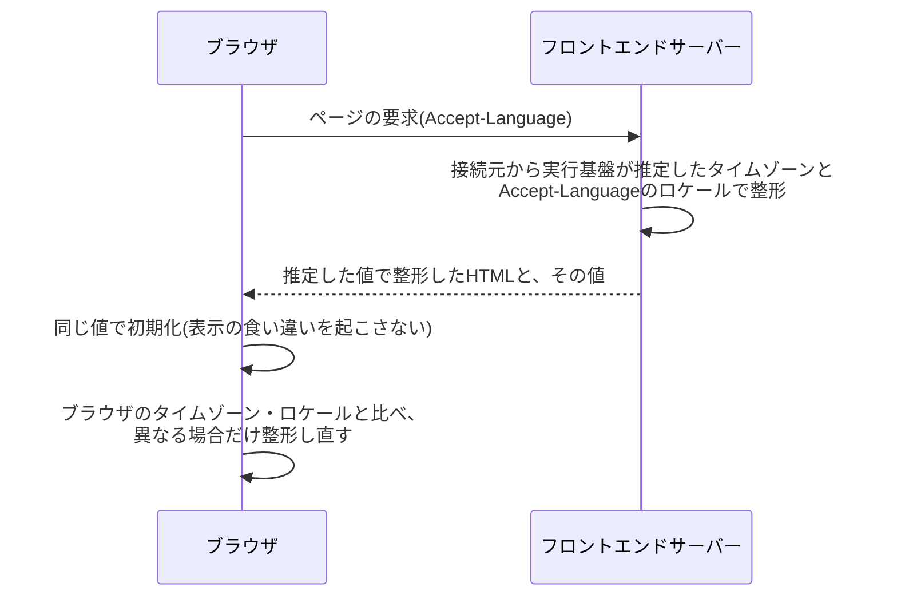

# 国際化方針

日時・数値の表示とブラウザ翻訳への耐性について、本サービスの方針を定める(I18N-001〜004)。UIの文言は日本語だけで提供し、言語の切替は持たない。一方で、日時と数値の形式は利用者のタイムゾーンとロケールに合わせ、ブラウザの翻訳で文言が置き換わっても画面が崩れないようにする。

部品の使い方と実装の規則は技術ドキュメントを正とする。日時の要素は[マークアップの規約](../../tech/frontend/001-markup-conventions.md#日時の表示)、日時と数値の部品は[共通化する部品](../../tech/frontend/005-shared-components.md#日時と数値)、翻訳への耐性の実装は[共通化する部品の翻訳への耐性](../../tech/frontend/005-shared-components.md#翻訳への耐性)を参照。

## 基準時刻

基準時刻は、夏時間を持たない固定オフセットUTC-08:00の時刻である。日の境界はUTCの8:00になる。日時データの保持はUTC(I18N-002)とし、基準時刻は業務の規則を定めるためだけに使う。

### 基準時刻の使いどころ

時刻の定義と日付の境界は、原則として基準時刻とする。

| 対象         | 基準時刻での定義                                                         | 規則の正                                                                                                                                                       |
| ------------ | ------------------------------------------------------------------------ | -------------------------------------------------------------------------------------------------------------------------------------------------------------- |
| 業務の日付   | ローンチ日・マッチの日。ローンチ日に選べる範囲は基準時刻の当日から数える | FR-PRDCT-002・003                                                                                                                                              |
| 週           | 基準時刻で連続する月曜日から日曜日まで(ISO週)                            | [週次タイムライン](../overview/007-daily-timeline.md#週次タイムラインweekトーナメント)                                                                         |
| 業務の時刻   | マッチの開始(0:00)・終了(23:40)、決済期限、定期実行の時刻                | [日次タイムライン](../overview/007-daily-timeline.md#日次タイムライン)、[年次タイムライン](../overview/007-daily-timeline.md#年次タイムラインyearトーナメント) |
| メールの日時 | 基準時刻ではなくUTCで表記する([メールの日時](#メールの日時))             | [通知メールの本文の構成](../design/003-text-and-copy-rules.md#本文の構成)                                                                                      |

### 基準時刻を画面に出さない

基準時刻のタイムゾーン名・時差(「UTC-08:00」「PST」など)は、WebのUIに表示しない。利用者に基準時刻を読み替えさせないためである。

- マッチの開始・終了や決済期限のように基準時刻で定義される時点は、利用者のタイムゾーンへ換算して表示し、[相対表現](#相対表現の併記)を併記する
- 日付だけの値(ローンチ日・週)は時点を持たないため、タイムゾーンで換算せず、[表記規則](../design/003-text-and-copy-rules.md#表記規則)の形式(「2026年第37週(9/7〜9/13)」など)で暦の日付のまま表示する(要件定義書の用語定義の「週」・FR-PRDCT-002・003、[ディレクトリの絞り込み](../design/002-page-layouts.md#絞り込み)の基準時刻の暦日による区切りと同じ扱い)。共通の日時の表示部品(`DateTime`)は時点だけを受け付け、時差の無い文字列には例外(`RangeError`)を投げるため、`YYYY-MM-DD`の日付だけの値を渡さない
- 日時の表示部品の書式は、タイムゾーン名・時差を出力しない

## 利用者のタイムゾーンとロケールでの表示

日時は利用者のタイムゾーンとロケールで、数値は利用者のロケールで整形する(I18N-004)。

- 日時は`<time>`要素で出力し、`datetime`属性にUTCのISO形式の日時文字列を設定する。表示用の文字列だけが利用者のタイムゾーンになる
- 日時の表示部品が受け付ける値は、時差(または`Z`)を含むISO形式の日時文字列か`Date`だけである。時差の無い文字列は実行環境のタイムゾーンで解釈されて時点が変わるため、表示部品は例外を投げる
- 数値の3桁区切りなどはロケールに従う(例:`ja-JP`・`en-US`の`1,234,567`)
- 通貨はUSDだけで、表記は[デザイン原則の日時・数値の表示](../design/001-design-principles.md#日時数値の表示)に従う

日時の書式は次の7種類から選ぶ。画面ごとに独自の書式を作らない。

| 書式           | 用途の目安         | 例(`ja-JP`・`Asia/Tokyo`) | 例(`en-US`・`America/New_York`)       |
| -------------- | ------------------ | ------------------------- | ------------------------------------- |
| `time`         | 時刻だけ           | `16:40`                   | `03:40 AM`                            |
| `date`         | 月日               | `9月15日`                 | `September 15`                        |
| `dateWeekday`  | 月日と曜日         | `9月15日(火)`             | `Tue, September 15`                   |
| `yearDate`     | 年月日             | `2026年9月15日`           | `September 15, 2026`                  |
| `longDate`     | 年月日と曜日       | `2026年9月15日(火)`       | `Tue, September 15, 2026`             |
| `dateTime`     | 月日・曜日と時刻   | `9月15日(火) 16:40`       | `Tue, September 15 at 03:40 AM`       |
| `longDateTime` | 年月日・曜日と時刻 | `2026年9月15日(火) 16:40` | `Tue, September 15, 2026 at 03:40 AM` |

例はいずれもUTCの`2026-09-15T07:40:00Z`(基準時刻の9月14日23:40、マッチの終了)を整形したもの。実際の出力は実行環境の国際化データの版で細部が変わり得る。

## サーバー側の推定とブラウザでの置き換え

最初の表示から利用者の形式で日時と数値を出すため、ページをサーバー側で描画する時点でタイムゾーンとロケールを推定し、ブラウザでの初期化の後に実際の設定と異なる場合だけ置き換える。Cookieや新しい保存は使わない。

| 段階                     | タイムゾーン                                                 | ロケール                                                                          |
| ------------------------ | ------------------------------------------------------------ | --------------------------------------------------------------------------------- |
| サーバー側の描画         | 実行基盤(Cloudflare)が要求の接続元から推定したタイムゾーン   | `Accept-Language`のうち重みの大きい順(同じ重みは記載順)で、整形に使える最初の言語 |
| 得られない・解釈できない | UTC                                                          | `ja-JP`                                                                           |
| ブラウザでの初期化の後   | ブラウザのタイムゾーン(サーバー側と異なる場合だけ置き換える) | ブラウザのロケール(同上)                                                          |

- タイムゾーンとロケールは別々に判定し、片方だけが得られない場合はその片方だけをUTCまたは`ja-JP`にする
- ロケールの暦・数字の指定(和暦・アラビア数字など)は落として使う。ブラウザが解決するロケールは指定を持たないため、残すと初期化の後に表示が切り替わる
- 表示中にOSのタイムゾーンを変えても、ページを読み込み直すまで反映しない
- 推定が外れた利用者(VPNの利用など)は、初期化の後に一度だけ表示が切り替わる

## 相対表現の併記

基準時刻で定義される時点(マッチの開始・終了・決済期限など)は、利用者のタイムゾーンでの日時に相対表現を併記する。相対表現は日時の後に括弧で付ける(例:`9月15日(火) 16:40 (あと2時間)`)。

| 種類         | 範囲      | 文言                                      |
| ------------ | --------- | ----------------------------------------- |
| 残りの時間   | 過ぎた    | 期限切れ                                  |
| 残りの時間   | 1時間未満 | あと15分(1分未満も「あと1分」)            |
| 残りの時間   | 1日未満   | あと2時間                                 |
| 残りの時間   | 60日未満  | あと3日                                   |
| 残りの時間   | 60日以上  | あと約8か月(30.44日を1か月として四捨五入) |
| 経過した時間 | 1分未満   | たった今                                  |
| 経過した時間 | 1時間未満 | 5分前                                     |
| 経過した時間 | 1日未満   | 3時間前                                   |
| 経過した時間 | 30日未満  | 12日前                                    |
| 経過した時間 | 30日以上  | 併記しない(日時だけを表示する)            |

- 数値は端数を切り捨てる(60日以上の「あと約Nか月」だけ四捨五入)
- 相対表現はサーバー側の描画には含めず、ブラウザでの初期化の後に現れ、1分ごとに現在時刻へ合わせて更新する。サーバーとブラウザの時計の差で表示が食い違うのを避けるためで、現れる時にその分だけ配置がずれる
- 相対表現の部品は、「明日」「昨日」のような暦の日付による表現を出さない。残りと経過の時間だけで表す

## メールの日時

メールは受信者のタイムゾーンを知り得ないため、日時をUTCだけで表記してタイムゾーンを明記する(例:「9月15日07:40(UTC)」)。表記の規則は[通知メールの本文の構成](../design/003-text-and-copy-rules.md#本文の構成)、整形の関数は[メール送信サービスの前提と用語](../../tech/external/001-email-sending.md#前提と用語)を参照。リンク先のWebページでは、本書の規則で利用者のタイムゾーンで表示する。

## ブラウザ翻訳への耐性

UIの多言語切替は提供しないが、ブラウザの翻訳機能で他言語に置き換えられてもレイアウトが崩れないようにする(I18N-001)。

- ページの言語は日本語(`<html lang="ja">`)と示し、ブラウザが翻訳の対象を正しく判定できるようにする
- ボタン・タブ・バッジは固定幅にせず、訳文で長くなっても伸長か折り返しで収める。余白の目安は[デザイン原則のブラウザ翻訳への耐性](../design/001-design-principles.md#ブラウザ翻訳への耐性)を参照
- 英語固有名詞(Upvote・Ultrasなど、[表記規則](../design/003-text-and-copy-rules.md#表記規則)で訳さない語)には、翻訳させない指定(`translate="no"`)を付ける
- 幅320pxの画面で横スクロールを出さない。極端に長くなり得る文言のボタン・バッジは、その箇所で折り返させる
