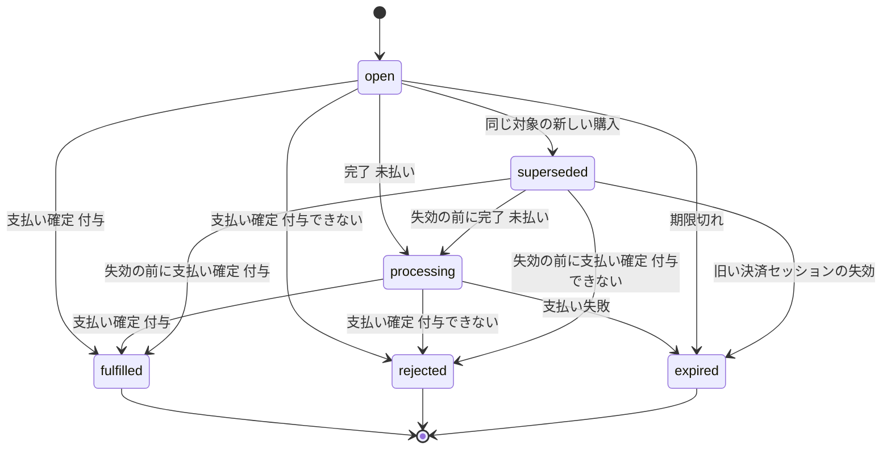
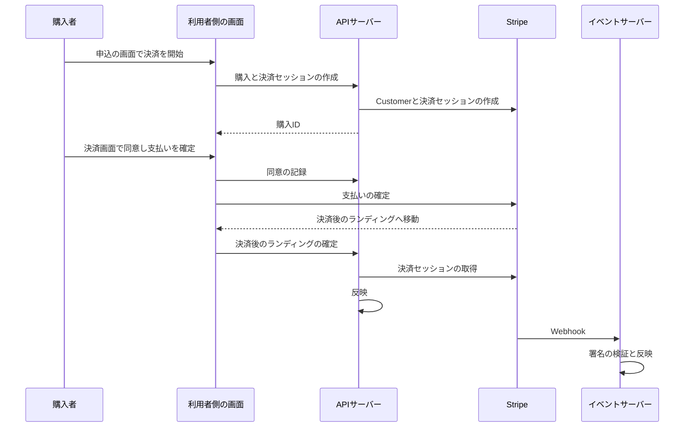

# 決済実装方針

トーナメント参加費・スポンサー広告・Ultrasプランの決済(4.26節のFR-PYMNT-001〜018)を、本サービスでどう受け付け、どう反映するかの方針を定める。Stripeとの連携の技術的な規約は[決済サービス(Stripe)](../../tech/external/007-stripe-payments.md)と[外部の通知の冪等な反映](../../tech/backend/009-idempotent-event-reflection.md)、運用の手順は[決済データの運用](../../tech/operations/004-payment-data-operations.md)を正とする。価格と課金項目は[料金及びプラン体系](../overview/002-pricing-and-plans.md)、画面は[ページ構成](../design/002-page-layouts.md#決済checkout)、文言は[文言・文字数規則](../design/003-text-and-copy-rules.md#決済の画面の文言)を参照する。

決済の機能は、Stripeとの通信・購入の状態・決済履歴・返金を1か所に集め、「何を買ったか」に応じた権利の付与(フルフィルメント)を購入種別ごとの機能へ委ねる。権利の付与を受け持つ機能は、購入できるかの判定と購入の内容と権利の付与だけを実装し、Stripeとの通信や反映の厳密な扱いを作り直さない。

## 購入種別とフルフィルメント

購入は、利用者が1つの購入種別について始めた1回の支払いの手続きであり、1つの購入に決済セッションは1つである。購入種別の値は決済履歴の`purpose`([データエクスポート](001-user-data-export.md#paymentsjson))と同じである。

| 購入種別               | 値                      | 課金方式 | 数量     | 決済期限                             | 決済セッションの有効期限           | 権利の付与を受け持つ機能 |
| ---------------------- | ----------------------- | -------- | -------- | ------------------------------------ | ---------------------------------- | ------------------------ |
| Weekトーナメント参加費 | `week_tournament_entry` | 都度決済 | 1        | ローンチ日を含む週の翌週月曜日23:35  | 作成から24時間後と決済期限の早い方 | Weekトーナメント         |
| Yearトーナメント参加費 | `year_tournament_entry` | 都度決済 | 1        | Yearトーナメント決勝日の6日前の23:35 | 作成から24時間後と決済期限の早い方 | Yearトーナメント         |
| スポンサー広告         | `sponsorship`           | 都度決済 | 掲載日数 | なし                                 | 作成から1時間後                    | スポンサー広告           |
| Ultrasプラン           | `ultras`                | 定期課金 | 1        | なし                                 | 作成から1時間後                    | Ultrasプラン             |
| 決済の疎通確認         | `payments_smoke`        | 都度決済 | 1(1ドル) | なし                                 | 作成から1時間後                    | なし(権利を付与しない)   |

- 時刻は基準時刻(UTC-08:00)である。決済期限のある購入は、決済期限の35分前(23:00)を受付期限とし、受付期限以降(受付期限ちょうどを含む)の決済の開始を拒否する。反映の期限は組み合わせ決定(23:45)とする([決済期限を組み合わせ決定よりも10分早める理由](../overview/002-pricing-and-plans.md#決済期限を組み合わせ決定よりも10分早める理由))
- 決済期限の無い購入の有効期限を1時間にするのは、広告の掲載開始日や価格が、決済を開いたまま古くなるのを防ぐためである
- 決済の疎通確認は、dev・stagingだけで受け付け、prodでは受け付けない。後続の機能が無くても、決済画面・反映・返金・決済手段の設定を端から端まで確かめるために置く
- 権利の付与を受け持つ機能は、購入種別ごとに「購入できるかの判定と購入の内容(価格の種類・数量・対象・決済期限・受付期限・反映の期限・最終確認画面の表示事項)」と「権利の付与」の2つの口を実装し、決済の機能へ登録する。登録の無い購入種別、または無効な購入種別(prodの疎通確認)の決済は開始しない
- 権利の付与は、決済の完了の反映(決済履歴の記録・購入の完了)と同じ一括の書き込みで確定し、どちらか一方だけが確定した状態を残さない。権利の付与を受け持つ機能が「付与できない」と答えた購入は、権利を付与せずに決済を記録し、自動で全額返金する
- 権利の付与は支払いの確定の時だけ依頼する。返金・チャージバック・決済セッションの期限切れでは、権利の付与・剥奪・復元を依頼しない(FR-PYMNT-008)
- 権利の付与が確定した後に、受け持つ機能の確定後の処理(加入の知らせやメールの送り出しなど)を1回呼ぶ。この処理の失敗は反映の結果を変えず、受け持つ機能が自分の日次の確認で拾う
- Ultrasプランの毎月の更新・支払いの失敗・解約の予約・終了などの定期課金の状態の変化は、解約の予定時刻と発生時刻とともにUltrasプランの機能へ渡す。加入状態の判定は決済の機能では行わない

## 決済の開始

各申込の画面のボタンが購入を作成し、決済画面(`/checkout/{購入ID}`)へ移る。決済の開始では次の順に確かめ、1つでも満たさなければ購入を作らずに理由を示して拒否する。

1. ログインしている、メールアドレスの確認を済ませている、退会済み・停止中でない(FR-USER-006)
2. 利用者ごとの決済の開始の回数が1時間に20回以内である(FR-RLMIT-022)。カードテスティングの試行を抑えるためで、購入の途中で戻ってやり直す程度の利用では届かない
3. 購入種別が登録されていて有効であり、受け持つ機能が購入できると答える
4. 受付期限の前である

確かめた後に、利用者のStripe Customer(利用者と1対1、初めての決済で作成する)を用意し、Stripeのダッシュボードで設定した価格と数量で決済セッションを作る。本サービス側で金額を算出して渡さない(FR-PYMNT-003)。同じ利用者が同じ購入種別・同じ対象で未完了の購入を持ったまま決済を開始したときは、以前の購入を「置き換え済み」にして新しい購入を作り、以前の決済セッションを失効させる。Stripeに到達できない場合は購入を残さずに、決済を現在利用できない旨を返す。

Stripe Customerには、メールアドレスと仮名化ID(FR-USER-004)だけを渡し、利用者の主キー・ハンドル・ニックネームを渡さない。決済セッションには購入ID・購入種別・仮名化IDだけを付ける。カード番号などの決済情報は本サービスに保存しない(DR-008)。

## 購入の状態

購入の状態は前進だけで、完了した購入は戻らない。状態の値は内部の値であり、画面には[決済画面の状態](../design/002-page-layouts.md#決済画面checkout購入id)として示す。

| 状態         | 意味                                                                                                                                                |
| ------------ | --------------------------------------------------------------------------------------------------------------------------------------------------- |
| `open`       | 未完了。決済画面で支払える                                                                                                                          |
| `processing` | 決済セッションは完了したが、支払いが確定していない(即時に確定しない支払い)                                                                          |
| `fulfilled`  | 支払いが確定し、権利を付与した                                                                                                                      |
| `rejected`   | 支払いが確定したが、権利を付与せずに自動で全額返金する。理由(反映の期限切れ・付与できない・二重決済)を持つ                                          |
| `expired`    | 決済セッションが失効した、または支払いが失敗した                                                                                                    |
| `superseded` | 同じ対象の新しい購入に置き換えられた。旧い決済セッションの失効を反映すると`expired`になる。失効の前に決済セッションが完了すれば、通常どおり反映する |

## 反映の流れ

Stripe上の決済・請求・返金・チャージバック・定期課金の状態を、購入と決済履歴へ取り込むことを反映と呼ぶ。反映は次の3つの入口から、同じ反映の処理を通す(FR-PYMNT-009・013)。どの入口が先に届いても、同じ対象への同じ反映は1回しか行わない(DR-015)。

| 入口                 | 起点                                                                                   | 失敗した時                             |
| -------------------- | -------------------------------------------------------------------------------------- | -------------------------------------- |
| Webhook              | イベントサーバーの`POST /webhooks/stripe`が署名を検証して受け付ける                    | 500を返し、Stripeの再送を待つ          |
| 決済後のランディング | 購入者が支払いの後に開く`/checkout/return`が、決済セッションの状態をStripeから取り直す | 画面が一定の間隔で確かめ直す           |
| 突合と日次の確認     | 23:40の`payments.checkout-reconciliation`と4:21の`payments.pending-checkout-sweep`     | 次の回の実行を待つ。運用者へ通知される |

- Webhookで受け付ける通知は、都度決済・定期課金の請求・返金・チャージバック・定期課金の状態の変化・決済セッションの期限切れの15種で、一覧は[Webhookの受信](../../tech/external/007-stripe-payments.md#webhookの受信)を正とする。それ以外の種類の通知は反映せずに受領だけを返す
- 反映は通知の本文ではなく、Stripeから取り直した状態を書く。反映の対象(決済セッション・請求・返金・チャージバック・定期課金)ごとに処理済みの状態と通知の発生時刻を保持し、既に反映した通知より古い通知では状態を巻き戻さない(DR-016)
- 通知の対象が本サービスの購入や利用者に結び付かない(ダッシュボードで直接作成した決済など)場合は、反映せずに受領を返し、運用者が調べられるようログに残す
- 支払いが確定した時刻が反映の期限を過ぎている購入は、権利を付与せずに自動で全額返金する(FR-PYMNT-014)。権利を付与済みの購入と同じ購入種別・同じ対象に、別の決済セッションの支払いが確定したときは、二重決済として自動で全額返金する(FR-PYMNT-016)
- 決済セッションの期限切れは購入を失効にするだけで、決済履歴には記録しない
- 利用者が退会・停止されたときは、その利用者の未完了の決済セッションを、同じ対象の決済をやり直して置き換えられた古い決済セッション(置き換えの時の失効に失敗して支払えるまま残ったもの)も含めて、すべて失効させる。失効させる前に支払いが確定した決済は通常どおり反映し、権利を付与できるかは受け持つ機能が判断する。物理削除の時期が来たときは、Stripe Customerと購入の記録を削除し、決済履歴は仮名化IDだけで残す(FR-USER-022・DR-018)。どちらもユーザーライフサイクルイベントの波及処理(`payments.open-checkout-expiry`・`payments.customer-erasure`)で行う

### 突合と日次の確認

| 時刻(基準時刻) | ジョブの名前                       | 内容                                                                                                                                                                                                                                                                                                                                                |
| -------------- | ---------------------------------- | --------------------------------------------------------------------------------------------------------------------------------------------------------------------------------------------------------------------------------------------------------------------------------------------------------------------------------------------------- |
| 23:40          | `payments.checkout-reconciliation` | 決済期限が実行時刻以前かつ24時間以内の未反映の購入を、200件までStripeの決済セッションの状態と突合し、支払い済みなら反映し、失効・未払いなら失効にする。同時刻のマッチの確定より先に、23:45の組み合わせ決定より前に終えるため、起動から4分を過ぎたら残りを止める                                                                                     |
| 4:21           | `payments.pending-checkout-sweep`  | 有効期限を1時間以上過ぎても未完了のままの購入を200件まで突合する。受け付けてから10分以上経っても実行の依頼が記録されていない返金を100件まで、送信から24時間以上経っても実行されていない返金を100件まで、送信の依頼が記録されていない購入確認メールと自動返金の通知メールをそれぞれ100件まで依頼し直す。突合は開始から30秒を過ぎたら残りを翌日に回す |
| 4:21           | `payments.history-retention`       | 記録日時から7年以上経過した決済履歴を物理削除する(DR-018)。1回の起動で500件ずつ最大20回まで繰り返し、残りは翌日に消す                                                                                                                                                                                                                               |

突合の途中でStripeに到達できなかった購入は、他の購入の突合を続けたうえでエラートラッキングで運用者へ知らせる。Stripeの応答が遅く時間の上限で突合を止めたときも、残った件数を運用者へ知らせる。23:40の突合を4分で止めるのは、23:45の組み合わせ決定に間に合わせるためで、止めた日は、期限の直前の支払いのうちWebhookでも届いていないものが反映の期限に間に合わず、後の反映で自動で全額返金されることがある。返金の実行がStripeの障害で再試行を使い切って止まった依頼は、日次の確認が翌日に送り直し、送り直した旨を運用者へ知らせる。Stripeの重複の防止(冪等キー)は24時間で切れるが、返金の実行が作る前にその依頼の返金がStripeに既にあるかを確かめ、あれば作らないため、二重に返金されない。Stripe上で後から失敗した返金(カードの解約など)は、運用者へ知らせて別の方法での払い戻しを促す。Stripeに決済セッションが無い購入は支払われ得ないため、ログに残して失効にする。購入確認メール・自動返金の通知のうち、同意の記録や支払いの日時が欠けて組み立てられないメールは、依頼し直しても送れないため、送らずに対象外とし、ログに残す。時刻と順序の一覧は[日次・週次・年次タイムライン](../overview/007-daily-timeline.md)を正とする。

## 返金の分担

返金は、購入を指定して依頼する1つの部品で受け付ける。金額を省略すれば残りの全額を、指定すればその金額(セント単位の正の整数)を返金する。依頼ごとに依頼元が定める依頼キーを受け取り、同じ依頼キーの依頼は何度受けても1回しか返金しない。部品は依頼を記録した時点で応答し、Stripeへの返金はイベントサーバーが非同期に行う(FR-PYMNT-012)。一時的な失敗は間隔を空けて最大5回まで試し、それでも失敗した場合と、Stripeが返金を恒久的に拒否した場合(既に全額返金済み・チャージバック中など)は、エラートラッキングで運用者へ知らせる。

| 場面                                                                                           | 返金を決める機能       | 返金の方法                                 |
| ---------------------------------------------------------------------------------------------- | ---------------------- | ------------------------------------------ |
| 反映の期限を過ぎて支払いが確定した(FR-PYMNT-014)                                               | 決済の機能             | 自動で全額返金し、返金した旨のメールを送る |
| 権利の付与を受け持つ機能が付与できないと答えた(FR-PYMNT-017)                                   | 決済の機能             | 自動で全額返金し、返金した旨のメールを送る |
| 二重決済(FR-PYMNT-016)                                                                         | 決済の機能             | 自動で全額返金し、返金した旨のメールを送る |
| 組み合わせ決定前のプロダクトの削除・退会で参加資格を失った(FR-PYMNT-010)                       | Week・Yearトーナメント | 部品で全額の返金を依頼する                 |
| 組み合わせ決定の時点の非公開化・停止・64を超えた分で参加資格を停止した(FR-PYMNT-011)           | Week・Yearトーナメント | 部品で全額の返金を依頼する                 |
| 管理者によるスポンサー広告の強制終了(FR-ADMUG-046)、非公開化・停止による表示停止(FR-SPONS-021) | スポンサー広告         | 部品で金額を指定して日割りの返金を依頼する |
| 上記以外(問い合わせを受けた個別の対応など)                                                     | 管理者                 | Stripeのダッシュボードで手動で返金する     |
| チャージバック                                                                                 | 管理者(Stripe上で対応) | 返金しない。権利は自動的には変更しない     |

- 定期課金(Ultrasプラン)の購入を自動で全額返金するとき(既に加入中の利用者の加入をUltrasプランの機能が付与できないと答えた場合など)は、先に定期課金を即時に解約してから初回の請求を返金する
- 返金の依頼の合計は、その購入で支払われた金額を超えない。支払いが確定していない購入と存在しない購入の返金は拒否する
- 決済の機能が自動で全額返金した決済(反映の期限切れ・付与できない・二重決済)は、返金が成功したときに、返金した旨と理由を購入者へメールで知らせる(FR-PYMNT-018)。後続の機能が部品で依頼した返金の知らせ方は、依頼した機能が決める
- 管理者が手動で行った返金も、決済の機能が実行した返金も、Webhookで決済履歴へ反映する(FR-PYMNT-006)
- 返金を反映しても、購入で付与した権利の剥奪は依頼しない(FR-PYMNT-008)

### 返金ポリシーとの食い違い(申し送り)

[法的通知の大枠の返金ポリシー](../legal/004-legal-notice-outline.md#返金ポリシー)の各行は、要件定義書の現在の版と次のとおり対応する。決済の機能は返金の部品の提供にとどめ、法的通知の本文と返金ポリシーの大枠の修正は、各行の機能のspecと開発者が判断する。

- ユーザー停止に伴う定期課金(Ultras)の解約の行(返金しない)は、FR-PPLAN-012と一致する
- 組み合わせ決定の時点のユーザー停止・プロダクト非公開化と、Yearトーナメントの参加数の上限(64)を超えたことに伴うトーナメント参加資格停止の行(自動の全額返金)は、FR-PYMNT-011・FR-TOURY-011と一致する
- 決済の確定の時点で購入した権利を付与できなかった行(自動の全額返金)は、FR-PYMNT-017(FR-TOURW-006・FR-TOURY-008・FR-SPONS-006)と一致する
- 二重決済の行(「重複分を返金する」)は、重ねて確定した決済の全額を返金するFR-PYMNT-016と一致する

残る食い違いは次のとおりである。

| 返金ポリシーの行                               | 返金ポリシーの記載                                 | 要件定義書                                                                                   | 申し送り先     |
| ---------------------------------------------- | -------------------------------------------------- | -------------------------------------------------------------------------------------------- | -------------- |
| 管理者によるスポンサー広告の強制終了、表示停止 | 未掲載日数分・表示を停止した日数分を自動で返金する | FR-ADMUG-046・FR-SPONS-021と一致する(セント未満の切り捨てと、返金の時機は返金ポリシーに無い) | スポンサー広告 |

## 決済履歴の記録の規則

決済履歴は、Stripe側の1つの事象(決済・請求・返金・チャージバックの段階)を1つの記録にする。利用者は`/settings/billing`で自分の決済履歴を見られ(FR-PYMNT-005)、データエクスポートの`payments.json`にも同じ記録が出る。

| 種類(`kind`)                   | 記録する時                                                                 | 金額                              | 状態(`status`)                                                |
| ------------------------------ | -------------------------------------------------------------------------- | --------------------------------- | ------------------------------------------------------------- |
| 都度決済(`one_time`)           | 決済セッションの支払いの確定を反映した時。自動で全額返金する決済も記録する | 支払額(正)                        | 成功(`succeeded`)                                             |
| 定期課金の請求(`subscription`) | 定期課金の初回と毎月の請求の成功・失敗を反映した時                         | 請求額(正)                        | 成功(`succeeded`)・失敗(`failed`)                             |
| 返金(`refund`)                 | 決済の機能の返金・管理者の手動の返金を反映した時。状態の変化で更新する     | 返金額(負)                        | 処理中(`pending`)・成功・失敗                                 |
| チャージバック(`dispute`)      | 資金が引き落とされた時・勝訴で資金が戻った時・敗訴が確定した時の段階ごと   | 引き落とし額(負)・戻った額(正)・0 | 係争中(`disputed`)・勝訴(`dispute_won`)・敗訴(`dispute_lost`) |

- 決済履歴は利用者の主キーではなく仮名化IDで利用者と結び付け、外部キーの制約を設けない。利用者の物理削除の後も、記録日時から7年保持する(DR-018)
- 各記録は、Stripe側のオブジェクトのID・関連する対象(ローンチまたはスポンサー広告)のID・通知の発生時刻を持つ。都度決済と定期課金の初回の請求の記録には、最終確認画面で同意した日時と同意の文言の版も残し、物理削除の後も同意を示せるようにする。同意の文言を変えるときは版を改める
- 資金の移動を伴わないチャージバックの照会の段階と、異議申し立てに発展せずに終わったチャージバックは記録しない
- 決済期限切れで失効した購入と、置き換えられた購入は記録しない
- 一覧は発生日時の新しい順に20件ずつ表示し、金額は税込のUSDで、返金と引き落としは負の符号を付けて示す
- 管理者の統計の合計収益(FR-ADMUG-001・002)は決済履歴から集計し、決済の疎通確認の記録を含めない

## Linkの資金源の扱い

決済手段はカード(Apple Pay・Google Payを含む)とLinkだけを受け付ける(FR-PYMNT-001)。Linkは、登録したカードのほか、ステーブルコイン・Pix・UPI・米国の銀行口座による即時銀行決済などの資金源(グループ)を持ち、グループ1〜3はLinkを有効にしている間は個別に無効にできない。そこで次のように扱う。

- 決済セッションで許可する決済手段の種類をカードとLinkに絞り、ダッシュボードの決済手段の設定でKlarna(Linkのグループ4)と他の決済手段を切る
- Linkのグループ1〜3は、いずれも即時に確定する決済として受け入れる。Pix・UPIはUSD建ての決済では提示されない
- 即時に確定しなかった決済(支払いが未完了の状態で完了の通知が届いたもの)は権利を付与せず(FR-PYMNT-002)、確定した時点で反映する。反映の期限に間に合わなければ自動で全額返金する
- 想定外の資金源を運用者が調べられるよう、決済履歴の内部の列にLinkの資金源のグループを残す。この列はデータエクスポートに出さない
- 法的通知の章5には、Linkでは登録したカードのほか米国の銀行口座による即時銀行決済などが使える場合がある旨を添える([法的通知の大枠](../legal/004-legal-notice-outline.md#章立て))
- 決済手段の設定がカード・Apple Pay・Google Pay・Linkだけになっていることを、環境ごとに[決済データの運用](../../tech/operations/004-payment-data-operations.md)の手順で確かめる

## 縮退

Stripeに到達できない間(公開キーやStripeのキーを置いていない環境を含む)は、決済の開始と決済画面の入力欄を止め、他の機能は続ける(NFR-AVAIL-002)。画面は決済を現在利用できない旨と、閲覧やその他の操作は引き続き利用できる旨を示す。価格の照会は、以前に照会した価格があれば表示用に返し、決済の開始では常にStripeの最新の価格を使う。文言は[文言・文字数規則](../design/003-text-and-copy-rules.md#決済の画面の文言)を正とする。
