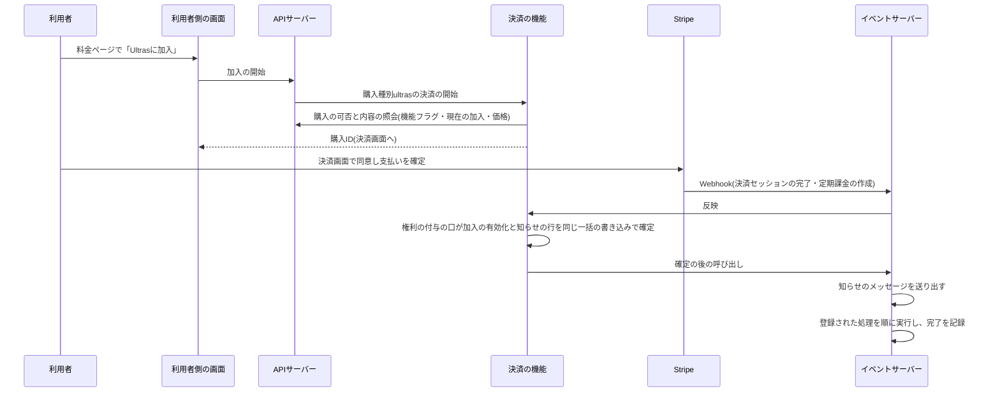

# Ultrasの実装方針

月額の有料プランUltras(4.18節のFR-PPLAN-001〜013、FR-ADMCF-022・023)の加入状態を本サービスでどう導き、特典を消費する機能へどう渡すかの方針を定める。外部の定期課金の状態から特典の継続期間を導く技術的な規約は[定期課金の加入状態と特典の判定](../../tech/backend/010-subscription-entitlements.md)、Stripeの定期課金とCustomer Portalとの連携は[定期課金とCustomer Portal(Stripe Billing)](../../tech/external/008-stripe-billing-portal.md)、Stripeの設定と検証の手順は[決済の環境とデータの運用](../../tech/operations/004-payment-data-operations.md)を正とする。価格・特典・終了時刻・停止と退会の扱い・メールの方針は[料金及びプラン体系](../overview/002-pricing-and-plans.md#ultrasプラン月額有料プラン)、画面は[ページ構成](../design/002-page-layouts.md#プラン管理画面settingsplan)、文言は[文言・文字数規則](../design/003-text-and-copy-rules.md#ultrasの画面の文言)、決済との接点は[決済実装方針](004-payments.md)、本プロジェクトの識別子・テーブル・登録の一覧は[本プロジェクト固有の値](../../../onboardings/project-values.md#定期課金の加入)を参照する。

Ultrasの機能は、Stripeの定期課金の状態をWebhookで取り込んで加入状態を1か所で管理し、特典を消費する機能(公開プロフィールの加入表示・再ローンチの間隔・トーナメント参加費の免除)には「指定した時点・期間で特典を受けられるか」の判定と「加入が有効になった」知らせだけを提供する。特典を消費する機能は、Stripeの状態と加入のテーブルを直接読まない。

## 用語と全体の流れ

| 用語                     | 意味                                                                                                                                                                                                            |
| ------------------------ | --------------------------------------------------------------------------------------------------------------------------------------------------------------------------------------------------------------- |
| 加入                     | 利用者1人とStripeの定期課金1件の結び付き(`ultras_subscriptions`の1行)。初回の請求の支払いの確定を反映した時点で有効になる。解約して終了した後に再び加入すると、新しい加入になる                                 |
| 加入状態                 | 加入ごとの状態。`active`(有効)・`past_due`(支払いの失敗の再試行中)・`canceled`(解約済みで特典の継続期間内)・`ended`(終了)の4つで、データエクスポートの`plan.status`と同じ。保存せず、問い合わせの時刻ごとに導く |
| 特典の継続期間           | 加入が有効になった時刻(開始時刻)から特典の終了時刻までの区間`[started_at, benefit_ends_at)`。`active`・`past_due`・`canceled`の間は特典を受けられる                                                             |
| 特典の終了時刻           | 解約が予約された加入では課金期間の末日の終わり、支払いの失敗による終了と即時の解約ではその終了の時刻([特典の終了時刻](../overview/002-pricing-and-plans.md#特典の終了時刻))                                     |
| 解約の予約               | 課金期間の末日に定期課金を終える予約。予約の間は利用者がCustomer Portalで取り消せる                                                                                                                             |
| 加入が有効になった知らせ | 新しい加入が有効になったことを、登録された処理へ1回ずつ届ける仕組み(`ultras_activations`の行とメッセージ`ultras.run-activation-handlers`)                                                                       |
| 有料プランへの導線       | 未加入の利用者にUltrasへの加入を案内する表示(料金ページのUltrasの区画、プラン管理画面の加入ボタン、トーナメント参加費の画面の案内など)                                                                          |
| 機能フラグ               | 導線を表示するかと新規の加入を受け付けるかを、最上位管理者が切り替える設定(`ultras_settings`の鍵`ultras_promotion`)                                                                                             |

- 加入の開始は決済の機能の[決済の開始](004-payments.md#決済の開始)の順序で確かめ、Ultrasの購入の可否の口が、機能フラグがオフ(`ultras_unavailable`)→特典の継続期間内の加入がある(`active`・`past_due`は`ultras_already_subscribed`、`canceled`は`ultras_resume_in_portal`)→価格を照会できない(`payments_unavailable`)の順に拒否する。メールアドレス未確認・停止中・退会済みは決済の機能が先に拒否する
- 加入の有効化は決済セッションの完了の反映(権利の付与の口)で行い、Stripeの`customer.subscription.created`では有効化しない。決済後のランディングとWebhookのどちらが先に反映しても一括の書き込みは1回だけ確定し、確定させた側だけが知らせを送り出す
- 支払いの確定の時点で同じ利用者の別の加入の特典の継続期間と重なる場合は、権利を付与できない購入として拒否し、決済の機能が定期課金を解約して全額を返金する(二重の加入の防止)。同時の確定は、特典の継続期間が開いた加入を利用者ごとに1つに限る部分一意索引で片方が取り消され、呼び直しで拒否になる
- Stripe側の定期課金の状態の変化(`customer.subscription.created`・`updated`・`deleted`)は、決済の機能が古い通知を捨てたうえで受け取り口(`ultras-subscription.plan-state`)へ渡し、受け取り口がStripe側の列を更新する。返金・チャージバックは受け取り口に届かず、加入状態を変えない(FR-PYMNT-008)

## 加入状態の導出

加入状態は保存せず、保存したStripe側の状態と特典の終了時刻から、問い合わせの時刻ごとに導く。判定の順序は、開始時刻が無ければ未有効(加入状態なし)、特典の終了時刻を過ぎていれば`ended`、Stripe側の状態が`past_due`なら`past_due`、特典の終了時刻があれば`canceled`、無ければ`active`である。

| Stripe側の状態       | 意味                                                                                 | 解約の予約                               | 特典の終了時刻                 | 加入状態                                                     |
| -------------------- | ------------------------------------------------------------------------------------ | ---------------------------------------- | ------------------------------ | ------------------------------------------------------------ |
| `incomplete`         | 初回の支払いが未完了                                                                 | —                                        | —                              | なし(未有効。有効化の前に届いた値は保存し、有効化の時に使う) |
| `incomplete_expired` | 初回の支払いが失効した                                                               | —                                        | —                              | なし(有効化されない)                                         |
| `trialing`           | 試用期間中(本サービスでは試用期間を設けないため届かない)                             | 無し                                     | 無し                           | `active`                                                     |
| `active`             | 有効                                                                                 | 無し                                     | 無し                           | `active`                                                     |
| `active`             | 有効(解約の予定時刻`cancel_at`付き)                                                  | 有り                                     | 課金期間の末日の終わり(未来)   | `canceled`                                                   |
| `past_due`           | 支払いの失敗の再試行中                                                               | 有無によらず                             | 無し、または未来               | `past_due`                                                   |
| `canceled`           | 終了した(予約どおりの終了)                                                           | 有り                                     | 確定済みで未来                 | `canceled`。過ぎれば`ended`                                  |
| `canceled`           | 終了した(再試行の後の終了・即時の解約)                                               | 有無によらず(予定の終了時刻より前の終了) | 確定済み(Stripe側の終了の時刻) | `ended`                                                      |
| `unpaid`・`paused`   | 再試行の後の未払い・一時停止(本サービスの設定では届かない。届いたら運用者へ通知する) | —                                        | 確定済み(Stripe側の終了の時刻) | `ended`                                                      |

Stripe側の`canceled`と本サービスの加入状態の`canceled`は、同じ文字列で意味が異なる。画面と文書で対応を示すときは、次の表の形で並べる。

| 文字列     | Stripe側の状態としての意味                                                                                                                                    | 本サービスの加入状態としての意味                                                                          |
| ---------- | ------------------------------------------------------------------------------------------------------------------------------------------------------------- | --------------------------------------------------------------------------------------------------------- |
| `canceled` | 定期課金が終わった状態(再開できない)。本サービスでは特典の終了時刻の確定に当たり、加入状態は多くの場合`ended`、予約どおりの終了なら末日の終わりまで`canceled` | 解約が予約され、特典の終了時刻まで特典が続く状態。Stripe側ではまだ`active`(解約の予定時刻`cancel_at`付き) |

- 画面の加入状態の表示名は`ULTRAS_PLAN_STATUS_LABELS`(有効・支払いの再試行中・解約済み・終了)で、Stripe側の状態は画面に出さない
- 有効化の前に見た解約の予約と`past_due`は、解約の操作の時刻・支払いの失敗の時刻・メールの依頼を持たないまま有効化される。操作の記録とメールの依頼は、有効な加入に対する変化でだけ作る
- `ended`へは時刻の経過だけで移るため、終了のための定期実行は要らない。過去の時点の判定も同じ区間で答える

## 特典の継続期間

特典の継続期間は`[started_at, benefit_ends_at)`で、`benefit_ends_at`が無ければ右に開く。開始時刻`started_at`は、Ultrasの購入の支払いの確定の時刻(決済の機能の購入の`paidAt`)である。

| 受け取った変化                                                           | `benefit_ends_at`                                                                         | `benefit_end_fixed` |
| ------------------------------------------------------------------------ | ----------------------------------------------------------------------------------------- | ------------------- |
| 終了していない状態で、解約の予約が有る                                   | 予定の終了時刻(`cancel_at`、無ければ`current_period_end`)の直前を含む業務日付の日の終わり | 0                   |
| 終了していない状態で、予約が無い(取り消しを含む)                         | なし                                                                                      | 0                   |
| 終了の状態で、予約があり`ended_at`が予定の終了時刻以後(予約どおりの終了) | 予約の時と同じ末日の終わり                                                                | 1                   |
| 終了の状態で、上以外(再試行の後の終了・退会の即時の解約・予約の無い終了) | `ended_at`(無ければ通知の発生時刻)                                                        | 1                   |
| `benefit_end_fixed`が1の加入に届いた変化                                 | 変えない                                                                                  | 1のまま             |

- 業務日付の日の終わりは、基準時刻(UTC-08:00)の翌日0:00(UTCでは翌日8:00)の時点で、区間の右端として含まない。課金期間は終了時刻を含まないため、予定の終了時刻の1ミリ秒前が属する業務日付で決める。例: 課金期間の終了が`2026-11-05T18:00:00Z`(業務日付11月5日の10:00)なら`2026-11-06T08:00:00Z`、`2026-11-06T08:00:00Z`ちょうど(業務日付11月6日の0:00)なら期間の最後の瞬間は11月5日に属するため同じ`2026-11-06T08:00:00Z`、`2026-11-06T08:00:00.001Z`なら`2026-11-07T08:00:00Z`
- 解約の予約があるのに予定の終了時刻が無い変化は、特典の終了時刻を無しのまま保存し、運用者へ通知する。この変化で解約の受付のメールの依頼ができても、特典の終了日時を組み立てられないため送らずに対象外にする
- 解約の操作の記録(`canceled_at`・`cancellation_source`)は、有効な加入で予約が無→有になった変化の発生時刻と出どころ(退会・停止の波及処理が先に記録した`withdrawal`・`suspension`、無ければ利用者の`user`)で、取り消しで終了していなければ空に戻す。予約を経ない即時の解約は操作の時刻を記録しない

## 加入が有効になった知らせ

| 項目             | 内容                                                                                                                                                                                                                                                                                                                            |
| ---------------- | ------------------------------------------------------------------------------------------------------------------------------------------------------------------------------------------------------------------------------------------------------------------------------------------------------------------------------- |
| 作る契機         | 加入の有効化(初回の支払いの確定)だけ。解約の取り消しと支払いの失敗からの回復では作らない。加入1件に1行(`ultras_activations`、`stripe_subscription_id`が一意)                                                                                                                                                                    |
| 送り出し         | 有効化の一括の書き込みの確定の後に、メッセージ`ultras.run-activation-handlers`(本文は知らせのIDだけ)をQueuesへ送り、`dispatched_at`を記録する。送り出しの失敗はwarnのログに留め、4:21の日次の確認が送り直す                                                                                                                     |
| 処理の登録箇所   | イベントサーバーの`composition/ultras-activation-handlers.ts`の`ULTRAS_ACTIVATION_HANDLERS`。現在は登録0件で、知らせを受け取る機能(tournament-week・tournament-year)が名前(`<spec名>.<名詞句>`)・`order`(100以上の整数。重複させない)・処理の識別子を追記する。名前の形式の誤り・名前の重複・`order`の重複は起動時に拒否する    |
| 実行             | 知らせの行が無い、または完了済みなら何もしない。登録の`order`の昇順に処理を呼び、すべて成功したら`completed_at`を記録する(最初の完了の時刻を保つ)。処理へ渡す値は知らせのID・利用者のID・定期課金のID・有効になった時刻(加入の開始時刻と同じ)だけ                                                                               |
| 再試行           | 処理の1つが例外を投げると知らせ全体を再試行し、成功済みの処理も呼び直す。最大5回、遅延は60秒から倍にして上限3,600秒。上限に達したメッセージはデッドレターになり、運用者へ通知される。知らせは未完了のまま残り、日次の確認が送り出しから24時間後に送り直す                                                                       |
| 日次の確認(4:21) | 完了していない知らせのうち、送り出していないまま作成から10分以上経ったもの、または送り出しから24時間以上経ったものを100件まで送り出し直す([日次バッチ](../overview/007-daily-timeline.md#日次バッチ421の内容)の順序500)                                                                                                         |
| 冪等性           | 処理は同じ知らせを2回以上受けても結果が変わらないように書く(知らせのIDか定期課金のIDを業務上のキーにした処理済みの記録、現在の状態を条件にした更新、処理済みの確認による早期の終了のいずれか)。Stripeの呼び出しは、対象が既に終わっている場合を成功として扱う操作を使う。時刻の判定には受信の時刻ではなく有効になった時刻を使う |

## 機能フラグ

| 項目     | 内容                                                                                                                                                                                                                                                                                                         |
| -------- | ------------------------------------------------------------------------------------------------------------------------------------------------------------------------------------------------------------------------------------------------------------------------------------------------------------ |
| 保存     | `ultras_settings`の鍵`ultras_promotion`の1行。初期行はマイグレーションで`enabled = 0`・`version = 0`として入れ、行が無ければオフ(`ULTRAS_PROMOTION_FLAG_DEFAULT`)として扱う(仮2)                                                                                                                             |
| 範囲     | オフの間は、特典の継続期間内にない利用者への導線を出さず、購入の可否の口が新規の加入を`ultras_unavailable`で拒否する。特典の判定・既存の加入の有効化・状態の反映・Customer Portalはフラグを読まない([機能フラグの範囲と初期値](../overview/002-pricing-and-plans.md#機能フラグの範囲と初期値))               |
| 管理画面 | メニュー「設定」(`/settings`)の区画「Ultras導線の機能フラグ」(設定のページの登録箇所`ADMIN_SETTINGS_SECTIONS`の`ultras-subscription.promotion-flag`、`order` 20)。現在の値・最後に変更した日時・変更した管理者を示し、最上位管理者だけがスイッチと確認のダイアログで切り替える。他の管理者には参照だけにする |
| 版の照合 | 読み取った`version`と一致する行がある時だけ更新し、他の管理者が先に変更していれば`version_conflict`(409)で拒否して読み直しを促す。監査ログの記録と設定の更新は同じ一括の書き込みで確定する                                                                                                                   |
| 監査ログ | 操作種別`ultras-promotion.update`(表示名「Ultras導線の機能フラグの変更」)、対象の種類は設定、理由は任意(FR-ADMCF-022、FR-ADMAG-001)                                                                                                                                                                          |
| 照会     | バックエンドは`ULTRAS_TYPES.UltrasPromotionFlagReader`の`isEnabled()`、利用者側の画面はGraphQLの`ultrasOffer.promotionEnabled`と部品`UltrasPromotionGate`で読む                                                                                                                                              |

## 定期課金のメール

| 種別                           | 契機                                                                                                                                     | 件名                         | 本文の要点                                                                                                                                                                               |
| ------------------------------ | ---------------------------------------------------------------------------------------------------------------------------------------- | ---------------------------- | ---------------------------------------------------------------------------------------------------------------------------------------------------------------------------------------- |
| `ultras.payment-failed`        | 加入状態が`past_due`以外から`past_due`に変わった時に1通                                                                                  | Ultrasの支払いに失敗しました | 毎月の支払いに失敗し再試行している旨、再試行の間も特典が続き、すべて失敗すると終了する旨、プラン管理画面の「解約・支払い方法の管理」から支払い方法を更新する案内。ボタン「プランを見る」 |
| `ultras.cancellation-accepted` | 利用者がCustomer Portalで課金期間の末日に終わる解約を予約した時に1通(停止・退会による解約と、終了の変化で初めて予約を見た場合は送らない) | Ultrasの解約を受け付けました | 受け付けた日時(UTC)、特典の終了日時(UTC)、プラン管理画面の「解約・支払い方法の管理」から解約を取り消せる旨と、特典の終了日時を過ぎると取り消せない旨。ボタン「プランを見る」             |

- どちらも配信停止の対象にならないトランザクションメールで、文言は[定期課金のメールの本文](../design/003-text-and-copy-rules.md#定期課金のメールの本文)を正とする。宛先と宛名はidentity-authの利用者の連絡先の照会で引く(退会済み・物理削除済みの利用者には宛先が無く、停止中の利用者には届く)
- 依頼待ちの行(`ultras_notices`)を受け取り口の一括の書き込みで記録し(重複排除の鍵`<種別>:<定期課金のID>:<発生時刻のミリ秒>`で一意)、確定の後に依頼して`requested`にする。宛先が無い、または日時を組み立てられない依頼は`skipped`にする。依頼の失敗は`pending`のまま残り、4:21の日次の確認が作成から10分以上経った依頼を100件まで依頼し直す
- 特典の終了(`ended`)のメールは送らず、Stripeの顧客向けメールは使わない(Q8)

## 後続specの判定の使い方

| 用途                                                                                                             | 使う口                                                                                       | 使い方                                                                                                                                                              |
| ---------------------------------------------------------------------------------------------------------------- | -------------------------------------------------------------------------------------------- | ------------------------------------------------------------------------------------------------------------------------------------------------------------------- |
| 公開プロフィールの加入表示(user-profile-social)、再ローンチの間隔(product-launch)                                | `UltrasEntitlements.isEntitledAt(userId, now)`                                               | 「今、特典を受けられるか」を時点で判定する。複数の利用者を一覧で判定するときは`entitledUsersAt(userIds, at)`                                                        |
| トーナメント参加費の免除(tournament-week・tournament-year)                                                       | `UltrasEntitlements.wasEntitledDuring(userId, 勝利時点, 決済期限)`                           | 「勝利時点で加入中、または決済期限までに加入したか」を両端を含む期間で判定する(Q1)。一括は`entitledUsersDuring(userIds, from, to)`。`from > to`は`RangeError`になる |
| 加入時点での参加資格の付与と未完了の参加費の決済セッションの失効(tournament-week・tournament-year、FR-PPLAN-008) | `ULTRAS_ACTIVATION_HANDLERS`への登録(`UltrasActivationHandler`)                              | 知らせの`activatedAt`を加入時点として使い、処理を冪等に書く([加入が有効になった知らせ](#加入が有効になった知らせ))                                                  |
| 料金ページ・プラン管理画面以外の導線の表示の可否(トーナメント参加費の画面の案内など)                             | バックエンドは`UltrasPromotionFlagReader.isEnabled()`、利用者側の画面は`UltrasPromotionGate` | フラグがオンの時だけ導線を描く。特典の継続期間内の利用者には導線ではなく状態を示す                                                                                  |
| 利用者の現在の加入状態の表示                                                                                     | `UltrasEntitlements.currentPlan(userId, now)`                                                | 最新の有効化された加入の加入状態・開始時刻・課金期間の終了時刻・特典の終了時刻・解約の操作の時刻を返す。無ければ`null`                                              |
| データエクスポートの`plan`(data-export)                                                                          | `UltrasPlanExport.find(userId, now)`                                                         | `name: 'ultras'`・`status`・`startedAt`・`currentPeriodEndsAt`・`canceledAt`を返し、無ければ`null`。日時は`Date`で返し、data-exportが直列化する                     |
| 料金ページの区画の追加(sponsorship)                                                                              | `PRICING_SECTIONS`(clientの`composition/pricing-sections.ts`)                                | `id`は`<spec名>.<名詞句>`、`order`は20、`title`と自分でデータを取得する`component`を登録する                                                                        |
| 管理画面の設定ページの区画の追加(tournament-year・notifications)                                                 | `ADMIN_SETTINGS_SECTIONS`(adminの`composition/admin-settings-sections.ts`)                   | 同じ形で`order` 10(Yearトーナメントの決勝実施日)・30(通知メールの送信者情報)を登録する                                                                              |

- 判定の口はapplication層から`core/ultras/ports.ts`の型と`ULTRAS_TYPES`の識別子で受け取る(APIサーバー・イベントサーバーのどちらからも使える)。Stripe側の状態・加入のテーブル・機能フラグを特典の判定に使わない
- 判定は開始時刻と特典の終了時刻だけで行い、過去の時点の判定はその後の解約の取り消しや終了で変わらない。判定の時刻には処理の時刻ではなく出来事の時刻(勝利時点・決済期限・有効になった時刻)を渡す

## Customer Portalと解約

- プラン管理画面(`/settings/plan`)の「解約・支払い方法の管理」ボタンが、利用者のStripe CustomerのCustomer Portalのセッションを作り、戻り先`/settings/plan?portal=returned`でCustomer Portalへ移る。有効化された加入とCustomerの両方を持つ利用者にだけ表示し、加入したことが無ければ`ultras_portal_unavailable`、1時間に20回を超えれば`rate_limit_exceeded`(規則`ultras-portal:user`)、Stripeの障害なら`payments_unavailable`の縮退で拒否する(仮4、FR-RLMIT-023)
- Customer Portalでは支払い方法の更新・課金期間の末日に終わる解約・解約の取り消しだけを有効にし、プランの変更・一時停止・請求書の履歴は無効にする(Q6)。操作の結果はWebhookでだけ加入状態に反映されるため、戻った直後の画面は反映を待つ旨を示して加入状態を5秒ごとに最大12回取り直し、上限で開き直しの案内に切り替える
- 支払いの失敗の再試行の回数と間隔はStripeのSmart Retriesの設定に従い、再試行をすべて失敗した後は定期課金を解約する設定にする。`unpaid`・`paused`は届かない前提で、届いたら終了の状態として扱い、運用者へ通知する

## 停止・退会・物理削除の波及

ユーザーライフサイクルイベントの波及処理として、イベントサーバーの`composition/user-lifecycle-async-handlers.ts`に`order` 500で登録する(決済の未完了の決済セッションの失効(410)の後に動く)。

| イベント                  | 波及処理                                        | 振る舞い                                                                                                                                                                         |
| ------------------------- | ----------------------------------------------- | -------------------------------------------------------------------------------------------------------------------------------------------------------------------------------- |
| `withdrawn`(退会)         | `ultras-subscription.subscription-cancellation` | 終了していない加入のすべて(停止で予約済みのものを含む)に出どころ`withdrawal`を記録してから、Stripeへ即時の解約を依頼する(FR-PPLAN-005、Q7)                                       |
| `suspended`(停止)         | 同上                                            | 終了していない加入のうち解約が予約されていないものだけに出どころ`suspension`を記録してから、課金期間の末日に終わる解約を依頼する。予約済みの加入はそのまま保つ(FR-PPLAN-012、Q3) |
| `unsuspended`(停止の解除) | 登録しない                                      | 停止による予約を取り消さず、自動で再開しない(FR-PPLAN-012)                                                                                                                       |
| `purge_due`(物理削除)     | `ultras-subscription.subscription-erasure`      | `ultras_notices`→`ultras_activations`→`ultras_subscriptions`の順に、利用者の行を1回の一括の書き込みで消す(DR-002、FR-USER-022)                                                   |

- 出どころの記録(`pending_cancellation_source`)をStripeの呼び出しより先に書くため、Stripeの失敗の再試行でも記録が残る。受け取り口は解約の予約の変化を受け取ったときにこの出どころを解約の操作の出どころ(`cancellation_source`)に写し、解約の受付のメールの依頼を作らない。退会の即時の解約は予約を経ないため、`cancellation_source`は空のまま`pending_cancellation_source`だけが残る
- Stripeの例外(一時的な失敗・恒久的な拒否・対象なし)は捕まえずに投げ、残りの行を処理せずに波及処理の再試行に任せる。上限に達したら運用者が通知を受け、Stripeのダッシュボードで解約する。Stripe上で既に終了している加入は解約済み(`already_canceled`)として成功に扱う
- 解約の結果はWebhookで届く定期課金の状態の変化としてだけ加入状態に反映し、波及処理は加入の行の状態を直接変えない。退会した利用者の依頼待ちのメールは宛先が無く対象外になり、物理削除の後に届いた定期課金の変化は利用者に結び付かないため加入の行を作らない
- 4:21の日次の確認は、処理を終えてから30日以上経った知らせと、依頼を終えてから30日以上経ったメールの依頼の記録を、表ごとに500件ずつ最大20回まで消す

## sandboxのtest clockによる手動の検証の期待値

開発者がStripeの準備(dev用sandboxの価格`ultras_monthly`の作成、Customer Portalの機能の設定、再試行の後に解約する設定、顧客向けメールの停止、制限付きキーへの定期課金とCustomer Portalの権限の追加。タスク1.4)を終えた後に実施する(タスク10.2)。test clockとCustomerの作成・対応の書き込み・時刻の進め方・後始末の手順は[test clockによる検証の手順](../../tech/operations/004-payment-data-operations.md#test-clockによる検証の手順)、届く通知と記録の一般的な形は[test clockによる検証](../../tech/external/008-stripe-billing-portal.md#test-clockによる検証)に従い、ローカルのD1では次の列と値を確かめる。

| 操作                                                                                                                       | 届く通知                                                                      | `ultras_subscriptions`で確かめる列と値                                                                                                                                                                                               | 他の表                                                                                                                                                   |
| -------------------------------------------------------------------------------------------------------------------------- | ----------------------------------------------------------------------------- | ------------------------------------------------------------------------------------------------------------------------------------------------------------------------------------------------------------------------------------ | -------------------------------------------------------------------------------------------------------------------------------------------------------- |
| 加入(テストカードで支払い)                                                                                                 | `checkout.session.completed`・`customer.subscription.created`・`invoice.paid` | `started_at`が購入の支払いの確定の時刻、`stripe_status`が`active`、`cancel_scheduled`が0、`benefit_ends_at`がNULL、`benefit_end_fixed`が0                                                                                            | `ultras_activations`に1行(`dispatched_at`と`completed_at`が記録される。現在は登録された処理が無いため、送り出しの直後に完了する)。`ultras_notices`は無し |
| 支払いの失敗(Customer Portalで支払い方法をテストカード`4000 0000 0000 0341`に差し替え、test clockを次の更新日の後へ進める) | `invoice.payment_failed`・`customer.subscription.updated`(`past_due`)         | `stripe_status`が`past_due`、`past_due_since`が変化の発生時刻、`benefit_ends_at`がNULLのまま                                                                                                                                         | `ultras_notices`に`kind`が`payment_failed`の行が1件(`status`は`requested`。再試行の間に増えない)                                                         |
| 再試行の後の終了(test clockを再試行の期間の後へ進める)                                                                     | `customer.subscription.deleted`(`canceled`、`ended_at`)                       | `stripe_status`が`canceled`、`benefit_ends_at`が`ended_at`と同じ値、`benefit_end_fixed`が1、`cancel_scheduled`が0、`past_due_since`がNULL                                                                                            | `ultras_notices`は増えない                                                                                                                               |
| 解約の予約(Customer Portal)                                                                                                | `customer.subscription.updated`(`cancel_at`)                                  | `cancel_scheduled`が1、`cancel_at`が課金期間の終了時刻、`benefit_ends_at`が`cancel_at`の1ミリ秒前を含む業務日付の日の終わり(UTCでは翌日の8:00)、`benefit_end_fixed`が0、`canceled_at`が変化の発生時刻、`cancellation_source`が`user` | `ultras_notices`に`kind`が`cancellation_accepted`の行が1件                                                                                               |
| 解約の取り消し(Customer Portal)                                                                                            | `customer.subscription.updated`(`cancel_at`がNULL)                            | `cancel_scheduled`が0、`cancel_at`・`benefit_ends_at`・`canceled_at`・`cancellation_source`がNULL                                                                                                                                    | `ultras_notices`は増えない                                                                                                                               |
| 課金期間の末日の終了(再度予約し、test clockを`cancel_at`の後へ進める)                                                      | `customer.subscription.deleted`(`ended_at`が`cancel_at`以後)                  | `stripe_status`が`canceled`、`benefit_ends_at`が予約の時に決めた末日の終わりのまま、`benefit_end_fixed`が1                                                                                                                           | `ultras_notices`は増えない                                                                                                                               |
| 退会(別の利用者で加入した後に退会)                                                                                         | `customer.subscription.deleted`(`canceled`、`ended_at`)                       | `pending_cancellation_source`が`withdrawal`、`cancellation_source`と`canceled_at`がNULL、`stripe_status`が`canceled`、`benefit_ends_at`が`ended_at`と同じ値、`benefit_end_fixed`が1                                                  | `ultras_notices`に`cancellation_accepted`は無し                                                                                                          |
| 停止(別の利用者で加入した後に管理者が停止)                                                                                 | `customer.subscription.updated`(`cancel_at`)                                  | `pending_cancellation_source`と`cancellation_source`が`suspension`、`cancel_scheduled`が1、`benefit_ends_at`が末日の終わり、`benefit_end_fixed`が0                                                                                   | `ultras_notices`に`cancellation_accepted`は無し                                                                                                          |

- 終了の確認は`benefit_ends_at`・`stripe_status`・`benefit_end_fixed`の3列で行う。再試行の後の終了は`benefit_ends_at`が`ended_at`の値、末日の終了は末日の終わりで、どちらも`stripe_status`が`canceled`・`benefit_end_fixed`が1である
- test clockの時刻はアプリの実時刻より先に進むため、Stripeから届く`ended_at`と課金期間の終了は実時刻より未来になり、終了の後もプラン管理画面は「解約済み」に見える。終了は画面ではなく上の列で確かめる
- 同じ利用者で2つ目の加入は拒否されるため、シナリオごとに確認済みの利用者とtest clock付きのCustomerを分ける。検証を終えたらtest clockを削除する(Customer・定期課金・請求も消えるが、ローカルの対応と記録は残るため、検証に使った利用者は使い回さない)
