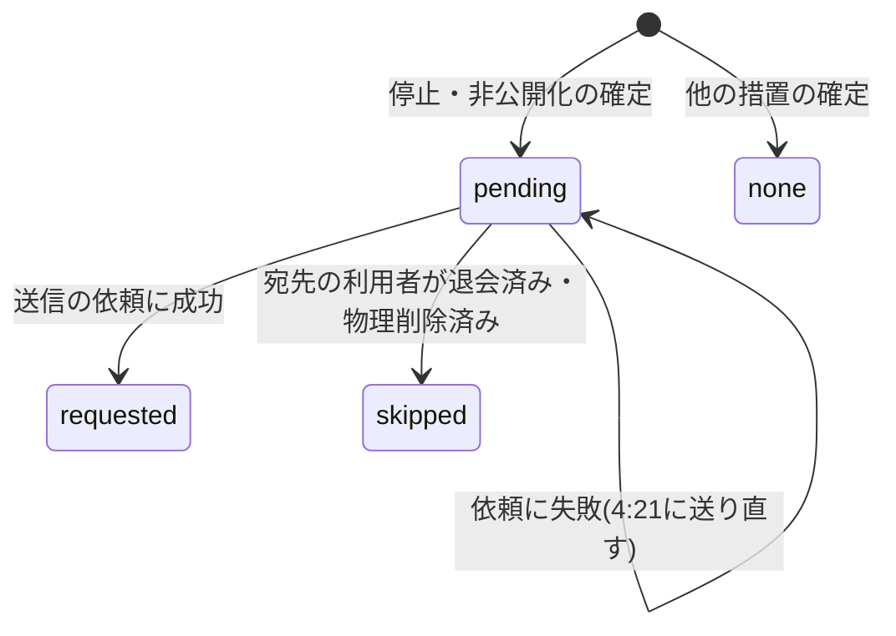
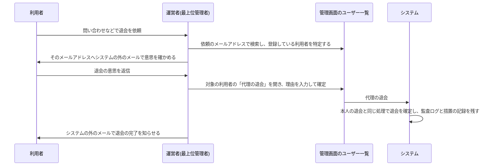

# コンテンツモデレーションの運用

管理者が利用者とユーザー生成コンテンツ(UGC)に取る措置(4.21節のFR-ADMUG-004〜018・030・047〜051、FR-ADMAG-001〜003)の種類と、措置に伴う波及の分担・通知・代理の退会・画像の操作の方針、管理画面のダッシュボードに示す週ごとの統計(FR-ADMUG-001〜003)の定義を定める。画面は[ページ構成のUGC管理の共通の規則](../design/002-page-layouts.md#ugc管理の共通の規則)と[週ごとの統計のカード](../design/002-page-layouts.md#週ごとの統計のカード)、文言は[UGC管理の画面の文言](../design/003-text-and-copy-rules.md#ugc管理の画面の文言)と[措置の通知メールの本文](../design/003-text-and-copy-rules.md#措置の通知メールの本文)、措置の記録と週ごとの統計の保持は[データ保持期間の一覧](../legal/001-compliance-policy.md#データ保持期間の一覧)、日次の統計の集計・送り直し・削除は[日次タイムライン](../overview/007-daily-timeline.md#日次バッチ421の内容)を参照する。利用者とプロダクトの状態の変化を他の機能へ伝える技術的な規約は[ユーザーライフサイクルイベント](../../tech/backend/007-user-lifecycle-events.md)と[集約のライフサイクルイベント](../../tech/backend/012-aggregate-lifecycle-events.md)、監査ログの記録は[監査ログの記録](../../tech/backend/008-audit-logging.md)を正とする。

UGC管理の機能(ugc-moderation)は、措置の操作・「誰が・何に・なぜ」措置したかの記録・投稿者への通知メール・管理画面と、週ごとの統計の集計を持つ。措置に伴う波及(マッチ・画像・検索索引・広告・トーナメント・Ultras)は実装せず、停止・停止解除・退会は利用者のライフサイクル、非公開化・復元はプロダクトのライフサイクルとして発火し、各機能が登録済みの処理で行う。

本機能の論点の仮1〜仮9は、2026-10-24に開発者が全て確定した。仮4(代理の退会の起点と本人の確かめ)・仮5(代理の退会の知らせ)・仮9(取り消しの理由)は、当初の推奨と異なる選択肢が選ばれた。

## 用語

| 用語         | 意味                                                                                                                                                                                         |
| ------------ | -------------------------------------------------------------------------------------------------------------------------------------------------------------------------------------------- |
| 措置         | 管理者が利用者・プロダクト・コメント・評価・画像に対して行う13種の操作(次の表)。状態を変えなかった操作は措置に数えない                                                                       |
| 措置の記録   | 措置ごとの、操作した管理者・措置の種類・対象・関わる利用者とプロダクト・理由・日時・通知の状態の記録。管理画面で最新の理由を表示し、送れなかった通知を送り直すのに使う(`moderation_actions`) |
| 通知の状態   | 措置の記録が持つ通知メールの状態。送らない(`none`)・依頼待ち(`pending`)・依頼済み(`requested`)・送らなかった(`skipped`)の4つ                                                                 |
| 隔離理由     | 画像を隔離バケットに置く理由。自動判定・非公開化・ユーザー停止・管理者操作の4つで、1つでも残る画像は公開に戻らない(FR-ADMUG-050)                                                             |
| 隔離画像     | 隔離理由を1つ以上持つ画像                                                                                                                                                                    |
| 代理の退会   | 最上位管理者がユーザー一覧から、利用者に代わって行う退会(FR-ADMUG-051)                                                                                                                       |
| 週           | 統計の単位とする、基準時刻(UTC-08:00)の月曜日0:00から翌週の月曜日0:00までの期間(FR-ADMUG-002)。週の開始日(月曜日の業務日付)で表す                                                            |
| 集計中の今週 | まだ終わっていない週。集計のたびに値を上書きする                                                                                                                                             |
| 確定した週   | 終わった後に一度集計した週。以後は値を書き換えない                                                                                                                                           |

## 措置の種類と波及の分担

| 措置                           | 表示名(監査ログの操作種別) | 対象       | 必要なロール     | 理由 | 通知メール | 状態の変更の口                       |
| ------------------------------ | -------------------------- | ---------- | ---------------- | ---- | ---------- | ------------------------------------ |
| `user.suspend`                 | ユーザーの停止             | 利用者     | モデレーター以上 | 必須 | 送る       | 利用者のライフサイクル(停止)         |
| `user.unsuspend`               | ユーザーの停止解除         | 利用者     | モデレーター以上 | 必須 | 送らない   | 利用者のライフサイクル(停止解除)     |
| `user.administrative-withdraw` | ユーザーの代理の退会       | 利用者     | 最上位管理者だけ | 必須 | 送らない   | 利用者のライフサイクル(退会)         |
| `product.hide`                 | プロダクトの非公開化       | プロダクト | モデレーター以上 | 必須 | 送る       | プロダクトのライフサイクル(非公開化) |
| `product.unhide`               | プロダクトの復元           | プロダクト | モデレーター以上 | 必須 | 送らない   | プロダクトのライフサイクル(復元)     |
| `comment.hide`                 | コメントの非公開化         | コメント   | モデレーター以上 | 必須 | 送る       | コメントの機能の操作口               |
| `comment.unhide`               | コメントの復元             | コメント   | モデレーター以上 | 必須 | 送らない   | コメントの機能の操作口               |
| `rating.invalidate`            | 評価の無効化               | 評価       | モデレーター以上 | 必須 | 送らない   | 評価の機能の操作口                   |
| `rating.revalidate`            | 評価の無効化の取り消し     | 評価       | モデレーター以上 | 必須 | 送らない   | 評価の機能の操作口                   |
| `image.approve`                | 画像の公開承認             | 画像       | モデレーター以上 | 任意 | 送らない   | 画像の機能の隔離理由の操作口         |
| `image.quarantine`             | 画像の隔離                 | 画像       | モデレーター以上 | 任意 | 送らない   | 画像の機能の隔離理由の操作口         |
| `image.release`                | 画像の隔離の解除           | 画像       | モデレーター以上 | 任意 | 送らない   | 画像の機能の隔離理由の操作口         |
| `image.delete`                 | 画像の削除(公開拒否を含む) | 画像       | モデレーター以上 | 任意 | 送らない   | 画像の機能の削除の操作口             |

- 理由は500文字以内で、利用者や管理者の個人情報を含めない。監査ログの対象は、利用者なら仮名化ID、それ以外は各識別子とする(FR-ADMAG-002)
- 状態を変える措置の監査ログと措置の記録は、状態の変更と同じ一括の書き込みで確定し、どちらかだけが残ることは無い。既に同じ状態なら何も書かずに「既に◯◯です」と返し、同じ対象の状態が同時に変わって確定が競合した時は何も残さずに読み直しを求める
- 通報の機能(content-reporting)は、通報の画面から同じ措置の操作を呼び、通報の状態の更新を措置と同じ一括の書き込みで確定する

措置に伴う波及は、次の機能が自分の処理で行う。UGC管理の機能はどれも直接行わない。

| 波及                                         | 停止                                                                           | 非公開化                                     | 担当する機能                                                         |
| -------------------------------------------- | ------------------------------------------------------------------------------ | -------------------------------------------- | -------------------------------------------------------------------- |
| マッチ中のUpvoteの論理削除                   | 停止した利用者のUpvote(FR-VOTE-008)                                            | —                                            | マッチ(match-engine)                                                 |
| 未開始のマッチ予定の取り消し                 | 保有する全プロダクト(FR-ADMUG-010)                                             | そのプロダクト(FR-ADMUG-010)                 | プロダクト(product-launch)・マッチ                                   |
| マッチ中のマッチの即時の終了と開始時点の決着 | 保有するプロダクトのマッチ                                                     | そのプロダクトのマッチ                       | マッチ                                                               |
| 画像の隔離                                   | プロフィール画像と保有する全プロダクトのロゴ・スクリーンショット(FR-ADMUG-048) | ロゴ・スクリーンショット(FR-ADMUG-047)       | プロフィール(user-profile-social)・プロダクト・画像(media-pipeline)  |
| 検索索引からの除外                           | 保有する全プロダクト                                                           | そのプロダクト(FR-ADMUG-011)                 | ディレクトリ(directory-discovery)                                    |
| スポンサー広告の表示停止と日割りの返金       | 保有する全プロダクトの広告(FR-SPONS-020)                                       | そのプロダクトの広告                         | スポンサー広告(sponsorship)                                          |
| トーナメントの除外と参加費の全額返金         | 組み合わせ決定の時点で停止中のプロダクト                                       | 組み合わせ決定の時点で非公開化中のプロダクト | Weekトーナメント(tournament-week)・Yearトーナメント(tournament-year) |
| Ultrasの解約                                 | 課金期間の末日で解約し返金しない(FR-PPLAN-012)                                 | —                                            | Ultras(ultras-subscription)                                          |
| 決済中のセッションの失効                     | 決済中の購入                                                                   | —                                            | 決済(payments)                                                       |

- 停止解除・復元は、隔離した画像の復元と検索索引・広告の表示の再開を各機能に任せる。隔離理由が他に残る画像は公開に戻らず、取り消したマッチ予定とUltrasの解約は戻らない(FR-ADMUG-047・048・050)
- コメントの非公開化は、利用者側の表示を削除された旨の表示に置き換え、付いている返信を残す(FR-COMNT-007)。復元しても、投稿者が削除・退会・停止したコメントと匿名化済みのコメントは置き換えの表示のままである
- 評価の無効化は、評価を平均値と件数の算出から除き、評価者には自分の評価として表示したままにする(FR-RATNG-009・FR-ADMUG-015)

## 通知

停止・プロダクトの非公開化・コメントの非公開化の3つの措置だけ、その旨と理由を投稿者へメールで知らせる(FR-ADMUG-030)。停止解除・復元・評価の無効化と取り消し・画像の操作・代理の退会では送らない。

- 措置を確定した直後に送信を依頼する。依頼に失敗しても措置は取り消さず、日次バッチ(4:21)の`ugc-moderation.maintenance`(順序1910)が、措置から1時間以上依頼待ちのままの通知を送り直す。同じ措置の通知は依頼済みにした後は依頼し直さない。ただし送信の依頼に成功した後に依頼済みへの記録だけが失敗した場合に限り、送り直しで2通目が届き得る
- 停止中の利用者にも届ける。退会済み・物理削除済みの利用者には送らず、送らなかったことを記録する
- 本文は[措置の通知メールの本文](../design/003-text-and-copy-rules.md#措置の通知メールの本文)のとおりで、問い合わせフォームへのボタンを置き、日時をUTCで表記する

### 返金の扱い

UGC管理の機能は、停止・非公開化に伴う返金を依頼しない(仮8)。返金は各機能の決定に従い、停止と非公開化の通知メールでその扱いを伝える(FR-ADMUG-033・034)。

| 対象                     | 扱い                                                                                                                                                                                                                                        | 決定                      |
| ------------------------ | ------------------------------------------------------------------------------------------------------------------------------------------------------------------------------------------------------------------------------------------- | ------------------------- |
| スポンサー広告           | 表示を止め、掲載期間は延長しない。表示を停止した日数分(1日のうち一部でも停止した日を含む)の広告料金を、各広告の掲載期間が終わった時点で日割りにより自動で返金する。掲載期間が終わる前に退会した場合や、プロダクトを削除した場合は返金しない | sponsorshipの仮3          |
| Weekトーナメントの参加費 | 組み合わせ決定の時点で停止中・非公開化中なら参加資格を停止し、参加費を自動で全額返金する                                                                                                                                                    | tournament-weekの仮2・仮3 |
| Yearトーナメントの参加費 | 同上                                                                                                                                                                                                                                        | tournament-yearの仮3・仮4 |
| Ultras                   | 停止で課金期間の末日に解約し、支払い済みの料金は返金しない                                                                                                                                                                                  | ultras-subscriptionのQ3   |

## 代理の退会の手順

セッションが切れた停止中の利用者など、自分で退会できない利用者から退会を依頼された時に、最上位管理者が利用者に代わって退会させる(FR-ADMUG-051、仮4・仮5)。システムは退会の確定だけを行い、依頼の受け付け・本人の意思の確かめ・完了の知らせはシステムの外で運営者が行う。

1. 運営者は、問い合わせなどで退会の依頼を受け付ける。依頼の受け付けの画面は設けない
2. 運営者は、依頼に書かれたメールアドレスでユーザー一覧のメールアドレスの検索(監査ログに記録される)を行い、そのメールアドレスを登録している利用者を特定する。ユーザー一覧はメールアドレスを表示しないため、検索で一致を確かめる。続けて、そのメールアドレスへシステムの外のメールを送り、本人の意思を確かめる
3. 最上位管理者が、ユーザー一覧の対象の利用者の項目から「代理の退会」を開き、対象のニックネーム・ハンドル・停止状態を確かめて、理由を入力して確定する。起点はユーザー一覧の項目だけで、問い合わせの詳細からの導線と本人の意思の確認の確認欄は設けない
4. システムは、利用者本人の退会と同じ処理(FR-USER-019)で退会を確定し、操作した管理者・対象の仮名化ID・理由・日時を監査ログと措置の記録に残す。停止中の利用者も退会させられる。システムからはメールを送らない(措置の記録の通知の状態は`none`)
5. 運営者は、システムの外のメールで退会の完了を知らせる

- 退会は取り消せず、利用者のデータは退会の規則どおりに削除される([データ保持期間の一覧](../legal/001-compliance-policy.md#データ保持期間の一覧))
- 確定の時点で利用者が退会済み・不在なら退会を行わず、利用者が見つからない旨を返す。同じ利用者の状態が同時に変わった時は確定せず、読み直しを求める
- モデレーター・閲覧のみの管理者には操作を表示せず、サーバーも最上位管理者でない要求を拒否する

## 画像の操作と隔離理由

管理画面の画像の操作は、管理者操作と自動判定の隔離理由だけを付け外しする。非公開化とユーザー停止の隔離理由は、プロダクトの復元と停止解除でだけ外れる(FR-ADMUG-047・048・050)。

| 操作       | 受け付ける画像                                                 | 隔離理由の変化           | 起点の画面                     |
| ---------- | -------------------------------------------------------------- | ------------------------ | ------------------------------ |
| 公開承認   | 自動判定の理由を持つ隔離画像                                   | 自動判定の理由を外す     | 画像モデレーション             |
| 公開拒否   | 自動判定の理由を持つ隔離画像                                   | 画像を削除する           | 画像モデレーション             |
| 個別の隔離 | 画像用の用途の画像(ロゴ・スクリーンショット・プロフィール画像) | 管理者操作の理由を加える | ユーザー一覧・プロダクトの詳細 |
| 隔離の解除 | 管理者操作の理由を持つ隔離画像                                 | 管理者操作の理由を外す   | 画像モデレーション             |
| 削除       | 隔離理由を1つ以上持つ画像                                      | 画像を削除する           | 画像モデレーション             |

- 理由を外した画像は、他の隔離理由が残っていなければ画像用非公開バケットへ戻り、残っていれば隔離バケットに留まる(FR-ADMUG-050)。公開中の画像を削除する時は、先に個別の隔離を経る
- 必要な隔離理由を持たない画像への操作と、存在しない・画像用の用途でない・削除済みの画像への操作は拒否する(画像の削除は即時の削除を試み、削除待ちの画像への再度の削除は変化なしとして扱う)
- 隔離理由の変更(削除では削除待ちの印)と監査ログ・措置の記録は同じ一括の書き込みで確定し、その後にバケットの間の移動や削除を依頼する。依頼が一時的に失敗しても状態と記録は確定済みで、保存先は日次バッチ(4:21)の`media-pipeline.location-reconciliation`(順序830)、削除は`media-pipeline.expired-file-erasure`(順序810)がそろえる。管理者が同じ操作をやり直しても記録は重ならない
- 隔離画像は画像配信ドメインを使わず、管理者側のサイトと同じオリジンから、ログイン中の有効な管理者(ロールは問わない)にだけ表示する(FR-ADMUG-018)
- 画像の操作は投稿者へ通知しない(FR-ADMUG-030の対象外、仮7)

## 措置の取り消しの理由

停止解除・プロダクトの復元・コメントの復元・評価の無効化の取り消しは、措置と同じく理由を必須とする(仮9)。取り消しの判断も後から説明できるよう、監査ログと措置の記録に理由を残すためである。画像の操作(隔離の解除を含む)は任意の理由とする(仮7)。

## 週ごとの統計

管理画面のダッシュボードの[週ごとの統計のカード](../design/002-page-layouts.md#週ごとの統計のカード)に、運営状況の推移として5つの指標を週ごとに示す(FR-ADMUG-001〜003、FR-ADMAC-001)。カードは表示のたびに集計し直さず、日次バッチ(4:21)の`ugc-moderation.weekly-statistics`(順序1900)が週ごとに保存した値を読む。統計は措置とは独立した機能で、措置の記録を使わない。

### 統計の定義

直近26週の確定した週と集計中の今週を表示する(仮1)。各指標の週の値は次のとおりで、UGC管理の機能は各機能のデータを直接読まず、各機能が提供する照会で求める。

| 指標           | 週の値                                                                                                                                                                                                                                            | 提供する機能                                        |
| -------------- | ------------------------------------------------------------------------------------------------------------------------------------------------------------------------------------------------------------------------------------------------- | --------------------------------------------------- |
| 合計収益(税込) | その週に発生した成功した都度決済と定期課金の請求の金額の合計から、その週に成功した返金の額と、その週に敗北が確定したチャージバックの引き落とし額を差し引いた純額(USD)。疎通確認用の購入を含めない。定義はFR-ADMUG-002と決済の機能の照会を正とする | 決済(payments)の期間ごとの純収益の照会              |
| ユーザー数     | 週の終わり(集計中の今週は集計の時点)より前に登録し、その時点で退会していない利用者の総数。停止中の利用者を含む                                                                                                                                    | 利用者のアカウント(identity-auth)の時点の総数の照会 |
| プロダクト数   | 週の終わり(集計中の今週は集計の時点)より前に登録し、その時点で論理削除されていないプロダクトの総数。非公開化中のプロダクトを含む                                                                                                                  | プロダクト(product-launch)の時点の総数の照会        |
| 予選実施数     | その週の日付に開始した、両者がそろった予選のマッチの数。開始の直後に終わったマッチを含み、不戦勝と開始時点の決着を除く                                                                                                                            | マッチ(match-engine)の日ごとの集計                  |
| Upvote数       | その週の日付に確定したマッチ(予選とトーナメントの全種別)のUpvote数の合計                                                                                                                                                                          | マッチの日ごとの集計                                |

- 集計は毎日4:21に行い、集計中の今週を集計の時点の値で上書きする。前の週がまだ確定していなければ、週の終わりの時点の値で集計して確定する。確定した週は以後書き換えず、物理削除で消えた利用者・プロダクトがあっても過去の週の値は変わらない
- 同じ日に何度集計しても、同じ週の行は1つだけである。集計に失敗した時は運用者がエラートラッキングで検知でき、次の集計で集計し直す
- 日次バッチが1週間以上止まると、その間に終わった週を確定できず、その週は欠けたまま表に出ない。物理削除の後は過去の時点の総数を正しく求められないため、欠けた週を遡って作る処理は設けない
- マッチは当日の23:40に終わるため、Upvote数はその週に確定したマッチと実際上一致する。終了が遅れて翌週に確定したマッチは、確定済みの週に入らない
- 統計は個人を含まない集計値だけを持ち、無期限に保持する([データ保持期間の一覧](../legal/001-compliance-policy.md#データ保持期間の一覧))

### 統計のグラフ

グラフはRechartsで描く(仮2、[技術選定のグラフ描画](../../../onboardings/tech-stack.md#グラフ描画))。版は3.10.1、または導入の時点で公開から2週間以上たつ3系の最新の安定版を、範囲を指定せずに固定する。Rechartsを使うのは管理者側だけで、フロントエンド共通ファイルには置かない。

- 指標ごとに1つずつ、直近26週と集計中の今週の値を週の古い順に結ぶ小さな折れ線グラフを5つ並べる
- 線と軸の色は配色のトークン(CSSの変数)を部品の属性で渡す。shadcn/uiのグラフの部品は、配色をページへ注入する`<style>`(生のHTMLの挿入)を使うため写さない(2026-11-20に開発者が決定)
- Rechartsを読み込む部品はダッシュボードの最初の読み込みに含めず、別のファイルとしてブラウザで後から読み込む。サーバー側の描画では描かず、読み込みの間はグラフと同じ高さの空の枠を置いて、表示の位置をずらさない(2026-11-20に開発者が決定)
- グラフは読み上げの対象から外し、同じ値を示す表を読み上げとキーボードの操作で読む正とする(FR-ADMUG-001)
- グラフの読み込みや描画に失敗しても、同じ高さの空の枠を残して直近の値と表を表示し続け、失敗はエラートラッキングへ送る(グラフは表の補助のため、カード全体を失敗の表示にしない)

## 確定した決定

本機能の仮決定は次のとおりである。仮1・仮2の詳細は[週ごとの統計](#週ごとの統計)を参照。

| #   | 決定                                                                                                                                                               |
| --- | ------------------------------------------------------------------------------------------------------------------------------------------------------------------ |
| 仮1 | 統計は、合計収益をその週の純収益、ユーザー数とプロダクト数を週の終わりの時点の総数、予選実施数とUpvote数をその週の件数・合計とし、直近26週と集計中の今週を表示する |
| 仮2 | 統計のグラフはRecharts(3.10.1、または3系の最新の安定版)で描く                                                                                                      |
| 仮3 | ユーザー検索は、ハンドルとニックネームを大文字小文字を区別しない部分一致、メールアドレスを大文字小文字を区別しない完全一致とする                                   |
| 仮4 | 代理の退会は最上位管理者だけが、ユーザー一覧の項目から理由を入力して行う。問い合わせの詳細からの導線と本人の意思の確認の確認欄は設けない                           |
| 仮5 | 代理の退会ではシステムからメールを送らず、運営者がシステムの外のメールで知らせる                                                                                   |
| 仮6 | プロダクト一覧の絞り込みは、ローンチ状態を最新のローンチの状態5値(予約中・予選マッチ中・勝利・敗北・取消)、公開状態を3値(公開中・非公開化中・投稿者が停止中)とする |
| 仮7 | 画像の公開承認・公開拒否(削除)・個別の隔離・隔離の解除を、任意の理由とともに監査ログと措置の記録に残す                                                             |
| 仮8 | 停止・非公開化に伴う返金は依頼せず、各機能の決定に従い通知メールで伝える                                                                                           |
| 仮9 | 停止解除・復元・評価の無効化の取り消しは理由を必須とする                                                                                                           |
