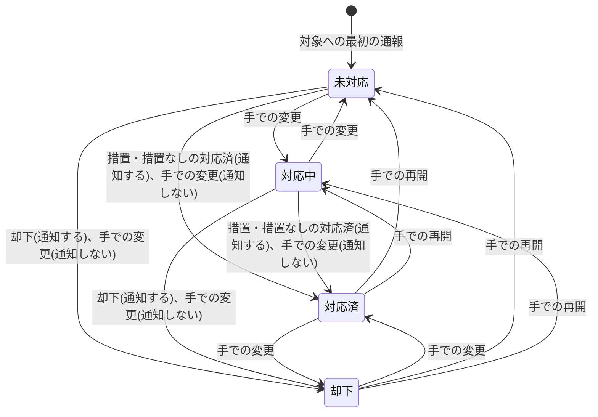

# 通報の運用

利用者がユーザー・プロダクト・コメントを運営へ通報し、運営が案件として対応する機能(4.12節のFR-REPOT-001〜006、4.21節のFR-ADMUG-008・019・020・025・027・030・031・032・035・039・040、FR-ADMCF-019〜021、FR-RLMIT-004・016、LR-004、DR-022)の、受け付けと回数制限・案件への集約と対応ステータス・措置と通知の分担・権利侵害の照会・対応期間・通報カテゴリ・保持期間を定める。画面は[ページ構成の通報のダイアログ](../design/002-page-layouts.md#通報のダイアログ)と[管理画面の通報](../design/002-page-layouts.md#通報reports)、文言は[通報の画面の文言](../design/003-text-and-copy-rules.md#通報の画面の文言)・[通報管理の画面の文言](../design/003-text-and-copy-rules.md#通報管理の画面の文言)・[通報のメールの本文](../design/003-text-and-copy-rules.md#通報のメールの本文)、権利侵害の申出の手順は[侵害コンテンツ削除請求フロー](../legal/005-rights-infringement-takedown-flow.md)、保持期間は[データ保持期間の一覧](../legal/001-compliance-policy.md#データ保持期間の一覧)、日次の送り直しと削除は[日次タイムライン](../overview/007-daily-timeline.md#日次バッチ421の内容)を参照する。ログインせずに送れる投稿の保護は[未ログインの投稿の保護](../../tech/security/008-anonymous-submission-protection.md)、他の機能の措置と同じ一括の書き込みでの記録は[集約をまたぐ管理操作の記録](../../tech/backend/021-cross-aggregate-admin-action-records.md)、監査ログの記録は[監査ログの記録](../../tech/backend/008-audit-logging.md)を正とする。

通報の機能(content-reporting)は、通報の受け付け・案件への集約・対応ステータス・申出者と却下の投稿者への通知・権利侵害の照会・対応期間の表示・通報カテゴリと、管理画面の通報管理を持つ。非公開化・停止の実処理とその波及、投稿者への措置の通知はUGC管理の機能(ugc-moderation、[コンテンツモデレーションの運用](006-content-moderation.md))が持ち、本機能は案件からその措置の操作を呼ぶだけである。照会への投稿者の回答は問い合わせ(inquiry-chat)で届き、本機能は回答を受け取らない。

本機能の論点の仮1〜仮8は、2026-10-24に開発者が全て確定した。仮3(対応ステータスの遷移と理由)・仮5(対応期間と目標の超過)・仮7(対象の物理削除に伴う案件)は、当初の推奨と異なる選択肢が選ばれた。

## 用語

| 用語               | 意味                                                                                                        |
| ------------------ | ----------------------------------------------------------------------------------------------------------- |
| 通報               | 閲覧者(ログインの有無を問わない)が1つの対象について送った1件の申告。カテゴリ・理由・受付日時・通報者を持つ  |
| 対象               | 通報されたユーザー(公開プロフィール)・プロダクト・コメント                                                  |
| 投稿者             | 対象を投稿した利用者。ユーザーはその利用者自身、プロダクト・コメントは投稿した利用者                        |
| 申出者             | 通報を送った人。ログイン中の利用者、または未ログインの通報者(停止中の利用者を含む、仮6)                     |
| 案件               | 同じ対象への未完了の通報を集約した単位(仮1)。対応ステータスを持つ                                           |
| 未完了・完了       | 対応ステータスが「未対応」「対応中」の案件を未完了、「対応済」「却下」の案件を完了とする                    |
| 権利侵害の案件     | 「権利侵害」の通報を1件以上含む案件(仮1)                                                                    |
| 措置               | UGC管理の機能が提供するプロダクト・コメントの非公開化とユーザーの停止(仮2)                                  |
| 照会               | 権利侵害の案件で、投稿者へ事情を尋ねるメール(FR-ADMUG-035、仮4)                                             |
| 対応期間           | 権利侵害の案件の、起点から対応完了までの経過時間(FR-ADMUG-040、仮5)                                         |
| 対象への参照の消去 | 対象の物理削除の時期に、案件から対象・投稿者・対象のプロダクトの識別子だけを消し、案件と通報を残すこと(仮7) |

## 通報の受け付け

### 導線と入力

公開プロフィールの「…」メニューの「このユーザーを通報」、プロダクト詳細のページ末尾の「このプロダクトを通報」、他者のコメントの「…」メニューの「通報」から、ページを移動せずに通報のダイアログを開く(FR-REPOT-001)。ログイン状態を問わず表示し、ログイン中の閲覧者の自分のプロフィール・プロダクト・コメントには表示しない(FR-REPOT-005)。スポンサー広告などユーザー・プロダクト・コメント以外には通報の操作を置かない。

| 欄                   | 規則                                                                                                                                                                                                                         |
| -------------------- | ---------------------------------------------------------------------------------------------------------------------------------------------------------------------------------------------------------------------------- |
| カテゴリ             | 必須。[通報カテゴリ](#通報カテゴリ)のマスタのカテゴリを、追加の順に並べ「権利侵害」「その他」をこの順で末尾に置く(FR-REPOT-002、仮8)                                                                                         |
| 理由                 | 必須。前後の空白を除いて1〜1,000文字(書記素)のプレーンテキスト(FR-REPOT-004)。「権利侵害」では、侵害されている権利・権利者との関係・対象の箇所を書くよう案内する                                                             |
| 連絡先メールアドレス | 未ログイン(停止中を含む)の閲覧者が「権利侵害」を選んだ時だけ表示し、必須とする(FR-REPOT-003、仮6)。254文字以内のメールアドレス形式。権利侵害の申出への対応結果を知らせるために使う。それ以外の時は欄を表示せず、値を送らない |
| bot判定              | 画面に表示しないウィジェットで判定し、判定の結果とともに送る(FR-REPOT-006)                                                                                                                                                   |

### 停止中の利用者の通報

停止中の利用者の通報は、未ログインの通報として受け付ける(仮6、問い合わせの停止中の利用者の扱いと同じ)。利用者に結び付けず、「権利侵害」なら連絡先メールアドレスを必須にし、回数制限は送信元IPアドレスの規則だけを受け、保持期間も未ログインの通報と同じにする。自分のコンテンツの通報は、停止中でも拒否する。

### 対象と確認の順序

対象は、他の閲覧者に表示されているものに限る。退会・停止していないユーザー、論理削除・非公開化されておらず投稿者が表示されるプロダクト、削除・非公開化・匿名化されておらず投稿者と対象のプロダクトが表示されるコメントである。それ以外はどの理由でも対象が見つからない旨を返し、非公開のコンテンツの存在を通報の応答で探れないようにする。

受け付けは、費用の小さい確認とbot判定のトークンを消費せずに拒否できる確認を先に行う。

1. 利用者側のサイトからの送信であること(FR-RLMIT-004)
2. 入力の形式と、連絡先メールアドレスの要否・形式(入力の誤りではbot判定のトークンを消費しない)
3. bot判定(FR-REPOT-006)
4. カテゴリの存在
5. 対象が表示されていること
6. 自分のコンテンツでないこと(FR-REPOT-005)
7. 回数制限
8. 通報の記録と案件への集約(1つの一括の書き込み)

受け付けた通報は、受付日時・対象・カテゴリと受付時点のカテゴリ名・理由・通報者(ログイン中の利用者、または未ログインの連絡先メールアドレス)を記録する。送信元IPアドレスは記録しない。

### 回数制限

| 規則                 | 上限                    | 数える通報                           |
| -------------------- | ----------------------- | ------------------------------------ |
| 送信元IPアドレスごと | 数え始めから1時間に10回 | 全ての通報                           |
| 利用者ごと           | 数え始めから1時間に10回 | ログイン中で停止中でない利用者の通報 |

- 上限を超えた通報は記録せず、429と再試行までの秒数を返す(FR-RLMIT-004)。数え始めから1時間で回数を0に戻す(FR-RLMIT-016)
- 入力の検証・bot判定・対象の確認を通った通報だけを数える。利用者の規則で拒否した通報は、送信元IPアドレスの規則で数えない
- 回数のキーは送信元IPアドレスと利用者のIDをハッシュ化した値だけとし、送信元IPアドレス自体を保存しない(FR-RLMIT-020)
- 送信元IPアドレスが分からない通報は送信元IPアドレスの回数を数えず、運用者が検知できる警告を残す。bot判定と利用者ごとの規則で守る

## 案件への集約

同じ対象(種類とID)への通報は、未完了の案件があればその案件へ、無ければ「未対応」の新しい案件へ集約する(FR-ADMUG-027、仮1)。

- 1つの対象に未完了の案件は高々1つで、同時に届いた通報でも案件は1つになる。通報の記録と集約は1つの一括の書き込みで確定する
- 完了した案件の対象に届いた通報は新しい案件にし、完了した案件を変えない(完了した案件へ集約し直して再開しない)
- カテゴリが混ざっても1つの案件にし、「権利侵害」の通報を1件以上含む案件を権利侵害の案件として扱う。最初の「権利侵害」の通報の受付日時を[対応期間](#対応期間)の起点にする。対応期間は受け付けた申出からの期限のため、「権利侵害」の通報の申出者が退会してその通報を件数と表示から除いても、権利侵害の案件のままとし、起点も変えない
- 案件ごとに、通報の件数・カテゴリごとの件数・最初と最後の受付日時を示す。利用者の退会で論理削除された通報は件数と表示から除き、表示する通報が1件も無い案件は一覧・件数に出さない(FR-USER-019)

## 対応ステータス

モデレーター以上の管理者は、案件の状態を4つの状態の間で手で自由に変えられる(FR-ADMUG-020、仮3)。手での状態の変更は当事者へ通知せず、措置も行わない。当事者への通知は[措置・措置なしの対応済・却下の操作](#措置と通知の分担)でだけ送る。

| 手での変更                                     | 理由(500文字以内) | 記録                                                                                                                                               |
| ---------------------------------------------- | ----------------- | -------------------------------------------------------------------------------------------------------------------------------------------------- |
| 未対応⇄対応中                                  | 任意              | 状態と変更の日時                                                                                                                                   |
| 完了への変更(対応済⇄却下の変更を含む)          | 必須              | 案件の完了として、完了の日時と理由を記録する(手での「対応済」の措置の種類は「措置なし」)。まだ依頼していない当事者への通知は取りやめる             |
| 完了からの再開(対応済・却下から未対応・対応中) | 必須              | 完了の日時・措置の種類・完了の理由を消し、まだ依頼していない当事者への通知を取りやめる。依頼済みの通知と、行った措置(非公開化・停止)は取り消さない |

- 完了への変更と再開は、保持期間の起点・対応期間の終点・措置の記録との結び付きを動かすため、理由を必須とする(UGC管理の措置の取り消しの理由と同じ扱い)
- 措置で対応済にした案件を手で却下・再開しても、行った措置は残る。措置の取り消しはUGC管理の各管理画面で行う
- 再開しようとした対象に未完了の別の案件(再開までの間に届いた通報でできた案件)があれば、再開せずにその案件で対応するよう示す。2つの案件は自動で統合しない
- 変更前の状態が画面の表示と一致しない時と、同じ案件の同時の変更と競合した時は、何も変えずに最新の状態を読み直すよう案内する
- 状態の変更と監査ログは同じ一括の書き込みで確定し、どちらかだけが残ることは無い

### 監査ログ

本機能の操作は、次の操作種別で監査ログに記録する(FR-ADMAG-001)。対象は案件・カテゴリの識別子とし、利用者を対象にしない。メールアドレス・申出者の理由・照会の内容は記録しない(FR-ADMAG-002)。

| 操作種別                 | 表示名                     | 対象     | 理由 | 記録する場面                                                                                                             |
| ------------------------ | -------------------------- | -------- | ---- | ------------------------------------------------------------------------------------------------------------------------ |
| `report.status-change`   | 通報の対応ステータスの変更 | 案件     | 任意 | 未対応⇄対応中の変更と、完了からの再開(再開の理由は必須)。変更前後の状態を記録する                                        |
| `report.resolve`         | 通報への対応(対応済)       | 案件     | 必須 | 措置・措置なしの対応済の操作と、手での「対応済」への変更。措置の種類と、操作か手での変更かの区別と変更前の状態を記録する |
| `report.reject`          | 通報の却下                 | 案件     | 必須 | 却下の操作と、手での「却下」への変更。操作か手での変更かの区別と変更前の状態を記録する                                   |
| `report.inquire`         | 権利侵害の照会             | 案件     | 任意 | 照会の送信                                                                                                               |
| `report-category.create` | 通報カテゴリの追加         | カテゴリ | 任意 | カテゴリの追加                                                                                                           |
| `report-category.rename` | 通報カテゴリの名前の変更   | カテゴリ | 任意 | カテゴリの名前の変更                                                                                                     |
| `report-category.delete` | 通報カテゴリの削除         | カテゴリ | 任意 | カテゴリの削除。付け替えた通報の件数を記録する                                                                           |

- 措置による対応済では、UGC管理の措置の監査ログ(「プロダクトの非公開化」など)と「通報への対応(対応済)」の2件を、措置と同じ一括の書き込みで記録する
- 完了は操作でも手での変更でも`report.resolve`・`report.reject`に記録するため、[対応期間](#対応期間)の終点はこの2種の最新の日時で求まる

## 措置と通知の分担

案件から直接行う措置は、プロダクトとコメントの非公開化とユーザーの停止だけである(仮2)。画像の隔離・評価の無効化などは、案件の詳細の導線から各管理画面へ移って行い、案件は「措置なしで対応済」にする。

| 操作             | 対象の種類           | 行える案件 | 理由(500文字以内)                         | 案件の状態 | 送る通知                                                        |
| ---------------- | -------------------- | ---------- | ----------------------------------------- | ---------- | --------------------------------------------------------------- |
| 非公開化         | プロダクト・コメント | 未完了     | 必須                                      | 対応済     | 申出者へ対応結果。投稿者への非公開化の通知はUGC管理の機能が送る |
| 停止             | ユーザー             | 未完了     | 必須                                      | 対応済     | 申出者へ対応結果。投稿者への停止の通知はUGC管理の機能が送る     |
| 措置なしで対応済 | 全て                 | 未完了     | 必須                                      | 対応済     | 申出者へ対応結果                                                |
| 却下             | 全て                 | 未完了     | 必須                                      | 却下       | 申出者と投稿者へ却下の通知                                      |
| 手での状態の変更 | 全て                 | 全て       | [対応ステータス](#対応ステータス)のとおり | 選んだ状態 | 送らない                                                        |

- 措置はUGC管理の措置の操作で行い、対象の状態の変更・措置の記録・UGC管理の監査ログ・案件の完了・本機能の監査ログを1つの一括の書き込みで確定する(FR-ADMUG-025)。措置で対応済にした案件には措置の記録の識別子を残し、案件と措置の記録を結び付ける。措置に伴う波及(マッチ予定の取り消し・画像の隔離・検索索引の更新など)は[UGC管理の機能と各機能](006-content-moderation.md#措置の種類と波及の分担)が行う
- 対象が既に非公開化・停止されていれば、案件を変えずにその旨を返し、措置なしの対応済を案内する。対象が退会・削除などで見つからない時と、対象への参照を消した案件では、措置を行わずに措置なしの対応済か却下を案内する
- 措置・措置なしの対応済・却下は未完了の案件でだけ行える。完了した案件に通知を伴う判断をする時は、先に手で未対応・対応中へ戻してから操作する
- 同時の変更と競合した時と、案件が完了済みの時は、措置・案件・監査ログのいずれも変えずに拒否する

### 当事者への通知

| 通知                 | 契機                         | 宛先                                                                                                                                   | 内容                                                                                       |
| -------------------- | ---------------------------- | -------------------------------------------------------------------------------------------------------------------------------------- | ------------------------------------------------------------------------------------------ |
| 申出者への対応結果   | 措置・措置なしの対応済、却下 | 案件の各申出者。ログイン中の通報は利用者の登録メールアドレス、未ログインの通報は入力された連絡先メールアドレス(FR-ADMUG-031・032・039) | 対応した旨または却下の旨・理由・対象の表示                                                 |
| 却下の投稿者への通知 | 却下                         | 対象の投稿者の登録メールアドレス(FR-ADMUG-039)                                                                                         | 通報が却下された旨・理由・対象の表示。申出者を特定できる情報と申出者が書いた理由を含めない |

件名と本文は[通報のメールの本文](../design/003-text-and-copy-rules.md#通報のメールの本文)のとおりで、通知メールの配信停止の設定にかかわらず送るトランザクションメールである。

- 1つの案件の完了につき、同じ宛先へ1通だけ送る。同じ申出者が同じ案件に複数回通報していても、ログイン中の通報は利用者ごと、未ログインの通報は連絡先メールアドレス(大文字小文字を区別しない)ごとに1通にまとめる(FR-ADMUG-031)
- 連絡先の無い未ログインの通報には送らない。投稿者・ログイン中の申出者が退会済み・物理削除済みの時、コメントの投稿者が匿名化されている時、対象への参照を消した案件の投稿者には送らず、送らなかったことを記録する。停止中の利用者にも届ける
- 送信の依頼に失敗しても案件の完了は取り消さず、日次バッチ(4:21)の`content-reporting.notice-redispatch`(順序2000)が、完了から1時間以上依頼待ちのままの通知を送り直す。同じ通知は依頼済みにした後は依頼し直さない。依頼の後に依頼済みへの記録だけが失敗して送り直しても、案件の完了の日時を含む冪等のキーでメール送信の基盤が2通目を送らない。送り直しまでに申出者が全員退会して全ての通報が論理削除された案件(管理画面には現れない)も送り直しの対象とし、申出者は退会済みとして送らなかったことを記録し、却下の投稿者には送る
- 手での状態の変更では送らない(仮3)。手での完了と再開は、依頼待ちのままの通知を取りやめる。再開の後に操作で再び完了すると、各申出者(と却下の投稿者)への通知を改めて依頼する(1回の完了につき1回)

## 権利侵害の照会

権利侵害かどうか判断が難しい申出について、投稿者へ事情を照会するメールを送る(FR-ADMUG-035、仮4)。手順上の位置付けは[侵害コンテンツ削除請求フロー](../legal/005-rights-infringement-takedown-flow.md#判断と通知のフロー)を参照。

- 送れるのは、モデレーター以上の管理者が、対応中の権利侵害の案件で、対象の投稿者がいる(退会・物理削除・匿名化・対象への参照の消去のいずれでもない)場合だけである
- 照会の内容は、管理者が1〜1,000文字で、侵害されたとする権利と理由の要旨を書く。申出者を特定できる情報と申出者が書いた理由そのものは載せない。入力欄に、申出者や第三者の個人情報を含めない旨を注記する
- メールは投稿者の登録メールアドレスへ送り、照会の内容・対象の表示と利用者側のページのURL・回答の方法(問い合わせフォームで対象のURLを明記して回答する)・回答の期限(送信から7日、UTC)・期限内に回答が無い場合は公開の停止を判断し得る旨を載せる
- 送信の依頼ができた後に、送信の日時を回答の期限の起算点として監査ログに記録し、案件の最後の照会の日時と内容を更新する。送信の依頼に失敗した時は何も記録せず、入力を保ったまま再試行できるようにする。送信の後の記録に失敗した時は運用者へ通知し、管理者は読み直してから送り直せる(この場合は投稿者に照会が2通届き得る)
- 同じ案件で照会を何度でも送れ、回答の期限は最後の照会から求める。案件の詳細に最後の照会の日時・内容・回答の期限を示し、期限を過ぎていれば色だけに頼らずにその旨を示す
- 照会への回答は問い合わせフォームで届き、管理者は問い合わせの管理画面で読む。本機能は回答を受け取らない

## 対応期間

権利侵害の案件の、受付から対応完了までの経過時間を通報の一覧と案件の詳細に示し、目標の超過を把握する(FR-ADMUG-040、仮5)。権利侵害の案件でない案件には示さない。

| 項目   | 定義                                                                                                                                    |
| ------ | --------------------------------------------------------------------------------------------------------------------------------------- |
| 起点   | 案件の最初の「権利侵害」の通報の受付日時                                                                                                |
| 終点   | 監査ログに記録した案件の最後の完了(措置・措置なしの対応済・却下の操作と、手での「対応済」「却下」への変更)の日時                        |
| 未完了 | 未対応・対応中の案件(完了から戻した案件を含む)は、起点から現在までを対応中の期間として示す。完了から戻しても起点は変えない              |
| 不明   | 完了した案件の最後の完了の日時を監査ログから得られない時(監査ログの保持期間の3年を過ぎた時など)は、対応期間の代わりに不明である旨を示す |

| 目標の超過              | 条件                                                                                        |
| ----------------------- | ------------------------------------------------------------------------------------------- |
| 確認開始の目標(1営業日) | 未対応のまま、起点から24時間を超えた。1営業日は土日を含む単純な24時間とし、祝日を考慮しない |
| 判断の目標(9日)         | 起点から9日を超えて完了していない、または起点から9日を超えて完了した                        |

- 目標を超えた対応期間は強調し、色だけに頼らずに文言でも示す
- 日時の差だけで判定し、基準時刻の暦や曜日を使わない

## 通報カテゴリ

通報カテゴリは管理画面の[カテゴリ](../design/002-page-layouts.md#カテゴリcategories)のページの区画で管理する(FR-ADMCF-019〜021、仮8)。

- 全ロールの管理者に一覧を表示し、モデレーター以上の管理者が追加・名前の変更・削除を行える
- カテゴリ名は前後の空白を除いて1〜30文字とし、前後の空白を除き大文字小文字を区別せずに比べて同じ名前のカテゴリがあれば追加・名前の変更を拒否する
- 標準カテゴリ「権利侵害」「その他」は初めから提供し、削除と名前の変更の両方を拒否する(FR-ADMCF-020)
- 一覧と通報フォームの選択肢は、追加の順に並べ、「権利侵害」「その他」をこの順で末尾に置く
- 通報が紐付くカテゴリを削除すると、紐付く全ての通報(退会で論理削除された通報を含む)のカテゴリを「その他」へ付け替え、カテゴリの削除と同じ一括の書き込みで確定する(FR-ADMCF-021)。削除の確認に付け替える通報の件数を示す
- 付け替えと名前の変更の後も、通報の受付時点のカテゴリ名の記録は変えない。案件のカテゴリごとの件数は現在のカテゴリで数え、データエクスポートは受付時点のカテゴリ名を返す
- 追加・名前の変更・削除は監査ログに記録する(削除は付け替えた件数を含む)。カテゴリの編集部品に理由の欄が無いため、管理画面からの操作では理由を記録しない

## 保持期間

| データ                                                             | 保持期間                                 | 削除                                                                                                                                                                                                            |
| ------------------------------------------------------------------ | ---------------------------------------- | --------------------------------------------------------------------------------------------------------------------------------------------------------------------------------------------------------------- |
| ログイン中の利用者の通報                                           | 申出者の退会まで                         | 退会の確定と同じ一括の書き込みで論理削除し、件数と表示から除く(FR-USER-019)。退会した利用者の物理削除の時期に物理削除する(FR-USER-022)                                                                          |
| 未ログインの通報(停止中の利用者の通報と連絡先メールアドレスを含む) | 案件が最後に対応済・却下になってから14日 | 日次バッチ(4:21)の`content-reporting.report-retention`(順序2010)で物理削除する(DR-022)。未完了の案件(完了から戻した案件を含む)の通報は削除しない。完了から戻した案件は、再び完了した日時から14日を数え直す(仮3) |
| 対象への参照を消した案件と通報                                     | 参照の消去から3年                        | 日次バッチの`content-reporting.report-retention`で、案件を通報ごと物理削除する(仮7)。案件の状態によらない                                                                                                       |
| 通報が1件も残らなくなった案件                                      | —                                        | 日次バッチの`content-reporting.report-retention`で物理削除する                                                                                                                                                  |

- 日次の削除は1回の起動の件数に上限を設けて残りを翌日に続け、再実行しても結果は変わらない。送り直し(順序2000)の後に動き、削除の前に最後の送信を試みる
- 既に削除した未ログインの通報は、案件を再開しても戻らない

### 対象への参照の消去

通報の対象の物理削除の時期に、案件と通報を削除せず、対象への参照だけを消す(仮7)。

- 利用者の物理削除の時期には、その利用者が投稿者である案件(プロフィール・プロダクト・コメント)の、プロダクトの物理削除の時期には、そのプロダクトとそのコメントが対象の案件の、対象・投稿者・対象のプロダクトの識別子を消し、消した日時を記録する。処理は利用者・プロダクトの物理削除の後続処理(順序1800)として、UGC管理の措置の記録の削除(順序1900)より前に行う
- 案件・通報・対応ステータス・完了の記録・申出者の理由は変えない。申出者の理由は申出者自身の申告で、データエクスポートで本人へ返す記録でもあり、削除された投稿者を指す記述を機械的に判別して消せないため、書き換えない。参照を消した案件は削除された利用者・プロダクト・コメントの識別子を持たないため、理由をその利用者の記録と結び付けられない。理由は管理画面と申出者自身のデータエクスポートにだけ示す
- 保持期間の3年は監査ログの保持期間(DR-017)と同じで、参照を消した案件に対応した操作の記録と案件・通報を突き合わせられる期間に合わせた
- 管理画面は参照を消した案件の対象を「削除された対象」と示す。措置と照会は行えず、措置なしの対応済・却下・手での状態の変更は行える(却下の投稿者への通知は送らない)。参照を消した案件は対象の識別子を持たないため、同じ対象の未完了の案件と重ならない

### データエクスポート

利用者のデータエクスポートの[reports.json](001-user-data-export.md#reportsjson)は、その利用者が送った通報(退会で論理削除したものを除く)を、通報のID・対象の種類・対象の参照・受付時点のカテゴリ名・理由・受付日時の形で返し、対応ステータスと管理者の判断・連絡先メールアドレスを含めない。対象のユーザー・プロダクトが退会・物理削除されていてハンドルを求められない時と、対象への参照を消した通報(コメントを含む)では、対象の参照を空にする。

## 確定した決定

本機能の仮決定は次のとおりで、2026-10-24に開発者が全て確定した。仮3・仮5・仮7は当初の推奨と異なる選択肢である。

| #   | 決定                                                                                                                                                                                                                                  |
| --- | ------------------------------------------------------------------------------------------------------------------------------------------------------------------------------------------------------------------------------------- |
| 仮1 | 同じ対象への通報は未完了の案件へ集約し、無ければ新しい案件を未対応で作る。完了の後に届いた通報は新しい案件にし、「権利侵害」の通報を含む案件を権利侵害の案件とする                                                                    |
| 仮2 | 案件から直接行う措置はプロダクトとコメントの非公開化とユーザーの停止だけにし、画像の隔離・評価の無効化は各管理画面で行って案件を措置なしの対応済(理由は必須、申出者へ通知する)にする                                                  |
| 仮3 | 4つの状態の間を手で自由に変えられ、手での変更は通知しない。理由は未対応⇄対応中で任意、完了への変更と再開で必須。再開は完了の記録を消し依頼待ちの通知を取りやめ、同じ対象に未完了の案件があれば戻さない(推奨は手では未対応⇄対応中だけ) |
| 仮4 | 照会の内容は管理者が要旨を1〜1,000文字で書き、申出者の情報と理由そのものは載せない。照会は再送でき、回答の期限は最後の照会から7日とする                                                                                               |
| 仮5 | 対応期間の起点は最初の権利侵害の通報、終点は監査ログの最後の完了とし、未対応で起点から24時間(土日を含む単純な24時間、祝日を考慮しない)と起点から9日を目標の超過とする(推奨は土日を除く24時間)                                         |
| 仮6 | 停止中の利用者の通報は未ログインの通報として受け付ける                                                                                                                                                                                |
| 仮7 | 対象の物理削除の時期は案件と通報を残して対象への参照だけを消し、参照の消去から3年で通報ごと削除する。申出者の理由は書き換えない(推奨は案件を通報ごと削除)                                                                             |
| 仮8 | 標準カテゴリ「権利侵害」「その他」は削除も名前の変更も拒否し、並びは追加の順で「権利侵害」「その他」をこの順で末尾に置く                                                                                                              |
