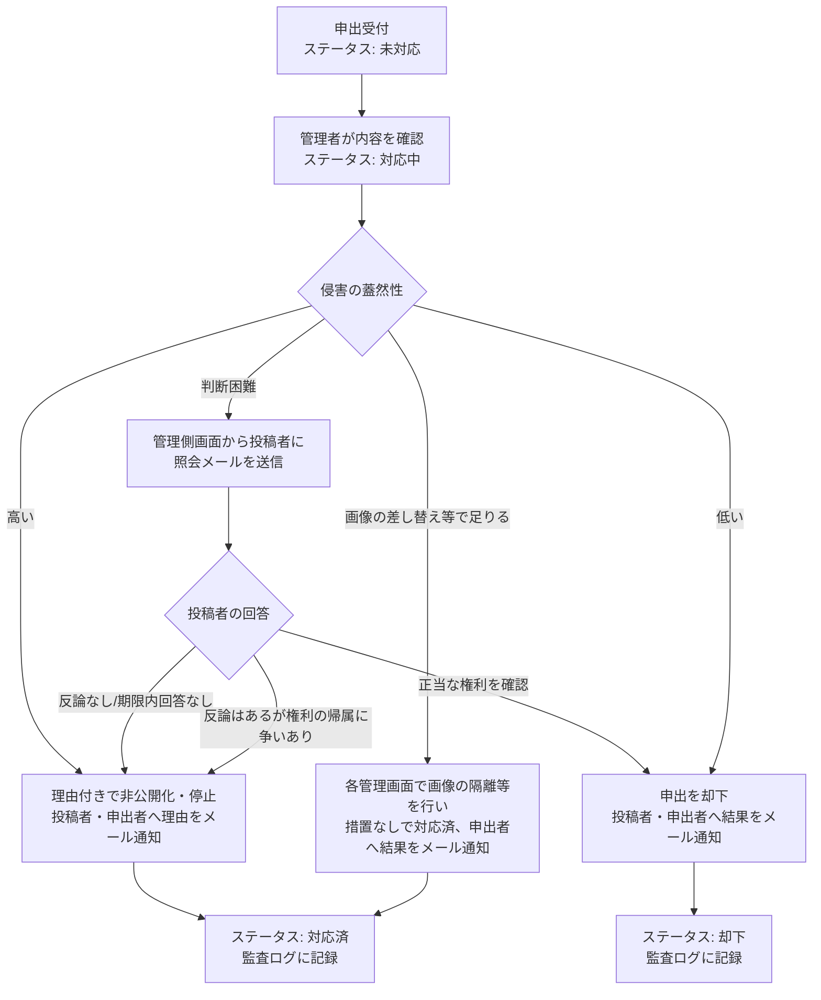

# 侵害コンテンツ削除請求フロー

著作権侵害等の権利侵害を申告された投稿コンテンツ(ユーザー・プロダクト・コメント)について、受付から判断・通知までのフローを定める(LR-004)。
情報流通プラットフォーム対処法(日本)の義務は法令上、指定を受けた大規模事業者に課されるが、本サービスは同法の枠組み(申出窓口の整備、一定期間内の判断と通知、削除基準の公表)に準拠した運用を行う。
通報の受け付け・集約・対応ステータス・通知の規則の詳細は[通報の運用](../features/007-content-reporting.md)を正とし、本書は権利侵害の申出の手順として整理する。

## 申出の受付

| 項目       | 内容                                                                                                                                                                                                   | 対応要件                   |
| ---------- | ------------------------------------------------------------------------------------------------------------------------------------------------------------------------------------------------------ | -------------------------- |
| 窓口       | 各コンテンツの通報の操作(ログイン不要)。システム標準で削除・名前の変更ができない通報カテゴリ「権利侵害」を選択する(content-reportingの仮8)                                                             | FR-REPOT-001、FR-ADMCF-020 |
| 必須入力   | 理由。侵害されている権利、権利者との関係、対象箇所を書くよう入力欄に案内する。未ログイン(停止中の利用者を含む)の申出者には、対応結果の知らせに使う連絡先メールアドレスも求める(content-reportingの仮6) | FR-REPOT-003〜004          |
| 追加の連絡 | 権利者の連絡先が必要な場合は問い合わせフォームで受け付ける                                                                                                                                             | —                          |
| レート制限 | 通報のレート制限                                                                                                                                                                                       | FR-RLMIT-004               |
| 集約       | 同一コンテンツへの申出は[案件](#案件への集約)に集約する                                                                                                                                                | FR-ADMUG-027               |

## 案件への集約

同じコンテンツへの通報は、対応が完了していない(「未対応」「対応中」の)案件があればその案件へ、無ければ「未対応」の新しい案件へ集約する(content-reportingの仮1)。

- 1つのコンテンツに未完了の案件は1つだけとし、カテゴリが混ざっても1つの案件にする。「権利侵害」の通報を1件以上含む案件を権利侵害の案件として扱い、本書のフローと[目標期間](#目標期間)の対象にする
- 案件が「対応済」「却下」になった後に届いた申出は新しい案件にし、完了した案件を再び開かない
- 管理画面には、案件ごとに通報の件数・カテゴリごとの件数・最初と最後の受付日時を示し、繰り返しの申出による過剰対応を防ぐ

## 判断と通知のフロー

| 段階             | 内容                                                                                                                                                                                                                                                                                                                                                                                                                                                                                     | 対応要件                                 |
| ---------------- | ---------------------------------------------------------------------------------------------------------------------------------------------------------------------------------------------------------------------------------------------------------------------------------------------------------------------------------------------------------------------------------------------------------------------------------------------------------------------------------------- | ---------------------------------------- |
| 受付             | 通報一覧に「未対応」で表示。カテゴリ「権利侵害」で絞り込める                                                                                                                                                                                                                                                                                                                                                                                                                             | FR-ADMUG-019〜020                        |
| 確認             | 管理者(モデレーター以上)が対象コンテンツ・投稿者・案件の通報の件数と内訳を確認し、対応ステータスを手で「対応中」にする                                                                                                                                                                                                                                                                                                                                                                   | FR-ADMUG-008、FR-ADMUG-020               |
| 投稿者への照会   | 判断が難しい場合、対応中の権利侵害の案件で投稿者へ事情を照会する。照会の内容は管理者が書く侵害されたとする権利と理由の要旨(1〜1,000文字)で、申出者を特定できる情報と申出者が書いた理由そのものは載せない。メールに照会の内容・対象コンテンツとそのURL・回答方法・回答期限(送信から7日、UTC)・期限内に回答が無い場合は公開の停止を判断し得る旨を記載し、送信日時を7日間の起算点として監査ログに記録する。照会は同じ案件で再び送れ、回答期限は最後の照会から求める(content-reportingの仮4) | FR-ADMUG-035、FR-ADMAG-001               |
| 投稿者からの回答 | 照会メールを受けた投稿者は、問い合わせフォームのメッセージに対象コンテンツのURLを明記し、回答期限である7日以内に回答する。管理者は問い合わせの管理画面で回答を読む                                                                                                                                                                                                                                                                                                                       | FR-INQRY-001                             |
| 措置             | 案件から理由を付してプロダクト・コメントを非公開化、ユーザーを停止し、案件を「対応済」にする。投稿者へ理由と異議申し立て方法(問い合わせフォーム)を、申出者へ対応結果をメール通知する。画像の隔離・評価の無効化は各管理画面で行い、案件は理由を付して「措置なしで対応済」にして申出者へ対応結果を通知する(content-reportingの仮2)                                                                                                                                                         | FR-ADMUG-009、FR-ADMUG-013、FR-ADMUG-030 |
| 却下             | 理由を付して申出を却下する。申出者(未ログインはFR-REPOT-003で入力されたメールアドレス、ログイン中は登録メールアドレス)・投稿者へシステム送信メールで結果を通知する。投稿者への通知には申出者を特定できる情報と申出者の理由を含めない                                                                                                                                                                                                                                                     | FR-REPOT-003、FR-ADMUG-025、FR-ADMUG-039 |
| 記録             | 対応ステータスの変更・措置・措置なしの対応済・却下・照会を監査ログに記録。措置は対象の非公開化・停止と案件の完了を1つの書き込みで確定する。理由欄には個人情報を含めない                                                                                                                                                                                                                                                                                                                  | FR-ADMAG-001                             |
| 対応期間の可視化 | 受付から対応完了までの経過時間を通報一覧と案件の詳細に表示し、[目標期間](#目標期間)の超過を把握する                                                                                                                                                                                                                                                                                                                                                                                      | FR-ADMUG-040                             |

- 措置・措置なしの対応済・却下は「未対応」「対応中」の案件でだけ行い、1回の判断につき同じ宛先へ1通だけ通知する。送信に失敗した通知は日次で送り直す
- 対象が既に非公開化・停止されている場合と、退会・削除などで見つからない場合は措置を行わず、措置なしの対応済か却下で判断を記録する

## 対応ステータスの手での変更

管理者(モデレーター以上)は、案件の対応ステータスを「未対応」「対応中」「対応済」「却下」の間で手で自由に変更できる(content-reportingの仮3)。手での変更は記録の訂正であり、当事者へ通知せず、措置も行わない。当事者へ判断を通知するときは、上の措置・措置なしの対応済・却下の操作を使う。

| 手での変更                                       | 理由 | 扱い                                                                                                                                                                                                                                   |
| ------------------------------------------------ | ---- | -------------------------------------------------------------------------------------------------------------------------------------------------------------------------------------------------------------------------------------- |
| 「未対応」⇄「対応中」                            | 任意 | 状態だけを変える                                                                                                                                                                                                                       |
| 「対応済」「却下」への変更(両者の間の変更を含む) | 必須 | 案件の完了として日時と理由を記録する。まだ依頼していない通知は取りやめる                                                                                                                                                               |
| 「対応済」「却下」から「未対応」「対応中」へ戻す | 必須 | 完了の日時・措置の種類・完了の理由を消し、まだ依頼していない通知を取りやめる。送った通知と行った措置(非公開化・停止)は取り消さず、措置の取り消しは各管理画面で行う。同じコンテンツに未完了の別の案件があれば戻さず、その案件で対応する |

- 完了から戻した案件に通知を伴う判断をするときは、改めて措置・措置なしの対応済・却下の操作を行う。その時点で申出者(と却下の投稿者)へ通知する
- 完了から戻した案件の対応期間は、起点を変えずに現在までを対応中として示す

## 目標期間

| 項目                   | 目標                                    |
| ---------------------- | --------------------------------------- |
| 受付から確認開始まで   | 1営業日以内                             |
| 受付から判断・通知まで | 9日以内(投稿者への照会を行う場合を含む) |
| 投稿者からの回答期限   | 照会から7日以内                         |

目標を超過した申出は通報一覧の対応期間表示で強調する。判定は次のとおりとする(content-reportingの仮5)。

- 受付の起点は、案件の最初の「権利侵害」の通報の受付日時とする。対応完了は、監査ログに記録した案件の最後の完了(措置・措置なしの対応済・却下の操作と、手での「対応済」「却下」への変更)の日時とする
- 1営業日は、土日を含む単純な24時間とし、祝日を考慮しない。「未対応」のまま起点から24時間を超えた案件を、確認開始の目標の超過とする
- 9日は起点からの暦の9日(216時間)とし、起点から9日を超えて完了していない案件と、9日を超えて完了した案件を、判断・通知の目標の超過とする
- 完了した案件の対応完了の日時を監査ログから得られない場合(監査ログの保持期間の3年を過ぎた場合など)は、対応期間を不明と示す

情報流通プラットフォーム対処法3条2項2号により、投稿者が照会から7日以内に反論しなかった場合は、管理者により削除しても免責される。

## 対象の物理削除の後の案件

申出の対象のユーザー・プロダクトが物理削除される時期には、案件と通報を削除せず、対象・投稿者・対象のプロダクトの識別子だけを消して残す(content-reportingの仮7)。

- 残した案件は、対象を「削除された対象」として管理画面に示す。措置と照会は行えず、措置なしの対応済・却下・手での状態の変更で判断を記録できる。却下の投稿者への通知は送らない
- 申出者が書いた理由は書き換えない。対象への参照を消してから3年で、案件を通報ごと物理削除する([データ保持期間の一覧](001-compliance-policy.md#データ保持期間の一覧))

## 非公開化・停止の効果

### プロダクトの非公開化

| 対象                     | 効果                                                                                                         |
| ------------------------ | ------------------------------------------------------------------------------------------------------------ |
| 当該プロダクトのマッチ   | 未開始のマッチ予定を取消(FR-ADMUG-010)、マッチ中なら対戦相手が勝者(FR-GAME-015)                              |
| プロダクト一覧           | 一覧・検索・公開APIから除外(FR-DIR-013、FR-PAPI-009)                                                         |
| プロダクト詳細           | 404([ページ構成](../design/002-page-layouts.md#プロダクト詳細の公開範囲))                                    |
| ユーザー公開プロフィール | ローンチ履歴(FR-PRDCT-019)・Upvote履歴(FR-VOTE-012)から除外                                                  |
| 他プロダクトのマッチ履歴 | 対戦相手を「非公開のプロダクト」と表示([ページ構成](../design/002-page-layouts.md#プロダクト詳細の公開範囲)) |
| スポンサー広告           | 表示を停止(FR-SPONS-020)                                                                                     |

### ユーザーの停止

| 対象                                 | 効果                                                                                |
| ------------------------------------ | ----------------------------------------------------------------------------------- |
| ユーザーが投稿したプロダクトのマッチ | [プロダクトの非公開化](#プロダクトの非公開化)と同様                                 |
| プロダクト一覧                       | [プロダクトの非公開化](#プロダクトの非公開化)と同様                                 |
| プロダクト詳細                       | [プロダクトの非公開化](#プロダクトの非公開化)と同様                                 |
| 他プロダクトのマッチ履歴             | [プロダクトの非公開化](#プロダクトの非公開化)と同様                                 |
| 他ユーザーのUpvote履歴               | 停止ユーザーのプロダクトを除外(FR-VOTE-012)                                         |
| スポンサー広告                       | [プロダクトの非公開化](#プロダクトの非公開化)と同様                                 |
| Upvoteしたユーザー一覧               | 一覧から除外(FR-DIR-014)                                                            |
| プロダクトへのコメント               | 「削除された旨」の表示に置き換え(FR-COMNT-007)。返信は残る                          |
| 公開プロフィール                     | 404([ページ構成](../design/002-page-layouts.md#ユーザー公開プロフィールの公開範囲)) |

画像に関する申出で画像のみを差し替えれば足りる場合は、対象画像を隔離バケットへ移動した上で(FR-ADMUG-049)投稿者に新しい画像のアップロードを求める。投稿者が差し替えると隔離済みの旧画像は即時に物理削除される(FR-FILEU-023)。

## 復元と異議申し立て

- 投稿者は問い合わせフォームから異議を申し立てられる。管理者は非公開化を取り消して復元できる(FR-ADMUG-009、FR-ADMUG-013)
- 復元時も理由を付し、監査ログに記録する
- プロダクトの復元時、ロゴ・スクリーンショットがプロダクト非公開化以外の理由でも隔離されている場合、それらの画像は当該理由により非公開のまま(FR-ADMUG-050)
- 申出者と投稿者の間で権利の帰属が争われる場合、事業者は判断せず、裁判所等の判断が示されるまで非公開化を維持する運用とする

## 繰り返し侵害への対応

同一投稿者に対する非公開化が繰り返される場合、管理者は理由付きでユーザーを停止できる(FR-ADMUG-006)。停止の基準はヘルプ記事で公表する。
