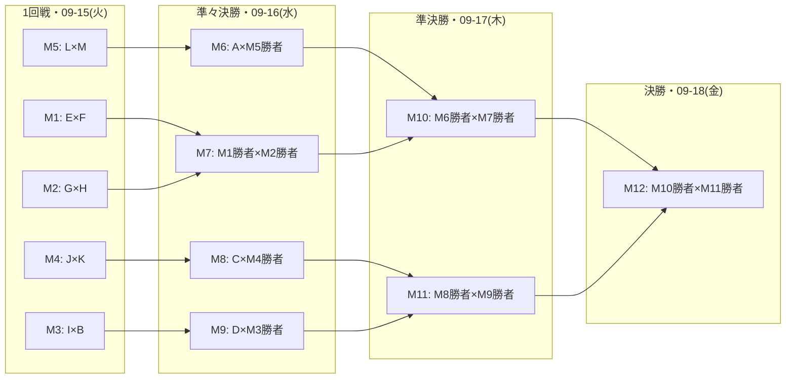

# Product of the Week決定トーナメント規則

同じ週に予選で勝利したプロダクト同士が、シングルエリミネーション(勝ち残り)方式でProduct of the Weekを決めるトーナメントである。本書では「トーナメント」と書けばWeekトーナメントを指す。
規則そのものはFR-TOURW-001〜027を正とし、本書は要件定義書に無い組み合わせ決定の細部と具体例を補う。時刻は全て基準時刻(UTC-08:00)である。

## 参加資格と日程

週の定義は要件定義書1.3節、参加資格と決済期限はFR-TOURW-001〜003、トーナメント組み合わせ決定までに決済を反映できなかった場合の返金はFR-PYMNT-014、組み合わせ決定前のプロダクト削除・退会による参加資格の喪失はFR-TOURW-027(返金はFR-PYMNT-010)、組み合わせ決定の時点の非公開化・停止による参加資格の停止はFR-TOURW-008(返金はFR-PYMNT-011)、組み合わせ決定から決勝までの日程は[週次タイムライン](007-daily-timeline.md#週次タイムラインweekトーナメント)を正とする。

決済期限はローンチ日を含む週の翌週月曜日23:35(決済セッション作成期限及びUI表示は23:00、[理由](002-pricing-and-plans.md#ui表示において決済期限を35分早める理由))で固定のため、決済に使える時間はローンチ日の曜日で異なる。

| ローンチ日(曜日) | 決済に使える時間 |
| ---------------- | ---------------- |
| 月曜日           | 7日間            |
| 日曜日           | 24時間           |

日曜日ローンチは決済猶予が短いため、UIと結果通知メールでは決済期限を明示する([ページ構成](../design/002-page-layouts.md#トーナメント参加費の導線))。

参加数N≤128であればラウンド数は最大7(火曜日〜翌週月曜日)であり、翌週のトーナメントとは重ならない。N≥129の場合の表示順はFR-TOURW-013を正とする。

### 参加の枠と参加資格

予選の勝利(Upvote数による勝利・不戦勝・相手の退会等による勝利)が確定するごとに、ローンチ日を含む週のトーナメントにそのローンチの参加の枠を作る。枠は予選勝利時のUpvote数・最終Upvote時間・ローンチ日・勝利の確定時刻を確定した値のまま持ち、1つのローンチに1つだけ作る。予選の敗北・両者敗北と、トーナメントマッチの勝利には枠を作らない。

| 枠の状態     | 意味                                                                                                                         |
| ------------ | ---------------------------------------------------------------------------------------------------------------------------- |
| 受付中       | 参加資格を得ていない。決済期限までの参加費の決済、またはUltrasの特典による免除で参加資格を得る                               |
| 参加資格     | 参加費の決済またはUltrasの特典で参加資格を得た。Ultrasの解約や特典の終了で参加資格を失わない                                 |
| 組み合わせ済 | 組み合わせ決定で組み合わせに入った                                                                                           |
| 期限切れ     | 組み合わせ決定の時点で参加資格を得ていなかった。組み合わせ決定の後に確定した予選の勝利(遅れて届いた勝利)の枠も同じ扱いとする |
| 喪失         | 組み合わせ決定の前の削除・退会、または組み合わせ決定の時点の論理削除で参加資格を失った(FR-TOURW-027)                         |
| 除外         | 組み合わせ決定の時点の非公開化・停止で参加資格を停止した(FR-TOURW-008)                                                       |

- 予選勝利の確定の時点で投稿者がUltrasの特典を受けられれば、決済を求めずにその時点で参加資格を与える(FR-TOURW-004)。勝利の確定の後、決済期限より前にUltrasへの加入が有効になれば、受付中の枠に参加資格を与え、未完了の参加費の決済を失効させる(FR-TOURW-005・FR-PPLAN-008)。決済期限の後の加入では、その週のトーナメントの参加資格を与えない
- 既に決済で得た参加資格の参加費は、後からUltrasに加入しても返金しない(FR-PPLAN-009)
- 決済期限の後に反映された決済は、そのローンチより新しい同じプロダクトのローンチ(取り消していないもの)が予約されていれば、参加資格を与えずに自動で全額返金する(FR-TOURW-006・FR-PYMNT-017)。参加資格を得る前の再ローンチの禁止は決済期限で解除されるため([再ローンチ規則](006-relaunch-rules.md))、解除の後に予約した新しいローンチと参加資格が並ばないようにする。新しいローンチが無ければ、組み合わせ決定(23:45)までに反映された決済に参加資格を与える。反映が組み合わせ決定に間に合わなかった決済は、自動で全額返金する。組み合わせ決定(23:45)より後に支払われた決済は決済の機能が反映の期限切れとして返金し(FR-PYMNT-014)、23:45より前に支払われても凍結の後に反映された決済は、Weekトーナメントの機能が参加資格を付与できないと答えて返金になる(FR-PYMNT-017)
- 組み合わせ決定の前に投稿者がプロダクトを個別削除するか退会すると、枠は参加資格を失い、以後は決済・Ultrasのどちらでも参加資格を与えない。参加費を決済していれば自動で全額返金し(FR-PYMNT-010)、未完了の参加費の決済を失効させる
- 参加資格の有無は、予選勝利によるディレクトリ掲載と既に授与した賞を変えない

### 組み合わせ決定の時点の凍結

月曜日23:45の組み合わせ決定は、まずその週の予選の勝利に枠が無ければ枠を作り(勝利の知らせの処理が遅れた場合の補完)、次にその週のトーナメントを凍結する。凍結の後は、決済の反映・Ultrasの加入・削除・退会のどれが届いても、その週の枠の参加資格を変えない。凍結と同時に起きた変更で組み合わせの対象が揺れないようにするためである。凍結の後に処理された予選の勝利は、期限切れの枠として記録する。凍結の後は次の順に行う。

1. 受付中と参加資格の枠を分類する。参加資格を得ていない枠の投稿者が、勝利の確定から決済期限までの間にUltrasの特典を受けられる状態だった場合は参加資格を与える。それ以外の受付中の枠は期限切れにする
2. 参加資格の枠のうち、プロダクトが論理削除済みなら喪失、非公開化中または投稿者が停止中なら除外とし、残りを組み合わせに入れる
3. [組み合わせ決定の手順](#組み合わせ決定の手順)で組み合わせを決め、1回戦のマッチの予定を作る。参加数0なら賞を授与せずに終え、参加数1なら即時に受賞とする
4. 喪失・除外の枠の参加費を決済していれば、自動で全額の返金を依頼し、投稿者へ返金の旨と理由をメールで知らせる(退会済みには送らない)

組み合わせ決定が途中で中断しても、次の実行が凍結済みの続きから行い、組み合わせと返金を重ねない。

### 非公開化・停止と返金

組み合わせ決定の時点でプロダクトが非公開化中、または投稿者が停止中なら、そのプロダクトを組み合わせから除き、そのトーナメントの参加資格を停止する。組み合わせ決定の後に復元・停止解除があっても、そのトーナメントには加えない(FR-TOURW-008、2026-10-24に開発者が確定した仮2)。マッチの開始時点までの復元を待って相手の不戦勝にする扱いは採らない。

除外したプロダクトの参加費を決済していれば、自動で全額返金する(FR-PYMNT-011、仮3)。停止は利用者の規約違反によるものでも事業者側の都合であるため、[返金ポリシー](../legal/004-legal-notice-outline.md#返金ポリシー)の「組み合わせ決定の時点のユーザー停止やプロダクト非公開化に伴うトーナメント参加資格停止」の行に従う。一方、組み合わせ決定の後の停止・非公開化・退会によるマッチの不戦敗(FR-TOURW-019・020)は、参加資格を使い始めた後の結果であるため、返金ポリシーの「トーナメントの不戦勝・不戦敗・両者敗北」の行に従い返金しない。

返金の依頼は同じ枠について1回だけ行い、依頼に失敗しても日次の再処理で依頼し直す(FR-PYMNT-012)。返金の実行・決済履歴への反映は決済の機能が行う([決済実装方針](../features/004-payments.md#返金の分担))。

## 組み合わせ決定の手順

### 1. シード数の決定

FR-TOURW-009に基づき、2回戦の参加数がN(1回戦の参加プロダクト数)未満で最大の2の冪Pになるよう、シード(1回戦免除)を設ける。Nが2の冪ならS = 0になるので、シードは設けない。

- P(2回戦の参加数) = N未満で最大の2の冪
- S(シード数) = 2P − N
- 1回戦のマッチ数 = (N − S) / 2

| N   | P   | S   | 1回戦マッチ数 | 2回戦参加数 | ラウンド数  |
| --- | --- | --- | ------------- | ----------- | ----------- |
| 1   | —   | —   | —             | —           | 0(即時受賞) |
| 2   | 1   | 0   | 1             | —           | 1           |
| 3   | 2   | 1   | 1             | 2           | 2           |
| 5   | 4   | 3   | 1             | 4           | 3           |
| 6   | 4   | 2   | 2             | 4           | 3           |
| 7   | 4   | 1   | 3             | 4           | 3           |
| 8   | 4   | 0   | 4             | 4           | 3           |
| 13  | 8   | 3   | 5             | 8           | 4           |
| 100 | 64  | 28  | 36            | 64          | 7           |
| 128 | 64  | 0   | 64            | 64          | 7           |
| 129 | 128 | 127 | 1             | 128         | 8           |
| 200 | 128 | 56  | 72            | 128         | 8           |

### 2. シードの選出

参加プロダクトをFR-TOURW-009の順に並べ、なお同順ならローンチのID(ULID)昇順とし、上位S個をシードとする。

シードは1回戦を免除され、2回戦から登場する。

### 3. 非シードの1回戦組み合わせ

非シードのプロダクトをFR-TOURW-010の順に並べ、なお同順ならローンチのID(ULID)昇順とし、先頭から隣接する2個ずつを1回戦の対戦相手とする。

### 4. 2回戦の組み合わせ

2回戦に出場するP個のスロットへ、次の順に1〜Pの番号を振る。

1. シードをシード順に置く。第1シードが1番、第2シードが2番、以下同様にS番まで
2. 続けて1回戦の勝者をマッチ番号順に置く。マッチ1の勝者がS + 1番、以下同様にP番まで

対戦カードは、スロット番号を並べ替えた列で決める。列は[1, 2]から始め、「各番号の直後に、その番号と足すと列の新しい長さ + 1になる番号を挿入する」操作を、長さがPになるまで繰り返す。できた列の先頭から2個ずつが1マッチであり、番号が上位の2個は決勝まで、上位4個は準決勝まで互いに当たらないため、上位シードが早いラウンドで潰し合わない。

例えばP = 8なら、[1, 2]の各番号の直後に4・3を挿入して[1, 4, 2, 3]、さらに8・5・7・6を挿入して[1, 8, 4, 5, 2, 7, 3, 6]となり、1番×8番、4番×5番、2番×7番、3番×6番の4マッチとなる。

### 5. 3回戦以降

固定ブラケットとする。前ラウンドで隣接する2マッチ(マッチ2k−1とマッチ2k)の勝者同士が対戦する。ラウンドごとの並べ直しは行わない。

## 組み合わせの例(N = 13)

2026-09-07(月)〜2026-09-13(日)の週に予選で勝利し、2026-09-14(月)23:35までに参加資格を得たプロダクトが13個の場合。

| プロダクト | ローンチ日 | 予選勝利時Upvote数 | 予選の最終Upvote時間 |
| ---------- | ---------- | ------------------ | -------------------- |
| A          | 09-08(火)  | 42                 | 20:15                |
| B          | 09-11(金)  | 37                 | 22:01                |
| C          | 09-07(月)  | 37                 | 14:02                |
| D          | 09-10(木)  | 37                 | 18:30                |
| E          | 09-07(月)  | 12                 | 21:40                |
| F          | 09-07(月)  | 9                  | 10:05                |
| G          | 09-08(火)  | 20                 | 23:10                |
| H          | 09-09(水)  | 15                 | 09:47                |
| I          | 09-10(木)  | 8                  | 16:22                |
| J          | 09-11(金)  | 11                 | 11:30                |
| K          | 09-12(土)  | 6                  | 19:55                |
| L          | 09-13(日)  | 30                 | 13:08                |
| M          | 09-13(日)  | 4                  | 22:47                |

### シード数

N = 13は2の冪ではない。P = 8、S = 2 × 8 − 13 = 3。1回戦は(13 − 3) / 2 = 5マッチ。

### シードの選出

Upvote数の多い順に並べるとA(42)→B・C・D(37)→...となる。B・C・Dは同数のため最終Upvote時間で並べ、C(14:02)→D(18:30)→B(22:01)。

| シード順 | プロダクト | 根拠                        |
| -------- | ---------- | --------------------------- |
| 1        | A          | Upvote 42                   |
| 2        | C          | Upvote 37、最終Upvote 14:02 |
| 3        | D          | Upvote 37、最終Upvote 18:30 |

Bは同じ37票だが最終Upvote時間が最も遅いため、4番目となりシードから漏れる。

### 非シードの並びと1回戦

非シード10個をローンチ日順(同日はUpvote数順)に並べる。

| 順  | プロダクト | ローンチ日 | Upvote数 | 備考                                      |
| --- | ---------- | ---------- | -------- | ----------------------------------------- |
| 1   | E          | 09-07      | 12       | 同日のFよりUpvote数が多い                 |
| 2   | F          | 09-07      | 9        |                                           |
| 3   | G          | 09-08      | 20       |                                           |
| 4   | H          | 09-09      | 15       |                                           |
| 5   | I          | 09-10      | 8        |                                           |
| 6   | B          | 09-11      | 37       | シード落ちしたが同日のJよりUpvote数が多い |
| 7   | J          | 09-11      | 11       |                                           |
| 8   | K          | 09-12      | 6        |                                           |
| 9   | L          | 09-13      | 30       |                                           |
| 10  | M          | 09-13      | 4        |                                           |

Upvote数が多いBよりも、ローンチ日が早いIが先に並ぶ点に注意する(ローンチ日が第1キー)。2026-09-15(火)の1回戦の組み合わせは以下となる。

| マッチ | 対戦   |
| ------ | ------ |
| M1     | E vs F |
| M2     | G vs H |
| M3     | I vs B |
| M4     | J vs K |
| M5     | L vs M |

### 準々決勝以降のブラケット

2026-09-16(水)の準々決勝のスロットは1番から順に[A, C, D, M1勝者, M2勝者, M3勝者, M4勝者, M5勝者]であり、これを[1, 8, 4, 5, 2, 7, 3, 6]の並びで組み合わせる。

決勝は2026-09-18(金)23:40に終了し、勝者がProduct of the Weekとなる。

## ラウンドの進行

各トーナメントマッチは実施日の0:00に開始し23:40に終了する(FR-TOURW-011)。あるラウンドの全マッチの結果が確定したら、実施日の23:45までに次ラウンドのマッチの予定を作る。予定はマッチの確定の直後と23:45の2つの経路から作り、どちらが先に動いても、何度動いても1回分の予定になる。各マッチにはラウンドの番号と、該当すれば準々決勝・準決勝・決勝の段階を記録する。

### ラウンドの遅れの回復

障害により次ラウンドの予定を実施日の0:00までに作れなかった場合は、そのラウンドの実施日を、予定を作った時点の翌日に遅らせ、以降のラウンドも1日ずつ遅らせる(FR-TOURW-022)。遅れは運用者がエラートラッキングで検知できるようにする。ブラケットのページと決勝日の表示は、遅らせた後の実施日を示す。

例えば[上記の例](#組み合わせの例n--13)で、2026-09-16(水)の準々決勝の予定を同日0:00までに作れず09-16の0:10に作った場合、準々決勝は09-17(木)、準決勝は09-18(金)、決勝は09-19(土)に行う。

## 各マッチの勝敗判定

予選と同じ基準(FR-TOURW-014〜016・018、[予選ルール](003-qualifier-rules.md#マッチの進行と勝敗判定))で判定する。トーナメントのUpvote数は予選のUpvote数を引き継がず、マッチごとに0から集計する(FR-VOTE-007)。

## 不戦勝と両者敗北の伝播

対戦相手がいないマッチの不戦勝(FR-TOURW-020・FR-TOURW-023)、同ラウンド全滅時の終了(FR-TOURW-025)、マッチ中の退会・停止・非公開化(FR-TOURW-019)、参加数0・1の扱い(FR-TOURW-025・FR-TOURW-026)は要件定義書を正とする。参加数2の場合は火曜日に決勝のみを実施する。

上記の例で、1回戦M4(J vs K)が0対0で両者敗北した場合:

1. 準々決勝M8はM4勝者が存在しないため、Cは09-16の0:00に不戦勝で準決勝へ進む
2. 準決勝M11はC×M9勝者として行われる
3. さらにM9も0対0だった場合、Cは09-17の0:00に再び不戦勝で決勝へ進む

## 終了と賞

決勝で勝者が確定するか、あるラウンドの参加数が1になればトーナメントを終え、そのプロダクトにProduct of the Week賞を授与する(FR-TOURW-024・026)。あるラウンドの参加数が0になるか、同じラウンドの全プロダクトが敗者になれば、賞を授与せずに終える(FR-TOURW-025)。賞は1つのトーナメントに1回だけ授与し、受賞の週(ISO週)・受賞日時・受賞したローンチを記録する。

## ブラケットのページ

組み合わせを決定したトーナメントごとに、ログイン不要の公開のブラケットのページ(`/tournaments/week/{ISO週}`、例: `/tournaments/week/2026-W37`)を設け、トップページのトーナメントの区画とプロダクト詳細ページのトロフィーから導く(2026-10-24に開発者が確定した仮4)。トップページの区画はその日のラウンドだけを示し、ブラケットのページが組み合わせと結果の全体を示す。

- ラウンドごとにマッチを並べ、対戦するプロダクト・シードの番号・Upvote数・勝敗・不戦勝・実施日と、受賞したプロダクト(または受賞なし)を示す
- まだ予定を作っていないラウンドの枠は「シード3」「1回戦第3試合の勝者」のように、どこから勝ち上がる枠かを示す
- 表示できないプロダクト(非公開化・論理削除・投稿者の退会や停止)は「非公開のプロダクト」として名前とリンクを出さない
- 存在しない週と組み合わせを決定していない週は404とする
- 画面の構成は[ページ構成](../design/002-page-layouts.md#weekトーナメントのブラケットtournamentsweekiso週)を正とする

## 受賞後

- 受賞プロダクトの再ローンチ制限はFR-RELCH-004([再ローンチ規則](006-relaunch-rules.md))
- Yearトーナメントの対象となる([Yearトーナメント規則](005-year-tournament-rules.md))
