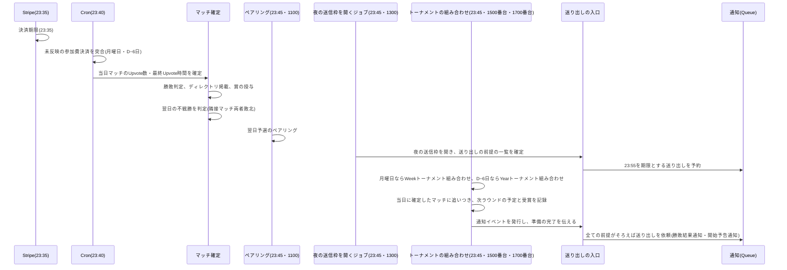

# 日次・週次・年次タイムライン

サービスの定期処理と時刻に依存する仕様を、基準時刻(UTC-08:00)の1日の流れに沿って整理する。各処理の規則は対応要件を正とし、本書は時刻の一覧と処理順序を定める。
基準時刻は夏時間を持たない固定オフセットであり、日境界はUTCの8:00である。日時データの保持はI18N-002を、表示形式はI18N-004を正とする。

## 日次タイムライン

| 基準時刻 | UTC   | 事象                                                                                                                                                                                                                                                                                                                                                                                                                                                                                                                                                                                                                                                                                                                                                      | 対応要件                                                                                                                                                                                                                                        |
| -------- | ----- | --------------------------------------------------------------------------------------------------------------------------------------------------------------------------------------------------------------------------------------------------------------------------------------------------------------------------------------------------------------------------------------------------------------------------------------------------------------------------------------------------------------------------------------------------------------------------------------------------------------------------------------------------------------------------------------------------------------------------------------------------------- | ----------------------------------------------------------------------------------------------------------------------------------------------------------------------------------------------------------------------------------------------- |
| 0:00     | 8:00  | 当日の予選・トーナメントマッチ開始。不戦勝の確定。投稿者のフォロワーへ開催通知メール。予選の開始のジョブの名前は`match-engine.match-kickoff`(順序1100、下記)。開催通知メールは、マッチの開始の後に朝の送信枠を開くジョブ`notifications.morning-dispatch`(順序1300、下記)が、その日に開始したマッチを宛先ごとに1通にまとめて送る                                                                                                                                                                                                                                                                                                                                                                                                                           | FR-GAME-009、FR-TOURW-011、FR-TOURY-015、FR-NOTIF-006・009                                                                                                                                                                                      |
| 0:07     | 8:07  | 当日開始のスポンサー広告へ掲載開始通知メール、掲載終了日を過ぎたスポンサー広告へ掲載終了通知メールを送信。ジョブの名前は`sponsorship.daily-notices`(順序1600、下記)。掲載終了通知は、掲載期間が終わった広告の表示停止の日割りの返金を精算した後に送る                                                                                                                                                                                                                                                                                                                                                                                                                                                                                                     | FR-SPONS-016・018・021                                                                                                                                                                                                                          |
| 4:21     | 12:21 | 日次バッチ(下記)                                                                                                                                                                                                                                                                                                                                                                                                                                                                                                                                                                                                                                                                                                                                          | FR-USER-014、FR-USER-022、FR-COMNT-009、FR-PRDCT-017、FR-PRDCT-024、FR-GAME-010・015、FR-FILEU-024、FR-NOTIF-021・022、FR-FTS-007、FR-PPLAN-008・013、FR-PYMNT-010〜012・018、FR-SPONS-021、FR-ADMUG-030・031・039、DR-001、DR-005、DR-017〜022 |
| 16:21    | 0:21  | 退会・停止・停止解除・物理削除の開始のうち、未完了の後続処理の再実行。日次バッチ(4:21)の抑止記録の後始末と時刻を分ける。ジョブの名前は`identity-auth.lifecycle-redispatch`で、最後の送信から1時間以上未完了の後続処理を100件まで送り直す                                                                                                                                                                                                                                                                                                                                                                                                                                                                                                                  | FR-USER-032、DR-002                                                                                                                                                                                                                             |
| 23:40    | 7:40  | 決済期限(23:35)を過ぎた未反映の参加費決済の突合(下記)。続いて当日のマッチ終了。Upvote数と最終Upvote時間を確定し勝敗判定(ジョブの名前は`match-engine.match-settlement`、順序1100で突合の後、下記)。選択可能な最も早いローンチ日が翌々日へ切り替わる                                                                                                                                                                                                                                                                                                                                                                                                                                                                                                        | FR-PYMNT-013、FR-GAME-010〜012・014、FR-TOURW-014〜016・018、FR-TOURY-017〜019・021、FR-PRDCT-002                                                                                                                                               |
| 23:45    | 7:45  | 翌日ローンチ分の予選ペアリング(ジョブの名前は`match-engine.qualifier-pairing`、順序1100、下記)。続いて夜の送信枠を開くジョブ`notifications.evening-dispatch`(順序1300、下記)と、Weekトーナメントの組み合わせ決定と進行のジョブ`tournament-week.evening-bracket`(順序1500、下記)、Yearトーナメントの組み合わせ決定と進行のジョブ`tournament-year.evening-bracket`(順序1700、下記)が動き、両投稿者へ勝敗結果通知メール及びマッチ開始予告メールを送る。送り出しは、トーナメントの23:45のジョブ(順序1500番台・1700番台)が最後に送り出しの入口へ準備の完了を伝えた後に始まり、伝えない機能があっても遅くとも23:55に始まる(notificationsの仮2)。トーナメントのマッチ開始予告メールは、組み合わせ決定がそれより前でもマッチ前日の23:45に送る(notificationsの仮1) | FR-GAME-005、FR-TOURW-007・021、FR-TOURY-009・024、FR-NOTIF-001・002・004・014・015                                                                                                                                                             |

### 日次バッチ(4:21)の内容

対象データと条件は[データ保持期間の一覧](../legal/001-compliance-policy.md#データ保持期間の一覧)のうち削除方法が「日次バッチ」のものを正とする。退会ユーザーのデータ、及びプロダクト・コメント・画像の個別削除(FR-PRDCT-013・FR-COMNT-006・FR-FILEU-024)によるデータは、それぞれの論理削除から14日が経過する直前(論理削除から13日後)のバッチで処理し、画像ファイルの物理削除時は[エッジキャッシュを無効化](../features/002-image-variants.md#キャッシュとパージ)する(FR-FILEU-021)。削除のほかに、使い捨てメールアドレスの判定のやり直し(FR-USER-014)、画像の自動判定の再依頼と保存先の照合(FR-FILEU-013・016)、外部APIでのキーワード抽出のやり直し(FR-FTS-007)、通知メールの送り出しの遅れの回復(FR-NOTIF-021)、措置の通知メールの送り直し(FR-ADMUG-030)、通報の対応結果の通知の送り直し(FR-ADMUG-031・039)を行う。

日次バッチは次の表のジョブを順序の小さいものから1つずつ実行する。前のジョブが終わるまで次のジョブを始めず、1つのジョブが失敗しても後続のジョブを実行する。利用者のアカウントのジョブ(順序100〜120)は、退会ユーザーの物理削除の開始→期限切れの認証情報の削除→使い捨てメールアドレスの判定のやり直しの順に、他のドメインのジョブより前に置く。管理者のアカウントのジョブ(順序200〜210)は、利用者のアカウントのジョブの後に、期限切れの認証情報の削除→監査ログの物理削除の順に置く。問い合わせのジョブ(順序300)は、管理者のアカウントのジョブの後に置く。決済のジョブ(順序400〜410)は、問い合わせのジョブの後に、未完了の購入と依頼待ちの返金・メールの確認→決済履歴の物理削除の順に置く。Ultrasのジョブ(順序500)は決済のジョブの後に置く。送り直す知らせと依頼待ちのメールの行は決済の反映が作るためである。利用者のプロフィールのジョブ(順序600)は、Ultrasのジョブの後、メディアのジョブ(順序810)の前に置く。プロダクトのジョブ(順序1000〜1010)は、メールの後始末のジョブ(順序900)の後に、論理削除したプロダクトの物理削除の開始→未完了の後続処理の再実行の順に置く。プロダクトの後続処理の再実行は、利用者の後続処理の再実行(16:21)と異なりメールの後始末と重なる処理を持たないため、日次バッチに含める。マッチのジョブ(順序1100〜1110)は、プロダクトのジョブの後に、滞ったマッチイベントの送り直し→完了したマッチイベントの記録の削除の順に置く。通知のジョブ(順序1300)は、マッチのジョブの後に置き、送信枠の送り出しの回復→作成から30日を過ぎても展開していない通知イベントの削除→滞った通知イベントの展開のやり直し→送っていない通知の期限切れ→保持期間を過ぎた記録の削除を1つのジョブで行う。コメントのジョブ(順序1400)は、通知のジョブの後に置く。前に動く必要のある他のドメインのジョブは無く、同じ日に再び実行しても匿名化していないコメントだけを処理するため結果は変わらない。Weekトーナメントのジョブ(順序1500)は、コメントのジョブの後、検索のキーワードの再抽出の前に置く。Yearトーナメントのジョブ(順序1700)は、Weekトーナメントのジョブの後、検索のキーワードの再抽出(順序2300)の前に置く。UGC管理のジョブ(順序1900〜1910)は、Yearトーナメントのジョブの後に、週ごとの統計の集計→措置の通知の送り直しと記録の削除の順に置く。統計の集計は各機能の照会を読んで週ごとの統計だけを書き、前に動く必要のある他のドメインのジョブは無い。週の終わりの時点の総数は、その時点で退会・論理削除していない利用者・プロダクトを数え、物理削除は退会・論理削除から13日後に始まるため、週が終わってから13日以内に確定すれば同じ日次バッチの物理削除(順序100・1000)が先に動いても変わらない。保守のジョブも前に動く必要のある他のドメインのジョブは無く、措置の記録だけを読み書きし、通知の宛先は送る時点で確かめ直す。返金の依頼は決済の機能の部品が受け付け、Stripeへの返金はイベントサーバーが非同期に行うため、決済のジョブ(順序400)の後に置いても返金は翌日まで遅れない。同じ日に再び実行しても、依頼済み・知らせ済みの枠は対象にならず結果は変わらない。通報のジョブ(順序2000〜2010)は、UGC管理のジョブの後、検索のキーワードの再抽出の前に、通報の対応結果の通知の送り直し→保持期間を過ぎた通報の削除の順に置く。送り直しを削除より先に動かし、削除の前に最後の送信を試みる。どちらも通報の記録だけを読み書きし、通知の宛先は送る時点で確かめ直すため、前に動く必要のある他のドメインのジョブは無い。対象への参照の消去は利用者・プロダクトの物理削除の後続処理が行い、日次バッチのジョブではない。検索のキーワードの再抽出は各ドメインの削除の処理より後(順序2300)に置き、削除済みのデータの再抽出を要求しない。

| 順序 | ジョブの名前                                 | 処理                                                                                                                                                                                                                                                                                                                                                                                                                                                                                                                                                                                                                                                                                                                                                                                                                                                                                                                                                                                                                                                                                          | 対応要件                                                     |
| ---- | -------------------------------------------- | --------------------------------------------------------------------------------------------------------------------------------------------------------------------------------------------------------------------------------------------------------------------------------------------------------------------------------------------------------------------------------------------------------------------------------------------------------------------------------------------------------------------------------------------------------------------------------------------------------------------------------------------------------------------------------------------------------------------------------------------------------------------------------------------------------------------------------------------------------------------------------------------------------------------------------------------------------------------------------------------------------------------------------------------------------------------------------------------- | ------------------------------------------------------------ |
| 100  | `identity-auth.purge-orchestrator`           | 退会ユーザーの物理削除の開始。論理削除から13日後(退会の業務日付が実行日の13日前以前)で物理削除を始めていない利用者を50件まで選び、物理削除の後続処理を始める。論理削除から14日を過ぎても残る利用者がいれば運用者へ通知する                                                                                                                                                                                                                                                                                                                                                                                                                                                                                                                                                                                                                                                                                                                                                                                                                                                                    | FR-USER-022、DR-002                                          |
| 110  | `identity-auth.credential-cleanup`           | 期限切れの認証情報の物理削除。アイドル期限か絶対期限に達したログインセッション、有効期限を過ぎた未使用の認証系トークン・多要素認証のログインの待ち・多要素認証の設定の保留を消す                                                                                                                                                                                                                                                                                                                                                                                                                                                                                                                                                                                                                                                                                                                                                                                                                                                                                                              | DR-019、DR-020                                               |
| 120  | `identity-auth.disposable-recheck-sweep`     | 使い捨てメールアドレスの判定のやり直し。判定が「未判定」のまま最後の判定から1時間以上経ったメールアドレス確認済みの利用者を50件まで選び、判定し直しを依頼する                                                                                                                                                                                                                                                                                                                                                                                                                                                                                                                                                                                                                                                                                                                                                                                                                                                                                                                                 | FR-USER-014、SW-021                                          |
| 200  | `admin-foundation.credential-cleanup`        | 期限切れの管理者の認証情報の物理削除。アイドル期限か絶対期限に達した管理者のログインセッション、有効期限を過ぎた未使用の認証系トークン・多要素認証のログインの待ちを消し、期限を過ぎた多要素認証の設定の保留を消去する。対象ごとに1回の起動で500件まで消し、残りは翌日に消す                                                                                                                                                                                                                                                                                                                                                                                                                                                                                                                                                                                                                                                                                                                                                                                                                  | DR-019、DR-020                                               |
| 210  | `admin-foundation.audit-log-retention`       | 監査ログの物理削除。記録日時から3年以上経過した監査ログを対象の記録ごと消す。1回の起動で500件ずつ最大20回(10,000件)まで繰り返し、残りは翌日に消す                                                                                                                                                                                                                                                                                                                                                                                                                                                                                                                                                                                                                                                                                                                                                                                                                                                                                                                                             | DR-017                                                       |
| 300  | `inquiry-chat.guest-inquiry-retention`       | 未ログインの問い合わせの物理削除。対応ステータスが「対応済」または「却下」に変わってから14日以上経った未ログインの問い合わせ(停止中のユーザーの送信を含む)を消す。1回の起動で500件ずつ最大20回(10,000件)まで繰り返し、残りは翌日に消す                                                                                                                                                                                                                                                                                                                                                                                                                                                                                                                                                                                                                                                                                                                                                                                                                                                        | DR-021                                                       |
| 400  | `payments.pending-checkout-sweep`            | 未完了の購入と依頼待ちの返金・メールの確認。決済セッションの有効期限を1時間以上過ぎても未完了のままの購入を200件までStripeの状態と突合し、支払い済みなら反映し、それ以外は失効にする。受け付けてから10分以上経っても実行の依頼が記録されていない返金を100件まで、送信から24時間以上経っても実行されていない返金を100件まで、送信の依頼が記録されていない購入確認メールと自動返金の通知メールをそれぞれ100件まで依頼し直す。突合は開始から30秒を過ぎたら残りを翌日に回す。突合と依頼に失敗した対象・送り直した返金・時間の上限で残った件数は運用者へ通知する                                                                                                                                                                                                                                                                                                                                                                                                                                                                                                                                   | FR-PYMNT-009・012・018                                       |
| 410  | `payments.history-retention`                 | 決済履歴の物理削除。記録日時から7年以上経過した決済履歴を消す。1回の起動で500件ずつ最大20回(10,000件)まで繰り返し、残りは翌日に消す                                                                                                                                                                                                                                                                                                                                                                                                                                                                                                                                                                                                                                                                                                                                                                                                                                                                                                                                                           | DR-018                                                       |
| 500  | `ultras-subscription.pending-dispatch-sweep` | Ultrasの加入が有効になった知らせの送り出し直しと、依頼待ちの定期課金のメールの依頼、保持期間を過ぎた記録の物理削除。完了していない知らせのうち、送り出していないまま作成から10分以上経ったもの、または送り出しから24時間以上経ったものを100件まで送り出し直す。依頼待ちのまま作成から10分以上経った支払いの失敗・解約の受付のメールの依頼を100件まで依頼し直す(宛先の無い退会済みの利用者の依頼は対象外にする)。処理を終えてから30日以上経った知らせと、依頼を終えてから30日以上経ったメールの依頼の記録を、表ごとに500件ずつ最大20回(10,000件)まで消し、残りは翌日に消す。4つの処理は1つが失敗しても残りを続け、失敗があれば運用者へ通知する                                                                                                                                                                                                                                                                                                                                                                                                                                                 | FR-PPLAN-008・013                                            |
| 600  | `user-profile-social.orphaned-file-sweep`    | 保有者の利用者が存在しないファイル(仮1)の物理削除。保有者のIDを90件ずつ読み、利用者の行が無い保有者のファイルを保有者単位で物理削除する。消した件数の合計が1,000件に達した時点で、次の保有者を処理せず打ち切る(1回の実行で最大1,999件。残りは翌日に消す)。保有者ごとの失敗は次の保有者へ進み、処理した保有者とファイルの件数と失敗した保有者の数を記録する。毎回すべての保有者を先頭から読むため、照会の数はファイルを持つ利用者の数に比例して増える                                                                                                                                                                                                                                                                                                                                                                                                                                                                                                                                                                                                                                          | FR-USER-022、DR-002                                          |
| 810  | `media-pipeline.expired-file-erasure`        | ファイルの物理削除。削除待ち・論理削除から13日以上経ったファイルと、アップロードから24時間を過ぎても紐付けられていないファイル(保存が完了しなかったものを含む)を、全てのバケットとデータベースから消し、画像のエッジキャッシュを無効化する。1回の起動で1,000件ずつ最大10回(10,000件)まで繰り返す                                                                                                                                                                                                                                                                                                                                                                                                                                                                                                                                                                                                                                                                                                                                                                                              | FR-USER-022、FR-PRDCT-024、FR-FILEU-021・024、DR-001、DR-002 |
| 820  | `media-pipeline.moderation-requeue`          | 画像の自動判定の再依頼。未判定の画像と、判定待ちのまま作成から1時間を過ぎた画像(削除されていないもの)の判定を、1,000件まで依頼し直す                                                                                                                                                                                                                                                                                                                                                                                                                                                                                                                                                                                                                                                                                                                                                                                                                                                                                                                                                          | FR-FILEU-013                                                 |
| 830  | `media-pipeline.location-reconciliation`     | 画像の保存先の照合。隔離理由があるのに画像用非公開バケットにある画像と、隔離理由が無いのに隔離バケットにある画像を1,000件まで選び、保存先の移動を依頼する                                                                                                                                                                                                                                                                                                                                                                                                                                                                                                                                                                                                                                                                                                                                                                                                                                                                                                                                     | FR-FILEU-016、FR-ADMUG-050                                   |
| 900  | `email-delivery.cleanup`                     | メールの抑止記録と送信済みの記録の物理削除([データ保持期間の一覧](../legal/001-compliance-policy.md#データ保持期間の一覧)の注7・注8)                                                                                                                                                                                                                                                                                                                                                                                                                                                                                                                                                                                                                                                                                                                                                                                                                                                                                                                                                          | FR-NOTIF-022、SW-014                                         |
| 1000 | `product-launch.purge-orchestrator`          | 個別に論理削除したプロダクトの物理削除の開始。論理削除から13日後(論理削除の業務日付が実行日の13日前以前)で物理削除を始めていないプロダクトを200件まで選び、物理削除の後続処理(他の機能による記録の削除・マッチ記録の紐付けの解除と、ロゴ・スクリーンショットの画像の削除)を始める。後続処理を終えたプロダクトは、ローンチ・旧ハンドル・スクリーンショットの記録とともに物理削除する。論理削除から14日を過ぎても残るプロダクトがあれば運用者へ通知する                                                                                                                                                                                                                                                                                                                                                                                                                                                                                                                                                                                                                                         | FR-PRDCT-017、FR-PRDCT-024                                   |
| 1010 | `product-launch.lifecycle-redispatch`        | プロダクトの削除・非公開化・復元・物理削除の開始のうち、未完了の後続処理の再実行。最後の送信から1時間以上未完了の後続処理を100件まで送り直し、3回目以降の送り直しを含めば運用者へ通知する                                                                                                                                                                                                                                                                                                                                                                                                                                                                                                                                                                                                                                                                                                                                                                                                                                                                                                     | FR-PRDCT-024、FR-ADMUG-047・050                              |
| 1100 | `match-engine.event-redispatch`              | 滞ったマッチイベントの送り直し。確定の日時から2日以内で確定のイベントが無いマッチにイベントを作って送った後、最後の送信から1時間以上未完了のマッチイベント(マッチの予定・開始・結果の確定を他の機能へ伝える記録)を100件まで送り直す。終了の日時から1時間を過ぎても確定していないマッチがあれば運用者へ通知する                                                                                                                                                                                                                                                                                                                                                                                                                                                                                                                                                                                                                                                                                                                                                                                | FR-GAME-010・015                                             |
| 1110 | `match-engine.event-cleanup`                 | 完了したマッチイベントの記録の物理削除。完了から30日を過ぎたマッチイベントとその処理の完了の記録を、1回の起動で500件ずつ最大10回(5,000件)まで繰り返して消し、残りは翌日に消す                                                                                                                                                                                                                                                                                                                                                                                                                                                                                                                                                                                                                                                                                                                                                                                                                                                                                                                 | —                                                            |
| 1300 | `notifications.maintenance`                  | 通知メールの送り出しの回復と通知の記録の物理削除。前日の夜の送信枠(勝敗結果通知・マッチ開始予告)と当日の朝の送信枠(開催通知)を作り、送り終えていなければ送り出しを依頼する(23:45・0:00のジョブが動かなかった日の回復)。送り出しの期限から1時間を過ぎても送り終えていない送信枠と、送り終えた送信枠に1時間より前に記録された未送信の通知が残るものを、それぞれ50件まで送り出し直して運用者へ通知する。作成から30日を過ぎても宛先へ展開していない通知イベントは、通知を送らずに1回の起動で500件ずつ最大10回まで古い順に消す(30日後の受賞などの通知は意味を失うため)。発行から10分を過ぎても宛先へ展開していない通知イベント(フォロワーへの受賞結果通知など)を100件まで展開し直し、3回目以降の送り直しを含めば運用者へ通知する。送信枠の期日から3日を過ぎても送っていない通知を、送らない扱い(期限切れ)にする。確定から30日を過ぎた通知・完了から30日を過ぎた送信枠・展開から30日を過ぎた通知イベントを、それぞれ1回の起動で500件ずつ最大10回(5,000件)まで繰り返して古い順に消し、残りは翌日に消す。送り出しの依頼に失敗した日はその後の手順を、展開の依頼に失敗した日は期限切れと削除を行わない | FR-NOTIF-021、DR-001                                         |
| 1400 | `engagement.comment-anonymization`           | 投稿者が削除したコメントと退会で論理削除したコメントの匿名化。削除・退会から13日後(論理削除の業務日付が実行日の13日前以前)で匿名化していないコメントの本文を空にし、投稿者との紐付けを解除する。退会したコメントは退会の日時を論理削除の日時として持つため、同じ条件で対象になる。行は物理削除せず置き換え表示のまま残し、付いている返信を保つ。管理者が非公開化しただけのコメントは対象にしない。1回の起動で500件ずつ最大10回(5,000件)まで繰り返し、残りは翌日に処理する。論理削除の業務日付が実行日の14日前以前(前日までの実行で匿名化するはずだったもの)で匿名化していないコメントが残れば、論理削除から14日の期限を過ぎるおそれがあるとして件数を運用者へ通知する。退会した利用者のコメントは、利用者の物理削除の後続処理(順序100のジョブが始める)でも同じ方法で匿名化し、このジョブとどちらか早い方で匿名化される                                                                                                                                                                                                                                                                        | FR-COMNT-006・009、DR-002                                    |
| 1500 | `tournament-week.entry-follow-up`            | Weekトーナメントの返金と返金の知らせの再処理。組み合わせ決定の前の削除・退会と、組み合わせ決定の時点の非公開化・停止で参加資格を失った枠のうち、返金の依頼か返金の知らせのメールが済んでいないまま最後の更新から10分以上経ったものを100件まで選び、全額の返金を同じ依頼キーで依頼し直し、返金の知らせを送り直す(退会済みの投稿者には送らない)。返金できる残額が既に無い購入は返金済みとして依頼を終え、依頼の形式の誤りで拒否された枠は再処理の対象から外し、どちらも運用者へ通知する。処理に失敗したら運用者へ通知する                                                                                                                                                                                                                                                                                                                                                                                                                                                                                                                                                                       | FR-PYMNT-010・011・012                                       |
| 1600 | `sponsorship.maintenance`                    | スポンサー広告の未決済の申込の削除と、通知と返金の精算の送り直し。(1)掲載開始日を過ぎた未決済の申込を500件ずつ最大20回(10,000件)まで消す。(2)掲載終了日を過ぎて表示停止の返金を精算していない決済済みの広告があれば、精算を依頼し直す(0:07の依頼の失敗と精算の漏れの補い)。(3)0:07のジョブと同じ条件で、当日開始の広告の掲載開始通知と、精算を終えた掲載終了の広告の掲載終了通知を依頼待ちにする(0:07の失敗と、0:07の直前の決済の確定との競合の補い)。(4)掲載の終わりから400日を過ぎた表示停止の区間の記録を500件まで消す。(5)依頼待ちの通知が残っていれば送信を依頼する。2回実行しても結果は変わらない                                                                                                                                                                                                                                                                                                                                                                                                                                                                                       | FR-SPONS-016・018・021、FR-ADMUG-044                         |
| 1700 | `tournament-year.entry-follow-up`            | Yearトーナメントの返金と返金の知らせの再処理。組み合わせ決定の前の削除・退会と、組み合わせ決定の時点の非公開化・停止・参加数の上限(64)の超過で参加資格を失った・停止した枠のうち、返金の依頼か返金の知らせのメールが済んでいないまま最後の更新から10分以上経ったものを100件まで選び、全額の返金を同じ依頼キーで依頼し直し、返金の知らせを送り直す(退会済みの投稿者には送らない)。返金できる残額が既に無い購入は返金済みとして依頼を終え、依頼の形式の誤りで拒否された枠は再処理の対象から外し、どちらも運用者へ通知する。処理に失敗したら運用者へ通知する                                                                                                                                                                                                                                                                                                                                                                                                                                                                                                                                     | FR-PYMNT-010・011・012                                       |
| 1900 | `ugc-moderation.weekly-statistics`           | 管理画面の週ごとの統計の集計([週ごとの統計](../features/006-content-moderation.md#週ごとの統計))。直近26週のうちまだ確定していない終わった週(日次バッチが止まっていて集計されなかった週を含む)を全て週の終わりの時点の値で集計して確定し、続いて集計中の今週を実行の時点の値で集計して上書きする。合計収益・ユーザー数・プロダクト数・予選実施数・Upvote数を各機能の照会で求め、各機能のデータを直接読まない。確定した週は書き換えず、同じ日に再び実行しても週の行は重ならない。照会に失敗すれば運用者へ通知し、次の実行で集計し直す                                                                                                                                                                                                                                                                                                                                                                                                                                                                                                                                                          | FR-ADMUG-001〜003                                            |
| 1910 | `ugc-moderation.maintenance`                 | 措置の通知メールの送り直しと、保持期間を過ぎた措置の記録の物理削除。(1)送信を依頼する前のまま措置から1時間以上経った停止・プロダクトとコメントの非公開化の通知を100件まで依頼し直す(宛先の利用者が退会済みなら送らない扱いにする)。依頼に失敗した通知があれば運用者へ通知する。(2)記録日時から3年以上経過した措置の記録を、500件ずつ最大10回(5,000件)まで消し、残りは翌日に消す。同じ日に再び実行しても、依頼済みの通知は依頼し直さず結果は変わらない                                                                                                                                                                                                                                                                                                                                                                                                                                                                                                                                                                                                                                         | FR-ADMUG-030                                                 |
| 2000 | `content-reporting.notice-redispatch`        | 通報の対応結果の通知の送り直し([当事者への通知](../features/007-content-reporting.md#当事者への通知))。措置・措置なしの対応済・却下で完了してから1時間以上、申出者への対応結果か却下の投稿者への通知が依頼待ちのままの案件を100件まで選び、宛先ごとに1通の通知を依頼し直す(宛先の利用者が退会済み・物理削除済みなら送らない扱いにする。申出者が全員退会して全ての通報が論理削除された案件も対象とし、却下の投稿者には送る)。依頼に失敗した案件があれば運用者へ通知する。同じ日に再び実行しても、依頼済みの通知は依頼し直さず、同じ完了の通知はメール送信の基盤が2通目を送らない                                                                                                                                                                                                                                                                                                                                                                                                                                                                                                               | FR-ADMUG-031・039                                            |
| 2010 | `content-reporting.report-retention`         | 通報の保持期間を過ぎた記録の物理削除([保持期間](../features/007-content-reporting.md#保持期間))。(1)案件が最後に「対応済」「却下」になってから14日以上経った未ログインの通報(停止中のユーザーの送信と連絡先メールアドレスを含む)を500件ずつ最大20回、(2)対象への参照を消してから3年以上経った案件を通報ごと100件ずつ最大20回、(3)通報が1件も残らなくなった案件を500件ずつ最大20回消し、残りは翌日に消す。未完了の案件(完了から戻した案件を含む)の通報は消さない。閾値は実行の予定時刻から求めるため、起動が遅れても同じ日に再び実行しても対象は変わらない                                                                                                                                                                                                                                                                                                                                                                                                                                                                                                                                     | DR-022、FR-USER-022                                          |
| 2100 | `data-export.archive-expiry`                 | データエクスポートの期限切れ。有効期限(生成完了から7日)を過ぎた完了のZIPを100件ずつ最大10回まで削除し、要求の記録を期限切れにする(ZIPが無くても成功とする)。続けて、途中のアップロードが残る失敗の要求のアップロードを破棄する。消しきれない分は翌日に回す                                                                                                                                                                                                                                                                                                                                                                                                                                                                                                                                                                                                                                                                                                                                                                                                                                    | DR-005、FR-UDATA-001〜009                                    |
| 2110 | `data-export.generation-recovery`            | データエクスポートの生成の回復。要求から3時間を過ぎても作成中の要求を失敗として確定する。完了・失敗の確定から1時間を過ぎても依頼待ちのままの完了・失敗のメールを依頼し直す。それぞれ100件ずつ最大10回まで行い、残りは翌日に回す                                                                                                                                                                                                                                                                                                                                                                                                                                                                                                                                                                                                                                                                                                                                                                                                                                                               | FR-UDATA-001〜009                                            |
| 2300 | `content-processing.keyword-reextraction`    | 検索のキーワードの再抽出。キーワードの代わりに正規化テキストで索引した検索データと、索引の更新を待ったまま1時間以上経った検索データを、検索対象ごとに200件まで選んで抽出をやり直す                                                                                                                                                                                                                                                                                                                                                                                                                                                                                                                                                                                                                                                                                                                                                                                                                                                                                                            | FR-FTS-007                                                   |

### 23:40・23:45・0:00・0:07のジョブ

23:40・23:45・0:00・0:07のジョブも日次バッチと同じく、時刻ごとに順序の小さいものから1つずつ実行する。参加費決済の突合は、同時刻のマッチの確定より先に動かすため順序10とし、23:40に置く他のジョブは順序を10より大きくする。マッチのジョブは、どの時刻も順序1100に置く。23:40のマッチの確定は、23:45のペアリングに間に合わせるため起動から4分50秒を過ぎたら残りを止め、残りは23:45のジョブがペアリングの前に確定する。23:40・23:45・0:00のマッチのジョブは、それぞれ先頭で、確定の日時から2日以内で確定のイベントが無いマッチにイベントを作って送る。通知のジョブは、23:45・0:00とも順序1300に置き、同じ時刻のマッチのジョブ(順序1100)の後に動く。23:45の通知のジョブは夜の送信枠を開くだけで、送り出しはトーナメントのジョブ(順序1500番台・1700番台)の準備の完了を待って始まる(「[同時刻に走る処理の順序](#同時刻に走る処理の順序)」)。Weekトーナメントのジョブは、23:45に順序1500で通知のジョブの後に動き、組み合わせ決定・追いつき・進行・通知イベントの発行を全て終えてから、最後に準備の完了を伝える。Yearトーナメントのジョブは、23:45に順序1700でWeekトーナメントのジョブの後に動き、Week優勝の取り込み・組み合わせ決定・進行・通知イベントの発行を全て終えてから、最後に準備の完了を伝える。Weekトーナメントの決勝で確定したWeek優勝を同じ夜のうちに参加の枠にし、Week優勝の結果通知へYearトーナメントの決済期限を追記するためである。夜の送り出しは、前提として登録された全ての機能が準備の完了を伝えた時点、遅くとも23:55に始まる。送り出しが23:50などの決まった時刻に始まることを前提にしない。

| 時刻  | 順序 | ジョブの名前                       | 処理                                                                                                                                                                                                                                                                                                                                                                                                                                                                                                                                                                                                                                                                                                                                                                                                                                                                                                                                                                                                                                                                                                                                                                                                           | 対応要件                                                                    |
| ----- | ---- | ---------------------------------- | -------------------------------------------------------------------------------------------------------------------------------------------------------------------------------------------------------------------------------------------------------------------------------------------------------------------------------------------------------------------------------------------------------------------------------------------------------------------------------------------------------------------------------------------------------------------------------------------------------------------------------------------------------------------------------------------------------------------------------------------------------------------------------------------------------------------------------------------------------------------------------------------------------------------------------------------------------------------------------------------------------------------------------------------------------------------------------------------------------------------------------------------------------------------------------------------------------------- | --------------------------------------------------------------------------- |
| 23:40 | 10   | `payments.checkout-reconciliation` | 決済期限が実行時刻以前かつ24時間以内の未反映の購入(月曜日のWeekトーナメント参加費とYearトーナメント決勝日の6日前の参加費)を、200件までStripeの決済セッションの状態と1件ずつ突合する。支払い済みなら反映し、失効・未払いなら失効にする。Stripeに到達できなかった購入は他の購入の突合を続けたうえで運用者へ通知し、200件を超えた分は翌日4:21の確認が拾う。23:45の組み合わせ決定に間に合わせるため、起動から4分を過ぎたら残りを止めて残った件数を運用者へ通知する                                                                                                                                                                                                                                                                                                                                                                                                                                                                                                                                                                                                                                                                                                                                                 | FR-PYMNT-013                                                                |
| 23:40 | 1100 | `match-engine.match-settlement`    | 当日のマッチ終了。終了の日時を過ぎて確定していないマッチ中のマッチを100件ずつ読み、マッチ中に保持したUpvote数と最終Upvote時間を確定値として勝敗を判定し、50件ずつ確定する。確定したマッチは結果の確定を他の機能へ伝え、予選の勝敗をローンチの結果に記録する。起動から4分50秒を過ぎたら残りを止める。側が2つでないマッチと集計値が不整合なマッチは確定せずに記録を残し、翌日4:21の確認が運用者へ通知する                                                                                                                                                                                                                                                                                                                                                                                                                                                                                                                                                                                                                                                                                                                                                                                                        | FR-GAME-009〜014                                                            |
| 23:45 | 1100 | `match-engine.qualifier-pairing`   | 23:40に確定しきれなかったマッチを打ち切らずに確定し、1件以上あれば運用者へ通知する。続いて翌日にローンチするプロダクトを500件ずつ読んで予選を組み、50件ずつマッチの予定を作る。同じ日に再び実行すると、まだ組んでいないローンチだけを組む。同時に動いた別の実行が先に組んだローンチを含むマッチは作られないため、組まれずに残った相手のローンチを読み直して組み直す(3回まで)。組み直しても残れば完了を記録せず、0:00のジョブの回復に委ねる。対象が0件でもその日のペアリングを完了として記録する                                                                                                                                                                                                                                                                                                                                                                                                                                                                                                                                                                                                                                                                                                                | FR-GAME-001〜005                                                            |
| 23:45 | 1300 | `notifications.evening-dispatch`   | 夜の送信枠(当日の勝敗結果通知と翌日のマッチ開始予告)を開く。送り出しの前提として登録された機能(トーナメントの23:45のジョブ)の一覧をその日の分として確定し、23:55を期限とする送り出しを予約する。前提の機能が登録されていなければ、直ちに送り出しを依頼する。登録されていれば、全ての機能が準備の完了を伝えた時点で送り出しを依頼し、23:55までに伝えない機能があれば23:55に送り出しを始めて運用者へ通知する。送り出しはイベントサーバーが行い、同じ投稿者の同じプロダクトの勝敗結果と翌日の開始予告を1通に統合する                                                                                                                                                                                                                                                                                                                                                                                                                                                                                                                                                                                                                                                                                              | FR-NOTIF-001・002・004・014・015                                            |
| 23:45 | 1500 | `tournament-week.evening-bracket`  | Weekトーナメントの組み合わせ決定・進行と、夜の送り出しの準備の完了の通知。毎晩、組み合わせや進行の無い日も含めて次の順に行う。(1)決済期限を過ぎた週(月曜日。遅れた週の回復は曜日によらない)を凍結し、枠を分類して組み合わせを決定し、1回戦のマッチの予定を作る(参加数0・1は即時に終了)。(2)その日に確定した予選の勝利の枠を作り直す(勝利の知らせの処理の遅れへの追いつき)。(3)進行中の全トーナメントの次ラウンドの予定と終了・受賞を、その日に確定したマッチに追いついて行う。(4)その夜の通知イベント(当日のトーナメントマッチの結果・翌日の対戦相手のいるマッチの開始予告・その日の受賞)を発行する。(5)最後に、夜の送り出しの入口へ準備の完了を1回伝える。(1)〜(4)のいずれかが失敗した、または組み合わせ決定・進行に失敗した週やトーナメントがあれば、全てを試した後に運用者へ通知して準備の完了を伝えない(送り出しは23:55の期限に任せる)。1つの週・トーナメントの失敗は他を止めず、同じ日に再び実行しても組み合わせ・予定・受賞・発行は重ならない                                                                                                                                                                                                                                                            | FR-TOURW-001・007・021・022・024〜026、FR-NOTIF-001・004・007・014          |
| 23:45 | 1700 | `tournament-year.evening-bracket`  | Yearトーナメントの組み合わせ決定・進行と、夜の送り出しの準備の完了の通知。毎晩、組み合わせや進行の無い日も含めて、同じ時刻のWeekトーナメントのジョブ(順序1500)の後に次の順に行う。(1)次に開催する年の行を用意し、対象期間のWeek優勝の参加の枠のうち無いものを作る(Week優勝の知らせの処理の遅れへの追いつき)。(2)組み合わせ決定の時刻(決勝日の6日前の23:45)が来た年(遅れた年の回復は曜日によらない)を凍結し、枠を分類して参加数の上限(64)を適用し、組み合わせを決定して1回戦のマッチの予定を作り、喪失・除外の枠の返金を依頼する(参加数0・1は即時に終了)。(3)進行中の全ての年のトーナメントの次ラウンドの予定と終了・受賞を、その日に確定したマッチに追いついて行う。(4)時刻を読み直し、その夜の通知イベント(当日のトーナメントマッチの結果・翌日の対戦相手のいるマッチの開始予告・組み合わせ決定の時点の1回戦の開始予告・その日の受賞)を発行する。(5)(1)〜(4)が全て成功したときだけ、最後に夜の送り出しの入口へ準備の完了を1回伝える。(1)〜(4)のいずれかが失敗した、または組み合わせ決定・進行に失敗した年があれば、全てを試した後に運用者へ通知して準備の完了を伝えない(送り出しは23:55の期限に任せる)。1つの年の失敗は他を止めず、同じ日に再び実行しても組み合わせ・予定・受賞・発行・返金の依頼は重ならない | FR-TOURY-001・009〜011・024〜029、FR-PYMNT-011、FR-NOTIF-001・004・007・014 |
| 0:00  | 1100 | `match-engine.match-kickoff`       | 当日の予選のペアリングが完了していなければ先に組み、運用者へ通知する。続いて開始の日時を過ぎた予定のマッチを100件ずつ読み、50件ずつ開始する。開始時点で退会・停止・非公開化・削除などに該当した側があれば、不戦勝・両者敗北を開始時点で確定する。開始の日時から10分を過ぎて開始したマッチがあれば運用者へ通知する。ペアリングが失敗すると開始しないため、運用者が0:00のジョブを手動で起こし直す(2回実行しても結果は変わらない)                                                                                                                                                                                                                                                                                                                                                                                                                                                                                                                                                                                                                                                                                                                                                                                 | FR-GAME-004・009・016・017                                                  |
| 0:00  | 1300 | `notifications.morning-dispatch`   | 朝の送信枠(フォロワーへの開催通知)を作り、遅らせずに送り出しを依頼する。送り出しはイベントサーバーが行い、開始の日時を過ぎても開始していない当日のマッチが残る間は5分ごとに確かめ直して開始を待つ。その後、マッチ中のプロダクトの投稿者のフォロワーへ、宛先ごとに1通にまとめて送る                                                                                                                                                                                                                                                                                                                                                                                                                                                                                                                                                                                                                                                                                                                                                                                                                                                                                                                             | FR-NOTIF-006・009                                                           |
| 0:07  | 1600 | `sponsorship.daily-notices`        | スポンサー広告の掲載開始・終了の通知と、掲載の終わりの表示停止の返金の精算の依頼。(1)当日を掲載開始日とする決済済みの広告の掲載開始通知と、前日以前に掲載終了日を過ぎて表示停止の返金を精算した広告の掲載終了通知を依頼待ちにし、イベントサーバーへ送信を依頼する。送信は1回20件ずつ行い、送る時点で条件を確かめ直す。(2)掲載終了日を過ぎて表示停止の返金を精算していない決済済みの広告の精算を、該当の有無によらずイベントサーバーへ依頼する(該当が無ければイベントサーバーは何もしない)。精算は1回20件ずつ表示停止日数分の日割りの返金を依頼し、精算した広告の掲載終了通知を依頼待ちにして送る。2回実行しても結果は変わらない                                                                                                                                                                                                                                                                                                                                                                                                                                                                                                                                                                                | FR-SPONS-016〜019・021                                                      |

## 週次タイムライン(Weekトーナメント)

| 曜日・時刻  | UTC        | 事象                                                                              |
| ----------- | ---------- | --------------------------------------------------------------------------------- |
| 月曜日0:00  | 月曜日8:00 | 新しい週の開始(ISO週。例: 2026-W37 = 2026-09-07〜09-13)                           |
| 月曜日23:35 | 火曜日7:35 | 前週分Weekトーナメントの参加費決済期限、ただしUIには35分前の23:00が締切と表示する |
| 月曜日23:40 | 火曜日7:40 | 前週分Weekトーナメントの参加費決済の突合(FR-PYMNT-013)                            |
| 月曜日23:45 | 火曜日7:45 | 前週分Weekトーナメントの組み合わせ決定。参加数1なら即時受賞                       |
| 火曜日0:00  | 火曜日8:00 | Weekトーナメント1回戦開始                                                         |
| 以降毎日    | —          | 1日1ラウンド。参加数N≤128なら翌週月曜日までに決勝終了                             |

Weekトーナメントの詳細は[Weekトーナメント規則](004-week-tournament-rules.md)を参照。

## 年次タイムライン(Yearトーナメント)

決勝日Dは最上位管理者が設定する日曜日で、設定が無ければ対象年5月の最終日曜日とする(FR-ADMCF-001〜003・006)。期限と日程はDから求め、Dが変われば求め直す。

| 時点             | UTC             | 事象                                                                                                                            |
| ---------------- | --------------- | ------------------------------------------------------------------------------------------------------------------------------- |
| D − 7日(日)0:00  | D − 7日(日)8:00 | 決勝日の変更期限                                                                                                                |
| D − 6日(月)23:35 | D − 5日(火)7:35 | 参加費決済期限、ただしUIには35分前の23:00が締切と表示する。対象はこの日の前日までのWeek優勝プロダクト                           |
| D − 6日(月)23:40 | D − 5日(火)7:40 | 参加費決済の突合(FR-PYMNT-013)                                                                                                  |
| D − 6日(月)23:45 | D − 5日(火)7:45 | 組み合わせ決定(同じ時刻のWeekトーナメントの組み合わせと進行の後)。参加数1なら即時受賞。1回戦の開始予告はマッチ前日の23:45に送る |
| D − 5日〜D       | —               | 参加数に応じた日に1回戦を開始し、1日1ラウンド                                                                                   |
| D(日)23:40       | D + 1日(月)7:40 | 決勝終了、Product of the Year確定。ラウンドの遅れがあれば決勝は決勝日の後になる                                                 |

Yearトーナメントの詳細は[Yearトーナメント規則](005-year-tournament-rules.md)を参照。

## 同時刻に走る処理の順序

毎週月曜日の23:35の決済期限から、23:45の組み合わせ決定と通知メールの送り出し(遅くとも23:55)までに、複数の処理が連鎖する。実装上は以下の順序を守る。

- マッチ確定(23:40)が完了してからペアリング(23:45)を行う。翌日のトーナメントマッチの対戦相手は当日の勝敗に依存するため。23:40の確定が時間の上限で残りを止めた場合も、23:45のジョブがペアリングの前に残りを確定する
- 参加費決済の突合(23:40)はペアリング(23:45)の前に完了させる([理由](002-pricing-and-plans.md#決済期限を組み合わせ決定よりも10分早める理由))
- 決済期限(23:35)をマッチ終了より早め、UIにより早い時間を表示する理由は[料金及びプラン体系](002-pricing-and-plans.md#ui表示において決済期限を35分早める理由)を参照
- 準決勝以前でトーナメントマッチに勝利した投稿者への通知は、勝敗結果と翌日の開始予告を1通に統合する(FR-NOTIF-004)
- 夜の送信枠の送り出しは、同じ23:45のペアリング(順序1100)と通知のジョブ(順序1300)の後、送り出しの前提として登録された機能(tournament-weekの順序1500番台・tournament-yearの順序1700番台の23:45のジョブ)が処理の最後に送り出しの入口へ準備の完了を伝え、全ての機能が伝えた時点で始める。同じ日に同じ機能が繰り返し伝えても、複数の機能が伝えても、送り出しは1回だけ始まる。23:55までに伝えない機能があれば23:55に送り出しを始め、運用者へ通知する(notificationsの仮2、FR-NOTIF-014・015)。送り出しの前提を登録した機能が無い間は、23:45の通知のジョブが直ちに送り出しを依頼する
- Weekトーナメントの23:45のジョブ`tournament-week.evening-bracket`(順序1500)は、組み合わせ決定→その日に確定した予選の勝利の枠の追いつき→全トーナメントの進行(次ラウンドの予定と受賞)→その夜の通知イベント(結果・翌日の開始予告・受賞)の発行の順に行い、最後に準備の完了を伝える。トーナメントマッチの確定の直後にもイベントサーバーが同じ進行と発行を行うが、23:45のジョブがそれに追いつくため、どちらが先でも翌日0:00の開始と夜の送り出しに間に合う。いずれかが失敗した日は準備の完了を伝えず、送り出しは23:55の期限に任せる
- Yearトーナメントの23:45のジョブ`tournament-year.evening-bracket`(順序1700)は、Weekトーナメントのジョブの後に、Week優勝の取り込み→組み合わせ決定(決勝日の6日前の夜)→全トーナメントの進行(次ラウンドの予定と受賞)→その夜の通知イベント(結果・翌日の開始予告・受賞)の発行の順に行い、最後に準備の完了を伝える。Yearトーナメントの処理が無い夜も準備の完了を伝える。トーナメントマッチの確定の直後にもイベントサーバーが同じ進行と発行を行うが、23:45のジョブがそれに追いつく。いずれかが失敗した日は準備の完了を伝えず、送り出しは23:55の期限に任せる
- トーナメントのマッチ開始予告メールは、マッチ前日の23:45(その日のペアリングと組み合わせの後)の送信枠で送る。Yearトーナメントの1回戦のように組み合わせ決定がそれより前でも、前日の23:45まで送らずに保留する(notificationsの仮1、FR-NOTIF-002)
- 0:00の開催通知メールは、同じ0:00のマッチの開始(順序1100)の後に送る。開始の日時を過ぎても開始していない当日のマッチが残る間は送り出しを待つため、マッチの開始が失敗した日は、運用者が0:00のジョブを起こし直してマッチが開始した後に送られる。終了の日時まで開始しなかったマッチは待たず、開始したマッチの分だけを送る

## 時刻に依存するその他の仕様

| 仕様                               | 基準                                                  | 対応要件          |
| ---------------------------------- | ----------------------------------------------------- | ----------------- |
| スポンサー広告の掲載期間           | 基準時刻の日単位                                      | FR-SPONS-004      |
| Ultras解約後の特典継続             | 基準時刻で当該課金期間の末日まで                      | FR-PPLAN-003      |
| ディレクトリのローンチ期間絞り込み | 基準時刻の日付                                        | FR-DIR-007        |
| 管理者統計の週毎集計               | 基準時刻でのISO週(月曜日0:00から翌週の月曜日0:00まで) | FR-ADMUG-001・002 |
| 日時・数値の表示形式               | OS・ブラウザのロケール(地域設定)                      | I18N-004          |
