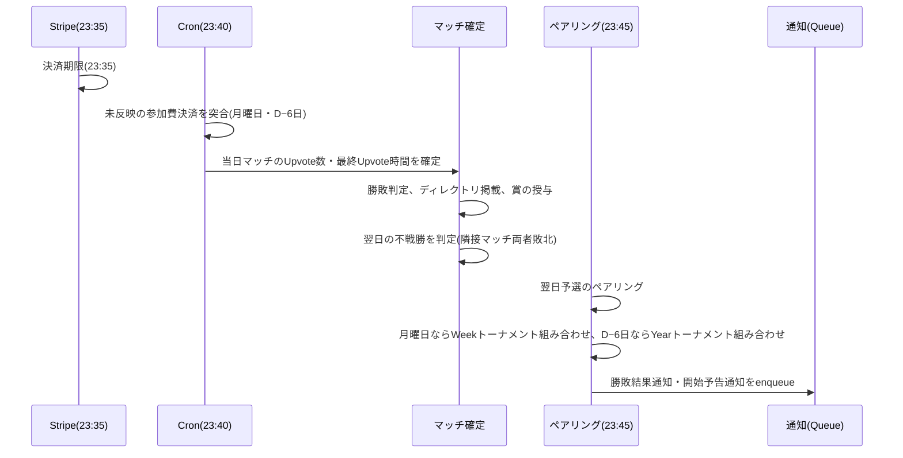

# 日次・週次・年次タイムライン

サービスの定期処理と時刻に依存する仕様を、基準時刻(UTC-08:00)の1日の流れに沿って整理する。各処理の規則は対応要件を正とし、本書は時刻の一覧と処理順序を定める。
基準時刻は夏時間を持たない固定オフセットであり、日境界はUTCの8:00である。日時データの保持はI18N-002を、表示形式はI18N-004を正とする。

## 日次タイムライン

| 基準時刻 | UTC   | 事象                                                                                                                                                                                                                                     | 対応要件                                                                                                                                                              |
| -------- | ----- | ---------------------------------------------------------------------------------------------------------------------------------------------------------------------------------------------------------------------------------------- | --------------------------------------------------------------------------------------------------------------------------------------------------------------------- |
| 0:00     | 8:00  | 当日の予選・トーナメントマッチ開始。不戦勝の確定。投稿者のフォロワーへ開催通知メール                                                                                                                                                     | FR-GAME-009、FR-TOURW-011、FR-TOURY-015、FR-NOTIF-006                                                                                                                 |
| 0:07     | 8:07  | 当日開始のスポンサー広告へ掲載開始通知メール、前日終了のスポンサー広告へ掲載終了通知メールを送信                                                                                                                                         | FR-SPONS-016、FR-SPONS-018                                                                                                                                            |
| 4:21     | 12:21 | 日次バッチ(下記)                                                                                                                                                                                                                         | FR-USER-014、FR-USER-022、FR-COMNT-009、FR-PRDCT-017、FR-PRDCT-024、FR-FILEU-024、FR-NOTIF-022、FR-FTS-007、FR-PPLAN-008・013、FR-PYMNT-012・018、DR-005、DR-017〜022 |
| 16:21    | 0:21  | 退会・停止・停止解除・物理削除の開始のうち、未完了の後続処理の再実行。日次バッチ(4:21)の抑止記録の後始末と時刻を分ける。ジョブの名前は`identity-auth.lifecycle-redispatch`で、最後の送信から1時間以上未完了の後続処理を100件まで送り直す | FR-USER-032、DR-002                                                                                                                                                   |
| 23:40    | 7:40  | 決済期限(23:35)を過ぎた未反映の参加費決済の突合(下記)。続いて当日のマッチ終了。Upvote数と最終Upvote時間を確定し勝敗判定。選択可能な最も早いローンチ日が翌々日へ切り替わる                                                                | FR-PYMNT-013、FR-GAME-010〜012・014、FR-TOURW-014〜016・018、FR-TOURY-017〜019・021、FR-PRDCT-002                                                                     |
| 23:45    | 7:45  | 翌日ローンチ分の予選ペアリング。両投稿者へ勝敗結果通知メール及びマッチ開始予告メール                                                                                                                                                     | FR-GAME-005、FR-NOTIF-001、FR-NOTIF-004                                                                                                                               |

### 日次バッチ(4:21)の内容

対象データと条件は[データ保持期間の一覧](../legal/001-compliance-policy.md#データ保持期間の一覧)のうち削除方法が「日次バッチ」のものを正とする。退会ユーザーのデータ、及びプロダクト・コメント・画像の個別削除(FR-PRDCT-013・FR-COMNT-006・FR-FILEU-024)によるデータは、それぞれの論理削除から14日が経過する直前(論理削除から13日後)のバッチで処理し、画像ファイルの物理削除時は[エッジキャッシュを無効化](../features/002-image-variants.md#キャッシュとパージ)する(FR-FILEU-021)。削除のほかに、使い捨てメールアドレスの判定のやり直し(FR-USER-014)、画像の自動判定の再依頼と保存先の照合(FR-FILEU-013・016)、外部APIでのキーワード抽出のやり直し(FR-FTS-007)を行う。

日次バッチは次の表のジョブを順序の小さいものから1つずつ実行する。前のジョブが終わるまで次のジョブを始めず、1つのジョブが失敗しても後続のジョブを実行する。利用者のアカウントのジョブ(順序100〜120)は、退会ユーザーの物理削除の開始→期限切れの認証情報の削除→使い捨てメールアドレスの判定のやり直しの順に、他のドメインのジョブより前に置く。管理者のアカウントのジョブ(順序200〜210)は、利用者のアカウントのジョブの後に、期限切れの認証情報の削除→監査ログの物理削除の順に置く。問い合わせのジョブ(順序300)は、管理者のアカウントのジョブの後に置く。決済のジョブ(順序400〜410)は、問い合わせのジョブの後に、未完了の購入と依頼待ちの返金・メールの確認→決済履歴の物理削除の順に置く。Ultrasのジョブ(順序500)は決済のジョブの後に置く。送り直す知らせと依頼待ちのメールの行は決済の反映が作るためである。利用者のプロフィールのジョブ(順序600)は、Ultrasのジョブの後、メディアのジョブ(順序810)の前に置く。検索のキーワードの再抽出は各ドメインの削除の処理より後(順序2300)に置き、削除済みのデータの再抽出を要求しない。

| 順序 | ジョブの名前                                 | 処理                                                                                                                                                                                                                                                                                                                                                                                                                                                                                                                                                                                                                                          | 対応要件                                                     |
| ---- | -------------------------------------------- | --------------------------------------------------------------------------------------------------------------------------------------------------------------------------------------------------------------------------------------------------------------------------------------------------------------------------------------------------------------------------------------------------------------------------------------------------------------------------------------------------------------------------------------------------------------------------------------------------------------------------------------------- | ------------------------------------------------------------ |
| 100  | `identity-auth.purge-orchestrator`           | 退会ユーザーの物理削除の開始。論理削除から13日後(退会の業務日付が実行日の13日前以前)で物理削除を始めていない利用者を50件まで選び、物理削除の後続処理を始める。論理削除から14日を過ぎても残る利用者がいれば運用者へ通知する                                                                                                                                                                                                                                                                                                                                                                                                                    | FR-USER-022、DR-002                                          |
| 110  | `identity-auth.credential-cleanup`           | 期限切れの認証情報の物理削除。アイドル期限か絶対期限に達したログインセッション、有効期限を過ぎた未使用の認証系トークン・多要素認証のログインの待ち・多要素認証の設定の保留を消す                                                                                                                                                                                                                                                                                                                                                                                                                                                              | DR-019、DR-020                                               |
| 120  | `identity-auth.disposable-recheck-sweep`     | 使い捨てメールアドレスの判定のやり直し。判定が「未判定」のまま最後の判定から1時間以上経ったメールアドレス確認済みの利用者を50件まで選び、判定し直しを依頼する                                                                                                                                                                                                                                                                                                                                                                                                                                                                                 | FR-USER-014、SW-021                                          |
| 200  | `admin-foundation.credential-cleanup`        | 期限切れの管理者の認証情報の物理削除。アイドル期限か絶対期限に達した管理者のログインセッション、有効期限を過ぎた未使用の認証系トークン・多要素認証のログインの待ちを消し、期限を過ぎた多要素認証の設定の保留を消去する。対象ごとに1回の起動で500件まで消し、残りは翌日に消す                                                                                                                                                                                                                                                                                                                                                                  | DR-019、DR-020                                               |
| 210  | `admin-foundation.audit-log-retention`       | 監査ログの物理削除。記録日時から3年以上経過した監査ログを対象の記録ごと消す。1回の起動で500件ずつ最大20回(10,000件)まで繰り返し、残りは翌日に消す                                                                                                                                                                                                                                                                                                                                                                                                                                                                                             | DR-017                                                       |
| 300  | `inquiry-chat.guest-inquiry-retention`       | 未ログインの問い合わせの物理削除。対応ステータスが「対応済」または「却下」に変わってから14日以上経った未ログインの問い合わせ(停止中のユーザーの送信を含む)を消す。1回の起動で500件ずつ最大20回(10,000件)まで繰り返し、残りは翌日に消す                                                                                                                                                                                                                                                                                                                                                                                                        | DR-021                                                       |
| 400  | `payments.pending-checkout-sweep`            | 未完了の購入と依頼待ちの返金・メールの確認。決済セッションの有効期限を1時間以上過ぎても未完了のままの購入を200件までStripeの状態と突合し、支払い済みなら反映し、それ以外は失効にする。受け付けてから10分以上経っても実行の依頼が記録されていない返金を100件まで、送信から24時間以上経っても実行されていない返金を100件まで、送信の依頼が記録されていない購入確認メールと自動返金の通知メールをそれぞれ100件まで依頼し直す。突合は開始から30秒を過ぎたら残りを翌日に回す。突合と依頼に失敗した対象・送り直した返金・時間の上限で残った件数は運用者へ通知する                                                                                   | FR-PYMNT-009・012・018                                       |
| 410  | `payments.history-retention`                 | 決済履歴の物理削除。記録日時から7年以上経過した決済履歴を消す。1回の起動で500件ずつ最大20回(10,000件)まで繰り返し、残りは翌日に消す                                                                                                                                                                                                                                                                                                                                                                                                                                                                                                           | DR-018                                                       |
| 500  | `ultras-subscription.pending-dispatch-sweep` | Ultrasの加入が有効になった知らせの送り出し直しと、依頼待ちの定期課金のメールの依頼、保持期間を過ぎた記録の物理削除。完了していない知らせのうち、送り出していないまま作成から10分以上経ったもの、または送り出しから24時間以上経ったものを100件まで送り出し直す。依頼待ちのまま作成から10分以上経った支払いの失敗・解約の受付のメールの依頼を100件まで依頼し直す(宛先の無い退会済みの利用者の依頼は対象外にする)。処理を終えてから30日以上経った知らせと、依頼を終えてから30日以上経ったメールの依頼の記録を、表ごとに500件ずつ最大20回(10,000件)まで消し、残りは翌日に消す。4つの処理は1つが失敗しても残りを続け、失敗があれば運用者へ通知する | FR-PPLAN-008・013                                            |
| 600  | `user-profile-social.orphaned-file-sweep`    | 保有者の利用者が存在しないファイル(仮1)の物理削除。保有者のIDを90件ずつ読み、利用者の行が無い保有者のファイルを保有者単位で物理削除する。消した件数が1,000件に達したところで打ち切り、残りは翌日に消す。処理した保有者とファイルの件数を記録する                                                                                                                                                                                                                                                                                                                                                                                              | FR-USER-022、DR-002                                          |
| 810  | `media-pipeline.expired-file-erasure`        | ファイルの物理削除。削除待ち・論理削除から13日以上経ったファイルと、アップロードから24時間を過ぎても紐付けられていないファイル(保存が完了しなかったものを含む)を、全てのバケットとデータベースから消し、画像のエッジキャッシュを無効化する。1回の起動で1,000件ずつ最大10回(10,000件)まで繰り返す                                                                                                                                                                                                                                                                                                                                              | FR-USER-022、FR-PRDCT-024、FR-FILEU-021・024、DR-001、DR-002 |
| 820  | `media-pipeline.moderation-requeue`          | 画像の自動判定の再依頼。未判定の画像と、判定待ちのまま作成から1時間を過ぎた画像(削除されていないもの)の判定を、1,000件まで依頼し直す                                                                                                                                                                                                                                                                                                                                                                                                                                                                                                          | FR-FILEU-013                                                 |
| 830  | `media-pipeline.location-reconciliation`     | 画像の保存先の照合。隔離理由があるのに画像用非公開バケットにある画像と、隔離理由が無いのに隔離バケットにある画像を1,000件まで選び、保存先の移動を依頼する                                                                                                                                                                                                                                                                                                                                                                                                                                                                                     | FR-FILEU-016、FR-ADMUG-050                                   |
| 900  | `email-delivery.cleanup`                     | メールの抑止記録と送信済みの記録の物理削除([データ保持期間の一覧](../legal/001-compliance-policy.md#データ保持期間の一覧)の注7・注8)                                                                                                                                                                                                                                                                                                                                                                                                                                                                                                          | FR-NOTIF-022、SW-014                                         |
| 2300 | `content-processing.keyword-reextraction`    | 検索のキーワードの再抽出。キーワードの代わりに正規化テキストで索引した検索データと、索引の更新を待ったまま1時間以上経った検索データを、検索対象ごとに200件まで選んで抽出をやり直す                                                                                                                                                                                                                                                                                                                                                                                                                                                            | FR-FTS-007                                                   |

### 参加費決済の突合(23:40)

23:40のジョブも日次バッチと同じく、順序の小さいものから1つずつ実行する。参加費決済の突合は、同時刻のマッチの確定より先に動かすため順序10とし、23:40に置く他のジョブは順序を10より大きくする。

| 順序 | ジョブの名前                       | 処理                                                                                                                                                                                                                                                                                                                                                                                                                                                           | 対応要件     |
| ---- | ---------------------------------- | -------------------------------------------------------------------------------------------------------------------------------------------------------------------------------------------------------------------------------------------------------------------------------------------------------------------------------------------------------------------------------------------------------------------------------------------------------------- | ------------ |
| 10   | `payments.checkout-reconciliation` | 決済期限が実行時刻以前かつ24時間以内の未反映の購入(月曜日のWeekトーナメント参加費とYearトーナメント決勝日の6日前の参加費)を、200件までStripeの決済セッションの状態と1件ずつ突合する。支払い済みなら反映し、失効・未払いなら失効にする。Stripeに到達できなかった購入は他の購入の突合を続けたうえで運用者へ通知し、200件を超えた分は翌日4:21の確認が拾う。23:45の組み合わせ決定に間に合わせるため、起動から4分を過ぎたら残りを止めて残った件数を運用者へ通知する | FR-PYMNT-013 |

## 週次タイムライン(Weekトーナメント)

| 曜日・時刻  | UTC        | 事象                                                                              |
| ----------- | ---------- | --------------------------------------------------------------------------------- |
| 月曜日0:00  | 月曜日8:00 | 新しい週の開始(ISO週。例: 2026-W37 = 2026-09-07〜09-13)                           |
| 月曜日23:35 | 火曜日7:35 | 前週分Weekトーナメントの参加費決済期限、ただしUIには35分前の23:00が締切と表示する |
| 月曜日23:40 | 火曜日7:40 | 前週分Weekトーナメントの参加費決済の突合(FR-PYMNT-013)                            |
| 月曜日23:45 | 火曜日7:45 | 前週分Weekトーナメントの組み合わせ決定。参加数1なら即時受賞                       |
| 火曜日0:00  | 火曜日8:00 | Weekトーナメント1回戦開始                                                         |
| 以降毎日    | —          | 1日1ラウンド。参加数N≤128なら翌週月曜日までに決勝終了                             |

Weekトーナメントの詳細は[Weekトーナメント規則](004-week-tournament-rules.md)を参照。

## 年次タイムライン(Yearトーナメント)

決勝日Dは最上位管理者が設定する日曜日(FR-ADMCF-001〜003・006)。

| 時点             | UTC             | 事象                                                                                                  |
| ---------------- | --------------- | ----------------------------------------------------------------------------------------------------- |
| D − 7日(日)0:00  | D − 7日(日)8:00 | 決勝日の変更期限                                                                                      |
| D − 6日(月)23:35 | D − 5日(火)7:35 | 参加費決済期限、ただしUIには35分前の23:00が締切と表示する。対象はこの日の前日までのWeek優勝プロダクト |
| D − 6日(月)23:40 | D − 5日(火)7:40 | 参加費決済の突合(FR-PYMNT-013)                                                                        |
| D − 6日(月)23:45 | D − 5日(火)7:45 | 組み合わせ決定。参加数1なら即時受賞                                                                   |
| D − 5日〜D       | —               | 参加数に応じた日に1回戦を開始し、1日1ラウンド                                                         |
| D(日)23:40       | D + 1日(月)7:40 | 決勝終了、Product of the Year確定                                                                     |

Yearトーナメントの詳細は[Yearトーナメント規則](005-year-tournament-rules.md)を参照。

## 同時刻に走る処理の順序

毎週月曜日の23:35の決済期限から23:45の組み合わせ決定までの10分間に複数の処理が連鎖する。実装上は以下の順序を守る。

- マッチ確定(23:40)が完了してからペアリング(23:45)を行う。翌日のトーナメントマッチの対戦相手は当日の勝敗に依存するため
- 参加費決済の突合(23:40)はペアリング(23:45)の前に完了させる([理由](002-pricing-and-plans.md#決済期限を組み合わせ決定よりも10分早める理由))
- 決済期限(23:35)をマッチ終了より早め、UIにより早い時間を表示する理由は[料金及びプラン体系](002-pricing-and-plans.md#ui表示において決済期限を35分早める理由)を参照
- 準決勝以前でトーナメントマッチに勝利した投稿者への通知は、勝敗結果と翌日の開始予告を1通に統合する(FR-NOTIF-004)

## 時刻に依存するその他の仕様

| 仕様                               | 基準                             | 対応要件     |
| ---------------------------------- | -------------------------------- | ------------ |
| スポンサー広告の掲載期間           | 基準時刻の日単位                 | FR-SPONS-004 |
| Ultras解約後の特典継続             | 基準時刻で当該課金期間の末日まで | FR-PPLAN-003 |
| ディレクトリのローンチ期間絞り込み | 基準時刻の日付                   | FR-DIR-007   |
| 管理者統計の週毎集計               | 基準時刻でのISO週(月曜日始まり)  | FR-ADMUG-001 |
| 日時・数値の表示形式               | OS・ブラウザのロケール(地域設定) | I18N-004     |
