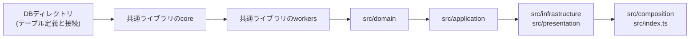
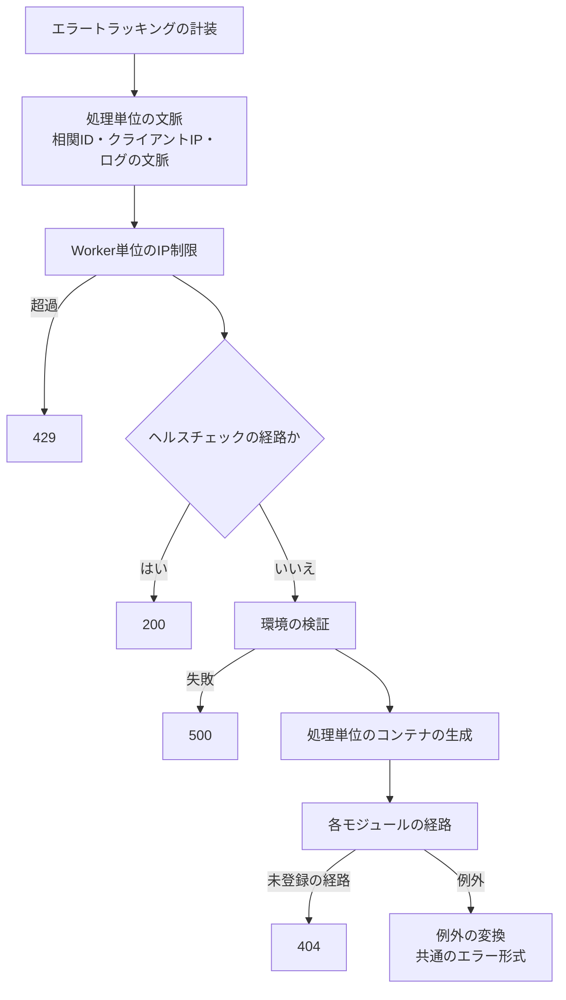

# Cloudflare Workersでの層構成と依存性の組み立て

HonoとInversifyで作るCloudflare Workersのサーバーの4層の配置と合成ルート、依存方向と静的解析による強制、処理単位ごとのDIコンテナ、機能の登録箇所、共通エラーと共通のエラー形式、ミドルウェアの順序、ヘルスチェック、及び層とテストの種別・カバレッジの分担を定める。

## 前提と用語

実行環境にCloudflare Workers、WebフレームワークにHono、DIコンテナにInversify、ORMにDrizzle、データベースにCloudflare D1を使い、複数のWorkerが共通ライブラリとDBディレクトリを共有ディレクトリとして配置して使う構成を前提とする(「[共有ディレクトリの配置方式](../coding/003-shared-directories.md)」)。コンストラクタ引数の注入は「[Cloudflare Workersでの依存性注入](001-dependency-injection-on-workers.md)」に、レート制限とbot判定は「[レート制限とbot判定の検証](003-rate-limiting-and-bot-verification.md)」に従う。

| 用語                             | 意味                                                                                                                                                                               |
| -------------------------------- | ---------------------------------------------------------------------------------------------------------------------------------------------------------------------------------- |
| 共通ライブラリ                   | 複数のWorkerが使うバックエンドの部品を置く共有ディレクトリ。実行環境に依存しない`core`と、workerdのAPI・バインディング・Honoに依存する`workers`に分ける                            |
| `<共通ライブラリの配置先>`       | 共通ライブラリを利用側のアプリへ配置したディレクトリ。本文書の部品の置き場所は、このディレクトリからのパスである                                                                   |
| `<DBディレクトリの配置先>`       | テーブル定義と接続を置く共有ディレクトリ(「[データベースのスキーマ規約](../db/003-schema-conventions.md#前提と用語)」の`<DBディレクトリ>`)を、利用側のアプリへ配置したディレクトリ |
| 検査担当                         | 共有ディレクトリの静的解析とテストを受け持つ1つのアプリ(「[JavaScript・TypeScriptの記法と設定ファイルの規約](../coding/001-javascript-typescript-conventions.md#前提と用語)」)     |
| 処理単位                         | 依存の組み合わせ(DIコンテナ)を1つ用意して処理する単位。HTTPリクエスト1件、定期実行のジョブ1つ、非同期メッセージ1件が該当する                                                       |
| 合成ルート                       | 各層の実装を組み合わせ、Workerのエントリへまとめる場所。アプリの`src/composition/`と`src/index.ts`である                                                                           |
| 共通エラー                       | 想定内の失敗を表す共通ライブラリの例外`AppError`。種類から状態コードが決まり、共通のエラー形式で応答される                                                                         |
| `<ヘルスチェックの経路>`         | Workerの生存を返す経路                                                                                                                                                             |
| `<ペッパーのシークレットのキー>` | 「[秘密情報のハッシュ化](../security/002-keyed-hashing.md#前提と用語)」と同じ                                                                                                      |

## 層構成と合成ルート

アプリの`src/`を4つの層と合成ルートに分ける。内側の層は外側の層を参照しない。

| 位置                               | 置くもの                                                                                 | 依存してよいもの                                                                   |
| ---------------------------------- | ---------------------------------------------------------------------------------------- | ---------------------------------------------------------------------------------- |
| `src/domain/`                      | エンティティ・値オブジェクト・ドメインの規則                                             | 共通ライブラリの`core`、実行環境に依存しないパッケージ(`zod`など)                  |
| `src/application/`                 | ユースケースと、ユースケースが使うポート(リポジトリなどのインターフェース)・依存の識別子 | `domain`、共通ライブラリの`core`、テーブル定義と`drizzle-orm`(接続は作らない)      |
| `src/infrastructure/`              | ポートの実装(D1・R2・Queue・外部APIへのアクセス)                                         | `domain`・`application`、共通ライブラリの`core`・`workers`、DBディレクトリ、`hono` |
| `src/presentation/`                | Honoの経路の定義と、要求・応答の変換                                                     | 同上                                                                               |
| `src/composition/`・`src/index.ts` | 合成ルート。モジュールの定義と登録箇所、環境の検証スキーマ、Workerのエントリ             | すべて                                                                             |

- 共通ライブラリの`core`は純粋な部品と契約(共通エラー・依存の識別子・モジュールの契約・ハッシュ化・業務時刻など)、`workers`は実行環境の部品(HTTPアプリの組み立て・処理単位のコンテナ・ログとエラートラッキングの設定・レート制限・bot判定など)である。
- 層のディレクトリは、最初のファイルを加えるときに作る。

### 合成ルート

- エントリ`src/index.ts`は、`createWorkerApp`で組み立てたHonoのアプリと、定期実行・非同期メッセージのディスパッチャを、`createWorkerHandler`で`fetch`・`scheduled`・`queue`のハンドラーにまとめて`export default`する。Durable Objectのクラスは、Wrangler設定の`class_name`と同じ名前でエントリから名前付きでエクスポートする。エントリを書き換えるときもこのエクスポートを保つ。
- グローバルスコープ(モジュールの読み込み時)では、import・定数の定義・ルートの登録だけを行う。ログの設定・DIコンテナの生成・暗号鍵の生成は、最初の呼び出しまで遅らせる。Workerの起動時間(グローバルスコープの処理時間)を短く保つためである。
- 処理単位ごとの状態(リクエストや利用者に関わる値、データベースの接続など)をモジュールスコープの変数に置かず、処理単位のコンテナに束縛する。isolateは複数の処理単位を順に、また並行して処理するため、モジュールスコープに置いた状態は処理単位の間で共有される。
- モジュールスコープに置く状態は、処理単位に依存しないものに限る。共通ライブラリでは、Honoのアプリとルートの登録、ログの設定、環境オブジェクトごとの検証の結果(「[環境の検証](#環境の検証)」)、エラートラッキングのクライアントがisolateの中で使い回される。

### 登録箇所

機能を追加するときは、合成ルートの登録箇所に追記するだけで組み込み、共通ライブラリの骨格を変えない。

| ファイル                                   | 登録するもの                                                                                                                  |
| ------------------------------------------ | ----------------------------------------------------------------------------------------------------------------------------- |
| `src/composition/modules.ts`               | モジュール(依存の束縛とルートの登録)の一覧`MODULES`                                                                           |
| `src/composition/scheduled-jobs.ts`        | 定期実行のジョブの一覧`SCHEDULED_JOBS`と、起動時刻ごとの時間の予算`SCHEDULED_RUN_BUDGETS`(定期実行を持つWorkerだけ)           |
| `src/composition/message-handlers.ts`      | 非同期メッセージの種別ごとの処理の一覧`MESSAGE_HANDLERS`(Queueのconsumerを持つWorkerだけ)                                     |
| `src/composition/rate-limit-exclusions.ts` | Worker単位のIP制限の除外規則の一覧`RATE_LIMIT_EXCLUSIONS`(「[除外規則](003-rate-limiting-and-bot-verification.md#除外規則)」) |
| `src/composition/env-schema.ts`            | 環境の検証スキーマ(「[環境の検証](#環境の検証)」)                                                                             |

- `scheduled-jobs.ts`・`message-handlers.ts`は、Bunの単体テスト(定期実行の定義との一致の検査など)から読み込めるよう、`cloudflare:*`を読み込まない。

## 依存方向と静的解析

importの向きは次の順に限る。



- 矢印の先は元を読み込めるが、元は先を読み込めない。逆向きのimportは静的解析で禁止する。
- 元のすべてを読み込めるわけではない。`domain`・`application`は共通ライブラリの`workers`を、`domain`はDBディレクトリを、`application`はDBディレクトリの接続を読み込めない(「[位置ごとの禁止import](#位置ごとの禁止import)」)。
- 共通ライブラリの`core`はDBディレクトリを読み込まない。データベースの型が必要な契約は`workers`に置く。
- DBディレクトリは`drizzle-orm`・`ulid`と自身のファイルだけを読み込む。マイグレーションの生成ツールが配置元の位置でテーブル定義を読み込むため、他の共有ディレクトリへの相対importは配置元で解決できない。

### 位置ごとの禁止import

各アプリの`eslint.config.ts`に、ファイルの位置ごとの`no-restricted-imports`を置く。4層の規則は全アプリに置き、共通ライブラリとDBディレクトリの規則は検査担当のアプリにだけ置く。検査担当でないアプリは、配置先を静的解析から外す(「[検査担当でないアプリでの共有ディレクトリの除外](../coding/001-javascript-typescript-conventions.md#検査担当でないアプリでの共有ディレクトリの除外)」)。

| 対象のファイル                                                     | 禁止するimport                                                                                                                                                                                             |
| ------------------------------------------------------------------ | ---------------------------------------------------------------------------------------------------------------------------------------------------------------------------------------------------------- |
| `src/domain/**`                                                    | `**/application/**`・`**/infrastructure/**`・`**/presentation/**`・`**/composition/**`・`hono`・`drizzle-orm*`・`cloudflare:*`・`**/<共通ライブラリの配置先>/workers/**`・`**/<DBディレクトリの配置先>/**` |
| `src/application/**`                                               | `**/infrastructure/**`・`**/presentation/**`・`**/composition/**`・`hono`・`cloudflare:*`・`**/<共通ライブラリの配置先>/workers/**`・`**/<DBディレクトリの配置先>/client*`                                 |
| `src/infrastructure/**`・`src/presentation/**`                     | `**/composition/**`                                                                                                                                                                                        |
| `<共通ライブラリの配置先>/core/**`(検査担当のみ)                   | `**/workers/**`・`cloudflare:*`・`**/<DBディレクトリの配置先>/**`・`hono`(型だけのimportは許す)                                                                                                            |
| `<DBディレクトリの配置先>/**`(検査担当のみ)                        | `**/<共通ライブラリの配置先>/**`・`hono`・`cloudflare:*`・`drizzle-orm/sqlite-core`の`sqliteTable`・`sqliteTableCreator`                                                                                   |
| `<DBディレクトリの配置先>/**/*.worker.test.{ts,tsx}`(検査担当のみ) | 上の行から`cloudflare:*`を除いたもの                                                                                                                                                                       |

- 共通ライブラリの`core`の`hono`は、`@typescript-eslint/no-restricted-imports`の`allowTypeImports: true`で型だけのimport(`import type { Hono } from 'hono'`)を許す。モジュールの契約がHonoのアプリの型を参照するためである。型だけのimportは実行時に残らないため、`core`がHonoなしで動くことは変わらない。`workers`・`cloudflare:*`・DBディレクトリは型だけのimportも禁止する。
- DBディレクトリのWorkers統合テストは、D1のバインディングをworkerdの実行環境(`cloudflare:workers`の`env`)から受け取るため、`cloudflare:*`だけを許す。
- DBディレクトリでテーブルを`sqliteTable`で定義すると列名がスネークケースへ変換されないため、`snakeCase.table`を使う(「[命名規則](../db/001-drizzle-migrations-on-d1.md#命名規則)」)。
- 規則に合うことは、ESLintのNode APIで各位置に置いた仮想のファイルの違反例と許可例を検査する単体テストで確かめる。

### 静的解析の規則の注意

`no-restricted-imports`の`patterns`は`.gitignore`の形式で照合するため、次の点に注意する。

- パッケージ名の`hono`は、パスのどの区切りに現れても一致する。`hono/factory`などのサブパスに加えて、`@sentry/hono`のような別のパッケージも禁止される。
- 動的な`import()`と`require`は検査されない。層をまたぐ読み込みに使わない。
- `**/infrastructure/**`のような規則は、ディレクトリの中のファイルの指定に一致し、サブパスの無いディレクトリのimport(`'../infrastructure'`)には一致しない。importはディレクトリではなくファイルのパスで書く。

## 処理単位のコンテナ

処理単位ごとに`createInvocationContainer(scope, modules)`で新しいコンテナを作り、処理単位をまたいでインスタンスを共有しない。HTTPリクエストでは`createWorkerApp`のミドルウェアがリクエストごとに作り、Honoの文脈変数`container`に置く。定期実行では定期実行のディスパッチャがジョブごとに、非同期メッセージではQueueのconsumerがメッセージごとに作る。

- 1回の定期実行の起動で同じ時刻の複数のジョブを順に実行する場合も、各ジョブは別のコンテナで実行され、ジョブの間でインスタンスを共有しない。1つのバッチで届いた複数のメッセージも、メッセージごとに別のコンテナで処理される。

- コンテナは`new Container({ defaultScope: 'Transient' })`で作る。既定のスコープは`Transient`(取得のたびに新しいインスタンス)であり、`inSingletonScope()`はそのコンテナ、つまり1件のHTTPリクエスト・1つのジョブ・1件のメッセージの中で1つを意味する。処理単位やisolateをまたいで1つになるわけではない。
- 基盤の依存を束縛した後、各モジュールの`bindings`を登録順に同期の`load`で読み込む。モジュールの`ContainerModule`の`load`は同期の関数にする(非同期の関数を渡すと例外になる)。
- 依存の生成はI/Oを伴わない。D1の接続などは、取得されたときに作られる。

### 基盤の束縛

識別子は共通ライブラリの`core/di/identifiers.ts`の`PLATFORM_TYPES`にあり、`Symbol.for('platform.<名前>')`で作られている。注入するクラスでは`@inject(PLATFORM_TYPES.<名前>)`を明示する(「[コンストラクタ引数の注入](001-dependency-injection-on-workers.md#コンストラクタ引数の注入)」)。

| 識別子                   | 束縛される値                                                                                                           | スコープ           |
| ------------------------ | ---------------------------------------------------------------------------------------------------------------------- | ------------------ |
| `Env`                    | Workerの環境(`env`)                                                                                                    | 定数               |
| `InvocationScope`        | 環境・`ExecutionContext`・処理単位の情報(種類・相関ID・クライアントIP)                                                 | 定数               |
| `Database`               | `createDatabase`で作った型付きのデータベース                                                                           | 処理単位で1つ      |
| `Clock`                  | システム時計(`now(): Date`)                                                                                            | 定数               |
| `IdGenerator`            | 単調増加のULIDの採番                                                                                                   | 処理単位で1つ      |
| `KeyedHasher`            | `env.<ペッパーのシークレットのキー>`を鍵としたハッシュ化(「[秘密情報のハッシュ化](../security/002-keyed-hashing.md)」) | 処理単位で1つ      |
| `MessagePublisher`       | 契約で検証してから封筒を付けてQueueへ送るメッセージ送信                                                                | 処理単位で1つ      |
| `BotVerifier`            | bot判定の検証(使うWorkerのモジュールが束縛する)                                                                        | モジュールが決める |
| `RateLimitCounterClient` | 厳密カウンタのクライアント(使うWorkerのモジュールが束縛する)                                                           | モジュールが決める |

- ドメインの識別子は、各アプリの`src`にドメインごとに定義する(例:`Symbol.for('article.ArticleRepository')`)。ユースケースが注入を受けるため、識別子は`application`以内の層に置く。

### モジュール

モジュールは、依存の束縛とルートの登録を1つにまとめた`AppModule`(共通ライブラリの`core/di/app-module.ts`)である。全ての層を読み込めるのは合成ルートだけのため、モジュールは`src/composition/`に定義し、`modules.ts`の`MODULES`に加える。

```typescript
import type { Hono } from 'hono';
import { ContainerModule } from 'inversify';

import type { AppModule } from '<共通ライブラリの配置先>/core/di/app-module.ts';
import type { PlatformHonoEnv } from '<共通ライブラリの配置先>/workers/http/hono-env.ts';

import { PublishArticle } from '../application/article/publish-article.ts';
import { ARTICLE_TYPES } from '../application/article/types.ts';
import { D1ArticleRepository } from '../infrastructure/article/d1-article-repository.ts';
import { registerArticleRoutes } from '../presentation/article/routes.ts';

export const articleModule: AppModule<Hono<PlatformHonoEnv<Env>>> = {
  name: 'article',
  bindings: new ContainerModule(({ bind }) => {
    bind(ARTICLE_TYPES.ArticleRepository).to(D1ArticleRepository);
    bind(ARTICLE_TYPES.PublishArticle).to(PublishArticle);
  }),
  routes: registerArticleRoutes,
};
```

経路の処理では、Honoの文脈変数`container`からユースケースを取得する。

```typescript
import type { Hono } from 'hono';

import type { PlatformHonoEnv } from '<共通ライブラリの配置先>/workers/http/hono-env.ts';

import type { PublishArticle } from '../../application/article/publish-article.ts';
import { ARTICLE_TYPES } from '../../application/article/types.ts';

export function registerArticleRoutes(app: Hono<PlatformHonoEnv<Env>>): void {
  app.post('/articles/:id/publish', async (c) => {
    const publishArticle = c
      .get('container')
      .get<PublishArticle>(ARTICLE_TYPES.PublishArticle);
    await publishArticle.execute(c.req.param('id'));
    return c.body(null, 204);
  });
}
```

- `routes`はisolateごとに1回、`createWorkerApp`の中で呼ばれる。`bindings`は処理単位ごとに読み込まれる。
- `Env`は`wrangler types`が生成するWorkerの環境の型である。Honoは環境の型引数について不変のため、環境を指定した`AppModule<Hono<PlatformHonoEnv<Env>>>`は型引数を省いた`AppModule`へ代入できない。`MODULES`は`readonly AppModule<Hono<PlatformHonoEnv<Env>>>[]`として宣言する。

### `jitless`の注意

コンテナの`jitless`オプションは指定せず、Inversifyの既定の`true`のまま使う。`jitless: false`にすると、Inversifyは依存の解決処理を`new Function`による実行時のコード生成で作るが、workerdは実行時のコード生成を禁止しているため、解決時に失敗する。

## HTTPアプリの組み立て

HTTPのアプリは共通ライブラリの`createWorkerApp(options)`(`workers/http/create-worker-app.ts`)で組み立てる。ミドルウェアの順序は`createWorkerApp`だけが定義し、アプリは変えない。

| オプション            | 内容                                                                                                                                                             |
| --------------------- | ---------------------------------------------------------------------------------------------------------------------------------------------------------------- |
| `appName`             | ログのカテゴリの先頭に使うアプリ名                                                                                                                               |
| `envSchema`           | 環境の検証スキーマ                                                                                                                                               |
| `modules`             | 登録箇所の`MODULES`                                                                                                                                              |
| `rateLimitExclusions` | 登録箇所の`RATE_LIMIT_EXCLUSIONS`                                                                                                                                |
| `resolveClientIp`     | クライアントIPの解決(省略時は`CF-Connecting-IP`。「[クライアントIPの解決の差し替え](003-rate-limiting-and-bot-verification.md#クライアントipの解決の差し替え)」) |
| `sentry`              | 環境からエラートラッキングの初期化オプションを返す関数。環境の検証より前に呼ばれるため、キーが欠けた環境でも動くようにする                                       |

### ミドルウェアの順序



1. エラートラッキングの計装。共通エラー以外の例外だけを送る。
2. 処理単位の文脈。相関ID(`crypto.randomUUID()`)を採番してHonoの文脈変数`correlationId`とエラートラッキングのタグに付け、クライアントIPを解決して文脈変数`clientIp`に置き、ログの文脈に相関IDを入れて後続を実行する。処理の終了時に、メソッド・クエリ文字列を除いたパス・状態コード・処理時間のアクセスログを1件出す。IPアドレスはアクセスログに記録しない。
3. Worker単位のIP制限(「[Worker単位のIP制限](003-rate-limiting-and-bot-verification.md#worker単位のip制限)」)。
4. ヘルスチェック(「[ヘルスチェック](#ヘルスチェック)」)。
5. 環境の検証(「[環境の検証](#環境の検証)」)。
6. 処理単位のコンテナの生成(文脈変数`container`)。
7. 各モジュールの`routes`で登録した経路。
8. 未登録の経路の404と、例外の変換(「[共通エラーと共通のエラー形式](#共通エラーと共通のエラー形式)」)。

- モジュールの経路に掛けるミドルウェア(bot判定の検証など)は、処理単位のコンテナが作られた後に動く。

### ヘルスチェック

| メソッド  | 経路                     | 応答                                                     |
| --------- | ------------------------ | -------------------------------------------------------- |
| GET・HEAD | `<ヘルスチェックの経路>` | 200、本文`{ "status": "ok" }`、`Cache-Control: no-store` |

- 認証を求めず、データベースなどの依存先を確かめない。Workerが要求を処理できることだけを返す。外部の死活監視はこの経路を監視する。
- 環境の検証より前に置くため、設定が欠けていても200を返す。IP制限より後に置くため、超過時は429になる。
- HEADには、Honoが同じ経路のGETの処理から本文を除いて応答する。
- 他の経路(公開APIのベースパスなど)と衝突させない。

### 環境の検証

- 各アプリは`src/composition/env-schema.ts`に、共通ライブラリの`platformEnvShape`(全Workerに共通のバインディング・変数・シークレットの検証規則)を展開し、アプリだけのキーを加えた`z.object`のスキーマを置く。あわせて、生成された`Env`が共通の型`PlatformEnv`を満たすことを`satisfies`などの型検査で確かめる。
- 検証に失敗すると、欠けたキーと不正なキーの名前だけを`error`ログに出し、500の定型で応答する。値はログにも例外にも含めない。
- 検証の結果は環境オブジェクトごとに覚え、同じisolateの2回目以降は検証しない。
- 後続の処理は、検証の結果ではなく元の`env`を使う。スキーマに書いた既定値や変換(`default`・`transform`)は`env`に反映されないため、検証規則は値の形を確かめるだけにする。
- スキーマの全体に掛けた`refine`のように、問題の経路にキーの無い検証の失敗は、どのキーにも分類されない。

## 共通エラーと共通のエラー形式

想定内の失敗は共通ライブラリの`AppError`(`core/errors/app-error.ts`)で投げ、例外の変換が共通のエラー形式の応答にする。想定外の例外は500の定型で応答し、ログとエラートラッキングへ送る。

### 失敗の種類と状態コード

| 種類(`kind`)      | 状態コード | 使う場面                     |
| ----------------- | ---------- | ---------------------------- |
| `bad_request`     | 400        | 入力の形式の不正・検証の失敗 |
| `unauthenticated` | 401        | 認証されていない             |
| `forbidden`       | 403        | 権限が無い・bot判定の失敗    |
| `not_found`       | 404        | 対象が存在しない             |
| `conflict`        | 409        | 状態の競合                   |
| `unprocessable`   | 422        | 形式は正しいが意味的に不正   |
| `rate_limited`    | 429        | 回数の超過                   |
| `unavailable`     | 503        | 依存先の一時的な障害         |

```typescript
import { AppError } from '<共通ライブラリの配置先>/core/errors/app-error.ts';

throw new AppError({
  kind: 'bad_request',
  code: 'validation_error',
  message: '入力内容を確認してください。',
  details: [
    {
      field: 'title',
      code: 'too_long',
      message: '100文字以内で入力してください。',
    },
  ],
});
```

- `code`は機械可読なsnake_caseの文字列とする。snake_caseでなければ`AppError`の生成時に`RangeError`になる。
- `message`は必須で、利用者に見せてよい文にする。内部の詳細を含めない。
- `details`は項目ごとの詳細(`field`・`code`・`message`)である。
- `retryAfterSeconds`は`rate_limited`・`unavailable`にだけ指定でき、0以上の整数に限る。それ以外は`RangeError`になる。

### 共通のエラー形式

```json
{
  "error": {
    "code": "validation_error",
    "message": "入力内容を確認してください。",
    "details": [
      {
        "field": "title",
        "code": "too_long",
        "message": "100文字以内で入力してください。"
      }
    ]
  }
}
```

- `details`は`AppError`に指定したときだけ含まれる。
- 応答には常に`Cache-Control: no-store`を付け、`retryAfterSeconds`があれば`Retry-After`を付ける。
- 応答の組み立ては`core/errors/error-envelope.ts`の`toErrorResponse`(`AppError`から状態コード・本文・ヘッダーを作る)、`INTERNAL_ERROR_RESPONSE`(500の定型)、`NOT_FOUND_RESPONSE`(404の定型)で行う。いずれも凍結されたオブジェクトである。
- 500の定型は、コード`internal_error`と固定の文言だけを持ち、例外のメッセージ・スタックトレースなどの内部の情報を含まない。

### 基盤が使うエラーコード

| コード                         | 状態コード | 場面                                                                   |
| ------------------------------ | ---------- | ---------------------------------------------------------------------- |
| `internal_error`               | 500        | 想定外の例外、環境の検証の失敗(本文は同じ定型で、詳細はログだけに出す) |
| `not_found`                    | 404        | 未登録の経路                                                           |
| `rate_limit_exceeded`          | 429        | Worker単位のIP制限・バインディングによる制限・厳密カウンタの超過       |
| `bot_verification_failed`      | 403        | bot判定の失敗                                                          |
| `bot_verification_unavailable` | 503        | bot判定のサービスの障害・設定の誤り                                    |

### 例外の投げ方

- 想定内の失敗は`AppError`で投げる。Honoの`HTTPException`は共通エラーではないため、想定外の例外として500になる。`HTTPException`を使わない。
- `Error`(とその派生)以外の値を投げない。Honoは`Error`でない値を例外の変換に渡さずに再送出するため、共通のエラー形式の応答にならず、アクセスログも出ない。
- エラートラッキングは`AppError`のイベントを送らない。運用者に知らせるべき想定外の失敗を`AppError`で投げない。

## 層とテスト種別・カバレッジの分担

テストの種別は層の位置で決まる。実行環境に依存しない層は単体テスト(Bun)で、実行環境に依存する層はWorkers統合テスト(workerd)で検査する。種別と命名・カバレッジの規約は「[テスト戦略](../testing/001-test-strategy.md)」に従う。

| 位置                                                                                                                                                              | テストの種別      | カバレッジの分母                             |
| ----------------------------------------------------------------------------------------------------------------------------------------------------------------- | ----------------- | -------------------------------------------- |
| `src/domain/**`・`src/application/**`・`<共通ライブラリの配置先>/core/**`・`<DBディレクトリの配置先>/schema/**`                                                   | 単体テスト        | テストから読み込まれたファイル               |
| `src/infrastructure/**`・`src/presentation/**`・`src/composition/**`・`src/index.ts`・`<共通ライブラリの配置先>/workers/**`・`<DBディレクトリの配置先>/client.ts` | Workers統合テスト | Vitestの`coverage.include`に指定したファイル |

- Workers統合テストの`coverage.include`は、上の表のWorkers統合テストの位置だけに絞る(「[計測対象の指定](../testing/001-test-strategy.md#計測対象の指定)」)。単体テストで検査する位置を含めると、そのファイルが0%として数えられて閾値で失敗する。
- 共有ディレクトリ(共通ライブラリとDBディレクトリ)のテストは検査担当のアプリだけが実行する。検査担当でないアプリは、配置先をテストの対象と`coverage.include`から外し、型検査には含める。
- 依存方向の規則により、`domain`・`application`・共通ライブラリの`core`は`cloudflare:*`とHonoの実行時の値を読み込まないため、Bunで実行できる。
- 共通ライブラリのテストは、検査担当でないアプリの型検査にも含まれる。一部のWorkerにしか無いバインディングをテストで使うときは、型付きの`env`から直接読まず、`Reflect.get`で取り出して型ガードで確かめる。
- DIの解決は、単体テスト(Bun)・Workers統合テスト(Vitest)・デプロイ用のバンドル(Wrangler)の3つの変換の経路で、`@inject`付きのコンストラクタ引数を持つクラスを解決するスモークテストで確かめる。
