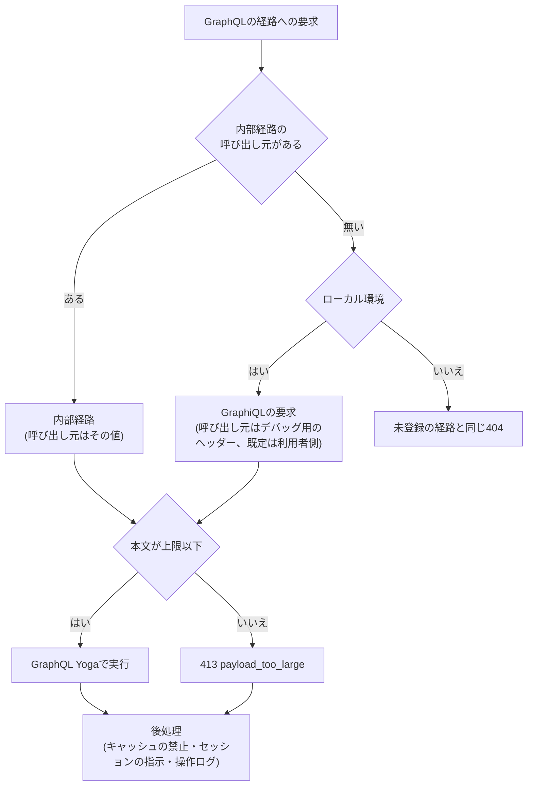

# GraphQLサーバーの基盤

HonoとGraphQL YogaでCloudflare Workersに載せるGraphQLサーバーの受付経路、クエリの上限と算出方法、呼び出し元別の許可リスト、introspectionとGraphiQLの扱い、エラーの分類と状態コード、スキーマモジュールの規約、生成と検査のコマンド、操作ログ、及びトレースへの操作名の付け方を定める。

## 前提と用語

層構成・処理単位のコンテナ・共通エラーは「[Cloudflare Workersでの層構成と依存性の組み立て](002-layered-architecture-on-workers.md)」に、bot判定は「[レート制限とbot判定の検証](003-rate-limiting-and-bot-verification.md#bot判定の検証)」に従う。内部経路の認証・元のクライアントIPアドレス・セッションの受け渡し・セキュリティヘッダーは「[内部経路とセキュリティヘッダー](006-internal-gateway.md)」に、フロントエンドサーバーとの間の要求の形式・ヘッダーの名前・操作の一覧と許可リストの受け渡しは「[GraphQL通信](../coding/004-graphql-communication.md)」に記載する。

GraphQLのサーバーはGraphQL Yoga、クエリの上限はGraphQL Armor、リゾルバの型の生成はGraphQL Code Generator、一括読み込みはDataLoader、引数の検証はZodを使う。部品の置き場所は、アプリの`src/presentation/graphql/`からのパスで示す。

| 部品                                                                                                   | 置き場所                     | 役割                                                     |
| ------------------------------------------------------------------------------------------------------ | ---------------------------- | -------------------------------------------------------- |
| `createGraphQLModule`・`GRAPHQL_MAX_BODY_BYTES`                                                        | `graphql-module.ts`          | 受付経路の判定・本文の上限・応答の後処理を行うモジュール |
| `getGatewayServer`・`isGraphiqlRequest`                                                                | `gateway-server.ts`          | Yogaの組み立てとisolate内での使い回し                    |
| `QUERY_LIMITS`・`createQueryLimitPlugins`                                                              | `query-limits.ts`            | クエリの上限                                             |
| `createOperationAllowlist`・`createPersistedOperationsPlugin`                                          | `operation-allowlist.ts`     | 呼び出し元別の許可リストの照会                           |
| `GATEWAY_ERROR_CODES`・`classifyDocumentErrors`                                                        | `error-codes.ts`             | 実行前の拒否のエラーコードと分類                         |
| `createErrorPolicy`                                                                                    | `error-policy.ts`            | エラーコードの付与・内部の詳細の伏せ字・状態コード       |
| `createGraphQLContext`・`GraphQLContext`                                                               | `graphql-context.ts`         | リゾルバへ渡す文脈                                       |
| `defineLoader`・`DEFAULT_LOADER_MAX_BATCH_SIZE`                                                        | `loaders.ts`                 | 処理単位ごとの一括読み込み                               |
| `withValidatedArgs`                                                                                    | `validated-args.ts`          | リゾルバの引数の検証                                     |
| `CURSOR_PAGE_ARGS`・`OFFSET_PAGE_ARGS`・`encodeCursor`・`decodeCursor`・`toConnection`・`toOffsetPage` | `pagination.ts`              | ページングの引数と結果の組み立て                         |
| `dateTimeScalar`                                                                                       | `date-time-scalar.ts`        | 日時のスカラー                                           |
| `PLATFORM_TYPE_DEFS`                                                                                   | `platform-type-defs.ts`      | 基盤の型定義(日時のスカラーとページングの型)             |
| `defineSchemaModule`・`GraphQLSchemaModule`                                                            | `schema-module.ts`           | スキーマモジュールの契約                                 |
| `composeGatewaySchema`・`printGatewaySchema`・`SchemaCompositionError`                                 | `schema-composer.ts`         | スキーマの合成と、正規化した印字                         |
| `createOperationObservabilityPlugin`・`logOperation`                                                   | `operation-observability.ts` | 操作ログとトレースの付与                                 |
| スキーマモジュール                                                                                     | `modules/<モジュール名>/`    | 機能ごとの型定義とリゾルバ                               |
| 生成物                                                                                                 | `generated/`                 | スキーマファイル・リゾルバの型・許可リスト(コミットする) |

| 用語                           | 意味                                                                                                                                                |
| ------------------------------ | --------------------------------------------------------------------------------------------------------------------------------------------------- |
| フロントエンドサーバー         | 利用者側・管理者側の画面を配信し、GraphQLの要求をService Bindingsで中継するWorker                                                                   |
| 内部経路                       | フロントエンドサーバーからService Bindingsの名前付きエントリポイントを経て届く経路。エントリポイントが呼び出し元の種類を要求に付ける                |
| 外部経路                       | インターネットから直接届く経路                                                                                                                      |
| 呼び出し元                     | 内部経路の要求を送ったフロントエンドサーバーの種類(`CallerKind`)。利用者側と管理者側の2つ                                                           |
| ローカル環境・デプロイ先環境   | 「[環境種別](../infra/002-environments.md)」のローカル環境と、デプロイ先検証環境・本番環境                                                          |
| GraphiQLの要求                 | ローカル環境で、内部経路の呼び出し元を持たずに届く要求。ブラウザで開いたGraphiQLの画面からの要求である(`isGraphiqlRequest`)                         |
| 操作の識別子                   | 操作の本文のSHA-256の16進に`sha256:`を付けた値。要求本文の`documentId`で指定する                                                                    |
| 操作の一覧                     | フロントエンドのコード生成が出力する、操作の識別子と本文の組の一覧                                                                                  |
| 許可リスト                     | 呼び出し元ごとに、実行を許す操作の識別子と本文を持つ生成物                                                                                          |
| 処理単位                       | 「[Cloudflare Workersでの層構成と依存性の組み立て](002-layered-architecture-on-workers.md#前提と用語)」と同じ。GraphQLでは1件のHTTPリクエストである |
| `<アプリ名>`                   | 「[ログ管理とエラートラッキング](../infra/004-logging-and-error-tracking.md#カテゴリ)」と同じ。ログのカテゴリの先頭                                 |
| `<GraphQLの経路>`              | GraphQLを受け付ける1つのパス                                                                                                                        |
| `<GraphQLの本文の上限>`        | GraphQLの要求本文の大きさの上限(`GRAPHQL_MAX_BODY_BYTES`の値)                                                                                       |
| `<一括読み込みの件数の既定値>` | 1回の一括読み込みに渡すキーの数の上限の既定値(`DEFAULT_LOADER_MAX_BATCH_SIZE`の値)                                                                  |

## 受付経路

GraphQLは`<GraphQLの経路>`の1つの経路で、`POST`と`GET`を受け付ける。`createGraphQLModule`が次の順に判定する。



- 呼び出し元は、名前付きエントリポイントが付けた値だけを信頼する。要求に元から付いていた呼び出し元のヘッダーは、既定のエクスポートが取り除き、名前付きエントリポイントは自身の呼び出し元で上書きする(「[呼び出し元の判定](006-internal-gateway.md#呼び出し元の判定)」)。
- デプロイ先環境の外部経路の要求は、本文・メソッド・名乗ったヘッダーに関わらず、未登録の経路と同じ404(`not_found`の共通のエラー形式)で応答し、経路の存在を明かさない。この404は本文の上限より先に判定し、操作ログもトレースの属性も出さない。
- 本文が`<GraphQLの本文の上限>`を超えたら、413と共通のエラー形式(コード`payload_too_large`、文言「リクエストの本文が大きすぎます。」)で応答し、操作を実行しない。`AppError`の種類に413が無いため、モジュールが共通のエラー形式の本文を作る。上限はHonoの`bodyLimit`で検査し、本文の長さのヘッダーがあればその値で、無ければ読み進めて上限を超えた時点で判定する。
- 内部経路の要求は`POST`の`application/json`で、本文に`documentId`・`operationName`・`variables`を持つ(「[GraphQL通信](../coding/004-graphql-communication.md)」)。
- 後処理は、全ての応答(エラー・イベントストリームを含む)に`Cache-Control: no-store`を付け、リゾルバが指示したセッションの発行・削除を応答のヘッダーへ反映し、操作ログを出す。GraphiQLの画面のHTMLにだけ、GraphiQLの配信元を許すCSPを付けて既定のCSPを置き換える。
- Honoの`c.res`への代入は、前の応答のヘッダーを新しい応答へ上書きで写す。後処理で応答を差し替えるときは、`c.res = undefined`としてから新しい応答を代入する。そうしないと、Yogaがイベントストリームの応答に付けた`Cache-Control: no-cache`が後処理の値を上書きする。

## Yogaの設定

`getGatewayServer`は、Yogaを環境の値をキーとしてisolateごとに1回だけ組み立て、以降の要求で使い回す。スキーマの合成と許可リストの検証は最初の要求の時点で行い、モジュールの読み込み時(グローバルスコープ)には行わない。Workerの起動時間を短く保つためである。

| 設定              | 値                            | 理由                                                                                                                        |
| ----------------- | ----------------------------- | --------------------------------------------------------------------------------------------------------------------------- |
| `graphqlEndpoint` | `<GraphQLの経路>`             | 経路を1つにする                                                                                                             |
| `batching`        | `false`                       | 1件の要求で複数の操作を実行させない                                                                                         |
| `multipart`       | `false`                       | ファイルの受け取りはGraphQLで行わない                                                                                       |
| `landingPage`     | `false`                       | 経路の存在を案内しない                                                                                                      |
| `cors`            | `false`                       | Yogaの既定は任意のOriginを資格情報付きで許す。GraphQLの応答にはCORSのヘッダーを付けない                                     |
| `logging`         | `false`                       | Yogaのloggerは伏せる前の例外を出力する。想定外の例外はエラーのポリシーから、伏せ字を通るログへ出す                          |
| `extraParamNames` | `['documentId']`              | 本文の`documentId`を操作の識別子として受け取る                                                                              |
| `graphiql`        | GraphiQLの要求だけ真          | ローカル環境のブラウザからだけGraphiQLの画面を開ける                                                                        |
| `maskedErrors`    | エラーのポリシーの`maskError` | 「[エラーの分類と状態コード](#エラーの分類と状態コード)」                                                                   |
| `context`         | `createGraphQLContext`        | 受付経路で作った処理単位の値(コンテナ・相関ID・クライアントIP・セッション・bot判定のトークン)から、リゾルバへ渡す文脈を作る |

プラグインは次の順に並べる。

1. クエリの上限(`createQueryLimitPlugins`)
2. introspectionの無効化(`useDisableIntrospection`。GraphiQLの要求以外で無効にする)
3. 許可リスト(`createPersistedOperationsPlugin`)
4. 解析・検証の拒否へのエラーコードの付与(エラーのポリシーの`plugin`)
5. 操作の観測(`createOperationObservabilityPlugin`)

- Yogaは解析と検証の結果を文書ごとにキャッシュし、同じ文書の2回目以降の要求では前段のプラグインを経ずにキャッシュした結果を返す。要求ごとに結果が変わる規則や、エラーに情報を付ける処理を加えるときは、同じ文書を2回送るテストと、同じ文書を別の経路で検証した後に送るテストで確かめる。

## 上限と算出方法

全ての経路(GraphiQLの要求を含む)で、次の上限を解析・検証の段階で確かめ、超えた操作はリゾルバを1つも実行せずに拒否する。上限値は`QUERY_LIMITS`に定義する。

| 上限                        | 値   | 超えたときのエラーコード                     |
| --------------------------- | ---- | -------------------------------------------- |
| 入れ子の深さ                | 8    | `query_depth_exceeded`                       |
| コスト                      | 5000 | `query_cost_exceeded`                        |
| エイリアスの数              | 15   | `query_aliases_exceeded`                     |
| 字句の数                    | 1000 | `query_tokens_exceeded`                      |
| ディレクティブの数          | 50   | `query_directives_exceeded`                  |
| 1件の要求に含む操作(バッチ) | 1    | `graphql_request_invalid`(`batching: false`) |

- 深さは、操作の直下の項目を1段目として、最も深い項目までの段数で数える。フラグメントも1段として数える(GraphQL Armorの既定)。
- コストは、子の選択を持つ項目を2(`objectCost`)、持たない項目を1(`scalarCost`)とし、子の項目のコストの合計に入れ子1段ごとに1.5(`depthCostFactor`)を掛けて足す。操作の直下の項目には係数を掛けない。

```text
項目のコスト = 2 + 1.5 × (子の項目のコストの合計)   … 子の選択を持つ項目
項目のコスト = 1                                      … 子の選択を持たない項目
操作のコスト = 操作の直下の項目のコストの合計
```

- 例: `{ a { b { c } } }`のコストは、`b`が2 + 1.5 × 1 = 3.5、`a`が2 + 1.5 × 3.5 = 7.25で、操作は7.25である。
- GraphQL Armorは、子の選択を持つ項目の引数`first`・`last`に整数のリテラルがあると、その項目のコストに値を掛ける。変数で渡した値は掛けない。ページングの件数を操作の本文にリテラルで書くと、件数の分だけコストが増える。
- ローカル環境では拒否の文言に上限値と実測値を含め、デプロイ先環境では含めない。
- 上限の種類はGraphQL Armorの拒否のエラーの文言では区別できないため、各保護の`onReject`で拒否のエラーと種類を記録し、エラーのポリシーがエラーコードを決めるときに使う。GraphQL Armorに保護を加えたら、`createQueryLimitPlugins`で種類を記録し、`GATEWAY_ERROR_CODES`にコードを加える。

## 許可リスト

内部経路では、全ての環境(ローカル環境を含む)で、呼び出し元の許可リストにある操作の識別子を指定した要求だけを実行する。

- 操作は、要求の呼び出し元の許可リストだけから照会する。利用者側の要求が管理者側の許可リストにだけある操作を指定しても、未登録として拒否する。
- 操作の識別子を持たずに本文(`query`)だけを送った要求は、`persisted_operation_required`(文言「登録済みの操作の識別子(documentId)を指定してください。」)と400で拒否する。
- 識別子が無い・呼び出し元の許可リストに無い要求は、`persisted_operation_not_found`(文言「登録されていない操作です。」)と400で拒否する。
- GraphiQLの要求は、許可リストに無い操作の本文も実行できる。識別子を指定した場合は、デバッグ用の呼び出し元のヘッダーで選んだ呼び出し元(既定は利用者側)の許可リストから照会する。内部経路でもGraphiQLの要求でもない要求は、どの許可リストも照会しない(フェイルクローズ)。
- 許可リストはバンドルに含めたJSONで、最初の照会の時にZodで形を1回だけ検証する。形が不正なら例外になり、操作を実行しない。識別子は要求から来る値のため、照会には`Map`を使い、`constructor`などのオブジェクトの組み込みの名前を登録済みと誤らない。

### 現行と直前のリリース

フロントエンドとAPIサーバーのデプロイの間も、直前のリリースの画面が送る操作を受け付けるため、各呼び出し元の許可リストは、現行のリリースと直前のリリースの操作の一覧の和集合にする。それより古いリリースにだけあった操作は含めない。

- 許可リストの生成コマンドは、作業ツリーの操作の一覧を現行とし、`--previous-ref <コミット>`で指定したコミットの操作の一覧を直前のリリースとする。指定が無ければ(初回のデプロイ・ローカル環境)、現行だけから生成し、直前のリリースを指定していない旨を表示する。
- 識別子が`sha256:`と64桁の小文字の16進の形でない、本文のSHA-256と一致しない、現行と直前で同じ識別子に異なる本文がある、のいずれかなら、許可リストを生成せずに失敗する。
- 現行の操作は、合成したスキーマに対する解析・検証と上限の検査に通らなければ、生成を失敗させる。直前のリリースの操作が通らなければ、許可リストから除外して警告を表示する。スキーマの破壊的な変更で直前のリリースの画面が動かなくなる操作を、デプロイ前に見つけるためである。
- 生成時の検証は、上限のプラグインだけを組み込んだYogaで解析と検証だけを行う。introspectionと、`Subscription`型の無いスキーマへの`subscription`は、生成時の検証を通るが実行時に拒否される。introspectionは内部経路の検証で`graphql_validation_failed`と400に、`subscription`は実行の開始時に`graphql_request_invalid`と400になる。1つの文書に複数の操作を持つものも生成時の検証を通り、実行時は`operationName`で指定した操作が実行される(指定が無ければ`graphql_request_invalid`と400)。
- 操作の一覧の場所と形式、許可リストの生成とデプロイの順序、直前のリリースのコミットの渡し方は「[GraphQL通信](../coding/004-graphql-communication.md)」に記載する。

## introspectionとGraphiQL

introspectionとGraphiQLは、ローカル環境のGraphiQLの要求でだけ使える。内部経路では、ローカル環境を含む全ての環境でintrospectionを拒否する。

| 経路と環境                   | introspection                     | 許可リストに無い操作 | GraphiQLの画面 | 存在しない項目の候補 | 上限の拒否の上限値と実測値 |
| ---------------------------- | --------------------------------- | -------------------- | -------------- | -------------------- | -------------------------- |
| 内部経路(デプロイ先環境)     | 拒否(`graphql_validation_failed`) | 拒否                 | 無し           | 含めない             | 含めない                   |
| 内部経路(ローカル環境)       | 拒否(`graphql_validation_failed`) | 拒否                 | 無し           | 含める               | 含める                     |
| 外部経路(デプロイ先環境)     | 404                               | 404                  | 404            | —                    | —                          |
| GraphiQLの要求(ローカル環境) | 実行する                          | 実行する             | 有り           | 含める               | 含める                     |

- 許可リストにintrospectionの操作が登録されていても、内部経路では検証で拒否する。
- GraphiQLの要求にも、クエリの上限を適用する。
- GraphiQLの要求では、元のクライアントIPアドレスを名乗るヘッダーを信頼せず、接続元のIPアドレスを使う。呼び出し元とセッション識別子は、GraphiQLの画面でヘッダーを手入力して指定する(「[内部経路とセキュリティヘッダー](006-internal-gateway.md)」)。

## エラーの分類と状態コード

エラーのポリシー(`createErrorPolicy`)が、応答の全てのエラーを`maskError`で次の順に分類し、`extensions.code`にエラーコードを付ける。

1. 原因(`GraphQLError`の`originalError`を全てたどった先)が`AppError`なら、`AppError`の`code`と`message`、`details`があれば`extensions.details`を返す。`rate_limited`・`unavailable`なら`extensions.http`に状態コード(429・503)と、`retryAfterSeconds`があれば`Retry-After`を付ける。エラートラッキングへ送らない。
2. `path`を持たず、原因も`GraphQLError`である`GraphQLError`(実行前の拒否)なら、400とともにエラーコードを返す。既にゲートウェイのコード(`internal_error`を除く`GATEWAY_ERROR_CODES`。許可リストの拒否の`persisted_operation_*`、解析・検証の段階で付けた`graphql_parse_failed`・`graphql_validation_failed`・`query_<種類>_exceeded`など)を持つエラーはそのコードを残し、無ければ記録した上限の種類のコード、どちらも無ければ`graphql_request_invalid`とする。`GraphQLError`に包まれた`GraphQLError`(変数の強制変換の失敗など)は、包まれた側のコードを使わずに`graphql_request_invalid`にする。
3. それ以外(`AppError`でない例外、`path`を持つ実行時の`GraphQLError`、外から`internal_error`のコードを付けた`GraphQLError`)は想定外として、レベル`error`のログ(カテゴリ`[<アプリ名>, 'graphql', 'error']`)とエラートラッキングへ1回ずつ送り、`internal_error`と定型の文言で返す。

- 解析・検証の拒否は、エラーのポリシーのプラグインが解析・検証の段階でエラーコードを付け、Yogaのキャッシュにもコード付きのエラーを残す。構文の誤りは`graphql_parse_failed`、上限の拒否は`query_<種類>_exceeded`、それ以外の検証の失敗は`graphql_validation_failed`である。
- GraphQL over HTTPの仕様は`application/json`の応答の検証の失敗を200とするが、実行前の拒否は400に固定する。
- Yogaは、エラーの`extensions.http.status`のうち最大の値を応答の状態コードにする。データが無く想定外のエラーだけの応答は500になる。
- 伏せたエラーを再び`maskError`に渡しても変えず、送り直さない。伏せ済みかどうかは、エラーのポリシーが作ったエラーと同一かで判定し、拡張のコードでは判定しない。

| 状況                                                                                                                                   | エラーコード                                                       | 状態コード               |
| -------------------------------------------------------------------------------------------------------------------------------------- | ------------------------------------------------------------------ | ------------------------ |
| デプロイ先環境の外部経路からの要求                                                                                                     | `not_found`(共通のエラー形式)                                      | 404                      |
| 本文が`<GraphQLの本文の上限>`を超える                                                                                                  | `payload_too_large`(共通のエラー形式)                              | 413                      |
| 操作の識別子を持たずに本文だけ(GraphiQLの要求を除く)                                                                                   | `persisted_operation_required`                                     | 400                      |
| 識別子が無い・呼び出し元の許可リストに無い                                                                                             | `persisted_operation_not_found`                                    | 400                      |
| 深さ・コスト・エイリアス・字句・ディレクティブの上限を超える                                                                           | `query_depth_exceeded`など`query_<種類>_exceeded`                  | 400                      |
| 構文の誤り                                                                                                                             | `graphql_parse_failed`                                             | 400                      |
| スキーマとの不一致・introspectionの拒否・日時のリテラルの不正                                                                          | `graphql_validation_failed`                                        | 400                      |
| バッチ・変数の型の不一致・必須の変数の欠落・JSONでない本文・操作を選べない複数の操作・`Subscription`型の無いスキーマへの`subscription` | `graphql_request_invalid`                                          | 400                      |
| 引数の検証の失敗・日時の変数の不正                                                                                                     | `validation_error`                                                 | 200                      |
| 回数の超過(`rate_limited`)                                                                                                             | `rate_limit_exceeded`など`AppError`のコード                        | 429(`Retry-After`)       |
| 依存先の一時的な障害(`unavailable`)                                                                                                    | `bot_verification_unavailable`など`AppError`のコード               | 503(`Retry-After`)       |
| その他の想定内の失敗                                                                                                                   | `unauthenticated`・`bot_verification_failed`など`AppError`のコード | 200                      |
| 想定外の例外                                                                                                                           | `internal_error`                                                   | 200(データが無ければ500) |

- 状態コードを429・503にするのは、リゾルバが`kind`を`rate_limited`・`unavailable`とした`AppError`を投げたときだけである。回数の超過と一時的な障害が1つの応答に混ざると、大きい方の503になる。
- 実行前の拒否のエラーコードの一覧は`GATEWAY_ERROR_CODES`である。`AppError`のコードは各機能が決める(「[基盤が使うエラーコード](002-layered-architecture-on-workers.md#基盤が使うエラーコード)」)。

### 例外の投げ方

- 想定内の失敗は`AppError`で投げる。文言は利用者に見せてよい文にする。
- 利用者に見せられない内部の詳細は、`GraphQLError`ではなく通常の例外(`Error`)か`AppError`で投げる。`path`を持たない`GraphQLError`は実行前の拒否として扱われ、文言がそのまま応答に出る。
- 運用者に知らせるべき失敗を`AppError`で投げない。`AppError`はエラートラッキングへ送られない。

## スキーマモジュールの規約

機能は、型定義とリゾルバを1つのスキーマモジュールにまとめて登録箇所へ加えるだけでGraphQLに載せ、基盤の処理を変えない。

### 構成と登録

```text
src/presentation/graphql/modules/<モジュール名>/
├── type-defs.ts          # 型定義のSDL
├── resolvers.ts          # リゾルバの表
├── index.ts              # defineSchemaModuleでまとめたモジュール
└── index.worker.test.ts  # モジュールのWorkers統合テスト
```

```typescript
// type-defs.ts
export const ARTICLE_TYPE_DEFS = /* GraphQL */ `
  type Query {
    "記事"
    article(id: ID!): Article
  }

  type Article {
    id: ID!
    title: String!
    publishedAt: DateTime!
  }
`;

// index.ts
export const articleSchemaModule = defineSchemaModule({
  name: 'article',
  typeDefs: ARTICLE_TYPE_DEFS,
  resolvers: articleResolvers,
});
```

- モジュールは`src/composition/graphql-modules.ts`の`GRAPHQL_SCHEMA_MODULES`に加える。リゾルバが使うユースケースとポートの実装は、`src/composition/modules.ts`のモジュールで処理単位のコンテナに束縛する(「[モジュール](002-layered-architecture-on-workers.md#モジュール)」)。
- 型定義は`/* GraphQL */`を付けたテンプレート文字列のSDLで書く。
- モジュール・登録箇所・スキーマモジュールの契約・スキーマの合成・基盤の型定義・日時のスカラー・上限・エラーコードのファイルは、生成・検査のコマンドと単体テストがBunで読み込む。静的解析で`cloudflare:*`・`@sentry/*`・`**/infrastructure/**`の読み込みを禁止する。モジュールのWorkers統合テスト(`modules/**/*.worker.test.ts`)はBunが読み込まないため、この禁止から外し、層の規則だけを当てる。D1などのバインディングをworkerdの実行環境から受け取り、インフラ層の実装を束縛して確かめるためである。

### 合成と重複の禁止

- 各モジュールは`type Query { ... }`・`type Mutation { ... }`をそのまま書き、`extend`を使わない。同じ名前のルート型の結合はYogaに任せる。
- `composeGatewaySchema`は、基盤の型定義(予約されたモジュール名`platform`)と全モジュールを合わせて、次の重複を検出したら`SchemaCompositionError`を投げる。
  - モジュール名の重複(`module:<名前>`)
  - ルート型(`Query`・`Mutation`)以外の型の、複数のモジュールでの定義(`<型>(<モジュール>, <モジュール>)`)
  - 型と項目の組の重複。列挙型の値・入力型の項目を含む(`<型>.<項目>(<モジュール>, <モジュール>)`)
- スキーマに無い型・項目のリゾルバは、Yogaの`createSchema`の検査で失敗する。
- 合成の失敗は、生成コマンドと、登録箇所のスキーマを合成するWorkers統合テストで、デプロイ前に検出する。
- `printGatewaySchema`は型と項目を名前順に並べて印字し、同じ定義からは同じスキーマファイルを作る。

### リゾルバ

リゾルバには業務ロジックを置かない。処理単位のコンテナからアプリケーション層のユースケースを`context.resolve`で取得して呼ぶだけにする。

```typescript
// resolvers.ts
export const articleResolvers = {
  Query: {
    article: withValidatedArgs(ARTICLE_ARGS, (_parent, args, context) =>
      context.resolve<FindArticle>(ARTICLE_TYPES.FindArticle).execute(args.id),
    ),
  },
} satisfies Resolvers;
```

- リゾルバの表は、生成したリゾルバの型`Resolvers`に`satisfies`で合わせる。引数・戻り値・文脈の型がスキーマと一致することを型検査で確かめるためである。
- リゾルバへ渡す文脈(`GraphQLContext`)は、呼び出し元(`caller`)・相関ID・クライアントIP・セッション・一括読み込みの登録表(`loaders`)・`resolve`・`assertHuman`を持つ。Yogaは文脈の項目を自身の文脈オブジェクトへ写すため、文脈のメソッドは`this`に依存しない。
- ユースケースの戻り値の日時はエポックミリ秒の整数で返す(「[日時のスカラー](#日時のスカラー)」)。

### 一括読み込みと件数の上限

一覧のN件の関連データは、DataLoaderで1回の読み込みにまとめる。

```typescript
export const authorLoader = defineLoader<string, Author>({
  name: 'author',
  batch: (ids, scope) =>
    scope.resolve<FindAuthors>(AUTHOR_TYPES.FindAuthors).execute(ids),
});

const resolvers = {
  Article: {
    author: (article, _args, context) =>
      context.loaders.get(authorLoader).load(article.authorId),
  },
} satisfies Resolvers;
```

- 定義(`defineLoader`)はモジュールスコープに置き、DataLoaderの実体は`context.loaders.get(<定義>)`で取得する。登録表は要求ごとに作られ、同じ要求の中では定義ごとに1つの実体を使い回し、要求をまたいで読み込み結果を共有しない。
- `batch`は、受け取ったキーと同じ数・同じ順の結果を返す。見つからないキーの位置には`Error`(`AppError`など)を置く。
- 1回の`batch`に渡すキーの数は`maxBatchSize`で制限し、既定は`<一括読み込みの件数の既定値>`である。D1の1文のバインド変数の上限(100個)に、キーの一覧と他の条件の値を合わせて収めるためである。1文で使う他の条件の値が多い定義は、`maxBatchSize`を小さくする。
- キーがオブジェクトの場合は、`cacheKey`で同じ値のキーを同じ文字列や数値に写す。

### 引数の検証

リゾルバの引数は`withValidatedArgs(<Zodのスキーマ>, <リゾルバ>)`で検証し、検証後の値をリゾルバへ渡す。

- 検証は`safeParseAsync`で行い、非同期の規則も使える。
- 失敗したら`AppError`(`kind: 'bad_request'`・コード`validation_error`・文言「入力内容を確認してください。」)を投げ、`details`に項目ごとの詳細を入れる。`field`は引数のパスを`.`で連結した値、`code`・`message`はZodの問題のコードと文言である。
- 利用者へ出る規則には、日本語の文言を必ず指定する(`z.string().max(100, '100文字以内で入力してください。')`など)。指定しないとZodの既定の英語の文言が`details`の`message`に出る。
- GraphQLの省略可能な引数は、明示した`null`でも届く。未指定と同じに扱うなら`.nullish()`で受けて`undefined`へ変換する。

### ページングの型と命名

一覧は、カーソル型かオフセット型のどちらかのページングで返す。基盤の型定義が`PageInfo`・`OffsetPageInfo`を提供する。

| 方式         | 引数              | 引数の検証                                           | 結果の型                                        | 結果の組み立て                                  |
| ------------ | ----------------- | ---------------------------------------------------- | ----------------------------------------------- | ----------------------------------------------- |
| カーソル型   | `first`・`after`  | `CURSOR_PAGE_ARGS`(`first`は1〜100)                  | `<型>Connection { nodes, pageInfo: PageInfo! }` | `toConnection(rows, first, cursorOf)`           |
| オフセット型 | `page`・`perPage` | `OFFSET_PAGE_ARGS`(`page`は1以上、`perPage`は1〜100) | `<型>Page { nodes, pageInfo: OffsetPageInfo! }` | `toOffsetPage(rows, totalCount, page, perPage)` |

```graphql
type Query {
  "記事の一覧"
  articles(first: Int!, after: String): ArticleConnection!
}

type ArticleConnection {
  nodes: [Article!]!
  pageInfo: PageInfo!
}
```

- 1ページの件数の上限は`MAX_PAGE_SIZE`(100)である。件数の既定値は基盤では持たず、各機能が決める。
- カーソル型では、`first`より1件多く読み込んで`toConnection`へ渡す。1件多く読み込めたかで`hasNextPage`を決め、最後の要素のカーソルを`endCursor`にする。
- カーソルは`encodeCursor`で位置(並び順のキーの値)をJSONにしてbase64url(パディング無し)に符号化する。`decodeCursor(<Zodのスキーマ>, <カーソル>)`は、同じ表記に再符号化できない値・JSONでない値・スキーマに合わない値を`AppError`(コード`invalid_cursor`、文言「ページの位置の指定が正しくありません。」)にする。
- オフセット型の`totalPages`は、`totalCount`を`perPage`で割って切り上げた値である。

### 日時のスカラー

日時は、基盤の`DateTime`スカラー(UTCのRFC 3339形式の文字列)で表す。

| 方向 | 受け付ける値                                                                       | 変換                                              |
| ---- | ---------------------------------------------------------------------------------- | ------------------------------------------------- |
| 出力 | エポックミリ秒の整数、または0〜9999年の`Date`                                      | `toISOString`の文字列(`2026-01-02T03:04:05.000Z`) |
| 入力 | `Z`かオフセット(`+09:00`など)付きのRFC 3339の文字列(0〜9999年、存在する日付と時刻) | エポックミリ秒の整数                              |

- 不正な値を変数で渡すと`validation_error`(文言「日時はオフセット付きのRFC 3339形式の文字列で指定してください。」)の200、操作の本文にリテラルで書くと`graphql_validation_failed`の400になる。
- 出力できない値(整数でない数値・範囲外の`Date`など)は`TypeError`になり、想定外の例外として扱われる。
- リゾルバの型の生成では、`DateTime`の入力を`number`、出力を`number | Date`とする。

### bot判定

bot判定が必要な操作は、リゾルバの先頭で`await context.assertHuman(<期待する操作名>)`を呼ぶ。

- 内部経路で引き継いだbot判定のトークンと、クライアントIPを、処理単位のコンテナから取得した`BotVerifier`の`assertHuman`へ渡す。期待する操作名を省略すると、操作名を照合しない。
- 失敗すると`AppError`(403の`bot_verification_failed`、または503の`bot_verification_unavailable`と`Retry-After`)を投げる。GraphQLの応答では前者は200、後者は503になる(「[失敗の分類と応答](003-rate-limiting-and-bot-verification.md#失敗の分類と応答)」)。

## 生成と検査のコマンド

スキーマファイル・リゾルバの型・許可リストは、生成コマンドで作ってコミットする。いずれもアプリのディレクトリで実行する。

| コマンド                                                | 振る舞い                                                                                                                                                                          |
| ------------------------------------------------------- | --------------------------------------------------------------------------------------------------------------------------------------------------------------------------------- |
| `bun run graphql:generate`                              | 登録箇所のモジュールを合成してスキーマファイル(`generated/schema.graphql`)へ印字し、GraphQL Code Generatorでリゾルバの型(`generated/resolvers-types.ts`)を生成する                |
| `bun run graphql:allowlist [--previous-ref <コミット>]` | 現行と直前のリリースの操作の一覧から、許可リスト(`generated/allowlist.json`)を生成する(「[現行と直前のリリース](#現行と直前のリリース)」)                                         |
| `bun run graphql:check`                                 | スキーマファイルの比較、GraphQL Code Generatorの`--check`によるリゾルバの型の比較、現行の操作の一覧だけから生成した許可リストとの比較を行い、1つでも食い違えば終了コード1で終える |

- スキーマモジュールを変えたら`graphql:generate`を、フロントエンドの操作の一覧が変わったら`graphql:allowlist`を実行する。許可リストの検証は合成したスキーマを使うため、両方が必要なときは`graphql:generate`を先に実行する。
- `graphql:check`は、食い違った生成物と、再実行すべき生成コマンドを実行する順に表示する。リゾルバの型の比較はスキーマファイルを入力にするため、スキーマファイルが古いときはスキーマファイルの比較が先に食い違いを示す。GraphQL Code Generatorの設定の誤りなども、リゾルバの型の食い違いとして表示される。
- 一括検査(`bun run check`)は、型検査の前の段階「GraphQLの生成物の検査」で各アプリの`graphql:check`を実行する(「[一括検査](../coding/001-javascript-typescript-conventions.md#一括検査)」)。GraphQLのサーバーを持たないアプリは`graphql:check`を定義しない。
- 登録箇所のモジュールを合成して印字した結果がコミットしたスキーマファイルと一致することは、Workers統合テストでも確かめ、食い違えば`graphql:generate`の再実行を促す。
- GraphQL Code Generatorの実行ファイルは`#!/usr/bin/env node`で始まり、Bunから起動してもNode.jsで動く。
- 生成・検査のスクリプト(`scripts/graphql/`)の入口はファイルの読み書きと外部コマンドの起動だけを行い、判定は純粋関数に置いて単体テストで確かめる。入口はテストから読み込まない。Bunのカバレッジは読み込んだファイルだけを分母にするためである。
- スクリプトは、`src`のうち登録箇所・スキーマモジュール・スキーマの合成・基盤の型定義・日時のスカラー・上限・エラーコード・ゲートウェイのヘッダーのファイルだけを読み込める。許可リストのモジュールからは型だけを読み込める。`src`からスクリプトは読み込めない。いずれも静的解析で禁止する。

## 操作ログ

GraphQLの要求の処理を終えるたびに、後処理が操作ログを1件出す。

| 項目            | 値                                                                                        |
| --------------- | ----------------------------------------------------------------------------------------- |
| カテゴリ        | `[<アプリ名>, 'graphql', 'operation']`                                                    |
| レベル          | 結果が`ok`なら`info`、`error`なら`warning`                                                |
| 文言            | 「GraphQLの操作を処理しました」                                                           |
| `operationName` | 操作名。分からなければ`null`                                                              |
| `operationType` | `query`・`mutation`。分からなければ`null`                                                 |
| `caller`        | 呼び出し元。GraphiQLの要求ではデバッグ用の呼び出し元                                      |
| `outcome`       | エラーコードがあるか、状態コードが400以上なら`error`。それ以外は`ok`                      |
| `errorCodes`    | 応答のエラーの`extensions.code`を、重複を除いて出現順に並べた配列。伏せた後のコードである |
| `status`        | 応答の状態コード                                                                          |
| `durationMs`    | 受付経路の判定から後処理までのミリ秒                                                      |

- 変数の値・操作の本文・セッション識別子・bot判定のトークンは属性に入れない。
- エラーコードの無い失敗(本文の上限の413、Yogaが返す415など)も、状態コードで`error`として記録する。
- デプロイ先環境の外部経路の404は、経路の存在を明かさないため操作ログを出さない。
- 同じ文書の2回目以降の要求で解析・検証のキャッシュが使われても、操作名と種類を記録する。
- 相関IDは、処理単位の文脈から属性`correlationId`として付く(「[相関ID](../infra/004-logging-and-error-tracking.md#相関id)」)。

## トレースへの操作名の付け方

エラートラッキングのパフォーマンストレースには、操作名・種類・呼び出し元を次の2つで付ける。

| 対象             | 付けるもの                                                                                                              |
| ---------------- | ----------------------------------------------------------------------------------------------------------------------- |
| ルートのスパン   | 属性`graphql.operation.name`・`graphql.operation.type`・`graphql.caller`                                                |
| 実行の子のスパン | 名前`graphql <種類> <操作名>`(操作名が無ければ`graphql <種類>`)、`op`は`graphql.execute`、ルートのスパンと同じ3つの属性 |

- ルートのスパンの名前は変えない。エラートラッキングのHonoの計装は応答の時点でルートのスパンの名前を`<メソッド> <経路>`へ書き戻し、エラートラッキングの中間処理はHTTPアプリの最も外側にあるため、変えても上書きされる。操作の区別は属性と子のスパンで行う。
- ルートのスパンの属性は結果の処理の段階で付け、実行前に拒否した操作にも分かった範囲(呼び出し元と、解析できれば操作名・種類)で付ける。実行前に拒否した操作には子のスパンを作らない。
- Yogaが結果の処理の前に返す応答(415・GraphiQLの画面のHTML)と、モジュールが返す404・413には、ルートのスパンの属性が付かない。
- 属性とスパンの名前には操作名・種類・呼び出し元だけを入れ、変数・本文・トークンを入れない。エラートラッキングへの送信前の伏せ字を通っても、そのまま届く値である。

## テスト

- `getGatewayServer`はisolateの中で環境ごとに1つのYogaを使い回し、2回目以降の呼び出しの引数を無視する。スキーマモジュールや許可リストを変えて組み立てるWorkers統合テストは、組み合わせごとにファイルを分ける。
- スキーマモジュールのWorkers統合テストは、`composeGatewaySchema([<モジュール>])`で合成したスキーマへ、`createGraphQLContext`で作った文脈を渡して`graphql`で実行する。文脈のコンテナには、テストする機能のユースケースとインフラ層の実装を束縛する。
- エラーのポリシー・上限・許可リストの振る舞いは、同じ文書の2回目の要求でも同じコードと状態コードになることを確かめる(「[Yogaの設定](#yogaの設定)」)。
