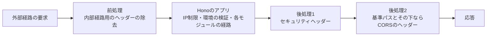

# 公開REST APIの骨格

Honoと`@hono/zod-openapi`でCloudflare Workersに載せる公開REST APIの基準パスと版、経路の登録、検証失敗の応答、成功応答の形式とページング、認証方式の宣言、OpenAPI仕様の配信、及びCORSの規則を定める。

## 前提と用語

層構成・合成ルート・共通エラーと共通のエラー形式・ミドルウェアの順序は「[Cloudflare Workersでの層構成と依存性の組み立て](002-layered-architecture-on-workers.md)」に、Worker単位のIP制限は「[レート制限とbot判定の検証](003-rate-limiting-and-bot-verification.md#worker単位のip制限)」に従う。外部経路の要求の前処理と応答の後処理の全体、及びセキュリティヘッダーの値は「[内部経路とセキュリティヘッダー](006-internal-gateway.md)」に記載する。

経路の定義と検証規則はZod、経路の登録とOpenAPI仕様の生成は`@hono/zod-openapi`の`OpenAPIHono`を使う。部品の置き場所は、アプリの`src/`からのパスで示す。

| 部品                                                                                                | 置き場所                                    | 役割                                                                 |
| --------------------------------------------------------------------------------------------------- | ------------------------------------------- | -------------------------------------------------------------------- |
| `PUBLIC_API_BASE_PATH`・`OPENAPI_DOCUMENT_PATH`                                                     | `presentation/rest/public-api-app.ts`       | 基準パスと、仕様の経路(基準パスからの相対)                           |
| `createPublicApiApp`・`PublicApiApp`・`PublicRestRoutes`                                            | `presentation/rest/public-api-app.ts`       | 経路を登録するアプリと、検証失敗・本文の誤りの変換                   |
| `API_KEY_SECURITY_SCHEME`・`API_KEY_SECURITY`・`registerApiKeySecurityScheme`                       | `presentation/rest/public-api-app.ts`       | APIキーによるBearer認証の方式の宣言                                  |
| `dataEnvelope`・`offsetListEnvelope`・`cursorListEnvelope`・`ErrorEnvelopeSchema`・`errorResponses` | `presentation/rest/responses.ts`            | 成功応答とエラー応答のスキーマ部品                                   |
| `createRouteTable`・`PublicRouteTable`                                                              | `presentation/rest/route-table.ts`          | 登録済みの経路から、パスごとに受け付けるメソッドを求める表           |
| `createPublicApiCorsPolicy`                                                                         | `presentation/rest/cors-policy.ts`          | 公開APIのCORSのヘッダーの算出                                        |
| `createRestModule`                                                                                  | `presentation/rest/rest-module.ts`          | 経路・認証方式・仕様の経路・プリフライトを登録し、基準パスへマウント |
| `createPublicEntrypoint`・`CorsPolicy`                                                              | `presentation/gateway/public-entrypoint.ts` | 外部経路の応答へのCORSとセキュリティヘッダーの付与                   |
| `REST_ROUTES`                                                                                       | `composition/rest-routes.ts`                | 公開REST APIの経路の登録箇所                                         |

| 用語                   | 意味                                                                         |
| ---------------------- | ---------------------------------------------------------------------------- |
| 外部経路               | インターネットから直接届く経路                                               |
| `<公開RESTの基準パス>` | 公開REST APIの全経路を置く、版付きのパス(`PUBLIC_API_BASE_PATH`の値)         |
| `<仕様の経路>`         | OpenAPI仕様を配信する、基準パスからの相対のパス(`OPENAPI_DOCUMENT_PATH`の値) |
| `<仕様書の既定の情報>` | 登録箇所から指定しなかったときに使う、OpenAPI仕様の`info`の題名と版          |

## 基準パスと版

- 公開REST APIの全経路を`<公開RESTの基準パス>`の下に置く。基準パスは版を含み、ヘルスチェックなど基盤の経路と衝突させない。
- 基準パスは1つの定数`PUBLIC_API_BASE_PATH`で、経路の登録・仕様書の`servers`・CORSの判定の全てがこの値を使う。
- 経路の定義のパスは基準パスを含めずに書く。`createRestModule`が経路を登録したアプリを基準パスへマウントする。

## 経路の登録

経路は、`PublicApiApp`へ登録する関数(`PublicRestRoutes`)を作り、合成ルートの`src/composition/rest-routes.ts`の`REST_ROUTES`に加えるだけで公開する。骨格の処理は変えない。次は記事を1件返す経路の例である。

```typescript
import { createRoute, z } from '@hono/zod-openapi';

import type { GetArticle } from '../../application/article/get-article.ts';
import { ARTICLE_TYPES } from '../../application/article/types.ts';
import {
  API_KEY_SECURITY,
  type PublicRestRoutes,
} from '../rest/public-api-app.ts';
import { dataEnvelope, errorResponses } from '../rest/responses.ts';

const articleSchema = z.object({
  id: z.string(),
  title: z.string(),
  published_at: z.iso.datetime(),
});

const getArticleRoute = createRoute({
  method: 'get',
  path: '/articles/{id}',
  security: [...API_KEY_SECURITY],
  request: {
    params: z.object({
      id: z.string().min(1, '記事の識別子を指定してください。'),
    }),
  },
  responses: {
    200: {
      description: '記事',
      content: { 'application/json': { schema: dataEnvelope(articleSchema) } },
    },
    ...errorResponses([400, 401, 404]),
  },
});

export const registerArticlePublicRoutes: PublicRestRoutes<Env> = (api) => {
  api.openapi(getArticleRoute, async (c) => {
    const getArticle = c
      .get('container')
      .get<GetArticle>(ARTICLE_TYPES.GetArticle);
    const article = await getArticle.execute(c.req.valid('param').id);
    return c.json({ data: article }, 200);
  });
};
```

```typescript
import { registerArticlePublicRoutes } from '../presentation/article/public-routes.ts';
import type { PublicRestRoutes } from '../presentation/rest/public-api-app.ts';

export const REST_ROUTES: readonly PublicRestRoutes<Env>[] = [
  registerArticlePublicRoutes,
];
```

- 経路は`createRoute`で定義し、`api.openapi`で登録する。同じ定義から、要求の検証・OpenAPI仕様・CORSの経路の表が作られる。パスの変数は`{name}`で書く。
- 素の`api.get`などで登録した経路、`hide: true`を付けた経路、`OpenAPIHono`でない子のアプリの経路は、仕様にも経路の表にも入らない。経路の表に無いパスへのCORSは`OPTIONS`だけを許すため、ブラウザからの呼び出しがプリフライトで拒否される。ブラウザから呼ぶ経路に`hide`を使わない。
- 経路を子の`OpenAPIHono`に分けるときは、子に全ての経路を登録してから`api.route(<パス>, <子>)`で加える。加えた位置のパスで仕様と経路の表に入る。
- プリフライトは骨格が応答するため、経路で`OPTIONS`を登録しない。
- 要求の検証を経路ごとのフック(`api.openapi`の第3引数)で上書きしない。上書きすると、検証失敗が共通のエラー形式にならない。
- 登録する関数は、合成ルートがモジュールの読み込み時に1回だけ呼ぶ。処理単位ごとの状態を関数の外に置かず、経路の処理では文脈変数`container`からユースケースを取得する(「[モジュール](002-layered-architecture-on-workers.md#モジュール)」)。
- 経路を追加したら、OpenAPI仕様の取得をWorkers統合テストで確かめる(「[OpenAPI仕様の配信](#openapi仕様の配信)」)。

## 検証失敗の応答

`createPublicApiApp`のアプリは、要求の検証失敗と本文の誤りを共通エラー(`AppError`)に変える。応答は基盤の例外の変換が共通のエラー形式で返し、エラートラッキングへは送らない。

| 状況                                                         | 状態コード | エラーコード             | 文言                                                   | `details`                                                             |
| ------------------------------------------------------------ | ---------- | ------------------------ | ------------------------------------------------------ | --------------------------------------------------------------------- |
| パスの変数・クエリ・本文などが検証規則に合わない             | 400        | `validation_error`       | 「入力内容を確認してください。」                       | 項目ごと。`field`はZodの問題のパスを`.`で連結した値(最上位なら空文字) |
| 本文をJSONとして解析できない(空の本文を含む)                 | 400        | `validation_error`       | 「入力内容を確認してください。」                       | `field`は空文字、`code`は`invalid_json`                               |
| 本文を受け取る経路で`Content-Type`が`application/json`でない | 415        | `unsupported_media_type` | 「Content-Typeにapplication/jsonを指定してください。」 | なし                                                                  |
| 基準パスの下の未登録の経路・登録済みの経路の未登録のメソッド | 404        | `not_found`              | 基盤の定型                                             | なし                                                                  |

- `details`の`code`・`message`はZodの問題のコードと文言である。利用者へ出る規則には、日本語の文言を必ず指定する(`z.string().max(100, '100文字以内で入力してください。')`など)。指定しないとZodの既定の英語の文言が`details`の`message`に出る。
- 要求本文はJSONだけを受け付ける。`@hono/zod-openapi`は本文の解析の失敗と`Content-Type`の不一致をHonoの`HTTPException`(400・415)で投げ、基盤はこれを想定外の例外として500にするため、アプリの`onError`が`AppError`へ変えて再送出する。`HTTPException`の400は全てJSONの解析の失敗として扱うため、フォームなどJSON以外の本文を受け付ける経路を作らない。
- `Content-Type`の不一致は`AppError`(`kind: 'unsupported_media_type'`)に変え、415で返す。
- それ以外の`HTTPException`と、`AppError`でない例外は想定外の例外として500になり、エラートラッキングへ送られる(「[例外の投げ方](002-layered-architecture-on-workers.md#例外の投げ方)」)。

## 成功応答の形式とページング

応答本文のキーはsnake_caseとし、データは`data`に、一覧のページングの情報は`meta`に入れる。`responses.ts`のスキーマ部品で、項目のスキーマから応答のスキーマを作る。

| 形式               | 部品                         | 本文                                                                           |
| ------------------ | ---------------------------- | ------------------------------------------------------------------------------ |
| 単体               | `dataEnvelope(<項目>)`       | `{ "data": <項目> }`                                                           |
| オフセット型の一覧 | `offsetListEnvelope(<項目>)` | `{ "data": [<項目>], "meta": { "total", "page", "per_page", "total_pages" } }` |
| カーソル型の一覧   | `cursorListEnvelope(<項目>)` | `{ "data": [<項目>], "meta": { "has_next", "next_cursor" } }`                  |

```json
{
  "data": [{ "id": "a1", "title": "最初の記事" }],
  "meta": { "has_next": true, "next_cursor": "eyJpZCI6ImExIn0" }
}
```

- オフセット型の`meta`は、`total`・`total_pages`が0以上、`page`・`per_page`が1以上の整数である。
- カーソル型の`meta`は、最後のページなら`has_next`が`false`、`next_cursor`が`null`である。
- ページングの引数(クエリ)の検証規則は骨格が持たず、各経路が定義する。
- エラー応答は`errorResponses([<状態コード>...])`で経路の`responses`に加える。指定した状態コードだけが、説明と共通のエラー形式のスキーマ(仕様書の部品`ErrorEnvelope`)付きで仕様に載る。指定できる状態コードは`AppError`の種類の状態コード(400・401・403・404・409・413・415・422・429・503)である。本文を受け取る経路は、`Content-Type`の不一致の415も加える。

## 認証方式の宣言

- `createRestModule`は、APIキーによるBearer認証(`type: http`・`scheme: bearer`)を`API_KEY_SECURITY_SCHEME`の名前で仕様書の`securitySchemes`に登録する。
- 認証を求める経路は、`createRoute`の`security`に`[...API_KEY_SECURITY]`を指定する。仕様の上でその経路が認証方式を参照する。
- 宣言は仕様書への記載だけで、APIキーの検証は行わない。認証の処理は、経路のミドルウェアとして別に実装する。
- 公開REST APIはAPIキーを`Authorization`ヘッダーで受け取り、Cookieによる認証を受け付けない。

## OpenAPI仕様の配信

| メソッド | 経路                               | 応答                     |
| -------- | ---------------------------------- | ------------------------ |
| GET      | `<公開RESTの基準パス><仕様の経路>` | 200、OpenAPI 3.1.0のJSON |

- 認証を求めない。IP制限の対象で、超過時は429になる。
- 仕様には、`REST_ROUTES`で登録した全ての経路と認証方式が載る。内部経路やGraphQLなど、他のモジュールの経路は載らない。経路が1つも無ければ、仕様の経路だけを公開し、仕様の`paths`は空になる。
- 仕様は要求ごとに生成する。生成に失敗すると、`@hono/zod-openapi`が例外の内容をそのまま500で返し、共通のエラー形式にもエラートラッキングにも乗らない。経路を追加したら、仕様の取得が200になり追加した経路が載ることをテストで確かめる。

### 相対のサーバーで基準パスを示す理由

仕様書の`servers`は`[{ "url": "<公開RESTの基準パス>" }]`(相対)である。

- 経路は基準パスにマウントした子のアプリに登録されるため、仕様書の`paths`は基準パスを含まない。`servers`が無いと、仕様を読む試行の画面やコード生成がオリジンの直下(基準パスの外)を呼んでしまう。
- 相対の`servers`は仕様書の場所に対して解決されるため、ローカル環境・デプロイ先環境のどこで配信しても、同じ値で`<オリジン><公開RESTの基準パス>/<経路>`を指す。絶対URLにすると、環境ごとのオリジンを設定に持つ必要がある。

### 仕様書の情報の指定

- 仕様書の`info`(題名・版・説明)は、Workerの入口を組み立てる合成ルートのファイルで`createRestModule(REST_ROUTES, { info: { title, version, description } })`として指定する。`description`は省略できる。
- 指定しなければ`<仕様書の既定の情報>`(題名と版、説明なし)を使う。指定すると既定の情報を全て置き換え、項目ごとに既定の値と合成しない。
- `createRestModule`はWorkerの入口を組み立てる合成ルートのファイルで1回だけ呼び、戻り値の`module`を`createWorkerApp`の`modules`へ(`[...MODULES, module]`。`MODULES`には含めない)、`routeTable`をCORSの方針へ渡す。アプリに載せる経路・`info`を渡すインスタンス・CORSの経路の表を同じ登録から作るためである。経路の表は`createRestModule`の中で、全ての経路を登録した後に作られる。

## CORS

公開REST APIは、利用者が自分のWebサイトのブラウザから呼び出せるよう、基準パスとその下への全ての応答にCORSのヘッダーを付ける。

| ヘッダー                           | 値                                                                                                   |
| ---------------------------------- | ---------------------------------------------------------------------------------------------------- |
| `Access-Control-Allow-Origin`      | `*`                                                                                                  |
| `Access-Control-Allow-Methods`     | 要求のパスに一致する経路のメソッド(`GET`・`POST`・`PUT`・`PATCH`・`DELETE`の順)と`OPTIONS`           |
| `Access-Control-Allow-Headers`     | `Authorization`。パスが`POST`・`PUT`・`PATCH`のいずれかを受け付けるなら`Authorization, Content-Type` |
| `Access-Control-Max-Age`           | `600`                                                                                                |
| `Access-Control-Allow-Credentials` | 付けない                                                                                             |
| `Access-Control-Expose-Headers`    | 付けない                                                                                             |

- 対象は、成功・検証失敗・未登録の経路の404・IP制限の429・環境の検証の失敗や想定外の例外の500・プリフライトを含む、基準パスとその下への全ての応答である。基準パスの外(GraphQL・内部経路・ヘルスチェックなど)の応答には付けない。
- 任意のオリジンを許す代わりに資格情報を許さない。公開REST APIはCookieを使わないためである。
- メソッドは経路の表(`createRouteTable`)で求める。表は仕様の経路と`api.openapi`で登録した経路から作り、仕様の経路は`GET`として含める。パスの変数`{name}`は`/`を含まない空でない1つの区切りに一致し、それ以外の文字は文字どおりに比べる。末尾の`/`は正規化しない。未登録のパスは`OPTIONS`だけになる。
- プリフライト(`OPTIONS`)には、基準パスの下のどのパスでも、認証を求めずに204で応答する。
- 判定に使うのはURLのパスだけで、クエリと断片は見ない。

### Honoの外で付ける理由

ミドルウェアの順序は共通ライブラリの`createWorkerApp`だけが定め、Worker単位のIP制限の429と環境の検証の失敗の500は、モジュールの経路より前で返る(「[ミドルウェアの順序](002-layered-architecture-on-workers.md#ミドルウェアの順序)」)。モジュールの中でHonoの`cors`ミドルウェアを掛けても、これらの応答には付かない。そこで、Workerの既定のエクスポートを`createPublicEntrypoint`で包み、Honoの処理が返した全ての応答に後からCORSのヘッダーを付ける。



- 後処理は、セキュリティヘッダーを付けてからCORSのヘッダーを付ける。セキュリティヘッダーの付与は、ヘッダーを書き換えられない応答を複製して返すため、その結果へ続けて書き込める。前処理と後処理の全体は「[内部経路とセキュリティヘッダー](006-internal-gateway.md)」に記載する。
- CORSの方針(`CorsPolicy`)はURLを受け取り、付けるヘッダーの組か、対象外なら`undefined`を返す。返すヘッダーの組は凍結されている。

## テスト

- 経路はWorkers統合テストで、`createRestModule`の`module`を`createWorkerApp`に載せたアプリへ要求して確かめる。
- 経路を追加したら、仕様の取得(200と追加した経路・認証方式が載ること)、検証失敗の400と`details`、追加した経路のパスへのCORSの`Access-Control-Allow-Methods`を確かめる。
- CORSとセキュリティヘッダーは、`createPublicEntrypoint`で包んだハンドラーへ要求して確かめる。
