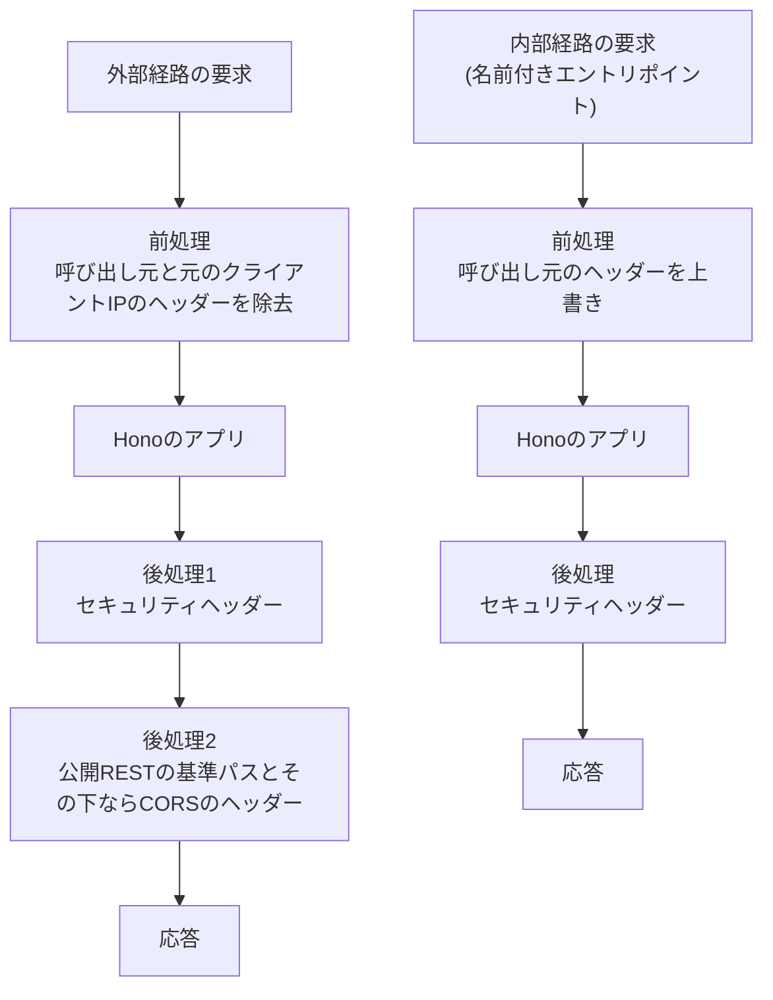

# 内部経路とセキュリティヘッダー

Cloudflare Workersで、他のWorkerからService Bindingsの名前付きエントリポイントを経て届く内部経路と、インターネットから届く外部経路を分ける方法を定める。名前付きエントリポイントによる内部認証、呼び出し元の判定、元のクライアントIPアドレスの扱い、セッション識別子の受け渡しと指示、内部RESTの追加規約、Honoの中の順序とHonoの外の前処理・後処理、及びセキュリティヘッダーの値とCSPの置き換え方を扱う。

## 前提と用語

層構成・合成ルート・処理単位のコンテナ・共通エラー・ミドルウェアの順序は「[Cloudflare Workersでの層構成と依存性の組み立て](002-layered-architecture-on-workers.md)」に、Worker単位のIP制限とクライアントIPの解決の差し替えは「[レート制限とbot判定の検証](003-rate-limiting-and-bot-verification.md)」に従う。GraphQLの受付経路は「[GraphQLサーバーの基盤](004-graphql-server.md)」に、公開REST APIとCORSは「[公開REST APIの骨格](005-public-rest-api.md)」に、フロントエンドサーバーとの間の要求の形式とヘッダーの値の一覧は「[GraphQL通信](../coding/004-graphql-communication.md)」に記載する。

部品の置き場所は、アプリの`src/`からのパスで示す。

| 部品                                                                                                 | 置き場所                                                    | 役割                                                                         |
| ---------------------------------------------------------------------------------------------------- | ----------------------------------------------------------- | ---------------------------------------------------------------------------- |
| `CALLER_KINDS`・`CallerKind`・`GATEWAY_HEADERS`・`SESSION_RESPONSE_HEADERS`                          | `presentation/gateway/gateway-headers.ts`                   | 呼び出し元の種類と、中継ヘッダー・指示ヘッダーの名前                         |
| `markInternalRequest`・`stripGatewayHeaders`・`readInternalCaller`・`parseClientIp`                  | `presentation/gateway/internal-request.ts`                  | 呼び出し元のヘッダーの上書き・除去・読み取りと、IPアドレスの解釈             |
| `resolveGatewayClientIp`                                                                             | `presentation/gateway/internal-request.ts`                  | 内部経路と外部経路でのクライアントIPの解決                                   |
| `createGatewayEntrypointClass`                                                                       | `presentation/gateway/gateway-entrypoint.ts`                | 呼び出し元を固定した名前付きエントリポイントのクラス                         |
| `createPublicEntrypoint`・`CorsPolicy`                                                               | `presentation/gateway/public-entrypoint.ts`                 | 外部経路の前処理と後処理(既定のエクスポート)                                 |
| `INTERNAL_ROUTE_PREFIX`・`InternalRoutes`・`createInternalRoutesModule`                              | `presentation/gateway/internal-only.ts`                     | 内部RESTのモジュール                                                         |
| `internalOnly`・`warnOnMissingClientIp`・`createNotFoundError`                                       | `presentation/gateway/internal-only.ts`                     | 内部経路だけを受け付ける判定と、元のクライアントIPアドレスの欠落・不正の警告 |
| `createSessionAccess`・`applySessionInstructions`・`SessionAccess`                                   | `presentation/gateway/session-access.ts`                    | セッションの検証の呼び出しと、Cookieの指示の応答ヘッダーへの反映             |
| `SessionVerifier`・`SESSION_TYPES`・`SESSION_TOKEN_PATTERN`・`Principal`・`SessionIssue`             | `application/session/session-verifier.ts`                   | セッションの検証のポートと型                                                 |
| `AnonymousSessionVerifier`                                                                           | `application/session/anonymous-session-verifier.ts`         | 常に無効と判定する既定の実装                                                 |
| `INTERNAL_ROUTES`                                                                                    | `composition/internal-routes.ts`                            | 内部RESTの経路の登録箇所                                                     |
| `SESSION_BINDINGS`                                                                                   | `composition/session.ts`                                    | セッションの検証の実装の束縛                                                 |
| `SECURITY_HEADERS`・`DEFAULT_CONTENT_SECURITY_POLICY`・`applySecurityHeaders`・`withSecurityHeaders` | `<共通ライブラリの配置先>/workers/http/security-headers.ts` | 全応答へのセキュリティヘッダーの付与                                         |

| 用語                                 | 意味                                                                                                                                       |
| ------------------------------------ | ------------------------------------------------------------------------------------------------------------------------------------------ |
| フロントエンドサーバー               | 利用者側・管理者側の画面を配信し、APIサーバーへの要求をService Bindingsで中継するWorker                                                    |
| 内部経路                             | フロントエンドサーバーからService Bindingsの名前付きエントリポイントを経て届く経路                                                         |
| 外部経路                             | インターネットから直接届く経路。Workerの既定のエクスポートが受け取る                                                                       |
| 呼び出し元                           | 内部経路の要求を送ったフロントエンドサーバーの種類(`CallerKind`)。利用者側と管理者側の2つ                                                  |
| ローカル環境・デプロイ先環境         | 「[環境種別](../infra/002-environments.md)」のローカル環境と、デプロイ先検証環境・本番環境                                                 |
| GraphiQLの要求                       | 「[GraphQLサーバーの基盤](004-graphql-server.md#前提と用語)」と同じ。ローカル環境で、内部経路の呼び出し元を持たずにGraphQLの経路へ届く要求 |
| 中継ヘッダー                         | フロントエンドサーバーが内部経路の要求に付ける、元のクライアントIPアドレス・セッション識別子・bot判定のトークンのヘッダー                  |
| 指示ヘッダー                         | APIサーバーが内部経路の応答に付ける、フロントエンドサーバーへのCookieの発行・削除の指示のヘッダー                                          |
| `<アプリ名>`                         | 「[ログ管理とエラートラッキング](../infra/004-logging-and-error-tracking.md#カテゴリ)」と同じ。ログのカテゴリの先頭                        |
| `<利用者側のエントリポイント名>`     | 利用者側の呼び出し元を固定した名前付きエントリポイントのクラス名                                                                           |
| `<管理者側のエントリポイント名>`     | 管理者側の呼び出し元を固定した名前付きエントリポイントのクラス名                                                                           |
| `<バインディング名>`                 | 呼び出し側のWorkerが名前付きエントリポイントを呼ぶService Bindingsのバインディングの名前                                                   |
| `<APIサーバーのWorker名>`            | 名前付きエントリポイントをエクスポートするWorkerの名前(Wrangler設定の`name`)                                                               |
| `<内部RESTの接頭辞>`                 | 内部経路だけで受け付けるRESTの経路を置くパス(`INTERNAL_ROUTE_PREFIX`の値)                                                                  |
| `<GraphQLの経路>`                    | 「[GraphQLサーバーの基盤](004-graphql-server.md#前提と用語)」と同じ                                                                        |
| `<公開RESTの基準パス>`               | 「[公開REST APIの骨格](005-public-rest-api.md#前提と用語)」と同じ                                                                          |
| `<ヘルスチェックの経路>`             | 「[Cloudflare Workersでの層構成と依存性の組み立て](002-layered-architecture-on-workers.md#前提と用語)」と同じ                              |
| `<呼び出し元のヘッダー>`             | 名前付きエントリポイントが付ける、呼び出し元の種類のヘッダー(`GATEWAY_HEADERS.caller`)                                                     |
| `<元のクライアントIPのヘッダー>`     | フロントエンドサーバーが付ける、利用者の端末のIPアドレスのヘッダー(`GATEWAY_HEADERS.clientIp`)                                             |
| `<セッション識別子のヘッダー>`       | フロントエンドサーバーが付ける、ブラウザのセッションのCookieの値のヘッダー(`GATEWAY_HEADERS.sessionToken`)                                 |
| `<bot判定のトークンのヘッダー>`      | フロントエンドサーバーが付ける、bot判定のトークンのヘッダー(`GATEWAY_HEADERS.botToken`)                                                    |
| `<デバッグ用の呼び出し元のヘッダー>` | GraphiQLの要求でだけ読む、呼び出し元の指定のヘッダー(`GATEWAY_HEADERS.debugCaller`)                                                        |
| `<セッションの発行のヘッダー>`       | 新しいセッション識別子を渡す指示ヘッダー(`SESSION_RESPONSE_HEADERS.issue`)                                                                 |
| `<セッションの有効期間のヘッダー>`   | 発行するCookieの有効期間(秒)を渡す指示ヘッダー(`SESSION_RESPONSE_HEADERS.maxAge`)                                                          |
| `<セッションの削除のヘッダー>`       | Cookieの削除を指示する指示ヘッダー(`SESSION_RESPONSE_HEADERS.clear`)                                                                       |

- ヘッダーの名前は小文字で定義する。HTTPのヘッダーは大文字と小文字を区別せず、`Headers`は小文字の名前を返すためである。

## 名前付きエントリポイントによる内部認証

内部経路の呼び出し元は、要求のヘッダーや本文ではなく、呼び出し側のWorkerのService Bindingsの設定で決まる。APIサーバーは呼び出し元ごとに名前付きエントリポイント(`WorkerEntrypoint`を継承したクラス)をエクスポートし、呼び出し側はWrangler設定の`entrypoint`でクラス名を指定する。

```jsonc
{
  "services": [
    {
      "binding": "<バインディング名>",
      "service": "<APIサーバーのWorker名>",
      "entrypoint": "<利用者側のエントリポイント名>",
    },
  ],
}
```

- 名前付きエントリポイントは、同じアカウントのWorkerがService Bindingsで指定したときだけ呼び出せ、インターネットからは届かない。どのクラスに届いたかが、呼び出し元の唯一の根拠になる。
- エントリポイントのクラスは`createGatewayEntrypointClass(<呼び出し元の種類>, <Workerのハンドラー>)`で作り、エントリ`src/index.ts`で`<利用者側のエントリポイント名>`・`<管理者側のエントリポイント名>`の名前を付けて名前付きでエクスポートする。クラス名は呼び出し側のWrangler設定との契約であり、変えるときは呼び出し側と同時に変える。
- クラスの`fetch`は、要求の`<呼び出し元のヘッダー>`をクラスの呼び出し元の種類で上書きしてから(`markInternalRequest`)内側のハンドラーへ渡し、応答にセキュリティヘッダーを付ける。環境と`ExecutionContext`はエントリポイントの`this.env`・`this.ctx`を渡す。
- 内側のハンドラーは、既定のエクスポートの包み(`createPublicEntrypoint`)を掛ける前の`createWorkerHandler`の結果である。外部経路の前処理(ヘッダーの除去)を通さないため、元のクライアントIPアドレスのヘッダーが内側へ届く。
- エントリポイントのクラスには`fetch`以外の公開メソッドを定義しない。Service Bindingsの呼び出し側は公開メソッドをRPCとして呼べるため、メソッドを加えると、呼び出し元の判定・IP制限・処理単位のコンテナを経ない入口になる。
- `fetch`を持たないハンドラーを渡すと、クラスの作成時に例外になる。

## 呼び出し元の判定

Honoの中では、呼び出し元を`readInternalCaller(request)`だけで判定する。`<呼び出し元のヘッダー>`の値が呼び出し元の種類(`CALLER_KINDS`)のいずれかならその種類を、無いか種類に無い値なら`undefined`(外部経路)を返す。ヘッダーを直接読まない。

| 届いた入口               | 前処理                                                           | `readInternalCaller`の結果 |
| ------------------------ | ---------------------------------------------------------------- | -------------------------- |
| 名前付きエントリポイント | `<呼び出し元のヘッダー>`をクラスの呼び出し元で上書き             | クラスの呼び出し元         |
| 既定のエクスポート       | `<呼び出し元のヘッダー>`・`<元のクライアントIPのヘッダー>`を除去 | `undefined`                |

- どちらの入口も、要求が名乗った`<呼び出し元のヘッダー>`をHonoへ渡さない。外部経路で呼び出し元を名乗っても内部経路として扱われず、利用者側の名前付きエントリポイントへ管理者側を名乗る要求を送っても利用者側として扱われる。
- Workerの`fetch`を受け取る入口を加えるときは、必ずどちらかの前処理を通す。前処理を通らない入口があると、要求が名乗った呼び出し元が信頼される。
- 前処理は`new Request(<要求>, { headers })`で要求を複製し、`cf`の情報(接続元の国など)を保つ。本文のストリームは複製へ移るため、後続は複製だけを読む。
- 外部経路で応じる経路は次に限る。

| 経路                           | 外部経路の応答                                                                            |
| ------------------------------ | ----------------------------------------------------------------------------------------- |
| `<ヘルスチェックの経路>`       | 200                                                                                       |
| `<公開RESTの基準パス>`とその下 | 公開REST API・OpenAPI仕様・プリフライト(「[公開REST APIの骨格](005-public-rest-api.md)」) |
| `<GraphQLの経路>`              | ローカル環境ではGraphiQLの要求として応答し、デプロイ先環境では404                         |
| `<内部RESTの接頭辞>`とその下   | 環境を問わず404                                                                           |
| その他                         | 404                                                                                       |

- 外部経路へ返す404は、未登録の経路と同じ定型(`not_found`の共通のエラー形式。`createNotFoundError`)にし、経路の存在を明かさない。

## 元のクライアントIPアドレスの扱い

内部経路の要求の接続元は、利用者の端末ではなくフロントエンドサーバーである。フロントエンドサーバーが利用者の端末のIPアドレスを`<元のクライアントIPのヘッダー>`で引き継ぎ、APIサーバーは内部経路でだけその値を信頼する。`createWorkerApp`の`resolveClientIp`に`resolveGatewayClientIp`を渡して解決する(「[クライアントIPの解決の差し替え](003-rate-limiting-and-bot-verification.md#クライアントipの解決の差し替え)」)。

| 経路     | クライアントIP                                                                                                      |
| -------- | ------------------------------------------------------------------------------------------------------------------- |
| 内部経路 | `<元のクライアントIPのヘッダー>`の値をIPv4・IPv6のアドレスとして解釈できればその値。無い・空・解釈できなければ不明  |
| 外部経路 | 接続元のIPアドレス(`resolveConnectingIp`)。`<元のクライアントIPのヘッダー>`は前処理で除去済みで、名乗っても使わない |

- 内部経路かどうかは`readInternalCaller`が呼び出し元を返すかで判定する。外部経路のGraphiQLの要求も接続元のIPアドレスを使う。
- 内部経路の要求の接続元のIPアドレスは使わない。中継元のフロントエンドサーバーのIPアドレスになり得るためである。
- 解釈はZodの`z.ipv4()`・`z.ipv6()`で行い、表記を正規化しない。同じアドレスの別の表記(IPv6の省略の有無など)は、IP制限で別のキーとして数えられる。
- 解決した値は、Worker単位のIP制限のキー、bot判定の検証で送る送信元IP、処理単位の情報、GraphQLの文脈の`clientIp`に使われる。不明の要求は、IP制限で全て同じキーとして数えられ、上限を共有する(「[規約](003-rate-limiting-and-bot-verification.md#規約)」)。
- 内部経路でヘッダーが無い・解釈できないときは、警告のログを1件出し、要求は処理を続ける。値はログに含めない。警告は内部RESTのモジュール(`<内部RESTの接頭辞>`の下の未登録の経路を含む)と、GraphQLの受付経路の判定の後に出し、外部経路の要求では出さない。

| 項目     | 値                                                                                                                                   |
| -------- | ------------------------------------------------------------------------------------------------------------------------------------ |
| カテゴリ | `[<アプリ名>, 'gateway', 'client-ip']`                                                                                               |
| レベル   | `warning`                                                                                                                            |
| 文言     | 「元のクライアントIPアドレスがありません」(`reason: 'missing'`)、「元のクライアントIPアドレスを解釈できません」(`reason: 'invalid'`) |
| 属性     | `reason`・`caller`                                                                                                                   |

- フロントエンドサーバーは、ブラウザからの要求の`<元のクライアントIPのヘッダー>`をそのまま転送せず、自身が受け取った接続元のIPアドレスで必ず上書きする。ブラウザが名乗った値を転送すると、内部経路で信頼されてIP制限を回避される。
- 中継ヘッダーは、エラートラッキングへ送るイベントの要求のヘッダーから除く(「[個人情報と秘密情報の除去](../infra/004-logging-and-error-tracking.md#個人情報と秘密情報の除去)」)。

## セッションの受け渡しと指示

セッション識別子はAPIサーバーが生成・検証し、フロントエンドサーバーはCookieの保持・発行・削除と中継だけを行う。フロントエンドサーバーはブラウザのセッションのCookieの値を`<セッション識別子のヘッダー>`で渡し、APIサーバーはCookieの発行・削除を指示ヘッダーで返す。

### 要求と応答の項目

| 方向 | ヘッダー                           | 形式                                                                           | 意味                                                               |
| ---- | ---------------------------------- | ------------------------------------------------------------------------------ | ------------------------------------------------------------------ |
| 要求 | `<呼び出し元のヘッダー>`           | 呼び出し元の種類(`CALLER_KINDS`の値)                                           | 名前付きエントリポイントが付ける。フロントエンドサーバーは付けない |
| 要求 | `<元のクライアントIPのヘッダー>`   | IPv4・IPv6のアドレスの文字列                                                   | 利用者の端末のIPアドレス                                           |
| 要求 | `<セッション識別子のヘッダー>`     | 32バイトの乱数をパディング無しのbase64urlにした43文字(`SESSION_TOKEN_PATTERN`) | ブラウザのセッションのCookieの値。Cookieが無ければ付けない         |
| 要求 | `<bot判定のトークンのヘッダー>`    | bot判定のサービスが発行したトークン                                            | bot判定の検証に使う(「[bot判定](004-graphql-server.md#bot判定)」)  |
| 応答 | `<セッションの発行のヘッダー>`     | `SESSION_TOKEN_PATTERN`に合う43文字                                            | この値でセッションのCookieを発行する                               |
| 応答 | `<セッションの有効期間のヘッダー>` | 1以上の整数の10進表記(秒)                                                      | 発行するCookieの有効期間。発行のヘッダーと必ず組で付く             |
| 応答 | `<セッションの削除のヘッダー>`     | `1`                                                                            | セッションのCookieを削除する                                       |

- 発行と削除のヘッダーは同じ応答に同時に付かない。どちらも付かなければ、Cookieを変えない。
- フロントエンドサーバーは指示ヘッダーをCookieの操作に変え、ブラウザへ返す応答から取り除く。新しいセッション識別子は応答本文に含めない。
- ヘッダーの名前と値の本プロジェクトでの一覧、及びフロントエンドサーバーの側の処理は「[GraphQL通信](../coding/004-graphql-communication.md)」に記載する。

### 検証の呼び出し

経路の処理は`createSessionAccess({ container, caller, token })`で処理単位ごとのセッションの参照(`SessionAccess`)を作り、次のメソッドを使う。GraphQLでは受付経路が作り、文脈の`session`としてリゾルバへ渡す。

| メソッド                 | 振る舞い                                                                                                                                   |
| ------------------------ | ------------------------------------------------------------------------------------------------------------------------------------------ |
| `principal()`            | ログイン中の主体(`authenticated`)か未ログイン(`anonymous`)を返す。最初の呼び出しで1回だけ検証し、以降は同じ結果を返す                      |
| `requireAuthenticated()` | ログイン中の主体を返す。未ログインなら`AppError`(`kind: 'unauthenticated'`・コード`unauthenticated`・文言「ログインが必要です。」)を投げる |
| `issue(<発行>)`          | 新しいセッション識別子と有効期間(秒)の発行を指示する                                                                                       |
| `clear()`                | Cookieの削除を指示する                                                                                                                     |

- 検証の種類は呼び出し元で決まる。利用者側の要求は利用者のセッションとして、管理者側の要求は管理者のセッションとしてだけ、処理単位のコンテナから取得した`SessionVerifier`の`verify`へ問い合わせる。
- トークンが無い、または`SESSION_TOKEN_PATTERN`に合わなければ、`verify`を呼ばずに未ログインとする。
- `verify`が無効(`invalid`)と判定すれば未ログインとし、削除を指示する。有効(`valid`)で更新(`renewal`)があれば、その値の発行を指示する。
- 主体を参照しない処理では検証を行わず、検証による指示も出ない。
- 未ログインの共通エラーは、GraphQLでは`unauthenticated`のコードを持つ200の応答、RESTでは401の共通のエラー形式になる。

### 指示の優先順位

- 経路の処理(リゾルバ)の指示どうしは、最後の指示が有効になる。
- 経路の処理が`issue`・`clear`を指示した後は、検証の結果(無効による削除・更新による発行)で上書きしない。ログインやログアウトの処理の中で元のセッションを検証しても、経路の処理の指示を打ち消さないためである。
- 検証の後に経路の処理が指示すれば、経路の処理の指示が有効になる。

### 応答ヘッダーへの反映

`applySessionInstructions(<セッションの参照>, <応答のヘッダー>)`が、有効な指示を指示ヘッダーとして書き込み、指示の無い側の指示ヘッダーを取り除く。指示が無ければヘッダーを変えない。

- 発行の値が`SESSION_TOKEN_PATTERN`に合わない、または有効期間が1以上の整数でなければ、ヘッダーを設定せずに`RangeError`を投げる。値をそのまま応答ヘッダーへ書くため、注入を防ぐ。例外のメッセージに値を含めない。
- `createSessionAccess`で作った参照だけを受け付け、それ以外を渡すと`TypeError`になる。
- 書き込むヘッダーは書き換えられるものにする。`fetch`の結果など書き換えられない応答は、ヘッダーを複製して応答を作り直してから反映する。
- セッション識別子は応答本文・ログ・エラーレポートに含めない。エラートラッキングのイベントの要求のヘッダーからは`<セッション識別子のヘッダー>`が除かれる。ログの属性名による伏せ字は、名前に`token`を含む属性(`sessionToken`など)を部分一致で丸ごと伏せるが、値の形式による伏せ字はセッション識別子の形式を検出しない(「[伏せ字の規則](../infra/004-logging-and-error-tracking.md#伏せ字の規則)」)。セッション識別子の値を、名前に`token`を含まない属性・ログの文言・例外のメッセージに入れない。

### 検証の実装の差し替え

`SessionVerifier`の実装は`src/composition/session.ts`の`SESSION_BINDINGS`で`SESSION_TYPES.SessionVerifier`に束縛し、`MODULES`へ`{ name: 'session', bindings: SESSION_BINDINGS }`として加える。

- 認証の機能が無い間は`AnonymousSessionVerifier`を束縛する。常に無効と判定するため、全ての要求が未ログインになり、形式に合うトークンを渡した要求で主体を参照すると削除の指示が出る。
- 認証の機能を加えるときは、束縛先を自身の実装に替えるだけで、受付経路とリゾルバの処理を変えない。実装は保存済みのセッションと照合し、主体の`sessionId`には保存したレコードのIDを入れ、セッション識別子そのものを入れない。

## 内部RESTの追加規約

GraphQL以外で内部経路だけから呼ぶ経路(ファイルの中継先など)は、`<内部RESTの接頭辞>`の下に置く。`InternalRoutes`(Honoのアプリへ経路を登録する関数)を作り、`src/composition/internal-routes.ts`の`INTERNAL_ROUTES`に加えるだけで公開する。

```typescript
import type { FindDownload } from '../../application/download/find-download.ts';
import { DOWNLOAD_TYPES } from '../../application/download/types.ts';
import { GATEWAY_HEADERS } from '../gateway/gateway-headers.ts';
import type { InternalRoutes } from '../gateway/internal-only.ts';
import { readInternalCaller } from '../gateway/internal-request.ts';
import {
  applySessionInstructions,
  createSessionAccess,
} from '../gateway/session-access.ts';

export const registerDownloadInternalRoutes: InternalRoutes<Env> = (app) => {
  app.get('/downloads/:id', async (c) => {
    const caller = readInternalCaller(c.req.raw);
    if (caller === undefined) {
      throw new Error('内部経路の呼び出し元がありません');
    }
    const session = createSessionAccess({
      container: c.get('container'),
      caller,
      token: c.req.header(GATEWAY_HEADERS.sessionToken),
    });
    const principal = await session.requireAuthenticated();
    const download = await c
      .get('container')
      .get<FindDownload>(DOWNLOAD_TYPES.FindDownload)
      .execute(principal.subjectId, c.req.param('id'));
    const response = c.json({ data: download });
    applySessionInstructions(session, response.headers);
    return response;
  });
};
```

```typescript
import type { InternalRoutes } from '../presentation/gateway/internal-only.ts';
import { registerDownloadInternalRoutes } from '../presentation/download/internal-routes.ts';

export const INTERNAL_ROUTES: readonly InternalRoutes<Env>[] = [
  registerDownloadInternalRoutes,
];
```

- 経路のパスは`<内部RESTの接頭辞>`を含めずに書く。`createInternalRoutesModule`が接頭辞のサブアプリに登録してマウントする。
- サブアプリは、登録した経路より先に、外部経路の要求を404にする判定(`internalOnly`)と、元のクライアントIPアドレスの欠落・不正の警告(`warnOnMissingClientIp`)を掛ける。経路で同じ判定を重ねない。外部経路からは、登録した経路も未登録の経路も同じ404になる。
- 呼び出し元は`readInternalCaller`で読む。`internalOnly`を通った後は常に値があるが、型の上は`undefined`を含むため、無ければ想定外の例外にする。
- セッションを使う経路は、`createSessionAccess`で参照を作り、返す応答のヘッダーへ`applySessionInstructions`で指示を反映する。共通エラーを投げて終えると、例外の変換が作った応答には指示が載らない。上の例の`requireAuthenticated()`も未ログインなら共通エラーを投げるため、この場合に当たる。検証で無効と判定したセッションの削除の指示も返らないため、Cookieの削除まで必要な経路は、`principal()`で判定して未ログインの応答も経路の中で作る。
- エラーの応答は共通のエラー形式にする。JSONの成功応答は公開REST APIと同じ規則(本文のキーはsnake_case、データは`data`)に従う。ファイルの中継など、JSONでない本文を返す経路はこの規則の対象外である。経路の存在を明かさない必要は内部経路には無く、未登録の経路は通常の404になる。
- 内部RESTの経路はOpenAPI仕様に載らず、CORSのヘッダーも付かない。
- 経路を追加したら、内部経路で応答し、外部経路で404になることをWorkers統合テストで確かめる。

## 前処理と後処理の順序

要求はHonoの外の前処理、Honoの中のミドルウェアと経路、Honoの外の後処理の順に通る。Honoの外の処理は入口ごとに異なり、Honoの中の処理は両方の入口で同じアプリを使う。

### Honoの外の前処理・後処理



| 入口                                                            | 前処理                | 後処理                                      |
| --------------------------------------------------------------- | --------------------- | ------------------------------------------- |
| 既定のエクスポート(`createPublicEntrypoint`)                    | `stripGatewayHeaders` | `applySecurityHeaders`→CORSの方針のヘッダー |
| 名前付きエントリポイント(`createGatewayEntrypointClass`)        | `markInternalRequest` | `applySecurityHeaders`                      |
| HTTPの外部経路と内部経路を分けないWorker(`withSecurityHeaders`) | なし                  | `applySecurityHeaders`                      |

- Honoの外で付けるのは、IP制限の429・環境の検証の失敗の500・ヘルスチェック・未登録の経路の404など、モジュールの経路より前や外で返る応答にも付けるためである(「[ミドルウェアの順序](002-layered-architecture-on-workers.md#ミドルウェアの順序)」)。
- 後処理は、セキュリティヘッダーを付けてからCORSのヘッダーを付ける。セキュリティヘッダーの付与は、ヘッダーを書き換えられない応答を複製して返すため、その結果へ続けて書き込める。逆の順では、書き換えられない応答へCORSのヘッダーを書くときに例外になる。
- 後処理は内側のハンドラーが返した応答にだけ掛かる。内側が例外を投げると、セキュリティヘッダーの無い失敗になる。Honoのアプリは想定外の例外も例外の変換で500の応答にするため、内側のハンドラーはHonoのアプリを持つ`createWorkerHandler`の結果にする。
- `scheduled`・`queue`は前処理・後処理を通さずにそのまま委ねる。
- 前処理・後処理の包みは`createWorkerHandler`の結果の外側に掛ける。エラートラッキングのHonoの計装はアプリを直接計装するため、外側の包みは例外の捕捉に影響しない。

### Honoの中の順序

Honoの中のミドルウェアは「[ミドルウェアの順序](002-layered-architecture-on-workers.md#ミドルウェアの順序)」のとおりで、処理単位の文脈を作る段階で`resolveGatewayClientIp`がクライアントIPを解決する。そのため、内部経路のIP制限は元のクライアントIPアドレスで数えられる。モジュールの経路の中は次の順に処理する。

| 経路                           | 順序                                                                                                                                                                                                                    |
| ------------------------------ | ----------------------------------------------------------------------------------------------------------------------------------------------------------------------------------------------------------------------- |
| `<GraphQLの経路>`              | 受付経路の判定(内部経路→GraphiQLの要求→404)→元のクライアントIPアドレスの警告→処理単位の範囲(セッションの参照など)の作成→本文の上限→Yogaの実行→後処理(キャッシュの禁止・セッションの指示・GraphiQLの画面のCSP・操作ログ) |
| `<内部RESTの接頭辞>`とその下   | 内部経路の判定(外部経路なら404)→元のクライアントIPアドレスの警告→登録した経路                                                                                                                                           |
| `<公開RESTの基準パス>`とその下 | 「[公開REST APIの骨格](005-public-rest-api.md)」                                                                                                                                                                        |

- GraphQLの受付経路の詳細は「[受付経路](004-graphql-server.md#受付経路)」に記載する。
- 経路の後処理で応答を差し替えるときは、Honoの`c.res`へ`undefined`を代入してから新しい応答を代入する。`c.res`への代入は、前の応答のヘッダーを新しい応答へ上書きで写すため、前の応答の`Cache-Control`や`Content-Security-Policy`が後処理の値を戻してしまう。
- Honoは経路の例外を例外の変換で応答にしてから、外側のミドルウェアの`next()`を返す。経路に掛けたミドルウェアの`await next()`の後の処理は、共通のエラー形式の応答にも掛かる。

## セキュリティヘッダー

全ての応答(エラー・IP制限の超過・ヘルスチェック・プリフライトを含む)に、ブラウザ向けのセキュリティヘッダーを付ける。

### 付与する値

| ヘッダー                    | 値                                                                                                                                                                                                                                                                      |
| --------------------------- | ----------------------------------------------------------------------------------------------------------------------------------------------------------------------------------------------------------------------------------------------------------------------- |
| `Strict-Transport-Security` | `max-age=31536000; includeSubDomains`                                                                                                                                                                                                                                   |
| `X-Content-Type-Options`    | `nosniff`                                                                                                                                                                                                                                                               |
| `Referrer-Policy`           | `same-origin`                                                                                                                                                                                                                                                           |
| `Permissions-Policy`        | `accelerometer=(), autoplay=(), camera=(), display-capture=(), encrypted-media=(), fullscreen=(), geolocation=(), gyroscope=(), magnetometer=(), microphone=(), midi=(), payment=(), publickey-credentials-get=(), screen-wake-lock=(), usb=(), xr-spatial-tracking=()` |
| `Content-Security-Policy`   | `default-src 'none'; base-uri 'none'; form-action 'none'; frame-ancestors 'none'`(`DEFAULT_CONTENT_SECURITY_POLICY`。応答が既に持てば置き換えない)                                                                                                                      |

- `Content-Security-Policy`以外は、応答が持つ値を常に上書きする。経路が変えることはできない。
- `Permissions-Policy`は、APIの応答が使わないブラウザの機能(カメラ・マイク・位置情報・決済など)を全て無効にする。
- APIの応答はHTMLを返さないため、既定のCSPは全ての読み込みを禁止し、他のサイトのフレームへの埋め込みも禁止する。

### CSPの置き換え方

既定のCSPは、経路の応答に`Content-Security-Policy`を設定するだけで置き換えられる。他のセキュリティヘッダーは、置き換えたCSPの応答にも付く。

```typescript
app.get('/preview', (c) =>
  c.html(renderPreview(), 200, {
    'Content-Security-Policy': [
      "default-src 'none'",
      "base-uri 'none'",
      "form-action 'none'",
      "frame-ancestors 'none'",
      "style-src 'self'",
      "img-src 'self' data:",
    ].join('; '),
  }),
);
```

- 置き換えたCSPにも`frame-ancestors 'none'`を含める。既定のCSPと`default-src 'none'`・`base-uri 'none'`・`form-action 'none'`から始め、画面に必要な読み込みだけを足す。
- 置き換えは応答ごとに行う。同じ経路でもHTMLの画面の応答だけを置き換え、JSONやエラーの応答は既定のCSPのままにする。
- 後処理で応答を作り直す経路は、置き換えたCSPを作り直した応答に設定する(「[Honoの中の順序](#honoの中の順序)」の`c.res`の注意)。
- 例: GraphiQLの画面の応答は、GraphiQLのCDN(`https://unpkg.com`)から本体・スタイル・エディタのワーカーを読み込み、インラインのスクリプトで起動するため、既定のCSPの4つの指令に次の指令を足したCSP(`GRAPHIQL_CONTENT_SECURITY_POLICY`)に置き換える。GraphiQLの他の応答(操作の結果のJSON)は既定のCSPのままである。

| 指令          | 値                                         |
| ------------- | ------------------------------------------ |
| `script-src`  | `'self' 'unsafe-inline' https://unpkg.com` |
| `style-src`   | `'self' 'unsafe-inline' https://unpkg.com` |
| `font-src`    | `'self' data: https://unpkg.com`           |
| `img-src`     | `'self' data:`                             |
| `connect-src` | `'self' https://unpkg.com`                 |
| `worker-src`  | `blob:`                                    |

### 付与する箇所

| Worker                                     | 付与する包み                                                                                             |
| ------------------------------------------ | -------------------------------------------------------------------------------------------------------- |
| 外部経路と内部経路を分けるWorker           | 既定のエクスポートの`createPublicEntrypoint`と、名前付きエントリポイントの`createGatewayEntrypointClass` |
| HTTPの入口が既定のエクスポートだけのWorker | 既定のエクスポートを`withSecurityHeaders(createWorkerHandler(...))`で包む                                |

- `applySecurityHeaders(<応答>)`は、ヘッダーを書き換えられる応答にはそのまま書き込んで同じ応答を返し、書き換えられない応答(`fetch`の結果・`Response.redirect`など)は状態と本文を保った複製に書き込んで返す。戻り値の応答を返す。
- `withSecurityHeaders`は`fetch`の応答にだけ適用し、`scheduled`・`queue`はそのまま委ねる。`fetch`を持たないハンドラーはそのまま返す。

## テスト

- 名前付きエントリポイントのクラスは、`createGatewayEntrypointClass`で作ったクラスを`new <クラス>(<ExecutionContext>, <環境>)`で直接作り、`fetch`を呼んで確かめる。実際の結線は、`cloudflare:workers`の`exports`のエントリポイントと既定のエクスポートを呼んで確かめる。
- Workers統合テストのWrangler設定はローカル環境のため、デプロイ先環境の振る舞いは環境を上書きして確かめる。上書きした環境では、名前付きエントリポイントの代わりに内側のハンドラーへ`markInternalRequest`で印を付けた要求を渡し、応答に`applySecurityHeaders`を掛けて呼ぶ。
- 外部経路では、呼び出し元と元のクライアントIPアドレスを名乗るヘッダーを付けた要求が内部経路として扱われず、接続元のIPアドレスで数えられることを確かめる。
- セキュリティヘッダーは、成功・エラー・IP制限の429・ヘルスチェック・プリフライト・想定外の例外の500の応答で確かめる。
- セッションの指示とクライアントIPの警告は、ログの出力にセッション識別子とIPアドレスの値が含まれないことを確かめる。
