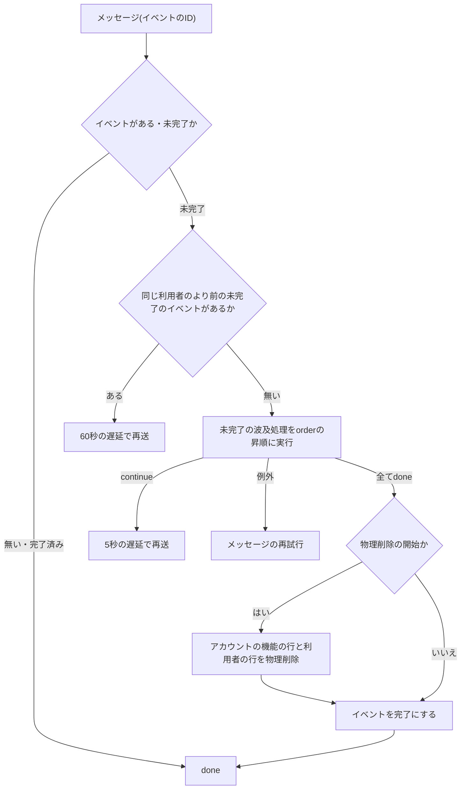
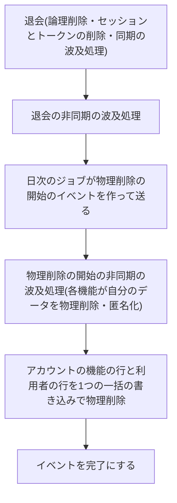

# ユーザーライフサイクルイベント

利用者の退会・停止・停止解除・物理削除の開始を、各機能が自分のデータに反映する仕組みを定める。イベントの種類、同期と非同期の波及処理の登録と契約、同期の波及処理が返す文の規約、非同期の波及処理の冪等性・続き・順序、再試行と送り直しと運用者への通知、物理削除の段階と外部キー、及び他の機能が利用者の情報を読む契約を扱う。非同期メッセージと定期実行の仕組みは「[非同期処理の設計](../infra/003-async-processing.md)」に、層構成は「[Cloudflare Workersでの層構成と依存性の組み立て](002-layered-architecture-on-workers.md)」に従う。

## 前提と用語

利用者の状態の遷移(退会・停止・停止解除)はAPIサーバーが確定し、非同期の波及処理と物理削除はメッセージを受信するアプリが実行する。部品の置き場所は、共通ライブラリの配置先、`<APIサーバーのアプリ>`・`<メッセージを受信するアプリ>`の`src/`からのパスで示す。

| 部品                                                                                                              | 置き場所                                                                                       | 役割                                                                 |
| ----------------------------------------------------------------------------------------------------------------- | ---------------------------------------------------------------------------------------------- | -------------------------------------------------------------------- |
| `USER_LIFECYCLE_EVENT_TYPES`・`UserLifecycleEvent`・`UserLifecycleAsyncHandler`・`UserLifecycleAsyncRegistration` | 共通ライブラリの`core/identity/user-lifecycle.ts`                                              | イベントの型と非同期の波及処理の契約                                 |
| `createAsyncLifecycleRegistry`・`assertLifecycleHandlerName`・`LifecycleRegistrationError`                        | 共通ライブラリの`core/identity/user-lifecycle.ts`                                              | 非同期の波及処理の登録の検証と、種類ごとの実行順の一覧               |
| `USER_LIFECYCLE_RETRY_POLICY`・`LIFECYCLE_CONTINUE_DELAY_SECONDS`                                                 | 共通ライブラリの`core/identity/user-lifecycle.ts`                                              | 再試行の規則と、続きの再開までの秒数                                 |
| `UserLifecycleStore`・`USER_LIFECYCLE_EVENT_STATUSES`                                                             | 共通ライブラリの`core/identity/ports.ts`(実装は`workers/identity/d1-user-lifecycle-store.ts`)  | イベントと波及処理の完了の記録                                       |
| `RUN_USER_LIFECYCLE_MESSAGE`                                                                                      | 共通ライブラリの`core/messaging/contracts/identity.ts`                                         | イベントの非同期の波及処理を起こすメッセージ(本文はイベントのIDだけ) |
| `UserLifecycleSyncHandler`・`UserLifecycleSyncRegistration`                                                       | `<APIサーバーのアプリ>`の`infrastructure/identity/user-lifecycle-sync-handler.ts`              | 同期の波及処理の契約                                                 |
| `createD1UserLifecycleCommitter`                                                                                  | `<APIサーバーのアプリ>`の`infrastructure/identity/d1-user-lifecycle-committer.ts`              | 状態の遷移・イベントの記録・同期の波及処理の一括の書き込み           |
| `USER_LIFECYCLE_SYNC_HANDLERS`                                                                                    | `<APIサーバーのアプリ>`の`composition/user-lifecycle-sync-handlers.ts`                         | 同期の波及処理の登録箇所                                             |
| `UserLifecycleRunner`・`LIFECYCLE_ORDER_WAIT_SECONDS`                                                             | `<メッセージを受信するアプリ>`の`application/identity/user-lifecycle-runner.ts`                | 非同期の波及処理の実行器                                             |
| `USER_LIFECYCLE_ASYNC_HANDLERS`                                                                                   | `<メッセージを受信するアプリ>`の`composition/user-lifecycle-async-handlers.ts`                 | 非同期の波及処理の登録箇所                                           |
| `D1IdentityPurgeStore`                                                                                            | `<メッセージを受信するアプリ>`の`infrastructure/identity/d1-identity-purge-store.ts`           | アカウントの機能の行と利用者の行の物理削除                           |
| `PurgeOrchestratorJob`・`LifecycleRedispatchJob`                                                                  | `<APIサーバーのアプリ>`の`application/identity/jobs/`                                          | 物理削除の開始と、未完了のイベントの送り直しの日次のジョブ           |
| `IDENTITY_PLATFORM_TYPES`・`IDENTITY_PLATFORM_MODULE`                                                             | 共通ライブラリの`core/identity/identifiers.ts`・`workers/identity/identity-platform-module.ts` | 他の機能が利用者の情報を読む契約の識別子と共通の束縛                 |

| 用語             | 意味                                                                                                                                                |
| ---------------- | --------------------------------------------------------------------------------------------------------------------------------------------------- |
| 波及処理         | 利用者の状態の遷移を受けて、各機能が自分のデータに行う処理(「[非同期処理の設計](../infra/003-async-processing.md#前提と用語)」のイベントの波及処理) |
| 同期の波及処理   | 状態の遷移と同じ一括の書き込みで確定する波及処理。APIサーバーに登録する                                                                             |
| 非同期の波及処理 | 状態の遷移の確定後に、メッセージの処理で実行する波及処理。メッセージを受信するアプリに登録する                                                      |
| アカウントの機能 | 利用者のテーブルを所有し、状態の遷移とイベントを発行する機能                                                                                        |
| 物理削除の開始   | 退会から一定の日数が経った利用者の、全てのデータの物理削除を始めること                                                                              |
| 未完了のイベント | 状態が`pending`のイベント。全ての非同期の波及処理(物理削除の開始では最後の物理削除も)が終わると`completed`になる                                    |

## イベントの種類

| 種類(`type`)  | 起きること                             | 同期の波及処理 | 非同期の波及処理 |
| ------------- | -------------------------------------- | -------------- | ---------------- |
| `withdrawn`   | 退会(本人による退会と運営者による退会) | 登録できる     | 登録できる       |
| `suspended`   | 停止                                   | 登録できる     | 登録できる       |
| `unsuspended` | 停止の解除                             | 登録できる     | 登録できる       |
| `purge_due`   | 物理削除の開始                         | 登録できない   | 登録できる       |

- 退会のイベントは、本人による退会と運営者による退会で同じ`withdrawn`である。どちらの退会も論理削除・全セッションと未使用の認証系トークンの削除・同期と非同期の波及処理を同じ処理で行い、イベントは誰が退会させたかを持たない。波及処理は退会の経路で処理を分けない。
- 停止中の利用者も退会できる。退会は終端の状態で、退会済みの利用者は停止・停止の解除ができない(対象が存在しない旨を返す)。既に同じ状態への停止・停止の解除は、イベントを作らずに何もしない。
- 波及処理へ渡すイベントは、ID(ULID)・利用者のID・種類・発生日時(`occurredAt`)だけを持つ。メールアドレスなどの個人情報を含めない。

## 状態の遷移の確定

状態の遷移は`createD1UserLifecycleCommitter`の`commit`で、次の文を1つの一括の書き込み(`db.batch()`)で確定する。

1. イベントの挿入。利用者の版(`lifecycle_version`)が読んだ時点と同じときだけ`user_id`に値が入り、変わっていればNOT NULL制約の違反で全体を取り消す(「[版の検査で一括の書き込み全体を取り消す](../db/002-d1-constraints.md#版の検査で一括の書き込み全体を取り消す)」)。
2. 利用者の行の更新(版を1増やし、退会は論理削除、停止・停止の解除は状態)。
3. 退会のときだけ、アカウントの機能の行の削除(全セッション・未使用の認証系トークン・第2要素の待ち)。
4. 登録した同期の波及処理が返した文(登録の順)。

- 版の競合は、失敗の種類`conflict`のエラー`account_state_conflict`にする。いずれかの文が失敗したら、状態の遷移・イベント・全ての波及処理の変更が取り消される。
- 確定の後に、イベントのIDを本文にした`RUN_USER_LIFECYCLE_MESSAGE`を送る。送信に失敗しても確定済みの操作は失敗させず、ログと運用者への通知(レベル`error`)に残す。イベントは未完了のまま残り、送り直しのジョブが送る(「[送り直し](#送り直し)」)。

## 同期の波及処理

### 登録

`<APIサーバーのアプリ>`の`USER_LIFECYCLE_SYNC_HANDLERS`へ、名前・対象の種類・処理の識別子を追記する。

```typescript
export const USER_LIFECYCLE_SYNC_HANDLERS: readonly UserLifecycleSyncRegistration[] =
  [
    {
      name: '<spec名>.<名詞句>',
      events: ['withdrawn'],
      handler: PRODUCT_TYPES.ProductWithdrawalHandler,
    },
  ];
```

- 名前の形式は「[波及処理とジョブの名前](#波及処理とジョブの名前)」に従う。名前の形式の誤りと重複は、組み立ての時に`LifecycleRegistrationError`で拒否する。
- 対象の種類に`purge_due`は指定できない。物理削除は非同期の波及処理で行う。
- 処理の識別子は、処理単位のコンテナに束縛する。束縛し忘れた識別子は、その種類の状態の遷移を確定する時に初めて例外になるため、登録と同じ変更で、遷移の確定を通すWorkers統合テストを加える。

### 文の規約

```typescript
export interface UserLifecycleSyncHandler {
  statementsFor(
    event: UserLifecycleEvent,
    db: Database,
  ): Promise<readonly BatchItem<'sqlite'>[]>;
}
```

- `statementsFor`は、状態の遷移と同じ一括の書き込みに入れる文を返す。読み取りはしてよいが、書き込みは返す文だけで行い、`statementsFor`の中で書き込まない。
- 文は、利用者のIDを条件にした集合に対する更新にし、行ごとの文を返さない。

```sql
UPDATE products SET deleted_at = ? WHERE user_id = ? AND deleted_at IS NULL
```

- 行ごとの文を返すと、行の数だけ一括の書き込みが大きくなり、読み取りから確定までの間に増えた行を取りこぼす。集合に対する更新は、確定の時点の全ての行に効く。
- 外部サービスの呼び出しや、確定を待てない処理を同期の波及処理に入れない。一括の書き込みが取り消されても、外部への作用は取り消せない。外部への作用は非同期の波及処理で行う。
- 同期の波及処理は1回の確定で1回だけ実行される。条件に現在の状態(`deleted_at IS NULL`など)を含め、同じ利用者への後の遷移と食い違わないようにする。

## 非同期の波及処理

### 登録

`<メッセージを受信するアプリ>`の`USER_LIFECYCLE_ASYNC_HANDLERS`へ、名前・対象の種類・実行順・処理の識別子を追記する。

```typescript
export const USER_LIFECYCLE_ASYNC_HANDLERS: readonly UserLifecycleAsyncRegistration[] =
  Object.freeze([
    {
      name: '<spec名>.<名詞句>',
      events: ['withdrawn', 'purge_due'],
      order: 300,
      handler: PRODUCT_EVENT_TYPES.ProductPurgeHandler,
    },
  ]);
```

- `createAsyncLifecycleRegistry`は、名前の形式の誤り・名前の重複・整数でない`order`・`events`の中の種類の重複・同じ種類での`order`の重複を`LifecycleRegistrationError`で拒否する。
- `order`は同じ種類の中での実行順(昇順)である。0〜9999は各機能の波及処理に、10000以上はアカウントの機能自身の波及処理に充て、各機能の波及処理の後にアカウントの機能の処理を動かす。範囲は検査しないため、コードレビューで確かめる。
- 処理の識別子は、メッセージを受信するアプリの処理単位のコンテナに束縛し、メッセージの処理ごとに解決する。

### 契約

```typescript
export type LifecycleHandlerOutcome =
  { readonly kind: 'done' } | { readonly kind: 'continue' };

export interface UserLifecycleAsyncHandler {
  handle(event: UserLifecycleEvent): Promise<LifecycleHandlerOutcome>;
}
```

- 冪等にする。メッセージの配送は少なくとも1回で、再試行・送り直し・続きの再開で、同じイベントの同じ波及処理が複数回呼ばれ得る。2回目以降の呼び出しでも結果が変わらないよう、条件付きの更新・存在しない対象の無視などで書く(「[重複配信と冪等性](../infra/003-async-processing.md#重複配信と冪等性)」)。
- 1回の呼び出しで終わらない処理は、上限の件数だけ処理して`continue`を返す。実行器は5秒(`LIFECYCLE_CONTINUE_DELAY_SECONDS`)の遅延で同じ波及処理を呼び直す。進み具合は実行器が持たず、波及処理が自分のデータ(残っている行の有無など)で判断する。
- 全て終えたら`done`を返す。実行器が波及処理ごとに完了を記録し、完了済みの波及処理を同じイベントで再び呼ばない。
- 失敗は例外で投げる。実行器は例外を捕まえず、メッセージの再試行に任せる(「[再試行と運用者への通知](#再試行と運用者への通知)」)。
- 退会の後の処理は、利用者の行が論理削除されて残っている前提で読める。物理削除の後に送り直されたメッセージもあり得るため、利用者の行が無ければ`done`を返す。

### 順序

- 同じ利用者のイベントは、発生日時の順(同じ時刻ならIDの昇順)に処理する。実行器は、同じ利用者のより前の未完了のイベントがあれば、後のイベントを60秒(`LIFECYCLE_ORDER_WAIT_SECONDS`)の遅延で待たせる。
- 異なる利用者の間の順序は保証しない。
- 1つのイベントの波及処理は、`order`の昇順に1つずつ実行する。ある波及処理が`continue`を返したら、後の波及処理はその波及処理が`done`を返すまで始めない。

### 実行の流れ



### 再試行と運用者への通知

- 例外で終わったメッセージは、`USER_LIFECYCLE_RETRY_POLICY`(最大5回の試行、遅延は300秒から倍にし上限3600秒)で再試行する(「[再試行](../infra/003-async-processing.md#再試行)」)。完了の記録が残るため、再試行は未完了の波及処理から続く。
- 再試行を使い切ったメッセージはデッドレターになり、基盤がエラートラッキングへ送る(「[デッドレター](../infra/003-async-processing.md#デッドレター)」)。イベントは未完了のまま記録に残る。

### 送り直し

日次のジョブ(`LifecycleRedispatchJob`)が、未完了のまま残ったイベントのメッセージを送り直す。

| 項目           | 値                                                                                                                                              |
| -------------- | ----------------------------------------------------------------------------------------------------------------------------------------------- |
| 対象           | 最後の送信から1時間以上経った未完了のイベント(最後の送信の古い順)                                                                               |
| 1回の件数      | 100件(`REDISPATCH_LIMIT`)。残りは翌日に続ける                                                                                                   |
| 記録           | 送信に成功したイベントの送信の回数を1増やし、最後の送信の日時を更新する                                                                         |
| 運用者への通知 | 送り直す前の送信の回数が3以上(`STUCK_REDISPATCH_ORDINAL`。3回目以降の送り直し)のイベントを含むとき、レベル`error`でイベントのIDを添えて通知する |

- 送信の回数は、状態の遷移の確定の後の最初の送信を1と数える。
- 送信に失敗したイベントは回数と日時を変えず、翌日の起動が再び拾う。
- 送り直しの時刻は、送り直した波及処理と同じデータを扱う他の日次のジョブと重ならない時刻にする。同じ時刻に動くと、波及処理とジョブが同じ行を並行して書き換え得る。
- 送り直しのジョブは、物理削除の開始のメッセージの送信の失敗も拾う。物理削除の期限までに送り直しの起動が1回以上入るよう、物理削除の開始の時刻と送り直しの時刻を決める。

## 物理削除

### 段階



1. 日次のジョブ(`PurgeOrchestratorJob`)が、退会の業務日付が実行日の13業務日前以前(`PURGE_START_AFTER_BUSINESS_DAYS`)で、物理削除を始めていない退会済みの利用者を、退会の古い順に1回50件(`PURGE_CANDIDATE_LIMIT`)まで選ぶ。残りは翌日に続ける。
2. 選んだ利用者ごとに物理削除の開始のイベント(`purge_due`)を作って送る。イベントは利用者ごとに1件だけで、部分一意索引で重複を防ぐ。送信の失敗はイベントを未完了のまま残し、送り直しのジョブが送る。
3. 各機能の`purge_due`の非同期の波及処理が、その利用者の自分のデータを物理削除か匿名化する。
4. 全ての波及処理が完了したら、実行器がアカウントの機能の行(リカバリコード・多要素認証の設定・第2要素の待ち・認証系トークン・セッション・波及処理の完了の記録・イベント)と利用者の行を、子の行から順に1つの一括の書き込みで物理削除する。利用者の行が消えると、ハンドルなどの一意の値を他の利用者が使えるようになる。
5. 同じ日次のジョブが、論理削除から14日(`PURGE_DEADLINE_MS`)を過ぎても利用者の行が残る退会済みの利用者を、物理削除の開始の有無によらず数え、1件以上ならレベル`error`で件数だけを運用者へ通知する。個人情報を通知に含めない。

- 退会の日を経過時間ではなく業務日付で数える。経過時間で数えると、退会の時刻と日次のジョブの時刻の組み合わせで、期限までの再試行の余地が数分まで縮み得る。
- 仮名化したIDだけを持つ監査ログと決済の記録は、物理削除の対象にしない。
- 物理削除でイベントの行も消えるため、物理削除の後に届いたメッセージは「イベントが無い」で`done`になる。

### 外部キー

- 利用者のIDを持つ各機能のテーブルは、利用者のテーブルを外部キーで参照してよい。外部キーには`ON DELETE`の動作を指定しない(既定の`NO ACTION`)。D1は外部キーの制約を既定で検査する。
- 各機能は`purge_due`の波及処理で、利用者を参照する自分の行を先に消す。消し残しがあれば段階4の物理削除が外部キーの違反で失敗し、イベントは未完了のまま残る。メッセージの再試行と送り直しを経て、期限の超過として運用者へ通知される。
- `ON DELETE CASCADE`を使わない。カスケードで行が消えると、波及処理の消し残しが検出されず、行を手がかりに消すべき他のデータ(オブジェクトストレージのファイルなど)が取り残される。
- 外部キーを持たないデータ(外部キーを張らない列・オブジェクトストレージ・KV・外部サービスに置いたデータなど)は、段階4で取り残しを検出できない。そのデータを持つ機能の波及処理が、取り残しの検出に責任を持つ。例えば、利用者のデータを列挙して全て消せたことを確かめてから`done`を返し、消し切れなければ`continue`か例外にして、完了を記録させない。

## 波及処理とジョブの名前

波及処理(同期・非同期)と定期実行のジョブの名前の規約は、「[非同期処理の設計](../infra/003-async-processing.md#前提と用語)」の「ジョブ・イベントの波及処理の名前」に従う。登録の検査(`assertLifecycleHandlerName`)も同じ規則で名前を確かめる。

## 利用者の情報の参照

利用者のテーブルの列は、アカウントの機能の外から直接読まない。他の機能は次の契約を`@inject`で受け取る。契約と識別子は共通ライブラリの`core/identity/`に、D1の実装と束縛は`workers/identity/`に置く。

| 識別子(`IDENTITY_PLATFORM_TYPES`) | 契約                      | 用途                                                                                          |
| --------------------------------- | ------------------------- | --------------------------------------------------------------------------------------------- |
| `UserContactDirectory`            | `findContact(userId)`     | 通知のメールの宛先・宛名・確認済みかどうか。退会済み・物理削除済みは`undefined`、停止中は返す |
| `AccountExport`                   | `find(userId)`            | 利用者のデータのエクスポートに含めるアカウントの項目                                          |
| `AdminUserDirectory`              | `search`・`findByIds`など | 管理者の画面の利用者の検索と一覧                                                              |

- 共通の束縛`IDENTITY_PLATFORM_MODULE`を、APIサーバーとメッセージを受信するアプリの両方のモジュールの一覧へ加える(「[モジュール](002-layered-architecture-on-workers.md#モジュール)」)。どちらのアプリでも同じ識別子で解決できる。
- 契約はアプリケーション層からも読める`core`に置く。アプリケーション層は`workers`を読み込めないため、D1の実装は合成ルートの束縛だけが読む。
- 公開する一覧などで退会済み・停止中の利用者のデータを除くときは、テーブルの定義と並べて置いた絞り込みの条件(`visibleUsers()`・`verifiedUsers()`)を使い、状態の列の判定を各機能で書き直さない。
- 契約に無い項目が要るときは、各機能で列を読まず、アカウントの機能の契約に項目を足す。

## テスト

- 同期の波及処理は、状態の遷移の確定を通すWorkers統合テストで、遷移と同じ一括の書き込みで反映されることと、版の競合で取り消されることを確かめる。
- 非同期の波及処理は、同じイベントで2回呼んでも結果が変わらないこと、`continue`の後の呼び出しで続きから進むこと、利用者の行が無い場合に`done`を返すことを確かめる。
- 物理削除の波及処理を加えた機能は、自分の行が残る間は利用者の行の物理削除が外部キーの違反で失敗し、波及処理の後に成功することをWorkers統合テストで確かめる。
- `RUN_USER_LIFECYCLE_MESSAGE`の本文のイベントのIDは`z.ulid()`で検証するため、メッセージを送るテストでは正しいULIDを使う。形式の誤ったIDは本文の検証に失敗し、波及処理を呼ばずにデッドレターになる。
