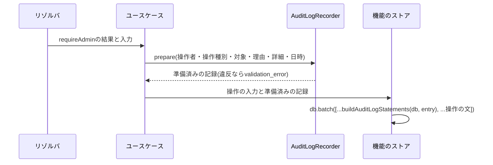

# 監査ログの記録

管理者の操作を、事後の調査に使える形で記録する仕組みを定める。操作種別の登録、記録の文を操作と同じ一括の書き込みに含める規約、個人情報を含めない規則、理由の要否、対象の記録、検索とカーソル、対象ごとの最新の日時の照会、保持期間の削除、及びテストの共有の偽物を扱う。

## 前提と用語

実行環境にCloudflare Workers、データベースにD1、ORMにDrizzle、DIコンテナにInversifyを使う構成を前提とする。層構成は「[Cloudflare Workersでの層構成と依存性の組み立て](002-layered-architecture-on-workers.md)」に、管理者の認可は「[管理者の認可の設計](../security/007-admin-authorization.md)」に、一括の書き込みとバインド変数の上限は「[Cloudflare D1の制約と対処](../db/002-d1-constraints.md)」に、日次のジョブの登録は「[ジョブの登録](../infra/003-async-processing.md#ジョブの登録)」に従う。部品の置き場所は、共用部品の配置先(`<共用部品の配置先>`)と`<APIサーバーのアプリ>`の`src/`からのパスで示す。

| 部品                                                                                                   | 置き場所                                                                         | 役割                                                                                       |
| ------------------------------------------------------------------------------------------------------ | -------------------------------------------------------------------------------- | ------------------------------------------------------------------------------------------ |
| `defineAuditAction`・`createAuditActionCatalog`・`AuditActionDefinition`・`AuditActionDefinitionError` | `<共用部品の配置先>`の`admin/audit-action.ts`                                    | 操作種別の定義の検証と、名前で引けるカタログの組み立て                                     |
| `AuditTargetKind`                                                                                      | `<共用部品の配置先>`の`admin/audit-action.ts`                                    | 対象の種類の値                                                                             |
| `AUDIT_ACTIONS`                                                                                        | `<共用部品の配置先>`の`admin/audit-actions/index.ts`                             | 操作種別の登録箇所。機能ごとのファイル(`audit-actions/<機能名>.ts`)の定義を連結する        |
| `AUDIT_REASON_MAX`・`checkAuditReason`                                                                 | `<共用部品の配置先>`の`admin/admin-input-rules.ts`                               | 理由の上限と検査(APIサーバーと画面で共有)                                                  |
| `validateAuditEntry`・`AuditEntryInput`                                                                | `domain/admin/audit-entry.ts`                                                    | 記録の入力の規則の判定                                                                     |
| `AuditLogRecorder`・`StoreAuditLogRecorder`・`PreparedAuditEntry`                                      | `application/admin/audit-log-recorder.ts`                                        | 記録の準備(`prepare`)と、単独の記録(`record`)                                              |
| `AuditLogReader`・`StoreAuditLogReader`・`AUDIT_LOG_PAGE_SIZE`                                         | `application/admin/audit-log-reader.ts`                                          | 検索と、対象ごとの最新の日時の照会                                                         |
| `AuditLogStore`                                                                                        | `application/admin/ports.ts`(実装は`infrastructure/admin/d1-audit-log-store.ts`) | 記録・検索・照会・保持期間の削除のポート                                                   |
| `buildAuditLogStatements`・`isAuditGuardRejection`・`AuditGuard`                                       | `infrastructure/admin/audit-log-statements.ts`                                   | 操作と同じ一括の書き込みに含める監査ログと対象の挿入の文、条件付きの記録の取り消しの見分け |
| `AuditLogRetentionJob`・`auditLogRetentionCutoff`                                                      | `application/admin/jobs/audit-log-retention-job.ts`                              | 保持期間を過ぎた監査ログの日次の削除                                                       |
| `createFakeAuditLogReader`                                                                             | `application/admin/testing/fake-audit-log-reader.ts`                             | 単体テストが共有する`AuditLogReader`の偽物                                                 |
| `createAuditLogRecorder`・`clearAdminTables`など                                                       | `infrastructure/admin/testing/admin-store-fixtures.ts`                           | Workers統合テストの補助                                                                    |

| 用語           | 意味                                                                                                                                  |
| -------------- | ------------------------------------------------------------------------------------------------------------------------------------- |
| 監査ログ       | 管理者の操作1回の記録。操作者のID・操作種別・対象の種類・理由・詳細・日時を持つ(`admin_audit_logs`)                                   |
| 対象の行       | 監査ログ1件の対象を1行ずつ持つ行(`admin_audit_log_targets`)。対象の種類と識別子を持ち、対象から監査ログを引く索引になる               |
| 操作種別       | 記録できる操作の名前・表示名・対象の種類・理由の要否・詳細の鍵・対象の上限の定義                                                      |
| 仮名化ID       | 利用者の登録時に生成し、利用者の物理削除の後も他の値と結び付かないUUID。監査ログで利用者を指す唯一の識別子                            |
| 準備済みの記録 | `prepare`が検証を通して返す値(`PreparedAuditEntry`)。モジュールの外から組み立てられない印を持ち、ストアは準備済みの記録だけを受け取る |

- 監査ログの操作者のIDと対象の識別子は、他のテーブルへの外部キーを持たない。管理者の削除・利用者の物理削除の後も記録を残す。

## 操作種別の登録

管理操作を加える機能は、自分の操作種別を`<共用部品の配置先>`の`admin/audit-actions/<機能名>.ts`に`defineAuditAction`で定義し、`audit-actions/index.ts`の`AUDIT_ACTIONS`へ連結する。

```typescript
export const COMMENT_HIDE_ACTION = defineAuditAction({
  name: 'comment.hide',
  label: 'コメントの非表示',
  targetKind: 'comment',
  reason: 'required',
  detailKeys: ['fromStatus'],
  maxTargets: 1,
});

export const COMMENT_AUDIT_ACTIONS: readonly AuditActionDefinition[] =
  Object.freeze([COMMENT_HIDE_ACTION]);
```

| 項目         | 規則                                                                                                                |
| ------------ | ------------------------------------------------------------------------------------------------------------------- |
| `name`       | `<対象の領域>.<動詞句>`。それぞれ英小文字で始まり、英小文字・数字・ハイフンでつなぐ(例:`admin-account.role-change`) |
| `label`      | 監査ログの一覧に出す表示名。空白だけにしない                                                                        |
| `targetKind` | `AuditTargetKind`の値か、対象を取らない操作では`null`                                                               |
| `reason`     | 理由の要否。`required`(必須)・`optional`(任意)・`none`(受け付けない)                                                |
| `detailKeys` | 詳細に入れられる鍵。英小文字で始まる英数字(キャメルケース)で、重複させない                                          |
| `maxTargets` | 1回の記録の対象の上限。1以上の整数                                                                                  |

- `defineAuditAction`と`createAuditActionCatalog`は、定義が規則に反すると`AuditActionDefinitionError`を投げる。名前の重複も拒否する。カタログはAPIサーバーのモジュールの読み込み時に`createAuditActionCatalog(AUDIT_ACTIONS)`で1回だけ組み立てるため、誤った定義はWorkerの起動とテストで必ず失敗する。
- 新しい対象の種類が要るときは、`AuditTargetKind`の型と、同じファイルの対象の種類の集合の両方に足す。管理画面の監査ログの対象の種類の表示名にも加える。
- `audit-actions/index.unit.test.ts`は登録済みの名前を完全一致で確かめる。操作種別を足す機能は期待値も更新する。
- 記録の後に登録から外した操作種別の記録も、一覧では表示名の代わりに名前で示して残す。操作種別の名前は、一度記録したら変えない。

## 記録の規約

### 操作と同じ一括の書き込みに含める

状態を変える管理操作は、操作と監査ログを1つの一括の書き込みで確定させる。片方だけが反映されて、記録の無い変更や、行われなかった操作の記録を残すことを防ぐ。



1. ユースケースは、操作の書き込みの前に`AuditLogRecorder.prepare`を呼ぶ。違反があれば操作を行わずに失敗する。
2. ストアのメソッドは準備済みの記録を引数に受け取り、`buildAuditLogStatements(db, entry)`が返す文を一括の書き込みの先頭に置き、操作の文を続ける。
3. ストアは準備済みの記録を組み立て直さず、そのまま渡す。

```typescript
async hide(commentId: string, audit: PreparedAuditEntry): Promise<void> {
  await this.db.batch([
    ...buildAuditLogStatements(this.db, audit),
    this.db
      .update(comments)
      .set({ status: 'hidden' })
      .where(eq(comments.id, commentId)),
  ]);
}
```

- `buildAuditLogStatements`は空でないタプルを返すため、そのまま`db.batch()`に展開できる。対象の行の挿入は、D1のバインド変数の上限(1文100個)と対象の行の列の数から1文16行ずつに分ける(「[バインド変数の上限](../db/002-d1-constraints.md#バインド変数の上限)」)。対象の行のIDは同じ日時から単調に増えるULIDで採番し、記録の順に並べられるようにする。
- 第3引数`guard`(`AuditGuard`)を渡すと、条件を満たさないときに監査ログの操作者のIDをNULLにしてNOT NULLの違反で一括の書き込み全体を取り消す(「[最後の最上位管理者の保護](../security/007-admin-authorization.md#最後の最上位管理者の保護)」)。ストアは`isAuditGuardRejection(error)`で取り消しを見分け、他の失敗はそのまま投げる。`AuditGuard`は管理者の削除とロール変更の条件だけを持つ。他の操作で読み取りを前提にした取り消しが要るときは、同じ方式で`AuditGuard`に種類を足す。
- 閲覧・検索のように状態を変えない操作の記録は、`AuditLogRecorder.record`で結果を返す前に単独で書く。記録に失敗したら結果を返さない。

### 準備の検証

`prepare`は、対象の識別子の重複を初出の順を保って除いてから、`validateAuditEntry`で次の順に判定し、最初の違反を`validation_error`(失敗の種類`bad_request`)で返す。

| 順  | 判定                                                   | 違反の種類                                                  | 詳細の欄  |
| --- | ------------------------------------------------------ | ----------------------------------------------------------- | --------- |
| 1   | 操作種別が登録されている                               | `unknown_action`                                            | `action`  |
| 2   | 理由の要否と上限                                       | `reason_required`・`reason_not_allowed`・`reason_too_long`  | `reason`  |
| 3   | 対象を取らない種別に対象が無い・上限以内・識別子の形式 | `targets_not_allowed`・`too_many_targets`・`invalid_target` | `targets` |
| 4   | 詳細の鍵が定義済みで、値が100書記素以内の文字列        | `invalid_detail`                                            | `detail`  |

- 違反はカテゴリ`[<APIサーバーのアプリ>, 'admin', 'audit-log']`のレベル`warning`のログに、操作種別の名前と違反の種類だけを残す。入力の値はログに出さない。
- 違反は実装の誤り(登録漏れ・入力の検証漏れ)で起きる。画面の入力の規則は、記録の規則より先に操作の入力の検証で拒否する(理由は「[理由](#理由)」の共有の規則で検証する)。
- 対象が0件の記録の対象の種類は`null`にする。

## 個人情報を含めない規則

監査ログは保持期間が長く管理者の誰もが参照できるため、個人情報と検索の文字列を残さない。

- 利用者を対象にする記録は、対象の識別子に利用者の仮名化ID(小文字のUUID)だけを使う。対象の種類が`user`の識別子はUUIDの形式でなければ拒否する。メールアドレス・ハンドル・ニックネームを対象にしない。
- 利用者以外の対象の識別子は、英数字と`._:-`の64文字までに限る。
- 利用者のメールアドレスで検索する操作は、検索の文字列を記録しない。理由と詳細を受け付けない(`reason: 'none'`・`detailKeys: []`)種別にし、対象には検索結果に表示した利用者の仮名化IDだけを入れる。
- 詳細は登録した鍵だけを受け付け、値は100書記素までの文字列にする。変更前後のロールや状態のような値を入れ、利用者の入力をそのまま入れない。
- 理由は管理者の自由記述のため、入力欄に個人情報を書かない旨を示す(画面の理由の入力欄が説明として表示する)。

## 理由

- 理由の要否は操作種別の`reason`で決める。理由の判定は空を受け付け、必須かどうかは操作種別で決める。
- 前後の空白(`\p{White_Space}`)を除いてから判定し、空なら`null`で保存する。
- 上限は`AUDIT_REASON_MAX`(500書記素)で、APIサーバーと画面が同じ共用部品の`checkAuditReason`で数え、同じ文言で示す。
- 画面の確認のダイアログと理由の入力欄は、理由の要否を操作種別に合わせる(「[管理画面の部品](../frontend/005-shared-components.md#管理画面の部品)」)。

## 検索とカーソル

`AuditLogReader.search`は、条件に合う監査ログを記録の新しい順(`occurred_at`の降順、同じ日時はIDの降順)に`AUDIT_LOG_PAGE_SIZE`(50件)ずつ返す。

| 条件              | 一致                                                         |
| ----------------- | ------------------------------------------------------------ |
| `operatorAdminId` | 操作者のIDの完全一致                                         |
| `action`          | 操作種別の名前の完全一致                                     |
| `targetId`        | 記録の対象の種類と同じ種類で、識別子が完全一致する対象を含む |
| `occurredFrom`    | その日時以降(含む)                                           |
| `occurredBefore`  | その日時より前(含まない)                                     |

- 次のページのカーソルは、各ページの最後の記録の`<エポックミリ秒>:<ID>`をパディングの無いbase64urlで表した文字列である。最後のページでは`null`を返す。
- カーソルは、再エンコードして同じ表記になるものだけを受け付け、形式が正しくなければ`invalid_cursor`で拒否する。GraphQLの引数の検証では、256文字を超えるカーソルを`validation_error`にする。
- 文字列の条件は、空文字を未指定として扱い、64文字までに限る。期間は画面が閲覧者の地域の暦で日付を日時の範囲に変えて渡す。
- 一覧の操作者のニックネームは照会口(`AdminDirectory`)で読む。削除済みの管理者のニックネームは空になり、IDだけを示す。
- 索引は`(occurred_at, id)`・`(operator_admin_id, occurred_at)`・`(action, occurred_at)`と、対象の行の`(target_kind, target_id, log_id)`・`log_id`である。条件を足すときは、索引で絞れることを確かめる。

## 最新の日時の照会

他の機能が「最後にその操作をした日時」を表示に使うときは、検索ではなく照会のメソッドを使う。

| メソッド                                           | 返す値                                                              |
| -------------------------------------------------- | ------------------------------------------------------------------- |
| `latestFor({ action, targetKind, targetId })`      | その対象のその操作種別の最新の記録の日時。記録が無ければ`undefined` |
| `latestForMany({ action, targetKind, targetIds })` | 対象の識別子から最新の日時へのMap。記録のある対象だけを含める       |

- `latestForMany`は対象の識別子の重複を除き、空なら問い合わせずに空のMapを返す。ストアは識別子を90件ずつ(操作種別と対象の種類の2つと合わせてバインド変数100個以内)に分け、分けた問い合わせを並行して実行して1つのMapにまとめる。一覧の行ごとに`latestFor`を呼ばない。
- 照会は、対象の行の`(target_kind, target_id, log_id)`の索引と監査ログの結合で、識別子ごとの`MAX(occurred_at)`を求める。
- 照会の結果は記録の有無だけを表す。対象が今も存在するかは各機能が自分のテーブルで判定する。

## 保持期間の削除

`AuditLogRetentionJob`は日次で、保持期間(3年)を過ぎた監査ログを削除する。

- 境界は`auditLogRetentionCutoff`で、起動の予定時刻のUTCの暦で3年前の同じ時刻とし、その時刻以前(含む)の記録を消す。同じ日が無い2月29日は、その月の末日へ寄せる。3年に満たない記録を消さない。
- 1回の削除は記録の古い順に500件(`AUDIT_LOG_DELETE_BATCH_SIZE`)までで、対象の行を先に、監査ログを後に、同じ並びの部分問い合わせで1つの一括の書き込みにする。1回の起動で20回(`AUDIT_LOG_DELETE_MAX_BATCHES`)まで繰り返し、残りは翌日の起動に任せる。Workerの処理時間の上限に収めるためである。
- 結果は件数・回数・上限に達したかをレベル`info`のログに、失敗はそれまでの件数とともにレベル`error`のログに残して投げ直す。カテゴリは`[<APIサーバーのアプリ>, 'admin', 'audit-log-retention']`とする(カテゴリの付け方は「[カテゴリ](../infra/004-logging-and-error-tracking.md#カテゴリ)」)。
- 保持期間の値はサービスのデータ保持期間の一覧と一致させる。

## テスト

### 利用側の単体テスト

`AuditLogReader`を使うユースケースの単体テストは、偽物を自分で書かず、共有の偽物`createFakeAuditLogReader`を使う。

```typescript
import { createFakeAuditLogReader } from '<APIサーバーのアプリ>/src/application/admin/testing/fake-audit-log-reader.ts';

const reader = createFakeAuditLogReader({
  latestForMany: () => Promise.resolve(new Map([[commentId, T0]])),
});
```

- 渡したメソッドだけを差し替え、残りは既定の振る舞い(`search`は空のページ、`latestFor`は`undefined`、`latestForMany`は空のMap)を返す。
- `AuditLogReader`にメソッドを足すときは、この偽物にも既定の振る舞いを足す。各機能の偽物を型検査で壊さないためである。
- 共有の偽物は`testing/`に置き、テストだけが読み込む。

### 記録を伴うテスト

- 準備済みの記録はモジュールの外で組み立てられないため、記録を伴うユースケースの単体テストは、本物の`StoreAuditLogRecorder`に固定の操作種別のカタログと連番のID生成を渡し、`prepare`で作る。
- Workers統合テストは`infrastructure/admin/testing/admin-store-fixtures.ts`の`createAuditLogRecorder`・`readAuditLogSummaries`・`readAuditLogTargetIds`・`clearAdminTables`で、実際のD1に書いた監査ログと対象の行を確かめる。
- 一括の書き込みの取り消しのテストでは、操作の取り消しと同時に監査ログも残らないことを確かめる。
- 利用者を対象にする記録のテストでは、UUIDの仮名化IDを使う。UUIDの形でない偽の識別子は記録の検証で拒否される。
- 保持期間の削除の上限を超える行を入れるテストは、再帰の共通テーブル式の1文で入れる。行ごとの挿入はテストの時間を延ばす。
