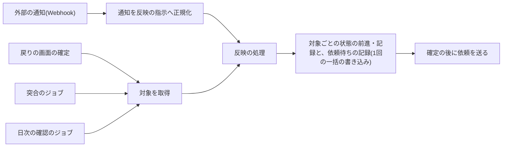

# 外部の通知の冪等な反映

外部のサービス(決済サービスなど)の状態を、通知(Webhook)・利用者の戻りの画面・定期の突合のどの入口から何度・どの順で受け取っても、自分のデータへ1回だけ、巻き戻さずに反映する規約を定める。入口を1つの反映の処理にまとめる規約、通知の本文を信用せずに取得し直す規約、対象ごとの状態の前進と発生時刻による巻き戻りの防止、版の検査付きの一括の書き込み、反映の結果と入口の応答、確定の後の外部の副作用の依頼待ちの記録と日次の確認、他の機能が使う返金の依頼の口、突合を扱う。例は決済サービス(Stripe)の通知で示す。外部のサービスとの通信は「[決済サービス(Stripe)](../external/007-stripe-payments.md)」に、定期実行と非同期メッセージは「[非同期処理の設計](../infra/003-async-processing.md)」に、D1の一括の書き込みの制約は「[Cloudflare D1の制約と対処](../db/002-d1-constraints.md)」に従う。

## 前提と用語

通知は`<メッセージを受信するアプリ>`が、戻りの画面の確定と突合は`<APIサーバーのアプリ>`が受け取り、どちらも共通ライブラリの同じ反映の処理を呼ぶ。部品の置き場所は、共通ライブラリの配置先、各アプリの`src/`からのパスで示す。

| 部品                                                                         | 置き場所                                                                                                                   | 役割                                                                     |
| ---------------------------------------------------------------------------- | -------------------------------------------------------------------------------------------------------------------------- | ------------------------------------------------------------------------ |
| `PaymentReflector`・`ReflectionInstruction`・`ReflectionOutcome`             | 共通ライブラリの`core/payments/ports.ts`                                                                                   | 反映の処理の契約と、反映の指示・結果の型                                 |
| `ADVANCEABLE_FROM`・`decideCompletion`                                       | 共通ライブラリの`core/payments/purchase-rules.ts`                                                                          | 状態ごとの前進の元の状態と、反映の期限の判定                             |
| `StripePaymentReflector`                                                     | 共通ライブラリの`workers/payments/payment-reflector.ts`                                                                    | 反映の処理(請求・返金・チャージバック・定期課金と、決済セッションの委譲) |
| `StripeCheckoutSessionReflection`                                            | 共通ライブラリの`workers/payments/checkout-session-reflection.ts`                                                          | 決済セッションの反映(権利の付与・拒否・失効)                             |
| `D1GuardedBatch`                                                             | 共通ライブラリの`workers/payments/guarded-batch.ts`                                                                        | 版の検査付きの一括の書き込みの実行と、失敗の判別                         |
| `PaymentRefunds`・`PaymentRefundStatements`・`D1PaymentRefunds`              | 共通ライブラリの`core/payments/ports.ts`・`workers/payments/statement-contracts.ts`・`workers/payments/payment-refunds.ts` | 返金の依頼の口と実装(「[返金の依頼の口](#返金の依頼の口)」)              |
| `StripePaymentOwnerResolver`                                                 | 共通ライブラリの`workers/payments/payment-owner-resolver.ts`                                                               | 返金・チャージバック・請求の持ち主の特定                                 |
| `SignedStripeWebhookReceiver`                                                | `<メッセージを受信するアプリ>`の`application/payments/stripe-webhook-receiver.ts`                                          | 通知の入口(署名の検証→正規化→反映)                                       |
| `StripeCheckoutReturnConfirmer`                                              | `<APIサーバーのアプリ>`の`application/payments/checkout-return-confirmer.ts`                                               | 戻りの画面の入口                                                         |
| `CheckoutReconciliationJob`・`PendingCheckoutSweepJob`・`reconcilePurchases` | `<APIサーバーのアプリ>`の`application/payments/jobs/`                                                                      | 突合と日次の確認の入口                                                   |

| 用語                                         | 意味                                                                                                         |
| -------------------------------------------- | ------------------------------------------------------------------------------------------------------------ |
| 対象                                         | 外部のサービスのオブジェクト(決済セッション・請求・返金・チャージバック・定期課金)。外部のサービスのIDを持つ |
| 入口                                         | 反映の処理を呼ぶ場所。外部の通知(Webhook)・戻りの画面の確定・突合のジョブ・日次の確認のジョブの4つ           |
| 反映                                         | 対象の最新の状態を自分のデータ(購入の状態・決済の記録・権利の付与など)へ写すこと                             |
| 発生時刻                                     | 通知が示す、対象の状態が変わった時刻(通知の`created`)。戻りの画面と突合では、取得した時刻を使う              |
| 版                                           | 行が読まれてから変わったかを確かめる値。行を前進させるたびに新しいULIDを書く(`state_token`)                  |
| 依頼待ち                                     | 反映と同じ一括の書き込みで記録した、まだ送っていない外部の副作用(返金の依頼・メールの依頼)の状態             |
| `<突合の起動時刻>`・`<日次の確認の起動時刻>` | 突合のジョブと、日次の確認のジョブを起動する業務時刻                                                         |

- 上のプレースホルダーの本プロジェクトの値は、技術ドキュメントに写さず、プロジェクト固有の値の文書の「[定期実行と非同期メッセージ](../../../onboardings/project-values.md#定期実行と非同期メッセージ)」と「[決済](../../../onboardings/project-values.md#決済)」に置く。
- 通知の重複の記録表(通知のIDの一覧)は持たない。冪等性と巻き戻りの防止は、対象ごとの状態と発生時刻で表す。

## 入口を1つの反映にまとめる

- 4つの入口は、同じ反映の処理(`PaymentReflector`)を呼ぶ。入口ごとに状態の書き換えを持たない。どの入口が先に届いても、後から届いた入口は「反映済み」になる。
- 戻りの画面は、通知を待たずに対象を取得して反映し、その結果を表示する。通知の遅れや転送の無い環境(ローカルの転送を止めた環境・CI)でも、利用者は結果を見られる。外部のサービスに到達できないときは「処理中」を示し、画面が間隔を置いて確かめ直す。
- 突合と日次の確認は、通知が届かなかった・取りこぼした対象を拾う(「[突合と日次の確認](#突合と日次の確認)」)。
- 反映の処理は共通ライブラリに置き、通知を受けるアプリと戻りの画面・突合を受けるアプリの両方に同じ束縛で入れる(「[モジュール](002-layered-architecture-on-workers.md#モジュール)」)。

## 通知の本文を信用しない

- 通知からは、種類・発生時刻・対象のIDだけを使い(`mapStripeEvent`)、対象の最新の状態を外部のサービスから取得し直して反映する。通知の本文の状態は、送られた時点の古い状態のことがあり、順序も保証されないためである。
- 取得し直した最新の状態を書くため、古い通知でも書く内容は最新になる。古い通知を捨てる判定は、記録済みの発生時刻との比較で行う(「[発生時刻による巻き戻りの防止](#発生時刻による巻き戻りの防止)」)。
- 受け付けない種類の通知は「無視」とし、取得しない。
- 対象が外部のサービスに無い(`StripeNotFoundError`)か、自分の購入・利用者に結び付かない対象は「結び付かない」とし、対象の種類とIDだけを`warning`のログに残して反映しない。持ち主は、購入に保存した外部のID→作成時に対象へ付けたメタデータ(購入ID・仮名化ID)の順に探す。購入の行を物理削除した後も、メタデータの仮名化IDで決済の記録を残せる。

## 対象ごとの冪等性

対象の種類ごとに、重複と順序の入れ替わりを次の方法で吸収する。

| 対象           | 書き込み                                                                                       | 重複の扱い                                                                   | 古い通知の扱い                                                         |
| -------------- | ---------------------------------------------------------------------------------------------- | ---------------------------------------------------------------------------- | ---------------------------------------------------------------------- |
| 決済セッション | 購入の状態の前進と、決済の記録・権利の付与・依頼待ちの記録を版の検査付きの一括の書き込みで確定 | 完了した購入は前進しない。版が変わっていれば全体を取り消し、現在の状態を返す | 前進の元の状態を条件にするため、完了の後の未完了の通知は何もしない     |
| 請求・返金     | 外部のIDと種類で一意の記録のupsert                                                             | 同じ状態の再適用は同じ値の上書き                                             | 記録済みの発生時刻が受け取った値以下のときだけ更新する                 |
| チャージバック | 外部のID・種類・段階で一意の記録の挿入                                                         | 同じ段階の2回目は挿入されず「反映済み」                                      | 段階ごとに別の行のため、順序が入れ替わっても全ての段階が残る           |
| 定期課金       | 対象ごとの最終の発生時刻の行と、受け取り口の文を版の検査付きの一括の書き込みで確定             | 同じ発生時刻は通す。受け取り口の文は冪等にする                               | より新しい発生時刻が記録済みなら、受け取り口の文を含めて全体を取り消す |

### 状態の前進

- 購入の状態は前進だけを許し、前進の行き先ごとに前進の元の状態を決める(`ADVANCEABLE_FROM`)。完了(権利の付与・拒否・失効)した購入は戻らない。
- 前進の文は「前進の元の状態のどれかである」を条件にし、新しい版(`state_token`)を書く1文にする。
- 他の文を伴わない前進(失効・処理中への前進)は、版の検査を使わず、1文の更新の変更件数(`meta.changes`)で前進したかを判定する。前進しなければ、他の入口が先に進めたとして現在の状態を返す。
- 置き換えた未完了の購入(同じ対象の決済をやり直して置き換えた購入)からも、完了へ進める。失効の依頼の前に、古い決済セッションで支払いが確定し得るためである。

### 版の検査付きの一括の書き込み

D1は`db.transaction()`を使えず、一括の書き込み(`db.batch()`)の前の文の結果で後の文を変えられない。状態の前進と、決済の記録・権利の付与・依頼待ちの記録を同時に確定するため、「[版の検査で一括の書き込み全体を取り消す](../db/002-d1-constraints.md#版の検査で一括の書き込み全体を取り消す)」の型を使う。

1. 先頭の文を、必ず挿入する業務の行(決済の記録・最終の発生時刻の行)の挿入にし、NOT NULLの列に「版が一致すれば値、一致しなければNULL」を入れる。購入の確定・拒否は、決済の記録の仮名化IDの列に、購入の`state_token`が読み取った値と同じときだけ値を入れる。定期課金は、最終の発生時刻の列に、より新しい発生時刻が記録済みでないときだけ値を入れる。
2. 続けて購入の前進の文、権利の付与の文、依頼待ちの記録の文を置く。
3. `D1GuardedBatch.run`で実行し、結果を次の3つに分ける。

| 結果                | 判定                                                                                       | 反映の処理の扱い                                                                           |
| ------------------- | ------------------------------------------------------------------------------------------ | ------------------------------------------------------------------------------------------ |
| `committed`         | 全ての文が確定した                                                                         | 確定の後の依頼を送る                                                                       |
| `guard_failed`      | 例外の`cause`をたどった違反のメッセージの`<テーブル>.<列>`が検査の列のNOT NULLの違反である | 他の入口が先に前進させた。現在の状態を「反映済み」として返す。定期課金は「古い」として返す |
| `constraint_failed` | 検査の列以外の制約の違反                                                                   | 権利の付与の文の違反なら下の扱い。それ以外は例外にする                                     |

- 検査に使う列は、他の文がNULLを入れない列にし、検査の失敗と他の制約の違反を取り違えないようにする。
- SQLiteはNOT NULLの制約を一意性より先に確かめるため、先頭の挿入が既存の行と一意キーで衝突する(`ON CONFLICT DO NOTHING`)場合も、版の検査は働く。
- 1つの対象の権利を1つだけにする制約(確定した購入に限る部分一意索引など)の違反は、二重の決済として拒否と全額の返金にする。それ以外の権利の付与の文の違反は、権利の付与の口の状態が変わったとして口を1回だけ呼び直し、なお違反すれば拒否と全額の返金にする。
- 検査の列と文の組み立ては、文を返す契約(`workers`側の契約)に閉じ込め、権利の付与の口を実装する機能の契約の形を変えない。

### 発生時刻による巻き戻りの防止

- 請求・返金の記録は、外部のIDと種類で一意にし、`ON CONFLICT DO UPDATE ... WHERE 記録済みの発生時刻 <= 受け取った発生時刻`で、古い通知のときだけ更新しない。同じ一括の書き込みの他の文(返金の依頼の状態など)は、取得し直した最新の状態を書くため、古い通知でも確定させる。
- 更新しないのは、状態・金額・発生時刻だけである。最初の記録で決まる値(仮名化ID・記録日時)と、決済セッションの反映だけが知る値(同意の日時と版・購入ID・資金源のグループ)は、記録済みの値を優先する。
- 定期課金のように、受け取り口へ変化を渡す対象は、対象ごとの最終の発生時刻の行を持ち、版の検査の先頭の文にする。受け取り口の文は同じ発生時刻の通知で再び確定し得るため、冪等にする。
- 状態の前進を伴う依頼の行(返金の依頼)は、前進の元の状態を条件にして状態を書き、完了した依頼を処理中へ戻さない。外部のサービスで成功の後に失敗し得る状態(返金の成功の後の失敗)は、その遷移を前進として許す。依頼の行が失敗以外から失敗へ変わったとき(依頼の行の文が行を変えたとき)だけ、依頼のIDと外部のサービスの返金の識別子を添えてエラートラッキングへ知らせる。利用者へ返金されないまま反映を終えるため例外としては送られず、同じ失敗の通知の再送では行が変わらないため重ねて知らせない。

## 反映の結果と入口の応答

| 結果(`ReflectionOutcome`) | 意味                                       | 通知の応答 | 戻りの画面                   | 突合・日次の確認                       |
| ------------------------- | ------------------------------------------ | ---------- | ---------------------------- | -------------------------------------- |
| `applied`                 | この呼び出しで反映した                     | 200        | 反映した状態を表示           | 反映の件数に数える                     |
| `already_applied`         | 他の入口が先に反映した                     | 200        | 現在の状態を表示             | 変化なしに数える                       |
| `stale`                   | 記録済みより古い発生時刻の通知             | 200        | (該当しない)                 | 変化なしに数える                       |
| `unresolved`              | 自分の購入・利用者に結び付かない           | 200        | (該当しない)                 | 変化なしに数える                       |
| `ignored`                 | 受け付けない種類・記録しない段階           | 200        | (該当しない)                 | (該当しない)                           |
| 例外                      | 外部のサービスやデータベースの一時的な失敗 | 500        | 外部に届かなければ「処理中」 | エラートラッキングへ送り、残りを続ける |

- 一時的な失敗は例外として返し、部分的な書き込みを残さない(一括の書き込みは全体が確定するか取り消される)。通知は500で外部のサービスの再送に、突合と日次の確認は次の回の実行に、戻りの画面は画面の確かめ直しに任せる。
- 結果が例外でない限り、通知には200を返す。結び付かない・古い通知に2xx以外を返すと、外部のサービスが送り直しを続けるためである。

## 外部の副作用の依頼

反映の一括の書き込みと、Queuesへのメッセージの送信・メールの送信の依頼は、1つの単位にできない。送信の前に処理が止まると、返金やメールが依頼されないまま残る。

1. 反映の一括の書き込みで、依頼待ちの行(返金の依頼の行・購入確認メールの状態など)を記録する。
2. 確定の後に依頼を送り、送れたら依頼済み(送信の日時)を記録する。
3. 送信の失敗は例外にせず、`warning`のログに残して反映の結果を変えない。日次の確認が、10分以上依頼待ちのままの行を依頼し直す。

- 確定の後の処理(依頼の送信と、権利の付与の口・受け取り口の確定後の処理)は、版の検査を通って確定させた入口だけが1回呼ぶ。「反映済み」「古い」「版の検査の失敗」の入口は呼ばない。確定後の処理の例外は、反映の結果を変えない。
- 依頼済みを記録する前に止まった場合だけ、2回目の依頼が出得る。メッセージの処理とメールの配送は少なくとも1回の配信のため、受け取る側を冪等にする(「[重複配信と冪等性](../infra/003-async-processing.md#重複配信と冪等性)」)。返金は返金の依頼の状態(依頼のままの依頼だけを処理する)と、作成の前の既存の返金の照会(依頼のIDをメタデータに持つ返金があれば作らない)と、外部のサービスの冪等キーで、2回の返金を防ぐ。冪等キーには有効期間があり、それを過ぎた送り直しでは照会だけが重複を防ぐ(「[冪等キー](../external/007-stripe-payments.md#冪等キー)」)。
- 自動の返金(反映の期限の後の支払い・権利を付与できない決済・二重の決済)の依頼キーは、購入ごとに1つの決まった形(`reflection:<購入ID>`)にし、反映の一括の書き込みでだけ作る。他の機能が依頼する返金は、この接頭辞を使えない。

## 返金の依頼の口

購入を受け持つ他の機能(停止や取り消しに伴う返金など)は、決済サービスを直接呼ばず、返金の依頼の口(共通ライブラリの`core/payments/ports.ts`の`PaymentRefunds`と、`workers/payments/statement-contracts.ts`の`PaymentRefundStatements`。実装は`workers/payments/payment-refunds.ts`の`D1PaymentRefunds`、規則は`core/payments/refund-rules.ts`)を使う。

| 操作                   | 使う場面                                                   | 振る舞い                                                                                                     |
| ---------------------- | ---------------------------------------------------------- | ------------------------------------------------------------------------------------------------------------ |
| `request(入力)`        | 返金だけを依頼する                                         | 依頼の行を記録し、返金のメッセージを送ってから返す                                                           |
| `prepare(入力)`        | 自分の状態の変更と返金の依頼を同じ一括の書き込みで確定する | 依頼の行を作る文を返す。依頼元が自分の文と一緒に一括の書き込みで確定し、確定の後に`dispatch(依頼のID)`を呼ぶ |
| `dispatch(依頼のID)`   | `prepare`の確定の後                                        | 送信済みなら何もしない。送信の失敗は`warning`のログだけにし、日次の確認が送り直す                            |
| `redispatch(依頼のID)` | 日次の確認が、送信の後に依頼中のまま残った依頼を送り直す   | 送信済みで依頼中の依頼だけを同じ本文で送り直し、送信の日時を改めて、送り直したかを返す。送信の失敗は例外     |

入力は、購入ID・金額・理由・依頼キーの4つである。

| 項目     | 規則                                                                                                                                                                                                   |
| -------- | ------------------------------------------------------------------------------------------------------------------------------------------------------------------------------------------------------ |
| 金額     | 最小通貨単位の正の整数。空(`null`)なら返金できる残りの全額                                                                                                                                             |
| 理由     | 小文字・数字・`_`の1〜64文字。二重の決済(`duplicate`)だけを決済サービスの同じ意味の理由に対応させ、他は購入者の都合(`requested_by_customer`)として送る。形に合わない値は呼び出しの誤りとして例外にする |
| 依頼キー | 依頼元が依頼ごとに決める1〜128文字の一意な値。`reflection:`で始まる値は自動の返金だけが使うため、依頼元からは受け付けない                                                                              |

- 検査は、依頼キーの形→依頼キーの照会→購入の状態→金額の順に行う。依頼キーの形の検査を照会より先にするのは、既存の自動の返金の依頼を重複として返さないためである。
- 同じ依頼キーの依頼が既にあれば、金額や理由が違っても、残りの額を超えていても拒否せず、既存の依頼の識別子と重複の印(`duplicate: true`)を返す。`prepare`は新しい文を返さない。依頼元は、同じ操作の再試行で同じ依頼キーを使えば、返金を2回依頼しない。確定の前の2つの依頼の文が同じ依頼キーで重なると、後から確定する一括の書き込みが一意制約の違反で失敗する。
- 購入が無ければ`purchase_not_found`、支払いが確定していない(完了・拒否の状態でないか、支払いの識別子が無い)なら`not_paid`、金額の形が誤りなら`invalid_amount`、残りの額を超えれば`amount_exceeds_refundable`、依頼キーの形が誤りなら`invalid_request_key`を返す(例外ではなく結果の`rejected`)。
- 返金できる残りは、購入の支払額から、失敗・取り消し以外の依頼の合計を除いた額である。ダッシュボードの手動の返金は依頼の行を持たないため、残りの額に含まれない(「[手動の返金](../operations/004-payment-data-operations.md#手動の返金)」)。
- 依頼の受け付けは、決済サービスの返金の作成を待たずに返る。返金はメッセージの処理が作り、結果(成功・失敗)は返金の通知の反映で依頼の行と決済の記録に書かれる。依頼元は受け付けの結果を返金の完了として扱わない。
- 返金は権利の剥奪を伴わない。権利の取り消しが要る依頼元は、自分の状態の変更と`prepare`の文を同じ一括の書き込みで確定する。
- 自動の返金の通知のメールは、`reflection:`の依頼キーの依頼だけに送る。依頼元の返金を利用者へ知らせるときは、依頼元が自分で行う。

## 突合と日次の確認

| ジョブ                                | 起動                     | 対象                                                                                                                                                          | 上限                       |
| ------------------------------------- | ------------------------ | ------------------------------------------------------------------------------------------------------------------------------------------------------------- | -------------------------- |
| 突合(`CheckoutReconciliationJob`)     | `<突合の起動時刻>`       | 決済期限が過ぎて24時間以内の、未完了・処理中・置き換え済みの購入(決済セッションのIDがあるもの)                                                                | 200件                      |
| 日次の確認(`PendingCheckoutSweepJob`) | `<日次の確認の起動時刻>` | 有効期限を1時間過ぎた未完了・処理中・置き換え済みの購入、10分以上送信していない返金の依頼、送信から24時間経っても依頼中の返金の依頼、10分以上依頼待ちのメール | 200件・100件・100件・100件 |

- どちらも対象の決済セッションを取得し、戻りの画面と同じ`reflectCheckoutSnapshot`で反映する。反映は状態の前進だけを行うため、同じ購入を何度突合しても、2回実行しても結果は変わらない。
- 決済期限のある購入の突合は、期限の直後に権利を確定する後続の処理(期限で締める集計など)より先に動かす。同じ起動時刻の他のジョブより小さい順序で登録する(「[ジョブの登録](../infra/003-async-processing.md#ジョブの登録)」)。
- 有効期限の直後は通知が届く途中のため、日次の確認は有効期限から1時間待ってから突合する。依頼の直後の送信は呼び出し元が続けて行うため、10分待ってから送り直す。
- 1件の失敗で残りを止めない。失敗した購入・依頼はエラートラッキングへ知らせ(ジョブは失敗を飛ばして続けるため、定期実行の計装は例外として拾わない)、次の回の実行で再び対象になる。上限を超えた分は次の回に残し、上限に達したことをログに残す。
- 突合は時間の上限を過ぎたら残りの購入を処理せずに止め、残った件数をエラートラッキングへ知らせる。時刻は`Clock`で購入ごとの取得の前に確かめ、上限ちょうどまでは続ける。期限の直後の後続の処理より先に終える必要がある突合は、後続の処理の時刻から余裕を引いた値を起動の予定時刻から数える。期限の無い日次の確認は、同じ起動時刻の他のジョブを実行基盤の実時間の上限で打ち切らせないよう、1つのジョブの目安(「[同じ時刻のジョブ群の時間の予算](../infra/003-async-processing.md#同じ時刻のジョブ群の時間の予算)」)をジョブの開始から数える。予算は超過の警告だけで処理を止めないため、打ち切りはジョブ自身が行う。
- 返金のメッセージが再試行の上限でデッドレターになった依頼は、送信済みのまま依頼中で残る。日次の確認は、送信から24時間(メッセージの再試行が必ず終わる時間)を過ぎても依頼中の依頼を`redispatch`で送り直し、送り直した依頼のIDを1回の起動につき1件の`warning`にまとめて知らせる。送り直しは外部のサービスの冪等キーの有効期間の外になり得るため、冪等キーだけでは二重の返金を防げない。返金の処理が作成の前に依頼のIDをメタデータに持つ返金を照会し、あればその返金を記録して作らないことで防ぐ(作成の後に記録できずに止まった依頼でも、外部のサービスに返金が残っている)。送信の日時を改めるため、同じ日に2回実行しても重ねて送らない。
- 対象の決済セッションが外部のサービスに無い(`StripeNotFoundError`)購入は支払われ得ないため、`warning`のログを残して失効へ前進させ、失敗として数えない。失敗として残すと、毎回の実行で知らせ続け、件数の上限の枠を使い続けるためである。
- 依頼待ちのメールのうち、記録の欠けで入力を組み立てられない行は、依頼し直しても直らないため、`warning`のログに理由を残して対象外(`skipped`)へ進める。送信の失敗(一時的な失敗)だけを依頼待ちのまま残し、次の回に依頼し直す。

## テスト

- 反映のWorkers統合テストは、外部のサービスの偽物と権利の付与の口の偽物を使い、通知の重複・順序の入れ替わり・同時の反映(2つの入口の反映を並べて実行しても記録・付与・依頼が1回だけ)・反映の期限の後の支払い・二重の決済・一時的な失敗で部分的な書き込みが残らないことを確かめる。
- 版の検査付きの一括の書き込みは、他の書き込みが先に版を変えた場合の`guard_failed`、検査の列以外の制約の違反の`constraint_failed`、先頭の挿入の一意キーの衝突でも版の検査が働くことを、実際のD1で確かめる。
- 入口(通知の経路・戻りの画面・ジョブ)のテストは、反映の結果ごとの応答と、例外の扱いを確かめる。ジョブの単体テストは偽のポートで、1件の失敗で残りを続けることと、2回実行しても結果が変わらないことを確かめる。
- 確定の後の依頼の送信の失敗で依頼待ちが残り、日次の確認が依頼し直すことを確かめる。
