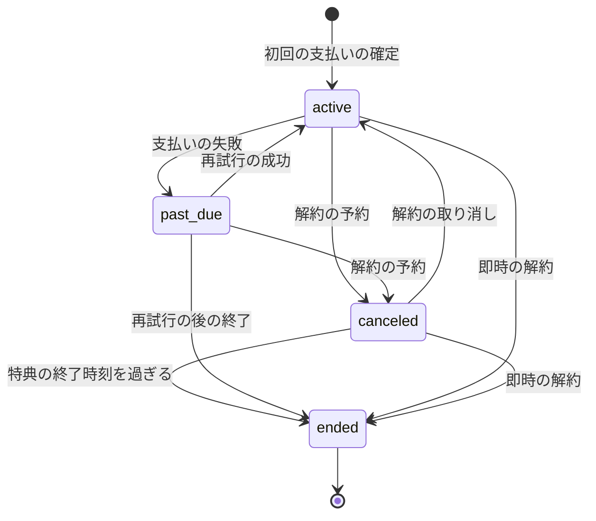
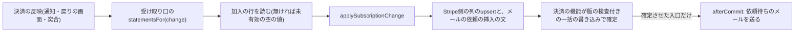
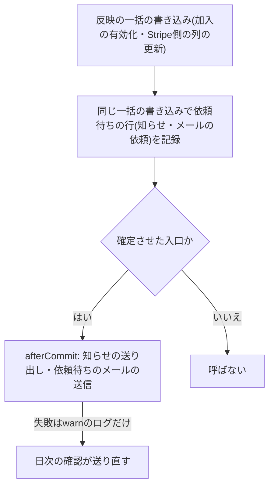
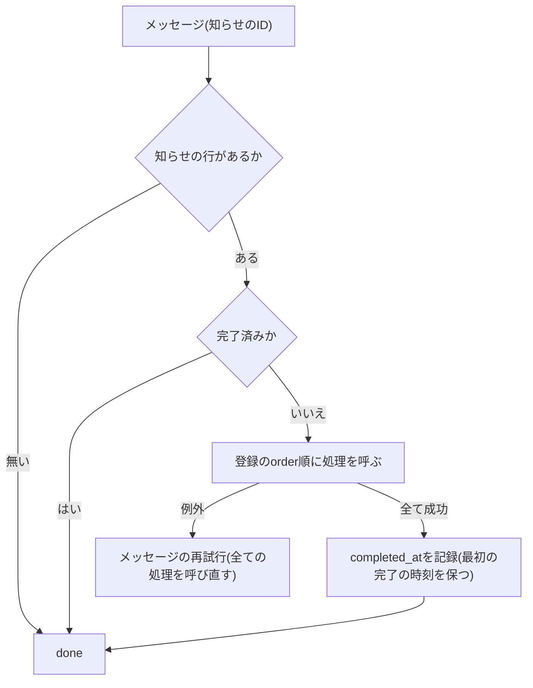

# 定期課金の加入状態と特典の判定

外部の決済サービスの定期課金(Stripe Billingなど)の状態から、利用者が特典を受けられる期間(特典の継続期間)を導き、時点・期間・複数の利用者の一括の判定に答えるアプリの規約を定める。外部の状態と加入状態の対応、特典の継続期間と業務日付の日の終わりへの切り上げ、区間に対する判定の口とエクスポートの口、通知の到着順への対応と二重の加入の防止、確定の後の副作用(加入が有効になった知らせ・メールの依頼)の依頼待ちの記録と日次の確認、知らせの処理の登録と冪等性、退会・停止・物理削除との関係、テストを扱う。外部の通知を1回だけ反映する規約は「[外部の通知の冪等な反映](009-idempotent-event-reflection.md)」に、決済サービスの定期課金とCustomer Portalとの通信は「[定期課金とCustomer Portal(Stripe Billing)](../external/008-stripe-billing-portal.md)」に、定期実行と非同期メッセージは「[非同期処理の設計](../infra/003-async-processing.md)」に、退会・停止・物理削除のイベントは「[ユーザーライフサイクルイベント](007-user-lifecycle-events.md)」に、ログとエラートラッキングは「[ログとエラートラッキング](../infra/004-logging-and-error-tracking.md)」に従う。

## 前提と用語

決済サービスとの通信、通知の反映、購入種別の口(購入の可否・権利の付与)と定期課金の受け取り口の呼び出しは決済の機能が受け持ち(「[外部の通知の冪等な反映](009-idempotent-event-reflection.md)」)、本規約の部品はその口を実装する。判定の口は`<APIサーバーのアプリ>`と`<メッセージを受信するアプリ>`の両方から使えるよう、契約と識別子を共通ライブラリの`core/<ドメイン>`に、実装と共通の束縛を`workers/<ドメイン>`に置く(「[層構成と合成ルート](002-layered-architecture-on-workers.md#層構成と合成ルート)」)。部品の置き場所は、共通ライブラリの配置先、各アプリの`src/`からのパスで示す。

| 部品                                                                                                                                    | 置き場所                                                                                             | 役割                                                                                          |
| --------------------------------------------------------------------------------------------------------------------------------------- | ---------------------------------------------------------------------------------------------------- | --------------------------------------------------------------------------------------------- |
| `SubscriptionSnapshot`・`derivePlanStatus`・`isEntitledAt`・`overlapsPeriod`・`endOfBusinessDayContaining`・`benefitEndForScheduledEnd` | 共通ライブラリの`core/<ドメイン>/entitlement-rules.ts`                                               | 加入の値の形と、加入状態・特典の継続期間・業務日付の日の終わりの純粋な規則                    |
| `applySubscriptionChange`・`EMPTY_SUBSCRIPTION_SNAPSHOT`・`ENDED_STRIPE_STATUSES`・`isEndedStripeStatus`                                | 共通ライブラリの`core/<ドメイン>/subscription-transition.ts`                                         | 定期課金の状態の変化の解釈(次の値・メールの依頼・異常)                                        |
| 知らせの処理の契約(処理・登録の型)と登録簿の検証                                                                                        | 共通ライブラリの`core/<ドメイン>/activation-contract.ts`                                             | 加入が有効になった知らせを受け取る処理の契約と、登録の検証・並べ替え                          |
| 知らせのメッセージの契約と再試行の規則                                                                                                  | 共通ライブラリの`core/<ドメイン>/activation-message.ts`                                              | `<加入の知らせのメッセージの種別>`(本文は知らせのIDだけ)と再試行の規則                        |
| `SubscriptionStore`・`ActivationStore`・`NoticeStore`・判定の口・エクスポートの口・`ActivationDispatcher`・通知の口                     | 共通ライブラリの`core/<ドメイン>/ports.ts`(識別子は`identifiers.ts`)                                 | application層と、特典を使う機能が受け取る契約と識別子                                         |
| `SubscriptionStatements`・`ActivationStatements`・`NoticeStatements`                                                                    | 共通ライブラリの`workers/<ドメイン>/statement-contracts.ts`                                          | 一括の書き込みに入れる文を返す契約(`workers`の中と、各アプリのinfrastructure層だけが受け取る) |
| D1のストア(`d1-*.ts`)・判定とエクスポートの実装                                                                                         | 共通ライブラリの`workers/<ドメイン>/`                                                                | 契約と文を返す契約の両方を実装するストアと、ストアだけを注入する判定                          |
| 購入の可否の口・権利の付与の口・定期課金の受け取り口の実装                                                                              | 共通ライブラリの`workers/<ドメイン>/`(`*-offer-policy.ts`・`*-fulfillment.ts`・`plan-state-sink.ts`) | 決済の機能の登録箇所(`purchase-kind-registrations.ts`)が指す口の実装                          |
| 知らせの送り出しとメールの依頼の実装                                                                                                    | 共通ライブラリの`workers/<ドメイン>/activation-dispatcher.ts`・`*-notifier.ts`                       | 確定の後の副作用の送信                                                                        |
| 共通の束縛                                                                                                                              | 共通ライブラリの`workers/<ドメイン>/*-platform-module.ts`                                            | 両アプリへアプリ名付きで入れる束縛(前例は決済の共通の束縛)                                    |
| 日次の確認のジョブ                                                                                                                      | `<APIサーバーのアプリ>`の`application/<ドメイン>/jobs/`                                              | 送り出し直し・メールの依頼・保持期間の削除                                                    |
| 知らせの処理の実行器と登録箇所                                                                                                          | `<メッセージを受信するアプリ>`の`application/<ドメイン>/`と`<加入の知らせの登録箇所>`                | 登録の順に処理を呼び、完了を記録する                                                          |
| 解約と物理削除の波及処理                                                                                                                | `<メッセージを受信するアプリ>`の`application/<ドメイン>/`・`infrastructure/<ドメイン>/`              | 退会・停止に伴う解約と、物理削除の開始での行の削除                                            |

| 用語                                                     | 意味                                                                                                                                                                                                                                                  |
| -------------------------------------------------------- | ----------------------------------------------------------------------------------------------------------------------------------------------------------------------------------------------------------------------------------------------------- |
| 外部の状態                                               | 決済サービスの定期課金の状態。Stripeでは`incomplete`・`incomplete_expired`・`trialing`・`active`・`past_due`・`canceled`・`unpaid`・`paused`の8つ(「[定期課金の状態](../external/008-stripe-billing-portal.md#定期課金の状態)」)                      |
| 加入状態                                                 | アプリが利用者へ示す状態。`active`・`past_due`・`canceled`・`ended`の4つで、保存せず問い合わせの時刻ごとに導く                                                                                                                                        |
| 特典の継続期間                                           | 利用者が特典を受けられる期間`[開始時刻, 特典の終了時刻)`。特典の終了時刻が無ければ右に開く                                                                                                                                                            |
| 開始時刻                                                 | 加入が有効になった時刻。初回の支払いの確定の時刻(購入の`paidAt`)                                                                                                                                                                                      |
| 解約の予約                                               | 課金期間の末日に定期課金を終える予約。予約の間は利用者が取り消せる                                                                                                                                                                                    |
| 予定の終了時刻                                           | 予約の解約が実行される時刻`T`。解約の予定時刻`cancelAt`、無ければ課金期間の終了時刻`currentPeriodEnd`                                                                                                                                                 |
| 終了の状態                                               | 外部の状態のうち定期課金が終わった状態(`canceled`・`unpaid`・`incomplete_expired`・`paused`、`ENDED_STRIPE_STATUSES`)                                                                                                                                 |
| 確定済み                                                 | 終了の状態で決めた特典の終了時刻(`benefitEndFixed`)。以後の変化で変えない                                                                                                                                                                             |
| 業務日付の日の終わり                                     | その業務日付の翌日0:00(業務時刻)の時点。区間の右端として含まない                                                                                                                                                                                      |
| 加入が有効になった知らせ                                 | 加入が有効になったことを、特典を使う機能の処理へ届ける記録とメッセージ。加入1件に1つ                                                                                                                                                                  |
| メールの依頼                                             | 定期課金の状態の変化で利用者へ送るメール(支払いの失敗・解約の受付)の依頼待ちの行。重複排除の鍵で一意                                                                                                                                                  |
| 日次の確認                                               | 送り出せなかった知らせと依頼待ちのメールを送り直し、保持期間を過ぎた記録を消す日次のジョブ(`<加入の日次の確認のジョブ>`)                                                                                                                              |
| `<ドメイン>`                                             | この機能のドメイン名。共通ライブラリの`core/<ドメイン>`・`workers/<ドメイン>`と各アプリの`application/<ドメイン>`のディレクトリ名、識別子の接頭辞(`Symbol.for('<ドメイン>.<名前>')`)、エラートラッキングの指紋の先頭とタグ`<ドメイン>_incident`に使う |
| `<加入の知らせのメッセージの種別>`                       | 知らせの処理を起こすメッセージの種別(`<ドメイン>.<動詞句>`)                                                                                                                                                                                           |
| `<加入の知らせの登録箇所>`                               | `<メッセージを受信するアプリ>`で、知らせの処理の登録の一覧を定義するファイル                                                                                                                                                                          |
| `<加入の日次の確認のジョブ>`                             | 日次の確認のジョブの名前(`<spec名>.<名詞句>`)と起動時刻・順序                                                                                                                                                                                         |
| `<支払いの失敗のメール種別>`・`<解約の受付のメール種別>` | 2つのメールの種別(`<ドメイン>.<名詞句>`)                                                                                                                                                                                                              |
| `<定期課金の購入種別>`・`<定期課金の受け取り口の名前>`   | 決済の機能の登録箇所に加える購入種別と、定期課金の受け取り口の名前(`<spec名>.<名詞句>`)                                                                                                                                                               |

- 上のプレースホルダーの本プロジェクトの値は、技術ドキュメントに写さず、プロジェクト固有の値の文書の「[技術ドキュメントの表記と本プロジェクトの値](../../../onboardings/project-values.md#技術ドキュメントの表記と本プロジェクトの値)」と「[定期課金の加入](../../../onboardings/project-values.md#定期課金の加入)」に置く。
- 業務時刻は、夏時間の無い固定のUTCとの差(共通ライブラリの`core/time/business-time.ts`の`BUSINESS_UTC_OFFSET_MINUTES`)で表す(「[非同期処理の設計の前提と用語](../infra/003-async-processing.md#前提と用語)」)。日の終わりは`toBusinessDateTime`・`fromBusinessDateTime`の組み合わせで作り、独自に日付を計算しない。
- 外部の状態の文字列は、決済の機能の`StripeSubscriptionStatus`(共通ライブラリの`core/payments/purchase-kind-contract.ts`)を使い、テーブルの列は同じ値の閉じた集合をCHECK制約で持つ。`core/<ドメイン>`はテーブルの定義を読めないため、文字列ユニオンと`*_VALUES`は手で同期し、同値をWorkers統合テストで確かめる。

## 加入状態の導出



加入状態は保存せず、保存した外部の状態と特典の終了時刻から、問い合わせの時刻`now`ごとに`derivePlanStatus(snapshot, now)`で導く。

| 外部の状態                     | 解約の予約   | 特典の終了時刻                                 | 加入状態     | 特典                         |
| ------------------------------ | ------------ | ---------------------------------------------- | ------------ | ---------------------------- |
| `incomplete`(初回の支払いの前) | —            | —                                              | 無し(未有効) | 受けられない                 |
| `active`(`trialing`も同じ)     | 無し         | 無し                                           | `active`     | 受けられる                   |
| `active`                       | 有り         | 予定の終了時刻を含む業務日付の日の終わり(未来) | `canceled`   | 受けられる(終了時刻まで)     |
| `past_due`                     | 有無によらず | 無し、または未来                               | `past_due`   | 受けられる(再試行の間も続く) |
| 終了の状態(予約どおりの終了)   | —            | 確定済みで未来                                 | `canceled`   | 受けられる(終了時刻まで)     |
| 終了の状態(それ以外)           | —            | 確定済みで過去                                 | `ended`      | 受けられない                 |
| いずれか                       | —            | 過去                                           | `ended`      | 受けられない                 |

- 判定の順序: 開始時刻が無ければ`null`(未有効)。特典の終了時刻があり`now`がそれ以後なら`ended`。外部の状態が`past_due`なら`past_due`。特典の終了時刻があれば`canceled`、無ければ`active`。
- 外部の`canceled`とアプリの`canceled`は、同じ文字列で意味が異なる。外部の`canceled`は定期課金が終わった状態で、アプリでは特典の終了時刻の確定に当たる(多くは`ended`、予約どおりの終了なら末日の終わりまで`canceled`)。アプリの`canceled`は「解約が予約され、課金期間の末日まで特典が続く」状態で、外部ではまだ`active`(解約の予定時刻付き)である。画面や文書で対応を示すときは、この表の形で並べる。
- 加入状態を保存しないため、`ended`へは時刻の経過だけで移り、終了のための定期実行は要らない。過去の時点の判定も同じ区間で答えられる。
- `trialing`は試用期間を設けない構成では届かない。届いても終了していない状態として扱い、異常として知らせない。`unpaid`・`paused`は再試行の後に解約する設定と一時停止を使わない設定では届かないため、終了の状態として扱ったうえで異常として知らせる(「[異常の通知](#異常の通知)」)。

## 特典の継続期間

### 特典の終了時刻の決め方

定期課金の状態の変化を受け取るたびに、`applySubscriptionChange(previous, change, 定期課金のID)`が次の表で特典の終了時刻を決める。外部の値(状態・予約・予定時刻・課金期間の終了・終了の時刻)は常に最新の値に置き換える。

| 受け取った変化                                                               | 特典の終了時刻                                                                 | 確定済み |
| ---------------------------------------------------------------------------- | ------------------------------------------------------------------------------ | -------- |
| 終了していない状態で、予約が有る                                             | 予定の終了時刻`T`を含む業務日付の日の終わり(`benefitEndForScheduledEnd(T)`)    | 偽       |
| 終了していない状態で、予約が無い(予約の取り消しを含む)                       | 無し(右に開く)                                                                 | 偽       |
| 終了の状態で、以前または今回の変化に予約があり、終了の時刻`endedAt`が`T`以後 | `benefitEndForScheduledEnd(T)`(予約どおりの終了。末日の終わりまで特典を続ける) | 真       |
| 終了の状態で、上以外(即時の解約・支払いの再試行の後の終了・予約の無い終了)   | 終了の時刻`endedAt`(無ければ通知の発生時刻`occurredAt`)                        | 真       |
| 確定済みの加入に届いた変化                                                   | 変えない                                                                       | 真のまま |

- 予約があるのに予定の終了時刻が無い変化は、特典の終了時刻を無しのまま保存し、異常として知らせる(「[異常の通知](#異常の通知)」)。
- 解約の予約の有無は、`cancelAtPeriodEnd`が真か`cancelAt`があるかで判定する(「[柔軟な請求モードと解約](../external/008-stripe-billing-portal.md#柔軟な請求モードと解約)」)。
- 終了の時刻で終える終了は、業務日付の日の終わりへ切り上げない。支払いの再試行の後の終了と即時の解約は、その時刻で特典を終える。

### 業務日付の日の終わりへの切り上げ

- 課金期間は終了時刻を含まない(`[開始, 終了)`)ため、期間の最後の瞬間は終了時刻の1ミリ秒前である。`benefitEndForScheduledEnd(T)`は、`T`の1ミリ秒前が属する業務日付の日の終わり(`endOfBusinessDayContaining(T − 1ms)`)を返す。
- `endOfBusinessDayContaining(時点)`は、時点の業務日付の0:00に1日(86,400,000ミリ秒)を足した時点を返す。業務時刻は固定のオフセットで夏時間の切り替えが無いため、この足し算が翌日の0:00になる。
- 例(業務時刻で示す): 課金期間の終了が11月5日10:00なら、特典の終了時刻は11月6日0:00(11月5日23:59:59.999まで特典を受けられる)。終了が11月6日0:00ちょうどなら、期間の最後の瞬間は11月5日に属するため11月6日0:00のままで、1日延びない。終了が11月6日0:00の1ミリ秒後なら11月7日0:00になる。
- 区間の右端は含まない。11月6日0:00ちょうどの時点の判定は偽である。

## 時点・期間・一括の判定

```typescript
export interface Entitlements {
  isEntitledAt(userId: string, at: Date): Promise<boolean>;
  wasEntitledDuring(userId: string, from: Date, to: Date): Promise<boolean>;
  entitledUsersAt(
    userIds: readonly string[],
    at: Date,
  ): Promise<ReadonlySet<string>>;
  entitledUsersDuring(
    userIds: readonly string[],
    from: Date,
    to: Date,
  ): Promise<ReadonlySet<string>>;
  currentPlan(userId: string, now: Date): Promise<PlanView | null>;
}
```

判定の口の契約は共通ライブラリの`core/<ドメイン>/ports.ts`に置き(名前はドメイン名を冠する)、特典を使う機能はapplication層から契約の型と識別子で受け取る。

| 判定                         | 条件                                                                                                                                     |
| ---------------------------- | ---------------------------------------------------------------------------------------------------------------------------------------- |
| 時点`at`                     | `開始時刻 ≤ at`かつ(`特典の終了時刻`が無い、または`at < 特典の終了時刻`)                                                                 |
| 期間`[from, to]`(両端を含む) | `開始時刻 ≤ to`かつ(`特典の終了時刻`が無い、または`from < 特典の終了時刻`)。時点の判定は`from = to`                                      |
| 複数の利用者                 | 利用者のIDを重複を除いて90件ずつに分け、`IN`で同じ条件を問い合わせ、重なる加入を持つ利用者の集合を返す                                   |
| 現在の加入(`currentPlan`)    | 開始時刻の降順で最新の有効化された加入を、加入状態・開始時刻・課金期間の終了時刻・特典の終了時刻・解約の操作の時刻で返す。無ければ`null` |

- 期間の始まりが終わりより後(`from > to`)の問い合わせは`RangeError`にする。そのまま問い合わせると、両方の時点にまたがる加入があるとき真になり、誤答が黙って返るためである。
- 90件ずつに分けるのは、D1のバインド変数の上限(100個)から期間の両端の分を残すためである(「[Cloudflare D1の制約と対処](../db/002-d1-constraints.md#d1の制約と対処)」)。
- 判定は開始時刻と特典の終了時刻の2列だけで行い、外部の状態と機能フラグを読まない。新規の加入の受け付けの可否を機能フラグで切り替える構成でも、フラグは加入済みの特典に影響しない。
- 過去の時点の判定は、その後の解約の取り消しや終了で変わらない。終了時刻は確定の後に変わらず、予約の取り消しは課金期間の末日より前にしか起きないため、取り消しの前の時点は取り消しの後も区間の中にある。
- 索引は`(user_id, started_at)`と、右に開いた加入を利用者ごとに1つに限る部分一意索引`(user_id) WHERE started_at IS NOT NULL AND benefit_ends_at IS NULL`を置く。
- 特典を使う機能の使い分け: 表示や間隔の判定のような「今、受けられるか」は`isEntitledAt(userId, now)`で判定する。「ある出来事の時刻`w`から期限`d`までのどこかで受けられる状態になったか」(出来事の時点で加入中、または期限までに加入)は`wasEntitledDuring(userId, w, d)`で判定する。期限の時点で一括して判定しても、出来事の時点で判定しても同じ答えになるため、判定の場所を1つにできる。

### エクスポートの契約

- 利用者のデータのエクスポートの機能は、加入のテーブルを直接読まず、エクスポートの口(`core/<ドメイン>/ports.ts`の`find(userId, now)`)を呼ぶ。
- 返す項目は、プランの名前・加入状態・開始時刻・課金期間の終了時刻・解約の操作の時刻で、有効化された最新の加入から作る。無ければ`null`。特典の終了時刻はプランの項目ではないため含めない。
- 日時は`Date`で返し、エクスポートの機能が直列化する。

## 到着順への対応



- 定期課金の受け取り口(`statementsFor(change)`)は、照会と文の組み立てだけを行う。書き込みは返した文を決済の機能が定期課金の最終の発生時刻の行と一緒に確定する(「[版の検査付きの一括の書き込み](009-idempotent-event-reflection.md#版の検査付きの一括の書き込み)」)。
- 古い通知は決済の機能が対象ごとの最終の発生時刻で捨てるため、受け取り口へ届いた変化を最新として扱い、発生時刻を比べない。同じ発生時刻の再確定に備え、受け取り口の文は冪等にする(Stripe側の列だけを更新するupsertと、重複排除の鍵で`ON CONFLICT DO NOTHING`の挿入)。
- 利用者に結び付かない変化(`userId`が`null`。物理削除の後など)は文を返さず、加入の行を作らない。
- 有効化の前に届いた変化は、未有効の空の値(`EMPTY_SUBSCRIPTION_SNAPSHOT`)に適用し、Stripe側の列と利用者・購入IDを持ち開始時刻の無い行として保存する。有効化の文(`activate`)は定期課金のIDで「無ければ挿入、あれば開始時刻・利用者・購入IDだけ更新」し、受け取り口のupsertは開始時刻を触らないため、有効化と変化のどちらが先に確定しても同じ行になる。
- 有効化の前に見た解約の予約と`past_due`は、解約の操作の時刻(`canceledAt`)・支払いの失敗の時刻(`pastDueSince`)・メールの依頼を持たないまま有効化される。操作の記録とメールの依頼は、有効な加入に対する変化でだけ作る。
- 解約の操作の記録: 有効な加入で予約が無→有になった変化の発生時刻を`canceledAt`に、出どころを「退会・停止の波及処理が先に記録した出どころ、無ければ利用者(`user`)」に記録する。有→無(取り消し)で終了していなければ両方を空に戻す。終了した加入の記録は消さない(取り消しは課金期間の末日より前にしか起きない)。
- 終了の変化で初めて予約を見た場合も操作を記録するが、解約の受付のメールの依頼は作らない。終了した加入に取り消しの案内はできないためである。
- 支払いの失敗の時刻は、`past_due`以外から`past_due`になった変化の発生時刻を記録し、`past_due`のままなら保ち、抜けたら空にする。
- 返金・チャージバックは定期課金の変化ではないため、受け取り口には届かない。加入状態と特典の継続期間は変わらない。

### 二重の加入の防止

- 権利の付与の口の`prepare(purchase)`は、支払いの確定の時刻に同じ利用者の別の加入の特典の継続期間が重なれば、権利を付与できない購入として拒否する(`reject`、理由`ineligible`)。決済の機能が定期課金を解約して全額を返金する。
- 同時の確定は、部分一意索引の違反で片方の一括の書き込みが取り消され、決済の機能が`prepare`を呼び直すと先に確定した加入が見つかって拒否になる(「[版の検査付きの一括の書き込み](009-idempotent-event-reflection.md#版の検査付きの一括の書き込み)」の`constraint_failed`の扱い)。
- 購入の可否の口は、現在の加入が`active`・`past_due`なら「加入済み」、`canceled`なら「Customer Portalで取り消す」案内で拒否し、`ended`と未加入は受け付ける。二重決済の鍵(`exclusivityKey`)は持たず、支払いの確定の反映で拒否する。
- 購入に定期課金のIDが無い(定期課金の価格で作っていない決済セッション)なら拒否し、設定の誤りとして知らせる。

### 異常の通知

| 異常                               | 加入の扱い                           | 通知                                                                                                                                                                        |
| ---------------------------------- | ------------------------------------ | --------------------------------------------------------------------------------------------------------------------------------------------------------------------------- |
| `unpaid`・`paused`の受信           | 終了の状態として保存する             | `warn`のログと`captureEvent`(レベル`warning`、指紋`['<ドメイン>', 'unexpected-subscription-status']`、タグ`<ドメイン>_incident`・`stripe_subscription_id`・`stripe_status`) |
| 予約があるのに予定の終了時刻が無い | 特典の終了時刻を無しのまま保存する   | `warn`のログと`captureEvent`(レベル`warning`、指紋`['<ドメイン>', 'scheduled-end-missing']`、タグ`<ドメイン>_incident`・`stripe_subscription_id`)                           |
| 購入に定期課金のIDが無い           | 権利を付与できない購入として拒否する | `error`のログと`captureEvent`(レベル`error`、指紋`['<ドメイン>', 'fulfillment-missing-subscription']`、タグ`<ドメイン>_incident`・`purchase_id`)                            |

- 純粋な規則(`applySubscriptionChange`)はログを出さず、異常を結果の`anomalies`で返す。受け取り口がログとエラートラッキングに写す。
- タグは除去処理の対象外のため、識別子と既知の状態の形の値だけを送り、形に合わなければ`unknown`にする(「[伏せ字の規則](../infra/004-logging-and-error-tracking.md#伏せ字の規則)」)。文言は`logentry`に、種類は`fingerprint`に置く(「[同じ文言を繰り返し送る通知](../infra/004-logging-and-error-tracking.md#同じ文言を繰り返し送る通知)」)。
- 受け取り口と権利の付与の口と日次の確認のジョブのログのカテゴリは`['<アプリ名>', 'application', '<ドメイン>']`、`<メッセージを受信するアプリ>`の知らせの実行・解約・物理削除の処理は`['<アプリ名>', '<ドメイン>', '<処理の名前>']`で、どちらも加入のID・定期課金のID・知らせのID・購入ID・件数だけを添え、メールアドレスとニックネームを出さない。

## 確定の後の副作用と日次の確認

反映の一括の書き込みと、メッセージの送信・メールの送信の依頼は1つの単位にできない。「[外部の副作用の依頼](009-idempotent-event-reflection.md#外部の副作用の依頼)」に従い、依頼待ちの行を一括の書き込みで記録し、確定の後に送り、漏れを日次の確認で拾う。



### 依頼待ちの行

| 行                       | 一意                                                   | 状態                                                         | 作る契機                                                                                             |
| ------------------------ | ------------------------------------------------------ | ------------------------------------------------------------ | ---------------------------------------------------------------------------------------------------- |
| 加入が有効になった知らせ | 定期課金のID                                           | `dispatched_at`(送り出した)→`completed_at`(全ての処理が完了) | 加入の有効化(初回の支払いの確定)だけ。解約の取り消しと支払いの失敗からの回復では作らない             |
| メールの依頼             | 重複排除の鍵`<種別>:<定期課金のID>:<発生時刻のミリ秒>` | `pending`→`requested`(依頼した)・`skipped`(対象外)           | `past_due`への変化(支払いの失敗)と、利用者の操作による解約の予約(解約の受付)。終了の変化では作らない |

- 権利の付与の口の`prepare`は、有効化の文と知らせの挿入の文を返す。受け取り口の`statementsFor`は、Stripe側の列のupsertとメールの依頼の挿入の文を返す。どちらも`ON CONFLICT DO NOTHING`で、同じ変化の再確定で重複しない。
- メールの依頼の内容(`payload`)は文字列の辞書で、日時はISO 8601の瞬時で書く。開いている特典の終了時刻は省く。

### 確定の後の送信

- `afterCommit`は、一括の書き込みを確定させた入口(通知・戻りの画面・突合のいずれか)だけが1回呼ぶ。「反映済み」「古い」「版の検査の失敗」の入口は呼ばない。例外は決済の機能が`warn`のログにし、反映の結果を変えない。
- 知らせの送り出し(`ActivationDispatcher.dispatch(知らせのID)`): 完了済みの知らせは送らない。`<加入の知らせのメッセージの種別>`を送れたら`dispatched_at`を記録する。送信と記録の失敗は`warn`のログに留めて投げない。
- メールの依頼の送信(通知の口の`sendPendingFor(定期課金のID)`・`send(依頼)`): その定期課金の`pending`の依頼を1件ずつ送る。`pending`でなければ何もしない(`not_pending`)。宛先(アカウントの機能の`UserContactDirectory.findContact`)が無ければ対象外(`skipped`)にする。日時の欠けや形式の誤りで入力を組み立てられない依頼は、依頼し直しても直らないため`warn`のログに理由を残して対象外にする。送信の後に`pending`のときだけ`requested`を記録する。
- 停止中の利用者にも宛先が返るため、支払いの失敗のメールは届く。退会済み・物理削除済みの利用者の依頼は対象外になる。解約の受付のメールは利用者の操作による予約でだけ作るため、宛先の側で停止中を除く判定は要らない。
- 依頼した後に記録の前で止まった場合だけ、日次の確認が同じメールをもう1通依頼し得る(少なくとも1回)。
- メールの送信の失敗は例外を投げるため、送信の側と日次の確認は1件ずつ捕まえて残りを続ける。知らせの送り出しは投げないため、呼び出し側の保護は要らない。

### 日次の確認

| 処理           | 対象                                                                                                               | 上限                   |
| -------------- | ------------------------------------------------------------------------------------------------------------------ | ---------------------- |
| 送り出し直し   | 完了していない知らせのうち、送り出していないまま作成から10分以上経ったもの、または送り出しから24時間以上経ったもの | 100件                  |
| メールの依頼   | `pending`のまま作成から10分以上経った依頼                                                                          | 100件                  |
| 保持期間の削除 | 完了から30日以上経った知らせと、`requested`・`skipped`になってから30日以上経ったメールの依頼                       | 表ごとに500件×最大20回 |

- 確定の直後の送り出しと依頼は確定した処理が続けて行うため、10分待ってから送り直す。知らせの処理の再試行は上限まで含めて24時間以内に終わるため、送り出しから24時間経っても完了していない知らせは失われたとみなして送り直す。送り直しでも`dispatched_at`を改め、次の送り直しの起点にする。
- 閾値は起動の予定時刻(`scheduledTime`)から導き、`Clock`を注入しない。再実行でも同じ対象になる。
- 4つの処理を分離して順に続け、1つの失敗で残りを止めない。処理ごとの失敗は`warn`のログに留め、全ての処理を終えてから要約を`info`で記録し、失敗があれば処理名を列挙した`AppError`以外の`Error`(`cause`は最初の失敗)を投げて、定期実行の計装がエラートラッキングへ送る(「[送信する例外と送信しない例外](../infra/004-logging-and-error-tracking.md#送信する例外と送信しない例外)」)。
- 上限付きの削除は`DELETE ... WHERE id IN (SELECT id ... ORDER BY ... LIMIT ?)`の1文で消した件数を返し、件数が上限と同じなら残りがあるとみなして繰り返す。最大の回数に達した残りは翌日の起動に任せる。
- 決済の日次の確認と同じ起動時刻に、その後の順序で登録する(「[ジョブの登録](../infra/003-async-processing.md#ジョブの登録)」)。依頼待ちの行は決済の反映が作るためである。
- 送り直された知らせは、実行器が完了済みを飛ばし、処理が冪等なため、結果が変わらない。

## 加入が有効になった知らせの処理

### 契約と登録

```typescript
export interface ActivationHandler {
  handle(activation: {
    readonly activationId: string;
    readonly userId: string;
    readonly stripeSubscriptionId: string;
    readonly activatedAt: Date;
  }): Promise<void>;
}

export interface ActivationHandlerRegistration {
  readonly name: string;
  readonly order: number;
  readonly handler: ServiceIdentifier<ActivationHandler>;
}
```

- 知らせを受け取る機能は、`<加入の知らせの登録箇所>`へ名前・`order`・処理の識別子を追記する。名前は`<spec名>.<名詞句>`の形で、各部分の文字の規則はメッセージの種別と同じにする(「[非同期処理の設計の前提と用語](../infra/003-async-processing.md#前提と用語)」)。
- `order`は実行順(昇順)で、整数にし重複させない。知らせを所有する機能は登録を持たず、受け取る機能が値を割り当てて登録箇所のコメントに書く。
- 登録簿の検証は、名前の形式の誤り・名前の重複・整数でない`order`・`order`の重複を登録の例外で拒否し、`order`の昇順に並べる。検証はモジュールの組み立て(isolateの起動)で行い、最初のメッセージではなく起動で気付く。
- 処理の識別子は、受け取る機能のモジュールが`<メッセージを受信するアプリ>`の処理単位のコンテナに束縛する。実行器は呼ばれた時点のコンテナから登録ごとに解決する。

### 実行の流れ



- 配送は少なくとも1回である。再試行の規則は、処理が決済サービスを呼び得るため既定より長く、最大5回の試行、遅延は60秒から倍にし上限3,600秒にする(「[再試行](../infra/003-async-processing.md#再試行)」)。上限に達したメッセージはデッドレターになり、基盤がエラートラッキングへ送る(「[デッドレター](../infra/003-async-processing.md#デッドレター)」)。知らせは未完了のまま残り、日次の確認が送り出しから24時間後に送り直す。
- 処理の1つが例外を投げたら知らせ全体を再試行し、完了は全ての処理が成功したときだけ記録する。成功済みの処理も再試行で呼び直される。
- 処理へ渡す値は知らせのID・利用者のID・定期課金のID・有効になった時刻だけで、送り出しや完了の状態は含めない。利用者の情報が要るときは、アカウントの機能の契約で読み直す(「[利用者の情報の参照](007-user-lifecycle-events.md#利用者の情報の参照)」)。
- 知らせは加入の有効化でだけ作られる。解約の取り消しと支払いの失敗からの回復では届かない。

### 処理の冪等性

知らせを受け取る処理は、同じ知らせが2回以上届いても結果が変わらないようにする(「[重複配信と冪等性](../infra/003-async-processing.md#重複配信と冪等性)」)。

- 知らせのIDか定期課金のIDを業務上のキーにして処理済みを記録する(一意制約と`ON CONFLICT DO NOTHING`)、現在の状態を条件にした更新で書く、処理済みを確かめてから早期に終える、のいずれかで書く。
- 他の処理の成否に依存しない。前の処理が成功し後の処理が失敗した再試行では、前の処理も呼び直される。
- 決済サービスの呼び出し(未完了の決済セッションの失効など)は、対象が既に終わっている場合を成功として扱う操作を使うか、相手が受け付ける冪等キーを渡す。
- 処理が受け取った有効になった時刻は、加入の開始時刻と同じである。時刻の判定に使う場合は、知らせが遅れて届いても結果が変わらないよう、受信の時刻ではなくこの時刻を使う。

## 退会・停止・物理削除との関係

| イベント      | 波及処理   | 振る舞い                                                                                                                                   |
| ------------- | ---------- | ------------------------------------------------------------------------------------------------------------------------------------------ |
| `withdrawn`   | 解約       | 終了していない加入の全て(予約済みを含む)を、出どころ`withdrawal`を記録してから即時に解約する                                               |
| `suspended`   | 解約       | 予約の無い加入だけを、出どころ`suspension`を記録してから課金期間の末日に解約する。予約済みの加入はそのまま                                 |
| `unsuspended` | 登録しない | 停止による予約は取り消さない                                                                                                               |
| `purge_due`   | 削除       | メールの依頼→知らせ→加入の順に、利用者の行を1回の一括の書き込みで消す。3表は利用者だけを参照し互いを参照しないため、順序は正しさに効かない |

- 出どころの記録を決済サービスの呼び出しより先に書くため、再試行でも記録が残る。受け取り口は予約の変化を受け取ったとき、この出どころを解約の操作の出どころに写し、解約の受付のメールの依頼を作らない。
- 決済サービスの例外(一時的な失敗・恒久的な拒否・対象なし)は捕まえずに投げ、残りの行を処理せずに再試行に任せる(「[再試行と運用者への通知](007-user-lifecycle-events.md#再試行と運用者への通知)」)。上限の後は運用者が通知を受けてダッシュボードで解約する(「[退会・停止に伴う解約の失敗の対処](../operations/004-payment-data-operations.md#退会停止に伴う解約の失敗の対処)」)。決済サービス上で終了済みの加入(`already_canceled`)は成功として扱うため、再試行で同じ結果になる。
- 解約の結果は、通知で届く定期課金の変化としてだけ加入状態に反映する。波及処理は加入の行の状態を直接変えない。
- 物理削除で加入の行が消えるため、その利用者の定期課金の変化はその後「結び付かない」になる。退会した利用者の依頼待ちのメールは、宛先が無く対象外になる。

## テスト

- 規則の単体テストは、具体的な時刻の例で書く。業務日付の日の終わりの境界(0:00ちょうど・0:00の1ミリ秒後・23:59:59.999)、4状態と未有効、時点の判定が左端を含み右端を含まないこと、期間の判定の両端、予約→予定どおりの終了の猶予、支払いの再試行の後の終了、即時の解約、予約の取り消し、`cancelAt`だけの予約、確定済みの後の変化で値が変わらないこと、有効化の前の変化の保存、`past_due`のメールの依頼が1回だけであること、解約の受付の依頼が利用者の操作のときだけであること、登録簿の検証(名前の形式・重複・`order`の重複・昇順)を確かめる。
- Workers統合テストは、実際のD1で、一意索引と部分一意索引、90件を超える一括の判定、受け取り口の変化が有効化の前後どちらに届いても同じ結果になること、二重の加入の拒否と同時の確定、知らせとメールの依頼の行が1つだけできること、物理削除の波及処理の後に利用者の行を消せることを確かめる。決済サービスは偽物(「[テストでの差し替え](../external/008-stripe-billing-portal.md#テストでの差し替え)」)を使う。
- 日次の確認のジョブと知らせの実行器の単体テストは、偽のポートで、1件の失敗で残りを続けること、2回実行しても結果が変わらないこと、完了済みの知らせを飛ばすこと、処理の例外を伝えることを確かめる。
- 決済サービスの時刻を進めた手動の検証は「[test clockによる検証](../external/008-stripe-billing-portal.md#test-clockによる検証)」に従う。
