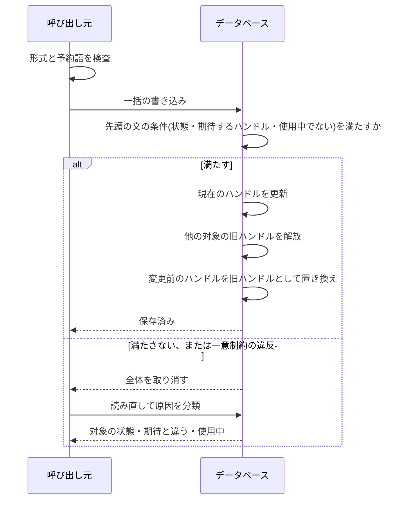
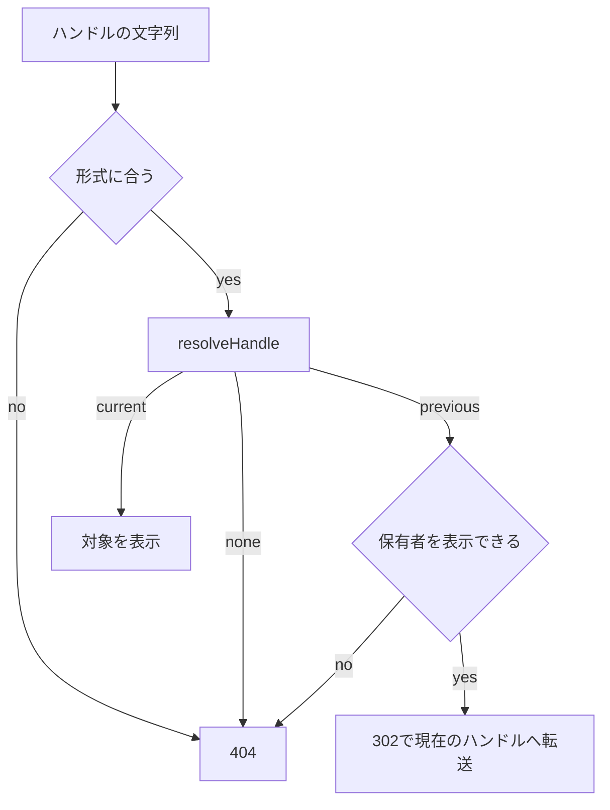

# ハンドル(URLの識別子)の名前空間

利用者などの対象が持つ、URLに使う識別子(ハンドル)について、形式の検査、大文字小文字を区別しない使用中の判定、予約語、旧ハンドルの保持と解放、同時の保存の取り消し、解決と転送を、対象ごとに同じ規則で行うための規約を定める。規則はフロントエンドとバックエンドの共用部品に、D1の文を組み立てる部品は`workers`層に置く。テーブルの照合規則は「[DrizzleとCloudflare D1のマイグレーションと命名規則](../db/001-drizzle-migrations-on-d1.md)」、一括の書き込みと取り消しは「[Cloudflare D1の制約と対処](../db/002-d1-constraints.md)」、層と依存方向は「[Cloudflare Workersでの層構成と依存性の組み立て](002-layered-architecture-on-workers.md)」に従う。

## 前提と用語

| 用語           | 意味                                                                                                                                     |
| -------------- | ---------------------------------------------------------------------------------------------------------------------------------------- |
| 対象           | ハンドルを持つ種類のデータ(利用者など)。対象ごとに1つの名前空間を持つ                                                                    |
| 名前空間       | 対象の記述(名前・規則・現在のハンドルの列・旧ハンドルの記述)を1つにまとめた値(`HandleNamespace`)                                         |
| 規則           | 文字種・文字数の上限と予約語を持つ値(`HandleRule`)。データベースに触れず、形式と予約語を判定する                                         |
| 現在のハンドル | 対象が今使っているハンドル。対象のテーブルの行が持つ                                                                                     |
| 旧ハンドル     | 変更前のハンドルを保持する行。保有者1人につき高々1行で、論理削除の列を持つ                                                               |
| 使用中         | 他の対象の現在のハンドルと一致し、保存できない状態                                                                                       |
| 解放           | 他の対象の旧ハンドルの行を、同じ文字列を現在のハンドルとして保存する一括の書き込みの中で物理削除し、その旧ハンドルによる転送を止めること |
| 解決           | ハンドルの文字列から、現在のハンドルの対象か旧ハンドルの保有者を引くこと                                                                 |

本文中の`<予約語の一覧>`などのプレースホルダーの本プロジェクトの値は、技術ドキュメントに写さず、プロジェクト固有の値の文書「[本プロジェクト固有の値](../../../onboardings/project-values.md)」に置く。

## 部品の置き場所

| 部品                                                                                                                                                                                                            | 置き場所                                           | 役割                                                                                 |
| --------------------------------------------------------------------------------------------------------------------------------------------------------------------------------------------------------------- | -------------------------------------------------- | ------------------------------------------------------------------------------------ |
| `HandleRule`・`checkHandleFormat`・`toHandleKey`・`isSameHandle`・`isReservedHandle`・共有の予約語の一覧                                                                                                        | フロントエンドとバックエンドの共用部品の`handles/` | 形式と予約語の判定。画面の検証とAPIの検証で同じ値を使う                              |
| `HandleNamespace`・`defineHandleNamespace`・`resolveHandle`・`isHandleOccupied`・`handleOccupiedCondition`・`previousHandleUpsert`・`previousHandleRelease`・`previousHandleSoftDelete`・`previousHandleDelete` | バックエンドの`workers/handles/`                   | D1の文を組み立てる部品。フロントエンドの共用部品からは読み込まない                   |
| 旧ハンドルの列の定義                                                                                                                                                                                            | スキーマ定義の`handles/`                           | 旧ハンドルのテーブルの列を対象ごとに同じ形で作る(保有者の列名と参照先だけを指定する) |
| 対象の名前空間の実体                                                                                                                                                                                            | バックエンドの`workers/<対象>/`                    | 対象のテーブルと列を`defineHandleNamespace`に渡す                                    |

規則を共用部品に置くのは、同じ判定をフロントエンドの入力欄とバックエンドの検証の両方で使うためである。D1の部品を`workers`に置くのは、共用部品が`workers`を読み込めないためである(「[依存方向と静的解析](002-layered-architecture-on-workers.md#依存方向と静的解析)」)。

## 規則の定義

```typescript
export const ACCOUNT_HANDLE_RULE: HandleRule = {
  maxLength: <文字数の上限>,
  reservedWords: <予約語の一覧>,
};
```

- 文字種は、ASCIIの英数字と記号の一部に限る。文字種をASCIIに限れば、文字数はUTF-16の長さで数えてよい。
- 大文字小文字の同一視は、ASCIIの英字(A〜Z)だけに限る。`toLowerCase()`は非ASCIIの英字も小文字にするため、判定とデータベースの一意制約の結果が食い違う。`toHandleKey`は`A`〜`Z`だけを小文字にし、列の照合規則(`NOCASE`)と同じ範囲で同一視する。
- 予約語は、`toHandleKey`で両方を変換してから完全一致で比べる。部分一致では拒否しない。
- 形式の検査、予約語の判定、使用中の判定の順に行う。前の2つは呼び出し元が保存の前に行い、名前空間の部品はデータベースの状態だけを判定する。

## 対象の記述

```typescript
export const ACCOUNT_HANDLE_NAMESPACE: HandleNamespace = defineHandleNamespace({
  name: 'account',
  rule: ACCOUNT_HANDLE_RULE,
  current: {
    table: accounts,
    ownerId: accounts.id,
    handle: accounts.handle,
    activeCondition: isNull(accounts.deletedAt),
  },
  previous: {
    table: accountPreviousHandles,
    ownerId: accountPreviousHandles.ownerId,
    handle: accountPreviousHandles.handle,
    deletedAt: accountPreviousHandles.deletedAt,
  },
});
```

- `name`は`/^[a-z][a-z0-9-]*$/`に合う名前にする。規則の上限は1以上の整数にする。違反は`defineHandleNamespace`が例外で止め、モジュールの読み込みの時点で誤りが分かる。
- `current`と`previous`の列は、それぞれのテーブルの列でなければ例外になる。テーブルの取り違えを防ぐためである。
- `previous`を省略した対象は、旧ハンドルを保持しない対象になる。旧ハンドルの記述には、論理削除の列と、主キー・作成日時・更新日時の列が必要である。
- `activeCondition`は解決の対象にする行の条件(退会済みを除くなど)である。使用中の判定には使わない。そのため、対象の行が残っている間は、退会済みの対象の現在のハンドルも使用中のままになる。

## 文字の照合と列の作成

- 現在のハンドルの列と旧ハンドルの列は、`textNoCase()`で作る(「[大文字小文字を区別しないカラム](../db/001-drizzle-migrations-on-d1.md#大文字小文字を区別しないカラム)」)。照合規則はテーブルを作成するときに指定する。後から変えるとテーブルの作り直しになる。
- 比較はSQL側で値を変換せず、列の照合規則に任せる。一意索引が使われ、判定と一意制約の結果が一致する。
- 保存のときに読み込んだ現在のハンドルとの一致は、`COLLATE BINARY`で比べる。`NOCASE`で比べると、大文字小文字だけが変わった同時の変更を検出できないためである。

## 使用中の判定

- 既定の判定(`isHandleOccupied`・`handleOccupiedCondition`)は、他の対象の現在のハンドルの全行(退会済みの行を含む)だけを数える。保存する本人の行は`exceptOwnerId`で除く。
- 他の対象の旧ハンドルは使用中に数えない。他の対象はその文字列を現在のハンドルとして設定でき、設定が確定すると同じ一括の書き込みで旧ハンドルの行が解放される(次の節)。そのため、ある対象の現在のハンドルと同じ文字列が、別の対象の旧ハンドルとして残ることはない。
- 旧ハンドルを解放できない保存(同じ一括の書き込みに解放の文を並べられない対象の作成など)は、`includePrevious: true`を指定して旧ハンドルも使用中として避ける。この判定は論理削除済みの旧ハンドルも数える。
- どちらの方針を採るかは対象ごとに決める。旧ハンドルを使用中に数える方針では、保持者が手放した文字列を他の対象が使えず、旧ハンドルのURLが別の対象のページへ変わることもない。数えない方針では、共有済みの旧ハンドルのURLが、他の対象の設定によって別のページへ変わり得る。この文書は後者を既定の規約とする。

## 旧ハンドルの保持

- 旧ハンドルは保有者1人につき1行(保有者の列に一意制約)。対象の現在のハンドルを別の文字列に変えた一括の書き込みで、変更前の値を`previousHandleUpsert`で置き換える。置き換えでは論理削除の列を空に戻す。
- 大文字小文字だけの変更は、同じハンドルの表記の違いである。転送の必要がないため、旧ハンドルの行を作らず、変えない。
- 自分の旧ハンドルへ戻す変更も、同じ保有者の行を変更前の値で置き換えるだけである。自分の行は解放の対象にならない。
- 旧ハンドルの行は、保有者が次にハンドルを変えて置き換えるまで残る。保持の期限は対象の方針で決め、プロジェクト固有の値の文書に置く。

## 保存の一括の書き込み



1. 呼び出し元が形式と予約語を検査する。
2. 同じ一括の書き込みの先頭の文で、対象の状態・読み込んだ時点の現在のハンドル・新しいハンドルが使用中でないことを`CASE`式の条件にし、NOT NULLの列に入れる。条件を満たさなければNULLになり、NOT NULL制約の違反で後続の文を含む全体が取り消される(「[版の検査で一括の書き込み全体を取り消す](../db/002-d1-constraints.md#版の検査で一括の書き込み全体を取り消す)」)。
3. 対象の現在のハンドルを更新する。
4. 別の文字列への変更のときだけ、`previousHandleRelease`で他の対象の旧ハンドルを解放し、続けて`previousHandleUpsert`で変更前の値を旧ハンドルとして置き換える。解放を置き換えより前に置く。
5. 対象の他の行の書き込みを続ける。

```typescript
const ownerGuard = sql<string>`CASE WHEN EXISTS (
  SELECT 1 FROM ${accounts}
  WHERE ${accounts.id} = ${accountId}
    AND ${accounts.handle} = ${expectedHandle} COLLATE BINARY
    AND NOT ${handleOccupiedCondition(ACCOUNT_HANDLE_NAMESPACE, nextHandle, { exceptOwnerId: accountId })}
) THEN ${accountId} ELSE NULL END`;
```

- 一括の書き込みの中では前の文の結果で後の文を分けられないため、条件は先頭の文に集める。
- 取り消された書き込みは何も残さないため、原因は読み直した状態で分類する。対象が存在しない、または使えない場合は対象の状態の違反、現在のハンドルが期待と違う場合は競合、期待のままの場合は使用中とする。
- D1は1つのデータベースへの書き込みを直列に実行するため、同じ文字列への同時の保存は、先に確定した書き込みが後の書き込みを使用中として取り消す形で一方だけが成功する。

## 解決と転送

- `resolveHandle`は、現在のハンドル(`activeCondition`を満たす行)を先に引き、無ければ論理削除されていない旧ハンドルを引く。結果は`current`(対象のIDと現在のハンドル)・`previous`(保有者のID)・`none`のいずれかになる。
- 比較は大文字小文字を区別しない。
- 呼び出し元は、結果に応じて次のように応答する。
  - `current`は対象を表示する。
  - `previous`は、保有者の現在のハンドルのURLへ302で転送する。転送の前に、保有者を閲覧者に表示できるかを確かめ、表示できなければ`none`と同じく404にする。転送先へはクエリ文字列を引き継ぐ。
  - `none`は404にする。



- 転送は一時的な転送の302にする。保有者が次にハンドルを変えると転送先が変わるため、永続的な転送の301にすると、ブラウザやキャッシュが古い転送先を保存し、変更の後も古い転送先へ送り続ける。
- 形式に合わない文字列は、データベースを読まずに404にする。

## 退会と物理削除

- 退会では、退会の確定と同じ一括の書き込みで、旧ハンドルを`previousHandleSoftDelete`により論理削除する。論理削除された旧ハンドルは解決されない。既定の使用中の判定は旧ハンドルを数えないため、他の対象はその文字列を設定でき、その保存で論理削除済みの行も解放される。`includePrevious`を指定する保存では論理削除済みの行も数えるため、物理削除までの間はその文字列を避ける。
- 物理削除では、対象の行を消す前に、旧ハンドルの行を`previousHandleDelete`で消す。順序は「[ユーザーライフサイクルイベント](007-user-lifecycle-events.md#物理削除)」に従う。
- 旧ハンドルを持たない対象では、解放・論理削除・削除の文は何もしない文になり、保存の一括の書き込みへそのまま並べられる。`previousHandleUpsert`だけは旧ハンドルの記述が無いと例外になる。

## 新しい対象を足す手順

1. 規則を作る。文字数の上限と予約語を`HandleRule`にし、予約語は共有の一覧(`<予約語の一覧>`)に加える。
2. 対象のテーブルを作るときに、現在のハンドルの列を`textNoCase()`・`notNull()`・`unique()`で定義する。照合規則はこの時点で指定する。
3. 旧ハンドルを保持するなら、旧ハンドルのテーブルを旧ハンドルの列の定義で作る。保有者の列名と参照先だけを対象ごとに指定する。旧ハンドルを持たない対象では、このテーブルを作らない。
4. マイグレーションを生成し、生成されたSQLに`COLLATE NOCASE`と一意制約が含まれることを確かめる。
5. `defineHandleNamespace`で名前空間を作り、対象の`workers/<対象>/`に置く。
6. 作成と変更の保存を「[保存の一括の書き込み](#保存の一括の書き込み)」の順序で組み立てる。作成の保存が旧ハンドルを解放できない場合は、使用中の判定に`includePrevious: true`を指定する。
7. 解決の口を作り、「[解決と転送](#解決と転送)」の応答(302と404)を実装する。
8. 退会と物理削除の波及処理に、旧ハンドルの論理削除と削除を加える。
9. 「[テスト](#テスト)」の観点で、テストを先に書く。

## テスト

- 規則の判定は単体テストで確かめる。ASCIIの英字だけが同一視され、非ASCIIの文字は区別されること、予約語は大文字小文字を区別せずに一致すること。
- 名前空間とD1の部品は、Workers統合テストで確かめる。大文字小文字だけが違う値の一意制約、他の対象の旧ハンドルが同じ一括の書き込みで解放されること、先頭の文の条件を満たさないと後続の文が反映されないこと、解決の3つの結果、退会後の解決の除外。
- 同時の保存は、D1が書き込みを直列に実行する性質を使い、先の保存を確定させてから後の保存を実行して取り消されることを確かめる。
- テストの後始末は、旧ハンドルの行と対象の行を、外部キーの参照元から先に消す。
- テストの種別と命名は「[テストの種別と命名](../testing/001-test-strategy.md#テストの種別と命名)」に従う。
