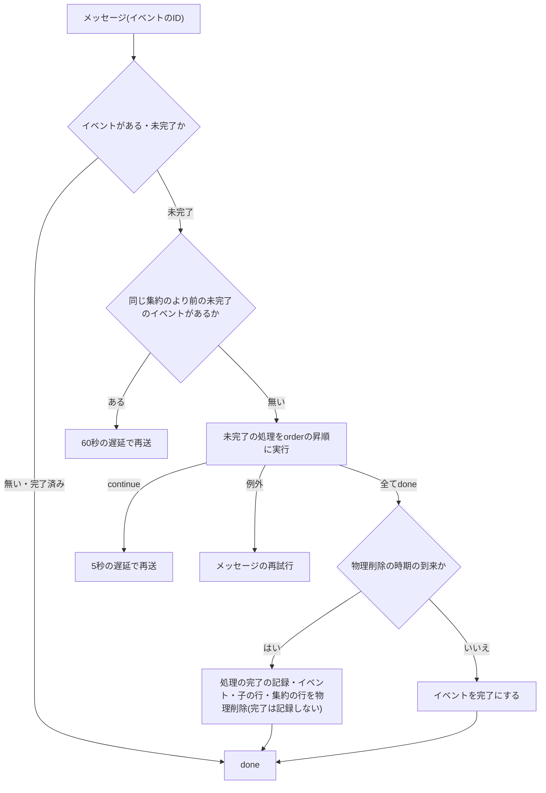
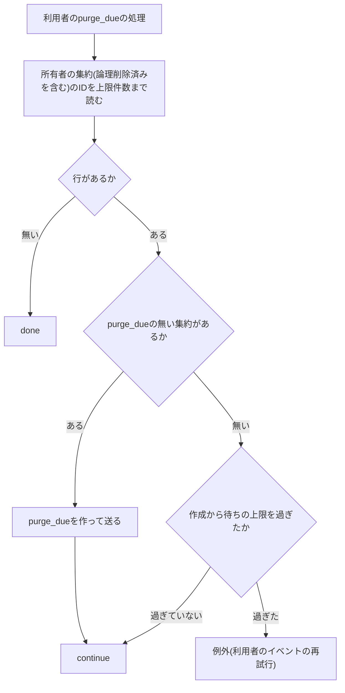

# 集約のライフサイクルイベント

利用者以外の集約(利用者が所有し、独自の状態と子の行を持つデータのまとまり)の論理削除・非公開化・復元・物理削除の時期の到来を、他の機能が自分のデータへ反映する仕組みを定める。イベントの記録と状態の条件付きの確定、同期と非同期の処理、完了の記録と冪等性、`done`・`continue`と再試行、滞ったイベントの日次の送り直し、処理の`order`の帯は「[ユーザーライフサイクルイベント](007-user-lifecycle-events.md)」の規約をそのまま当てはめ、本文書には書き写さない。本文書は、その規約との差分(集約ごとのイベントの種類と登録口、同じ集約の発生順、物理削除を最後に行うこと、所有者の物理削除から集約の物理削除を起こして待つこと、集約を外部キーで参照する行の消し方)だけを扱う。

## 前提と用語

ユーザーライフサイクルイベントの規約のうち、次の節は集約のイベントにも読み替えて当てはめる。読み替えは「利用者」を「集約」に、「波及処理」を「処理」に、「アカウントの機能」を「集約を所有する機能」に置き換える。

| 当てはめる規約                                             | 参照先                                                                                                                            |
| ---------------------------------------------------------- | --------------------------------------------------------------------------------------------------------------------------------- |
| 状態の変化とイベントの記録の一括の書き込みと確定の後の送信 | 「[状態の遷移の確定](007-user-lifecycle-events.md#状態の遷移の確定)」                                                             |
| 同期の処理が返す文                                         | 「[文の規約](007-user-lifecycle-events.md#文の規約)」                                                                             |
| 非同期の処理の冪等性・`done`・`continue`・例外             | 「[契約](007-user-lifecycle-events.md#契約)」                                                                                     |
| 処理ごとの完了の記録と再開                                 | 「[実行の流れ](007-user-lifecycle-events.md#実行の流れ)」                                                                         |
| 再試行とデッドレター                                       | 「[再試行と運用者への通知](007-user-lifecycle-events.md#再試行と運用者への通知)」                                                 |
| 滞ったイベントの日次の送り直しと通知                       | 「[送り直し](007-user-lifecycle-events.md#送り直し)」                                                                             |
| `order`の帯                                                | 「[非同期の波及処理](007-user-lifecycle-events.md#非同期の波及処理)」の登録の`order`の範囲                                        |
| 外部キーと`ON DELETE CASCADE`を使わない理由                | 「[外部キー](007-user-lifecycle-events.md#外部キー)」                                                                             |
| 上限件数ずつ処理する操作と続き                             | 「[保有者単位で上限件数ずつ処理する操作の対応付け](007-user-lifecycle-events.md#保有者単位で上限件数ずつ処理する操作の対応付け)」 |
| 処理とジョブの名前                                         | 「[波及処理とジョブの名前](007-user-lifecycle-events.md#波及処理とジョブの名前)」                                                 |

部品の置き場所は、共通ライブラリの配置先、`<APIサーバーのアプリ>`・`<メッセージを受信するアプリ>`の`src/`からのパスで示す。名前の`<集約>`は集約ごとに置き換える(定数は大文字、型・クラス・関数の名前の中では先頭を大文字にする)。

| 部品                                                                                                                      | 置き場所                                                                                            | 役割                                                                         |
| ------------------------------------------------------------------------------------------------------------------------- | --------------------------------------------------------------------------------------------------- | ---------------------------------------------------------------------------- |
| `createLifecycleRegistry`・`LifecycleRegistry`・`LifecycleRegistration`・`LifecycleRegistryOptions`                       | 共通ライブラリの`core/identity/user-lifecycle.ts`                                                   | 利用者と集約で共有する、処理の登録の検証と種類ごとの実行順の一覧             |
| `assertLifecycleHandlerName`・`LifecycleRegistrationError`・`LifecycleHandlerOutcome`・`LIFECYCLE_CONTINUE_DELAY_SECONDS` | 共通ライブラリの`core/identity/user-lifecycle.ts`                                                   | 名前の検証・登録の例外・処理の結果・続きの再開までの秒数(利用者と共有)       |
| イベントの種類・イベントの型・非同期の処理の契約・登録の型・`<集約>_LIFECYCLE_HANDLER_LABEL`・再試行の規則                | 共通ライブラリの`core/<ドメイン>/<集約>-lifecycle.ts`                                               | 集約のイベントの型と非同期の処理の契約                                       |
| `<集約>LifecycleStore`                                                                                                    | 共通ライブラリの`core/<ドメイン>/ports.ts`(実装は`workers/<ドメイン>/d1-<集約>-lifecycle-store.ts`) | イベントと処理の完了の記録、物理削除の時期の到来のイベントの作成と対象の選択 |
| `<集約の実行のメッセージ>`                                                                                                | 共通ライブラリの`core/messaging/contracts/<ドメイン>.ts`                                            | イベントの非同期の処理を起こすメッセージ(本文はイベントのIDだけ)             |
| 同期の処理の契約(`<集約>LifecycleSyncHandler`・`<集約>LifecycleSyncRegistration`)                                         | `<APIサーバーのアプリ>`の`infrastructure/<ドメイン>/<集約>-lifecycle-sync-handler.ts`               | 同期の処理の契約                                                             |
| `createD1<集約>LifecycleCommitter`                                                                                        | `<APIサーバーのアプリ>`の`infrastructure/<ドメイン>/d1-<集約>-lifecycle-committer.ts`               | 状態の変化・イベントの記録・同期の処理の一括の書き込み                       |
| `<集約>_LIFECYCLE_SYNC_HANDLERS`                                                                                          | `<APIサーバーのアプリ>`の`composition/<集約>-lifecycle-sync-handlers.ts`                            | 同期の処理の登録箇所                                                         |
| `<集約>LifecycleRunner`                                                                                                   | `<メッセージを受信するアプリ>`の`application/<ドメイン>/<集約>-lifecycle-runner.ts`                 | 非同期の処理の実行器                                                         |
| `<集約>_LIFECYCLE_ASYNC_HANDLERS`                                                                                         | `<メッセージを受信するアプリ>`の`composition/<集約>-lifecycle-async-handlers.ts`                    | 非同期の処理の登録箇所                                                       |
| `<集約>PurgeStore`                                                                                                        | `<メッセージを受信するアプリ>`の`infrastructure/<ドメイン>/d1-<集約>-purge-store.ts`                | 集約を所有する機能の行と集約の行の物理削除                                   |
| 物理削除の開始と送り直しの日次のジョブ                                                                                    | `<APIサーバーのアプリ>`の`application/<ドメイン>/jobs/`                                             | 個別に論理削除した集約の物理削除の開始と、未完了のイベントの送り直し         |
| 所有者の物理削除から集約の物理削除を起こす処理                                                                            | `<メッセージを受信するアプリ>`の`application/<ドメイン>/`                                           | 利用者の`purge_due`の非同期の波及処理として登録する                          |

| 用語                       | 意味                                                                                                                                     |
| -------------------------- | ---------------------------------------------------------------------------------------------------------------------------------------- |
| 集約                       | 利用者が所有し、独自の状態(公開・非公開化・論理削除)と子の行を持つデータのまとまり。集約ごとにライフサイクルイベントの記録と登録口を持つ |
| 所有者                     | 集約を所有する利用者。集約から見た親で、所有者の状態の変化はユーザーライフサイクルイベントで伝わる                                       |
| 集約を所有する機能         | 集約のテーブルを所有し、状態の変化とイベントを発行し、最後に集約の行を物理削除する機能                                                   |
| 処理                       | 集約の状態の変化を受けて、他の機能(と集約を所有する機能)が自分のデータに行う処理。同期の処理と非同期の処理がある                         |
| 物理削除の時期の到来       | 集約の行を物理削除してよい時期になったこと(`purge_due`)。個別の論理削除から一定の業務日数の後か、所有者の物理削除の開始で起きる          |
| `<集約>`                   | 集約の名前。ファイル名・テーブル名(`<集約>_lifecycle_events`・`<集約>_lifecycle_handler_runs`)・定数と型の接頭辞に使う                   |
| `<集約の実行のメッセージ>` | 集約のイベントの非同期の処理を起こすメッセージの種別(`<ドメイン>.<動詞句>`)                                                              |

上のプレースホルダーと、本文中の件数・日数などのプレースホルダーの本プロジェクトの値は、技術ドキュメントに写さず、プロジェクト固有の値の文書「[本プロジェクト固有の値](../../../onboardings/project-values.md)」に置く。

## 集約ごとのイベントの種類と登録口

集約ごとに、イベントの種類・記録のテーブル・メッセージの種別・同期と非同期の登録口・実行器・送り直しのジョブを分ける。集約のイベントを利用者のイベントの記録や登録口へ入れない。

- 順序の保証と完了の記録は集約ごとに持つ。利用者の記録へ入れると、異なる集約のイベントが同じ利用者の順序で互いを待つ。
- 処理を登録する機能は、反映が要る集約の登録口だけに登録する。利用者の登録口の種類に集約の状態を足すと、利用者の全ての処理が集約の種類を知る必要が生じる。

イベントの種類は、集約の状態の変化ごとに決める。例えば、記事の集約では次のようにする。

| 種類(`type`) | 起きること                 | 同期の処理   | 非同期の処理 |
| ------------ | -------------------------- | ------------ | ------------ |
| `deleted`    | 所有者による個別の論理削除 | 登録できる   | 登録できる   |
| `hidden`     | 運営者による非公開化       | 登録できる   | 登録できる   |
| `unhidden`   | 非公開化の解除(復元)       | 登録できる   | 登録できる   |
| `purge_due`  | 物理削除の時期の到来       | 登録できない | 登録できる   |

- イベントは、ID(ULID)・集約のID・所有者のID・種類・発生日時だけを持つ。処理は集約の行を読み直さずに所有者を知れる。個人情報を含めない。
- 所有者の状態の変化(退会・停止・停止の解除)は、集約のイベントにしない。集約を所有する機能は、所有者のIDを条件にした集合に対する更新(全ての集約の論理削除など)をユーザーライフサイクルの同期の波及処理として登録する。所有者の状態の変化に合わせて集約に紐付く自分のデータを変えたい機能も、ユーザーライフサイクルの登録口に登録する。集約ごとにイベントを作ると、利用者の状態の遷移の一括の書き込みに集約の行ごとの文が入り、「[文の規約](007-user-lifecycle-events.md#文の規約)」の集合に対する文の規則を守れない。
- そのため`deleted`は所有者による個別の論理削除だけを表し、退会による論理削除では起きない。所有者の退会で集約の自分のデータを変える機能は、利用者の`withdrawn`の処理を登録する。

### 登録の検証の共有

名前の形式・名前の重複・整数でない`order`・`events`の中の種類の重複・同じ種類での`order`の重複の検証と、種類ごとの`order`の昇順の並びは、利用者と集約で共通の`createLifecycleRegistry`を使う。集約は、違反の文言に出す処理の呼び名(`handlerLabel`)を自分の値にして渡し、どの登録口の登録を直すべきかを区別する。利用者の登録口の呼び名は「波及処理」のまま変えない。

```typescript
export const ARTICLE_LIFECYCLE_HANDLER_LABEL = '記事ライフサイクルの処理';

export function createArticleLifecycleRegistry(
  registrations: readonly ArticleLifecycleAsyncRegistration[],
): ArticleLifecycleRegistry {
  return createLifecycleRegistry<
    ArticleLifecycleEventType,
    ArticleLifecycleAsyncRegistration
  >(registrations, { handlerLabel: ARTICLE_LIFECYCLE_HANDLER_LABEL });
}
```

- 同期の処理の登録は`order`を持たず、登録の順に文を並べる。確定の部品は登録の位置を`order`として渡して`createLifecycleRegistry`で検証し、非同期の処理と別の呼び名(「<集約>ライフサイクルの同期の処理」など)を使う。登録の位置は重複しないため、`order`の重複の検査は働かず、名前と種類の検査だけが効く。
- 登録の検証はモジュールの組み立てで行い、最初のイベントの確定やメッセージではなく、組み立ての時に誤りに気付く。
- 登録口の名前と順の検証を使う他の登録口(判定の供給元・保存の処理)は「[判定の供給元と保存の処理の登録口](013-pluggable-decision-sources.md)」に従う。

## 状態の変化の確定

同期の処理の契約(`statementsFor(event, db)`)と文の規約は利用者と同じである(「[文の規約](007-user-lifecycle-events.md#文の規約)」)。文は集約のIDを条件にした集合に対する更新・挿入・削除にする。削除は、非公開化・論理削除の後に残してはならない派生のデータ(全文検索の索引文書など)を消す時に使う。保存の処理の文は更新か挿入に限る(「[保存の処理の規約](013-pluggable-decision-sources.md#規約)」)。契約は文と接続を扱うため、`<APIサーバーのアプリ>`のinfrastructure層に置き、application層からは読み込まない。確定の部品は`createD1<集約>LifecycleCommitter(db, ids, registrations, resolve)`で、`toDynamicValue`で包んで束縛し、同期の処理の識別子は確定のたびに`resolve`で解決する。

確定は、確定の前に集約の行を1回読み、次の場合はイベントも同期の処理の呼び出しも作らずに結果を返す。

- 行が無い、または論理削除済み: `not-found`
- 既に同じ状態(非公開化中の非公開化・公開中の復元): `unchanged`

それ以外は、次の文を1つの一括の書き込みで確定する。

1. イベントの挿入。集約の行が状態の条件を満たすときだけ集約のIDに値が入り、満たさなければNOT NULL制約の違反で全体を取り消す(「[版の検査で一括の書き込み全体を取り消す](../db/002-d1-constraints.md#版の検査で一括の書き込み全体を取り消す)」)。
2. 集約の行の更新(版を1増やし、論理削除・非公開化・復元の列)。
3. 集約を所有する機能自身の文(旧ハンドルの論理削除、まだ始まっていない子の行の取消など)。
4. 登録した同期の処理が返した文(登録の順)。

- 状態の条件は、利用者の版だけでなく、種類ごとに集約の状態で決める。例えば、所有者による削除は「論理削除されていない・所有者が書き込める状態・固定の期間でない」を、運営者による非公開化と復元は「論理削除されていない」と現在の公開の状態だけを条件にし、所有者の状態を条件にしない。
- 所有者による削除は、画面が読んだ版(`expectedVersion`)を渡せば版の一致も条件にする。省いた削除は版を条件にしない。
- 取り消された一括の書き込みは何も残さないため、集約の行を読み直して理由を分ける。削除は、論理削除済み・不在(`not-found`)→所有者が書き込めない状態(`account-unavailable`)→版の不一致(`conflict`)→固定の期間(`locked`)の順に判定し、非公開化と復元は、論理削除済み・不在(`not-found`)→読み直した状態が既に同じ(`unchanged`)の順に判定する。どれにも当たらなければ元の例外を投げる。
- 確定の結果が`committed`のときだけ、イベントのIDを本文にした`<集約の実行のメッセージ>`を送る。送信の失敗は確定済みの操作を失敗させず、ログと運用者への通知(レベル`error`)に残す(「[状態の遷移の確定](007-user-lifecycle-events.md#状態の遷移の確定)」と同じ)。通知にはイベントと集約のIDだけを添える(送り方は「[送信する例外と送信しない例外](../infra/004-logging-and-error-tracking.md#送信する例外と送信しない例外)」)。イベントは未完了のまま残り、送り直しのジョブが送る(「[送り直し](007-user-lifecycle-events.md#送り直し)」)。

## 非同期の処理

非同期の処理の契約(`handle(event)`が`done`・`continue`を返し、失敗は例外で投げる)と冪等性の規約は利用者と同じである(「[契約](007-user-lifecycle-events.md#契約)」)。登録は`<メッセージを受信するアプリ>`の`<集約>_LIFECYCLE_ASYNC_HANDLERS`へ、名前・対象の種類・`order`・処理の識別子を追記する。

- `order`の帯は、ユーザーライフサイクルと同じ割り当てを使う。同じ機能は、利用者と集約のどちらの登録口でも同じ帯の値を使う。集約を所有する機能自身の処理も、その機能の帯の値を使う。集約の行の物理削除は処理ではなく実行器が最後に行うため、最後に動かすための帯は使わない。
- 再試行の規則は利用者と同じ値(最大5回の試行、遅延は300秒から倍にし上限3600秒)を集約ごとの定数として持つ。
- 物理削除の後に送り直されたメッセージもあり得るため、集約の行が無ければ`done`を返す。

### 同じ集約の発生順

- 同じ集約のイベントは、発生日時の順(同じ時刻ならIDの昇順)に処理する。実行器は、同じ集約のより前の未完了のイベントがあれば、後のイベントを60秒の遅延で待たせる。
- 同じ所有者の異なる集約の間、及び集約のイベントと所有者のイベントの間の順序は保証しない。処理は、所有者の退会の処理と集約の非公開化の処理のどちらが先に動いても結果が同じになるように書く。
- 個別の論理削除(`deleted`)の処理が終わる前に物理削除の時期の到来(`purge_due`)が来ても、`purge_due`は`deleted`の完了を待つ。

### 物理削除は最後に行う

`purge_due`の全ての処理が`done`を返したら、実行器が集約を所有する機能の物理削除の部品(`<集約>PurgeStore`)を呼ぶ。



- 物理削除は、処理の完了の記録・その集約のイベント・集約を所有する機能の子の行(子のテーブル・旧ハンドルなど)・集約の行を、子の行から順に1つの一括の書き込みで消す。他の機能の行が集約を外部キーで参照したまま残っていれば、最後の文が外部キーの違反で失敗し、全体が取り消されて例外になる。メッセージの再試行に任せる。
- 物理削除はイベントの行も消すため、実行器は物理削除の後に完了を記録しない(利用者の実行器は記録の文を呼ぶが、行が無いため何も変わらない)。物理削除の後に届いたメッセージは「イベントが無い」で`done`になる。
- `purge_due`のイベントは集約ごとに1件だけで、部分一意索引で重複を防ぐ。

## 物理削除の時期の到来

物理削除の時期の到来は、次の2つの経路で起きる。どちらも同じ`purge_due`のイベントを作り、既に作られた集約には作らない。

| 経路                   | 作る部品                                                        | 時期                                                                 |
| ---------------------- | --------------------------------------------------------------- | -------------------------------------------------------------------- |
| 個別の論理削除         | 日次のジョブ                                                    | 論理削除の業務日付が実行日の`<物理削除を始めるまでの業務日数>`前以前 |
| 所有者の物理削除の開始 | 利用者の`purge_due`の非同期の波及処理(集約を所有する機能が登録) | 所有者の物理削除の開始の直後。集約の論理削除の時期を問わない         |

- 個別の論理削除の経路は、利用者の物理削除の開始と同じ形(業務日付で数える・1回の件数に上限を置いて翌日に続ける・作ったイベントを送り、送信の失敗は送り直しのジョブに任せる・期限を過ぎて残る集約を件数だけ運用者へ通知する)にする(「[段階](007-user-lifecycle-events.md#段階)」。通知の送り方は「[送信する例外と送信しない例外](../infra/004-logging-and-error-tracking.md#送信する例外と送信しない例外)」)。
- 作成は対象を読んでから挿入するため、その間に集約の行が物理削除されると外部キーの違反で一括の書き込み全体が取り消されて例外になる。呼び出し側の再試行で回復する。

### 所有者の物理削除から集約の物理削除を起こして待つ

所有者の行は、所有者の集約が全て物理削除されるまで消せない(集約の行が所有者を外部キーで参照するため)。集約を所有する機能は、利用者の`purge_due`に次の処理を登録する。



- 所有者の集約を、論理削除済みを含めて`<所有者ごとに読む集約の件数>`件ずつ読み、`purge_due`の無い集約に作って送り、`continue`を返す。集約の実行器がそれぞれを物理削除するため、この処理は行が無くなるまで`continue`で待つ。行が無くなれば`done`を返す。
- 呼び出しのたびに対象をデータベースから求め直し、作成済みのイベントは作り直さない。再試行・続きの再開で同じイベントを何度処理しても結果が変わらない。
- 全ての集約にイベントが作られた後も行が残るときは、最も新しい作成から`<集約の物理削除を待つ上限>`を過ぎたら例外を投げる。5秒ごとの続きの空回りを避け、滞った集約を利用者のイベントの再試行の間隔とデッドレターの通知に任せる。
- 送信の失敗はレベル`error`のログに残して残りの送信を続ける。送れなかったイベントは集約の送り直しのジョブが送る。それまでに行が消えなければ待ちの上限の例外になり、再試行を使い切るとデッドレターとして運用者へ通知されるため、この処理は送信の失敗ごとには通知しない。
- 所有者の行は、利用者の全ての波及処理が終わるまで論理削除のまま残る。集約の`purge_due`の処理は所有者の行を読める。
- この処理の`order`より前の利用者の`purge_due`の波及処理は集約の物理削除の前に、後の波及処理は全ての集約の物理削除の後に動く。

## 集約を参照する行の消し方

他の機能が集約の行を外部キーで参照する行(集約に付けたコメント・集約の索引の行など)は、集約の`purge_due`の処理で消すか紐付けを外す。利用者の`purge_due`の波及処理では消さない。

- 個別の論理削除の経路では、利用者の`purge_due`は起きない。集約の`purge_due`で消さないと、集約の物理削除が外部キーの違反で失敗し続ける。
- 所有者の物理削除の経路でも、集約を所有する機能の待ちの処理より後の`order`の波及処理で消すと、集約の物理削除が先に必要なため互いに待ち、待ちの上限で例外になり続ける。
- 集約と利用者の両方を参照する行(他の利用者が集約に付けた記録など)も、集約の`purge_due`で消す。集約を参照しない、利用者だけを参照する行は利用者の`purge_due`で消す。
- 外部キーを持たないデータ(オブジェクトストレージのファイルなど)の取り残しは、そのデータを持つ機能の処理が責任を持つ(「[外部キー](007-user-lifecycle-events.md#外部キー)」)。集約を所有する機能の画像なども、集約を所有する機能の`purge_due`の処理で消してから`done`を返す。

## テスト

利用者のイベントのテスト(「[テスト](007-user-lifecycle-events.md#テスト)」)に加えて、次を確かめる。

- 確定は、Workers統合テストで、`not-found`・`unchanged`(イベントも同期の処理の呼び出しも作らない)・取り消しの理由の分類の優先の順・集約を所有する機能の文と登録した同期の処理の文が同じ一括の書き込みで取り消されることを確かめる。
- 実行器の単体テストは、同じ集約のより前の未完了のイベントを待つこと、`purge_due`の全ての処理の後に物理削除し完了を記録しないこと、物理削除の後に届いたメッセージが`done`になることを確かめる。
- 集約を参照する行を持つ機能は、自分の行が残る間は集約の物理削除が外部キーの違反で失敗し、集約の`purge_due`の処理の後に成功することをWorkers統合テストで確かめる。
- 所有者の物理削除から集約の物理削除を起こす処理は、イベントを集約ごとに1回だけ作ること、行が残る間は`continue`を返すこと、待ちの上限を過ぎたら例外を投げることを確かめる。
- テーブルの種類と状態の列の値の一覧は、共通ライブラリの`core`がテーブルの定義を読めないため手で同期し、一致を単体テストで確かめる。
