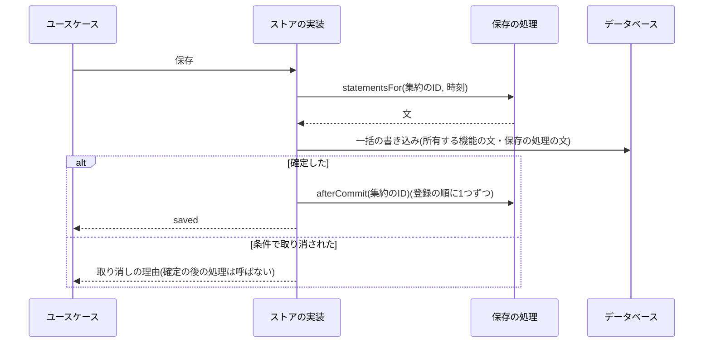

# 判定の供給元と保存の処理の登録口

集約を所有する機能が、後から加わる機能に、自分のファイルを書き換えさせずに登録の1行で次のことをさせるための登録口の規約を定める。

- 操作の可否の判定(次の予約の禁止・変更の固定など)に条件を加える(判定の供給元)。
- 一覧や詳細の表示の要約に値を加える(表示の供給元)。
- 集約の保存と同じ一括の書き込みに文を加え、確定の後に処理を行う(保存の処理)。

契約の形と置き場所、一覧単位の呼び出し、該当だけを返す規則、失敗の扱い、名前と順の規則、型の拡張を使わない理由、及びテストを扱う。集約の削除・非公開化・復元・物理削除を伝える仕組みは「[集約のライフサイクルイベント](012-aggregate-lifecycle-events.md)」に、層と依存方向は「[Cloudflare Workersでの層構成と依存性の組み立て](002-layered-architecture-on-workers.md)」に、一括の書き込みと取り消しは「[Cloudflare D1の制約と対処](../db/002-d1-constraints.md)」に従う。

## 前提と用語

部品の置き場所は、共通ライブラリの配置先と`<APIサーバーのアプリ>`の`src/`からのパスで示す。名前の`<集約>`は集約ごとに置き換える(定数は大文字、型と関数は先頭を大文字にする)。

| 部品                                                                                                        | 置き場所                                          | 役割                                                     |
| ----------------------------------------------------------------------------------------------------------- | ------------------------------------------------- | -------------------------------------------------------- |
| 供給元の契約(判定・表示)・`DecisionSourceRegistration`・`RegisteredDecisionSource`・`DecisionSourceResults` | `application/<ドメイン>/decision-sources.ts`      | 供給元が返す値の形と、登録の型                           |
| `assertDecisionSourceRegistrations`・`resolveDecisionSources`・`callDecisionSources`                        | `application/<ドメイン>/decision-sources.ts`      | 登録の検証・`order`の順の解決・呼び出しと失敗の集約      |
| 判定と表示の登録口(初版は空)                                                                                | `composition/<ドメイン>-decision-sources.ts`      | 後から加わる機能が供給元を追記する場所                   |
| `<集約>SaveHook`・`<集約>SaveHookRegistration`・`<集約>SaveHooks`・`create<集約>SaveHooks`                  | `infrastructure/<ドメイン>/<集約>-save-hooks.ts`  | 保存の処理の契約と、文の収集・確定の後の処理の呼び出し   |
| `<集約>_SAVE_HOOKS`(初版は空)                                                                               | `composition/<集約>-save-hooks.ts`                | 後から加わる機能が保存の処理を追記する場所               |
| `assertLifecycleHandlerName`・`LifecycleRegistrationError`                                                  | 共通ライブラリの`core/identity/user-lifecycle.ts` | 名前の形式の検証と登録の例外(ライフサイクルの登録と共有) |

| 用語           | 意味                                                                                                     |
| -------------- | -------------------------------------------------------------------------------------------------------- |
| 所有する機能   | 集約のテーブルと判定を所有し、登録口と契約を定める機能                                                   |
| 加える機能     | 所有する機能の判定・表示・保存に、登録口への登録で条件・値・文を加える機能                               |
| 対象           | 判定する1件。集約のIDと所有者のIDと、所有する機能が判定に渡す値(直近の子の行の状態など)を持つ            |
| 判定の供給元   | 対象ごとに、操作を禁止・固定する理由を返す供給元。失敗すると所有する機能は操作を受け付けない             |
| 表示の供給元   | 表示する項目ごとに、要約の文言などの表示の値を返す供給元。失敗しても所有する機能は自分の値で表示を続ける |
| 保存の処理     | 集約の保存の一括の書き込みに文を加え、確定の後に処理を行う、加える機能の部品                             |
| 確定の後の処理 | 保存の一括の書き込みが確定した後に呼ぶ、保存の処理のメソッド                                             |

## 型の拡張を使わない理由

加える機能が所有する機能の型(GraphQLの型・応答の型・契約の型)へ項目を足して値を差し込む方法は使わない。登録口と、値だけを返す契約で加える。

- GraphQLのスキーマモジュールは`extend`を使わず、ルート型以外の型を複数のモジュールで定義できない(「[合成と重複の禁止](004-graphql-server.md#合成と重複の禁止)」)。加える機能は所有する機能の型に項目を足せないため、所有する機能が項目を定義し、値を供給元から受け取る。
- 操作の可否は、所有する機能が全ての条件を1か所で合わせて判定する。加える機能が自分のリゾルバなどで別に拒否すると、所有する機能の画面が拒否の理由と解除の日時を示せず、判定の失敗の扱いも機能ごとにばらつく。
- TypeScriptの宣言の結合(`declare module`)で所有する機能の契約の型を広げると、所有する機能のファイルを変えずに契約が変わり、所有する機能の判定や表示が知らない項目を持つ値が流れる。契約の形は所有する機能が固定し、加える機能は文言・コード・順位などの値だけを返す。

## 判定と表示の供給元

### 契約

供給元の契約は所有する機能のapplication層に置く。供給元は値だけを返し、文や接続を扱わないため、ユースケースが直接受け取れる。例は記事の集約で、公開の予約を禁止する条件と一覧の要約を加える場合である。

```typescript
export interface DecisionSubject {
  readonly articleId: string;
  readonly ownerUserId: string;
  // 所有する機能が判定に渡す値
  readonly latestSchedule: {
    readonly scheduleId: string;
    readonly date: BusinessDate;
    readonly status: ScheduleStatus;
  } | null;
}

export interface ScheduleBlock {
  readonly articleId: string;
  // '<spec名>.<名詞句>'
  readonly code: string;
  // 文言の規則に従う、そのまま画面に示す文
  readonly message: string;
  // 解除の日時が決まっていれば
  readonly releaseAt: Date | null;
}

export interface ScheduleConditionSource {
  // 該当するものだけを返す
  findBlocks(input: {
    readonly subjects: readonly DecisionSubject[];
    readonly at: Date;
  }): Promise<readonly ScheduleBlock[]>;
}

export interface SummaryContribution {
  readonly scheduleId: string;
  readonly label: string;
  // 複数の供給元が同じ項目に返したら大きい方を使う
  readonly rank: number;
}

export interface SummarySource {
  summarize(input: {
    readonly schedules: readonly { readonly scheduleId: string }[];
    readonly at: Date;
  }): Promise<readonly SummaryContribution[]>;
}

export interface DecisionSourceRegistration<T> {
  // '<spec名>.<名詞句>'
  readonly name: string;
  readonly order: number;
  readonly source: ServiceIdentifier<T>;
}
```

- 一覧単位で呼ぶ。所有する機能は、1回の判定・表示の対象(1ページの一覧など)を1回の呼び出しで渡し、供給元は対象の数によらず一定の回数の問い合わせで答える。対象ごとに供給元を呼ぶと、1ページの問い合わせが対象の数だけ増える。所有する機能は1回に渡す対象の数に上限(`<判定の一括の上限>`)を置き、上限を超える入力を例外で拒否する。
- 該当するものだけを返す。返さなかった対象は、その供給元の条件に当たらないとみなす。所有する機能は、結果を集約のIDや項目のIDで束ねて対象へ割り当てる。
- 判定の時刻は所有する機能が`at`で渡し、供給元は自分で時計を読まない。複数の供給元が同じ時刻で判定し、境界の時刻で結果が食い違わない。
- `code`は`<spec名>.<名詞句>`の形にし、どの機能の条件かを区別できるようにする。`message`は文言の規則に従う完成した文で、所有する機能は書き換えずに示す。
- 同じ項目に複数の表示の供給元が値を返したら、`rank`の大きい方を使う。値が無い項目は、所有する機能が自分のデータから作った値で示す。

### 呼び出しと失敗の扱い

所有する機能は、登録された供給元を`callDecisionSources`で呼ぶ。呼び出しは`order`の順に始め、応答は並行して待つ(`Promise.allSettled`)。結果は、例外を投げた供給元を除いて`order`の順に返し、1つでも失敗すれば`failed`を真にする。

| 供給元の種類 | 失敗したとき                                                                                                                                                                 |
| ------------ | ---------------------------------------------------------------------------------------------------------------------------------------------------------------------------- |
| 判定の供給元 | その種類の判定を「確認できない」にし、その判定に依る操作を拒否する(安全側)。画面には確認できなかった旨を示す。所有する機能が自分のデータで決める条件は、失敗によらず判定する |
| 表示の供給元 | 失敗した供給元の値を除き、値の無い項目は所有する機能の値で示す(縮退)。一覧の表示を失敗させない                                                                               |

- 失敗した供給元は、レベル`warning`のログに供給元の名前だけを残す。例外は加える機能の内部の値や利用者の入力を含み得るため、ログの属性に添えない(「[伏せ字の規則](../infra/004-logging-and-error-tracking.md#伏せ字の規則)」)。
- 判定の供給元の失敗と、所有する機能自身の条件(固定の期間など)が重なったら、所有する機能自身の条件の理由を優先して示す。

### 登録

所有する機能の`composition/<ドメイン>-decision-sources.ts`に、判定・表示の種類ごとの登録口を空の配列で置く。加える機能は、名前・`order`・供給元の識別子を追記し、識別子を自分のモジュールで処理単位のコンテナに束縛する。

```typescript
// 公開の予約を禁止する条件を加える機能が、登録をここへ追記する
export const SCHEDULE_CONDITION_SOURCES: readonly DecisionSourceRegistration<ScheduleConditionSource>[] =
  [
    {
      name: '<spec名>.<名詞句>',
      order: 100,
      source: CAMPAIGN_TYPES.CampaignScheduleConditionSource,
    },
  ];
```

- 名前は`<spec名>.<名詞句>`の形にする。形式は`assertLifecycleHandlerName(name, <登録口の呼び名>)`でライフサイクルの処理の名前と同じ規則で検証し、違反の文言に登録口の呼び名を出す(「[登録の検証の共有](012-aggregate-lifecycle-events.md#登録の検証の共有)」)。
- `order`は整数にし、同じ登録口で重複させない。加える機能が値を割り当てる。名前の重複・整数でない`order`・`order`の重複は`LifecycleRegistrationError`で拒否する。
- 所有する機能は、各登録口を`resolveDecisionSources`で検証・`order`の昇順に並べ・識別子を解決した一覧にし、`toDynamicValue`で束縛して判定の部品へ`@inject`で渡す。

```typescript
bind<readonly RegisteredDecisionSource<ScheduleConditionSource>[]>(
  ARTICLE_TYPES.ScheduleConditionSources,
).toDynamicValue((context) =>
  resolveDecisionSources(SCHEDULE_CONDITION_SOURCES, (identifier) =>
    context.get(identifier),
  ),
);
```

- 登録口の検証(`assertDecisionSourceRegistrations`)を`composition`の単体テストで全ての登録口に掛け、登録の誤りをデプロイの前に検出する。

## 保存の処理

### 契約

保存の処理は文と接続を扱うため、契約と組み立ての部品を所有する機能のinfrastructure層に置く。application層のユースケースは登録口と接続を見ず、ストアのポートだけを使う。加える機能の保存の処理の実装も、自分の`infrastructure/<ドメイン>/`に置く。

```typescript
export interface ArticleSaveHook {
  // 保存と同じ一括の書き込みに入る文を返す。読み取りはしてよいが、書き込みは返す文だけで行う
  statementsFor(
    input: { readonly articleId: string; readonly at: Date },
    db: Database,
  ): Promise<readonly BatchItem<'sqlite'>[]>;
  // 確定の後に呼ぶ。失敗は保存を失敗させない
  afterCommit(input: { readonly articleId: string }): Promise<void>;
}

export interface ArticleSaveHookRegistration {
  // '<spec名>.<名詞句>'
  readonly name: string;
  readonly hook: ServiceIdentifier<ArticleSaveHook>;
}
```



### 規約

- 文は、集約のIDを条件にした更新か挿入だけにする。所有する機能の条件の`CASE`式で保存が取り消されると、保存の処理の文も一緒に取り消される。行ごとの文を大量に返さない。外部サービスの呼び出しを`statementsFor`に入れない。
- 所有する機能のテーブルの行を更新する文は、更新日時の列を明示しないと、Drizzleの`$onUpdateFn`で更新日時が変わる。保存の処理の文で集約の更新日時を変えたくなければ、列を明示する。
- 確定の後の処理は、一括の書き込みが確定し結果が保存の成功のときだけ、同じストアのメソッドの中で登録の順に1つずつ呼ぶ。保存の取り消し(条件による取り消しと`statementsFor`の例外)では呼ばない。
- 確定の後の処理の例外は保存を失敗させない。`create<集約>SaveHooks`がレベル`warning`のログに処理の名前と集約のIDだけを残して、次の処理を続ける。確定の後の処理は冪等にし、失敗しても後の処理(日次の照合・次の保存など)で回復できるようにする。
- 呼ぶ保存は、集約の内容を書く全ての経路(登録・編集・公開APIからの部分の更新など)である。削除・非公開化・復元と、所有者の退会・停止・停止の解除は保存の処理では伝えない。集約のライフサイクルイベント(「[集約のライフサイクルイベント](012-aggregate-lifecycle-events.md)」)と、ユーザーライフサイクルイベント(「[ユーザーライフサイクルイベント](007-user-lifecycle-events.md)」)の登録口で受け取る。
- 文の収集は全ての保存の処理を並行して呼び、登録の順に連結する。

### 登録と組み立て

所有する機能の`composition/<集約>-save-hooks.ts`に`<集約>_SAVE_HOOKS`を空の配列で置き、加える機能が名前と処理の識別子を追記する。保存の処理は`order`を持たず、登録の順に文を並べ確定の後の処理を呼ぶ。

```typescript
bind<ArticleSaveHooks>(ARTICLE_TYPES.ArticleSaveHooks).toDynamicValue(
  (context) =>
    createArticleSaveHooks(ARTICLE_SAVE_HOOKS, (identifier) =>
      context.get(identifier),
    ),
);
```

- `create<集約>SaveHooks`は、組み立ての時に名前の形式と重複を検証し(`assertLifecycleHandlerName`・`LifecycleRegistrationError`)、全ての処理を解決する。
- 保存の一括の書き込みを行うストアの実装(infrastructure層)だけが`<集約>SaveHooks`を`@inject`で受け取り、一括の書き込みの末尾に`statementsFor`の文を加え、確定の後に`runAfterCommit`を呼ぶ。ユースケースには渡さない。

## テスト

- 登録口の検証は、`composition`の単体テストで全ての登録口に掛ける。初版の空の登録口も検証を通ることを確かめる。
- 所有する機能の判定の単体テストは、偽の供給元で、判定の供給元の例外で「確認できない」になり操作を拒否すること、表示の供給元の例外で所有する機能の値に縮退すること、該当しない対象が条件に当たらないこと、上限を超える対象の拒否を確かめる。
- 保存の処理は、Workers統合テストで、文が保存と同じ一括の書き込みで確定すること、条件で取り消された保存では文も取り消され確定の後の処理を呼ばないこと、確定の後の処理の例外で保存が成功のまま残り次の処理が呼ばれることを確かめる。
- 加える機能の供給元は、該当する対象と該当しない対象を混ぜた一覧で、該当するものだけを返すことと、対象の数を増やしても問い合わせの回数が変わらないことを確かめる。
